# Comparative Evaluation of Deep-Learning based DoA Estimators for Real-Time ISAC Beamforming

Anjali K.S.1, Manoj Kumar Panda1, Chandramani Singh2

1Department of Electronics and Communication Engineering,

Amrita School of Engineering, Bengaluru, Amrita Vishwa Vidyapeetham, India

2Department of Electronic Systems Engineering, Indian Institute of Science, Bangalore, India

Abstract—Integrated Sensing and Communication (ISAC) systems rely on accurate Direction-of-Arrival (DoA) estimation for effective beamforming and spectral-efficiency enhancement. While numerous classical and deep-learning-based DoA estimation methods have been reported in the literature, their suitability for real-time ISAC operation remains insufficiently understood because practical deployment requires consideration of both estimation accuracy and computational latency. This paper presents a unified evaluation framework for systematically comparing classical and learning-based DoA estimators within an ISAC beamforming pipeline. Representative classical and learning-based DoA estimators, together with an ensemble architecture, are integrated with Singular Value Decomposition (SVD)-based beamforming and evaluated under identical operating conditions. The impact of DoA estimation accuracy, inference latency, beamforming-weight generation time, and resulting effective spectral efficiency is investigated. Results show that different estimators occupy distinct operating points in the accuracy-latency-performance design space. Although learningbased approaches substantially reduce estimation time compared with MUSIC, the overall processing latency increasingly becomes dominated by the computational cost of SVD-based beamforming. Among the evaluated methods, the Regression Convolutional Neural Network (RCNN) exhibits a favorable balance between estimation accuracy, computational efficiency, and beamforming performance, making it a promising candidate for real-time ISAC deployment. The findings further suggest that future lowlatency ISAC systems may benefit from beamforming strategies that reduce or avoid computationally intensive SVD-based beamforming-weight generation.

Index Terms—ISAC, DoA estimation, deep learning, regression, beamforming, SVD, computational efficiency, LFM.

## I. INTRODUCTION

have motivated the integration of radar and communication functions on a common platform [1]. This paradigm, widely studied under terms such as Joint Radar and Communication (JRC), Dual Function Radar Communication (DFRC), Integrated Sensing and Communication (ISAC), and Joint Sensing and Communication (JSAC), enables shared use of hardware and spectral resources. In ISAC systems, accurate Direction of Arrival (DoA) estimation plays a critical role, as it supports transmit beamforming for both reliable target detection and communication in the correct user direction.

Traditional DoA estimation techniques, including MUSIC [2], Root-MUSIC [3], ESPRIT [4], Fourier-based spectral analysis [5], and MVDR [6], have been extensively applied in radar, wireless communication, remote sensing, and astronomy. However, these methods suffer from high execution time and degraded performance under low signal-to-noise ratio (SNR) conditions, motivating the adoption of deep learning (DL) approaches [7]. Recent advances in DL have demonstrated significant improvements in DoA estimation accuracy and robustness. DL-based methods can be broadly classified into classification-based and regression-based approaches. Classification methods discretize the angular space into predefined grids, achieving high accuracy but requiring large datasets, complex architectures, and longer training times [8]–[15]. In contrast, regression-based methods treat DoA as a continuous output, offering faster training, better generalization, and reduced computational cost, though they must be carefully designed to avoid instability [16]–[22].

Even with these advancements, the evaluation metric used in most existing DoA estimation studies is root-mean-square error (RMSE) alone. A review on deep learning-based DoA estimation in [23] reports 44% of studies use RMSE alone as the evaluation metric. Even though RMSE provides estimation accuracy, in real-time system inference speed is equally important. For real-time ISAC operation, beamforming weights must be updated frequently to track target variations. In highmobility scenarios, beam directions must be updated instantly to maintain alignment, and the resulting beam-training overhead and latency have been identified as critical bottlenecks limiting the practical deployment of predictive beamforming systems [24].

So, a systematic study is needed to evaluate DoA estimation accuracy-latency tradeoff in beamforming for real-time ISAC systems. While numerous studies focus on improving DoA estimation accuracy, relatively little attention has been paid to the impact of estimator complexity on real-time ISAC operation. Consequently, the most accurate estimator is not necessarily the most suitable estimator for real-time ISAC systems. Motivated by this gap, the present work evaluates existing DoA estimation and beamforming approaches not only in terms of estimation accuracy, but also prediction time and spectral efficiency, to provide a more complete picture of their suitability for ISAC deployment.

In this study, DoA estimation based beamforming method for an ISAC transmitter base station is considered. The main contributions in this work are:

• An ISAC evaluation framework that integrates classical (MUSIC) and multiple deep-learning-based DoA estimation techniques with SVD-based beamforming is developed.

• All these methods are evaluated under identical operating conditions with basic sine waves and Linear frequency modulated (LFM) signals for a broad range of SNR.

• The DoA estimation accuracy and execution time of each method and its impact on beamforming weight generation is analyzed.

• The effective spectral efficiency of downlink communication is checked to ensure communication performance in the specified ISAC scenario.

• An ensemble model combining the regression models RDNN and RCNN, is also developed, which achieves the lowest RMSE among the evaluated estimators at low SNRs.

• The comparative evaluation reveals that RCNN occupies a favorable operating point in the accuracy-latencyperformance design space.

The rest of the paper is organized as section II with Literature Survey followed by System and Signal Models in section III. Section IV illustrates Methodology. In section V results are analyzed and in section VI insights are shared. The paper is concluded in section VII.

## II. LITERATURE SURVEY

Since 2017, DL based DoA estimation has gained significant attention due to its superior performance over traditional techniques [7]. The accuracy of DoA estimation is primarily influenced by factors such as signal-to-noise ratio (SNR), number of sources, number of antenna elements, and number of snapshots [7]. While CNN-based feature extraction has been widely applied in classification-oriented DoA estimation, its use in regression-based approaches remains less explored. Moreover, although raw sampled data can provide richer information than the covariance matrix—particularly in handling antenna array imperfections [25]—the covariance matrix continues to be the preferred input owing to its computational efficiency. The DoA estimation methods and their limitations are summarized in Table I

In beamforming, DoA is estimated first and based on that weights are predicted for beam forming in those directions. According to the literature reviewed, deep learning-based DoA estimation methods have demonstrated strong accuracy compared to classical approaches [8]–[22].The model from [22], which takes the full covariance matrix as input and uses convolutional layers followed by fully connected layers, is referred to as RCNN (Regression CNN) in this paper. In this work, we evaluate existing deep learning-based DoA estimation methods for the ISAC scenario described in [1].

Deep learning has been applied to ISAC systems to overcome the challenges of hard and unconstrained optimization by learning complex input–output mappings. For instance, an RIS-assisted ISAC system employing a CNN-LSTM architecture (CAP-Net) for DoA estimation from covariance matrices is proposed in [26], while HCL-Net in [27] predicts beamforming matrices using historical channel information, assuming target DoAs. A transformer-based predictive beamforming scheme for vehicular ISAC networks was explored in [28], and a multi-subnet DL framework for DFRC beamforming was introduced in [29], where separate subnets learn communication-radar beamforming, and power allocation. The low-complexity and transferable framework in [30] reduces beamforming optimization complexity through a three-module pipeline operating on Channel State Information (CSI). This relies on costly offline training and limit scalability for dataset generation and network training. Conventional ISAC beamforming relies on iterative non-convex optimization, such as successive convex approximation ((SCA), fractional programming, or their combination [31], and the cost of each iteration is dominated by eigenvalue decomposition even in efficient solvers [32]. To meet the latency requirements of ISAC precoding, deep unfolding of SCA-based solvers has been proposed [33], but it still retains a fixed-depth iterative structure. Reinforcement learning has also been applied to ISAC beamforming in dynamic settings such as UAV-enabled networks [34], where beamforming is optimized jointly with trajectories over time.

TABLE I  
DOA ESTIMATION METHODS AND THEIR LIMITATIONS.
<table><tr><td rowspan=1 colspan=1>Methods</td><td rowspan=1 colspan=1>References</td><td rowspan=1 colspan=1>Limitations</td></tr><tr><td rowspan=1 colspan=1>Traditional(e.g., MUSIC,ESPRIT)</td><td rowspan=1 colspan=1>[2]-[6]</td><td rowspan=1 colspan=1>• High execution time.• Less accurate in noisy conditions.</td></tr><tr><td rowspan=1 colspan=1>Deep Learning(Classification)</td><td rowspan=1 colspan=1>[8]-[15]</td><td rowspan=1 colspan=1>Limited to predefined angle gridsInaccurate for off-grid DoAs.High execution time and trainingtime.• Requires large labeled datasets.</td></tr><tr><td rowspan=1 colspan=1>Deep Learning(Regression)</td><td rowspan=1 colspan=1>[16]-[22]</td><td rowspan=1 colspan=1>Sensitive to training data distribu-tion and outliers.Vulnerable to unstable predic-tions in noisy conditions.</td></tr></table>

Although these approaches demonstrate the potential of DL, they rely on complex architectures, do not address computational efficiency, and often assume DoA rather than estimating it directly. In contrast, in this study an ISAC evaluation platform is developed for comparing classical and deep-learningbased DoA estimators and the impact of DoA estimation errors and complexity on downstream beamforming performance is quantified.

## III. SYSTEM AND SIGNAL MODELS

## A. ISAC Scenario

An ISAC base station (BS) which is used for both target detection and communication is considered here as in Fig. 1. The base station operates in S-band and uses hybrid analogdigital (HAD) beamforming method mentioned in [1]. We assume that the BS communicates with user equipment (UE) while detecting target via communication scatterer. Both BS and UE uses uniform linear arrays (ULA), where an $N _ { t }$ antenna elements at BS and $N _ { r }$ antenna elements at UE. The UE is assumed to have a completely digital beamforming structure.

In Fig. 1, a sensing/communication environment is showed in which K number of targets/scatterers are dispersed randomly that are to be detected by the ISAC base station.

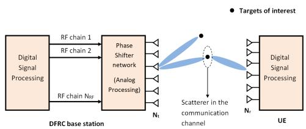  
Fig. 1. Hybrid beamforming ISAC Scenario

We consider a uniform linear array (ULA), with consecutive elements separated by a distance $d ,$ at the base station. There are K signal sources, which we call targets1, with the direction of the k-th target given by an angle $\theta _ { k } , \ k = 1 , \ldots , K$ . Each antenna element in the ULA receives a weighted sum of K source signals, corresponding to the K targets, with a wavelength λ. The source signals are either sinusoidal or linear frequency modulated (LFM). The signal received by every array element is sampled to produce T samples or “snapshots”. The (sampled) signal received by the ULA is given by

$$
{ \bf y } ( t ) = { \bf A } ( \theta ) { \bf s } ( t ) + { \bf n } ( t ) , t = 1 , 2 , \ldots , T ,\tag{1}
$$

where $\mathbf { s } ( t ) = [ s _ { 1 } ( t ) , s _ { 2 } ( t ) , . . . . s _ { K } ( t ) ]$ denotes the source signal vector, with $s _ { k } ( t ) \in \mathbb { C } ,$ , t, representing the complex-valued source signal pertaining to the k-th target, $\mathbf { n } ( t )$ represents an additive white (complex) Gaussian noise signal, and $\mathbf { A } ( \theta ) =$ $[ \mathbf { a } ( \theta _ { 1 } ) , \mathbf { a } ( \theta _ { 2 } ) , . . . , \mathbf { a } ( \theta _ { K } ) ]$ denotes the steering matrix of dimension $N _ { t } \times K$ , with the k-th steering vector, $\mathbf { a } ( \theta _ { k } )$ , given by

$$
\mathbf { a } ( \theta _ { k } ) = \left[ 1 , e ^ { j \frac { 2 \pi d } { \lambda } \sin ( \theta _ { k } ) } , \ldots , e ^ { j \frac { 2 \pi d } { \lambda } ( N _ { t } - 1 ) \sin ( \theta _ { k } ) } \right] ^ { T } .\tag{2}
$$

Even though every target reflects the echo wave back to the BS, not all target contributes to the communication channels that is spread between the BS and the UE. In mmWave channel modeling, the scattering model which usually have few scattering routes describes communication channels [1]. Out of K targets we assume only L are recognised in the communication channel, and $L \ \leq \ N r \ \leq \ N t$ . That is L data streams can be transmitted simultanously. For making the scenario simple, we assume BS is aware of both K and L, and BS has initially sent omnidirectional DL pilots (DP), and echo waves from K targets are approaching the ISAC BS. From the covariance matrix of the echo waves received at the base station, the DOA of all K targets (Θ), including the communication scatterers is estimated using DOA estimation methods. Additionally, the UE obtains the probing waveform through L scattering routes, which it uses to calculate L AoAs(Φ). After this, the BS will now be aware of Θ and the UE will have an estimate of Φ in a similar way. The BS then generates directional DL beams toward the DOA estimated by developing an ISAC beamformer, for precise observations and communication.

To enable accurate data decoding at the UE, the joint beamformer design attempts to pre-equalize the communication channel effects here.

Representative deep learning-based and traditional approaches for DoA estimation are analyzed and compared in this paper. They are followed by DFRC beam former weight generation using SVD method mentioned in [1].

## IV. METHODOLOGY

The methodology adopted in the paper consists of: Dataset Generation, Architecture Design of Deep Learning (DL) Models, ISAC beamformer, Performance metrics for comparison.

## A. Dataset Generation

In this paper, we provide either the full covariance matrix of the received signal, y(t), or its upper triangular (UT) part as the input to the DL models. To that end, first, the source signal vector, s(t), is generated either as a vector of sinusoids or LFM signals, depending on the case under consideration. Next, the received signal, y(t), is calculated by applying (1), where the noise samples, n(t), t, and the angles $\theta _ { k } , k = 1 , \ldots , K$ , that are required for the calculation are obtained as follows.

In practice, the SNR may be unknown when a DL model is deployed after training. Hence, to ensure robustness against noise, we propose to train the DL models at multiple levels of SNRs. For generating each training instance, the SNR is randomly chosen from the levels $- 1 3 \mathrm { d } \mathbf { B } , - 1 0 \mathrm { d } \mathbf { B } , - 5$ dB and 0 dB. Once the SNR level is decided for a training instance, the corresponding noise variance, $\sigma _ { N _ { t } } ^ { 2 }$ , is calculated, and the noise samples n(t), t, are generated. The angles of the targets, $\theta _ { k } .$ $k = 1 , \ldots , K$ , that specify the DoAs of the source signals are calculated by adopting the method in [20]. The possible DoAs are assumed to belong to the angular sector $[ G _ { \mathrm { m i n } } , G _ { \mathrm { m a x } } ]$ The angular separation between the sources, ∆, is taken from the set $\left\{ \Delta _ { \operatorname* { m i n } } , \Delta _ { \operatorname* { m i n } } + \Delta _ { d } , \Delta _ { \operatorname* { m i n } } + 2 \Delta _ { d } , \dots , \Delta _ { \operatorname* { m a x } } \right\}$ . Thus, the first DoA, $\theta _ { 1 }$ , is sampled at steps of η over the interval $[ G _ { \mathrm { m i n } } , G _ { \mathrm { m a x } } - ( K - 1 ) \Delta ]$ , and the DoA of the $k ^ { t h }$ source is $\theta _ { k } = \theta _ { 1 } + ( k - 1 ) \Delta$ . This implies, $\theta _ { k } = \theta _ { k - 1 } + \Delta$

The covariance matrix of the signal, ${ \bf y } ( t )$ , is given by

$$
\mathbf { R } _ { \mathbf { y } } = \mathbb { E } [ \mathbf { y } ( t ) \mathbf { y } ^ { H } ( t ) ] = \mathbf { A } ( \theta ) \mathbf { R } _ { s } \mathbf { A } ^ { H } ( \theta ) + \sigma _ { N _ { t } } ^ { 2 } \mathbf { I } _ { N _ { t } } ,\tag{3}
$$

where ${ \bf R _ { s } } = \mathbb { E } [ { \bf s } ( t ) { \bf s } ^ { H } ( t ) ]$ is the covariance matrix pertaining to the source signals, ${ \bf s } ( t )$ , and $\mathbf { I } _ { N _ { t } }$ is an identity matrix of dimension $N _ { t } \times N _ { t }$ . The matrix $\mathbf { R _ { s } }$ is estimated as

$$
\widetilde { \mathbf { R } } _ { \mathbf { s } } = \frac { 1 } { T } \sum _ { t = 1 } ^ { T } \mathbf { s } ( t ) \mathbf { s } ^ { H } ( t ) ,\tag{4}
$$

and substituted into (3) to calculate $\widetilde { \mathbf { R } } _ { \mathbf { y } }$ . The instances of this estimate $\widetilde { \mathbf { R } } _ { \mathbf { y } }$ efor various SNR levels, along with the ground truth angles $( \theta _ { 1 } , \ldots , \theta _ { k } )$ are used as the training dataset. A different estimate $\mathbf { \widetilde { R } } _ { \mathbf { y } } ^ { \prime }$ , obtained as

$$
\widetilde { \mathbf { R } } _ { \mathbf { y } } ^ { \prime } = \frac { 1 } { T } \sum _ { t = 1 } ^ { T } \mathbf { y } ( t ) \mathbf { y } ^ { H } ( t ) ,\tag{5}
$$

is utilized for testing to reflect the fact that when the DL model is deployed after training, it could only use the samples of ${ \bf y } ( t )$ to estimate the DoAs.

TABLE II  
MODEL ARCHITECTURES AND CONFIGURATIONS.
<table><tr><td rowspan=1 colspan=1>ModelName</td><td rowspan=1 colspan=1>Covariance ma-trix input</td><td rowspan=1 colspan=1>InputSize</td><td rowspan=1 colspan=1>Layer type</td></tr><tr><td rowspan=1 colspan=1>CLASS[8]</td><td rowspan=1 colspan=1>Full matrix (real,imaginary, phase)</td><td rowspan=1 colspan=1>16×16×3</td><td rowspan=1 colspan=1>4 Convolutional+ FC</td></tr><tr><td rowspan=1 colspan=1>RDNN[20]</td><td rowspan=1 colspan=1>UT    elements(Real      andimaginary)</td><td rowspan=1 colspan=1>1 × 240</td><td rowspan=1 colspan=1>FC only</td></tr><tr><td rowspan=1 colspan=1>LDNN[21]</td><td rowspan=1 colspan=1>Average      ofUT    elementsalong    super-diagonals (Realand imaginary)</td><td rowspan=1 colspan=1>1 × 30</td><td rowspan=1 colspan=1>FC only</td></tr><tr><td rowspan=1 colspan=1>RCNN[22]</td><td rowspan=1 colspan=1>Full Covariancematrix</td><td rowspan=1 colspan=1>16 × 16</td><td rowspan=1 colspan=1>1 Convolutional+FC</td></tr></table>

## B. Architecture Design of Deep Learning (DL) Models

The architecture of the estimation models are same as provided in their references. The input type, size and layer type is provided in Table. II. All the models generally use covariance matrix as input, in which some models use only upper triangular(UT) elements of covariance matrix. As the matrix contains complex numbers, mostly these elements are fed by externally splitting the real and imaginary part, where in RCNN it is left as is to be internally handled by the CNN and DNN layers.

## C. ISAC beamformer

Here we use DFRC beamformer framework mentioned in [1], to design hybrid beamforming weights $\mathbf { F } _ { \mathrm { R F } }$ and $\mathbf { F } _ { \mathrm { B B } }$ which are analog and digital beamforming weights respectively.

The rank L communication channel matrix in the ISAC scenario can be expressed as:

$$
\mathbf { H } = \mathbf { B } ( \Phi ) \mathrm { d i a g } ( \boldsymbol { \beta } ) \mathbf { A } ^ { T } ( \Theta _ { 1 } ) .\tag{6}
$$

Each notation in the equation (6) are as follows. $\mathbf { B } ( \Phi )$ represents the steering matrix of the UE’s antenna array with steering vectors ${ \bf b } ( \phi _ { l } )$ in the AoA directions $\phi .$ That is,

$$
\mathbf { B } ( \Phi ) = \big [ \mathbf { b } ( \phi _ { 1 } ) , \dots , \mathbf { b } ( \phi _ { L } ) \big ] ,\tag{7}
$$

$$
\Phi = \left[ \phi _ { 1 } , \dots , \phi _ { L } \right] ,\tag{8}
$$

When considered from UE, the DL AoDs are part of the set $\Theta = \left[ \theta _ { 1 } , \ldots , \theta _ { K } \right]$ of radar targets that are visible from the BS.

$$
\mathbf { \Theta } ^ { \Theta _ { 1 } } = \left\{ \theta _ { 1 } , \dots , \theta _ { L } \right\} \subseteq \mathbf { \Theta } ^ { \Theta } .\tag{9}
$$

The $\mathbf { A } ( \mathbf { \Theta } \Theta _ { 1 } )$ represents the steering matrix with steering vectors $\mathbf { a } ( \theta _ { l } )$ , which are DL AoD of the l th scattering path,

$$
\mathbf { A } ( \Theta _ { 1 } ) = \left[ \mathbf { a } ( \theta _ { 1 } ) , \dots , \mathbf { a } ( \theta _ { L } ) \right] ,\tag{10}
$$

And $\beta$ denote the complex scattering coefficient matrix

$$
\beta = \left[ \beta _ { 1 } , \dots , \beta _ { L } \right] ^ { T } ,\tag{11}
$$

where $\beta _ { \mathrm { l } }$ represents the complex scattering coefficient of the l th scattering path which can be found by APES algorithm as mentioned in [1] that follow gaussian distribution. $\mathbf { a } ( \theta _ { l } )$ and ${ \bf b } ( \phi _ { l } )$ can be derived from equation (2) in a similar way.

In order to reduce interference and guarantee correct signal reception at the receiver, inverting the channel matrix (or computing its pseudo-inverse) is necessary for equalization in beamforming. As neither $\mathbf { H H } ^ { H }$ nor $\mathbf { H } ^ { H }$ H is invertible, a pseudo-inverse of H is unobtainable. So both transmit and receive beamformings are necessary for equalizing the channel. When $\tilde { H }$ can be defined as

$$
\tilde { \mathbf { H } } \triangleq \mathrm { d i a g } ( \beta ) \mathbf { A } ^ { T } ( \Theta _ { 1 } )\tag{12}
$$

it is possible to express channel matrix as

$$
{ \bf H } = { \bf B } ( \Phi ) \tilde { \bf H } .\tag{13}
$$

Both $\tilde { \bf H }$ estimated at BS and $\mathbf { B } ( \Phi )$ estimated at UE will have a full rank of L. The corresponding zero-forcing (ZF) beamformer at base station can be formulated as:

$$
\mathbf { F } _ { \mathrm { B S } } = \tilde { \mathbf { H } } ^ { H } \left( \tilde { \mathbf { H } } \tilde { \mathbf { H } } ^ { H } \right) ^ { - 1 } ,\tag{14}
$$

And corresponding zero-forcing (ZF) beamformer at UE can be formulated as

$$
\mathbf { W } _ { \mathrm { U E } } = \left( \mathbf { B } ^ { H } ( \boldsymbol { \Phi } ) \mathbf { B } ( \boldsymbol { \Phi } ) \right) ^ { - 1 } \mathbf { B } ^ { H } ( \boldsymbol { \Phi } ) .\tag{15}
$$

Here the hybrid array at the BS can only roughly achieve $\mathbf { F } _ { \mathrm { B S } }$ , and the $\mathbf { W } _ { \mathrm { U E } }$ at UE is a fully-digital beamformer. The beamformer $\mathbf { F } _ { \mathrm { D } } = \mathbf { F } _ { \mathrm { R F } } \mathbf { F } _ { \mathrm { B B } }$ should be designed in such a way it steer beams towards all $K$ targets. This is corresponding to designing the covariance matrix of the transmit signal, which is formulated as:

$$
\mathbf { R } _ { s } = \mathbb { E } \left[ \mathbf { F } _ { \mathrm { D } } \mathbf { s } \mathbf { s } ^ { H } \mathbf { F } _ { \mathrm { D } } ^ { H } \right] = \mathbf { F } _ { \mathrm { D } } \mathbb { E } \left[ \mathbf { s } \mathbf { s } ^ { H } \right] \mathbf { F } _ { \mathrm { D } } ^ { H } = \mathbf { F } _ { \mathrm { R F } } \mathbf { F } _ { \mathrm { B B } } \mathbf { F } _ { \mathrm { B B } } ^ { H } \mathbf { F } _ { \mathrm { R F } } ^ { H } .\tag{16}
$$

A simple approach to construct the $\mathbf { F } _ { \mathrm { R F } }$ is to formulate each column of F with steering vector of corresponding K angles that gives:

$$
\mathbf { F } _ { \mathrm { R F } } ( : , i ) = \mathbf { a } ^ { * } ( \theta _ { i } ) , \quad \forall i = 1 , 2 . . K .\tag{17}
$$

Now $F _ { B B }$ can be obtained by a global optimal closed form solution for a non-convex optimization problem defined in [1] as,

$$
\mathbf { F } _ { \mathrm { B B } } = \sqrt { \frac { P _ { T } } { K N _ { t } } } \tilde { \mathbf { U } } \tilde { \mathbf { V } } ^ { H } ,\tag{17}
$$

where $\mathbf { \tilde { U } } \tilde { \mathbf { \Sigma } } \tilde { \mathbf { V } } ^ { H }$ can be solved using singular value decomposition (SVD) method as:

$$
\tilde { \mathbf { U } } \tilde { \Sigma } \tilde { \mathbf { V } } ^ { H } = \mathbf { F } _ { R F } ^ { H } \left[ \mathbf { F } _ { B S } , \mathbf { F } _ { a u x } \right]\tag{18}
$$

Here $\mathbf { F } _ { \mathrm { B S } }$ is defined as in (14), and $\mathbf { F } _ { \mathrm { a u x } } \in \mathbb { C } ^ { N _ { t } \times ( K - L ) }$ is an auxiliary matrix which is considered as a null-space projection (NSP) matrix, such that $\tilde { H } \mathbf { F } _ { \mathrm { a u x } } = 0$

## D. Spectral Efficiency Computation

The performance of the DL communication is evaluated by computing the effective spectral efficiency (ESE). The signal vector received by UE can be written as:

$$
\begin{array} { c } { { { \bf y } _ { D L } = { \bf B } \left( \Phi \right) \mathrm { d i a g } \left( \beta \right) { \bf A } ^ { T } \left( \Theta _ { 1 } \right) { \bf F } _ { R F } { \bf F } _ { B B } { \bf s } + { \bf n } _ { D L } } } \\ { { \underline { { { \underline { { { \bf a } } } } } } _ { { \bf H } { \bf F } _ { R F } } { \bf F } _ { B B } { \bf s } + { \bf n } _ { D L } , } } \end{array}\tag{19}
$$

Provided ${ \bf n } _ { D L }$ is the AWGN noise added and $\mathbf { s } = [ s 1 ; s 2 ]$ signals transmitted. Here only ${ \bf s } _ { 1 }$ is used for DL communication, whereas both $\mathbf { s } _ { 1 }$ and $\mathbf { s } _ { 2 }$ are used for radar target detection. $\mathbf { s } _ { 2 }$ includes no usable information because the communication channel only allows the transmission of L independent data streams. When the received signal vector is multiplied by $W _ { U E }$ and $\sqrt { \rho _ { D L } }$ , the post processing signal received at the UE is:

$$
\begin{array} { r } { \tilde { \bf y } _ { D L } = \sqrt { \rho _ { D L } } { \bf W } _ { U E } { \bf H } { \bf F } _ { R F } { \bf F } _ { B B } { \bf s } + { \bf W } _ { U E } { \bf n } _ { D L } . } \end{array}\tag{20}
$$

where, $\rho _ { D L }$ is the average power received at UE. The designed beamforming matrix can be splitted as :

$$
{ \bf F } _ { D } = { \bf F } _ { R F } { \bf F } _ { B B } = { \bf F } _ { R F } \left[ { \bf F } _ { B B , 1 } , { \bf F } _ { B B , 2 } \right] ,\tag{21}
$$

where $\mathbf { F } _ { B B , 1 } ~ \in ~ \mathbb { C } ^ { K \times L }$ and $\mathbf { F } _ { B B , 2 } ~ \in ~ \mathbb { C } ^ { K \times ( K - L ) }$ . Now equation (20) can be written as:

$$
\begin{array} { r l } & { \tilde { \bf { y } } _ { D L } = \underbrace { \sqrt { \rho _ { D L } } { \bf W } _ { U E } { \bf H } { \bf F } _ { R F } { \bf F } _ { B B , 1 } { \bf s } _ { 1 } } _ { \mathrm { U s e f u l ~ S i g n a l } } } \\ & { ~ + \underbrace { \sqrt { \rho _ { D L } } { \bf W } _ { U E } { \bf H } { \bf F } _ { R F } { \bf F } _ { B B , 2 } { \bf s } _ { 2 } } _ { \mathrm { I n t e r f e r e n c e } } } \\ & { ~ + ~ { \bf W } _ { U E } { \bf n } _ { D L } . } \end{array}\tag{22}
$$

The second term in (22) represents interference at the UE, as it contains no useful information. The spectral efficiency is computed as:

$$
\mathbf { R } _ { D L } = \log \operatorname* { d e t } ( \mathbf { I } _ { L } + \frac { \rho _ { D L } } { L } \mathbf { R } _ { i n } ^ { - 1 } \mathbf { W } _ { U E } \mathbf { H } \mathbf { F } _ { R F } \mathbf { F } _ { B B , 1 } )  \\  \times \mathbf { F } _ { B B , 1 } ^ { H } \mathbf { F } _ { R F } ^ { H } \mathbf { H } ^ { H } \mathbf { W } _ { U E } ^ { H } \quad ) ,\tag{23}
$$

where ${ \bf R } _ { i n }$ represents the covariance matrix of the interference plus noise, given by:

$$
\begin{array} { r } { \mathbf { R } _ { i n } = \rho _ { D L } \mathbf { W } _ { U E } \mathbf { H } \mathbf { F } _ { R F } \mathbf { F } _ { B B , 2 } \mathbf { F } _ { B B , 2 } ^ { H } \mathbf { F } _ { R F } ^ { H } \mathbf { H } ^ { H } \mathbf { W } _ { U E } ^ { H } \quad } \\ { + \sigma _ { c } ^ { 2 } \mathbf { W } _ { U E } \mathbf { W } _ { U E } ^ { H } . \quad } \end{array}\tag{24}
$$

The effective spectral efficiency for highly mobile scenarios is [35]:

$$
R _ { \mathrm { e f f } } = \left( 1 - { \frac { T _ { \mathrm { t r } } } { T _ { \mathrm { B } } } } \right) \times R _ { D L }\tag{25}
$$

where $T _ { B }$ is the channel beam coherence time which represents the average time over which the beams stay aligned and first $T _ { t r }$ time of every beam coherence time is allocated for the channel training/beamforming design .

## E. Estimation Accuracy and Computational Time

The DoA estimation accuracy is evaluated by the root mean square error (RMSE) at different SNR levels, given by

$$
\mathrm { R M S E } \ : = \ : \sqrt { \frac { 1 } { N K } \sum _ { n = 1 } ^ { N } \sum _ { k = 1 } ^ { K } \bigl ( \hat { \theta } _ { n , k } - \theta _ { n , k } \bigr ) ^ { 2 } } ,\tag{25}
$$

where N is the number of trials during testing experiments. The term $\widehat { \theta } _ { n , k }$ denotes the estimated DoA of the k-th source signal in the n-th trial, while $\theta _ { n , k }$ represents the corresponding true DoA.

For evaluating the execution time, the prediction time of the DL models including the pre-processing time is obtained. Although asymptotic complexity analysis is commonly used for algorithmic comparison, the considered ISAC scenario involves fixed and relatively small problem dimensions $( N _ { t } = 1 6 , K = L = 2 )$ . Under such conditions, asymptotic expressions may not accurately reflect practical implementation latency. Therefore, measured execution time, including preprocessing overhead, is adopted as the primary computationalcost metric in this work.

## V. RESULTS AND DISCUSSIONS

In this section simulation settings for each methods and their simulation results are presented to analyze the accuracy, execution time, and spectral efficiency to find which method demonstrate higher accuracy-latency tradeoff. Each method [1], [8], [20]–[22] is examined for two cases when transmitted signals are basic sine waves and LFM signals. All the methods are implemented using MATLAB in Windows operating system running on the 12th Gen Intel(R) Core(TM) i9-12900H processor at 2.5 GHz and with an NVIDIA GeForce RTX 3080 Ti Laptop GPU.

## A. Simulation Settings

We simulated the scenario with $K = L = 2$ targets, generating signals of frequency f = 2.4 GHz, and a ULA of $N _ { t } = 1 6$ elements uniformly separated by a half-wavelength, i.e., $d = \lambda / 2$ , where $\lambda { = } c / f .$ , and c is the speed of light in vacuum. Signals of 1 ms duration are sampled to get $T = 1 0 0 0$ snapshots. For LFM signals [36], a bandwidth of 100 kHz is considered. We assume target of interest at direction $\theta _ { 1 } =$ $- 1 0 . 1 1 ^ { \circ }$ and $\theta _ { 2 } = 2 6 . 1 1 ^ { \circ }$ . To generate the training dataset, we set $G _ { m i n } = - 6 0 ^ { \circ } , G _ { m a x } = 6 0 ^ { \circ } , \Delta _ { m i n } = 2 ^ { \circ } , \Delta _ { m a x } = 6 0 ^ { \circ }$ $\Delta _ { d } = 2 ^ { \circ }$ , and $\eta = 1 ^ { \circ }$

All the DL models are trained using multiple SNR levels of $\{ - 1 3 , - 1 0 , - 5 , 0 \}$ dB with corresponding true DoA angles, resulting in 10,680 training instances. The networks employs ‘Adam’ optimizer with an initial learning rate of 0.001, reduced by a factor of 0.1 every 10 epochs up to 200 epochs. A mini-batch size of 32 is used. To mitigate overfitting, L2 regularization $( \lambda = 0 . 0 0 1 )$ and early stopping (patience=10) are applied. Training data are shuffled at initialization and after each epoch, while gradient clipping (threshold=1) stabilizes updates. Model performance is monitored on a validation set, evaluated every 100 iterations.

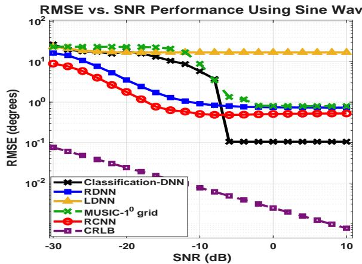  
Fig. 2. RMSE vs. SNR performance with sinusoidal signals.

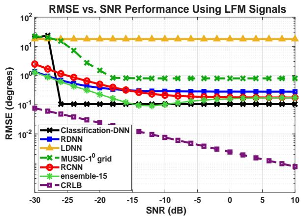  
Fig. 3. RMSE vs. SNR performance with LFM signals.

## B. DoA Estimation Accuracy

The RMSE vs. SNR performance of the DoA estimation methods with sinusoidal and LFM signals are depicted in Figs. 2 and 3, respectively, for SNRs from 30 dB to 10 dB. The associated Cramer-Rao Lower Bounds (CRLB) is obtained from [27].

From Figs. 2 and 3 observations made are as follows:

O1. The performance with LFM signals is, in general, better and less sensitive to the SNR level than that with sinusoidal signals because of the inbuilt noise immunity of the LFM signals due to the chirp waveform.

O2. Classification method shows better accuracy at higher SNRs for both LFM and sinusoidal cases.

O3. For sinusoidal signals at higher SNR range the RCNN method provides second-highest accuracy after the classification method. At lower SNRs, however, RCNN surpasses the classification method in accuracy.

O4. LDNN exhibited significant sign ambiguities in angle prediction, resulting in substantially higher RMSE for both sinusoidal and LFM signals.

O5. For LFM signals, from -15dB to higher SNRs the RCNN shows second highest accuracy. At very low SNRs RDNN shows better accuracy. The inbuilt noise immunity of LFM signal together with the usage of less noise upper triangular elements of covariance matrix as input to the network might be the reason for this.

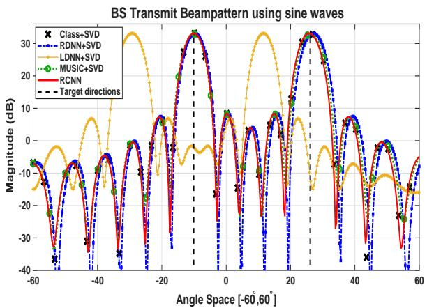  
Fig. 4. Transmitter beam pattern for BS transmitting sine waves

O6. For LFM signals, as RCNN is better from -15 dB to higher SNRs and RDNN is better at lower SNRs, an ensemble model is tried and it works better than both models. At SNR range from -14dB to -10dB, ensemble model provides lower RMSE than that exhibited by the classification method as well.

For ensemble method, the prediction is done by using weighted sum of prediction of both models. That is prediction of ensemble model, $P = ( w 1 \times P 1 ) + ( w 2 \times P 2 )$ where w1 and w2 are weights and P1 and P2 are prediction from RDNN and RCNN respectively. We used a soft switching using sigmoid function for weight generation according to SNR for calculating ensemble prediction. That is, $\begin{array} { r } { w _ { 1 } ~ = ~ \frac { 1 } { 1 + e ^ { 0 . 2 ( \mathrm { S N R } + 1 5 ) } } } \end{array}$ , where the factors 0.2 controls the smoothness and 15 adjusts the transition region centered at -15dB and $w _ { 2 } = 1 - w _ { 1 }$ . When SNR=- 15dB, w1 = w2 = 0.5, after -15dB SNR to higher SNRs w1 decays and w2 will be higher according to the equation. So switching of models happens from lower to higher SNRs accordingly.

O7. The ensemble model shows the maximum improvement in RMSE of 1.1770◦ at -30dB SNR and minimum improvement in RMSE of 0.0028◦ at 10dB SNR.

Apart from the above proposed method for ensemble model, another binary classifier DNN model can also be developed to identify which model prediction has to be considered at a particular SNR range based on output of both the models.

## C. Radiation pattern comparison

Based on the angles estimated using different methods beam forming weights are derived using the SVD method. The beampatterns obtained from those weights are plotted for both the cases (LFM and sine wave) in Fig. 4 and Fig. 5 at 10 dB SNR. As LDNN performance was not accurate as other methods, the angles predicted by this method were also not accurate. Hence in the beampattern, mainlobes are in different directions for LDNN method. All other methods has obtained mainlobes in the necessary directions itself.

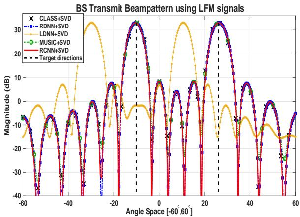  
Fig. 5. Transmitter beam pattern for BS transmitting LFM signals.

## D. Computational Time Analysis

The prediction time comparison for all the DL models and MUSIC algorithm, to estimate DoA including the preprocessing time, is provided in Fig. 6. As all the method requires covariance matrix generation, pre-processing time is taken after covariance matrix generation process. The extraction of upper triangular elements and external splitting of complex numbers require more pre-processing time compared to feeding the network with the full covariance matrix and utilizing internal complex number handling. It can be inferred from Fig. 6 that the RCNN incurs the least computational time compared to other DL models, and traditional method.

Fig. 7 shows the time for generating beamforming weights after DoA estimation using each method. The SVD beamforming process takes around 0.0032s. Here it can be inferred very clearly that, as the DoA estimation time for RCNN is less, it achieves less beamforming weight generation time also. As this method offers the most favorable accuracy-ESE tradeoff, it points to the efficiency of RCNN compared to all other methods here. In ensemble method RDNN and RCNN will be working parallel and from the predictions of both models ensemble model prediction is finally made. So the DoA prediction time for ensemble model will be RDNN’s (as that is higher than RCNN) DoA prediction time and time to run the steps to find the ensemble prediction.

In Fig. 8 beamforming time with increase in SVD time is analysed. At the starting of the graph, when SVD time is zero, it shows basically the DoA estimation time of each method. We could see that although RCNN substantially reduces DoA estimation latency, the overall beamforming latency remains increasingly dominated by the SVD stage. Consequently, the benefits of faster DoA estimation cannot be fully exploited unless the computational burden of beamforming-weight generation is also reduced.

## E. Spectral Efficiency Analysis

Fig. 10 shows the SNR vs Effective spectral efficiency curve of DL communication computed by equation (25) for $T _ { B } =$ 10ms. As SNR increases, spectral efficiency is increasing for all the methods considered. For both sine and LFM signals the RCNN+SVD method provides higher spectral efficiency. As LDNN’s beam was not in the correct direction, the effective spectral efficiency of LDNN+SVD is very less compared to all other methods. The ensemble method shows the almost the same spectral efficiency as RDNN method throughout the SNR range considered.

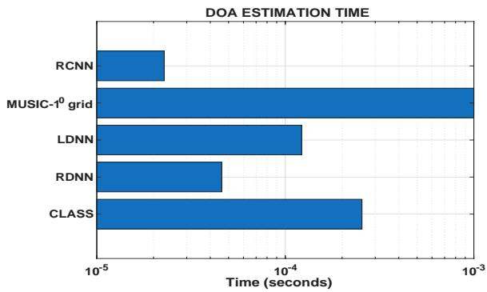  
Fig. 6. Prediction time needed for each method of DoA estimation

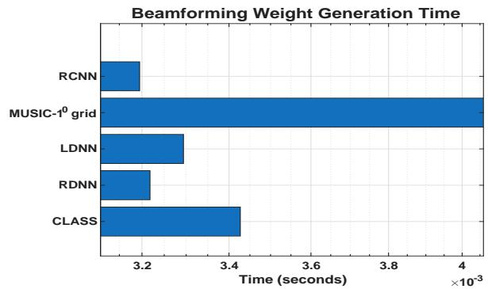  
Fig. 7. Beamforming weight generation time for each method

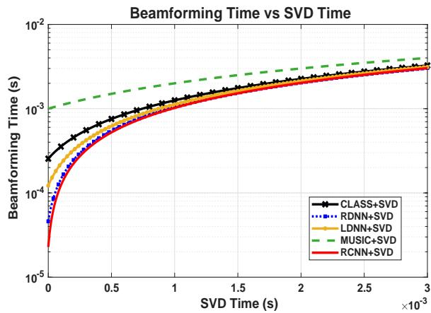  
Fig. 8. Beamforming weight generation time $\mathrm { V s . }$ SVD time analysis

## F. Performance Analysis

The overall performance of each method using LFM signal at 10dB SNR is summarized in Table. III. The table demonstrate that classification method achieves the lowest DoA RMSE making it the most accurate estimator among the methods evaluated under the compromise of high training time, prediction time and ESE. The RCNN, while slightly less accurate, attains the fastest prediction time, making it the strong choice for latency-sensitive deployments. The Ensemble yields better accuracy at all range of SNRs (O7) than RCNN and achives near-identical spectral efficiency with slightly more time consumption. Beamforming time remains negligibly invariant across all methods and does not constitute a performance differentiator. Considering estimation accuracy, effective spectral efficiency, and inference latency jointly, RCNN emerges as an attractive operating point for real-time ISAC deployment, while the Ensemble model provides a competitive alternative when estimation accuracy is prioritized.

Effective Spectral efficiency of DL communication- Sine signal (T=10ms)  
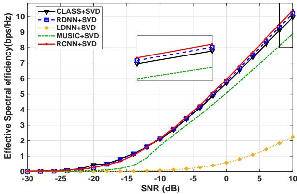  
Fig. 9. Spectral efficiency for DL communication for sine wave

Effective Spectral efficiency of DL communication-LFM (T =10ms)  
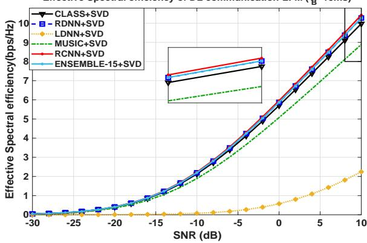  
Fig. 10. Spectral efficiency for DL communication for LFM signal

The performance evaluation of these approaches at 10dB SNR is provided in Fig 11. In the plot, X - axis gives the DoA accuracy measurement, which is RMSE in degrees. Y- axis provides ESE gap, which is the difference between the best ESE (zero RMSE, zero ESE gap relative to true-DoA beamforming) to that ESE obtained for each method. Unlike RMSE alone, the ESE gap directly quantifies the communicationperformance degradation caused by DoA estimation errors and therefore provides a system-level measure of estimator quality. The arc provided shows the iso-distance contour through RCNN+SVD, and methods outside it are farther from the ideal point. Distances d are Euclidean after normalizing each axis by its maximum over the plotted methods. The method with most favorable accuracy-ESE tradeoff is the one which is nearer to the ideal point which is at point (0,0). From the plot it is evident that RCNN shows less distance to ideal point. The distance to the ideal point for classification, RDNN, MUSIC, RCNN and Ensemble is 0.8362, 0.8537, 1.4142, 0.7893, 0.8075 respectively. LDNN+SVD lies farthest from the ideal point, with a distance well above that of the other methods, and is therefore omitted from the figure for clarity.

TABLE III  
PERFORMANCE COMPARISON AT 10 DB US ING LFM S IGNALS.
<table><tr><td rowspan=1 colspan=1>Methods</td><td rowspan=1 colspan=1>DoA RMSE</td><td rowspan=1 colspan=1>DoA Pred.Time(s)</td><td rowspan=1 colspan=1>ESE (bps/Hz)</td></tr><tr><td rowspan=1 colspan=1>CLASS</td><td rowspan=1 colspan=1>0.1051</td><td rowspan=1 colspan=1> $2 . 5 5 \times 1 0 ^ { - 0 4 }$ </td><td rowspan=1 colspan=1>9.9738</td></tr><tr><td rowspan=1 colspan=1>RDNN</td><td rowspan=1 colspan=1>0.2809</td><td rowspan=1 colspan=1> $\overline { { 4 . 6 \times 1 0 ^ { - 5 } } }$ </td><td rowspan=1 colspan=1>10.2694</td></tr><tr><td rowspan=1 colspan=1>LDNN</td><td rowspan=1 colspan=1>17.7031</td><td rowspan=1 colspan=1> $\overline { { 1 . 2 2 \times 1 0 ^ { - 4 } } }$ </td><td rowspan=1 colspan=1>2.2426</td></tr><tr><td rowspan=1 colspan=1>MUSIC</td><td rowspan=1 colspan=1>0.8011</td><td rowspan=1 colspan=1> $\overline { { 0 . 0 0 1 } }$ </td><td rowspan=1 colspan=1>8.8898</td></tr><tr><td rowspan=1 colspan=1>RCNN</td><td rowspan=1 colspan=1>0.1887</td><td rowspan=1 colspan=1>2.2805 × 10−5</td><td rowspan=1 colspan=1>10.4252</td></tr><tr><td rowspan=1 colspan=1>Ensemble</td><td rowspan=1 colspan=1>0.1744</td><td rowspan=1 colspan=1> $\overline { { 5 . 4 \times 1 0 ^ { - 5 } } }$ </td><td rowspan=1 colspan=1>10.2738</td></tr></table>

Although several neural estimators achieve competitive RMSE performance, RCNN simultaneously maintains very low inference latency which is reflected in the effective spectral efficiency comparisons. This is particularly attractive for real-time beamforming applications where frequent weight updates are required. We show that better accuracy or faster beamforming alone will not lead to the most efficient spectral utilization. Rather a balanced approach proves to be the best.

## G. Design Insights for Real-Time ISAC Beamforming

The results and discussion in the previous section lead to four design insights for real-time ISAC beamforming.

• Accuracy alone is not a sufficient selection criterion. Lower RMSE generally improves beamforming quality, but the associated computational overhead may reduce its practical advantage in latency-sensitive ISAC applications.

• Higher DoA accuracy yields diminishing returns. Ensemble model improve DoA accuracy marginally, and the resulting advantage in spectral efficiency is relatively modest. More accurate DoA estimates do not do not necessarily translate into proportionally higher communication performance.

The computational bottleneck shifts to beamforming weight generation. Learning-based estimators make the first stage-DoA estimation stage, fast. So latency becomes dominated by the weight-generation stage in this twostage process. Accelerating DoA estimation alone is therefore insufficient for low-latency operation in ISAC beamforming.

• RCNN offers a favorable accuracy–latency tradeoff. Among the evaluated DoA estimators, RCNN consistently lies at a favorable point of the accuracy-latency tradeoff, making it a strong candidate for real-time deployment. Although the Ensemble model achieves marginally lower RMSE, RCNN remains closer to the ideal operating point when estimation accuracy and ESE degradation are considered jointly.

## VI. CONCLUSION

This paper presented a unified framework for evaluating classical and deep-learning-based DoA estimators within an

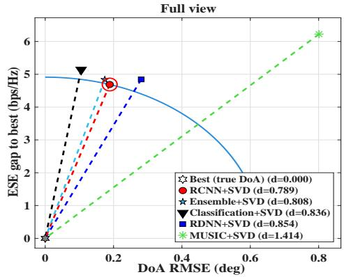  
Fig. 11. Performance evaluation based on distance from ideal operating point (LFM signals)

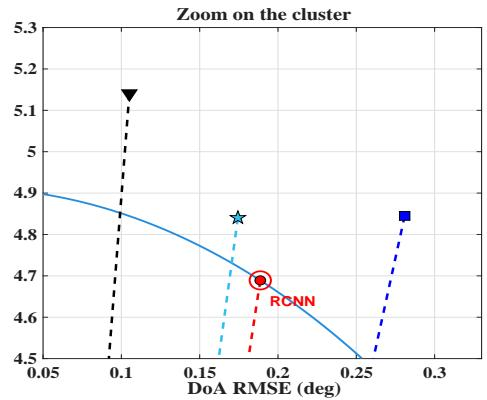

ISAC beamforming pipeline. Representative estimators were integrated with SVD-based beamforming and compared under identical operating conditions in terms of estimation accuracy, inference latency, beamforming-weight generation time, effective spectral efficiency. The results show that estimator selection for practical ISAC systems should consider both estimation accuracy and computational latency rather than either metric in isolation. While learning-based approaches significantly reduce DoA estimation time compared with MU-SIC, the resulting gains in effective spectral efficiency are not always proportional to the improvements in estimation accuracy. Among the evaluated methods, RCNN exhibited a favorable balance between accuracy, computational efficiency, and beamforming performance, making it a promising candidate for real-time ISAC deployment.

An important observation is that, as DoA estimation becomes faster, the computational bottleneck increasingly shifts to the SVD-based beamforming stage. Consequently, future research should investigate low-complexity beamforming approaches that reduce or eliminate the reliance on computationally intensive matrix decompositions, thereby enabling further reductions in end-to-end ISAC processing latency.

## REFERENCES

[1] F. Liu, C. Masouros, A. P. Petropulu, H. Griffiths and L. Hanzo, “Joint Radar and Communication Design: Applications, State-of-the-Art, and the Road Ahead,”IEEE Transactions on Communications, vol. 68, no. 6, pp. 3834-3862, June 2020, doi: 10.1109/TCOMM.2020.2973976.

[2] R. Schmidt, “Multiple emitter location and signal parameter estimation,” IEEE Trans. Antennas Propag., vol. AP-34, no. 3, pp. 276–280, Mar. 1986, doi:10.1109/TAP.1986.1143830.

[3] A. Barabell, “Improving the resolution performance of eigen structure based direction-finding algorithms,” Proc. IEEE Int. Conf. Acoust., Speech, Signal Process. (ICASSP), vol. 8, Sep. 1983, pp. 336–339, doi: 10.1109/ICASSP.1983.1172124.

[4] R. Roy and T. Kailath, “ESPRIT-estimation of signal parameters via rotational invariance techniques,” IEEE Transactions on Acoustics, Speech, and Signal Processing, vol. 37, no. 7, pp. 984-995, July 1989, doi: 10.1109/29.32276.

[5] M. S. Bartlett, “Smoothing periodograms from time-series with continuous spectra,” Nature, vol. 161, no. 4096, pp. 686–687, May 1948, doi: 10.1038/161686a0.

[6] J. Capon, “High-resolution frequency-wavenumber spectrum analysis,” Proc. IEEE, vol. 57, no. 8, pp. 1408–1418, Aug. 1969, doi:10.1109/PROC.1969.7278.

[7] S. Ge, K. Li, and S. N. Mohd Rum, “Deep Learning Approach in DoA Estimation: A Systematic Literature Review,” Mobile Information Systems, vol. 2021, pp. 1–14, Sep. 2021, doi: 10.1155/2021/6392875.

[8] G. K. Papageorgiou, M. Sellathurai and Y. C. Eldar, “Deep Networks for Direction-of-Arrival Estimation in Low SNR,”IEEE Transactions on Signal Processing, vol. 69, pp. 3714-3729, 2021, doi: 10.1109/TSP.2021.3089927.

[9] M. L. Lima de Oliveira and M. J. G. Bekooij, “ResNet Applied for a Single-Snapshot DOA Estimation,” 2022 IEEE Radar Conference (Radar-Conf22), New York City, NY, USA, 2022, pp. 1-6, doi: 10.1109/Radar-Conf2248738.2022.9763905.

[10] S. Zheng et al., “Deep Learning-Based DOA Estimation,” IEEE Transactions on Cognitive Communications and Networking, vol. 10, no. 3, pp. 819-835, June 2024, doi: 10.1109/TCCN.2024.3360527.

[11] A. M. Elbir, “DeepMUSIC: Multiple signal classification via deep learning,” IEEE Sensors Lett., vol. 4, no. 4, pp. 1–4, Apr. 2020, doi: 10.1109/LSENS.2020.2980384.

[12] D. T. Hoang and K. Lee, “Deep learning-aided coherent directionofarrival estimation with the FTMR algorithm,” IEEE Trans. Signal Process., vol. 70, pp. 1118–1130, 2022, doi: 10.1109/TSP.2022.3144033.

[13] W. Cao, W. Ren, Z. Zhang, W. Huang, J. Zou, and G. Liu, “Direction of Arrival Estimation Based on DNN and CNN,” Electronics, Sep. 2024, doi: 10.3390/electronics13193866.

[14] T.-H. Sang, F.-T. Chien, C.-C. Chang, K.-Y. Tseng, B.-S. Wang, and J.-I. Guo, “DoA estimation for FMCW radar by 3D-CNN,” Sensors, vol. 21, no. 16, Art. no. 5319, 2021.

[15] Q. Li, X. Zhang, and H. Li, “Online direction of arrival estimation based on deep learning,” in Proc. IEEE Int. Conf. Acoust., Speech Signal Process. (ICASSP), 2018, pp. 2616–2620.

[16] J. Cong, X. Wang, M. Huang, and L. Wan, “Robust DoA estimation method for MIMO radar via deep neural networks,” IEEE Sensors J., vol. 21, no. 6, pp. 7498–7507, Mar. 2021, doi: 10.1109/JSEN.2020.3046291.

[17] X. Lan, H. Zhai, and Y. Wang, “A novel DoA estimation of closely spaced sources using attention mechanism with conformal arrays,” IEEE Access, vol. 11, pp. 44010–44018, 2023, doi: 10.1109/ACCESS. 2023.3272617.

[18] J. Zhang, Y. Zhang, J. Tao, J. Zhu, Z. Chen and Y. Huang, “Novel Off-Grid Estimation Method for Direction-of-Arrival Estimation Based on Deep Learning,” 2024 International Conference on Microwave and Millimeter Wave Technology (ICMMT), Bejing, China, 2024, pp. 1-3, doi: 10.1109 ICMMT61774.2024.10672236.

[19] P. Chen, Z. Chen, L. Liu, Y. Chen and X. Wang, “SDOA-Net: An Efficient Deep-Learning-Based DOA Estimation Network for Imperfect Array,” IEEE Transactions on Instrumentation and Measurement, vol. 73, pp. 1-12, 2024, Art no. 8503512, doi: 10.1109/TIM.2024.3391338.

[20] Y. Xiong, A. Liu, X. Gao and A. Yauhen, “DoA Estimation Using Deep Neural Network with Regression,” 2022 5th International Conference on Information Communication and Signal Processing (ICICSP), Shenzhen, China, 2022, pp. 1-5, doi: 10.1109/ICICSP55539.2022.10050603.

[21] A. Liu, J. Guo, Y. Arnatovich, and Z. Liu, “Lightweight deep neural network with data redundancy removal and regression for DoA estimation in sensor array,” Remote Sensing, vol. 16, no. 8, Art. no. 1423, 2024.

[22] A. K.S. and M. Kumar Panda, “Improving the Performance of DoA Estimation with Novel Regression-Based Deep Learning Models,” 2025 IEEE International Conference on Advanced Networks and Telecommunications Systems (ANTS), Delhi, India, 2025, pp. 1-6, doi: 10.1109/ANTS66931.2025.11430072.

[23] S. Ge, K. Li, and S. N. B. M. Rum, “Deep learning approach in DOA estimation: A systematic literature review,” Mobile Information

Systems, vol. 2021, Art. no. 6392875, 14 pages, Sep. 2021, doi: 10.1155/2021/6392875.

[24] K. Zhang, W. Yu, H. He, S. Song, J. Zhang and K. B. Letaief, “Multimodal Deep Learning-Empowered Beam Prediction in Future THz ISAC Systems,” 2025 IEEE 36th International Symposium on Personal, Indoor and Mobile Radio Communications (PIMRC), Istanbul, Turkiye, 2025, pp. 1-6, doi: 10.1109/PIMRC62392.2025.11275056.

[25] P. Chen, Z. Chen, L. Liu, Y. Chen and X. Wang, “SDOA-Net: An Efficient Deep-Learning-Based DOA Estimation Network for Imperfect Array,” IEEE Transactions on Instrumentation and Measurement, vol. 73, pp. 1-12, 2024, Art no. 8503512, doi: 10.1109/TIM.2024.3391338.

[26] R. Wang, F. Xia, J. Huang, X. Wang and Z. Fei, “CAP-Net: A Deep Learning-Based Angle Prediction Approach for ISAC-Enabled RIS-Assisted V2I Communications,” 2022 IEEE 22nd International Conference on Communication Technology (ICCT), Nanjing, China, 2022, pp. 1255-1259, doi: 10.1109/ICCT56141.2022.10072562.

[27] C. Liu et al., “Learning-Based Predictive Beamforming for Integrated Sensing and Communication in Vehicular Networks,” IEEE Journal on Selected Areas in Communications, vol. 40, no. 8, pp. 2317-2334, Aug. 2022, doi: 10.1109/JSAC.2022.3180803.

[28] Y. Zhang, S. Li, D. Li, J. Zhu and Q. Guan, “Transformer-Based Predictive Beamforming for Integrated Sensing and Communication in Vehicular Networks,” IEEE Internet of Things Journal, vol. 11, no. 11, pp. 20690-20705, 1 June1, 2024, doi: 10.1109/JIOT.2024.3372060

[29] R. Yang et al., “Deep Learning-Based Joint Transmit Beamforming for Dual-Functional Radar-Communication System,” IEEE Transactions on Wireless Communications, vol. 23, no. 10, pp. 15198-15211, Oct. 2024, doi: 10.1109/TWC.2024.3427368

[30] Q. Gao, R. Zhong, Y. Zou, H. Shin and Y. Liu, “Deep Learning-Based Beamforming Optimization for ISAC Systems: A Low-Complexity and Transferable Framework,” IEEE Transactions on Wireless Communications, vol. 25, pp. 8754-8768, 2026, doi: 10.1109/TWC.2025.3649260.

[31] R. Zhang, Y. Wang, L. Mou and Y. Zhang, “Research on Beamforming Design of ISAC System: An FP Approach,” in IEEE Wireless Communications Letters, vol. 13, no. 4, pp. 964-968, April 2024, doi: 10.1109/LWC.2024.3353829.

[32] B. Kilic, K. Turbic and S. Sta´nczak, “ISAC Beamforming Design Based on a Matrix Nearness Formulation With Improved Efficiency,” in IEEE Wireless Communications Letters, vol. 15, pp. 1205-1209, 2026, doi: 10.1109/LWC.2026.3651195.

[33] R. M. Martins, B. F. Costa, L. C. Mathias and T. Abr˜ao, “Deep Unfolding-Based SCA for ISAC Non-Convex Precoding Design: Learning Adaptive Schedules,” IEEE Transactions on Wireless Communications, vol. 25, pp. 23947-23962, 2026, doi: 10.1109/TWC.2026.3736019.

[34] Q. Gao, R. Zhong, H. Shin and Y. Liu, “MARL-Based UAV Trajectory and Beamforming Optimization for ISAC System,” in IEEE Internet of Things Journal, vol. 11, no. 24, pp. 40492-40505, 15 Dec.15, 2024, doi: 10.1109/JIOT.2024.3453195.

[35] A. Alkhateeb, S. Alex, P. Varkey, Y. Li, Q. Qu and D. Tujkovic, “Deep Learning Coordinated Beamforming for Highly-Mobile Millimeter Wave Systems,” in IEEE Access, vol. 6, pp. 37328-37348, 2018, doi: 10.1109/ACCESS.2018.2850226.

[36] L. V. Daita, M. K. Panda and C. Singh, “An Improved Clear Channel Assessment Technique for Interference Mitigation in FMCW Radars,” 2023 14th International Conference on Computing Communication and Networking Technologies (ICCCNT), Delhi, India, 2023, pp. 1-7, doi: 10.1109 ICCCNT56998.2023.10307107.