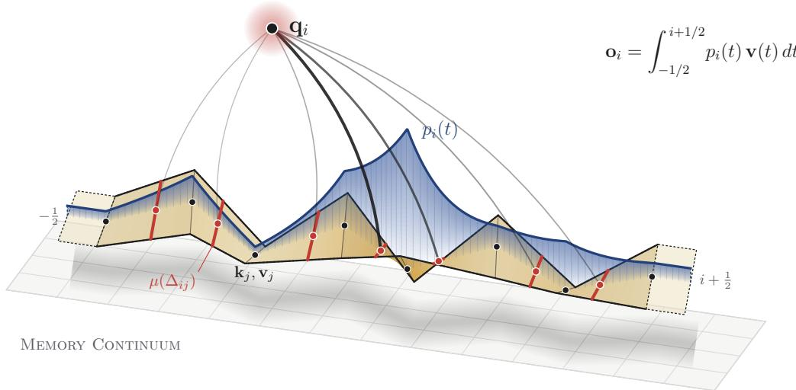

# Continuum Attention

Afshin Khadangi SnT, University of Luxembourg afshin.khadanki@uni.lu afshin.xyz

  
Figure 1: Overview of Continuum Attention. Adjacent key and value representations define a continuous memory trajectory. Each query induces a relevance density $p _ { i } ( t )$ and determines adaptive retrieval positions $\mu ( \Delta _ { i j } )$ within memory segments. Exact integration, including the half token boundary extensions, produces the attention output.

## Abstract

We introduce Continuum Attention (CA), a causal Transformer attention operator that replaces discrete key and value lookup with integration over a continuous, piecewise linear memory curve. Each query induces an exponential relevance density along the curve. Integrating the density and interpolated values yields exact normalized attention from closed form exponential moments, including half token boundary contributions. The gradients follow analytically from moments of order at most two, enabling parallel GPU implementations while retaining quadratic sequence complexity and the standard Transformer decoder. Compared with ordinary softmax and focal attention, CA reduces mean validation negative log likelihood by 0.0200 and 0.0480 nats per byte, respectively, winning all paired comparisons. An additional disjoint validation slice yields a 0.0457 nats per byte advantage over the strongest selected softmax baseline, with a paired 95% confidence interval. These findings motivate continuous integration as a promising attention alternative while leaving larger scale generalization open.

## 1 Introduction

Attention mechanisms have become a fundamental component of modern neural networks, enabling representations to be constructed through content dependent interactions between queries, keys, and values [1, 13]. In the Transformer, scaled dot product attention assigns a normalized exponential weight to each available key and aggregates the corresponding value vectors. For a causal query at position i, this operation takes the form

$$
\mathbf { o } _ { i } = \frac { \sum _ { j = 0 } ^ { i } \exp ( s _ { i j } ) \mathbf { v } _ { j } } { \sum _ { j = 0 } ^ { i } \exp ( s _ { i j } ) } , \qquad s _ { i j } = \frac { \mathbf { q } _ { i } ^ { \top } \mathbf { k } _ { j } } { \tau \sqrt { d _ { h } } } ,\tag{1}
$$

where $\tau > 0$ controls the sharpness of the attention distribution and $d _ { h }$ denotes the attention head dimension.

This formulation represents memory through a finite collection of key and value vectors. Each memory position contributes through its individual relevance score, and normalization is performed over discrete positions. Although learned projections produce continuous vector representations, the aggregation operator evaluates these representations only at the sampled token positions. This distinc tion motivates an alternative representation in which adjacent memory vectors define a continuou trajectory and the query retrieves information through integration along that trajectory.

Previous research has explored alternative attention distributions [6], adaptive receptive fields, and computationally efficient attention operators [12, 2, 3]. Continuous domain attention has also been studied through exponential families, sparse probability densities, and analytical differentiation [7, 8]. A complementary mathematical perspective describes attention through integral operators acting on probability measures [14]. These developments motivate further investigation of the relationship between the geometry of stored representations and the measure used to retrieve information from them.

Prior work established a general framework for continuous attention through probability densities over continuous domains, including continuous softmax and sparse distributions with analytical gradients [7]. Building on this foundation, Continuum Attention specifies a causal, content dependent construction directly from Transformer key and value representations. Adjacent memory vectors define piecewise linear trajectories, and each query induces an exponential relevance density whose segment integrals admit exact evaluation through exponential moments. This construction avoids fitting a separate continuous value function and supports direct integration into standard autoregressive Transformer layers.

We introduce Continuum Attention (CA), a causal attention operator that constructs a continuous memory trajectory from the key and value representations of a Transformer. Consecutive vectors are connected through piecewise linear interpolation, defining continuous functions k(t) and v(t) over memory position t. Each query induces an exponential relevance density along this trajectory, and its output is obtained through normalized integration:

$$
\mathbf { o } _ { i } ^ { \mathrm { C A } } = \frac { \displaystyle \int _ { - 1 / 2 } ^ { i + 1 / 2 } \exp \left( \frac { \mathbf { q } _ { i } ^ { \top } \mathbf { k } ( t ) } { \tau \sqrt { d _ { h } } } \right) \mathbf { v } ( t ) d t } { \displaystyle \int _ { - 1 / 2 } ^ { i + 1 / 2 } \exp \left( \frac { \mathbf { q } _ { i } ^ { \top } \mathbf { k } ( t ) } { \tau \sqrt { d _ { h } } } \right) d t } .\tag{2}
$$

The integration domain includes constant extensions of the first and last visible memory vectors over half unit intervals. These boundary contributions preserve the intended token mass convention, including uniform weighting when all relevance scores are equal.

The defining property of CA is its query adaptive retrieval geometry. Within each Transformer layer and attention head, independently learned projections define a distinct memory trajectory. Each query determines a relevance density over that trajectory and thereby controls the effective retrieval locations within individual memory segments. Consequently, different queries can retrieve different interpolated values from the same stored key and value sequence. This adaptation emerges directly from the query dependent score function and remains present when the attention temperature is fixed.

The piecewise linear construction also provides an analytical advantage. Along each memory segment, the relevance score is an affine function of the interpolation coordinate. The exponential integrals therefore admit exact expressions in terms of moments

$$
J _ { n } ( \Delta ) = \int _ { 0 } ^ { 1 } u ^ { n } \exp ( \Delta u ) d u ,\tag{3}
$$

where moments of orders zero and one determine the forward aggregation, and the second order moment completes the analytical score derivatives. The resulting operator can be evaluated using finite algebraic expressions, allowing implementation through parallel GPU operations. CA retains the quadratic sequence complexity of conventional dense attention and can be incorporated into a standard causal Transformer decoder.

We investigate CA through byte level language modeling on TinyStories [4]. The experiments use a six layer Transformer with approximately five million parameters, five independent training seeds, and context lengths of 192 and 512 tokens. We compare CA against conventional softmax attention under matched model configurations, training budgets, and attention temperatures. With a fixed temperature of 0.30, CA reduces mean validation negative log likelihood by 0.0200 and 0.0480 nats per byte at the two context lengths, respectively, with improvements in all five paired seed comparisons at each length. On an additional disjoint evaluation slice, CA achieves an improvement of 0.0457 nats per byte at 512 tokens over the development selected softmax baseline, with a paired 95% confidence interval of [0.0316, 0.0598]. This additional evaluation is exploratory because the slice was previously examined during model comparisons. The results demonstrate promising small scale language modeling performance while motivating further evaluation at larger model sizes and on additional datasets.

The contributions of this work are an exact formulation of causal attention over interpolated memory trajectories, a query adaptive retrieval mechanism with analytical forward and backward expressions, parallel GPU implementations validated against numerical reference calculations, and controlled empirical comparisons with conventional softmax attention across multiple training seeds and context lengths.

## 2 Method

We formulate Continuum Attention (CA) as an exact integral operator over a continuous memory trajectory constructed from the key and value representations of a causal Transformer. The construction is applied independently within each attention head and Transformer layer. For clarity, we omit the layer and head indices throughout the derivation.

## 2.1 Continuous Memory Representation

Consider a sequence of T token representations projected into queries, keys, and values:

$$
\mathbf { q } _ { i } = W _ { Q } \mathbf { x } _ { i } , \qquad \mathbf { k } _ { i } = W _ { K } \mathbf { x } _ { i } , \qquad \mathbf { v } _ { i } = W _ { V } \mathbf { x } _ { i } ,\tag{4}
$$

where $\mathbf { q } _ { i } , \mathbf { k } _ { i } , \mathbf { v } _ { i } \in \mathbb { R } ^ { d _ { h } }$ and $d _ { h }$ denotes the dimension of an attention head.

For a causal query at position i, only memory positions $j \le i$ are accessible. We construct continuous key and value functions by interpolating adjacent memory vectors. For each interval $[ j - 1 , j ]$ , where $1 \leq j \leq i , \mathrm { l e t } u = t - ( j - 1 ) \bar { \in } [ 0 , 1 ]$ and define

$$
\mathbf { k } _ { j } ( u ) = ( 1 - u ) \mathbf { k } _ { j - 1 } + u \mathbf { k } _ { j } ,\tag{5}
$$

$$
\mathbf { v } _ { j } ( u ) = ( 1 - u ) \mathbf { v } _ { j - 1 } + u \mathbf { v } _ { j } .\tag{6}
$$

These segments form continuous functions k(t) and v(t) over [0, i]. We extend both functions constantly over the intervals $[ - 1 / 2 , 0 ]$ and $[ i , i + 1 / 2 ]$ , using the first and last visible memory vectors, respectively.

The resulting memory representation preserves the original token ordering and causal visibility while providing well defined representations at every position along the memory trajectory.

## 2.2 Query Adaptive Relevance Density

Each query induces a relevance score over the continuous memory domain:

$$
s _ { i } ( t ) = \frac { \gamma } { \sqrt { d _ { h } } } \mathbf { q } _ { i } ^ { \top } \mathbf { k } ( t ) ,\tag{7}
$$

where $\gamma > 0$ is the attention score gain. For a fixed attention temperature $\tau , \gamma = 1 / \tau$

Within segment $j ,$ define the endpoint scores

$$
a _ { i j } = s _ { i } ( j - 1 ) , \qquad b _ { i j } = s _ { i } ( j ) , \qquad \Delta _ { i j } = b _ { i j } - a _ { i j } .\tag{8}
$$

Since the key trajectory is linear within the segment, the score is affine:

$$
s _ { i j } ( u ) = a _ { i j } + u \Delta _ { i j } , \qquad u \in [ 0 , 1 ] .\tag{9}
$$

The query therefore induces an exponential relevance density

$$
p _ { i } ( t ) = { \frac { \exp ( s _ { i } ( t ) ) } { Z _ { i } } } , \qquad Z _ { i } = \int _ { - 1 / 2 } ^ { i + 1 / 2 } \exp ( s _ { i } ( t ) ) d t .\tag{10}
$$

CA retrieves information by integrating the continuous value trajectory against this density:

$$
\boxed { \mathbf { o } _ { i } = \int _ { - 1 / 2 } ^ { i + 1 / 2 } p _ { i } ( t ) \mathbf { v } ( t ) d t } .\tag{11}
$$

The adaptation depends directly on the query and the geometry of neighboring keys. In particular,

$$
\Delta _ { i j } = \frac { \gamma } { \sqrt { d _ { h } } } \mathbf { q } _ { i } ^ { \top } \big ( \mathbf { k } _ { j } - \mathbf { k } _ { j - 1 } \big ) ,\tag{12}
$$

so different queries induce different relevance profiles over the same memory segments. Distinct learned projections across layers and heads further provide different memory trajectories and retrieval behavior.

## 2.3 Exact Segment Integration

The affine score in Eq. (9) allows the continuous integral to be evaluated exactly. Define the exponential moments

$$
J _ { n } ( \Delta ) = \int _ { 0 } ^ { 1 } u ^ { n } \exp ( \Delta u ) d u , \qquad n \in \{ 0 , 1 , 2 \} .\tag{13}
$$

For $\Delta \neq 0$ , these moments admit the expressions

$$
J _ { 0 } ( \Delta ) = \frac { e ^ { \Delta } - 1 } { \Delta } ,\tag{14}
$$

$$
J _ { 1 } ( \Delta ) = \frac { ( \Delta - 1 ) e ^ { \Delta } + 1 } { \Delta ^ { 2 } } ,\tag{15}
$$

$$
J _ { 2 } ( \Delta ) = \frac { ( \Delta ^ { 2 } - 2 \Delta + 2 ) e ^ { \Delta } - 2 } { \Delta ^ { 3 } } .\tag{16}
$$

Their continuous limits at $\Delta = 0$ are $J _ { 0 } ( 0 ) = 1 , J _ { 1 } ( 0 ) = 1 / 2 , \mathrm { a n d } J _ { 2 } ( 0 ) = 1 / 3$

For a segment connecting positions $j - 1$ and j, its unnormalized probability mass is

$$
\begin{array} { c } { { M _ { i j } = \displaystyle \int _ { 0 } ^ { 1 } \exp ( a _ { i j } + u \Delta _ { i j } ) d u } } \\ { { = e ^ { a _ { i j } } J _ { 0 } ( \Delta _ { i j } ) . } } \end{array}\tag{17}
$$

Its contribution to the value numerator is

$$
\begin{array} { l } { { \displaystyle { \bf U } _ { i j } = \int _ { 0 } ^ { 1 } \exp ( a _ { i j } + u \Delta _ { i j } ) { \bf v } _ { j } ( u ) d u } \ ~ } \\ { { \displaystyle ~ = e ^ { a _ { i j } } \Big [ \big ( J _ { 0 } ( \Delta _ { i j } ) - J _ { 1 } ( \Delta _ { i j } ) \big ) { \bf v } _ { j - 1 } } \ ~ } \\ { { \displaystyle ~ + J _ { 1 } ( \Delta _ { i j } ) { \bf v } _ { j } \Big ] } . } \end{array}\tag{18}
$$

Thus, the contribution of each memory segment is obtained from the endpoint scores and values using a finite number of analytical operations.

Adaptive retrieval positions. The normalized mean interpolation coordinate within segment j is

$$
\mu ( \Delta _ { i j } ) = \frac { J _ { 1 } ( \Delta _ { i j } ) } { J _ { 0 } ( \Delta _ { i j } ) } .\tag{19}
$$

For $\Delta \neq 0$

$$
\mu ( \Delta ) = \frac { 1 } { 1 - e ^ { - \Delta } } - \frac { 1 } { \Delta } , \qquad \mu ( 0 ) = \frac { 1 } { 2 } .\tag{20}
$$

Consequently,

$$
\mathbf { U } _ { i j } = M _ { i j } \Big [ ( 1 - \mu ( \Delta _ { i j } ) ) \mathbf { v } _ { j - 1 } + \mu ( \Delta _ { i j } ) \mathbf { v } _ { j } \Big ] .\tag{21}
$$

The function $\mu ( \Delta )$ increases monotonically from zero to one. Positive score differences shift the effective retrieval position toward the right endpoint, while negative differences shift it toward the left endpoint. Equal scores produce the midpoint of the segment.

This gives CA two complementary forms of query adaptation. The segment mass $M _ { i j }$ determines how strongly a memory interval contributes, while $\mu ( \Delta _ { i j } )$ determines where information is retrieved within that interval. Both quantities are determined analytically for each query.

## 2.4 Boundary Contributions and Normalization

To treat endpoint memory positions consistently, we include constant half unit extensions at both ends of the visible memory domain. Their contributions to the normalizer and value numerator are

$$
Z _ { i } ^ { \mathrm { c a p } } = \frac { 1 } { 2 } e ^ { s _ { i } ( 0 ) } + \frac { 1 } { 2 } e ^ { s _ { i } ( i ) } ,\tag{22}
$$

$$
\mathbf { U } _ { i } ^ { \mathrm { c a p } } = \frac { 1 } { 2 } e ^ { s _ { i } ( 0 ) } \mathbf { v } _ { 0 } + \frac { 1 } { 2 } e ^ { s _ { i } ( i ) } \mathbf { v } _ { i } .\tag{23}
$$

The complete normalization factor and numerator are

$$
Z _ { i } = Z _ { i } ^ { \mathrm { c a p } } + \sum _ { j = 1 } ^ { i } M _ { i j } ,\tag{24}
$$

$$
\mathbf { U } _ { i } = \mathbf { U } _ { i } ^ { \mathrm { c a p } } + \sum _ { j = 1 } ^ { i } \mathbf { U } _ { i j } .\tag{25}
$$

The final attention output is therefore

$$
\mathbf { o } _ { i } = \frac { \mathbf { U } _ { i } ^ { \mathrm { c a p } } + \displaystyle \sum _ { j = 1 } ^ { i } \mathbf { U } _ { i j } } { Z _ { i } ^ { \mathrm { c a p } } + \displaystyle \sum _ { j = 1 } ^ { i } M _ { i j } } .\tag{26}
$$

For $i = 0 ,$ , the two half unit contributions together yield the output $\mathbf { o } _ { 0 } = \mathbf { v } _ { 0 }$

The endpoint convention also ensures that when all visible key scores are equal, each discrete value receives identical total mass, and Eq. (26) reduces exactly to uniform causal attention.

Because the segment contributions are nonnegative, CA can equivalently be written as

$$
\mathbf { o } _ { i } = \sum _ { j = 0 } ^ { i } w _ { i j } \mathbf { v } _ { j } , \qquad w _ { i j } \geq 0 , \qquad \sum _ { j = 0 } ^ { i } w _ { i j } = 1 .\tag{27}
$$

The effective weights combine contributions from adjacent memory segments and the boundary terms.   
This representation allows CA to be integrated into a conventional Transformer attention block.

## 2.5 Analytical Differentiation

The forward operator admits exact analytical derivatives. The second order moment $J _ { 2 }$ is sufficient because both the key scores and values are linear within each memory segment.

Let $\mathcal { L }$ denote the training objective, and let

$$
{ \bf g } _ { i } = \frac { \partial \mathcal { L } } { \partial { \bf o } _ { i } } , \qquad r _ { i j } = { \bf g } _ { i } ^ { \top } ( { \bf v } _ { j } - { \bf o } _ { i } ) .\tag{28}
$$

For segment $j ,$ the contribution to the gradient with respect to its left endpoint score is

$$
\begin{array} { r } { \frac { \partial \mathcal { L } } { \partial s _ { i } ( j - 1 ) } \bigg | _ { \mathrm { s e g } , j } = \frac { e ^ { a _ { i j } } } { Z _ { i } } \Big [ \big ( J _ { 0 } - 2 J _ { 1 } + J _ { 2 } \big ) r _ { i , j - 1 } } \\ { + \left( J _ { 1 } - J _ { 2 } \right) r _ { i j } \Big ] , } \end{array}\tag{29}
$$

where the moments are evaluated at $\Delta _ { i j }$

The corresponding contribution to the right endpoint is

$$
\begin{array} { c } { { \displaystyle \left. \frac { \partial \mathcal { L } } { \partial s _ { i } ( j ) } \right| _ { \mathrm { s e g } j } = \frac { e ^ { a _ { i j } } } { Z _ { i } } \Big [ \big ( J _ { 1 } - J _ { 2 } \big ) r _ { i , j - 1 } } } \\ { { \displaystyle + J _ { 2 } r _ { i j } \Big ] . } } \end{array}\tag{30}
$$

Each endpoint receives the sum of the contributions from its incident segments. The first and last visible scores also receive the boundary contributions

$$
\left. \frac { \partial \mathcal { L } } { \partial s _ { i } ( 0 ) } \right| _ { \mathrm { c a p } } = \frac { e ^ { s _ { i } ( 0 ) } } { 2 Z _ { i } } r _ { i 0 } ,\tag{31}
$$

$$
\left. \frac { \partial \mathcal { L } } { \partial s _ { i } ( i ) } \right| _ { \mathrm { c a p } } = \frac { e ^ { s _ { i } ( i ) } } { 2 Z _ { i } } r _ { i i } .\tag{32}
$$

The value gradients follow from the effective weights in Eq. (27):

$$
\frac { \partial \mathcal { L } } { \partial \mathbf { v } _ { j } } = \sum _ { i = j } ^ { T - 1 } w _ { i j } \mathbf { g } _ { i } .\tag{33}
$$

Writing $g _ { i j } ^ { s }$ for the complete derivative with respect to $s _ { i } ( j )$ , the query and key gradients are

$$
\frac { \partial \mathcal { L } } { \partial { \bf q } _ { i } } = \frac { \gamma } { \sqrt { d _ { h } } } \sum _ { j = 0 } ^ { i } g _ { i j } ^ { s } { \bf k } _ { j } ,\tag{34}
$$

$$
\frac { \partial \mathcal { L } } { \partial \mathbf { k } _ { j } } = \frac { \gamma } { \sqrt { d _ { h } } } \sum _ { i = j } ^ { T - 1 } g _ { i j } ^ { s } \mathbf { q } _ { i } .\tag{35}
$$

For the learned gain variant, we parameterize $\gamma = \exp ( \rho )$ independently for each layer and head. Its gradient is

$$
\frac { \partial \mathcal { L } } { \partial \rho } = \sum _ { i = 0 } ^ { T - 1 } \sum _ { j = 0 } ^ { i } g _ { i j } ^ { s } s _ { i } ( j ) .\tag{36}
$$

These expressions provide analytical differentiation through the complete attention operator using exponential moments of order at most two.

## 2.6 Numerical Evaluation and Complexity

Direct evaluation of exponential moments can lose numerical precision when endpoint scores are nearly equal. We therefore evaluate the moment expressions using series expansions near $\Delta = 0$ with

$$
J _ { n } ( \Delta ) = \sum _ { r = 0 } ^ { \infty } \frac { \Delta ^ { r } } { r ! ( n + r + 1 ) } .\tag{37}
$$

For general score differences, we use numerically stable exponential expressions and scale the integrals relative to the larger endpoint score. The normalizer is computed after subtracting the maximum visible score for each query, preserving the normalized output. Efficient and numerically stable evaluation of exponential normalizers has also been investigated for conventional softmax attention [9].

All segment integrals can be evaluated independently. Their contributions are accumulated into the effective attention weights, followed by multiplication with the value matrix. This permits parallel GPU implementation without numerical quadrature or sequential integration over memory positions.

For a sequence of length T and head dimension $d _ { h }$ , the attention computation requires $\mathcal { O } ( T ^ { 2 } d _ { h } )$ operations per head, matching the asymptotic complexity of dense softmax attention. An implementation that materializes the attention matrix requires $\mathrm { \dot { \mathcal { O } } } ( T ^ { \tilde { 2 } } )$ attention storage, while tiled implementations can accumulate segment contributions without retaining the entire matrix. The present experiments employ custom Metal kernels for the exact forward computation and analytical score gradients, validated against an independent numerical reference.

## 2.7 Integration into Causal Transformers

CA replaces the attention operator within each Transformer block while retaining the surrounding decoder architecture. Queries, keys, and values are obtained from the usual learned linear projections, and the head outputs are concatenated and projected back to the model dimension. Residual connections, normalization, feedforward layers, positional embeddings, and the language modeling objective are retained.

We investigate two primary gain configurations. The fixed gain variant, denoted CA-P, uses $\gamma =$ 1/0.30 in every attention head. The learned gain variant, denoted CA-H, initializes each head at the same gain and optimizes $\rho$ during training. Query adaptation through Eq. (12) occurs in both configurations.

The fixed gain formulation introduces no additional trainable parameters relative to a conventional softmax attention layer with the same projection dimensions. This enables a direct architectural comparison under matched model size, attention temperature, and training budget.

## 3 Experiments and Results

We evaluate Continuum Attention (CA) in autoregressive language modeling, focusing on predictive quality, attention temperature, training stability, and computational performance. Our experiments compare CA against conventional softmax attention under matched model architectures and training budgets. All reported quality results are obtained from five independent training seeds.

## 3.1 Experimental Setup

Dataset and evaluation task. We conduct byte level language modeling on TinyStories [4]. Each text is encoded as a sequence of UTF-8 bytes, giving a vocabulary of 256 symbols. The model predicts the next byte using the standard autoregressive cross entropy objective.

We construct the training corpus from the first 16 million bytes of the TinyStories training split. Development validation uses the first 2 million bytes of the official validation split. An additional evaluation corpus consists of a separate 4 million byte portion of the validation stream, disjoint from the development validation bytes.

Our primary metric is negative log likelihood (NLL), measured in nats per byte. We additionally report bits per byte (BPB), computed as

$$
\mathrm { B P B } = { \frac { \mathrm { N L L } } { \ln 2 } } .\tag{38}
$$

Lower values indicate better predictive performance.

Model architecture. All experiments use the same causal Transformer decoder architecture [13]. The network contains six Transformer blocks, model width 256, four attention heads, and head dimension 64. Each block uses RMS normalization [15], residual connections, and a SwiGLU feedforward network with hidden dimension 720 [10].

The model employs learned absolute positional embeddings, a vocabulary embedding of dimension 256, and an output projection tied to the input embedding matrix. The attention operator is the principal architectural variable across experiments.

At context length 192, fixed temperature models contain 5,008,640 trainable parameters. At context length 512, they contain 5,090,560 parameters. The difference arises from the larger positional embedding table. Variants with learned attention gains introduce 24 additional scalar parameters, corresponding to four heads in each of six layers.

Attention configurations. We compare eight configurations, divided into conventional softmax attention and CA variants.

The conventional softmax controls are:

$\mathrm { B _ { 0 . 2 0 } , B _ { 0 . 3 0 } }$ , and $\mathrm { B _ { 0 . 5 0 } } \mathrm { : }$ softmax attention with fixed temperatures $\tau \in \{ 0 . 2 0 , 0 . 3 0 , 0 . 5 0 \}$

• F: softmax attention with a learned positive gain initialized at effective temperature $\tau = 1$

• G: softmax attention with a learned positive gain initialized at effective temperature $\tau =$ 0.30.

The CA configurations are:

• S: CA with learned attention gains initialized at effective temperature $\tau = 1$

• H: CA with learned attention gains initialized at effective temperature $\tau = 0 . 3 0 .$

• P: CA with fixed attention temperature $\tau = 0 . 3 0$

For learned gain variants, every attention head has a positive scale parameter $\gamma = \exp ( \rho )$ , giving effective temperature $\tau = \exp ( - \rho )$ . The fixed configurations $\mathrm { B _ { 0 . 3 0 } }$ and P therefore have identical parameter counts, identical initial score scaling, and the same surrounding Transformer architecture. Similarly, G and H provide matched comparisons with learned attention gains.

Optimization protocol. All models are trained with AdamW [5], using learning rate $4 \times 1 0 ^ { - 4 }$ momentum coefficients $( \beta _ { 1 } , \beta _ { 2 } ) = ( 0 . 9 , 0 . 9 5 )$ , weight decay 0.1, and gradient norm clipping at 1.0. The learning rate is held constant during training.

Learned attention gain parameters receive eight times the base learning rate and no weight decay. All other optimization settings remain identical across attention variants.

We use five training seeds:

$$
\{ 1 7 2 9 , 2 7 1 8 , 3 1 4 1 , 4 5 6 7 , 6 1 7 4 \} .
$$

The two context configurations receive equal training token budgets:

$$
\begin{array} { l l } { { T = 1 9 2 : } } & { { 8 \times 1 9 2 \times 2 5 0 0 = 3 { , } 8 4 0 { , } 0 0 0 , } } \\ { { T = 5 1 2 : } } & { { 2 \times 5 1 2 \times 3 7 5 0 = 3 { , } 8 4 0 { , } 0 0 0 . } } \end{array}\tag{39}
$$

Here the factors correspond to batch size, sequence length, and optimization steps. Each variant uses the same training sample sequence for a given seed and context length. Models are evaluated at the final training step, with no checkpoint selection based on validation performance.

The study contains 80 completed training runs: eight attention configurations, five seeds, and two context lengths.

<table><tr><td>Model</td><td>Attention setting</td><td> $T = 1 9 2$ </td><td> $T = 5 1 2$ </td></tr><tr><td> $\mathrm { B _ { 0 . 2 0 } }$ </td><td>Softmax, fixed 0.20</td><td>1.047540</td><td>1.256038</td></tr><tr><td> $\mathrm { B _ { 0 . 3 0 } }$ </td><td>Softmax, fixed 0.30</td><td>1.029903</td><td>1.174585</td></tr><tr><td> $\mathrm { B _ { 0 . 5 0 } }$ </td><td>Softmax, fixed 0.50</td><td>1.039986</td><td>1.209809</td></tr><tr><td> $\mathrm { F }$ </td><td>Softmax, learned, init. 1</td><td>1.078360</td><td>1.264449</td></tr><tr><td>G</td><td>Softmax, learned, init. 0.30</td><td>1.026097</td><td>1.200387</td></tr><tr><td>S</td><td>CA, learned, init. 1</td><td>1.038428</td><td>1.210424</td></tr><tr><td>H</td><td>CA, learned, init. 0.30</td><td>1.013707</td><td>1.127689</td></tr><tr><td>P</td><td>CA, fixed 0.30</td><td>1.009888</td><td>1.126540</td></tr></table>

Table 1: Mean development validation NLL in nats per byte over five training seeds. Lower values are better. All configurations use an equal training token budget within each context.

Validation protocol. Development NLL is estimated using 128 sampled validation batches with evaluation seed 9090, shared across all configurations. The additional evaluation uses 256 sampled batches with evaluation seed 121212.

All comparisons use paired training seeds and identical evaluation sampling within each context. We report the mean NLL over five seeds and paired 95% Student t confidence intervals for the NLL differences. For paired differences $\delta _ { 1 } , \ldots , \delta _ { 5 }$ , the interval is

$$
{ \bar { \delta } } \pm t _ { 0 . 9 7 5 , 4 } { \frac { s _ { \delta } } { \sqrt { 5 } } } ,\tag{40}
$$

where $s _ { \delta }$ is the sample standard deviation of the paired differences.

These intervals characterize variation across the five training seeds on the fixed evaluation samples.   
They are reported without correction for multiple comparisons.

## 3.2 Development Validation Results

Table 1 reports mean validation NLL for all eight attention configurations at the two context lengths.

The results reveal an important dependence on attention temperature. The original CA configuration S, initialized at effective temperature 1, improves upon the correspondingly initialized softmax control F. However, fixed temperature softmax with $\tau = 0 . 3 0$ achieves lower NLL than S at both context lengths. This motivates comparisons in which both operators receive identical attention scaling.

Under these matched conditions, CA achieves the lowest mean validation NLL at both context lengths. The fixed temperature variant P improves over $\mathrm { B _ { 0 . 3 0 } }$ by 0.020016 nats per byte at $T = 1 9 2$ and 0.048045 nats per byte at $T = 5 1 2$ . These correspond to relative NLL reductions of approximately 1.94% and 4.09%, respectively.

The improvement is consistent across all five paired seeds at both context lengths. At $T = 1 9 2$ the paired 95% confidence interval for the improvement is [0.013779, 0.026253]. At $T = 5 1 2$ , the corresponding interval is [0.033504, 0.062587].

The learned gain comparison produces a similar trend. CA variant H improves over softmax variant G by 0.012389 nats per byte at $T = 1 9 2$ and 0.072698 nats per byte at $T = 5 1 2$ . The corresponding confidence intervals are [−0.004571, 0.029349] and [0.030012, 0.115383]. Although H wins all five paired seeds at both lengths, the interval at $T \doteq 1 9 2$ includes zero.

## 3.3 Fixed and Learned Attention Gains

We further examine whether the attention gain must be learned to obtain the benefits of continuous integration.

At $T = 1 9 2$ , fixed temperature CA P outperforms learned gain CA H by 0.003820 nats per byte on average. The paired 95% confidence interval is [−0.003918, 0.011558].

At $T = 5 1 2 ,$ , the corresponding mean advantage of P is 0.001149 nats per byte, with confidence interval [−0.014050, 0.016348].

<table><tr><td>Configuration</td><td> $T = 1 9 2$ </td><td> $T = 5 1 2$ </td></tr><tr><td>Selected softmax</td><td>1.032713</td><td>1.182236</td></tr><tr><td>CAS</td><td>1.046338</td><td>1.217520</td></tr><tr><td>CA H</td><td>1.020175</td><td>1.135246</td></tr><tr><td>CAP</td><td>1.016345</td><td>1.136495</td></tr></table>

Table 2: Mean exploratory NLL in nats per byte over five training seeds on disjoint TinyStories validation text. The selected softmax is G at $T \stackrel { \cdot } { = } 1 9 2$ and $\mathrm { B _ { 0 . 3 0 } }$ at $\check { T } = 5 1 2$ . This evaluation portion had been examined before the additional CA ablations were conducted.

Neither comparison establishes a clear advantage for learning the gain. The fixed temperature configuration provides competitive or better mean performance in both contexts while preserving exact parameter equality with the fixed temperature softmax baseline.

These observations motivate the use of P as the primary CA configuration in the remaining analysis. Its query adaptation arises from the continuous relevance density and segment integration, independently of learned temperature parameters.

## 3.4 Evaluation on Disjoint Validation Text

We evaluate the saved model checkpoints on an additional 4 million byte portion of TinyStories validation text, disjoint from the development validation corpus.

During the original experiment, the strongest softmax control was selected using development validation: G for $T = 1 9 2$ and $\mathrm { B _ { 0 . 3 0 } }$ for $T \equiv 5 1 2$ . These selections were frozen before the original evaluation of S.

Subsequently, the H and P ablations were introduced and evaluated on the same previously examined validation portion. We therefore treat their results as exploratory measurements. The evaluation samples and original softmax results are reused without retraining the controls.

Table 2 reports the mean NLL over five seeds.

Both temperature adjusted CA variants achieve lower mean NLL than the development selected softmax baseline at both context lengths.

For the primary fixed temperature CA variant, the mean improvement is 0.016368 nats per byte at $T = 1 9 \bar { 2 }$ , with paired 95% confidence interval [−0.000134, 0.032870]. All five paired seeds favor CA, although the confidence interval includes zero.

At T = 512, fixed temperature CA improves mean NLL by 0.045741 nats per byte relative to B0.30, with confidence interval [0.031634, 0.059848]. The improvement occurs in all five paired seeds.

Learned gain CA H similarly achieves an improvement of 0.046990 nats per byte at $T = 5 1 2$ , with confidence interval [0.024375, 0.069606] and five wins across five seeds.

The results support a consistent performance advantage for temperature adjusted CA at context length 512 in this experimental setting. At context length 192, the exploratory results favor CA in mean NLL, with greater uncertainty across training seeds.

Table 3 summarizes the principal paired comparisons.

## 3.5 Computational Performance

We measure computational performance on Apple Silicon using PyTorch 2.8 and the Metal Performance Shaders backend. Conventional softmax attention uses the PyTorch scaled dot product attention interface. CA uses custom Metal implementations of the exact segment integration and analytical score gradients.

At context length 192, the CA implementation uses the metal\_analytic backend. At context length 512, it uses the metal\_long backend.

Training throughput includes the model forward pass, backward pass, and optimization steps. Forward throughput is measured separately over repeated full sequence inference calls.

<table><tr><td>Evaluation</td><td>Context</td><td>Comparison</td><td>Mean improvement</td><td>95% confidence interval</td><td>CA wins</td></tr><tr><td>Development</td><td>192</td><td> $\mathrm { B _ { 0 . 3 0 } - P }$ </td><td>0.020016</td><td>[0.013779,0.026253]</td><td>5/5</td></tr><tr><td>Development</td><td>512</td><td> $\mathrm { B _ { 0 . 3 0 } - P }$ </td><td>0.048045</td><td>[0.033504, 0.062587]</td><td>5/5</td></tr><tr><td>Development</td><td>192</td><td> $\mathrm { G } - \mathrm { H }$ </td><td>0.012389</td><td>[-0.004571,0.029349]</td><td>5/5</td></tr><tr><td>Development</td><td>512</td><td> $\mathrm { G } - \mathrm { H }$ </td><td>0.072698</td><td>[0.030012,0.115383]</td><td>5/5</td></tr><tr><td>Exploratory</td><td>192</td><td>G-P</td><td>0.016368</td><td>[-0.000134,0.032870]</td><td>5/5</td></tr><tr><td>Exploratory</td><td>192</td><td> $\mathrm { G } - \mathrm { H }$ </td><td>0.012538</td><td>[-0.004729,0.029805]</td><td>4/5</td></tr><tr><td>Exploratory</td><td>512</td><td> $\mathrm { B _ { 0 . 3 0 } - P }$ </td><td>0.045741</td><td>[0.031634, 0.059848]</td><td>5/5</td></tr><tr><td>Exploratory</td><td>512</td><td> $\mathrm { B _ { 0 . 3 0 } - H }$ </td><td>0.046990</td><td>[0.024375, 0.069606]</td><td>5/5</td></tr></table>

Table 3: Paired NLL differences in nats per byte. Positive values favor CA. Confidence intervals use Student t statistics across five paired training seeds and are unadjusted for multiple comparisons. The exploratory comparisons reuse previously examined validation text.

<table><tr><td>Context</td><td>Model</td><td>Train tok/s</td><td>Forward tok/s</td></tr><tr><td>192</td><td>Softmax B0.30</td><td>40,547</td><td>153,136</td></tr><tr><td>192</td><td>CA H</td><td>40,010</td><td>129,362</td></tr><tr><td>192</td><td>CAP</td><td>40,715</td><td>131,599</td></tr><tr><td>512</td><td>Softmax B0.30</td><td>31,130</td><td>127,098</td></tr><tr><td>512</td><td>CA H</td><td>28,192</td><td>79,975</td></tr><tr><td>512</td><td>CAP</td><td>28,867</td><td>77,450</td></tr></table>

Table 4: Mean training and forward throughput over five seeds on Apple Silicon. Measurements are in tokens per second. Higher values indicate greater throughput.

Table 4 reports mean throughput across the five training seeds.

At context length 192, fixed temperature CA achieves training throughput comparable to conventional softmax. At context length 512, CA P is approximately 7.3% slower in training throughput and 39.1% slower in forward throughput than the matched softmax control.

The larger forward performance gap reflects the current implementation and provides an important optimization target. These measurements characterize the tested Metal kernels and context lengths.

Numerical verification. Before CA training, the Metal kernels are checked against an independent CPU reference using double precision calculations. The recorded maximum absolute deviation for the analytical score gradients across the experiment preflight checks is below $6 \times 1 0 ^ { - 7 }$ . All preflight checks pass at both context lengths.

## 4 Discussion and Limitations

Continuous memory retrieval. Continuum Attention extends the conventional attention operator by defining a continuous memory trajectory through adjacent key and value representations. Its principal distinction lies in the integration of query dependent relevance over this trajectory. Each memory segment contributes both an analytical probability mass and an effective retrieval position, determined by the exponential moments of its endpoint score difference.

This construction introduces a structured relationship between neighboring memory positions. While conventional softmax attention assigns relevance to individual sampled keys, CA integrates relevance across the intervals connecting them. The resulting retrieval positions adapt to each query, with independently learned projections providing distinct memory trajectories across Transformer layers and heads. This adaptation remains present under a fixed attention temperature.

The continuous formulation also admits an equivalent discrete representation with nonnegative attention weights that sum to one. Consequently, CA preserves the normalized aggregation structure of conventional attention while modifying how the effective weights are determined. Its output remains a convex combination of the original value vectors.

Attention temperature and architectural effects. The temperature ablations reveal the importance of controlling attention score scaling when evaluating alternative attention mechanisms. CA with learned gains initialized at effective temperature 1 outperforms the corresponding softmax configuration, but stronger softmax controls achieve better validation performance after temperature adjustment.

When both operators use a fixed temperature of 0.30, CA achieves lower mean validation NLL across all five paired seeds at context lengths 192 and 512. The corresponding improvements are 0.0200 and 0.0480 nats per byte, respectively. Both paired 95% confidence intervals exclude zero.

The fixed temperature CA variant also performs comparably to the variant with learned attention gains. This observation suggests that the benefits measured in our experiments arise from the continuous integration operator under suitable score scaling, without requiring additional learned temperature parameters. The fixed configuration therefore provides a particularly direct comparison with softmax attention, preserving both parameter count and attention temperature.

Relation to continuous attention. Continuous attention distributions and analytical differentiation have previously been investigated [7, 8]. CA builds on this mathematical foundation through a specific construction for causal Transformer memory. It uses the Transformer keys themselves to define a piecewise linear score trajectory and interpolates the corresponding values directly, allowing each segment integral to be evaluated exactly.

The contribution is therefore centered on the particular memory representation, its exact exponential moment formulation, and its implementation within autoregressive Transformer layers. Further comparisons with alternative continuous attention parameterizations would help isolate the influence of this particular interpolation geometry.

Computational considerations. CA retains the quadratic sequence complexity of dense attention. Exact segment integration introduces additional arithmetic relative to ordinary softmax, including exponential moment evaluation and the redistribution of probability mass between neighboring values.

Our Metal implementation achieves training throughput comparable to softmax at context length 192. At context length 512, the fixed temperature CA variant exhibits approximately 7.3% lower training throughput and 39.1% lower forward throughput. These results indicate a computational tradeoff between the observed modeling improvements and the additional cost of continuous integration. More efficient kernel designs, particularly those that reduce intermediate memory traffic, remain an important direction for implementation research.

Limitations. Our empirical investigation is restricted to approximately five million parameter Transformers trained on a byte level subset of TinyStories. The experiments use two context lengths, a common training budget of 3.84 million tokens per model, and five independent training seeds. Evaluation on larger models, additional language modeling corpora, and longer contexts is needed to assess the generality of the observed improvements. Our experiments use learned absolute positional embeddings. Evaluating CA with alternative positional representations, including rotary position embeddings [11], remains an open direction.

The additional disjoint validation slice was examined during earlier model comparisons before the final CA temperature ablations were introduced. Its results therefore provide exploratory evidence. Although the 512 token comparison yields a positive paired confidence interval across all five seeds, the reported intervals reflect training seed variation on fixed evaluation samples and include no correction for multiple model comparisons. A new, previously unexamined evaluation corpus would provide stronger confirmatory evidence.

The current experiments also examine a limited selection of CA temperature configurations. More extensive optimization of both CA and conventional softmax may alter their relative performance. Furthermore, the continuous trajectories are constructed through linear interpolation between adjacent learned representations. The usefulness of this geometric assumption may depend on the data, learned representations, and context length. Interpolated locations need not correspond to independently meaningful memory states.

Finally, the present experiments establish predictive improvements under controlled small model conditions. They do not yet establish corresponding gains in larger language models, broader downstream tasks, or overall computational efficiency. These questions motivate further empirical and theoretical investigation.

## 5 Conclusion

We introduced Continuum Attention, a causal attention operator that performs exact integration over continuous memory trajectories constructed from Transformer keys and values. Piecewise linear interpolation enables closed form evaluation through exponential moments, while query dependent relevance determines both the probability mass and effective retrieval position within each memory segment. Analytical gradients and parallel GPU implementations allow the method to operate within conventional Transformer decoders while preserving quadratic sequence complexity.

In controlled byte level language modeling experiments, CA with fixed attention temperature outperformed matched softmax attention across five training seeds at context lengths 192 and 512. The results demonstrate promising predictive benefits from continuous memory integration without additional trainable parameters. Further work will investigate larger model scales, broader datasets, longer contexts, and more efficient implementations to determine the practical scope of these findings.

## References

[1] Dzmitry Bahdanau, Kyunghyun Cho, and Yoshua Bengio. Neural machine translation by jointly learning to align and translate. arXiv preprint arXiv:1409.0473, 2014.

[2] Krzysztof Choromanski, Valerii Likhosherstov, David Dohan, Xingyou Song, Andreea Gane, Tamas Sarlos, Peter Hawkins, Jared Davis, Afroz Mohiuddin, Lukasz Kaiser, et al. Rethinking attention with performers. arXiv preprint arXiv:2009.14794, 2020.

[3] Tri Dao, Dan Fu, Stefano Ermon, Atri Rudra, and Christopher Ré. Flashattention: Fast and memory-efficient exact attention with io-awareness. Advances in neural information processing systems, 35:16344–16359, 2022.

[4] Ronen Eldan and Yuanzhi Li. Tinystories: How small can language models be and still speak coherent english? arXiv preprint arXiv:2305.07759, 2023.

[5] Ilya Loshchilov and Frank Hutter. Decoupled weight decay regularization. arXiv preprint arXiv:1711.05101, 2017.

[6] Andre Martins and Ramon Astudillo. From softmax to sparsemax: A sparse model of attention and multi-label classification. In International conference on machine learning, pages 1614–1623. PMLR, 2016.

[7] André Martins, António Farinhas, Marcos Treviso, Vlad Niculae, Pedro Aguiar, and Mario Figueiredo. Sparse and continuous attention mechanisms. Advances in Neural Information Processing Systems, 33:20989–21001, 2020.

[8] André FT Martins, Marcos Treviso, António Farinhas, Pedro MQ Aguiar, Mário AT Figueiredo, Mathieu Blondel, and Vlad Niculae. Sparse continuous distributions and fenchel-young losses. Journal of Machine Learning Research, 23(257):1–74, 2022.

[9] Maxim Milakov and Natalia Gimelshein. Online normalizer calculation for softmax. arXiv preprint arXiv:1805.02867, 2018.

[10] Noam Shazeer. Glu variants improve transformer. arXiv preprint arXiv:2002.05202, 2020.

[11] Jianlin Su, Murtadha Ahmed, Yu Lu, Shengfeng Pan, Wen Bo, and Yunfeng Liu. Roformer: Enhanced transformer with rotary position embedding. Neurocomputing, 568:127063, 2024.

[12] Sainbayar Sukhbaatar, Edouard Grave, Piotr Bojanowski, and Armand Joulin. Adaptive attention span in transformers. In Proceedings ofthe 57th Annual Meeting ofthe Associationfor Computational Linguistics, pages 331–335, 2019.

[13] Ashish Vaswani, Noam Shazeer, Niki Parmar, Jakob Uszkoreit, Llion Jones, Aidan N Gomez, Łukasz Kaiser, and Illia Polosukhin. Attention is all you need. Advances in neural information processing systems, 30, 2017.

[14] James Vuckovic, Aristide Baratin, and Remi Tachet des Combes. On the regularity of attention. arXiv preprint arXiv:2102.05628, 2021.

[15] Biao Zhang and Rico Sennrich. Root mean square layer normalization. Advances in neural information processing systems, 32, 2019.