# DYNAMIC GRAPH WORLD MODELLING: LEARNING FUTURE DYNAMICS FROM TEMPORAL CONTEXT

Bo Li1,2, Yue Yang2, Yujin Huang3, Siao Liu4, David Lemphers2, Sara E Rodriguez Gomez2, Luke Borgnolo2, Can Wang1, Xin Zheng 5∗

1School of Information and Communication Technology, Griffith University, Australia 2Maincode, Australia

3School of Computing and Information Systems, University of Melbourne, Australia

4Future Science and Engineering College, Soochow University, China

5School of Computing Technologies, RMIT University, Australia bo.li6@griffithuni.edu.au, xin.zheng2@rmit.edu.au

## ABSTRACT

Dynamic graph learning models how entities and their relations evolve from historical observations to predict future graph states. Existing methods do not fully address dynamic graph world modelling, which requires learning transitions from temporal context to future latent graph states. This is difficult for three reasons: nodes and relations rely on different historical evidence, structural evolution is path-dependent, and future snapshots provide sparse and realizationspecific targets. We propose DYnamic Graph World Modelling (DYG-WM), the first framework to jointly predict future node and relation representations from temporal context by answering three questions: what has evolved, how it evolved, and what will evolve next. To capture (a) what has evolved, a historical node-relation context encoder summarizes node-neighborhood trajectories and pair-specific histories. To characterize (b) how it evolved, a noderelation path-signature encoder captures ordered structural changes. To predict (c) what will evolve next, a dual-level joint-embedding objective predicts targetsnapshot node and relation representations without reconstructing the raw graph. Experiments on 12 link-prediction and two node-classification datasets demonstrate the effectiveness of DYG-WM across both tasks. Our code available at https://github.com/HyoukaLI/DyG-WM

## 1 INTRODUCTION

Many real-world systems change through the evolution of both entities and their relationships. Dynamic graphs model these systems as sequences of graph-structured states, in which nodes represent entities and time-varying edges record their interactions (Gravina et al., 2024; Feng et al., 2025b; Skarding et al., 2021). They have been widely used to study social networks (Kumar et al., 2019; Zheng et al., 2026), recommender systems (Zhang et al., 2026a; Wang et al., 2026), traffic systems (Zou et al., 2026; Weng et al., 2023), financial transactions (Song et al., 2023; Yuan et al., 2025), and scientific discovery (Bai et al., 2024). By modelling structural dependencies within graph states and temporal dependencies across states, dynamic graph neural networks (DGNNs) can do temporal link prediction and node attribute prediction (Kumar et al., 2019; Rossi et al., 2020; Yu et al., 2023; Li et al., 2026). Although current models perform well on individual prediction tasks, real-world applications require more than forecasting a single edge or node label. Dynamic graph learning aims to model how the graph state evolves from historical observations so that future states can be predicted and used for planning and decision-making.

This motivates us to formulate the problem of dynamic graph world modelling, which extends the general world-modelling paradigm to evolving relational systems. As illustrated in Figure 1, historical graph observations are encoded into compact latent states, and the temporal transitions between these states are learned to predict future system dynamics. From this perspective, existing dynamic graph learning methods can be broadly divided into two groups, neither of which fully addresses this problem. (1) Task-oriented temporal graph representation learning trains DGNNs with node labels or observed interactions to predict specific outcomes, such as future links or node attributes (Kumar et al., 2019; Rossi et al., 2020; Yu et al., 2023; Li et al., 2026). Although effective on individual tasks, such supervision is often sparse, delayed, or costly to obtain and binds the learned representations to particular tasks and evolving environments. (2) Self-supervised dynamic graph representation learning reduces this dependence through contrastive, reconstruction-based, or latent-predictive objectives. Contrastive methods align temporal views, sampled subgraphs, or interacting nodes (Wang et al., 2021a; Xu et al., 2023). However, they mainly enforce invariance across constructed views, and their effectiveness depends on whether the selected positive-negative pairs preserve temporal semantics. Reconstruction and masking methods recover missing edges, attributes, or temporal observations (Gao et al., 2025; He et al., 2025), but encourage the model to focus on low-level details of the observed graph rather than its predictable dynamics. Dynamic graphs have a natural temporal prediction structure: past graph states provide the context, while future graph states serve as prediction targets. Predictive latent representation learning is therefore well suited to dynamic graph world modelling because temporal progression naturally separates context from target. The goal is to predict, from historical states, what the graph will become in representation space rather than reconstruct every observed interaction.

However, learning a dynamic graph world model involves three challenges. C1: Multi-level historical dependency. Nodes and relations evolve together but draw on different historical evidence. Node evolution depends on the trajectory of a node and its neighborhood, whereas relation evolution also depends on pair-specific structural histories that endpoint representations alone cannot recover. C2: Path-dependent structural evolution. Similar current graph states can result from different sequences of structural changes and may therefore lead to different future dynamics. A world model must retain both the resulting state and the ordered path that produced it. C3:

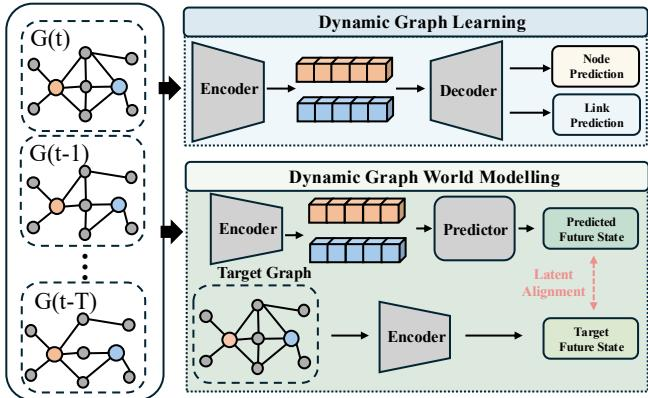  
Figure 1: Comparison of dynamic graph learning and dynamic graph world modelling. Dynamic graph learning maps historical graphs to task-specific outputs, whereas dynamic graph world modelling predicts future latent state.

Sparse and realization-specific future targets. A future graph snapshot records only the node states and interactions observed within a given time window, offering an incomplete view of the underlying dynamics. Predicting these outcomes separately or reconstructing the snapshot exactly may lead the model to fit a single observed realization rather than capture how nodes and relations evolve more generally. A dynamic graph world model therefore needs a compact future-state target that goes beyond individual node labels and edge observations.

To address these challenges, we introduce DYG-WM, a DYnamic Graph World Modelling method that learns future graph dynamics directly in the latent space through predictive representation learning guided by temporal context. Our proposed DYG-WM is designed and organized around three questions: what has evolved, how it evolved, and what will evolve next. To capture what has evolved, we develop (a) a historical node-relation context encoder that summarizes the trajectories of nodes and their neighborhoods and builds pair-specific structural contexts. This provides the different forms of historical evidence described in C1. To characterize how the graph evolved, we introduce (b) a node-relation path-signature encoder that captures the order of structural changes at both levels. It distinguishes trajectories that reach similar current states through different transition or ders, addressing the path dependence described in C2. Finally, to predict what will evolve next, we design (c) a dual-level joint-embedding predictive objective that uses historical contexts and path signatures to predict node and relation representations from the target snapshot. By learning future dynamics in representation space instead of reconstructing a single future graph realization, the objective addresses C3. Our main contributions are as follows:

• To our knowledge, DYG-WM is the first framework to formulate dynamic graph world modelling as the joint prediction of future node and relation representations. It treats relations as temporally evolving latent states rather than only as message-passing channels or endpoint based scores. Using strictly historical context, DYG-WM learns future dynamics directly in representation space.

• To account for path dependence in dynamic graph evolution, we combine a historical noderelation context encoder with a node-relation path-signature encoder. The two encoders represent accumulated states and ordered structural changes, respectively. A dual-level joint-embedding predictive objective uses these encodings to predict future node and relation states without rely ing on augmented-view contrast or raw-graph reconstruction for self-supervision.

• Across 12 dynamic link-prediction datasets and two dynamic node-classification datasets, DYG-WM achieves the best average rank in every evaluated link-prediction setting. It also obtains the best Macro-F1 and Micro-F1 scores across all label ratios. Ablation and latent-alignment analyses further confirm the effectiveness of the individual components.

## 2 RELATED WORKS

Dynamic Graph Neural Networks. Dynamic graph neural networks (DGNNs) are commonly divided into discrete-time models, which operate on graph snapshots, and continuous-time models, which process timestamped interactions directly. Representative methods capture graph evolution through temporal attention (Sankar et al., 2020), recurrent updates (Pareja et al., 2020), memory mechanisms (Rossi et al., 2020), temporal walks (Wang et al., 2021b), MLP-based temporal mixing (Cong et al., 2023), Transformer-based sequence modeling (Yu et al., 2023), and state-space models (Li et al., 2026). Recent self-supervised DGNNs learn from temporal contrast, masked reconstruction, or future latent prediction (Chen et al., 2025; Gao et al., 2025; He et al., 2025; Zhang et al., 2026b). However, most remain node-centric, while pair-level information is mainly used for link prediction (Wang et al., 2021b;a; Yu et al., 2023; Tian et al., 2024). DYG-WM instead models and predicts future representations at both node and relation levels.

Graph World Model. World models learn latent states and transition functions to predict future dynamics (Ha & Schmidhuber, 2018). Graph world models extend this idea to structured environments by representing states as entities and relations, with a graph abstraction and a relational transition model (Battaglia et al., 2018; Liu et al., 2026). Existing object-centric models use graph neural networks to predict interactions and future object states, including C-SWM (Kipf et al., 2020), G-SWM (Lin et al., 2020), CWM (Li et al., 2020a), VGPL (Li et al., 2020b), and other graph-based world models (Feng et al., 2025a; Zhang et al., 2021; Zhu et al., 2022). These methods mainly target action-conditioned physical systems, where relations support object-state updates rather than being predicted themselves. DYG-WM instead models general dynamic graphs by constructing historical node and relation contexts and jointly predicting their future representations. It can therefore be viewed as an action-free relational transition model rather than a full planning system.

## 3 METHODOLOGY

## 3.1 PRELIMINARY

Notation. Let V be a global node set with $N = | \nu |$ . A dynamic graph is a time-ordered in teraction stream $\mathbf { \mathcal { E } } = \left( \left( u _ { i } , v _ { i } , \tau _ { i } , \mathbf { e } _ { i } \right) \right) _ { i = 1 } ^ { M }$ with $\tau _ { i } \leq \tau _ { i + 1 }$ , where ordered node pairs may repeat. We partition E into $T$ consecutive subsequences $\{ \mathcal { E } _ { t } \} _ { t = 1 } ^ { T }$ with roughly equal event counts, keeping equal-timestamp interactions in the same bin. Each bin has two aligned views. The snapshot view is $\widetilde { G } _ { t } = ( \gamma , A _ { t } , X _ { t } , \mathbf { m } _ { t } )$ , where $A _ { t } \in \{ 0 , 1 \} ^ { N \times N }$ is the de-duplicated, symmetrized message-passing adjacency, $\dot { X _ { t } } \in \mathbb { R } ^ { \dot { N } \times F }$ is the node-attribute matrix, and mt $\in \{ 0 , \dot { 1 } \} ^ { N }$ is the active-node mask. We define $\mathcal { V } _ { t } = \{ u \in \mathcal { V } : m _ { u } ^ { t } = 1 \}$ and write $\mathcal { N } _ { t } ( u )$ for the neighbors of u in $A _ { t }$ . Both $A _ { t }$ and $X _ { t }$ remain globally indexed. Time-varying components of $X _ { t }$ summarize events through bin $t ,$ with global preprocessing statistics computed from the training split only. The event view $\mathcal { E } _ { t }$ preserves directed interactions, repetitions, exact timestamps, and link features. For query time $\tau ,$ the strict history is $\mathscr { H } _ { < \tau } = \big ( ( u _ { i } , \bar { v } _ { i } , \tau _ { i } , \mathbf { e } _ { i } ) : \tau _ { i } < \tau \big )$ . Equal-timestamp events are simultaneous and excluded from one another’s histories. Superscript t denotes bin-level indexing, whereas $\tau \ \mathrm { o r } < \ \tau$ denotes exact-time dependence.

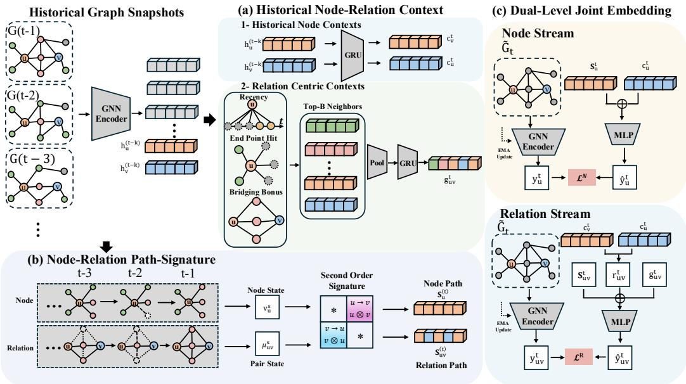  
Figure 2: Overview of DYG-WM. (a) The historical node-relation context encoder summarizes the trajectories of nodes and their neighborhoods and constructs pair-specific relation contexts from historical snapshots. (b) The node-relation path-signature encoder uses second-order signatures to capture ordered structural changes at both levels. (c) The dual-level joint-embedding predictive objective predicts target-snapshot node and relation representations.

Problem Formalization. For target bin t, let $\mathcal { C } _ { t } = ( \widetilde { G } _ { t - W + 1 } , \dots , \widetilde { G } _ { t - 1 } )$ contain the preceding $W - 1$ snapshot views and no event information from bin t. From $\mathcal { C } _ { t }$ , the model computes a node context $\mathbf { c } _ { u } ^ { t } .$ , which, despite its index t, depends only on snapshots before the target bin. For query $( u , v , \tau )$ in bin $t ,$ the model combines $\mathcal { C } _ { t }$ and $\mathcal { H } _ { < \tau }$ to obtain the exact-time relation representation $\mathbf { z } _ { u v } ^ { \tau }$ . Dynamic link prediction scores an indexed candidate group $\mathcal { Q } ( u , \tau )$ containing one observed interaction and K sampled negatives; sampled destinations that coincide with the observed destination are retained rather than deduplicated.

Given the historical snapshot context $\mathcal { C } _ { t }$ and strict event history $\mathcal { H } _ { < \tau } ,$ we learn a shared predictive representation for node classification and dynamic link prediction, while keeping the target snapshot $\widetilde { G } _ { t }$ hidden from the online branch.

The overall framework of DYG-WM is shown in Figure 2. DYG-WM consists of three main components. The historical node-relation context encoder summarizes node trajectories and constructs pair-specific relation contexts from preceding snapshots. The node-relation path-signature encoder models ordered structural changes at both the node and relation levels. The dual-level jointembedding predictive objective predicts target-snapshot node and relation representations using an EMA target encoder. Given the historical snapshot context $\mathcal { C } _ { t }$ and the strict event prefix $\mathcal { H } _ { < \tau }$ for a query $( u , v , \tau )$ , DYG-WM constructs a relation representation and produces the interaction score $s _ { u v } ^ { \tau }$ . The following sections describe these components in detail.

## 3.2 HISTORICAL NODE-RELATION CONTEXT ENCODER

Predicting future dynamics requires historical information at both the node and relation levels. Node prediction tracks how a node and its neighborhood evolve over time, while relation prediction also depends on pair-specific structural history that is not captured by the endpoint representations alone. We use a (a-1) historical node context encoder for node-level evolution and a (a-2) relation-centric context encoder for pair-specific structural history.

Historical Node Context Encoder. For target bin t, let ${ \mathcal { T } } _ { t } = \{ t - W + 1 , \ldots , t - 1 \}$ index the historical snapshots in $\mathcal { C } _ { t }$ . Each node representation is obtained from the online GNN as

$$
\mathbf h _ { u } ^ { s } = \mathrm { G N N } _ { \theta } ( \widetilde G _ { s } ) [ u ] , \qquad s \in \mathcal T _ { t } .\tag{1}
$$

The latest representation $\mathbf { h } _ { u } ^ { t - 1 }$ alone does not capture the earlier evolution of node u or its neighborhood. We therefore compute the mean neighborhood representation

$$
\overline { { \mathbf { h } } } _ { u } ^ { s } = \frac { 1 } { \operatorname* { m a x } \{ 1 , | \mathcal { N } _ { s } ( u ) | \} } \sum _ { w \in \mathcal { N } _ { s } ( u ) } \mathbf { h } _ { w } ^ { s } ,\tag{2}
$$

with $\overline { { \mathbf { h } } } _ { u } ^ { s } = \mathbf { 0 }$ when $\mathcal { N } _ { s } ( u ) = \emptyset$

The historical node context encoder processes the ordered node and neighborhood trajectories with separate recurrent encoders and combines them with the latest node representation through gated residual fusion:

$$
\mathbf { c } _ { u } ^ { t } = f _ { \mathrm { N o d e C } } \left( \mathbf { h } _ { u } ^ { t - 1 } , ( \mathbf { h } _ { u } ^ { s } ) _ { s \in \mathcal { T } _ { t } } , ( \overline { { \mathbf { h } } } _ { u } ^ { s } ) _ { s \in \mathcal { T } _ { t } } \right) .\tag{3}
$$

Thus, $\mathbf { c } _ { u } ^ { t }$ summarizes the recent state and historical node-neighborhood evolution of u using only snapshots $s < t$

Relation-Centric Context Encoder. For a queried pair $( u , v )$ , we collect the endpoints and their historical neighbors over $\mathcal { T } _ { t }$ . The endpoints are retained, while the remaining candidates are ranked using recency and common-neighbor bridging information. We keep the top B context nodes as $\mathcal { K } _ { u v } ^ { t }$ , where $\mathrm { ~ \bar { ~ } { ~ B ~ } ~ }$ is the relation-context budget. Their representations are pooled at each historical snapshot and summarized temporally:

$$
\mathbf { g } _ { u v } ^ { t } = \mathrm { G R U } _ { \mathrm { r e l } } \left( \left( \frac { 1 } { \left| \mathcal { K } _ { u v } ^ { t } \right| } \sum _ { w \in \mathcal { K } _ { u v } ^ { t } } \mathbf { h } _ { w } ^ { s } \right) _ { s \in \mathcal { T } _ { t } } \right) .\tag{4}
$$

The resulting $\mathbf { g } _ { u v } ^ { t }$ captures pair-specific structural history using only $\mathcal { C } _ { t }$

## 3.3 NODE-RELATION PATH-SIGNATURE ENCODER

Dynamic graph evolution is path-dependent: similar current states may arise from different historical trajectories and lead to different future dynamics. Although $\mathbf { c } _ { u } ^ { t }$ and $\mathbf { g } _ { u v } ^ { t }$ summarize the states in $\mathcal { C } _ { t } ,$ recurrent summaries do not explicitly preserve the order and interactions of structural changes. Node and relation prediction also require different trajectories. Node prediction depends on local neighborhood evolution, while relation prediction additionally depends on the joint evolution of the queried pair. We therefore use a node structural path-signature encoder and a relation structural path-signature encoder to model these ordered changes (Chevyrev & Kormilitzin, 2025).

Second-Order Path Signatures. Let d $\mathbf { \Psi } _ { 1 } , \dots , \mathbf { d } _ { L } \in \mathbb { R } ^ { d _ { s } }$ be a sequence of projected path increments, where $L = W - 1$ . We represent the ordered path using the truncated second-order signature

$$
\mathrm { S i g } _ { 2 } ( \mathbf { d } _ { 1 : L } ) = \left[ \sum _ { i = 1 } ^ { L } \mathbf { d } _ { i } \parallel \mathrm { v e c } \left( \sum _ { 1 \leq i < j \leq L } \mathbf { d } _ { i } \otimes \mathbf { d } _ { j } + \frac { 1 } { 2 } \sum _ { i = 1 } ^ { L } \mathbf { d } _ { i } \otimes \mathbf { d } _ { i } \right) \right]\tag{5}
$$

The first component summarizes cumulative change, while the second captures ordered interactions between structural changes through the terms with $i < j$

Node Structural Paths. For each $s \in \mathcal { T } _ { t }$ , we construct a structural descriptor $\pmb { \nu } _ { u } ^ { s } \in \mathbb { R } ^ { d _ { N } }$ from the normalized degree of $u ,$ its signed degree change, the proportions of arriving, disappearing, and persistent neighbors, and an activity indicator. For the first historical snapshot $s _ { 0 } = t - W + 1$ transition-dependent entries are set to zero; subsequent transitions use snapshots $s - 1$ and s.

We append the normalized elapsed time $\overline { { \Delta t } } _ { s }$ , project each descriptor to the path space, and apply the second-order signature:

$$
\mathbf { S } _ { u } ^ { t } = \phi _ { N } \left( \mathrm { S i g } _ { 2 } \left( \left( \operatorname { P r o j } _ { N } [ \overline { { \Delta t } } _ { s } \lVert \pmb { \nu } _ { u } ^ { s } ] \right) _ { s \in \mathcal { T } _ { t } } \right) \right) .\tag{6}
$$

Here, $\phi _ { N }$ maps the truncated signature to the model dimension. While $\mathbf { c } _ { u } ^ { t }$ summarizes the historical state of $u , \mathbf { S } _ { u } ^ { t }$ captures its ordered structural evolution.

Relation Structural Paths. For each queried pair $( u , v )$ and historical snapshot $s ,$ we construct a pair state $\mu _ { u v } ^ { s } \in \mathbb { R } ^ { d _ { R } }$ from direct connectivity, normalized endpoint degrees, normalized commonneighbor count, neighborhood Jaccard overlap, endpoint activity, and coverage of the selected context nodes $\mathcal { K } _ { u v } ^ { t }$ . Endpoint-specific channels remain ordered to preserve the roles of u and $v .$

We describe the relation trajectory by changes in these pair states:

$$
\Delta { \pmb \mu } _ { u v } ^ { s } = \left\{ \begin{array} { l l } { { \pmb \mu } _ { u v } ^ { s } , } & { s = t - W + 1 , } \\ { { \pmb \mu } _ { u v } ^ { s } - { \pmb \mu } _ { u v } ^ { s - 1 } , } & { s > t - W + 1 . } \end{array} \right.\tag{7}
$$

After appending the normalized elapsed time and projecting each increment to the path space, we apply the second-order signature:

$$
\mathbf { S } _ { u v } ^ { t } = \phi _ { R } \left( \mathrm { S i g } _ { 2 } \left( \left( \operatorname { P r o j } _ { R } [ \overline { { \Delta t } } _ { s } \lVert \Delta \pmb { \mu } _ { u v } ^ { s } ] \right) _ { s \in \mathcal { Z } _ { t } } \right) \right) .\tag{8}
$$

Here, $\mathbf { S } _ { u v } ^ { t }$ captures the ordered structural evolution of $( u , v )$ using only $\mathcal { C } _ { t }$ . Together, $\mathbf { S } _ { u } ^ { t }$ and $\mathbf { S } _ { u \ i } ^ { t }$ describe ordered node-level and pair-level structural changes that complement $\mathbf { c } _ { u } ^ { \bar { t } }$ and $\mathbf { g } _ { u \ i } ^ { t }$ .

## 3.4 DUAL-LEVEL JOINT-EMBEDDING PREDICTIVE OBJECTIVE

Future observations in dynamic graphs are sparse and variable, so directly predicting individual links or node labels can overfit to a particular realization of the future graph. We instead predict future latent states, which capture structural changes without reconstructing the exact target snapshot. Since these changes occur at both node and pair levels, we use a dual-level joint-embedding predictive objective for future node and relation states. We therefore predict future latent representations at both levels instead of reconstructing target adjacency or raw attributes.

Online and Target Branches. We use $\mathrm { G N N } _ { \theta }$ and $g _ { \theta }$ as the online snapshot and relation encoders, with EMA target counterparts $\mathrm { G N N } _ { \bar { \theta } }$ and $g _ { \bar { \theta } }$ . The online branch uses only historical information, while the target branch encodes $\widetilde { G } _ { t }$ during training. The node target is $\begin{array} { r l } { { \bf y } _ { u } ^ { t } } & { { } = } \end{array}$ sg $\left( \mathrm { G N N } _ { \bar { \theta } } ( \widetilde { G } _ { t } ) [ u ] \right) , u \in \mathcal { V } _ { t }$ , where $\operatorname { s g } ( \cdot )$ denotes stop-gradient. The target parameters receive no gradients and are updated by EMA: $\bar { \theta }  \eta _ { \mathrm { e m a } } \bar { \theta } + ( 1 - \eta _ { \mathrm { e m a } } ) \theta .$

Node-Level Predictive Objective. The node predictor uses the historical context, path signature, and prediction horizon: $\widehat { \mathbf { y } } _ { u } ^ { t } = p _ { N } ( [ \mathbf { c } _ { u } ^ { t } \lVert \mathbf { S } _ { u } ^ { t } \rVert \mathbf { e } _ { \Delta _ { t } } ) )$ , where $\mathbf { e } _ { \Delta _ { t } }$ encodes the prediction horizon. Prediction and target are compared after $\ell _ { 2 }$ normalization:

$$
D ( \widehat { \mathbf { y } } , \mathbf { y } ) = \left\| \frac { \widehat { \mathbf { y } } } { \| \widehat { \mathbf { y } } \| _ { 2 } } - \mathrm { s g } \left( \frac { \mathbf { y } } { \| \mathbf { y } \| _ { 2 } } \right) \right\| _ { 2 } ^ { 2 } .\tag{9}
$$

The node loss is $\begin{array} { r } { \mathcal { L } ^ { N } = \frac { 1 } { | \mathcal { U } _ { t } | } \sum _ { u \in \mathcal { U } _ { t } } D ( \widehat { \mathbf { y } } _ { u } ^ { t } , \mathbf { y } _ { u } ^ { t } ) } \end{array}$ , where $\mathcal { U } _ { t } = \mathcal { V } _ { t }$ for node prediction and contains the observed-interaction endpoints in the current batch for link prediction.

Relation-Level Predictive Objective. We use the ordered endpoint transformation $\chi ( { \mathbf { a } } , { \mathbf { b } } ) \ =$ $[ \mathbf { a } \| \mathbf { b } \| \mathbf { a } \odot \mathbf { b } \| \mathbf { a } - \mathbf { b } ]$ . The historical relation representation is

$$
\mathbf { q } _ { u v } ^ { t } = \phi _ { \mathrm { f u s e } } \left( \left[ g _ { \theta } ( \chi ( \mathbf { c } _ { u } ^ { t } , \mathbf { c } _ { v } ^ { t } ) ) \lVert \mathbf { g } _ { u v } ^ { t } \rVert \mathbf { S } _ { u v } ^ { t } \right] \right) .\tag{10}
$$

Its future latent is predicted as $\widehat { \mathbf { y } } _ { u v } ^ { t } \ = \ p _ { R } \left( \left[ \mathbf { q } _ { u v } ^ { t } \lVert \mathbf { e } _ { \Delta t } \right] \right)$ , with target $\mathbf { y } _ { u v } ^ { t } = \mathrm { s g } ( g _ { \bar { \theta } } ( \chi ( \mathbf { y } _ { u } ^ { t } , \mathbf { y } _ { v } ^ { t } ) ) )$ Explicit target-snapshot pair statistics, such as adjacency and common-neighbor counts, are not provided to $g _ { \bar { \theta } }$ . For observed relation pairs $\begin{array} { r l } & { \mathcal { R } _ { t } ^ { + } , \mathcal { \bar { L } } ^ { R } = \mathbf { \check { \Phi } } _ { | \mathcal { R } _ { \mathfrak { L } } ^ { + } | } \sum _ { ( u , v ) \in \mathcal { R } _ { t } ^ { + } } \overbar { D ( \mathbf { y } _ { u v } ^ { t } , \mathbf { y } _ { u v } ^ { t } ) } } \end{array}$ . Sampled negatives are used only by the downstream link objective. Joint Objective. We apply variance and covariance regularization to the predicted node and relation latents to reduce collapse. The resulting objective is

$$
\mathcal { L } _ { \mathrm { J E P A } } = \lambda _ { N } \mathcal { L } ^ { N } + \lambda _ { R } \mathcal { L } ^ { R } + \lambda _ { \mathrm { v a r } } \left( \mathcal { L } _ { \mathrm { v a r } } ^ { N } + \mathcal { L } _ { \mathrm { v a r } } ^ { R } \right) + \lambda _ { \mathrm { c o v } } \left( \mathcal { L } _ { \mathrm { c o v } } ^ { N } + \mathcal { L } _ { \mathrm { c o v } } ^ { R } \right) .\tag{11}
$$

For node prediction, we additionally use in-batch node discrimination. For link prediction,

$$
\mathcal { L } _ { \mathrm { t o t a l } } = \mathcal { L } _ { \mathrm { J E P A } } + \lambda _ { \mathrm { l i n k } } \mathcal { L } _ { \mathrm { l i n k } } + \lambda _ { \mathrm { r a n k } } \mathcal { L } _ { \mathrm { r a n k } } ,
$$

where $\mathcal { L } _ { \mathrm { l i n k } }$ is the binary candidate loss and $\mathcal { L } _ { \mathrm { r a n k } }$ ranks the observed destination against sampled candidates.

Strict Event-Prefix Encoder. The bin-level representation $\mathbf { q } _ { u v } ^ { t }$ is fixed within target bin t and does not use events from that bin. To include information available before the exact query time, we encode the strict prefix $\mathcal { H } _ { < \tau }$ . The event-history encoder uses statistics of the directed pair and its endpoints, together with historical link-feature profiles when available:

$$
\begin{array} { r } { \mathbf { o } _ { u v } ^ { < \tau } = \mathrm { E v e n t H i s t o r y } ( u , v ; \mathcal { H } _ { < \tau } ) . } \end{array}\tag{12}
$$

All statistics are computed strictly before τ , so equal-timestamp events are excluded.

Training and Inference. The target snapshot $\widetilde { G } _ { t }$ is used only to construct $\mathbf { y } _ { u } ^ { t }$ and $\mathbf { y } _ { u v } ^ { t } .$ . For query $( u , v , \tau ) \overset {  } { , } \mathbf { z } _ { u v } ^ { \tau } = \phi _ { \tau } ( [ \mathbf { q } _ { u v } ^ { t } \lVert \mathbf { o } _ { u v } ^ { < \tau } ] ) \overset {  } { , } s _ { u v } ^ { \tau } \overset {  } { = } h _ { \psi } ( \mathbf { z } _ { u v } ^ { \tau } )$ . Inference therefore uses only $\mathcal { C } _ { t }$ and $\mathcal { H } _ { < \tau }$ ; the target branch and predictive losses are used only during training.

Table 1: Transductive AUC-ROC for dynamic link prediction with random (rnd), historical (hist), and inductive (ind) negative edge sampling. Bold red and underlined blue emphasize best and 2ndbest results.
<table><tr><td>NSS</td><td>Datasets</td><td>JODIE</td><td>DyRep</td><td>TGAT</td><td>TGN</td><td>CAWN</td><td>TCL</td><td>GraphMixer</td><td>DyGFormer</td><td>CLDG</td><td>MaskDGNN</td><td>DVGMAE</td><td>DYG-WM</td></tr><tr><td rowspan="12">rnd</td><td>Wikipedia</td><td>96.55± 0.19</td><td>94.93± 0.50</td><td>92.66± 0.43</td><td>98.46± 0.05</td><td>98.60± 0.01</td><td>97.51 ± 0.09</td><td>97.12± 0.06</td><td>98.98± 0.01</td><td>89.50±0.18</td><td>86.71± 0.53</td><td>83.96± 0.55</td><td>98.94± 0.02</td></tr><tr><td>Reddit</td><td>98.04±0.04</td><td>97.69± 0.51</td><td>97.97± 0.02</td><td>97.75± 0.38</td><td>99.10±0.01</td><td>97.91 ± 0.04</td><td>98.03± 0.02</td><td>99.09± 0.00</td><td>96.75±0.01</td><td>96.73± 0.02</td><td>95.72± 0.07</td><td>99.20± 0.01</td></tr><tr><td>MOOC</td><td>83.16±2.19</td><td>79.33± 4.02</td><td>86.01 ± 0.06</td><td>94.19± 0.73</td><td>82.05± 0.28</td><td>85.58± 0.39</td><td>84.98± 0.13</td><td>89.80± 0.23</td><td>68.17± 1.30</td><td>74.97± 0.20</td><td>71.02± 0.89</td><td>82.50± 0.39</td></tr><tr><td>LastFM</td><td>70.94± 0.72</td><td>71.92± 0.84</td><td>71.54± 0.35</td><td>62.38±2.16</td><td>85.93± 0.11</td><td>71.10± 0.32</td><td>73.59±0.11</td><td>93.15± 0.02</td><td>64.49± 0.69</td><td>65.48±0.66</td><td>63.00± 0.21</td><td>92.61± 0.06</td></tr><tr><td>Enron</td><td>87.29± 1.84</td><td>85.60± 1.98</td><td>74.41 ± 0.73</td><td>84.87± 1.60</td><td>90.49± 0.04</td><td>83.90± 0.28</td><td>84.56± 0.24</td><td>93.46± 0.14</td><td>87.87± 0.47</td><td>85.82±0.86</td><td>74.84± 1.19</td><td>92.55±0.25</td></tr><tr><td>UCI</td><td>90.35± 0.50</td><td>64.90± 9.03</td><td>82.54± 0.41</td><td>94.05± 0.37</td><td>93.93± 0.04</td><td>89.71± 2.88</td><td>91.98±0.43</td><td>94.59± 0.22</td><td>86.18±0.30</td><td>88.04± 0.08</td><td>88.31± 0.17</td><td>94.15± 0.17</td></tr><tr><td>Flights</td><td>91.92± 1.17</td><td>92.01 ± 1.02</td><td>94.50± 0.07</td><td>94.34± 0.73</td><td>98.44± 0.03</td><td>91.31± 0.04</td><td>91.21± 0.01</td><td>98.95± 0.01</td><td>94.66± 0.12</td><td>93.89± 0.06</td><td>91.81± 0.16</td><td>98.03± 0.15</td></tr><tr><td>Can. Parl.</td><td>80.76±1.34</td><td>71.50± 0.68</td><td>75.48± 1.40</td><td>80.12±2.27</td><td>75.24±2.82</td><td>74.99± 1.52</td><td>83.83±0.39</td><td>97.24± 0.33</td><td>77.81± 0.96</td><td>82.96± 0.99</td><td>82.13± 0.78</td><td>82.88± 0.76</td></tr><tr><td>US Legis.</td><td>84.68± 0.17</td><td>78.09± 2.08</td><td>74.89± 0.34</td><td>83.15±0.54</td><td>77.54± 0.08</td><td>75.90±0.51</td><td>76.15± 0.42</td><td>76.95± 0.32</td><td>68.83±2.94</td><td>82.34± 0.12</td><td>82.24± 0.13</td><td>83.53± 0.14</td></tr><tr><td>UN Trade</td><td>69.53± 0.49</td><td>66.55± 0.30</td><td>66.85± 0.02</td><td>69.47± 0.77</td><td>69.05± 0.05</td><td>64.87± 0.03</td><td>65.02± 1.30</td><td>62.34±6.07</td><td>69.73±0.10</td><td>77.28± 0.30</td><td>78.01± 0.20</td><td>80.65± 0.68</td></tr><tr><td>UN Vote</td><td>69.66±0.73</td><td>68.88± 0.67</td><td>53.63± 0.31</td><td>71.99± 1.30</td><td>53.41± 0.17</td><td>51.41 ± 0.27</td><td>52.39± 0.15</td><td>59.38± 0.35</td><td>50.00± 0.00</td><td>51.87± 0.98</td><td>53.98± 1.00</td><td>66.95± 0.26</td></tr><tr><td>Contact</td><td>96.65± 0.58</td><td>96.44± 0.16</td><td>97.19± 0.03</td><td>96.68± 0.65</td><td>90.38± 0.12</td><td>95.52±0.15</td><td>93.84± 0.06</td><td>98.57± 0.01</td><td>72.65± 0.21</td><td>75.08± 0.52</td><td>71.30± 0.45</td><td>98.21± 0.04</td></tr><tr><td></td><td>5.33</td><td>7.83</td><td>7.50</td><td>5.25</td><td>5.50</td><td>8.42</td><td>7.00</td><td>3.08</td><td>8.92</td><td>7.75</td><td>8.75</td><td></td><td>2.67</td></tr><tr><td rowspan="11">hist</td><td>Avg. Rank</td><td>81.62± 0.51</td><td>77.80± 0.54</td><td></td><td>82.98± 0.24</td><td>67.18±3.87</td><td>85.93±1.29</td><td>87.85± 0.42</td><td>80.37± 1.55</td><td>73.86± 0.31</td><td>71.65± 0.84</td><td>70.38± 1.04</td><td>79.35± 0.80</td></tr><tr><td>Wikipedia Reddit</td><td>79.94± 0.52</td><td>78.80± 1.64</td><td>69.91± 0.42 77.71± 0.06</td><td>78.48± 1.05</td><td>80.35± 0.10</td><td>80.57± 0.23</td><td>78.35±0.12</td><td>81.15± 0.27</td><td>76.99± 0.13</td><td>78.06± 0.07</td><td>75.77± 0.33</td><td>81.82± 0.33</td></tr><tr><td>MOOC</td><td>81.34±2.48</td><td>72.45±4.05</td><td>81.97± 0.36</td><td>90.48±1.77</td><td>72.78±0.62</td><td>77.44± 0.95</td><td>84.68± 1.47</td><td>89.12± 0.88</td><td>60.42±3.86</td><td>73.13± 1.49</td><td>70.77± 1.83</td><td>82.50± 1.82</td></tr><tr><td>LastFM</td><td>75.93±2.22</td><td>68.70± 3.12</td><td>62.99± 0.43</td><td>54.92± 9.88</td><td>67.69± 0.12</td><td>61.47± 3.00</td><td>64.21± 0.35</td><td>78.54± 0.20</td><td>61.08± 1.52</td><td>60.20± 1.50</td><td>61.88± 0.97</td><td></td></tr><tr><td></td><td>74.41± 1.61</td><td>76.64± 0.71</td><td>65.70± 0.37</td><td>74.75±2.46</td><td>66.52± 0.14</td><td>72.16± 0.61</td><td>77.50± 0.59</td><td>77.47±0.36</td><td>73.49± 1.32</td><td>69.98± 1.64</td><td>62.82±3.52</td><td>77.36±0.73</td></tr><tr><td>Enron</td><td>80.48± 2.67</td><td>55.49± 8.21</td><td>61.00± 0.63</td><td>79.10±1.36</td><td>57.84± 0.40</td><td>74.64±7.05</td><td>78.21± 0.53</td><td>76.18± 0.55</td><td>72.87± 0.38</td><td>75.01± 0.69</td><td>77.04± 0.59</td><td>74.99± 1.93 67.61± 0.82</td></tr><tr><td>UCI</td><td>67.44± 0.80</td><td>63.01± 1.89</td><td>71.96± 0.18</td><td>68.73± 1.48</td><td>66.38± 0.89</td><td>70.40± 0.22</td><td>70.51± 0.13</td><td>67.40±1.12</td><td>72.82± 0.08</td><td>73.05± 0.24</td><td>70.60± 0.48</td><td>62.34± 2.16</td></tr><tr><td>Flights Can. Parl.</td><td>77.22± 10.36</td><td>69.29± 1.29</td><td>70.46± 2.72</td><td>76.92± 4.29</td><td>70.64± 2.13</td><td>71.49±1.87</td><td>81.58± 0.96</td><td>97.75± 0.66</td><td>84.90± 1.53</td><td>89.30±1.49</td><td>87.71± 0.62</td><td>78.19± 1.97</td></tr><tr><td>US Legis.</td><td>79.40±4.47</td><td>84.25± 2.48</td><td>64.27± 3.26</td><td>78.80±4.12</td><td>78.22±4.57</td><td>78.27±5.61</td><td>73.38± 8.17</td><td>77.50±6.41</td><td>68.79± 5.21</td><td>88.85± 4.53</td><td>92.47± 0.93</td><td>87.56± 1.65</td></tr><tr><td>UN Trade</td><td>63.84± 0.87</td><td>62.48± 0.44</td><td>63.62± 0.39</td><td>64.69± 1.41</td><td>66.19± 0.37</td><td>61.02± 0.39</td><td>64.01± 1.37</td><td>62.09±5.46</td><td>71.35± 1.19</td><td>79.72± 0.97</td><td>79.72± 1.43</td><td>81.23± 1.62</td></tr><tr><td>UN Vote</td><td>78.79±0.92</td><td>75.89± 1.22</td><td>58.80±1.20</td><td>75.91±1.64</td><td>51.46± 0.68</td><td>51.29± 1.16</td><td>53.65± 1.44</td><td>67.62± 0.64</td><td>50.00± 0.00</td><td>55.86± 2.62</td><td>58.93± 1.11</td><td>84.05± 2.79</td></tr><tr><td>Contact</td><td>96.42±0.43</td><td>95.87± 0.22</td><td>95.76± 0.19</td><td>94.81± 1.47</td><td>83.73± 0.33</td><td>94.70± 0.27</td><td>93.25± 0.29</td><td>97.15± 0.10</td><td>64.50± 0.69</td><td>68.73± 0.46</td><td>64.65± 1.00</td><td>95.98± 0.15</td></tr><tr><td></td><td>4.75</td><td>7.25</td><td>8.42</td><td></td><td>5.50</td><td>8.58</td><td>7.33</td><td>5.50</td><td>4.42</td><td>8.42</td><td>6.50</td><td></td><td>4.33</td></tr><tr><td rowspan="11">ind Flights Can. Parl. US Legis. UN Trade UN Vote</td><td>Avg. Rank</td><td></td><td></td><td></td><td></td><td>69.43± 4.24</td><td>74.14±3.26</td><td>84.76± 0.38</td><td></td><td></td><td></td><td>7.00</td><td></td></tr><tr><td>Wikipedia Reddit</td><td>72.75±0.63 83.23± 0.29</td><td>70.45± 0.77 82.23± 1.46</td><td>72.35± 0.45 85.55± 0.07</td><td>81.45±0.33 82.19± 1.54</td><td>88.32± 0.12</td><td>73.02±1.12</td><td>85.06± 0.08</td><td>78.68±2.75</td><td>57.84±0.47</td><td>56.98± 0.45</td><td>56.61± 0.44</td><td>77.62± 2.29</td></tr><tr><td>MOOC</td><td>67.88±1.79</td><td>59.54± 4.35</td><td>75.56±0.70</td><td>83.13± 3.07</td><td>71.58±0.64</td><td>74.63± 0.79</td><td>77.51 ± 1.11</td><td>85.68± 0.41 82.55± 0.68</td><td>74.38± 0.51 51.71± 2.49</td><td>78.23± 0.33 56.38± 0.66</td><td>78.12± 0.20</td><td>87.60± 0.30</td></tr><tr><td>LastFM</td><td>63.34± 1.75</td><td>61.19± 1.55</td><td>62.99± 0.41</td><td>53.18±4.97</td><td>67.77± 0.15</td><td>55.40±2.81</td><td>60.77± 0.29</td><td>68.50± 0.59</td><td>52.21± 0.79</td><td>52.23± 0.78</td><td>57.15± 0.62</td><td>74.66± 3.07</td></tr><tr><td>Enron</td><td>72.78±1.45</td><td>72.65± 1.36</td><td>64.91± 0.42</td><td>71.51±3.26 64.22± 0.94</td><td>76.72±0.28 57.67± 0.43</td><td>70.77± 0.70 70.11 ± 3.98</td><td>72.83±0.49 74.34± 0.58</td><td>75.45± 0.71</td><td>66.21± 1.20</td><td>67.32± 1.92</td><td>51.77± 0.31 58.12±3.21</td><td>69.65± 2.74 79.55± 0.71</td></tr><tr><td>UCI</td><td>63.20± 1.39 68.28± 1.44</td><td>52.22± 1.92 64.04± 2.14</td><td>60.51± 0.43 72.87± 0.28</td></table>

## 4 EXPERIMENTS

Datasets and Baselines. We evaluate on 12 dynamic graph datasets from the DyGLib benchmark (Yu et al., 2023): Wikipedia, Reddit, MOOC, LastFM, Enron, UCI, Can. Parl., US Legis., UN Trade, UN Vote, Contact and Flights, each split chronologically into 70%/15%/15% for training, validation and testing. Details are in Appendix A.1. We compare against eleven baselines in two families. The first consists of eight supervised temporal graph learning methods: three memory-based methods, JODIE (Kumar et al., 2019), DyRep (Trivedi et al., 2019) and TGN (Rossi et al., 2020); a random-walk-based method, CAWN (Wang et al., 2021b); a GNN-based method, TGAT (Xu et al., 2020); an MLP-based method, GraphMixer (Cong et al., 2023); and two Transformer-based methods, TCL (Wang et al., 2021a) and DyGFormer (Yu et al., 2023). The second consists of three self-supervised dynamic graph representation learning methods: CLDG (Xu et al., 2023), DVGMAE (Gao et al., 2025) and MaskDGNN (He et al., 2025). For dynamic node classification, we additionally include two discrete-time DGNNs, EvolveGCN-H (Pareja et al., 2020) and ROLAND (You et al., 2022), and compare against SG-JEPA (Zhang et al., 2026b), the most closely related joint-embedding predictive architecture for dynamic graphs.

Table 2: Inductive AUC-ROC for dynamic link prediction in the inductive (new-node) setting with random negative edge sampling. Bold red and underlined blue indicate the best and second-best results, respectively.
<table><tr><td>Datasets</td><td>JODIE</td><td>DyRep</td><td>TGAT</td><td>TGN</td><td>CAWN</td><td>TCL</td><td>GraphMixer</td><td>DyGFormer</td><td> $\mathrm { C L D G }$ </td><td>MaskDGNN</td><td>DVGMAE</td><td>DYG-WM</td></tr><tr><td>Wikipedia</td><td> $9 4 . 0 6 \pm 0 . 2 3 $ </td><td>91.46± 0.24</td><td> $7 8 . 2 9 \pm 0 . 6 7$ </td><td> $9 7 . 2 2 \pm 0 . 0 7$ </td><td> $9 6 . 9 3 \pm 0 . 0 2$ </td><td> $9 6 . 7 4 \pm 0 . 0 9$ </td><td> $9 5 . 8 9 \pm 0 . 0 6$ </td><td> $9 7 . 4 2 \pm 0 . 0 2$ </td><td> $8 6 . 6 3 \pm 0 . 4 2$ </td><td> $8 4 . 3 5 \pm 0 . 2 0$ </td><td> $8 0 . 4 3 \pm 1 . 2 9$ </td><td> $9 7 . 5 2 \pm 0 . 0 3 $ </td></tr><tr><td>Reddit</td><td> $9 6 . 0 1 \pm 0 . 1 0$ </td><td>95.25± 0.29</td><td>67.96± 1.62</td><td>96.12± 0.61</td><td>96.48± 0.03</td><td> $9 5 . 9 5 \pm 0 . 0 9$ </td><td>95.36± 0.11</td><td>96.56± 0.02</td><td>94.33± 0.08</td><td> $9 4 . 6 6 \pm 0 . 0 6$ </td><td> $9 3 . 2 6 \pm 0 . 2 1$ </td><td> $9 7 . 4 4 \pm 0 . 1 0$ </td></tr><tr><td>MOOC</td><td> $8 1 . 8 6 \pm 0 . 7 8$ </td><td> $7 9 . 4 1 \pm 2 . 3 6$ </td><td> $8 0 . 4 3 { \scriptstyle \pm 0 . 3 0 }$ </td><td> $9 1 . 4 4 \pm 0 . 4 9$ </td><td> $8 2 . 4 3 \pm 0 . 2 8$ </td><td> $8 2 . 3 3 \pm 0 . 6 5$ </td><td> $8 3 . 0 9 \pm 0 . 1 8$ </td><td> $8 7 . 9 2 \pm 0 . 2 9$ </td><td> $6 3 . 3 3 \pm 0 . 5 8$ </td><td> $7 2 . 0 3 \pm 0 . 3 9$ </td><td> $6 6 . 5 1 \pm 0 . 9 5$ </td><td> $7 9 . 6 3 \pm 0 . 4 4$ </td></tr><tr><td>LastFM</td><td> $8 1 . 8 9 \pm 0 . 6 9$ </td><td> $8 1 . 3 6 \pm 1 . 6 2$ </td><td> $7 6 . 8 3 \pm 0 . 1 4$ </td><td> $6 2 . 4 4 \pm 5 . 0 5$ </td><td> $8 7 . 8 8 \pm 0 . 0 5$ </td><td> $7 6 . 3 6 \pm 1 . 0 4$ </td><td> $8 0 . 1 0 { \scriptstyle \pm 0 . 1 6 }$ </td><td> $9 3 . 0 5 \pm 0 . 0 5$ </td><td> $6 7 . 0 8 \pm 1 . 2 7$ </td><td> $6 6 . 4 7 \pm 1 . 0 2$ </td><td> $6 3 . 9 0 \pm 0 . 5 7$ </td><td> $9 3 . 5 0 \pm 0 . 2 2$ </td></tr><tr><td>Enron</td><td> $8 2 . 8 1 \pm 1 . 8 5$ </td><td> $7 4 . 1 3 \pm 2 . 3 1$ </td><td> $^ { 6 9 . 8 4 \pm 0 . 4 7 } _ { 7 7 }$ </td><td> $7 4 . 1 7 \pm 2 . 7 9$ </td><td> $8 7 . 6 0 \pm 0 . 2 5$ </td><td> $8 1 . 2 3 \pm 0 . 3 3$ </td><td> $7 7 . 8 8 \pm 0 . 1 5$ </td><td> $9 0 . 7 3 \pm 0 . 1 0$ </td><td>80.10±1.15</td><td> $7 6 . 0 5 \pm 1 . 6 5$ </td><td> $6 2 . 5 4 \pm 0 . 6 0$ </td><td> $8 7 . 4 5 \pm 0 . 2 6$ </td></tr><tr><td>UCI</td><td> $7 7 . 4 7 \pm 1 . 7 8$ </td><td> $5 8 . 2 6 \pm 6 . 4 0 $ </td><td>77.93± 0.49</td><td>86.21± 2.79</td><td>89.65± 0.16</td><td> $7 9 . 8 9 \pm 0 . 9 8$ </td><td>88.84± 0.15</td><td>92.03± 0.09</td><td> $7 5 . 8 0 \pm 0 . 3 7$ </td><td> $7 6 . 7 6 \pm 0 . 1 8$ </td><td> $7 7 . 1 6 \pm 0 . 1 1$ </td><td> $9 2 . 3 2 \pm 0 . 1 3$ </td></tr><tr><td>Flights</td><td> $9 0 . 0 2 \pm 1 . 5 9$ </td><td> $8 6 . 7 9 \pm 1 . 0 9$ </td><td> $8 7 . 5 0 { \scriptstyle \pm 0 . 1 1 }$ </td><td> $8 7 . 2 8 \pm 0 . 7 9$ </td><td> $9 7 . 2 0 { \pm } 0 . 0 3 $ </td><td> $8 4 . 1 8 \pm 0 . 0 5$ </td><td> $8 3 . 8 5 \pm 0 . 1 2$ </td><td> $9 8 . 0 6 \pm 0 . 0 2$ </td><td> $9 0 . 2 7 \pm 0 . 2 8$ </td><td> $8 9 . 0 6 \pm 0 . 0 8$ </td><td> $8 4 . 5 5 \pm 0 . 4 4$ </td><td> $9 3 . 9 8 \pm 0 . 4 6$ </td></tr><tr><td>Can. Parl.</td><td> $5 4 . 3 4 \pm 2 . 8 8$ </td><td> $5 6 . 8 7 \pm 1 . 7 3$ </td><td> $5 9 . 5 7 \pm 1 . 4 6$ </td><td> $6 1 . 6 1 \pm 1 . 3 8$ </td><td> $\overline { { 6 3 . 2 7 \pm 0 . 5 4 } }$ </td><td> $6 1 . 0 4 \pm 0 . 2 7$ </td><td> $6 0 . 0 6 \pm 0 . 7 0$ </td><td> $9 6 . 5 1 \pm 0 . 5 5$ </td><td> $6 1 . 7 8 \pm 0 . 6 8$ </td><td> $6 0 . 3 5 \pm 1 . 7 8$ </td><td> $6 3 . 4 5 \pm 0 . 5 8$ </td><td> $6 2 . 6 3 \pm 1 . 0 8$ </td></tr><tr><td>US Legis.</td><td> $6 6 . 2 0 { \scriptstyle \pm 0 . 4 4 }$ </td><td> $6 0 . 5 6 \pm 0 . 9 8$ </td><td> $4 7 . 8 7 \pm 1 . 0 0$ </td><td> $6 3 . 9 1 \pm 0 . 4 2$ </td><td> $5 4 . 5 3 \pm 1 . 4 5$ </td><td> $5 1 . 3 5 \pm 0 . 5 5$ </td><td> $5 1 . 9 7 \pm 1 . 3 9$ </td><td> $5 4 . 2 0 \pm 0 . 4 1$ </td><td> $5 9 . 0 1 \pm 4 . 6 4$ </td><td> $6 5 . 2 5 \pm 0 . 2 8$ </td><td> $\overline { { 6 5 . 2 9 \pm 0 . 3 0 } }$ </td><td> $6 6 . 7 5 \pm 1 . 2 9$ </td></tr><tr><td>UN Trade</td><td> $6 1 . 1 1 \pm 0 . 3 4$ </td><td> $5 8 ~ 6 5 ~ , ~ 1 . 9 8$  58.65± 1.10</td><td>56.94± 1.45</td><td>61.87± 0.65</td><td>67.06± 0.20</td><td> $6 3 . 5 9 \pm 0 . 0 6$ </td><td>62.96± 0.85</td><td>53.59±3.14</td><td>67.45± 0.21</td><td> $7 4 . 9 2 \pm 0 . 3 7$ </td><td> $7 6 . 3 1 \pm 0 . 3 1$ </td><td> $6 7 . 4 2 \pm 1 . 8 2$ </td></tr><tr><td>UN Vote</td><td> ${ \underline { { 5 8 . 1 9 \pm 1 . 7 9 } } }$ </td><td> $5 6 . 7 5 \pm 0 . 9 1$ </td><td> $5 1 . 3 1 \pm 0 . 5 1$ </td><td> ${ \bf 6 1 . 0 8 } \pm { \bf 0 . 5 0 }$ </td><td> $4 9 . 2 3 \pm 0 . 6 3$ </td><td> $4 8 . 9 5 \pm 0 . 3 3$ </td><td> $5 0 . 7 7 \pm 0 . 2 5$ </td><td> $5 6 . 3 7 \pm 0 . 2 5$ </td><td> $4 9 . 8 6 \pm 0 . 2 7$ </td><td> $\overline { { 4 8 . 4 2 \pm 0 . 4 6 } }$ </td><td> $4 9 . 7 5 \pm 0 . 7 5$ </td><td> $5 4 . 8 4 \pm 1 . 1 7$ </td></tr><tr><td>Contact</td><td> $9 5 . 8 7 \pm 0 . 6 5$ </td><td> $9 2 . 3 6 \pm 0 . 3 8$ </td><td> $9 6 . 4 0 { \scriptstyle \pm 0 . 0 5 }$ </td><td> $9 4 . 3 9 \pm 0 . 8 5$ </td><td> $8 9 . 5 1 \pm 0 . 2 7$ </td><td>94.73± 0.13</td><td> $9 2 . 6 3 \pm 0 . 0 5$ </td><td> $9 8 . 3 0 \pm 0 . 0 1$ </td><td> $6 9 . 2 4 \pm 0 . 8 9$ </td><td> $7 0 . 2 3 \pm 0 . 5 4$ </td><td> $6 5 . 7 9 \pm 0 . 6 1$ </td><td> $9 6 . 7 5 \pm 0 . 1 1$ </td></tr><tr><td>Avg. Rank</td><td>5.67</td><td>8.25</td><td>8.75</td><td>5.67</td><td>4.67</td><td>7.17</td><td>7.08</td><td>3.25</td><td>7.92</td><td>8.25</td><td>8.50</td><td>2.83</td></tr></table>

Implementation Details. For a fair comparison, we reproduce all baselines in a unified pipeline built on DyGLib (Yu et al., 2023), with the same event-bin discretization, the same chronological split and the same negative sampling protocol. We set the same history window for DYG-WM and the snapshot-based baselines to fairly compare their dynamic graph modeling ability. We train each model for up to 100 epochs with early stopping and select the best-performing checkpoint for testing. We repeat each experiment 5 times with different random seeds and report the mean and standard deviation. Details in Appendix A.2.

Evaluation Details. We evaluate dynamic link prediction in both transductive and inductive settings. The transductive setting considers future links between nodes observed during training, while the inductive setting evaluates links involving unseen nodes. Following DyGLib (Yu et al., 2023), we use random (rnd), historical (hist), and inductive (ind) negative sampling, and report Average Precision (AP) and AUC-ROC. For dynamic node classification, we use labelled-node training ratios of 40%, 60%, and 80%, and report Macro-F1 and Micro-F1 on the held-out test nodes. More details are given in Appendix A.3.

Table 3: Node classification on dynamic graphs. Macro-F1 and Micro-F1 (%) on the held-out test nodes, reported as mean ± std over 5 seeds at labelled-node training ratios of 40%, 60%, and 80%. Bold red and underlined blue indicate the best and second-best results, respectively.
<table><tr><td>Metric</td><td>Dataset</td><td>Ratio</td><td>TGAT</td><td>CAWN</td><td>TCL</td><td>GraphMixer</td><td>DyGFormer</td><td>EvolveGCN-H</td><td>ROLAND</td><td>CLDG</td><td>MaskDGNN</td><td>DVGMAE</td><td>SG-JEPA</td><td>DYG-WM</td></tr><tr><td rowspan="7">Macro-F1</td><td>DBLP</td><td>40% 60%</td><td>68.54± 0.60 71.60± 0.61</td><td>64.71± 0.92 66.32± 0.60</td><td> $6 9 . 7 6 \pm 1 . 0 9$ </td><td> $\stackrel { 7 1 . 6 9 \pm 0 . 7 9 } { - - }$ </td><td> $6 7 . 8 8 \pm 0 . 7 2$ </td><td> $2 6 . 1 0 { \pm } 1 1 . 1 9$ </td><td> $4 7 . 1 4 \pm 2 0 . 8 7$ </td><td> $\stackrel { 6 0 . 7 0 \pm 1 . 3 4 } { \longrightarrow }$ </td><td>70.98± 0.84</td><td>60.36± 0.83 60.36± 0.81</td><td>73.96±0.59</td><td>75.45± 0.35</td></tr><tr><td></td><td></td><td></td><td></td><td> $7 2 . 3 3 \pm 0 . 6 8$ </td><td>73.80± 0.52</td><td>69.99± 0.62</td><td>32.22± 19.39</td><td>58.32± 13.49</td><td> $5 9 . 7 0 \pm 1 . 9 5$ </td><td>71.91± 0.24</td><td></td><td>75.88±0.36</td><td> $7 7 . 1 3 \pm 0 . 5 1$ </td></tr><tr><td></td><td>80%</td><td> $7 3 . 1 2 \pm 0 . 5 6$ </td><td> $6 7 . 6 6 \pm 1 . 1 1$ </td><td>73.59± 0.77</td><td> $7 5 . 4 1 \pm 0 . 7 7$ </td><td> $7 1 . 4 6 \pm 0 . 8 0$ </td><td> $3 7 . 4 7 \pm 9 . 6 9$ </td><td> $5 2 . 9 1 \pm 1 2 . 2 8$ </td><td>61.77± 2.20</td><td> $7 3 . 8 8 \pm 1 . 2 1$ </td><td>60.38± 1.00</td><td>77.55±0.33</td><td> $7 8 . 1 3 \pm 0 . 2 3$ </td></tr><tr><td></td><td>40%</td><td>47.36± 0.78</td><td> $4 5 . 4 9 \pm 0 . 3 5$ </td><td> $4 9 . 1 2 \pm 0 . 4 9$ </td><td>49.20± 0.94</td><td> $3 3 . 3 1 \pm 6 . 1 7$ </td><td> $3 5 . 8 0 \pm 9 . 8 1$ </td><td> $4 1 . 4 6 \pm 8 . 3 8$ </td><td> $3 2 . 0 6 \pm 1 . 8 3$ </td><td> $4 8 . 3 5 \pm 1 . 6 0$ </td><td> $3 6 . 2 3 \pm 1 . 0 2$ </td><td>54.16± 0.36</td><td> $5 7 . 3 7 \pm 0 . 3 7$ </td></tr><tr><td>Tmall</td><td>60%</td><td>49.05± 0.26</td><td>47.28± 0.56</td><td>50.10± 0.58</td><td> $5 1 . 5 0 { \scriptstyle \pm 0 . 7 5 }$ </td><td>32.65±2.84</td><td> $3 6 . 1 3 \pm 6 . 8 2$ </td><td> $4 0 . 8 7 \pm 6 . 2 9$ </td><td> $3 0 . 1 0 \pm 1 . 4 4$ </td><td> $\yen 123,456$ </td><td>35.47± 1.19</td><td>55.81 ± 0.34</td><td>59.17± 0.49</td></tr><tr><td></td><td>80%</td><td>49.86± 0.44</td><td>48.23± 0.82</td><td>50.56± 0.78</td><td>52.92± 0.41</td><td> $3 4 . 7 3 \pm 2 . 4 9$ </td><td>39.41± 3.33</td><td> $4 0 . 7 4 \pm 6 . 8 2$ </td><td>31.00± 1.70</td><td> $5 1 . 3 9 \pm 1 . 5 2$ </td><td>35.40±1.30</td><td>57.24± 0.39</td><td>60.52± 0.39</td></tr><tr><td></td><td>40%</td><td>69.59± 0.48</td><td>66.24± 0.41</td><td>70.35± 1.55</td><td> $7 2 . 1 5 \pm 0 . 6 7$ </td><td>68.31± 0.69</td><td> $4 3 . 9 7 \pm 7 . 1 7$ </td><td> $5 9 . 1 9 \pm 1 4 . 4 1$ </td><td>62.97± 0.85</td><td> $7 1 . 0 1 \pm 0 . 6 7$ </td><td>62.41± 0.58</td><td>74.20±0.55</td><td>75.79± 0.24</td></tr><tr><td rowspan="5">Micro-F1</td><td>DBLP</td><td>60%</td><td>71.72± 0.50</td><td>67.94± 0.56</td><td>72.84± 0.80</td><td> $7 4 . 1 5 \pm 0 . 2 3$ </td><td>70.25± 0.31</td><td> $4 5 . 9 6 \pm 1 4 . 3 0$ </td><td>66.06±4.61</td><td>62.40± 1.45</td><td> $7 2 . 0 7 \pm 0 . 3 2$ </td><td>62.42± 0.58</td><td>76.17± 0.18</td><td> $7 7 . 5 2 \pm 0 . 3 9$ </td></tr><tr><td></td><td>80%</td><td>73.43± 0.50</td><td>68.67± 0.83</td><td>73.78±0.88</td><td> $7 5 . 6 0 \pm 0 . 2 6$ </td><td> $7 0 . 9 9 \pm 0 . 9 7$ </td><td> $5 1 . 3 6 \pm 6 . 3 1$ </td><td>64.18±4.32</td><td> $6 3 . 6 4 \pm 1 . 3 3$ </td><td> $7 3 . 4 1 \pm 1 . 0 0$ </td><td>62.46±0.91</td><td>77.57± 0.21</td><td> $7 8 . 4 2 \pm 0 . 2 3$ </td></tr><tr><td></td><td>40%</td><td></td><td></td><td></td><td></td><td></td><td></td><td></td><td> $4 5 . 2 3 \pm 0 . 6 6$ </td><td></td><td></td><td></td><td></td></tr><tr><td>Tmall</td><td>60%</td><td>53.28± 0.80 54.88± 0.41</td><td>50.82± 0.80 53.03± 0.49</td><td>54.56± 0.50 56.19± 0.75</td><td> $\overline { { 5 4 . 3 1 \pm 0 . 6 6 } }$  56.69± 1.17</td><td>45.61± 2.26  $4 5 . 2 5 \pm 2 . 3 9$ </td><td>50.60±7.74  $5 2 . 3 3 \pm 4 . 7 1$ </td><td>54.41±4.10  $5 4 . 9 1 \pm 3 . 3 2$ </td><td>44.34± 0.64</td><td>55.43± 1.39  $5 7 . 5 1 \pm 0 . 4 8$ </td><td>47.94±0.64 47.89± 0.52</td><td>58.18±0.76 59.93±0.83</td><td>61.88± 0.30</td></tr><tr><td></td><td>80%</td><td>55.97± 0.44</td><td>54.28±0.61</td><td>57.05±0.57</td><td>57.90± 0.57</td><td> $4 7 . 2 2 \pm 0 . 8 1$ </td><td> $5 4 . 1 3 \pm 1 . 6 8$ </td><td> $5 4 . 6 8 \pm 3 . 8 3$ </td><td>45.15± 0.80</td><td> $5 7 . 6 8 \pm 1 . 4 5$ </td><td>47.43± 1.35</td><td>61.71± 0.53</td><td>63.72± 0.43 65.08± 0.37</td></tr></table>

DyG-WM  
w/o Predictive Objective

## 4.1 MAIN RESULTS

Overall Performance. Tables 1 and 2 show that DYG-WM achieves the best average rank under all three transductive negative-sampling strategies, with ranks of 2.67, 4.33, and 3.58, and also ranks first in the new-node setting with 2.83. The advantage is more apparent under

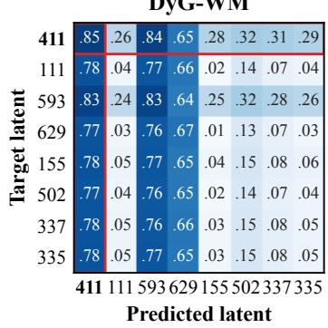

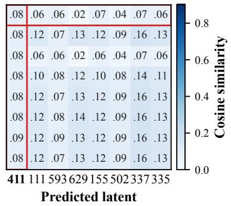  
Figure 3: Latent alignment on Can. Parl. with and without the predictive objective.

inductive negatives, where DYG-WM performs best on several datasets, including UN Trade and UN Vote. For dynamic node classification, Table 3 shows that DYG-WM gives the best Macro-F1 and Micro-F1 on both DBLP and Tmall across all three training ratios. Overall, the results show that DYG-WM performs well on both link prediction and node classification. More details in Appendix A.4.

## 4.2 ABLATION STUDY

Component Contributions. Table 4 shows that removing any component lowers AUC-ROC on all three datasets. The largest drop comes from removing the path-signature encoder, from 74.99 to 59.09 on Enron, 78.19 to 60.31 on Can. Parl., and 77.36 to 70.17 on LastFM. Historical context and the predictive objective also provide consistent gains.

## Predictive Alignment. Figure 3 Predictive Alignment. Figure 3

shows that the JEPA objective substantially improves alignment between predicted and target latents. With the full model, many cosine similarities are around 0.64-0.85, while removing the objective reduces most values to near zero. This

Table 4: Results (AUC-ROC) of ablations.
<table><tr><td>Settings</td><td>Enron</td><td>Can. Parl.</td><td>LastFM</td></tr><tr><td>w/o Historical Context</td><td> $7 1 . 5 3 \pm 3 . 0 2$ </td><td> $7 6 . 0 8 \pm 2 . 7 7$ </td><td> $7 5 . 1 1 \pm 0 . 5 2$ </td></tr><tr><td>w/o Path Signature</td><td> $5 9 . 0 9 \pm 5 . 5 2 $ </td><td> $6 0 . 3 1 \pm 4 . 6 5$ </td><td> $7 0 . 1 7 \pm 0 . 8 7$ </td></tr><tr><td>w/o Predictive Objective</td><td> $7 1 . 6 9 \pm 3 . 9 4$ </td><td> $7 5 . 5 8 \pm 2 . 1 1$ </td><td> $7 5 . 9 3 \pm 1 . 3 2$ </td></tr><tr><td>DYG-WM</td><td> $7 4 . 9 9 \pm 1 . 9 3 $ </td><td> $7 8 . 1 9 \pm 1 . 9 7$ </td><td> $7 7 . 3 6 \pm 0 . 7 3$ </td></tr></table>

matches the performance drop observed in the ablation table. More details in Appendix A.4.

## 4.3 EFFICIENCY

As shown in Figure 4, Reddit and LastFM exhibit different accuracy–efficiency trade-offs. On Reddit, several strong baselines already approach 99 AUC-ROC, so the main difference lies in the computa-

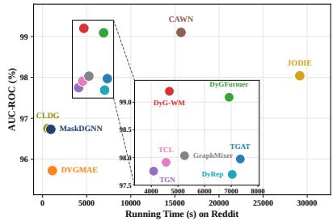

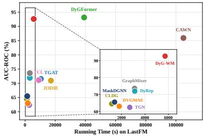  
Figure 4: AUC-ROC-efficiency trade-off on Reddit and LastFM.

tion needed to reach this accuracy range. DYG-WM attains the highest AUC-ROC while training faster than other high-accuracy models such as DyGFormer and CAWN. On LastFM, the trade-off is more pronounced: DyGFormer remains slightly more accurate, but requires substantially more training time, whereas faster baselines incur large accuracy losses. DYG-WM stays close to the best accuracy while using a moderate training budget. Across both datasets, no compared method is simultaneously faster and more accurate than DYG-WM, placing it on the accuracy-efficiency frontier rather than optimizing either accuracy or speed alone. More details are in Appendix A.4.

## 4.4 ROBUSTNESS

We train all models on clean data in the transductive setting with random negative sampling and add feature noise only at test time. For a noise rate σ, we randomly replace a fraction σ of the input features with resampled values, with σ ranging from 0.1 to 0.6. Figure 5 shows that DYG-WM is less affected by increasing

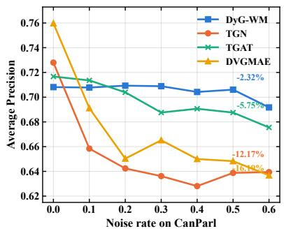

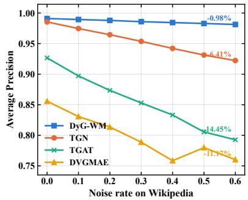  
Figure 5: Robustness to noise on Can. Parl. and Wikipedia.

noise than the compared methods. On Wikipedia, its AP drops by only 0.98% at $\sigma = 0 . 6 ,$ compared with 6.41%, 14.45%, and 11.17% for TGN, TGAT, and DVGMAE. On Can. Parl., DYG-WM becomes the best-performing method from $\sigma = 0 . 2$ onward and drops by only 2.32% at $\sigma = 0 . 6$

## 5 CONCLUSION

We introduced DYG-WM, a dynamic graph world modelling framework for jointly modelling the evolution of nodes and relations. DYG-WM uses historical node-relation contexts and their ordered structural changes to predict future representations through a dual-level joint-embedding objective, without reconstructing the original graph observations. Experiments on 12 dynamic link prediction datasets and two dynamic node classification datasets show that the model performs well across both tasks. The ablation and latent-alignment results also show the contributions of the main components. Future work will consider more complex evolving relational systems and a broader range of downstream tasks.

## AI USE STATEMENT

Generative AI tools were used solely for language polishing, grammar checking, and improving the clarity and readability of the manuscript. They were not used to develop the proposed methodology, design or conduct experiments, generate experimental results, or analyze and interpret the results. All AI-assisted revisions were carefully reviewed and verified by the authors. The authors take full responsibility for the final content of this work.

## REFERENCES

Jiaru Bai, Sebastian Mosbach, Connor J Taylor, Dogancan Karan, Kok Foong Lee, Simon D Rihm, Jethro Akroyd, Alexei A Lapkin, and Markus Kraft. A dynamic knowledge graph approach to distributed self-driving laboratories. Nature Communications, 15(1):462, 2024.

Peter W Battaglia, Jessica B Hamrick, Victor Bapst, et al. Relational inductive biases, deep learning, and graph networks. arXiv preprint arXiv:1806.01261, 2018.

Dong Chen, Shuai Zheng, Muhao Xu, Zhenfeng Zhu, and Yao Zhao. Signn: A spike-induced graph neural network for dynamic graph representation learning. Pattern Recognition, 158:111026, 2025.

Ilya Chevyrev and Andrey Kormilitzin. A primer on the signature method in machine learning. In Signature Methods in Finance: An Introduction with Computational Applications, pp. 3–64. Springer Nature Switzerland Cham, 2025.

Weilin Cong, Si Zhang, Jian Kang, Baichuan Yuan, Hao Wu, Xin Zhou, Hanghang Tong, and Mehrdad Mahdavi. Do we really need complicated model architectures for temporal networks? arXiv preprint arXiv:2302.11636, 2023.

Tao Feng, Yexin Wu, Guanyu Lin, and Jiaxuan You. Graph world model. arXiv preprint arXiv:2507.10539, 2025a.

ZhengZhao Feng, Rui Wang, TianXing Wang, Mingli Song, Sai Wu, and Shuibing He. A comprehensive survey of dynamic graph neural networks: Models, frameworks, benchmarks, experiments and challenges. IEEE Transactions on Knowledge and Data Engineering, 2025b.

Mengzhou Gao, Xinxun Zhang, Pengfei Jiao, Tianpeng Li, and Zhidong Zhao. Dvgmae: Selfsupervised dynamic variational graph masked autoencoder. IEEE Transactions on Neural Networks and Learning Systems, 36(10):17901–17913, 2025.

Alessio Gravina, Giulio Lovisotto, Claudio Gallicchio, Davide Bacciu, and Claas Grohnfeldt. Long range propagation on continuous-time dynamic graphs. arXiv preprint arXiv:2406.02740, 2024.

David Ha and Jurgen Schmidhuber. World models. ¨ arXiv preprint arXiv:1803.10122, 2018.

Yiming He, Xiang Li, Zhongying Zhao, Haobing Liu, Peilan He, and Yanwei Yu. Maskdgnn: Selfsupervised dynamic graph neural networks with activeness-aware temporal masking. In IJCAI, pp. 2892–2900, 2025.

Thomas Kipf, Elise van der Pol, and Max Welling. Contrastive learning of structured world models. In Proc. ofICLR, 2020.

Srijan Kumar, Xikun Zhang, and Jure Leskovec. Predicting dynamic embedding trajectory in temporal interaction networks. In Proceedings of the 25th ACM SIGKDD international conference on knowledge discovery & data mining, pp. 1269–1278, 2019.

Dongyuan Li, Shiyin Tan, Ying Zhang, Ming Jin, Shirui Pan, Manabu Okumura, and Renhe Jiang. Dyg-mamba: Continuous state space modeling on dynamic graphs. Advances in Neural Information Processing Systems, 38:129101–129130, 2026.

Minne Li, Mengyue Yang, Furui Liu, Xu Chen, et al. Causal world models by unsupervised deconfounding of physical dynamics. arXiv preprint arXiv:2012.14228, 2020a.

Yunzhu Li, Toru Lin, Kexin Yi, et al. Visual grounding of learned physical models. In Proc. of ICML, pp. 5927–5936. PMLR, 2020b.

Zhixuan Lin, Yi-Fu Wu, et al. Improving generative imagination in object-centric world models. In Proc. ofICML, pp. 6140–6149. PMLR, 2020.

Jiawei Liu, Senqiao Yang, Mingjun Wang, Yu Wang, and Bei Yu. Graph world models: Concepts, taxonomy, and future directions. arXiv preprint arXiv:2604.27895, 2026.

Yuanfu Lu, Xiao Wang, Chuan Shi, Philip S Yu, and Yanfang Ye. Temporal network embedding with micro-and macro-dynamics. In Proceedings of the 28th ACM international conference on information and knowledge management, pp. 469–478, 2019.

Aldo Pareja, Giacomo Domeniconi, Jie Chen, Tengfei Ma, Toyotaro Suzumura, Hiroki Kanezashi, Tim Kaler, Tao Schardl, and Charles Leiserson. Evolvegcn: Evolving graph convolutional networks for dynamic graphs. In Proceedings of the AAAI conference on artificial intelligence, volume 34, pp. 5363–5370, 2020.

Farimah Poursafaei, Shenyang Huang, Kellin Pelrine, and Reihaneh Rabbany. Towards better evaluation for dynamic link prediction. Advances in Neural Information Processing Systems, 35: 32928–32941, 2022.

Emanuele Rossi, Ben Chamberlain, Fabrizio Frasca, Davide Eynard, Federico Monti, and Michael Bronstein. Temporal graph networks for deep learning on dynamic graphs. arXiv preprint arXiv:2006.10637, 2020.

Aravind Sankar, Yanhong Wu, Liang Gou, Wei Zhang, and Hao Yang. Dysat: Deep neural representation learning on dynamic graphs via self-attention networks. In Proceedings of the 13th International Conference on Web Search and Data Mining, pp. 519–527, 2020.

Joakim Skarding, Bogdan Gabrys, and Katarzyna Musial. Foundations and modeling of dynamic networks using dynamic graph neural networks: A survey. iEEE Access, 9:79143–79168, 2021.

Zixing Song, Yuji Zhang, and Irwin King. Towards fair financial services for all: A temporal gnn approach for individual fairness on transaction networks. In Proceedings of the 32nd ACM international conference on information and knowledge management, pp. 2331–2341, 2023.

Yuxing Tian, Yiyan Qi, and Fan Guo. Freedyg: Frequency enhanced continuous-time dynamic graph model for link prediction. In The Twelfth International Conference on Learning Representations, 2024. URL https://openreview.net/forum?id=82Mc5ilInM.

Rakshit Trivedi, Mehrdad Farajtabar, Prasenjeet Biswal, and Hongyuan Zha. Dyrep: Learning representations over dynamic graphs. In International conference on learning representations, 2019.

Lu Wang, Xiaofu Chang, Shuang Li, Yunfei Chu, Hui Li, Wei Zhang, Xiaofeng He, Le Song, Jingren Zhou, and Hongxia Yang. Tcl: Transformer-based dynamic graph modelling via contrastive learning. arXiv preprint arXiv:2105.07944, 2021a.

Maolin Wang, Xinjian Zhao, Wanyu Wang, Sheng Zhang, Jiansheng Li, Bowen Yu, Binhao Wang, Shucheng Zhou, Dawei Yin, Qing Li, et al. Embedding in recommender systems: A survey. ACM Transactions on Information Systems, 44(5):1–55, 2026.

Yanbang Wang, Yen-Yu Chang, Yunyu Liu, Jure Leskovec, and Pan Li. Inductive representation learning in temporal networks via causal anonymous walks. arXiv preprint arXiv:2101.05974, 2021b.

Wenchao Weng, Jin Fan, Huifeng Wu, Yujie Hu, Hao Tian, Fu Zhu, and Jia Wu. A decomposition dynamic graph convolutional recurrent network for traffic forecasting. Pattern Recognition, 142: 109670, 2023.

Da Xu, Chuanwei Ruan, Evren Korpeoglu, Sushant Kumar, and Kannan Achan. Inductive representation learning on temporal graphs. arXiv preprint arXiv:2002.07962, 2020.

Yiming Xu, Bin Shi, Teng Ma, Bo Dong, Haoyi Zhou, and Qinghua Zheng. Cldg: Contrastive learning on dynamic graphs. In 2023 IEEE 39th International Conference on Data Engineering (ICDE), pp. 696–707. IEEE, 2023.

Jiaxuan You, Tianyu Du, and Jure Leskovec. Roland: Graph learning framework for dynamic graphs. In Proceedings of the 28th ACM SIGKDD conference on knowledge discovery and data mining, pp. 2358–2366, 2022.

Le Yu, Leilei Sun, Bowen Du, and Weifeng Lv. Towards better dynamic graph learning: New architecture and unified library. Advances in Neural Information Processing Systems, 36:67686– 67700, 2023.

Qi Yuan, Yang Liu, Yateng Tang, Xinhuan Chen, Xuehao Zheng, Qing He, and Xiang Ao. Dynamic graph learning with static relations for credit risk assessment. In Proceedings of the AAAI conference on artificial intelligence, volume 39, pp. 13133–13141, 2025.

Dong Zhang, Lin Li, Ming Li, Amran Bhuiyan, Meng Sun, Xiaohui Tao, and Jimmy Huang. Modeling item-level dynamic variability with residual diffusion for bundle recommendation. In Proceedings ofthe AAAI Conference on Artificial Intelligence, volume 40, pp. 16253–16261, 2026a.

Huizhe Zhang, Yuchang Zhu, Huazhen Zhong, Liang Chen, and Zibin Zheng. Scalable and efficient joint spiking embedding predictive architecture for large-scale dynamic graphs. arXiv preprint arXiv:2607.18412, 2026b.

Lunjun Zhang, Ge Yang, and Bradly C Stadie. World model as a graph: Learning latent landmarks for planning. In International conference on machine learning, pp. 12611–12620. PMLR, 2021.

Jialun Zheng, Jie Liu, Jiannong Cao, Xiao Wang, Hanchen Yang, and Yankai Chen. Dp-dgad: A generalist dynamic graph anomaly detector with dynamic prototypes. In Proceedings ofthe ACM Web Conference 2026, pp. 857–868, 2026.

Deyao Zhu, Li Erran Li, and Mohamed Elhoseiny. Value memory graph: A graph-structured world model for offline reinforcement learning. arXiv preprint arXiv:2206.04384, 2022.

Yiqing Zou, Hanning Yuan, Qianyu Yang, Ziqiang Yuan, Shuliang Wang, and Sijie Ruan. Meta dynamic graph for traffic flow prediction. In Proceedings of the AAAI Conference on Artificial Intelligence, volume 40, pp. 16584–16592, 2026.

## APPENDIX

This is the appendix of the work: “Dynamic Graph World Modelling: Learning Future Dynamics from Temporal Context”. In this appendix, we provide additional methodological details, experimental settings, extended results, and further analyses of the proposed DYG-WM.

## A EXPERIMENTAL DETAILS

## A.1 DATASETS

We evaluate link prediction on the twelve public dynamic graph datasets collected by Poursafaei et al. (2022) and redistributed with DyGLib (Yu et al., 2023); their statistics are summarized in Table 5. Following SG-JEPA (Zhang et al., 2026b), we use the two large-scale datasets released by Lu et al. (2019), summarized in Table 6.

Table 5: Statistics of the datasets. N/A denotes the absence of node or edge features. #Nodes denotes the number of nodes.
<table><tr><td>Datasets</td><td>Domains</td><td>#Nodes</td><td>#Links</td><td>#N&amp;L Feature</td><td>Bipartite</td><td>Duration</td><td>Unique Steps</td><td>Time Granularity</td></tr><tr><td>Wikipedia</td><td>Social</td><td>9,227</td><td>157,474</td><td>N/A &amp; 172</td><td>True</td><td>1 month</td><td>152,757</td><td>Unix timestamps</td></tr><tr><td>Reddit</td><td>Social</td><td>10,984</td><td>672,447</td><td>N/A &amp; 172</td><td>True</td><td>1 month</td><td>669,065</td><td>Unix timestamps</td></tr><tr><td>MOOC</td><td>Interaction</td><td>7,144</td><td>411,749</td><td>N/A&amp;4</td><td>True</td><td>17 months</td><td>345,600</td><td>Unix timestamps</td></tr><tr><td>LastFM</td><td>Interaction</td><td>1,980</td><td>1,293,103</td><td>N/A &amp;N/A</td><td>True</td><td>1 month</td><td>1,283,614</td><td>Unix timestamps</td></tr><tr><td>Enron</td><td>Social</td><td>184</td><td>125,235</td><td>N/A &amp;N/A</td><td>False</td><td>3 years</td><td>22,632</td><td>Unix timestamps</td></tr><tr><td>UCI</td><td>Social</td><td>1,899</td><td>59,835</td><td>N/A &amp;N/A</td><td>False</td><td>196 days</td><td>58,911</td><td>Unix timestamps</td></tr><tr><td>Can. Parl.</td><td>Politics</td><td>734</td><td>74,478</td><td>N/A &amp; 1</td><td>False</td><td>14 years</td><td>14</td><td>years</td></tr><tr><td>US Legis.</td><td>Politics</td><td>225</td><td>60,396</td><td>N/A &amp; 1</td><td>False</td><td>12 congresses</td><td>12</td><td>congresses</td></tr><tr><td>UN Trade</td><td>Economics</td><td>255</td><td>507,497</td><td>N/A &amp; 1</td><td>False</td><td>32 years</td><td>32</td><td>years</td></tr><tr><td>UN Vote</td><td>Politics</td><td>201</td><td>1,035,742</td><td>N/A&amp; 1</td><td>False</td><td>72 years</td><td>72</td><td>years</td></tr><tr><td>Contact</td><td>Proximity</td><td>692</td><td>2,426,279</td><td>N/A &amp; 1</td><td>False</td><td>1 month</td><td>8,064</td><td>5 minutes</td></tr><tr><td>Flights</td><td>Transport</td><td>13,169</td><td>1,927,145</td><td>N/A &amp; 1</td><td>False</td><td>4 months</td><td>122</td><td>days</td></tr></table>

Table 6: Statistics of the dynamic node classification datasets.
<table><tr><td>Datasets</td><td>#Nodes</td><td>#Links</td><td>#Classes</td><td>#Snapshots</td><td>#Features</td></tr><tr><td>DBLP</td><td>28,085</td><td>236,894</td><td>10</td><td>27</td><td>80</td></tr><tr><td>Tmall</td><td>577,314</td><td>4,807,545</td><td>5</td><td>186</td><td>80</td></tr></table>

## A.2 IMPLEMENTATION DETAILS

Environment and Reproducibility. We implement all methods in Python using PyTorch. The code requires Python 3.10 or later and PyTorch 2.1 or later. All experiments are conducted on NVIDIA A100 GPUs.

Shared Architecture Configuration. Unless specified otherwise, both DYG-WM and the snapshot-based baselines use a hidden dimension of 128 and two message-passing layers. For dynamic link prediction, we set $W = 4 ,$ , corresponding to three historical snapshots in $\mathcal { C } _ { t } ,$ with a 32-dimensional temporal encoding and a 256-dimensional predictor. For dynamic node classification, we set $W = 3 .$ , corresponding to two historical snapshots, with a 32-dimensional temporal encoding and a 256-dimensional predictor.

For DYG-WM, we use second-order path signatures throughout. In link prediction, the eventhistory representation and semantic projection have dimension 16, the relation-context budget is $B = 3 2$ , the temporal decay factor is $\lambda = 0 . 8$ , and the common-neighbor bonus is $\beta = 1 . 0$ . The target encoder uses $\eta _ { \mathrm { e m a } } = 0 . 9 9 9$ . The default loss weights are $\lambda _ { N } = 0 . 0 2 , \lambda _ { R } = 0 . 0 2 , \lambda _ { \mathrm { l i n k } } =$ $1 . \bar { 0 , } \lambda _ { \mathrm { r a n k } } = 1 . 0 , \lambda _ { \mathrm { v a r } } = 0 . 0 0 5 , \lambda _ { \mathrm { c o v } } = 0 . 0 0 0 5$ . For node classification, the relation and link objectives are disabled, and we use $\lambda _ { N } = 1 . 0 , \lambda _ { \mathrm { v a r } } = 0 . 0 2 , \lambda _ { \mathrm { c o v } } = 0 . 0 0 1$ , with $\eta _ { \mathrm { e m a } } = 0 . 9 9 5$ for the node target encoder.

Dynamic Link Prediction. We follow the unified DyGLib evaluation pipeline (Yu et al., 2023).   
Each dataset is split chronologically into 70%, 15%, and 15% for training, validation, and testing.

Table 7: Default implementation settings for DYG-WM. Dataset-specific overrides are selected using validation data only.
<table><tr><td>Configuration</td><td>Link prediction</td><td>Node classification</td></tr><tr><td>Hidden dimension</td><td>128</td><td>128</td></tr><tr><td>Message-passing layers</td><td>2</td><td>2</td></tr><tr><td>Window parameter W</td><td>4</td><td>3</td></tr><tr><td>Temporal dimension</td><td>32</td><td>32</td></tr><tr><td>Predictor hidden dimension</td><td>256</td><td>256</td></tr><tr><td>Signature order</td><td>2</td><td>2</td></tr><tr><td>Relation-context budget B</td><td>32</td><td>N/A</td></tr><tr><td>EMA coefficient ηema</td><td>0.999</td><td>0.995</td></tr><tr><td>Maximum epochs</td><td>100</td><td>100</td></tr><tr><td>Learning rate</td><td> $3 \times 1 0 ^ { - 4 }$ </td><td> $1 0 ^ { - 3 }$ </td></tr><tr><td>Weight decay</td><td> $1 0 ^ { - 5 }$ </td><td> $1 0 ^ { - 5 }$ </td></tr><tr><td>Gradient-norm threshold</td><td>1.0</td><td>1.0</td></tr></table>

Under the default random-negative protocol, each observed interaction is paired with one uniformly corrupted destination during evaluation. Candidate collisions produced by the benchmark sampler are retained rather than deduplicated. Evaluation batches contain 200 positive interactions and their corresponding negatives. We use fixed negative-sampling seeds of 0 and 2 for validation and testing, respectively, and present the same sampled candidates to all methods.

We optimize DYG-WM with AdamW using $\beta _ { 1 } = 0 . 9 , \beta _ { 2 } = 0 . 9 5 , \epsilon = 1 0 ^ { - 1 0 }$ . The default minibatch contains 200 positive candidate groups and their one-to-one negatives, giving 400 candidate rows. We reduce the learning rate by a factor of 0.5 after five validation evaluations without improvement, down to a minimum of $1 \dot { 0 } ^ { - 5 }$ . Models are evaluated after every epoch, and training stops after 20 evaluations without checkpoint improvement. Checkpoints are selected using validation $\mathbf { A P }$ and AUC only, and the test set is evaluated once using the selected checkpoint.

Dynamic Node Classification. We train the node representation learner for at most 100 epochs using AdamW with $\beta _ { 1 } = 0 . 9 , \beta _ { 2 } = 0 . 9 5 , \epsilon = 1 0 ^ { - 1 0 }$ , and gradient clipping at 1.0. Node mini-batches contain 1,024 nodes for DBLP and Tmall. After representation learning, all encoders are frozen and an MLP probe with a hidden dimension of 512 is fitted to the final-snapshot representations. We use 40%, 60%, 80% of the labelled nodes for probe training and reserve 10% of this training portion for validation. Checkpoints are selected according to validation Macro-F1 after a minimum of 25 representation-learning epochs.

For DYG-WM, separate MLP probes are fitted to the predicted node representation and the onlineencoder representation, and their logits are averaged for final classification. The target encoder is used only to construct representation targets during training and is not used by the downstream classifier.

## A.3 DETAILED EVALUATION SETTINGS

Detailed Settings for Effectiveness Evaluation. To comprehensively evaluate the performance of all methods, we adopt three negative edge sampling strategies for dynamic link prediction following DyGLib (Yu et al., 2023). Let $\mathcal { E } _ { \mathrm { t r a i n } }$ and ${ \mathcal E } _ { \mathrm { t e s t } }$ denote the training and test edge sets, respectively. The edges can be divided into three categories: (a) edges appearing only during training, $\dot { \mathcal { E } } _ { \mathrm { t r a i n } } \setminus \dot { \mathcal { E } } _ { \mathrm { t e s t } } ;$ (b) edges appearing in both training and testing, $\mathcal { E } _ { \mathrm { t r a i n } } \cap \mathcal { E } _ { \mathrm { t e s t } } ;$ and (c) edges appearing only during testing, $\mathcal { E } _ { \mathrm { t e s t } } \backslash \mathcal { E } _ { \mathrm { t r a i n } }$ . We emphasize that inductive negative sampling is different from the new-node inductive setting. The three negative sampling strategies are described as follows:

• Random Negative Sampling (rnd). For each positive interaction, we retain its source node and timestamp while uniformly sampling a destination node from the complete destination set. The resulting source-destination pair is treated as a negative edge.

• Historical Negative Sampling (hist). Historical negative sampling selects edges that appeared at earlier timestamps but are absent from the current evaluation batch. This setting evaluates whether a model can identify the specific time at which a previously observed edge reappears, rather than predicting that the edge remains active after its first occurrence. For an evaluation batch spanning timestamps $[ t _ { s } , t _ { e } ]$ , negatives are sampled from edges observed strictly before $t _ { s }$ after excluding edges appearing within $[ t _ { s } , t _ { e } ]$ . If the historical candidate pool contains fewer edges than the number of positive examples, the remaining negatives are generated using random sampling.

Table 8: Transductive Average Precision (AP) for dynamic link prediction with random (rnd), historical (hist), and inductive (ind) negative edge sampling. bold red and underlined blue emphasize best and 2nd-best results.
<table><tr><td>NSS</td><td>Datasets</td><td>JODIE</td><td>DyRep</td><td>TGAT</td><td>TGN</td><td>CAWN</td><td>TCL</td><td>GraphMixer</td><td>DyGFormer</td><td>CLDG</td><td>MaskDGNN</td><td>DVGMAE</td><td>DYG-WM</td></tr><tr><td rowspan="12">rnd</td><td>Wikipedia</td><td>96.69± 0.21</td><td>95.20± 0.54</td><td>92.68± 0.47</td><td>98.54± 0.05</td><td>98.78± 0.01</td><td>97.93± 0.06</td><td>97.39± 0.05</td><td>99.06± 0.02</td><td>91.55± 0.09</td><td>88.76± 0.43</td><td>85.68± 0.62</td><td>99.10± 0.02</td></tr><tr><td>Reddit</td><td>98.07± 0.02</td><td>97.71± 0.56</td><td>98.03± 0.02</td><td>97.74± 0.39</td><td>99.18± 0.01</td><td>98.09± 0.04</td><td>98.09± 0.01</td><td>99.18±0.00</td><td>97.01± 0.02</td><td>96.97± 0.02</td><td>95.91± 0.07</td><td>99.28± 0.01</td></tr><tr><td>MOOC</td><td>79.55±2.76</td><td>75.48±4.64</td><td>84.54± 0.05</td><td>92.81± 0.85</td><td>81.50± 0.22</td><td>85.17± 0.49</td><td>83.79± 0.16</td><td>89.26± 0.26</td><td>64.90±1.88</td><td>72.35± 0.17</td><td>68.41±1.18</td><td>81.94± 0.38</td></tr><tr><td>LastFM</td><td>71.67 ± 0.90</td><td>72.38± 0.75</td><td>73.39± 0.27</td><td>62.64± 2.26</td><td>86.99± 0.04</td><td>76.82± 0.38</td><td>75.81± 0.09</td><td>93.12± 0.05</td><td>63.91± 0.63</td><td>65.76± 0.57</td><td>63.67±0.19</td><td>92.20± 0.04</td></tr><tr><td>Enron</td><td>84.06±2.82</td><td>83.50± 2.64</td><td>76.08± 0.56</td><td>81.68± 2.21</td><td>89.42± 0.05</td><td>85.53± 0.30</td><td>81.62± 0.29</td><td>92.27± 0.09</td><td>86.13± 0.35</td><td>84.57± 0.68</td><td>71.82± 0.58</td><td>91.40±0.22</td></tr><tr><td>UCI</td><td>89.16± 0.88</td><td>60.57± 8.46</td><td>82.60± 0.44</td><td>94.19± 0.38</td><td>95.17± 0.04</td><td>91.31± 3.18</td><td>93.51 ± 0.28</td><td>95.88± 0.14</td><td>86.68±0.14</td><td>87.71 ± 0.06</td><td>88.05± 0.10</td><td>95.26± 0.09</td></tr><tr><td>Flights</td><td>90.89± 1.28</td><td>90.77± 0.97</td><td>94.44± 0.06</td><td>94.06± 0.59</td><td>98.51± 0.02</td><td>91.40± 0.04</td><td>91.11 ± 0.02</td><td>98.94± 0.01</td><td>95.00± 0.12</td><td>94.19± 0.06</td><td>92.04± 0.15</td><td>98.24± 0.10</td></tr><tr><td>Can. Parl.</td><td>72.25± 1.93</td><td>64.92± 0.94</td><td>70.45± 1.24</td><td>74.33± 1.48</td><td>69.91 ± 2.04</td><td>70.13± 0.96</td><td>77.46± 0.52</td><td>97.18± 0.31</td><td>70.14± 0.97</td><td>74.10± 1.50</td><td>76.06± 0.63</td><td>73.86±0.68</td></tr><tr><td>US Legis.</td><td>77.97 ± 0.28</td><td>70.93± 2.77</td><td>66.87± 0.53</td><td>75.92± 0.88</td><td>70.97± 0.16</td><td>69.24± 0.73</td><td>69.62± 0.69</td><td>70.40±0.47</td><td>67.09± 1.68</td><td>74.97±0.12</td><td>74.59± 0.28</td><td>76.81±0.29</td></tr><tr><td>UN Trade</td><td>64.76± 0.24</td><td>63.34± 0.32</td><td>64.16± 0.06</td><td>65.43± 0.62</td><td>65.77± 0.05</td><td>62.44± 0.02</td><td>63.51± 1.04</td><td>68.30± 2.28</td><td>65.85± 0.08</td><td>72.70± 0.29</td><td>73.46±0.25</td><td>76.75±0.62</td></tr><tr><td>UN Vote</td><td>65.45± 0.66</td><td>64.84± 0.49</td><td>52.89± 0.27</td><td>67.60± 1.04</td><td>53.06± 0.08</td><td>51.57± 0.23</td><td>52.08± 0.13</td><td>57.33± 0.24</td><td>50.86±0.00</td><td>51.20± 0.81</td><td>53.03± 0.84</td><td>62.21± 0.17</td></tr><tr><td>Contact</td><td>95.27± 0.84</td><td>96.02± 0.17</td><td>96.62± 0.04</td><td>95.60± 0.97</td><td>90.66± 0.13</td><td>94.67± 0.19</td><td>91.81± 0.08</td><td>98.34± 0.01</td><td>70.93± 0.38</td><td>74.53±0.43</td><td>69.61± 0.32</td><td>98.06± 0.04</td></tr><tr><td></td><td>6.50</td><td>8.50</td><td>7.75</td><td>5.42</td><td>5.17</td><td>7.17</td><td>6.92</td><td>2.42</td><td>9.00</td><td>7.92</td><td>8.58</td><td></td><td>2.67</td></tr><tr><td rowspan="11">hist</td><td>Avg. Rank</td><td>84.19± 0.52</td><td>79.75± 0.61</td><td>71.19± 0.87</td><td>86.98± 0.27</td><td>68.24± 7.35</td><td>86.77±3.35</td><td>90.99± 0.33</td><td>84.55±2.14</td><td>77.21± 0.14</td><td>75.87± 0.66</td><td>74.48± 0.69</td><td>84.06± 0.93</td></tr><tr><td>Wikipedia Reddit</td><td>79.23± 0.63</td><td>77.96± 2.11</td><td>77.20± 0.12</td><td>77.92± 1.17</td><td>80.85± 0.25</td><td>80.81± 0.54</td><td>78.77± 0.24</td><td>81.12± 0.90</td><td>76.12± 0.26</td><td>78.35± 0.21</td><td>75.93±0.38</td><td>83.84± 0.62</td></tr><tr><td>MOOC</td><td>76.75±4.57</td><td>67.32± 4.48</td><td>82.40± 0.61</td><td>89.38± 2.13</td><td>74.63± 0.85</td><td>80.86± 0.99</td><td>83.33± 1.67</td><td>88.27± 1.02</td><td>59.34± 2.39</td><td>71.43±1.40</td><td>69.74± 2.05</td><td>81.52± 2.35</td></tr><tr><td>LastFM</td><td>76.15±2.39</td><td>71.65± 2.46</td><td>70.70± 0.34</td><td>59.74± 6.41</td><td>69.68± 0.11</td><td>71.57± 1.41</td><td>72.08± 0.39</td><td>81.55± 0.33</td><td>59.78± 0.86</td><td>61.99± 0.76</td><td>61.39±1.17</td><td>81.95± 0.61</td></tr><tr><td>Enron</td><td>67.04± 2.26</td><td>73.25± 1.48</td><td>64.87± 0.37</td><td>70.50± 2.50</td><td>65.56± 0.18</td><td>71.66± 0.81</td><td>78.25± 0.29</td><td>75.92± 0.49</td><td>68.89± 1.24</td><td>65.65± 1.40</td><td>61.39±2.23</td><td>76.82± 1.87</td></tr><tr><td>UCI</td><td>79.81± 2.74</td><td>52.95± 6.43</td><td>69.36± 0.43</td><td>81.47± 1.33</td><td>65.50± 0.45</td><td>81.54±5.46</td><td>84.70± 0.45</td><td>81.39±0.43</td><td>72.67± 0.34</td><td>74.60± 0.91</td><td>76.21± 0.54</td><td>74.38± 0.84</td></tr><tr><td>Flights</td><td>63.22± 0.77</td><td>59.23± 2.13</td><td>71.87± 0.23</td><td>67.80± 2.30</td><td>64.82± 0.96</td><td>70.89± 0.23</td><td>71.76± 0.22</td><td>64.93± 1.39</td><td>72.90±0.35</td><td>73.48±0.40</td><td>70.91± 0.78</td><td>60.98±2.16</td></tr><tr><td>Can. Parl.</td><td>67.77± 12.02</td><td>62.85± 1.28</td><td>66.12± 2.02</td><td>72.39±3.46</td><td>66.24± 2.27</td><td>67.23± 1.65</td><td>77.43± 1.52</td><td>97.46± 0.63</td><td>77.24± 1.44</td><td>82.21± 2.40</td><td>82.26±0.71</td><td>73.28± 1.94</td></tr><tr><td>US Legis.</td><td>64.99±4.62</td><td>76.62± 3.77</td><td>52.92± 1.97</td><td>66.33± 5.57</td><td>68.96± 8.28</td><td>69.98±7.32</td><td>62.89± 10.19</td><td>66.57± 8.52</td><td>73.81±4.42</td><td>83.93± 6.04</td><td>87.88± 2.05</td><td>84.55±2.56</td></tr><tr><td>UN Trade</td><td>55.13± 0.64</td><td>57.06± 0.86</td><td>57.55± 0.42</td><td>58.89± 1.04</td><td>58.32± 0.36</td><td>55.64± 0.40</td><td>59.34± 3.41</td><td>65.91± 4.09</td><td>61.87± 1.19</td><td>72.20± 1.41</td><td>72.02± 1.91</td><td>73.20± 2.07</td></tr><tr><td>UN Vote</td><td>72.85±0.94</td><td>70.41± 0.89</td><td>55.99± 0.87</td><td>70.57± 1.12</td><td>51.45± 0.34</td><td>51.43± 1.04</td><td>52.07± 1.16</td><td>61.66± 0.66</td><td>50.57± 0.00</td><td>53.57±3.00</td><td>56.37± 0.93</td><td>76.68±4.03</td></tr><tr><td>Contact</td><td>95.21 ± 1.09</td><td>96.22± 0.29</td><td>96.53± 0.24</td><td>93.81± 2.71</td><td>84.67± 0.39</td><td>95.33± 0.23</td><td>93.55± 0.28</td><td>97.52± 0.18</td><td>63.62± 0.77</td><td>69.80± 0.30</td><td>64.20± 0.82</td><td>97.16±0.11</td></tr><tr><td>Wikipedia</td><td></td><td>7.75</td><td>8.17</td><td></td><td>6.08</td><td>8.75</td><td>6.17</td><td>4.83</td><td>3.67</td><td>8.25</td><td>6.42</td><td>7.33</td><td>3.83</td></tr><tr><td rowspan="11">ind Can. Parl. US Legis. UN Vote</td><td>Avg. Rank</td><td>6.75 77.53± 0.77</td><td>73.50± 1.05</td><td>74.27± 0.84</td><td>85.92± 0.56</td><td>70.11± 8.39</td><td>74.74± 6.48</td><td>88.87± 0.32</td><td>83.09±4.38</td><td>64.95± 0.54</td><td>63.25± 0.79</td><td>62.64± 0.94</td><td>82.28± 3.02</td></tr><tr><td>Reddit</td><td>86.44± 0.25</td><td>85.14± 2.15</td><td>87.77± 0.11</td><td>84.88± 1.65</td><td>91.98± 0.13</td><td>79.43± 1.21</td><td>87.55± 0.07</td><td>91.14± 0.38</td><td>75.45± 0.97</td><td>80.31± 0.62</td><td>80.97± 0.23</td><td>91.92± 0.30</td></tr><tr><td>MOOC</td><td>67.62±2.01</td><td>58.75±3.92</td><td>77.44± 1.01</td><td>82.50± 3.35</td><td>74.29± 0.65</td><td>77.91± 0.90</td><td>77.34± 1.25</td><td>83.00± 0.66</td><td>53.96±2.63</td><td>56.99± 0.87</td><td>57.56±0.29</td><td>77.10±3.38</td></tr><tr><td>LastFM</td><td>65.37±2.09</td><td>63.86± 1.77</td><td>70.46± 0.31</td><td>57.04± 2.80</td><td>67.21± 0.18</td><td>63.12± 1.54</td><td>68.11± 0.14</td><td>73.21±1.20</td><td>52.23± 0.48</td><td>52.83±0.51</td><td>51.97± 0.12</td><td>75.73± 2.12</td></tr><tr><td>Enron</td><td>70.43±2.10</td><td>70.56± 2.41</td><td>65.76± 0.32</td><td>70.24± 3.19 70.27± 0.77</td><td>76.63± 0.27 64.61± 0.63</td><td>71.52± 0.39 76.11±2.59</td><td>74.79± 0.27 80.05± 0.39</td><td>77.77±0.99 72.41 ± 0.55</td><td>66.57± 1.18 52.39± 0.50</td><td>66.84± 1.38 55.07± 0.31</td><td>60.25±2.38</td><td>83.28± 0.94 65.38± 1.11</td></tr><tr><td>UCI Flights</td><td>64.41 ± 1.65 65.43± 1.59</td><td>52.57± 1.43 60.92± 2.63</td><td>68.44± 0.34 74.35± 0.50</td></table>

• Inductive Negative Sampling (ind). In contrast to historical sampling, inductive negative sampling focuses on edges that first appear during the evaluation period. After such an edge has appeared, the model is required to determine whether it will reoccur at subsequent timestamps. For each evaluation batch, we sample edges that were not observed before the current evaluation split, have appeared before the current batch, and are absent from the current batch. If the number of eligible inductive edges is insufficient, the remaining negatives are generated using random sampling.

Detailed Settings for Robustness Evaluation. As shown in Figure 5, we evaluate model robustness to feature corruption on Wikipedia and Can. Parl. All models are trained on clean data under the transductive setting with random negative sampling, while noise is introduced only during evaluation. For a noise rate σ, we randomly select a fraction σ of the input features and replace them with resampled values. We vary σ from 0.1 to 0.6, with σ = 0 denoting the clean setting, and use the same corruption seed for all compared methods at each noise level.

## A.4 ADDITIONAL EXPERIMENTAL RESULTS

This subsection provides additional results that complement the main experiments. Tables 8 and 9 report Average Precision (AP) for dynamic link prediction under transductive and new-node inductive settings. We also provide additional latent-alignment visualizations on Wikipedia and UCI, together with the full accuracy-efficiency comparison across all 12 link prediction datasets in Figure 8.

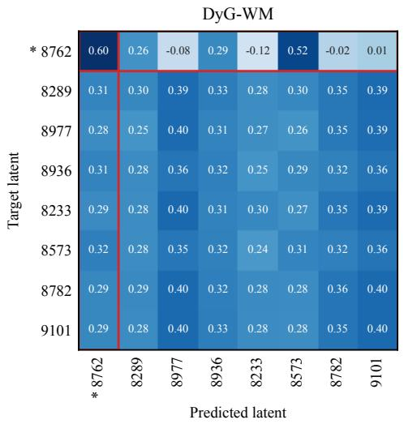

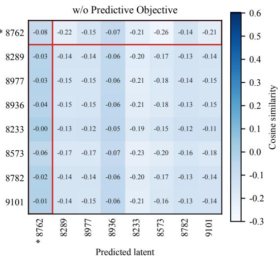  
Figure 6: Latent alignment with and without the predictive objective in the Wikipedia dataset.

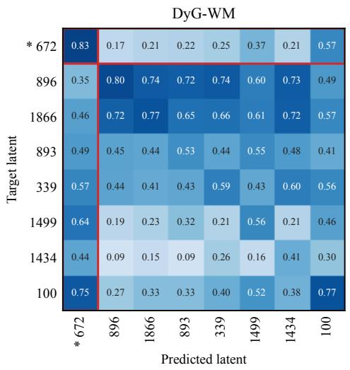

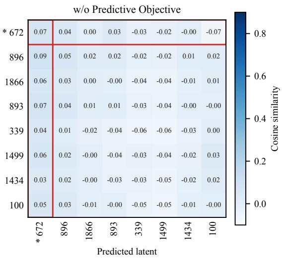  
Figure 7: Latent alignment with and without the predictive objective in the UCI dataset.

Table 9: Inductive Average Precision (AP) for dynamic link prediction in the inductive (new-node) setting with random negative edge sampling. Bold red and underlined blue indicate the best and second-best results, respectively.
<table><tr><td>Datasets</td><td>JODIE</td><td>DyRep</td><td>TGAT</td><td>TGN</td><td>CAWN</td><td>TCL</td><td>GraphMixer</td><td>DyGFormer</td><td>CLDG</td><td>MaskDGNN</td><td>DVGMAE</td><td>DYG-WM</td></tr><tr><td>Wikipedia</td><td> $9 4 . 7 5 \pm 0 . 2 0$ </td><td>92.25± 0.22</td><td> $8 0 . 3 3 { \scriptstyle \pm 0 . 6 9 }$ </td><td> $9 7 . 4 5 \pm 0 . 0 6$ </td><td> $9 7 . 2 2 \pm 0 . 0 3$ </td><td> $9 7 . 2 6 \pm 0 . 0 8$ </td><td> $9 6 . 3 3 \pm 0 . 0 5$ </td><td>97.56±0.03</td><td> $\overline { { 8 9 . 3 9 \pm 0 . 2 8 } }$ </td><td> $8 6 . 5 9 \pm 0 . 2 0$ </td><td> $8 2 . 1 9 \pm 1 . 0 4$ </td><td> $9 7 . 9 4 \pm 0 . 0 2$ </td></tr><tr><td>Reddit</td><td> $9 5 . 8 7 \pm 0 . 1 3$ </td><td> $9 5 . 1 9 \pm 0 . 2 3$ </td><td>66.20± 1.64</td><td>96.24± 0.66</td><td> $9 7 . 6 6 \pm 0 . 0 3$ </td><td> $9 6 . 4 5 \pm 0 . 0 6$ </td><td>95.61 ± 0.08</td><td>97.74±0.02</td><td>94.68± 0.06</td><td> $9 5 . 0 2 \pm 0 . 0 4$ </td><td> $9 3 . 5 4 \pm 0 . 1 8$ </td><td> $9 7 . 9 0 \pm 0 . 0 6$ </td></tr><tr><td>MOOC</td><td> $7 8 . 6 7 \pm 1 . 1 6$ </td><td> $7 5 . 8 2 \pm 3 . 1 4$ </td><td> $7 9 . 4 6 \pm 0 . 4 3$ </td><td> $8 9 . 7 1 \pm 0 . 6 4$ </td><td> $8 1 . 8 6 \pm 0 . 2 1$ </td><td> $8 1 . 8 8 \pm 1 . 0 8$ </td><td> $8 1 . 7 1 \pm 0 . 2 0$ </td><td> $8 7 . 2 4 \pm 0 . 3 0$ </td><td> $6 1 . 4 3 \pm 0 . 5 1$ </td><td> $6 9 . 4 8 \pm 0 . 3 9$ </td><td> $6 5 . 5 5 \pm 0 . 9 3$ </td><td> $7 9 . 7 4 \pm 0 . 4 8$ </td></tr><tr><td>LastFM</td><td> $8 2 . 8 4 \pm 0 . 8 4$ </td><td> $8 2 . 0 1 \pm 1 . 4 5$ </td><td> $7 8 . 5 4 \pm 0 . 1 6$ </td><td> $6 2 . 9 3 \pm 3 . 7 3$ </td><td> $8 9 . 4 4 \pm 0 . 0 4$ </td><td> $8 0 . 9 3 \pm 0 . 7 8$ </td><td> $8 1 . 9 8 \pm 0 . 1 1$ </td><td> $9 2 . 2 2 \pm 0 . 0 9$ </td><td> $6 6 . 6 0 \pm 1 . 1 8$ </td><td> $6 7 . 6 6 \pm 0 . 6 3$ </td><td> $6 5 . 9 9 \pm 0 . 4 1$ </td><td> $9 2 . 6 1 \pm 0 . 1 7$ </td></tr><tr><td>Enron</td><td> $8 0 . 6 2 \pm 2 . 0 1$ </td><td> $7 0 . 7 3 \pm 1 . 7 3$ </td><td> $7 1 . 1 0 { \scriptstyle \pm 0 . 3 5 }$ </td><td> $7 2 . 0 8 \pm 2 . 3 2$ </td><td> $8 6 . 3 1 \pm 0 . 2 1$ </td><td> $8 2 . 5 4 \pm 0 . 4 0$ </td><td> $7 6 . 7 0 \pm 0 . 1 6$   $9 0 . 9 1 + 0 . 1 3$ </td><td> $\overline { { 8 9 . 8 9 \pm 0 . 1 3 } }$ </td><td> $7 6 . 5 5 \pm 1 . 2 0$ </td><td> $7 4 . 2 4 \pm 1 . 4 4$ </td><td> $5 9 . 3 2 \pm 0 . 7 9$ </td><td> $8 6 . 7 5 { \scriptstyle \pm 0 . 5 6 }$ </td></tr><tr><td>UCI</td><td> $7 8 . 4 6 \pm 3 . 2 1$ </td><td> $5 8 . 7 6 \pm 6 . 4 7$ </td><td>79.51± 0.30</td><td>87.78±2.28</td><td> $9 2 . 1 0 { \scriptstyle \pm 0 . 0 9 }$ </td><td> $8 2 . 2 2 \pm 1 . 3 1$ </td><td></td><td>92.99± 0.06</td><td>76.78± 0.32</td><td> $7 7 . 9 2 \pm 0 . 2 4$ </td><td> $7 7 . 9 3 \pm 0 . 1 5$ </td><td> $9 3 . 3 8 \pm 0 . 1 8$ </td></tr><tr><td>Flights</td><td> $9 0 . 2 7 \pm 1 . 5 1$ </td><td> $8 6 . 5 0 \pm 1 . 2 0$ </td><td> $8 7 . 7 6 \pm 0 . 1 2$ </td><td> $8 6 . 3 5 \pm 0 . 9 8$ </td><td> $9 7 . 3 2 \pm 0 . 0 2 $ </td><td> $8 4 . 8 9 \pm 0 . 0 4$ </td><td> $8 4 . 3 7 \pm 0 . 1 9$ </td><td> $9 8 . 0 2 \pm 0 . 0 1$ </td><td> $9 0 . 9 4 \pm 0 . 2 4$ </td><td> $8 9 . 7 9 { \scriptstyle \pm 0 . 0 9 }$ </td><td> $8 5 . 6 7 \pm 0 . 3 9$ </td><td> $9 4 . 1 4 \pm 0 . 6 4$ </td></tr><tr><td> $\mathrm { C a } \mathrm { \bar { n } . P a r 1 . }$ </td><td> $5 4 . 0 6 \pm 2 . 1 0$ </td><td> $5 5 . 3 6 \pm 1 . 3 5$ </td><td> $5 7 . 2 8 \pm 0 . 9 5$ </td><td> $5 8 . 7 4 \pm 1 . 0 4$ </td><td> $\overline { { 5 9 . 7 2 \pm 0 . 2 0 } }$ </td><td> $5 8 . 4 1 \pm 0 . 3 0$ </td><td> $5 7 . 8 2 \pm 0 . 5 8$ </td><td> $9 5 . 5 8 \pm 0 . 4 5$ </td><td> $6 1 . 6 2 \pm 0 . 7 0$ </td><td> $5 6 . 6 0 \pm 1 . 2 2$ </td><td> $6 0 . 2 0 { \scriptstyle \pm 0 . 8 3 }$ </td><td> $6 1 . 7 7 \pm 0 . 6 3$ </td></tr><tr><td>US Legis.</td><td> $6 1 . 1 4 \pm 0 . 3 1$ </td><td> $5 7 . 1 6 \pm 0 . 7 6$ </td><td> $4 9 . 8 6 \pm 0 . 8 7$ </td><td> $5 9 . 5 2 \pm 0 . 4 9$ </td><td> $5 5 . 3 7 \pm 0 . 9 8$ </td><td> $5 2 . 1 5 { \scriptstyle \pm 0 . 7 7 }$ </td><td> $5 3 . 4 6 \pm 1 . 4 2$ </td><td> $5 5 . 0 3 \pm 0 . 1 1$ </td><td> $5 6 . 9 0 \pm 3 . 3 9$ </td><td>60.28± 0.47</td><td> $6 0 . 4 7 \pm 0 . 4 1$ </td><td> $6 1 . 6 6 \pm 1 . 9 9$ </td></tr><tr><td>UN Trade</td><td> $5 8 . 6 0 \pm 0 . 4 9$ </td><td> $5 6 . 8 5 \pm 1 . 4 2$ </td><td>55.40± 1.77</td><td>60.02± 0.86</td><td>65.12± 0.20</td><td> $6 2 . 0 9 \pm 0 . 1 0$ </td><td>63.49± 0.89</td><td>70.05± 3.61</td><td>65.72± 0.25</td><td> $\underline { { 7 2 . 1 8 \pm 0 . 1 3 } }$ </td><td> $7 3 . 3 3 \pm 0 . 2 7$ </td><td> $6 2 . 7 4 \pm 1 . 4 8$ </td></tr><tr><td>UN Vote Contact</td><td> $5 7 . 3 3 \pm 0 . 9 2$   $9 5 . 1 1 \pm 1 . 0 4$ </td><td> $5 7 . 1 3 \pm 0 . 8 3$   $9 2 . 5 8 \pm 0 . 3 8$ </td><td> $5 1 . 2 8 \pm 0 . 4 6$ </td><td> $5 9 . 5 7 \pm 0 . 3 7$ </td><td> $5 0 . 3 0 { \scriptstyle \pm 0 . 3 2 }$ </td><td> $5 0 . 6 4 \pm 0 . 8 8$ </td><td> $5 1 . 0 8 \pm 0 . 3 4$ </td><td> $5 5 . 2 2 \pm 0 . 3 4$ </td><td> $5 0 . 9 8 \pm 0 . 1 2$ </td><td> $\overline { { 4 9 . 1 8 \pm 0 . 5 3 } }$ </td><td> $5 0 . 6 2 \pm 0 . 4 8$ </td><td> $5 5 . 1 4 \pm 1 . 1 7$ </td></tr><tr><td></td><td></td><td></td><td> $9 5 . 6 1 \pm 0 . 0 9$ </td><td> $9 2 . 9 7 \pm 1 . 2 6$ </td><td> $8 9 . 8 8 \pm 0 . 1 8$ </td><td> $9 3 . 8 7 \pm 0 . 1 9$ </td><td> $9 0 . 3 6 \pm 0 . 0 5$ </td><td> $9 6 . 0 3 { \scriptstyle \pm 0 . 0 1 }$ </td><td> $6 8 . 1 9 \pm 0 . 9 5$ </td><td> $7 0 . 3 0 { \scriptstyle \pm 0 . 6 6 }$ </td><td> $6 5 . 5 4 \pm 0 . 4 6$ </td><td> $9 6 . 8 9 \pm 0 . 0 5$ </td></tr><tr><td>Avg. Rank</td><td>6.08</td><td>8.25</td><td>8.75</td><td>5.92</td><td>5.08</td><td>6.58</td><td>7.08</td><td>2.58</td><td>8.00</td><td>8.33</td><td>8.75</td><td>2.58</td></tr></table>

(i) US Legis.  
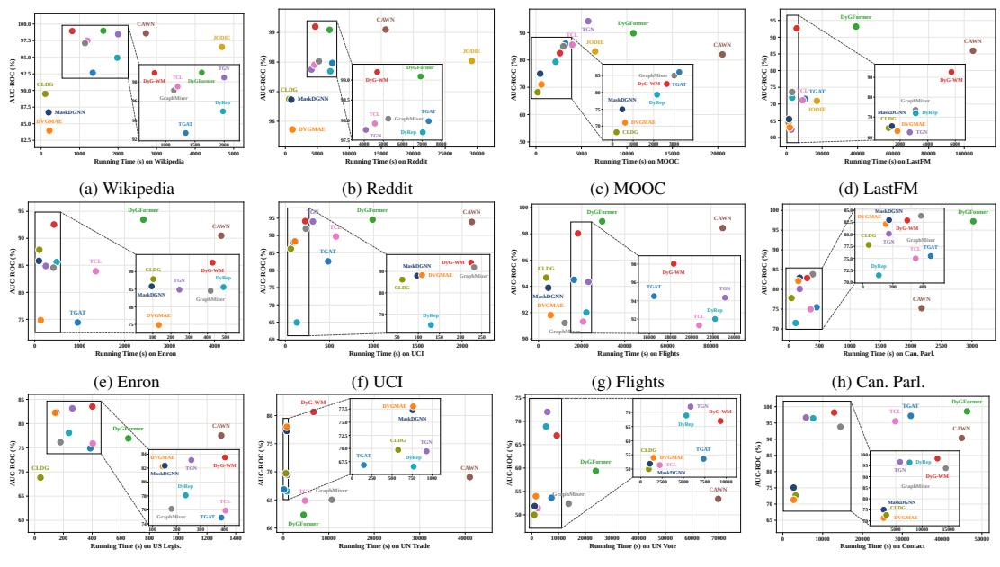  
(j) UN Trade  
(k) UN Vote  
(l) Contact  
Figure 8: Accuracy-efficiency trade-off across all dynamic link prediction datasets. Each panel reports AUC-ROC against training time.

## A.5 ALGORITHM DETAILS

This section summarizes DYG-WM’s representation construction, training, and inference. Algorithm 1 constructs representations, Algorithm 2 gives dual-level predictive training, and Algorithm 3 gives link inference without the target branch.

## A.6 HISTORICAL REPRESENTATION CONSTRUCTION

For target bin t, the online branch uses $\mathcal { C } _ { t } = ( \widetilde { G } _ { t - W + 1 } , \dots , \widetilde { G } _ { t - 1 } )$ . Each query $( u , v , \tau )$ additionally uses the strict event prefix $\mathcal { H } _ { < \tau }$ . Bin-level representations depend only on $\mathcal { C } _ { t } .$ , while exact-time representations also depend on $\mathcal { H } _ { < \tau }$

The quantities $\mathbf { c } _ { x } ^ { t } , \mathbf { g } _ { u v } ^ { t } , \mathbf { S } _ { x } ^ { t } , \mathbf { S } _ { u v } ^ { t }$ , and $\mathbf { q } _ { u v } ^ { t }$ depend only on $\mathcal { C } _ { t }$ and are fixed within bin $t ,$ whereas $\mathbf { o } _ { u v } ^ { < \tau }$ and $\mathbf { z } _ { u v } ^ { \tau }$ vary with τ . Events at timestamp τ are excluded from $\mathcal { H } _ { < \tau }$

## A.7 DUAL-LEVEL PREDICTIVE TRAINING

Let Θ contain all trainable online parameters, while $\bar { \theta }$ denotes the EMA target-encoder parameters. Candidate groups remain intact within minibatches so each observed interaction is trained with all sampled negatives.

Algorithm 1 Historical node-relation representation construction   
Require: Historical snapshots $\mathcal { C } _ { t } ;$ queries $\mathfrak { P } = \{ ( u _ { j } , v _ { j } , \tau _ { j } ) \} _ { j = 1 } ^ { | \mathfrak { P } | }$ ; strict prefixes $\{ \mathcal { H } _ { < \tau _ { j } } \}$ ; online   
parameters $\Theta ;$ context budget $B$   
Ensure: Historical and exact-time relation representations   
1: for $s \in \mathcal { L } _ { t }$ do   
2: $\mathbf { H } ^ { s }  \mathrm { G N N } _ { \theta } ( \widetilde { G } _ { s } )$ and $\mathbf { h } _ { x } ^ { s } \gets \mathbf { H } ^ { s } [ x ]$ for $x \in \nu .$   
3: end for   
4: for all $x \in \nu$ do   
5: Encode $\{ \mathbf { h } _ { x } ^ { s } \} _ { s \in \mathbb { Z } _ { t } }$ and neighborhood trajectories as $\mathbf { c } _ { x } ^ { t }$   
6: Construct $\{ \mathbf { d } _ { x , s } ^ { N } \} _ { s \in \mathcal { T } _ { t } }$ and compute $\mathbf { S } _ { x } ^ { t }  \phi _ { N } ( \operatorname { S i g } _ { 2 } ( \mathbf { \bar { ( d } } _ { x , s } ^ { N } ) _ { s \in \mathcal { T } _ { t } } ) )$   
7: end for   
8: for $j = 1 , \dots , | \mathfrak { P } |$ do   
9: $( u , v , \tau )  ( u _ { j } , v _ { j } , \tau _ { j } )$   
10: Construct $\mathcal { P } _ { u v } ^ { t }$ and select $\mathcal { K } _ { u v } ^ { t }  \mathrm { T o p B } _ { w \in \mathcal { P } _ { u v } ^ { t } } \rho _ { u v } ^ { t } ( w )$   
11: for $s \in \mathcal { T } _ { t }$ do   
12: Pool selected embeddings into $\mathbf { p } _ { u v } ^ { s }$   
13: end for   
14: $\mathbf { g } _ { u v } ^ { t }  \mathrm { G R U } _ { \mathrm { r e l } } ( ( \mathbf { p } _ { u v } ^ { s } ) _ { s \in \mathcal { T } _ { t } } ) .$   
15: Construct $\{ \mathbf { d } _ { u v , s } ^ { R } \} _ { s \in \mathcal { T } _ { t } }$ and compute $\mathbf { S } _ { u v } ^ { t }  \phi _ { R } ( \mathrm { S i g } _ { 2 } ( ( \mathbf { d } _ { u v , s } ^ { R } ) _ { s \in \mathcal { T } _ { t } } ) )$   
16: $\mathbf { r } _ { u v } ^ { t }  g _ { \theta } \big ( \chi ( \mathbf { c } _ { u } ^ { t } , \mathbf { c } _ { v } ^ { t } ) \big ) .$   
17: $\mathbf { q } _ { u v } ^ { \tilde { t } }  \phi _ { \mathrm { f u s e } } ( [ \tilde { \mathbf { r } } _ { u v } ^ { t } \Vert \mathbf { g } _ { u v } ^ { t } \Vert \mathbf { S } _ { u v } ^ { t } ] ) .$   
18: $\mathbf { o } _ { u v } ^ { < \tau }  \mathrm { E v e n t H i s t o r y } ( u , v ; \mathcal { H } _ { < \tau } ) ,$   
19: $\mathbf { z } _ { u v } ^ { \top }  \phi _ { \tau } ( [ \mathbf { q } _ { u v } ^ { t } | | \mathbf { o } _ { u v } ^ { < \tau } ] )$   
20: end for   
21: return $\{ \mathbf { c } _ { x } ^ { t } , \mathbf { S } _ { x } ^ { t } \} _ { x \in \mathcal { V } }$ and $\{ \mathbf { g } _ { u _ { j } v _ { j } } ^ { t } , \mathbf { S } _ { u _ { j } v _ { j } } ^ { t } , \mathbf { q } _ { u _ { j } v _ { j } } ^ { t } , \mathbf { o } _ { u _ { j } v _ { j } } ^ { < \tau _ { j } } , \mathbf { z } _ { u _ { j } v _ { j } } ^ { \tau _ { j } } \} _ { j = 1 } ^ { | \mathfrak { P } | }$

Node and relation predictive targets use only observed interactions; sampled negatives enter only $\mathcal { L } _ { \mathrm { l i n k } }$ and $\mathcal { L } _ { \mathrm { r a n k } }$ . Relation targets use target endpoint latents without explicit target-snapshot pair statistics.

For the node benchmark, the relation predictor, event-history branch, link scorer, and relation loss are disabled. The node predictor maps $[ \mathbf { c } _ { x } ^ { t } ] | \mathbf { S } _ { x } ^ { t } | | \mathbf { e } _ { \Delta _ { t } } ] \mathrm { ~ t o ~ } \widehat { \mathbf { y } } _ { x } ^ { t }$ and is trained against the target latent $\mathbf { y } _ { x } ^ { t }$ together with node discrimination and anti-collapse terms. Node and link prediction are trained separately.

## A.8 LINK INFERENCE

At inference, target encoders and predictive losses are removed. For query $( u , v , \tau )$ in bin $t ,$ only $\mathcal { C } _ { t }$ and $\mathcal { H } _ { < \tau }$ are used.

Thus, $s _ { u v } ^ { \tau } = \mathrm { G N N } _ { \theta } ( u , v , \tau ; \mathcal { C } _ { t } , \mathcal { H } _ { < \tau } )$ and neither $\widetilde { G } _ { t }$ nor the target latents $\mathbf { y } _ { u } ^ { t } , \mathbf { y } _ { u v } ^ { t }$ enter inference.

## B COMPUTATIONAL COMPLEXITY

We analyze one target bin t with ${ \mathcal { T } } _ { t } = \{ t - W + 1 , \ldots , t - 1 \}$ and $L = \left| \mathcal { T } _ { t } \right| = W - 1$ . Let $m _ { s } =$ $\begin{array} { r } { \| A _ { s } \| _ { 0 } , \dot { M } _ { \mathcal { C } } = \sum _ { s \in \mathcal { T } _ { t } } m _ { s } . } \end{array}$ , where $m _ { s }$ and $M _ { \mathcal { C } }$ are the numbers of stored message-passing edges in snapshot s and the historical context, respectively. Let $N = | \nu |$ , d be the hidden dimension, $d _ { s }$ the projected path dimension, B the relation-context budget, and $\dot { \boldsymbol P } = | \mathfrak { P } |$ the number of candidate rows in a group-preserving minibatch. With G observed interactions and $K$ negatives per interaction, $P = G ( \bar { K } + \bar { 1 } )$

Historical snapshot encodings and node contexts are shared across candidates, while relation contexts, relation signatures, and event-history features are pair-conditioned.

Algorithm 2 Dual-level joint-embedding predictive training   
Require: Training windows $\{ ( { \mathcal { C } } _ { t } , { \widetilde { G } } _ { t } ) \} ;$ ; event stream $\mathcal { E } ;$ negative count $K ;$ online parameters $\Theta ;$   
loss weights $\lambda _ { N } , \lambda _ { R } , \lambda _ { \mathrm { v a r } } , \lambda _ { \mathrm { c o v } } , \lambda _ { \mathrm { l i n k } } , \lambda _ { \mathrm { r a n k } } ;$ EMA coefficient $\eta _ { \mathrm { e m a } }$   
Ensure: Trained online parameters Θ   
1: Initialize $\bar { \theta }  \theta$ and construct the event-history index.   
2: for each training epoch do   
3: for each target bin t do   
4: Construct candidate groups $\{ \mathcal { Q } ( u , \tau ) \}$ and partition complete groups into minibatches.   
5: for each group-preserving minibatch P do   
6: Apply Algorithm 1.   
7: $\mathbf { y } _ { x } ^ { t }  \mathrm { s g } ( \mathrm { G N N } _ { \bar { \theta } } ( \widetilde { G } _ { t } ) [ x ] )$ for $x \in \mathcal { V } _ { t } .$   
8: Let $\mathcal { R } _ { t , \mathfrak { P } } ^ { + }$ be the observed relation pairs in $\mathfrak { P }$ and $\mathcal { U } _ { t }$ their unique endpoints.   
9: for all ${ \dot { x } } \in \mathcal { U } _ { t }$ do   
10: $\widehat { \mathbf { y } } _ { x } ^ { t } \gets p _ { N } \left( [ \mathbf { c } _ { x } ^ { t } | | \mathbf { S } _ { x } ^ { t } | | \mathbf { e } _ { \Delta t } ] \right)$   
11: end for   
12: for all $( u , v ) \in \mathcal { R } _ { t , \mathfrak { P } } ^ { + }$ do   
13: $\widehat { \mathbf { y } } _ { u v } ^ { t } \gets p _ { R } \big ( [ \mathbf { q } _ { u v } ^ { t } | | \mathbf { e } _ { \Delta t } ] \big ) .$   
14: $\mathbf { y } _ { u v } ^ { t }  \mathrm { s g } ( g _ { \bar { \theta } } ( \chi ( \mathbf { y } _ { u } ^ { t } , \mathbf { y } _ { v } ^ { t } ) ) )$   
15: end for   
16: for all $( u _ { j } , v _ { j } , \tau _ { j } ) \in \mathfrak { P }$ do   
17: $s _ { u _ { j } v _ { j } } ^ { \tau _ { j } }  \bar { h _ { \psi } } ( \bar { \mathbf z } _ { u _ { j } v _ { j } } ^ { \tau _ { j } } ) .$   
18: end for   
19: $\begin{array} { r } { \mathcal { L } ^ { N } = \frac { 1 } { | \mathcal { U } _ { t } | } \sum _ { x \in \mathcal { U } _ { t } } D ( \widehat { \mathbf { y } } _ { x } ^ { t } , \mathbf { y } _ { x } ^ { t } ) . } \end{array}$   
20: $\begin{array} { r } { \mathcal { L } ^ { R } = \frac { \bar { \mathbf { \rho } } _ { 1 } } { | \mathcal { R } _ { t , \mathfrak { V } } ^ { + } | } \sum _ { ( u , v ) \in \mathcal { R } _ { t , \mathfrak { P } } ^ { + } } D ( \widehat { \mathbf { y } } _ { u v } ^ { t } , \mathbf { y } _ { u v } ^ { t } ) } \end{array}$   
21: Compute node- and relation-level variance and covariance penalties.   
22: Compute $\mathcal { L } _ { \mathrm { l i n k } }$ over all candidate scores and $\mathcal { L } _ { \mathrm { r a n k } }$ within each candidate group.   
23:   
$\mathcal { L } _ { \mathrm { J E P A } } = \lambda _ { N } \mathcal { L } ^ { N } + \lambda _ { R } \mathcal { L } ^ { R }$   
(13)   
$+ \lambda _ { \mathrm { v a r } } \left( \mathcal { L } _ { \mathrm { v a r } } ^ { N } + \mathcal { L } _ { \mathrm { v a r } } ^ { R } \right) + \lambda _ { \mathrm { c o v } } \left( \mathcal { L } _ { \mathrm { c o v } } ^ { N } + \mathcal { L } _ { \mathrm { c o v } } ^ { R } \right)$   
24: $\mathcal { L } _ { \mathrm { t o t a l } } = \mathcal { L } _ { \mathrm { J E P A } } + \lambda _ { \mathrm { l i n k } } \mathcal { L } _ { \mathrm { l i n k } } + \lambda _ { \mathrm { r a n k } } \mathcal { L } _ { \mathrm { r a n k } } .$   
25: Update Θ, then $\bar { \theta }  \eta _ { \mathrm { e m a } } \bar { \theta } + ( 1 - \eta _ { \mathrm { e m a } } ) \theta .$   
26: end for   
27: end for   
28: end for   
29: return Θ

## B.1 HISTORICAL SNAPSHOT AND NODE ENCODING

For a fixed-depth sparse message-passing implementation of $\mathrm { G N N } _ { \theta }$ , encoding all historical snapshots costs

$$
\mathcal { T } _ { \mathrm { s n a p } } = \mathcal { O } \left( M c d + L N d ^ { 2 } \right) .\tag{14}
$$

No dense $N \times N$ adjacency matrix is materialized.

Sparse neighborhood pooling costs $\mathcal { O } ( M _ { \mathscr { C } } d )$ , node-wise recurrent updates cost $\mathcal { O } ( L N d ^ { 2 } )$ , and node-context fusion costs $\mathcal { O } ( \breve { N } d ^ { 2 } )$ . Hence,

$$
\mathcal { T } _ { \mathrm { n o d e } } = \mathcal { O } \left( M c d + L N d ^ { 2 } \right) .\tag{15}
$$

Both terms are shared across all P candidate rows.

## B.2 RELATION-CENTRIC CONTEXT SELECTION

For candidate pair $( u _ { j } , v _ { j } )$ , define

$$
D _ { j } = \sum _ { s \in \mathcal { Z } _ { t } } \left( | \mathcal { N } _ { s } ( u _ { j } ) | + | \mathcal { N } _ { s } ( v _ { j } ) | \right) .\tag{16}
$$

Algorithm 3 Dynamic link inference   
Require: Historical snapshots $\mathcal { C } _ { t } ;$ candidate queries $\mathfrak { P } = \{ ( u _ { j } , v _ { j } , \tau _ { j } ) \}$ ; strict event-history index;   
trained online parameters Θ   
Ensure: Interaction scores $\{ s _ { u _ { j } v _ { j } } ^ { \tau _ { j } } \} _ { j = 1 } ^ { | \mathfrak { P } | }$   
1: Encode only $\mathcal { C } _ { t } ;$ do not invoke ${ \mathrm { G N N } } _ { \bar { \theta } } , g _ { \bar { \theta } } .$ , or encode $\widetilde { G } _ { t }$   
2: for $j = 1 , \dots , | \mathfrak { P } |$ do   
3: $( u , v , \tau )  ( u _ { j } , v _ { j } , \tau _ { j } ) .$   
4: Construct $\mathbf { c } _ { u } ^ { t } , \bar { \mathbf { c } } _ { v } ^ { t } , \bar { \mathbf { g } } _ { u v } ^ { t } , \mathbf { S } _ { u v } ^ { t } , \mathbf { q } _ { u v } ^ { t }$ from $\mathcal { C } _ { t } .$   
5: Query the event-history index for events satisfying $\tau _ { i } < \tau$ to obtain $\mathbf { o } _ { u v } ^ { < \tau }$   
6: $\mathbf { z } _ { u v } ^ { \tau } \dot {  } \phi _ { \tau } ( [ \mathbf { q } _ { u v } ^ { t } \lVert \mathbf { o } _ { u v } ^ { < \tau } ] )$   
7: $s _ { u v } ^ { \tau } \gets h _ { \psi } ( \mathbf { z } _ { u v } ^ { \tau } ) .$   
8: end for   
9: return $\{ s _ { u _ { j } v _ { j } } ^ { \tau _ { j } } \} _ { j = 1 } ^ { | \mathfrak { P } | }$

The number of distinct candidate context nodes is

$$
C _ { j } = \left| \{ u _ { j } , v _ { j } \} \cup \bigcup _ { s \in \mathcal { T } _ { t } } \left( \mathcal { N } _ { s } ( u _ { j } ) \cup \mathcal { N } _ { s } ( v _ { j } ) \right) \right| .\tag{17}
$$

Constructing the candidate union and scores costs $\mathcal { O } ( D _ { j } )$ , while sorting costs $\mathcal { O } ( C _ { j } \log C _ { j } )$ . Thus,

$$
\mathcal { T } _ { \mathrm { s e l e c t } } = \mathcal { O } \left( D _ { \mathfrak { P } } + \sum _ { j = 1 } ^ { P } C _ { j } \log C _ { j } \right) , \qquad D _ { \mathfrak { P } } = \sum _ { j = 1 } ^ { P } D _ { j } .\tag{18}
$$

Partial top-B selection can reduce the sorting term to $\mathcal { O } ( C _ { j } \log B )$

Pooling at most $B$ embeddings over L snapshots costs $\mathcal { O } ( P L B d )$ , and the relation GRU costs $\mathcal { O } ( P L \mathbf { \breve { \ = } } d ^ { 2 } )$ . Therefore,

$$
\mathcal { T } _ { \mathrm { r e l c t x } } = \mathcal { O } \left( D _ { \mathfrak { P } } + \sum _ { j = 1 } ^ { P } C _ { j } \log C _ { j } + P L B d + P L d ^ { 2 } \right) .\tag{19}
$$

## B.3 NODE-RELATION PATH SIGNATURES

For L increments in $\mathbb { R } ^ { d _ { s } }$ , first-order accumulation costs $\mathcal { O } ( L d _ { s } )$ and the second-order signature costs $\mathcal { O } ( L d _ { s } ^ { 2 } )$ time and $\mathcal { O } ( d _ { s } ^ { 2 } )$ working memory.

For all N nodes,

$$
\mathcal { T } _ { \mathrm { s i g } } ^ { N } = \mathcal { O } \left( M _ { \mathcal { C } } + N L d _ { s } ^ { 2 } + N d _ { s } ^ { 2 } d \right) .\tag{20}
$$

The terms correspond to structural-transition extraction, second-order signature updates, and projection to dimension d.

For $P$ candidate relations,

$$
\mathcal { T } _ { \mathrm { s i g } } ^ { R } = \mathcal { O } \left( D _ { \mathfrak { P } } + P L d _ { s } ^ { 2 } + P d _ { s } ^ { 2 } d \right) .\tag{21}
$$

Node signatures are shared, whereas relation signatures are pair-conditioned.

## B.4 EXACT-TIME EVENT-HISTORY QUERIES

The event stream contains M raw interactions. Timestamp, directed-pair, and endpoint indices are constructed once in $\mathcal { O } ( M \log M )$ time. Let U denote the number of distinct directed pairs. Without semantic profiles, the persistent index requires

$$
\mathcal { O } \left( M + T ( U + N ) \right)\tag{22}
$$

memory. Enabling $d _ { m }$ -dimensional semantic profiles adds $\mathcal { O } ( T ( U + N ) d _ { m } )$

For query $( u , v , \tau )$ , binary search retrieves the required strict-prefix statistics in $\mathcal { O } ( \log M )$ time. Across one minibatch,

$$
\mathcal { T } _ { \mathrm { h i s t } } = \mathcal { O } \left( P \log M + P d ^ { 2 } \right) .\tag{23}
$$

The second term covers event-history projection and fusion.

## B.5 PREDICTION HEADS AND TRAINING OBJECTIVE

The endpoint transformation, relation encoder, fusion modules, predictors, and link scorer cost $\mathcal { O } ( P d ^ { 2 } )$ . Pointwise losses cost $\mathcal { O } ( P d )$ and groupwise ranking at most $\mathcal { O } ( P \log P )$ .

Let $P _ { + } = | \mathcal { R } _ { t , \mathfrak { B } } ^ { + } | , U _ { + } = | \mathcal { U } _ { t } |$ , where $P _ { + }$ is the number of observed relation pairs and $U _ { + }$ their unique endpoints. Since $U _ { + } ~ \le ~ 2 P _ { + }$ , the node- and relation-level variance terms cost $\mathcal { O } ( P _ { + } d )$ while the covariance terms cost

$$
\mathcal { T } _ { \mathrm { c o v } } = \mathcal { O } \left( ( U _ { + } + P _ { + } ) d ^ { 2 } \right) = \mathcal { O } ( P _ { + } d ^ { 2 } ) .\tag{24}
$$

The covariance term is omitted at a level with fewer than two prediction vectors.

## B.6 TRAINING-TIME OVERHEAD

Training additionally encodes the target snapshot $\widetilde { G } _ { t }$ . Let $m _ { t } = \| A _ { t } \| _ { 0 }$ . Target snapshot encoding and positive relation-target construction cost

$$
\mathcal { T } _ { \mathrm { t a r g e t } } = \mathcal { O } \left( m _ { t } d + N d ^ { 2 } + P _ { + } d ^ { 2 } \right) .\tag{25}
$$

Including covariance regularization and the EMA update,

$$
\mathcal { T } _ { \mathrm { t r a i n } } = \mathcal { O } \left( \mathcal { T } _ { \mathrm { i n f e r } } + m _ { t } d + N d ^ { 2 } + P _ { + } d ^ { 2 } + \left| \Theta _ { \mathrm { E M A } } \right| \right) .\tag{26}
$$

This excludes the constant-factor backward pass through the online branch. Since $U _ { + } \leq 2 P _ { + }$ , the $P _ { + } d ^ { 2 }$ term covers positive relation-target encoding and both covariance computations. The EMA update is independent of graph size and candidate count.

Each group-preserving minibatch performs one parameter update, so historical and target snapshots are re-encoded after each update. At inference, historical representations for a target bin can be reused across candidate minibatches.

## B.7 MEMORY COMPLEXITY

Excluding model parameters and the persistent event-history index, inference requires

$$
S _ { \mathrm { i n f e r } } = \mathcal { O } \left( M _ { \mathcal { C } } + L N d + P B + P L d + ( N + P ) d _ { s } ^ { 2 } \right) .\tag{27}
$$

Training additionally stores target embeddings, online activations, covariance matrices, gradients, and optimizer states:

$$
S _ { \mathrm { t r a i n } } = \mathcal { O } \left( S _ { \mathrm { i n f e r } } + N d + P _ { + } d + d ^ { 2 } + \vert \Theta \vert \right) .\tag{28}
$$

Relation-centric modeling is bounded by $B ,$ while the second-order signature remains linear in L. The target branch is training-only, so inference uses only $\mathcal { C } _ { t }$ and $\mathcal { H } _ { < \tau }$

## C PROOFS AND TECHNICAL DERIVATIONS

We establish three properties of DYG-WM: de-duplicated snapshots do not generally identify pairwise interaction multiplicity, second-order signatures capture temporal order beyond first-order summaries, and the deployed scorer depends only on the historical snapshot context and strict event prefix.

## C.1 NON-IDENTIFIABILITY OF PAIRWISE INTERACTION MULTIPLICITY

For a directed pair $( u , v )$ , define its multiplicity in bin t as

$$
n _ { u v } ^ { t } = \vert \{ ( u _ { i } , v _ { i } , \tau _ { i } , \mathbf { e } _ { i } ) \in \mathcal { E } _ { t } : u _ { i } = u , v _ { i } = v \} \vert .\tag{29}
$$

For the following proposition, assume that $X _ { t }$ contains fixed node attributes and nodewise event aggregates, such as incident interaction counts, nodewise link-feature aggregates, and last-activity times, but no pair-resolved statistic such as $n _ { u v } ^ { t }$

Proposition 1 (Snapshot non-identifiability).

Under this snapshot construction, the mapping from the raw event stream to the snapshot sequence is not injective. For every integer $k \geq 1$ , there exist two streams $\boldsymbol { S _ { k } }$ and $ { \boldsymbol { S } } _ { k } ^ { \prime }$ with identical snapshot views $\widetilde { G } _ { s } = ( \mathcal { V } , A _ { s } , X _ { s } , \mathbf { m } _ { s } )$ for every bin $s ,$ but for some directed pair, $| n _ { u v } ^ { t } - n _ { u v } ^ { \prime , t } | = k$

Proof. Consider four distinct nodes $a , b , c , d ,$ with $a , b$ as sources and $c ,$ d as destinations. The two streams are identical outside bin t. Within bin $t ,$ all interactions share timestamp $\tau _ { 0 }$ and feature $\mathbf { e } _ { 0 }$ with multiplicities

$$
{ \frac { S _ { k } } { a } } \left| { \begin{array} { c c c c c } { c } & { d } & { } & { { \frac { S _ { k } ^ { \prime } } { a } } \left| { \begin{array} { c c c c } { c } & { d } & { } & { d } \\ { 1 } & { k + 1 } & { } & { k + 1 } \end{array} } \right| } \\ { b } \end{array} } \right. \quad { \begin{array} { c c c c c } { d } & { } & { { \frac { S _ { k } ^ { \prime } } { a } } \left| { \begin{array} { c c c c c } { 1 } & { k + 1 } & { } & { } \\ { k + 1 } & { 1 } & { } & { k + 1 } \end{array} } \right| } \end{array} } .\tag{30}
$$

Both streams contain the same directed edge support $\{ ( a , c ) , ( a , d ) , ( b , c ) , ( b , d ) \}$ , so de-duplication and symmetrization give identical $A _ { t }$ . Each source has $k + 2$ outgoing interactions and each destination has $k + 2$ incoming interactions in both streams. Since all interactions share $\mathbf { e } _ { 0 }$ and $\tau _ { 0 }$ , nodewise link-feature aggregates and last-activity statistics are also identical. The active-node masks coincide, and the streams are identical outside bin t. Hence, $\widetilde { G } _ { s } ( S _ { k } ) = \widetilde { G } _ { s } ( S _ { k } ^ { \prime } )$

For pair $( a , c ) , n _ { a c } ^ { t } = k + 1 , n _ { a c } ^ { \prime , t } = 1 , \mathrm { s o } | n _ { a c } ^ { t } - n _ { a c } ^ { \prime , t } | = k$ . Since k is arbitrary, the snapshot sequence does not determine pairwise interaction multiplicity.

Consequence. For any deterministic encoder $F$ whose graph input is only $\mathcal { C } _ { t }$

$$
F \big ( \mathcal { C } _ { t } ( \boldsymbol { S } _ { k } ) \big ) = F \big ( \mathcal { C } _ { t } ( \boldsymbol { S } _ { k } ^ { \prime } ) \big ) ,\tag{31}
$$

although the underlying pairwise recurrence patterns differ. We therefore retain $\mathcal { H } _ { < \tau }$ separately to preserve direction and repeated interactions. The proposition does not apply to snapshot representations that explicitly store pairwise multiplicities.

## C.2 ORDER SENSITIVITY OF THE SECOND-ORDER SIGNATURE

For projected increments $ { \mathbf { d } } _ { 1 } , \dots ,  { \mathbf { d } } _ { L } \in \mathbb { R } ^ { d _ { s } }$ , define

$$
\mathrm { S i g } ^ { ( 1 ) } = \sum _ { i = 1 } ^ { L } \mathbf { d } _ { i } ,\tag{32}
$$

and

$$
\mathrm { S i g } ^ { ( 2 ) } = \frac { 1 } { 2 } \sum _ { i = 1 } ^ { L } \mathbf { d } _ { i } \otimes \mathbf { d } _ { i } + \sum _ { i < j } \mathbf { d } _ { i } \otimes \mathbf { d } _ { j } .\tag{33}
$$

Proposition 2 (Two-step order sensitivity).

For $\mathbf { a } _ { \mathrm { ; } }$ , b $\in \mathbb { R } ^ { d _ { s } }$ , the paths (a, b) and (b, a) have identical first-order signatures, while

$$
\mathrm { S i g } ^ { ( 2 ) } ( { \bf a } , { \bf b } ) - \mathrm { S i g } ^ { ( 2 ) } ( { \bf b } , { \bf a } ) = { \bf a } \otimes { \bf b } - { \bf b } \otimes { \bf a } .\tag{34}
$$

If both increments are nonzero and ϑ is their angle,

$$
\Big \| \mathrm { S i g } ^ { ( 2 ) } ( { \bf a } , { \bf b } ) - \mathrm { S i g } ^ { ( 2 ) } ( { \bf b } , { \bf a } ) \Big \| _ { F } = \sqrt { 2 } \| { \bf a } \| _ { 2 } \| { \bf b } \| _ { 2 } | \sin \vartheta | .\tag{35}
$$

Thus, the second-order signature distinguishes the two orderings exactly when the increments are not collinear.

Proof. The first-order signatures satisfy ${ \mathrm { S i g } } ^ { ( 1 ) } ( { \bf a } , { \bf b } ) = { \bf a } + { \bf b } = \mathrm { S i g } ^ { ( 1 ) } ( { \bf b } , { \bf a } )$ . From Eq. 33,

$$
\begin{array} { l l l } { { \displaystyle \mathrm { S i g } ^ { ( 2 ) } ( { \bf a } , { \bf b } ) = \frac { 1 } { 2 } { \bf a } \otimes { \bf a } + { \bf a } \otimes { \bf b } + \frac { 1 } { 2 } { \bf b } \otimes { \bf b } , } } \\ { { \displaystyle \mathrm { S i g } ^ { ( 2 ) } ( { \bf b } , { \bf a } ) = \frac { 1 } { 2 } { \bf b } \otimes { \bf b } + { \bf b } \otimes { \bf a } + \frac { 1 } { 2 } { \bf a } \otimes { \bf a } . } } \end{array}\tag{36}
$$

Subtracting gives Eq. 34. Let $\mathbf { M } = \mathbf { a } \mathbf { b } ^ { \top } - \mathbf { b } \mathbf { a } ^ { \top }$ . Then

$$
\begin{array} { r l } & { \| { \bf M } \| _ { F } ^ { 2 } = 2 \| { \bf a } \| _ { 2 } ^ { 2 } \| { \bf b } \| _ { 2 } ^ { 2 } - 2 ( { \bf a } ^ { \top } { \bf b } ) ^ { 2 } } \\ & { \quad \quad \quad = 2 \| { \bf a } \| _ { 2 } ^ { 2 } \| { \bf b } \| _ { 2 } ^ { 2 } \sin ^ { 2 } \vartheta , } \end{array}\tag{37}
$$

which gives Eq. 35.

General Decomposition. For arbitrary L, define

$$
\mathbf { A } = \frac { 1 } { 2 } \left( \mathrm { S i g } ^ { ( 2 ) } - \mathrm { S i g } ^ { ( 2 ) \top } \right) .\tag{38}
$$

Then

$$
\mathbf { A } = \frac { 1 } { 2 } \sum _ { i < j } \left( \mathbf { d } _ { i } \otimes \mathbf { d } _ { j } - \mathbf { d } _ { j } \otimes \mathbf { d } _ { i } \right) ,\tag{39}
$$

while

$$
{ \frac { 1 } { 2 } } \left( \mathrm { S i g } ^ { ( 2 ) } + \mathrm { S i g } ^ { ( 2 ) \top } \right) = { \frac { 1 } { 2 } } \mathrm { S i g } ^ { ( 1 ) } \otimes \mathrm { S i g } ^ { ( 1 ) } .\tag{40}
$$

Hence,

$$
\mathrm { S i g } ^ { ( 2 ) } = \frac { 1 } { 2 } \mathrm { S i g } ^ { ( 1 ) } \otimes \mathrm { S i g } ^ { ( 1 ) } + { \bf A } .\tag{41}
$$

The symmetric component is determined by the first-order signature, whereas A contains additional ordered cross-step information. This establishes order sensitivity, not full injectivity: distinct longer paths may still share the same truncated second-order signature.

## C.3 PREFIX OF THE DEPLOYED SCORER

The following claim concerns the deployed scorer with fixed learned parameters and an offline snapshot partition; it does not require the learned parameters to be independent of target snapshots used during training.

Proposition 3 (Prefix scoring invariance).

Fix learned online parameters $\Theta ,$ , node identities, and an offline snapshot partition. Consider two streams $s$ and $S ^ { \prime }$ with the same query $( u , v , \tau )$ in target bin t. If

$$
\begin{array} { r } { \mathscr { C } _ { t } ( \boldsymbol { S } ) = \mathscr { C } _ { t } ( \boldsymbol { S } ^ { \prime } ) , \qquad \mathscr { H } _ { < \tau } ( \boldsymbol { S } ) = \mathscr { H } _ { < \tau } ( \boldsymbol { S } ^ { \prime } ) , } \end{array}\tag{42}
$$

then

$$
\begin{array} { r } { s _ { u v } ^ { \tau } ( S ; \Theta ) = s _ { u v } ^ { \tau } ( S ^ { \prime } ; \Theta ) . } \end{array}\tag{43}
$$

Proof. At inference, $\widetilde { G } _ { t } , \mathrm { G N N } _ { \bar { \theta } } .$ , and $g _ { \bar { \theta } }$ are not used, while the online encoders remain part of the scorer. Equality of $\mathcal { C } _ { t }$ gives identical historical representations:

$$
\begin{array} { r l r } & { \mathbf { c } _ { u } ^ { t } ( S ) = \mathbf { c } _ { u } ^ { t } ( S ^ { \prime } ) , } & { \mathbf { c } _ { v } ^ { t } ( S ) = \mathbf { c } _ { v } ^ { t } ( S ^ { \prime } ) , } \\ & { \mathbf { g } _ { u v } ^ { t } ( S ) = \mathbf { g } _ { u v } ^ { t } ( S ^ { \prime } ) , } & { \mathbf { S } _ { u v } ^ { t } ( S ) = \mathbf { S } _ { u v } ^ { t } ( S ^ { \prime } ) . } \end{array}\tag{44}
$$

Since

$$
\mathbf { q } _ { u v } ^ { t } = \phi _ { \mathrm { f u s e } } \left( \left[ g _ { \theta } ( \chi ( \mathbf { c } _ { u } ^ { t } , \mathbf { c } _ { v } ^ { t } ) ) \lVert \mathbf { g } _ { u v } ^ { t } \rVert \mathbf { S } _ { u v } ^ { t } \right] \right) ,\tag{45}
$$

we have $\mathbf { q } _ { u v } ^ { t } ( S ) = \mathbf { q } _ { u v } ^ { t } ( S ^ { \prime } )$ . Equality of the strict prefixes similarly gives $\mathbf { o } _ { u v } ^ { < \tau } ( S ) = \mathbf { o } _ { u v } ^ { < \tau } ( S ^ { \prime } )$ Therefore,

$$
\begin{array} { r l } & { \mathbf { z } _ { u v } ^ { \tau } ( \mathcal { S } ) = \phi _ { \tau } \left( [ \mathbf { q } _ { u v } ^ { t } ( \mathcal { S } ) \lVert \mathbf { o } _ { u v } ^ { < \tau } ( \mathcal { S } ) ] \right) } \\ & { \quad \quad = \phi _ { \tau } \left( [ \mathbf { q } _ { u v } ^ { t } ( \mathcal { S } ^ { \prime } ) \lVert \mathbf { o } _ { u v } ^ { < \tau } ( \mathcal { S } ^ { \prime } ) ] \right) } \\ & { \quad \quad = \mathbf { z } _ { u v } ^ { \tau } ( \mathcal { S } ^ { \prime } ) . } \end{array}\tag{46}
$$

Since $s _ { u v } ^ { \tau } = h _ { \psi } \left( \mathbf { z } _ { u v } ^ { \tau } \right)$ , the scores are identical.

Scope of the Claim. Proposition 3 assumes a fixed offline partition. Given this partition, deployed scoring uses only $\mathcal { C } _ { t }$ and $\mathcal { H } _ { < \tau }$

The claim does not require $\mathbf { y } _ { u v } ^ { t }$ to be independent of the queried interaction. Although $g _ { \bar { \theta } }$ receives no explicit target-bin pair counts or pair-resolved event features, its endpoint latents are computed from $\widetilde { G } _ { t }$ and may depend indirectly on its adjacency. Target-bin information may therefore affect learned parameters during training, but $\widetilde { G } _ { t } , \mathbf { y } _ { u } ^ { t }$ , and $\mathbf { y } _ { u v } ^ { t }$ are not scoring inputs at inference.