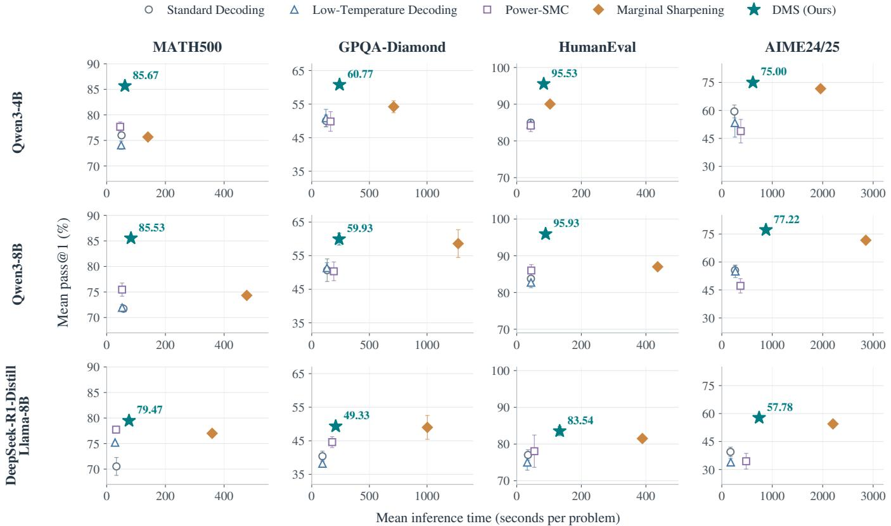
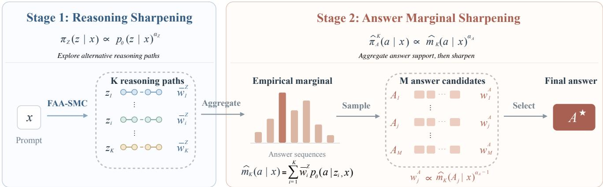
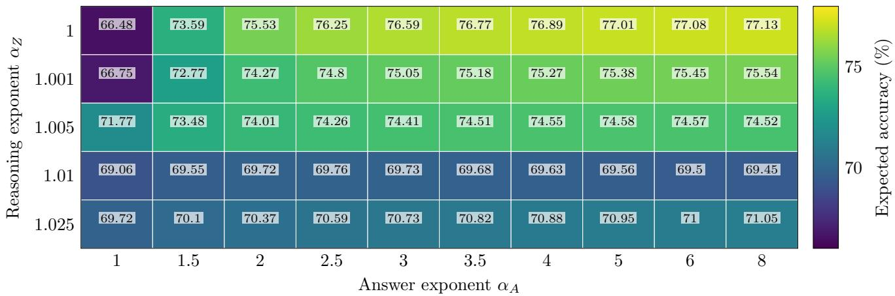

# Decoupled Marginal Sharpening for Training-Free Inference-Time Scaling

Weixin Wang1 ∗ Wei Deng2 Anderson Schneider2 Yuriy Nevmyvaka2 Pan Xu1 Andrew Bennett2

1Duke University 2Morgan Stanley

October 15, 2026

## Abstract

We study how to improve LLM reasoning at inference time without updating model weights or using external reward models. Recent reward-free power-sampling methods define the sequence-level power target $\pi _ { \alpha } ( y \mid x ) \propto$ $p _ { 0 } ( y \mid x ) ^ { \alpha }$ , where α > 1, which increases the relative probability of completions that are already likely under the base model. Existing methods use Metropolis–Hastings or Sequential Monte Carlo (SMC) to approximately sample from this target. However, two challenges arise at diferent levels. At the target level, full-sequence sharpening can concentrate probability on a few exact reasoning–answer trajectories, suppressing alternative paths that support the same answer. At the sampler level, finite-particle SMC approximations can sufer from path collapse when resampling repeatedly duplicates a few high-weight prefixes. To address these challenges, we propose Decoupled Marginal Sharpening (DMS), which separately controls how strongly the model favors particular reasoning paths and how strongly it favors final answers after aggregating support across those paths. At the target level, DMS first samples from a sharpened reasoning distribution, then marginalizes the model’s answer probabilities over the resulting weighted reasoning population and sharpens the induced answer marginal. Separate exponents allow mild reasoning sharpening to encourage exploration of diverse paths, followed by stronger answer-marginal sharpening to concentrate probability on answers with greater aggregate support across those paths. At the sampler level, we develop Fully Adapted Annealed SMC, which combines an annealed sequence of power targets with locally fully adapted proposals and predictive ancestor resampling. Experiments on MATH500, GPQA-Diamond, HumanEval, and AIME24/25 across three base models show that DMS achieves the highest mean pass@1 among the compared methods in all tasks.

## 1 Introduction

Large language models can improve their reasoning performance through additional training (Zelikman et al., 2022; Ouyang et al., 2022; Hsieh et al., 2023; Shao et al., 2024; Zhang et al., 2026) or additional computation at inference time (Wang et al., 2022; Yao et al., 2023; Snell et al., 2024; Wang et al., 2026). We focus on inference-time scaling methods that keep the model fixed and use its own probabilities to guide generation, without additional model updates. These methods can be broadly divided into reward-based and reward-free approaches. Rewardbased methods use an external reward model or verifier to guide generation toward higher-quality solutions (Zhao et al., 2024; Feng et al., 2025; Markovic-Voronov et al., 2026). Their efectiveness depends on the availability and accuracy of these signals (Zhu and Lu, 2026). Reward-free methods instead rely on signals already contained in the base model. A prominent approach is sequence-level power sampling, which defines the target distribution $\pi _ { \alpha } ( y \mid x ) \propto p _ { 0 } ( y \mid x ) ^ { \alpha } , \alpha > 1$ , where $p _ { 0 }$ is the base model, x is the prompt, and y is a complete generated sequence. This power transformation sharpens the base distribution by increasing the relative probability of more likely com pletions, making the distribution more concentrated. Sampling each token according to this target requires summing powered sequence probabilities over all possible future continuations, which is generally intractable. Existing methods approximate this sharpened distribution through Metropolis–Hastings updates to generated sequences (Karan and Du, 2025), token sampling guided by probabilities estimated from future continuations (Ji et al., 2026), or Sequential Monte Carlo (SMC) (Azizi et al., 2026).

  
Figure 1: Accuracy and inference latency across three models and four reasoning benchmarks. Our method DMS achieves the highest accuracy in all settings while requiring less inference time than the strong baseline Marginal Sharpening. Vertical error bars indicate ±1 standard deviation in pass@1. In each subplot, higher accuracy and lower latency are better (toward the upper left).

For mathematical and coding tasks, an LLM typically generates a reasoning path followed by a final answer. Sharpening the full sequence therefore favors individual reasoning–answer pairs with high joint likelihood. However, diferent reasoning paths can lead to the same correct answer, which may receive substantial combined support even when each individual path has relatively low probability. Sharpening these pairs separately can consequently reduce the probability of an answer supported by many such paths. Moreover, higher sequence likelihood does not necessarily imply correctness (Zenn and Geiping, 2026). Self-consistency and marginal sharpening account for support across reasoning paths (Wang et al., 2022; Arzhantsev et al., 2026); in particular, marginal sharpening aggregates conditional answer probabilities under the original reasoning distribution before sharpening the resulting answer marginal. We seek to retain this aggregation while also guiding reasoning toward more likely paths. The two stages thus call for diferent sharpening strengths: mild sharpening during reasoning favors more likely paths while retaining alternatives for aggregation, whereas stronger sharpening after aggregation concentrates probability on answers supported by their combined contributions.

To this end, we propose Decoupled Marginal Sharpening (DMS), a training-free framework that separately controls sharpening at the reasoning and answer stages. Given a prompt x, let z denote a reasoning path and a denote its answer. DMS first sharpens the reasoning distribution, averages the model’s conditional answer probabilities over the resulting distribution of reasoning paths, and then sharpens the resulting answer marginal:

$$
\begin{array} { r } { \pi _ { Z } ( z | x ) \propto p _ { 0 } ( z | x ) ^ { \alpha z } , \quad m _ { \alpha _ { Z } } ( a | x ) = \sum _ { z } \pi _ { Z } ( z | x ) p _ { 0 } ( a | z , x ) , \quad \pi _ { A } ( a | x ) \propto m _ { \alpha _ { Z } } ( a | x ) ^ { \alpha _ { A } } . } \end{array}
$$

The reasoning exponent $\alpha _ { Z }$ controls how much each reasoning path contributes to the answer marginal, while the answer exponent $\alpha _ { A }$ controls how strongly the final distribution concentrates on answers with greater aggregate support. Choosing these exponents separately allows answer selection to become more concentrated without requiring equally strong sharpening of the reasoning distribution. In practice, we estimate the answer marginal from a finite population of reasoning paths. Repeated SMC resampling can duplicate a few high-weight prefixes and discard alternatives, causing path collapse and reducing the distinct reasoning paths available for aggregation. To address this sampling challenge, we develop Fully Adapted Annealed SMC (FAA-SMC), which combines annealed power targets, predictive ancestor resampling, and locally fully adapted proposals. The resulting weighted reasoning population defines an empirical answer marginal. DMS samples answer candidates from this marginal, evaluates each complete candidate under all reasoning paths, and approximates the sharpened answer target.

Our contributions are summarized as follows:

• We propose DMS, a training-free two-stage marginal sharpening framework with separate control over reasoningpath concentration and answer-level consensus. DMS sharpens the reasoning distribution and then sharpens the answer marginal obtained by aggregating probabilities across reasoning paths, using diferent exponents for the two stages.

• We develop a practical sampling procedure for the two-stage target. FAA-SMC combines exact annealing bridges, predictive resampling, and locally fully adapted propagation to approximate the sharpened reasoning distribution. A finite-particle answer sampler then approximates the sharpened answer marginal through cross-reasoning likelihood evaluation.

• We evaluate DMS on MATH500, GPQA-Diamond, HumanEval, and AIME24/25 across three base models. DMS achieves the highest mean pass@1 among the compared methods in all twelve model–benchmark settings.

## 2 Related Work

Inference-Time Scaling for LLM Reasoning. Inference-time scaling improves LLM reasoning by allocating additional computation during decoding while keeping the base model fixed. Existing methods can be broadly divided into reward-based and reward-free approaches. Reward-based methods use an external reward or verifier to define a reward-tilted sequence distribution. Building on auxiliary and twisted particle filtering (Guarniero et al., 2017), Zhao et al. (2024) formulate language-model inference as sampling from unnormalized sequence distributions and introduce twisted SMC with learned estimates of future potential. Feng et al. (2025) apply this framework to mathematical reasoning, while Markovic-Voronov et al. (2026) develop a general reward-guided SMC decoder with prefix-based and look-ahead intermediate targets. Zhu and Lu (2026) further study how errors in approximate reward models afect inference-time scaling.

Reward-free methods instead use signals already contained in the base model, such as sequence likelihood or agreement among sampled solutions. One line of work uses sequence-level power sampling, which defines the target $\pi _ { \alpha } ( y \mid x ) \propto p _ { 0 } ( y \mid x ) ^ { \alpha }$ for $\alpha > 1$ . Karan and Du (2025) approximately sample from this target using an iterative Metropolis–Hastings-style procedure. Ji et al. (2026) improve sampling eficiency by approximating the future correction associated with the sequence-level power objective during autoregressive decoding. Sequential Monte Carlo provides a parallel alternative by maintaining and resampling a population of weighted partial generations. Azizi et al. (2026) propose Power-SMC, which uses token-level importance corrections, adaptive resampling, and exponent bridging to approximate the sequence-level power target. Nguyen et al. (2026) further improve particle allocation using short-horizon rollouts or an amortized estimate of future probability mass. Related reward-free SMC methods also consider sampling from ensemble distributions constructed from multiple language models or prompts (Chan et al., 2026). Complementary studies examine how model-intrinsic scores interact with sampling, optimization, and consensus-based decoders (Cheng et al., 2026), and show that increasing sequence likelihood does not necessarily improve reasoning accuracy (Zenn and Geiping, 2026).

Beyond sampling individual sequences, reward-free methods can aggregate support across reasoning paths at the answer level. Self-consistency samples multiple reasoning trajectories and selects the answer with the greatest aggregate support (Wang et al., 2022). Arzhantsev et al. (2026) formulate self-consistency as marginal sharpening over final answers, constructing the answer marginal under the original reasoning distribution. DMS extends this formulation by allowing the reasoning distribution used to construct the marginal to be sharpened independently of the subsequent answer sharpening.

## 3 Preliminaries

LLM Generation and Sequence-Level Power Sharpening. Given a problem prompt x, an autoregressive language model p0 generates each token conditioned on the prompt and the preceding tokens. The probability of a sequence $y _ { 1 : T } = ( y _ { 1 } , \dots , y _ { T } )$ is therefore $\begin{array} { r } { p _ { 0 } ( y _ { 1 : T } \mid x ) = \prod _ { t = 1 } ^ { T } p _ { 0 } ( y _ { t } \mid x , y _ { < t } ) } \end{array}$ , where $y _ { < t } = \left( y _ { 1 } , \ldots , y _ { t - 1 } \right)$ . We use T as the maximum generation length. If generation ends before T, we pad the sequence with a fixed terminal symbo and assign conditional probability one to each padding step, leaving the sequence probability unchanged.

Huang et al. (2025) observe that correct responses tend to have higher likelihoods under the model and that selecting responses with higher likelihoods can improve accuracy, although the gains depend on the base model and task. These observations motivate distribution sharpening: keeping the model parameters fixed while changing the sampling distribution to favor responses that the model already assigns higher probability.

For training-free LLM reasoning, Karan and Du (2025) propose sampling from a sequence-level power distribution that implements this principle while keeping the base model fixed:

$$
\pi _ { \alpha } ( y _ { 1 : T } \mid x ) = \mathcal { Z } _ { \alpha } ( x ) ^ { - 1 } p _ { 0 } ( y _ { 1 : T } \mid x ) ^ { \alpha } , \qquad \alpha \geq 1 ,\tag{3.1}
$$

where $\begin{array} { r } { \mathcal { Z } _ { \alpha } ( x ) = \sum _ { u _ { 1 } , \gamma } p _ { 0 } ( y _ { 1 : T } \mid x ) ^ { \alpha } } \end{array}$ is the normalizing constant. When $\alpha = 1$ , this target recovers the base model distribution. For $\overset { \cdot } { \alpha } > 1 \overset { \cdot } { \alpha }$ , it favors outputs the model is more confident in, as reflected by their higher likelihood.

To sample a sequence from $\pi _ { \alpha }$ one token at a time, we need the conditional probability of each next token under $\pi _ { \alpha }$ . Computing these probabilities requires summing $p _ { 0 } ( y _ { 1 : T } \mid x ) ^ { \alpha }$ over all possible future continuations, which is generally intractable. Simply lowering the temperature of the base model’s next-token distribution does not account for the powered probability mass of these continuations and therefore does not generally produce samples from $\pi _ { \alpha }$ We therefore use sequential Monte Carlo (SMC), which generates tokens from tractable proposal distributions and uses importance weights to correct for the diference between the proposal and target distributions.

Sequential Monte Carlo. SMC approximates the target distribution using K particles, each consisting of a generated prefix and an importance weight (Zhao et al., 2024; Azizi et al., 2026). At step t, the weighted particles approximate the distribution proportional to $\gamma _ { t } ( y _ { 1 : t } \mid x )$ , where $\{ \gamma _ { t } \} _ { t = 0 } ^ { T }$ is a sequence of unnormalized intermediate targets satisfying

$$
\gamma _ { 0 } ( \emptyset \mid x ) = 1 , \qquad \gamma _ { T } ( y _ { 1 : T } \mid x ) = p _ { 0 } ( y _ { 1 : T } \mid x ) ^ { \alpha } .
$$

The normalized terminal target is therefore $\pi _ { \alpha }$ in (3.1).

All particles start from the empty prefix with equal weights $w _ { 0 } ^ { k } = 1$ . At each step, a proposal distribution $q _ { t } ( \cdot \mid x , y _ { < t } )$ specifies how to sample the next token. To account for the proposal probability and the change from $\gamma _ { t - 1 }$ to $\gamma _ { t } .$ we use the incremental importance weight

$$
G _ { t } ( y _ { 1 : t } ) = \frac { \gamma _ { t } ( y _ { 1 : t } \mid x ) } { \gamma _ { t - 1 } ( y _ { < t } \mid x ) q _ { t } ( y _ { t } \mid x , y _ { < t } ) } .\tag{3.2}
$$

Particle k is then extended and reweighted according to

$$
Y _ { t } ^ { k } \sim q _ { t } ( \cdot \vert \ x , Y _ { < t } ^ { k } ) , \qquad w _ { t } ^ { k } = w _ { t - 1 } ^ { k } G _ { t } ( Y _ { 1 : t } ^ { k } ) .
$$

To determine when to resample, we normalize the weights and compute the efective sample size:

$$
\bar { w } _ { t } ^ { k } = \frac { w _ { t } ^ { k } } { \sum _ { \ell = 1 } ^ { K } w _ { t } ^ { \ell } } , \qquad \mathrm { E S S } _ { t } = \frac { 1 } { \sum _ { k = 1 } ^ { K } ( \bar { w } _ { t } ^ { k } ) ^ { 2 } } .
$$

A small ESS indicates that a few particles carry most of the total weight. When $\mathrm { E S S } _ { t } ~ < ~ \tau K$ for a threshold $\tau \in ( 0 , 1 ]$ , SMC selects K prefixes according to their normalized weights, allowing the same prefix to be selected multiple times. The selected prefixes form a new particle population with equal weights, and generation continues separately from each selected prefix. At termination, the weighted population $\{ ( Y _ { 1 : T } ^ { k } , \bar { w } _ { T } ^ { k } ) \} _ { k = } ^ { K }$ 1 approximates $\pi _ { \alpha }$

With a finite particle budget, repeated resampling can lead to path collapse: high-weight prefixes are repeatedly copied while other prefixes are discarded, leaving many particles descended from only a few earlier prefixes. Although resampling resets the weights, it does not recover the discarded paths. This loss of reasoning-path diversity motivates the sampler design introduced in our methodology.

## 4 Methodology: Decoupled Marginal Sharpening

We propose Decoupled Marginal Sharpening (DMS), which first sharpens the reasoning distribution and then sharpens the answer marginal constructed from it. To approximate these targets, we develop Fully Adapted Annealed SMC (FAA-SMC) to generate a weighted population of reasoning paths. We sample answer candidates from the resulting empirical marginal, evaluate each candidate under all paths, and reweight them for final selection. Figure 2 illustrates the overall procedure.

  
Figure 2: Overview of DMS. FAA-SMC constructs K weighted reasoning paths that define an empirical answer marginal. We sample M candidates from this marginal and select the final answer according to their normalized answer-sharpening weights.

## 4.1 Two-Stage Sharpened Target

We write the complete generation as $Y = ( Z , A )$ , where Z is the reasoning path and A is the complete answer token sequence generated after it, such as a mathematical response or a code completion. The base model distribution factorizes as $p _ { 0 } ( z , a \mid x ) = p _ { 0 } ( z \mid x ) p _ { 0 } ( a \mid z , x )$

Sequence-level power sharpening applies the same exponent to both factors: $p _ { 0 } ( z , a \mid x ) ^ { \alpha } = p _ { 0 } ( z \mid x ) ^ { \alpha } p _ { 0 } ( a \mid z , x ) ^ { \alpha }$ This ties reasoning and conditional answer sharpening to the same strength. However, reasoning and answer selection serve diferent purposes. During reasoning, we want to favor likely paths while retaining alternatives for exploration; when selecting the final answer, we want to concentrate on candidates with strong model support. We therefore introduce separate exponents, allowing mild or no additional reasoning sharpening together with stronger answer sharpening.

Reasoning-Level Sharpening. We first define the reasoning target with its own exponent:

$$
\pi _ { Z } ( z \mid x ) = \mathcal { Z } _ { Z } ( x ) ^ { - 1 } p _ { 0 } ( z \mid x ) ^ { \alpha _ { Z } } , \qquad \alpha _ { Z } \geq 1 ,\tag{4.1}
$$

where $\begin{array} { r } { \mathcal { Z } _ { Z } ( \boldsymbol { x } ) = \sum _ { z } p _ { 0 } ( z \mid \boldsymbol { x } ) ^ { \alpha _ { Z } } } \end{array}$ is the normalizing constant. Setting $\alpha _ { Z } = 1$ retains the base reasoning distribution, while increasing $\alpha _ { Z }$ gives greater relative probability to more likely reasoning paths. Choosing this exponent independently lets us control the preference for these paths during reasoning exploration without tying it to the strength used for answer selection.

Reasoning-Induced Answer Marginal. With the reasoning distribution in (4.1) specified, we next construct the corresponding answer marginal. Marginalization combines support for the same answer across diferent reasoning paths, so that subsequent answer sharpening acts on their total contribution. We define the answer marginal distribution as follows,

$$
\begin{array} { r } { m _ { \alpha _ { Z } } ( a \mid x ) = \sum _ { z } \pi _ { Z } ( z \mid x ) p _ { 0 } ( a \mid z , x ) . } \end{array}
$$

The marginal measures the combined support for this answer under chosen reasoning distribution.

Marginal Answer Sharpening. We then sharpen the answer marginal with a separate exponent:

$$
\pi _ { A } ( a \mid x ) = \mathcal { Z } _ { A } ( x ) ^ { - 1 } m _ { \alpha _ { { \cal Z } } } ( a \mid x ) ^ { \alpha _ { A } } , \qquad \alpha _ { A } \geq 1 ,\tag{4.2}
$$

where $\begin{array} { r } { \mathcal { Z } _ { A } ( x ) = \sum _ { a } m _ { \alpha _ { Z } } ( a \mid x ) ^ { \alpha _ { A } } } \end{array}$ is the normalizing constant. For a fixed $\alpha _ { Z } .$ , increasing $\alpha _ { A }$ gives greater relative probability to answers with larger marginal probability while preserving their ranking under $m _ { \alpha z }$ . The final answer distribution can therefore be sharpened more strongly while the reasoning distribution remains fixed.

Remark 4.1. The order of marginalization and answer sharpening matters. Under sequence-level sharpening, the probability assigned to an answer is proportional to $\textstyle \sum _ { z } p _ { 0 } ( z , a \mid x ) ^ { \alpha }$ , so each trajectory is sharpened before contributions to the same answer are combined. This can make a single likely trajectory outweigh several less likely trajectories even when their combined probability was originally greater, reversing the ranking of their associated answers.1 In DMS, answer sharpening acts on the combined probability already obtained under $\pi _ { Z }$ . Consequently, even setting $\alpha _ { Z } = \alpha _ { A } > 1$ does not generally recover the answer marginal of sequence-level sharpening. When $\alpha _ { Z } = 1$ , we have $m _ { 1 } ( a \mid x ) = p _ { 0 } ( a \mid x )$ , and the ideal target in (4.2) reduces to marginal sharpening under the original reasoning distribution (Arzhantsev et al., 2026).

To approximate the target in (4.2), we first estimate $m _ { \alpha z }$ using a finite weighted population of reasoning paths. We next describe FAA-SMC, a stable and eficient sampler designed to mitigate path collapse when constructing this population.

## 4.2 Reasoning Sampling with FAA-SMC

FAA-SMC approximates the reasoning target in (4.1) with final exponent $\alpha = \alpha _ { Z }$ . It combines two mechanisms: annealing introduces sharpening gradually during generation, while a resample–propagate update allows copies of a selected prefix to generate their next tokens independently.

Annealed Intermediate Targets. Applying the final sharpening strength from the start can concentrate particles before alternative reasoning paths have been explored. We therefore use a nondecreasing schedule $1 = \beta _ { 0 } \le$ $\beta _ { 1 } \le \cdot \cdot \cdot \le \beta _ { T } = \alpha$ and define

$$
\gamma _ { t } ( y _ { 1 : t } \mid x ) = p _ { 0 } ( y _ { 1 : t } \mid x ) ^ { \beta _ { t } } .\tag{4.3}
$$

Under these targets, the incremental importance weight in (3.2) becomes

$$
G _ { t } ( y _ { 1 : t } ) = p _ { 0 } ( y _ { < t } \mid x ) ^ { \beta _ { t } - \beta _ { t - 1 } } \frac { p _ { 0 } ( y _ { t } \mid x , y _ { < t } ) ^ { \beta _ { t } } } { q _ { t } ( y _ { t } \mid x , y _ { < t } ) } .\tag{4.4}
$$

The prefix factor accounts for the change in exponent applied to tokens already generated. Since $\beta _ { T } = \alpha .$ (4.3) ends at the specified power target. Annealing therefore changes how sharpening is introduced during generation while preserving the final target.

Fully Adapted Resample–Propagate. We next choose a proposal that allows the importance correction to be computed before generating the next token. Let $h _ { t } = ( x , y _ { < t } )$ denote the current context. We use the locally fully adapted proposal

$$
q _ { t } ^ { \mathrm { F A } } ( v \mid h _ { t } ) = \frac { p _ { 0 } ( v \mid h _ { t } ) ^ { \beta _ { t } } } { \mathcal { Z } _ { t } ( h _ { t } ) } ,
$$

where $\begin{array} { r } { \mathcal { Z } _ { t } ( h _ { t } ) = \sum _ { v \in \mathcal { V } } p _ { 0 } ( v \mid h _ { t } ) ^ { \beta _ { t } } } \end{array}$ and V is the token vocabulary. Substituting this proposal into (4.4) cancels the dependence on the sampled token:

$$
G _ { t } ( y _ { 1 : t } ) = M _ { t } ( h _ { t } ) , \qquad M _ { t } ( h _ { t } ) = p _ { 0 } ( y _ { < t } \mid x ) ^ { \beta _ { t } - \beta _ { t - 1 } } \mathcal { Z } _ { t } ( h _ { t } ) .
$$

The remaining correction depends only on the current prefix. We can therefore compute the predictive weights $\widetilde { w } _ { t - 1 } ^ { k } = w _ { t - 1 } ^ { k } \bar { M } _ { t } ( h _ { t } ^ { k } )$ and use them to select ancestor prefixes before propagation.

At resampling checkpoints, we resample prefixes according to their normalized predictive weights if ESS $< \tau K$ and reset their weights to equal values. Each prefix then independently samples its next token from $q _ { t } ^ { \mathrm { F A } }$ , with no further weight correction since M already accounts for it. Resampling before propagation allows copies of the same prefix to generate diferent next tokens instead of inheriting the same newly sampled token. Algorithm 2 in Appendix A summarizes the procedure.

Remark 4.2 (Comparison with propagate–resample SMC). Consider a prefix selected twice at a resampling step. A propagate–resample update in standard SMC copies the same newly generated token into both particles. FAA-SMC instead selects the prefix first and then draws a next token independently for each copy, allowing the copies to follow diferent continuations immediately. For example, if two tokens each have probability $1 / 2$ under $q _ { t } ^ { \mathrm { F A } }$ , two copies of the same prefix independently draw diferent tokens with probability $1 / 2$

Island-DMS. On dificult problems requiring long reasoning paths, repeated resampling can lead to more severe path collapse, especially when the particle population is small. In extreme cases, all final particles may descend from only one or two initial particles. To preserve multiple particle diversity, we adopt an island variant (Verg´e et al., 2015). We divide the total population into L independent islands of $K _ { \mathrm { i s l a n d } }$ particles, with $K = L K _ { \mathrm { i s l a n d } }$ Each island runs FAA-SMC and resamples only within its own population. Since each island retains at least one initial-particle ancestor, pooling all islands guarantees at least L distinct ancestors, even if all particles within each island share the same ancestor.

We retain all final reasoning paths and assign equal total weight to each island. If $\bar { w } _ { \ell , k } ^ { Z }$ is the normalized weight of particle k within island $\ell ,$ its pooled weight is $\bar { w } _ { \ell , k } ^ { Z , \mathrm { i s l a n d } } = \bar { w } _ { \ell , k } ^ { Z } / L$ . This pooled population defines the empirical answer marginal used in the next subsection.

## 4.3 Sampling from the Sharpened Answer Marginal

Let $B _ { K } ^ { Z } = \{ ( z _ { i } , \bar { w } _ { i } ^ { Z } ) \} _ { i = 1 } ^ { K }$ denote the weighted reasoning population returned by FAA-SMC, with $\textstyle \sum _ { i = 1 } ^ { K } { \bar { w } } _ { i } ^ { Z } = 1$ . For Island-DMS, we use the pooled population defined above. Each path ends at the reasoning–answer boundary and provides the context for both answer generation and scoring. We replace the sum over all reasoning paths in $m _ { \alpha z }$ with the weighted sum over this population:

$$
\begin{array} { r } { \widehat { m } _ { K } ( a \mid x ) = \sum _ { i = 1 } ^ { K } \bar { w } _ { i } ^ { Z } p _ { 0 } ( a \mid z _ { i } , x ) . } \end{array}\tag{4.5}
$$

This empirical marginal defines the answer target ${ \widehat { \pi } } _ { A } ^ { K } ( a \mid x ) \propto { \widehat { m } } _ { K } ( a \mid x ) ^ { \alpha _ { A } }$ , which approximates the ideal target in (4.2). We approximate sampling from this target by generating candidates from $\widehat { m } _ { K }$ and correcting the diference through importance weighting.

Generating Answer Candidates. Since $\widehat { m } _ { K }$ is a mixture, we can sample from it by first selecting a reasoning path according to its weight and then generating an answer conditioned on that path. Repeating these two draws independently produces M candidates:

$$
I _ { j } \sim \mathrm { C a t } ( \bar { w } _ { 1 : K } ^ { Z } ) , \qquad A _ { j } \sim p _ { 0 } ( \cdot \mid z _ { I _ { j } } , x ) , \qquad j = 1 , \ldots , M .
$$

Each candidate therefore follows $\widehat { m } _ { K }$ , even though its generation uses only one reasoning path. This mixture serves as the proposal distribution for answer sharpening.

Evaluating Answer Marginal Probabilities. Generating a candidate requires only one selected path, but evaluating its marginal probability requires contributions from the entire reasoning population. We therefore score the same complete answer $A _ { j }$ under every retained context $( x , z _ { i } )$ and combine the conditional probabilities $p _ { 0 } ( A _ { j }$ $z _ { i } , x )$ using (4.5). This allows paths other than the one used for generation to contribute to the candidate’s probability for final selection. Additional detail of derivation is described in Appendix A.

Answer Reweighting and Selection. The proposal is $\widehat { m } _ { K }$ , whereas the unnormalized answer target is $\widehat { m } _ { K } ^ { \alpha _ { A } }$ Their ratio gives the importance weight

$$
w _ { j } ^ { A } = \frac { \widehat { m } _ { K } ( A _ { j } \mid x ) ^ { \alpha _ { A } } } { \widehat { m } _ { K } ( A _ { j } \mid x ) } = \widehat { m } _ { K } ( A _ { j } \mid x ) ^ { \alpha _ { A } - 1 } .\tag{4.6}
$$

Candidate generation already samples answers in proportion to their marginal probabilities, so the correction uses only the remaining power $\alpha _ { A } - 1$ . We normalize the weights as $\begin{array} { r } { \bar { w } _ { j } ^ { A } = w _ { j } ^ { \bar { A } } / \sum _ { \ell = 1 } ^ { M } w _ { \ell } ^ { A } } \end{array}$ , draw $J ^ { \star } \sim \mathrm { C a t } ( \bar { w } _ { 1 : M } ^ { A } )$ , and return $A ^ { \star } = A _ { J ^ { \star } }$

Conditional on the reasoning population, this sampling-importance-resampling procedure approximates $\widehat { \pi } _ { A } ^ { K }$ using M candidates. Algorithm 1 summarizes DMS.

Algorithm 1 DMS: Decoupled Marginal Sharpening   
Require: Prompt x, base model $p _ { 0 } ,$ reasoning particle count K, answer candidate count M, exponents $\alpha _ { Z } , \alpha _ { A } .$   
reasoning schedule $1 = \beta _ { 0 } \leq \cdot \cdot \cdot \leq \beta _ { T } = \alpha _ { Z }$ , resampling threshold $\tau ,$ and resampling checkpoints.   
1: Run FAA-SMC in Algorithm 2 over the reasoning segment to obtain $B _ { K } ^ { Z } = \{ ( z _ { i } , \bar { w } _ { i } ^ { Z } ) \} _ { i = 1 } ^ { K }$   
2: for $j = 1 , \dots , M$ do   
3: Sample $I _ { j } \sim \mathrm { C a t } ( \bar { w } _ { 1 : K } ^ { Z } ) .$   
4: Generate a complete answer $A _ { j } \sim p _ { 0 } ( \cdot \mid z _ { I _ { j } } , x )$   
5: Score $A _ { j }$ under all K reasoning paths and compute ${ \widehat { m } } _ { K } ( A _ { j } \mid x )$ using (4.5).   
6: Compute $w _ { j } ^ { A }$ using (4.6).   
7: end for   
8: Normalize the answer weights to obtain $\bar { w } _ { 1 : M } ^ { A } .$   
9: Sample $J ^ { \star } \sim \mathrm { C a t } ( \bar { w } _ { 1 : M } ^ { A } )$ and return $A ^ { \star } = A _ { J ^ { \star } }$

## 5 Experiments

## 5.1 Experimental Setup

Models and baselines. We evaluate DMS using Qwen3-4B, Qwen3-8B (Yang et al., 2025), and DeepSeek-R1- Distill-Llama-8B (Guo et al., 2025). The Qwen3 models use their native chat templates with thinking mode enabled. We compare against standard decoding, low-temperature decoding, Power-SMC (Azizi et al., 2026), and Marginal Sharpening (Arzhantsev et al., 2026). Power-SMC targets a sharpened distribution over complete sequences, while Marginal Sharpening sharpens the answer marginal induced by the original reasoning distribution.

Benchmarks and evaluation. We evaluate on MATH500 (500 problems) (Hendrycks et al., 2021; Lightman et al., 2024), GPQA-Diamond (198 questions) (Rein et al., 2023), HumanEval (164 problems) (Chen et al., 2021), and AIME24/25 (60 problems from AIME I and II in both years). These benchmarks cover mathematical reasoning, scientific question answering, and code generation. Mathematical predictions are extracted from the final boxed expression and graded using normalized exact matching and symbolic equivalence. GPQA-Diamond uses exact option matching, while HumanEval completions are evaluated against the original unit tests in isolated processes with a three-second timeout.

Sampling protocol. DMS uses K = 16 reasoning particles and M = 32 answer candidates per problem. We use standard DMS on MATH500, GPQA-Diamond, and HumanEval, and Island-DMS with eight islands of two particles on AIME24/25. Candidates are sampled from the weighted reasoning mixture and cross-scored under al K paths to estimate their marginal probabilities and compute answer-level importance weights. Generation budgets, sharpening exponents, and implementation details are provided in Appendix B.

Metrics. Our primary metric is pass@1 of the final returned answer. For DMS, one answer is sampled categorically from the M candidates according to their normalized importance weights. We report the mean and sample standard deviation over three random seeds, {10080, 10081, 10082}.

## 5.2 Main Results

Table 1 reports pass@1 across three models and four benchmarks. DMS achieves the highest mean accuracy in all twelve settings, improving over the strongest baseline by 0.34–10.07 percentage points. On MATH500, DMS reaches 85.67% and 85.53% with Qwen3-4B and Qwen3-8B, exceeding Power-SMC by 8.00 and 10.07 points, respectively. On HumanEval, it achieves 95.53% and 95.93%, improving over Marginal Sharpening by 5.49 and 8.94 points.

Standard DMS achieves the highest mean accuracy on MATH500, GPQA-Diamond, and HumanEval for all three models. It also exceeds the strongest baseline on AIME24/25, reaching 72.78%, 74.44%, and 55.00% with Qwen3- 4B, Qwen3-8B, and DeepSeek-R1-Distill-Llama-8B, respectively. Island-DMS further raises these results to 75.00%, 77.22%, and 57.78%, adding 2.22–2.78 percentage points while retaining the same total reasoning particle count.

The strongest baseline varies across tasks: Power-SMC performs best on MATH500, while Marginal Sharpening leads on the other three benchmarks. DMS achieves the highest mean pass@1 in each setting. Its comparison with

Table 1: Pass@1 (%) across models and benchmarks. Shaded rows denote DMS, and boldface indicates the highest mean within each model–benchmark setting. The DMS results on AIME24/25 use the Island-DMS variant.
<table><tr><td>Model</td><td>Method</td><td>MATH500</td><td>GPQA-Diamond</td><td>HumanEval</td><td>AIME24/25</td></tr><tr><td rowspan="4">Qwen3-4B</td><td>Standard Decoding</td><td> $7 6 . 0 0 \pm 0 . 5 3$ </td><td> $5 0 . 0 0 \pm 1 . 7 5$ </td><td> $8 4 . 9 6 \pm 0 . 3 5$ </td><td> $5 9 . 4 4 \pm 3 . 4 7$ </td></tr><tr><td>Low-Temperature Decoding</td><td> $7 4 . 0 7 \pm 0 . 8 1$ </td><td> $5 0 . 8 4 \pm 2 . 5 9$ </td><td> $8 4 . 5 5 \pm 1 . 2 7$ </td><td> $5 3 . 3 3 \pm 7 . 6 4$ </td></tr><tr><td>Power-SMC</td><td> $7 7 . 6 7 \pm 0 . 9 5$ </td><td> $4 9 . 8 3 \pm 2 . 9 2$ </td><td> $8 4 . 1 5 \pm 1 . 6 1$ </td><td> $4 8 . 8 9 \pm 6 . 3 1$ </td></tr><tr><td>Marginal Sharpening</td><td> $7 5 . 6 7 \pm 0 . 2 3$ </td><td> $5 4 . 2 1 \pm 1 . 7 7$ </td><td> $9 0 . 0 4 \pm 0 . 9 3$ </td><td> $7 1 . 6 7 \pm 1 . 6 7$ </td></tr><tr><td></td><td>DMS (Ours)</td><td> ${ \bf 8 5 . 6 7 \pm 0 . 5 8 }$ </td><td> ${ \bf 6 0 . 7 7 \pm 0 . 7 7 }$ </td><td> ${ \bf 9 5 . 5 3 \pm 0 . 7 0 }$ </td><td> ${ \bf 7 5 . 0 0 \pm 1 . 6 7 }$ </td></tr><tr><td rowspan="4">Qwen3-8B</td><td>Standard Decoding</td><td> $7 1 . 7 3 \pm 0 . 5 8$ </td><td> $5 0 . 6 7 \pm 3 . 3 6$ </td><td> $8 3 . 7 4 \pm 0 . 3 5$ </td><td> $5 5 . 5 6 \pm 2 . 5 5$ </td></tr><tr><td>Low-Temperature Decoding</td><td> $7 1 . 9 3 \pm 0 . 6 1$ </td><td> $5 1 . 3 5 \pm 1 . 5 4$ </td><td> $8 2 . 7 2 \pm 1 . 4 1$ </td><td> $5 5 . 0 0 \pm 3 . 3 3$ </td></tr><tr><td>Power-SMC</td><td> $7 5 . 4 7 \pm 1 . 2 9$ </td><td> $5 0 . 3 4 \pm 2 . 7 8$ </td><td> $8 5 . 9 8 \pm 1 . 6 1$ </td><td> $4 7 . 2 2 \pm 3 . 8 5$ </td></tr><tr><td>Marginal Sharpening</td><td> $7 4 . 3 3 \pm 0 . 1 2$ </td><td> $5 8 . 5 9 \pm 4 . 1 3$ </td><td> $8 6 . 9 9 \pm 0 . 7 0$ </td><td> $7 1 . 6 7 \pm 1 . 6 7$ </td></tr><tr><td></td><td>DMS (Ours)</td><td> $\mathbf { 8 5 . 5 3 \pm 0 . 4 2 }$ </td><td> ${ \bf 5 9 . 9 3 \pm 1 . 7 7 }$ </td><td> ${ \bf 9 5 . 9 3 \pm 0 . 9 3 }$ </td><td> ${ \bf 7 7 . 2 2 \pm 0 . 9 6 }$ </td></tr><tr><td rowspan="4">DeepSeek-R1-Distill-Llama-8B</td><td>Standard Decoding</td><td> $7 0 . 5 3 \pm 1 . 7 5$ </td><td> $4 0 . 4 0 \pm 1 . 5 2$ </td><td> $7 7 . 0 3 \pm 1 . 4 1$ </td><td> $3 9 . 4 4 \pm 2 . 5 5$ </td></tr><tr><td>Low-Temperature Decoding</td><td> $7 5 . 2 0 \pm 0 . 2 0$ </td><td> $3 8 . 2 2 \pm 1 . 0 5$ </td><td> $7 5 . 0 0 \pm 2 . 1 1$ </td><td> $3 3 . 8 9 \pm 1 . 9 2$ </td></tr><tr><td>Power-SMC</td><td> $7 7 . 7 3 \pm 0 . 4 2$ </td><td> $4 4 . 6 1 \pm 1 . 6 2$ </td><td> $7 8 . 0 5 \pm 4 . 4 0$ </td><td> $3 4 . 4 4 \pm 4 . 1 9$ </td></tr><tr><td>Marginal Sharpening</td><td> $7 7 . 0 0 \pm 0 . 6 9$ </td><td> $4 8 . 9 9 \pm 3 . 5 4$ </td><td> $8 1 . 5 0 \pm 0 . 9 3$ </td><td> $5 4 . 4 4 \pm 1 . 9 2$ </td></tr><tr><td></td><td>DMS (Ours)</td><td> ${ \bf 7 9 . 4 7 \pm 0 . 6 1 }$ </td><td> ${ \bf 4 9 . 3 3 \pm 0 . 7 7 }$ </td><td> ${ \bf 8 3 . 5 4 \pm 1 . 2 2 }$ </td><td> ${ \bf 5 7 . 7 8 \pm 0 . 9 6 }$ </td></tr></table>

Marginal Sharpening is particularly relevant because this baseline already aggregates answer probabilities across reasoning paths. The results support the complete DMS procedure, which combines a separately controlled reasoning distribution with marginal-probability weighting of complete answer candidates. DMS also has lower measured inference latency than Marginal Sharpening in all twelve settings; timing details are provided in Appendix F.

## 5.3 Ablation Study on AIME24/25

We examine the contributions of the two sharpening stages and island sampling on AIME24/25 using Qwen3-8B. All two-stage variants share the same prompts, grader, and 16,384-token limit per reasoning–answer trajectory, with K = 16 reasoning particles and $M = 3 2$ answer candidates. In Table 2, the reference DMS configuration uses $( \alpha _ { Z } , \alpha _ { A } ) = ( 1 . 0 0 5 , 4 )$ . Setting either exponent to one disables the corresponding sharpening operation; setting both to one gives structured decoding without sharpening. Island-DMS keeps the exponents and total particle count fixed while dividing the reasoning population into eight independent islands of two particles.

Table 2: Component analysis on AIME24/25 using Qwen3-8B. Expected accuracy is the probability of selecting a correct answer under the normalized answer weights, averaged over problems. Pass@1 evaluates one sampled answer per problem, while oracle pass@32 is the fraction of problems with at least one correct answer among the 32 candidates. All accuracy metrics are percentages.
<table><tr><td>Variant</td><td>αz</td><td>αA</td><td>Expected</td><td>Pass@1</td><td>Oracle pass@32</td></tr><tr><td>Structured decoding only</td><td>1</td><td>1</td><td>66.48</td><td>67.78</td><td>82.78</td></tr><tr><td>Answer sharpening only</td><td>1</td><td>4</td><td>76.89</td><td>77.22</td><td>82.78</td></tr><tr><td>Reasoning sharpening only</td><td>1.005</td><td>1</td><td>71.77</td><td>72.78</td><td>78.33</td></tr><tr><td>Standard DMS</td><td>1.005</td><td>4</td><td>74.55</td><td>74.44</td><td>78.33</td></tr><tr><td>Island-DMS</td><td>1.005</td><td>4</td><td>76.83</td><td>77.22</td><td>81.67</td></tr></table>

With unsharpened reasoning $( \alpha _ { Z } = 1 )$ , increasing $\alpha _ { A }$ from 1 to 4 raises expected accuracy from 66.48% to 76.89%. At $\alpha _ { A } = 1$ , mild reasoning sharpening raises average candidate correctness from 66.48% to 71.77%, but reduces oracle pass@32 from 82.78% to 78.33%. Reasoning sharpening therefore improves average candidate correctness while reducing correct-answer coverage in this setting. At fixed exponents and particle count, Island-DMS raises expected accuracy from 74.55% to 76.83% and oracle pass@32 from 78.33% to 81.67%. However, answer sharpening alone achieves similar expected accuracy (76.89%), and both obtain 77.22% pass@1. Thus, additional reasoning sharpening is not required for the best observed pass@1 in this setting, supporting independent choices of the two exponents.

Due to space limit, we defer additional experiments to the appendix. In particular, we report sensitivity to the two sharpening exponents in Appendix C and ablations of annealing and resampling in Appendix D. We also provide a diagnostic using a higher-budget reasoning sampler in Appendix E, together with inference latency comparison and a breakdown of DMS runtime in Appendix F.

## 6 Conclusion

We studied training-free inference-time scaling for LLM reasoning, aiming to improve answer accuracy without updating model weights or relying on external reward models. Sequence-level power sampling faces both sampler-level and target-level challenges: finite-particle SMC can sufer from path collapse, while full-sequence sharpening can suppress alternative reasoning paths that support the same answer. We proposed DMS, a two-stage margina sharpening framework with separate sampler-level and target-level designs. At the sampler level, FAA-SMC combines annealed power targets, predictive resampling, and locally fully adapted proposals. At the target level, DMS sharpens the reasoning distribution, marginalizes answer probabilities over the resulting reasoning population, and then sharpens the induced answer marginal. Separate exponents control reasoning-path concentration and answerlevel consensus, allowing answers to be weighted according to their aggregate support across reasoning paths. Experiments on MATH500, GPQA-Diamond, HumanEval, and AIME24/25 across three base models show that DMS achieves the highest mean pass@1 among the compared methods in all twelve settings, including comparisons with Power-SMC and Marginal Sharpening. Future work includes improving answer-marginal estimation, reducing particle degeneracy during reasoning, and developing adaptive choices of sharpening strengths and inference-time budgets.

## A Additional Details for DMS

Algorithm 2 summarizes FAA-SMC. DMS applies this sampler to the reasoning segment with terminal exponent $\alpha = \alpha _ { Z }$

Target Preservation under Annealing. Let $\begin{array} { r } { Q ( y _ { 1 : T } \mid x ) = \prod _ { t = 1 } ^ { T } q _ { t } ( y _ { t } \mid x , y _ { < t } ) } \end{array}$ denote the sequence proposal obtained from the token-level proposal kernels. Along any fixed sequence with positive proposal probability, the incremental importance ratios telescope:

$$
\prod _ { t = 1 } ^ { T } G _ { t } ( y _ { 1 : t } ) = \frac { \gamma _ { T } ( y _ { 1 : T } \mid x ) } { \gamma _ { 0 } ( \mathcal { D } \mid x ) Q ( y _ { 1 : T } \mid x ) } = \frac { p _ { 0 } ( y _ { 1 : T } \mid x ) ^ { \alpha } } { Q ( y _ { 1 : T } \mid x ) } .
$$

Thus, annealing changes the intermediate targets while preserving the specified final power target. For a terminated particle, subsequent steps append the fixed terminal symbol with probability one, so $\mathcal { Z } _ { t } ( h _ { t } ) = 1$ . Its incremental corrections then reduce to $\hat { p _ { 0 } ( y _ { < t } \mid x ) ^ { \beta _ { t } - \beta _ { t - 1 } } }$ , which must still be applied until the final exponent is reached.

Algorithm 2 FAA-SMC: Fully Adapted Annealed SMC   
Require: Prompt x, base model p , exponent schedule $1 = \beta _ { 0 } \leq \dots \leq \beta _ { T } = \alpha _ { : }$ , particle count K, resampling   
threshold τ, and resampling checkpoints.   
1: Initialize $Y _ { 1 : 0 } ^ { k } = \emptyset$ and $w _ { 0 } ^ { k } = 1$ for $k = 1 , \ldots , K .$   
2: for $t = 1 , \ldots , T$ do   
3: Set $h _ { t } ^ { k } = ( x , Y _ { < t } ^ { k } )$ and compute $q _ { t } ^ { \mathrm { F A } } ( \cdot \mid h _ { t } ^ { k } )$ and $M _ { t } ( h _ { t } ^ { k } )$ for all k.   
4: Compute $\widetilde { w } _ { t - 1 } ^ { k } = w _ { t - 1 } ^ { k } M _ { t } ( h _ { t } ^ { k } )$ and normalize to obtain $\widetilde { \bar { w } } _ { t - 1 } ^ { 1 : K }$   
5: if t is a resampling checkpoint and ESS $( \widetilde { \bar { w } } _ { t - 1 } ^ { 1 : K } ) < \tau K$ then   
6: Resample the prefixes and their associated proposals according to $\widetilde { \bar { w } } _ { t - 1 } ^ { 1 : K }$ , and set $w _ { t } ^ { k } = 1$ for all k.   
7: else   
8: Set $w _ { t } ^ { k } = \widetilde { w } _ { t - 1 } ^ { k }$ for all k.   
9: end if   
10: For prefixes that terminated before step t, set $Y _ { t } ^ { k }$ to the fixed terminal symbol.   
11: For all other particles, independently sample $Y _ { t } ^ { \tilde { k } } \sim q _ { t } ^ { \mathrm { F A } } ( \cdot \mid x , Y _ { < t } ^ { k } )$   
12: end for   
13: Normalize the final weights and return $\{ ( Y _ { 1 : T } ^ { k } , \bar { w } _ { T } ^ { k } ) \} _ { k = 1 } ^ { K }$

Augmented Representation of the Answer Target. The answer target in (4.2) admits the joint representation

$$
\widetilde { \pi } _ { A } ( z , a \mid x ) = \mathcal { Z } _ { A } ( x ) ^ { - 1 } \pi _ { Z } ( z \mid x ) p _ { 0 } ( a \mid z , x ) m _ { \alpha _ { Z } } ( a \mid x ) ^ { \alpha _ { A } - 1 } .
$$

Summing over reasoning paths gives

$$
\sum _ { z } \widetilde { \pi } _ { A } ( z , a \mid x ) = \mathcal { Z } _ { A } ( x ) ^ { - 1 } m _ { \alpha _ { Z } } ( a \mid x ) ^ { \alpha _ { A } } = \pi _ { A } ( a \mid x ) .
$$

The additional power factor depends on the answer marginal and is shared by all reasoning paths paired with the same answer sequence.

Numerical Evaluation of Answer Weights. We compute the answer importance weights using the empirical marginal $\widehat { m } _ { K }$ , which approximates $m _ { \alpha z }$ from the finite weighted reasoning population. For each candidate $A _ { j }$ , its conditional log probability under reasoning path $z _ { i }$ is

$$
\ell _ { j , i } = \log p _ { 0 } ( A _ { j } \mid z _ { i } , x ) = \sum _ { t = 1 } ^ { | A _ { j } | } \log p _ { 0 } ( A _ { j , t } \mid x , z _ { i } , A _ { j , < t } ) .
$$

Only answer tokens contribute to this score; the reasoning path provides the conditioning context. To evaluate the empirical marginal in log space, we set $b _ { j } = \operatorname* { m a x } _ { 1 \leq i \leq K } ( \log \bar { w } _ { i } ^ { Z } + \ell _ { j , i } )$ and compute

$$
\log \widehat { m } _ { K } ( A _ { j } \mid x ) = b _ { j } + \log \left( \sum _ { i = 1 } ^ { K } \exp \left( \log \bar { w } _ { i } ^ { Z } + \ell _ { j , i } - b _ { j } \right) \right) .
$$

The log importance weight is log $w _ { j } ^ { A } = ( \alpha _ { A } - 1 ) \log \widehat { m } _ { K } ( A _ { j } | x )$ . We similarly normalize these weights using $c = \operatorname* { m a x } _ { 1 \leq r \leq M }$ log $w _ { r } ^ { A }$ :

$$
\bar { w } _ { j } ^ { A } = \frac { \exp ( \log w _ { j } ^ { A } - c ) } { \sum _ { r = 1 } ^ { M } \exp ( \log w _ { r } ^ { A } - c ) } .
$$

Subtracting the maximum improves numerical stability without changing the marginal probabilities or normalized importance weights.

## B Experimental Setup and Implementation Details

Models and benchmarks. We evaluate Qwen3-4B, Qwen3-8B, and DeepSeek-R1-Distill-Llama-8B using their native chat templates, with thinking mode enabled for Qwen3. Inference uses bfloat16 on one NVIDIA H100 80 GB GPU per task. We evaluate all 500 MATH500 problems, 198 GPQA-Diamond questions, 164 HumanEval problems, and 60 AIME24/25 problems. Results are averaged over seeds {10080, 10081, 10082}.

Generation and evaluation. Within each model–benchmark setting, all methods use the same model checkpoint, tokenizer, user-level problem prompt, maximum length per reasoning–answer trajectory, answer extractor, and grader. The maximum generation lengths are 4224 tokens for MATH500, 8192 for GPQA-Diamond, 4608 for HumanEval, and 16384 for AIME24/25. Standard and low-temperature decoding generate a single completion containing both reasoning and the final answer, using the full generation limit. Power-SMC likewise generates complete reasoning–answer particles within the same per-particle limit. These methods do not reserve a separate answer budget or insert a reasoning–answer boundary. Marginal Sharpening and DMS allocate the trajectory budget as $4 0 9 6 + 1 2 8$ tokens for MATH500, 8064 + 128 for GPQA-Diamond, 4096 + 512 for HumanEval, and $1 6 2 5 6 + 1 2 8$ for AIME24/25, where the first and second terms specify the reasoning and answer limits, respectively. If a reasoning trace reaches its limit without producing a reasoning–answer boundary, we append a single </think> token. This token is included in the continuation context but excluded from the reasoning-path likelihood and residual importance-weight calculation. For non-code benchmarks, the separated answer stage is initialized with a boxedanswer prefix and terminates after a complete boxed expression; HumanEval uses a native code continuation. Answer generation and cross-scoring use the same continuation context, including any inserted boundary token and fixed answer prefix; only generated answer tokens contribute to the conditional answer likelihood. Mathematical predictions are evaluated by normalized exact matching and symbolic equivalence, GPQA uses exact option matching, and HumanEval executes the original base tests in an isolated process with a three-second timeout.

Baselines. Standard and low-temperature decoding use temperatures 1 and 0.25, respectively, with $\mathrm { t o p } { - } p = 1$ Power-SMC uses $N = 1 6$ particles and checks the particle weights every 64 tokens, applying systematic resampling when ESS $< ~ 0 . 5 N$ . Its final power exponents for (MATH500, GPQA-Diamond, HumanEval, AIME24/25) are $( 4 , 1 . 0 5 , 4 , 4 )$ for Qwen3-4B, (2, 1.25, 4, 4) for Qwen3-8B, and (1.5, 1.01, 1.01, 1.01) for DeepSeek-R1-Distill-Llama-8B. By default, the proposal uses temperature 0.25 and $\mathrm { t o p } { - } p = 0 . 9 $ , and the exponent increases linearly from 1 to its final value over 100 tokens. For Qwen3-8B on GPQA-Diamond and DeepSeek-R1-Distill-Llama-8B on GPQA-Diamond, HumanEval, and AIME24/25, the proposal instead uses temperature 1 and top- $p = 1$ , with a 256-token linear annealing schedule. Marginal Sharpening uses a sharpening exponent of 4 and 8 independent Monte Carlo groups, each containing 4 reasoning traces, for 32 traces in total. It generates a single answer token by token using the resulting prefix-weighted marginal token probabilities.

DMS configuration. Unless stated otherwise, DMS uses $K \ = \ 1 6$ reasoning particles and $M \ = \ 3 2$ answer candidates. The power-two annealing schedule begins after 1024 reasoning tokens and reaches the terminal exponent at the benchmark-specific maximum reasoning length. For standard DMS, we check the ESS of the predictive weights every 64 tokens and apply systematic resampling when it falls below $K / 2$ . Each complete answer candidate is crossscored under all retained reasoning contexts, and the final answer is sampled according to its normalized answer importance weight. Table 3 lists the exponents used in the main results.

Table 3: DMS reasoning and answer exponents $\left( \alpha _ { Z } , \alpha _ { A } \right)$ used in the main results (Table 1).
<table><tr><td>Model</td><td>MATH500</td><td>GPQA-Diamond</td><td>HumanEval</td><td>AIME24/25</td></tr><tr><td>Qwen3-4B</td><td>(1.25, 3)</td><td>(1.025, 2)</td><td>(1.25, 1.5)</td><td>(1.025, 3.5)</td></tr><tr><td>Qwen3-8B</td><td>(1.025, 2.5)</td><td>(1.025, 2)</td><td>(1.25, 1.5)</td><td>(1.005, 4)</td></tr><tr><td>DeepSeek-R1-Distill-Llama-8B</td><td>(1.001, 6)</td><td>(1.001, 5)</td><td>(1.25, 1.5)</td><td>(1.001, 8)</td></tr></table>

Island implementation. On $\mathrm { A I M E 2 4 } / 2 5 .$ , all three models use eight islands of two particles, giving $K = 1 6$ reasoning particles in total. Resampling occurs independently within each island. At the reasoning–answer boundary, we normalize the particle weights within each island and assign equal total weight to all islands. Specifically, particle k in island ℓ receives pooled weight $\bar { w } _ { \ell k } / L$ , where $\begin{array} { r } { \sum _ { k } \bar { w } _ { \ell k } = 1 } \end{array}$ and $L = 8$ . These pooled weights define the empirical answer marginal used for candidate generation and selection.

## C Sensitivity to the Two Sharpening Exponents

We study the interaction between reasoning and answer sharpening using standard DMS with Qwen3-8B on AIME24/25. We evaluate

$$
\alpha _ { Z } \in \{ 1 , 1 . 0 0 1 , 1 . 0 0 5 , 1 . 0 1 , 1 . 0 2 5 \} , \qquad \alpha _ { A } \in \{ 1 , 1 . 5 , 2 , 2 . 5 , 3 , 3 . 5 , 4 , 5 , 6 , 8 \} .
$$

All configurations use $K = 1 6 , M = 3 2$ , and the same generation budgets and sampler settings.

We report expected accuracy, the probability that categorical selection returns a correct answer, averaged over problems. For candidate correctness indicators $c _ { m } ( x ) \in \{ 0 , 1 \}$ and normalized answer weights $\bar { w } _ { m } \big ( x ; \alpha _ { A } \big )$ , this is

$$
\operatorname { A c c } _ { \exp } = \frac { 1 } { | \mathcal { D } | } \sum _ { x \in \mathcal { D } } \sum _ { m = 1 } ^ { M } \bar { w } _ { m } ( x ; \alpha _ { A } ) c _ { m } ( x ) ,
$$

where D is the benchmark problem set. We average this metric over three seeds. At $\alpha _ { A } = 1$ , all answer weights are equal, so expected accuracy equals average candidate correctness. Oracle pass@32 is the fraction of problems with at least one correct candidate and remains unchanged across answer exponents within a fixed bank.

Figure 3 shows that answer sharpening improves expected accuracy over uniform answer selection across all tested reasoning exponents. At $\alpha _ { Z } = 1$ , expected accuracy rises from 66.48% at $\alpha _ { A } = 1$ to 76.89% at $\alpha _ { A } = 4$ and 77.13% at $\alpha _ { A } = 8 .$ Thus, most of the improvement is obtained by $\alpha _ { A } = 4 .$ , with limited additional gains from stronger answer sharpening.

Mild reasoning sharpening can also improve average candidate correctness: setting $\alpha _ { Z } = 1 . 0 0 5$ raises it from 66.48% to 71.77%. However, the highest expected accuracy obtained from this reasoning bank is 74.58%, below the 77.13% achieved with $\alpha _ { Z } = 1$ . Improving average candidate correctness therefore does not necessarily improve accuracy after answer reweighting. In this standard (non-island) setting, the strongest result combines an unsharpened reasoning distribution with a larger answer exponent. These results support choosing the two sharpening strengths independently, allowing strong answer sharpening without requiring additional concentration of the reasoning distribution.

  
Figure 3: Expected accuracy (%) of standard DMS with Qwen3-8B on AIME24/25 across reasoning and answer exponents, averaged over three seeds.

## D Annealing and Resampling Ablations

We evaluate annealing and reasoning-stage resampling in standard DMS using Qwen3-8B on AIME24/25, with K = 16, $M = 3 2 .$ , and $( \alpha _ { Z } , \alpha _ { A } ) = ( 1 . 0 0 5 , 4 )$ . The reference sampler uses a quadratic annealing schedule that remains at $\beta _ { t } = 1$ through token 1024 and reaches $\alpha _ { Z }$ at the maximum reasoning length. At 64-token checkpoints, it performs systematic resampling whenever the predictive ESS falls below $K / 2 .$

The no-annealing variant applies $\alpha _ { Z }$ from the first generated token, using the locally fully adapted proposal $q _ { t } ^ { \mathrm { F A } } ( v \mid$ $h _ { t } ) \propto p _ { 0 } ( v \mid h _ { t } ) ^ { \alpha _ { Z } }$ and the corresponding incremental importance weights. The no-resampling variant retains the reference annealing schedule, proposal, and sequential weight updates, but disables ancestor resampling. Its final reasoning weights are still used to construct the empirical answer marginal.

All variants approximate the same terminal reasoning target. Completed reasoning traces stop generating tokens but continue to receive annealing weight corrections as $\beta _ { t }$ increases. If all particles finish before the terminal exponent is reached, the remaining annealing updates are completed without generating additional tokens.

Table 4: Sampler ablations for non-island DMS with Qwen3-8B on AIME24/25, averaged over three seeds. Expected accuracy and oracle pass@32 are percentages. Final ESS is computed from the final reasoning weights and divided by $K = 1 6$ . Resamples and unique roots report the mean number of reasoning-stage resampling events and surviving initial-particle ancestors, respectively.
<table><tr><td>Variant</td><td>Expected</td><td>Oracle pass@32</td><td>Final ESS/K</td><td>Resamples</td><td>Unique roots</td></tr><tr><td>standard DMS</td><td>74.55</td><td>78.33</td><td>0.765</td><td>1.39</td><td>8.17</td></tr><tr><td>No annealing</td><td>71.72</td><td>77.78</td><td>0.773</td><td>2.26</td><td>7.11</td></tr><tr><td>No resampling</td><td>72.09</td><td>80.00</td><td>0.252</td><td>0</td><td>16.00</td></tr></table>

Table 4 shows that the reference sampler achieves the highest mean expected accuracy, exceeding the no-annealing and no-resampling variants by 2.83 and 2.46 percentage points, respectively. Without annealing, resampling occurs more frequently and fewer distinct initial ancestors remain in the final population. This pattern is consistent with gradual annealing limiting ancestor loss during resampling.

Disabling resampling preserves all 16 initial ancestors and increases oracle pass@32 from 78.33% to 80.00%. However, the final reasoning weights become more concentrated, with normalized ESS falling to 0.252, and expected accuracy decreases to 72.09%. Thus, preserving more ancestors and greater correct-answer coverage does not necessarily improve weighted answer selection.

Final ESS and the number of surviving ancestors measure diferent aspects of the reasoning population. Resampling can balance particle weights without recovering ancestors that have already been discarded. Similar final ESS values can therefore coexist with diferent numbers of surviving ancestors, as observed for the reference and no-annealing variants.

## E Higher-Budget Reasoning-Sampler Diagnostic

We further examine sensitivity to reasoning sharpening using a higher-budget replica-exchange Markov chain Monte Carlo sampler in place of FAA-SMC. Each replica targets $\pi _ { \alpha _ { Z } } ( z \mid x ) \propto p _ { 0 } ( z \mid x ) ^ { \alpha _ { Z } }$ through local Metropolis–Hastings updates that revise previously generated reasoning traces. Adjacent replicas also propose exchanging their traces to improve mixing across the exponent ladder. We use the resulting finite-chain samples as a diagnostic reference rather than as exact samples from the target distributions.

We evaluate Qwen3-4B on HumanEval using seeds {10080, 10081, 10082}, with reasoning and answer limits of 4096 and 512 tokens, respectively. For each problem and seed, we run 16 independent replica ladders and retain one final reasoning trace per exponent from each ladder. After the initial generation block, each replica receives 50 local Metropolis–Hastings updates. Each update selects a restart position uniformly within the generated reasoning trace and regenerates the remaining sufix at temperature $1 / \alpha _ { Z }$ , followed by the corresponding Metropolis–Hastings acceptance step. After each round of local updates, the sampler performs a complete sweep of adjacent replica-exchange proposals. We run the fine ladder (1.1, 1.05, 1.025, 1) and the extended ladder (4, 3, 2, 1.5, 1.25, 1.1) independently. These configurations maintain 64 and 96 replica chains per problem and seed, respectively, in addition to the repeated sufix generation required by the local updates.

Table 5: Reasoning-exponent sensitivity with a higher-budget replica-exchange sampler using Qwen3-4B on HumanEval. Expected accuracy and oracle pass@32 are reported as percentages averaged over three seeds. The fine and extended ladders are run independently.
<table><tr><td colspan="3"> $\alpha z$  Expected accuracy  $( \alpha _ { A } = 4 )$  Oracle pass@32</td></tr><tr><td colspan="3">Fine ladder</td></tr><tr><td>1</td><td>95.06</td><td>98.17</td></tr><tr><td>1.025</td><td>96.17</td><td>97.97</td></tr><tr><td>1.05</td><td>96.59</td><td>97.97</td></tr><tr><td>1.1</td><td>96.39</td><td>97.97</td></tr><tr><td colspan="3">Extended ladder</td></tr><tr><td>1.1</td><td>96.06</td><td>98.17</td></tr><tr><td>1.25</td><td>96.02</td><td>98.17</td></tr><tr><td>1.5</td><td>96.61</td><td>98.17</td></tr><tr><td>2</td><td>95.88</td><td>97.97</td></tr><tr><td>3</td><td>96.01</td><td>97.97</td></tr><tr><td>4</td><td>96.23</td><td>97.97</td></tr></table>

For each reasoning exponent, the $K = 1 6$ retained traces define a uniformly weighted reasoning mixture. We generate $M = 3 2$ answer candidates from this mixture and cross-score each candidate under all retained reasoning contexts. The same candidates and cross-score matrix are reused across the answer-exponent grid. Candidates are evaluated using the same full-program-preserving HumanEval extractor and isolated execution protocol as the main results, with a three-second timeout. Table 5 reports expected accuracy at $\alpha _ { A } = 4$ and oracle pass@32.

Both ladders achieve their highest expected accuracy at moderate reasoning exponents within their respective ranges. In the fine ladder, expected accuracy increases from 95.06% at $\alpha _ { Z } = 1$ to 96.59% at $\alpha _ { Z } = 1 . 0 5$ , before slightly decreasing to 96.39% at $\alpha _ { Z } = 1 . 1$ . In the extended ladder, expected accuracy likewise peaks at a moderate exponent, reaching 96.61% at $\alpha _ { Z } = 1 . 5$

Oracle pass@32 decreases slightly from 98.17% to 97.97% as $\alpha _ { Z }$ increases within each ladder. This pattern is consistent with the trade-of introduced by sharpening: concentrating probability on more likely reasoning paths can reduce diversity and the chance of finding a ‘lucky’ correct answer through a less likely path. Meanwhile, the gains in expected accuracy show that moderate reasoning sharpening can improve weighted answer selection while maintaining high correct-answer coverage.

## F Time-Cost Analysis

DMS inference consists of reasoning-particle generation, answer-candidate generation, and cross-scoring the K × M reasoning–answer pairs. Cross-scoring reuses cached reasoning prefixes to evaluate answer continuations. We measure wall-clock inference time per problem using the hardware configuration described in Appendix B. The measurements include all three stages and exclude model loading and ofline grading.

Table 6: Mean wall-clock inference time in seconds per problem, averaged over seeds.
<table><tr><td>Model</td><td>Method</td><td>MATH500</td><td>GPQA-Diamond</td><td>HumanEval</td><td>AIME24/25</td></tr><tr><td rowspan="5">Qwen3-4B</td><td>Standard Decoding</td><td>50.57</td><td>124.41</td><td>43.06</td><td>249.27</td></tr><tr><td>Low-Temperature Decoding</td><td>49.36</td><td>123.26</td><td>43.09</td><td>259.47</td></tr><tr><td>Power-SMC</td><td>46.01</td><td>163.14</td><td>43.33</td><td>376.40</td></tr><tr><td>Marginal Sharpening</td><td>140.51</td><td>710.42</td><td>103.05</td><td>1957.74</td></tr><tr><td>DMS (Ours)</td><td>62.09</td><td>241.09</td><td>83.49</td><td>617.09</td></tr><tr><td rowspan="5">Qwen3-8B</td><td>Standard Decoding</td><td>57.09</td><td>133.99</td><td>43.92</td><td>261.37</td></tr><tr><td>Low-Temperature Decoding</td><td>52.62</td><td>131.98</td><td>44.05</td><td>269.33</td></tr><tr><td>Power-SMC</td><td>52.36</td><td>191.54</td><td>44.95</td><td>369.65</td></tr><tr><td>Marginal Sharpening</td><td>477.17</td><td>1270.15</td><td>436.42</td><td>2855.41</td></tr><tr><td>DMS (Ours)</td><td>82.69</td><td>237.56</td><td>89.30</td><td>874.87</td></tr><tr><td rowspan="5">DeepSeek-R1-Distill-Llama-8B</td><td>Standard Decoding</td><td>33.13</td><td>92.97</td><td>34.79</td><td>172.13</td></tr><tr><td>Low-Temperature Decoding</td><td>28.47</td><td>93.20</td><td>32.66</td><td>177.10</td></tr><tr><td>Power-SMC</td><td>31.97</td><td>177.11</td><td>54.48</td><td>483.29</td></tr><tr><td>Marginal Sharpening</td><td>359.23</td><td>1002.83</td><td>389.05</td><td>2204.19</td></tr><tr><td>DMS (Ours)</td><td>76.03</td><td>207.87</td><td>132.94</td><td>740.26</td></tr></table>

Table 6 reports the mean inference time per problem. Relative to standard decoding, non-island DMS requires 1.23–3.82 times the latency, while Island-DMS on AIME24/25 requires 2.48–4.30 times the latency. Across all twelve model–benchmark settings, DMS has lower measured latency than Marginal Sharpening.

For Island-DMS with Qwen3-8B on AIME24/25, reasoning generation, answer generation, and cross-scoring take 705.38 s (80.63%), 25.24 s (2.89%), and 144.23 s (16.49%) per problem, respectively. Reasoning generation accounts for more than four-fifths of the measured latency, followed by cross-scoring, while answer generation contributes less than 3%. These timings reflect the evaluated implementations and configurations.

## References

Arzhantsev, A., Sakhi, O. and Chopin, N. (2026). Self-consistency via marginal sharpening. arXiv preprint arXiv:2605.28142 .

Azizi, S., Potraghloo, E. B., Ahmadi, M., Kundu, S. and Pedram, M. (2026). Power-smc: Low-latency sequence-level power sampling for training-free llm reasoning. arXiv preprint arXiv:2602.10273 .

Chan, R. S. M., Liu, T., Kiegeland, S., Pasti, C., Vigly, J. H., O’Donnell, T. J., Cotterell, R. and Vieira, T. (2026). Ensembling language models with sequential monte carlo. arXiv preprint arXiv:2603.05432 .

Chen, M., Tworek, J., Jun, H., Yuan, Q., Pinto, H. P. D. O., Kaplan, J., Edwards, H., Burda, Y., Joseph, N., Brockman, G. et al. (2021). Evaluating large language models trained on code. arXiv preprint arXiv:2107.03374 .

Cheng, Y.-C., Lin, C.-Y. and Yang, C.-L. (2026). Score × decoder: A unified view of unsupervised inferencetime scaling for hallucination mitigation. arXiv preprint arXiv:2606.00739 .

Feng, S., Kong, X., Ma, S., Zhang, A., Yin, D., Wang, C., Pang, R. and Yang, Y. (2025). Step-by-step reasoning for math problems via twisted sequential monte carlo. In The Thirteenth International Conference on

Guarniero, P., Johansen, A. M. and Lee, A. (2017). The iterated auxiliary particle filter. Journal of the American Statistical Association 112 1636–1647.

Guo, D., Yang, D., Zhang, H., Song, J., Wang, P., Zhu, Q., Xu, R., Zhang, R., Ma, S., Bi, X. et al. (2025). Deepseek-r1: Incentivizing reasoning capability in llms via reinforcement learning. arXiv preprint arXiv:2501.12948 .

Hendrycks, D., Burns, C., Kadavath, S., Arora, A., Basart, S., Tang, E., Song, D. and Steinhardt, J. (2021). Measuring mathematical problem solving with the math dataset. arXiv preprint arXiv:2103.03874 .

Hsieh, C.-Y., Li, C.-L., Yeh, C.-K., Nakhost, H., Fujii, Y., Ratner, A., Krishna, R., Lee, C.-Y. and Pfister, T. (2023). Distilling step-by-step! outperforming larger language models with less training data and smaller model sizes. In Findings of the association for computational linguistics: ACL 2023.

Huang, A., Block, A., Foster, D., Rohatgi, D., Zhang, C., Simchowitz, M., Ash, J. and Krishnamurthy, A. (2025). Self-improvement in language models: The sharpening mechanism. In International Conference on Learning Representations, vol. 2025.

Ji, X., Tutunov, R., Zimmer, M. and Ammar, H. B. (2026). Scalable power sampling: Unlocking eficient, training-free reasoning for llms via distribution sharpening. arXiv preprint arXiv:2601.21590 .

Karan, A. and Du, Y. (2025). Reasoning with sampling: Your base model is smarter than you think. arXiv preprint arXiv:2510.14901 .

Lightman, H., Kosaraju, V., Burda, Y., Edwards, H., Baker, B., Lee, T., Leike, J., Schulman, J., Sutskever, I. and Cobbe, K. (2024). Let’s verify step by step. In International Conference on Learning Representations, vol. 2024.

Markovic-Voronov, J., Zhu, W., Long, B., Wang, Z., Gupta, S., Behdin, K., Chen, B.-C. and Agarwal, D. (2026). Sampling for quality: Training-free reward-guided llm decoding via sequential monte carlo. arXiv preprint arXiv:2604.16453 .

Nguyen, T., Zimmer, M., Tutunov, R., Ji, X. and Ammar, H. B. (2026). The model knows, the decoder finds: Future value guided particle power sampling. arXiv preprint arXiv:2605.02427 .

Ouyang, L., Wu, J., Jiang, X., Almeida, D., Wainwright, C., Mishkin, P., Zhang, C., Agarwal, S., Slama, K., Ray, A. et al. (2022). Training language models to follow instructions with human feedback. Advances in neural information processing systems 35 27730–27744.

Rein, D., Hou, B. L., Stickland, A. C., Petty, J., Pang, R. Y., Dirani, J., Michael, J. and Bowman, S. R. (2023). Gpqa: A graduate-level google-proof q&a benchmark. arXiv preprint arXiv:2311.12022 .

Shao, Z., Wang, P., Zhu, Q., Xu, R., Song, J., Bi, X., Zhang, H., Zhang, M., Li, Y., Wu, Y. et al. (2024). Deepseekmath: Pushing the limits of mathematical reasoning in open language models. arXiv preprint arXiv:2402.03300 .

Snell, C., Lee, J., Xu, K. and Kumar, A. (2024). Scaling llm test-time compute optimally can be more efective than scaling model parameters. arXiv preprint arXiv:2408.03314 .

Verge, C.´ , Dubarry, C., Del Moral, P. and Moulines, E. (2015). On parallel implementation of sequential monte carlo methods: the island particle model. Statistics and Computing 25 243–260.

Wang, W., Yang, Y., Deng, W. and Xu, P. (2026). Inference-time alignment of difusion models via trust-region iterative twisted sequential monte carlo. arXiv preprint arXiv:2605.25123 .

Wang, X., Wei, J., Schuurmans, D., Le, Q., Chi, E., Narang, S., Chowdhery, A. and Zhou, D. (2022). Self-consistency improves chain of thought reasoning in language models. arXiv preprint arXiv:2203.11171 .

Yang, A., Li, A., Yang, B., Zhang, B., Hui, B., Zheng, B., Yu, B., Gao, C., Huang, C., Lv, C. et al. (2025). Qwen3 technical report. arXiv preprint arXiv:2505.09388 .

Yao, S., Yu, D., Zhao, J., Shafran, I., Griffiths, T., Cao, Y. and Narasimhan, K. (2023). Tree of thoughts: Deliberate problem solving with large language models. Advances in neural information processing systems 36 11809–11822.

Zelikman, E., Wu, Y., Mu, J. and Goodman, N. (2022). Star: Bootstrapping reasoning with reasoning. Advances in Neural Information Processing Systems 35 15476–15488.

Zenn, J. and Geiping, J. (2026). When are likely answers right? on sequence probability and correctness in llms. arXiv preprint arXiv:2606.27359 .

Zhang, R., Bai, R. H., Zheng, H., Jaitly, N., Collobert, R. and Zhang, Y. (2026). Embarrassingly simple self-distillation improves code generation. arXiv preprint arXiv:2604.01193 .

Zhao, S., Brekelmans, R., Makhzani, A. and Grosse, R. (2024). Probabilistic inference in language models via twisted sequential monte carlo. arXiv preprint arXiv:2404.17546 .

Zhu, Y. and Lu, Y. (2026). On the power of (approximate) reward models for inference-time scaling. arXiv preprint arXiv:2602.01381 .