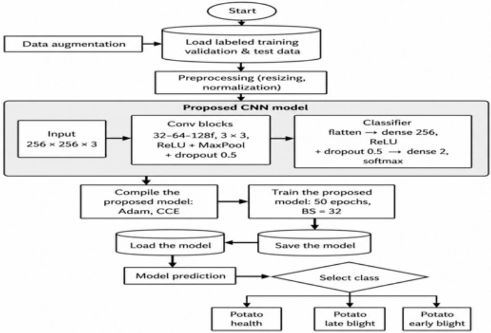
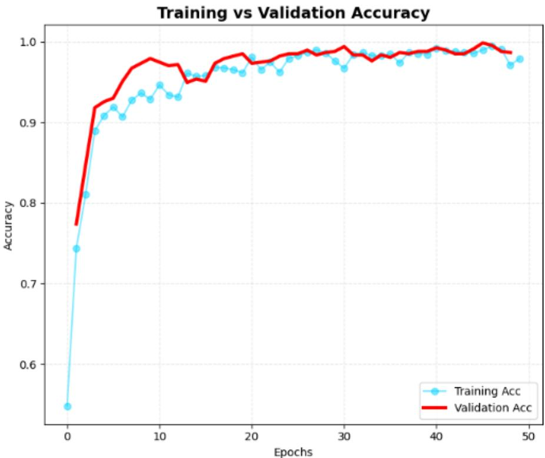
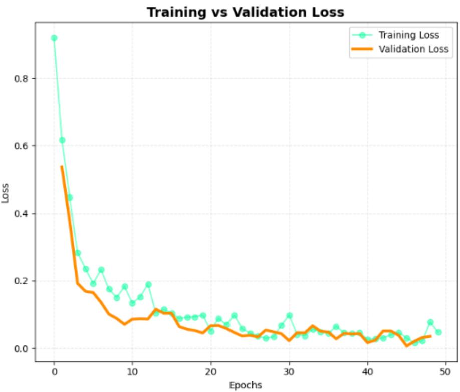
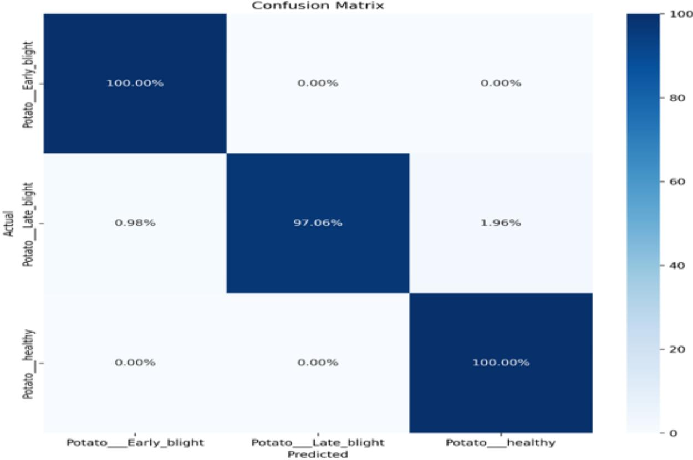

# Detection of Potato Plant Leaf Diseases using Convolutional Neural Networks

Haimanot Bitew Alemayehu1, Simachew Melaku Ayalew2, Chilotie Desalew Mengesha3, Ayisheshim Almaw Bogale4

, Anteneh Birhan Yenew5, Abrham Tegegne Bogale6

6,5,4,3,2,1College of Engineering & Technology, Injibara University, Ethiopia 1haimanot.bitew@inu.edu.et, 2simachew.melaku@inu.edu.et 3chilotie.dessalew@inu.edu.et, 4ayisheshim.almaw@inu.edu.et 5anteneh.birhan@inu.edu.et, 6abrham.tegegne@inu.edu.et

October 15, 2026

## Abstract

Potato is a food-security crop in Ethiopia but production is afected by foliar diseases, especially early blight and late blight. In farming areas disease identification still depends on visual assessment or laboratory diagnosis approaches that can be slow or dificult to access. This study develops a convolutional neural network (CNN) for recognizing three potato leaf conditions: healthy leaves, early blight and late blight. The proposed model was trained using 2,215 images from PlantVillage. Subsequently assessed with an independent field dataset containing 247 images collected from potato farms in Banja Awi Zone, Ethiopia. On PlantVillage the model obtained 99.04% training accuracy, 98.21% validation accuracy and 98.66% test accuracy. On the field dataset, which represents controlled image-capture conditions the model achieved 90.28% accuracy. The study also compares the proposed network with VGG16. Mobilenetv2 using classification performance and computational characteristics. The proposed model contains 446,787 parameters and has an approximate size of 1.70 MB. The model’s training time was shorter, than the training time of VGG16 and MobileNetV2. These results indicate that a compact CNN can provide potato disease classification while reducing computational requirements with potential to benefit smallholder farmers in Ethiopia and similar agricultural contexts.

Keywords: Potato leaf disease, neural network, Deep learning, Late blight, Early blight

## 1 Introduction

Agriculture is a part of food production and livelihoods in Ethiopia and potato is one of the important root and tuber crops grown in the country. Potato production however faces constraints, including foliar diseases. Early blight, caused by Alternaria solani and late blight, caused by Phytophthora infestans are especially important because infections can reduce crop productivity. Previous work in Awi Zone has also reported the presence of late blight in potato-growing districts [1].

In farming communities people identify potato disease by looking at the leaves. Laboratory tests can give proof but are not always easy to get. Image-based automated classification can give preliminary identification from leaf images.

Another challenge is that early and late blight symptoms look similar especially as they develop. This similarity makes it hard to tell them apart. Can influence disease management decisions [2].

CNNs are widely used for image-based plant disease recognition because the convolutional layers can learn patterns directly from training images. Researchers have used them for crops and disease types including potato leaf conditions [3].

For potato disease classification Mahapatra and Panda achieved 96.28% accuracy with a CNN on PlantVillage data [3]. Hoque et al. Achieved 99.14% accuracy with a lightweight CNN [4]. Dey et al. Described a CNN with 204,227 trainable parameters and reported 98.6% test accuracy [5].

These results show the potential of CNNs Performance on controlled image sets does not always match performance on field images. This diference motivates testing with collected images along with benchmark data. This study focuses on a CNN that classifies three classes healthy, early blight and late blight paying close attention to computational eficiency and testing in local field conditions.

The study notice that many existing potato-disease studies have limitations. They often use datasets with uniform backgrounds and lighting. These conditions make classification easier than when photos have varying light, background, leaf angle and symptom appearance. Also evidence specific to potato disease in farms is limited.

So the study. Tested a lightweight CNN that recognizes the three chosen potato leaf conditions and looked at how the model behaves on a benchmark dataset and on images taken from farms in Awi Zone.

## 2 Related Works

The study have seen that recent research focuses more on learning for plant disease recognition. In a review Pacal et al. Covered many studies on deep-learning methods for plant diseases and highlighted CNNs as a main way to classify images [7]. CNNs are useful because they learn feature representations from images during training of needing all visual descriptors to be made manually [8].

## 2.1 CNN-Based Approaches for Potato Disease Identification

The study see that studies on potato leaf classification have used custom CNNs and transfer-learning models. Mahapatra and Panda got 96.28 achieved accuracy using a CNN on PlantVillage images [3]. Hoque et al. Got 99.14 achieved accuracy using a CNN and included regularization techniques, like dropout and batch normalization [4]. Dey et al. Created a CNN with 204,227 parameters and said the test accuracy was 98.6 percent [5].

Mulugeta et al. Evaluated a CNN on PlantVillage images and field samples from Ethiopia.   
Their study reported 85% accuracy 87% precision, 85% recall and 86% F1-score on the data [6].   
These results show the performance gap that can happen when a model shifts, from controlled benchmark images to field observations.

## 2.2 Transfer Learning in Potato Leaf Disease Classification

Transfer learning is an used strategy for plant disease recognition. Architectures such as VGG16, MobileNetV2, ResNet50 InceptionV3 and DenseNet121 have been employed in image classification studies [9]. Ensemble methods have also merged pretrained networks [10]. Pretrained models can provide feature representations but their parameter counts and computational significantly vary a lot. This diference matters a lot when running them on hardware, with power. Transfer learning stays important because it helps balance how well a model performs with how resources it uses.

## 2.3 Real-World Application of CNN Models

A frequent concern in plant-disease classification is whether high benchmark accuracy can transfer to images taken in farm settings. Studies that use PlantVillage-style images might benefit from controlled capture conditions. For instance KWATCHNet reportedly achieved 99.81% on PlantVillage data and 93.34% on field-collected images [12]. This diference shows why an independent field dataset is valuable when testing generalization. Plant-disease classification must therefore be validated in real-world scenarios.

Research on potato disease recognition in Ethiopia is still growing. Existing studies have explored CNN architectures and the classification of blight symptoms [13]. Further investigation that uses collected images and computationally eficient models can help determine how well automated approaches work under regional farming conditions [14].

## 3 Methodology

An experimental design was used to develop, train and evaluate the proposed CNN. The experi mental procedure involved dataset preparation, image preprocessing and augmentation network construction, model training, performance measurement and comparison with transfer-learning baselines. Both benchmark images and collected field images were included. The methodology covers dataset collection and preprocessing, model architecture design, training and hyperparameter optimization and thorough evaluation using both benchmark and collected datasets.

## 3.1 Dataset

The main training and initial evaluation dataset includes 2,215 potato leaf images taken from PlantVillage [15]. These images belong to three classes: early blight and late blight. PlantVillage images were captured under controlled conditions with consistent lighting and uniform background.

## 3.2 Field Validation Dataset

To assess performance under farm conditions 247 extra potato leaf photographs were collected from farms in Banja district Awi Zone, Ethiopia [16]. These photographs were taken with smartphones in light. The images belong to the three target classes and their labels were verified by an agricultural extension expert. The field dataset was kept apart, from model training and validation. Was used for final field testing.

## 3.3 Data Preprocessing

Preprocessing was applied to make the images consistent with the CNN input requirements and to support stable model training. The same general preprocessing procedure was used for the benchmark and field images.

• Image resizing: each photograph was converted to the fixed spatial dimensions required by the network.

• Pixel normalization: image intensity values were transformed to the interval [0, 1] before being supplied to the model.

• Data augmentation: training images were varied using operations such as rotation, horizontal reflection, zooming, and brightness modification [17]. These transformations were intended to expose the model to greater visual variation during learning.

## 3.4 Proposed CNN Architecture

The proposed CNN was designed with a focus on a balance between classification performance and computational cost. Its relatively small parameter count was intended to make subsequent edge-oriented deployment more practical.

  
Figure 1: Proposed CNN Architecture

The architecture contains approximately 446,787 trainable parameters and occupies about 1.70 MB.These characteristics make the proposed network substantially smaller than the compared transfer-learning configurations [18], while maintaining a lightweight architecture.

## 4 Results

## 4.1 Model Training Performance

During training on PlantVillage, the accuracy curves showed convergence of the model on the training and validation data. Training accuracy reached 99.04%, while validation accuracy reached 98.21%. The reported validation loss at the end of training was 0.0833.

## 4.2 Model Test Performance on PlantVillage

Evaluation on the held-out PlantVillage test set produced an overall accuracy of 98.66%. The confusion matrix (Table 1) indicates that most samples were assigned to their correct classes, with a small number of errors distributed among the three categories.

  
Figure 2: Training and Validation Accuracy

  
Figure 3: Training and Validation Accuracy

Table 1: Confusion matrix of the proposed model on the PlantVillage test set.
<table><tr><td></td><td>Healthy</td><td>Early blight</td><td>Late blight</td></tr><tr><td>Healthy</td><td>215</td><td>1</td><td>2</td></tr><tr><td>Early blight</td><td>1</td><td>214</td><td>3</td></tr><tr><td>Late blight</td><td>2</td><td>0</td><td>214</td></tr></table>

  
Figure 4: Confusion Matrix Visualization

## 4.3 Validation on the Field-Collected Dataset

The independent Banja field dataset was more varied than the benchmark images. This is because the photographs were taken under light and showed diferent backgrounds and diferent ways symptoms appeared. The model achieved 90.28% accuracy and a loss of 0.4615 on these 247 images (Table 2).

Table 2: Performance on the field-collected dataset.
<table><tr><td>Metric</td><td>Value</td></tr><tr><td>Accuracy</td><td>90.28%</td></tr><tr><td>Loss</td><td>0.4615</td></tr><tr><td>Dataset size</td><td>247 images</td></tr></table>

## 4.4 Comparison, with Transfer Learning Models

In this section we compare the proposed CNN with transfer learning models. The proposed CNN was evaluated alongside VGG16 and MobileNetV2 after the comparison models had been fine-tuned using the potato-disease classification task. The results are presented in Tables 3 and 4 allowing accuracy, loss, parameter count, model size and training time to be examined together.

Table 3: Comparative model parameters and eficiency.
<table><tr><td>Model</td><td>Total params</td><td>Trainable params</td><td>Model size (MB)</td><td>Avg. time /epoch (s)</td></tr><tr><td>VGG16</td><td>2,261,827</td><td>300,843</td><td>8.63 (total), 0.015 (trainable)</td><td>9.96</td></tr><tr><td>MobileNetV2</td><td>14,716,227</td><td>100,539</td><td>56.14 (total), 1.26 (trainable)</td><td>7.68</td></tr><tr><td>Proposed</td><td>446,787</td><td>446,787</td><td>1.70</td><td>5.58</td></tr></table>

For the PlantVillage comparison the model achieved 99.04% training accuracy and a validation loss of 0.0268 in the experiment. The losses reported for MobileNetV2 and VGG16 were 0.0916 and 0.1804. These values show diferences, in the learning behaviour of the three configurations.

Table 4: Comparative performance on both datasets.
<table><tr><td>Dataset</td><td>Metric</td><td>VGG16</td><td>MobileNetV2</td><td>Proposed</td></tr><tr><td rowspan="5">PlantVillage</td><td>Precision</td><td>96</td><td>98</td><td>96</td></tr><tr><td>Recall</td><td>98</td><td>98</td><td>99</td></tr><tr><td>Accuracy</td><td>97</td><td>97</td><td>99.04</td></tr><tr><td>F1-score</td><td>97</td><td>98</td><td>97</td></tr><tr><td>Loss</td><td>0.1804</td><td>0.0916</td><td>0.0268</td></tr><tr><td rowspan="6">Field dataset</td><td>Precision</td><td>84</td><td>89</td><td>91</td></tr><tr><td>Recall</td><td>83</td><td>86</td><td>91</td></tr><tr><td>Accuracy</td><td>82.59</td><td>86.23</td><td>90.28</td></tr><tr><td>F1-score</td><td>83</td><td>86</td><td>90</td></tr><tr><td>Loss</td><td>0.5691</td><td>0.3816</td><td>0.4615</td></tr><tr><td></td><td></td><td></td><td></td></tr></table>

The accuracy diference between the PlantVillage test evaluation and the field evaluation is 8.38 percentage points for the proposed model. This accuracy diference shows that the field evaluation images are harder to classify than the controlled benchmark images and gives a measure of the proposed models performance, across diferent settings.

## 4.5 Training Eficiency

The proposed model took 5.58 seconds per epoch in the comparison. VGG16 took 9.96 seconds. Mobilenetv2 took 7.68 seconds. Therefore within the setup the proposed network needed less training time than both comparison configurations.

## 5 Discussion

The paper found that the proposed lightweight CNN successfully completed the goal of detecting potato leaf disease. The model performed well on both the PlantVillage dataset and on the field collected dataset.

In the reported experiments the proposed network reached 99.04% training accuracy, 98.21% validation accuracy and 98.66% PlantVillage test accuracy. The field evaluation yielded 90.28% accuracy. The comparison tables show that the proposed configuration had a validation loss than VGG16 and MobileNetV2 in the same experiment.

The gap between training and validation accuracy was small during the reported training run. Yet the performance on the independent field dataset was lower than on PlantVillage. This diference matches the visual variability that comes from field image capture and it shows that benchmark performance should not be taken as the same as field performance.

The paper observed that the proposed architecture has 446,787 parameters and a size of about 1.70 MB. Its epoch time was 5.58 seconds while VGG16 took 9.96 seconds. Mobilenetv2 took 7.68 seconds. These measurements confirm that the proposed architecture is computationally compact in the reported environment.

The paper noted that a compact model can be helpful where computing resources or connectivity are limited. In the field experiment the proposed model achieved 90.28% accuracy. Mulugeta et al. Reported accuracy, on their collected Ethiopian dataset. Because these accuracy results come from datasets and experimental settings results should be seen as findings, not a direct comparison.

## 6 Conclusion

This study developed and evaluated a lightweight CNN for classification of potato leaves into healthy, early blight, and late blight categories. The proposed model achieved 98.66% test accuracy on the selected PlantVillage test set and 90.28% accuracy on the independently collected Banja field dataset. The comparison experiments also examined VGG16 and MobileNetV2 in terms of performance and computational characteristics.

The main contributions of the present study are as follows:

1. Proposing an automated system for the detection of potato leaf diseases using a lightweight CNN.

2. The proposed configuration recorded 98.66% PlantVillage test accuracy, while the comparative experiment reports a 0.0268 validation loss for the proposed model. These results describe the performance of the proposed configuration under the stated experimental setup.

3. On the Banja field dataset, the proposed model obtained 90.28% accuracy. The diference between the PlantVillage test accuracy and the field accuracy was 8.38 percentage points when those two test results are compared directly.

4. The model contains 446,787 trainable parameters and has an approximate size of 1.70 MB. The reported training-time measurements also indicate a lower average epoch time than the VGG16 and MobileNetV2 configurations used for comparison.

The findings indicate that lightweight image-classification models may have practical relevance to precision-agriculture applications. A field-deployed system could provide preliminary disease classification from leaf photographs, although operational treatment decisions should remain supported by appropriate agricultural expertise.

The results indicate potential for further investigation of deep-learning-based potato disease management in Awi Zone. Future work will focus on:

• Increasing the number of Banja field images used for future fine-tuning and evaluation.

• Extending the class set to include additional potato diseases, including bacterial wilt and virus-related symptoms, as well as healthy leaves afected by non-disease stress.

• Developing a mobile application with a simple user interface and local-language support, including Amharic and Awign.

• Combining image-based diagnosis with weather information to investigate an early-warning framework for disease risk.

• Assessing the practical and economic efects of the system through field-based evaluation with farmers.

## References

[1] T. D. Salka, “Plant leaf disease detection and classification using convolution neural networks model: a review,” Artificial Intelligence Review, vol. 58, no. 322, 2025.

[2] “Precision agriculture in the age of AI: A systematic review of machine learning methods for crop disease detection,” ScienceDirect, 2025.

[3] P. Mahapatra and M. Panda, “Convolutional neural network-based classification of potato leaf diseases,” Taylor & Francis, 2025.

[4] M. J. Hoque and M. S. Islam, “An explainable and lightweight CNN framework for robust potato leaf disease classification using Grad-CAM visualization,” Wiley Online Library, 2025.

[5] T. K. Dey, J. Pradhan, and D. A. Khan, “Optimized potato leaf disease detection with an enhanced convolutional neural network,” Taylor & Francis, vol. 70, pp. 1777–1790, 2025.

[6] A. T. Mulugeta, W. Jifara, E. Bogale, T. Desiyo, and A. Mokonnen, “Early detection and classification of potato leaf disease using convolutional neural networks,” Wiley, 2025.

[7] I. Pacal, I. Kunduracioglu, M. H. Alma, M. Deveci, and S. Kadry, “A systematic review of deep learning techniques for plant diseases,” Artificial Intelligence Review, 2024.

[8] “Deep learning in agriculture: Convolutional neural network-based classification of potato diseases for enhanced crop management,” IEEE Xplore, 2024.

[9] “Comparative evaluation of deep features and traditional classifiers in the detection of potato leaf diseases,” Potato Research, 2026.

[10] “Improved potato crop disease classification using ensembled convolutional neural network,” Europe PMC, 2025.

[11] “A lightweight CNN-based explainable approach for potato disease detection with deep evaluation metrics,” IEEE Xplore, 2026.

[12] “KWATCHNet: Fusion of CNNs and BoVW-based features for potato leaf disease classification,” ScienceDirect, 2026.

[13] “A novel image-based disease detection model for potato leaves using CNN,” IEEE Xplore, 2025.

[14] “Optimized CNN-based ensemble deep learning approach for potato leaf disease detection with data augmentation,” Scientific Reports, 2026.

[15] “Deep learning-based potato leaf disease classification and severity assessment,” Discover Applied Sciences, vol. 7, no. 649, 2025.

[16] “A sustainable approach to plant disease detection using deep learning framework for energy-eficient agricultural consumer electronics,” ScienceDirect, 2026.

[17] “Deep learning-based disease detection in potato and mango leaves: a comparative study of CNN, AlexNet, ResNet, and EficientNet,” Scientific Reports, 2025.

[18] “A lightweight hybrid model for scalable and robust plant leaf disease classification,” Scientific Reports, 2025.