# Efficient contextual partial monitoring with gen- eral function approximation

Kapilan Balagopalan, Hao Qin   
Department of Computer Science   
University of Arizona   
Tucson, AZ, USA   
{kapilanbgp, hqin}@arizona.edu   
Chicheng Zhang   
Department of Computer Science   
University of Arizona   
Tucson, AZ, USA   
chichengz@arizona.edu   
Kwang-Sung Jun   
Graduate School of Artificial Intelligence   
POSTECH   
Pohang, South Korea   
kwangsungjun@gmail.com

## Abstract

We study finite stochastic partial monitoring (PM) games with side information, a paradigm of sequential learning with partial feedback. On each round t ∈ [T], both player and environment observe a context and player chooses an action and environment simultaneously chooses an outcome. The player neither observes the outcome nor the loss; instead they only observe a feedback symbol which is partially informative about the outcome. We utilize the Estimation-to-Decisions (E2D) metaalgorithm of Foster et al. (2021) to design E2D.PMSide, a computationally-eficient framework for contextual partial monitoring, which uses an online regression oracle to eficiently estimate the outcome distributions based on historical (context, action, feedback symbol) tuples. Since the exploration rule given by the original E2D algorithm is intractable to compute, we propose two computationally-eficient exploration rules that achieve optimal regret orders in T: in the globally observable setting, our exploration rule is based on ϵ-greedy, while in the locally observable setting, our exploration rule uses inverse gap weighting (Foster & Rakhlin, 2020) which was previously only known to be efective in the bandit setting. We show that a variant of E2D.PMSide named OE2D.PMSide can be combined with ofline regression oracles to give an eficient algorithm with optimal regret when the contexts are drawn independently from a fixed distribution. We evaluate our algorithm on a synthetic label-eficient prediction game and an LLM routing task, in which a learner decides from prompt, uncertainty and internal state features whether to escalate a query from a weak model to a strong one. We show that our method has superior performance than prior approaches.

## 1 Introduction

The contextual stochastic artial monitorin roblem (Bartok & Sze esv´ ari, 2012) is an online´ learning problem where the learner repeatedly takes actions so as to minimize its loss based on the environment’s artial feedback. At the be innin of the ame, the learner and the environment are given a pair $\mathcal { G } = ( L , \Phi )$ of k × d matrices, where k is the number of actions available to the learner and d is the number of outcomes available to the environment. The loss matrix $\pmb { L } \in [ 0 , 1 ] ^ { k \times d }$ records the loss $L _ { a o }$ incurred when the learner plays action a and the environment’s outcome is o. Thefeedback matrix $\bar { \Phi } \in { \Sigma ^ { k \times d } }$ records what the learner is shown instead: playing a against outcome o reveals the feedback s mbol $\Phi _ { a o }$ from a finite alphabet $\Sigma = \{ 1 , \ldots , m \}$ . The interaction between the learner and the environment proceeds over $T$ rounds. At round t the learner observes a context $x _ { t }$ (which may be chosen adversarially), samples an action $A _ { t } \sim p _ { t } \big ( \cdot \mid x _ { t } \big )$ according to a policy $p _ { t } : \mathcal { X } \to \Delta ( k )$ , and the environment draws an outcome $O _ { t }$ from some stochastic distribution $q ^ { * } ( x _ { t } )$ independently of the learner’s randomization. The learner then observes the feedback symbol $\sigma _ { t } = \Phi _ { A _ { t } O _ { i } }$ and incurs the loss $L _ { A _ { t } O _ { t } }$ , which remains hidden. The goal of the learner is to minimize its regret, which is the diference between its expected cumulative loss and that of the best policy in hindsight:

$$
\mathrm { R e g } _ { T } : = \sum _ { t = 1 } ^ { T } ( p _ { t } ^ { \intercal } \boldsymbol { L } \boldsymbol { q } ^ { * } ( \boldsymbol { x } _ { t } ) - \underset { \boldsymbol { \lambda } \in \Delta ( k ) } { \operatorname* { m i n } } \boldsymbol { \lambda } ^ { \intercal } \boldsymbol { L } \boldsymbol { q } ^ { * } ( \boldsymbol { x } _ { t } ) ) .
$$

Contextual stochastic partial monitoring has many applications, such as learning from one-sided feedback (Helmbold et al., 2000; Sculley, 2007), dynamic pricing (Kleinberg & Leighton, 2003), data procurement in crowdsourcing (Singla et al., 2014), and label-eficient prediction (Helmbold et al., 1997). Below we give two examples:

Example 1: LLM routing. Modern Large language models (LLM)-based question-answering service optimizes its cost-eficienc b operating in a h brid mode (Ong et al., 2025; Chen et al., 2023; An et al., 2026; Li et al., 2026) : it keeps two LLMs – one weak but cheap and one strong but expensive; and given a prompt, it judiciously decides which LLMs to route the prompt to, obtaining its response. At time step t, the service receives a new prompt represented by context $x _ { t } ,$ , and the weak model generates a response at negligible cost, and the router then either serves the weak response $( a _ { 1 } )$ or queries the strong model and serves its response $\left( a _ { 2 } \right)$ . The environment’s (hidden) outcome is whether the weak response agrees with the strong one $\left( o _ { 1 } \right)$ or does not agree $\left( o _ { 2 } \right)$ . We take the strong model to be correct and to cost 1 per query, and we incur cost of $\ell _ { 0 1 } > 1$ when a served weak model’s response is wrong. Partial monitoring enters through the feedback: serving the weak response never reveals whether it was correct, so both outcomes yield the same symbol $\odot ,$ and only querying the strong model distinguishes them. The game’s loss matrix and feedback matrix are summarized below:

$$
\begin{array} { r } { L = \mathbf { \Phi } _ { a _ { 2 } } ^ { a _ { 1 } } \left[ \begin{array} { l l } { \mathbf { \Phi } _ { 0 } ^ { o _ { 1 } } } & { \mathbf { \Phi } _ { \ell _ { 0 1 } } ^ { o _ { 2 } } } \\ { \mathbf { \Phi } _ { 1 } ^ { ( 0 } } & { \mathbf { \Phi } _ { 1 } ^ { \ell _ { 0 1 } } } \\ { \mathbf { \Phi } _ { 1 } ^ { ( 1 } } & { \mathbf { \Phi } _ { 1 } ^ { 1 } } \end{array} \right] , \qquad \Phi = \mathbf { \Phi } _ { a _ { 2 } } ^ { a _ { 1 } } \left[ \begin{array} { l l } { \mathbf { \Phi } _ { \odot } ^ { o _ { 1 } } } & { \mathbf { \Phi } _ { \odot } ^ { o _ { 2 } } } \\ { \mathbf { \Phi } _ { \perp } ^ { \odot } } & { \ddots } \end{array} \right] . } \end{array}
$$

This game was also referred to as the Apple Tasting game Helmbold et al. (2000) in earlier works.

Example 2: contextual label eficient prediction game (Lattimore & Szepesvari, 2020; Helmbold´ et al., 1997). Suppose we would like to learn a spam filter online, which predicts whether an email is spam $\left( o _ { 1 } \right)$ or not $\left( o _ { 2 } \right)$ based on its text features $\left( { { x } _ { t } } \right)$ and directs it to the inbox $\left( a _ { 2 } \right)$ or spam folder $\left( a _ { 3 } \right)$ . There is also a third option $( a _ { 1 } )$ where the system can ask the recipient/expert for classification, which is accurate but incurs a fixed cost. Only when the learner chooses action $a _ { 1 }$ does it get to see the true label of the email. The game’s loss matrix and feedback matrix are summarized below:

$$
\begin{array}{c} \begin{array} { r } { \pmb { L } = \ b { a } _ { 2 } } \\ { \pmb { a } _ { 3 } } \end{array} \left[ \begin{array} { r } { o _ { 1 } \pmb { \mathrm { ~ \iota ~ } } ^ { o _ { 2 } } } \\ { \pmb { c } \pmb { \mathrm { ~ \iota ~ } } ^ { c } } \\ { 1 \pmb { \mathrm { ~ \iota ~ } } ^ { 0 } } \\ { 0 \pmb { \mathrm { ~ \iota ~ } } 1 } \end{array} \right] , \qquad \pmb { \Phi } = \ b { a } _ { 2 }  \\ { \pmb { a } _ { 3 } } \end{array} \left[ \begin{array} { r } { o _ { 1 } \pmb { \mathrm { ~ \iota ~ } } ^ { o _ { 2 } } } \\ { \pmb { \mathrm { ~ \iota ~ } } \wedge \ \wedge } \\ { \odot \ \odot } \\ { \odot \ \odot } \end{array} \right] .
$$

Depending on the feedback structure, finite stochastic partial-monitoring games are classified into four categories (classification theorem): trivial, easy, hard, and hopeless games (Bartok et al., 2011;´ Lattimore & Szepesvari, 2020). In hopeless games, the feedback is too uninformative to support ´ meaningful learning, and the regret might grow linearly with the time horizon $( \Omega ( T ) )$ . In contrast, in trivial games, there exists an action which is optimal for every outcome; consequently, they can be solved with zero regret. The main cases requiring more refined analysis are easy $( \Theta ( { \sqrt { T } } ) )$ ) and hard games $\left( \Theta ( T ^ { 2 / 3 } ) \right)$ ). Both classes satisfy global observability, which we define shortly. In addition, easy games satisfy local observability, whereas hard games do not.

Related work: partial monitoring with side information. We adopt the contextual partial monitoring setting of Bartok et al. (2012a); Heuillet et al. (2024), and use the terms´ contextual partial monitoring and partial monitoring with side information interchangeably for it. The classification of easy and hard games established for finite stochastic non-contextual partial monitoring (Bartok et al.,´ 2011; Lattimore & Szepesvari, 2020) extends to this setting, at least in the minimax regret’s dependence´ on $T .$ . First, the non-contextual lower bounds of Bartok et al. (2011) transfer immediately, since a´ non-contextual game can be viewed as a contextual game with a dummy context. Second, for the upper bounds, Foster et al. (2022) shows the equivalence between the Decision-Estimation Coeficient Foster et al. (2021) and the exploration-by-optimization (ExO) objective of Lattimore & Szepesvari (2020),´ which implies that the contextual version of the Estimation-to-Decision algorithm (Foster et al., 2021, Section 8) achieve regrets that match optimal rates given by ExO. These optimal statistical guarantees come at a computational cost, however: the algorithm attaining them selects each action distribution by solving a minimax problem at every round, which is not known to be tractable (see Section 2.3 for further discussion). Furthermore, our work is closely related to Lattimore & Szepesvari (2019;´ 2020); Lattimore (2022); Lattimore & Gyorgy (2021) and Foster et al. (2022). A detailed discussion is deferred to Section $\mathbf { A } .$

Meanwhile, computationally eficient algorithms have been proposed for contextual stochastic partial monitoring, by imposing strong assumptions on the function class that models the true outcome distribution $q ^ { * }$ . Utilizing generalized linear models for modeling (functions of) $q ^ { * }$ , Bartok et al.´ (2012a) proposed CBPSide, a deterministic algorithm based on confidence intervals that extends UCB-style methods from the bandit setting; it applies only to easy games, where it achieves $O ( \sqrt { T } )$ regret. Heuillet et al. (2024) later introduced CBPSide and its randomized counterpart $\mathrm { R a N D C B P S I D E } ^ { * }$ , which cover both classes, attaining $O ( \sqrt { T } )$ regret on easy games and $O ( T ^ { 2 / 3 } )$ on hard ones. Kirschner et al. (2023) studies the linear partial monitoring and its contextual extension, which generalizes contextual finite partial monitoring; however, they require that the mappings from (context, action) to the expected reward and the signal feedback to be (context-independent) linear functions.

This motivates the question that drives our work: are there computationally eficient algorithms for contextual partial monitoring that support general function approximation and attain the optimal rates? In this paper, we answer this question afirmatively. Specifically, we make the following contributions: Contributions. (1) we propose an algorithmic framework E2D.PMSide that reduces stochastic contextual partial monitoring to online regression. It is based on the E2D (Estimation to Decision) framework (Foster et al., 2021), where the algorithm aims at finding an exploration distribution that certifies a low Decision-Estimation Coeficient (See Section 2.3 for its definition); our key observation is that this can be done by optimizing a surrogate objective that trades of between greediness and coverage, which paves the way for the design of eficient algorithms for contextual partial monitoring. (2) Based on the above relaxed objective, we instantiate E2D.PMSide in the globally observable and locally observable games to obtain ϵ-Greedy.PMSide and SquareCB.PMSide algorithms respectively, achieving regret of optimal order in $T$ in their respective settings. These, to our knowled e, are the first com utationall eficient contextual artial monitorin al orithms with generalfunction approximation. (3) When the contexts are iid, we propose a variant of E2D.PMSide named OE2D.PMSide, which is an eficient stochastic contextual partial monitoring algorithm based on ofline regressions, a computational primitive that can admit simpler implementations in practice. (4) We evaluate SquareCB.PMSide in two contextual partial monitoring tasks: label-eficient prediction and LLM routing, and show that it outperforms several baselines.

## 2 Preliminaries

Basic Notation. We write 0 and 1 for the all-zeros and all-ones column vectors, $e _ { 1 } , \ldots , e _ { k }$ for the standard basis vectors, and bold symbols for matrices. For a vector or matrix A, $\left\| A \right\| _ { \infty } = \operatorname* { m a x } _ { i j } \left| A _ { i j } \right|$ is the entrywise maximum norm, $M _ { i }$ denotes the vector generated by i-th row, and $M _ { i j }$ denotes the element at i-th row and $j \mathrm { - t h }$ column. For two distributions u and $v , D _ { \mathrm { H } } ^ { 2 } \big ( u \big | v \big )$ denotes their squared Hellinger distance. Let $\mathrm { c o } (  { \boldsymbol { S } } )$ denote the convex hull of a set $s$ . For a subset $A \subseteq [ k ]$ we write $\Delta ( \mathcal { A } ) \dot { : = } \left\{ \lambda \in \Delta ( k ) : \lambda _ { b } = 0 \right.$ for all $b \notin A \}$ for the face of $\Delta ( k )$ supported on A. Elements of $\Delta ( \mathcal { A } )$ remain k-dimensional vectors; they simply place no mass outside $\bar { \mathcal { A } }$

Signal matrix. (Komiyama et al. (2015)) Given a feedback matrix $\Phi ,$ , it is convenient to describe the feedback of a single action as a linear map. The signal matrix of action a is the $m \times d$ matrix $S _ { a }$ with $S _ { a } [ \sigma , o ] = 1 \ \{ \stackrel { \bf { \bar { \Phi } } } { \Phi _ { a o } } = \sigma \}$ . Writing $\Delta ( n )$ for the probability simplex on n elements, if the outcome is drawn from $q \in \Delta ( d )$ then $A _ { a } q \in \Delta ( \dot { m } )$ is precisely the distribution of the symbol observed on playing a. Two candidate outcome distributions $q _ { 1 } , q _ { 2 }$ are therefore distinguishable through action a exactly to the extent that $S _ { a } q _ { 1 }$ and $S _ { a } q _ { 2 }$ difer; and it is this quantity, rather than the gap between q1 and $q _ { 2 }$ themselves, that governs what the learner can hope to identify. Recall that in our stochastic contextual partial monitoring problem, each round is preceded by a context $x _ { t }$ drawn from a set X, and the outcome distribution depends on it: outcomes follow $q ^ { * } ( \bar { x _ { t } } )$ for an unknown $q ^ { * } : \mathcal { X } \to \Delta ( d )$ The learner is given a model class $\mathcal { Q } \subseteq \{ q : \mathcal { X } \to \Delta ( d ) \}$ }, which we assume is well-specified.

Assumption 2.1 (Realizability). The model class $\mathcal { Q }$ contains the true outcome distribution $q ^ { * }$

## 2.1 Structure of partial monitoring games

We now review some basic structures of partial monitoring games revealed in prior works.

Definition 2.1 (Cell decomposition, Bartok et al. (2012b))´ . The cell $\scriptstyle { { \mathcal { C } } _ { a } }$ of action a is defined as the subset of outcome distributions where action a is optimal. Formally, $\mathcal { C } _ { a } = \{ q \in \Delta ( d ) : ( e _ { a } - e _ { b } ) ^ { \top } L q \leq$ $0 , \forall b \in [ k ] \}$ . The collection $\{ { \mathcal { C } } _ { a } : a \in [ k ] \}$ is called the cell decomposition.

Neighborhood graph (Lattimore & Szepesvari, 2020).´ Cells that meet in a face of dimension $d - 2$ corres ond to actions that can be o timal simultaneousl , and this adjacenc structure or anizes the analysis that follows. Call an action Pareto optimal when its cell is full dimensional, dim $( \bar { \mathcal { C } } _ { a } ) = d - 1$ taking the dimension of a polytope to be that of its afine hull, and write Π for the set of such actions to ether with $\Delta ( \Pi ) : = \{ \bar { \lambda } \in \bar { \Delta } ( \bar { k } ) : \lambda _ { b } = 0$ for all $b \notin \Pi \}$ for the corresponding face of $\Delta ( k )$ . The remaining actions are of two kinds: a is degenerate when $\mathcal { C } _ { a } \neq \emptyset$ but dim $\bar { ( \mathcal { C } _ { a } ) } \leq \bar { d } - 2$ , and dominated when $\mathcal { C } _ { a } = \varnothing$ . Since dim $( \Delta ( d ) ) = d - \bar { 1 }$ , neither kind is ever uniquely optimal; each is optimal only on a set of measure zero. A game with no degenerate actions is called non-degenerate, and two actions are duplicates when their loss rows coincide, $( e _ { a } - e _ { b } ) ^ { \intercal } \mathbf { { L } } = \mathbf { { 0 } }$ Two Pareto optimal actions are neighbors when their cells meet in a face of the largest dimension short of coincidence, dim $( \mathcal { C } _ { a } \cap \mathcal { C } _ { b } ) \stackrel { \cdot } { = } d - 2$ ; the intersection reaches dimension $d - 1$ only for duplicates. Writing E for the resulting edge set, (Π, E) is the neighborhood graph of $\mathcal { G }$

## 2.2 Observability

In partial-monitoring games, the learner observes feedback rather than the losses or rewards associated with its actions. Therefore, a central challenge is to infer (diferences of) losses of actions from the observed feedback symbol. Whether this is possible depends on the interplay between the loss matrix and the feedback matrix.

Definition 2.2 (Global observability, adapted from Bartok et al. (2012b) and Lattimore & Szepesv ´ ari´ (2020)). A partial monitoring game is globally observable if, for every pair of actions $( a , b ) \in [ \dot { k } ] \times [ k ]$ there exists a witnessfunction $w _ { ( a , b ) } : [ k ] \times \Sigma  \mathbb { R }$ such that

$$
L _ { a o } - L _ { b o } = \sum _ { c = 1 } ^ { k } w _ { ( a , b ) } ( c , \Phi _ { c o } ) , \qquad { \mathrm { f o r ~ a l l } } o \in [ d ] .
$$

Definition 2.3 (Local observability, Lattimore & Szepesvari (2020))´ . A globally observable, nondegenerate partial monitoring game is locally observable if for every edge $e = ( a , b ) \in \mathcal { E }$ of the neighborhood graph the witness function $w _ { e }$ of Definition 2.2 may be chosen to be supported only on the endpoints, that is $w _ { e } ( c , \cdot ) \equiv 0$ for all $c \notin \{ a , b \}$ , so that

$$
L _ { a o } - L _ { b o } = \sum _ { c \in \{ a , b \} } w _ { e } ( c , \Phi _ { c o } ) , \qquad { \mathrm { f o r ~ a l l } } o \in [ d ] .
$$

By definition, every locally observable game is a globally observable game. Under global observability, the loss diference $L _ { a o } - L _ { b o }$ may depend on feedback from all actions $c \in [ k ]$ , whereas under local observability, it can be expressed using only the feedback from the sequence of actions in $\mathcal { E }$ connecting a and b. Consequently, locally observable games permit more direct loss-diference estimation than globally observable games in general. Since trivial games and hopeless games are not interesting from an algorithm design perspective, for the remainder of the paper we focus on globally observable games.

Assumption 2.2 (Global observability and non-degeneracy; Lattimore & Szepesvari (2020))´ . We assume that the partial-monitoring game $\mathcal { G } = ( L , \breve { \Phi } )$ is globally observable, non-degenerate, and contains no duplicate actions.

For simplicity, we maintain this assumption throughout the remainder of the analysis, following Lattimore & Szepesvari (2020). We discuss implications of non-degeneracy and possible relaxations´ in Appendix C.4.

## 2.3 The E2D meta-algorithm for interactive decision making

Foster et al. (2021) proposes E2D (Estimation-to-Decision), a meta-algorithm for interactive decision making, which reduces interactive decision making to online estimation. The E2D meta-algorithm yielded many practical algorithms for decision making, especially for contextual bandit problems (e.g., Foster & Rakhlin, 2020; Zhu et al., 2022; Zhu & Mineiro, 2022; Zhang et al., 2023). In a nutshell, at each round, it calls an online model estimation oracle to obtain an estimated model $\hat { q } ;$ based on $\hat { q }$ and context $x ,$ it solves a minimax o timization roblem to obtain an ex loration distribution $p$ to take actions. Specialized to partial monitoring, the optimization problem can be written as:

$$
\begin{array} { r l } & { \underset { p \in \Delta ( k ) } { \operatorname* { m i n } } \underset { q \in \mathcal { Q } _ { x } , \lambda \in \Delta ( k ) } { \operatorname* { s u p } } \biggl [ p ^ { \top } L q ( x ) - \lambda ^ { \top } L q ( x ) - \gamma \cdot \mathbb { E } _ { a \sim p } \left[ D _ { \mathrm { H } } ^ { 2 } \big ( S _ { a } \hat { q } ( x ) \big | S _ { a } q ( x ) \big ) \right] \biggr ] , } \\ & { } \end{array}\tag{1}
$$

where $\mathcal { Q } _ { x } : = \left\{ q ( x ) : q \in \mathcal { Q } \right\} \subseteq \Delta ( d )$ denotes the model class $\mathcal { Q }$ restricted to $x .$ The objective explicitly trades of between regret and information gain: the first part $p ^ { \intercal } L q ( x ) - \lambda ^ { \intercal } L q ( x )$ encourages $p$ to have a low regret, while the second part $- \gamma \cdot \mathbb { E } _ { a \sim p } \left\lceil D _ { \mathrm { H } } ^ { 2 } \big ( S _ { a } \hat { q } ( x ) \big | S _ { a } q ( x ) \big ) \right\rceil$ encourages $p$ to explore diverse actions to correct $\hat { q }$ and gain new information about $q ^ { * }$ . The minimax value of the objective is called the Decision-Estimation Coeficient (DEC) (Foster et al., 2021), denoted as dec ${ \bf \Phi } _ { \gamma } ( \tilde { q } ( x ) , \mathcal { Q } _ { x } )$ To hel the learner make decisions eficientl , E2D re uires access to an oracle that can rovide accurate estimation of the outcome distributions for all contexts online, which, when specialized to our stochastic contextual partial monitoring setting, is defined as:

Definition 2.4. An online outcome estimation oracle $\mathrm { A l g } _ { \mathrm { O n } }$ is an algorithm that estimates the unknown outcome distribution $q ^ { * }$ from the data in a sequential fashion. That is, at each round $t \in [ T ]$ given the feedback symbols collected so far, the oracle produces an estimate

$$
\begin{array} { r } { \hat { q } _ { t } = \mathrm { A l g } _ { \mathrm { O n } } ^ { ( t ) } \Big ( \big \{ ( A _ { s } , x _ { s } , \sigma _ { s } ) \big \} _ { s = 1 } ^ { t - 1 } \Big ) \in \mathrm { c o } ( \mathcal { Q } ) , } \end{array}
$$

where $\mathrm { A l g } _ { \mathrm { O n } } ^ { ( t ) }$ denotes the map applied at round t and $\left\{ ( A _ { s } , x _ { s } , \sigma _ { s } ) \right\} _ { s = 1 } ^ { t - 1 }$ is the history available at the beginning of round t (note that $\sigma _ { s }$ =is an observed feedback symbol, but not the incurred loss).

$\mathrm { A l g _ { O n } }$ is said to satisfy a Hellinger regret bound of $\overline { { \mathrm { R e g } } } _ { \mathrm { O n } } ^ { \mathrm { H } } \left( \mathcal { Q } , T , \delta \right)$ if its online Hellinger regret

$$
\mathrm { R e g } _ { \mathrm { O n } } ^ { \mathrm { H } } \left( \mathcal { Q } , T \right) : = \sum _ { t = 1 } ^ { T } \mathbb { E } _ { a \sim p _ { t } ( \cdot | x _ { t } ) } \left[ D _ { \mathrm { H } } ^ { 2 } \big ( S _ { a } \hat { q } _ { t } ( x _ { t } ) \big | S _ { a } q ^ { * } ( x _ { t } ) \big ) \right] ,\tag{2}
$$

is at most $\overline { { \mathrm { R e g } } } _ { \mathrm { O n } } ^ { \mathrm { H } } \left( \mathcal { Q } , T , \delta \right)$ with probability $1 - \delta .$

We note that instead of requiring $\hat { q } _ { t } ( x _ { t } )$ to be pointwise close to $q ^ { * } ( x _ { t } )$ on avera e Definition 2.4 only requires their associated feedback distributions to be close on average. This is reasonable since we can only use the feedback $\sigma _ { s } { ' } \mathrm { s }$ to guide our online learning of ${ \hat { q } } _ { t } ;$ in the extreme case, it is possible that diferent $q ^ { * } { \bf s }$ result in the same feedback distribution, making the underlying $q$ unidentifiable. Appendix B gives two concrete examples of the online outcome estimation oracle. For example, For finite $\mathcal { Q } ,$ Vovk’s aggregating algorithm (Vovk, 1995) attains $\overline { { \mathrm { R e g } } } _ { \mathrm { O n } } ^ { \mathrm { H } } ( \mathcal { Q } , T , \delta ) = O ( \log ( | \mathcal { Q } | / \delta ) )$ Equipped with an online outcome estimation oracle, E2D is known to have a regret bound of

$$
\mathrm { R e g } _ { T } \leq O \left( T \operatorname* { m a x } _ { x \in \mathcal { X } } \deg _ { \gamma } ( \widehat { q } ( x ) , \mathcal { Q } _ { x } ) + \gamma \overline { { \mathrm { R e g } } } _ { \mathrm { O n } } ^ { \mathrm { H } } \left( \mathcal { Q } , T , \delta \right) \right) ,
$$

which translates to $O ( T ^ { 2 / 3 } )$ and $O ( \sqrt { T } )$ regrets with optimal tuning $\mathrm { o f } \ \gamma$ in globally and locally observable settings, respectively (Foster et al., 2021). However, a key drawback of the naive E2D algorithm is that directly solving the minimax optimization problem (Equation (1)) is computationally intractable: although the objective is linear in $p ,$ it is not jointly concave in $( q , \lambda )$ . Nevertheless, it was shown in Foster et al. (2021) that as long as distribution p certifies a small value of decγ $( \hat { q } ( x ) , \mathcal { Q } _ { x } )$ (Equation (1)), i.e., it achieves a small $\mathcal { V } _ { \gamma } ^ { \mathrm { d e c } } ( \hat { q } ( x ) , \mathcal { Q } _ { x } , p )$ value, E2D will have small regret. As we will see, our algorithm design will utilize this observation to address the computational challenge.

## 3 Efficient algorithm for contextual partial monitoring

In this section we present E2D.PMSide (Estimation-to-Decision for Partial Monitoring with Side information, Al orithm 1), which can be viewed as a s ecialization of the E2D meta-al orithm. At every round t, E2D.PMSide obtains an outcome distribution estimate $\hat { q } _ { t } ( \cdot )$ (line 4) from an online outcome estimation oracle with Hellinger regret guarantee. Then it uses $\hat { q } _ { t } ( \cdot )$ and observed context $x _ { t }$ to construct an exploration distribution $p _ { t }$ that approximately minimizes an objective function $\mathcal { V } _ { \gamma } ( \hat { q } _ { t } ( x _ { t } ) , p )$ , a relaxation of the DEC objective $\mathcal { \dot { V } } _ { \gamma } ^ { \mathrm { d e c } } ( \hat { q } ( x _ { t } ) , \dot { \mathcal { Q } } _ { x _ { t } } , p )$ (line 5). The choice of $p _ { t }$ balances two competing demands. The first term in the objective measures the loss of $p _ { t }$ relative to a comparator policy $\lambda$ under the estimated outcome distribution $\hat { q } _ { t } ( x _ { t } )$ , and is small when $p _ { t }$ exploits what has been learned. The second term is a coverage term (which we will define shortly) that measures the amenability of using feedback from following p in evaluating $\lambda \mathbf { \dot { s } }$ loss; the smaller the coverage value the better $p$ is for exploration. The exploration parameter $\gamma$ fixes the rate of exchange between the two. We now define coverage formally.

Algorithm 1 E2D.PMSide   
1: parameters:   
Online estimation oracle $\mathrm { A l g } _ { \mathrm { O n } }$   
Exploration parameter $\gamma > 0$   
2: for $t \overset { \cdot } { = } 1 , 2 , \cdots , \overset { \cdot } { T }$ do   
3: Receive context $x _ { t }$   
4: Compute estimate $\hat { q } _ { t } = \operatorname { A l g } _ { \operatorname { O n } } ^ { ( t ) } \big ( \big \{ A _ { s } , x _ { s } , \sigma _ { s } \big \} _ { s = 1 } ^ { t - 1 } \big )$   
5: Find $p _ { t }$ that approximately minimizes   
$\mathcal { V } _ { \gamma } ( \hat { q } _ { t } ( x _ { t } ) , p ) : = \operatorname* { s u p } _ { \lambda \in \Delta ( \Pi ) } \underbrace { p ^ { \top } L \hat { q } _ { t } ( x _ { t } ) - \lambda ^ { \top } L \hat { q } _ { t } ( x _ { t } ) } _ { \mathrm { e x p l o i t } } + \frac { 1 } { \gamma } \cdot \underbrace { \mathrm { C o v e r a g e } ( p , \lambda ) } _ { \mathrm { e x p l o r e } } .$   
using ϵ-Greedy.PMSide (Alg. 2) or SquareCB.PMSide (Alg. 3) for globally and locally   
observable settings, respectively.   
$_ 6 \colon$ Choose action $A _ { t } \sim p _ { t }$ and update the estimation oracle with $( A _ { t } , x _ { t } , \sigma _ { t } )$   
7: end for

Definition 3.1 (Coverage). We define the coverage of action distribution $p \in \Delta ( k )$ for action distribution $\lambda \in \Delta ( k )$ for partial monitoring game $\bar { \mathcal { G } } = ( L , \Phi )$ as

$$
\mathrm { C o v e r a g e } ( p , \lambda ) : = \operatorname* { s u p } _ { q _ { 1 } , q _ { 2 } \in \Delta ( d ) } \frac { ( ( \lambda - p ) ^ { \top } L ( q _ { 1 } - q _ { 2 } ) ) ^ { 2 } } { \mathbb { E } _ { a \sim p } [ D _ { \mathrm { H } } ^ { 2 } ( S _ { a } q _ { 1 }  S _ { a } q _ { 2 } ) ] } \cdot \mathrm { ( w i t h ~ c o n v e n t i o n ~ \frac { \partial 0 } { \partial \eta } = 0 ) }
$$

To make sense of this definition it may be helpful to think about the following hypothetical ofline policy evaluation problem in non-contextual stochastic partial monitoring: suppose the outcome distribution $q ^ { * }$ is unknown; we use a behavior policy $p$ to take action and collect feedback symbols, so as to estimate the expected loss of λ (more precisely, the expected loss diference between λ and $p ) ;$ how much utility does each data point carry for such evaluation? Let $q _ { 1 }$ be $q ^ { * }$ and $q _ { 2 }$ be ${ \hat { q } } ,$ our estimate of $q ^ { * }$ based on data. The numerator thus measures the squared policy evaluation error; the denominator measures the in-distribution estimation error, which we expect to decrease with more samples collected. A small $\mathrm { C o v e r a g e } ( p , \lambda )$ implies that feedback signals via following $p$ is useful in estimating p and λ’s loss diference.

Our covera e in the above definition bears some similarities with the covera e defined in the contextual bandit setting by Qin & Zhang (2026b), but is diferent in two important ways: (1) here, the numerator and the denominator are with respect to the loss matrix (evaluation error) and the signal matrix (information gain), respectively, where in the bandit setting they are defined both using the loss function; (2) it is well-known that for some globally observable partial monitoring problems the absolute value of a loss of an action is not identifiable (Lattimore & Szepesvari, 2020, Example 37.9),´ and only loss diferences between action pairs is identifiable; thus, the numerator in the coverage measures the diference of losses of two policies. Our coverage also shares some similarities with global and local alignment constants of (Kirschner et al., 2023, Eqs. (15), (16)), whose numerator $\overline { { ( \langle \phi _ { a } - \phi _ { b } , v \rangle ) ^ { 2 } } }$ can be interpreted as some estimation error of the loss diferences between two actions $a , b ,$ , and the denominator $\| M _ { c } v \| ^ { 2 }$ can be interpreted as the information gain of taking action c in correcting the model estimation error v. Intead of measuring coverage between an action and a pair of actions, our definition measures the coverage between two action distributions.

## We now present the regret guarantee of E2D.PMSide:

Theorem 3.1 (Regret of E2D.PMSide). Suppose $\mathrm { A l g _ { O n } }$ has a Hellinger regret bound $\overline { { \mathrm { R e g } } } _ { \mathrm { O n } } ^ { \mathrm { H } } \left( \mathcal { Q } , T , \delta \right)$ Fix $\gamma > 0$ . Then, for any $\delta \in ( 0 , 1 )$ , with probability at least $1 - \delta$

$$
\mathrm { R e g } _ { T } \leq T \cdot \operatorname* { m a x } _ { t = 1 } ^ { T } \mathcal { V } _ { \gamma } \big ( \hat { q } _ { t } ( x _ { t } ) , p _ { t } \big ) + \gamma \cdot \overline { { \mathrm { R e g } } } _ { \mathrm { O n } } ^ { \mathrm { H } } \left( \mathcal { Q } , T , \delta \right) .
$$

Its proof is deferred to Appendix C.1. In a nutshell, our theorem follows from the meta-regret theorem of Foster et al. (2021): as long as all action distributions $p _ { t }$ certify that $\deg _ { \gamma } ( \hat { q } ( x ) , \mathcal { Q } _ { x } )$ has an upper bound, E2D has a small regret in terms of that bound. Indeed, our $p _ { t }$ here certifies that

Algorithm 2 ϵ-Greedy.PMSide for globally observable games   
1: parameters:   
2: Context x with predicted outcome distribution ${ \hat { q } } ( x )$   
3: Exploration parameter $\gamma > 1 6 k ^ { 2 } \beta ^ { 2 }$   
4: Let ˆb ∈ arg min $\boldsymbol { \mathrm { \Phi } } _ { a \in \Pi } e _ { a } ^ { \top } \pmb { L } \hat { q } ( \boldsymbol { x } )$   
5: return $\boldsymbol { p } = \big ( 1 - \epsilon \big ) \boldsymbol { e } _ { \hat { b } } + \epsilon \frac { 1 } { k } \mathbf { 1 }$ for $\epsilon = k \beta / \sqrt { \gamma }$   
de $\therefore \textstyle ( { \hat { q } } ( x ) , \ Q _ { x } )$ is u er bounded b $\mathcal { V } _ { \gamma } ( \hat { q } _ { t } ( x _ { t } ) , p _ { t } )$ (Please see Remark $3 )$ ; and ideall , we should   
choose exploration distribution $\mathbf { \Lambda } _ { p _ { t } } \mathbf { \dot { s } }$ that make $\mathcal { V } _ { \gamma } ( \hat { q } _ { t } ( x _ { t } ) , p _ { t } ) ^ { , }$ s as small as possible.   
Unfortunatel , findin $p _ { t }$ that exactl minimizes $\mathcal { V } _ { \gamma } ( \hat { q } _ { t } ( x _ { t } ) , p )$ ma still be com utationall intractable;   
to see this, note that the definition of coverage involves supremum over a pair of outcome distributions   
$q _ { 1 } , q _ { 2 } .$ , which is not a convex optimization problem. This motivates the question: can we find   
computationally eficient exploration rules $x \mapsto p ( x )$ that approximately minimize $\mathcal { V } _ { \gamma } \big ( \hat { q } _ { t } ( x ) , p ( x ) \big )$   
for all $x ?$ Indeed, we show in the followin two subsections that such eficient ex loration rule exist   
and ield eficient implementations of E2D.PMSide.   
3.1 Efficient algorithm for globally observable games   
We show that in the loball observable settin ϵ-Greedy.PMSide $( \mathrm { A l g } . 2 ) ,$ , yields a policy $p$ satisfying   
$\mathcal { V } _ { \gamma } ( \hat { q } ( x ) , p ( x ) ) \leq O ( \sqrt { 1 / \gamma } )$ , which gives an $O ( T ^ { 2 / 3 } )$ re ret bound when lu ed into E2D.PMSide.   
ϵ-Greedy.PMSide identifies the empirical best action $\hat { b }$ (Line 4) and assigns it probability $1 - \epsilon .$   
spreading the remaining ϵ uniformly over all k actions (Line 5).   
Lemma 3.1 (Guarantee for Alg. 2 for globally observable games). Let $\mathcal { G } = \left( L , \Phi \right)$ be a globally observ-   
able partial monitoring game in the sense of Definition 2.2, and set $\beta : = \operatorname* { m a x } _ { ( a , b ) \in [ k ] \times [ k ] } \| w _ { ( a , b ) } \| _ { \infty } .$   
We have for any $\hat { q } \in \Delta ( d )$   
$\mathcal { V } _ { \gamma } \big ( \widehat { q } , p \big ) \leq \operatorname* { m a x } _ { \lambda \in \Delta ( \Pi ) } p ^ { T } L \widehat { q } - \lambda ^ { T } L \widehat { q } + \frac { 1 6 \beta ^ { 2 } } { \gamma } \sum _ { c = 1 } ^ { k } \frac { 1 } { p _ { c } } .$   
Thus, for every $\gamma > 1 6 k ^ { 2 } \beta ^ { 2 }$ , every $\hat { q } \in \Delta ( d )$ , Alg. 2 outputs $p$ such that   
$\mathcal { V } _ { \gamma } \left( \hat { q } , p \right) \leq O \left( k \beta \sqrt { \frac { 1 } { \gamma } } \right) .$   
Proof is deferred to A endix C.2. Furthermore, b combinin Theorem 3.1 and Lemma 3.1, our   
algorithm achieves the following minimax rate for globally observable games.   
Corollary 1 (Re ret of E2D.PMSide for loball observable ames). Su ose $\mathrm { A l g } _ { \mathrm { O n } }$ has a   
Hellinger regret bound $\overline { { \mathrm { R e g } } } _ { \mathrm { O n } } ^ { \mathrm { H } } ( \mathcal { Q } , T , \delta )$ . For a globally observable partial monitoring game   
$( L , \Phi )$ , set $\bar { \beta } = \operatorname* { m a x } _ { ( a , b ) \in [ k ] \times [ k ] } \left\| \boldsymbol { w } _ { ( a , b ) } \right\| _ { \infty }$ . Then,for any $\delta \in ( 0 , 1 )$ , andfor any large enough $T$   
that satisfies $\gamma > 1 6 k ^ { 2 } \beta ^ { 2 }$ with $\gamma = ( T k \beta / \overline { { \mathrm { R e g } } } _ { \mathrm { O n } } ^ { \mathrm { H } } ( \mathcal { Q } , T , \delta ) ) ^ { 2 / 3 }$ , with probability ofat least $1 - \delta ,$   
E2D.PMSide run with $A l g 2$ as the exploration rule satisfies,   
$\mathrm { R e g } _ { T } \leq O \bigg ( \sqrt [ 3 ] { T ^ { 2 } k ^ { 2 } \beta ^ { 2 } \overline { { \mathrm { R e g } } } _ { \mathrm { O n } } ^ { \mathrm { H } } ( \mathscr { Q } , T , \delta ) } \bigg )$   
In the setting when $\mathcal { Q }$ is finite, setting the estimation oracle to be Vovk’s aggregating algorithm,   
the above regret bound is of order $O ( \sqrt [ 3 ] { T ^ { 2 } k ^ { 2 } \beta ^ { 2 } \log | \mathcal { Q } | } )$ In the noncontextual setting, when   
$\mathcal { Q } = \Delta ( d _ { \mathcal { Q } } )$ , we can set the estimation oracle to be any eficient exp-concave optimization algo-   
rithm (Hazan et al., 2007), which has $\overline { { \mathrm { R e g } } } _ { \mathrm { O n } } ^ { \mathrm { H } } ( \mathcal { Q } , T , \delta ) = O ( d _ { \mathcal { Q } } \ln T )$ , implying E2D.PMSide has   
a regret of $\tilde { O } \big ( \sqrt [ 3 ] { T ^ { 2 } k ^ { 2 } \beta ^ { 2 } d _ { \mathcal { Q } } } \big )$ QThis matches the lower bound of non-contextual stochastic partial   
Qmonitoring (Bartok et al., 2011) with a simple computationally eficient approach.´   
3.2 Efficient algorithm for locally observable games   
In the locally observable setting, we aim to give an eficient exploration rule that finds $p$ such that   
which ields a re ret hen l ed into E2D PMSide Under

$$
\mathcal { V } _ { \gamma } ( \widehat { q } _ { t } ( x ) , p ( x ) ) \leq O ( \frac { 1 } { \gamma } )
$$

$$
O ( \sqrt { T } )
$$

global observability, to estimate the loss diference between two actions $( a , b )$ , its associated witness function $w _ { ( a , b ) }$ may be supported on all actions (Definition 2.2), so recovering the diference between a ( )single pair of actions can require playing all k of them; this is why the certifying policy of Algorithm 2 mixes with the uniform distribution over [k]. In contrast, under local observability, the loss diference between two neighboring Pareto optimal actions can be expressed using the feedback of those two actions alone (Definition 2.3), and the diference between an arbitrary pair of Pareto optimal actions is then recovered by chaining such local relations along a path joining them in the neighborhood graph, so that only the actions encountered along that path need be played. Perhaps surprisingly, we show that Inverse Gap Weighting, an exploration rule that was previously known to be efective for exploration in contextual bandits (SquareCB.PMSide, Alg. 3), yields a optimal-regret algorithm here without modification.

Lemma 3.2 (Guarantee for Alg. 3 for locally observable games). Let $\mathcal { G } = \left( L , \Phi \right)$ be a locally observable partial monitoring game in the sense of Definition 2.3. For every $\gamma > 0 .$ and every $\hat { q } \in \Delta ( d )$ , Alg. 3 run with $\kappa = \frac { \gamma } { 8 k m ^ { 2 } }$ and $\mu = k ,$ , outputs p such that

$$
\mathcal { V } _ { \gamma } \left( \hat { q } , p \right) \leq O \left( \frac { m ^ { 2 } k ^ { 2 } } { \gamma } \right) .
$$

Proof is deferred to Appendix C.3. Furthermore, by combining Theorem 3.1 and Lemma 3.2, we can achieve the following minimax rate for locally observable games.

Corollary 2 (Regret of E2D.PMSide for locally observable games). Suppose $\mathrm { A l g } _ { \mathrm { O n } }$ has a Hellinger regret bound $\overline { { \mathrm { R e g } } } _ { \mathrm { O n } } ^ { \mathrm { H } } ( \mathcal { Q } , T , \delta )$ . Let Assumption 2.2 hold, and suppose in addition that the game is locally observable. Then, for any $\delta \in ( 0 , 1 )$ , with probability of at least $1 - \delta ,$ E2D.PMSide run with Alg. 3 as the exploration rule (with $\begin{array} { r } { \kappa = \frac { \gamma } { 8 k m ^ { 2 } } } \end{array}$ and $\mu = k )$ , with $\gamma = ( T m ^ { 2 } k ^ { 2 } / \overrightarrow { \mathrm { R e g } } _ { \mathrm { O n } } ^ { \mathrm { H } } ( \mathcal { Q } , T , \delta ) ) ^ { 1 / 2 }$ satisfies

$$
\mathrm { R e g } _ { T } \leq O \left( \sqrt { T \cdot m ^ { 2 } k ^ { 2 } \cdot \overline { { \mathrm { R e g } } } _ { \mathrm { O n } } ^ { \mathrm { H } } ( \mathcal { Q } , T , \delta ) } \right) .
$$

For finite $\mathcal { Q } ,$ , Vovk’s aggregating algorithm gives $O ( \sqrt { T m ^ { 2 } k ^ { 2 } \log | \mathcal { Q } | } )$ ; in the non-contextual setting with $\mathcal { Q } = \Delta ( d _ { \mathcal { Q } } )$ , an exp-concave oracle (Hazan et al., 2007) gives $\tilde { O } ( \sqrt { T m ^ { 2 } k ^ { 2 } d _ { \mathcal { Q } } } )$ . Both match the Qminimax rate in $T$ Qfor this class. We next explain the key idea underlying the proof of Lemma 3.2, which hinges on a sparse relaxation of the objective $\mathcal { V } _ { \gamma } \big ( \widehat { q } , p \big )$

## 3.2.1 Sparse relaxation of $\mathcal { V } _ { \gamma } \big ( \widehat { q } , p \big )$

We aim to find tractable relaxations of $\mathcal { V } _ { \gamma }$ which sheds lights on finding eficient exploration strategies for approximately minimizing $\mathcal { V } _ { \gamma }$ . In particular, we aim to exploit the structured feedback mechanism of locally observable games to restrict exploratory actions to those lying along paths that connect pairs of actions whose loss diferences are of interest. The neighborhood graph $\bar { ( \Pi , \mathcal { E } ) }$ is connected. Assign an arbitrary action root as the root and choose a spanning in-tree $\bar { \boldsymbol { \tau } }$ (See Figure 1) such Tthat, there is a unique directed path (a) from any action a ∈ Π to root ∈ Π. Now, we can relax the $\mathcal { V } _ { \gamma } \big ( \widehat { q } , p \big )$ as follows,

Lemma 3.3. Let $\mathcal { G } = \left( L , \Phi \right)$ be a locally observable partial monitoring game in the sense of Definition 2.3. Let $\tau$ be an in-tree of the neighborhood graph. For all $p \in \bar { \Delta ( \Pi ) }$ , we have

$$
\mathcal { V } _ { \gamma } \big ( \hat { q } ( x ) , p \big ) \leq \operatorname* { m a x } _ { \lambda \in \Delta ( \Pi ) } p ^ { T } L \hat { q } ( x ) - \lambda ^ { T } L \hat { q } ( x ) + \frac { 3 2 } { \gamma } \operatorname* { m a x } _ { e \in \mathcal { E } } \big \| w _ { e } \big \| _ { \infty } ^ { 2 } \sum _ { ( b \in \Pi , c \in \Pi ) : c \in \mathrm { p a t h } _ { \mathcal { T } } ( b ) } \left( \frac { \lambda _ { b } } { p _ { c } } + \frac { p _ { b } } { p _ { c } } \right)\tag{3}
$$

Proof is deferred to Appendix C.3. Above result is true for any in-tree with an arbitrary root. However, in general, we do not want the paths to be arbitrary: for $\dot { \mathrm { \mathbf { a } } } \ \cdots \mathrm { b a d } ^ { \mathrm { \mathbf { \prime } } }$ action c and $\mathrm { { a \dot { \tilde { \ g o o d } } \vec { \Omega } } }$ action b $( \mathrm { i } . \mathrm { e } . , \mathrm { } e _ { c } ^ { \top } L \hat { q }$ is large while $e _ { b } ^ { \top } L \hat { q }$ is small), we would like $p _ { c }$ to be small and $p _ { b }$ to be large to ensure $p ^ { T } L \hat { q } ( x ) - \lambda ^ { T } L \hat { q } ( x )$ to be small; however, if c happens to lie in $\mathrm { p a t h } _ { \tau } ( b )$ , that can cause the $\frac { \lambda _ { b } } { p _ { c } }$ term to be very large. How should the in-tree $\tau$ Tbe chosen so that the actions lying on each path are ones we are willing to play? Our answer is to let the tree follow the estimated losses. We take $\tau$ to be $ { L } \hat { q } ( x )$ -decreasing (that is for a directed edge $e = ( b , c ) , e _ { b } ^ { \top } L \hat { q } ( x ) \geq e _ { c } ^ { \top } L \hat { q } ( x )$ ; See Def C.1 for formal definition), so that estimated loss decreases along every path toward the root and, in particular, the empirical best action sits at the root. With this choice of $\tau _ { \ast }$ , and the observation that $p$ according to SquareCB.PMSide is monotonically decreasing of in the loss, the coverage term is upper bounded by $\begin{array} { r } { k \sum _ { b } \bigl ( \frac { \lambda _ { b } } { p _ { b } } + 1 \bigr ) } \end{array}$ , which allows us to bound $\mathcal { V } _ { \gamma } ( q , p )$ subsequently.

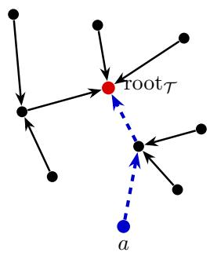

Figure 1: A spanning in-tree $\tau$ of the neighborhood graph (Π, E), with root root $\curvearrowleft$ every edge is directed toward the root. The dashed edges form path $\boldsymbol { \tau } ^ { ( a ) }$ T, the directed path from action a to the Troot. The construction follows Lattimore & Szepesvari (2020).´  
Algorithm 3 SquareCB.PMSide for Locally observable games   
1: parameters:   
2: Context x with redicted outcome distribution ${ \hat { q } } ( x )$   
3: Exploration parameter $\gamma > 0 , \mu = k$ and $\begin{array} { r } { \kappa = \frac { \gamma } { 8 k m ^ { 2 } } } \end{array}$   
4: For each action a ∈ Π, compute $\hat { \ell } _ { a } = e _ { a } ^ { \top } \pmb { L } \hat { q } ( x )$ and let $b = \arg \operatorname* { m i n } _ { a \in \Pi } \hat { \ell } _ { t , a }$   
5: For each a ∈ $\Pi \setminus \{ b \}$ , define $\begin{array} { r } { p _ { a } = \frac { 1 } { \mu + \kappa ( \hat { \ell } _ { a } - \hat { \ell } _ { b } ) } ; \mathrm { l e t } p _ { b } = 1 - \sum _ { a \in \Pi \setminus \{ b \} } p _ { a } . } \end{array}$   
6: return $p$

Ofline oracle-eficient algorithms In Appendix D, we present a close variant of E2D.PMSide, namely OE2D.PMSide (Ofline Estimation to Decisions for Partial Monitoring with Side Information), that eficiently reduces contextual partial monitoring to ofline estimation. Our OE2D.PMSide generalizes FALCON (Simchi-Levi & Xu, 2022) and its linear version (Xu & Zeevi, 2020). Similar to E2D.PMSide, OE2D.PMSide has two versions, one that employs Alg. 2 for the globally observable setting, the other employs Alg. 3 for the locally observable setting, which enjoys $O ( T ^ { 2 / 3 } )$ and $O ( { \sqrt { T } } )$ regret in the respective settings. Compared with E2D.PMSide that makes $O ( T )$ calls to the online outcome estimation oracle, OE2D.PMSide only makes ${ \cal O } ( \log T )$ calls to the ofline outcome estimation oracle, making it suitable for applications with low computational cost requirements.

## 4 Empirical studies

We evaluate SquareCB.PMSide in two settings we discussed in Section 1 (Examples 1 & 2): LLM routing and contextual label-eficient prediction game.

LLM routing. We evaluate the routin roblem on a cached version of the BoolQ benchmark containing 12,648 valid responses from both models. We use Qwen2.5-0.5B-Instruct as the weak model and Llama-2-13B-Chat as the strong model. The routing outcome records whether their cached responses disagree. Each prompt is represented by a 138-dimensional context comprising 10 weak-model uncertainty statistics, 64 PCA components of its hidden states, and 64 PCA components of a context-free prompt embedding.

We compare linear-logistic CBPSide (Bartok et al., 2012a; An et al., 2026),´ SquareCB.PMSide (ours), ETC (Explore-Then-Commit, adapted for apple tasting) (Garivier et al., 2016) with both linear logistic regression and a nonlinear 15-leaf histogram gradient-boosting (HGB) model, Bayesian-logistic PG-TS (Grant & Leslie, 2021), and a random baseline. We consider nine values of $\ell _ { 0 1 }$ between 1.8 and 3.3 and evaluate each configuration over 20 paired random permutations. Figure 2a reports the mean realized total cost.

For each value of $\ell _ { 0 1 }$ we tune every algorithm separately, selecting the configuration with the lowest total cost. For all methods except the random baseline this amounts to choosing a multiplier $s \in \{ 0 . 1 , 0 . 3 , 1 , 3 , 1 0 \}$ , which scales the confidence radius in CBPSide, the exploration parameter s ⋅ κ in both SquareCB.PMSide variants, the initial exploration budget $s \cdot T ^ { 2 / 3 }$ in ETC, and the prior standard deviation in PG-TS. The random baseline instead routes each query to the strong model with a fixed probability, independent of context, swept over $\{ 0 , 0 . 2 , 0 . 4 , 0 \mathrm { \bar { . } 6 , 0 . 8 , 1 } \}$ }. All methods, ours included, are therefore tuned with hindsight knowledge of the loss. Further implementation details and results are provided in Section E.

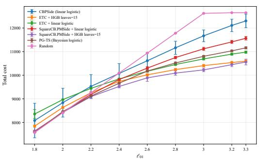  
(a) LLM routing: Total cost vs $\ell _ { 0 1 }$

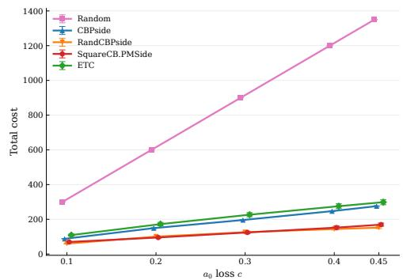  
(b) LE game: Total cost vs c  
Figure 2: Comparison of algorithms for and LLM routing and Label eficient prediction game

Across the evaluated loss settings, both the linear-logistic and nonlinear HGB instantiations of SquareCB.PMSide achieve lower mean realized total cost than CBPSide, while the nonlinear HGB variant also outperforms PG-TS. These results illustrate a practical advantage of the oracle-eficient SquareCB.PMSide formulation: it can incorporate flexible nonlinear prediction models without modifying the surrounding routing policy. Furthermore, generally ETC is expected to perform worse due to $O ( T ^ { 2 / 3 } )$ regret, however here due to limited test data size 12,648 compared to larger dimension 138, it performs competitively. See Figure 2a.

Contextual label-eficient prediction. We conduct an analogous study for the contextual label-eficient prediction game. Local observability requires the expert-query cost to satisfy $c < 0 . 5 ;$ accordingly, we evaluate five values of c in the range $0 . 1 \leq c < 0 . 5$ . Because PG-TS is designed specifically for apple-tasting games and is thus inapplicable to this problem, we replace it with RandCBPSide (Heuillet et al., 2024). We generate the data synthetically from a linear logistic model with 10-dimensional context vectors. Further, details are rovided in A endix E. Our method consistently outperforms ETC and CBPSide across the evaluated settings and remains competitive with RandCBPSide, outperforming it for some of the expert-query costs. Moreover, RandCBPSide requires comparatively expensive confidence-width calculations, whereas our method is computationally cheaper. See Figure 2b.

## 5 Conclusion and future work

Our work gives the first eficient algorithms for stochastic contextual partial monitoring with optimal regret with general function approximation. Experiments on LLM routing and a modified label-eficient game support these guarantees. Our analysis is restricted to non-degenerate games. Lemma G.3, which underlies the $O ( 1 / \gamma )$ bound for locally observable games, relies on non-degeneracy. We conjecture that our SquareCB.PMSide might work for degenerate games as well with minor modification. However, their analysis need a careful approach which is left to future work. Another interesting question is, can our algorithm be generalized to the setting when the loss matrix and the feedback matrix is context-dependent? This seems practically relevant for e.g. LLM routing applications, since the cost of wrongly following the weak model may depend on the importance of the prompt. Furthermore, extending our work to contextual linear partial monitoring (Kirschner et al., 2023) and contextual partial monitoring with infinite outcomes (Lattimore, 2022) are also interesting future directions.

## AI use statement

In this work, we used generative AI tools for coding for experiments, writing those experiment details and polishing the writing. We did reviewed those coding implementation for correctness. We have not used generative AI tools for writing proof or related works, and the rest of the required disclosure tasks are not applicable to this work. We have reviewed all AI-assisted work. We take responsibility for the final content of this work, including text, claims or artifacts produced with the aid of generative AI.

## Ethics statement

This work develops learning algorithms for routing queries among large language models. Such methods may reduce inference costs and computational resource consumption while improving access to capable models. However, routing decisions may propagate or amplify biases present in the underlying models and data, potentially producing unequal performance across demographic groups, languages, or application domains. Furthermore, queries may contain sensitive information, particularly when routed to externally hosted models. Our methods optimize a specified performance objective and do not independently guarantee fairness, privacy, reliability, or safety. Practical deployments should therefore incorporate appropriate data protection, subgroup evaluation, human oversight, and fallback mechanisms.

## Reproducibility statement

We provide complete definitions, assumptions, algorithm descriptions, and regret analyses in the main paper and appendices. The experimental section reports the datasets, preprocessing procedures, model configurations, baselines, evaluation metrics, and hyperparameters used in our study. We will release the implementation, experiment configurations, and evaluation scripts later to facilitate reproduction of our results, subject to the licenses and access conditions of the underlying datasets and language models. We also report results across multiple random seeds to account for experimental variability.

## Acknowledgments

This work was partly supported by the National Research Foundation of Korea (NRF) grant funded by the Korean government (MSIT) in 2026 (Grant No. RS-2026-25612350, Project Title: Development of an End-to-End Design and Validation Framework for Mathematically Principled Next-Generation AI Architectures and Learning Algorithms, contribution 45%). This work was partly supported by Institute of Information & communications Technology Planning & Evaluation (IITP) grant funded by the Korea government(MSIT) (RS-2019-II191906, Artificial Intelligence Graduate School Program(POSTECH), contribution 5%; RS-2026-25616313, AI Star Fellowship(POSTECH, Interdisciplinary Program), contribution 50%). This work was supported in part by the Nationa Science Foundation under grant CCF-2327013, IIS-2440266 (CAREER) and Meta Platforms, Inc.

## References

Alekh Agarwal, Sham Kakade, Akshay Krishnamurthy, and Wen Sun. Flambe: Structural complexity and representation learning of low rank mdps. Advances in neural information processing systems, 33:20095–20107, 2020.

Byeongwoo An, Kapilan Balagopalan, Hyowon Wi, Sehwa Jeong, Jiun Jeong, Kyoungseok Jang, Noseong Park, Gi-Soo Kim, and Kwang-Sung Jun. Eficient algorithms for contextual apple tasting with log-loss. In ICML 2026 DEMO workshop, 2026.

Peter Auer, Nicolo Cesa-Bianchi, Yoav Freund, and Robert E Schapire. The Nonstochastic Multiarmed\` Bandit Problem. SIAM J. Comput., 32(1):48–77, jan 2003. ISSN 0097-5397. doi: 10.1137/ S0097539701398375.

Gabor Bart´ ok and Csaba Szepesv´ ari. Partial monitoring with side information. In´ International Conference on Algorithmic Learning Theory, pp. 305–319. Springer, 2012.

Gabor Bart ´ ok et al. Partial monitoring with side information. In ´ In Proc. ALT, 2012a.

Gabor Bart ´ ok et al. An adaptive algorithm for finite stochastic partial monitoring. ´ In Proc. ICML, 2012b.

Gabor Bart ´ ok, D ´ avid P ´ al, and Csaba Szepesv ´ ari. Minimax regret of finite partial-monitoring games´ in stochastic environments. In Sham M. Kakade and Ulrike von Luxburg (eds.), Proceedings of the 24th Annual Conference on Learning Theory, volume 19 of Proceedings of Machine Learning Research, pp. 133–154, Budapest, Hungary, 09–11 Jun 2011. PMLR. URL https: //proceedings.mlr.press/v19/bartok11a.html.

Lingjiao Chen, Matei Zaharia, and James Zou. Frugalgpt: How to use large language models while reducing cost and improving performance. arXiv preprint arXiv:2305.05176, 2023.

Dylan J Foster and Alexander Rakhlin. Beyond UCB: Optimal and eficient contextual bandits with regression oracles. Proceedings ofthe International Conference on Machine Learning (ICML), 2020.

Dylan J Foster, Sham M Kakade, Jian Qian, and Alexander Rakhlin. The Statistical Complexity of Interactive Decision Making. CoRR, abs/2112.1, 2021.

Dylan J Foster, Alexander Rakhlin, Ayush Sekhari, and Karthik Sridharan. On the complexity of adversarial decision making. Advances in Neural Information Processing Systems, 35:35404–35417, 2022.

Aurelien Garivier, Tor Lattimore, and Emilie Kaufmann. On explore-then-commit strategies. In´ Advances in Neural Information Processing Systems, volume 29, pp. 784–792. Curran Associates, Inc., 2016.

James A Grant and David S Leslie. Apple tasting revisited: Bayesian approaches to partially monitored online binary classification. arXiv preprint arXiv:2109.14412, 2021.

Elad Hazan, Amit Agarwal, and Satyen Kale. Logarithmic Regret Algorithms for Online Convex Optimization. Mach. Learn., 69(2-3):169–192, 2007.

David Helmbold et al. Some label eficient learning results. In In Proc. CoLT, 1997.

David P Helmbold, Nicholas Littlestone, and Philip M Long. Apple tasting. Information and Computation, 161(2):85–139, 2000.

Maxime Heuillet, Ola Ahmad, and Audrey Durand. Randomized confidence bounds for stochastic partial monitoring, 2024.

Johannes Kirschner, Tor Lattimore, and Andreas Krause. Linear partial monitoring for sequential decision-making: Algorithms, regret bounds and applications. JMLR, 2023.

Robert Kleinberg and Tom Leighton. The value of knowing a demand curve: Bounds on regret for online posted-price auctions. In 44th Annual IEEE Symposium on Foundations of Computer Science, 2003. Proceedings., pp. 594–605. IEEE, 2003.

Junpei Komiyama, Junya Honda, Hisashi Kashima, and Hiroshi Nakagawa. Regret lower bound and optimal algorithm in dueling bandit problem. In Conference on learning theory, pp. 1141–1154. PMLR, 2015.

Tor Lattimore. Minimax regret for partial monitoring: Infinite outcomes and rustichini’s regret. In Conference on Learning Theory, pp. 1547–1575. PMLR, 2022.

Tor Lattimore and Andras Gyorgy. Mirror descent and the information ratio. In Conference on Learning Theory, pp. 2965–2992. PMLR, 2021.

Tor Lattimore and Csaba Szepesvari. An information-theoretic approach to minimax regret in partial´ monitoring. In Conference on Learning Theory, pp. 2111–2139. PMLR, 2019.

Tor Lattimore and Csaba Szepesvari. Exploration by optimisation in partial monitoring. In ´ Conference on Learning Theory, pp. 2488–2515. PMLR, 2020.

Tor Lattimore and Csaba Szepesvari.´ Bandit Algorithms. Cambridge University Press, 2020.

David A Levin and Yuval Peres. Markov Chains and Mixing Times. American Mathematical Society, Providence, RI, 2 edition, 2017. ISBN 978-1-4704-2962-1.

Yubo Li, Yidi Miao, Ramayya Krishnan, and Rema Padman. Jev-as-a-judge: Accept when confident, escalate when unsure. arXiv preprint arXiv:2609.26550, 2026.

Isaac Ong, Amjad Almahairi, Vincent Wu, Wei-Lin Chiang, Tianhao Wu, Joseph E Gonzalez, M Kadous, and Ion Stoica. Routellm: Learning to route llms from preference data. In Y. Yue, A. Garg, N. Peng, F. Sha, and R. Yu (eds.), International Conference on Learning Representations, volume 2025, pp. 34433–34448, 2025. URL https://proceedings.iclr.cc/paper\_files/ paper/2025/file/5503a7c69d48a2f86fc00b3dc09de686-Paper-Conference.pdf.

Hao Qin and Chicheng Zhang. Optimal and eficient contextual combinatorial semi-bandits with general function approximation, 2026a. URL https://arxiv.org/abs/2607.13686.

Hao Qin and Chicheng Zhang. Taming the monster every context: Complexity measure and unified framework for ofline-oracle eficient contextual bandits, 2026b. URL https://arxiv.org/abs/ 2602.09456.

David Sculley. Practical learning from one-sided feedback. In Proceedings of the 13th ACM SIGKDD international conference on Knowledge discovery and data mining, pp. 609–618, 2007.

David Simchi-Levi and Yunzong Xu. Bypassing the monster: A faster and simpler optimal algorithm for contextual bandits under realizability. Mathematics ofOperations Research, 47(3):1904–1931, 2022.

Adish Singla, Ian Lienert, Gabor Bart´ ok, and Andreas Krause. Contextual procurement in online´ crowdsourcing markets. In Proceedings of the AAAI Conference on Human Computation and Crowdsourcing, volume 2, pp. 58–59, 2014.

A. Tsybakov. Introduction to nonparametric estimation. In Springer Series in Statistics, 2008. URL https://api.semanticscholar.org/CorpusID:42933599.

Vladimir G Vovk. A game of prediction with expert advice. In Proceedings of the eighth annual conference on Computational learning theory, pp. 51–60, 1995.

Yunbei Xu and Assaf Zeevi. Upper counterfactual confidence bounds: a new optimism principle for contextual bandits. arXiv preprint arXiv:2007.07876, 2020.

Mengxiao Zhang, Yuheng Zhang, Olga Vrousgou, Haipeng Luo, and Paul Mineiro. Practical contextual bandits with feedback graphs. Advances in Neural Information Processing Systems, 36: 30592–30617, 2023.

Yinglun Zhu and Paul Mineiro. Contextual bandits with smooth regret: Eficient learning in continuous action spaces. In International Conference on Machine Learning, pp. 27574–27590. PMLR, 2022.

Yinglun Zhu, Dylan J Foster, John Langford, and Paul Mineiro. Contextual bandits with large action spaces: Made practical. In Proceedings of the International Conference on Machine Learning (ICML), pp. 27428–27453, 2022.

## Appendix

Appendix A Additional Discussions on Important Related Works . 15   
A.1 Exploration-by-optimization (ExO) versus our approach . . . 15   
A.2 Relation to the decision-estimation coeficient 16   
Appendix B Online and ofline estimation oracles 17   
B.1 Online Oracles 17   
B.2 Ofline estimation oracle 19   
Appendix C Analysis of E2D.PMSide 21   
C.1 Proof of Theorem 3.1 21   
C.2 Proofs for Algorithm 2 (ϵ-Greedy.PMSide) 23   
C.3 Proofs for Algorithm 3 (SquareCB.PMSide) 25   
Appendix D Contextual partial monitoring: reduction to ofline regression 28   
D.1 OE2D.PMSide 28   
D.2 Regret analysis 29   
Appendix E Empirical studies 35   
Appendix F Algorithm for Lq-decreasing tree construction 38   
Appendix G Auxiliary Lemmata 38

## A Additional Discussions on Important Related Works

## A.1 Exploration-by-optimization (ExO) versus our approach.

Lattimore & Szepesvari [2020] propose the exploration-by-optimization (ExO) algorithm for adver-´ sarial non-contextual partial monitoring. They first form an exponentially weighted benchmark policy $\lambda _ { t }$ over the Pareto optimal actions from unbiased loss estimates,

$$
\lambda _ { t a } = \frac { \mathbb { 1 } _ { \Pi } ( a ) \exp \left( - \eta \sum _ { s = 1 } ^ { t - 1 } \hat { y } _ { s a } \right) } { \sum _ { b \in \Pi } \exp \left( - \eta \sum _ { s = 1 } ^ { t - 1 } \hat { y } _ { s b } \right) } ,
$$

where $\mathbb { 1 } _ { \Pi }$ is the indicator of Π and $\hat { y } _ { t } = G _ { t } \big ( A _ { t } , \sigma _ { t } \big ) / p _ { t A _ { t } }$ is an importance-weighted loss estimate, with $G _ { t }$ (Equation (10)) obtained by solving Equation (4) at round t. This generalizes the EXP3 algorithm [Auer et al., 2003] for adversarial bandits.

They then improve this benchmark by solving

$$
\operatorname* { m i n i m i s e } _ { G \in \mathcal { H } , p \in \mathcal { P } } \qquad \operatorname* { m a x } _ { o \in [ d ] } \Bigg [ ( p - \lambda ) ^ { \top } L e _ { o } + \mathrm { b i a s } _ { \lambda } ( G ; o ) + \frac { 1 } { \eta } \sum _ { a = 1 } ^ { k } p _ { a } \Psi _ { \lambda } \Bigg ( \frac { \eta G ( a , \Phi _ { a o } ) } { p _ { a } } \Bigg ) \Bigg ] ,\tag{4}
$$

where $\eta$ plays the role of our $\gamma , \Psi _ { q } ( z ) = \langle q , \exp ( - z ) + z - 1 \rangle$ , and

$$
\mathrm { b i a s } _ { \lambda } ( G ; o ) = \left. \lambda , L e _ { o } - \sum _ { a = 1 } ^ { k } G ( a , \Phi _ { a o } ) \right. + \operatorname* { m a x } _ { c \in \Pi } \left( \sum _ { a = 1 } ^ { k } G ( a , \Phi _ { a o } ) _ { c } - L _ { c o } \right) .
$$

We may write this equivalently, following the notation of Lattimore & Gyorgy [2021], as

$$
\operatorname* { m i n i m i s e } _ { G \in \mathcal { H } , p \in \mathcal { P } } \operatorname* { m a x } _ { \sigma \in [ d ] , \epsilon \in \Pi } \left[ ( p - \lambda ) ^ { \top } L e _ { o } + \left. e _ { c } - p , \sum _ { a = 1 } ^ { k } G ( a , \Phi _ { a o } ) - L e _ { o } \right. + \frac { 1 } { \eta } \sum _ { a = 1 } ^ { k } p _ { a } \Psi _ { \lambda } \left( \frac { \eta G ( a , \Phi _ { a o } ) } { p _ { a } } \right) \right] .
$$

This step reallocates probability away from the benchmark policy and toward actions whose feedback is informative. Writing $\mathrm { o p t } _ { \lambda } ( \eta )$ for the optimal value of Equation (4), the analogue of our $\mathcal { V } _ { \gamma }$ Lattimore & Szepesvari [2020] bound it for both locally and globally observable games without´ exhibiting an explicit or approximate solution to the optimization problem.

They first restrict the class of estimators G. Let

$$
\mathcal { H } _ { 0 } = \left\{ G \in \mathcal { H } : \left. e _ { b } - e _ { c } , \sum _ { a = 1 } ^ { k } G ( a , \Phi _ { a o } ) - L e _ { o } \right. = 0 \mathrm { f o r } \mathrm { a l l } b , c \right\}
$$

denote the unbiased estimators, for which $\begin{array} { r } { \operatorname { b i a s } _ { \lambda } ( G ; o ) = 0 } \end{array}$ for every o. The minimax objective is then bounded above by

$$
\operatorname* { m i n } _ { G \in \mathcal { H } _ { 0 } , p \in \mathcal { P } } \operatorname* { m a x } _ { o \in [ d ] } \left[ ( p - \lambda ) ^ { \top } L e _ { o } + \frac { 1 } { \eta } \sum _ { a = 1 } ^ { k } p _ { a } \Psi _ { \lambda } \bigg ( \frac { \eta G ( a , \Phi _ { a o } ) } { p _ { a } } \bigg ) \right] ,
$$

and, since the bracketed expression is linear in $e _ { o } ,$ maximizing over outcomes is equivalent to maximizing over outcome distributions:

$$
\operatorname* { m i n } _ { G \in \mathcal { H } _ { 0 } , p \in \mathcal { P } } \operatorname* { m a x } _ { q \in \mathcal { D } } \left[ ( p - \lambda ) ^ { \top } L q + \frac { 1 } { \eta } \sum _ { o = 1 } ^ { d } q _ { o } \sum _ { a = 1 } ^ { k } p _ { a } \Psi _ { \lambda } \Bigg ( \frac { \eta G ( a , \Phi _ { a o } ) } { p _ { a } } \Bigg ) \right] .\tag{5}
$$

Equation (5) is concave in $q$ and convex in $( G , p )$ , so to (nonconstructively) upper bound the value of Equation (5), Sion’s minimax theorem permits exchanging the two operations. Writing $F ( G , p , q )$ for the bracketed expression,

$$
\operatorname* { m i n } _ { G \in \mathcal { H } _ { 0 } , p \in \mathcal { P } } \operatorname* { m a x } _ { q \in \mathcal { D } } F ( G , p , q ) \ = \ \operatorname* { m a x } _ { q \in \mathcal { D } } \operatorname* { m i n } _ { G \in \mathcal { H } _ { 0 } , p \in \mathcal { P } } F ( G , p , q ) .
$$

To upper bound this expression, it now sufices to choose $G$ and $p$ as functions of $q$ and $\lambda { \vdots }$ they build an $\pmb { L q }$ -decreasing tree, take $G$ to be the loss estimator induced by that tree, and set $p = W _ { q } ( \lambda )$ where $W _ { q }$ is the water-transfer operator (see Lemma G.5 for a recap). The operator redistributes the benchmark policy λ so that the resulting $p$ incurs no greater loss under $q ,$ while allocating probability that increases toward the root of the tree.

In contrast, given an outcome distribution $q ,$ our exploration strategy approximately solves the following optimization problem:

$$
\operatorname* { m i n } _ { p \in \mathcal { P } } \operatorname* { m a x } _ { \lambda \in \Delta ( \Pi ) } ( p - \lambda ) ^ { \top } L \hat { q } + \frac { 1 } { \gamma } \cdot \operatorname { C o v e r a g e } ( p , \lambda )
$$

Given that for any $G \in { \mathcal { H } } _ { 0 }$ , Lemma C.1 implies that Coverage $\begin{array} { r } { ( p , \lambda ) \leq \sum _ { a } \sum _ { b } \frac { \lambda _ { b } + p _ { b } } { p _ { a } } \| G _ { b } ( a , : ) \| _ { \infty } ^ { 2 } } \end{array}$ , and thus it sufices to find exploration distribution p that solves,

$$
\operatorname* { m i n } _ { p \in \mathcal { P } } \operatorname* { m a x } _ { \lambda \in \Delta ( \Pi ) } ( p - \lambda ) ^ { \top } \pmb { L } \hat { q } + \frac { 1 } { \gamma } \cdot \left( \sum _ { a } \sum _ { b } \frac { \lambda _ { b } + p _ { b } } { p _ { a } } \| G _ { b } ( a , : ) \| _ { \infty } ^ { 2 } \right)\tag{6}
$$

Comparing Equation (5) with Equation (6), the two objectives share a shape: each consists of a greediness term of the form $( p - \bar { \lambda } ) ^ { \intercal } \mathbfcal { L } \hat { q }$ and a coverage term measuring how well p covers λ. They difer in three respects:

• First, in the minimax players: we minimize over exploration policies against a maximizing comparator policy λ, whereas Equation (5) minimizes against a maximizing adversarial outcome distribution q.

• Second, in the form of the coverage term. The one in Equation (5) is exponential, $\Psi _ { \lambda } \big ( \eta G ( a , \Phi _ { a o } ) / p _ { a } \big )$ , and Lattimore & Szepesvari [2020] relax it to´ $\begin{array} { r } { \eta ^ { 2 } \sum _ { b } \lambda _ { b } \| G ( a , \bar { \cdot } ) _ { b } \| _ { \infty } ^ { 2 } / p _ { a } ^ { 2 } } \end{array}$ at the cost of requiring p to be bounded below entrywise by $\eta \operatorname* { m a x } _ { a , b } \| G ( a , \cdot ) _ { b } \| _ { \infty }$

∞• Third, in what the analysis delivers. ExO is tractable but gives no explicit exploration policy p. For our objective we show that the inverse-gap-weighting rule of SquareCB.PMSide certifies a small value of $\mathcal { V } _ { \gamma }$ directly: it already allocates probability increasing toward the root of an Lqˆ-decreasing tree, so neither the optimization over G nor the water-transfer step is needed, and the in-tree only appears in the analysis.

We also refer the reader to Table 1 for a summary.

Table 1: Comparison with exploration-by-optimization [Lattimore & Szepesvari, 2020]. ´ ↑ indicates a better result. NA indicates not applicable
<table><tr><td></td><td>ExO</td><td>Ours</td></tr><tr><td>Side information</td><td>No</td><td>Yes ↑</td></tr><tr><td>Outcome distribution</td><td>Adversarial ↑</td><td>Stochastic</td></tr><tr><td>Objective</td><td> $\mathrm { o p t } _ { q } ( \eta )$ </td><td> $\mathcal { V } _ { \gamma }$ </td></tr><tr><td>Minimax players</td><td>Policy vs. adversarial outcome x</td><td>Policy vs. comparator policy λ</td></tr><tr><td>Optimization variables</td><td>G and p jointly Exact solution of Equation (4)</td><td>p only ↑ IGW for locally observable;</td></tr><tr><td>Per-round computation</td><td></td><td>€-greedy for globally observable ↑</td></tr><tr><td>In-tree</td><td>Optimized at every round</td><td>Analysis only ↑</td></tr><tr><td>Water-transfer</td><td>Required</td><td>Not required ↑</td></tr><tr><td>Oracle-efficient</td><td>No</td><td>Efficient ↑</td></tr><tr><td>Offline oracle compatibility</td><td>NA</td><td>Compatible ↑</td></tr><tr><td>Locally observable regret</td><td></td><td> $\sqrt { k }$  smaller ↑</td></tr></table>

## A.2 Relation to the decision-estimation coefficient

The decision-estimation coeficient (DEC) was introduced by Foster et al. [2021] as a complexity measure for stochastic sequential decision making. Foster et al. [2022] extend it to the adversarial setting, showing that the DEC applied to the convex hull of the model class characterizes the fundamental statistical complexity of that setting as well. On the algorithmic side they propose $\mathrm { E x O ^ { + } }$ a high-probability variant of the exploration-by-optimization algorithm of Lattimore & Szepesvari´ [2020]; Lattimore & Gyorgy [2021]. Whereas the original ExO gives in-expectation guarantees, $\mathrm { E x O ^ { + } }$ gives high-probability guarantees that hold against adaptive adversaries. Like ExO, the exploration rule and the loss estimator are defined through an optimization problem rather than a closed-form policy.

Their analysis does not bound the $\mathrm { E x O ^ { + } }$ or DEC objective directly for locally and globally observable games. Instead they establish an equivalence, for general divergences $D ,$ between the convexified DEC, a parameterized variant of the generalized information ratio of Lattimore & Gyorgy [2021], and the $\mathrm { E x O ^ { + } }$ objective. Since Lattimore & Szepesvari [2019]; Lattimore & Gyorgy [2021]; Lattimore´ [2022] bound the regret for locall and globall observable games in terms of the generalized information ratio under the KL divergence, in agreement with the classification theorem [Bartok et al.,´ 2011; Lattimore & Szepesvari, 2020], those bounds transfer to´ $\mathrm { E x O ^ { + } }$ through this equivalence. The equivalence itself holds for general D, but the information-ratio bounds are established for the KL divergence; we are not aware of corresponding bounds for other divergences, including the squared Hellinger.

To summarize, Foster et al. [2022]’s result implicitly implies that the E2D algorithm Foster et al. [2021] has optimal order-in-T regret for stochastic contextual partial monitoring. However, as we discussed in Section 2.3, the E2D algorithm may be computationally ineficient. Our paper addresses the computational challenge. For locally observable games we give a closed-form inverse-gap- weighting rule (SquareCB.PMSide), and for globally observable games a closed-form ε-greedy rule (ϵ-Greedy.PMSide). Both extend to be compatible with ofline estimation oracles, because the exploration term of our objective, the coverage, does not involve the current estimate.

## B Online and offline estimation oracles

## B.1 Online Oracles

In this section, we provide examples for the online estimation oracles $\mathrm { A l g _ { O n } }$ and prove their bounds for both finite and infinite model classes.

Lemma B.1 (Finite-class online Hellinger guarantee via Vovk’s algorithm). Suppose that the candidate conditional outcome-model class

$$
\mathcal { Q } \subseteq \{ q : \mathcal { X }  \Delta ( d ) \}
$$

is finite and realizable, so that $q ^ { * } \in \mathcal { Q }$ and the oracles are allowed to output predictors in $\mathrm { c o } ( \mathcal { Q } )$ . Then there exists a contextual online estimation oracle $\mathrm { A l g } _ { \mathrm { O n } }$ such that,

$$
\overline { { \mathrm { R e g } } } _ { \mathrm { O n } } ^ { \mathrm { H } } ( \mathcal { Q } , T , \delta ) = 2 \log \left( \frac { | \mathcal { Q } | } { \delta } \right) .
$$

The contextual online estimation oracle can be instantiated by applying Vovk’s [Vovk, 1995] aggregating algorithm to the conditional outcome models in $\mathcal { Q } .$

Proof. Define $\mathcal { G } \subseteq \Delta ( m )$ as a set of functions $g _ { q } : { \mathcal { X } } \times [ k ] \to \Delta ( m )$ induced by $q ,$ formally

$$
\mathcal { G } = \{ g _ { q } : g _ { q } ( \sigma \mid x , a ) = S _ { a } q ( x ) [ \sigma ] \ \forall q \in \mathcal { Q } \}
$$

Hence,

$$
| { \mathcal { G } } | \leq | { \mathcal { Q } } |
$$

Specifically,

$$
\begin{array} { r l } & { g _ { q ^ { * } } \bigl ( \sigma \bigr | x _ { t } , A _ { t } \bigr ) = \mathbb { P } \bigl ( \sigma _ { t } = \sigma \mid x _ { t } , A _ { t } \bigr ) } \\ & { \qquad = S _ { A _ { t } } q ^ { * } \bigl ( x _ { t } \bigr ) \bigl [ \sigma \bigr ] } \end{array}
$$

Vovk’s algorithm calculate the $g _ { \hat { q } _ { t } }$ in the following way.

Let,

$$
\begin{array} { r l } & { \ell _ { \log } ^ { ( t ) } ( g _ { q } ) : = \log \left( \frac { 1 } { g _ { q } ( \sigma _ { t } \mid x _ { t } , A _ { t } ) } \right) } \\ & { \qquad = \log \left( \frac { 1 } { \big ( S _ { A _ { t } } q ( x _ { t } ) \big ) \big [ \sigma _ { t } \big ] } \right) . } \end{array}
$$

Then $\forall g _ { q } \in \mathcal { G }$ , the algorithm calculates a probability simplex $b _ { t } \in \Delta ( | \mathcal { G } | )$ as follows.

$$
b _ { t } ( g _ { q } ) \propto \exp \left( - \sum _ { s = 1 } ^ { t - 1 } \ell _ { \log } ^ { ( s ) } ( g _ { q } ) \right)
$$

Estimate $g _ { \hat { q } _ { t } }$

$$
g _ { \hat { q } _ { t } } ( \cdot ) = \mathbb { E } _ { g \sim b _ { t } } \left[ g ( \cdot ) \right]
$$

Let the corresponding $\hat { q } _ { t }$ such that,

$$
\hat { q } _ { t } ( \cdot ) = \mathbb { E } _ { g \sim b _ { t } } \left[ q ( \cdot ) \right] .
$$

Then Vovk’s algorithm guarantees,

$$
\sum _ { t = 1 } ^ { T } \log \frac { 1 } { g _ { \hat { q } _ { t } } \big ( \sigma _ { t } \mid x _ { t } , a _ { t } \big ) } - \sum _ { t = 1 } ^ { T } \log \frac { 1 } { g _ { q ^ { * } } \big ( \sigma _ { t } \mid x _ { t } , a _ { t } \big ) } \leq \log \vert \mathcal { G } \vert
$$

Then, by applying Lemma A.14 from Foster et al. [2021], the output estimator of Vovk’s aggregating algorithm $g _ { \hat { q } _ { t } }$ satisfies, with probability of at least $1 - \delta .$

$$
\sum _ { t = 1 } ^ { T } \mathbb { E } _ { t - 1 } \left[ D _ { \mathrm { H } } ^ { 2 } \left( g _ { \hat { q } _ { t } } ( \cdot \mid x _ { t } , A _ { t } ) \mid g _ { q ^ { * } } ( \cdot \mid x _ { t } , A _ { t } ) \right) \right] \leq 2 \log \frac { | \mathcal { G } | } { \delta }\tag{7}
$$

transforming this to our case, with probability at least $1 - \delta , { \hat { q } } _ { t }$ satisfies,

$$
\sum _ { t = 1 } ^ { T } \mathbb { E } _ { a \sim p _ { t } } \left[ D _ { \mathrm { H } } ^ { 2 } \left( S _ { a } \hat { q } _ { t } ( x _ { t } ) \mid S _ { a } q ^ { * } ( x _ { t } ) \right) \right] \leq 2 \log \frac { | \boldsymbol { Q } | } { \delta } .
$$

Remark 1. Define filtration $\mathcal { H }$ as,

$$
\mathcal { H } _ { t - 1 } = \sigma \left( x _ { 1 } , A _ { 1 } , \sigma _ { 1 } , \cdots , x _ { t - 1 } , A _ { t - 1 } , \sigma _ { t - 1 } \right)
$$

Equation equation 7 also implies that, if $x _ { 1 } , \cdots , x _ { T } \stackrel { \mathrm { i . i . d . } } { \sim } { \mathcal { D } } _ { x }$ and $p _ { t } , \hat { q } _ { t }$ are $\mathcal { H } _ { t - 1 }$ measurable, then with probability of at least $1 - \delta ,$

$$
\sum _ { t = 1 } ^ { T } \mathbb { E } _ { x \sim \mathcal { D } _ { x } , a \sim p _ { t } ( \cdot \mid x ) } \left[ D _ { \mathrm { H } } ^ { 2 } \left( S _ { a } \hat { q } _ { t } ( x ) \mid S _ { a } q ^ { * } ( x ) \right) \right] \leq 2 \log \frac { | \mathcal { Q } | } { \delta } .
$$

Lemma B.2 (Infinite-class online Hellinger guarantee via contextual smoothed aggregation). Suppose that the candidate conditional outcome-model class is,

$$
\mathcal { Q } \subseteq \{ q : \mathcal { X }  \Delta ( d ) \} ,
$$

is possibly infinite but has finite covering numbers under the uniform Hellinger metric and that the model is realizable $q ^ { * } \in \mathcal { Q }$ and the oracles are allowed to output predictors in $\mathrm { c o } ( \mathcal { Q } )$ .

Define $\mathcal { G } \subseteq \Delta ( m )$ as a set of functions $g _ { q } : { \mathcal { X } } \times [ k ] \to \Delta ( m )$ induced by $q ,$ formally

$$
\mathcal { G } = \{ g _ { q } : g _ { q } ( \sigma \mid x , a ) = S _ { a } q ( x ) [ \sigma ] ~ q \in \mathcal { Q } \}
$$

Moreover, let us define an ϵ-cover ${ \mathcal { I } } ,$ such that,

$$
\forall g _ { q } \in \mathcal { G } \quad \exists g _ { q } ^ { \prime } \in \mathcal { T } \mathrm { ~ s u c h ~ t h a t ~ } \operatorname* { s u p } _ { x \in \mathcal { X } , a \in [ k ] } D _ { \mathrm { H } } ^ { 2 } \left( g _ { q } ^ { \prime } ( \cdot \vert x , a ) \vert g _ { q } ( \cdot \vert x , a ) \right) \leq \epsilon ^ { 2 }
$$

Furthermore, let ${ \mathcal { N } } ( { \mathcal { G } } , \epsilon )$ denote the size of the smallest such cover. Define,

$$
\operatorname { e s t } ( \mathcal { G } , T ) : = \operatorname* { i n f } _ { \epsilon \geq 0 } \{ \log \left( \mathcal { N } ( \mathcal { G } , \epsilon ) \right) + \epsilon ^ { 2 } T \}
$$

Then there exists a contextual online estimation oracle $\mathrm { A l g } _ { \mathrm { O n } }$ such that,

$$
\begin{array} { r } { \overline { { \mathrm { R e g } } } _ { \mathrm { O n } } ^ { \mathrm { H } } ( \mathcal { Q } , T , \delta ) \leq O \left( \log ( 2 m ^ { 2 } T ) \cdot \mathrm { e s t } ( \mathcal { G } , T ) + \log ^ { 2 } ( 2 m ^ { 2 } T ) \log \frac { 1 } { \delta } \right) . } \end{array}
$$

The contextual online estimation oracle can be instantiated by applying an online aggregation algorithm Vovk [1995]; Foster et al. [2021] to a suitably discretized and smoothed approximation of the parameter space Q.

Proof. The regularity assumptions required in Assumption A.2 of Foster et al. [2021] are already satisfied by setting $\bar { B ^ { \prime } } = \operatorname* { m a x } \{ m , e \}$

1. Number of possible outcome for a context is upper bounded by $m \le B$

2. $g _ { q } ( \sigma \vert x , a )$ is a probability simplex $( 1 \leq B )$

Smoothed Vovk’s algorithm calculate the $g _ { \hat { q } _ { t } }$ in the following way, let,

$$
h ( \sigma \mid x , a ) = ( 1 - \alpha ) g _ { q } ( \sigma \mid x , a ) + { \frac { \alpha } { m } }
$$

then $\forall g _ { q } \in \mathcal { I }$ calculate the a probability simplex $b _ { t } \in \Delta ( | \mathcal { I } | )$ as follows

$$
b _ { t } ( g _ { q } ) \propto \exp \left( - \sum _ { s = 1 } ^ { t - 1 } \ell _ { \log } ^ { ( s ) } ( h ) \right)
$$

Estimate $\hat { g } _ { t }$

$$
g _ { \hat { q } _ { t } } = \mathbb { E } _ { g _ { q } \sim b _ { t } } \left[ g _ { q } \right]
$$

Hence,

$$
\hat { q } _ { t } = \mathbb { E } _ { q \sim b _ { t } } \left[ q \right]
$$

Then by applying Lemma A.16 from Foster et al. [2021], with probability of at least $1 - \delta ,$

$$
\sum _ { t = 1 } ^ { T } \mathbb { E } _ { t - 1 } \left[ D _ { \mathbb { H } } ^ { 2 } \left( g _ { \hat { q } _ { t } } ( \cdot \vert x _ { t } , A _ { t } ) \vert g _ { q ^ { * } } ( \cdot \vert x _ { t } , A _ { t } ) \right) \right] \leq O \left( \log ( 2 m ^ { 2 } T ) \cdot \mathrm { e x t } ( \mathcal { G } , T ) + \log ^ { 2 } ( 2 m ^ { 2 } T ) \log \frac { 1 } { \delta } \right)\tag{8}
$$

Let $\hat { q } _ { t } \in \mathcal { Q }$ be the corresponding solution, with probability of at least $1 - \delta , { \hat { q } } _ { t }$ satisfies,

$$
\sum _ { t = 1 } ^ { T } \mathbb { E } _ { a \sim p _ { t } } \left[ D _ { \mathrm { H } } ^ { 2 } \left( S _ { a } \hat { q } _ { t } ( x _ { t } ) \mid S _ { a } q ^ { * } ( x _ { t } ) \right) \right] \leq O \left( \log ( 2 m ^ { 2 } T ) \cdot \mathrm { e s t } ( \mathcal { G } , T ) + \log ^ { 2 } ( 2 m ^ { 2 } T ) \log \frac { 1 } { \delta } \right) .
$$

Remark 2. Define filtration H as,

$$
\mathcal { H } _ { t - 1 } = \sigma \left( x _ { 1 } , A _ { 1 } , \sigma _ { 1 } , \cdots , x _ { t - 1 } , A _ { t - 1 } , \sigma _ { t - 1 } \right)
$$

Equation equation 7 also implies that, if $x _ { 1 } , \cdots , x _ { T } \stackrel { \mathrm { i . i . d . } } { \sim } { \mathcal { D } } _ { x }$ and $p _ { t } , \hat { q } _ { t }$ are $\mathcal { H } _ { t - 1 }$ measurable, then with probability of at least $1 - \delta$

$$
\sum _ { t = 1 } ^ { T } \mathbb { E } _ { x \sim \mathcal { D } _ { x } , a \sim p _ { t } ( \cdot \vert x ) } \left[ D _ { \mathbb { H } } ^ { 2 } \left( S _ { a } \hat { q } _ { t } ( x ) \mid S _ { a } q ^ { * } ( x ) \right) \right] \leq O \left( \log ( 2 m ^ { 2 } T ) \cdot \mathrm { e s t } ( \mathcal { G } , T ) + \log ^ { 2 } ( 2 m ^ { 2 } T ) \log \frac { 1 } { \delta } \right)
$$

## B.2 Offline estimation oracle

In this section, first we define ofline estimation oracle and we provide examples for the ofline estimation oracles $\operatorname { A l g } _ { \mathrm { O f f } }$ and prove their estimation bounds.

Definition B.1 (Ofline estimation oracle). An ofline estimation oracle $\mathrm { A l g _ { O f f } }$ is an algorithm that estimates the unknown parameter $q ^ { * } \in \mathcal { Q }$ from the observed data in a batch fashion. That is, after observing t rounds, given the feedback symbols collected so far, the oracle produces an estimate

$$
\begin{array} { r } { \hat { q } = \mathrm { A l g } _ { \mathrm { O f f } } \left( \left\{ \left( A _ { s } , x _ { s } , \sigma _ { s } \right) \right\} _ { s = 1 } ^ { t } \right) . } \end{array}
$$

Assumption B.1 (Hellinger-closeness of the ofline estimation oracle). For any $t \in \mathbb { N } ,$ let $x _ { 1 } , \dotsc , x _ { t } \stackrel { \mathrm { i . i . d } } { \sim }$ $\mathcal { D } _ { x }$ and let $\hat { q }$ denote the estimate returned by $\operatorname { A l g } _ { \mathrm { O f f } }$ on the resulting sample. Define $\operatorname { R e g } _ { \mathrm { O f f } } ^ { \mathrm { H } } \left( \mathcal { Q } , t \right)$ such that

$$
\mathbb { E } _ { \boldsymbol { x } \sim \mathcal { D } _ { \boldsymbol { x } } , \boldsymbol { a } \sim p ( \cdot | \boldsymbol { x } ) } \left[ D _ { \mathrm { H } } ^ { 2 } \big ( S _ { \boldsymbol { a } } \hat { q } ( \boldsymbol { x } ) \big | \big | S _ { \boldsymbol { a } } q ^ { * } ( \boldsymbol { x } ) \big ) \right] = \frac { \mathrm { R e g } _ { \mathrm { O f f } } ^ { \mathrm { H } } \left( \mathcal { Q } , t \right) } { t }
$$

where $p$ denotes the behavioral policy used to collect the sample, and the expectation is taken over a fresh draw $( x , a )$ , conditionall on ${ \hat { q } } .$ We assume that the ofline estimation oracle $\mathrm { A l g _ { O f f } }$ guarantees, for any $\delta \in ( 0 , 1 )$ , that with probability at least $1 - \delta .$

$$
\begin{array} { r } { \mathrm { R e g } _ { \mathrm { O f f } } ^ { \mathrm { H } } \left( \mathcal { Q } , t \right) \leq \overline { { \mathrm { R e g } } } _ { \mathrm { O f f } } ^ { \mathrm { H } } \left( \mathcal { Q } , t , \delta \right) , } \end{array}
$$

where $\overline { { \mathrm { R e g } } } _ { \mathrm { O f f } } ^ { \mathrm { H } } \left( \mathcal { Q } , t , \delta \right)$ is a known, deterministic upper bound.

Having established in Appendix B.1 the existence of online oracles with favorable guarantees for both finite and infinite model classes, we can always obtain ofline oracles for both by online-to-batch conversion. Beyond this generic construction, we also show that the conditional maximum-likelihood estimator satisfies Assumption B.1 with a favorable bound $\overline { { \mathrm { R e g } } } _ { \mathrm { O f f } } ^ { \mathrm { H } } ( \mathcal { Q } , t , \delta )$

Lemma B.3 (Existence of a contextual ofline estimation oracle for a finite class). Suppose that the candidate conditional outcome-model class

$$
\mathcal { Q } \subseteq \{ q : \mathcal { X }  \Delta ( d ) \}
$$

is finite and realizable, so that $q ^ { * } \in \mathcal { Q }$ . Then there exists a contextual ofline estimation oracle $\mathrm { A l g _ { O f f } }$ such that Assumption B.1 is satisfied with

$$
\overline { { \mathrm { R e g } } } _ { \mathrm { O f f } } ^ { \mathrm { H } } \left( \mathcal { Q } , t , \delta \right) = 2 \log \left( \frac { | \mathcal { Q } | } { \delta } \right) .
$$

The contextual ofline estimation oracle can be instantiated using the conditional maximum-likelihood estimator

$$
\hat { q } _ { t } \in \underset { q \in \mathcal { Q } } { \arg \operatorname* { m a x } } \sum _ { s = 1 } ^ { t } \log \left( \left( S _ { A _ { s } } q ( x _ { s } ) \right) \left[ \sigma _ { s } \right] \right) .
$$

Proof. Let

$$
\begin{array} { l } { { z _ { s } = \left( x _ { s } , A _ { s } \right) } } \\ { { y _ { s } = \sigma _ { s } } } \end{array}
$$

$$
( { \mathrm { W h e r e ~ } } x _ { s } \sim { \mathcal { X } } ( { \mathrm { i . i . d } } ) { \mathrm { ~ a n d ~ } } A _ { s } \sim p _ { s } \left( z _ { 1 : s - 1 } , y _ { 1 : s - 1 } , x _ { s } \right) )
$$

Hence,

$$
z _ { s } \sim \mathcal { D } _ { s } \left( z _ { 1 : s - 1 } , y _ { 1 : s - 1 } \right)
$$

(for some distribution $\mathcal { D } _ { s } )$

Define

$$
\begin{array} { r l } & { f ^ { * } \big ( z _ { s } , y _ { s } \big ) = \mathbb { P } ( y _ { s } \mid z _ { s } ) } \\ & { \phantom { f ^ { * } \big ( z _ { s } , y _ { s } \big ) = } = \mathbb { P } ( \sigma _ { s } \mid A _ { s } , x _ { s } ) } \\ & { \phantom { f ^ { * } \big ( z _ { s } , y _ { s } \big ) = } = \mathbb { P } ( \sigma _ { s } \mid S _ { A _ { s } } q ^ { * } ( x _ { s } ) ) } \\ & { \phantom { f ^ { * } \big ( z _ { s } , y _ { s } \big ) = } = S _ { A _ { s } } q ^ { * } ( x _ { s } ) [ \sigma ] } \end{array}
$$

Furthermore, define

$$
\mathcal { F } = \left\{ f : f ( z , y ) = S _ { a } q ( x ) [ \sigma ] \ \forall q \in \mathcal { Q } \right\}
$$

Hence,

$$
\vert \mathcal F \vert \leq \vert \mathcal Q \vert
$$

Following the work of Agarwal et al. [2020] (section E)

$$
\begin{array} { r l } & { \hat { f } : = \underset { f \in \mathcal { F } } { \arg \operatorname* { m a x } } \sum _ { s = 1 } ^ { t } \log f ( z _ { s } , y _ { s } ) } \\ & { \quad \quad = \underset { q } { \arg \operatorname* { m a x } } \sum _ { s = 1 } ^ { t } \mathbb { P } ( \sigma _ { s } \mid S _ { A _ { s } } q ( x _ { s } ) ) } \end{array}
$$

Therefore, let

$$
\begin{array} { r l } {  { \hat { q } _ { t } = \underset { q } { \arg \operatorname* { m a x } } \sum _ { s = 1 } ^ { t } \log \Big ( \mathbb { P } \big ( \sigma _ { s } | x _ { s } , A _ { s } , q \big ) \Big ) } } \\ & { = \underset { q } { \arg \operatorname* { m a x } } \sum _ { s = 1 } ^ { t } \log \big ( S _ { A _ { s } } \cdot q ( x _ { s } ) [ \sigma _ { s } ] \big ) } \end{array}
$$

then,

$$
\hat { f } ( z , y ) = S _ { a } \hat { q } _ { t } ( x )
$$

By Theorem 21 of Agarwal et al. [2020], this maximum likelihood solution, satisfies the following,

$$
\sum _ { s = 1 } ^ { t } \mathbb { E } _ { z \sim D _ { s } } \left\| \hat { f } ( z , \cdot ) - f ^ { * } ( z , \cdot ) \right\| _ { \mathrm { T V } } ^ { 2 } \leq 2 \log \left( \frac { | \mathcal { F } | } { \delta } \right)
$$

Although Theorem 21 is stated in terms of squared total variation distance, Remark 23 observes that its proof directly establishes the corresponding squared-Hellinger bound.

$$
\sum _ { s = 1 } ^ { t } \mathbb { E } _ { z \sim D _ { s } } \left[ D _ { \mathrm { H } } ^ { 2 } \left( \hat { f } ( z , \cdot ) \big | f ^ { * } ( z , \cdot ) \right) \right] \leq 2 \log \left( \frac { | \mathcal { F } | } { \delta } \right)
$$

Therefore, in our case

$$
\sum _ { s = 1 } ^ { t } \mathbb { E } _ { x \sim \mathcal { X } , a \sim p _ { s } } \left[ D _ { \mathrm { H } } ^ { 2 } \left( \boldsymbol { S } _ { a } \cdot \boldsymbol { \hat { q } } _ { t } ( x ) \big | \boldsymbol { S } _ { a } \cdot \boldsymbol { q } ^ { * } ( x ) \right) \right] \leq 2 \log \left( \frac { | \boldsymbol { Q } | } { \delta } \right)
$$

## C Analysis of E2D.PMSide

## C.1 Proof of Theorem 3.1

Theorem 3.1 (Regret of E2D.PMSide). Suppose $\mathrm { A l g _ { O n } }$ has a Hellinger regret bound $\overline { { \mathrm { R e g } } } _ { \mathrm { O n } } ^ { \mathrm { H } } \left( \mathcal { Q } , T , \delta \right)$ Fix $\gamma > 0$ . Then, for any $\delta \in ( 0 , 1 )$ , with probability at least $1 - \delta .$

$$
\mathrm { R e g } _ { T } \leq T \cdot \operatorname* { m a x } _ { t = 1 } ^ { T } \mathcal { V } _ { \gamma } \big ( \hat { q } _ { t } ( x _ { t } ) , p _ { t } \big ) + \gamma \cdot \overline { { \mathrm { R e g } } } _ { \mathrm { O n } } ^ { \mathrm { H } } \left( \mathcal { Q } , T , \delta \right) .
$$

Proof. Let

$$
\lambda _ { x _ { t } } ^ { * } = \arg \operatorname* { m i n } _ { p ^ { \prime } \in \Delta ( \Pi ) } ( p ^ { \prime } ) ^ { \top } L q ^ { * } ( x _ { t } )
$$

(The best policy for context xt)

$$
\begin{array} { l } { { \displaystyle \mathrm { R e g } _ { T } = \sum _ { t = 1 } ^ { T } p _ { t } ^ { \top } { \cal L } q ^ { * } ( x _ { t } ) - ( \lambda _ { x _ { t } } ^ { * } ) ^ { \top } { \cal L } q ^ { * } ( x _ { t } ) } \ ~ } \\ { { \displaystyle ~ = \sum _ { t = 1 } ^ { T } p _ { t } ^ { \top } { \cal L } \hat { q } _ { t } ( x _ { t } ) - ( \lambda _ { x _ { t } } ^ { * } ) ^ { \top } { \cal L } \hat { q } _ { t } ( x _ { t } ) + ( \lambda _ { x _ { t } } ^ { * } - p _ { t } ) ^ { \top } { \cal L } ( \hat { q } _ { t } ( x _ { t } ) - q ^ { * } ( x _ { t } ) ) } \ ~ } \end{array}
$$

$$
\begin{array} { r l } {  { \big ( ( \lambda _ { x _ { t } } ^ { * } - p _ { t } ) ^ { \top } L \big ( \hat { q } _ { t } ( x _ { t } ) - q ^ { * } ( x _ { t } ) \big ) \big ) ^ { 2 } = \frac { \big ( \big ( \lambda _ { x _ { t } } ^ { * } - p _ { t } \big ) ^ { \top } L \big ( \hat { q } _ { t } ( x _ { t } ) - q ^ { * } ( x _ { t } ) \big ) \big ) ^ { 2 } } { \mathbb { E } _ { \alpha \sim p _ { t } } [ D _ { \mathrm { H } } ^ { 2 } \big ( S _ { \alpha } \hat { q } _ { t } ( x _ { t } ) \big | S _ { \alpha } q ^ { * } ( x _ { t } ) \big ) ] } \cdot \bigg ( \mathbb { E } _ { \alpha \sim p _ { t } } [ D _ { \mathrm { H } } ^ { 2 } \big ( S _ { \alpha } \hat { q } _ { t } ( x _ { t } ) \big | S _ { \alpha } q ^ { * } ( x _ { t } ) \big ) ] \bigg ) } \quad } & \\ { \leq \quad } & { \operatorname* { m a x } _ { \boldsymbol { q } _ { 1 } , \boldsymbol { q } \geq \boldsymbol { \hat { \alpha } } ( \boldsymbol { \hat { \alpha } } ) } \frac { \big ( \big ( \lambda _ { x _ { t } } ^ { * } - p _ { t } \big ) ^ { \top } L \big ( q _ { 1 } - q _ { 2 } \big ) \big ) ^ { 2 } } { \mathbb { E } _ { \alpha \sim p _ { t } } [ D _ { \mathrm { H } } ^ { 2 } \big ( S _ { \alpha } q _ { 1 } \big | S _ { \alpha } q _ { 2 } \big ) ] } \cdot \bigg ( \mathbb { E } _ { \alpha \sim p _ { t } } [ D _ { \mathrm { H } } ^ { 2 } \big ( S _ { \alpha } \hat { q } _ { t } ( x _ { t } ) \big | S _ { \alpha } q ^ { * } ( x _ { t } ) \big ) ] \bigg ) . } \end{array}
$$

Therefore,

$$
\begin{array} { r l } & { \left( ( \lambda _ { x _ { t } } ^ { * } - p _ { t } ) ^ { \top } L ( \hat { q } _ { t } ( x _ { t } ) - q ^ { * } ( x _ { t } ) ) \right) ^ { 2 } \leq \operatorname { C o v e r a g e } ( p _ { t } , \lambda _ { x _ { t } } ^ { * } ) \cdot \left( \mathbb { E } _ { a \sim p _ { t } } \left[ D _ { \mathrm { H } } ^ { 2 } \big ( S _ { a } \hat { q } _ { t } ( x _ { t } ) \big | S _ { a } q ^ { * } ( x _ { t } ) \big ) \right] \right) } \\ & { \quad \quad \quad \quad \quad \quad \quad \quad \quad \quad \quad \quad \quad \quad \quad \quad \quad \quad \quad \quad \quad \quad \quad \quad \quad \quad \quad } \\ & & { \quad \quad \quad \quad \quad \quad \quad \quad \quad \quad \quad \quad \quad \quad \quad \quad \quad \quad \quad \quad \quad \quad \quad \quad \quad \quad \quad \quad \quad \quad \quad \quad \quad \quad \quad } \\ & { \quad \quad \quad \quad \quad \quad \quad \quad \quad \quad \quad \quad \quad \quad \quad \quad \quad \quad \leq \sqrt { \operatorname { C o v e r a g e } ( p _ { t } , \lambda _ { x _ { t } } ^ { * } ) \cdot \left( \mathbb { E } _ { a \sim p _ { t } } \left[ D _ { \mathrm { H } } ^ { 2 } \big ( S _ { a } \hat { q } _ { t } ( x _ { t } ) \big | S _ { a } q ^ { * } ( x _ { t } ) \big ) \right] \right) } } \\ & { \quad \quad \quad \quad \quad \quad \quad \quad \quad \quad \quad \quad \quad \quad \quad \quad \quad \quad \quad \quad \quad \leq \frac { 1 } { \gamma } \operatorname { C o v e r a g e } ( p _ { t } , \lambda _ { x _ { t } } ^ { * } ) + \gamma \left( \mathbb { E } _ { a \sim p _ { t } } \left[ D _ { \mathrm { H } } ^ { 2 } \big ( S _ { a } \hat { q } _ { t } ( x _ { t } ) \big | S _ { a } q ^ { * } ( x _ { t } ) \big ) \right] \right) . } \\ &  \quad \quad \quad \quad \quad \quad \quad \quad \quad \quad \quad \end{array}
$$

$$
\begin{array} { r l } & { \mathrm { R e g } _ { T } \leq \displaystyle \sum _ { t = 1 } ^ { T } \operatorname* { s u p } _ { x \in \Delta \left( \Pi \right) } \left[ p _ { t } ^ { \top } L \hat { q } _ { t } ( x _ { t } ) - \lambda ^ { \top } L \hat { q } _ { t } ( x _ { t } ) + \frac { 1 } { \gamma } \mathrm { C o v e r a g e } ( p _ { t } , \lambda ) \right] + \displaystyle \sum _ { t = 1 } ^ { T } \gamma \left( \mathbb { E } _ { a \sim p _ { t } } \left[ D _ { \mathrm { H } } ^ { 2 } \Big ( S _ { a } \hat { q } _ { t } ( x _ { t } ) \big | S _ { a } q ^ { * } ( x _ { t } ) \Big ) \right] \right) } \\ & { \qquad \leq \displaystyle \sum _ { t = 1 } ^ { T } \operatorname* { s u p } _ { x \in \Delta ( \Pi ) } \left[ p _ { t } ^ { \top } L \hat { q } _ { t } ( x _ { t } ) - \lambda ^ { \top } L \hat { q } _ { t } ( x _ { t } ) + \frac { 1 } { \gamma } \cdot \mathrm { C o v e r a g e } ( p _ { t } , \lambda ) \right] + \gamma \left( \mathrm { R e g } _ { \mathrm { O } } ^ { \mathrm { H } } \left( \mathscr { Q } , T \right) \right) . } \end{array}
$$

Therefore the regret can be bounded as,

$$
\begin{array} { r l } & { \log _ { T } \leq \displaystyle \sum _ { t = 1 } ^ { T } \mathcal { V } _ { \gamma } \big ( \hat { q } _ { t } ( x _ { t } ) , p _ { t } \big ) + \gamma \left( \mathrm { R e g } _ { \mathrm { O n } } ^ { \mathrm { H } } \left( \mathcal { Q } , T \right) \right) } \\ & { \qquad \leq T \cdot \displaystyle \operatorname* { m a x } _ { t = 1 } ^ { T } \mathcal { V } _ { \gamma } \big ( \hat { q } _ { t } ( x _ { t } ) , p _ { t } \big ) + \gamma \left( \mathrm { R e g } _ { \mathrm { O n } } ^ { \mathrm { H } } \left( \mathcal { Q } , T \right) \right) . } \end{array}
$$

Hence, with probability of at least $1 - \delta ,$

$$
\mathrm { R e g } _ { T } \leq T \cdot \operatorname* { m a x } _ { t = 1 } ^ { T } \mathcal { V } _ { \gamma } \big ( \hat { q } _ { t } ( x _ { t } ) , p _ { t } \big ) + \gamma \cdot \overline { { \mathrm { R e g } } } _ { \mathrm { O n } } ^ { \mathrm { H } } \left( \mathcal { Q } , T , \delta \right) .
$$

Moreover,

$$
\begin{array} { r l } & { \mathrm { R e m a r k } 3 ( \mathrm { D E C ~ b o u n d } ) . \mathrm { ~ F o r ~ a l l } x \in \mathcal { K } , \hat { q } \in Q , p \in \Delta ( d ) , } \\ & { \qquad \mathcal { V } _ { \gamma } ^ { \mathrm { d e c } } ( \hat { q } ( x ) , Q _ { x } , p ) \le \mathcal { V } _ { \gamma } ( \hat { q } ( x ) , p ) . } \end{array}
$$

Proof.

$$
\begin{array} { r l } { \mathcal { V } _ { \gamma } ^ { \mathrm { d e c } } ( \hat { q } ( x ) , Q _ { x } , p ) = \underset { q \in \mathcal { G } _ { x , x } \leq \Delta ( \Lambda ) } { \operatorname* { s u p } } \left[ p ^ { \gamma } L q ( x ) - \lambda ^ { \gamma } L q ( x ) - \gamma \cdot \mathbb { E } _ { a \sim p } \left[ D _ { \mathbb { H } } ^ { 2 } \big ( S _ { a } \hat { q } ( x ) \big | S _ { a } q ( x ) \big ) \right] \right] } & \\ { = \underset { q \in \mathcal { G } _ { x , x } \leq \Delta ( \Lambda ) } { \operatorname* { s u p } } \left[ p ^ { \gamma } L q ( x ) - \lambda ^ { \gamma } L q ( x ) - \gamma \cdot \mathbb { E } _ { a \sim p } \left[ D _ { \mathbb { H } } ^ { 2 } \big ( S _ { a } \hat { q } ( x ) \big | S _ { a } q ( x ) \big ) \right] \right] } & \\ { = \underset { q \leq p _ { \lambda } , \ldots \leq \Delta ( \Lambda ) } { \operatorname* { s u p } } \left[ p ^ { \gamma } L \hat { q } ( x ) - \lambda ^ { \gamma } L \hat { q } ( x ) + ( \lambda - p ) ^ { \gamma } L ( \hat { q } ( x ) - q ( x ) ) - \gamma \cdot \mathbb { E } _ { a \sim p } \left[ D _ { \mathbb { H } } ^ { 2 } \big ( S _ { a } \hat { q } ( x ) \big | S _ { a } q ( x ) \big ) \right] \right] } & \\ { = \underset { q \leq p _ { \lambda } , \ldots \leq \Delta ( \Lambda ) } { \operatorname* { s u p } } \left[ p ^ { \gamma } L \hat { q } ( x ) - \lambda ^ { \gamma } L \hat { q } ( x ) + \frac { 1 } { \gamma } \mathrm { C o v e r n } { \operatorname* { c a g } } ( p , \lambda ) \right] } & \\  \leq \underset { q \leq q _ { \lambda } , \ldots \leq \Delta ( \Lambda ) } { \operatorname* { s u p } } \left[ p ^ { \gamma } L \hat { q } ( x ) - \lambda ^ { \gamma } L \hat { q } ( x ) + \frac { 1 } { \gamma } \mathrm { C o v e r n } { \operatorname* { c a g } } ( p , \lambda ) \right]  \end{array}
$$

## C.2 Proofs for Algorithm 2 (ϵ-Greedy.PMSide)

Recall that in partial monitoring the loss diference between two actions can be expressed in terms of the feedback from other actions (Definitions 2.2 and 2.3), though the two observability conditions supply that expression diferently. The following lemma abstracts both constructions into a single reference witness G and bounds the coverage in terms of it.

Lemma C.1. Suppose there exists a reference witnessfunction $G : { \mathcal { A } } \times \Sigma  \mathbb { R } ^ { A }$ , in the sense that for all $b , c \in { \mathcal { A } } \subseteq [ k ]$

$$
\sum _ { a \in \mathcal { A } } G _ { b } ( a , \Phi _ { a o } ) - \sum _ { a \in \mathcal { A } } G _ { c } ( a , \Phi _ { a o } ) = L _ { b o } - L _ { c o } \quad \forall o \in [ d ] .\tag{9}
$$

where, $G _ { b }$ denotes b-th index of G. Then $\forall p , \lambda \in \Delta ( { \mathcal { A } } )$

$$
\mathrm { C o v e r a g e } ( p , \lambda ) \le 4 \sum _ { a \in \mathcal { A } } \frac { \left( \sum _ { b \in \mathcal { A } } ( p _ { b } - \lambda _ { b } ) \| G _ { b } ( a , : ) \| _ { \infty } \right) ^ { 2 } } { p _ { a } } \le 8 \sum _ { a \in \mathcal { A } } \sum _ { b \in \mathcal { A } } \frac { p _ { b } + \lambda _ { b } } { p _ { a } } \| G _ { b } ( a , : ) \| _ { \infty } ^ { 2 }
$$

Proof. First, since $D _ { \mathrm { H } } ^ { 2 } { \big ( } u { \big | } v { \big ) } \geq { \frac { 1 } { 4 } } \| u - v \| _ { 1 } ^ { 2 }$ (Lemma G.2), we have,

$$
\mathrm { C o v e r a g e } ( p , \lambda ) = \operatorname* { s u p } _ { q _ { 1 } , q _ { 2 } \in \Delta ( d ) } \frac { ( ( \lambda - p ) ^ { \top } L ( q _ { 1 } - q _ { 2 } ) ) ^ { 2 } } { \mathbb { E } _ { a \sim p } [ D _ { \mathrm { H } } ^ { 2 } ( S _ { a } q _ { 1 }  S _ { a } q _ { 2 } ) ] } \leq 4 \operatorname* { s u p } _ { q _ { 1 } , q _ { 2 } \in \Delta ( d ) } \frac { ( ( \lambda - p ) ^ { \top } L ( q _ { 1 } - q _ { 2 } ) ) ^ { 2 } } { \sum _ { a \in A } \| S _ { a } ( q _ { 1 } - q _ { 2 } ) \| _ { 1 } ^ { 2 } }
$$

Taking a weighted summation of Equation (9) over $b ,$ c with weight $p _ { b } \lambda _ { c }$ gives,

$$
( p - \lambda ) ^ { T } ( \sum _ { a } G ( a , \Phi _ { a o } ) - L _ { : , o } ) = 0 , \forall o
$$

And thus,

$$
\begin{array} { r l } { ( p - \lambda ) ^ { T } L ( q _ { 1 } - q _ { 2 } ) = \displaystyle \sum _ { o } ( p - \lambda ) ^ { T } \sum _ { a \in \mathcal { A } } G ( a , \Phi _ { a o } ) ( q _ { 1 } - q _ { 2 } ) _ { o } } & { } \\ { \displaystyle } & { = \sum _ { o } ( p - \lambda ) ^ { T } \sum _ { a \in \mathcal { A } } \sum _ { \sigma } G ( a , \sigma ) ( S _ { a } ) _ { \sigma , o } ( q _ { 1 } - q _ { 2 } ) _ { o } } \\ { \displaystyle } & { = ( p - \lambda ) ^ { T } \sum _ { \sigma } \sum _ { a \in \mathcal { A } } G ( a , \sigma ) ( S _ { a } ( q _ { 1 } - q _ { 2 } ) ) _ { \sigma } } \\ { \displaystyle } & { \leq \sum _ { b \in \mathcal { A } } \sum _ { \sigma } \sum _ { a \in \mathcal { A } } ( p _ { b } - \lambda _ { b } ) G _ { b } ( a , \sigma ) ( S _ { a } ( q _ { 1 } - q _ { 2 } ) ) _ { \sigma } } \end{array}
$$

A AAnd therefore, exchanging the summation by moving $\scriptstyle \sum _ { o }$ to the innermost, and by triangle inequality, $\begin{array} { r } { | \sum _ { \sigma } G _ { b } ( a , \sigma ) S _ { a } ( q _ { 1 } - \overline { { q _ { 2 } } } ) _ { \sigma } | \leq \| G _ { b } ( a , : ) \| _ { \infty } \| S _ { a } ( q _ { 1 } - \overline { { q _ { 2 } } } ) \| _ { 1 } } \end{array}$ ; this implies that

$$
\Big | ( p - \lambda ) ^ { T } L ( q _ { 1 } - q _ { 2 } ) \Big | \leq \sum _ { a \in \mathcal { A } } \sum _ { b \in \mathcal { A } } | p _ { b } - \lambda _ { b } | \| G _ { b } ( a , : ) \| _ { \infty } \| S _ { a } ( q _ { 1 } - q _ { 2 } ) \| _ { 1 } .
$$

A AThe first inequality of the lemma now follows from the definition of coverage and Cauchy-Schwarz inequality.

The second inequality follows from that

$$
\begin{array} { r l r } {  { \big ( \sum _ { b \in \mathcal { A } } \big ( p _ { b } - \lambda _ { b } \big ) \| G _ { b } ( a , : ) \| _ { \infty } \big ) ^ { 2 } \le 2 \big ( \sum _ { b \in \mathcal { A } } p _ { b } \| G _ { b } ( a , : ) \| _ { \infty } \big ) ^ { 2 } + 2 \big ( \sum _ { b \in \mathcal { A } } \lambda _ { b } \| G _ { b } ( a , : ) \| _ { \infty } \big ) ^ { 2 } } } \\ & { } & { \le 2 \sum _ { b \in \mathcal { A } } p _ { b } \| G _ { b } ( a , : ) \| _ { \infty } ^ { 2 } + 2 \sum _ { b \in \mathcal { A } } \lambda _ { b } \| G _ { b } ( a , : ) \| _ { \infty } ^ { 2 } } \end{array}
$$

In Lemma C.1 the indices b and c range over a set A, which we take to be [k] for globally observable games and Π for locally observable games. In the globally observable case the behavioral policy places mass on every action, so the sums must run over all of $[ k ] ;$ in the locally observable case both policies lie in $\Delta ( \Pi )$ and the witness vanishes outside Π, so the restriction is without loss.

Lemma 3.1 (Guarantee for Alg. 2 for globally observable games). Let $\mathcal { G } = \left( L , \Phi \right)$ be a globally observ- able partial monitoring game in the sense of Definition 2.2, and set $\beta : = \operatorname* { m a x } _ { ( a , b ) \in [ k ] \times [ k ] } \| w _ { ( a , b ) } \| _ { \infty } .$

We have for any $\hat { q } \in \Delta ( d )$

$$
\mathcal { V } _ { \gamma } \big ( \widehat { q } , p \big ) \leq \operatorname* { m a x } _ { \lambda \in \Delta ( \Pi ) } p ^ { T } L \widehat { q } - \lambda ^ { T } L \widehat { q } + \frac { 1 6 \beta ^ { 2 } } { \gamma } \sum _ { c = 1 } ^ { k } \frac { 1 } { p _ { c } } .
$$

Thus, for every $\gamma > 1 6 k ^ { 2 } \beta ^ { 2 }$ , and every $\hat { q } \in \Delta ( d )$ , Alg. 2 outputs $p$ such that

$$
\mathcal { V } _ { \gamma } \left( \hat { q } , p \right) \leq O \left( k \beta \sqrt { \frac { 1 } { \gamma } } \right) .
$$

Proof. For globally observable games, we can construct reference witness function by simply setting, for all $b \in [ \breve { k } ]$

$$
G _ { b } ( \cdot , \cdot ) = w _ { b , a _ { 0 } } ( \cdot , \cdot )
$$

(for some reference action $a _ { 0 } )$

Hence, by Lemma C.1,

$$
\begin{array} { l l } { { \mathrm { C o v e r a g e } ( p , \lambda ) \le 1 6 \displaystyle \operatorname* { m a x } _ { ( a , b ) \in [ k ] \times [ k ] } \| w _ { ( a , b ) } \| _ { \infty } ^ { 2 } \sum _ { c = 1 } ^ { k } \frac { 1 } { p _ { c } } } } \\ { { \mathrm { ~ } } } \\ { { \mathrm { ~ } = 1 6 \beta ^ { 2 } \displaystyle \sum _ { c = 1 } ^ { k } \frac { 1 } { p _ { c } } . } } \end{array}
$$

This finishes the proof of the first part of the lemma.

Let aˆ be the empirical best arm based on our current estimate ${ \hat { q } } .$ That is,

$$
\hat { a } : = \arg \operatorname* { m i n } _ { a \in \Pi } e _ { a } ^ { \intercal } { \cal L } \hat { q } ( x ) .
$$

Set,

$$
p = ( 1 - \epsilon ) e _ { \hat { a } } + \epsilon \frac { { \bf 1 } } { k } ,
$$

so that $p _ { c } \ge \frac { \epsilon } { k }$ for every $c \in [ k ]$ , hence

$$
\sum _ { c = 1 } ^ { k } \frac { 1 } { p _ { c } } \leq \frac { k ^ { 2 } } { \epsilon } .
$$

$$
\begin{array} { r l } { \mathcal { V } _ { \gamma } \big ( \hat { q } ( x ) , p \big ) = } & { \underset { \mathcal { A } \ = \Delta ( 1 ) } { \operatorname* { s u p } } \left[ p ^ { \top } \hat { Z } \hat { q } ( x ) - \lambda ^ { \top } \hat { Z } \hat { q } ( x ) + \frac { 1 } { \gamma } \cdot \operatorname { C o v e r a g e } ( p , \lambda ) \right] } \\ & { \leq \rho ^ { \top } L \hat { q } ( x ) - e _ { \mathrm { s u } } ^ { \top } L \hat { q } ( x ) + \frac { 1 } { \gamma } \mathrm { l o } \theta ^ { \top } \displaystyle \sum _ { \ell = 1 } ^ { k } \frac { 1 } { p _ { \ell } } } \\ & { \leq \bigg ( ( 1 - \epsilon ) \epsilon _ { 0 } + \epsilon \frac { 1 } { k } \bigg ) ^ { \top } L \hat { q } ( x ) - e _ { \mathrm { s } } ^ { \top } L \hat { q } ( x ) + \frac { 1 6 k ^ { 2 } \beta ^ { 2 } } { \gamma \epsilon } } \\ & { \leq \epsilon \frac { 1 } { k } ^ { 1 1 } \tau \hat { L } \hat { q } ( x ) + \frac { 1 6 k ^ { 2 } \beta ^ { 2 } } { \gamma \epsilon } } \\ & { \leq \alpha + \frac { 1 6 k ^ { 2 } \beta ^ { 2 } } { \gamma \epsilon } } \\ & { = \sigma \bigg ( k \beta \sqrt { \frac { 1 } { \gamma } } \bigg ) . } \end{array}
$$

This finishes the proof of the second part of the lemma.

## C.3 Proofs for Algorithm 3 (SquareCB.PMSide)

We can choose a spanning in-tree over the neighborhood graph (Π, E). That is, assign an arbitrary action $\mathrm { r o o t } _ { \mathcal { T } }$ as the root and choose an in-tree T such that, there is a unique directed $\mathrm { p a t h } _ { \tau } ( a )$ T Tfrom any action a ∈ Π to root ∈ Π (See Figure 1). Now, define witness reference function $G \tau : [ k ] \times \Sigma  \mathbb { R } ^ { \Pi }$ T∀a ∈ Π such that,

$$
G _ { a } ^ { \mathcal { T } } ( c , \sigma ) : = \sum _ { e \in \mathrm { p a t h } _ { \mathcal { T } } ( a ) } w _ { e } ( c , \sigma ) , \qquad a \in \Pi ,\tag{10}
$$

where $w _ { e }$ denotes the witness function associated with the edge e by local observability (Definition 2.3). Here it is noteworthy that, let $\boldsymbol { e } = \left( e _ { 1 } , e _ { 2 } \right)$ then $w _ { e } ( c , \sigma ) = \bar { 0 } ~ \forall c \dot { \notin } ~ \{ e _ { 1 } , e _ { 2 } \}$ . Therefore,

$$
G _ { a } ^ { \mathcal { T } } ( c , \sigma ) = 0 \mathrm { i f } c \notin \mathrm { p a t h } _ { \mathcal { T } } ( a ) .\tag{11}
$$

Therefore, the local observability condition induces a sparse $G _ { a } ^ { \mathcal { T } } ( \cdot , \sigma )$ function, which will become handy for us to allocate probability only for the actions populating it. Furthermore, we can also show that, $\forall a \in \Pi$

$$
\sum _ { c \in \Pi } G _ { a } ^ { T } ( c , \Phi _ { c o } ) = \sum _ { c \in \Pi } \sum _ { e \in \mathrm { p a t h } _ { T } ( a ) } w _ { e } ( c , \Phi _ { c o } ) = \sum _ { e \in \mathrm { p a t h } _ { T } ( a ) } \sum _ { c \in \Pi } w _ { e } ( c , \Phi _ { c o } ) = L _ { a o } - L _ { \mathrm { r o o t } \tau o }\tag{12}
$$

Hence, witness referencefunction $G _ { T }$ satisfies the conditions of Lemma C.1. Hence,

Now we relax $\mathcal { V } _ { \gamma } \big ( \widehat { q } , p \big )$ with sparse $G _ { a } ^ { \mathcal { T } } ( \cdot , \sigma )$

Lemma 3.3. Let $\mathcal { G } = \left( L , \Phi \right)$ be a locally observable partial monitoring game in the sense of Definition 2.3. Let T be an in-tree of the neighborhood graph and $G ^ { \mathcal { T } }$ be its associated witness referencefunction. For all $p \in \Delta ( \Pi )$ , we have

$$
\begin{array} { r l } & { \mathcal { V } _ { \gamma } \big ( \hat { q } ( x ) , p \big ) \leq \underset { \lambda \in \Delta ( \Pi ) } { \operatorname* { m a x } } p ^ { T } L \hat { q } ( x ) - \lambda ^ { T } L \hat { q } ( x ) + \frac { 8 } { \gamma } \displaystyle \sum _ { b \in \Pi } \displaystyle \sum _ { c \in \Pi } \left( \frac { \lambda _ { b } } { p _ { c } } + \frac { p _ { b } } { p _ { c } } \right) \| G ^ { T } ( c , \cdot ) _ { b } \| _ { \infty } ^ { 2 } } \\ & { \qquad \leq \underset { \lambda \in \Delta ( \Pi ) } { \operatorname* { m a x } } p ^ { T } L \hat { q } ( x ) - \lambda ^ { T } L \hat { q } ( x ) + \frac { 3 2 } { \gamma } \displaystyle \operatorname* { m a x } _ { e \in \mathcal { E } } \| w _ { e } \| _ { \infty } ^ { 2 } \big ( } { _ { ( b \in \Pi , c \in \Pi ) : c \in \mathrm { p a t h } _ { T } ( b ) } } \left( \frac { \lambda _ { b } } { p _ { c } } + \frac { p _ { b } } { p _ { c } } \right) .  \end{array}
$$

Proof. By Lemma C.1,

$$
\mathrm { C o v e r a g e } ( p , \lambda ) \leq 8 \sum _ { b \in \Pi } \sum _ { c \in \Pi } \left( \frac { \lambda _ { b } } { p _ { c } } + \frac { p _ { b } } { p _ { c } } \right) \Vert G _ { b } ^ { \mathcal { T } } ( c , \cdot ) \Vert _ { \infty } ^ { 2 } .
$$

This finishes the proof of the first inequality of the lemma.

Furthermore, we have

$$
G _ { b } ^ { \mathcal { T } } ( c , \cdot ) = \sum _ { e \in \mathrm { p a t h } _ { \mathcal { T } } ( b ) } w _ { e } ( c , \cdot ) ,
$$

Let $\boldsymbol { e } = \left( e _ { 1 } , e _ { 2 } \right)$ , then by Definition 2.3, $w _ { e } ( c , \cdot ) = 0 \forall c \neq e _ { 1 } , e _ { 2 }$ . Hence,

$$
\begin{array} { r l } { \mathrm { C o v e r a g e } ( p , \lambda ) \le \displaystyle 8 \sum _ { \substack { i \in \mathrm { I I } \subsetneq \mathrm { I I } } } ( \frac { \lambda _ { \mathrm { P } } } { p _ { \mathrm { c } } } + \frac { p _ { i } } { p _ { \mathrm { c } } } ) | G _ { \mathrm { b } } ^ { T } ( \tau _ { \mathrm { c } } ; \tau ) | _ { \infty } ^ { 2 } } & { } \\ { = \displaystyle 8 \sum _ { \substack { i \in \mathrm { I I } \backslash i \neq 1 } } ( \frac { \lambda _ { \mathrm { P } } } { p _ { \mathrm { c } } } + \frac { p _ { i } } { p _ { \mathrm { c } } } ) \displaystyle 1 \sum _ { \substack { \mathrm { c e a n h } \tau _ { \mathrm { P } } ( k ) } } w _ { \mathrm { \lambda { \mathrm { e } } } } ( c , \cdot ) \textbf { 1 } \{ c \in \{ \varepsilon _ { 1 } , e _ { 2 } \} \} | _ { \infty } ^ { 2 } } & { } \\ { = \displaystyle 8 \operatorname* { m a x } _ { \mathrm { c e } } t w _ { \mathrm { i } } | w _ { \mathrm { i } } | ^ { 2 } \displaystyle \sum _ { \mathrm { b y c h } \tau } ( \frac { \lambda _ { \mathrm { b } } } { p _ { \mathrm { c } } } + \frac { p _ { i } } { p _ { \mathrm { c } } } ) \displaystyle 1 \sum _ { \substack { \mathrm { c e a n h } \tau _ { \mathrm { P } } ( k ) } } \displaystyle 1 \sum _ { \substack { \mathrm { c y c h } \tau ( k ) } } \{ c \in \{ \varepsilon _ { 1 } , e _ { 2 } \} \} | _ { \infty } ^ { 2 } } & { } \\  = \displaystyle 3 2 \operatorname* { m a x } _ { \mathrm { c e } } t w _ { \mathrm { i } } | w _ { \mathrm { i } } | ^ { 2 } \displaystyle \sum _ { \mathrm { c } , \tau \in \mathrm { I I I } \backslash i \neq 1 } \sum _ { \substack { \mathrm { f i r } \in \mathrm { I I } \backslash i \neq 1 } } ( \frac { \lambda _ { \mathrm { b } } }  p  \end{array}
$$

This finishes the proof of the second inequality of the lemma.

Above result is true for any in-tree with an arbitrary root. However, in general, we do not want the paths to be arbitrary: for a “bad” action c and a “good” action $b ( \mathrm { i } . \mathrm { e } . , \bar { e } _ { c } ^ { \top } L \hat { q }$ is large while $e _ { b } ^ { \top } L \hat { q }$ is small), we would like $p _ { c }$ to be small and $p _ { b }$ to be large to ensure $p ^ { T } L \hat { q } ( x ) - \lambda ^ { T } L \hat { q } ( x )$ to be small; however, if c happens to lie in $\mathrm { p a t h } _ { \tau } ( b )$ , that can cause the $\frac { \lambda _ { b } } { p _ { c } }$ term to be very large. Hence,

1. We need to choose an in-tree $\tau _ { \ast }$ , such that the path to any action a have actions with smaller estimated losses, such that assigning higher probability for them is both informative and rewarding.

2. We need to find a mechanism to allocate probability along this in-tree $\tau$ respecting 1), such that both $p ^ { T } L \hat { q } ( x ) - \lambda ^ { T } L \hat { q } ( x )$ and $\begin{array} { r } { \frac { 3 2 } { \gamma } \operatorname* { m a x } _ { e \in \mathcal { E } } \| w _ { e } \| _ { \infty } ^ { 2 } \sum _ { ( b \in \Pi , c \in \Pi ) : c \in \mathrm { p a t h } _ { \mathcal { T } } ( b ) } \left( \frac { \lambda _ { b } } { p _ { c } } + \frac { p _ { b } } { p _ { c } } \right) } \end{array}$ are controlled.

The best solution for 1) is an $\pmb { L } \hat { q } \cdot$ -decreasing in-tree. We define $\tau .$ -decreasing in-tree as follows,

Definition C.1 (T-decreasing in-tree [Lattimore & Szepesvari, 2020])´ . Let $\tau$ be an in-tree over [Π]. A vector $y \in \mathbb { R } ^ { \Pi }$ is called T-decreasing if $y _ { a } \geq y _ { b }$ for all directed edge $( a , b ) \in \mathcal { T }$ . That is, $a \mapsto y _ { a }$ is decreasing towards the root of $\tau$

Basically, an Lqˆ-decreasing in-tree $\tau$ will have the empirical best action (arg min $\boldsymbol { \mathbf { \rho } } _ { a \in \Pi } e _ { a } ^ { \top } \pmb { L } \hat { q } ( \boldsymbol { x } ) )$ as the root and for every directed edge $e = { \bigl ( } a , b { \bigr ) } , e _ { a } ^ { \intercal } L { \hat { q } } ( x ) { \overset { \cdot } { \geq } } e _ { b } ^ { \intercal } L { \hat { q } } ( x )$ . Such a $\bar { \tau }$ ∈is guaranteed to exist by Lattimore & Szepesvari [2020] (Lemma 19).´

For 2), we observe that, inverse-gap-weighting (IGW), by construction, assigns probability in an increasing fashion toward the root. Now we provide the proof for Lemma 3.2.

Lemma 3.2 (Guarantee for Alg. 3 for locally observable games). Let $\mathcal { G } = \left( L , \Phi \right)$ be a locally observable partial monitoring game in the sense of Definition 2.3. For every $\gamma > 0$ , and every $\hat { q } \in \Delta ( d )$ , Alg. 2 run with $\kappa = \frac { \gamma } { 8 k m ^ { 2 } }$ and $\mu = k ,$ , outputs p such that

$$
\mathcal { V } _ { \gamma } \left( \hat { q } , p \right) \leq O \left( \frac { m ^ { 2 } k ^ { 2 } } { \gamma } \right) .
$$

Proof. Recall that we define in $\mathrm { A l g } . 3$ that, $\hat { b } = \mathrm { a r g m i n } _ { a \in \Pi } e _ { a } ^ { \top } { \cal L } \hat { q } ( x )$ and $\forall a \in \Pi \setminus \{ \hat { b } \} , p ( a ) =$ $\frac { 1 } { \mu + \kappa \big ( e _ { a } - e _ { \hat { b } } \big ) ^ { \top } L \hat { q } ( x ) }$ and $\begin{array} { r } { p ( \hat { b } ) = 1 - \sum _ { a \in \Pi \setminus \{ \hat { b } \} } p ( a ) } \end{array}$

We choose $\tau$ to be $\pmb { L } \hat { q } ( x )$ -decreasing in-tree in the neighborhood graph; we have that for any $( b , c )$ such that $c \in \mathrm { p a t h } _ { T } ( b ) , p _ { c } \geq p _ { b }$ . This is true because for any $c \in$ path(b) of $\pmb { L } \hat { q } ( x )$ -decreasing Tin-tree, estimated loss of c is lower than estimated loss of b. Hence, by construction of IGW based policy $p , p _ { c } \ge p _ { b }$

By Lemma 3.3 we have,

$$
\mathrm { C o v e r a g e } ( p , \lambda ) \leq 3 2 \operatorname* { m a x } _ { e \in \mathcal { E } } \left\| w _ { e } \right\| _ { \infty } ^ { 2 } \sum _ { ( b , c ) : c \in \mathrm { p a t h } _ { \mathcal { T } } ( b ) } \left( \frac { \lambda _ { b } } { p _ { c } } + \frac { p _ { b } } { p _ { c } } \right) .
$$

Since for every c in pa $\mathrm { h } _ { \mathcal { T } } ( b ) , p _ { c } \geq p _ { b }$

$$
\begin{array} { l } { \displaystyle \mathrm { C o v e r a g e } ( p , \lambda ) \le 3 2 \displaystyle \operatorname* { m a x } _ { e \in \mathcal { E } } \| w _ { e } \| _ { \infty } ^ { 2 } \sum _ { b \in \Pi } \left( \frac { \lambda _ { b } } { p _ { b } } + \frac { p _ { b } } { p _ { b } } \right) } \\ { \displaystyle \qquad \le 3 2 \displaystyle \operatorname* { m a x } _ { e \in \mathcal { E } } \| w _ { e } \| _ { \infty } ^ { 2 } k ^ { 2 } + 3 2 \displaystyle \operatorname* { m a x } _ { e \in \mathcal { E } } \| w _ { e } \| _ { \infty } ^ { 2 } k \sum _ { b \in \Pi } \frac { \lambda _ { b } } { p _ { b } } } \end{array}
$$

Moreover,

$$
\operatorname* { s u p } _ { \lambda \in \Delta ( \Pi ) } \left\{ p ^ { \top } L \hat { q } ( x ) - \lambda ^ { \top } L \hat { q } ( x ) + \frac { 1 } { \gamma } \cdot 3 2 \operatorname* { m a x } _ { e \in \mathcal { E } } \| w _ { e } \| _ { \infty } ^ { 2 } k \sum _ { b \in \Pi } \frac { \lambda _ { b } } { p b } \right\}
$$

$$
\leq \operatorname* { s u p } _ { \lambda \in \Delta \left( \Pi \right) } \left[ \sum _ { b \in \Pi } \left( p _ { b } - \lambda _ { b } \right) L _ { b , : } \hat { q } ( x ) + \frac { 1 } { \gamma } \cdot 3 2 \operatorname* { m a x } _ { e \in \mathcal { E } } \left. w _ { e } \right. _ { \infty } ^ { 2 } k \sum _ { b \in \Pi } \lambda _ { b } \left( \mu + \kappa \left( e _ { b } - e _ { \hat { b } } \right) ^ { \top } L \hat { q } ( x ) \right) \right]
$$

In the above inequality, we use the observation that $p _ { \hat { b } }$ is lower bounded by $\frac { 1 } { k }$ . This is true, since $\mu = k$

$$
\begin{array} { r l r } {  { \operatorname* { s u p } _ { \lambda \in \Delta ( \Pi ) } \{ p ^ { \top } L \hat { q } ( \boldsymbol { x } ) - \lambda ^ { \top } L \hat { q } ( \boldsymbol { x } ) + \frac { 1 } { \gamma } \cdot 3 2 \operatorname* { m a x } _ { e \in \mathcal { E } } \lVert \boldsymbol { w } _ { e } \rVert _ { \infty } ^ { 2 } k \sum _ { b \in \Pi } \frac { \lambda _ { b } } { p _ { b } } \} } } \\ & { \leq } & { \operatorname* { s u p } _ { \lambda \in \Delta ( \Pi ) } [ \sum _ { b \in \Pi } ( p _ { b } - \lambda _ { b } ) L _ { b , : } \hat { q } ( \boldsymbol { x } ) + \frac { 1 } { \gamma } \cdot 3 2 \operatorname* { m a x } _ { e \in \mathcal { E } } \lVert \boldsymbol { w } _ { e } \rVert _ { \infty } ^ { 2 } k ^ { 2 } + \sum _ { b \in \Pi } \lambda _ { b } ( e _ { b } - e _ { \hat { b } } ) ^ { \top } L \hat { q } ( \boldsymbol { x } ) ] } \\ & { } & { ( \mu = k , \kappa = \frac { \gamma } { 3 2 \operatorname* { m a x } _ { e \in \mathcal { E } } \lVert \boldsymbol { w } _ { \infty } \rVert _ { \infty } ^ { 2 } k } ) } \end{array}
$$

Furthermore,

$$
\begin{array} { l } { \displaystyle \operatorname* { s u p } _ { k \in \mathrm { I I } \setminus \{ b \} } \left[ \displaystyle \sum _ { b \in \mathbb { R } } \left( p _ { b } - \lambda _ { b } \right) L _ { b \cdot } \hat { q } ( x ) + \displaystyle \sum _ { b \in \mathbb { I } } \lambda _ { b } \left( e _ { b } - e _ { b } \right) ^ { \top } L \hat { q } ( x ) \right] } \\ { \displaystyle \quad \times \mathbb { E } = \sum _ { b \not = \mathbb { I } } p _ { b } \cdot e _ { b } ^ { \top } L \hat { q } ( x ) - e _ { b } ^ { \top } L \hat { q } ( x ) } \\ { \displaystyle \quad = \sum _ { b \in \mathrm { I I } \setminus \{ b \} } p _ { b } \cdot e _ { b } ^ { \top } L \hat { q } ( x ) - e _ { b } ^ { \top } L \hat { q } ( x ) } \\ { \displaystyle \quad = \sum _ { b \in \mathrm { I I } \setminus \{ b \} } \frac { 1 } { \mu + \kappa \left( e _ { a } - e _ { b } \right) ^ { \top } L \hat { q } ( x ) } \cdot e _ { b } ^ { \top } L \hat { q } ( x ) - e _ { b } ^ { \top } L \hat { q } ( x ) } \\ { \displaystyle \quad = \sum _ { b \in \mathrm { I I } \setminus \{ b \} } \frac { 1 } { \mu + \kappa \left( e _ { a } - e _ { b } \right) ^ { \top } L \hat { q } ( x ) } \cdot e _ { b } ^ { \top } L \hat { q } ( x ) - e _ { b } ^ { \top } L \hat { q } ( x ) } \\ { \displaystyle \leq \frac { k } { \kappa } - \frac { 1 } { \gamma } \cdot 3 2 \frac { \log \mathrm { a x } } { e _ { a } \varepsilon } \| w _ { c } \| _ { \infty } ^ { 2 } k ^ { 2 } } \end{array}
$$

Hence, $\forall \widehat { q } \in \Delta ( d )$

$$
\mathcal { V } _ { \gamma } \big ( \widehat { q } , p \big ) \leq \frac { 1 } { \gamma } \cdot 9 6 \operatorname* { m a x } _ { e \in \mathcal { E } } \lVert w _ { e } \rVert _ { \infty } ^ { 2 } k ^ { 2 } .
$$

Furthermore, revisiting Definition 2.3,

$$
\begin{array} { l } { { \displaystyle { \cal L } _ { a o } - { \cal L } _ { b o } = \sum _ { c \epsilon \left\{ a , b \right\} } w _ { e } ( c , \Phi _ { c o } ) } , \qquad \mathrm { f o r ~ a l l } ~ o \in [ d ] . }  \\ { { \mathrm { } } } \\ { { \mathrm { } = w _ { e } \left( a , \Phi _ { c o } \right) + w _ { e } ( b , \Phi _ { c o } ) . } } \end{array}
$$

By Lemma $\mathrm { { G . 3 } } ,$ one can always find, a witness function such that, $\| w _ { e } \| _ { \infty } \leq \frac { m } { 2 }$ , Hence, $\forall \widehat { q } \in \Delta ( d )$

$$
\mathcal { V } _ { \gamma } \left( \hat { q } , p \right) = O \left( \frac { m ^ { 2 } k ^ { 2 } } { \gamma } \right) .
$$

This completes the proof.

## C.4 Non-degeneracy assumption

Definition 2.3 is applicable only when the game is non-degenerate. When there is degenerate action in [k], the definition for local observability becomes,

Definition C.2 (Local observability, general form; Bartok et al. [2012b]) ´ . A globally observable partial monitoring game is locally observable if for every edge $e = ( a , b ) \in \mathcal { E }$ of the neighborhood

graph the witness function $w _ { e }$ of Definition 2.2 may be chosen supported on

$$
N _ { a , b } ^ { + } : = \{ c \in [ k ] : \mathcal { C } _ { a } \cap \mathcal { C } _ { b } \subseteq \mathcal { C } _ { c } \} ,
$$

that is, $w _ { e } ( c , \cdot ) \equiv 0$ for all c ∉ $N _ { a , b } ^ { + } ,$ so that

$$
L _ { a o } - L _ { b o } = \sum _ { c \in N _ { a , b } ^ { + } } w _ { e } ( c , \Phi _ { c o } ) , \qquad { \mathrm { f o r ~ a l l } } o \in [ d ] .
$$

The set $N _ { a , b } ^ { + }$ contains the two endpoints, but may also contain degenerate actions whose cells lie inside the shared face $\mathcal { C } _ { a } \cap \mathcal { C } _ { b }$ . For $d = 3 ,$ , for instance, a degenerate action with dim $\left( \mathcal { C } _ { c } \right) = 1$ is optimal only along a line segment, whereas a Pareto optimal action is optimal on a two-dimensional region, yet such an action can still be a necessary source of information.

Two parts of our development break under this more general condition. First, the exploration rule must assign probability to the degenerate actions as well, which requires a modification of SquareCB.PMSide. Second, Lemma G.3 no longer applies and must be replaced by Proposition 21 of Lattimore & Szepesvari [2020] (see Lemma´ $\mathrm { G } . 4$ for restatement), which introduces a exponential factor in d. The modification to the algorithm is straightforward, and we conjecture that SquareCB.PMSide continues to guarantee $O ( \sqrt { T } )$ regret, but the analysis requires care. We leave this extension to future work.

## D Contextual partial monitoring: reduction to offline regression

For definitions and examples of ofline outcome estimation oracles, Please see Section B.2.

## D.1 OE2D.PMSide

The bounds on $\mathcal { V } _ { \gamma } ( \hat { q } ( x ) , p ( x ) )$ established for globally observable games (Lemma 3.1) and for locally observable games (Lemma 3.2), under the exploration strategies ϵ-Greedy.PMSide and SquareCB.PMSide respectively, remain valid in the ofline setting, since both hold for every $\hat { q } \in \Delta ( d )$ rather than for a particular estimate.

What does not carry over is the regret decomposition of Theorem 3.1. Inspecting the guarantee of Assumption B.1, an ofline oracle’s Hellinger bound makes two demands of the sampling policy: it must be held fixed over the rounds to which the bound is applied, and it must be the policy that collected the data from which qˆ was estimated.

The first is obtained by freezing the policy within each epoch (Line 8). The second is where coverage does the work. Because $\mathrm { C o v e r a g e } ( \bar { p } , \lambda )$ is a supremum over pairs of models in the class and never references ${ \hat { q } } ,$ a policy with small coverage distinguishes any two members of $\mathcal { Q } ,$ in particular qˆ and $q ^ { * }$ , whichever estimate the oracle happens to return. Lemma D.1 makes this precise.

The DEC of Foster et al. [2021] lacks this property: its exploration term $- \gamma \cdot \mathbb { E } _ { a \sim p } \left\lceil D _ { \mathrm { H } } ^ { 2 } \big ( S _ { a } \hat { q } ( x ) \big | S _ { a } q \big ) \right\rceil$ is anchored at ${ \hat { q } } .$ In an epoch-based algorithm (Lines 7–14), the estimation error for a given qˆ therefore cannot be controlled using a policy from a diferent epoch, which played no part in producing it.

Now we present our algorithm OE2D.PMSide.

Furthermore, we can employ Algorithm 2 for globally observable games, such that for every $\gamma _ { \ell } > 1 6 k ^ { 2 } \beta ^ { 2 }$ , and every $\hat { q } \in \Delta ( d )$ , Alg. 2 outputs p such that

$$
\mathcal { V } _ { \gamma _ { \ell } } \big ( \widehat { q } , p \big ) \leq O \left( k \beta \sqrt { \frac { 1 } { \gamma _ { \ell } } } \right) .\tag{Lemma 3.1}
$$

and for locally observable games, we can employ Algorithm 3, such that For every $\gamma _ { \ell } > 0$ , and every $\hat { q } \in \Delta ( d ) , \Lambda \dot { \mathrm { l g } } . 2$ run with $\begin{array} { r } { \bar { \kappa } = \frac { \gamma } { 8 k ^ { 2 } m ^ { 2 } } } \end{array}$ and $\mu = k$ , outputs p such that

$$
\mathcal { V } _ { \gamma _ { \ell } } \left( \hat { q } , p \right) \leq O \left( \frac { m ^ { 2 } k ^ { 3 } } { \gamma _ { \ell } } \right) .\tag{Lemma 3.2}
$$

Algorithm 4 OE2D.PMSide   
1: parameters:   
Ofline estimation oracle $\mathrm { A l g _ { O f f } }$   
Exploration parameters $\{ \gamma _ { \ell } \} _ { \ell = 1 } ^ { L }$   
Error rates $\{ \delta _ { \ell } \} _ { \ell = 1 } ^ { L }$   
Epoch schedule $0 = \tau _ { 0 } < \tau _ { 1 } < \cdots < \tau _ { L }$   
2: for $t = 1$ to $\tau _ { 1 }$ do   
3: Observe the context $x _ { t }$   
4: Find $p _ { t }$ that approximately minimizes,   
sup Coverage $( p , \lambda )$   
λ ∆ Π   
5: Choose action $A _ { t } \sim p _ { t }$ and observe feedback $\sigma _ { t }$   
6: end for   
7: for $\ell = 2 , 3 , \cdots , L$ do   
8: Compute estimate $\hat { q } _ { \ell } = \mathop { \mathrm { A l g } _ { \mathrm { O f f } } } \left( \left\{ A _ { s } , x _ { s } , \sigma _ { s } \right\} _ { s = \tau _ { \ell - 2 } + 1 } ^ { \tau _ { \ell - 1 } } \right)$   
9: for $t = \tau _ { \ell - 1 } + 1$ to $\tau _ { \ell }$ do   
10: −Receive context x   
11: Find $p _ { t }$ that approximately minimizes   
$\mathcal { V } _ { \gamma _ { \ell } } ( \widehat { q } _ { \ell } ( x _ { t } ) , p ) : = \operatorname* { s u p } _ { \lambda \in \Delta ( \Pi ) } \underbrace { p ^ { \top } L \widehat { q } _ { \ell } ( x _ { t } ) - \lambda ^ { \top } L \widehat { q } _ { \ell } ( x _ { t } ) } _ { \mathrm { e x p l o i t } } + \frac { 1 } { \gamma _ { \ell } } \cdot \underbrace { \mathrm { C o v e r a g e } ( p , \lambda ) } _ { \mathrm { e x p l o r e } }$   
12: Choose action $A _ { t } \sim p _ { t }$ and observe feedback $\sigma _ { t }$   
13: end for   
14: end for

So in both cases, we have algorithms to find policies that establishes an upper bound for our objective function. Let us denote it by $V _ { \ell } . \mathrm { \sf ~ S o }$

$$
V _ { \ell } = O \left( k \beta \sqrt { \frac { 1 } { \gamma _ { \ell } } } \right)
$$

$$
V _ { \ell } = O \left( \frac { m ^ { 2 } k ^ { 3 } } { \gamma _ { \ell } } \right)
$$

Furthermore, within a single epoch ℓ for all round $t \in \left[ \tau _ { \ell - 1 } { + } 1 , \tau _ { \ell } \right]$ , the estimator does not change $( \hat { q } _ { \ell } ( \cdot ) )$ ), only the context $x _ { t }$ changes. So, within an epoch $\ell ,$

$$
x _ { t _ { 1 } } = x _ { t _ { 2 } } \implies \hat { q } _ { \ell } \big ( x _ { t _ { 1 } } \big ) = \hat { q } _ { \ell } \big ( x _ { t _ { 2 } } \big ) \implies p _ { t _ { 1 } } = p _ { t _ { 2 } } \quad \forall t _ { 1 } , t _ { 2 } \in \left[ \tau _ { \ell - 1 } + 1 , \tau _ { \ell } \right]
$$

So, we can always think that within an epoch, every $p _ { t }$ is sampled from a fixed distribution $p _ { \ell } ( \cdot \vert x _ { t } )$ that is, we can denote,

$$
p _ { t }  p _ { \ell } ( \cdot \vert x _ { t } ) \quad \forall t \in \big [ \tau _ { \ell - 1 } + 1 , \tau _ { \ell } \big ] .
$$

## D.2 Regret analysis

Next, for readability and reduce the notations clutter we define the following,

Definition D.1. Define:

$\mathcal { L } ^ { \star } ( \lambda \mid x ) = \lambda ^ { T } L q ^ { \star } ( x )$ : The loss incurred by policy λ under true outcome distribution $q ^ { * }$ for a context x.

$\widehat { \mathcal { L } } _ { \ell } ( \lambda | x ) = \lambda ^ { T } L \widehat { q } _ { \ell } ( x )$ : The loss incurred by policy λ under estimated distribution $\hat { q } _ { \ell }$ for a context x.

$\begin{array} { r } { \lambda ^ { * } = \arg \operatorname* { m i n } _ { \lambda \in \Delta ( \Pi ) } \mathcal { L } ^ { \star } \big ( \lambda \mid x \big ) \ ; } \end{array}$ : The true best policy for context x.

$\begin{array} { r } { \hat { \lambda } _ { \ell } = \arg \operatorname* { m i n } _ { \lambda \in \Delta ( \Pi ) } \widehat { \mathcal { L } } _ { \ell } \big ( \lambda \big | x \big ) } \end{array}$ : The estimated best policy for context x.

• R $\deg ( \lambda \mid x ) = { \mathcal { L } } ^ { \star } ( \lambda \mid x ) - { \mathcal { L } } ^ { \star } ( \lambda ^ { \star } \mid x )$ : The regret incurred by policy λ under true outcome distribution $q ^ { * }$ for a context x.

${ \widehat { \mathrm { R e g } } } _ { \ell } ( \lambda \mid x ) = { \widehat { \mathcal { L } } } _ { \ell } ( \lambda \mid x ) - { \widehat { \mathcal { L } } } _ { \ell } ( { \hat { \lambda } } \mid x )$ : The regret incurred by policy λ under estimated distribution $\hat { q } _ { \ell }$ for a context x.

$$
\begin{array} { r l } & { \bullet \ C ( p _ { \ell } , \lambda ) = \operatorname { C o v e r a g e } ( p _ { \ell } , \lambda , ) } \\ & { \bullet \ E _ { \ell } = \mathbb { E } _ { a \sim p _ { \ell - 1 } } \left[ D _ { \mathrm { H } } ^ { 2 } \left( S _ { a } \widehat { q } _ { \ell } ( x ) \vert S _ { a } { q } ^ { * } ( x ) \right) \right] } \end{array}
$$

In all the above definitions, we might drop $( \cdot | x )$ , when it is evident from the context. For example, we might denote $\mathcal { L } ^ { \star } ( \lambda \vert x )  \mathcal { L } ^ { \star } ( \mathbf { \bar { \lambda } } )$ .

Next we present two important properties of our policies and estimators.

## Certification:

This property is a direct consequence of our algorithms finding the policies which bounds our objective function by $V _ { \ell }$

∀x ∈ X and $\forall \ell \geq 1$

$$
\mathcal { V } _ { \gamma _ { \ell } } \big ( \hat { q } _ { \ell } ( x ) , p _ { \ell } \big ) = \operatorname* { s u p } _ { \lambda \in \Delta ( \Pi ) } p _ { \ell } ^ { \intercal } L \hat { q } _ { \ell } ( x ) - \lambda ^ { \intercal } L \hat { q } _ { \ell } ( x ) + \frac { 1 } { \gamma _ { \ell } } \cdot \mathrm { C o v e r a g e } \big ( p _ { \ell } , \lambda \big ) \leq V _ { \ell }
$$

Hence,

∀x ∈ X , $\forall \ell \geq 1$ and, $\forall \lambda \in \Pi$

$$
\begin{array} { r l } & { p _ { \ell } ^ { \top } \mathbf { L } \widehat { q } _ { \ell } ( x ) - \lambda ^ { \top } \mathbf { L } \widehat { q } _ { \ell } ( x ) + \displaystyle \frac { 1 } { \gamma _ { \ell } } \cdot \mathrm { C o v e r a g e } ( p _ { \ell } , \lambda ) \leq V _ { \ell } } \\ & { \implies \widehat { \mathcal { L } } _ { \ell } ( p _ { \ell } | x ) - \widehat { \mathcal { L } } _ { \ell } ( \lambda | x ) + \displaystyle \frac { 1 } { \gamma _ { \ell } } \cdot C ( p _ { \ell } , \lambda ) \leq V _ { \ell } } \end{array}
$$

Since, this is true for all $x \in { \mathcal { X } } .$ , we take the liberty to drop it,

$$
\widehat { \mathcal { L } } _ { \ell } ( p _ { \ell } ) - \widehat { \mathcal { L } } _ { \ell } ( \lambda ) + \frac { 1 } { \gamma _ { \ell } } \cdot C ( p _ { \ell } , \lambda ) \leq V _ { \ell } .
$$

(certification)

## Of-policy evaluation (OPE):

Lemma D.1 (Of-policy evaluation lemma). With all the definitions in Definition $\mathrm { D . 1 } , \forall \lambda , \forall \ell \geq 2$ and $\forall x$

$$
\left| \widehat { \mathcal { L } } _ { \ell } \left( \lambda - p _ { \ell - 1 } \middle | x \right) - \mathcal { L } ^ { \star } \left( \lambda - p _ { \ell - 1 } \middle | x \right) \right| \leq \frac { 1 } { 6 \gamma _ { \ell } } \cdot C ( p _ { \ell - 1 } , \lambda ) + \frac { 3 \gamma _ { \ell } } { 2 } E _ { \ell } .
$$

(Of-policy evaluation)

Proof.

$$
\begin{array} { r l } & { ( \widehat { C } _ { \xi } ( \lambda - \rho _ { \varepsilon - 1 }  x  ) - C ^ { * } ( \lambda - p _ { \varepsilon - 1 }  x  ) ) ^ { 2 } } \\ & { \quad = ( ( \lambda - p _ { \varepsilon + 1 } ) ^ { \mathrm { T } } L _ { \widehat { G } } ( \widehat { x } ) - ( \lambda - p _ { \varepsilon - 1 } ) ^ { \mathrm { T } } L _ { \widehat { G } } ( \widehat { x } ) ) ^ { 2 } } \\ & { \quad = \frac { ( ( \lambda - p _ { \varepsilon - 1 } ) ^ { \mathrm { T } } L _ { \widehat { G } } ( \widehat { y } _ { \varepsilon } ( x ) ) - q ^ { * } ( x ) ) ) ^ { 2 } } { \mathrm { E } _ { \lambda - p _ { \varepsilon - 1 } } [ D _ { \widehat { G } } ^ { 2 } ( S _ { \widehat { \sigma } } ( \widehat { x } )  S _ { \widehat { \sigma } } \epsilon ^ { * } ( x ) ) ] } \cdot \frac { \| \widehat { x } _ { 0 } - \widehat { y } _ { \varepsilon - 1 } ( \widehat { x } ) \| ^ { 2 } } { \mathrm { E } _ { \lambda - p _ { \varepsilon - 1 } } [ D _ { \widehat { G } } ^ { 2 } ( S _ { \widehat { \sigma } } \widehat { y } _ { \varepsilon } ( x ) ) ] S _ { \widehat { \sigma } } \epsilon ^ { * } ( x ) ) ] } } \\ & { \quad \leq C \mathrm { O e r c a t } g ( \rho _ { \varepsilon - 1 } , \lambda ) \cdot \mathbf { E } _ { \mathbf { g } - p _ { \varepsilon - 1 } } [ D _ { \widehat { G } } ^ { 2 } ( S _ { \widehat { \sigma } } \widehat { y } _ { \varepsilon } ( x ) )  S _ { \widehat { \sigma } } \widehat { u }   } \\ & {   \widehat { C } _ { \widehat { G } } ( \lambda - p _ { \varepsilon - 1 }  x  ) - \widehat { C } ^ { * } ( \lambda - p _ { \varepsilon - 1 }  x  ) ] } \\ &  \quad \leq \end{array}\tag{AM-GM}
$$

$$
= \frac { 1 } { 6 \gamma _ { \ell } } \cdot C ( p _ { \ell - 1 } , \lambda ) + \frac { 3 \gamma _ { \ell } } { 2 } E _ { \ell } .
$$

The second term is the generalization error of the ofline oracle: $\hat { q } _ { \ell }$ is estimated from data collected in the previous epoch under $p _ { \ell - 1 }$ , so Assumption B.1 (Hellinger boundedness) applies to it directly. −This coupling between the estimate and the policy that produced it is what makes the ofline analysis more delicate than the online one, where the estimator is updated as the data arrive.

The first term involves no estimate at all: $\mathrm { C o v e r a g e } ( p _ { \ell - 1 } , \lambda )$ depends only on the model class, on λ and on $p _ { \ell - 1 } . ~ \mathsf { A }$ − policy that makes it small therefore controls the evaluation error for every $\hat { q } \in \mathrm { c o } ( \mathcal { Q } _ { x } )$ −at once, in particular for whichever estimate the oracle returns in epoch ℓ.

Now we present an abstract regret theorem about epoch-based ofline oracle-eficient interactive learning algorithm from Qin & Zhang [2026a].

Theorem D.1 (Generalization of regret concentration theorem from Qin & Zhang [2026a]). Let Λ be a set of policies, $\mathcal { L } ( \cdot | \boldsymbol { x } ) : \Lambda \to [ 0 , 1 ]$ a value function and $\mathcal { L } ^ { \star } ( \cdot \vert x )$ and $\widehat { \mathcal { L } } _ { \ell } ( \cdot \vert x ) , \ell \in [ L ]$ are value functions measured under the true model and estimated models respectively. $\lambda ^ { \star } \in \Lambda$ and $\hat { \lambda } _ { \ell } \in \Lambda$ are respectively the optimal policies under respective true and estimated models. Let $C _ { \ell } : \Lambda \times \Lambda \to \mathbb { R }$ be coverage maps, $p _ { \ell } \in \Lambda$ are decisions, $0 < \gamma _ { 1 } \leq \gamma _ { 2 } \leq \cdots \leq \gamma _ { L }$ learning rates, and $V _ { \ell } , E _ { \ell } \ge 0$ +numbers such that,

(C1) (certificate) for every $\ell \geq 1$ and every $\lambda \in \Lambda$

$$
\widehat { \mathscr { L } } _ { \ell } ( p _ { \ell } \vert x ) - \widehat { \mathscr { L } } _ { \ell } ( \lambda \vert x ) + \frac { 1 } { \gamma _ { \ell } } C _ { \ell } ( p _ { \ell } , \lambda ) \leq V _ { \ell } .
$$

(C2) (of-policy evaluation) for every $\ell \geq 2$ and every $\lambda \in \Lambda$

$$
\left| \widehat { \mathcal { L } } _ { \ell } ( \lambda - p _ { \ell - 1 } \mid x ) - \mathcal { L } ^ { \star } ( \lambda - p _ { \ell - 1 } \mid x ) \right| \leq \frac { 1 } { 6 \gamma _ { \ell } } C _ { \ell - 1 } ( p _ { \ell - 1 } , \lambda ) + \frac { 3 \gamma _ { \ell } } { 2 } E _ { \ell } .
$$

Define $G _ { 1 } : = 1$ and, for $\ell \geq 2 .$

$$
\gamma _ { \ell } G _ { \ell } : = \gamma _ { \ell - 1 } G _ { \ell - 1 } + \gamma _ { \ell - 1 } V _ { \ell - 1 } + 9 \gamma _ { \ell } ^ { 2 } E _ { \ell } , \qquad \mathrm { i . e . } \qquad G _ { \ell } = \frac { 1 } { \gamma _ { \ell } } \left[ \gamma _ { 1 } + \sum _ { i = 2 } ^ { \ell } ( \gamma _ { i - 1 } V _ { i - 1 } + 9 \gamma _ { i } ^ { 2 } E _ { i } ) \right] .
$$

Then, for every $\ell \in [ L ]$ and every $\lambda \in \Lambda$

$$
\operatorname { R e g } ( \lambda \mid x ) \le 2 \widehat { \operatorname { R e g } } _ { \ell } ( \lambda \mid x ) + G _ { \ell } \qquad \mathrm { a n d } \qquad \widehat { \operatorname { R e g } } _ { \ell } ( \lambda \mid x ) \le 2 \operatorname { R e g } ( \lambda \mid x ) + G _ { \ell } .
$$

Consequently Reg $\left( p _ { \ell } \mid x \right) \leq 2 V _ { \ell } + G _ { \ell }$ for every ℓ, and

$$
\sum _ { \ell = 1 } ^ { L } ( \tau _ { \ell } - \tau _ { \ell - 1 } ) \operatorname { R e g } ( p _ { \ell } \mid x ) \leq \tau _ { 1 } + \sum _ { \ell = 2 } ^ { L } \frac { \tau _ { \ell } - \tau _ { \ell - 1 } } { \gamma _ { \ell } } \left[ 2 \gamma _ { \ell } V _ { \ell } + \gamma _ { 1 } + \sum _ { i = 2 } ^ { \ell } ( \gamma _ { i - 1 } V _ { i - 1 } + 9 \gamma _ { i } ^ { 2 } E _ { i } ) \right] .
$$

Proof is deferred to Appendix G. We can apply this theorem directly and obtain a per-context regret bound. Now we state the main theorem that bounds the regret with high probability for any epoch schedule.

Theorem D.2 (Regret of OE2D.PMSide). Suppose $\mathrm { A l g _ { O f f } }$ has a Hellinger regret bound $\overline { { \mathrm { R e g } } } _ { \mathrm { O f f } } ^ { \mathrm { H } } \left( \mathcal { Q } , T , \delta \right)$ . For any non-degenerate globally observable partial monitoring game without duplicate actions, assume that ${ x _ { t } } \stackrel { i . i . d } { \sim } { \mathcal { D } } _ { x }$ , then for any $\delta \in ( 0 , 1 )$ , OE2D.PMSide run with

1. exploration rule Algorithm 2 for globally observable game (with $\gamma _ { \ell } > 1 6 k ^ { 2 } \beta ^ { 2 } \forall \ell \in [ L ] )$

2. exploration rule Algorithm 3 for locally observable game (with $\begin{array} { r } { \kappa = \frac { \gamma _ { \ell } } { 8 k ^ { 2 } m ^ { 2 } } \forall \ell \in [ L ] } \end{array}$ and $\mu = k )$

3. exploration parameters such that, $0 < \gamma _ { 1 } \leq \gamma _ { 2 } \leq \cdots \leq \gamma _ { L }$

satisfies,

$$
\widetilde { \mathrm { R e g } } _ { T } \leq L \cdot \tau _ { 1 } + 2 L \operatorname* { m a x } _ { \ell \in [ L ] } \frac { \tau _ { \ell } - \tau _ { \ell - 1 } } { \gamma _ { \ell } } \left( 2 \gamma _ { \ell } V _ { \ell } + \gamma _ { 1 } + \sum _ { i = 2 } ^ { \ell } \left( \gamma _ { i - 1 } V _ { i - 1 } + 9 \gamma _ { i } ^ { 2 } \overline { { \mathrm { R e g } } } _ { \mathrm { O f f } } ^ { \mathrm { H } } ( \mathcal { Q } , \tau _ { i } - \tau _ { i - 1 } , \delta _ { i } ) \right) \right) .
$$

where,

$$
\bullet \widetilde { \mathrm { R e g } } _ { T } = \mathbb { E } _ { \boldsymbol { x } _ { 1 } , \ldots , \boldsymbol { x } _ { T } ^ { i . i . d } \mathcal { D } _ { \boldsymbol { x } } } \left[ \mathrm { R e g } _ { T } \right]
$$

$\begin{array} { r } { V _ { \ell } = O \bigg ( k \beta \sqrt { \frac { 1 } { \gamma _ { \ell } } } \bigg ) } \end{array}$ for globally observable games

$\textstyle V _ { \ell } = O \left( { \frac { m ^ { 2 } k ^ { 3 } } { \gamma _ { \ell } } } \right)$ for locally observable games

Proof. From Theorem D.1, the regret per-context is bounded by,

$$
\begin{array} { r l } & { \displaystyle \sum _ { \ell = 1 } ^ { L } ( \tau _ { \ell } - \tau _ { \ell - 1 } ) \operatorname { R e g } ( p _ { \ell } \mid x ) \leq \tau _ { 1 } + \sum _ { \ell = 2 } ^ { L } ( \tau _ { \ell } - \tau _ { \ell - 1 } ) ( 2 V _ { \ell } + G _ { \ell } ) \medskip } \\ & { \quad \quad \quad = \tau _ { 1 } + \displaystyle \sum _ { \ell = 2 } ^ { L } \frac { \tau _ { \ell } - \tau _ { \ell - 1 } } { \gamma _ { \ell } } \left[ 2 \gamma _ { \ell } V _ { \ell } + \gamma _ { 1 } + \displaystyle \sum _ { i = 2 } ^ { \ell } ( \gamma _ { i - 1 } V _ { i - 1 } + 9 \gamma _ { i } ^ { 2 } E _ { i } ) \right] . } \end{array}
$$

Let us denote,

$$
\widetilde { \mathrm { R e g } } _ { T } = \mathbb { E } _ { \boldsymbol { x } ^ { i . } \sim \mathcal { D } _ { \boldsymbol { x } } } \left[ \mathrm { R e g } _ { T } \right]
$$

Here, note that, even though the randomness w.r.t to contexts are removed, $\widetilde { \mathrm { R e g } } _ { T }$ , is still a random variable in terms of policy. Hence,

$$
\begin{array} { r l } & { \widetilde { \mathrm { R e g } } _ { T } = \mathbb { E } _ { x ^ { i \cdot \underline { { i } } \cdot d } \mathcal { D } _ { x } } \left[ \mathrm { R e g } _ { T } \right] = \mathbb { E } \left[ \displaystyle \sum _ { \ell = 1 } ^ { L } \displaystyle \sum _ { t = \tau _ { \ell - 1 } } ^ { \tau _ { \ell } } \mathrm { R e g } ( p _ { \ell } \mid x _ { t } ) \right] } \\ & { \qquad \leq \mathbb { E } \left[ \displaystyle \sum _ { \ell = 1 } ^ { L } \tau _ { 1 } + \displaystyle \sum _ { \ell = 2 } ^ { L } \frac { \tau _ { \ell } - \tau _ { \ell - 1 } } { \gamma _ { \ell } } \left( 2 \gamma _ { \ell } V _ { \ell } + \gamma _ { 1 } + \displaystyle \sum _ { i = 2 } ^ { \ell } ( \gamma _ { i - 1 } V _ { i - 1 } + 9 \gamma _ { i } ^ { 2 } E _ { i } ) \right) \right] } \\ & { \qquad \leq L \cdot \tau _ { 1 } + 2 L \displaystyle \operatorname* { m a x } _ { \ell \in [ L ] } \frac { \tau _ { \ell } - \tau _ { \ell - 1 } } { \gamma _ { \ell } } \left( 2 \gamma _ { \ell } V _ { \ell } + \gamma _ { 1 } + \displaystyle \sum _ { i = 2 } ^ { \ell } \left( \gamma _ { i - 1 } V _ { i - 1 } + 9 \gamma _ { i } ^ { 2 } \mathbb { E } _ { x ^ { i \cdot \underline { { i } } \cdot d } \mathcal { D } _ { x } } \left[ E _ { i } \right] \right) \right) . } \end{array}
$$

If the contexts are i.i.d such that, ${ x _ { t } } \stackrel { i . i . d } { \sim } { \mathcal { D } } _ { x }$ , then,

$$
\begin{array} { r l } & { \widetilde { \mathrm { R e g } } _ { T } \le L \cdot \tau _ { 1 } } \\ & { \quad + 2 L \operatorname* { m a x } _ { \ell \in [ L ] } \frac { \tau _ { \ell } - \tau _ { \ell - 1 } } { \gamma _ { \ell } } ( 2 \gamma _ { \ell } V _ { \ell } + \gamma _ { 1 } + \displaystyle \sum _ { i = 2 } ^ { \ell } ( \gamma _ { i - 1 } V _ { i - 1 } + 9 \gamma _ { i } ^ { 2 } \mathbb { E } _ { x ^ { i , i , a } } \mathcal { I } _ { D _ { x } } \mathbb { E } _ { a \sim p _ { \ell - 1 } } [ D _ { H } ^ { 2 } ( S _ { a } \hat { q } _ { \ell } ( x ) \mid S _ { a } q ^ { * } ( x ) ) ] ) ) } \\ & { \quad \le L \cdot \tau _ { 1 } + 2 L \operatorname* { m a x } _ { \ell \in [ L ] } \frac { \tau _ { \ell } - \tau _ { \ell - 1 } } { \gamma _ { \ell } } ( 2 \gamma _ { \ell } V _ { \ell } + \gamma _ { 1 } + \displaystyle \sum _ { i = 2 } ^ { \ell } ( \gamma _ { i - 1 } D _ { i - 1 } + 9 \gamma _ { i } ^ { 2 } \frac { \mathrm { R e g } _ { 0 } ^ { \mathrm { H } } \mathrm { ( } Q , \tau _ { i } - \tau _ { i - 1 } ) } { \tau _ { i } - \tau _ { i - 1 } } ) ) . } \end{array}
$$

We know that, with probability of at least $1 - \delta ^ { \prime } .$

$$
\mathrm { R e g } _ { \mathrm { O f f } } ^ { \mathrm { H } } ( \mathcal { Q } , \tau _ { i } - \tau _ { i - 1 } ) \le \overline { { \mathrm { R e g } } } _ { \mathrm { O f f } } ^ { \mathrm { H } } ( \mathcal { Q } , \tau _ { i } - \tau _ { i - 1 } , \delta )
$$

Set $\begin{array} { r } { \delta _ { \ell } = \frac { \delta } { L } } \end{array}$ , with a probability at least $1 - \delta ,$

$$
\widetilde { \mathrm { R e g } } _ { T } \leq L \cdot \tau _ { 1 } + 2 L \operatorname* { m a x } _ { \ell \in [ L ] } \frac { \tau _ { \ell } - \tau _ { \ell - 1 } } { \gamma _ { \ell } } \left( 2 \gamma _ { \ell } V _ { \ell } + \gamma _ { 1 } + \sum _ { i = 2 } ^ { \ell } \left( \gamma _ { i - 1 } V _ { i - 1 } + 9 \gamma _ { i } ^ { 2 } \frac { \overline { { \mathrm { R e g } } } _ { \mathrm { O f f } } ^ { \mathrm { H } } ( Q , \tau _ { i } - \tau _ { i - 1 } , \delta _ { i } ) } { \tau _ { i } - \tau _ { i - 1 } } \right) \right) .
$$

The final regret depends on epoch schedule. We choose a doubling epoch schedule.

Corollary 3. Suppose $\mathrm { A l g _ { O f f } }$ has a Hellinger regret bound $\overline { { \mathrm { R e g } } } _ { \mathrm { O f f } } ^ { \mathrm { H } } \left( \mathcal { Q } , T , \delta \right)$ . For any non  
degenerate globally observable partial monitoring game without duplicate actions, assume that   
$x _ { 1 } , \dotsc , x _ { T } \stackrel { i . i . d } { \sim } { \cal D } _ { x } ,$ thenfor any $\delta \in ( 0 , 1 )$ , the al orithm OE2D.PMSide run with,   
1. exploration rule Algorithm 2for globally observable game (with $\gamma _ { \ell } > 1 6 k ^ { 2 } \beta ^ { 2 } \forall \ell \in [ L ] )$   
2. exploration rule Algorithm 3for locally observable game (with $\begin{array} { r } { \kappa = { \frac { \gamma _ { \ell } } { 8 k ^ { 2 } m ^ { 2 } } } ~ \forall \ell \in [ L ] } \end{array}$ and   
$\mu = k )$   
3. doubling schedule, such that $\tau _ { \ell } = 2 ^ { \ell }$   
4. exploration parameters such that, $0 < \gamma _ { 1 } \leq \gamma _ { 2 } \leq \cdots \leq \gamma _ { L }$   
5. with assumption $\overline { { \mathrm { R e g } } } _ { \mathrm { O f f } } ^ { \mathrm { H } } ( \mathcal { Q } , t , \delta )$ does not depend on t. Generally this is the case.   
6. with $\begin{array} { r } { \delta _ { \ell } = \frac { \delta } { L } } \end{array}$   
satisfies thefollowing guarantees,   
1. For globally observable games, with $\gamma _ { \ell } = \left( \frac { C \cdot \tau _ { \ell } \cdot k \beta } { \overrightarrow { \mathrm { R e g } } _ { \mathrm { O f f } } ^ { \mathrm { H } } \left( \mathcal { Q } , \tau _ { \ell } / 2 , \delta / L \right) } \right) ^ { \frac { 2 } { 3 } }$ for some constant C,   
QReg ̃T ≤ O (T 23 log2(T)(kβ) 23 (RegHOf(Q, T, δ/ log(T))) 13 )   
2. For locally observable games, with $\begin{array} { r } { \gamma _ { \ell } = \sqrt { \frac { D \cdot \tau _ { \ell } \cdot k ^ { 3 } m ^ { 2 } } { \overline { { \mathrm { R e g } } } _ { \mathrm { O f f } } ^ { \mathrm { H } } \left( \mathcal { Q } , \tau _ { \ell } / 2 , \delta _ { \ell } \right) } } f o r } \end{array}$ some constant $D ,$   
Reg ̃T = O (log2(T)√T ⋅ k3m2RegHOf(Q, T/2, δ/ log(T)))   
where, $\begin{array} { r } { \widetilde { \mathrm { R e g } } _ { T } = \mathbb { E } _ { \boldsymbol { x } ^ { i . } \sim \mathcal { D } _ { \boldsymbol { x } } } \left[ \mathrm { R e g } _ { T } \right] . } \end{array}$

Proof. First of all, for doubling epoch schedule,

$$
\begin{array} { c } { { \displaystyle \tau _ { L } = { \cal O } ( T ) } } \\ { { \displaystyle \tau _ { \ell } - \tau _ { \ell - 1 } = \frac { \tau _ { \ell } } { 2 } } } \\ { { \displaystyle L = { \cal O } ( \log T ) } } \end{array}
$$

$$
\widetilde { \mathrm { R e g } } _ { T } \leq L \cdot \tau _ { 1 } + 2 L \operatorname* { m a x } _ { \ell \in [ L ] } \frac { \tau _ { \ell } - \tau _ { \ell - 1 } } { \gamma _ { \ell } } \left( 2 \gamma _ { \ell } V _ { \ell } + \gamma _ { 1 } + \sum _ { i = 2 } ^ { \ell } \left( \gamma _ { i - 1 } V _ { i - 1 } + 9 \gamma _ { i } ^ { 2 } \frac { \overline { { \mathrm { R e g } } } _ { \mathrm { O f f } } ^ { \mathrm { H } } ( Q , \tau _ { i } - \tau _ { i - 1 } , \delta _ { i } ) } { \tau _ { i } - \tau _ { i - 1 } } \right) \right) .
$$

$$
= L \cdot \tau _ { 1 } + 2 L \operatorname* { m a x } _ { \ell \in [ L ] } \frac { \tau _ { \ell } } { 2 \gamma _ { \ell } } \left( 2 \gamma _ { \ell } V _ { \ell } + \gamma _ { 1 } + \sum _ { i = 2 } ^ { \ell } \left( \gamma _ { i - 1 } V _ { i - 1 } + 9 \gamma _ { i } ^ { 2 } \frac { \overline { { \mathrm { R e g } } } _ { \mathrm { O f f } } ^ { \mathrm { H } } \left( \mathcal { Q } , \tau _ { i } / 2 , \delta _ { i } \right) } { \tau _ { i } / 2 } \right) \right) .
$$

$$
\leq L \cdot \tau _ { 1 } + 2 L \operatorname* { m a x } _ { \ell \in [ L ] } \frac { \tau _ { \ell } } { 2 \gamma _ { \ell } } \left( \gamma _ { 1 } + \sum _ { i = 2 } ^ { \ell } \gamma _ { i } \left( 2 V _ { i } + 1 8 \gamma _ { i } \frac { \overline { { \mathrm { R e g } } } _ { \mathrm { O f f } } ^ { \mathrm { H } } \left( \mathcal { Q } , \tau _ { i } / 2 , \delta _ { i } \right) } { \tau _ { i } } \right) \right) .
$$

$$
\leq L \cdot \tau _ { 1 } + 2 L ^ { 2 } \operatorname* { m a x } _ { \ell \in [ L ] } \frac { \tau _ { \ell } } { 2 \gamma _ { \ell } } \left( \gamma _ { 1 } + \operatorname* { m a x } _ { i \in [ \ell ] } \gamma _ { i } \left( 2 V _ { i } + 1 8 \gamma _ { i } \frac { \overline { { \mathrm { R e g } } } _ { \mathrm { O f f } } ^ { \mathrm { H } } \left( \mathcal { Q } , \tau _ { i } / 2 , \delta _ { i } \right) } { \tau _ { i } } \right) \right) .
$$

$$
= L \cdot \tau _ { 1 } + 2 L ^ { 2 } \operatorname* { m a x } _ { \ell \in [ L ] } \frac { \tau _ { \ell } } { 2 \gamma _ { \ell } } \left( \gamma _ { 1 } + \operatorname* { m a x } _ { i \in [ \ell ] } \frac { \gamma _ { i } } { \tau _ { i } } \left( 2 \tau _ { i } V _ { i } + 1 8 \gamma _ { i } \overline { { \mathrm { R e g } } } _ { \mathrm { O f f } } ^ { \mathrm { H } } ( \mathcal { Q } , \tau _ { i } / 2 , \delta _ { i } ) \right) \right) .
$$

For globally observable games,

$$
\begin{array} { r l } & { \quad _ { 1 } , \quad _ { 2 } , \quad _ { 3 } , \quad _ { 4 } , \quad _ { 5 } , \quad _ { 6 } , \quad _ { 7 } , } \\ &  \quad _ { 4 } , \quad _ { 5 } , \quad _ { 7 } , \quad _ { 6 } , \quad _ { 7 } , \quad _ { 7 } , \quad _ { 7 } , \quad _ { 7 } , \quad _ { 7 } , \quad _ { 7 } , \quad _ { 7 } , \quad _ { 7 } , \quad _ { 7 } , \quad _ { 7 } , \quad _ { 7 } , \quad _ { 7 } , \quad _ { 7 } , \quad _ { 7 } , \quad _ { 7 } , \quad _ { 7 } , \quad _ { 7 } , \quad _ { 7 } , \quad _ { 7 } , \quad _ { 7 } , \quad _ { 7 } , \quad _ { 7 } , \quad _ { 7 } , \quad _ { 7 } , \quad _ { 7 } , \quad _ { 7 } , \quad _ { 7 } , \quad _ { 7 } , \quad _ { 7 } , \quad _ { 7 } , \quad _ { 7 } , \quad _ { 7 } , \quad _ { 7 } , \quad _ { 7 } , \quad _ { 7 } , \quad _ { 7 } , \quad _ { 7 } \quad _ { 7 } , \quad _ { 7 } , \quad _ { 7 } , \quad _ { 7 } \quad _ { 7 } , \quad _ { 7 } , \quad _ { 7 } \quad _ { 7 } , \quad _ { 7 } , \quad _ { 7 } \quad _ { 7 } , \quad _ { 7 } , \quad _ { 7 } \quad _ { 7 } , \quad _ { 7 } , \quad _ { 7 } \quad _ { 7 } , \quad _ { 7 } , \quad _ { 7 } \quad _ { 7 } , \quad _ { 7 } , \quad _ { 7 } \quad _ { 7 } , \quad _ { 7 } , \quad _ { 7 } \quad _ { 7 } , \quad _ { 7 } , \quad _ { 7 } \quad _ { 7 } , \quad _ { 7 } , \quad _ { 7 } \quad _ { 7 } , \quad _ { 7 } , \quad _ { 7 } \quad _ { 7 } , \quad _ { 7 } , \quad _ { 7 } \quad _ { 7 } , \quad _ { 7 } , \quad _ { 7 } , \quad _  7  \end{array}
$$

And for locally observable games,

$$
\begin{array} { c } { { { \displaystyle V _ { \xi } = D , { \frac { \partial \xi ^ { 2 } \delta ^ { 3 } } { \partial t } } } } } \\    \displaystyle \begin{array} { c }  { \begin{array} { c } { { \begin{array} { r l } { { V _ { \xi } = D , \cdots \neq D , \cdots \neq D , \cdots \neq D , \delta ^ { 2 } } \\ { { \sqrt { 6 } } } \end{array} } \left( \Im \cdot \mathrm { ~ n u m s i n e ~ f l u e s ~ i n } ^ { 3 } \right) } , } } \\   \mathrm { \begin{array} { c } { { \begin{array} { r l } { { \mathrm { ~ } } } \end{array} } \\ { { \begin{array} { c } { { \mathrm { ~ } } } \\ { { \mathrm { ~ } } \\ { { \mathrm { ~ } } } \\ { \mathrm { { ~ } } \\ { \mathrm { { ~ } } \mathrm { \sqrt { 6 4 } } \mathrm { } y _ { \xi } \leq \delta \mathrm { ~ n u m s i n e ~ f l u e s ~ i n } ^ { 5 } \mathrm { ~ f l u e s ~ i n } ^ { 6 } \mathrm { ~ } \left( \Im \cdot \mathrm { ~ n u m s i n e ~ } ^ { \frac { \pi } { 2 } } \right) ^ { 2 } } \mathrm { ~ } } } } \end{array} } } } \\   \mathrm  \begin{array} { c } { { \mathrm { ~ } } } \\ { { \mathrm { ~ } } } \\ { { \mathrm { ~ } } } \\ { { \mathrm { ~ } } } \\ { { \mathrm { ~ } } } \end{array}  \begin{ c { { ~ } } } \\ { { \mathrm { ~ } } } \\ { { \mathrm { ~ } } } \\ { { \mathrm { ~ } } } \\ { { \mathrm { ~ } \mathrm { { ~ } } \mathrm { { ~ } } \mathrm { { ~ } } \mathrm { ~ } } } \\  { \mathrm { ~ } \mathrm { { ~ } } \mathrm { { ~ } } \mathrm { { ~ } } \mathrm { { ~ } } } \\ { \mathrm { { ~ } \mathrm { ~ } } \mathrm { { ~ } } \mathrm { { ~ } } } \\  { \mathrm { ~ } \mathrm { { ~ } } \mathrm { { ~ } } \mathrm { { ~ } } \mathrm { { ~ } } \mathrm { { ~ } } } \\   \mathrm { ~ } \mathrm { { ~ } } \mathrm  \end{array} \end{array} \end{array} \end{array}
$$

$$
\begin{array} { r l } & { = O \left( L ^ { 2 } \sqrt { T \cdot k ^ { 3 } m ^ { 2 } \overline { { \mathrm { R e g } } } _ { \mathrm { O f f } } ^ { \mathrm { H } } \left( \mathcal { Q } , T / 2 , \delta / L \right) } \right) } \\ & { = O \left( \log ^ { 2 } ( T ) \sqrt { T \cdot k ^ { 3 } m ^ { 2 } \overline { { \mathrm { R e g } } } _ { \mathrm { O f f } } ^ { \mathrm { H } } \left( \mathcal { Q } , T / 2 , \delta / \log ( T ) \right) } \right) } \end{array}
$$

## E Empirical studies

Additional LLM-routing details. The cached BoolQ dataset contains 12,697 prompts, of which 12,648 have parseable responses from both Qwen2.5-0.5B-Instruct, used as the weak model, and Llama-2-13B-Chat, used as the strong reference model. The binary routing outcome indicates whether their cached responses disagree; BoolQ gold labels are not used as routing outcomes. Each prompt is represented by a 138-dimensional context consisting of 10 weak-model uncertainty and probability statistics, 64 whitened principal components of the weak model’s hidden states, and 64 whitened principal components of a context-free prompt embedding. All 12,648 eligible examples are presented online, and outcomes are revealed only after querying the strong model. Each policy makes a routing decision at every round, whereas its estimator is updated only once in 32 rounds, usin all feedback revealed before that round. CBPSide [Bartok et al., 2012a; An et al., 2026] uses a´ linear logistic disagreement model and the confidence radius

$$
\beta _ { t } ( x _ { t } ) = \operatorname* { m i n } \biggl \{ 0 . 5 s \sqrt { x _ { t } ^ { \top } V _ { t - 1 } ^ { - 1 } x _ { t } } , 0 . 5 \biggr \} ,
$$

where s is the tuned multiplier. The two SquareCB.PMSide variants use $\mu = 2 , \kappa = s \sqrt { T }$ , and inverse- propensity weights capped at 10. Their only intended diference is the disagreement-probability estimator. The linear variant fits an $L _ { 2 }$ -regularized logistic model with $C = 1$ , the lbfgs solver, and a weighted standardization step. The nonlinear variant uses scikit-learn’s histogram gradient-boosting (HGB) classifier with binary log loss, 50 boosting iterations, learning rate 0.05, at most 15 leaves per tree, a minimum of 20 samples per leaf, $L _ { 2 }$ regularization 1, and no early stopping. At each eligible update, both estimators are refitted using their complete accumulated inverse-propensity-weighted feedback. PG-TS [Grant & Leslie, 2021] uses a Bayesian logistic disagreement model with

$$
\theta \sim \mathcal { N } \big ( 0 , ( s \sigma _ { 0 } ) ^ { 2 } I \big ) , \qquad \sigma _ { 0 } = 1 ,
$$

and performs 15 Polya–Gamma Gibbs transitions whenever its posterior is updated.´

Both ETC baselines [Garivier et al., 2016] use an initial exploration budget of $s \cdot T ^ { 2 / 3 }$ rounds to fit a linear-logistic model and a histogram gradient boosting (HGB) model respectively. The fitted models are then frozen, and the remaining queries are routed according to them. The random baseline instead routes each query to the strong model with a fixed probability, independent of context, swept over {0, 0.2, 0.4, 0.6, 0.8, 1}.

Table 2 shows how s is used to tune diferent hyper-parameters for diferent algorithms. For each policy and each $\ell _ { 0 1 }$ , we select s ∈ {0.1, 0.3, 1, 3, 10} by minimizing mean total cost over 20 paired random permutations of the online arrival order. Random is computed analytically by matching the routing rate of the selected nonlinear SquareCB.PMSide policy. Figure 2a reports mean realized total cost with pointwise 95% Student-t confidence intervals. The learning curves in Figure 4 report cumulative excess cost relative to a fixed five-fold cross-fitted HGB reference policy. These extend the results discussed in Section 4. Each reference probability is produced by an HGB model that excludes the evaluated example and is used only for evaluation, never as online feedback. Because multiplier selection and evaluation use the same permutations, all selected-policy results are interpreted as exploratory tuned comparisons.

Observations From Figure 2a, it is evident that, both the linear-logistic and nonlinear HGB instantiations of SquareCB.PMSide achieve lower mean realized total cost than CBPSide, while the nonlinear HGB variant also outperforms PG-TS. These results illustrate a practical advantage of the oracle-eficient SquareCB.PMSide formulation: it can incorporate flexible nonlinear prediction models without modifying the surrounding routing policy. Furthermore, generally ETC is expected to perform worse due to $O ( T ^ { 2 / 3 } )$ regret, however here due to limited test data size 12,648 compared to larger dimension 138, it performs competitively. It is evident in the learning curves as well (Figure 4).

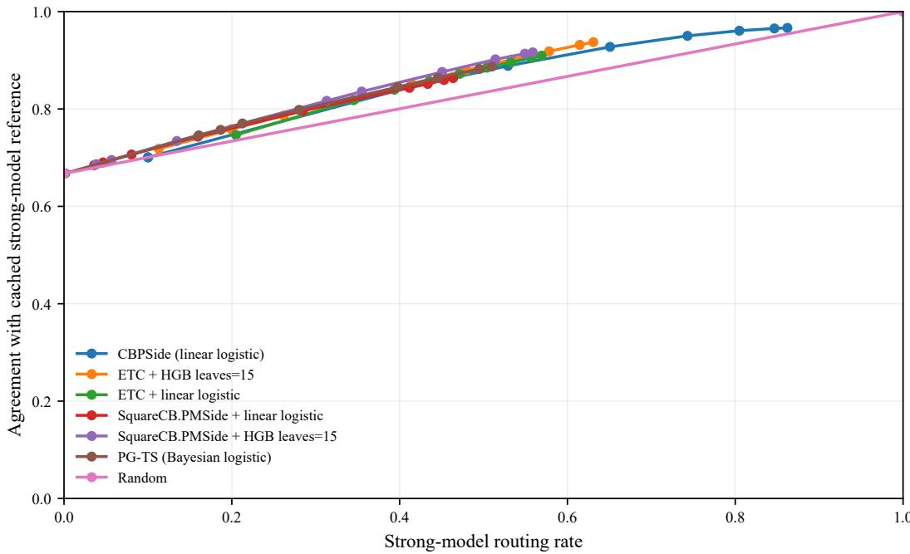  
Figure 3: Routing–accuracy trade-of on BoolQ. The horizontal axis reports the fraction of prompts routed to the strong model, while the vertical axis reports agreement with the cached strong-model response. Thus, points closer to the upper-left corner are preferable, as they achieve higher agreement while making fewer strong-model queries. Each marker is the mean over 20 shufled online orders, with confidence intervals omitted for visual clarity. Along each curve, the connected markers follow increasing values $\ell _ { 0 1 } \in \{ 1 . 8 , 2 . 0 , 2 . 2 , 2 . 4 , 2 . 6 , 2 . 8 , 3 . 0 , \bar { 3 } . 2 , 3 . 3 \}$ . Increasing $\ell _ { 0 1 }$ assigns a larger penalty to an incorrect weak-model response and therefore generally moves the policy toward more strong-model routing and higher agreement.

Moreover, Figure 3 shows the trade-of between routing accuracy and the rate at which the strong model is invoked; algorithms achieving higher accuracy at a lower invocation rate are preferable. SquareCB.PMSide with the HGB model attains the best trade-of among the algorithms compared.

Table 2: Meaning of the multiplier s for each algorithm.
<table><tr><td>Algorithm</td><td>Scaled quantity</td><td>Effect of larger s</td></tr><tr><td>CBPSIDE</td><td>confidence width  $s w _ { i }$ </td><td>more exploration</td></tr><tr><td>RANDCBPSIDE</td><td>sampled confidence width  $s w _ { i }$ </td><td>more exploration</td></tr><tr><td>SQUARECB.PMSIDE</td><td>IGW rate  $\kappa = s \sqrt { T }$ </td><td>less exploration</td></tr><tr><td>ETC</td><td>exploration length  $s T ^ { 2 / 3 }$ </td><td>more exploration</td></tr><tr><td>PG-TS</td><td>prior variance  $s \sigma _ { 0 }$ </td><td>more exploration</td></tr></table>

Additional contextual label-eficient prediction experimental details. Contexts are drawn i.i.d. as $x _ { t } \sim \mathrm { U n i f } \left( [ 0 , 1 ] ^ { 1 0 } \right)$ , and a single weight vector w is sampled once from $\mathrm { U n i f } ( 0 , 0 . 1 ) ^ { 1 0 }$ and normalized so that $w _ { i } \geq 0$ and $\Sigma _ { i } w _ { i } = 1 { : }$ ; consequently $w ^ { \top } x$ is a convex combination of the coordinates of x and lies in $[ 0 , 1 ]$ by construction. The binary outcome is the deterministic threshold $y _ { t } = \mathbb { 1 } \left\{ w ^ { \top } x _ { t } \geq 0 . 5 \right\}$ . We evaluate $c \in \{ 0 . 1 , 0 . 2 , 0 . 3 , 0 . 4 , 0 . 4 5 \}$ ; we stop short of $c = 0 . 5$ because at that point the cell of the expert action collapses to a single point: the action becomes degenerate, the two prediction actions become neighbors, and the game falls outside the non-degenerate class that our analysis covers. Each experiment uses horizon $T = 3 0 0 0$ and is repeated over 20 independent seeds, and for each policy and each c we select s ∈ {0.1, 0.3, 1, 3, 10} by minimizing mean total cost over those 20 paired seeds. Each method has exactly one exploration parameter. To place them on a common footing we scale each by a shared multiplier s, sweeping s ∈ {0.1, 0.3, 1, 3, 10} as summarised in Table 2. Furthermore, The random baseline instead routes each query to the strong model with a fixed probability, independent of context, swept over {0, 0.2, 0.4, 0.6, 0.8, 1}.

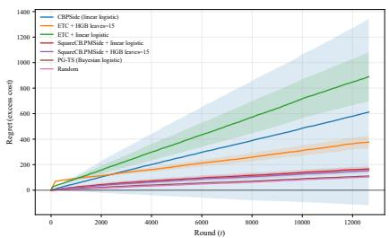  
(a) $\ell _ { 0 1 } = 1 . 8$

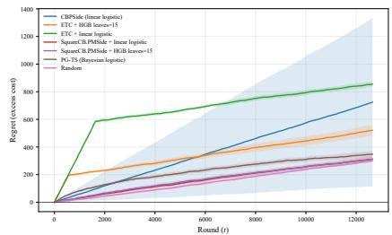  
(b) $\ell _ { 0 1 } = 2 . 0$

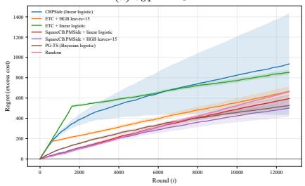  
(c) $\ell _ { 0 1 } = 2 . 2$

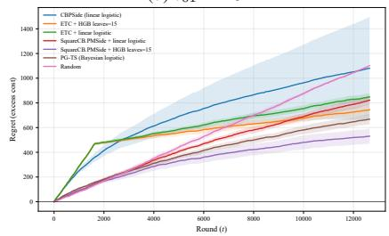

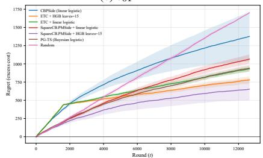  
(e) $\ell _ { 0 1 } = 2 . 6$

(d) $\ell _ { 0 1 } = 2 . 4$  
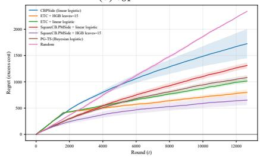

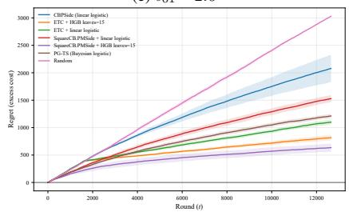  
(g) $\ell _ { 0 1 } = 3 . 0$

(f) $\ell _ { 0 1 } = 2 . 8$  
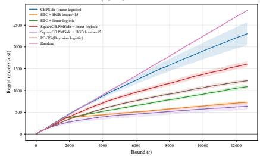

(h) $\ell _ { 0 1 } = 3 . 2$  
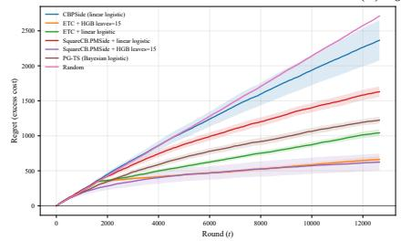  
(i) $\ell _ { 0 1 } = 3 . 3$  
Figure 4: Cumulative empirical regret, measured as excess realized cost relative to the fixed five-fold cross-fitted HGB reference policy, for each value of $\ell _ { 0 1 }$ . Curves show means over 20 paired random arrival orders, and shaded regions are pointwise 95% Student-t confidence intervals. Lower values are better; negative regret indicates that the online policy incurs lower realized cost than the fixed reference policy.

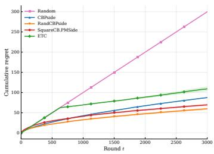  
(a) $c = 0 . 1$

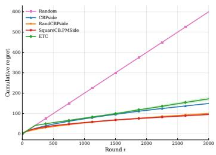  
(b) $c = 0 . 2$

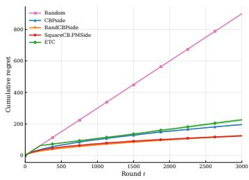  
(c) $c = 0 . 3$

1200 Random   
CBPside   
RandCBPside   
1000 SquareCB.PMSide   
ETC   
Cumulative regret 800   
600   
400   
200   
500 1000 1500 2000 2500 3000   
Round t  
(d) $c = 0 . 4$

1400   
Random   
CRPside   
1200 RandCBPside   
SquareCB.PMSide   
ETC   
1000   
Cumulative regret 800   
600   
400   
200   
500 1000 1500 2000 2500 3000   
Round t  
(e) $c = 0 . 4 5$  
Figure 5: Cumulative regret against round t for each value of the information cost $c ,$ with every algorithm at its best multiplier. Shaded bands are 95% Student-t confidence intervals for the mean over 20 seeds.

Observations Figure 2b shows total cost as a function of $c ,$ and Figure 5 the learning curves for all compared algorithms across the full sweep. These extend the results discussed in Section 4.

## F Algorithm for Lq-decreasing tree construction $\pmb { L q }$

Given a locally observable game $\mathcal { G } = \left( L , \Phi \right)$ and an outcome distribution $q \in \Delta ( d )$ , we denote $\ell _ { a } : = e _ { a } ^ { \intercal } \mathbf { { \cal L } } q$ for the loss of action a under the outcome distribution q. Since a partial monitoring game can be represented as a neighborhood graph (Π, E), we can construct a spanning in-tree $\mathcal T \subseteq \mathcal E$ rooted at the action with the smallest loss aˆ ∈ arg mi $\mathfrak { l } _ { a \in \Pi } \ell _ { a }$ . The following algorithm constructs an $\scriptstyle { L q } .$ ∈-decreasing in-tree by selecting each action’s best neighbor to be its parent, then constructing the in-tree T with the selected neighbors as edges.

Algorithm 5 Constructing an $L q \mathrm { . }$ -decreasing in-tree by selecting each action’s parent   
1: Input: A locally observable game $\mathcal { G } = \left( L , \Phi \right)$ , its neighborhood graph $( \Pi , { \mathcal { E } } )$ , and $q \in \Delta ( d )$   
2: Output: A spanning in-tree $\bar { \tau } \subseteq \mathcal { E }$ with root root $\boldsymbol { \tau } = \boldsymbol { \hat { a } }$ such that $\pmb { L q }$ is T-decreasing.   
3: For each $a \in { \dot { \Pi } } ,$ compute $\ell _ { a } = e _ { a } ^ { \top } \pmb { { \cal L } } q$ T, and choose the root aˆ ∈ arg min $\mathfrak { l } _ { a \in \Pi } \ell _ { a }$   
4: Choose $q ^ { \circ } \in \mathrm { r i } ( \mathcal { C } _ { \hat { a } } )$ , which is the relative interior of the cell $\mathcal { C } _ { \hat { a } }$   
5: Initialize $\mathcal { T }  \emptyset .$   
6: for each $a \in \Pi \setminus \{ \hat { a } \}$ do   
7: Find the best neighbors $B _ { a } \gets \mathrm { a r g }$ min $\mathfrak { l } _ { b : ( a , b ) \in \mathcal { E } } \ell _ { b } .$   
8: Choose par (a) ∈ arg m $\mathrm { i n } _ { b \in B _ { a } } e _ { b } ^ { \top } \pmb { { \cal L } } q ^ { \circ }$ ∶ E, breaking any remaining ties arbitrarily.   
9: $\mathcal { T }  \mathcal { T } \overset { \cdot } { \cup } \{ ( a , \overset { \cdot } { \operatorname { p a r } } _ { \mathcal { T } } ( \overset { \cdot } { a } ) ) \}$   
10: end for   
11: return the in-tree T with roo $\gamma = { \hat { a } } .$

The proof of such an Lq-decreasing in-tree construction is provided in Lattimore & Szepesvari [2020,´ Lemma 19].

## G Auxiliary Lemmata

Lemma G.1 (Pareto optimal comparators sufice). For every $q \in \Delta ( d )$

$$
\operatorname* { m i n } _ { \lambda \in \Delta ( \Pi ) } \lambda ^ { \top } L q = \operatorname* { m i n } _ { a \in \Pi } e _ { a } ^ { \top } L q = \operatorname* { m i n } _ { a \in [ k ] } e _ { a } ^ { \top } L q = \operatorname* { m i n } _ { \lambda \in \Delta ( k ) } \lambda ^ { \top } L q .
$$

Proof. A linear function on a simplex attains its minimum at a vertex, which gives the outer two equalities, so it sufices to show $\bar { \bigcup } _ { a \in \Pi } \mathcal { C } _ { a } = \Delta ( d )$ The cells cover $\Delta ( d )$ by Definition $2 . 1$ , and $\cup _ { a \notin \Pi } \mathcal { C } _ { a }$ ∈is a finite union of polytopes of dimension at most $d - 2$ , hence has empty interior relative to the $( d - 1 )$ -dimensional set $\bar { \Delta ( d ) }$ . So $\textstyle \bigcup _ { a \in \Pi } { \mathcal { C } } _ { a }$ is dense in $\Delta ( d )$ ; being a finite union of closed sets it is closed, and therefore equals $\Delta ( d )$ . □

Theorem D.1 (Regret concentration generalized from Qin & Zhang [2026a]). Let $\Lambda$ be a set of policies, $\mathcal { L } ( \cdot \mid x ) : \Lambda \to \left[ 0 , 1 \right]$ a value function and $\mathcal { L } ^ { \star } ( \cdot \vert x )$ and $\widehat { \mathcal { L } } _ { \ell } ( \cdot | \overset { - } { x } ) , \ell \in [ L ]$ are value functions measured under the true model and estimated models respectively. $\lambda ^ { \star } \in \Lambda$ and $\hat { \lambda } _ { \ell } \in \Lambda$ are respectively the optimal policies under respective true and estimated models. Let $C _ { \ell } : \Lambda \times \Lambda \to \mathbb { R }$ be coverage maps, $p _ { \ell } \in \Lambda$ are decisions, $0 < \gamma _ { 1 } \leq \gamma _ { 2 } \leq \cdots \leq \gamma _ { L }$ learning rates, and $V _ { \ell } , E _ { \ell } \ge 0$ +numbers such that,

(C1) (certificate) for every $\ell \geq 1$ and every $\lambda \in \Lambda$

$$
\widehat { \mathscr { L } } _ { \ell } ( p _ { \ell } \vert x ) - \widehat { \mathscr { L } } _ { \ell } ( \lambda \vert x ) + \frac { 1 } { \gamma _ { \ell } } C _ { \ell } ( p _ { \ell } , \lambda ) \leq V _ { \ell } .
$$

(C2) (of-policy evaluation) for every $\ell \geq 2$ and every $\lambda \in \Lambda$

$$
\left| \widehat { \mathcal { L } } _ { \ell } ( \lambda - p _ { \ell - 1 } \mid x ) - \mathcal { L } ^ { \star } ( \lambda - p _ { \ell - 1 } \mid x ) \right| \leq \frac { 1 } { 6 \gamma _ { \ell } } C _ { \ell - 1 } ( p _ { \ell - 1 } , \lambda ) + \frac { 3 \gamma _ { \ell } } { 2 } E _ { \ell } .
$$

Define $G _ { 1 } : = 1$ and, for $\ell \geq 2 .$

$$
\gamma _ { \ell } G _ { \ell } : = \gamma _ { \ell - 1 } G _ { \ell - 1 } + \gamma _ { \ell - 1 } V _ { \ell - 1 } + 9 \gamma _ { \ell } ^ { 2 } E _ { \ell } , \qquad \mathrm { i . e . } \qquad G _ { \ell } = \frac { 1 } { \gamma _ { \ell } } \left[ \gamma _ { 1 } + \sum _ { i = 2 } ^ { \ell } ( \gamma _ { i - 1 } V _ { i - 1 } + 9 \gamma _ { i } ^ { 2 } E _ { i } ) \right] .
$$

Then, for every $\ell \in [ L ]$ and every $\lambda \in \Lambda$

$$
\operatorname { R e g } ( \lambda \mid x ) \leq 2 { \widehat { \operatorname { R e g } } } _ { \ell } ( \lambda \mid x ) + G _ { \ell } \qquad { \mathrm { a n d } } \qquad { \widehat { \operatorname { R e g } } } _ { \ell } ( \lambda \mid x ) \leq 2 \operatorname { R e g } ( \lambda \mid x ) + G _ { \ell } .\tag{13}
$$

Consequently $\operatorname { R e g } ( p _ { \ell } \mid x ) \leq 2 V _ { \ell } + G _ { \ell }$ for every $\ell ,$ and

$$
\sum _ { \ell = 1 } ^ { L } ( \tau _ { \ell } - \tau _ { \ell - 1 } ) \operatorname { R e g } ( p _ { \ell } \mid x ) \leq \tau _ { 1 } + \sum _ { \ell = 2 } ^ { L } \frac { \tau _ { \ell } - \tau _ { \ell - 1 } } { \gamma _ { \ell } } \left[ 2 \gamma _ { \ell } V _ { \ell } + \gamma _ { 1 } + \sum _ { i = 2 } ^ { \ell } ( \gamma _ { i - 1 } V _ { i - 1 } + 9 \gamma _ { i } ^ { 2 } E _ { i } ) \right] .\tag{14}
$$

Proof. We prove $\operatorname { E q } .$ . equation 13 by induction on $\ell .$ For $\ell = 1$ both inequalities hold with $G _ { 1 } = 1$ since Reg and $\widehat { \mathrm { R e g } } _ { 1 }$ take values in [0, 1]. Fix $\ell \geq 2$ and assume Eq. equation 13 to hold at $\ell - 1$

First, we establish that, for every $\lambda ,$ our policy and estimator guarantees Low Regret (LR) and Good Coverage(GC).

That is, from (C1) for epoch $\ell - 1$ , we have

$$
\begin{array} { r } { \widehat { \mathcal { L } } _ { \ell - 1 } ( p _ { \ell - 1 } \mid x ) - \widehat { \mathcal { L } } _ { \ell - 1 } ( \lambda \mid x ) + \frac { 1 } { \gamma _ { \ell - 1 } } C _ { \ell - 1 } ( p _ { \ell - 1 } , \lambda ) \leq V _ { \ell - 1 } } \\ { \widehat { \mathcal { L } } _ { \ell - 1 } ( p _ { \ell - 1 } \mid x ) - \widehat { \mathcal { L } } _ { \ell - 1 } ( \widehat { \lambda } _ { \ell - 1 } \mid x ) - ( \widehat { \mathcal { L } } _ { \ell - 1 } ( \lambda \mid x ) - \widehat { \mathcal { L } } _ { \ell - 1 } ( \widehat { \lambda } _ { \ell - 1 } \mid x ) ) + \frac { 1 } { \gamma _ { \ell - 1 } } C _ { \ell - 1 } ( p _ { \ell - 1 } , \lambda ) \leq V _ { \ell - 1 } } \\ { \widehat { \mathrm { R e g } } _ { \ell - 1 } ( p _ { \ell - 1 } \mid x ) + \left( \frac { 1 } { \gamma _ { \ell - 1 } } C _ { \ell - 1 } ( p _ { \ell - 1 } , \lambda ) - \widehat { \mathrm { R e g } } _ { \ell - 1 } ( \lambda \mid x ) \right) \leq V _ { \ell - 1 } } \end{array}
$$

Above statement is true for all $\lambda ,$ including the the case where ${ \widehat { \mathrm { R e g } } } _ { \ell - 1 } ( \lambda \mid x ) = 0 { \mathrm { a n d } } C _ { \ell } ( p _ { \ell - 1 } , \lambda )$ is $\mathrm { \ a l w a y s \geq 0 }$ . Hence,

$$
\widehat { \mathrm { R e g } } _ { \ell - 1 } ( p _ { \ell - 1 } | x ) \leq V _ { \ell - 1 } .
$$

(Low Regret (LR))

Also,

$$
\left( { \frac { 1 } { \gamma _ { \ell - 1 } } } C _ { \ell - 1 } ( p _ { \ell - 1 } , \lambda ) - \widehat { \mathrm { R e g } } _ { \ell - 1 } ( \lambda | x ) \right) \leq V _ { \ell - 1 } .
$$

Hence,

$$
C _ { \ell - 1 } ( p _ { \ell - 1 } , \lambda ) \leq \gamma _ { \ell - 1 } \left[ V _ { \ell - 1 } + \widehat { \mathrm { R e g } } _ { \ell - 1 } ( \lambda \mid x ) \right] .\tag{Good Coverage (GC)}
$$

Moreover,

$$
\begin{array}{c} \begin{array} { r l } & { \mathrm { ~ t o t s i n g ~ } ( \begin{array} { l l l l } { 1 } & { \rho _ { 1 } ( \rho _ { 1 } , \rho _ { 1 } ) } & { 0 } & { 0 } \\ { 0 } & { 0 } & { 0 } & { 0 } \end{array} ) } \\ & { = \sigma _ { 1 } ( \rho _ { 1 } , 0 ) } \\ & { \quad - \sigma _ { 1 } ( \rho _ { 1 } , 0 ) } \\ & { \quad - \sigma _ { 1 } ( \rho _ { 1 } , 0 ) } \\ & { \quad - \sigma _ { 1 } ( \rho _ { 1 } , 0 ) } \\ & { \quad - \sigma _ { 1 } ( \rho _ { 1 } , 0 ) } \\ & { \quad - \sigma _ { 1 } ( \rho _ { 1 } , 0 ) } \\ & { \quad \quad + \sigma _ { 1 } ( \rho _ { 1 } , 0 ) } \end{array} \{array ( \begin{array} { l l l l } { 1 } & { 0 } & { 0 } & { 0 } \\ { 0 } & { 0 } & { 1 } & { 0 } \\ { 0 } & { 0 } & { 0 } & { 0 } \end{array} )  \\ & { \quad - \sigma _ { 1 } ( \rho _ { 1 } , 0 ) } \\ & { \quad - \sigma _ { 1 } ( \rho _ { 1 } , 0 ) } \\ & { \quad \quad + \sigma _ { 1 } ( \rho _ { 1 } , 0 ) } \\ & { \quad \quad - \sigma _ { 1 } ( \rho _ { 1 } , 0 ) } \\ & { \quad \sigma _ { 1 } ( \rho _ { 1 } , 0 ) } \end{array} )  \\ & { = \sigma _ { 1 } ( \rho _ { 1 } , 0 ) } \\ & { \quad \sigma _ { 1 } ( \rho _ { 1 } , \rho _ { 1 } ) } \\ & { \quad \quad \quad \quad \quad \quad \quad \quad \quad \quad \quad \quad \quad \quad \quad \quad \quad \quad \quad \quad \quad \quad \quad \quad \quad \quad \quad \quad \quad \quad \quad \quad \sigma _ { 1 } ( \rho _ { 1 } , \rho _ { 1 } ) + \sigma _ { 1 } ( \rho _ { 1 } , 0 ) } \\ &  \quad \quad \quad \quad \quad \quad \quad \quad \quad \quad \quad \quad \quad \quad \quad \quad \quad
$$

Hence

$$
\begin{array} { c } { { { \displaystyle \mathrm { R e g } ( \lambda \vert x ) - \widetilde { \mathrm { R e g } } _ { \ell } ( \lambda \vert x ) \le \frac { 1 } { 3 } \mathrm { R e g } ( \lambda \vert x ) + \frac { 1 } { 3 } G _ { \ell } } } } \\ { { { \displaystyle \frac { 2 } { 3 } \mathrm { R e g } ( \lambda \vert x ) \le \widetilde { \mathrm { R e g } } _ { \ell } ( \lambda \vert x ) + \frac { 1 } { 3 } G _ { \ell } } } } \\ { { { \displaystyle \mathrm { R e g } ( \lambda \vert x ) \le \frac { 3 } { 2 } \widetilde { \mathrm { R e g } } _ { \ell } ( \lambda \vert x ) + \frac { 1 } { 2 } G _ { \ell } } } } \\ { { { \le 2 \widetilde { \mathrm { R e g } } _ { \ell } ( \lambda \vert x ) + G _ { \ell } } } } \end{array}\tag{Step **}
$$

Furthermore,

$$
\begin{array} { r l } & { \mathrm { R e g } _ { \ell } ( \lambda \mid x ) - \mathrm { R e g } ( \lambda \mid x ) } \\ & { \quad = \widehat { \mathcal { L } } _ { \ell } ( \lambda \mid x ) - \widehat { \mathcal { L } } _ { \ell } ( \widehat { \lambda } _ { \ell } \mid x ) - \left( \mathcal { L } ^ { * } ( \lambda \mid x ) - \mathcal { L } ^ { * } ( \lambda ^ { * } \mid x ) \right) } \\ & { \quad = \widehat { \mathcal { L } } _ { \ell } ( \lambda - p _ { \ell - 1 } \mid x ) - \widehat { \mathcal { L } } _ { \ell } ( \widehat { \lambda } _ { \ell } - p _ { \ell - 1 } \mid x ) - \left( \mathcal { L } ^ { * } ( \lambda - p _ { \ell - 1 } \mid x ) - \mathcal { L } ^ { * } ( \lambda ^ { * } - p _ { \ell - 1 } \mid x ) \right) } \\ & { \quad = \widehat { \mathcal { L } } _ { \ell } ( \lambda - p _ { \ell - 1 } \mid x ) - \mathcal { L } ^ { * } ( \lambda - p _ { \ell - 1 } \mid x ) - \left( \widehat { \mathcal { L } } _ { \ell } ( \widehat { \lambda } _ { \ell } - p _ { \ell - 1 } \mid x ) - \mathcal { L } ^ { * } ( \lambda ^ { * } - p _ { \ell - 1 } \mid x ) \right) } \\ & { \quad \le \widehat { \mathcal { L } } _ { \ell } ( \lambda - p _ { \ell - 1 } \mid x ) - \mathcal { L } ^ { * } ( \lambda - p _ { \ell - 1 } \mid x ) - \left( \widehat { \mathcal { L } } _ { \ell } ( \widehat { \lambda } _ { \ell } - p _ { \ell - 1 } \mid x ) - \mathcal { L } ^ { * } ( \widehat { \lambda } _ { \ell } - p _ { \ell - 1 } \mid x ) \right) } \\ &  \qquad \quad \quad \quad \quad \quad \quad \quad \quad \quad \quad \quad \quad \quad \quad \quad \quad \quad \quad \quad \quad \quad \quad \quad \quad \quad \quad \quad \quad \quad ( \mathcal { L } ^ { * } ( \widehat { \lambda } _ { \ell } \mid x ) \ge \mathcal { L } ^ { * } ( \lambda ^ { * } \mid x ) ) \end{array}
$$

$$
\begin{array} { r l } & { \quad \le \frac { 1 } { \delta \gamma _ { \sigma } } C _ { \sigma } ( \gamma _ { \sigma } \Lambda _ { 1 } ) + \frac { 3 \gamma _ { \sigma } } { 2 } E _ { \sigma } + \frac { 1 } { \delta \gamma _ { \sigma } } C _ { \sigma } ( - \frac { 1 } { \delta \gamma _ { \sigma } } \Lambda _ { 1 } ) + \frac { 3 \alpha _ { \sigma } } { 2 } E _ { \sigma } } \\ & { \quad \le \frac { 1 } { \delta \gamma _ { \sigma } } C _ { \sigma } ( \gamma _ { \sigma } \Lambda _ { 1 } ) - \frac { 3 } { 2 } \gamma _ { \sigma } ( - \frac { 1 } { \delta \gamma _ { \sigma } } \Lambda _ { 1 } ) + \frac { 3 } { 2 } \gamma _ { \sigma } ( \gamma _ { \sigma } \Lambda _ { 1 } ) - [ \gamma _ { \sigma } \Lambda _ { 1 } ] - \frac { 3 } { 2 } \gamma _ { \sigma } ( \gamma _ { \sigma } \Lambda _ { 1 } ) [ \gamma _ { \sigma } ] - \frac { 3 } { 2 } \gamma _ { \sigma } ( E _ { \sigma } ) } \\ & { \quad \le \frac { 1 } { \delta \gamma _ { \sigma } } C _ { \sigma } ( - [ 1 + \frac { 3 } { 2 } \delta \gamma _ { \sigma } + \Lambda _ { 1 } ] ) + \frac { 3 } { 2 } \gamma _ { \sigma } ( \gamma _ { \sigma } \Lambda _ { 1 } ) + \frac { 3 } { 2 } \gamma _ { \sigma } ( \gamma _ { \sigma } \Lambda _ { 1 } ) } \\ &  \quad \le \frac { 1 } { \delta \gamma _ { \sigma } } \gamma _ { \sigma } [ ( E _ { \sigma } ) + [ 1 + \frac { 3 } { 2 } \delta \gamma _ { \sigma } + \Lambda _ { 1 } ] + \frac { 3 } { 2 } \gamma _ { \sigma } ( \gamma _ { \sigma } ) + \frac { 1 } { \delta \gamma _ { \sigma } } \gamma _ { \sigma } ( \gamma _ { \sigma } ) + \frac { 3 } { 4 \gamma _ { \sigma } } (  \end{array}
$$

Hence,

$$
\begin{array} { r l r } & { } & { \widehat { \mathrm { R e g } } _ { \ell } ( \lambda \mid x ) - \mathrm { R e g } ( \lambda \mid x ) \le \displaystyle \frac { 1 } { 3 } \mathrm { R e g } ( \lambda \mid x ) + \displaystyle \frac { 2 } { 3 } G _ { \ell } } \\ & { } & { \widehat { \mathrm { R e g } } _ { \ell } ( \lambda \mid x ) \le \displaystyle \frac { 4 } { 3 } \mathrm { R e g } ( \lambda \mid x ) + \displaystyle \frac { 2 } { 3 } G _ { \ell } } \\ & { } & { \mathrm { R e g } ( \lambda \mid x ) \le \displaystyle \frac { 3 } { 2 } \widehat { \mathrm { R e g } } _ { \ell } ( \lambda \mid x ) + \displaystyle \frac { 1 } { 2 } G _ { \ell } } \\ & { } & { \le 2 \widehat { \mathrm { R e g } } _ { \ell } ( \lambda \mid x ) + G _ { \ell } } \end{array}
$$

Finally, we prove the consequences. Apply (C1) at $\begin{array} { r } { \lambda = \hat { \lambda } _ { \ell } , } \end{array}$ we have

$$
\begin{array} { r l } & { \widehat { \mathrm { R e g } } _ { \ell } ( p _ { \ell }  { | \begin{array} { l } { x } \end{array}  } ) \leq V _ { \ell } } \\ & { \Rightarrow \mathrm { R e g } ( p _ { \ell }  { | \begin{array} { l } { x } \end{array}  ) } \leq 2 \widehat { \mathrm { R e g } } _ { \ell } ( p _ { \ell }  { | \begin{array} { l } { x } \end{array}  } ) + G _ { \ell } \leq 2 V _ { \ell } + G _ { \ell } . } \end{array}
$$

(equation Low Regret (LR))

(By equation 13)

Summing over epochs, we have

$$
\begin{array} { r l } & { \displaystyle \sum _ { \ell = 1 } ^ { L } ( \tau _ { \ell } - \tau _ { \ell - 1 } ) \operatorname { R e g } ( p _ { \ell } \mid x ) \leq \tau _ { 1 } + \sum _ { \ell = 2 } ^ { L } ( \tau _ { \ell } - \tau _ { \ell - 1 } ) ( 2 V _ { \ell } + G _ { \ell } ) \medskip } \\ & { \quad \quad \quad = \tau _ { 1 } + \displaystyle \sum _ { \ell = 2 } ^ { L } \frac { \tau _ { \ell } - \tau _ { \ell - 1 } } { \gamma _ { \ell } } \left[ 2 \gamma _ { \ell } V _ { \ell } + \gamma _ { 1 } + \displaystyle \sum _ { i = 2 } ^ { \ell } ( \gamma _ { i - 1 } V _ { i - 1 } + 9 \gamma _ { i } ^ { 2 } E _ { i } ) \right] , } \end{array}
$$

(By the closed form of $G _ { \ell } )$

which is Eq. equation 14.

Lemma G.2. Let $P , Q$ are two probability simplices. $D _ { \mathrm { H } } ( P \left| Q \right. ) , \ j _ { \mathrm { K L } } ( P \left| Q ) , \ j _ { \mathrm { l } } P - Q \right| \ l _ { \mathrm { T V } } , \ j _ { P } - Q \ j _ { \mathrm { l } } .$ be the Hellinger distance, Kullback divergence, total variation distance and level-1 norm between $P _ { \mathrm { : } }$ $Q$ respectively, then the following holds,

$$
{ \frac { \| P - Q \| _ { 1 } } { 2 } } = \| P - Q \| _ { \mathrm { T V } } \leq D _ { \mathrm { H } } ( P | Q )
$$

and,

$$
{ \frac { \| P - Q \| _ { 1 } } { 2 } } = \| P - Q \| _ { \mathrm { T V } } \leq { \sqrt { D _ { \mathrm { K L } } ( P | Q ) } }
$$

Proof.

$$
\| P - Q \| _ { \mathrm { T V } } \leq D _ { \mathrm { H } } ( P | Q )
$$

( Tsybakov [2008], Lemma 2.3)

and,

$$
\| P - Q \| _ { \mathrm { T V } } \leq { \sqrt { D _ { \mathrm { K L } } ( P | Q ) } }\tag{Tsybakov [2008], Lemma 2.5}
$$

Furthermore,

$$
{ \frac { \| P - Q \| _ { 1 } } { 2 } } = \| P - Q \| _ { \mathrm { T V } }
$$

(Levin & Peres [2017], Proposition 4.2)

Lemma G.3 (Local observability, Lattimore & Szepesvari [2020])´ . If ${ \mathcal { G } } = ( \Phi , L )$ is locally observable and non-degenerate and actions $e = ( a , b ) \in \mathcal { E }$ are neighbours, then there exist functions $w _ { e } ( a , \cdot ) , w _ { e } ( b , \cdot ) : \Sigma $ R such that $\| w _ { e } \| _ { \infty } \leq m / 2$ and

$$
\begin{array} { r } { \pmb { L _ { a o } } - \pmb { L _ { b o } } = w _ { e } \big ( { a } , \Phi _ { a o } \big ) + w _ { e } \big ( { b } , \Phi _ { b o } \big ) \mathrm { f o r ~ a l l } o \in \big [ d ] . } \end{array}
$$

In Lemma $\mathrm { { G . 3 } } ,$ , the assumption of non-degeneracy is important here $\mathrm { f o r } \| w _ { e } \| _ { \infty } \leq m / 2$ to hold. The Proposition G.4 bounds $\| \boldsymbol { w } _ { e } \| _ { \infty }$ for more general case.

∞Lemma G.4 (Lattimore & Szepesvari [2020])´ . Suppose that $( L , \Phi )$ is globally observable and a and b are neighbours. Then there exists a function $w _ { e } : [ k ] \times \Sigma  \mathbb { R }$ such that for all $x \in [ d ]$

$$
\sum _ { c = 1 } ^ { k } w _ { e } ( c , \Phi _ { c o } ) = L _ { a o } - L _ { b o } .
$$

Furthermore, $w _ { e }$ can be chosen so that $\| w _ { e } \| _ { \infty } \leq d ^ { 1 / 2 } k ^ { d / 2 }$

∞Lemma G.5 (Water-transfer operator adapted from Lattimore & Szepesvari [2020])´ . Suppose that G is non-degenerate and locally observable and $q \in \Delta ( d )$ Assume that we have an in-tree $\dot { \tau }$ that is Lq-decreasing. Then there exists a function $W _ { q } ^ { \mathcal { T } } : \Delta ( \Pi )  \Delta ( \Pi )$ such that the following hold for all $p \in \Delta ( \Pi )$

(a) The expected loss does not increase: $\left( W _ { q } ( p ) - p \right) ^ { \intercal } L q \leq 0$

(b) Action probabilities are not too small: $W _ { q } ( p ) [ a ] \geq p [ a ] / k$ for all $a \in [ k ]$

(c) Probabilities increase towards the root of the in-tree T. That is, $W _ { q } ( p ) [ a ] \leq W _ { q } ( p ) [ b ]$ for all $e = ( a , b ) \in \mathcal { T }$