# EXPLORER-ZERO: IMPROVING SELF-PLAY FOR LONG-HORIZON TASKS WITH DECOMPOSABLE VERIFIABLEREWARDS

Tianyu Liu<sup>†1</sup>, Davide Belli<sup>2</sup>, Bence Major<sup>2</sup>, Arash Behboodi<sup>2</sup>, Tribhuvanesh Orekondy<sup>2</sup> <sup>1</sup> ETH Zurich <sup>2</sup> Qualcomm AI Research<sup>‡</sup>

## ABSTRACT

Training LLM agents on long-horizon interactive tasks with reinforcement learning typically relies on human-annotated tasks and reliable verification, both expensive to construct for stateful environments. Self-play offers an alternative, but must generate achievable, compositional tasks and provide feedback beyond binary outcomes. We propose Explorer-Zero, a self-play framework that jointly generates tasks and fine-grained, verifiable rewards through environment interaction. A learned proposer explores the environment, constructs tasks, and records intermediate and final states as verification targets. These checkpoints reward partial completion, while alternating proposer–solver training adapts the generated curriculum. We show theoretically that subtask rewards reduce collapse among unsuccessful rollouts when they complete different numbers of subtasks. Without human-annotated training tasks, Explorer-Zero outperforms the evaluated self-play baselines across ALFWorld, ScienceWorld, and AppWorld; on AppWorld, our 30B agent reaches 59.67% task success, approaching 62.65% for RL on humanannotated tasks. Further analyses support task-relevant composition and benefits on complex tasks, while self-play initialization improves subsequent human-data RL across all three benchmarks.

## 1 INTRODUCTION

LLM agents are increasingly applied to open-ended, long-horizon tasks, from coding (Jimenez et al., 2024) and tool use (Yao et al., 2024) to embodied environments (Shridhar et al., 2021) and application control (Trivedi et al., 2024). The dominant training recipe is reinforcement learning with verifiable rewards (RLVR), but it depends on tasks that are achievable, diverse, and paired with reliable success checks (Lambert et al., 2024; Guo et al., 2025a). Creating such supervision for stateful environments is expensive: task designers must understand what the current state permits, specify a meaningful change to it, and define how to verify that change. Human task construction therefore limits how broadly agentic RL can scale.

Self-play can remove this bottleneck by training a proposer to generate tasks for a solver. It has been particularly effective when tasks and success checks can be produced from static artifacts: game rules determine the winner (Silver et al., 2017; Sukhbaatar et al., 2018), execution or formal checking validates code (Zhao et al., 2026; Wilf et al., 2026), retrieved evidence supplies answers to search questions (Yue et al., 2026; Lu et al., 2026), and structured specifications define correct tool calls (Acikgoz et al., 2026). Long-horizon interaction in a stateful environment is different: the proposer often cannot determine from the initial observation which goals are reachable, and a final binary success check discards the progress made toward an unsuccessful task.

Our approach is motivated by two observations. First, long-horizon agentic tasks are often compositional: their completion requires a sequence of meaningful state changes. For instance, in embodied scenarios, an agent must locate an item before it can pick it up and move it to a destination. Generating each task in one shot overlooks this structure; a proposer that acts in the environment can instead discover feasible components and compose them into a grounded task. Second, the delayed outcomes of long-horizon tasks make sparse rewards particularly limiting, while fine-grained feedback can provide a substantially more useful learning signal (Ng et al., 1999; Arjona-Medina et al., 2019; Lightman et al., 2024). In group-normalized RL, this can cause reward collapse: a binary reward assigns the same value to sampled trajectories, so their advantages vanish despite meaningful differences in progress (Razin et al., 2025).

We introduce Explorer-Zero, a self-play framework in which a learned proposer explores the environment and generates a natural-language task grounded in its trajectory. As it acts, the proposer declares meaningful subtasks and saves the corresponding environment states; its final state provides the task-level success check. This design has two benefits. First, exploration lets the proposer build compositional tasks from demonstrated state transitions, producing complex training problems that better reflect real long-horizon use than isolated goals. Second, the saved intermediate states become verifiable subgoal checkpoints: failed solver trajectories receive fine-grained rewards according to the subtasks they complete, reducing the frequency with which binary rewards collapse and discard partial progress. Because the proposer itself is trained alongside the solver, the generated curriculum can evolve as the solver improves without relying on human-written tasks or a prompted frontier model.

Our main contributions are:

1. Self-play that jointly generates compositional tasks and supervision. We introduce a learned proposer that explores stateful environments, constructs compositional tasks, and records verifiable subtask checkpoints. These checkpoints provide fine-grained solver rewards, enabling self-play without human-authored training tasks or learned judges.

2. Theoretical and empirical analysis of subtask supervision. We derive conditions under which subtask rewards preserve a learning signal even when all sampled trajectories fail to complete the task. Our empirical analyses show that the subtask incentive encourages task-relevant compositions, with downstream gains concentrated on tasks requiring multiple dependent operations.

3. Effective agent training with and without human-annotated tasks. Across ALFWorld, ScienceWorld, and AppWorld, Explorer-Zero outperforms the evaluated self-play baselines without human-annotated training tasks and improves final performance when used to initialize RL on human-annotated tasks. Controlled ablations quantify the benefits of interactive proposal and subtask supervision.

Without human-annotated training tasks, Explorer-Zero outperforms Self-Challenging, the strongest evaluated self-play baseline, by 18.67 points on ALFWorld and 7.23 on ScienceWorld with 4B agents. On AppWorld, the 30B agent reaches 59.67 TGC, exceeding this baseline by 7.74 points and approaching human-data RL (62.65). Self-play initialization also improves subsequent human-data RL across all three environments.

## 2 RELATED WORK

Self-play with verifiable tasks. Self-play has produced superhuman game-playing policies and automatic curricula in embodied control (Silver et al., 2017; Sukhbaatar et al., 2018; OpenAI et al., 2021). Recent proposer–solver methods generate code problems checked by execution or formal verification (Zhao et al., 2026; Wilf et al., 2026), while R-Zero uses a challenger–solver loop to generate verifiable reasoning problems (Huang et al., 2026). Related approaches generate questions grounded in documents or retrieved evidence (Yang et al., 2026; Yue et al., 2026; Lu et al., 2026) and structured tool-call problems (Acikgoz et al., 2026); J-Zero instead uses a learned judge for open-ended tasks (Chu et al., 2026). GenEnv and SPADE extend self-play by generating executable environments and adapting their difficulty to the solver (Guo et al., 2025b; Liu et al., 2026). These approaches rely on known answers, automatic checks, or model-generated environments, and therefore do not address the central challenge in a stateful target environment: discovering reachable, compositional goals through interaction and retaining a learning signal when the solver cannot yet complete them.

Interaction-grounded task generation. Several methods generate training tasks from environment interaction. Learn-by-Interact converts collected trajectories into instructions (Su et al., 2025), while Self-Challenging Language Model Agents (Zhou et al., 2026) has a tool-using challenger produce an instruction, executable verifier, example solution, and failure cases. AutoPlay (Ramrakhya et al.,

2025) verifies explored UI tasks with a multimodal judge and filters them by executor success. AgentSynth (Xie et al., 2025) composes executor-performed subtasks into longer computer-use tasks, but does not reuse them as reward checkpoints. In these methods, task generation is performed by fixed, prompted models rather than learned jointly with the solver. Moreover, their interaction trajectories are not reused as intermediate reward checkpoints, so partial progress is not preserved as supervision. Relatedly, hindsight experience replay relabels trajectories with reached goal (Andrychowicz et al., 2017), and concurrent State2State (Lei et al., 2026) turns states collected largely through random exploration into state-matched goals for mid-training. Unlike methods centered on individual reached states, Explorer-Zero trains the proposer to compose a natural-language task from multiple demonstrated transitions and uses the same states to verify intermediate progress.

Fine-grained supervision for long-horizon RL. Fine-grained feedback is well established in RL: reward shaping augments sparse task rewards with intermediate signals (Ng et al., 1999), RUDDER (Arjona-Medina et al., 2019) attributes delayed rewards to consequential earlier decisions, and process supervision applies intermediate feedback to language-model reasoning (Lightman et al., 2024). Theory further shows that even accurate rewards provide little learning signal when they fail to distinguish outputs from the current policy (Razin et al., 2025). To address this problem, self-play methods typically steer proposers toward tasks with intermediate solve rates (Zhao et al., 2026; Huang et al., 2026; Yue et al., 2026; Guo et al., 2025b). SPADE (Liu et al., 2026) instead uses the performance gap with and without a privileged hint to guide environment generation. These approaches improve task selection rather than derive fine-grained solver rewards from task generation. Outside self-play, GiGPO and milestone-guided shaping provide finer feedback on predefined agent tasks through matched states or hand-designed progress rules (Feng et al., 2025; Wang et al., 2026). Explorer-Zero brings fine-grained supervision into self-play: the same proposer trajectory generates the task and the verifiable checkpoints used to reward partial completion.

## 3 METHODOLOGY

We introduce Explorer-Zero, a proposer–solver self-play framework for long-horizon stateful environments.

Problem setup and notation. An agent with policy $\pi _ { \theta }$ interacts with a stateful environment $\varepsilon \colon$ given a task $x ,$ it produces a trajectory $\tau = ( a _ { 1 } , o _ { 1 } , \dots , a _ { T } , o _ { T } )$ of actions $a _ { t }$ and observations $o _ { t }$ traversing environment states $s _ { 0 } , \ldots , s _ { T }$

Standard RLVR and its data-curation bottleneck. Standard RLVR trains an agent with policy-gradient methods to maximize expected reward over a fixed task distribution: max<sub>θ</sub> $\mathbb { E } _ { x \sim \mathcal { D } , \tau \sim \pi _ { \theta } ( \cdot | x ) } \left[ R ( x , \tau ) \right]$ . A verifier assigns a typically binary reward $R ( x , \tau ) \in \{ 0 , 1 \}$ using an executable test, answer check, or state-based predicate. Building this training distribution requires human-authored tasks, contexts, and reliable success checks. Examples include initial world states and rule-based checks in ALFWorld and ScienceWorld (Shridhar et al., 2021; Wang et al., 2022), and initial database states and unit tests in AppWorld (Trivedi et al., 2024). This curation is expensive because tasks must be both achievable and challenging, while verification must remain robust to reward hacking. For example, Trivedi et al. (2024) report five months of human effort for data generation.

Our approach: High-level idea. Explorer-Zero replaces the fixed task distribution with tasks generated by a proposer $\pi _ { \mathrm { P } }$ . The proposer interacts with the environment to generate a task and state-based verification artifacts. A solver $\pi _ { S }$ is trained on the accepted tasks. The two policies are optimized in alternating phases, allowing the task distribution to evolve with the solver. Our method is illustrated in Fig. 1, and the full procedure is shown in Algorithm 1.

## 3.1 PROPOSER: INTERACTIVE GENERATION OF COMPOSITIONAL TASKS

During proposer training, the solver is frozen. We describe how the proposer generates tasks, verification artifacts, and its training reward.

Proposer: Main idea. Starting from $s _ { 0 } ,$ the proposer at the end of a successful rollout generates $( x , \dot { s } _ { \mathrm { f i n a l } } ^ { \mathrm { r e f } } , \{ ( g _ { k } , s _ { k } ^ { \mathrm { r e f } } ) \} _ { k = 1 } ^ { K } )$ , where x is the final task, $s _ { \mathrm { f i n a l } } ^ { \mathrm { r e f } }$ is its reference outcome, and $( g _ { k } , s _ { k } ^ { \mathrm { r e f } } )$ are optional intermediate checkpoints. All reference states are reached during the proposer trajectory, grounding the task in a demonstrated outcome. Here, the final task x and subtask descriptions $g _ { k }$ are in natural language (tokens generated by the LLM policy) and the states $s _ { k } ^ { \mathrm { r e f } }$ correspond to snapshots of the environmental state.

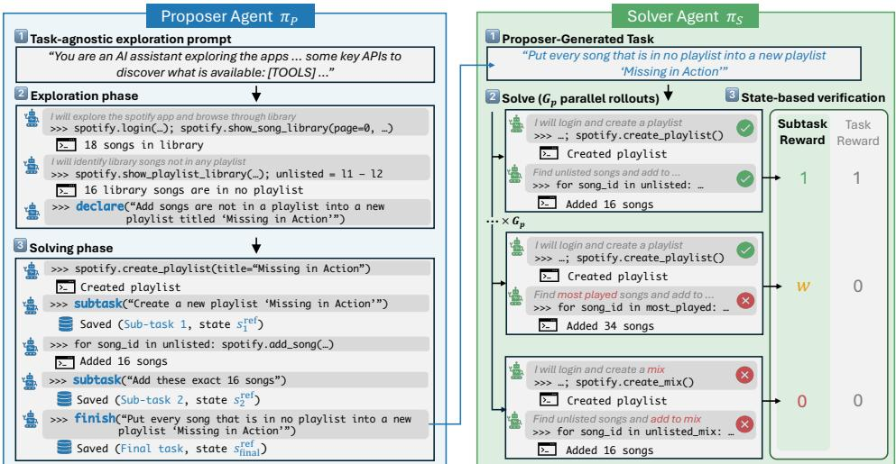  
Figure 1: Overview of Explorer-Zero. Left: the proposer π explores the environment, declares an initial task intent (declare), completes subtasks (subtask) and the final task x (finish). Each subtask and finish call snapshots the environment as a reference state, yielding $s _ { 1 } ^ { \mathrm { r e f } } , \ldots , s _ { K } ^ { \mathrm { r e f } }$ and $s _ { \mathrm { f i n a l } } ^ { \mathrm { r e f } }$ . Right: the solver π<sub>S</sub>’s traversed states are matched against the reference states to compute $R ^ { \mathrm { s o l v e r } }$ , and the resulting solve rate determines $R ^ { \mathrm { p r o p o s e n } }$

Phases: Exploration to task generation. The proposer interacts with the environment for at most T steps. Proposal proceeds in two phases. During the exploration phase, the proposer examines the environment over multiple turns and identifies a candidate task. During the solving phase, the proposer attempts to complete its own task. It may label meaningful subtasks as they are completed and finally submits the final task description. We denote the complete interaction by the proposer trajectory τ<sup>prop</sup>. This separation serves two purposes. Exploration allows the proposer to discover what the current environment state permits, while solving demonstrates that the proposed outcome is reachable. It also allows the final task description to reflect information obtained during interaction rather than only the initial observation.

Verification artifacts. Generating a task description alone is insufficient for RLVR because the solver also requires a reliable task-specific verification signal. To enable this, we use environment states reached by the proposer as verification artifacts. When the proposer completes its task, we snapshot the resulting environment state as the final reference state $s _ { \mathrm { f i n a l } } ^ { \mathrm { r e f } }$ . Given a solver trajectory with terminal state $s _ { T }$ , task completion can then be checked by comparing s<sub>T</sub> with $s _ { \mathrm { f i n a l } } ^ { \mathrm { r e f } }$ . The proposer trajectory therefore provides both the task and an executable state-based verification target without requiring a task-specific predicate, model-based judge, or model-written test. We evaluate state equality through changes relative to the common initial state $s _ { 0 } .$ . A solver state s matches a reference state $s ^ { \mathrm { { \check { r e f } } } }$ , written $s \simeq s ^ { \mathrm { r e f } }$ , if s reproduces the task-relevant changes exhibited by $s ^ { \mathrm { r e f } }$ relative to $s _ { 0 } .$ The concrete matching rules for each environment are described in Section 4.

Compositionality. The proposer trajectory provides more than a final verification target. As the proposer solves its task, it can identify meaningful intermediate outcomes and snapshot their corresponding states. Each declared subtask $g _ { k }$ is therefore paired with a reference state $s _ { k } ^ { \mathrm { r e f } }$ reached after completing that component. These intermediate states expose the compositional structure of the generated task. Instead of predicting a distant goal in one step, the proposer can establish one outcome, continue interacting from the resulting state, and construct later components that depend on earlier ones. The final task describes the cumulative outcome of these demonstrated transitions. For simplicity, we use the declared subtasks as an unordered checklist of verification conditions, without explicitly modeling dependencies between them. A solver may satisfy them in any order, provided that their state conditions are reached. The proposer chooses the number of subtasks K and when $K = 0 ,$ , it generates only the final task and its reference state.

Proposer’s reward. For each proposal, we sample $G _ { \mathrm { P } }$ trajectories from the frozen solver and estimate $\begin{array} { r } { \hat { p } ( x ) = \frac { 1 } { G _ { \mathrm { P } } } \sum _ { i = 1 } ^ { G _ { \mathrm { P } } } R ( x , \tau _ { i } ) } \end{array}$ , where $R ( x , \tau _ { i } ) \in \{ 0 , 1 \}$ indicates final-task completion using state-based

verification. The proposer reward is

$$
\begin{array} { r } { R ^ { \mathrm { p r o p o s e r } } ( x , \tau ^ { \mathrm { p r o p } } ) = \left\{ \begin{array} { l l } { R ^ { \mathrm { d i f i c u l t y } } ( x ) + R ^ { \mathrm { s u b t a s k } } ( x , \tau ^ { \mathrm { p r o p } } ) + R ^ { \mathrm { d i v e r s i t y } } ( \tau ^ { \mathrm { p r o p } } ) , } & { \mathrm { i f ~ t h e ~ p r o p o s a l ~ i s ~ v a l i d , } } \\ { 0 , } & { \mathrm { o t h e r w i s e . } } \end{array} \right. } \end{array}\tag{1}
$$

The difficulty reward is:

$$
R ^ { \mathrm { { d i f f c u l t y } } } ( x ) = 1 - { | 2 \hat { p } ( x ) - 1 | }\tag{2}
$$

which is maximized at a solve rate of 0.5 and penalizes tasks that are consistently solved or consistently failed. The remaining terms encourage intermediate structure and diverse interaction:

$$
R ^ { \mathrm { s u b t a s k } } ( x , \tau ^ { \mathrm { p r o p } } ) = w _ { \mathrm { s u b } } K ,\tag{3}
$$

$$
{ R } ^ { \mathrm { d i v e r s i t y } } ( \tau ^ { \mathrm { p r o p } } ) = w _ { \mathrm { d i v } } \left| \mathcal { A } ( \tau ^ { \mathrm { p r o p } } ) \right| ,\tag{4}
$$

where K is the number of declared subtasks, $\scriptstyle A \left( \tau ^ { \mathrm { p r o p } } \right)$ is the set of distinct proposer action types, and $w _ { \mathrm { s u b } } , w _ { \mathrm { d i v } } > 0$ are weighting coefficients.

Implementation details. The proposer starts from the same state $s _ { 0 }$ later used for solver rollouts. Each proposer GRPO group shares one initial state (an ALFWorld or ScienceWorld environment instance, or an AppWorld persona). Its prompt contains the environment interface and encourages broad exploration. In addition to environment actions, it has three control tools: (i) declare(task\_description) ends exploration and declares a candidate task; (ii) subtask(subtask\_description) records a completed subtask and its reference artifact; (iii) finish(task\_description) submits the final task and records $s _ { \mathrm { f i n a l } } ^ { \mathrm { r e f } }$ . For state-changing outcomes, the reference artifact is the state delta relative to $s _ { 0 } .$ . For observational subtasks without a persistent state change, it also records the action or API call that produced the relevant observation and its returned value, which the solver must reproduce. We define action types as command verbs in ALFWorld and ScienceWorld, and as applications in AppWorld. The coefficients $w _ { \mathrm { s u b } } , w _ { \mathrm { d i v } } > 0$ control the two incentives. Two subtasks are redundant if their state deltas are identical and their descriptions have word-level Jaccard similarity above 0.6. The subtask term in Eq. (3) is applied only to non-redundant checkpoints.

## 3.2 SOLVER: TRAINING A POLICY TO SOLVE

During solver training, the proposer is frozen. The solver is trained on accepted proposer-generated tasks using final-task and subtask verification.

Task generation and filtering. At each solver-training iteration, the frozen proposer samples tasks and their associated verification artifacts from a set of initial world states. A generated example consists of an initial state $s _ { 0 }$ , a task description x, a final reference state $s _ { \mathrm { f i n a l } } ^ { \mathrm { r e f } }$ , and zero or more subtask reference states $s _ { 1 } ^ { \mathrm { r e f } } , \ldots , s _ { K } ^ { \mathrm { r e f } }$ . Before using an example for solver training, we apply a rule-based validity filter. We retain a task only if: (i) the proposer submits a natural-language task through finish; (ii) the task contains no redundant subtasks; and (iii) every application or object named in the task description appears in the proposer trajectory. These checks remove malformed proposals, repeated checkpoints, and instructions that are unsupported by the demonstrated interaction. Tasks rejected by the filter are not included in the solver training distribution.

Task and rollout. For each accepted task, the environment is reset to the proposer’s initial state $s _ { 0 }$ The solver observes only the task description and environment interface, not the proposer trajectory nor verification artifacts. The solver generates $\tau ^ { \mathrm { s o l v } } = ( a _ { 1 } , o _ { 1 } , \dots , a _ { T } , o _ { T } )$ . We retain its visited states $\boldsymbol { S } ( \tau ^ { \mathrm { s o l v } } ) = \{ s _ { 0 } , . . . , s _ { T } \}$ , so that a subtask remains verifiable even if its state is later modified.

State-based verification and rewards. The final-task reward compares the solver’s terminal state with the final reference state:

$$
R ( x , \tau ^ { \mathrm { s o l v } } ) = \mathbb { I } \left\{ s _ { T } \simeq s _ { \mathrm { f i n a l } } ^ { \mathrm { r e f } } \right\} .\tag{5}
$$

For $K > 0$ , the subtask reward is

$$
R ^ { \mathrm { s u b g o a l } } ( x , \tau ^ { \mathrm { s o l v } } ) = \frac { 1 } { K } \sum _ { k = 1 } ^ { K } \mathbb { I } \left\{ \exists s \in { \mathcal { S } } ( \tau ^ { \mathrm { s o l v } } ) : s \simeq s _ { k } ^ { \mathrm { r e f } } \right\} .\tag{6}
$$

We set $R ^ { \mathrm { { s u b g o a l } } } ( x , \tau ^ { \mathrm { { s o l v } } } ) = 0$ when K = 0. The solver reward is

$$
R ^ { \mathrm { s o l v e r } } ( x , \tau ^ { \mathrm { s o l v } } ) = \left\{ \begin{array} { l l } { 1 , } & { \mathrm { i f ~ } R ( x , \tau ^ { \mathrm { s o l v } } ) = 1 , } \\ { R ^ { \mathrm { s u b g o a l } } ( x , \tau ^ { \mathrm { s o l v } } ) , } & { \mathrm { o t h e r w i s e } . } \end{array} \right.\tag{7}
$$

Thus, successful trajectories receive the maximum reward, while unsuccessful trajectories are distinguished by verified subtask completion. The solver is updated with a group-based policy-gradient objective over multiple rollouts per task.

## 3.3 SUBTASK REWARDS REDUCE REWARD COLLAPSE

We now examine how the reward in Eq. (7) can preserve a learning signal on tasks that the solver rarely completes. With binary outcome rewards, unsuccessful trajectories all receive zero reward, even when they make different amounts of progress. GRPO computes advantages by normalizing rewards within a group of $G \geq 2 \mathrm { i . i . d }$ . rollouts (Appendix A). When all rollouts receive the same reward, every reward-normalized advantage is zero<sup>1</sup>, and the group provides no reward-driven policy-gradient signal. We refer to this event as reward collapse.

To quantify how subtask rewards affect collapse, let $p ( x ) = \operatorname* { P r } _ { \tau ^ { \mathrm { s o l v } } \sim \pi _ { \mathrm { S } } ( \cdot | x ) } [ R ( x , \tau ^ { \mathrm { s o l v } } ) = 1 ]$ denote the current solver’s success probability, estimated empirically by pˆ(x) given a task x.

Proposition 1 (Subtask rewards reduce reward collapse). Under the binary task reward, a group collapses with probability $p ^ { G } + ( 1 - p ) ^ { G }$ Conditional on all sampled rollouts failing, binary rewards collapse with probability one. Under Eq. (7), conditional on all rollouts failing, the collapse probability $i s \stackrel { \textstyle \overrightharpoon { \sum } _ { j = 0 } ^ { K } } { \textstyle \sum } \tilde { q } _ { j } ^ { \stackrel { \textstyle \overbar { G } } { } }$ , where $\tilde { q } _ { j }$ is the probability that a failed rollout completes exactly j subtasks. This probability is strictly below one whenever at least two subtask-completion counts have positive probability among failed rollouts.

The proof and an analysis of the effect of group size are given in Appendix B. Larger groups can reduce binary-reward collapse by increasing the chance of sampling a successful trajectory, but become costly on difficult tasks: as $p  0$ , keeping the collapse probability below a fixed threshold requires G to grow on the order of $1 / p$ . Higher sampling temperatures may likewise improve the chance of success through exploration, but neither sampling choice changes the fact that binary rewards assign identical values to all failed trajectories. Subtask rewards complement these choices by making differences in partial completion available for learning: even when every rollout fails, completing different numbers of subtasks yields nonzero normalized advantages.

## 4 EXPERIMENTS

## 4.1 EXPERIMENTAL SETUP

Benchmarks and evaluation. We evaluate on ALFWorld (Shridhar et al., 2021), a text-based household environment; ScienceWorld (Wang et al., 2022), a text-based science environment; and AppWorld (Trivedi et al., 2024), an ecosystem of API-controlled applications. Evaluation follows benchmark success criteria, not proposer-generated training checkpoints. Unless stated otherwise, we report task success rates on ALFWorld’s unseen validation split and ScienceWorld’s test split. On AppWorld’s test\_normal split, we report task goal completion (TGC), the percentage of tasks passing all benchmark tests, and scenario goal completion (SGC), the percentage of scenarios with all task variants completed. Tables report means and standard deviations over four sampled evaluations per task.

Training-time verification. To compute rewards on self-generated training tasks, we instantiate the reference-state verification rule of Section 3.2 for each environment. In AppWorld, we compare changes in applications that changed in the reference trajectory and are mentioned in the task. In ALFWorld and ScienceWorld, we compare object types while ignoring instance indices, so manipulating interchangeable instances such as apple 1 and apple 2 is equally valid.

Models and training. Self-play uses environment resets without human-authored training tasks, demonstrations, or reward annotations. The proposer and solver are initialized from Qwen3-4B on ALFWorld and ScienceWorld and from Qwen3-4B-Instruct-2507 on AppWorld, where we additionally evaluate Qwen3-30B-A3B-Instruct-2507 (Yang et al., 2025). We focus the larger-model evaluation on AppWorld, whose multi-application workflows allow us to test whether the benefits of compositional self-play persist with a stronger base agent. We train with GRPO; hyperparameter and interaction budgets are given in Appendix D.

Table 1: Experimental results on ALFWorld, ScienceWorld, and AppWorld. We report success rates on ALFWorld (unseen validation split) and ScienceWorld (test split), and TGC and SGC (task and scenario goal completion) on AppWorld (test normal split). We report means and standard deviations over four samples per task prompt.
<table><tr><td rowspan="3"></td><td rowspan="3"></td><td></td><td>#annotation ALFWorld ScienceWorld</td><td colspan="4">AppWorld</td></tr><tr><td rowspan="2">Qwen3-4B</td><td rowspan="2">Qwen3-4B</td><td colspan="2">Qwen3-4B-inst</td><td colspan="2">Qwen3-30B-A3B-inst</td></tr><tr><td>TGC</td><td>SGC</td><td>TGC</td><td>SGC</td></tr><tr><td colspan="9">Without human-annotated training data</td></tr><tr><td>Baseline</td><td>n=0</td><td> $1 7 . 1 4 \pm 5 . 7$ </td><td> $7 . 0 3 \pm 0 . 5$ </td><td> $1 4 . 0 3 \pm 5 . 1$ </td><td> $3 . 9 5 \pm 3 . 2$ </td><td> $2 5 . 1 5 \pm 5 . 2$ </td><td> $8 . 0 4 \pm 7 . 5$ </td></tr><tr><td rowspan="4">In-Context</td><td>n=1</td><td> $1 9 . 2 8 \pm 7 . 7$ </td><td> $1 1 . 4 0 \pm 0 . 4$ </td><td> $1 2 . 2 8 \pm 3 . 7$ </td><td> $6 . 5 8 \pm 4 . 6$ </td><td> $2 8 . 9 5 \pm 5 . 0$ </td><td> $1 5 . 7 9 \pm 7 . 7$ </td></tr><tr><td> $\mathrm { n } { = } 2$ </td><td> $1 8 . 5 7 \pm 4 . 7$ </td><td> $9 . 5 0 \pm 0 . 4$ </td><td> $1 5 . 3 5 \pm 4 . 0$ </td><td> $1 . 3 2 \pm { 1 . 3 }$ </td><td> $2 7 . 6 3 \pm 4 . 8$ </td><td> $1 1 . 8 4 \pm 6 . 2$ </td></tr><tr><td> $\mathrm { n } { = } 3$ </td><td> $3 3 . 5 7 \pm 3 . 3$ </td><td> $1 8 . 1 0 \pm 0 . 7$ </td><td> $1 4 . 9 1 \pm 3 . 9$ </td><td> $3 . 9 5 \pm 2 . 9$ </td><td> $2 6 . 3 2 \pm 5 . 3$ </td><td> $1 4 . 4 7 \pm 7 . 2$ </td></tr><tr><td> $\mathrm { n } { = } 4$ </td><td> $3 0 . 7 1 \pm 7 . 1$ </td><td> $1 8 . 5 0 \pm 0 . 3$ </td><td> $1 3 . 1 6 \pm 3 . 8$ </td><td> $2 . 6 3 \pm 2 . 6$ </td><td> $3 1 . 1 1 \pm 0 . 2 $ </td><td> $1 7 . 1 1 \pm 7 . 9$ </td></tr><tr><td>R-Zero</td><td>n=0</td><td> $2 4 . 2 8 \pm 1 . 5$ </td><td> $2 4 . 7 6 \pm 0 . 9$ </td><td> $1 7 . 4 1 \pm 5 . 8$ </td><td> $5 . 8 0 \pm 1 . 6$ </td><td> $4 7 . 3 2 \pm 1 . 8$ </td><td> $2 5 . 0 0 \pm 2 . 7$ </td></tr><tr><td>Self-Challenging</td><td>n=0</td><td> $6 6 . 4 0 \pm 3 . 5$ </td><td> $3 5 . 6 9 \pm 0 . 7$ </td><td> $3 2 . 2 0 \pm 3 . 2$ </td><td> $1 6 . 2 5 \pm 2 . 5$ </td><td> $5 1 . 9 3 \pm 1 . 3$ </td><td> $3 2 . 2 5 \pm 2 . 3$ </td></tr><tr><td>Ours</td><td>n=0</td><td> ${ \bf 8 5 . 0 7 \pm 1 . 6 }$ </td><td> $\mathbf { 4 } 2 . \mathbf { 9 } 2 \pm 0 . 7$ </td><td> $\mathbf { 3 8 . 3 9 \ : \pm 2 . 4 }$ </td><td> ${ \bf 1 6 . 9 6 \pm 1 . 9 }$ </td><td> ${ \pm 9 . 6 7 \pm 3 . 1 }$ </td><td> $\mathbf { 3 9 . 2 9 \ : \pm 3 . 2 }$ </td></tr><tr><td colspan="8">With human-annotated training data</td></tr><tr><td>RL</td><td>full</td><td> $9 5 . 7 1 \pm 0 . 9$ </td><td> $4 9 . 6 3 \pm 0 . 4$ </td><td> $4 6 . 3 8 \pm 3 . 2$ </td><td> $2 5 . 0 0 \pm 2 . 4 6 2 . 6 5 \pm 1 . 8$ </td><td></td><td> $3 8 . 3 9 \pm 3 . 2$ </td></tr><tr><td> $\mathbf { R L + O u r s }$ </td><td>full</td><td> $\mathbf { 9 8 . 5 7 \ : \pm 0 . 9 }$ </td><td> ${ \bf 6 3 . 2 6 \pm 0 . 4 }$ </td><td> ${ \pm 0 . 0 0 \pm 2 . 0 }$ </td><td> $3 2 . 1 4 \pm 3 . 0$ </td><td> ${ \bf 6 9 . 2 0 \pm 4 . 6 }$ </td><td> $5 3 . 1 2 \pm 3 . 0$ </td></tr></table>

Table 2: Ablation of Explorer-Zero components. Results on ALFWorld are on valid-seen, and results on AppWorld are with Qwen3-30B-A3B-Instruct-2507.
<table><tr><td rowspan="2"></td><td rowspan="2"></td><td rowspan="2">ALFWorld</td><td rowspan="2">ScienceWorld</td><td colspan="2">AppWorld</td></tr><tr><td>TGC</td><td>SGC</td></tr><tr><td></td><td>one-shot proposer</td><td> $5 9 . 2 9 \pm 9 . 4$ </td><td> $4 . 8 0 \pm 2 . 0$ </td><td> $2 9 . 4 6 \pm 4 . 7$ </td><td> $1 6 . 9 6 \pm 2 . 0$ </td></tr><tr><td>Self-play</td><td>interactive proposer</td><td> $6 5 . 7 1 \pm 2 . 3$ </td><td> $2 4 . 7 0 \pm 1 . 2$ </td><td> $4 5 . 8 3 \pm 1 . 9$ </td><td> $3 3 . 0 4 \pm 2 . 7$ </td></tr><tr><td></td><td>+ subtask</td><td> $\mathbf { 8 4 . 2 9 \ : \pm 1 . 5 }$ </td><td> $\mathbf { 4 } 2 . \mathbf { 9 } 2 \pm 0 . 7$ </td><td> ${ \pm 9 . 6 7 \pm 3 . 1 }$ </td><td> $\mathbf { 3 9 . 2 9 \ : \pm 3 . 2 }$ </td></tr></table>

Baselines. We compare two self-play approaches: Self-Challenging Agents (Zhou et al., 2026), whose frozen proposer generates tasks and executable verifiers, and R-Zero (Huang et al., 2026), whose learned proposer generates tasks verified through solver consensus. Our R-Zero implementation uses the majority final state across solver rollouts as the pseudo-reference state. Additional comparisons include the zero-shot base model, in-context learning with 1–4 human demonstrations, and RL on the full human-annotated training set as a reference for training with curated supervision.

## 4.2 MAIN RESULTS AND ABLATIONS

Comparison with self-play baselines. In Table 1, Explorer-Zero outperforms both self-play baselines across all three environments without human-annotated training tasks. Relative to Self-Challenging Agents (the stronger baseline) it improves ALFWorld performance by 18.67 points and ScienceWorld performance by 7.23 points. On AppWorld, the TGC gains are 6.19 points with the 4B model and 7.74 with the 30B model, showing that the advantage persists at both model sizes.

Comparison with human-data RL. RL on human-annotated tasks remains stronger on the primary task-level metrics, but the gap is particularly small for the 30B AppWorld agent: Explorer-Zero reaches 59.67 TGC compared with 62.65 for RL on the full training set. This result shows that self-generated tasks and verification can support performance close to human-data RL in this setting, without using its task annotations.

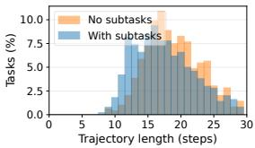

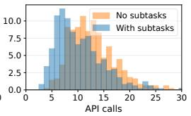

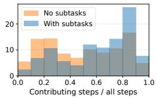

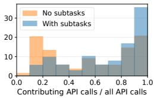

Figure 2: Task relevance of AppWorld proposer trajectories with and without subtask supervision. Left two: Trajectory lengths are similar across the two variants, while the proposer with subtasks makes fewer API calls on average. Right two: With subtasks, a larger fraction of steps and API calls contributes to the final task. We identify contributing interactions using backward program slicing (Weiser, 1984): they either produce target-state changes or support those changes through Python data flow.  
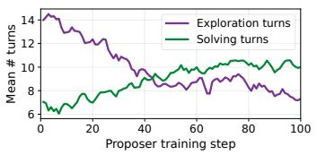

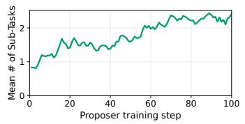

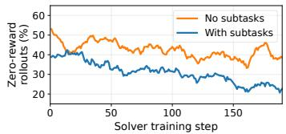  
Figure 3: Proposer and solver training dynamics on AppWorld. Left: The proposer shifts its effort from environment exploration toward executing the task it proposes: exploration turns decrease from 14 to 7, while solving turns rise from 7 to 10. Center: The mean number of declared subtasks increases from around 0.8 to 2.3. Right: The fraction of zero-reward solver rollouts with subtask supervision remains consistently below the no-subtask ablation, ending near 22% versus 39%.

Combining Explorer-Zero and RL. We further evaluate self-play as a pretraining stage for RL on human-annotated tasks, denoted by RL + Ours in Table 1. We first train the solver with Explorer-Zero for 200 steps, then continue training on human-annotated tasks for 150 RL steps using the same hyperparameters as the RL-only baseline. The combined protocol improves over RL alone across all three environments, including gains of 13.63 points on ScienceWorld and 6.55 TGC points on AppWorld with the 30B model. These results support self-play as a useful initialization for agentic RL even when human-annotated tasks are available.

Explorer-Zero ablations. Table 2 compares three variants. The one-shot proposer generates tasks from the environment description and uses the most common final state across solver attempts as the reference outcome for verification. The interactive proposer grounds tasks and their reference outcomes in an executed trajectory, but rewards the solver only for final task completion. The full method additionally declares subtasks and rewards intermediate progress. Moving from one-shot to interactive proposal improves performance in all three environments, showing the value of grounding both task generation and verification in interaction. Adding subtask supervision then yields a further 18.58 points on ALFWorld, 18.22 on ScienceWorld, and 13.84 TGC points on AppWorld. Subtask supervision thus adds substantial gains beyond interactive task generation. This ablation measures the combined benefit of changing task construction and solver rewards; it does not isolate reward granularity alone. Training curves are included in Appendix E.1.

## 5 ANALYSIS

## 5.1 SUBTASK SUPERVISION PRODUCES TASK-RELEVANT COMPOSITIONS

Rewarding subtask declarations could encourage the proposer to insert irrelevant intermediate steps rather than construct meaningful task compositions. However, the left two panels of Fig. 2 show that proposer trajectories have similar lengths with and without subtask supervision, while the subtask variant makes fewer API calls on average. The difference lies in the relevance of those interactions to the final task. The right two panels show that subtask supervision increases the fraction of contributing interactions, identified by backward program slicing (Weiser, 1984), indicating that the proposer incorporates a larger share of its trajectory into the final task. A complementary analysis finds that dependencies across subtasks increase during training without broader API or application coverage (Appendix E.2). Together, these findings indicate that subtask supervision encourages task-relevant composition rather than simply adding more interactions.

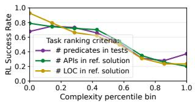

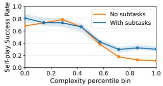

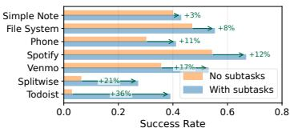  
Figure 4: Left: On AppWorld, tasks with greater multi-step solution complexity (measured by the number of test-case predicates, API calls, or lines of code in their reference solutions) are substantially harder for the RL agent trained on human-authored tasks. Center: Subtask supervision in Explorer-Zero provides little consistent benefit on simpler tasks but substantially higher success in the highest-complexity bins. Right: Per-app success rates on AppWorld test\_normal, where each task counts toward every app it requires. The largest gains occur for Todoist and Splitwise, which are the only apps appearing exclusively in multi-app tasks.

## 5.2 THE PROPOSER LEARNS TO CONSTRUCT STRUCTURED TASKS

During self-play, the proposer shifts from exploring the environment to executing its proposed tasks (Fig. 3, left). Exploration turns (before declare) decrease from roughly 14 to 7, while solving turns (from declare to finish) increase from around 7 to 10. Meanwhile, the average number of declared subtasks rises from approximately 0.8 to 2.3 (center). These trends indicate that the proposer increasingly allocates its interactions to task execution while constructing tasks with more explicit compositional structure. Trends in filter acceptance and task-description length are in Appendix E.3.

## 5.3 SUBTASK REWARDS PRESERVE LEARNING SIGNAL

We next examine the optimization mechanism developed in Section 3.3. With task-level binary rewards, every unsuccessful rollout receives zero reward regardless of its progress. Explorer-Zero distinguishes partially successful trajectories by rewarding the subtask checkpoints they reach. In Fig. 3 (right), the fraction of zero-reward solver rollouts with subtask supervision remains consistently below the no-subtask ablation and ends near 22%, compared with 39% without subtasks. By rewarding differences in subtask completion, Explorer-Zero preserves a learning signal even when every sampled rollout fails to complete the task.

## 5.4 BENEFITS CONCENTRATE ON COMPOSITIONAL TASKS

Finally, on AppWorld, success rates for an agent trained with RL on human-authored tasks decrease sharply with multi-step solution complexity (Fig. 4, left). We use three complementary proxies: evaluation predicates count the conditions the final state must satisfy, while API calls and lines of code in reference solutions capture the required operations and computation. Comparing self-play with and without subtask supervision (center), the variants perform similarly on simpler tasks, but subtask supervision yields a large and consistent advantage in the highest-complexity bins. Its benefit thus concentrate where sparse task-level feedback is expected to be least informative.

The per-app breakdown provides a complementary view of composition through tasks spanning multiple applications (Fig. 4, right). The largest gains occur on Todoist and Splitwise, followed by Venmo. These applications predominantly appear in multi-app tasks; Todoist and Splitwise appear exclusively in such tasks in this evaluation set. These tasks require carrying information and effects across application boundaries, a demanding form of composition. Together with the structural analyses, these results suggest that subtask supervision encourages task-relevant dependencies, with its largest gains on tasks requiring multiple dependent operations.

## 6 CONCLUSION

We presented Explorer-Zero, which uses environment interaction to jointly generate compositional tasks and fine-grained, verifiable rewards. Our theoretical analysis characterizes when subtask rewards preserve a learning signal despite task failure. Experiments show that subtask supervision encourages task-relevant dependencies, with the largest gains on tasks requiring multiple dependent operations. Across three benchmarks, Explorer-Zero outperforms the evaluated self-play baselines without humanannotated training tasks and improves subsequent human-data RL. These findings support using task-generation trajectories as a source of both compositional tasks and intermediate supervision.

Generative AI Statement. We used generative AI tools to refine conceptual framing and hypotheses, provide feedback on experimental methodology, review mathematical claims and proofs, assist with reference verification, interpret experimental results, and assist with code implementation and review. LLMs also generated training tasks and trajectories as part of the self-play method described in Section 3. We did not use generative AI tools for translation or for cleaning or reformatting datasets. We used these tools for literature discovery, manuscript organization, drafting, and readability improvements. The authors derived the proofs manually, conducted their own quantitative and qualitative analyses of experimental results, and independently checked references, code, and literature recommendations. We take responsibility for the final content of this work, including text, claims, and artifacts produced with the assistance of generative AI.

Ethics Statement. Our experiments study agent training in benchmark environments rather than deployment in live services. Nevertheless, improving autonomous agents’ ability to execute longhorizon tasks creates potential risks from unintended actions or misuse. The reference-state checks used for training measure task completion, not whether a task is safe or appropriate. Deployment beyond these benchmarks would therefore require additional safeguards, including access controls, restrictions on permitted actions, and human oversight for consequential operations.

Reproducibility Statement. The task-generation procedure, reference-state verification, and reward functions are described in Section 3, with the alternating training algorithm in Appendix C. The experimental setup specifies the benchmarks, evaluation protocols, and baseline adaptations (Section 4.1); training hyperparameters and hardware are reported in Appendix D, and prompt templates in Appendix G. The assumptions and proof of the reward-collapse analysis are provided in Section 3.3 and Appendix B. Additional definitions and procedures for the task-composition analysis appear in Appendix E.2.

Acknowledgements. We thank Amir Jalalirad and Gabriele Cesa for insightful discussions and comments during the project.

## REFERENCES

Emre Can Acikgoz, Cheng Qian, Jonas Hübotter, Heng Ji, Dilek Hakkani-Tür, and Gokhan Tur. Tool-r0: Self-evolving LLM agents for tool-learning from zero data, 2026. URL https:// arxiv.org/abs/2602.21320.

Marcin Andrychowicz, Filip Wolski, Alex Ray, Jonas Schneider, Rachel Fong, Peter Welinder, Bob McGrew, Josh Tobin, Pieter Abbeel, and Wojciech Zaremba. Hindsight experience replay. In NeurIPS, 2017.

Jose A. Arjona-Medina, Michael Gillhofer, Michael Widrich, Thomas Unterthiner, Johannes Brandstetter, and Sepp Hochreiter. RUDDER: Return decomposition for delayed rewards. In NeurIPS, 2019.

Gyouk Chu, Myeongho Jeon, and Eunho Yang. J-zero: Unified challenger–solver–judge co-evolution from zero data. arXiv preprint arXiv:2608.26582, 2026.

Lang Feng, Zhenghai Xue, Tingcong Liu, and Bo An. Group-in-group policy optimization for LLM agent training, 2025. URL https://arxiv.org/abs/2505.10978.

Daya Guo, Dejian Yang, Haowei Zhang, Junxiao Song, Peiyi Wang, Qihao Zhu, Runxin Xu, Ruoyu Zhang, Shirong Ma, Xiao Bi, et al. Deepseek-r1: Incentivizing reasoning capability in llms via reinforcement learning. arXiv preprint arXiv:2501.12948, 2025a.

Jiacheng Guo, Ling Yang, Peter Chen, Qixin Xiao, Yinjie Wang, Xinzhe Juan, Jiahao Qiu, Ke Shen, and Mengdi Wang. Genenv: Difficulty-aligned co-evolution between LLM agents and environment simulators. arXiv preprint arXiv:2512.19682, 2025b. URL https://arxiv.org/abs/ 2512.19682.

Chengsong Huang, Wenhao Yu, Xiaoyang Wang, Hongming Zhang, Zongxia Li, Ruosen Li, Jiaxin Huang, Haitao Mi, and Dong Yu. R-zero: Self-evolving reasoning LLM from zero data. In ICLR, 2026.

Carlos E. Jimenez, John Yang, Alexander Wettig, Shunyu Yao, Kexin Pei, Ofir Press, and Karthik Narasimhan. SWE-bench: Can language models resolve real-world GitHub issues? In ICLR, 2024.

Nathan Lambert, Jacob Morrison, Valentina Pyatkin, Shengyi Huang, Hamish Ivison, Faeze Brahman, Lester James V Miranda, Alisa Liu, Nouha Dziri, Shane Lyu, et al. Tulu 3: Pushing frontiers in open language model post-training. arXiv preprint arXiv:2411.15124, 2024.

Xuanyu Lei, Yiqi Zhu, Chenliang Li, Kaiming Liu, Peng Li, Ming Yan, Jieping Ye, Ya-Qin Zhang, and Yang Liu. State2State: Environment-derived mid-training for LLM agents, 2026. URL https://arxiv.org/abs/2608.04934.

Hunter Lightman, Vineet Kosaraju, Yuri Burda, Harrison Edwards, Bowen Baker, Teddy Lee, Jan Leike, John Schulman, Ilya Sutskever, and Karl Cobbe. Let’s verify step by step. In ICLR, 2024.

Bo Liu, Simon Yu, Yiding Jiang, Ao Qu, Andrew Zhao, Zichen Liu, Junsu Kim, Zijian Zhou, Seungone Kim, Tongzheng Ren, Mickel Liu, Hanfei Yu, Zhaorun Chen, Weiyan Shi, Paul Pu Liang, Luke Zettlemoyer, Yejin Choi, and Natasha Jaques. SPADE: Self-play in adaptive synthetic executable environments, 2026. URL https://arxiv.org/abs/2608.19197.

Hongliang Lu, Yuhang Wen, Pengyu Cheng, Ruijin Ding, Jiaqi Guo, Haotian Xu, Chutian Wang, Haonan Chen, Xiaoxi Jiang, and Guanjun Jiang. Search self-play: Pushing the frontier of agent capability without supervision. In ICLR, 2026.

Andrew Y. Ng, Daishi Harada, and Stuart Russell. Policy invariance under reward transformations: Theory and application to reward shaping. In ICML, 1999.

OpenAI OpenAI, Matthias Plappert, Raul Sampedro, Tao Xu, Ilge Akkaya, Vineet Kosaraju, Peter Welinder, Ruben D’Sa, Arthur Petron, Henrique P d O Pinto, et al. Asymmetric self-play for automatic goal discovery in robotic manipulation. arXiv preprint arXiv:2101.04882, 2021.

Ram Ramrakhya, Andrew Szot, Omar Attia, Yuhao Yang, Anh Nguyen, Bogdan Mazoure, Zhe Gan, Harsh Agrawal, and Alexander Toshev. Scaling synthetic task generation for agents via exploration. arXiv preprint arXiv:2509.25047, 2025. URL https://arxiv.org/abs/2509.25047.

Noam Razin, Zixuan Wang, Hubert Strauss, Stanley Wei, Jason D. Lee, and Sanjeev Arora. What makes a reward model a good teacher? an optimization perspective. In NeurIPS, 2025.

Zhihong Shao, Peiyi Wang, Qihao Zhu, Runxin Xu, Junxiao Song, Xiao Bi, Haowei Zhang, Mingchuan Zhang, Y. K. Li, Y. Wu, and Daya Guo. Deepseekmath: Pushing the limits of mathematical reasoning in open language models, 2024. URL https://arxiv.org/abs/ 2402.03300.

Mohit Shridhar, Xingdi Yuan, Marc-Alexandre Côté, Yonatan Bisk, Adam Trischler, and Matthew Hausknecht. ALFWorld: Aligning text and embodied environments for interactive learning. In ICLR, 2021.

David Silver, Julian Schrittwieser, Karen Simonyan, Ioannis Antonoglou, Aja Huang, Arthur Guez, Thomas Hubert, Lucas Baker, Matthew Lai, Adrian Bolton, et al. Mastering the game of go without human knowledge. Nature, 2017.

Hongjin Su, Ruoxi Sun, Jinsung Yoon, Pengcheng Yin, Tao Yu, and Sercan Ö. Arık. Learn-by-interact: A data-centric framework for self-adaptive agents in realistic environments. In ICLR, 2025.

Sainbayar Sukhbaatar, Zeming Lin, Ilya Kostrikov, Gabriel Synnaeve, Arthur Szlam, and Rob Fergus. Intrinsic motivation and automatic curricula via asymmetric self-play. In ICLR, 2018.

Harsh Trivedi, Tushar Khot, Mareike Hartmann, Ruskin Manku, Vinty Dong, Edward Li, Shashank Gupta, Ashish Sabharwal, and Niranjan Balasubramanian. AppWorld: A controllable world of apps and people for benchmarking interactive coding agents. In ACL, 2024.

Ruoyao Wang, Peter Jansen, Marc-Alexandre Côté, and Prithviraj Ammanabrolu. Scienceworld: Is your agent smarter than a 5th grader? In EMNLP, 2022.

Zixuan Wang, Yuchen Yan, Hongxing Li, Teng Pan, Dingming Li, Ruiqing Zhang, Weiming Lu, Jun Xiao, Yueting Zhuang, and Yongliang Shen. Milestone-guided policy learning for long-horizon language agents. arXiv preprint arXiv:2605.06078, 2026. URL https://arxiv.org/abs/ 2605.06078.

Mark Weiser. Program slicing. IEEE Transactions on software engineering, SE-10:352–357, 1984.

Alex Wilf, Pranjal Aggarwal, Bryan Parno, Daniel Fried, Louis-Philippe Morency, Paul Pu Liang, and Sean Welleck. Propose, solve, verify: Self-play through formal verification. In ICML, 2026.

Jingxu Xie, Dylan Xu, Xuandong Zhao, and Dawn Song. Agentsynth: Scalable task generation for generalist computer-use agents. arXiv preprint arXiv:2506.14205, 2025. URL https: //arxiv.org/abs/2506.14205.

An Yang, Anfeng Li, Baosong Yang, Beichen Zhang, Binyuan Hui, Bo Zheng, Bowen Yu, Chang Gao, Chengen Huang, Chenxu Lv, et al. Qwen3 technical report. arXiv preprint arXiv:2505.09388, 2025.

Ziyi Yang, Weizhou Shen, Chenliang Li, Ruijun Chen, Fanqi Wan, Ming Yan, Xiaojun Quan, and Fei Huang. SPELL: Self-play reinforcement learning for evolving long-context language models. In ICLR, 2026.

Shunyu Yao, Noah Shinn, Pedram Razavi, and Karthik Narasimhan. τ-bench: A benchmark for tool-agent-user interaction in real-world domains. arXiv preprint arXiv:2406.12045, 2024. URL https://arxiv.org/abs/2406.12045.

Zhenrui Yue, Kartikeya Upasani, Xianjun Yang, Suyu Ge, Shaoliang Nie, Yuning Mao, Zhe Liu, and Dong Wang. Dr. zero: Self-evolving search agents without training data, 2026. URL https://arxiv.org/abs/2601.07055.

Andrew Zhao, Yiran Wu, Tong Wu, Quentin Xu, Yang Yue, Matthieu Lin, Shenzhi Wang, Qingyun Wu, Zilong Zheng, and Gao Huang. Absolute zero: Reinforced self-play reasoning with zero data. NeurIPS, 2026.

Yifei Zhou, Sergey Levine, Jason Weston, Xian Li, and Sainbayar Sukhbaatar. Self-challenging language model agents. NeurIPS, 2026.

## A PRELIMINARIES

Reinforcement learning with verifiable rewards. The general framework of agentic training on long-horizon tasks is reinforcement learning with verifiable rewards (RLVR) (Guo et al., 2025a). We consider an agent, given by a policy $\pi _ { \theta }$ with parameters $\theta ,$ interacting with a stateful environment $\mathcal { E }$ Given a task $x ,$ the agent produces a trajectory $\tau = ( a _ { 1 } , o _ { 1 } , \dots , a _ { T } , o _ { T } )$ , alternating between actions $a _ { t } \sim \pi _ { \theta } ( \cdot \mid x , a _ { < t } , o _ { < t } )$ and observations $o _ { t }$ returned by E. Rather than relying on a learned reward model, RLVR assumes a deterministic verifier that assigns a binary reward $\bar { R } ( x , \tau ) \in \{ 0 , 1 \}$ to a completed trajectory, e.g., by checking the final answer in mathematical reasoning or by executing unit tests in code generation. The training objective is the expected verifiable reward

$$
\begin{array} { r } { \mathcal { L } _ { \mathrm { R L V R } } ( \theta ) = \mathbb { E } _ { x \sim \mathcal { D } } \mathbb { E } _ { \tau \sim \pi _ { \theta } ( \cdot | x ) } \big [ R ( x , \tau ) \big ] , } \end{array}\tag{8}
$$

where $\mathcal { D }$ is a task distribution, typically a human-curated training set.

Group relative policy optimization. We optimize $\mathcal { L } _ { \mathrm { R L V R } }$ with group relative policy optimization (GRPO) (Shao et al., 2024), which forgoes a learned value function and estimates advantages relative to a group of rollouts instead. For each task x, we sample G trajectories $\{ \tau _ { i } \} _ { i = 1 } ^ { G }$ from the previous policy $\pi _ { \mathrm { o l d } }$ and compute the group-normalized advantage

$$
A _ { i } = \frac { R _ { i } - \mathrm { m e a n } \bigl ( \{ R _ { j } \} _ { j = 1 } ^ { G } \bigr ) } { \mathrm { s t d } \bigl ( \{ R _ { j } \} _ { j = 1 } ^ { G } \bigr ) } , \qquad R _ { i } = R ( x , \tau _ { i } ) .\tag{9}
$$

The policy is updated by maximizing the clipped surrogate objective

$$
\mathcal { L } _ { \mathrm { G R P O } } ( \theta ) = \mathbb { E } _ { x , \{ \tau _ { i } \} \sim \pi _ { \mathrm { o i d } } } \left[ \frac { 1 } { G } \sum _ { i = 1 } ^ { G } \mathrm { m i n } \left( \rho _ { i } A _ { i } , \mathrm { c l i p } \big ( \rho _ { i } , 1 - \varepsilon _ { 1 } , 1 + \varepsilon _ { 2 } \big ) A _ { i } \right) \right] - \beta \mathrm { K L } \big ( \pi _ { \theta } \parallel \pi _ { \mathrm { r e f } } \big ) ,\tag{10}
$$

where $\rho _ { i } = \pi _ { \theta } ( \tau _ { i } \mid x ) / \pi _ { \mathrm { o l d } } ( \tau _ { i } \mid x )$ is the importance ratio, $\varepsilon _ { 1 } , \varepsilon _ { 2 }$ are the clipping thresholds, and $\beta$ weights a KL penalty toward a reference policy $\pi _ { \mathrm { r e f } }$ (Table 3). In practice, the ratio and clipping are applied per token, and only agent-generated tokens contribute to the objective while environment observations are masked out.

## B PROOF OF PROPOSITION 1

Rollouts in a group are i.i.d. draws from $\pi _ { \mathrm { { S } } } ( \cdot \mid x )$ , so their rewards are i.i.d. random variables. A group of rollouts undergoes reward collapse when all G rewards are equal.

Under the binary reward, all rewards are equal if and only if all rollouts succeed or all fail, which has probability $\dot { p ^ { G } } + ( 1 - p ) ^ { G }$ by independence. As $p \to 0 , ( 1 - p ) ^ { G } \to 1 ; \operatorname { a t } p = 0$ the probability equals 1.

Conditional on the all-fail event, each reward equals the subgoal fraction and takes values in $\{ 0 , 1 / K , \ldots , 1 \}$ with conditional masses $\tilde { q } _ { 0 } , \dots , \tilde { q } _ { K }$ . For i.i.d. discrete variables, the probability that all G values coincide is $\textstyle \sum _ { j } { \tilde { q } } _ { j } ^ { G }$ . If two levels $a \neq$ b have $\tilde { q } _ { a } , \tilde { q } _ { b } > 0$ , then every $\tilde { q } _ { j } < 1$ , hence $\tilde { q } _ { j } ^ { G } < \tilde { q } _ { j }$ for every j with $\tilde { q } _ { j } > 0$ , and summing gives $\begin{array} { r } { \sum _ { j } \tilde { q } _ { j } ^ { G } < \sum _ { j } \tilde { q } _ { j } = 1 } \end{array}$ □

The comparison above is conditional on all sampled rollouts failing. It does not imply that subtask rewards always reduce the unconditional collapse probability: under Eq. (7), a failed rollout that completes every subtask receives the same reward as a successful rollout.

Effect of group size. Increasing the group size reduces collapse under binary rewards, but becomes costly as tasks become harder. Let

$$
C _ { \mathrm { b i n } } ( p , G ) = p ^ { G } + ( 1 - p ) ^ { G }
$$

denote the binary-reward collapse probability. For any target collapse probability $\delta \in ( 0 , 1 )$ , the condition $C _ { \mathrm { b i n } } ( \boldsymbol { p } , \boldsymbol { G } ) \leq \delta$ necessarily implies

$$
( 1 - p ) ^ { G } \leq \delta \qquad \Longrightarrow \qquad G \geq { \frac { \log \delta } { \log ( 1 - p ) } } .
$$

Since log $( 1 - p ) = - p + O ( p ^ { 2 } )$ as $p  0 .$ , the required group size grows as

$$
G = \Omega \left( { \frac { \log ( 1 / \delta ) } { p } } \right) .
$$

Thus, keeping collapse below a fixed threshold requires the number of rollouts per task to grow inversely with the solver’s success probability. For illustration, if $p = 0 . 0 1$ , the collapse probability is approximately 0.85 with the group size $G = 1 6$ used in our experiments and remains approximately 0.53 with $G = 6 4$ . Reducing it below 0.05 requires at least 299 rollouts per task.

Subtask rewards can reduce collapse without increasing G. Let $\tilde { q } _ { \mathrm { m a x } } = \operatorname* { m a x } _ { j } \tilde { q } _ { j }$ . Conditional on all rollouts failing,

$$
\sum _ { j = 0 } ^ { K } \tilde { q } _ { j } ^ { G } \leq \tilde { q } _ { \mathrm { m a x } } ^ { G - 1 } \sum _ { j = 0 } ^ { K } \tilde { q } _ { j } = \tilde { q } _ { \mathrm { m a x } } ^ { G - 1 } .
$$

Whenever failed rollouts reach more than one subtask-completion level, $\tilde { q } _ { \mathrm { m a x } } < 1$ , and the probability of collapse decreases with the group size while already remaining strictly below the binary reward’s conditional collapse probability of one. The magnitude of the reduction depends on how broadly failed rollouts are distributed across subtask-completion levels.

## C TRAINING ALGORITHM

Solver training and co-evolution. The two agents are trained in alternating phases. In the proposer phase, each proposed task is scored by sampling $G _ { \mathrm { P } } = 8$ rollouts from the solver, which is held fixed at its most recent checkpoint; these rollouts serve only to estimate the solve rate ${ \hat { p } } ( x )$ in the proposer reward (Eq. (1)). In the solver phase, the solver draws fresh rollouts on the pool of proposed tasks and is updated with GRPO under the subtask-level reward of Eq. (7). Tasks that fail a validity check— malformed outputs or unverifiable completion conditions—are discarded from solver training, and the proposer receives zero reward for them. The two agents are updated in alternation: as the solver improves, previously challenging tasks become easy, and the proposer is driven to explore further and compose longer subtask sequences, sustaining an automatic curriculum. The full procedure is given in Algorithm 1.

```latex
Algorithm 1 Self-play with subtask annotation (Explorer-Zero)
Require: environment $\mathcal { E } ,$ base model, outer loops $N ,$ , proposer/solver training steps $M _ { \mathrm { P } } , M _ { \mathrm { S } } ,$ , group
size G, scoring rollouts $G _ { \mathrm { P } } ,$ exploration turn budget $\bar { T _ { \mathrm { P } } }$
1: Initialize proposer $\pi _ { \mathrm { P } }$ and solver $\pi _ { \mathrm { { S } } }$ from the base model
2: for $n = \bar { 1 , \ldots , N }$ do
3: for $m = 1 , \ldots , M _ { \mathrm { P } }$ do ▷ proposer phase
4: Reset $\mathcal { E }$ to initial state $s _ { 0 }$
5: π<sub>P</sub> explores $\mathcal { E }$ for up to $T _ { \mathrm { P } }$ steps, producing $\tau ^ { \mathrm { p r o p . } }$ a declare call ends exploration
and states a candidate task; each subt $\mathsf { a s k } ( g _ { k } )$ call snapshots a reference state $s _ { k } ^ { \mathrm { r e f } } ;$ a final
finis $\operatorname { \rho } _ { 1 } ( x )$ call declares the task x and snapshots the final reference state $s _ { \mathrm { f i n a l } } ^ { \mathrm { r e f } }$
6: Sample $G _ { \mathrm { P } }$ solver rollouts $\{ \tau _ { i } \} _ { i = 1 } ^ { G _ { \mathrm { P } } } \sim \pi _ { \mathrm { S } } ( \cdot \mid x )$ from $s _ { 0 }$ and compute the solve rate ${ \hat { p } } ( x )$
7: Compute $R ^ { \mathrm { p r o p o s e r } } ( x , \tau ^ { \mathrm { p r o p } } ) \stackrel { \cdot } { ( \mathrm { E q . } ( \bar { 1 } ) ) }$ and update $\pi _ { \mathrm { P } }$ with GRPO, grouping proposals that
start from the same $s _ { 0 }$
8: end for
9: for $m = 1 , \ldots , M _ { \mathrm { S } }$ do ▷ solver phase
10: Sample a proposed task $x$ with its initial state $s _ { 0 } ,$ subtasks $\{ g _ { k } \} _ { k = 1 } ^ { K }$ , reference states
$\{ s _ { k } ^ { \mathrm { r e f } } \} _ { k = 1 } ^ { K }$ , and final reference state $s _ { \mathrm { f i n a l } } ^ { \mathrm { r e f } }$
11: Sample G rollouts $\{ \tau _ { i } \} _ { i = 1 } ^ { G } \sim \pi _ { \mathrm { S } } ( \cdot | x )$ , each after resetting $\mathcal { E }$ to $s _ { 0 } ;$ check the final state
against $s _ { \mathrm { f i n a l } } ^ { \mathrm { r e f } }$ and each subtask against $s _ { k } ^ { \mathrm { r e f } }$
12: Compute $R ^ { \mathrm { s o l v e r } } ( x , \tau _ { i } )$ (Eq. (7)) and update $\pi _ { S }$ with GRPO
13: end for
14: end for
15: return solver $\pi _ { \mathrm { { S } } }$
```

## D IMPLEMENTATION DETAILS

The proposer and solver are both initialized from Qwen3-4B on ALFWorld and ScienceWorld and from Qwen3-4B-Instruct-2507 or Qwen3-30B-A3B-Instruct-2507 on AppWorld (Yang et al., 2025), and all trained baselines start from the same base model. Both policies are trained with LoRA adapters of rank 32 and scaling $\alpha = 3 2$ . For read-only AppWorld subtasks, the expected value is the variable named by value\_of in the proposer prompt (Fig. 17). Self-play training runs for four outer loops, each of which first updates the proposer and then the solver. Prompt templates are given in Appendix G. All training hyperparameters are listed in Table 3. The reported wall-clock times are per training step on 8×H100 GPUs, i.e., roughly 15 GPU-node hours per ALFWorld run and 29 per AppWorld run.

## E ADDITIONAL RESULTS

## E.1 TRAINING CURVES

Figure 5 examines these differences over training with the 30B AppWorld agent. The full method keeps improving in both TGC and SGC throughout the training, while the interactive variant without subtasks remains near its performance level after the first 60 steps. The one-shot proposer improves initially but loses much of that gain later. Despite fluctuations during training, the full method’s late improvement suggests that subtask supervision supports progress beyond the initial gains from self-play. We use these checkpoint evaluations to examine training dynamics and Table 1 for the final performance comparisons. Qualitative examples of generated tasks are provided in Appendix F.

Table 3: Hyperparameters of Explorer-Zero. A single value applies to all environments.
<table><tr><td></td><td>ALFWorld, ScienceWorld</td><td>AppWorld</td></tr><tr><td>Base model</td><td>4B</td><td>4B, 30B-A3B</td></tr><tr><td>Outer self-play loops N</td><td>4</td><td></td></tr><tr><td>Proposer / solver steps per loop  $M _ { \mathrm { P } } , M _ { \mathrm { S } }$ </td><td>25 /25</td><td>15 /50</td></tr><tr><td>Proposer exploration budget TP (turns)</td><td>30</td><td>40</td></tr><tr><td>Max solver turns</td><td>30</td><td>40</td></tr><tr><td>Context length (tokens)</td><td>40,960</td><td></td></tr><tr><td></td><td>16</td><td></td></tr><tr><td>GRPO group size G Solver rollouts per proposed task  $G _ { \mathrm { P } }$ </td><td>8</td><td></td></tr><tr><td>Rollouts per training step</td><td>16</td><td></td></tr><tr><td>Batch size</td><td>16</td><td></td></tr><tr><td>Fine-tuning</td><td>LoRA (rank 32, α = 32)</td><td></td></tr><tr><td>Optimizer</td><td>AdamW</td><td></td></tr><tr><td>Learning rate</td><td> $1 0 ^ { - 4 }$ </td><td></td></tr><tr><td>Clipping thresholds  $\varepsilon _ { 1 } = \varepsilon _ { 2 }$ </td><td>0.3</td><td></td></tr><tr><td></td><td>0.001</td><td></td></tr><tr><td>KL penalty</td><td></td><td></td></tr><tr><td>Subtask reward weight  $w _ { \mathrm { s u b } }$ </td><td>0.3</td><td></td></tr><tr><td>Diversity reward weight  $w _ { \mathrm { d i v } }$ </td><td>0.3</td><td></td></tr><tr><td>Hardware</td><td>8× NVIDIA H100</td><td></td></tr><tr><td>Wall-clock per proposer step</td><td>≈ 500 s</td><td></td></tr><tr><td>Wall-clock per solver step</td><td>≈ 200 s</td><td></td></tr></table>

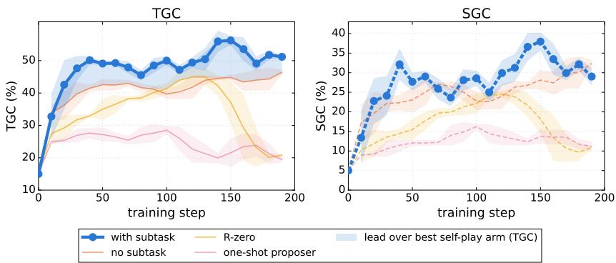  
Figure 5: Learning curves on AppWorld (Qwen3-30B-A3B-Instruct-2507) (left: TGC, right: SGC; shaded bands: standard error). Curves evaluate one single rollout per task at each checkpoint, so endpoints are not directly comparable to the reported averaged metric in Table 1. Without any human-annotated task, the full method (with subtask) keeps improving throughout training, whereas removing the subtask reward (no subtask) plateaus earlier and converges to lower scores. R-Zero and one-shot proposer verify tasks against solver-rollout consensus states instead of proposer snapshots, with interactively and one-shot generated tasks, respectively.

## E.2 ADDITIONAL ANALYSIS OF GENERATED TASK COMPOSITION

On the proposer’s own AppWorld exploration rollouts, tasks become more compositional over training. We compute three structural diagnostics directly from the executed Python steps, recorded environment deltas, and proposer-declared subtask boundaries:

1. Environment-grounded: a declared subtask is counted when it is supported by a task-relevant AppWorld API and records either a nonempty environment delta or a value obtained from that API. For read-only subtasks, backward data-flow tracing verifies that the recorded value originates from an environment API rather than from a locally introduced constant. Setup operations such as authentication, documentation lookup, and supervisor access are excluded.

2. Verified: a declared checkpoint is counted when it records an environment state change and the final task adds at least one further state change beyond that checkpoint. A read-only checkpoint

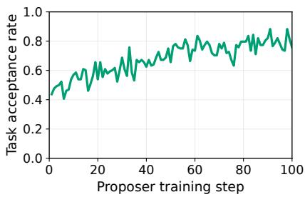

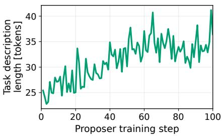  
Figure 6: Additional proposer training dynamics on AppWorld. Left: The fraction of proposed tasks accepted for solver training increases from roughly 45% early in training to around 80% in later stages. Right: Task descriptions become longer over training, rising from roughly 25 tokens to around 35, with substantial variation between steps.

can instead qualify through a captured value whose provenance traces to a task-relevant API.   
Checkpoints must occur at distinct, increasing execution steps.

3. Dependency-chained: we parse each executed Python step into the variables it binds and uses. A subtask boundary is counted when a variable returned by a task-relevant API before the boundary is used in a later step. This captures information flow across components, such as retrieving an address from Contacts and subsequently using it to place an order.

From the first to the last 10-step training block, the mean number of dependency-chained segments per proposal increases from 0.57 to 1.13, environment-grounded subgoals from 0.55 to 1.22, and verified segments from 0.29 to 0.77; the fraction of well-posed proposals rises from 56% to 77%. This growth is not explained by broader exploration: distinct APIs per task decrease from 5.9 to 5.2, and the fraction of multi-app tasks decreases from 27% to 18%. Instead, the proposer increasingly combines operations within a task into deeper dependency structures. Consistent with this interpretation, the proposer declares subgoals for a growing fraction of tasks (53% to 74%), and the mean number of declared subgoals rises from 0.89 to 1.19.

A control proposer trained without the subtask reward exhibits a comparable increase in well-posed proposals (57% to 79%) and execution success (85% to 93%), suggesting that the compositional trend is not merely a consequence of proposals becoming better formed. Its exploration also narrows more rapidly: effective APIs per task fall by 26%, compared with 18% with subtask supervision, while the number of applications that provide values to later steps falls by 52%, compared with 30%. These measurements suggest that subtask supervision encourages dependency structure while slowing the loss of exploratory breadth during proposer training.

## E.3 ADDITIONAL PROPOSER TRAINING DYNAMICS

Task acceptance. The acceptance rate is the fraction of proposals that pass the rule-based filter described in Section 3.2 and can be used for solver training. The filter requires a final task description, a non-redundant subtask checklist, and that applications or objects mentioned in the description also occur in the proposer trajectory. Under these criteria, acceptance rises from roughly 45% to around 80% over training (Fig. 6, left). This trend indicates that the proposer increasingly generates tasks that meet the requirements for inclusion in the solver’s training distribution.

Task-description length. Descriptions also become longer, increasing from roughly 25 tokens early in training to around 35 in later stages (Fig. 6, right). This trend accompanies the increase in declared subtasks shown in Fig. 3. Longer descriptions are consistent with specifying more task components, but token count alone does not establish compositionality or instruction quality. The evidence for task relevance and downstream utility comes from the analyses in Section 5.

## F QUALITATIVE EXAMPLES

Figures 7 and 8 show truncated proposer explorations from the first and third self-play phase on AppWorld, in the todoist and spotify apps respectively, and Figs. 9 and 10 show the same for ALFWorld. The subtask-declaration tool, written subtask in the main text, is exposed to the model under the name sub\_finish, which is what the prompts and the 4B listings show; the 30B listings write it as subtask and the task-declaration tool as declare\_task. In all listings, the proposer’s tool calls and reasoning are shown on a white background, and environment responses are shaded In phase 1, the proposer inspects the API documentation, logs in, lists projects and tasks, and creates a single task, retrying once after an invalid-parameter error; it declares no subtasks, and the resulting task requires a single state change. In phase 3, the proposer declares three subtasks along the way (logging in, surveying the user’s liked songs and playlists, and creating a playlist), creates the playlist, adds four songs to it, and finishes with a task that names the playlist and all four songs to be added. On ALFWorld, the phase-1 proposer picks up a spoon, fails to place it in a cabinet (“Nothing happens”), succeeds with a drawer, and finishes with a single pick-and-place task; the phase-3 proposer retrieves a plate, cools it in the fridge, declares the cooled plate as a subtask, and returns it to the cabinet, composing two operations into a cool-and-place task with one intermediate checkpoint.

Figures 11 and 12 show two explorations by the Qwen3-30B-A3B-Instruct-2507 proposer on App-World. In these listings the subtask-declaration tool appears as subtask, and each call is placed directly after the step it records.

# Proposer exploration, phase 1 (AppWorld / todoist). Tool calls: 8,   
,→ subtask: 0.   
>>> print(apis.api\_docs.show\_app\_descriptions())   
>>> print(apis.api\_docs.show\_api\_descriptions(app\_name='todoist'))   
>>> supervisor\_passwords = apis.supervisor.show\_account\_passwords()   
>>> todoist\_login = apis.todoist.login(username="ch-burch@gmail.com",   
,→ password=...)   
>>> projects = [item for page\_index in range(0, 10)   
for item in apis.todoist.show\_projects(access\_token=...,   
,→ page\_index=page\_index)]   
>>> inbox\_tasks = apis.todoist.show\_tasks(access\_token=...,   
,→ project\_id=32) # Inbox project   
>>> new\_task = apis.todoist.create\_task(access\_token=..., project\_id=32,   
title="Schedule a weekly mental health check-in",   
,→ priority="medium",   
due\_date=None, assignee\_email=None)   
Exception: Unexpected parameter 'assignee\_email' passed to the   
,→ create\_task API ...   
>>> new\_task = apis.todoist.create\_task(access\_token=..., project\_id=32,   
title="Schedule a weekly mental health check-in",   
,→ priority="medium", due\_date=None)   
{"message": "Task created.", "task\_id": 6334}   
>>> finish("Create a new task titled 'Schedule a weekly mental health   
,→ check-in' in the   
Inbox project of my todoist account with medium priority and no   
,→ due date.")   
Exploration finished.  
Figure 7: Proposer exploration in an early self-play phase (phase 1) on AppWorld (todoist) with Qwen3-4B-Instruct-2507. The proposer inspects the API documentation, logs in, lists projects and tasks, and creates a single task, retrying once after an invalid-parameter error; it declares no subtasks, and the final task requires one state change. Shaded lines are environment responses.

# Proposer exploration, phase 3 (AppWorld / spotify). Tool calls: 11,   
,→ subtask: 3.   
>>> print(apis.api\_docs.show\_api\_descriptions(app\_name='spotify'))   
>>> spotify\_login =   
,→ apis.spotify.login(username="kathrynmaldonado@gmail.com",   
,→ password=...)   
>>> subtask("Login to Spotify using the supervisor's credentials and   
,→ obtain an access   
token.")   
Subtask recorded.   
>>> liked\_songs = [item for page\_index in range(0, 10)   
for item in apis.spotify.show\_liked\_songs(access\_token=...)]   
[{"song\_id": 298, "title": "When Dawn Breaks Without You", ...},   
,→ {"song\_id": 165, ...}]   
>>> playlists = [item for page\_index in range(0, 10)   
for item in apis.spotify.show\_playlist\_library(access\_token=...)]   
[{"playlist\_id": 526, "title": "Sunset Chill: Songs for Golden   
Hours", ...}, ...]   
>>> subtask("Explore the user's liked songs and playlists to identify   
,→ musical preferences   
for creating a meaningful playlist.")   
Subtask recorded.   
>>> apis.spotify.create\_playlist(title="Evening Reflections: Melancholic   
,→ Melodies",   
access\_token=...)   
{"message": "Playlist created.", "playlist\_id": 654}   
>>> subtask("Create a new playlist titled \"Evening Reflections:   
,→ Melancholic Melodies\" and   
add relevant songs based on the user's liked songs and   
,→ emotional themes.")   
Subtask recorded.   
>>> apis.spotify.add\_song\_to\_playlist(song\_id=298, playlist\_id=654,   
,→ access\_token=...)   
>>> apis.spotify.add\_song\_to\_playlist(song\_id=165, playlist\_id=654,   
,→ access\_token=...)   
# likewise for song\_id=183 and song\_id=9   
Execution successful.   
>>> finish("Create a new playlist titled 'Evening Reflections:   
,→ Melancholic Melodies' and add   
the songs 'When Dawn Breaks Without You', 'Hearts on Fire', 'In   
,→ the Tunnels of Despair',   
and 'When Fate Becomes a Foe' to it.")  
Figure 8: Proposer exploration in a late self-play phase (phase 3) on AppWorld (spotify) with Qwen3-4B-Instruct-2507. The proposer declares three subtasks: after logging in, after surveying the user’s liked songs and playlist library, and after creating a new playlist (declared before the songs are added, so its reference state is the empty playlist). The login subtask is setup that the prompt asks the proposer not to declare, and the validity filter of Section 3.2 does not remove it. The proposer then adds four liked songs to the playlist and finishes with a task that specifies the playlist title and all four songs. Shaded lines are environment responses.

```markdown
# Proposer exploration, phase 1 (ALFWorld). Actions: 9, subtask: 0.
,→ Shown as verb(args).
>>> go_to("countertop 1")
On the countertop 1, you see a bowl 2, a bread 1, a dishsponge 2, a
,→ kettle 2, a knife 3,
>>> take("spoon 1", from="countertop 1")
You pick up the spoon 1 from the countertop 1.
>>> go_to("cabinet 1")
You arrive at cabinet 1. The cabinet 1 is closed.
>>> open("cabinet 1")
You open the cabinet 1. The cabinet 1 is open. In it, you see a
,→ kettle 1.
>>> move("spoon 1", to="cabinet 1")
Nothing happens.
# proposer: I tried to move the spoon 1 to the cabinet, but it didn't
,→ work. ... Let me try a
# different approach.
>>> go_to("drawer 1")
You arrive at drawer 1. The drawer 1 is closed.
>>> open("drawer 1")
You open the drawer 1. The drawer 1 is open. In it, you see a fork 1.
>>> move("spoon 1", to="drawer 1")
You move the spoon 1 to the drawer 1.
>>> finish("Put a spoon in the drawer.")
Exploration finished.
```  
Figure 9: Proposer exploration in an early self-play phase (phase 1) on ALFWorld with Qwen3-4B. The proposer picks up a spoon from the countertop, fails to place it in a cabinet, recovers by opening a drawer and placing it there, and finishes with a single pick-and-place task. Shaded lines are environment responses.

```markdown
# Proposer exploration, phase 3 (ALFWorld). Actions: 8, subtask: 1.
,→ Shown as verb(args).
>>> go_to("cabinet 1")
You arrive at cabinet 1. The cabinet 1 is closed.
>>> open("cabinet 1")
You open the cabinet 1. The cabinet 1 is open. In it, you see a plate
,→ 1.
>>> take("plate 1", from="cabinet 1")
You pick up the plate 1 from the cabinet 1.
# proposer: I now have the plate. I can move it to another location. Let
,→ me go to the fridge to
# cool the plate.
>>> go_to("fridge 1")
You arrive at fridge 1. The fridge 1 is closed.
>>> cool("plate 1", with="fridge 1")
You cool the plate 1 using the fridge 1.
>>> subtask("Cool a plate.")
Subtask recorded.
>>> go_to("cabinet 1")
You arrive at cabinet 1. The cabinet 1 is open. In it, you see
,→ nothing.
>>> move("plate 1", to="cabinet 1")
You move the plate 1 to the cabinet 1.
>>> finish("Cool a plate and put it in a cabinet.")
Exploration finished.
```  
Figure 10: Proposer exploration in a late self-play phase (phase 3) on ALFWorld with Qwen3-4B. The proposer retrieves a plate from a cabinet, cools it using the fridge and declares this as a subtask, then returns the plate to the cabinet, finishing with a task that composes two operations (cool and put). Shaded lines are environment responses.

# Proposer exploration, phase 1 (AppWorld / spotify, 30B). Tool calls:   
,→ 18, subtask: 2.   
>>> spotify\_access\_token =   
,→ apis.spotify.login(username="jes.mill@gmail.com",   
password=...)["access\_token"]   
>>> song\_library = [item for page\_index in range(0, 10)   
for item in apis.spotify.show\_song\_library(page\_index=page\_index,   
,→ access\_token=...)]   
Collected 18 songs from library.   
>>> playlist\_library = [item for page\_index in range(0, 10)   
for item in   
,→ apis.spotify.show\_playlist\_library(page\_index=page\_index,   
,→ access\_token=...)]   
Collected 5 playlists.   
>>> for playlist in playlist\_library: playlist\_song\_ids |=   
,→ set(playlist["song\_ids"])   
>>> unplanned\_song\_ids = {song["song\_id"] for song in song\_library} -   
,→ playlist\_song\_ids   
Number of songs not in any playlist: 16   
>>> declare\_task("Create a new Spotify playlist titled \"Missing in   
,→ Action\" and add every song   
from my library that is not in any of my playlists.")   
>>> playlist\_id = apis.spotify.create\_playlist(title="Missing in Action",   
,→ is\_public=False,   
access\_token=...)["playlist\_id"]   
Created playlist with ID: 654   
>>> subtask("Create a new Spotify playlist titled \"Missing in   
,→ Action\".")   
Subtask recorded.   
>>> for song\_id in unplanned\_song\_ids:   
apis.spotify.add\_songs\_to\_playlist(playlist\_id=playlist\_id,   
,→ song\_ids=[song\_id], ...)   
Exception: No API named 'add\_songs\_to\_playlist' found in the spotify   
,→ app.   
>>> print(apis.api\_docs.show\_api\_descriptions(app\_name='spotify'))   
>>> for song\_id in unplanned\_song\_ids:   
apis.spotify.add\_song\_to\_playlist(playlist\_id=playlist\_id,   
,→ song\_id=song\_id, ...)   
>>> subtask("Add every song from my library that is not in any playlist   
,→ to the   
\"Missing in Action\" playlist.")   
Subtask recorded.   
>>> # read the playlist back and compare with unplanned\_song\_ids   
Match: True   
>>> finish(...)   
Exploration finished.  
Figure 11: Proposer exploration in the first self-play phase on AppWorld (spotify) with Qwen3-30B-A3B-Instruct-2507. The proposer computes the library songs that are in no playlist, declares a task conditioned on this set, creates the playlist and adds the songs, declaring one subtask for each step, and verifies the result before finishing. Shaded lines are environment responses.

```markdown
# Proposer exploration, phase 1 (AppWorld / amazon+todoist, 30B).
# Tool calls: 19, subtask: 2.
>>> amazon_access_token =
,→ apis.amazon.login(username='matthew.blac@gmail.com',
password=...)['access_token']
>>> page = apis.amazon.show_order_history(access_token=...,
,→ page_index=page_index)
Exception: No API named 'show_order_history' found in the amazon app.
>>> print(apis.api_docs.show_api_descriptions(app_name='amazon'))
>>> page = apis.amazon.show_orders(access_token=...,
,→ page_index=page_index)
Total delivered orders: 0
>>> cart_items = apis.amazon.show_cart(access_token=...)
{"base_cost": 8390.7, ..., "cart_items": [{"product_name": "Picnic
,→ Time Country
>>> wish_list_items = apis.amazon.show_wish_list(access_token=...)
Total items in wish list: 1
>>> for cart_item in cart_items["cart_items"]:
apis.amazon.delete_product_from_cart(access_token=...,
product_id=cart_item["product_id"])
All items removed from Amazon cart.
>>> subtask("Remove all items from the Amazon cart.")
Subtask recorded.
>>> task = apis.todoist.create_task(access_token=...,
content="Review high-cost Amazon purchases",
→ due_date="2023-05-25")
Exception: Unexpected parameter 'content' passed to create_task.
,→ Allowed parameters
are: ['project_id', 'title', .]
>>> task = apis.todoist.create_task(access_token=..., title="Review
,→ high-cost Amazon ...", ...)
Response status code is 422: project_id: Input should be a valid
,→ integer
>>> projects = apis.todoist.show_projects(access_token=...)
[..., {"name": "Inbox", "is_inbox": true, "project_id": 41, ...},
,→
>>> task = apis.todoist.create_task(access_token=..., title="Review
,→ high-cost Amazon purchases",
due_date="2023-05-25", project_id=41)
Todoist task created in Inbox.
>>> subtask("Create a Todoist task titled 'Review high-cost Amazon
,→ purchases' with a due
date of 2023-05-25 in the Inbox project.")
Subtask recorded.
>>> finish("Remove all items from my Amazon cart and create a Todoist
,→ task titled
'Review high-cost Amazon purchases' due on 2023-05-25 to follow
,→ up on the
cleared items.")
Exploration finished.
```  
Figure 12: Proposer exploration in the first self-play phase on AppWorld (amazon and todoist) with Qwen3- 30B-A3B-Instruct-2507. The proposer clears the Amazon cart and creates a follow-up Todoist task, recovering from three API errors along the way, and declares one subtask per app before finishing with a cross-app task. Shaded lines are environment responses.

## G PROMPT TEMPLATES

Figures 13 to 18 show the prompt templates used in our experiments: the proposer and solver prompts for ALFWorld, ScienceWorld, and AppWorld. The proposer prompts instruct the model to explore without a given task and expose the subtask and finish tool calls that declare subtasks and the

final task. The AppWorld solver prompt follows the AppWorld benchmark’s standard prompt, with its worked example omitted here. Details are omitted for space; “. . . ” marks omitted content.

system:   
You are an AI agent exploring ALFWorld, a text-based household   
,→ environment.   
You are NOT given a task.   
Your job is to EXPLORE this scene by interacting with it, and DISCOVER   
,→ an interesting task   
that could be done here.   
Take a sequence of actions that changes the state of the world ... Aim   
,→ for about 10 to 20   
actions.   
IMPORTANT: respond in this format.   
- On each exploration step: the <think></think> tags stay empty; write   
,→ a brief plain-text   
reasoning AFTER them about what interesting, state-changing action   
,→ to take next, then   
output your action in <tool\_call></tool\_call> tags.   
Common actions. Each example shows only the \`arguments\` object --   
,→ always emit it wrapped as   
\`{"name":"alfworld\_tool","arguments":{...}}\` inside   
,→ <tool\_call></tool\_call> tags:   
- Go To: Move to a location. \`{"action\_type": "go\_to",   
,→ "receptacle\_name": "table 1"}\`   
- Take: Pick up an object. Example: \`{"action\_type": "take",   
,→ "object\_name": "apple 2",   
"receptacle\_name": "counter 1"}\`   
... (further actions: look, inventory, open, close, move, examine,   
,→ use, heat, clean, cool,   
slice)   
WHEN YOU ARE DONE: once you have accomplished something interesting and   
,→ state-changing, END   
by emitting a single "finish" tool call stating that task:   
\`{"name":"alfworld\_tool","arguments": {"action\_type": "finish",   
,→ "task\_description": "<one   
concise sentence>"}}\`   
Write the task\_description as an imperative instruction, never as a   
,→ report: "Put a pen in the   
garbagecan.", never "I put a pen in the garbagecan." ...   
MULTI-STEP TASKS: if the task you are building has more than one   
,→ sub-step (e.g. FIRST heat an   
object, THEN place it somewhere), call "sub\_finish" right after   
,→ EACH completed sub-step   
to declare it, and reserve "finish" for the very last sub-step:   
\`{"name":"alfworld\_tool","arguments": {"action\_type": "sub\_finish",   
,→ "task\_description":   
"<that sub-step, as an imperative instruction>"}}\`   
sub\_finish records the sub-step WITHOUT ending the episode -- you keep   
,→ acting afterward.   
Example: heat an apple -> sub\_finish("Heat an apple.") -> put it on   
,→ the countertop ->   
finish("Heat some apple and put it on the countertop.").   
user:   
{current\_observation}   
Explore this scene. Take one action per turn. When you have reached an   
,→ interesting   
state-changing result, stop and call \`finish\` with a   
,→ \`task\_description\` stating that task   
as an imperative instruction ...  
Figure 13: ALFWorld proposer prompt template. Details omitted for space.

system:   
You are an AI assistant playing ALFWorld, a text-based household   
,→ environment.   
Your goal is to complete household tasks by interacting with objects.   
IMPORTANT: You MUST respond in the following format:   
1. The <think></think> tags stay empty; write your brief plain-text   
,→ plan AFTER them   
2. Then, output your action in <tool\_call></tool\_call> tags   
Common actions. Each example shows only the \`arguments\` object --   
,→ always emit it wrapped as   
\`{"name":"alfworld\_tool","arguments":{...}}\` inside   
,→ <tool\_call></tool\_call> tags:   
- Go To: Move to a location. \`{"action\_type": "go\_to",   
,→ "receptacle\_name": "table 12"}\`   
- Take: Pick up an object. Example: \`{"action\_type": "take",   
,→ "object\_name": "apple 2",   
"receptacle\_name": "counter 1"}\`   
- Heat: Heat an object. Example: \`{"action\_type": "heat",   
,→ "object\_name $" : ~ " \mu$ otato 2",   
"receptacle\_name": "microwave $1 " \} \cdot$   
... (further actions: look, inventory, open, close, move, examine,   
,→ use, clean, cool, slice)   
user:   
# Example Omitted   
# Your Task   
{current\_observation}   
Your task is: {task\_description}   
Explore the environment and complete the task.  
Figure 14: ALFWorld solver prompt template. Details omitted for space.

system:   
You are an agent exploring ScienceWorld, a text-based simulator of a   
,→ house where you can do   
science: move between rooms, open and close containers, pick things   
,→ up and move them,   
activate and deactivate devices ..., heat, cool, melt, boil or   
,→ freeze substances, mix   
ingredients, plant seeds, and connect electrical components.   
You are NOT given a task.   
Your job is to EXPLORE this scene and DISCOVER an interesting task that   
,→ could be done here, by   
actually doing it. ... Do something of that kind: a sequence of   
,→ actions that CHANGES   
THE STATE OF THE WORLD, usually across more than one room. Aim for   
,→ about 8 to 20 actions ...   
Call the \`scienceworld\_tool\` tool exactly once per turn with a single   
,→ \`action\` string. ...   
FOCUS FIRST: every task in this house is about one main object ...   
,→ \`focus on <object>\` BEFORE   
you change it, and begin your task\_description with "First, focus   
,→ on the <object>. Then   
<what to do>." ...   
... (find-task rules omitted)   
WHEN YOU ARE DONE: once you have changed the world in an interesting   
,→ way, END with a single   
\`finish\` call stating that task:   
action: "finish", task\_description: "<one concise sentence>"   
Write the task\_description as an imperative instruction, never as a   
,→ report ... It must name   
the objects, containers and end state you actually reached ...   
MULTI-STEP TASKS: if the task you are building has more than one   
,→ sub-step (e.g. FIRST move a   
substance into a container, THEN heat it until it boils), call   
,→ \`sub\_finish\` right after   
EACH completed sub-step to declare it, and reserve \`finish\` for the   
,→ very last sub-step:   
action: "sub\_finish", task\_description: "<that sub-step, as an   
,→ imperative instruction>"   
sub\_finish records the sub-step WITHOUT ending the episode -- you keep   
,→ acting afterward. ...   
declare each sub-step ONCE, right after it is done ...   
user:   
# Scene   
{current\_observation}   
Explore this scene. Take one action per turn. When you have changed the   
,→ world in an   
interesting way, stop and call \`finish\` with a \`task\_description\`   
,→ stating that task as an   
imperative instruction, never as a report of what you did.  
Figure 15: ScienceWorld proposer prompt template. Details omitted for space.

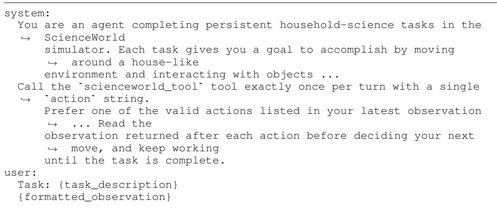  
Figure 16: ScienceWorld solver prompt template. Details omitted for space.

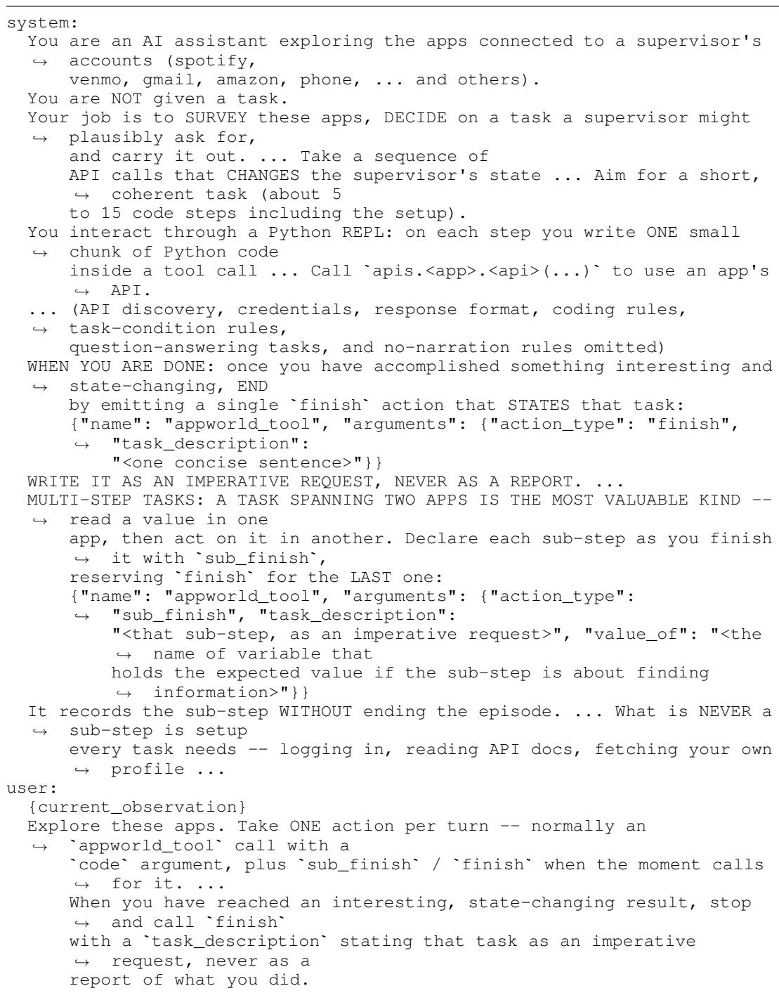  
Figure 17: AppWorld proposer prompt template. Details omitted for space.

```jinja
SYSTEM:
When you receive a tool call response, use the output to format an
,→ answer to the original
user question.
You are a helpful assistant with tool calling capabilities.
USER:
I am your supervisor, and you are an AI Assistant whose job is to
,→ complete my day-to-day
tasks fully autonomously.
To do this, you will need to interact with app(s) (e.g., spotify, venmo
,→ etc) using their
associated APIs on my behalf. ...
Here are three key APIs that you need to know to get more information
print(apis.api_docs.show_app_descriptions())
print(apis.api_docs.show_api_descriptions(app_name='spotify'))
print(apis.api_docs.show_api_doc(app_name='spotify',
,→ api_name='login'))
Each code execution will produce an output that you can use in
,→ subsequent calls. ...
My name is: {{ main_user.first_name }} {{ main_user.last_name }}. My
,→ personal email is {{
main_user.email }} and phone number is {{ main_user.phone_number
,→ }}.
Task: How many playlists do I have in my Spotify playlist library?
... [worked example omitted: alternating ASSISTANT code chunks and USER
,→ outputs] ...
USER:
<sub>**</sub>Key instructions<sub>**</sub>:
A. General instructions:
- Act fully on your own. You must make all decisions yourself and never
,→ ask me or anyone else
to confirm or clarify. ...
... (further general, app-specific, and code-operation instructions
,→ omitted)
D. Task-completion instructions:
You must call the `apis.supervisor.complete_task` API after completing
,→ the task.
- If an answer is needed, e.g., for "How many songs are in the Spotify
,→ queue?", call it with
the appropriate answer argument value.
- The task is doable, but if you cannot find a way, you can call it
,→ with status="fail" to
exit with failure.
USER:
Using these APIs, now generate code to solve the actual task:
Today's date is: {{ date }}
My name is: {{ main_user.first_name }} {{ main_user.last_name }}. My
,→ personal email is {{
main_user.email }} and phone number is {{ main_user.phone_number
,→ }}.
Task: {{ instruction }}
```  
Figure 18: AppWorld solver prompt template. Details omitted for space.

## H LIMITATIONS

Our approach has limitations that suggest directions for future work. Snapshot-based verification requires an environment that can be reset and whose state can be recorded and compared, an assumption that holds in simulators but not, e.g., on the live web. Extending reference-state matching to partially observable or irreversible environments is an open problem. The proposer prompts (Appendix G) carry inductive biases that may make the generated task distribution differ from real-world tasks. The control run of Section 5, trained with the same prompts but without the subtask reward, helps separate the contribution of the subtask reward from that of the prompts. We believe grounding self-generated tasks in executed interaction, and reusing that interaction as process supervision, will remain a useful recipe as self-evolving agents move to richer environments.