# EXTREME-SCALE SUPER-RESOLUTION OF HOMOGENEOUSTURBULENCE FROM A SINGLE REALIZATION

## A PREPRINT

Arth Sojitra∗ Department of Mechanical and Aerospace Engineering University of Tennessee, Knoxville Knoxville, TN 37996, USA asojitra@vols.utk.edu

Muhammad Abid∗ Department of Mechanical and Aerospace Engineering University of Tennessee, Knoxville Knoxville, TN 37996, USA mabid@vols.utk.edu

Omer San Department of Mechanical and Aerospace Engineering University of Tennessee, Knoxville Knoxville, TN 37996, USA osan@utk.edu

## ABSTRACT

Homogeneous turbulent flows exhibit recurring multiscale structures across spatially separated regions, suggesting that a single flow realization may contain sufficient information to learn representations of unresolved scales. We investigate this hypothesis through an extreme super-resolution framework in which a wide-activation deep super-resolution (WDSR) network is trained exclusively on overlapping patches extracted from a single high-resolution turbulent realization. Previously unseen flow fields are reconstructed through patchwise prediction followed by Hann-window-weighted overlap-add assembly. The framework is evaluated for two-dimensional homogeneous isotropic turbulence at super-resolution factors of ×32 and ×64, representing severe spatial under-resolution. Despite the limited training data, the proposed approach reconstructs coherent vortical structures and recovers fine-scale features more accurately than conventional interpolation. Spectral and statistical analyses further demonstrate improved recovery of high-wavenumber energy content and multiscale flow characteristics. To assess the effectiveness of exploiting internal spatial information, we compare the proposed framework against WDSR models trained on 1, 25, 50, and 100 complete high-resolution snapshots without patch extraction. This comparison distinguishes the benefits of localized learning from those associated with increasing the number of training realizations. The results demonstrate that exploiting spatial redundancy within a single turbulent realization enables accurate reconstruction of previously unseen flow fields, even under extreme spatial under-resolution. These findings establish single-realization patch-based learning as a promising data-efficient approach for turbulent super-resolution when high-resolution training data are scarce.

Keywords Scientific Machine Learning; Extreme Scale Super-Resolution; Single-Realization Learning; Data-Efficient Learning; Homogeneous Isotropic Turbulence

## 1 Introduction

Turbulence is characterized by a hierarchy of interacting spatial and temporal scales, with nonlinear transfer, coherent structures, and intermittency governing transport and mixing [1, 2, 3, 4, 5, 6]. In two-dimensional turbulence, the simultaneous constraints imposed by energy and enstrophy conservation lead to spectral-transfer mechanisms distinct from their three-dimensional counterparts [2, 7]. Direct numerical simulation (DNS) offers detailed representations of these processes, but its cost grows rapidly with Reynolds number and the number of active degrees of freedom [8, 9, 10]. Experiments are likewise limited by the spatial and temporal resolution of measurement systems [11, 12]. Thus, high-resolution flow fields are costly to obtain, while available observations are frequently coarse, noisy, or incomplete.

Reconstructing unresolved scales from coarse measurements is related to the longstanding problem of scale separation in turbulence modeling. Large-eddy simulation (LES) retains resolved motions while modeling the influence of filtered scales through closure assumptions [13, 14, 15, 16]. Super-resolution instead seeks an explicit fine-grid field consistent with the coarse observation and additional learned information. Crucially, this inverse problem is underdetermined: many distinct high-resolution fields can produce the same coarse measurement. Consequently, interpolation cannot by itself restore discarded information, and even a learned reconstruction must be understood as an inference conditioned on its training prior rather than an exact inversion of coarse graining.

Machine learning has created new opportunities to learn relationships between resolved and unresolved turbulent motions [17, 18, 19, 20]. Early investigations demonstrated the effectiveness of convolutional neural networks for super resolution reconstruction of turbulent flow fields, establishing that learned multiscale representations can outperform conventional interpolation in recovering coherent vortical structures and unresolved spatial features [21]. Subsequent developments extended these methodologies to spatio-temporal super-resolution, enabling the reconstruction of turbulent fields from observations with limited spatial and temporal resolution [22]. The broader development of machinelearning-based super-resolution methodologies for fluid flows, including their architectures, reconstruction capabilities, and practical limitations, has also been systematically reviewed [23]. More recently, spectrally informed multiresolution neural operators have been investigated for turbulent flow super-resolution [24]. Furthermore, convolutional neural networks have been employed to reconstruct wall-bounded turbulent flows from limited measurements, demonstrating the potential of data-driven approaches for recovering complex flow structures from incomplete observations [25]. Recent investigations have examined the influence of adversarial training on turbulent super-resolution, highlighting its potential to improve the reconstruction of small-scale structures and turbulence statistics beyond conventional pointwise reconstruction objectives [26]. Physically constrained generative adversarial networks have also been investigated for reconstructing large missing regions in turbulent flow fields, demonstrating the potential of incorporating physical constraints into data-driven reconstruction of spatially incomplete turbulent observations [27].

Generative learning approaches have further expanded the scope of turbulent flow reconstruction by moving beyond the exclusive minimization of pointwise reconstruction errors toward the recovery of statistically consistent fine-scale structures. In particular, unsupervised super-resolution frameworks based on cycle-consistent generative adversarial networks (CycleGANs) have demonstrated the feasibility of learning reconstruction mappings from unpaired turbulent flow fields, including homogeneous isotropic turbulence and wall-bounded flows [28]. Generative adversarial networks have also been employed to reconstruct turbulent flow fields across different Reynolds numbers, demonstrating their potential for recovering unresolved spatial structures and reproducing turbulence statistics [29]. Beyond conventional super-resolution, generative models have been investigated for the reconstruction of spatially incomplete turbulent fields, including rotating turbulence, where comparisons against proper orthogonal decomposition have revealed important differences between instantaneous reconstruction accuracy and multiscale statistical fidelity [30]. Similarly, physically constrained generative adversarial networks have been developed to reconstruct large missing regions in compressible isotropic turbulence, illustrating the potential of incorporating physical information into generative flow reconstruction [31]. Recent investigations have further examined the influence of adversarial training on turbulent superresolution, demonstrating that discriminator-based learning can improve the reconstruction of small-scale gradients and intermittency-related statistics, although generalization to unseen flow conditions remains challenging [26]. Physicsinformed three-dimensional generative adversarial networks have also been explored for the reconstruction of turbulent channel flows from limited-resolution observations [32].

Physics-informed methods provide a complementary route to constraining the reconstruction problem. Physicsinformed neural networks incorporate differential-equation information into learning objectives [33]; physics-informed convolutional approaches have been developed for super-resolution and denoising of fluid flows [34]. Neural operators, including DeepONet and Fourier neural operators, offer alternative formulations for learning mappings between function spaces [35, 36, 37]. Recent extensions incorporating Fourier and Chebyshev spectral embeddings, as well as hybrid wavelet-Laplace representations, have further advanced operator learning for partial differential equations [38, 39, 40]. These developments are relevant to turbulent reconstruction, although neither an operator architecture nor a physics-based loss alone resolves the fundamental information loss caused by severe downsampling. The choice of observations, training distribution, and validation diagnostics remains central.

Despite these advances, a substantial portion of the existing literature on data-driven turbulent super-resolution relies on supervised learning frameworks trained using paired low- and high-resolution flow fields [21, 22, 29, 25]. In such approaches, high-resolution reference fields are typically obtained from direct numerical simulations or experimental measurements, while corresponding low-resolution observations are generated through spatial filtering, downsampling, or measurement-based degradation. Although these frameworks have demonstrated considerable succes in reconstructing unresolved turbulent structures, their performance depends on the availability and representativeness of the training data. Constructing sufficiently diverse high-fidelity datasets can require repeated computationally expensive simulations, extensive experimental measurements, or sampling across multiple flow states and parameter configurations [17, 18, 23]. This requirement presents a practical challenge, particularly when the objective of super-resolution is itself to mitigate the scarcity of high-resolution flow information. The difficulty becomes especially pronounced for previously unexplored flow regimes, costly Reynolds-number or parameter sweeps, and applications in which only one or a few high-resolution realizations are available.

Homogeneous turbulence suggests an alternative source of training information. Statistical homogeneity implies translation-invariant statistics, so patches extracted at different locations probe the same underlying statistical process [3, 5]. A single sufficiently large realization contains many localized vortical, strain-dominated, and gradient-rich configurations across scales. These patches are not independent samples, and homogeneity does not imply that one snapshot contains every relevant state. Nevertheless, internal spatial sampling can expose a learning algorithm to numerous coarse-to-fine configurations without requiring additional global snapshots. Related ideas have a precedent in single-image internal statistics and zero-shot super-resolution [41, 42], where examples extracted from an individual image are used to train an image-specific reconstruction model

Fukami and Taira [43] demonstrated the feasibility of single-snapshot learning for turbulent super-resolution by training a convolutional neural network on localized subdomains extracted from a single high-resolution flow realization. Their study demonstrated generalization to previously unseen turbulent states, including two-dimensional decaying isotropic turbulence and turbulent channel flow, highlighting the potential of exploiting internal spatial information under severe data scarcity. However, their analysis primarily focused on reconstruction within individual computational subdomains, leaving the implications of assembling independently predicted regions into complete high-resolution turbulent fields less extensively explored. In particular, maintaining spatial continuity across reconstructed subdomains while preserving the global multiscale characteristics of turbulence presents an additional challenge. Motivated by this distinction, the present study investigates full-domain extreme super-resolution through overlapping patchwise prediction and Hann-window-weighted overlap-add reconstruction, considering enlargement factors of ×32 and ×64.

At these extreme enlargement factors, the low-resolution observations retain only a limited range of resolved wavenum bers, rendering the recovery of fine-scale turbulent structures fundamentally underdetermined. The objective is therefore not merely to reproduce plausible high-frequency fluctuations but to determine whether coarse-to-fine relationships learned from a single realization can recover structures correlated with previously unseen turbulent fields. To assess this capability, we examine physical-space reconstruction errors, coherent vortical structures, turbulent energy spectra, vorticity probability distributions, and scale-dependent Fourier coherence. The latter provides a complementary measure of realization-specific cross-spectral correspondence, since agreement in angle-averaged energy spectra alone does not establish the recovery of the Fourier organization of an individual turbulent realization.

Recent advances in deep-learning-based super-resolution have introduced increasingly sophisticated architectures for recovering fine-scale spatial information from low-resolution observations. Residual convolutional frameworks, including residual dense networks (RDN) [44], and residual channel attention networks (RCAN) [45], have demonstrated the effectiveness of deep feature extraction and residual learning. Subsequent developments have incorporated adversarial learning, as exemplified by ESRGAN [46], and transformer-based architectures, including SwinIR [47] and hybrid attention transformers (HAT) [48], to further improve the reconstruction of fine-scale image features. In this work, we investigate extreme super-resolution of two-dimensional decaying homogeneous isotropic turbulence using a wide-activation deep super-resolution (WDSR) network [49]. Training examples are generated by extracting overlapping patches from a single high-resolution vorticity realization and constructing corresponding coarse-to-fine pairs. For inference on unseen realizations, overlapping predictions are assembled using Hann-window-weighted normalized overlap-add to reduce patch-boundary artifacts. We consider ×32 and ×64 reconstruction and assess relative errors, vortical structure, energy spectra, vorticity probability distributions, and scale-dependent Fourier coherence. We also examine overlap-add variants and the sensitivity of reconstruction to perturbations in the coarse observations.

To contextualize the internal-learning formulation, we compare it with conventional full-field WDSR models trained using 1, 25, 50, and 100 high-resolution snapshots. This comparison tests the practical effectiveness of two learning strategies: increasing the number of complete realizations versus extracting local examples from one realization Because the strategies differ in training-data presentation and inference assembly as well as snapshot count, their comparison is not interpreted as a controlled estimate of the isolated effect of dataset size. Instead, it measures the performance of the respective end-to-end formulations under the specified protocols.

The central contribution of this study is thus an assessment of the capabilities and limits of single-realization internal learning at extreme enlargement factors, rather than the introduction of single-snapshot learning itself. By combining ×32 and ×64 reconstruction with physical-space diagnostics, spectral statistics, Fourier coherence, and a comparison with multi-snapshot full-field training, we examine whether the information distributed across one homogeneous turbulent realization can provide a useful transferable prior when high-resolution training data are severely limited. The results aim to clarify both the promise and the inherent non-uniqueness of data-efficient turbulent super-resolution.

The remainder of this paper is organized as follows. Section 2 presents the proposed single-realization super-resolution framework, including the WDSR architecture, overlapping patch extraction, Hann-window-weighted reconstruction, and evaluation methodology. Section 3 discusses the numerical results for two-dimensional homogeneous isotropic turbulence at extreme super-resolution factors of ×32 and $\times 6 4$ , including reconstruction accuracy, spectral and statistical fidelity, robustness analyses, and comparisons with conventional multi-realization learning. Finally, Section 4 summarizes the principal findings, limitations, and implications for data-efficient turbulent flow reconstruction.

## 2 Approach

## 2.1 Single-realization learning framework

The proposed framework exploits the spatial redundancy of homogeneous turbulence to construct training examples from a single high-resolution realization. Under statistical homogeneity, spatially separated regions share the same underlying statistical properties, allowing localized coarse-to-fine relationships to be sampled without requiring additional flow realizations. The objective is to learn these relationships from one turbulent field and assess their transferability to previously unseen realizations.

Let $q ^ { \mathrm { H R } } ( { \pmb x } )$ , with $\pmb { x } \in \Omega$ , denote a single high-resolution turbulent field defined over the spatial domain Ω. In the present study, q represents the vorticity field of two-dimensional homogeneous isotropic turbulence. A collection of overlapping high-resolution patches is extracted according to

$$
\begin{array} { r } { q _ { i } ^ { \mathrm { H R } } = \mathcal { P } _ { i } \left[ q ^ { \mathrm { H R } } \right] \in \mathbb { R } ^ { N _ { p } \times N _ { p } } , \qquad i = 1 , \dots , N _ { \mathrm { t r } } , } \end{array}\tag{1}
$$

where $\mathcal { P } _ { i }$ denotes the spatial extraction operator, $N _ { p }$ is the patch width, and $N _ { \mathrm { t r } }$ is the total number of training patches. The corresponding low-resolution patches are obtained through a prescribed spatial degradation operator,

$$
q _ { i } ^ { \mathrm { L R } } = \mathcal { D } _ { r } \left[ q _ { i } ^ { \mathrm { H R } } \right] ,\tag{2}
$$

where $\mathcal { D } _ { r }$ denotes spatial coarsening by a linear factor r. We consider the extreme super-resolution factors $r = 3 2$ and $r = 6 4$ , corresponding to reductions of 1024 and 4096, respectively, in the number of spatial samples.

The resulting training pairs define the supervised learning problem

$$
\mathcal { G } _ { \theta } : q _ { i } ^ { \mathrm { L R } } \longmapsto q _ { i } ^ { \mathrm { H R } } ,\tag{3}
$$

where $\mathcal { G } _ { \theta }$ is the parameterized super-resolution mapping and θ denotes its trainable parameters. All training pairs $\{ q _ { i } ^ { \mathrm { L R } } , q _ { i } ^ { \mathrm { H \bar { R } } } \}$ are derived exclusively from the same high-resolution realization, without introducing additional snapshots or external turbulent datasets.

Rather than learning the global spatial arrangement of a particular realization, the network is trained to approximate recurring relationships between resolved coarse-scale features and their associated fine-scale structures. Its ability to generalize is subsequently evaluated on turbulent realizations excluded from training, providing a direct assessment of the transferability of the learned multiscale relationships.

## 2.2 WDSR super-resolution model

The nonlinear mapping introduced in Eq. (3) is approximated using a wide-activation deep super-resolution (WDSR) network. The architecture employed in the present study is illustrated in Fig. 1. Importantly, the network operates directly on the low-resolution input and performs the required increase in spatial resolution internally through learned upsampling. No interpolation to the target resolution is performed before the field is supplied to the network.

For an input patch $q _ { i } ^ { \mathrm { L R } } \in \mathbb { R } ^ { H \times W }$ , the network produces

$$
\begin{array} { r l r } { \hat { q } _ { i } ^ { \mathrm { H R } } = \mathcal { G } _ { \boldsymbol { \theta } } \left( q _ { i } ^ { \mathrm { L R } } \right) , } & { { } } & { \hat { q } _ { i } ^ { \mathrm { H R } } \in \mathbb { R } ^ { r H \times r W } , } \end{array}\tag{4}
$$

where r denotes the prescribed linear super-resolution factor.

As shown in $\operatorname { F i g }$ . 1, the architecture consists of a main nonlinear reconstruction branch and a parallel skip branch. The main branch first projects the low-resolution input into a latent feature space through an initial convolutional layer. The resulting feature representation is subsequently processed by a sequence of $N = 3 \bar { 2 }$ residual blocks. Within each block, two convolutional transformations are employed, with a rectified linear unit (ReLU) activation applied between them. The residual contribution is scaled by a factor of 0.1 before being added to the block input. This residual scaling limits the magnitude of successive residual updates and facilitates stable optimization of the deep reconstruction network.

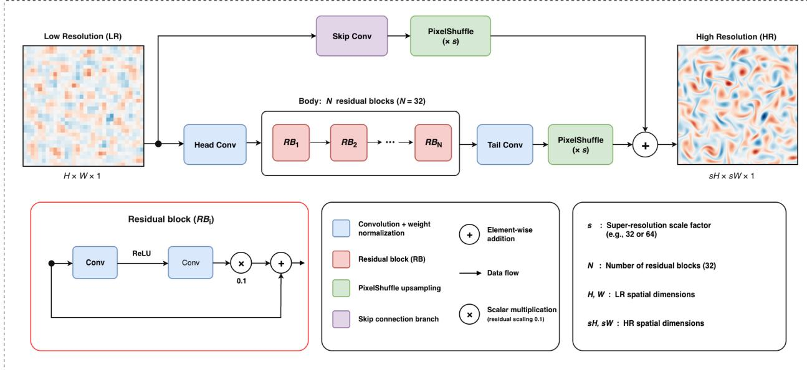  
Figure 1: Architecture of the WDSR network employed for extreme-scale turbulent super-resolution.

Following the residual body, a tail convolution generates the feature channels required for learned spatial upsampling. A PixelShuffle operation then rearranges these channels into the desired high-resolution spatial representation. In parallel, the skip branch applies a convolutional transformation and PixelShuffle operation directly to the low-resolution input. The outputs of the nonlinear reconstruction and skip branches are combined through elementwise addition to obtain the final high-resolution prediction.

The residual formulation provides a useful decomposition for turbulent super-resolution. The coarse observation contains the dominant resolved spatial organization, whereas the principal reconstruction task concerns the information removed by spatial coarsening, including sharp gradients, localized vortical structures, and high-wavenumber fluctuations. At the extreme scale factors considered here, however, the unresolved contribution constitutes a substantial fraction of the spatial information contained in the reference field. The reconstruction problem therefore extends well beyond conventional interpolation and requires the network to infer fine-scale structure using statistical relationships acquired during training.

The network parameters are obtained by minimizing the mean-squared reconstruction loss over the $N _ { \mathrm { t r } }$ training patches,

$$
\mathcal { L } ( \theta ) = \frac { 1 } { N _ { \mathrm { t r } } } \sum _ { i = 1 } ^ { N _ { \mathrm { t r } } } \left. \mathcal { G } _ { \theta } \left( q _ { i } ^ { \mathrm { L R } } \right) - q _ { i } ^ { \mathrm { H R } } \right. _ { 2 } ^ { 2 } .\tag{5}
$$

It is emphasized that WDSR itself is not introduced here as a new super-resolution architecture. Rather, it provides a consistent and effective reconstruction model through which the principal hypothesis of the present work can be examined: whether the internal spatial statistics contained within a single turbulent realization provide sufficient information to support extreme-scale reconstruction of previously unseen turbulent states.

## 2.3 Patchwise inference and overlap-add reconstruction

Following training, the learned mapping is applied to turbulent realizations that are entirely unseen during optimization. Reconstruction is performed locally rather than through a single full-field network evaluation. The procedure, illustrated schematically in Fig. 2, consists of four stages: (i) overlapping patch extraction from the unseen low-resolution field, (ii) independent super-resolution of each patch using the trained WDSR model, (iii) spatial weighting of the reconstructed patches using a two-dimensional Hann window, and (iv) normalized overlap-add assembly of the complete super-resolved field.

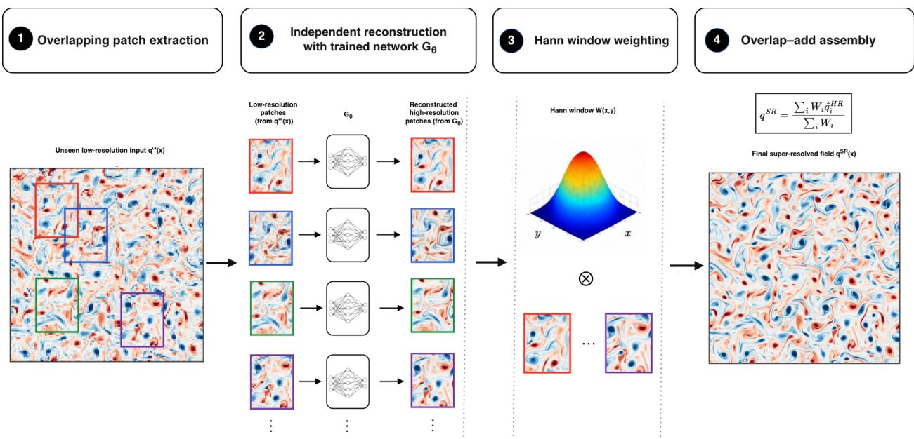  
Figure 2: Patchwise reconstruction and normalized overlap-add assembly of an unseen turbulent realization.

Let $q _ { i } ^ { \mathrm { L R } }$ denote the ith overlapping patch extracted from an unseen low-resolution realization. Each patch is independently mapped to its high-resolution representation according to

$$
\begin{array} { r } { \widehat { q } _ { i } ^ { \mathrm { H R } } = \mathcal { G } _ { \boldsymbol { \theta } } \left( q _ { i } ^ { \mathrm { L R } } \right) . } \end{array}\tag{6}
$$

Overlapping extraction results in multiple predictions for spatial locations shared by neighboring patches. Direct concatenation of independently reconstructed patches can produce localized discontinuities or stitching artefacts because predictions near patch boundaries may be less reliable than those in the patch interior. To suppress these effects, each reconstructed patch is modulated using a separable two-dimensional Hann window,

$$
W ( m , n ) = w ( m ) w ( n ) ,\tag{7}
$$

where

$$
w ( j ) = \frac { 1 } { 2 } \left[ 1 - \cos \left( \frac { 2 \pi j } { N _ { p } - 1 } \right) \right] , \qquad j = 0 , \ldots , N _ { p } - 1 .\tag{8}
$$

Here, $N _ { p }$ denotes the spatial dimension of the reconstructed high-resolution patch. The Hann window assigns greater weight to the interior of each prediction and smoothly reduces its contribution toward the patch boundaries.

The weighted contribution of the ith reconstructed patch is defined as

$$
\widetilde { q } _ { i } ^ { \mathrm { H R } } ( { \pmb x } ) = W _ { i } ( { \pmb x } ) \widehat { q } _ { i } ^ { \mathrm { H R } } ( { \pmb x } ) ,\tag{9}
$$

where W denotes the Hann window positioned at the spatial location corresponding to the ith patch. The complete super-resolved field is then obtained through normalized overlap-add reconstruction,

$$
q ^ { \mathrm { S R } } ( { \pmb x } ) = \frac { \sum _ { i } W _ { i } ( { \pmb x } ) \hat { q } _ { i } ^ { \mathrm { H R } } ( { \pmb x } ) } { \sum _ { i } W _ { i } ( { \pmb x } ) } .\tag{10}
$$

The normalization in Eq. (10) accounts for both the number and relative weights of overlapping predictions contributing to each spatial location. Neighboring reconstructions are therefore blended continuously rather than joined through hard patch boundaries. This treatment becomes particularly important at extreme super-resolution factors, where localized patch-boundary inconsistencies can become pronounced after large increases in spatial resolution.

It should be emphasized that the overlap-add procedure introduces neither additional trainable parameters nor information from the high-resolution reference during inference. It acts solely as a deterministic spatial blending operator for assembling independently generated local predictions into a globally continuous super-resolved field.

## 2.4 Comparison with multi-realization learning

To assess the effectiveness of exploiting spatial information within a single turbulent realization, we compare the proposed patch-based framework with conventional WDSR models trained on progressively larger collections of high-resolution snapshots. Specifically, separate models are trained using $N _ { s } \in \bar { \{ 1 , 2 5 , 5 0 , 1 0 0 \} }$ complete turbulent realizations without overlapping patch extraction or patchwise overlap-add reconstruction.

The comparison examines two distinct learning strategies: extracting localized coarse-to-fine relationships from a single high-resolution realization and learning from an increasing number of complete turbulent snapshots. All models are evaluated on the same previously unseen turbulent fields using identical reconstruction metrics and physical diagnostics.

Because these strategies differ in both training-data presentation and inference procedure, the comparison is not intended to isolate the effect of training-set size. Instead, it evaluates the relative performance of the complete learning and reconstruction formulations under the specified protocols, providing a practical assessment of their effectiveness when high-resolution turbulent training data are limited.

## 2.5 Evaluation methodology

Reconstruction accuracy is assessed using complementary physical-space, spectral, and statistical diagnostics to evaluate both pointwise fidelity and the recovery of multiscale turbulent structures. For a reconstructed field $\mathbf { \bar { \boldsymbol { q } } ^ { S R } }$ and its high-resolution reference $q ^ { \mathrm { H R } }$ , the relative $L _ { 2 }$ error is defined as

$$
\varepsilon _ { L _ { 2 } } = \frac { \left\| q ^ { \mathrm { S R } } - q ^ { \mathrm { H R } } \right\| _ { 2 } } { \left\| q ^ { \mathrm { H R } } \right\| _ { 2 } } .\tag{11}
$$

Root-mean-square error (RMSE), mean absolute error (MAE), and peak signal-to-noise ratio (PSNR) are also used to quantify reconstruction accuracy. Spatial error distributions and comparisons of the $Q \cdot$ -criterion provide additional information about localized reconstruction errors and the recovery of flow-gradient structures.

Spectral fidelity is evaluated using angle-averaged energy spectra, with particular attention to the wavenumber range beyond the low-resolution Nyquist cutoff. Scale-dependent Fourier coherence is additionally examined to assess normalized cross-spectral correspondence between the reconstructed and reference fields. The distinction between spectral-energy agreement and realization-specific Fourier correspondence is important because similar energy distribu tions do not necessarily imply recovery of the same fine-scale spatial organization.

The statistical properties of the reconstructed turbulence are examined through vorticity probability density functions, including their tails associated with intense fluctuations. Together, these diagnostics provide complementary measures of reconstruction quality across physical and spectral representations. All learning strategies are evaluated using the same unseen turbulent realizations and consistent diagnostic definitions to ensure comparability of the reported results.

## 3 Results

## 3.1 Two-dimensional homogeneous isotropic turbulence

We evaluate the proposed single-realization learning framework using two-dimensional decaying homogeneous isotropic turbulence at $R e = 1 0 0 0$ . The flow evolution is governed by the incompressible vorticity transport equation

$$
\frac { \partial \omega } { \partial t } + J ( \omega , \psi ) = \frac { 1 } { R e } \nabla ^ { 2 } \omega ,\tag{12}
$$

where $\omega$ denotes the vorticity, ψ is the streamfunction, and

$$
J ( \omega , \psi ) = \frac { \partial \omega } { \partial x } \frac { \partial \psi } { \partial y } - \frac { \partial \omega } { \partial y } \frac { \partial \psi } { \partial x }\tag{13}
$$

is the nonlinear Jacobian operator. The streamfunction is obtained from the Poisson equation

$$
\nabla ^ { 2 } \psi = - \omega ,\tag{14}
$$

with the corresponding velocity components given by

$$
u = \frac { \partial \psi } { \partial y } , \qquad \nu = - \frac { \partial \psi } { \partial x } .\tag{15}
$$

The DNS data are represented on a $2 0 4 8 \times 2 0 4 8$ spatial grid in a doubly periodic domain of size $[ 0 , 2 \pi ] \times [ 0 , 2 \pi ]$ following the numerical formulation described in Ref. [50] . The resulting flow fields contain a broad distribution of coherent vortical structures, elongated vorticity filaments, and localized gradients spanning a wide range of spatial scales. The repeated occurrence of these structures throughout the homogeneous domain provides the internal spatial information exploited by the proposed learning framework.

For the single-realization model, the complete training dataset is constructed exclusively from one high-resolution vorticity realization. Figure 3 shows this realization together with representative spatial regions used during patch extraction. Rather than treating the $2 0 4 8 \times 2 0 4 8$ field as a single training sample, overlapping spatial regions are extracted to expose the network to localized manifestations of the multiscale turbulent organization distributed throughout the domain. Importantly, every training sample originates from the same instantaneous flow field; no additional turbulent snapshots or temporal states are introduced during training.

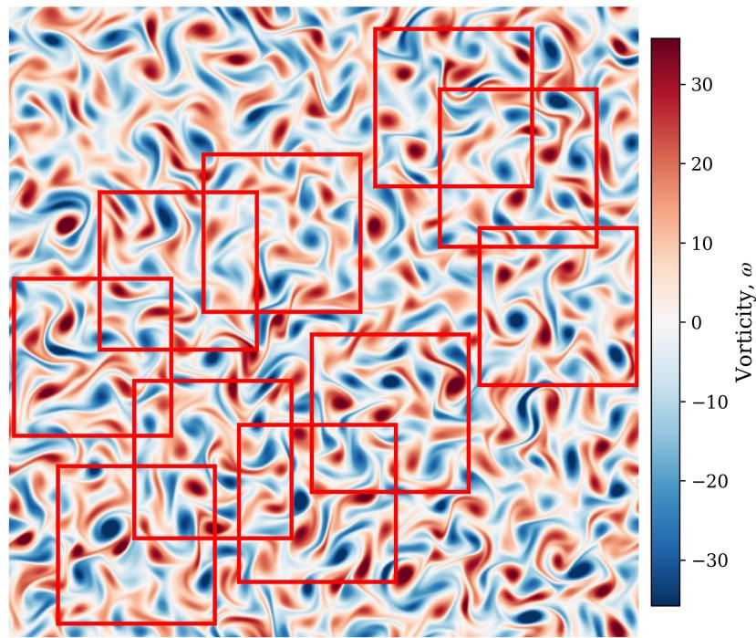  
Figure 3: High-resolution vorticity realization of two-dimensional decaying homogeneous isotropic turbulence at $R e = 1 0 0 0$ used to construct the single-realization training dataset. Red boxes illustrate representative overlapping spatial patches extracted from this single realization for training the WDSR model.

Generalization is evaluated on turbulent realizations that are entirely excluded from training. The present investigation considers two extreme super-resolution factors, $r = 3 2$ and $r = 6 4$ . For the $2 0 4 8 \times 2 0 4 8$ reference resolution, the corresponding reconstruction problems are

$$
6 4 \times 6 4 \xrightarrow { \times 3 2 } 2 0 4 8 \times 2 0 4 8 ,\tag{16}
$$

and

$$
3 2 \times 3 2 { \xrightarrow { \times 6 4 } } 2 0 4 8 \times 2 0 4 8 .\tag{17}
$$

Unless otherwise stated, all WDSR results presented below correspond to the model trained using the single highresolution realization shown in Fig. 3 and subsequently evaluated on unseen turbulent fields. Bicubic interpolation is employed as the conventional nonlearned reconstruction baseline.

## 3.2 Extreme super-resolution from a single realization

## 3.2.1 Super-resolution by a factor of ×32

We first consider the ×32 reconstruction problem, in which a 64×64 observation is used to reconstruct the corresponding 2048 × 2048 vorticity field. This represents a reduction by three orders of magnitude in the number of spatial samples available to the reconstruction model. Figure 4 compares the low-resolution observation, DNS reference, bicubic reconstruction, and single-realization WDSR prediction for an unseen turbulent realization.

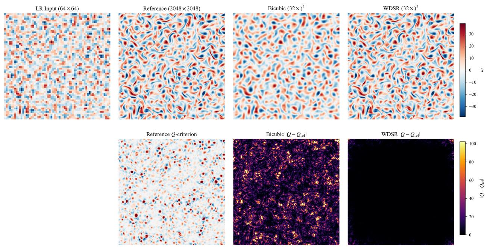  
Figure 4: Extreme ×32 super-resolution of an unseen vorticity realization at $R e = 1 0 0 0 .$ . The upper row shows, from left to right, the 64 × 64 low-resolution input, 2048 × 2048 DNS reference, bicubic interpolation, and WDSR reconstruction obtained using the single-realization overlapping-patch framework. The lower row shows the reference Q-criterion and the corresponding absolute Q-criterion errors for bicubic interpolation and WDSR.

The severity of the spatial information loss is apparent from the low-resolution field in Fig. 4. At a resolution of only 64 × 64, many of the thin vorticity filaments, localized extrema, and sharp gradients present in the DNS field are no longer explicitly resolved. Bicubic interpolation restores the target grid dimensions but produces a visibly smoothed representation. Although the largest spatial features are retained, much of the filamentary fine-scale organization is attenuated or absent.

In contrast, the WDSR reconstruction exhibits close qualitative agreement with the DNS reference throughout the com putational domain. The model recovers thin vortical filaments, localized regions of intense vorticity, and substantially more of the multiscale spatial organization than bicubic interpolation. This improvement is particularly notable because the reconstructed realization is entirely absent from the training dataset. The qualitative observations are supported by the quantitative reconstruction metrics. Bicubic interpolation produces a relative $L _ { 2 }$ error of 36.64%, whereas the proposed single-realization WDSR framework reduces this error to 4.25%, corresponding to an approximately 88.4% reduction in relative error. Similarly, the root-mean-square error decreases from 5.0773 to 0.5893, while the mean absolute error decreases from 3.8709 to 0.1772. The peak signal-to-noise ratio increases from 26.78 dB for bicubic interpolation to 45.48 dB for WDSR.

The lower row of Fig. 4 provides a complementary assessment based on the Q-criterion, which characterizes the local balance between rotation- and strain-dominated regions of the flow. Bicubic interpolation produces widespread errors concentrated around coherent vortical structures and regions containing strong spatial gradients. The WDSR reconstruction substantially suppresses both the magnitude and spatial extent of these errors, indicating improved recovery of the local flow-gradient organization. Consequently, the improvements are not restricted to the pointwise accuracy of the reconstructed vorticity field but also extend to derived quantities associated with coherent turbulent structures.

A more stringent assessment is obtained in spectral space. Figure 5 compares the angle-averaged energy spectra obtained from the DNS reference, bicubic interpolation, and WDSR reconstruction. The vertical dashed line indicates the low-resolution Nyquist wavenumber, $k _ { \mathrm { N y q } } ^ { \mathrm { L R } } = 3 2$ , thereby separating scales that are directly represented in the $6 4 \times 6 4$ observation from those that must be inferred through super-resolution.

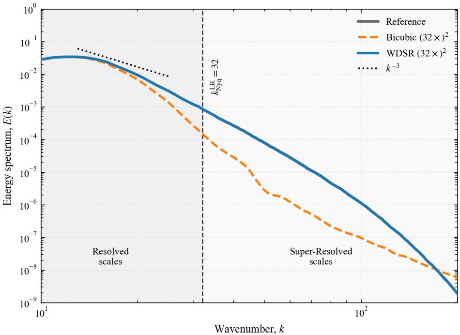  
Figure 5: Angle-averaged energy spectrum for the ×32 reconstruction of an unseen turbulent realization at $R e = 1 0 0 0$ The DNS reference is compared with bicubic interpolation and the single-realization WDSR reconstruction. The vertical dashed line denotes the low-resolution Nyquist wavenumber, $k _ { \mathrm { N y q } } ^ { \mathrm { L R } } = 3 2$ , separating scales represented by the $6 4 \times 6 4$ input from scales inferred through super-resolution. The $k ^ { - 3 }$ line is included as a reference scaling.

The WDSR spectrum closely follows the DNS reference throughout the low-wavenumber range and, importantly, remains in close agreement well beyond $k _ { \mathrm { N y q } } ^ { \mathrm { L R } }$ . In contrast, bicubic interpolation progressively attenuates the spectral energy and departs strongly from the reference as the wavenumber increases. This behavior is expected because interpolation can increase the number of grid points but cannot reconstruct the turbulent spectral content removed during spatial coarsening.

The distinction becomes particularly clear for $k > k _ { \mathrm { N y q } } ^ { \mathrm { L R } }$ , where the corresponding spatial scales are absent from the original low-resolution observation. The WDSR model reconstructs a spectral distribution that remains close to the DNS reference over a broad portion of this super-resolved range. Only toward the highest wavenumbers does the reconstructed spectrum begin to decay more rapidly than the reference. The result therefore indicates that the learned model recovers physically meaningful multiscale content substantially beyond the spectral bandwidth supplied to it, while also revealing a finite limit to the smallest scales that can be reconstructed accurately.

The recovery of one-point vorticity statistics is examined in Fig. 6, which compares the probability density functions (PDFs) of the DNS, bicubic, and WDSR fields.

The WDSR distribution is nearly coincident with the reference PDF over most of the vorticity range. In particular, the model reproduces both the width of the central distribution and the low-probability tails associated with large positive and negative vorticity fluctuations. These tails are important because they correspond to relatively rare, high-intensity events that are strongly affected by spatial smoothing.

Bicubic interpolation, by comparison, produces a substantially narrower distribution. The probability of large-amplitude vorticity is strongly suppressed, consistent with both the loss of intense localized structures observed in physical space and the attenuation of high-wavenumber content observed in Fig. 5. The agreement of the WDSR prediction with the DNS across physical, spectral, and statistical diagnostics therefore provides substantially stronger evidence of reconstruction fidelity than visual similarity alone.

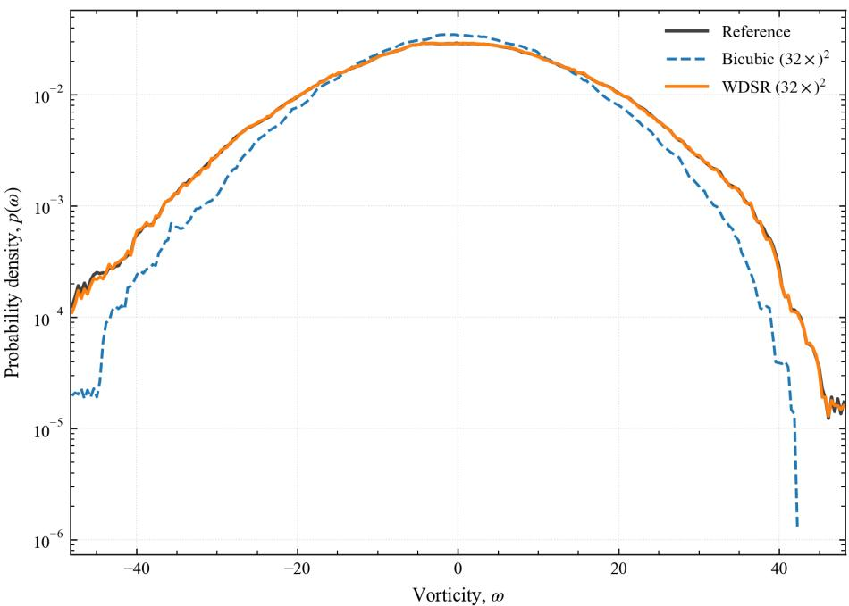  
Figure 6: Probability density function of vorticity for the ×32 reconstruction at $R e = 1 0 0 0$ . The DNS reference is compared with bicubic interpolation and the single-realization WDSR reconstruction.

## 3.2.2 Super-resolution by a factor of ×64

We next consider the more challenging ×64 super-resolution problem, in which a 2048 × 2048 DNS vorticity field is reconstructed from a $3 2 \times 3 2$ observation containing only 1/4096 of the spatial samples in the reference field. Figure 7 compares the reconstructions for an unseen turbulent realization.

At this resolution, the coarse observation retains primarily the large-scale variations of the vorticity field, while intermediate- and small-scale structures are largely unresolved. Consequently, bicubic interpolation produces a strongly smoothed reconstruction that fails to reproduce the filamentary organization of the DNS reference. In contrast, WDSR recovers numerous elongated vorticity filaments, localized extrema, and coherent structures, resulting in substantially improved spatial agreement.

Quantitatively, the relative $L _ { 2 }$ error decreases from 75.69% for bicubic interpolation to 14.30% for WDSR, correspond ing to an 81.1% reduction. The root-mean-square error decreases from 10.4891 to 1.9824, while the mean absolute error decreases from 8.3182 to 1.0062. Similarly, the peak signal-to-noise ratio increases from 20.48 to 34.95 dB. The lower row of Fig. 7 further demonstrates that WDSR substantially reduces the Q-criterion errors associated with coherent vortical structures and regions of strong velocity gradients.

Although the WDSR relative $L _ { 2 }$ error increases from 4.25% at $\times 3 2$ to 14.30% at $\times 6 4$ , the reconstruction remains considerably more accurate than bicubic interpolation. This deterioration reflects the increasing ambiguity of recovering fine-scale structures from progressively coarser observations.

The corresponding angle-averaged energy spectra are presented in Fig. 8. For the 32×32 observation, the low-resolution Nyquist wavenumber is $k _ { \mathrm { N y q } } ^ { \mathrm { L R } } = 1 6$

The WDSR spectrum follows the DNS reference over a substantial wavenumber interval extending beyond $k _ { \mathrm { N y q } } ^ { \mathrm { L R } }$ indicating improved recovery of the energy distribution at unresolved scales. In contrast, bicubic interpolation exhibits pronounced spectral attenuation, particularly at higher wavenumbers.

Nevertheless, the WDSR spectrum eventually departs from the DNS reference and decays more rapidly at sufficiently high wavenumbers. This departure is more pronounced than in the ×32 case, indicating a reduced range of accurately reconstructed scales under more severe coarsening. Importantly, agreement in the energy spectrum establishes spectral consistency but does not, by itself, demonstrate realization-specific recovery of individual Fourier modes.

The one-point vorticity statistics are examined in Fig. 9.

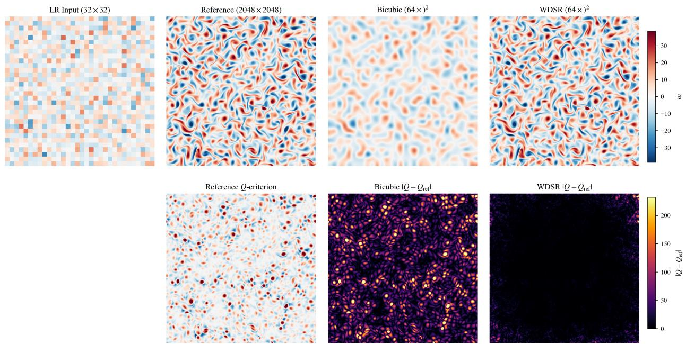  
Figure 7: Extreme $\times 6 4$ super-resolution of an unseen vorticity realization at $R e = 1 0 0 0 .$ . The upper row shows, from left to right, the $3 2 \times 3 2$ low-resolution input, 2048 × 2048 DNS reference, bicubic interpolation, and WDSR reconstruction obtained using the single-realization overlapping-patch framework. The lower row shows the reference Q-criterion and the corresponding absolute $Q \mathrm { - }$ criterion errors for bicubic interpolation and WDSR.

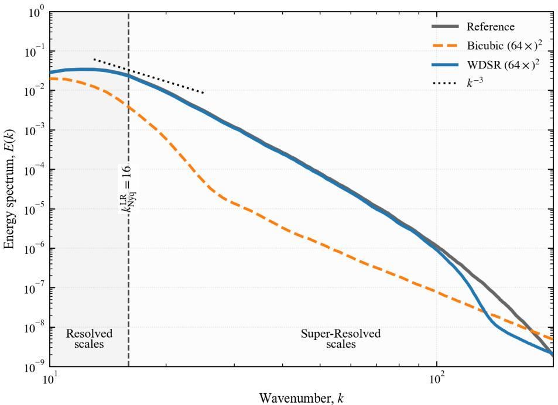  
Figure 8: Angle-averaged energy spectrum for the $\times 6 4$ reconstruction of an unseen turbulent realization at $R e = 1 0 0 0$ The DNS reference is compared with bicubic interpolation and the single-realization WDSR reconstruction. The vertical dashed line indicates the low-resolution Nyquist wavenumber, $k _ { \mathrm { N y q } } ^ { \mathrm { L R } } = 1 6$ , beyond which spatial scales are not directly represented in the coarse observation. The $k ^ { - 3 }$ line denotes a reference scaling.

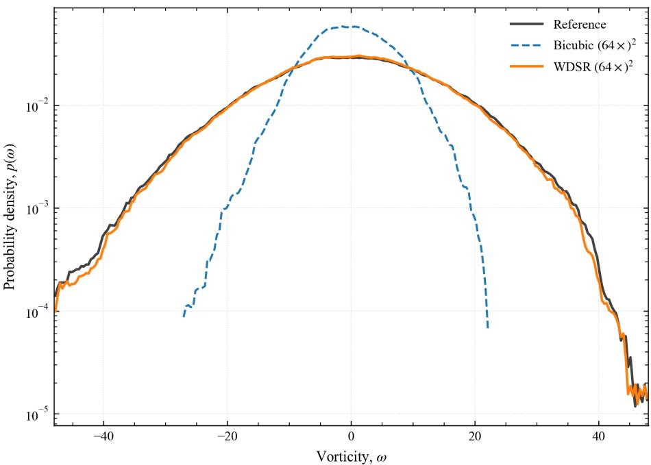  
Figure 9: Probability density function of vorticity for the ×64 reconstruction at $R e = 1 0 0 0$ , comparing the DNS reference, bicubic interpolation, and single-realization WDSR reconstruction.

The WDSR prediction reproduces the DNS vorticity distribution over a broad range of amplitudes, including the low-probability tails associated with intense fluctuations. Bicubic interpolation, by comparison, produces a narrower distribution and underrepresents large-amplitude events. The improved agreement of the WDSR PDF therefore indicates that the reconstructed field preserves substantially more of the one-point vorticity statistics despite the severe reduction in input resolution.

Overall, the $\times 6 4$ results demonstrate that single-realization learning can provide substantial improvements over conventional interpolation in physical-space accuracy, spectral energy distribution, and vorticity statistics. However, the increased reconstruction error and earlier high-wavenumber spectral departure, relative to $\times 3 2$ , reveal the limitations imposed by extreme spatial under-resolution.

## 3.3 Scale-dependent Fourier coherence

Agreement between reconstructed and reference energy spectra does not necessarily imply recovery of the realizationspecific organization of unresolved turbulent structures. Two fields may exhibit similar spectral energy distributions while differing substantially in the phases and relative organization of their Fourier modes. To distinguish spectral fidelity from realization-specific correspondence, we evaluate the scale-dependent Fourier coherence between the reconstructed and reference vorticity fields.

Let $\widehat { \omega } _ { \mathrm { r e f } } ( \pmb { k } )$ and $\widehat { \omega } _ { \mathrm { r e c } } ( \pmb { k } )$ denote the two-dimensional Fourier coefficients of the reference and reconstructed vorticity fields, respectively, where $\pmb { k } = ( k _ { x } , k _ { y } )$ is the wavenumber vector. The shell-averaged normalized Fourier crosscorrelation is defined as

$$
\gamma ( k ) = \frac { | \langle \widehat { \omega } _ { \mathrm { r e f } } ( \pmb { k } ) \widehat { \omega } _ { \mathrm { r e c } } ^ { * } ( \pmb { k } ) \rangle _ { k } | } { \sqrt { \langle | \widehat { \omega } _ { \mathrm { r e f } } ( \pmb { k } ) | ^ { 2 } \rangle _ { k } \langle | \widehat { \omega } _ { \mathrm { r e c } } ( \pmb { k } ) | ^ { 2 } \rangle _ { k } } } ,\tag{18}
$$

where $( \cdot ) ^ { * }$ denotes complex conjugation and $\langle \cdot \rangle _ { k }$ indicates averaging over Fourier modes within the same radial wavenumber shell. The coherence satisfies $0 \leq \gamma ( k ) \leq 1$ , with values approaching unity indicating strong normalized cross-spectral correspondence. Unlike the energy spectrum, this diagnostic incorporates the relative organization of complex Fourier coefficients, although it does not independently establish agreement in spectral amplitudes.

Figure 10 presents the Fourier coherence for $\times 3 2$ super-resolution. Bicubic interpolation exhibits high coherence at low wavenumbers but deteriorates rapidly near and beyond the low-resolution Nyquist limit, $k _ { \mathrm { N y q } } ^ { \mathrm { L R } } = 3 2$ . In contrast, WDSR maintains near-unity coherence throughout much of the resolved range and retains substantial cross-spectral correspondence beyond the low-resolution cutoff. This indicates that the learned reconstruction recovers not only high-wavenumber spectral content but also Fourier information correlated with the particular DNS realization.

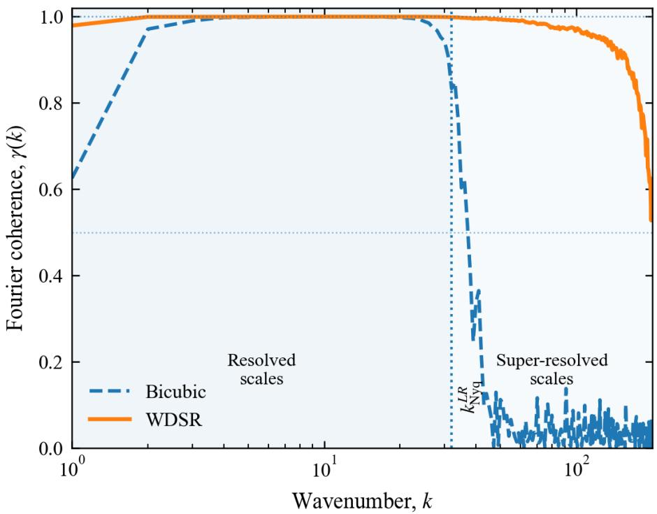  
Figure 10: Scale-dependent Fourier coherence between the reconstructed and reference vorticity fields for ×32 superresolution.

The corresponding ×64 results are shown in Fig. 11. With the low-resolution Nyquist wavenumber reduced to $k _ { \mathrm { N y q } } ^ { \mathrm { L R } } = 1 6 ,$ a larger portion of the turbulent spectrum must be inferred from the coarse observation. WDSR nevertheless maintains substantial coherence beyond this cutoff, whereas bicubic interpolation exhibits a pronounced reduction in crossspectral correlation. Compared with ×32, however, the WDSR coherence decreases at lower absolute wavenumbers and deteriorates more rapidly toward the finest scales, indicating a narrower range of realization-specific spectral recovery under more severe spatial coarsening.

The persistence of coherence beyond the low-resolution Nyquist limit in both cases provides evidence that the learned mapping captures coarse-to-fine relationships that generalize to unseen turbulent realizations. Nevertheless, the progressive loss of coherence at higher wavenumbers reveals the limitations of deterministic reconstruction under severe spatial under-resolution. Moreover, because Fourier coherence is normalized, strong cross-spectral correspondence does not necessarily imply accurate spectral amplitudes or pointwise reconstruction. The coherence results must therefore be interpreted alongside the energy spectra, vorticity statistics, and physical-space errors presented earlier. Together, these complementary diagnostics provide a more complete assessment of both the statistical fidelity and realization-specific accuracy of extreme-scale turbulent super-resolution.

## 3.4 Single-realization versus multi-realization learning

The preceding results establish that the proposed framework can perform extreme super-resolution using training information extracted from only one high-resolution turbulent realization. A central question, however, is whether this strategy provides a meaningful advantage over conventional WDSR training in which additional independent high-resolution realizations are supplied to the model.

To investigate this question, we perform a data-scaling experiment for the ×32 reconstruction problem. Separate WDSR models are trained conventionally using 1, 25, 50, and 100 complete high-resolution turbulent snapshots. These models do not employ the overlapping patch-extraction and overlap-add reconstruction strategy of the proposed framework.

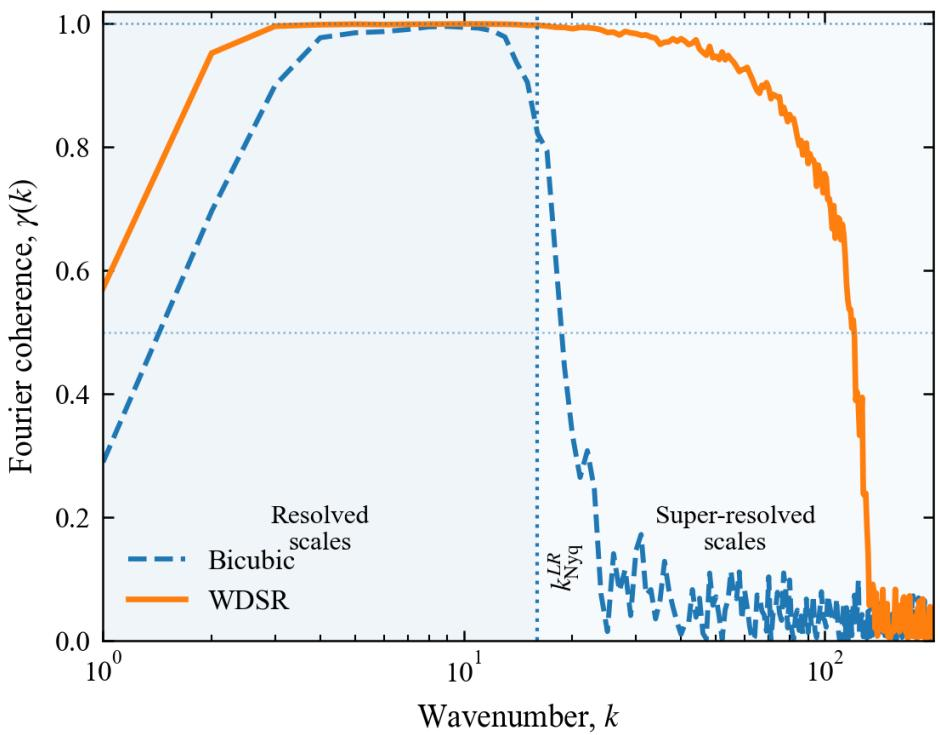  
Figure 11: Scale-dependent Fourier coherence between the reconstructed and reference vorticity fields for $\times 6 4$ superresolution.

They are compared against the WDSR model trained using overlapping patches extracted from a single high-resolution realization. All methods are evaluated using the same unseen turbulent field.

Figure 12 summarizes the resulting relative $L _ { 2 }$ reconstruction errors.

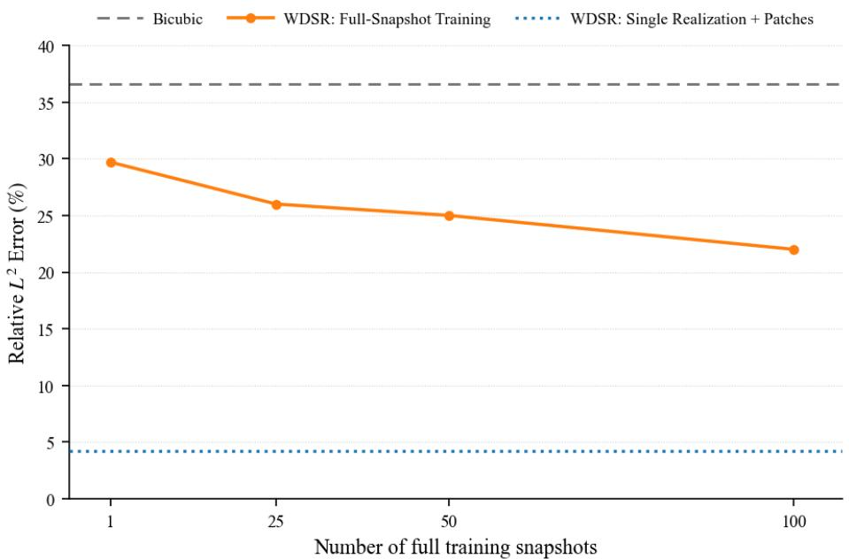  
Figure 12: Influence of training-data availability and learning strategy on $\times 3 2$ turbulent super-resolution.

Bicubic interpolation yields a relative $L _ { 2 }$ error of approximately 36.63%. Conventional WDSR training using a single complete snapshot reduces the error to approximately 29.7%, demonstrating that the learned reconstruction itself provides an improvement over interpolation. Increasing the conventional training dataset to 25, 50, and 100 complete snapshots further reduces the error to approximately 26%, 25%, and 22%, respectively. The monotonic reduction in error demonstrates the expected benefit of providing conventional WDSR with a larger ensemble of independent high-resolution flow states.

The improvement obtained through conventional dataset scaling, however, is considerably smaller than that obtained by exploiting the internal spatial information of a single realization. The proposed overlapping-patch WDSR framework achieves a relative $L _ { 2 }$ error of approximately 4.25% using only one high-resolution training snapshot. Compared with conventional WDSR trained using one complete snapshot, the error is reduced by approximately 86%. More strikingly, the conventional WDSR model trained using 100 high-resolution realizations still exhibits an error of approximately 22%, more than five times the error obtained using the proposed single-realization strategy.

These results demonstrate that the number of global turbulent realizations alone is not an adequate measure of the amount of useful information presented to the learning algorithm. A single high-resolution realization contains a large number of spatially distributed local configurations. By exploiting statistical homogeneity through overlapping patch extraction, the proposed framework exposes the network to many localized coarse-to-fine relationships contained within that realization. For the present ×32 reconstruction problem, this internal spatial sampling is substantially more effective than increasing the conventional full-field training dataset from one to one hundred independent snapshots.

The comparison in Fig. 12 must nevertheless be interpreted carefully. It is intentionally a comparison between two different learning strategies rather than a controlled ablation of snapshot count alone. The proposed model and the conventional full-snapshot models differ both in the amount of high-resolution data used and in the manner in which that information is presented to the network. Consequently, the observed improvement should be attributed to the complete single-realization patch-learning framework rather than solely to the reduction in the number of training snapshots. This distinction is important because the objective of the present study is precisely to determine whether intensive exploitation of spatial information within one realization can provide an effective alternative to conventional dataset scaling.

## 3.5 Effect of overlap-add reconstruction

To assess the influence of patch assembly on reconstruction accuracy, we compare three inference strategies: (i) non-overlapping patch reconstruction, (ii) 50% overlapping reconstruction with uniform averaging, and (iii) 50% overlapping reconstruction with Hann-window-weighted assembly. The latter follows the normalized overlap-add formulation introduced in Section 2.3. All three strategies employ the same trained WDSR model, allowing the influence of the assembly procedure to be examined independently of the learned reconstruction mapping.

Figure 13 compares the spatial distributions of absolute vorticity reconstruction error, $| \omega ^ { \mathrm { S R } } - \omega ^ { \mathrm { G T } } |$ |, obtained using the three assembly strategies. Non-overlapping reconstruction exhibits pronounced grid-like error patterns concentrated along patch interfaces, indicating reduced prediction accuracy near patch boundaries. Introducing 50% overlap with uniform averaging mitigates these discontinuities, although residual artifacts associated with the patch geometry remain visible.

Hann-window-weighted assembly further suppresses these boundary artifacts by preferentially weighting predictions from patch interiors, where greater spatial context is available. The resulting error distribution exhibits substantially weaker signatures of the underlying patch partitioning, indicating improved spatial consistency across independently reconstructed regions.

These results demonstrate that the assembly strategy influences the spatial distribution of reconstruction errors, even when the underlying super-resolution model remains unchanged. In particular, normalized Hann-window overlap-add provides a more spatially consistent full-field reconstruction than direct patch placement or uniform overlap averaging. Accordingly, this strategy is adopted throughout the present investigation.

## 3.6 Robustness to noisy low-resolution observations

The preceding results consider ideal low-resolution observations generated directly from the high-resolution reference fields. In practical numerical and experimental settings, however, coarse observations may additionally contain measurement uncertainty, numerical contamination, or sensor noise. We therefore examine the robustness of the learned reconstruction to perturbations introduced directly into the low-resolution input.

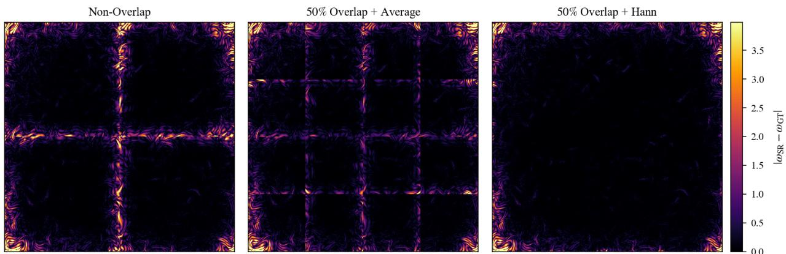  
Figure 13: Effect of patch-assembly strategy on the spatial distribution of absolute vorticity reconstruction error, $| \omega ^ { \mathrm { { \check { S } R } } } - \omega ^ { \mathrm { { G T } } } |$ . Results are shown for non-overlapping reconstruction (left), 50% overlap with uniform averaging (center), and 50% overlap with Hann-window weighting (right).

Additive Gaussian noise is applied to the low-resolution field prior to super-resolution, with noise levels ranging from 0% to 20%. The trained WDSR models are not retrained or fine-tuned for the noisy inputs. The noisy fields are supplied directly to the reconstruction model, thereby providing a stringent test of whether the multiscale mapping learned from the single high-resolution realization remains effective when the resolved information itself is perturbed.

Figure 14 presents the resulting relative $L ^ { 2 }$ reconstruction error for the $\times 3 2$ case.

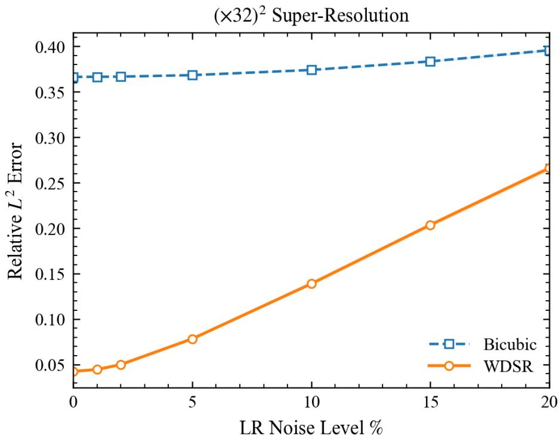  
Figure 14: Sensitivity of the ×32 super-resolution reconstruction to noise in the low-resolution input.

In the absence of input noise, the ×32 WDSR reconstruction exhibits a relative $L ^ { 2 }$ error of approximately 4.25%, compared with approximately 36.6% for bicubic interpolation. At low noise levels, the WDSR error increases only modestly, indicating that the learned reconstruction is not excessively sensitive to small perturbations in the coarse observation. As the noise amplitude is increased further, the error grows progressively, reaching approximately 14%, 20%, and 27% at noise levels of 10%, 15%, and 20%, respectively.

Despite this degradation, WDSR remains substantially more accurate than bicubic interpolation over the complete noise range. The bicubic error, which is already large for the noise-free observation, changes only moderately with increasing noise because interpolation is dominated by the severe information loss associated with the original ×32 coarsening. The learned reconstruction, by contrast, starts from a much lower error and retains a significant advantage even when the low-resolution observation is strongly contaminated.

A similar analysis is performed for the more demanding ×64 problem, as shown in Fig. 15.

(×64)2 Super-Resolution  
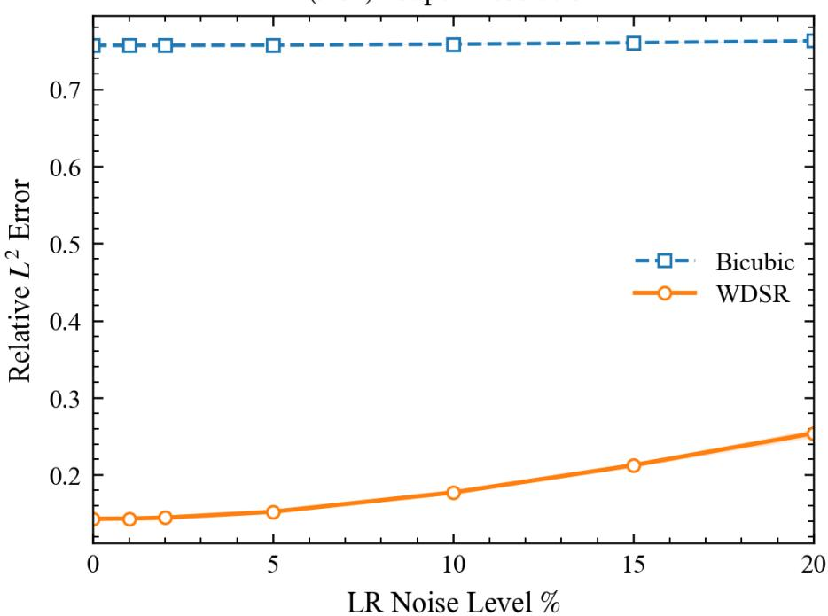  
Figure 15: Sensitivity of the extreme ×64 super-resolution reconstruction to noise in the low-resolution input.

The ×64 case begins from a larger reconstruction error because the $3 2 \times 3 2$ observation retains substantially less information than the 64 × 64 input employed for ×32 super-resolution. Nevertheless, the WDSR reconstruction remains considerably more accurate than bicubic interpolation. The error increases gradually from approximately 14% for the noise-free observation to approximately 18%, 21%, and 25% for noise levels of 10%, 15%, and 20%, respectively Bicubic interpolation, in comparison, remains near a relative $L ^ { 2 }$ error of approximately 75% over the same range.

Interestingly, the relative increase in WDSR error with input noise is less pronounced for ×64 than for ×32. This behavior should not be interpreted as indicating that the ×64 reconstruction is intrinsically more accurate or more noise tolerant. Rather, at $\times 6 4$ , the dominant source of reconstruction difficulty is already the extreme loss of spatial information associated with reducing the reference field to only $3 2 \times 3 2$ samples. Consequently, additional perturbations to the coarse input produce a comparatively smaller increase relative to the existing under-resolution error.

Taken together, Figs. 14 and 15 demonstrate that the single-realization WDSR framework does not rely on perfectly noise-free coarse observations. Reconstruction accuracy decreases continuously as the quality of the input deteriorates, as expected, but no abrupt breakdown is observed over the range examined. More importantly, the learned reconstruction maintains a substantial advantage over conventional interpolation even under strong low-resolution perturbations. These results provide additional evidence that the multiscale relationships extracted from a single turbulent realization remain useful under imperfect observational conditions.

## 3.7 Physical interpretation and limits of extreme-scale reconstruction

The combined physical-space, spectral, and statistical results provide a consistent picture of the reconstruction process. At ×32, the 64 × 64 observation contains only 1/1024 of the number of spatial samples in the 2048 × 2048 reference field. Nevertheless, the single-realization WDSR model reconstructs the dominant filamentary vorticity organization, substantially reduces errors in derived coherent-structure diagnostics, closely reproduces the reference spectrum over a broad wavenumber range, and recovers the vorticity PDF, including its low-probability tails.

The ×64 experiment represents a substantially stronger test of the same hypothesis. In this case, only 1/4096 of the reference spatial samples are retained, and the low-resolution Nyquist wavenumber is reduced to $k _ { \mathrm { N y q } } ^ { \mathrm { \bar { L } R } } = 1 6 .$ . A large fraction of the spectral range represented in the DNS field is therefore absent from the observation. Despite this severe information deficit, the WDSR model reconstructs coherent fine-scale organization, extends the energy spectrum substantially beyond the low-resolution cutoff, and closely reproduces the reference vorticity distribution.

The reconstruction should not, however, be interpreted as deterministic recovery of all information removed during coarse graining. At extreme scale separation, multiple fine-scale configurations may be compatible with a given coarse observation. The WDSR model instead provides a conditional reconstruction informed by two sources of information: the resolved state supplied by the low-resolution observation and the statistical relationships between coarse and fine scales learned from the training realization. The increasing high-wavenumber discrepancy observed for ×64 is consistent with this interpretation and identifies a practical limit to the scales that can be inferred reliably.

The results therefore support the central hypothesis of the present study: for statistically homogeneous turbulence, a single high-resolution realization can contain substantially more usable learning information than its designation as a single snapshot might suggest. Through overlapping spatial sampling, one realization provides many localized manifestations of the underlying multiscale turbulent organization. These internal statistics can be exploited to construct a reconstruction prior that generalizes to an independent turbulent state, even when the observation is severely under-resolved.

The comparison with conventional multi-realization training further suggests that, under severe data scarcity, how the available high-resolution information is exploited can be at least as important as the number of independent realizations available. Rather than relying exclusively on increasingly large high-fidelity datasets, the present results demonstrate the potential of realization-centric learning, in which the spatial information embedded within an available turbulent field is systematically exploited to support extreme-scale reconstruction.

## 3.8 Reconstruction limitations at higher Reynolds number

To examine the applicability of single-realization learning to more demanding turbulent regimes, we consider an additional reconstruction experiment at $R e = 1 6 0 0 0$ . Compared with the $R e = 1 0 0 0$ configuration, the higher-Reynolds number flow exhibits a broader range of spatial scales and more pronounced fine-scale vorticity structures, providing a useful test of the reconstruction capabilities of the proposed framework.

The high-resolution vorticity field is represented on a 2048 × 2048 grid and reconstructed from a 128 × 128 observation, corresponding to a super-resolution factor of ×16. Figure 16 compares the low-resolution input, DNS reference, bicubic interpolation, and WDSR reconstruction for an unseen turbulent realization.

As shown in Fig. 16, bicubic interpolation preserves the dominant large-scale organization but substantially attenuates the finer vorticity structures. The WDSR reconstruction captures a greater portion of the filamentary organization and exhibits improved agreement with the DNS reference. Nevertheless, localized discrepancies remain near thin filament and regions of strong vorticity gradients, where small errors in position or amplitude can produce appreciable pointwise differences.

The corresponding angle-averaged energy spectra are presented in Fig. 17.

The WDSR spectrum follows the DNS reference over a substantially broader wavenumber range than bicubic interpolation, which exhibits pronounced attenuation at smaller spatial scales. However, the WDSR spectrum also depart from the reference at sufficiently high wavenumbers, indicating incomplete recovery of the finest resolved scales. This behavior is consistent with the localized reconstruction errors observed in physical space, although spectral agreement alone does not establish realization-specific correspondence between individual Fourier modes.

These results illustrate both the capabilities and limitations of the present deterministic framework. The network reconstructs substantial fine-scale structure from a severely under-resolved observation, but its accuracy is reduced for features whose spatial organization is weakly constrained by the available coarse-scale information. Because the Reynolds number and super-resolution factor differ from those considered in the preceding experiments, this comparison should be interpreted as an additional high-Reynolds-number reconstruction test rather than a controlled assessment of Reynolds-number dependence.

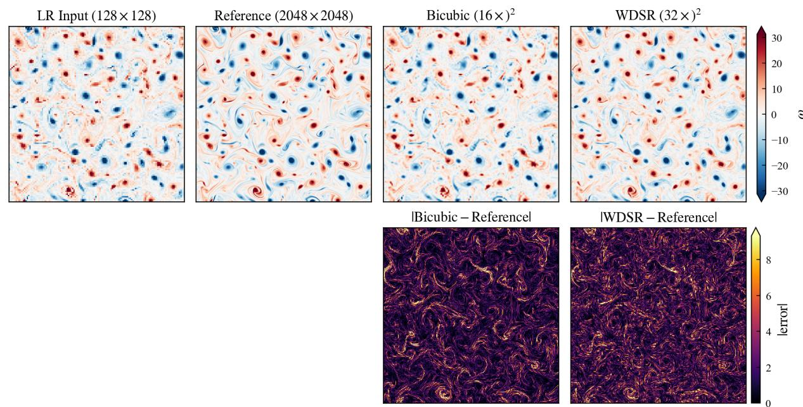  
Figure 16: Super-resolution reconstruction of an unseen homogeneous isotropic turbulence realization at $R e = 1 6 0 0 0$ with a scale factor $\operatorname { o f } \ \times 1 6 .$ . The low-resolution observation, DNS reference, bicubic interpolation, and WDSR reconstruction are compared alongside the corresponding absolute reconstruction errors.

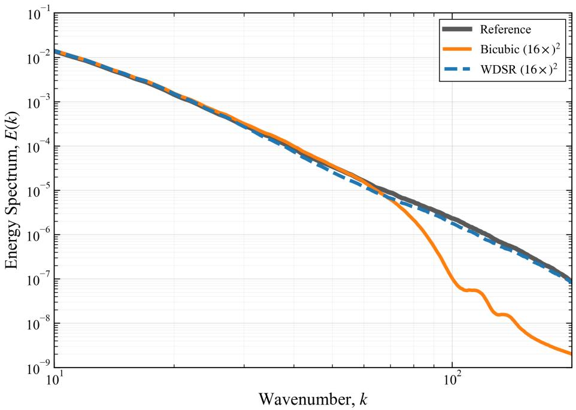  
Figure 17: Angle-averaged energy spectrum for the ×16 super-resolution experiment at $R e = 1 6 0 0 0 .$ comparing the DNS reference, bicubic interpolation, and single-realization WDSR reconstruction.

## 3.9 Discussion of reconstruction limitations

The reconstruction of unresolved turbulent scales is fundamentally an underdetermined inverse problem. Spatial coarsening removes information about fine-scale fluctuations, and distinct high-resolution realizations may produce similar low-resolution observations. Consequently, the relationship between the coarse and fine fields is more generally characterized by a conditional distribution,

$$
p \left( \omega ^ { H R } \mid \omega ^ { L R } \right) ,\tag{19}
$$

rather than a uniquely invertible mapping. The deterministic WDSR model approximates this relationship through a single reconstruction conditioned on the low-resolution observation.

The effectiveness of this approximation depends on the information retained by the coarse field and the diversity of multiscale relationships represented within the training realization. Statistical homogeneity enables the extraction of numerous localized training samples from a single snapshot, but does not guarantee that these samples span all possible configurations of the unresolved dynamics. In particular, increasing the fraction of dynamically relevant scales removed by coarse graining can increase ambiguity in the reconstruction of individual fine-scale structures.

These considerations suggest several possible extensions. Spectral and gradient-sensitive loss functions could place greater emphasis on small-scale energy content and localized vorticity gradients, while constraints derived from the governing equations could improve physical consistency. Alternatively, probabilistic reconstruction methods could represent uncertainty in the unresolved scales through multiple high-resolution realizations conditioned on the same coarse observation.

The present results therefore support single-realization learning as a data-efficient approach to turbulent super-resolution while identifying an important limitation of deterministic reconstruction: accurate recovery of unresolved statistics does not necessarily imply exact recovery of the fine-scale configuration of an individual turbulent realization.

## 4 Conclusion and Future Work

This study investigated extreme-scale super-resolution of two-dimensional homogeneous isotropic turbulence using a single high-resolution realization for training. The proposed framework combines localized patch-based learning with a wide-activation deep super-resolution (WDSR) network and Hann-window-weighted overlap-add reconstruction to recover complete turbulent fields from severely under-resolved observations. By exploiting spatially recurring multiscale structures within a statistically homogeneous flow, the framework learns coarse-to-fine relationships without requiring additional high-resolution training realizations.

The proposed approach achieved relative $L _ { 2 }$ errors of 4.25% and 14.30% for super-resolution factors of $\times 3 2$ and $\times 6 4$ respectively, compared with 36.64% and 75.69% for bicubic interpolation. Beyond improved pointwise accuracy, the reconstructed fields exhibited substantially better agreement with the reference vortical structures, turbulent energy spectra, and vorticity probability distributions. Scale-dependent Fourier coherence further demonstrated that the reconstructed fields retain substantial realization-specific cross-spectral correspondence beyond the low-resolution Nyquist cutoff, indicating that the learned mapping recovers information correlated with the unresolved organization of previously unseen turbulent realizations.

A comparison with conventional full-field WDSR training further highlighted the effectiveness of exploiting internal spatial information. For the $\times 3 2$ problem, the proposed single-realization framework achieved a relative $L _ { 2 }$ error of 4.25%, whereas conventional WDSR trained on 100 complete high-resolution snapshots yielded an error of approximately 22%. Although these approaches differ in training-data presentation and reconstruction procedure, the comparison demonstrates the practical advantage of the complete patch-based learning framework under the investigated conditions.

Despite these improvements, reconstruction accuracy decreased with increasing spatial under-resolution, with progressively larger discrepancies at the finest scales. The additional high-Reynolds-number experiment further illustrated the limitations of deterministic reconstruction when unresolved structures are insufficiently constrained by the coarse observations. These findings emphasize that agreement in spectral and statistical properties does not necessarily imply exact recovery of realization-specific fine-scale structures.

Future work will investigate physics-informed and spectrally constrained learning objectives, uncertainty-aware reconstruction methods, and extensions to three-dimensional and more complex turbulent flows. The present findings demonstrate that localized learning from a single turbulent realization provides a promising data-efficient strategy for full-domain extreme-scale super-resolution.

## Acknowledgments

This work was supported in part by the AFOSR Grant FA9550-24-1-0327.

## Data Availability

The datasets and code used to generate the results presented in this study are publicly available and can be accessed through the following GitHub repository: Extreme-Scale-Super-Resolution.

## References

[1] Andrey Nikolaevich Kolmogorov. The local structure of turbulence in incompressible viscous fluid for very large reynolds. Numbers. In Dokl. Akad. Nauk SSSR, 30:301, 1941.

[2] Robert H Kraichnan. Inertial ranges in two-dimensional turbulence. Physics of fluids, 10(7):1417, 1967.

[3] George Keith Batchelor. The theory ofhomogeneous turbulence. Cambridge university press, 1953.

[4] Uriel Frisch. Turbulence: The Legacy of A. N. Kolmogorov. Cambridge University Press, Cambridge, 1995.

[5] Stephen B. Pope. Turbulent Flows. Cambridge University Press, Cambridge, 2000.

[6] Peter Alan Davidson. Turbulence: an introductionfor scientists and engineers. Oxford university press, 2004.

[7] George K Batchelor. Computation of the energy spectrum in homogeneous two-dimensional turbulence. The Physics ofFluids, 12(12):II–233, 1969.

[8] Parviz Moin and Krishnan Mahesh. Direct numerical simulation: a tool in turbulence research. Annual review of fluid mechanics, 30(1):539–578, 1998.

[9] Yukio Kaneda, Takashi Ishihara, Mitsuo Yokokawa, Ken’ichi Itakura, and Atsuya Uno. Energy dissipation rate and energy spectrum in high resolution direct numerical simulations of turbulence in a periodic box. Physics of Fluids, 15(2):L21–L24, 2003.

[10] Takashi Ishihara, Toshiyuki Gotoh, and Yukio Kaneda. Study of high–reynolds number isotropic turbulence by direct numerical simulation. Annual review offluid mechanics, 41(1):165–180, 2009.

[11] Ronald J. Adrian. Particle-imaging techniques for experimental fluid mechanics. Annual Review of Fluid Mechanics, 23(1):261–304, 1991.

[12] C Willert, Steve T Wereley, and Jürgen Kompenhans. Particle image velocimetry: a practical guide, 2007.

[13] Joseph Smagorinsky. General circulation experiments with the primitive equations: I. the basic experiment. Monthly weather review, 91(3):99–164, 1963.

[14] Massimo Germano, Ugo Piomelli, Parviz Moin, and William H Cabot. A dynamic subgrid-scale eddy viscosity model. Physics offluids a: Fluid dynamics, 3(7):1760–1765, 1991.

[15] Charles Meneveau and Joseph Katz. Scale-invariance and turbulence models for large-eddy simulation. Annual Review ofFluid Mechanics, 32(1):1–32, 2000.

[16] Pierre Sagaut. Large eddy simulation for incompressible flows: an introduction. Springer, 2006.

[17] Karthik Duraisamy, Gianluca Iaccarino, and Heng Xiao. Turbulence modeling in the age of data. Annual review of fluid mechanics, 51(1):357–377, 2019.

[18] Steven L Brunton, Bernd R Noack, and Petros Koumoutsakos. Machine learning for fluid mechanics. Annual review offluid mechanics, 52(1):477–508, 2020.

[19] J Nathan Kutz. Deep learning in fluid dynamics. Journal of Fluid Mechanics, 814:1–4, 2017.

[20] Ricardo Vinuesa, Steven L Brunton, and Beverley J McKeon. The transformative potential of machine learning for experiments in fluid mechanics. Nature Reviews Physics, 5(9):536–545, 2023.

[21] Kai Fukami, Koji Fukagata, and Kunihiko Taira. Super-resolution reconstruction of turbulent flows with machine learning. Journal ofFluid Mechanics, 870:106–120, 2019.

[22] Kai Fukami, Koji Fukagata, and Kunihiko Taira. Machine-learning-based spatio-temporal super resolution reconstruction of turbulent flows. Journal ofFluid Mechanics, 909:A9, 2021.

[23] Kai Fukami, Koji Fukagata, and Kunihiko Taira. Super-resolution analysis via machine learning: a survey for fluid flows. Theoretical and Computational Fluid Dynamics, 37(4):421–444, 2023.

[24] Muhammad Abid and Omer San. SIMR-NO: a spectrally-informed multi-resolution neural operator for turbulent flow super-resolution. arXiv preprint arXiv:2603.28073, 2026.

[25] Luca Guastoni, Alejandro Güemes, Andrea Ianiro, Stefano Discetti, Philipp Schlatter, Hossein Azizpour, and Ricardo Vinuesa. Convolutional-network models to predict wall-bounded turbulence from wall quantities. Journal of Fluid Mechanics, 928:A27, 2021.

[26] Ludovico Nista, Heinz Pitsch, Christoph DK Schumann, Mathis Bode, Temistocle Grenga, Jonathan F MacArt, and Antonio Attili. Influence of adversarial training on super-resolution turbulence reconstruction. Physical reviewfluids, 9(6):064601, 2024.

[27] Qinmin Zheng, Tianyi Li, Benteng Ma, Lin Fu, and Xiaomeng Li. High-fidelity reconstruction of large-area damaged turbulent fields with a physically constrained generative adversarial network. Physical Review Fluids, 9(2):024608, 2024.

[28] Hyojin Kim, Junhyuk Kim, Sungjin Won, and Changhoon Lee. Unsupervised deep learning for super-resolution reconstruction of turbulence. Journal ofFluid Mechanics, 910:A29, 2021.

[29] Mustafa Z Yousif, Linqi Yu, and Hee-Chang Lim. Super-resolution reconstruction of turbulent flow fields at various reynolds numbers based on generative adversarial networks. Physics ofFluids, 34(1), 2022.

[30] Tianyi Li, Michele Buzzicotti, Luca Biferale, Fabio Bonaccorso, Shiyi Chen, and Minping Wan. Multi-scale data reconstruction of turbulent rotating flows with gappy pod, extended pod and generative adversarial networks. arXiv preprint arXiv:2210.11921, 2022.

[31] Dima Tretiak, Arvind T Mohan, and Daniel Livescu. Physics-constrained generative adversarial networks for 3d turbulence. arXiv preprint arXiv:2212.00217, 2022.

[32] Nicholas J Ward. Physics-informed super-resolution of turbulent channel flows via three-dimensional generative adversarial networks. Fluids, 8(7):195, 2023.

[33] Maziar Raissi, Paris Perdikaris, and George E Karniadakis. Physics-informed neural networks: A deep learning framework for solving forward and inverse problems involving nonlinear partial differential equations. Journal of Computational physics, 378:686–707, 2019.

[34] Han Gao, Luning Sun, and Jian-Xun Wang. Super-resolution and denoising of fluid flow using physics-informed convolutional neural networks without high-resolution labels. Physics ofFluids, 33(7), 2021.

[35] Lu Lu, Pengzhan Jin, and George Em Karniadakis. Deeponet: Learning nonlinear operators for identifying differential equations based on the universal approximation theorem of operators. arXiv preprint arXiv:1910.03193, 2019.

[36] Zongyi Li, Nikola Kovachki, Kamyar Azizzadenesheli, Burigede Liu, Kaushik Bhattacharya, Andrew Stuart, and Anima Anandkumar. Fourier neural operator for parametric partial differential equations. arXiv preprint arXiv:2010.08895, 2020.

[37] Nikola Kovachki, Zongyi Li, Burigede Liu, Kamyar Azizzadenesheli, Kaushik Bhattacharya, Andrew Stuart, and Anima Anandkumar. Neural operator: Learning maps between function spaces with applications to pdes. Journal ofMachine Learning Research, 24(89):1–97, 2023.

[38] Arth Sojitra, Mrigank Dhingra, and Omer San. FEDONet: fourier-embedded deeponet for spectrally accurate operator learning. Journal of Computational Physics, page 114931, 2026.

[39] Muhammad Abid and Omer San. Spectral embedding via chebyshev bases for robust deeponet approximation. arXiv preprint arXiv:2512.09165, 2025.

[40] Muhammad Abid, Arth Sojitra, and Omer San. WLNO: wavelet-laplace neural operator for solving partial differential equations. arXiv preprint arXiv:2605.24658, 2026.

[41] Maria Zontak and Michal Irani. Internal statistics of a single natural image. In CVPR 2011, pages 977–984. IEEE, 2011.

[42] Assaf Shocher, Nadav Cohen, and Michal Irani. Zero-shot super-resolution using deep internal learning. In 2018 IEEE/CVF Conference on Computer Vision and Pattern Recognition, pages 3118–3126. IEEE, 2018.

[43] Kai Fukami and Kunihiko Taira. Single-snapshot machine learning for super-resolution of turbulence. Journal of Fluid Mechanics, 1001:A32, 2024.

[44] Yulun Zhang, Yapeng Tian, Yu Kong, Bineng Zhong, and Yun Fu. Residual dense network for image superresolution. In 2018 IEEE/CVF conference on computer vision and pattern recognition, pages 2472–2481. IEEE, 2018.

[45] Yulun Zhang, Kunpeng Li, Kai Li, Lichen Wang, Bineng Zhong, and Yun Fu. Image super-resolution using very deep residual channel attention networks. In European conference on computer vision, pages 294–310. Springer, 2018.

[46] Xintao Wang, Ke Yu, Shixiang Wu, Jinjin Gu, Yihao Liu, Chao Dong, Yu Qiao, and Chen Change Loy. Esrgan: Enhanced super-resolution generative adversarial networks. In European conference on computer vision, pages 63–79. Springer, 2018.

[47] Jingyun Liang, Jiezhang Cao, Guolei Sun, Kai Zhang, Luc Van Gool, and Radu Timofte. Swinir: Image restoration using swin transformer. In 2021 IEEE/CVF international conference on computer vision workshops (ICCVW), pages 1833–1844. IEEE, 2021.

[48] Xiangyu Chen, Xintao Wang, Wenlong Zhang, Xiangtao Kong, Yu Qiao, Jiantao Zhou, and Chao Dong. Hat: Hybrid attention transformer for image restoration. IEEE Transactions on Pattern Analysis and Machine Intelligence, 2025.

[49] Jiahui Yu, Yuchen Fan, Jianchao Yang, Ning Xu, Zhaowen Wang, Xinchao Wang, and Thomas Huang. Wide activation for efficient and accurate image super-resolution. arXiv preprint arXiv:1808.08718, 2018.

[50] Suraj Pawar, Omer San, Adil Rasheed, and Prakash Vedula. Frame invariant neural network closures for kraichnan turbulence. Physica A: Statistical Mechanics and its Applications, 609:128327, 2023.