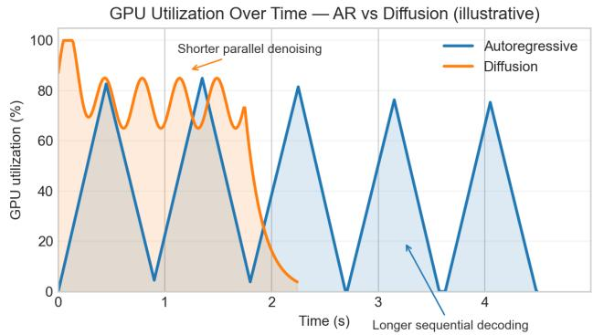
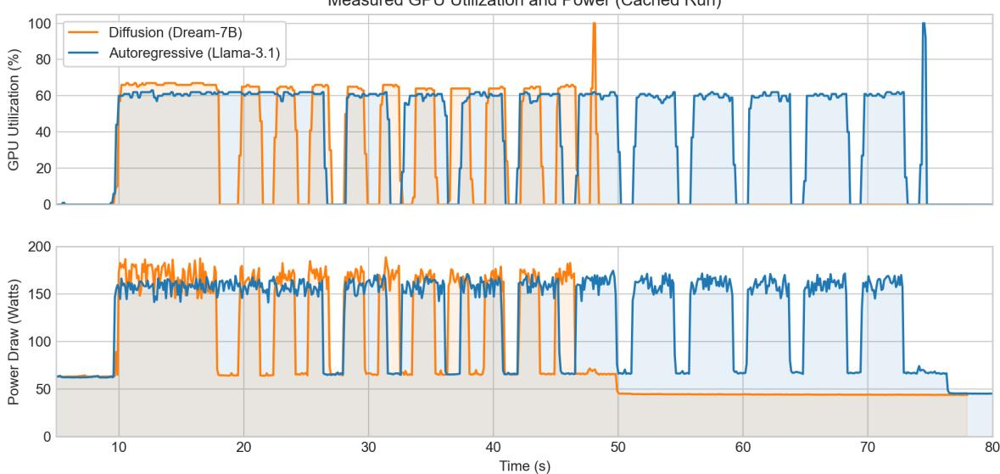

# Energy Consumption Analysis of Discrete Difusion and Autoregressive Language Models

Boris Ruf

AXA, AI Research

Paris, France

boris.ruf@axa.com

Marcin Detyniecki   
AXA, AI Research   
Paris, France   
marcin.detyniecki@axa.com

## Abstract

As Large Language Models (LLMs) continue to scale, their energy consumption during inference has become a critical concern. While Autoregressive (AR) models are the industry standard, Difusion Language Models (DLLMs) have emerged as a promising alternative capable of parallel token generation. In this paper, we perform a comparative energy benchmark of difusion models (LLaDA-8B, Dream-7B) against AR counterparts (Llama-3.1-8B, Qwen-2.5-7B). We analyze the trade-ofs between model architecture, KV-cache optimization, and Joules-per-token eficiency. Our results show that at longer sequences (200–600 tokens), difusion models achieve 2.5–2.7 J/token, approximately 2× more eficient than AR models with KV-cache (5.3–5.7 J/token). KV-cache provides substantial benefits for AR models at longer sequences (50– 70% energy reduction).

## CCS Concepts

## Keywords

Difusion Language Models, Autoregressive Language Models, Energy Eficiency, Inference Benchmark

• Software and its engineering → Software performance; • Computing methodologies → Natural language generation; Machine learning; • Hardware → Power and energy; • Computer systems organization → Neural networks.

## ACM Reference Format:

Boris Ruf and Marcin Detyniecki. 2026. Energy Consumption Analysis of Discrete Difusion and Autoregressive Language Models. In 2nd International Workshop on Systems and Methods for Sustainable Large-Scale AI (GreenSys) (GreenSys ’26), April 27–30, 2026, Edinburgh, Scotland UK. ACM, New York, NY, USA, 6 pages. https: //doi.org/10.1145/3802973.3804458

This work is licensed under a Creative Commons Attribution-NonCommercial-NoDerivatives 4.0 International License.   
GreenSys ’26, Edinburgh, Scotland UK   
© 2026 Copyright held by the owner/author(s).   
ACM ISBN 979-8-4007-2174-8/2026/04   
https://doi.org/10.1145/3802973.3804458

  
Figure 1: Illustrative model of GPU utilization over time for an autoregressive model (blue) with 10 output tokens vs a difusion model (orange) with 10 denoising steps. This theoretical pattern motivates our empirical investigation.

## 1 Introduction

Autoregressive language models generate text sequentially, which inherently limits parallelization and leads to high latency and energy costs for long sequences. Recently, text difusion models have introduced the ability to refine multiple tokens simultaneously[9]. However, the energy cost of multiple denoising steps versus a single-pass autoregressive generation remains under-explored.

Figure 1 presents a theoretical model ofGPU utilization for both architectures. The autoregressive pattern shows distinct, sequential peaks for each token, while the difusion model exhibits a shorter, more intense block of parallel processing. This intuition suggests difusion models may ofer eficiency advantages—a hypothesis we investigate empirically in this paper.

We study the following primary research question:

How does the end-to-end inference energy consumption (Joules-per-token) ofdiscrete difusion language models compare to autoregressive language models for instruction-style generation under matched experimental conditions?

We operationalize this into three concrete sub-questions:

• What is the Joules-per-token and latency-per-token of representative DLLMs (LLaDA, Dream) compared to AR baselines (Llama-3.1, Qwen-2.5) on instruction prompts?

• How does sequence length (10, 128, 1024 tokens) afect the relative energy eficiency of difusion vs. autoregressive models?

• To what extent does KV-cache optimization reduce energy consumption for AR models, and does it close the eficiency gap with difusion models?

The remainder of this paper is organized as follows: Section 2 reviews related work on difusion language models and energy measurement. Section 3 describes our experimental setup, including model selection, hardware configuration, and measurement protocol. Section 4 presents our benchmark results. Section 5 discusses limitations, Section 6 outlines future work, followed by a broader discussion in Section 7 and conclusions in Section 8.

## 2 Related Work

Text difusion for text generation has progressed from masked/ discrete formulations such as MDLM [12] to large-scale diffusion LLMs and AR→dLLM conversion pipelines including DifuLLaMA, Dream-7B, LLaDA, RND1, and Energy-Based Difusion Language Models (EDLM) [3, 7, 11, 17, 19]. Work on AR→block-difusion and light-weight adaptation (e.g., SDAR, Fast-dLLM) demonstrates that structural alignment with AR pretraining can substantially reduce adaptation cost compared to training difusion models from scratch [1, 5, 16].

At inference time, dLLMs enable parallel token updates but introduce system-level bottlenecks: bidirectional attention patterns complicate KV-cache reuse, and many samplers require multiple denoising steps, increasing end-toend compute. Research addressing these challenges includes parallel decoding and sampler-distillation approaches (e.g., dParallel [4]), adaptive KV strategies (dKV-Cache [10]), and block/anchor decoding designs aimed at reducing sampling steps while preserving quality [16].

There is also a growing literature on measuring and reporting energy and carbon for large-scale NLP. Seminal studies established that large training and evaluation runs can yield substantial energy and emissions, motivating the "Green AI" advocacy for eficiency-aware reporting [13, 14]. Practical tooling such as CodeCarbon enables reproducible runtime energy logging at the hardware level [6]. Very recent studies provide hardware-level profiling for difusion-based models in the image domain and show substantial variance across samplers, denoising schedules, and backends [2, 8].

Despite these advances, hardware-level Joules-per-token measurements for text dLLMs are still scarce. This paper fills that gap by reporting end-to-end energy (Joules-per-token)

and latency under controlled cache and backend settings, and by situating the measured trade-ofs alongside the algorithmic and systems techniques described above.

## 3 Experimental Setup

This section details the hardware, software, and measurement protocol used in our study so that results are reproducible.

## 3.1 Model selection

We evaluate a compact set of difusion and autoregressive models chosen to illustrate diferent algorithmic and system trade-ofs:

• LLaDA-8B — a difusion language model trained from scratch using a Llama-style architecture; chosen as a representative dLLM that demonstrates native diffusion training can achieve performance competitive with AR models [11].

• Dream-7B — a difusion LLM designed for eficient denoising schedules and parallel sampling; used to evaluate step-count vs. energy trade-ofs [19].

• Llama-3.1-8B-Instruct — a modern autoregressive foundation model serving as a large AR baseline for instruction-style generation [15].

• Qwen-2.5-7B-Instruct — an autoregressive instructiontuned baseline representative of high-quality opensource models in the same parameter regime as some difusion models [18].

## 3.2 Hardware and system configuration

All inference runs reported in this paper were executed on a Microsoft Azure compute instance equipped with an NVIDIA A100. We use mixed precision (bf16/float16) where supported and ensure consistent CUDA/cuDNN and PyTorch versions across runs. We run models inside per-model Docker images to lock runtime dependencies (notably diferent ‘transformers‘ versions). We measure energy by querying NVIDIA’s NVML API to capture GPU power draw and integrate over the measured duration to obtain kWh/Joules.

## 3.3 Evaluation protocol

We use a short, fixed instruction prompt for all runs. Each model configuration was evaluated at three target sequence lengths: 10, 128, and 1024 tokens. For each configuration, we perform 5 warmup runs followed by 10 measured runs. AR models were tested both with and without KV-cache enabled.

## 3.4 Metrics

We report the following primary metrics:

Table 1: Energy and latency per generated token across diferent sequence lengths. AR models shown with and without KV-cache. Difusion models do not use KV-cache. Note: Qwen-2.5 generated fewer tokens at max=1024 because the model produced an end-of-sequence token before reaching the limit.
<table><tr><td>Model</td><td></td><td>KV-Cache</td><td>Max Tokens</td><td>Gen. Tokens</td><td>J/token</td><td>s/token</td></tr><tr><td colspan="7">Short sequences (max_tokens = 10)</td></tr><tr><td rowspan="4">AR</td><td>Llama-3.1-8B-Instruct</td><td>Off</td><td>10</td><td>10</td><td>8.32</td><td>0.0300</td></tr><tr><td>Llama-3.1-8B-Instruct</td><td>On</td><td>10</td><td>10</td><td>8.10</td><td>0.0295</td></tr><tr><td>Qwen-2.5-7B-Instruct</td><td>Off</td><td>10</td><td>10</td><td>7.93</td><td>0.0270</td></tr><tr><td>Qwen-2.5-7B-Instruct</td><td>On</td><td>10</td><td>10</td><td>7.92</td><td>0.0265</td></tr><tr><td rowspan="2">II</td><td>Dream-7B</td><td>一</td><td>10</td><td>10</td><td>32.21</td><td>0.1676</td></tr><tr><td>LLaDA-8B</td><td>一</td><td>10</td><td>10</td><td>35.60</td><td>0.1767</td></tr><tr><td colspan="7">Medium sequences (max_tokens = 128)</td></tr><tr><td rowspan="4">AR</td><td>Llama-3.1-8B-Instruct</td><td>Off</td><td>128</td><td>128</td><td>6.73</td><td>0.0294</td></tr><tr><td>Llama-3.1-8B-Instruct</td><td>On</td><td>128</td><td>128</td><td>5.07</td><td>0.0286</td></tr><tr><td>Qwen-2.5-7B-Instruct</td><td>Off</td><td>128</td><td>128</td><td>6.63</td><td>0.0261</td></tr><tr><td>Qwen-2.5-7B-Instruct</td><td>On</td><td>128</td><td>128</td><td>5.46</td><td>0.0266</td></tr><tr><td rowspan="2">D</td><td>Dream-7B</td><td>一</td><td>128</td><td>128</td><td></td><td></td></tr><tr><td>LLaDA-8B</td><td>一</td><td>128</td><td>128</td><td>4.45 5.11</td><td>0.0136 0.0156</td></tr><tr><td colspan="7">Long sequences (max_tokens = 1024)</td></tr><tr><td rowspan="4">AR</td><td>Llama-3.1-8B-Instruct</td><td>Off</td><td>1024</td><td>1024</td><td></td><td></td></tr><tr><td>Llama-3.1-8B-Instruct</td><td>On</td><td>1024</td><td>1024</td><td>18.21 5.26</td><td>0.0600</td></tr><tr><td>Qwen-2.5-7B-Instruct</td><td>Off</td><td>1024</td><td>564†</td><td>12.51</td><td>0.0272 0.0373</td></tr><tr><td>Qwen-2.5-7B-Instruct</td><td>On</td><td>1024</td><td>587†</td><td>5.72</td><td>0.0267</td></tr><tr><td rowspan="2">A</td><td>Dream-7B</td><td>一</td><td>1024</td><td>1024</td><td></td><td></td><td>0.0064</td></tr><tr><td>LLaDA-8B</td><td>一</td><td>1024</td><td></td><td>1024</td><td>2.01 2.40</td><td>0.0068</td></tr></table>

†Model generated EOS token before reaching max\_tokens limit.

• Energy per token (J/token): GPU power draw captured via NVIDIA’s NVML API, integrated over run duration, converted from kWh to Joules (1 kWh = $3 . 6 \times 1 0 ^ { 6 } \mathrm { J } )$ , and divided by generated tokens.

• Latency per token (s/token): Wall-clock time divided by generated tokens.

Results are reported as means over the 10 measured runs. Energy measurements include total GPU power draw during generation; no idle baseline was subtracted.

## 4 Results

Table 1 presents energy and latency per generated token across three sequence lengths (10, 128, and 1024 tokens), revealing a critical crossover point: AR models are more eficient at short sequences, but difusion models dominate at longer sequences.

## 4.1 Per-model observations

Key observations derived from the measured means and supporting figures are:

• Autoregressive models (Llama-3.1, Qwen-2.5): AR models show relatively stable per-token eficiency across sequence lengths when KV-cache is enabled (≈5–8 J/token). Without cache, eficiency degrades substantially at longer sequences (18.21 J/token for Llama at 1024 tokens). Qwen-2.5 autonomously terminated generation early (564–587 tokens) by producing an endof-sequence token, demonstrating that max\_tokens is an upper bound, not a guarantee.

• Difusion models (Dream-7B, LLaDA-8B): Eficiency improves dramatically with sequence length due to amortization of fixed initialization costs. At 10 tokens, difusion models are ineficient (32–36 J/token), but at 1024 tokens they achieve 2.01–2.40 J/token—the most eficient results in our benchmark.

## 4.2 Impact of KV-cache on AR models

Autoregressive models benefit substantially from KV-cache, which stores previously computed key-value pairs to avoid redundant computation during sequential decoding.

Measured GPU Utilization and Power (Cached Run)  
  
Figure 2: Measured GPU utilization and power draw for a cached run, comparing an autoregressive model (Llama-3.1) with a difusion model (Dream-7B). This plot visualizes the execution from our traces where the autoregressive model’s KV-cache is active. The initial period (≈8s for difusion, ≈18s for AR) captures the benchmark’s warmup phase. The subsequent, stable utilization pattern corresponds to the 10 measured runs, during which each model generated 128 tokens per run.

At short sequences (10 tokens), KV-cache provides minimal benefit: Llama drops from 8.32 to 8.10 J/token (3% reduction). At long sequences (1024 tokens), the benefit is dramatic: Llama drops from 18.21 to 5.26 J/token (71% reduction), and Qwen from 12.51 to 5.72 J/token (54% reduction).

Difusion models cannot exploit KV-cache due to their bidirectional attention patterns. However, their eficiency at long sequences (2.01–2.40 J/token) still exceeds cached AR models (5.26–5.72 J/token).

## 4.3 Difusion vs. Autoregressive

The relative eficiency of difusion vs. AR models depends critically on sequence length:

Short sequences (10 tokens): AR models are signifi cantly more eficient. With cache, Llama achieves 8.10J/token vs. 32.21 J/token for Dream-7B—a 4× advantage for AR.

Medium sequences (128 tokens): Crossover occurs. Dream-7B (4.45 J/token) outperforms cached Llama (5.07 J/token), while LLaDA (5.11 J/token) is comparable.

Long sequences (1024 tokens): Difusion models dominate. Dream-7B achieves 2.01 J/token and LLaDA achieves 2.40 J/token, compared to 5.26–5.72 J/token for cached AR models—approximately 2.5× more eficient. Without cache, AR models degrade to 12–18 J/token.

Latency follows the same pattern: at 1024 tokens, difusion models achieve 0.006–0.007 s/token vs. 0.027 s/token for cached AR—a 4× advantage due to parallel token generation.

Figure 2 shows measured GPU utilization and power draw, illustrating the difusion model’s shorter, more intense compute pattern compared to the AR model’s sequential token generation.

## 5 Limitations

Our study uses a single fixed prompt and three sequence lengths (10, 128, 1024 tokens), which identifies a crossover around 128 tokens but leaves the precise threshold uncertain. A finer-grained sweep would pinpoint eficiency “clifs” more precisely. We also did not vary difusion hyperparameters: investigating how denoising step counts (e.g., 8–128 steps) impact J/token would clarify quality-eficiency tradeofs. Additionally, while published benchmarks suggest that the difusion models evaluated here (Dream-7B, LLaDA-8B) achieve accuracy comparable to their AR counterparts, this study did not rigorously evaluate output quality; future work should incorporate benchmarks (MMLU, HellaSwag) to verify that eficiency gains do not come at the cost of generation quality. Finally, all experiments ran on a single A100 using vanilla HuggingFace Transformers—results may differ on other hardware or with optimized backends (vLLM, TensorRT-LLM).

## 6 Future Work

Beyond these limitations, we see a concrete systems direction: energy-aware adaptive inference. A next step is to map the crossover point more precisely with finer output-length sweeps and to evaluate quality–energy trade-ofs jointly, rather than energy alone. At the systems level, our results motivate a hybrid serving policy that routes requests to AR or difusion backends based on expected output length, latency constraints, and current load. Such a policy should be validated across hardware platforms, optimized runtimes, and quantization settings to test robustness in production-like conditions.

## 7 Discussion

The crossover pattern observed in Section 4 arises from the diferent computational characteristics of each architecture. Difusion models incur fixed initialization overhead that is amortized over longer sequences, while their parallel generation becomes advantageous. AR models, even with KV-cache, maintain relatively constant per-token costs that become less competitive at scale.

Note that Qwen-2.5 generated fewer tokens (564–587) at max\_tokens=1024 because the model produced an EOS token before reaching the limit. This is expected behavior: max\_tokens specifies an upper bound, and models may naturally conclude responses earlier. However, this complicates direct energy comparisons, as the workload difers.

Our KV-cache experiments confirm that cache provides substantial benefits for AR models (50–70% energy reduction at long sequences), but even with this optimization, difusion models maintain their eficiency advantage at longer sequences. In practice, these findings support adaptive architecture selection rather than universally preferring a single model family.

## 8 Conclusion

This study provides an energy comparison between difusion and autoregressive language models across diferent sequence lengths. Our key finding is a crossover in eficiency:

• Short sequences (≤10 tokens): AR models are 4× more eficient (8 J/token vs. 32–36 J/token)

• Medium sequences (≈128 tokens): Eficiency converges; difusion begins to lead

• Long sequences (≥1024 tokens): Difusion models are 2.5× more eficient (2 J/token vs. 5 J/token)

At long sequences, difusion models also achieve 4× lower latency (0.006 s/token vs. 0.027 s/token) due to parallel generation. KV-cache provides substantial benefits for AR models but does not close the gap at longer sequences.

These results suggest that deployment choices should consider expected output length: AR models remain preferable for short responses, while difusion models ofer compelling advantages for longer generation tasks.

## References

[1] Marianne Arriola, Aaron Gokaslan, Justin T Chiu, Jiaqi Han, Zhihan Yang, Zhixuan Qi, Subham Sekhar Sahoo, and Volodymyr Kuleshov. 2025. Interpolating Autoregressive and Discrete Denoising Difusion Language Models. In ICLR.

[2] Giulia Bertazzini, Chiara Albisani, Daniele Baracchi, Dasara Shullani, and Roberto Verdecchia. 2025. The Hidden Cost of an Image: Quantifying the Energy Consumption of AI Image Generation.

[3] Keshigeyan Chandrasegaran, Armin W. Thomas, Jerome Ku, Federico Berto, Jae Myung Kim, Garyk Brixi, Eric Nguyen, Stefano Massaroli, and Michael Poli. 2025. RND1: Simple, Scalable AR-to-Difusion Conversion.

[4] Zigeng Chen, Gongfan Fang, Xinyin Ma, Ruonan Yu, and Xinchao Wang. 2026. dParallel: Learnable Parallel Decoding for dLLMs. In ICLR.

[5] Shuang Cheng, Yihan Bian, Dawei Liu, Linfeng Zhang, Qian Yao, Zhongbo Tian, Wenhai Wang, Qipeng Guo, Kai Chen, Biqing Qi, and Bowen Zhou. 2025. SDAR: A Synergistic Difusion-AutoRegression Paradigm for Scalable Sequence Generation. CoRR (2025).

[6] Benoit Courty, Victor Schmidt, Sasha Luccioni, Goyal-Kamal, Marion Coutarel, Boris Feld, Jérémy Lecourt, Liam Connell, Amine Saboni, et al. 2024. mlco2/codecarbon: v2.4.1.

[7] Shansan Gong, Shivam Agarwal, Yizhe Zhang, Jiacheng Ye, Lin Zheng, Mukai Li, Chenxin An, Peilin Zhao, Wei Bi, Jiawei Han, Hao Peng, and Lingpeng Kong. 2025. Scaling Difusion Language Models via Adaptation from Autoregressive Models. In ICLR.

[8] Aniketh Iyengar, Jiaqi Han, Boris Ruf, Vincent Grari, Marcin Detyniecki, and Stefano Ermon. 2025. Energy Scaling Laws for Difusion Models: Quantifying Compute and Carbon Emissions in Image Generation.

[9] Haokun Lin, Xinle Jia, Shaozhen Liu, Shujun Xia, Weitao Huang, Haobo Xu, Junyang Li, Yicheng Xiao, Xingrun Xing, Ziyu Guo, et al. 2026. Eficient Difusion Language Models: A Comprehensive Survey. Authorea Preprints (2026).

[10] Xinyin Ma, Runpeng Yu, Gongfan Fang, and Xinchao Wang. 2025. dKV-Cache: The Cache for Difusion Language Models. In NeurIPS.

[11] Shen Nie, Fengqi Zhu, Zebin You, Xiaolu Zhang, Jingyang Ou, Jun Hu, Jun Zhou, Yankai Lin, Ji-Rong Wen, and Chongxuan Li. 2025. Large language difusion models. arXiv (2025).

[12] Subham Sekhar Sahoo, Marianne Arriola, Yair Schif, Aaron Gokaslan, Edgar Marroquin, Justin T Chiu, Alexander Rush, and Volodymyr Kuleshov. 2024. Simple and efective masked difusion language models. In NeurIPS.

[13] Roy Schwartz, Jesse Dodge, Noah A. Smith, and Oren Etzioni. 2020. Green AI. Commun. ACM (2020).

[14] Emma Strubell, Ananya Ganesh, and Andrew McCallum. 2019. Energy and policy considerations for deep learning in NLP. In ACL.

[15] Hugo Touvron, Thibaut Lavril, Gautier Izacard, Xavier Martinet, Marie Anne Lachaux, Timothée Lacroix, Baptiste Rozière, Naman Goyal, Eric Hambro, Faisal Azhar, et al. 2023. LLaMA: Open and Eficient Foundation Language Models. arXiv (2023).

[16] Chengyue Wu, Hao Zhang, Shuchen Xue, Shizhe Diao, Yonggan Fu, Zhijian Liu, Pavlo Molchanov, Ping Luo, Song Han, and Enze Xie. 2025. Fast-dLLM v2: Eficient Block-Difusion LLM.

[17] Minkai Xu, Tomas Gefner, Karsten Kreis, Weili Nie, Yilun Xu, Jure Leskovec, Stefano Ermon, and Arash Vahdat. 2025. Energy-based Difusion Language Models for Text Generation. In ICLR.

[18] An Yang, Baosong Yang, Beichen Zhang, Binyuan Hui, Bo Zheng, Bowen Yu, Chengyuan Li, Dayiheng Liu, Fei Huang, Haoran Wei, Huan Lin, Jian Yang, Jianhong Tu, Jianwei Zhang, Jianxin Yang, Jiaxi Yang, Jingren Zhou, Junyang Lin, Kai Dang, Keming Lu, Keqin Bao, Kexin Yang, Le Yu, Mei Li, Mingfeng Xue, Pei Zhang, Qin Zhu, Rui Men, Runji Lin, Tianhao Li, Tingyu Xia, Xingzhang Ren, Xuancheng

Ren, Yang Fan, Yang Su, Yichang Zhang, Yu Wan, Yuqiong Liu, Zeyu Cui, Zhenru Zhang, and Zihan Qiu. 2024. Qwen2.5 Technical Report. CoRR (2024).

[19] Jiacheng Ye, Zhihui Xie, Lin Zheng, Jiahui Gao, Zirui Wu, Xin Jiang, Zhenguo Li, and Lingpeng Kong. 2025. Dream 7B: Difusion Large Language Models. arXiv (2025).