# FUSE: FAIRNESS-AWARE UPDATE SCREENING AGAINST BYZANTINE EXPLOITATION IN q-FAIR FED-ERATED LEARNING

Tiantong Sun1,†, Jinlin Liu2, Xingru Wei3, Zequan Fang4, Wei Chen3, Qiang Yang5, Xiaojin Zhang3,∗

1George Mason University 2The University of Hong Kong 3Huazhong University of Science and Technology

4The Chinese University of Hong Kong, Shenzhen 5The Hong Kong Polytechnic University   
tsun20@gmu.edu, jinlinliu@connect.hku.hk, u202315638@hust.edu.cn zequanfang@link.cuhk.edu.cn, lemuria chen@hust.edu.cn profqiang.yang@polyu.edu.hk, xiaojinzhang@hust.edu.cn

## ABSTRACT

Client-level fair federated learning, in the form of q-fair federated learning (q-FFL), agnostic federated learning, or tilted empirical risk minimization, has emerged as an attractive solution to equalize utility across heterogeneous clients. This paradigm grants high-loss clients greater relative influence, while a central server aggregates their loss-weighted updates into a single shared model. Yet, the Byzantine robustness of q-fair federated learning has been largely neglected, leaving the server unable to tell legitimate fairness-induced amplification from malicious update scaling. To address this critical gap, we formalize the problem of Byzantinerobust q-fair federated learning under an update-only interface, in which the server observes nothing but the fairness-scaled client updates. Our analysis under shared class-conditional label skew shows that fairness scaling preserves the nonnegative class-mixture structure of honest updates, while replacing their unit-sum constraint by a client-dependent radial scale. Moving beyond magnitude-based screening, we show that this warped geometry supplies two complementary tests, one radial and one structural, that a single norm cannot provide. We then introduce FUSE, a structure-aware robust aggregator that uses a small trusted labeled dataset for coefficient recovery, scale and cone-consistency screening, and post-screening step-size control. Across four benchmarks and seven Byzantine attacks, FUSE improves seed-wise worst-attack accuracy over the strongest baseline on each benchmark by 3.9–30.1 percentage points, while largely preserving the influence of the high-loss honest clients that fairness is meant to protect.

## 1 INTRODUCTION

Client-level fair federated learning aims to improve the utility of disadvantaged clients through objectives such as q-fair federated learning (q-FFL), agnostic federated learning, and tilted empirical risk minimization (Li et al., 2020; Mohri et al., 2019; Li et al., 2021). Recent multi-objective, proportional, and coalitional formulations extend this principle to broader notions of client welfare (Hu et al., 2022; Zhang et al., 2023; Chaudhury et al., 2022; Pan et al., 2024). A common implementation is to incorporate the loss-dependent weight locally: q-FedAvg forms loss-weighted updates at the client, PropFair transforms the client-side objective, and H-nobs directly transmits the fairness-aware gradient $\dot { \nabla } H _ { i } = F _ { i } ^ { q } \nabla F _ { i }$ (Li et al., 2020; Zhang et al., 2023; Zhou et al., 2023). This motivates an update-only interface in which the server observes the composite fairness-scaled update but not its loss and descent direction separately; avoiding an additional loss report also removes a data-dependent communication channel that can incur extra privacy cost (Ling et al., 2026; Zhu et al., 2019).

Robustness under this interface, however, remains poorly understood: q-FedAvg and PropFair do not model Byzantine clients, FedFDP focuses on fairness and privacy, while H-nobs and its extension primarily screen fairness-aware updates through their magnitudes (Li et al., 2020; Zhang et al., 2023; Ling et al., 2026; Zhou et al., 2023; Basharat et al., 2025). Such magnitude-based screening is intrinsically ambiguous in q-FFL, because large updates may arise either from legitimate amplification of high-loss clients or from adversarial scaling (Zhou et al., 2023; Basharat et al., 2025). Meanwhile, structure-aware robust aggregation exploits class-mixture geometry, but existing simplex-based formulations do not account for the radial distortion introduced by fairness scaling (Bao et al., 2024). We therefore study Byzantine-robust q-FFL under the update-only interface and ask what geometric structure remains observable after the loss weight and descent direction are fused into a single message (Zhou et al., 2023; Bao et al., 2024).

## 1.1 MAIN CONTRIBUTIONS

Problem formulation and fairness-warped geometry. We formalize Byzantine-robust q-fair federated learning under an update-only interface, with up to $f < m / 2$ of the $m$ submissions arbitrarily corrupted at each round and a server that observes only the fairness-scaled updates. Under shared class-conditional label skew, we show that an honest submission stays a nonnegative combination of class-conditioned reference directions, but that its coefficients no longer sum to one: fairness scaling replaces the unit-sum simplex of prior structural methods (Bao et al., 2024) by a nonnegative cone whose coefficient mass is exactly the fairness scale $F _ { i } ^ { q }$ . A magnitude test alone cannot separate that legitimate radial growth from adversarial scaling.

Structure-aware robust aggregation. Building on this geometry, we propose FUSE, which recovers each submission’s latent coefficients from a small trusted labeled set by nonnegative least squares. The coefficients supply two complementary statistics: their mass measures radial scale, and the residual outside the trusted cone measures structural incompatibility. FUSE spends its rejection budget on the two in sequence, and, since the normalized coefficients also reconstruct the client loss, rescales the retained mean to restore the step size that fairness weighting would inflate.

Empirical validation. We evaluate FUSE on four benchmarks (CIFAR-10, MNIST, EMNIST-Balanced, and AGNews) covering both vision and language modalities, against seven Byzantine attacks and seven baselines, over five registered seeds. Our approach improves seed-wise worst-attack accuracy over the strongest baseline on each benchmark by 3.9–30.1 percentage points, while rejecting 0 − 9.7% of the high-loss honest submissions that fairness is meant to protect. Controlled geometry experiments, a ful $\overline { { 2 ^ { 3 } } }$ ablation, and an adaptive cone-preserving attack isolate the mechanism and its boundary.

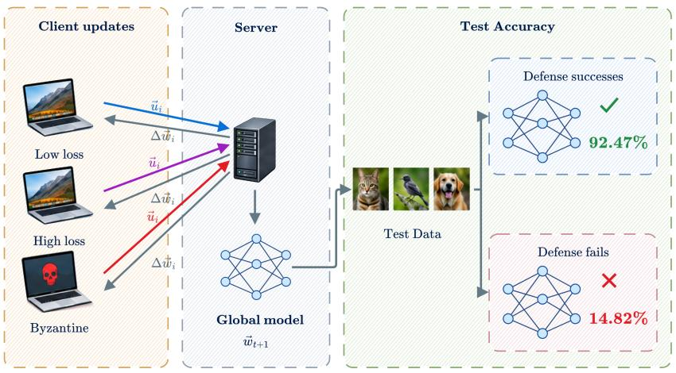  
Figure 1: Update-only Byzantine-robust q-fair federated learning. Honest clients submit lossscaled updates $u _ { i } = F _ { i } ^ { q } \Delta _ { i }$ , Byzantine clients may submit arbitrary vectors, and the server aggregates them into $w _ { t + 1 }$ with the help of a small trusted labeled dataset. Because q-fair learning legitimately enlarges the updates of high-loss honest clients, update magnitude alone cannot distinguish fairnessinduced amplification from malicious scaling.

## 2 PROBLEM OF ROBUST q-FAIR FEDERATED LEARNING

We consider a synchronous federated learning system comprising m clients and a global model $w _ { t } \in \mathbb { R } ^ { d }$ . Each client i holds a local dataset $\mathcal { D } _ { i }$ and has empirical loss

$$
F _ { i } ( w ) = \frac { 1 } { | \mathscr { D } _ { i } | } \sum _ { \xi \in \mathscr { D } _ { i } } \ell ( w ; \xi ) .
$$

In this context, the goal of q-fair learning is to optimize one shared model while assigning greater relative influence to high-loss clients. Specifically, we seek a model minimizing

$$
\mathcal { I } _ { q } ( w ) = \frac { 1 } { m } \sum _ { i = 1 } ^ { m } \frac { F _ { i } ( w ) ^ { q + 1 } } { q + 1 } , \qquad q \ge 0 .
$$

Update-only q-fair FL. A typical realization of this objective weights each client descent direction by $F _ { i } ( w _ { t } ) ^ { q }$ . Specifically, at round $t ,$ an honest client computes a one-step update and transmits only the resulting weighted message:

$$
\Delta _ { i } ^ { t } = - \eta \nabla F _ { i } ( w _ { t } ) , \qquad u _ { i } ^ { t } = F _ { i } ( w _ { t } ) ^ { q } \Delta _ { i } ^ { t } .\tag{1}
$$

The server therefore observes the product $u _ { i } ^ { t } ,$ , but not its loss and update factors separately. We refer to this setting as the update-only interface, and omit t when unambiguous.

Robust q-fair federated learning. We are interested in solving robust $q \mathrm { . }$ fair federated learning, wherein a fraction of client updates may be corrupted prior to aggregation. Specifically, Byzantine clients may coordinate and submit arbitrary vectors. Our goal is to design an aggregation rule that remains effective despite such corruptions while preserving the intended emphasis on high-loss clients.

Assumption 1 (Byzantine and observation model). At each round, $S _ { t } = \mathcal { H } _ { t } \cup B _ { t }$ and $| B _ { t } | \leq f _ { t } <$ $| S _ { t } | / 2 .$ . Byzantine clients may coordinate and submit arbitrary vectors; the algorithm receives a declared rejection budget $f _ { t }$ . The serverfixes a coordinate subsetfor screening. Screening uses only each submission restricted to these coordinates, the trusted reference, and quantities derivedfrom them; it has no side information revealing client Byzantine status. Retained clients contribute their original full-model submissions to aggregation.

## 3 FROM SIMPLEX TO CONE

Standard structure-aware aggregation under label skew models honest updates as class mixtures. We show that $q \mathrm { - }$ fair weighting preserves this mixture structure but removes its unit-sum constraint, changing the appropriate observation model from a simplex to a cone.

## 3.1 FAIRNESS SCALING BREAKS THE SIMPLEX

Magnitude ambiguity. For $F _ { i } > 0 , q > 0$ , and any $\lambda > 0$

$$
( \lambda F _ { i } ) ^ { q } ( \lambda ^ { - q } \Delta _ { i } ) = F _ { i } ^ { q } \Delta _ { i } .
$$

The update-only message does not separately identify fairness scale and descent magnitude. Magnitude alone therefore cannot distinguish legitimate q-fair amplification from adversarial scaling.

Assumption 2 (Shared class-conditional label skew). For every honest client $i ,$

$$
P _ { i } = \sum _ { c = 1 } ^ { C } p _ { i c } Q _ { c } , \qquad p _ { i } \succeq 0 , \qquad { \bf 1 } ^ { \top } p _ { i } = 1 ,
$$

where $Q _ { c }$ is the class-c conditional distribution shared by honest clients. At the broadcast model, the population class losses satisfy $0 < \ell _ { \mathrm { m i n } } \le \ell _ { c } \le \ell _ { \mathrm { m a x } } < \infty$

Here $p _ { i }$ contains client $i \ ' _ { \mathbf { S } }$ label proportions. The guarantees do not cover arbitrary violations of shared class-conditionals; covariate shifts are evaluated empirically in Appendix E.13.

Let $\ell = ( \ell _ { 1 } , \ldots , \ell _ { C } ) ^ { \intercal }$ and $G ^ { \star } ~ = ~ [ g _ { 1 } ^ { \star } , \ldots , g _ { C } ^ { \star } ]$ contain the population class losses and classconditioned updates, respectively. Under Assumption 2, linearity of expectation gives

$$
\begin{array} { r l } & { \overline { { F } } _ { i } = \ell ^ { \top } p _ { i } , \qquad \overline { { \Delta } } _ { i } = G ^ { \star } p _ { i } , } \\ & { \overline { { u } } _ { i } = ( \ell ^ { \top } p _ { i } ) ^ { q } G ^ { \star } p _ { i } = G ^ { \star } a _ { i } ^ { \star } , \qquad a _ { i } ^ { \star } : = ( \ell ^ { \top } p _ { i } ) ^ { q } p _ { i } \succeq 0 , \qquad \| a _ { i } ^ { \star } \| _ { 1 } = ( \ell ^ { \top } p _ { i } ) ^ { q } . } \end{array}\tag{2}
$$

Key consequence. Without fairness scaling, class-mixture coefficients satisfy $\mathbf { 1 } ^ { \top } p _ { i } = 1$ and lie on a simplex. Fairness scaling preserves coefficient nonnegativity but changes their mass to $F _ { i } ^ { q }$ . Thus the honest observation model is no longer a unit-sum simplex but a radially varying nonnegative cone.

## 4 FUSE ROBUST AGGREGATOR

In this section, we construct a robust aggregator from the cone structure identified above. To alleviate the ambiguity between legitimate scale and malicious deviation, FUSE combines trusted class references, coefficient recovery, two-stage screening, and post-screening step-size control, as illustrated in Figure 2.

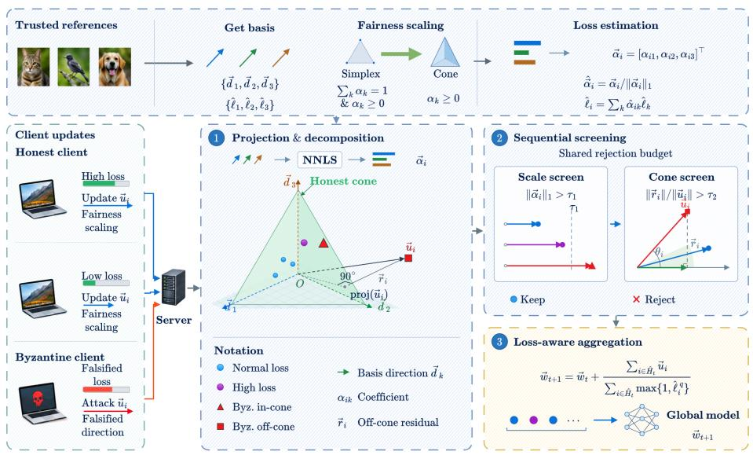  
Figure 2: FUSE overview. Each fair update is decomposed over trusted class-conditioned directions by nonnegative least squares. The recovered mass $\bar { L _ { i } } = \| \widehat { a _ { i } } \| _ { 1 }$ tests for anomalous radial scaling; the normalized cone residual $D _ { i } ^ { \mathrm { c o n e } }$ detects updates inconsistent with any nonnegative class mixture. FUSE removes scale outliers first, spends the remaining budget on the largest cone residuals, and reconstructs the client loss from the normalized coefficients for post-screening step-size control.

Trusted class reference. The server uses a small labeled set to construct class-conditioned reference directions $G = [ g _ { 1 } , \dotsc , g _ { C } ]$ and trusted class losses ℓbin the screening coordinates:

$$
\begin{array} { r l } & { \widehat { \ell _ { c } } = \displaystyle \frac { 1 } { | { \mathcal D } _ { s } ^ { c } | } \sum _ { \xi \in { \mathcal D } _ { s } ^ { c } } \ell ( w _ { t } ; \xi ) , } \\ & { g _ { c } = \displaystyle \left[ - \eta \nabla _ { w } \frac { 1 } { | { \mathcal D } _ { s } ^ { c } | } \sum _ { \xi \in { \mathcal D } _ { s } ^ { c } } \ell ( w _ { t } ; \xi ) \right] _ { \mathrm { s c r } } , } \\ & { G = [ g _ { 1 } , \ldots , g _ { C } ] , \qquad \widehat { \ell } = ( \widehat { \ell } _ { 1 } , \ldots , \widehat { \ell } _ { C } ) ^ { \top } . } \end{array}\tag{3}
$$

Define the trusted cone $\mathcal { C } _ { G } : = \{ G a : a \succeq 0 \}$

Coefficient recovery and screening scores. Since honest submissions are approximately nonnegative combinations of the trusted directions, FUSE recovers their latent coefficients by nonnegative least squares. Specifically, for each submission it solves

$$
\widehat { a } _ { i } \in \arg \operatorname* { m i n } _ { a \succeq 0 } \| v _ { i } - G a \| _ { 2 } ^ { 2 } , \qquad L _ { i } = \| \widehat { a } _ { i } \| _ { 1 } , \qquad D _ { i } ^ { \mathrm { c o n e } } = \frac { \| v _ { i } - G \widehat { a } _ { i } \| _ { 2 } ^ { 2 } } { \operatorname* { m a x } \{ \| v _ { i } \| _ { 2 } ^ { 2 } , \epsilon \} } .\tag{4}
$$

Algorithm 1 FUSE at round t   
Require: submissions $\{ u _ { i } \} _ { i \in { \cal S } _ { t } }$ , trusted class data $\{ \mathcal { D } _ { s } ^ { c } \} _ { c = 1 } ^ { C }$ , budget $f , q , \kappa , \epsilon$   
1: Construct $( G , { \widehat { \ell } } )$ using Eq. (3)   
2: for each $i \in S _ { t }$ do   
3: Recover $\widehat { a } _ { i }$ by NNLS in Eq. (4)   
4: Compute $L _ { i }$ and $D _ { i } ^ { \mathrm { c o n e } }$ using Eq. (4)   
5: end for   
6: Reject scale anomalies using $L _ { i } > \kappa L _ { \mathrm { m e d } }$   
7: Use the remaining budget to reject the largest cone scores   
8: For each retained client, compute $\widehat { p } _ { i }$ and $\widetilde { F } _ { i }$ using Eq. (5)   
9: Update $w _ { t + 1 }$ using Eq. (5)   
Ensure: $w _ { t + 1 }$

$L _ { i }$ measures radial scale, while $D _ { i } ^ { \mathrm { c o n e } }$ measures structural incompatibility with the trusted nonnegative cone. Stage I removes up to $f$ submissions with implausibly large coefficient mass $L _ { i } > \kappa L _ { \mathrm { m e d } } ;$ Stage II spends the remaining rejection budget on the largest cone residuals, yielding the retained set $\widehat { \mathcal { H } } _ { t } .$

Trusted loss reconstruction and aggregation. Finally, normalized coefficients estimate class composition and hence the client loss:

$$
\widehat { p } _ { i } = \frac { \widehat { a } _ { i } } { \operatorname* { m a x } \{ L _ { i } , \epsilon \} } , \qquad \widetilde { F } _ { i } = \widehat { \ell } ^ { \top } \widehat { p } _ { i } , \qquad w _ { t + 1 } = w _ { t } + \frac { \sum _ { i \in \widehat { \mathcal { H } } _ { t } } u _ { i } } { \sum _ { i \in \widehat { \mathcal { H } } _ { t } } \operatorname* { m a x } \{ 1 , \widetilde { F } _ { i } ^ { q } \} } .\tag{5}
$$

In the ideal model, $\widehat { p } _ { i } = p _ { i }$ and $\widetilde { F } _ { i } = \ell ^ { \top } p _ { i }$ . The denominator only rescales the retained mean and therefore does not change its direction. Additional implementation details are provided in Appendix B.3.

## 5 EXPERIMENTS

This section summarizes the key results of our experiments. In all that follows, $q = 1$ and the declared rejection budget is $f = 4$ . We evaluate FUSE against fair, robust, and structure-aware baselines in Section 5.2, and audit whether its robustness preserves the high-loss clients that q-FFL emphasizes in Section 5.3. We isolate the geometric mechanism and conduct a component ablation in Section 6; further results are reported in the appendix.

## 5.1 EXPERIMENTAL SETUP

Datasets and models. We evaluate CIFAR-10/ResNet-18 (Krizhevsky, 2009; He et al., 2016), MNIST/MLP (LeCun et al., 1998), EMNIST-Balanced/CNN (Cohen et al., 2017), and AG-News/GRU (Zhang et al., 2015; Cho et al., 2014). Data are partitioned by Dirichlet label skew with $\alpha = 1$ , and each round samples 10 of 100 honest clients. FUSE uses 20 trusted labeled examples per class. Screening uses the classifier block on the three vision benchmarks and all model parameters on AGNews; retained clients always contribute their original full-model submissions.

Threat model and baselines. We consider Sign Flip, IPM, Gaussian, ALIE, Min-Max, Min-Sum, and Magnitude Scaling (Xie et al., 2020; Baruch et al., 2019; Shejwalkar & Houmansadr, 2021). Four Byzantine Sybils are appended in attacked rounds. We compare with q-FFL (Li et al., 2020), H-nobs (Zhou et al., 2023), Trimmed Mean (Yin et al., 2018), Krum (Blanchard et al., 2017), FLTrust (Cao et al., 2021), BOBA (Bao et al., 2024), and FedAA (He et al., 2025) under the same fairness-scaled message whenever applicable.

Evaluation. We conduct each experiment with five registered seeds (40–44), and report global and worst-10% client accuracy (W10) averaged over the final ten rounds. Our primary statistic is the seed-wise minimum across the seven attacks, i.e.the accuracy an adversary can force by picking the best attack for that seed. Runs triggering the registered collapse criterion are not replaced by pre-collapse maxima, and the number of completed seeds is reported as (k). We include additional details in Appendix B.

Table 1: Robustness across datasets and attacks. Mean global accuracy (%) over the seeds reaching the registered endpoint; (k) denotes k completed seeds. The last column is the seed-wise worst attack over the seven attacks, reported as global (G) / worst-10% client (W10) accuracy. Per-attack W10 results and across-seed standard deviations are in Appendix C.1.
<table><tr><td>Dataset/model</td><td>Method</td><td>Clean</td><td>Sign</td><td>IPM</td><td>Gauss.</td><td>ALIE</td><td>Min-Max</td><td>Min-Sum</td><td>Mag.</td><td>Worst attack (G / W10)</td></tr><tr><td rowspan="7">CIFAR-10</td><td>q-FFL</td><td>76.96</td><td>76.47</td><td></td><td>13.81(3)</td><td>63.43</td><td>14.76(4)</td><td>14.05</td><td>43.45(4)</td><td></td></tr><tr><td>H-nobs</td><td>76.96</td><td>12.19(3)</td><td>57.13</td><td>79.28</td><td>35.65</td><td>42.86</td><td>20.15</td><td>76.96</td><td>12.19/0.35(3)</td></tr><tr><td>Trim.</td><td>70.56</td><td>59.66</td><td>44.84</td><td>79.45</td><td>39.27</td><td>13.37</td><td>14.06</td><td>74.35</td><td>13.18 /1.28</td></tr><tr><td>Krum</td><td>63.66</td><td>44.69</td><td>62.78</td><td>60.21</td><td>22.24</td><td>61.58</td><td>45.62</td><td>63.56</td><td>21.67 /9.78</td></tr><tr><td>FLTrust</td><td>81.31</td><td>81.29</td><td>81.31</td><td>81.25</td><td>55.13</td><td>48.84</td><td>43.81</td><td>79.44</td><td>43.81 / 30.53</td></tr><tr><td>BOBA (cls.)</td><td>81.93</td><td>72.68</td><td>10.93</td><td>81.58</td><td>72.00</td><td>17.31</td><td>17.83</td><td>73.64</td><td>10.93 / 0.66</td></tr><tr><td>FedAA</td><td>75.07</td><td>45.32</td><td>74.07(4)</td><td>72.60</td><td>61.44</td><td>22.54</td><td>43.07</td><td>66.07</td><td>22.15 / 10.27(4)</td></tr><tr><td rowspan="7"></td><td>FUSE</td><td>82.25</td><td>79.29</td><td>80.59</td><td>82.30</td><td>77.74</td><td>82.17</td><td>82.19</td><td>81.12</td><td>73.88 / 63.58</td></tr><tr><td>q-FFL</td><td>94.90</td><td>93.24</td><td></td><td>62.99(3)</td><td>94.29</td><td>48.54(3)</td><td>56.03(3)</td><td>68.76(3)</td><td></td></tr><tr><td>H-nobs</td><td>94.90</td><td>14.82(3)</td><td>91.09</td><td>94.90</td><td>93.45</td><td>94.80</td><td>65.54(3)</td><td>94.90</td><td>14.82 / 1.91(3)</td></tr><tr><td>Trim.</td><td>94.90</td><td>85.77</td><td>87.30(4)</td><td>94.84</td><td>65.65(3)</td><td>48.61(3)</td><td>48.74(3)</td><td>95.33</td><td>48.24 / 37.25(3)</td></tr><tr><td>Krum</td><td>93.99</td><td>90.45</td><td>93.42</td><td>93.99</td><td>63.99(3)</td><td>94.00</td><td>93.76</td><td>93.99</td><td>63.99 / 56.14(3)</td></tr><tr><td>FLTrust</td><td>94.96</td><td>93.30</td><td>93.34</td><td>94.98</td><td>93.10</td><td>89.97</td><td>91.77</td><td>95.07</td><td>88.52 / 79.64</td></tr><tr><td>BOBA (cls.) FedAA</td><td>96.41 96.42</td><td>94.45 51.53</td><td>11.23 85.86</td><td>96.41</td><td>95.70</td><td>80.55</td><td>82.26</td><td>96.60</td><td>11.23 / 0.16 43.00 / 31.26</td></tr><tr><td rowspan="7">EMNIST-Bal.</td><td>FUSE</td><td>93.83</td><td>93.15</td><td>92.42</td><td>96.29 93.83</td><td>96.30 93.81</td><td>74.04 93.84</td><td>60.57 93.84</td><td>96.22 93.83</td><td>92.42/ 87.07</td></tr><tr><td>q-FFL</td><td>63.79</td><td>74.93</td><td></td><td>2.13(1)</td><td>53.66(3)</td><td>44.08(3)</td><td>27.01(3)</td><td>65.81</td><td></td></tr><tr><td>H-nobs</td><td>63.79</td><td>28.70(2)</td><td>78.66</td><td></td><td>78.55(3)</td><td>52.75(3)</td><td>50.65(3)</td><td></td><td>28.70 / 21.64(2)</td></tr><tr><td>Trim.</td><td>80.30</td><td></td><td>54.93(4)</td><td>63.79</td><td>66.82(4)</td><td>25.45(3)</td><td></td><td>63.79</td><td></td></tr><tr><td></td><td></td><td>63.17</td><td></td><td>63.28</td><td></td><td></td><td>34.35(3)</td><td>64.13</td><td>37.11 /26.83(2)</td></tr><tr><td>Krum FLTrust</td><td>78.49</td><td>7.35(2)</td><td>78.64</td><td>78.49</td><td>71.34(3)</td><td>47.92(3)</td><td>4.12(3)</td><td>78.49</td><td>5.12 / 0.97(2)</td></tr><tr><td>BOBA (cls.)</td><td>71.34 80.34</td><td>71.02 73.19</td><td>71.46</td><td>72.17 80.45</td><td>75.48 78.91</td><td>63.45 72.64</td><td>63.88 75.60</td><td>68.45 79.59</td><td>61.21 / 50.22</td></tr><tr><td rowspan="7"></td><td>FedAA</td><td>78.15</td><td>47.32(4)</td><td>71.70(2)</td><td>78.26</td><td>71.43</td><td>75.34</td><td>60.20</td><td>78.39</td><td>30.43 / 23.53(2)</td></tr><tr><td>FUSE</td><td>79.12</td><td>79.51</td><td>79.41</td><td>79.67</td><td>79.61</td><td>78.89</td><td>79.11</td><td>79.12</td><td>78.31/ 70.00</td></tr><tr><td>q-FFL</td><td>81.52</td><td>64.00</td><td></td><td>27.06(4)</td><td>73.23</td><td>40.49</td><td>45.40(4)</td><td>76.35</td><td></td></tr><tr><td>H-nobs</td><td>81.52</td><td>26.69(3)</td><td>81.62</td><td></td><td>77.53</td><td>72.91</td><td>73.71</td><td>81.52</td><td>26.69 / 0.56(3)</td></tr><tr><td>Trim.</td><td>81.57</td><td>36.61</td><td>35.88</td><td>81.52 79.67</td><td>74.76</td><td>38.63</td><td>39.37</td><td>79.89</td><td>30.85 /5.71</td></tr><tr><td>Krum</td><td>72.69</td><td>77.17</td><td>76.62</td><td>72.69</td><td>72.18</td><td>77.42</td><td>74.77</td><td>72.69</td><td>64.43 / 48.20</td></tr><tr><td>FLTrust</td><td>83.92</td><td>83.92</td><td>83.92</td><td>83.98</td><td>77.19</td><td>66.82</td><td>64.26</td><td>83.03</td><td>64.26 / 45.46</td></tr><tr><td rowspan="4">GRU</td><td>BOBA (cls.)</td><td>83.82</td><td>60.57</td><td>27.65</td><td>83.82</td><td>80.82</td><td>56.44</td><td>59.43</td><td>83.53</td><td>27.65 / 1.65</td></tr><tr><td>FedAA</td><td>78.36</td><td>38.32</td><td>57.68(2)</td><td>77.83</td><td>75.29</td><td>41.18</td><td>40.34</td><td>79.67</td><td>31.29 / 4.44(2)</td></tr><tr><td>FUSE</td><td></td><td>80.46(4)</td><td></td><td></td><td></td><td></td><td></td><td></td><td>77.84 / 63.75(4)</td></tr><tr><td></td><td>82.29</td><td></td><td>81.12</td><td>82.17</td><td>78.62</td><td>81.44</td><td>81.36</td><td>82.29</td><td></td></tr></table>

## 5.2 ROBUSTNESS UNDER BYZANTINE ATTACKS

In Table 1, we observe that FUSE consistently attains the highest seed-wise worst-attack global and W10 accuracy on all four benchmarks, improving worst-attack global accuracy over the best baseline by 30.1, 3.9, 17.1, and 13.4 percentage points on CIFAR-10, MNIST, EMNIST-Balanced, and AGNews respectively. Beyond worst-case performance, it attains the highest accuracy in 13 of the 28 dataset–attack pairs; across the remaining 15 its largest deficit to the best method is 3.5 percentage points, under Sign Flip on AGNews. Relative to FLTrust, the strongest baseline overall, the paired global difference is positive on all five seeds of each vision benchmark, with bootstrap 95% intervals [20.2, 37.8], [1.6, 6.3] and [12.3, 21.9]. The advantage is particularly pronounced against the invalid-mixture attacks: on CIFAR-10 the baselines drop to 13–62% under Min-Max and Min-Sum while FUSE stays above 82%. The worst-attack column makes the general pattern visible: every baseline has at least one attack for which its accuracy floor falls well below its own clean performance. This robustness does not uniformly improve clean utility: FUSE trails the best clean baseline by 2.6, 1.2, and 1.6 percentage points on MNIST, EMNIST-Balanced, and AGNews, and leads it by 0.3 on CIFAR-10. We regard this as the price of a substantially higher adversarial floor.

## 5.3 PRESERVING HIGH-LOSS HONEST CLIENTS

A robust aggregator should not obtain its robustness by discarding the high-loss honest clients that q-FFL is designed to emphasize, nor buy a clean fairness record by screening nothing at all. We therefore audit both sides of the screening decision under matched seeds, attacks, rejection budget f = 4, evaluation grid and round window. We focus on the two closest routes: H-nobs, which filters fair updates by norm, and BOBA, which fits a unit-sum class-mixture model on classifier coordinates.

In Table 2, we observe that the two baselines fail on opposite sides. Norm screening pays a steep fairness price: H-nobs rejects 22.2 − 35.7% of the highest-loss honest submissions, and up to 91.7% of them under its worst attack, in exchange for a 61.1 − 68.6% Byzantine rejection rate. BOBA barely touches the fair tail (0.0 − 5.6%), but only because it rejects almost nothing: it removes

Table 2: Whom each screen actually rejects, five seeds. Left: the fraction (%) of the highest-loss 20% of honest submissions rejected, which fairness wants low. Right: the fraction (%) of Byzantine submissions rejected, which robustness wants high. Both pool the first 300 rounds and the seven attacks within a seed, reported as mean±std over seeds $4 0 { \bar { - } } 4 4 ;$ “worst” is the attack at which that column is worst in each seed. Best in bold, runner-up underlined.
<table><tr><td rowspan="2"></td><td rowspan="2">Method</td><td colspan="2">High-loss honest rejected ↓</td><td colspan="2">Byzantine rejected ↑</td></tr><tr><td>Pooled</td><td>Worst</td><td>Pooled</td><td>Worst</td></tr><tr><td>CIFAR-10/ResNet-18</td><td>H-nobs</td><td> $3 4 . 9 5 { \scriptstyle \pm 1 . 6 2 }$ </td><td> $9 0 . 6 7 { \scriptstyle \pm 2 . 5 3 }$ </td><td> $\underline { { 6 3 . 3 1 } } _ { \pm 1 . 0 9 }$ </td><td> $\underline { { 0 . 0 0 } } _ { \pm 0 . 0 0 }$ </td></tr><tr><td></td><td>BOBA (cls.)</td><td> $\underline { { 0 . 3 3 } } _ { \pm 0 . 2 7 }$ </td><td> $\underline { { 1 . 6 7 } } _ { \pm 1 . 1 8 }$ </td><td> $2 7 . 1 2 _ { \pm 0 . 7 9 } ^ { - }$ </td><td> $\underline { { 0 . 0 0 } } _ { \pm 0 . 0 0 }$ </td></tr><tr><td></td><td>FUSE</td><td> $\mathbf { 0 . 1 9 _ { \pm 0 . 2 0 } }$ </td><td> $\mathbf { 1 . 0 0 _ { \pm 0 . 9 1 } }$ </td><td> $\mathbf { 9 8 . 7 1 _ { \pm 0 . 7 0 } }$ </td><td> $\pm 2 . 1 6$ </td></tr><tr><td>MNIST/MLP</td><td>H-nobs</td><td> $3 5 . 7 1 \pm 1 . 4 0$ </td><td> $9 1 . 6 7 { \scriptstyle \pm 3 . 3 3 }$ </td><td> $\underline { { 6 1 . 0 7 } } _ { \pm 1 . 4 3 }$ </td><td> $\underline { { 0 . 0 0 } } _ { \pm 0 . 0 0 }$ </td></tr><tr><td></td><td>BOBA (cls.)</td><td> $\underline { { 5 . 6 2 } } _ { \pm 0 . 8 7 }$ </td><td> $\underline { { 2 1 . 6 7 } } _ { \pm 2 . 0 4 }$ </td><td> $3 6 . 8 1 \pm 2 . 4 0$ </td><td> $\underline { { 0 . 0 0 } } _ { + 0 . 0 0 } ^ { - }$ </td></tr><tr><td></td><td>FUSE</td><td> $\mathbf { 1 . 6 7 _ { \pm 1 . 0 4 } }$ </td><td> ${ \bf 5 . 6 7 _ { \pm 2 . 5 3 } }$ </td><td> $\mathbf { 9 6 . 0 5 } _ { \pm 1 . 5 6 }$ </td><td> $\mathbf { 8 5 . 8 3 } _ { \pm 5 . 1 4 }$ </td></tr><tr><td>EMNIST-Balanced/CNN</td><td>H-nobs</td><td> $\underline { { 2 3 . 9 5 } } _ { \pm 1 . 0 6 }$ </td><td> $\underline { { 7 0 . 1 5 } } { \scriptstyle \pm 7 . 3 2 }$ </td><td> $\underline { { 6 6 . 1 3 } } _ { \pm 0 . 1 2 }$ </td><td> $\underline { { 0 . 0 0 } } _ { \pm 0 . 0 0 }$ </td></tr><tr><td></td><td>BOBA (cls.)</td><td> $\mathbf { 0 . 0 0 } _ { \pm 0 . 0 0 } ^ { - }$ </td><td> $\mathbf { 0 . 0 0 } _ { \pm 0 . 0 0 } ^ { - }$ </td><td> $1 4 . 3 1 { \scriptstyle \pm 0 . 0 4 }$ </td><td> $\underline { { 0 . 0 0 } } _ { \pm 0 . 0 0 }$ </td></tr><tr><td></td><td>FUSE</td><td> $\mathbf { 0 . 0 0 _ { \pm 0 . 0 0 } }$ </td><td> $\mathbf { 0 . 0 0 _ { \pm 0 . 0 0 } }$ </td><td> $\mathbf { 9 9 . 8 1 _ { \pm 0 . 2 5 } }$ </td><td> $\mathbf { 9 8 . 6 \bar { 7 } _ { \pm 1 . 7 3 } }$ </td></tr><tr><td>AGNews/GRU</td><td>H-nobs</td><td> $2 2 . 1 9 { \scriptstyle \pm 3 . 5 8 }$ </td><td> $8 0 . 0 0 { \scriptstyle \pm 1 1 . 7 9 }$ </td><td> $\underline { { 6 8 . 6 2 } } _ { \pm 0 . 5 6 }$ </td><td> $0 . 0 0 { \scriptstyle \pm 0 . 0 0 }$ </td></tr><tr><td></td><td>BOBA (cls.)</td><td> $\mathbf { 0 . 0 0 _ { \pm 0 . 0 0 } }$ </td><td> $\mathbf { 0 . 0 0 _ { \pm 0 . 0 0 } }$ </td><td> $2 9 . 7 1 { \scriptstyle \pm 0 . 6 4 }$ </td><td> $0 . 0 0 { \scriptstyle \pm 0 . 0 0 }$ </td></tr><tr><td></td><td>FUSE</td><td> $\underline { { 9 . 7 1 } } _ { \pm 1 . 4 2 }$ </td><td> $\underline { { 6 8 . 0 0 } } _ { \pm 9 . 9 6 }$ </td><td> $\mathbf { 8 5 . 7 1 _ { \pm 0 . 0 0 } }$ </td><td> $0 . 0 0 { \overline { { \pm } } } 0 . 0 0 \ \^ \cdot$ </td></tr></table>

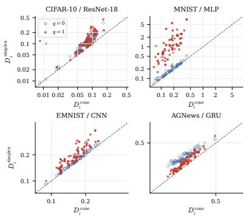

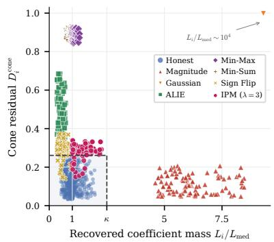  
(a) Controlled simplex–cone mismatch.  
(b) Scale and cone statistics in training.  
Figure 3: Fairness-warped geometry in practice. (a) Fairness scaling moves the simplex residual off the diagonal while leaving the cone residual nearly unchanged; hollow and filled points are $q = 0$ and $q = 1 . ( \mathsf { b } )$ On MNIST (seed 42, $q = 1 )$ , radial and structural attacks occupy different regions of the $( L _ { i } , D _ { i } ^ { \mathrm { c o n e } } )$ plane, which is what motivates screening the two in sequence rather than with one test (Appendices E.2 and E.3).

14.3 − 36.8% of the Byzantine submissions, and nothing at all under Sign Flip and ALIE. FUSE is the only method that is conservative on both counts, rejecting $0 . 0 - 9 . 7 \%$ of the high-loss honest submissions while removing $8 5 . 7 - 9 9 . 8 \%$ of the Byzantine ones. Its robustness therefore does not arise from suppressing the q-fair tail. The one exception is ALIE on AGNews, which FUSE does not separate within this window and which produces the 0.00 worst-case entry; it is also the mildest attack in the suite, costing 3.7 percentage points of accuracy in Table 1. The complete per-attack audit is in Appendix E.

## 6 WHY DOES CONE GEOMETRY MATTER?

The results above establish robustness, but do not show that the gain comes from the fairness-warped cone geometry rather than from some other ingredient of the aggregator. We therefore ask whether q-fair scaling breaks the simplex model in practice, whether the mismatch changes behavior in an otherwise identical pipeline, which components are responsible, and how the method behaves as its operating parameters vary.

actual Byzantine count (declared f= 4  
Table 3: Component ablation of FUSE. CIFAR-10/ResNet-18, seed 42, 1000 rounds. Attack columns give global accuracy (%) over the final ten rounds; the worst-attack column gives global / worst-10% client accuracy and is the componentwise minimum over the seven attacks. Clean uses $f = 0 ; { } ^ { \cdots } { } ^ { \cdots }$ marks a run with no terminal window.
<table><tr><td>Variant</td><td>Scale</td><td>Cone</td><td>Loss norm.</td><td>Clean</td><td>Magnitude</td><td>Sign</td><td> $\mathrm { I P M } _ { \lambda = 3 }$ </td><td>Gauss.</td><td>ALIE</td><td>Min-Max</td><td>Min-Sum</td><td>Worst attack</td></tr><tr><td>FUSE</td><td>√</td><td>√</td><td>√</td><td>79.03</td><td>78.97</td><td>77.50</td><td>77.83</td><td>78.82</td><td>78.50</td><td>79.28</td><td>78.71</td><td>77.50/68.37</td></tr><tr><td>w/o scale</td><td></td><td>√</td><td>√</td><td>79.03</td><td>52.38</td><td>78.20</td><td>76.08</td><td>78.82</td><td>78.97</td><td>79.00</td><td>79.03</td><td>52.38/40.25</td></tr><tr><td>w/o cone</td><td>√</td><td></td><td>√</td><td>79.03</td><td>78.67</td><td>69.95</td><td></td><td>78.82</td><td>55.16</td><td>36.71</td><td>38.94</td><td></td></tr><tr><td>w/o scale and cone</td><td></td><td></td><td>√</td><td>79.03</td><td>63.23</td><td>70.16</td><td></td><td>26.11</td><td>63.20</td><td>34.07</td><td>35.66</td><td></td></tr><tr><td>w/o loss norm.</td><td></td><td></td><td></td><td>78.04</td><td>70.06</td><td>73.33</td><td>74.01</td><td>77.89</td><td>76.98</td><td>76.04</td><td>76.02</td><td>70.06/59.88</td></tr><tr><td>cone only</td><td></td><td>√</td><td></td><td>78.04</td><td>10.89</td><td>71.59</td><td>75.30</td><td>77.65</td><td>76.87</td><td>78.04</td><td>78.04</td><td>10.89/0.05</td></tr><tr><td>scale only</td><td>L</td><td></td><td></td><td>78.04</td><td>73.14</td><td>71.66</td><td></td><td>77.74</td><td>46.45</td><td>13.87</td><td></td><td></td></tr><tr><td>no component</td><td></td><td></td><td></td><td>78.04</td><td>16.91</td><td>72.56</td><td></td><td></td><td>48.22</td><td>15.41</td><td>15.04</td><td></td></tr></table>

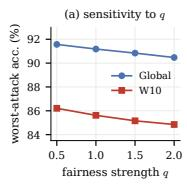

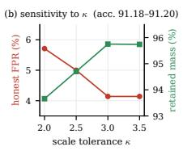

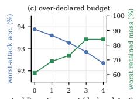  
Figure 4: Sensitivity and budget misspecification on MNIST/MLP, seed 42. (a) Worst-attack accuracy over q. (b) Larger κ lowers honest FPR and raises retained fair mass, with accuracy within 91.18–91.20%. (c) When the declared budget stays at $f = 4$ while the true number of Byzantine submissions falls from 4 to 0, robustness is stable, but the surplus rejection budget is spent on honest clients: the worst retained fair mass drops from 84% to 61%. Over-declaring f therefore costs fairness rather than accuracy (Appendix E).

## 6.1 FAIRNESS SCALING BREAKS THE SIMPLEX IN PRACTICE

Holding the checkpoint, honest submissions, and trusted basis fixed and varying only the coefficient constraint, the median cone/simplex residual on MNIST is 0.178/0.185 at $q = 0$ but 0.178/1.077 after $q = 1$ scaling: radial scaling preserves the cone, whereas the unit-sum simplex becomes mismatched (Figure 3(a)). The recovered coefficient mass tracks the fairness scale (Pearson $r = 0 . 9 4 0$ between $L _ { i }$ and $F _ { i } ^ { q } )$ , and normalized coefficients reconstruct client losses with $r = 0 . 9 2 3$ and MAE 0.053.

## 6.2 MATCHED TRAINING CONSEQUENCE OF THE SIMPLEX MISMATCH

To isolate the geometry, we replace only FUSE’s Stage-II cone score by a unit-sum simplex score on MNIST. Both scores saturate on Gaussian and Magnitude Scaling, so the geometry is visible only where the structural test does the work. There the cone dominates: under IPM, Min-Max, and Min-Sum it lifts Byzantine recall from 0.45/0.56/0.62 to 0.69/1.00/1.00 and cuts the honest falsepositive rate from 0.219/0.175/0.153 to 0.124/0.001/0.000, worth 2.44, 1.03, and 1.13 percentage points. Sign Flip is an informative counterexample, where the simplex score is the better detector (0.92 against 0.58). The cone is not universally superior; it is the representation matched to fairness-scaled honest mixtures (Appendix E.3).

## 6.3 WHICH COMPONENTS MATTER?

The full $2 ^ { 3 }$ ablation assigns each component the role our geometry predicts. Removing the scale screen exposes FUSE to Magnitude Scaling (worst attack 77.50 to 52.38) while leaving the other attacks intact, confirming it is the radial test. Removing the cone screen instead eliminates the IPM terminal window and breaks the invalid-mixture attacks (ALIE 78.50 to 55.16, Min-Max 79.28 to 36.71, Min-Sum 78.71 to 38.94); removing both also breaks Gaussian (26.11). The screens are thus complementary, while loss normalization is an optimization component, raising the floor from 70.06 to 77.50 (Appendix E.1).

## 6.4 SENSITIVITY TO q, κ, AND THE BYZANTINE BUDGET

Worst-attack global/W10 accuracy varies smoothly from 91.57/86.21 to 90.47/84.85 across the tested $q ,$ so the method does not rely on a particular fairness strength. Increasing κ lowers the honest false-positive rate and raises the retained fair mass without materially changing accuracy, and over-declaring the budget costs fairness rather than accuracy (Appendix E). Neither statistic can certify maliciousness for a submission inside the trusted cone with a plausible recovered mass: the adaptive attack of Appendix E.14 reaches 65.6% on CIFAR-10 against 82.4% under clean training, an observable boundary of FUSE’s two screening statistics rather than a missing threshold.

## 7 THEORETICAL ANALYSIS

We now characterize when the fairness-warped geometry exploited by FUSE is reliably observable, and when it suffices to exactly recover the honest set, thereby matching the post-screening aggregate obtained with oracle knowledge of the honest identities. The analysis proceeds in two steps: stable recovery of the latent fair coefficients, then conditions under which the two screening stages recover the honest set exactly.

## 7.1 RECOVERABILITY OF THE FAIRNESS-WARPED GEOMETRY

The cone identity in Section 3 is a population-level description. In practice, both client updates and the trusted class basis are estimated from finite data. For an honest client, write its screening-coordinate submission as

$$
v _ { i } = G a _ { i } + e _ { i } , \qquad a _ { i } : = F _ { i } ^ { q } p _ { i } \succeq 0 , \qquad \| a _ { i } \| _ { 1 } = F _ { i } ^ { q } ,\tag{6}
$$

where $e _ { i }$ collects the finite-sample client and trusted-basis approximation errors. We are now ready to state the corresponding recovery guarantee.

Theorem 1 (Stable recovery of the fairness-warped representation). IfG hasfull column rank, the NNLS estimator in (4) satisfies $\begin{array} { r } { \| \widehat { \boldsymbol { a } } _ { i } - \boldsymbol { a } _ { i } \| _ { 2 } \leq \frac { 2 \| \boldsymbol { e } _ { i } \| _ { 2 } } { \sigma _ { \operatorname* { m i n } } ( G ) } , \qquad | \boldsymbol { L } _ { i } - \boldsymbol { F } _ { i } ^ { q } | \leq \frac { 2 \sqrt { C } \| \boldsymbol { e } _ { i } \| _ { 2 } } { \sigma _ { \operatorname* { m i n } } ( G ) } . } \end{array}$

Recovery is therefore controlled by the finite-sample representation error and the conditioning of the trusted basis: when honest submissions stay close to the trusted cone, $L _ { i } = \| \widehat { a } _ { i } \| _ { 1 }$ stably recovers the fairness scale $F _ { i } ^ { q }$ . The same argument yields stable composition and trusted-loss recovery; the full bounds and proof are in Appendix F, and the prediction matches the diagnostics in Figure 3.

## 7.2 ROBUSTNESS OF TWO-STAGE SCREENING

Stable recovery alone does not guarantee robust screening: a Byzantine submission must also be separated from the natural variation of honest submissions. Let $m _ { H } : = { \mathrm { m e d } } _ { h \in \mathcal { H } _ { i } }$ log $L _ { h } , \qquad r _ { H } : =$ maxh∈H |log $\begin{array} { r l r } { L _ { h } - m _ { H } | , \quad } & { { } \epsilon _ { H } ^ { \mathrm { c o n e } } } & { : = } & { { } \mathrm { m a x } _ { h \in { \mathcal H } _ { t } } D _ { h } ^ { \mathrm { c o n e } } } \end{array}$ , and, for a vector c, let $( c ) _ { - } \quad : = $ $\operatorname* { m a x } \{ - c , 0 \}$ denote its coordinate-wise negative part. Stage I measures radial separation, whereas Stage II measures structural separation from the trusted nonnegative cone.

Theorem 2 (Oracle recovery under geometric separation). Assume that G has full column rank, honest submissions form a strict majority, $f _ { t } = | \bar { B } _ { t } | .$ , and log $\kappa > 2 r _ { H }$ . Any Byzantine submission satisfying log $L _ { b } - m _ { H } > \log \kappa + r _ { H }$ is rejected by Stage I; in particular,for a positive radial copy $v _ { b } = \lambda v _ { h }$ this holds whenever log $\lambda >$ log $\kappa + 2 r _ { H }$ . For any Byzantine submission surviving Stage I, write $v _ { b } = G c _ { b } + r _ { b }$ with $r _ { b } \perp$ span(G). $\begin{array} { r } { I f \frac { \| r _ { b } \| _ { 2 } ^ { 2 } + \sigma _ { \operatorname* { m i n } } ^ { 2 } ( \check { G } ) \| ( \check { c } _ { b } ) _ { - } \| _ { 2 } ^ { 2 } } { \| v _ { b } \| _ { 2 } ^ { 2 } } > \epsilon _ { H } ^ { \mathrm { c o n e } } } \end{array}$ , then $v _ { b }$ ranks above every honest submission in Stage II. Consequently, if every Byzantine submission satisfies one of these two separation conditions, then $\widehat { \mathcal { H } } _ { t } = \mathcal { H } _ { t }$ , and Eq. (5) returns exactly the aggregate that would be obtained by running the same post-screening rule with oracle knowledge ofthe honest identities.

The theorem makes the roles of the two statistics explicit. Robustness is controlled by the honest radial spread $r _ { H }$ , the honest cone variation $\epsilon _ { H } ^ { \mathrm { c o n e } }$ , and the radial or structural deviation of the Byzantine submission. Stage I detects excessive radial scaling, while Stage II detects off-span energy or negative mixture mass beyond honest finite-sample variation. Their complementary behavior is observed empirically in Figure 3 and Appendix E.2. If neither separation condition holds, the theorem provides no certificate of maliciousness; the adaptive cone-preserving attack in Appendix E.14 probes this observable boundary.

## 8 CONCLUSION

We formalized Byzantine-robust q-fair federated learning under an update-only interface, and showed that fairness scaling relaxes the unit-sum simplex of honest class mixtures into a nonnegative cone with client-dependent radial mass. Building on this geometry, we proposed FUSE, which screens the recovered coefficient mass and the cone residual in sequence and rescales the retained mean by a reconstructed loss. Our experiments show that FUSE consistently improves worst-attack accuracy while preserving the high-loss honest clients, and our adaptive attack delimits the interface: only deviations the observable statistics separate can be resisted.

## REPRODUCIBILITY STATEMENT

All details needed to reproduce our experiments are given in Section 5 and Appendix B: registered seeds, data partitions, hyperparameters, attacks, and the reporting protocol. Component, boundary, and geometry diagnostics are in Appendix E.

## AI USE STATEMENT

Generative AI assisted execution, debugging, and language polishing. The authors developed the research and verified all assisted content and results.

## REFERENCES

Youssef Allouah, Rachid Guerraoui, Nirupam Gupta, Rafael Pinot, and Geovani Rizk. Robust¨ distributed learning: Tight error bounds and breakdown point under data heterogeneity. In Advances in Neural Information Processing Systems, volume 36, 2023.

Wenxuan Bao, Jun Wu, and Jingrui He. BOBA: Byzantine-robust federated learning with label skewness. In Proceedings of the 27th International Conference on Artificial Intelligence and Statistics, volume 238 of Proceedings ofMachine Learning Research, pp. 892–900. PMLR, 2024.

Gilad Baruch, Moran Baruch, and Yoav Goldberg. A little is enough: Circumventing defenses for distributed learning. In Advances in Neural Information Processing Systems, volume 32, 2019.

Alina Basharat, Yijun Bian, Ping Xu, and Zhi Tian. Towards trustworthy federated learning. arXiv preprint arXiv:2503.03684, 2025. doi: 10.48550/arXiv.2503.03684.

Peva Blanchard, El Mahdi El Mhamdi, Rachid Guerraoui, and Julien Stainer. Machine learning with adversaries: Byzantine tolerant gradient descent. In Advances in Neural Information Processing Systems, volume 30, 2017.

Xiaoyu Cao, Minghong Fang, Jia Liu, and Neil Zhenqiang Gong. FLTrust: Byzantine-robust federated learning via trust bootstrapping. In 28th Annual Network and Distributed System Security Symposium, 2021. doi: 10.14722/ndss.2021.24434.

Bhaskar Ray Chaudhury, Linyi Li, Mintong Kang, Bo Li, and Ruta Mehta. Fairness in federated learning via core-stability. In Advances in Neural Information Processing Systems, volume 35, 2022.

Yudong Chen, Lili Su, and Jiaming Xu. Distributed statistical machine learning in adversarial settings: Byzantine gradient descent. Proceedings of the ACM on Measurement and Analysis of Computing Systems, 1(2):44:1–44:25, 2017. doi: 10.1145/3154503.

Kyunghyun Cho, Bart van Merrienboer, Caglar Gulcehre, Dzmitry Bahdanau, Fethi Bougares, Holger¨ Schwenk, and Yoshua Bengio. Learning phrase representations using RNN encoder–decoder for statistical machine translation. In Conference on Empirical Methods in Natural Language Processing (EMNLP), pp. 1724–1734, 2014.

Gregory Cohen, Saeed Afshar, Jonathan Tapson, and Andre van Schaik. EMNIST: Extending ´ MNIST to handwritten letters. In International Joint Conference on Neural Networks (IJCNN), pp. 2921–2926, 2017.

El-Mahdi El-Mhamdi, Rachid Guerraoui, and Sebastien Rouault. The hidden vulnerability of´ distributed learning in byzantium. In Proceedings ofthe 35th International Conference on Machine Learning, volume 80 of Proceedings of Machine Learning Research, pp. 3521–3530. PMLR, 2018.

Jialuo He, Wei Chen, and Xiaojin Zhang. FedAA: A reinforcement learning perspective on adaptive aggregation for fair and robust federated learning. In Proceedings of the AAAI Conference on Artificial Intelligence, volume 39, pp. 17085–17093, 2025. doi: 10.1609/aaai.v39i16.33878.

Kaiming He, Xiangyu Zhang, Shaoqing Ren, and Jian Sun. Deep residual learning for image recognition. In IEEE Conference on Computer Vision and Pattern Recognition (CVPR), pp. 770–778, 2016.

Zeou Hu, Kiarash Shaloudegi, Guojun Zhang, and Yaoliang Yu. Federated learning meets multiobjective optimization. IEEE Transactions on Network Science and Engineering, 9(4):2039–2051, 2022. doi: 10.1109/TNSE.2022.3169117.

Sai Praneeth Reddy Karimireddy, Lie He, and Martin Jaggi. Byzantine-robust learning on heterogeneous datasets via bucketing. In International Conference on Learning Representations, 2022.

Alex Krizhevsky. Learning multiple layers of features from tiny images. Technical report, University of Toronto, 2009.

Yann LeCun, Leon Bottou, Yoshua Bengio, and Patrick Haffner. Gradient-based learning applied to´ document recognition. Proceedings ofthe IEEE, 86:2278–2324, 1998.

Liping Li, Wei Xu, Tianyi Chen, Georgios B. Giannakis, and Qing Ling. RSA: Byzantine-robust stochastic aggregation methods for distributed learning from heterogeneous datasets. In Proceedings of the AAAI Conference on Artificial Intelligence, volume 33, pp. 1544–1551, 2019. doi: 10.1609/aaai.v33i01.33011544.

Tian Li, Maziar Sanjabi, Ahmad Beirami, and Virginia Smith. Fair resource allocation in federated learning. In International Conference on Learning Representations, 2020.

Tian Li, Ahmad Beirami, Maziar Sanjabi, and Virginia Smith. Tilted empirical risk minimization. In International Conference on Learning Representations, 2021.

Xinpeng Ling, Jie Fu, Kuncan Wang, Huifa Li, Tong Cheng, and Zhili Chen. Fedfdp: Fairness-aware federated learning with differential privacy. In Applied Cryptography and Network Security, volume 16572 of Lecture Notes in Computer Science, pp. 129–159. Springer Nature Switzerland, 2026. doi: 10.1007/978-3-032-32575-4 6.

Yuchen Liu, Chen Chen, Lingjuan Lyu, Fangzhao Wu, Sai Wu, and Gang Chen. Byzantine-robust learning on heterogeneous data via gradient splitting. In Proceedings of the 40th International Conference on Machine Learning, volume 202 of Proceedings of Machine Learning Research, pp. 21404–21425. PMLR, 2023.

Mehryar Mohri, Gary Sivek, and Ananda Theertha Suresh. Agnostic federated learning. In Proceedings of the 36th International Conference on Machine Learning, volume 97 of Proceedings of Machine Learning Research, pp. 4615–4625. PMLR, 2019.

Zibin Pan, Chi Li, Fangchen Yu, Shuyi Wang, Haijin Wang, Xiaoying Tang, and Junhua Zhao. FedLF: Layer-wise fair federated learning. In Proceedings ofthe AAAI Conference on Artificial Intelligence, volume 38, pp. 14527–14535, 2024. doi: 10.1609/aaai.v38i13.29368.

Krishna Pillutla, Sham M. Kakade, and Zaid Harchaoui. Robust aggregation for federated learning. IEEE Transactions on Signal Processing, 70:1142–1154, 2022. doi: 10.1109/TSP.2022.3153135.

Virat Shejwalkar and Amir Houmansadr. Manipulating the byzantine: Optimizing model poisoning attacks and defenses for federated learning. In 28th Annual Network and Distributed System Security Symposium, 2021. doi: 10.14722/ndss.2021.24498.

Cong Xie, Oluwasanmi Koyejo, and Indranil Gupta. Fall of empires: Breaking byzantine-tolerant sgd by inner product manipulation. In Proceedings of the 35th Uncertainty in Artificial Intelligence Conference, volume 115 of Proceedings of Machine Learning Research, pp. 261–270. PMLR, 2020.

Dong Yin, Yudong Chen, Kannan Ramchandran, and Peter Bartlett. Byzantine-robust distributed learning: Towards optimal statistical rates. In Proceedings ofthe 35th International Conference on Machine Learning, volume 80 of Proceedings ofMachine Learning Research, pp. 5650–5659. PMLR, 2018.

Guojun Zhang, Saber Malekmohammadi, Xi Chen, and Yaoliang Yu. Proportional fairness in federated learning. Transactions on Machine Learning Research, 2023.

Xiang Zhang, Junbo Zhao, and Yann LeCun. Character-level convolutional networks for text classification. In Advances in Neural Information Processing Systems, 2015.

Guanqiang Zhou, Ping Xu, Yue Wang, and Zhi Tian. H-nobs: Achieving certified fairness and robustness in distributed learning on heterogeneous datasets. In Advances in Neural Information Processing Systems, volume 36, 2023.

Ligeng Zhu, Zhijian Liu, and Song Han. Deep leakage from gradients. In Advances in Neural Information Processing Systems, volume 32, pp. 14747–14756, 2019.

## A RELATED WORK

Client-level fairness. Client-level fairness has been pursued through q-FFL, agnostic and tilted objectives, multi-objective optimization, and proportional, coalitional, or gradient-conflict principles (Li et al., 2020; Mohri et al., 2019; Li et al., 2021; Hu et al., 2022; Zhang et al., 2023; Chaudhury et al., 2022; Pan et al., 2024). Yet, the Byzantine robustness of these schemes has received limited attention. An initial preliminary work was conducted by Zhou et al. (2023), who combine fairness-aware learning with a norm filter, as does Basharat et al. (2025). However, a norm filter reads exactly the quantity that fairness is designed to inflate, so it suppresses the high-loss clients it is meant to protect. Closest in intent, FedAA learns aggregation weights with a reinforcement agent driven by pairwise distances between client models (He et al., 2025); its weights are still a function of how far a submission sits from the others, so it too never models the $F _ { i } ^ { q } \bar { \Delta _ { i } }$ product that makes a high-loss honest client distant by construction. We instead treat that ambiguity as the object of study and exploit the class-mixture structure that survives fairness scaling.

Byzantine distributed learning. Byzantine robustness has become a central topic in distributed learning, where malicious clients may send arbitrary updates during training (Blanchard et al., 2017; Yin et al., 2018; Chen et al., 2017; Pillutla et al., 2022; El-Mhamdi et al., 2018; Cao et al., 2021; Shejwalkar & Houmansadr, 2021; Li et al., 2019; Karimireddy et al., 2022; Liu et al., 2023; Allouah et al., 2023). Robust aggregators in this line filter by distances, order statistics, trusted directions, spectral structure, regularization, bucketing, or gradient decomposition, all of which treat honest updates as concentrated around a common mean. Our setting differs in that every honest q-fair update undergoes a loss-dependent radial transformation before reaching the server, so honest submissions are deliberately dispersed in magnitude.

Structure-aware Byzantine aggregation. A parallel line of work exploits the structure of updates under label skew rather than their concentration. BOBA, our closest structural comparison, models unscaled updates with a unit-sum class-mixture simplex (Bao et al., 2024). These approaches, however, assume normalized honest coefficients, an assumption which does not hold here: fairness weighting preserves nonnegativity but scales the coefficients by $F _ { i } ^ { q }$ . FUSE therefore retains the radial mass as a screening statistic in its own right, and normalizes the coefficients only when class composition is needed.

## B EXPERIMENTAL SETUP AND ATTACK DETAILS

## B.1 DATASETS, MODELS, AND OPTIMIZATION

The benchmark contains 100 honest clients and samples 10 honest clients per communication round. Attacked rounds append four Byzantine Sybil submissions, while clean rounds append none. Client data follow a Dirichlet label-skew partition with concentration $\alpha = 1 . 0$ and class-availability probability 0.7. Each honest client reserves 2% of its local data for validation. All reported runs use one local epoch, a whole-client batch, SGD without momentum, and fairness strength q = 1 unless a sensitivity experiment states otherwise.

Table 4: Dataset, model, and optimization settings used by the main comparison.
<table><tr><td>Dataset</td><td>Model</td><td>LR</td><td>Rounds</td><td>Classes</td><td>Batch</td><td>Weight decay</td></tr><tr><td>CIFAR-10</td><td>ResNet-18</td><td>0.03</td><td>1500</td><td>10</td><td>whole client</td><td>0</td></tr><tr><td>MNIST</td><td>MLP (784–200–10)</td><td>0.10</td><td>1000</td><td>10</td><td>whole client</td><td> $5 \times 1 0 ^ { - 4 }$ </td></tr><tr><td>EMNIST-Balanced</td><td>five-layer CNN</td><td>0.03</td><td>1000</td><td>47</td><td>whole client</td><td> $5 \times 1 0 ^ { - 4 }$ </td></tr><tr><td>AGNews</td><td>one-layer GRU</td><td>0.05</td><td>2000</td><td>4</td><td>whole client</td><td> $5 \times 1 0 ^ { - 4 }$ </td></tr></table>

The five-layer CNN contains three unpadded $3 \times 3$ convolutions with 32, 64, and 64 output channels, followed by fully connected layers of width 64 and the dataset-specific classifier. MNIST uses one hidden layer with 200 ReLU units. AGNews uses 300-dimensional embeddings and a one-layer unidirectional GRU with hidden dimension 256; tokens with frequency below two are removed and sequences are truncated to length 128.

## B.2 ATTACK DEFINITIONS AND ADVERSARIAL INFORMATION

The attack suite contains seven Byzantine attacks. Sign Flip submits $- \bar { u } _ { H }$ , where $\bar { u } _ { H }$ is the current honest submitted mean. IPM submits $- 3 \bar { u } _ { H }$ . Gaussian uses standard deviation 200. ALIE uses the original-z rule with configured value approximately 0.2533 for 10 honest and four Byzantine submissions. Min-Max and Min-Sum use $\gamma _ { 0 } ~ = ~ 1 0$ , search tolerance $1 0 ^ { - 5 }$ , and shared Sybils. Magnitude Scaling copies the sampled honest submission with the highest start loss and multiplies its magnitude by five.

The attack generator therefore receives the honest submitted mean for Sign Flip and IPM and simulator-side start losses for the Magnitude source choice. These quantities are not inputs to FUSE. The adversary knows the learning rule, model, defense, and hyperparameters but not the realized trusted examples or trusted class losses. Trusted server records are assumed clean.

## B.3 FUSE IMPLEMENTATION

Each client uploads only $u _ { i } ~ = ~ F _ { i } ( w _ { t } ) ^ { q } \Delta _ { i }$ . FUSE uses 20 unique trusted examples per class. CIFAR-10/ResNet-18 uses 24 stochastic augmentation views per trusted example; the other main dataset/model configurations use one view. The scale threshold is $\kappa = 2 . 5$ . The algorithm receives a round-specific declared budget $f _ { t }$ : the main benchmark uses $f _ { t } = 4$ in attacked conditions and $f _ { t } = 0$ in clean conditions, matching the number of Byzantine submissions. Appendix E.12 evaluates the over-declared clean setting $f _ { t } = 4$

Screening uses the classifier parameters for ResNet-18, MNIST/MLP, and EMNIST/CNN, and all model parameters for AGNews/GRU. Accepted clients contribute their original full-parameter submissions to Eq. (5). To recover coefficients efficiently, the implementation forms $K \doteq G ^ { \top } G , \qquad b _ { i } =$ $G ^ { \top } v _ { i }$ , removes numerically degenerate reference directions, and solves NNLS in the retained atmost-C-dimensional Gram space. Let $\widehat { a } _ { i }$ denote this implementation-level NNLS solution. Forming the inner products still depends on the selected parameter dimension; only the constrained numerical solve is low dimensional.

The trusted start-of-round class-loss vector $\widehat { \ell } \mathrm { i s }$ evaluated on the same broadcast model as the client fairness losses. The final method uses $\begin{array} { r } { \widetilde { F } _ { i } = \widetilde { \ell } ^ { \top } \frac { \widehat { a } _ { i } } { \operatorname* { m a x } \{ \| \widehat { a } _ { i } \| _ { 1 } , \epsilon \} } , \qquad d _ { i } = \operatorname* { m a x } \{ 1 , \widetilde { F } _ { i } ^ { q } \} } \end{array}$ , No client loss or additional scalar is communicated.

## B.4 BASELINES AND INFORMATION COMPATIBILITY

q-FFL-GD averages the same fairness-scaled gradient carrier used by the benchmark. H-nobs follows its norm-based screening mechanism: it removes the declared number of largest- $\cdot \ell _ { 2 }$ fair gradients and averages the retained vectors. Median, Trimmed Mean, Krum, Multi-Krum, and DnC operate on the same submitted fair vector. FLTrust additionally constructs a clean server root gradient. FedAA and Ditto retain their method-specific aggregation or personalization mechanisms.

All matched DnC runs triggered the registered collapse criterion before their final reporting windows and are therefore not included in the main endpoint tables. BOBA is evaluated over the matched five seeds with classifier-coordinate geometry; the original full-parameter implementation is reproduced for seed 42 only and is compared with the classifier-coordinate variant in Appendix B.5. Table 5 summarizes the information-interface compatibility of the evaluated methods under our benchmark.

## B.5 BOBA IMPLEMENTATION AND FULL-SPACE FIDELITY CHECK

BOBA (Bao et al., 2024) fits an affine subspace and a class-mixture simplex to the received updates and accepts the submissions whose simplex fit is plausible. In the original implementation both fits are computed in the full parameter space; on ResNet-18 this costs 30–47 GPU-hours per 1500-round run (20 Stage-1 subspace iterations on a $1 4 \times 1 1 \mathrm { { M } }$ matrix), which is why the matched five-seed benchmark uses classifier-coordinate BOBA: the Stage-1 subspace, the simplex coefficients, and the acceptance decision are computed on the classifier block (5,130 coordinates for ResNet-18, 2,010 for the MLP, 68,655 for the CNN, 1,028 for the GRU), the classifier coordinates are aggregated by BOBA’s projection, and all other parameters are averaged over the accepted clients. For the three vision benchmarks, this matches the coordinate choice used by FUSE for screening, so the two methods see the same geometry there. All other BOBA settings follow the reference implementation $( p _ { \mathrm { m i n } } = - 0 . 5 .$ , 20 Stage-1 iterations, the same 20 trusted examples per class as FUSE and FLTrust).

Table 5: Baseline information compatibility. “Same fair update” indicates whether the method is applied to the fairness-scaled client submission $u _ { i } = F _ { i } ^ { q } \Delta _ { i }$ used in our benchmark. A dash indicates that the corresponding detail is not documented or cannot be verified from the current manuscript repository.
<table><tr><td>Method</td><td>Same fair update ui</td><td>Extra trusted server data</td><td>Output</td><td>Uses declared f</td></tr><tr><td>q-FFL-GD (mean)</td><td>Yes</td><td>No</td><td>Shared global</td><td>No</td></tr><tr><td>H-nobs</td><td>Yes</td><td>No</td><td>Shared global</td><td>Yes</td></tr><tr><td>Trimmed Mean</td><td>Yes</td><td>No</td><td>Shared global</td><td></td></tr><tr><td>Median</td><td>Yes</td><td>No</td><td>Shared global</td><td>No documented dependence</td></tr><tr><td>Krum</td><td>Yes</td><td>No</td><td>Shared global</td><td></td></tr><tr><td>Multi-Krum</td><td>Yes</td><td>No</td><td>Shared global</td><td></td></tr><tr><td>FLTrust</td><td>Yes</td><td>Yes, clean root gradient</td><td>Shared global</td><td></td></tr><tr><td>FedAA</td><td>1</td><td>一</td><td>Shared aggregation</td><td></td></tr><tr><td>Ditto</td><td>1</td><td>No</td><td>Personalized</td><td></td></tr><tr><td>DnC</td><td>Yes</td><td>No</td><td>Shared global</td><td></td></tr><tr><td>BOBA</td><td>Yes</td><td>Yes, per-class references from the same pool</td><td>Shared global</td><td>Yes</td></tr><tr><td>FUSE</td><td>Yes</td><td>Yes, clean labeled server data</td><td>Shared global</td><td>Yes</td></tr></table>

Table 6 reports the full-parameter reproduction for the only seed on which it exists. It is a sensitivity and fidelity check, not the primary statistical comparison, and a single seed does not support a statistical claim in either direction. Where both CIFAR-10 variants are available for seed 42, the classifier-coordinate variant is not uniformly weaker: it is stronger under clean training (82.19 vs. 78.34), Sign Flip (72.50 vs. 11.01), Gaussian (81.66 vs. 76.29), ALIE (73.70 vs. 24.27), and Magnitude (72.02 vs. 62.50), while the full-space variant is stronger under Min-Max (45.57 vs. 17.53) and Min-Sum (65.26 vs. 20.15). Both fail severely under IPM (11.84 for the classifier variant; the full-space run collapsed at round 18), and the full-space MNIST and EMNIST IPM runs also collapsed or ended near chance (2.69). The five-seed BOBA rows in Tables 1 and 7–10 are the numbers the paper’s comparison rests on.

Table 6: Full-parameter BOBA, seed 42 (fidelity check). Affine subspace and simplex fitted in the full parameter space; global / worst-10% accuracy (%) over the registered final window. “collapsed $( r ) ^ { \mathfrak { v } } =$ terminated by the registered collapse rule at round $r ; \mathrm { { ^ { * } n } / \mathrm { { a } ^ { * } \mathrm { { } } = \mathrm { { n o t \ r u n } ; } } }$ “incomplete” = did not reach the endpoint within the compute budget.
<table><tr><td>Dataset</td><td>Clean</td><td>Sign</td><td>IPM</td><td>Gauss.</td><td>ALIE</td><td>Min-Max</td><td>Min-Sum</td><td>Mag.</td><td>Worst attack</td></tr><tr><td>CIFAR-10 / ResNet-18</td><td>78.34/68.84</td><td>11.01/0.30</td><td>collapsed (18)</td><td>76.29/66.97</td><td>24.27/11.68</td><td>45.57/33.3765.26/53.62</td><td></td><td>62.50/51.41</td><td>11.01/0.30</td></tr><tr><td>MNIST / MLP</td><td>n/a</td><td>92.57/87.26</td><td>collapsed (17)</td><td>n/a</td><td>collapsed (779)</td><td>n/a</td><td>n/a</td><td>94.73/90.52</td><td></td></tr><tr><td>EMNIST-Balanced / CNN</td><td>n/a</td><td>n/a</td><td>2.69/0.17</td><td>n/a</td><td>n/a</td><td>n/a</td><td>n/a</td><td>n/a</td><td></td></tr><tr><td>AGNews / GRU</td><td>n/a</td><td>n/a</td><td>incomplete (1047)</td><td>n/a</td><td>n/a</td><td>n/a</td><td>n/a</td><td>n/a</td><td></td></tr></table>

## B.6 METRICS AND REPORTING

We report global test accuracy and worst-10% client accuracy. For each seed, both metrics are averaged over the final ten rounds: 1490–1499 for CIFAR-10, 990–999 for MNIST and EMNIST-Balanced, and 1990–1999 for AGNews. Main tables then average the seed-level window means over seeds 40–44 that reach the registered endpoint. Superscript (k) indicates that only k seeds reach the endpoint; a dash indicates that no valid complete result is available. Pre-collapse maxima are never substituted.

The main worst-attack result is seed-wise: for every seed completing all seven attacks, we first take the minimum attacked accuracy and then average these minima across seeds. This conservative statistic supports paired comparisons and differs from the minimum of the seven attack-column means. Clean runs use $f _ { t } = 0$ Selection recall, honest FPR, retained fairness mass, and lossquantile audits use simulator-side labels or losses only for offline evaluation; they are not selector inputs. The high-loss retention audit in Table 2 uses all five registered seeds and pools rounds r with (r + 1) mod $1 0 = 0 ,$ , the grid common to every logging cadence; the H-nobs fairness comparison and the loss-quantile breakdown in Table 24 remain seed-42 audits. A collapsed trajectory contributes diagnostic observations only through its registered stopping round.

Table 7: CIFAR-10 / ResNet-18, rounds 1490–1499. Entries are global / worst-10% client accuracy (%), mean over seeds 40, 41, 42, 43, 44 with the across-seed standard deviation as subscript; the worst-attack column is the seed-wise minimum over the seven attacks, also mean with std subscript, over seeds completing all seven attacks.  
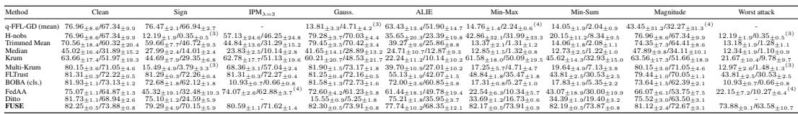

Table 8: MNIST / MLP, rounds 990–999. Entries are global / worst-10% client accuracy (%), mean over seeds 40, 41, 42, 43, 44 with the across-seed standard deviation as subscript; the worst-attack column is the seed-wise minimum over the seven attacks, also mean with std subscript, over seeds completing all seven attacks.  
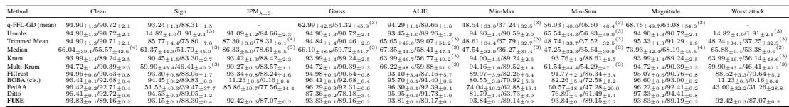

Table 9: EMNIST-Balanced / CNN, rounds 990–999. Entries are global / worst-10% client accuracy (%), mean over seeds 40, 41, 42, 43, 44 with the across-seed standard deviation as subscript; the worst-attack column is the seed-wise minimum over the seven attacks, also mean with std subscript, over seeds completing all seven attacks.  
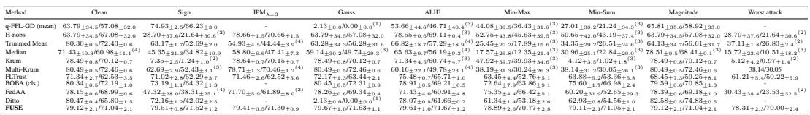

## B.7 THREE-COMPONENT ABLATION PROTOCOL

The factorial ablation traverses all $2 ^ { 3 }$ combinations of the scale screen, cone screen, and lossnormalized aggregation. All four dataset/model pairs use 1000 communication rounds under matched client partitions and attack realizations. The complete $2 ^ { 3 }$ factorial ablation for all four dataset/model pairs is reported in Appendix E.1; the main text shows the CIFAR-10 instance as a representative mechanism study. Auxiliary runs that reached round 299 were continued from their matched checkpoints. Clean trajectories are reused across selector-component rows within an aggregation mode because clean runs use f = 0 and therefore perform no screening rejection.

After this reuse, 58 CIFAR-10, 53 EMNIST-Balanced, and 60 AGNews conceptual conditions reach their rounds 990–999 reporting windows. A missing terminal window is retained as “–” rather than replaced by a pre-collapse maximum; all such dashes correspond to a registered algorithmic collapse, not an unfinished scheduler job.

## C FIVE-SEED RESULTS AND TRAINING DYNAMICS

## C.1 FULL FIVE-SEED ENDPOINT RESULTS

Tables 7–10 report all ten baselines and FUSE over seeds 40–44. Each attacked column first averages the final reporting window within a seed and then averages completed seeds. The last column instead computes the minimum across all seven attacks within each seed before averaging; it is therefore the seed-wise worst-attack statistic used throughout the main paper. Superscript (k) indicates that only k seeds reached the endpoint. The BOBA rows use classifier-coordinate geometry (Appendix B.5); full-space BOBA is available for seed 42 only. The AGNews FUSE rows screen all GRU parameters.

Table 11 mirrors the main-paper robustness table using worst-10% client accuracy instead of global accuracy. Table 12 then reports paired seed-wise comparisons for the global worst-attack metric.

Table 10: AGNews / GRU, rounds 1990–1999. Entries are global / worst-10% client accuracy (%), mean over seeds 40, 41, 42, 43, 44 with the across-seed standard deviation as subscript; the worst-attack column is the seed-wise minimum over the seven attacks, also mean with std subscript, over seeds completing all seven attacks.
<table><tr><td>Method</td><td>Clean</td><td>Sign</td><td>IPMλ=3</td><td>Gauss.</td><td>ALIE</td><td>Min-Max</td><td>Min-Sum</td><td>Magnitude</td><td>Worst attack</td></tr><tr><td>q-FFL-GD (mean)</td><td>81.52±3.0/68.95±2.7</td><td>64.00±2.0/49.40±4.7</td><td></td><td></td><td></td><td>27.06±0.7/16.92±1.0(4) 73.23±9.0/59.00±8.9 40.49±15.2/23.90±11.6 45.40±18.0/29.31±16.8(4) 76.35±22.8/64.38±26.1</td><td></td><td></td><td></td></tr><tr><td>H-nobs</td><td>81.52±3.0/68.95±2.7</td><td>26.69±1.4/0.56±0.9(3)</td><td>81.62±2.6/67.99±3.4</td><td>81.52±3.0/68.95±2.7</td><td></td><td>77.53±0.5/62.83±2.2 72.91±13.2/58.16±13.7</td><td>73.71±1.5/58.29±2.0</td><td>81.52±3.0/68.95±2.7</td><td>26.69±1.4/0.56±0.9(3)</td></tr><tr><td>Trimmed Mean</td><td>81.57±2.9/69.06±2.5</td><td>36.61±2.9/8.79±6.4</td><td>35.88±2.7/6.90±6.6</td><td>79.67±5.9/66.55±7.0</td><td>74.76±0.9/59.20±2.3 38.63±13.4/19.84±9.6</td><td></td><td>39.37±13.5/22.11±8.3</td><td>79.89±3.0/67.29±2.2</td><td>30.85±2.9/5.71±4.7</td></tr><tr><td>Median</td><td>66.83±4.0/46.50±7.0</td><td>40.53±3.8/15.32±5.6</td><td>37.58±4.7/12.00±9.2</td><td>72.53±1.6/54.11±3.7</td><td>70.64±1.3/55.17±1.7 49.33±11.0/30.59±9.1</td><td></td><td>49.01±10.7/29.42±9.9</td><td>64.82±18.3/48.88±17.5</td><td>33.50±3.s/9.20±4.8</td></tr><tr><td>Krum</td><td>72.69±10.1/56.90±10.1</td><td>77.17±2.6/60.86±5.0</td><td>76.62±6.7/58.96±10.6</td><td>72.69±10.1/56.90±10.1</td><td>72.18±1.6/56.64±0.7 77.42±5.2/62.50±6.7</td><td></td><td>74.77±13.3/59.40±16.2</td><td>72.69±10.1/56.90±10.1</td><td>64.43±9.9/48.20±12.1</td></tr><tr><td>Multi-Krum FLTrust</td><td>76.02±9.9/62.24±10.6 83.92±1.1/70.63±2.6</td><td>66.96±11.5/46.28±12.4 83.92±1.1/70.63±2.6</td><td>73.08±13.2/56.59±17.9 83.92±1.1/70.63±2.6</td><td>76.02±9.9/62.24±10.6</td><td>74.87±1.1/57.84±2.0</td><td>78.23±4.6/64.39±3.1</td><td>66.27±5.5/49.22±5.5</td><td>76.02±9.9/62.24±10.6</td><td>58.34±5.5/38.31±8.0</td></tr><tr><td>BOBA (cls.)</td><td>83.82±1.0/70.71±2.1</td><td>60.57±0.8/44.07±2.9</td><td>27.65±1.4/1.65±1.7</td><td>83.98±1.0/70.79±2.4 83.82±1.0/70.71±2.1</td><td>77.19±1.0/62.57±2.5 80.82±2.0/66.48±4.5 56.44±1.1/38.29±2.5</td><td>66.82±3.4/49.24±4.8</td><td>64.26±3.6/45.46±4.8 59.43±1.5/41.98±2.4</td><td>83.03±0.7/69.91±1.8 83.53±1.5/69.52±3.3</td><td>64.26±3.6/45.46±4.8 27.65±1.4/1.65±1.7</td></tr><tr><td>FedAA</td><td>78.36±1.4/61.25±3.1</td><td></td><td>38.32±12.0/211.62±12.9 57.68±22.8/38.52±30.1(2)</td><td>77.83±3.0/61.20±6.5</td><td></td><td></td><td>40.34±11.4/15.72±13.2</td><td></td><td>31.29±0.8/4.44±0.7(2)</td></tr><tr><td>Ditto</td><td>83.82±1.0/62.56±4.9</td><td>63.17±0.9/38.63±2.6</td><td></td><td></td><td>75.29±4.7/60.29±6.7 41.18±22.2/16.55±26.3</td><td></td><td></td><td>79.67±1.4/64.88±3.9 86.53±0.6/77.52±2.5</td><td></td></tr><tr><td>FUSE</td><td>82.29±1.3/69.58±2.1</td><td>80.46±1.0/66.94±2.8(4)</td><td>81.12±1.0/67.92±1.8</td><td>25.05±0.8/16.74±1.8(3) 80.94±2.4/62.93±3.1 39.97±5.1/29.18±4.0 82.17±1.1/69.43±2.5</td><td>78.62±4.1/65.58±6.4 81.44±1.7/68.25±3.1</td><td></td><td>56.25±2.0/39.36±3.2 81.36±1.5/68.22±3.0</td><td>82.29±1.3/69.58±2.1</td><td>77.84±4.4/63.75±6.6(4)</td></tr></table>

Paired interpretation. Against FLTrust, FUSE improves the seed-wise global worst-attack accuracy by 30.07 points on CIFAR-10, 3.90 on MNIST, and 17.09 on EMNIST; the paired differences are positive on all five seeds and their bootstrap 95% intervals exclude zero. The exact two-sided sign-flip test is nevertheless limited to p = 0.0625 with five pairs. On AGNews the floor is 77.84 over the four seeds completing all attacks, 13.03 points above FLTrust ([+11.84, +14.22]) and 15.40 above Krum ([+4.62, +26.18]) on the same seeds; with four pairs the sign-flip test is limited to p = 0.125.

## C.2 TRAINING DYNAMICS

Figures 5–8 show the seed-42 worst-10% client-accuracy trajectories for every dataset/model pair and all seven attacks, together with the clean condition. We retain three representative baselines spanning fair optimization, norm screening, and trusted-gradient aggregation. “Ours” denotes FUSE. A cross marks a trajectory that terminates before the registered training horizon.

Table 11: Worst-10% client robustness across datasets and attacks. Mean worst-10% client accuracy (W10, %) over seeds reaching the registered endpoint. Worst attack is the seed-wise minimum over seven attacks; (k) denotes k completed seeds.
<table><tr><td>Dataset/model</td><td>Method</td><td>Clean</td><td>Sign</td><td>IPM</td><td>Gauss.</td><td>ALIE</td><td>Min-Max Min-Sum</td><td></td><td>Mag.</td><td>Worst attack</td></tr><tr><td rowspan="6">CIFAR-10 ResNet-18</td><td>q-FFL</td><td>67.34</td><td>66.94</td><td></td><td> $4 . 7 1 ^ { ( 3 ) }$ </td><td>51.90</td><td> $\overline { { 2 . 2 4 ^ { ( 4 ) } } }$ </td><td>2.04</td><td> $3 2 . 2 7 ^ { ( 4 ) }$ </td><td></td></tr><tr><td>H-nobs</td><td>67.34</td><td> $0 . 3 5 ^ { ( 3 ) }$ </td><td>46.25</td><td>70.03</td><td>23.39</td><td>31.99</td><td>8.34</td><td>67.34</td><td> $0 . 3 5 ^ { ( 3 ) }$ </td></tr><tr><td>Trim.</td><td>60.32</td><td>46.72</td><td>31.29</td><td>70.42</td><td>25.86</td><td>1.31</td><td>2.08</td><td>64.41</td><td>1.28</td></tr><tr><td>Krum</td><td>51.97</td><td>29.35</td><td>51.13</td><td>48.53</td><td>10.14</td><td>50.09</td><td>32.93</td><td>51.66</td><td>9.78</td></tr><tr><td>FLTrust</td><td>72.22</td><td>72.26</td><td>72.27</td><td>72.16</td><td>42.07</td><td>35.47</td><td>30.53</td><td>70.05</td><td>30.53</td></tr><tr><td>BOBA (cls.)</td><td>73.13</td><td>62.12</td><td>0.66</td><td>72.73</td><td>60.85</td><td>5.27</td><td>5.35</td><td>62.39</td><td>0.66</td></tr><tr><td rowspan="2"></td><td>FedAA</td><td>64.87</td><td>32.48</td><td>62.88(4)</td><td>61.23</td><td>49.78</td><td>10.34</td><td>30.00</td><td>53.75</td><td>10.27(4)</td></tr><tr><td>FUSE</td><td>73.88</td><td>70.15</td><td>71.62</td><td>73.91</td><td>68.35</td><td>73.91</td><td>73.87</td><td>72.67</td><td>63.58</td></tr><tr><td rowspan="6">MNIST MLP</td><td> $\mathrm { q \mathrm { - } F F L }$ </td><td>90.72</td><td>88.31</td><td></td><td>54.32(3)</td><td>89.66</td><td>37.24(3)</td><td> $\overline { { 4 6 . 6 0 ^ { ( 3 ) } } }$ </td><td> $6 3 . 0 8 ^ { ( 3 ) }$ </td><td></td></tr><tr><td>H-nobs</td><td>90.72</td><td> $1 . { \overline { { 9 1 ^ { ( 3 ) } } } }$ </td><td>84.66</td><td>90.72</td><td>88.26</td><td>90.59</td><td> $5 6 . 8 3 ^ { ( 3 ) }$ </td><td>90.72</td><td> $1 . 9 1 ^ { ( 3 ) }$ </td></tr><tr><td>Trim.</td><td>90.71</td><td>75.80</td><td> $7 8 . 3 1 ^ { ( 4 ) }$ </td><td>90.46</td><td> $5 9 . 0 7 ^ { ( 3 ) }$ </td><td> $3 7 . 7 9 ^ { ( 3 ) }$ </td><td> $3 7 . 5 2 ^ { ( 3 ) }$ </td><td>91.29</td><td> $3 7 . 2 5 ^ { ( 3 ) }$ </td></tr><tr><td>Krum</td><td>89.24</td><td>83.30</td><td>88.42</td><td>89.24</td><td> $5 6 . 7 7 ^ { ( 3 ) }$ </td><td>89.24</td><td>88.61</td><td>89.24</td><td> $5 6 . 1 4 ^ { ( 3 ) }$ </td></tr><tr><td>FLTrust</td><td>90.53</td><td>88.05</td><td>88.24</td><td>90.54</td><td>87.16</td><td>82.26</td><td>85.34</td><td>90.76</td><td>79.64</td></tr><tr><td>BOBA (cls.) FedAA</td><td>92.68 92.71</td><td>89.83 39.47</td><td>0.16 77.56</td><td>92.68</td><td>91.40</td><td>70.92</td><td>72.58</td><td>93.00</td><td>0.16</td></tr><tr><td rowspan="8">EMNIST-Bal.</td><td>FUSE</td><td>89.16</td><td>88.30</td><td>87.07</td><td>92.31 89.16</td><td>92.39 89.17</td><td>62.88</td><td>47.28</td><td>92.41</td><td>31.26</td></tr><tr><td></td><td></td><td></td><td></td><td></td><td></td><td>89.14</td><td>89.15</td><td>89.19</td><td>87.07</td></tr><tr><td>q-FFL</td><td>57.08</td><td>66.23</td><td></td><td>0.00(1)</td><td>46.71(3)</td><td>36.43(3)</td><td> $2 1 . 2 4 ^ { ( 3 ) }$ </td><td>58.92</td><td></td></tr><tr><td>H-nobs</td><td>57.08 72.43</td><td>21.64(2)</td><td>70.66</td><td>57.08</td><td>69.11(3)</td><td>45.63(3)</td><td> $4 3 . 1 9 ^ { ( 3 ) }$ </td><td>57.08</td><td> $2 1 . 6 4 ^ { ( 2 ) }$ </td></tr><tr><td>Trim.</td><td></td><td>52.69</td><td>44.44(4)</td><td>56.28</td><td>57.29(4)</td><td> $1 7 . 8 9 ^ { ( 3 ) }$ </td><td> $2 6 . 5 1 ^ { ( 3 ) }$ </td><td>56.61</td><td> $2 6 . 8 3 ^ { ( 2 ) }$ </td></tr><tr><td>Krum</td><td>70.12</td><td>1.24(2)</td><td>70.15</td><td>70.12</td><td>60.74(3)</td><td>39.93(3)</td><td> $1 . 0 2 ^ { ( 3 ) }$ </td><td>70.12</td><td>0.97(2)</td></tr><tr><td>FLTrust BOBA (cls.)</td><td>62.53 72.19</td><td>62.29 64.32</td><td>62.52</td><td>63.44</td><td>65.71</td><td>52.76</td><td>53.36</td><td>59.25</td><td>50.22</td></tr><tr><td>FedAA</td><td></td><td>38.31(4)</td><td>61.89(2)</td><td>72.31</td><td>69.21</td><td>63.86</td><td>66.98</td><td>70.85</td><td></td></tr><tr><td></td><td>FUSE</td><td>68.99 71.04</td><td>71.52</td><td>71.30</td><td>69.34 71.63</td><td>60.91 71.67</td><td>66.42 70.77</td><td>52.65 71.05</td><td>69.18</td><td>23.53(2) 70.00</td></tr><tr><td rowspan="6">AGNews</td><td>q-FFL</td><td></td><td></td><td></td><td></td><td></td><td></td><td></td><td>71.04</td><td></td></tr><tr><td>H-nobs</td><td>68.95</td><td>49.40</td><td></td><td>16.92(4)</td><td>59.00</td><td>23.90</td><td>29.31(4)</td><td>64.38</td><td></td></tr><tr><td>Trim.</td><td>68.95 69.06</td><td>0.56(3)</td><td>67.99</td><td>68.95</td><td>62.83</td><td>58.16</td><td>58.29</td><td>68.95</td><td>0.56(3)</td></tr><tr><td>Krum</td><td>56.90</td><td>8.79 60.86</td><td>6.90 58.96</td><td>66.55 56.90</td><td>59.20 56.64</td><td>19.84 62.50</td><td>22.11 59.40</td><td>67.29</td><td>5.71</td></tr><tr><td>FLTrust</td><td>70.63</td><td>70.63</td><td>70.63</td><td>70.79</td><td>62.57</td><td>49.24</td><td>45.46</td><td>56.90 69.91</td><td>48.20 45.46</td></tr><tr><td>BOBA (cls.)</td><td>70.71</td><td>44.07</td><td>1.65</td><td></td><td>66.48</td><td>38.29</td><td>41.98</td><td>69.52</td><td></td></tr><tr><td rowspan="4"></td><td></td><td></td><td></td><td></td><td>70.71</td><td></td><td></td><td></td><td></td><td>1.65</td></tr><tr><td>FedAA</td><td>61.25</td><td>11.62</td><td>38.52(2)</td><td>61.20</td><td>60.29</td><td>16.55</td><td>15.72</td><td>64.88</td><td> $4 . 4 4 ^ { ( 2 ) }$ </td></tr><tr><td>FUSE</td><td>69.58</td><td>66.94(4)</td><td>67.92</td><td>69.43</td><td>65.58</td><td>68.25</td><td>68.22</td><td>69.58</td><td>63.75(4)</td></tr><tr><td></td><td></td><td></td><td></td><td></td><td></td><td></td><td></td><td></td><td></td></tr></table>

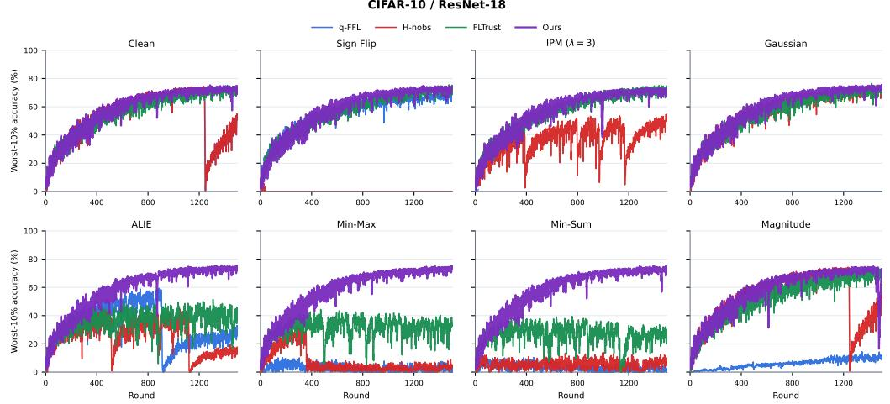  
Figure 5: CIFAR-10/ResNet-18 training dynamics. Worst-10% client accuracy (%) over 1500 communication rounds.

Table 12: Seed-wise worst-attack accuracy of FUSE minus each baseline (global accuracy, percentage points). Worst-attack values are computed per seed as the minimum over the seven attacks; seeds in which either method collapsed under any attack are excluded from that pair (n is the number of paired seeds). CI: 95% percentile bootstrap over paired seeds; p: exact two-sided sign-flip test.
<table><tr><td rowspan="2">Dataset</td><td rowspan="2">Baseline</td><td rowspan="2">FUSE worst attack</td><td rowspan="2">Baseline worst attack</td><td rowspan="2">∆ [95% CI]</td><td rowspan="2">p (n)</td></tr><tr><td></td></tr><tr><td>CIFAR-10 / ResNet-18</td><td>q-FFL-GD (mean)</td><td>73.88</td><td></td><td></td><td></td></tr><tr><td>CIFAR-10 / ResNet-18</td><td>H-nobs</td><td>73.88</td><td>12.19</td><td>+63.89 [+56.93, +67.83]</td><td>0.250 (3)</td></tr><tr><td>CIFAR-10 / ResNet-18</td><td>Trimmed Mean</td><td>73.88</td><td>13.18</td><td>+60.70 [+52.08, +67.62]</td><td>0.062 (5)</td></tr><tr><td>CIFAR-10 / ResNet-18</td><td>Median</td><td>73.88</td><td>12.34</td><td>+61.53 [+53.51, +68.25]</td><td>0.062 (5)</td></tr><tr><td>CIFAR-10 / ResNet-18</td><td>Krum</td><td>73.88</td><td>21.67</td><td>+52.21 [+43.96, +61.29]</td><td>0.062 (5)</td></tr><tr><td>CIFAR-10 / ResNet-18</td><td>Multi-Krum</td><td>73.88</td><td>12.97</td><td>+63.12 [+56.20, +66.92]</td><td>0.250 (3)</td></tr><tr><td>CIFAR-10 / ResNet-18</td><td>FLTrust</td><td>73.88</td><td>43.81</td><td>+30.07 [+20.24, +37.83]</td><td>0.062 (5)</td></tr><tr><td>CIFAR-10 / ResNet-18</td><td>BOBA (cls.)</td><td>73.88</td><td>10.93</td><td>+62.95 [+55.02, +69.61]</td><td>0.062 (5)</td></tr><tr><td>CIFAR-10 / ResNet-18</td><td>FedAA</td><td>73.88</td><td>22.15</td><td>+55.31 [+45.62, +64.99]</td><td>0.125 (4)</td></tr><tr><td>CIFAR-10 / ResNet-18</td><td>Ditto</td><td>73.88</td><td></td><td></td><td></td></tr><tr><td>MNIST / MLP</td><td>q-FFL-GD (mean)</td><td>92.42</td><td></td><td></td><td></td></tr><tr><td>MNIST / MLP</td><td>H-nobs</td><td>92.42</td><td>14.82</td><td>+77.42 [+73.28, +81.00]</td><td>0.250 (3)</td></tr><tr><td>MNIST / MLP</td><td>Trimmed Mean</td><td>92.42</td><td>48.24</td><td>+44.00 [+24.25, +83.43]</td><td>0.250 (3)</td></tr><tr><td>MNIST / MLP</td><td>Median</td><td>92.42</td><td>65.88</td><td>+26.31 [+26.27, +26.34]</td><td>0.500 (2)</td></tr><tr><td>MNIST / MLP</td><td>Krum</td><td>92.42</td><td>63.99</td><td>+28.25 [+0.76, +82.26]</td><td>0.250 (3)</td></tr><tr><td>MNIST / MLP</td><td>Multi-Krum</td><td>92.42</td><td>59.90</td><td>+32.34 [+6.50, +82.55]</td><td>0.250 (3)</td></tr><tr><td>MNIST / MLP</td><td>FLTrust</td><td>92.42</td><td>88.52</td><td>+3.90 [+1.56, +6.25]</td><td>0.062 (5)</td></tr><tr><td>MNIST / MLP</td><td>BOBA (cls.)</td><td>92.42</td><td>11.23</td><td>+81.19 [+80.73, +81.75]</td><td>0.062 (5)</td></tr><tr><td>MNIST / MLP</td><td>FedAA</td><td>92.42</td><td>43.00</td><td>+49.42 [+24.50, +74.34]</td><td>0.062 (5)</td></tr><tr><td>MNIST / MLP</td><td>Ditto</td><td>92.42</td><td></td><td></td><td></td></tr><tr><td>EMNIST-Balanced / CNN</td><td>q-FFL-GD (mean)</td><td>78.31</td><td></td><td></td><td></td></tr><tr><td>EMNIST-Balanced / CNN</td><td>H-nobs</td><td>78.31</td><td>28.70</td><td>+50.66 [+24.77, +76.55]</td><td>0.500 (2)</td></tr><tr><td>EMNIST-Balanced / CNN</td><td>Trimmed Mean</td><td>78.31</td><td>37.11</td><td>+42.33 [+40.47, +44.19]</td><td>0.500 (2)</td></tr><tr><td>EMNIST-Balanced / CNN</td><td>Median</td><td>78.31</td><td>15.72</td><td>+63.46 [+37.12, +76.72]</td><td>0.250 (3)</td></tr><tr><td>EMNIST-Balanced / CNN</td><td>Krum</td><td>78.31</td><td>5.12</td><td>+73.64 [+70.74, +76.55]</td><td>0.500 (2)</td></tr><tr><td>EMNIST-Balanced / CNN</td><td>Multi-Krum</td><td>78.31</td><td></td><td></td><td></td></tr><tr><td>EMNIST-Balanced / CNN</td><td>FLTrust</td><td>78.31</td><td>61.21</td><td>+17.09 [+12.33, +21.89]</td><td>0.062 (5)</td></tr><tr><td>EMNIST-Balanced / CNN</td><td>BOBA (cls.)</td><td>78.31</td><td></td><td></td><td></td></tr><tr><td>EMNIST-Balanced / CNN</td><td>FedAA</td><td>78.31</td><td>30.43</td><td>+49.01 [+21.26, +76.76]</td><td>0.500 (2)</td></tr><tr><td>EMNIST-Balanced / CNN</td><td>Ditto</td><td>78.31</td><td></td><td></td><td></td></tr><tr><td>AGNews / GRU</td><td>q-FFL-GD (mean)</td><td>77.84</td><td></td><td></td><td></td></tr><tr><td>AGNews / GRU</td><td>H-nobs</td><td>77.84</td><td>26.69</td><td>+49.48 [+45.11, +53.86]</td><td>0.500 (2)</td></tr><tr><td>AGNews / GRU</td><td>Trimmed Mean</td><td>77.84</td><td>30.85</td><td>+47.96 [+41.57, +51.37]</td><td>0.125 (4)</td></tr><tr><td>AGNews / GRU</td><td>Median</td><td>77.84</td><td>33.50</td><td>+43.97 [+38.72, +49.22]</td><td>0.125 (4)</td></tr><tr><td>AGNews / GRU</td><td>Krum</td><td>77.84</td><td>64.43</td><td>+15.40 [+4.62, +26.18]</td><td>0.250 (4)</td></tr><tr><td>AGNews / GRU</td><td>Multi-Krum</td><td>77.84</td><td>58.34</td><td>+21.16 [+14.84, +27.08]</td><td>0.125 (4)</td></tr><tr><td>AGNews / GRU</td><td>FLTrust</td><td>77.84</td><td>64.26</td><td>+13.03 [+11.84, +14.22]</td><td>0.125 (4)</td></tr><tr><td>AGNews / GRU</td><td>BOBA (cls.)</td><td>77.84</td><td>27.65</td><td>+49.87 [+45.74, +52.88]</td><td>0.125 (4)</td></tr><tr><td>AGNews / GRU</td><td>FedAA</td><td>77.84</td><td>31.29</td><td>+49.14 [+49.14, +49.14]</td><td>1.000 (1)</td></tr><tr><td>AGNews / GRU</td><td>Ditto</td><td>77.84</td><td></td><td></td><td></td></tr></table>

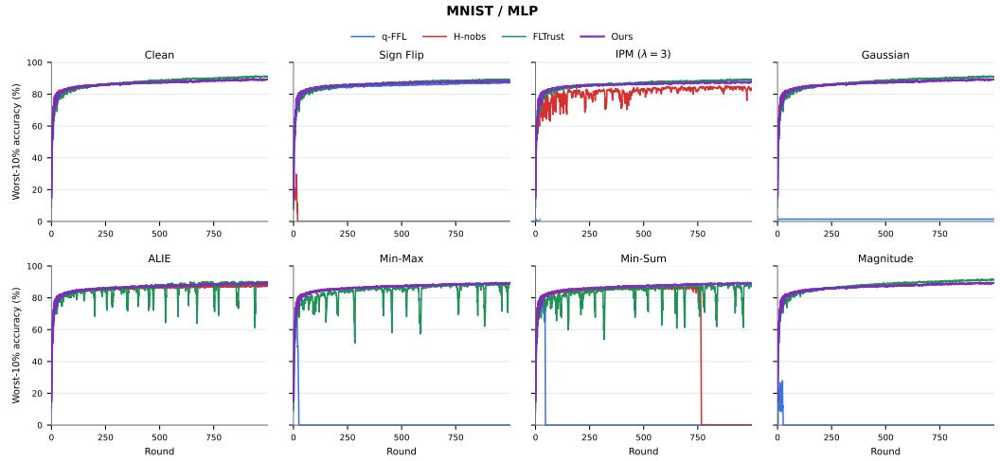  
Figure 6: MNIST/MLP training dynamics. Worst-10% client accuracy (%) over 1000 communication rounds.

EMNIST-Balanced / CNN  
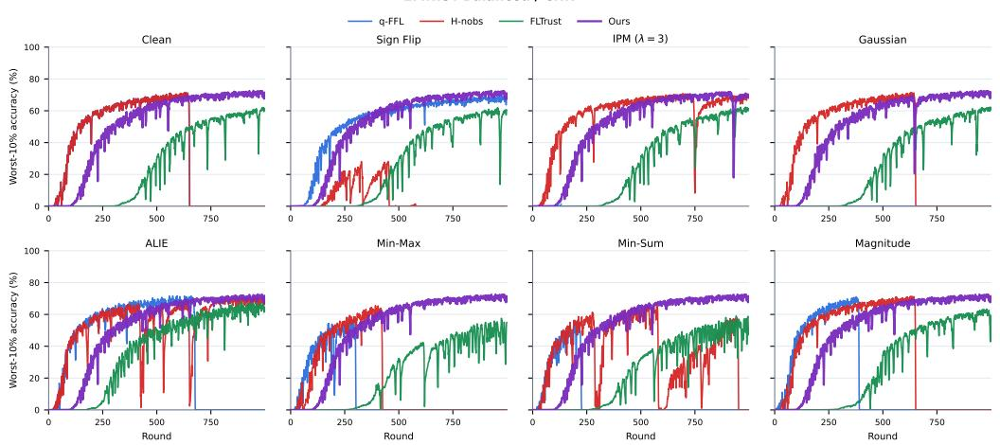  
Figure 7: EMNIST-Balanced/CNN training dynamics. Worst-10% client accuracy (%) over 1000 communication rounds.

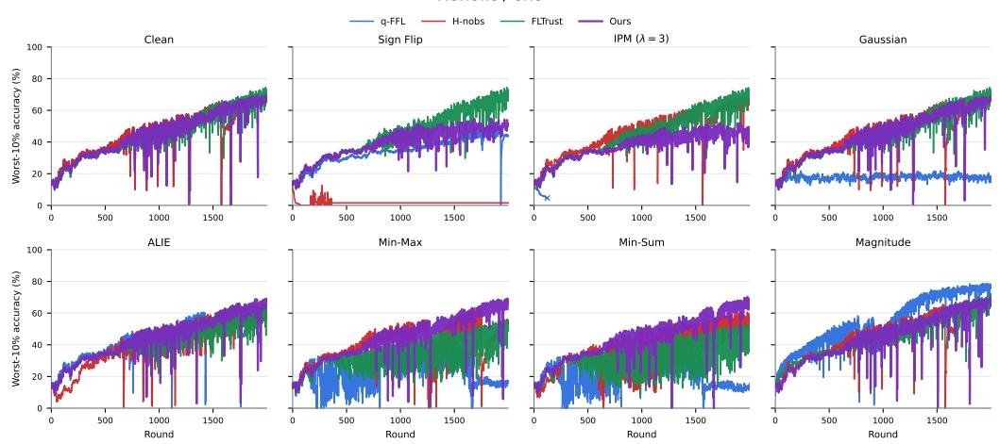  
Figure 8: AGNews/GRU training dynamics. Worst-10% client accuracy (%) over 2000 communication rounds.

## D EXPERIMENTAL VALIDATION OF THE GEOMETRIC ANALYSIS

We validate the two predictions underlying Theorems 1 and 2: coefficient mass should track the fairness scale, and scale and cone residual should respond to complementary deviations. The diagnostic uses MNIST, seed 42, and $q = 1 ;$ complete stage-wise statistics are in Appendix E.

The recovered mass has Pearson correlation $r = 0 . 9 4 0$ with $F _ { i } ^ { q }$ ; the trusted loss estimate has Pearson $r = 0 . 9 2 3$ and MAE 0.053 over 76,457 retained honest submissions. Gaussian and Magnitude Scaling primarily produce large mass, whereas ALIE, Min-Max, and Min-Sum primarily produce large cone residual. Sign Flip and IPM overlap more strongly with the honest region, which illustrates the observable boundary of the update-only interface.

Finally, the controlled simplex–cone study in Appendix E.3 holds the checkpoint, honest updates, and trusted basis fixed while changing only the coefficient constraint. It shows why BOBA’s unitsum simplex is mismatched after fairness scaling: the cone is invariant to the legitimate radial transformation, whereas a fixed simplex is not.

## E ABLATIONS AND DIAGNOSTIC EVIDENCE

This appendix groups mechanism attribution, fairness audits, sensitivity controls, trusted-geometry diagnostics, computational cost, and explicit robustness boundaries. Unless otherwise stated, diagnostic statistics use seed 42 and are not presented as cross-seed uncertainty estimates.

## E.1 THREE-COMPONENT FACTORIAL ABLATION

The complete factorial ablation is reported here for all dataset/model pairs. Tables 13–16 use the identical 1000-round design on every dataset (including AGNews, whose main-table horizon is 2000 rounds) and report all seven attacks. The three binary components are the coefficient-scale screen, normalized cone screen, and loss-normalized aggregation. Runs that reached round 299 in the original factorial were continued from their matched checkpoints; configurations that had already met a registered collapse criterion retain a missing terminal window. Because clean training uses f = 0, its trajectory depends on the aggregation rule but not on the enabled screening stages, so the matched clean trajectory is reused within each aggregation mode.

Role of cone screening. Cone screening has the clearest structural-robustness effect. Holding the scale screen and loss-normalized aggregation fixed, removing the cone screen eliminates the IPM terminal window on CIFAR-10, MNIST, EMNIST-Balanced, and AGNews, whereas the complete FUSE configuration reaches the registered endpoint on all four datasets. The same pattern holds when both screens are removed. This supports the intended role of the cone stage against invalid signed mixtures and other structural violations, rather than a claim that it uniformly increases clean or per-attack endpoint accuracy.

Role of scale screening. With cone screening and loss normalization fixed, adding the scale stage changes the worst-attack result from 52.38%/40.25% to 77.50%/68.37% on CIFAR-10, from 91.83%/86.29% to 92.35%/87.01% on MNIST, from 79.21%/69.89% to 79.30%/69.89% on EMNIST Balanced, and from 53.27%/36.15% to 53.34%/38.33% on AGNews. Thus the scale stage never lowers the paired worst-attack result and is decisive on CIFAR-10, although the small differences on the other datasets should not be over-interpreted from a single seed. Its role is also visible without loss normalization: it prevents the severe CIFAR-10 Magnitude failure and the MNIST cone-only Magnitude collapse. Conversely, removing the scale stage improves the Magnitude endpoint on EMNIST and AGNews. The evidence therefore supports scale screening as protection against radial worst cases, not as a component that uniformly raises every attack endpoint.

Role of loss normalization. Loss normalization is an optimization and stability component with a dataset-dependent effect. With both screens fixed, it raises the complete CIFAR-10 worst-attack result from 70.06%/59.88% to 77.50%/68.37%. On EMNIST-Balanced, the mean-u Sign-Flip and IPM runs have no terminal window, while the loss-normalized configuration completes all seven attacks. The MNIST worst-attack results are essentially unchanged (92.34%/87.06% for mean-u

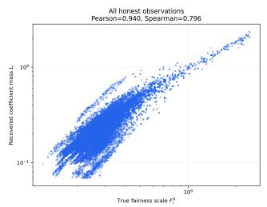  
(a) $L _ { i }$ versus $F _ { i } ^ { q } .$

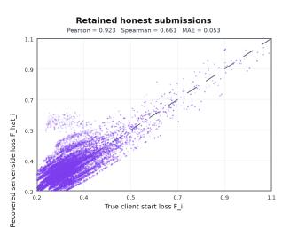  
(b) $\widetilde { F } _ { i }$ versus $F _ { i } .$

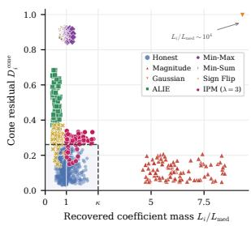  
(c) Scale versus cone score.  
Figure 9: Experimental validation of the geometric analysis. Recovered mass tracks the fairness scale (a), normalized coefficients support loss reconstruction (b), and the two screening statistics separate complementary attack patterns (c).

Table 13: Component ablation of FUSE. CIFAR-10/ResNet-18, seed 42, 1000 rounds. Global / worst-10% client accuracy (%) over the final ten rounds; the worst-attack column is the componentwise minimum over the seven attacks. Clean uses $f = 0 ; { } ^ { \cdots } { } ^ { \cdots }$ marks a run with no terminal window.
<table><tr><td>Variant</td><td>Scale Cone</td><td></td><td>Loss norm.</td><td>Clean</td><td>Magnitude</td><td>Sign</td><td> $\mathrm { I P M } _ { \lambda = 3 }$ </td><td>Gauss.</td><td>ALIE</td><td>Min-Max</td><td>Min-Sum</td><td>Worst attack</td></tr><tr><td>FUSE</td><td>V</td><td></td><td></td><td>79.03/70.41</td><td>78.97/70.38</td><td>77.50/68.37</td><td>77.83/68.91</td><td>78.82/69.57</td><td>78.50/69.28</td><td>79.28/70.73</td><td>78.71/69.93</td><td>77.50/68.37</td></tr><tr><td>w/o scale</td><td></td><td></td><td></td><td>79.03/70.41</td><td>52.38/40.25</td><td>78.20/69.08</td><td>76.08/66.91</td><td>78.82/69.57</td><td>78.97/70.16</td><td>79.00/70.29</td><td>79.03/70.41</td><td>52.38/40.25</td></tr><tr><td>w/o cone</td><td></td><td></td><td></td><td>79.03/70.41</td><td>78.67/70.09</td><td>69.95/59.40</td><td></td><td>78.82/69.57</td><td>55.16/42.83</td><td>36.71/24.49</td><td>38.94/27.18</td><td></td></tr><tr><td>w/o scale and cone</td><td></td><td></td><td></td><td>79.03/70.41</td><td>63.23/51.72</td><td>70.16/59.92</td><td></td><td>26.11/13.69</td><td>63.20/50.88</td><td>34.07/22.76</td><td>35.66/23.99</td><td></td></tr><tr><td>w/o loss norm.</td><td></td><td></td><td></td><td>78.04/69.52</td><td>70.06/59.88</td><td>73.33/63.97</td><td>74.01/64.70</td><td>77.89/68.61</td><td>76.98/67.90</td><td>76.04/67.28</td><td>76.02/67.30</td><td>70.06/59.88</td></tr><tr><td>cone only</td><td></td><td></td><td></td><td>78.04/69.52</td><td>10.89/0.05</td><td>71.59/62.06</td><td>75.30/65.97</td><td>77.65/69.14</td><td>76.87/68.40</td><td>78.04/69.52</td><td>78.04/69.52</td><td>10.89/0.05</td></tr><tr><td>scale only</td><td></td><td></td><td></td><td>78.04/69.52</td><td>73.14/64.22</td><td>71.66/61.40</td><td></td><td>77.74/69.17</td><td>46.45/34.25</td><td>13.87/2.92</td><td></td><td></td></tr><tr><td>no component</td><td></td><td></td><td></td><td>78.04/69.52</td><td>16.91/5.99</td><td>72.56/63.11</td><td></td><td></td><td>48.22/36.59</td><td>15.41/5.06</td><td>15.04/3.21</td><td></td></tr></table>

Table 14: Component ablation of FUSE. MNIST/MLP, seed 42, 1000 rounds. Global / worst-10% client accuracy (%) over the final ten rounds; the worst-attack column is the componentwise minimum over the seven attacks. Clean uses $f = 0 ; { ^ { \cdots } } { ^ { \prime } }$ marks a run with no terminal window.
<table><tr><td>Variant</td><td>Scale Cone</td><td></td><td>Loss norm.</td><td>Clean</td><td>Magnitude</td><td>Sign</td><td> $\mathrm { I P M } _ { \lambda = 3 }$ </td><td>Gauss.</td><td>ALIE</td><td>Min-Max</td><td>Min-Sum</td><td>Worst attack</td></tr><tr><td>FUSE</td><td></td><td>V</td><td></td><td>93.95/89.26</td><td>93.94/89.23</td><td>93.20/88.09</td><td>92.35/87.01</td><td>93.95/89.26</td><td>93.94/89.14</td><td>93.94/89.23</td><td>93.96/89.26</td><td>92.35/87.01</td></tr><tr><td>w/o scale</td><td></td><td></td><td></td><td>93.95/89.26</td><td>94.40/89.91</td><td>93.22/88.23</td><td>91.83/86.29</td><td>93.95/89.26</td><td>93.95/89.27</td><td>93.95/89.26</td><td>93.95/89.26</td><td>91.83/86.29</td></tr><tr><td>w/o cone</td><td></td><td></td><td></td><td>93.95/89.26</td><td>93.96/89.27</td><td>92.43/87.07</td><td></td><td>93.95/89.26</td><td>93.97/89.38</td><td>89.06/83.15</td><td>55.42/41.64</td><td></td></tr><tr><td>w/o scale and cone</td><td></td><td></td><td></td><td>93.95/89.26</td><td>95.14/89.63</td><td>92.39/87.11</td><td></td><td>52.87/39.71</td><td>93.96/89.21</td><td>89.78/84.07</td><td>79.52/69.42</td><td></td></tr><tr><td>w/o loss norm.</td><td></td><td></td><td></td><td>93.97/89.29</td><td>93.98/89.26</td><td>93.24/88.15</td><td>92.34/87.06</td><td>93.97/89.29</td><td>93.96/89.14</td><td>93.98/89.29</td><td>93.98/89.29</td><td>92.34/87.06</td></tr><tr><td>cone only</td><td></td><td></td><td></td><td>93.97/89.29</td><td></td><td>93.27/88.25</td><td>92.09/86.73</td><td>93.97/89.29</td><td>93.98/89.29</td><td>93.97/89.29</td><td>93.97/89.29</td><td></td></tr><tr><td>scale only</td><td></td><td></td><td></td><td>93.97/89.29</td><td>93.98/89.27</td><td>92.45/87.13</td><td>10.33/0.00</td><td>93.97/89.29</td><td>93.97/89.37</td><td>87.78/81.05</td><td>78.96/69.45</td><td>10.33/0.00</td></tr><tr><td>no component</td><td></td><td></td><td></td><td>93.97/89.29</td><td></td><td>92.40/87.15</td><td></td><td></td><td>93.96/89.23</td><td>51.72/34.59</td><td>53.41/40.21</td><td></td></tr></table>

Table 15: Component ablation of FUSE. EMNIST-Balanced/CNN, seed 42, 1000 rounds. Global / worst-10% client accuracy (%) over the final ten rounds; the worst-attack column is the componentwise minimum over the seven attacks. Clean uses $f = 0 ; { } ^ { \cdots } { } ^ { \cdots }$ marks a run with no terminal window.
<table><tr><td>Variant</td><td>Scale</td><td>Cone</td><td>Loss norm.</td><td>Clean</td><td>Magnitude</td><td>Sign</td><td> $\mathrm { I P M } _ { \lambda = 3 }$ </td><td>Gauss.</td><td>ALIE</td><td>Min-Max</td><td>Min-Sum</td><td>Worst attack</td></tr><tr><td>FUSE</td><td>V</td><td>√</td><td></td><td>79.59/70.34</td><td>79.59/70.34</td><td>79.31/70.05</td><td>79.51/70.33</td><td>79.30/69.89</td><td>79.70/70.65</td><td>79.59/70.34</td><td>79.59/70.34</td><td>79.30/69.89</td></tr><tr><td>w/o scale</td><td></td><td></td><td></td><td>79.59/70.34</td><td>82.69/74.52</td><td>79.31/70.05</td><td>79.21/70.12</td><td>79.30/69.89</td><td>79.70/70.65</td><td>79.59/70.34</td><td>79.59/70.34</td><td>79.21/69.89</td></tr><tr><td>w/o cone</td><td></td><td></td><td></td><td>79.59/70.34</td><td>79.59/70.34</td><td>71.50/62.16</td><td></td><td>79.30/69.89</td><td>77.99/68.66</td><td>58.36/46.70</td><td>59.18/47.88</td><td></td></tr><tr><td>w/o scale and cone</td><td></td><td></td><td></td><td>79.59/70.34</td><td>82.47/73.37</td><td>71.50/62.16</td><td></td><td></td><td>77.99/68.66</td><td>58.36/46.70</td><td>59.18/47.88</td><td></td></tr><tr><td>w/o loss norm.</td><td></td><td></td><td></td><td>80.34/71.73</td><td>80.34/71.73</td><td></td><td></td><td>20.01/11.20</td><td>58.01/48.11</td><td>80.34/71.73</td><td>80.34/71.73</td><td></td></tr><tr><td>cone only</td><td></td><td></td><td></td><td>80.34/71.73</td><td></td><td></td><td></td><td>20.01/11.20</td><td>58.01/48.11</td><td>80.34/71.73</td><td>80.34/71.73</td><td></td></tr><tr><td>scale only</td><td></td><td></td><td></td><td>80.34/71.73</td><td>80.34/71.73</td><td>76.71/67.50</td><td></td><td>20.01/11.20</td><td>78.95/70.21</td><td>50.48/38.00</td><td>52.31/40.19</td><td></td></tr><tr><td>no component</td><td></td><td></td><td></td><td>80.34/71.73</td><td>78.21/68.79</td><td>76.71/67.50</td><td></td><td></td><td>78.95/70.21</td><td>50.48/38.00</td><td>52.31/40.19</td><td></td></tr></table>

and 92.35%/87.01% with loss normalization). On AGNews, mean-u instead has the higher worstattack result, 55.45%/40.77% versus 53.34%/38.33%. Hence the factorial supports a long-horizon stabilization benefit on CIFAR-10 and EMNIST, a neutral effect on MNIST, and a trade-off on AGNews; it does not support a claim of uniform endpoint improvement from loss normalization.

Of the 64 conceptual conditions per auxiliary dataset, 58 CIFAR-10, 53 EMNIST-Balanced, and 60 AGNews conditions reach rounds 990–999 after clean trajectory reuse. Every remaining dash denotes a registered collapse rather than an unfinished scheduler job. In particular, two continued CIFAR-10 configurations and five continued EMNIST mean-u configurations collapse after round 299; all launched AGNews continuations reach the terminal window.

Table 16: Component ablation of FUSE. AGNews/GRU, seed 42, 2000 rounds. Global / worst-10% client accuracy (%) over the final ten rounds; the worst-attack column is the componentwise minimum over the seven attacks. Clean uses $f = 0 ; { ^ { \cdots } } { ^ { \prime } }$ marks a run with no terminal window.
<table><tr><td>Variant</td><td>Scale Cone Loss norm.</td><td></td><td></td><td>Clean</td><td>Magnitude</td><td>Sign</td><td> $\mathrm { I P M } _ { \lambda = 3 }$ </td><td>Gauss.</td><td>ALIE</td><td>Min-Max</td><td>Min-Sum</td><td>Worst attack</td></tr><tr><td>FUSE</td><td>V</td><td>V</td><td></td><td>83.66/68.09</td><td>83.65/68.09</td><td>79.45/62.86</td><td>81.56/65.49</td><td>83.35/67.62</td><td>81.31/68.09</td><td>83.14/67.13</td><td>82.94/66.88</td><td>79.45/62.86</td></tr><tr><td>w/o scale</td><td></td><td></td><td></td><td>83.64/68.03</td><td>86.53/73.99</td><td>83.64/68.03</td><td>83.64/68.03</td><td>83.65/68.06</td><td>80.44/66.99</td><td>83.64/68.03</td><td>83.70/68.16</td><td>80.44/66.99</td></tr><tr><td>w/o cone</td><td></td><td></td><td></td><td>83.66/68.09</td><td>83.66/68.09</td><td></td><td></td><td>28.34/17.87</td><td>80.53/67.12</td><td>40.94/16.66</td><td>55.80/37.26</td><td></td></tr><tr><td>w/o scale and cone</td><td></td><td></td><td></td><td>83.66/68.09</td><td>86.90/75.05</td><td></td><td></td><td>28.41/16.32</td><td>81.26/67.35</td><td>43.55/21.00</td><td>56.08/36.75</td><td></td></tr><tr><td>w/o loss norm.</td><td></td><td></td><td></td><td>81.93/66.28</td><td>81.93/66.28</td><td>62.69/46.97</td><td>68.08/50.74</td><td>35.92/25.22</td><td>71.58/58.13</td><td>76.38/62.02</td><td>84.18/68.95</td><td>35.92/25.22</td></tr><tr><td>cone only</td><td></td><td></td><td></td><td>81.93/66.28</td><td>67.41/46.86</td><td>81.93/66.28</td><td>81.93/66.28</td><td>81.93/66.33</td><td>77.01/63.68</td><td>81.93/66.28</td><td>79.36/62.37</td><td>67.41/46.86</td></tr><tr><td>scale only</td><td></td><td></td><td></td><td>81.93/66.28</td><td>81.93/66.28</td><td>65.85/46.21</td><td></td><td>24.38/14.31</td><td>76.93/62.97</td><td>25.72/3.36</td><td>48.17/23.84</td><td></td></tr><tr><td>no component</td><td></td><td></td><td></td><td>81.92/66.33</td><td>87.14/76.64</td><td>61.64/43.98</td><td></td><td>25.16/14.26</td><td>78.51/64.55</td><td></td><td>49.19/25.77</td><td></td></tr></table>

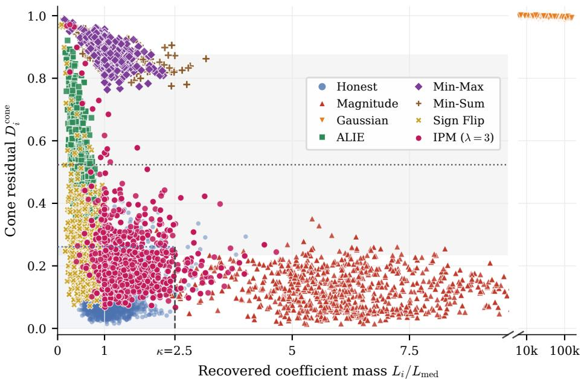  
Figure 10: Uncurated version of Figure 9(c). MNIST, seed 42, $q = 1$ , all 1000 rounds of the clean and seven attacked runs; a plain random subsample of 3,000 honest and 1,500 submissions per attack with no quantile filtering. The shaded box is bounded by $\kappa = 2 . 5$ and the honest 95th-percentile cone residual (0.26); the gray dotted line and band are the median and interquartile range of the per-round Stage II cutoff (0.52, [0.24, 0.88]). Gaussian submissions are on the broken right axis. Sign Flip and IPM overlap the honest box in 69.8% and 68.4% of rounds; Min-Max and Min-Sum coincide.

Table 17: Stage-wise detection on MNIST, seed 42. Statistics are pooled over all 1000 rounds. Recall, honest FPR, and fair mass are percentages; fair mass is the retained fraction of honest $F _ { i } ^ { q }$ mass.
<table><tr><td>Attack</td><td>Recall ↑</td><td>Honest FPR ↓</td><td>Fair mass ↑</td><td>Scale used</td><td>Cone used</td></tr><tr><td>Sign Flip</td><td>58.4</td><td>16.7</td><td>82.9</td><td>0.15</td><td>3.85</td></tr><tr><td>IPM (λ = 3)</td><td>59.4</td><td>16.2</td><td>83.6</td><td>0.06</td><td>3.94</td></tr><tr><td>Gaussian</td><td>100.0</td><td>0.0</td><td>100.0</td><td>4.00</td><td>0.00</td></tr><tr><td>ALIE</td><td>94.9</td><td>2.0</td><td>97.3</td><td>0.17</td><td>3.83</td></tr><tr><td>Min-Max</td><td>99.6</td><td>0.2</td><td>99.8</td><td>0.01</td><td>3.98</td></tr><tr><td>Min-Sum</td><td>99.7</td><td>0.1</td><td>99.8</td><td>0.03</td><td>3.97</td></tr><tr><td>Magnitude</td><td>99.5</td><td>0.2</td><td>99.8</td><td>3.98</td><td>0.02</td></tr></table>

## E.2 STAGE-WISE SCREENING BEHAVIOR

Gaussian and Magnitude Scaling primarily consume scale-stage budget, whereas ALIE, Min-Max, and Min-Sum primarily consume cone-stage budget. Sign Flip and IPM are harder: their Byzantine recall is about 59%, and the selector also rejects about 16% of honest observations.

## E.3 FROM SIMPLEX TO CONE: CONTROLLED FAIRNESS-WARP TESTS

This subsection separates two questions that the end-to-end BOBA comparison of Section 5.2 cannot separate: whether the unit-sum simplex is the right observation model for fairness-scaled messages, and whether a training run built on it is robust. The first question is answered by a fixed-checkpoint reconstruction diagnostic; the second by the training control of Table 19.

Fixed-checkpoint reconstruction residuals. Table 18 and Figure 11 use the same checkpoint, the same sampled honest clients, and the same trusted basis G for both geometries, so that only the feasible set of the coefficient fit differs. For $q = 0$ the message is the plain update and its nonnegative cone mass $\| \hat { a } _ { i } \| _ { 1 }$ is already close to one on MNIST and EMNIST (0.88 and 0.84), so the unit-sum and cone residuals nearly coincide there; on CIFAR-10 and AGNews the plain updates have mass 0.65 and 0.74 and the unit-sum fit is already worse. For $q = 1$ the cone residual is unchanged on every submission, because the cone is invariant to $u _ { i } \mapsto F _ { i } u _ { i }$ , whereas the unit-sum residual moves with the distance of the true mass from one: on MNIST $( F _ { i } \approx 0 . 2 4 )$ it rises from 0.19 to 1.08, i.e. the simplex fit becomes worse than predicting zero; on EMNIST $( F _ { i } \approx 0 . 7 7 )$ and CIFAR-10 $( F _ { i } \approx 0 . 9 2 )$ the increase is moderate; on AGNews $( \bar { F } _ { i } \approx 1 . 1 0 )$ the scaling moves the mass toward one and the unit-sum penalty shrinks. The direction of the effect therefore follows | log $\| \hat { a } _ { i } \| _ { 1 } |$ , not the spread of the losses inside a round. The unit-sum residual is never smaller than the cone residual (the simplex is a subset of the cone), and the diagnostic makes no statement about attacks: a negatively scaled mean has zero nonnegative mass under either model, so this experiment does not by itself explain BOBA’s IPM collapse.

Table 18: Unit-sum simplex versus nonnegative cone on identical inputs. For each dataset the FUSE run’s seed-43 checkpoint at round 600 is loaded, the next ten rounds’ honest clients are replayed with the production local step (10 clients per round, 100 submissions), and the production server basis G (20 trusted examples per class) is built once per round. Each honest update $\Delta _ { i }$ is submitted as $u _ { i } =$ $F _ { i } ^ { q } \Delta _ { i }$ with $q = 0$ (plain update) and $q = 1$ (the paper’s fairness-scaled vector, $F _ { i } = \mathrm { s t a r t - o f - }$ round loss). $\begin{array} { r } { D ^ { \mathrm { c o n e } } = \operatorname* { m i n } _ { a \geq 0 } \| S u _ { i } - G a \| ^ { 2 } / \| S u _ { i } \| ^ { 2 } } \end{array}$ and $\begin{array} { r } { D ^ { \mathrm { s i m p l e x } } = \operatorname* { m i n } _ { \substack { p > 0 , \mathbf { 1 } ^ { \top } p = 1 } } \| S u _ { i } - G p \| ^ { 2 } / \| S u _ { i } \| ^ { 2 } } \end{array}$ (energy ratios) are computed in the same screened coordinates S with the aggregator’s own solvers; $\| \hat { a } _ { i } \| _ { 1 }$ is the mass of the cone fit. Medians over the 100 submissions; the gap is Dsimplex − Dcone and is positive in every case. No optimizer, trajectory, attack or aggregation rule is involved.
<table><tr><td>Dataset</td><td>Screened coords.</td><td>q</td><td>Fi med. [p10, p90]</td><td>∥|âi∥|1 med.</td><td> $D ^ { \mathrm { c o n e } }$  med. / p90</td><td> $D ^ { \mathrm { s i m p l e x } }$  med. / p90</td><td>gap med. / p90</td><td> $\mathrm { P r } [ D ^ { \mathrm { s i m p l e x } } > D ^ { \mathrm { c o n e } } ]$ </td></tr><tr><td>CIFAR-10 / ResNet-18</td><td>classifier (5,130)</td><td>0 1</td><td>0.92 [0.81, 1.18]</td><td>0.65</td><td>0.080 / 0.111</td><td>0.102 / 0.175</td><td>+0.024/+0.066</td><td>1.00</td></tr><tr><td></td><td></td><td></td><td>0.92 [0.81, 1.18]</td><td>0.59</td><td>0.080 / 0.111</td><td>0.111 / 0.223</td><td>+0.035 /+0.113</td><td>1.00</td></tr><tr><td></td><td>full (11,173,962)</td><td></td><td>0.92 [0.81, 1.18]</td><td>0.28</td><td>0.823 / 0.890</td><td>1.242 / 1.660</td><td>+0.427/ +0.799</td><td>1.00</td></tr><tr><td></td><td></td><td>1</td><td>0.92 [0.81, 1.18]</td><td>0.26</td><td>0.823 / 0.890</td><td>1.307 / 2.079</td><td>+0.502 /+1.267</td><td>1.00</td></tr><tr><td>MNIST / MLP</td><td>classifier (2,010)</td><td>0</td><td>0.24 [0.20, 0.30]</td><td>0.88</td><td>0.178 / 0.297</td><td>0.185 / 0.306</td><td>+0.008 /+0.047</td><td>1.00</td></tr><tr><td></td><td></td><td>1</td><td>0.24 [0.20, 0.30]</td><td>0.21</td><td>0.178 / 0.297</td><td>1.077 / 3.247</td><td>+0.899 /+3.057</td><td>1.00</td></tr><tr><td></td><td>full (159,010)</td><td>0</td><td>0.24 [0.20, 0.30]</td><td>0.57</td><td>0.411 / 0.575</td><td>0.484 / 0.751</td><td>+0.066 /+0.269</td><td>1.00</td></tr><tr><td></td><td></td><td>1</td><td>0.24 [0.20, 0.30]</td><td>0.14</td><td>0.411 / 0.575</td><td>3.233 / 8.688</td><td>+2.759 /+8.160</td><td>1.00</td></tr><tr><td>EMNIST / CNN</td><td>classifier (68,655)</td><td>0</td><td>0.77 [0.70, 0.83]</td><td>0.84</td><td>0.162 / 0.211</td><td>0.165 / 0.218</td><td>+0.006 /+0.019</td><td>1.00</td></tr><tr><td></td><td></td><td>1</td><td>0.77 [0.70, 0.83]</td><td>0.64</td><td>0.162 / 0.211</td><td>0.188 / 0.281</td><td>+0.029 /+0.069</td><td>1.00</td></tr><tr><td></td><td>full (124,975)</td><td>0</td><td>0.77 [0.70, 0.83]</td><td>0.84</td><td>0.161 / 0.212</td><td>0.169 / 0.224</td><td>+0.005 / +0.016</td><td>1.00</td></tr><tr><td></td><td></td><td>1</td><td>0.77 [0.70, 0.83]</td><td>0.64</td><td>0.161 / 0.212</td><td>0.190 / 0.275</td><td>+0.030 /+0.069</td><td>1.00</td></tr><tr><td>AGNews / GRU</td><td>full (14,282,672)</td><td>0</td><td>1.10 [1.01, 1.17]</td><td>0.74</td><td>0.339 / 0.395</td><td>0.403 / 0.464</td><td>+0.061 / +0.078</td><td>1.00</td></tr><tr><td></td><td></td><td>1</td><td>1.10 [1.01, 1.17]</td><td>0.82</td><td>0.339 / 0.395</td><td>0.366 / 0.433</td><td>+0.026/+0.047</td><td>1.00</td></tr></table>

Table 19: Controlled fairness-warp mechanism test on MNIST/MLP, seed 42, 1000 rounds. Entries are global / worst-10% client accuracy (%) over rounds 990–999; “n/a” = condition not run. The two $q = 1$ screening rows differ only in the Stage II score (unit-sum simplex distance versus nonnegativecone distance); everything else, including Stage I and the loss-normalized aggregation, is identical.
<table><tr><td>Structural model</td><td>q</td><td>Clean</td><td>Sign Flip</td><td>Magnitude</td><td>IPM</td><td>Min-Max</td><td>Min-Sum</td></tr><tr><td>No screening</td><td>1</td><td>93.95/89.26</td><td>92.39/87.11</td><td>95.20/90.06</td><td>n/a</td><td>n/a</td><td>n/a</td></tr><tr><td>Simplex screening</td><td>0</td><td>96.55/92.13</td><td>96.44/91.93</td><td>96.62/92.33</td><td>n/a</td><td>n/a</td><td>n/a</td></tr><tr><td>Simplex screening</td><td></td><td>93.95/89.26</td><td>93.85/89.08</td><td>93.95/89.26</td><td>89.91/83.98</td><td></td><td>92.91/87.4692.83/87.40</td></tr><tr><td>Scale + cone</td><td>1</td><td>93.95/89.26</td><td>93.20/88.09</td><td>93.96/89.27</td><td>92.35/87.01</td><td></td><td>93.94/89.23 93.96/89.26</td></tr></table>

Training control. Table 19 replaces FUSE’s nonnegative-cone fit by a unit-sum simplex fit inside the same pipeline. The $q = 0$ simplex row is a sanity check of the unwarped geometry: with plain updates the simplex is the appropriate model and performs well. It cannot, however, be compared directly with the $q = 1$ rows, because changing q alters both the upload geometry and the optimized fairness objective, so the accuracy difference does not isolate geometry. The matched $q = 1$ comparison is the relevant test of observation-model mismatch, and Table 20 shows where the two models separate. Under Clean and Magnitude the rows coincide (Stage I, shared by both, removes Magnitude). Under Sign Flip the simplex score is the better detector (recall 0.92 against 0.58, honest FPR 0.03 against 0.17): a negated honest mean has a negative coefficient sum, so the unit-sum constraint rejects it directly, whereas the cone only measures its residual; the MLP tolerates the leaked vectors and the accuracy gap is 0.65 points in the simplex’s favor. Under the invalid-mixture attacks the picture reverses. For Min-Max and Min-Sum the cone score removes essentially every Byzantine submission (recall 1.00, FPR 0.00) while the simplex score removes 56–62% of them and rejects 15–18% of honest clients instead; for IPM the simplex recall drops to 0.45 with FPR 0.22 against 0.62 and 0.15 for the cone. The corresponding accuracy differences on MNIST are moderate (1.0–2.4 percentage points global, 1.8–3.0 worst-10%) because the MLP is forgiving, but the screening statistics separate the two geometries clearly: fairness-scaled honest updates have coefficient mass $F _ { i } ^ { q } \approx 0 . 2 – 0 . 3$ , so their unit-sum residuals overlap those of the attacks (Table 18) and the simplex ranking spends its budget on honest clients. These numbers do not license a claim of universal cone superiority (Sign Flip is a counterexample), but they do isolate the mechanism: on the attacks where end-to-end BOBA fails, replacing the nonnegative cone by the unit-sum simplex inside FUSE’s own pipeline reproduces the loss of recall, with no other component changed.

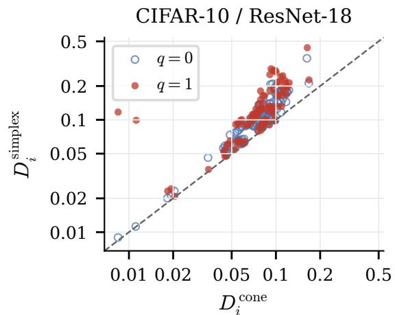

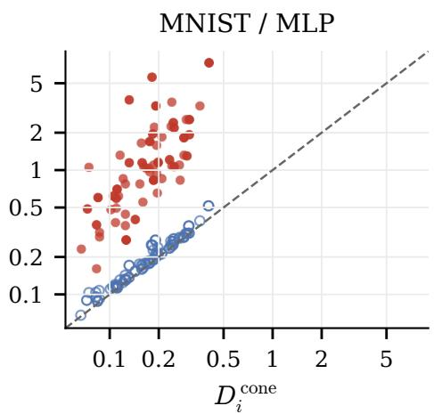

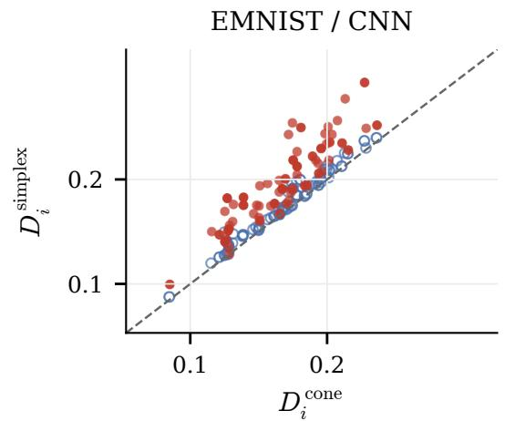

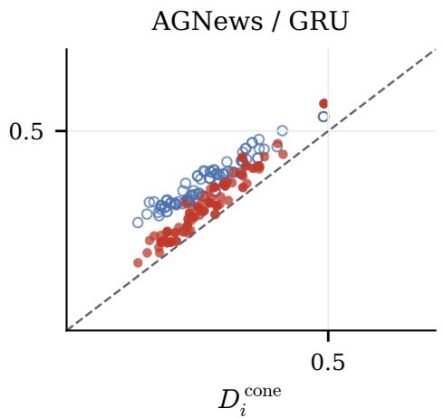  
Figure 11: Unit-sum versus cone residual for the same honest submissions. Each panel uses that dataset’s own screening coordinates (classifier block on the three vision benchmarks, all parameters on AGNews), seed-43 checkpoint at round 600, rounds 600–609 (100 submissions per dataset); plain updates $( q = 0 ;$ , hollow) and fairness-scaled submissions $( q = 1$ , filled). Every point lies above the diagonal; log axes.

Table 20: Screening behavior behind the two $q = 1$ rows of Table 19: Byzantine recall and honest false-rejection rate, pooled over all 1000 rounds (4 Byzantine and 10 honest submissions per round).
<table><tr><td rowspan="2">Attack</td><td colspan="3">Simplex screening,  $q = 1$ </td><td colspan="3">Scale + cone,  $q = 1$ </td></tr><tr><td>Recall</td><td>Honest FPR</td><td>Global acc.</td><td>Recall</td><td>Honest FPR</td><td>Global acc.</td></tr><tr><td>Sign Flip</td><td>0.92</td><td>0.03</td><td>93.85</td><td>0.58</td><td>0.17</td><td>93.20</td></tr><tr><td>Magnitude</td><td>0.99</td><td>0.00</td><td>93.95</td><td>0.99</td><td>0.00</td><td>93.96</td></tr><tr><td>IPM</td><td>0.45</td><td>0.22</td><td>89.91</td><td>0.62</td><td>0.15</td><td>92.35</td></tr><tr><td>Min-Max</td><td>0.56</td><td>0.18</td><td>92.91</td><td>1.00</td><td>0.00</td><td>93.94</td></tr><tr><td>Min-Sum</td><td>0.62</td><td>0.15</td><td>92.83</td><td>1.00</td><td>0.00</td><td>93.96</td></tr></table>

## E.4 LOSS-SCALE RECOVERY ACROSS FAIRNESS STRENGTHS

The ideal coefficient identity $L _ { i } = F _ { i } ^ { q }$ implies $\textstyle { \frac { 1 } { q } }$ log $L _ { i } =$ log $F _ { i } , \qquad q > 0$ . We test this identity in a matched MNIST/MLP checkpoint experiment at $q \in \{ 0 . 1 , 0 . 5 , 1 . 0 , 1 . 5 , 2 . 0 , 3 . 0 \}$ . For every value of $q ,$ FUSE is trained from scratch with that same upload exponent to round 299, using the same seed, partition, optimizer, scale-and-cone selector, and previous server-loss q-FFL aggregation. Trusted-reference augmentation is fixed to one view throughout. We then freeze the corresponding checkpoint, form $u _ { i } = F _ { i } ^ { q } \Delta _ { i }$ for all 100 honest clients, and rerun the full-parameter nonnegative-cone recovery to obtain $L _ { i } = \| \widehat { a } _ { i } \| _ { 1 }$ . Thus, each panel contains 100 clients evaluated at one matched checkpoint; no Byzantine submissions or pooled training-round observations enter this diagnostic.

Table 21: Numerical summary of Fig. 12. Perfect loss-scale recovery has Pearson and Spearman correlation one, slope one, and zero mean absolute log error.
<table><tr><td>q</td><td>Pearson r</td><td>Spearman ρ</td><td>OLS slope</td><td>MALE</td></tr><tr><td>0.1</td><td>0.153</td><td>0.179</td><td>1.88</td><td>3.997</td></tr><tr><td>0.5</td><td>0.400</td><td>0.355</td><td>1.11</td><td>0.695</td></tr><tr><td>1.0</td><td>0.608</td><td>0.537</td><td>1.02</td><td>0.301</td></tr><tr><td>1.5</td><td>0.736</td><td>0.670</td><td>1.00</td><td>0.180</td></tr><tr><td>2.0</td><td>0.817</td><td>0.751</td><td>1.00</td><td>0.123</td></tr><tr><td>3.0</td><td>0.903</td><td>0.848</td><td>0.99</td><td>0.070</td></tr></table>

The inverse transformation becomes progressively better calibrated as $q$ increases in this checkpoint audit: the fitted slope is within 0.02 of one for $q \geq 1$ , while MALE decreases from $0 . 3 0 1$ at $q = 1$ to 0.070 at $q = 3$ . Rank recovery also strengthens, reaching Spearman $\rho = 0 . 8 4 8$ at $q = 3$ . In contrast, $q = 0 .$ .1 is a clear failure regime. If log $L _ { i } = q \log F _ { i } + e _ { i }$ , then the reconstructed log loss is $q ^ { - 1 } \log L _ { i } = \log F _ { i } + e _ { i } / q ;$ hence coefficient-recovery error is amplified by $1 / q$ . The result supports using $L _ { i }$ directly as a radial screening statistic, while cautioning against interpreting $L _ { i } ^ { 1 / q }$ as an accurate client-loss estimator when q is small.

## E.5 LOCAL-STEP SENSITIVITY

The analysis of Section 3 and the main benchmark use one full-batch local step, for which $\Delta _ { i } \approx G p _ { \mathrm { : } }$ is a first-order identity. Table 22 asks whether the geometry survives several local steps. Honest clients take $E \in \{ 2 , 5 \}$ } full-batch steps (learning rate 0.1) and upload $F _ { i } ( w _ { t } ) ^ { q } ( w _ { i } - w _ { t } )$ , with $F _ { i } ( w _ { t } )$ the train-mode loss of the first step; the server references $g _ { c }$ are built with the same E steps, so the basis and the submissions undergo the same local trajectory. Everything else follows the main protocol (MNIST/MLP, seed 42, q = 1, 1000 rounds; $E = 1$ is the main-table run).

The mixture structure degrades gracefully rather than breaking. The honest cone residual grows with E (median 0.139, 0.246, 0.358 for $E = 1 , 2 , 5 )$ but stays well below the residuals of the structural attacks (0.49–1.00 in Figure 9c), and the scale identity is preserved: the correlation between $L _ { i }$ and $F _ { i } ^ { q }$ is 0.944, 0.981, and 0.976. Clean accuracy rises with more local computation (93.95, 94.98, 96.06), every attack except Sign Flip and IPM stays within 0.1 points of the corresponding clean run, and the seven-attack floor moves from 92.35/87.01 to 91.33/85.96 and 91.45/85.78, i.e. IPM remains the binding attack and its gap to clean widens from 1.6 to 3.7 and 4.6 points as the pooled recall over the seven attacks falls from 0.88 to 0.81 and 0.79 (honest FPR 0.05 to 0.08). The applicable regime is therefore not limited to a single step, but the guarantees should be read as small-local-step statements: with more local progress the honest updates drift away from the trusted class directions and the cone-preserving attacks gain room.

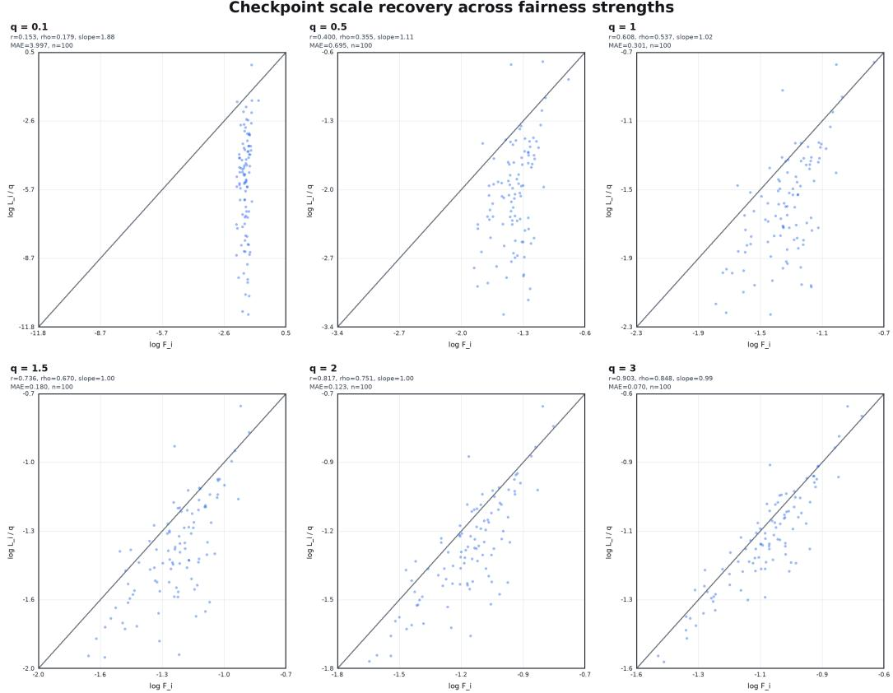  
Figure 12: Checkpoint recovery of client loss scale across $q \cdot$ Each panel plots $x =$ log $F _ { i }$ against $y = q ^ { - 1 }$ log $L _ { i } = \log L _ { i } ^ { 1 / q }$ for all 100 honest clients at the matched round-299 checkpoint; the diagonal is $y = x$ . Pearson r, Spearman $\rho ,$ ordinary-least-squares slope, and mean absolute log error (MALE) use all points. Axes retain equal scaling and show the central 98% only for visualization.

Table 22: Local-step sensitivity (MNIST/MLP, seed $4 2 , q = 1$ , 1000 rounds). Clients take $E$ fullbatch local steps and upload $F _ { i } \dot { ( } w _ { t } ) ^ { q } ( w _ { i } - w _ { t } )$ with the start-of-round loss; server references use the same E steps. Accuracy is global / worst-10% over rounds 990–999; the worst attack is the minimum over the seven attacks. Honest cone residual and the Pearson correlation between $L _ { i } = \| \hat { a } _ { i } \| _ { 1 }$ 1 and $F _ { i } ^ { q }$ are pooled over all rounds of the clean run; recall and honest FPR are pooled over the seven attacked runs.
<table><tr><td>E</td><td>Clean</td><td>Sign</td><td> $\mathrm { I P M } _ { \lambda = 3 }$ </td><td>Gauss.</td><td>ALIE</td><td>Min-Max</td><td>Min-Sum</td><td>Magnitude</td><td>Worst</td><td>honest  $D ^ { \mathrm { c o n e } }$  med/p90</td><td> $r ( L _ { i } , F _ { i } ^ { q } )$ </td><td>recall / FPR</td></tr><tr><td>1</td><td>93.95/89.26</td><td>93.20/88.09</td><td>92.35/87.01</td><td>93.95/89.26</td><td>93.94/89.14</td><td>93.94/89.23</td><td>93.96/89.26</td><td>93.96/89.27</td><td>92.35/87.01</td><td>0.139/0.238</td><td>0.944</td><td>0.88 / 0.05</td></tr><tr><td>2</td><td>94.98/90.37</td><td>92.85/87.57</td><td>91.33/85.96</td><td>94.98/90.37</td><td>94.95/90.22</td><td>95.01/90.41</td><td>95.01/90.45</td><td>94.98/90.37</td><td>91.33/85.96</td><td>0.246/0.391</td><td>0.981</td><td>0.81 / 0.08</td></tr><tr><td>5</td><td>96.06/91.42</td><td>94.07/89.02</td><td>91.45/85.78</td><td>96.06/91.42</td><td>96.03/91.49</td><td>96.04/91.47</td><td>96.05/91.52</td><td>96.06/91.42</td><td>91.45/85.78</td><td>0.358/0.530</td><td>0.976</td><td>0.79 / 0.08</td></tr></table>

## E.6 OPERATIONAL SENSITIVITY TO FAIRNESS STRENGTH AND SCALE TOLERANCE

Theorem 2 predicts that larger q widens honest radial spread, while inverse scale recovery improves because log-scale error is divided by q. Across the tested κ values, the worst-attack accuracy is nearly unchanged; increasing κ from 2.0 to 3.0 reduces honest FPR and raises retained fair mass.

Table 23: Final-method MNIST/MLP sensitivity, seed 42, rounds 290–299. Worst-attack results use all seven attacks; FPR and retained fair mass are pooled across attacked conditions. Entries are percentages.
<table><tr><td>q</td><td>0.5</td><td>1.0</td><td>1.5</td><td>2.0</td></tr><tr><td>Worst-attack global accuracy</td><td>91.57</td><td>91.18</td><td>90.84</td><td>90.47</td></tr><tr><td>Worst-attack worst-10% accuracy</td><td>86.21</td><td>85.62</td><td>85.16</td><td>84.85</td></tr><tr><td>κ</td><td>2.0</td><td>2.5</td><td>3.0</td><td>3.5</td></tr><tr><td>Worst-attack global / worst-10%</td><td>91.20/85.60</td><td>91.18/85.62</td><td>91.19/85.61</td><td>91.18/85.61</td></tr><tr><td>Honest FPR</td><td>5.71</td><td>5.00</td><td>4.14</td><td>4.14</td></tr><tr><td>Retained fair mass</td><td>93.66</td><td>94.70</td><td>95.75</td><td>95.74</td></tr></table>

## E.7 HIGH-LOSS-CLIENT AUDIT

Table 24: Honest-client rejection by within-round start-loss quantile, pooled over the seven attacked conditions. Rejection share is the fraction of all rejected honest observations contributed by the row.
<table><tr><td>Dataset</td><td>Honest loss quantile</td><td>Rejection rate</td><td>Retained fair mass</td><td>Rejection share</td></tr><tr><td rowspan="3">CIFAR-10/ResNet-18</td><td>0-50%</td><td>3.15%</td><td>97.45%</td><td>58.41%</td></tr><tr><td>50–80%</td><td>1.44%</td><td>98.99%</td><td>16.05%</td></tr><tr><td>80-100%</td><td>3.45%</td><td>96.64%</td><td>25.54%</td></tr><tr><td rowspan="3">MNIST</td><td>0-50%</td><td>4.74%</td><td>95.42%</td><td>46.82%</td></tr><tr><td>50–80%</td><td>5.19%</td><td>95.20%</td><td>30.76%</td></tr><tr><td>80-100%</td><td>5.67%</td><td>94.65%</td><td>22.41%</td></tr><tr><td rowspan="3">EMNIST-Balanced</td><td>0-50%</td><td>1.51%</td><td>99.26%</td><td>61.00%</td></tr><tr><td>50–80%</td><td>0.89%</td><td>99.55%</td><td>21.64%</td></tr><tr><td>80-100%</td><td>1.07%</td><td>99.48%</td><td>17.36%</td></tr><tr><td rowspan="3">AGNews</td><td>0-50%</td><td>5.53%</td><td>95.09%</td><td>40.60%</td></tr><tr><td>50–80%</td><td>6.02%</td><td>94.30%</td><td>26.52%</td></tr><tr><td>80-100%</td><td>11.19%</td><td>89.83%</td><td>32.87%</td></tr></table>

The AGNews tail is the least well preserved, consistent with the weaker IPM result in Table 10.

Table 25 extends the highest-loss-20% audit to the five registered seeds and splits it by attack. It pools thefull training horizon, whereas the matched comparison of Table 2 pools the first 300 rounds, the window over which the H-nobs and BOBA audit runs were reproduced. The two windows are not interchangeable: early in training the honest losses are still close together, so every method rejects fewer high-loss clients and retention is higher. For FUSE the pooled retained mass over the first 300 rounds is 99.77/98.48/100.00/90.06% on CIFAR-10/MNIST/EMNIST-Balanced/AGNews against 95.23/94.27/99.65/91.40% over the full horizon. The ordering between methods is unaffected. The clean-side attacks (Gaussian, Magnitude, and on most datasets Min-Max and Min-Sum) never remove a high-loss honest client. The cost is concentrated in attacks whose Byzantine vectors are placed near the honest cone: Sign Flip on MNIST, ALIE on CIFAR-10, and ALIE on AGNews, where the cone stage removes the honest tail clients whose class mixtures are least typical.

Table 25: Per-attack high-loss retention, five seeds. Retained fair mass (%) of the highest-loss 20% of honest clients, mean $\pm \mathrm { s t d }$ over seeds 40–44, pooled over rounds r with $( r + 1 )$ mod $1 0 = 0 .$ The last column is the retained fair mass of all honest clients (pooled over attacks).
<table><tr><td>Dataset/model</td><td> $\mathrm { S i g n }$ </td><td> $\mathrm { I P M } _ { \lambda = 3 }$ </td><td>Gauss.</td><td>ALIE</td><td>Min-Max</td><td>Min-Sum</td><td>Magnitude</td><td>Pooled</td><td>All honest</td></tr><tr><td>CIFAR-10/ResNet-18</td><td> $8 9 . 0 9 _ { \pm 7 . 2 7 }$ </td><td> $9 9 . 1 7 _ { \pm 0 . 7 8 }$ </td><td> $1 0 0 . 0 0 { \scriptstyle \pm 0 . 0 0 }$ </td><td> $8 1 . 4 3 _ { \pm 5 . 5 3 }$ </td><td> $9 8 . 2 2 _ { \pm 1 . 9 1 }$ </td><td> $9 9 . 8 6 _ { \pm 0 . 1 3 }$ </td><td> $1 0 0 . 0 0 { \scriptstyle \pm 0 . 0 0 }$ </td><td> $9 5 . 2 3 _ { \pm 2 . 3 2 }$ </td><td> $9 7 . 6 3 _ { \pm 0 . 5 8 }$ </td></tr><tr><td>MNIST/MLP</td><td> $8 2 . 6 4 { \scriptstyle \pm 5 . 7 1 }$ </td><td> $8 9 . 4 0 { \scriptstyle \pm 2 . 9 1 }$ </td><td> $1 0 0 . 0 0 { \scriptstyle \pm 0 . 0 0 }$ </td><td> $9 2 . 1 7 { \scriptstyle \pm 5 . 9 3 }$ </td><td> $9 8 . 4 6 { \scriptstyle \pm 3 . 2 4 }$ </td><td> $9 8 . 4 5 { \scriptstyle \pm 3 . 4 7 }$ </td><td> $1 0 0 . 0 0 { \scriptstyle \pm 0 . 0 0 }$ </td><td> $9 4 . 2 7 { \scriptstyle \pm 2 . 8 7 }$ </td><td> $9 6 . 0 1 { \scriptstyle \pm 1 . 0 7 }$ </td></tr><tr><td>EMNIST-Balanced/CNN</td><td> $9 9 . 1 8 _ { \pm 0 . 4 7 }$ </td><td> $9 9 . 2 6 { \scriptstyle \pm 0 . 5 1 }$ </td><td> $1 0 0 . 0 0 { \scriptstyle \pm 0 . 0 0 }$ </td><td> $9 9 . 1 3 { \scriptstyle \pm 0 . 3 8 }$ </td><td> $1 0 0 . 0 0 { \scriptstyle \pm 0 . 0 0 }$ </td><td> $1 0 0 . 0 0 { \scriptstyle \pm 0 . 0 0 }$ </td><td>100.00±0.00</td><td> $9 9 . 6 5 { \scriptstyle \pm 0 . 1 7 }$ </td><td> $9 9 . 2 1 { \scriptstyle \pm 0 . 3 4 }$ </td></tr><tr><td>AGNews/GRU</td><td> $9 0 . 2 8 _ { \pm 1 0 . 7 3 }$ </td><td> $9 7 . 7 9 _ { \pm 2 . 3 4 }$ </td><td> $1 0 0 . 0 0 { \scriptstyle \pm 0 . 0 0 }$ </td><td> $5 7 . 3 3 _ { \pm 6 . 0 3 }$ </td><td> $9 8 . 4 9 _ { \pm 2 . 0 0 }$ </td><td>98.58±1.82</td><td> $1 0 0 . 0 0 { \scriptstyle \pm 0 . 0 0 }$ </td><td> $9 1 . 4 0 _ { \pm 1 . 9 2 }$ </td><td> $9 4 . 5 4 _ { \pm 0 . 6 6 }$ </td></tr></table>

## E.8 AGGREGATION CONTROLS

The eight EMNIST $q + 1$ runs did not fail because of the scheduler, an out-of-memory error, or a non-finite value. They all stopped at round 123 under the registered chance-level rule. For 47 classes, this rule declares collapse after 25 consecutive evaluated rounds at or below $1 / 4 7 + 0 . 0 0 5 = 2 . 6 2 8 \%$ beginning no earlier than the 100th one-indexed round. The recorded accuracies from zero-indexed

Table 26: Post-screening aggregation controls, seed 42. Entries are global / worst-10% client accuracy (%). Worst attack is the componentwise minimum across the available attacked conditions. A dash indicates that at least one required attack lacks a final window.
<table><tr><td>Dataset</td><td>Aggregation</td><td>Clean</td><td>Worst attack</td></tr><tr><td>CIFAR-10/ResNet-18</td><td>server-loss q-FFL</td><td>69.13/59.12</td><td>63.38/52.19</td></tr><tr><td></td><td>mean-u</td><td>79.25/70.60</td><td>57.01/45.18</td></tr><tr><td></td><td>loss-normalized</td><td>82.19/72.98</td><td>76.92/67.30</td></tr><tr><td>MNIST/MLP</td><td>server-loss q-FFL</td><td>95.54/91.46</td><td>93.86/88.96</td></tr><tr><td></td><td>mean-u</td><td>93.98/89.29</td><td>92.81/87.69</td></tr><tr><td></td><td>recovered q-FFL</td><td>95.56/91.47</td><td></td></tr><tr><td></td><td>loss-normalized</td><td>93.95/89.26</td><td>92.77/87.60</td></tr><tr><td>EMNIST-Balanced/CNN</td><td>server-loss q-FFL</td><td>73.14/64.03</td><td>73.14/63.56</td></tr><tr><td></td><td>mean-u</td><td>60.96/50.97</td><td>9.14/2.83</td></tr><tr><td></td><td>recovered q-FFL</td><td>69.65/60.30</td><td></td></tr><tr><td></td><td>loss-normalized</td><td>79.55/70.28</td><td>78.68/69.37</td></tr><tr><td>AGNews/GRU</td><td>server-loss q-FFL</td><td>72.02/53.93</td><td>63.86/45.27</td></tr><tr><td></td><td>mean-u</td><td>82.01/66.51</td><td>35.65/22.83</td></tr><tr><td></td><td>recovered q-FFL</td><td>68.84/50.24</td><td></td></tr><tr><td></td><td>loss-normalized</td><td>83.79/68.08</td><td>66.29/45.70</td></tr></table>

Table 27: Loss-normalization exponent control, seed 42. Entries are global / worst-10% client accuracy (%). CIFAR-10 uses the auxiliary five-layer CNN in this controlled comparison. A dash for EMNIST means that all eight conditions (Clean and seven attacks) met the registered collapse criterion.
<table><tr><td>Dataset</td><td>Denominator exponent</td><td>Clean</td><td>Worst attack</td></tr><tr><td>CIFAR-10/CNN</td><td> $q + 1$ </td><td>39.80/27.55</td><td>39.70/27.45</td></tr><tr><td>CIFAR-10/CNN</td><td>q</td><td>46.53/34.15</td><td>46.35/33.93</td></tr><tr><td>MNIST/MLP</td><td> $q + 1$ </td><td>93.93/89.23</td><td>92.75/87.64</td></tr><tr><td>MNIST/MLP</td><td> $q$ </td><td>93.95/89.26</td><td>92.77/87.60</td></tr><tr><td>EMNIST/CNN</td><td> $q + 1$ </td><td></td><td></td></tr><tr><td>EMNIST/CNN</td><td> $q$ </td><td>79.55/70.28</td><td>78.68/69.37</td></tr><tr><td>AGNews/GRU</td><td> $q + 1$ </td><td>82.75/66.31</td><td>65.23/45.87</td></tr><tr><td>AGNews/GRU</td><td>q</td><td>83.79/68.08</td><td>66.29/45.70</td></tr></table>

rounds 99 through 123 all satisfy this condition; at round 123 the clean run has 2.622% global accuracy and 0% worst-10% client accuracy. Hence round 123 is the first round at which the 25-round patience can be exhausted.

The underlying failure is excessive step attenuation in this historical denominator control. Because $q = 1$ , using exponent $q + 1$ squares the reconstructed loss. At round 0 of the clean EMNIST run, where the estimated losses are close to log $4 7 \approx 3 . 8 5 $ , the $q + 1$ denominator is 148.74, compared with 38.57 for exponent $q .$ The corresponding aggregate-update norm is $8 . 9 9 \times 1 0 ^ { - 4 }$ rather than $3 . 4 7 \times 1 0 ^ { - 3 }$ , a reduction by a factor of about 3.86. Test loss decreases only from 3.853 to 3.846 by round 123, so the model does not leave the chance-level region before the registered stop. The same outcome in the clean condition shows that this is an optimization failure caused by the denominator choice, rather than an attack-specific failure. With exponent $q ,$ the matched clean run reaches 10.31% accuracy at round 123 and later completes normally. This diagnostic illustrates the optimization role of Component III: normalization should suppress excessive post-screening steps without overattenuating the update. The $q + 1$ denominator violates this balance on EMNIST, whereas the final exponent q preserves a substantially larger update and completes training normally.

## E.9 ATTACK STRENGTH AND BUDGET

Table 28: CIFAR-10/ResNet-18 sign-reversal strength, seed 42. Entries are global / worst-10% client accuracy (%).
<table><tr><td>Method</td><td> $\lambda = 1$ </td><td> $\lambda = 2$ </td><td> $\lambda = 3$ </td></tr><tr><td>FUSE</td><td>81.73/73.35</td><td>80.26/71.32</td><td>81.43/72.18</td></tr><tr><td>server-loss q-FFL aggregation</td><td>66.43/55.37</td><td>63.38/52.19</td><td>62.89/51.65</td></tr><tr><td>mean-u aggregation</td><td>78.86/69.87</td><td>76.64/68.34</td><td>72.31/61.88</td></tr></table>

Table 29: Declared-budget sensitivity for final FUSE on MNIST, seed 42, with four actual Byzantine submissions.
<table><tr><td>Declared f</td><td>Worst attack (global / worst-10% accuracy, %)</td></tr><tr><td>2</td><td>81.91/74.58</td></tr><tr><td>4</td><td>92.35/87.01</td></tr><tr><td>6</td><td>92.86/87.63</td></tr></table>

Under-declaring the budget is harmful under Gaussian perturbations. The slight advantage of $f = 6$ is a single-seed endpoint observation rather than evidence that over-rejection is generally beneficial.

## E.10 TRUSTED DATA, HETEROGENEITY, AND IDENTIFIABILITY

Table 30: Empirical validity of the trusted screening geometry at fixed CIFAR-10/ResNet-18 checkpoints. Captured energy is the fraction of honest update energy represented by the trusted class span; oracle overlap compares the trusted span with an all-client-data class-span oracle.

<table><tr><td>Checkpoint</td><td>Classifier energy</td><td>Classifier overlap</td><td>Full energy</td><td>Full overlap</td></tr><tr><td>Round 299</td><td>0.892</td><td>0.978</td><td>0.249</td><td>0.703</td></tr><tr><td>Round 599</td><td>0.901</td><td>0.972</td><td>0.161</td><td>0.595</td></tr><tr><td>Round 899</td><td>0.918</td><td>0.967</td><td>0.120</td><td>0.461</td></tr><tr><td>Round 1499</td><td>0.852</td><td>0.975</td><td>0.051</td><td>0.337</td></tr></table>

Table 31: Trusted augmentation repeats at fixed CIFAR-10/ResNet-18 checkpoints, classifier coordinates, seed 42.
<table><tr><td>Repeats</td><td>Projection energy</td><td>Negative coefficient mass</td><td>Loss MAE</td><td>Time (s)</td></tr><tr><td>1</td><td>0.9223</td><td>14.5973</td><td>1.7817</td><td>0.408</td></tr><tr><td>6</td><td>0.9237</td><td>5.1632</td><td>1.2567</td><td>1.061</td></tr><tr><td>12</td><td>0.9234</td><td>7.6181</td><td>1.3797</td><td>1.793</td></tr><tr><td>24</td><td>0.9236</td><td>6.6128</td><td>1.4823</td><td>3.358</td></tr><tr><td>64</td><td>0.9236</td><td>7.0401</td><td>1.4833</td><td>8.584</td></tr></table>

Table 32: Trusted-size sensitivity for final FUSE on MNIST, seed 42.
<table><tr><td>Samples/class</td><td>Worst attack (global / worst-10% accuracy, %)</td></tr><tr><td>1</td><td>90.30/84.44</td></tr><tr><td>20</td><td>92.35/87.01</td></tr><tr><td>50</td><td>92.79/87.52</td></tr></table>

Table 33: Label-skew sensitivity for final FUSE on MNIST, seed 42.
<table><tr><td>Dirichlet α</td><td>Worst attack (global / worst-10% accuracy, %)</td></tr><tr><td>0.1</td><td>92.70/86.93</td></tr><tr><td>0.5</td><td>92.86/87.98</td></tr><tr><td>1.0</td><td>92.35/87.01</td></tr></table>

Table 34: Numerical identifiability of the trusted basis over completed rounds and conditions. Values are median [5th, 95th percentile].
<table><tr><td>Dataset</td><td>Numerical rank</td><td>σmin</td><td>Condition number</td></tr><tr><td>CIFAR-10/ResNet-18</td><td>10 [10, 10]</td><td>0.0823 [0.0649, 0.0971]</td><td>6.78 [5.77, 9.22]</td></tr><tr><td>MNIST</td><td>10 [10, 10]</td><td>0.0590 [0.0529, 0.0785]</td><td>8.64 [7.60, 9.99]</td></tr><tr><td>EMNIST-Balanced</td><td>47 [47, 47]</td><td>0.0968 [0.0145, 0.1951]</td><td>14.26 [7.18, 34.02]</td></tr><tr><td>AGNews</td><td>4[4, 4]</td><td>0.0286 [0.0157, 0.0456]</td><td>4.09 [1.73, 7.09]</td></tr></table>

## E.11 COMPUTATION AND COMMUNICATION

FUSE preserves the one-vector communication protocol but is approximately 2.9× slower than BOBA in this measurement. The timing uses PyTorch on NVIDIA A100 resources and includes trusted-reference construction.

Table 35: Measured server-side time per attacked round with 14 submissions. All listed methods communicate one model-shaped vector per client.
<table><tr><td>Method</td><td>Server time/round</td><td>Client vectors</td><td>Extra client statistics</td></tr><tr><td>q-FFL-GD</td><td>1.71 ms</td><td>1</td><td>none</td></tr><tr><td>H-nobs</td><td>3.05 ms</td><td>1</td><td>none</td></tr><tr><td>BOBA</td><td>478.18 ms</td><td>1</td><td>none</td></tr><tr><td>FUSE</td><td>1387.10 ms</td><td>1</td><td>none</td></tr></table>

## E.12 OVER-DECLARED BUDGETS AND ALWAYS-ON SCREENING

The main benchmark declares $f _ { t } = 0$ in clean conditions and $f _ { t } = 4$ when four Byzantine submissions are appended. To test deployment with an over-declared budget, we also run clean training with $f _ { t } = 4$ for five seeds.

Table 36: Clean accuracy (%) with a matched budget $( f _ { t } = 0 )$ and an over-declared always-on budget $( f _ { t } = 4 )$ , five seeds.
<table><tr><td>Dataset/model</td><td>Matched  $f _ { t } = 0$ </td><td>Always-on  $f _ { t } = 4$ </td></tr><tr><td>CIFAR-10/ResNet-18</td><td>82.25</td><td>79.68</td></tr><tr><td>MNIST/MLP</td><td>93.83</td><td>93.78</td></tr><tr><td>EMNIST-Balanced/CNN</td><td>79.12</td><td>80.06</td></tr></table>

Accuracy changes little, but the fairness cost is substantial. Because the fixed-budget rule rejects exactly four of ten honest submissions, its honest FPR is 40%; retained fair mass falls to 59–62%, and the highest-loss 20% of clients retain only 53–79% of their mass. A median-plus-three-MAD threshold alternative reduces clean FPR to 2.8–5.7% and retains 94.4–98.3% of fair mass, but trades away attack recall, which drops from 88.0–96.5% under the fixed budget to 70.7–78.7%. Thus an accurate fixed budget favors attack protection, whereas adaptive rejection better protects fairness when the attack count is unknown.

Declared budget above the actual attack count. The matched benchmark gives every fixed-budget rule the true Byzantine upper bound. Table 37 keeps the declared budget at f = 4 while only 1, 2, or 3 of the 14 submissions are Byzantine (MNIST/MLP, seed 42). Robustness is unaffected: accuracy stays within 0.7 points of the matched run for every attack, and Gaussian, Min-Max, Min-Sum, and Magnitude are still removed with recall 1.00. The cost is entirely on the fairness side and is monotone in the over-declaration: with one actual attacker the screens must still reject four submissions, so the honest false-rejection rate rises from 0.00–0.17 to 0.30–0.35 and the retained fair mass of the highest-loss 20% of honest clients falls from 0.84–1.00 to 0.69–0.75; with three attackers the values are 0.10–0.20 and 0.84–0.96. Sign Flip and IPM recall also degrades as the budget is over-declared (0.58/0.62 at four attackers, 0.77/0.78 at one), because the surplus budget is spent on honest clients whose cone scores overlap those attacks. Together with the clean f = 4 run (FPR 0.40, retained mass 0.61) this quantifies the price of not knowing the attack count: accuracy is preserved, fairness mass is not.

Table 37: Declared budget f = 4 with fewer actual Byzantine submissions (MNIST/MLP, seed 42, q = 1, 1000 rounds). Global / worst-10% accuracy over rounds 990–999; below each block, Byzantine recall, honest false-rejection rate, and the retained fair mass of the highest-loss 20% of honest clients, pooled over all rounds. Actual = 0 is the over-declared clean run; actual = 4 is the matched main-table run.
<table><tr><td>Actual Byzantine</td><td>Sign</td><td>IPMλ=3</td><td>Gauss.</td><td>ALIE</td><td>Min-Max</td><td>Min-Sum</td><td>Magnitude</td></tr><tr><td>1 of 14: accuracy</td><td>93.76/88.86</td><td>93.61/88.76</td><td>93.95/89.32</td><td>93.92/89.32</td><td>93.95/89.30</td><td>93.95/89.29</td><td>93.93/89.32</td></tr><tr><td>recall / honest FPR</td><td>0.77 / 0.32</td><td>0.78 / 0.32</td><td>1.00 / 0.30</td><td>0.49 / 0.35</td><td>1.00 / 0.30</td><td>1.00 / 0.30</td><td>1.00 / 0.30</td></tr><tr><td>retained top-20% fair mass</td><td>0.71</td><td>0.73</td><td>0.75</td><td>0.69</td><td>0.75</td><td>0.75</td><td>0.75</td></tr><tr><td>2 of 14: accuracy</td><td>93.58/88.67</td><td>93.28/88.37</td><td>93.97/89.21</td><td>93.92/89.28</td><td>93.97/89.26</td><td>93.97/89.22</td><td>93.97/89.21</td></tr><tr><td>recall / honest FPR</td><td>0.74 / 0.25</td><td>0.75 / 0.25</td><td>1.00 / 0.20</td><td>0.45 / 0.31</td><td>1.00 / 0.20</td><td>1.00 / 0.20</td><td>1.00 / 0.20</td></tr><tr><td>retained top-20% fair mass</td><td>0.80</td><td>0.79</td><td>0.85</td><td>0.73</td><td>0.84</td><td>0.85</td><td>0.85</td></tr><tr><td>3 of 14: accuracy</td><td>93.40/88.40</td><td>92.86/87.68</td><td>93.98/89.34</td><td>93.90/89.01</td><td>93.91/89.12</td><td>93.97/89.33</td><td>93.98/89.34</td></tr><tr><td>recall / honest FPR</td><td>0.68 / 0.20</td><td>0.68 / 0.20</td><td>1.00 / 0.10</td><td>0.99 / 0.10</td><td>1.00 / 0.10</td><td>1.00 / 0.10</td><td>1.00 / 0.10</td></tr><tr><td>retained top-20% fair mass</td><td>0.84</td><td>0.88</td><td>0.96</td><td>0.90</td><td>0.95</td><td>0.96</td><td>0.96</td></tr><tr><td>4 of 14: accuracy</td><td>93.20/88.09</td><td>92.35/87.01</td><td>93.95/89.26</td><td>93.94/89.14</td><td>93.94/89.23</td><td>93.96/89.26</td><td>93.96/89.27</td></tr><tr><td>recall / honest FPR</td><td>0.58 / 0.17</td><td>0.62 / 0.15</td><td>1.00 / 0.00</td><td>0.95 / 0.02</td><td>1.00 / 0.00</td><td>1.00 / 0.00</td><td>0.99 / 0.00</td></tr><tr><td>retained top-20% fair mass</td><td>0.84</td><td>0.90</td><td>1.00</td><td>0.93</td><td>0.99</td><td>1.00</td><td>1.00</td></tr></table>

0 of 10 (clean, f = 4): accuracy 93.89/89.18, honest FPR 0.40, retained top-20% fair mass 0.61

## E.13 COVARIATE-SHIFT STRESS TESTS

We stress-test CIFAR-10/ResNet-18 with client-specific photometric changes, rotations, and CIFAR-10-C corruptions at severities 3 and 5. These experiments use a common 300-round diagnostic window. Shift lowers clean accuracy for all methods, but FUSE’s worst-attack accuracy remains within one point of its own shifted-clean value in every condition; for example, severity-3 corruption gives 51.75% clean and 51.03% under the worst attack. The trusted basis is built from unshifted clean examples, yet shifted honest updates retain cone medians of 0.060–0.069, honest FPR of 1.4–2.0%, total fair mass of 95–96%, and high-loss fair mass of 98.5–99.5%.

Varying the trusted set from 5 to 50 examples per class changes the four-attack worst-attack accuracy by at most 1.5 points in both the clean and corrupted domains. Honest FPR falls from 3.2% to 0.9%, while retained fair mass rises from 97.5% to 99.2%. These results show empirical tolerance to the tested covariate shifts; they do not establish guarantees for arbitrary violations of shared class-conditionals.

## E.14 ADAPTIVE CONE-PRESERVING ATTACKS

The adaptive attacker constructs a nonnegative trusted-cone vector with a coefficient mass chosen to remain plausible under Stage I. Its cone score can therefore be lower than the honest median, directly realizing the observable boundary of Theorem 2.

Table 38: CIFAR-10 diagnostic accuracy (%) under adaptive cone-preserving attacks. The 300-round values describe the mid-training window and are not terminal 1500-round conclusions.
<table><tr><td>Window</td><td>Clean</td><td>Surrogate</td><td>Oracle</td><td>Slack</td><td>Mixture</td></tr><tr><td>Rounds 200–299</td><td>54.1</td><td>20.9</td><td>13.6</td><td>12.7</td><td>19.3</td></tr><tr><td>Rounds 1490–1499</td><td>82.4</td><td>65.6</td><td>一</td><td>一</td><td>一</td></tr></table>

The 300-round diagnostic shows severe degradation, but the full-horizon surrogate runs partially recover to 65.6% versus 82.4% clean. We therefore interpret the available evidence as a severe transient degradation with a persistent terminal gap, not as universal permanent collapse. Shorthorizon Krum and FLTrust values are not used because those baselines have not converged by round 300 on several dataset/model pairs. Cone-copy attacks, which exactly reproduce a high-loss honest vector, remain within one to two points of clean accuracy; harmful adaptive attacks require exploiting the allowed cone and radial degrees of freedom rather than merely duplicating an honest update.

## E.15 OTHER OBSERVABLE-BOUNDARY EXPERIMENTS

A cone-copy attacker chooses a scale-plausible coefficient $a _ { b } \succeq 0$ and submits $G a _ { b }$ . Such a vector has no intrinsic cone-distance certificate of malicious origin. On CIFAR-10/ResNet-18, seed 42, the cone-copy condition completes with 78.32%/68.54% global / worst-10% accuracy for FUSE and 73.16%/63.55% for the unscreened q-FFL-GD control.

A parameter-selection attacker preserves the selected classifier coordinates (it submits the honest classifier mean there) while reversing and amplifying the unselected coordinates. On CIFAR-10/ResNet-18 both the classifier-selected FUSE run and its full-parameter control triggered the collapse criterion before the registered final window. The same attack on the classifier-screened MNIST/MLP and EMNIST/CNN benchmarks (seed 42, f = 4) collapses FUSE at rounds 539 and 889: in the screened coordinates the Byzantine submissions are indistinguishable from honest ones (honest cone residual median 0.05 and 0.02, Byzantine recall 0.29 and 0.37, honest false-rejection rate 0.28 and 0.25), so the screens spend their budget on honest clients while the unselected coordinates carry the attack. This is the sharpest empirical statement of the boundary in Section 4: FUSE is robust only to deviations that are observable in the screening coordinates; attacks confined to unobserved coordinates therefore fall outside the guarantees of the selected-coordinate interface.

## F ADDITIONAL THEORETICAL ANALYSIS AND PROOFS

This appendix provides the full statements and proofs for the theoretical results in Sections 3 and 7, under the modeling assumptions introduced in Section 2. We restate only the notation and additional quantitative bounds needed by the proofs.

## F.1 PROOF NOTATION

We fix one communication round and suppress the round index. For compactness, $u _ { i } \in \mathbb { R } ^ { d _ { s } }$ and $\Delta _ { i } \in \mathbb { R } ^ { d _ { s } }$ in this appendix denote the screening-coordinate representations (that is, u denotes $v _ { i }$ from the main text). The server constructs a trusted class basis $\mathbf { \dot { \boldsymbol { G } } } = [ g _ { 1 } , \dots , g _ { C } ] \in \mathbb { R } ^ { d _ { s } \times C }$ . For any nonzero vector u, define its NNLS coefficient, cone projection, and normalized cone distance by $\begin{array} { r } { \widehat { a } ( u ) \in \arg \operatorname* { m i n } _ { a \geq 0 } \| u - G a \| _ { 2 } ^ { 2 } , \qquad z ( u ) : = G \widehat { a } ( u ) , \qquad D _ { G } ( u ) : = \frac { \| u - z ( u ) \| _ { 2 } ^ { 2 } } { \| u \| _ { 2 } ^ { 2 } } } \end{array}$ . For client $i ,$ we write $\widehat { a } _ { i } = \widehat { a } ( v _ { i } ) , z _ { i } = z ( v _ { i } )$ , and $L _ { i } = \| \widehat { a } _ { i } \| _ { 1 }$ 1. All class losses and class-conditioned updates are evaluated at the same broadcast model, so both are expectations under the same mixture $p _ { i }$ . The trusted loss vector $\widehat { \ell }$ is used only after screening. For notational economy, full-model submissions are distinguished only when needed.

Assumption 3 (Bounded estimation error and nondegenerate trusted geometry). For every honest client i,

$$
\begin{array} { r } { | F _ { i } - \overline { { F } } _ { i } | \leq \epsilon _ { F } , \qquad \| \Delta _ { i } - \overline { { \Delta } } _ { i } \| _ { 2 } \leq \epsilon _ { x } . } \end{array}
$$

The trusted estimates satisfy

$$
\| G - G ^ { \star } \| _ { 2 } \leq \epsilon _ { G } , \qquad \| \widehat { \ell } - \ell \| _ { \infty } \leq \epsilon _ { \ell } , \qquad \sigma _ { \operatorname* { m i n } } ( G ) \geq \sigma > 0 .
$$

## F.2 FAIRNESS-WARPED GEOMETRY AND STABLE RECOVERY

Theorem 3 (Full finite-sample coefficient-recovery guarantee). Under Assumption 3, the finite-sample model in Eq. (6) satisfies $\| \bar { e } _ { i } \| _ { 2 } \le F _ { i } ^ { q } ( \epsilon _ { x } + \epsilon _ { G } )$ , and NNLS recovery obeys

$$
\| \widehat { \boldsymbol { a } } _ { i } - \boldsymbol { a } _ { i } \| _ { 2 } \leq \frac { 2 \| \boldsymbol { e } _ { i } \| _ { 2 } } { \sigma _ { \operatorname* { m i n } } ( G ) } , \qquad \big | \| \widehat { \boldsymbol { a } } _ { i } \| _ { 1 } - F _ { i } ^ { q } \big | \leq \frac { 2 \sqrt { C } \| \boldsymbol { e } _ { i } \| _ { 2 } } { \sigma _ { \operatorname* { m i n } } ( G ) } .
$$

ProofofTheorem 3. We prove the geometric and recovery claims together.

Population geometry. By Assumption 2 and linearity of expectation, an honest client with class proportions $p _ { i }$ has population loss and population one-step update $\overline { { F } } _ { i } = \ell ^ { \top } p _ { i } , \qquad \overline { { \Delta } } _ { i } = G ^ { \star } p _ { i }$ Therefore its population fairness-scaled update is

$$
\begin{array} { r } { \overline { { u } } _ { i } = ( \ell ^ { \top } p _ { i } ) ^ { q } G ^ { \star } p _ { i } = G ^ { \star } a _ { i } ^ { \star } , \qquad a _ { i } ^ { \star } : = ( \ell ^ { \top } p _ { i } ) ^ { q } p _ { i } \succeq 0 . } \end{array}\tag{7}
$$

Because $\| p _ { i } \| _ { 1 } = 1 , \| a _ { i } ^ { \star } \| _ { 1 } = ( \ell ^ { \top } p _ { i } ) ^ { q }$ . Thus the honest population family is a radially warped image of the class-mixture simplex: fairness changes the radial coefficient scale while preserving the nonnegative class-mixture structure.

For completeness, the same identities imply $\mathbf { 1 } ^ { \top } a _ { i } ^ { \star } = ( \ell ^ { \top } p _ { i } ) ^ { q } , \qquad \ell ^ { \top } a _ { i } ^ { \star } = ( \ell ^ { \top } p _ { i } ) ^ { q + 1 }$ , and hence $( \mathbf { 1 } ^ { \top } a _ { i } ^ { \star } ) ^ { q + 1 } = ( \ell ^ { \top } a _ { i } ^ { \star } ) ^ { q } . \mathrm { A t } q = 0 .$ , this reduces to the usual simplex constraint $\mathbf { 1 } ^ { \top } a _ { i } ^ { \star } = 1$

Every population point in Eq. (7) belongs to cone(G⋆). Conversely, for any $a \succeq 0 , a \neq 0 .$ , let $s = \mathbf { \bar { 1 } } ^ { \dagger } a$ and $p = a / s$ . Since $\begin{array} { r } { \mathring \ell ^ { \top } p > 0 , \mathsf { \breve { G } } ^ { \star } a = \mathring \frac { \mathfrak s } { ( \ell ^ { \top } p ) ^ { q } } G ^ { \star } [ ( \ell ^ { \top } p ) ^ { q } p ] } \end{array}$ . Hence the conic hull of the fairness-warped honest population family is exactly $\left\{ G ^ { \star } a : a \succeq 0 \right\}$ . This equality concerns the conic hull, not the family itself, which generally occupies only a subset of the cone and retains the fairness-dependent radial constraint above.

Finite-sample cone model. For an honest client, set $s _ { i } : = F _ { i } ^ { q } , \qquad a _ { i } : = s _ { i } p _ { i } \succeq 0$ . Using $u _ { i } = s _ { i } \Delta _ { i }$ , add and subtract $s _ { i } G ^ { \star } p _ { i }$ to obtain

$$
u _ { i } = G a _ { i } + e _ { i } , \qquad e _ { i } : = s _ { i } ( \Delta _ { i } - G ^ { \star } p _ { i } ) + s _ { i } ( G ^ { \star } - G ) p _ { i } .\tag{8}
$$

Since $\| p _ { i } \| _ { 2 } \leq \| p _ { i } \| _ { 1 } = 1$ , Assumption 3 gives $\| e _ { i } \| _ { 2 } \le s _ { i } ( \epsilon _ { x } + \epsilon _ { G } )$

NNLS coefficient and scale recovery. The true coefficient $a _ { i }$ is feasible for the NNLS problem. Therefore, by optimality of $\widehat { a } _ { i } , \| u _ { i } - \hat { G } \widehat { a } _ { i } \| _ { 2 } \leq \| u _ { i } - \mathit { G a } _ { i } \| _ { 2 } = \| e _ { i } \| _ { 2 }$ . Together with $\boldsymbol { u } _ { i } = G \boldsymbol { a } _ { i } + \boldsymbol { e } _ { i }$ $\| G ( \widehat { a } _ { i } - a _ { i } ) \| _ { 2 } \dot { \leq } \| G \widehat { a } _ { i } - u _ { i } \| _ { 2 } ^ { \because } + \| e _ { i } \| _ { 2 } \stackrel { \cdot } { \leq } 2 \| \dot { e } _ { i } \| _ { 2 }$ . The smallest-singular-value bound then yields $\begin{array} { r } { \| \widehat { \boldsymbol { a } } _ { i } - \boldsymbol { a } _ { i } \| _ { 2 } \leq \frac { 2 \| \boldsymbol { e } _ { i } \| _ { 2 } } { \sigma _ { \operatorname* { m i n } } ( G ) } \leq \frac { 2 s _ { i } ( \boldsymbol { \epsilon } _ { x } + \boldsymbol { \epsilon } _ { G } ) } { \sigma } } \end{array}$ . Define $\begin{array} { r } { \delta _ { i } : = \frac { 2 \sqrt { C } s _ { i } ( \epsilon _ { x } + \epsilon _ { G } ) } { \sigma } } \end{array}$ . Since $\| v \| _ { 1 } \leq \sqrt { C } \| v \| _ { 2 }$ and $\| a _ { i } \| _ { 1 } = s _ { i } , | L _ { i } - s _ { i } | \leq \| \widehat { a } _ { i } - a _ { i } \| _ { 1 } \leq \delta _ { i }$ . This is the scale-recovery claim used by Component I.

Composition and loss recovery. When $\delta _ { i } \quad < \quad s _ { i } , \quad L _ { i } \quad \geq \quad s _ { i } - \delta _ { i } > 0$ and

$$
\| \widehat { p } _ { i } - p _ { i } \| _ { 1 } \leq \frac { \| \widehat { a } _ { i } - a _ { i } \| _ { 1 } } { L _ { i } } + \frac { | L _ { i } - s _ { i } | } { L _ { i } }
$$

$\widehat { p _ { i } } : = \widehat { a } _ { i } / L _ { i }$ satisfies

Consequently, with $\widehat F _ { i } : = \widetilde \ell ^ { \top } \widehat { p } _ { i }$

$$
\begin{array} { r l } & { | \widehat { F } _ { i } - F _ { i } | \leq | \widehat { \ell } ^ { \top } ( \widehat { p } _ { i } - p _ { i } ) | + | ( \widehat { \ell } - \ell ) ^ { \top } p _ { i } | + | \ell ^ { \top } p _ { i } - F _ { i } | } \\ & { \qquad \leq ( \ell _ { \operatorname* { m a x } } + \epsilon _ { \ell } ) \frac { 2 \delta _ { i } } { s _ { i } - \delta _ { i } } + \epsilon _ { \ell } + \epsilon _ { F } . } \end{array}
$$

Thus the same coefficient recovery that supplies the Stage-I scale also yields a stable class-composition estimate, and therefore a stable trusted-loss reconstruction whenever the coefficient error is small relative to the honest fairness scale. This completes the proof. □

## F.3 TWO-STAGE SCREENING GUARANTEE

Theorem 4 (Full two-stage oracle-recovery guarantee). Assume that G hasfull column rank, honest clients form a strict majority, and $f _ { t } = | \bar { \boldsymbol { B } } _ { t } | . \ I f \log \kappa > 2 r _ { H }$ , then no honest submission enters the Stage-I candidate set. Moreover, any Byzantine submission b satisfying

$$
\log L _ { b } - m _ { H } > \log \kappa + r _ { H }
$$

is rejected by Stage I; in particular, for a positively scaled copy $v _ { b } = \lambda v _ { h }$ this condition is guaranteed whenever

$$
\log \lambda > \log \kappa + 2 r _ { H } , \qquad r _ { H } \leq q \log { \frac { \ell _ { \operatorname* { m a x } } } { \ell _ { \operatorname* { m i n } } } } + 2 \epsilon _ { \log L } .
$$

For a remaining Byzantine submission $v _ { b } = G c _ { b } + r _ { b }$ with $r _ { b } \perp \operatorname { s p a n } ( G )$

$$
D _ { G } ( v _ { b } ) \geq \frac { \| r _ { b } \| _ { 2 } ^ { 2 } + \sigma _ { \operatorname* { m i n } } ^ { 2 } ( G ) \| ( c _ { b } ) _ { - } \| _ { 2 } ^ { 2 } } { \| v _ { b } \| _ { 2 } ^ { 2 } } .
$$

Ifthis lower bound exceeds the largest honest cone score, the submission ranks above every honest client in Stage II. Consequently, if every Byzantine submission satisfies either the Stage-I or the Stage-II separation condition, then

$$
\widehat { \mathcal { H } } _ { t } = \mathcal { H } _ { t } .
$$

Proof of Theorem 4. We analyze the radial and structural stages in the same proof because they are designed to detect complementary deviations.

Stage I: positive homogeneity and the contaminated median. For any $\lambda > 0$ , the change of variables a = λb gives

$$
\widehat { a } ( \lambda u ) = \lambda \widehat { a } ( u ) , \qquad L ( \lambda u ) = \lambda L ( u ) .\tag{9}
$$

The cone projection scales in the same way, $z ( \lambda u ) = \lambda z ( u ) , \ s o D _ { G } ( \lambda u ) = D _ { G } ( u )$ . Thus a positive radial copy changes the coefficient scale but not the normalized cone score.

Let $x _ { h } = \log L _ { h }$ for honest clients, let $\begin{array} { r } { m _ { H } = \mathrm { m e d i a n } _ { h \in \mathcal { H } } x _ { h } , \qquad r _ { H } = \mathrm { m a x } _ { h \in \mathcal { H } } | x _ { h } - m _ { H } | . } \end{array}$ and let $m _ { S } = \log L _ { \mathrm { m e d } }$ be a median over all received submissions. Every honest score lies in $\left[ m _ { H } - r _ { H } , m _ { H } + r _ { H } \right]$ . Because honest submissions form a strict majority, any contaminated median must also lie in this interval. Therefore, for every honest client, $x _ { h } - m _ { S } \leq 2 r _ { H }$ . If log $\kappa > 2 r _ { H }$ , no honest client can satisfy $L _ { h } > \kappa L _ { \mathrm { m e d } }$

Conversely, for any Byzantine submission b satisfying $x _ { b } - m _ { H } > \log \kappa + r _ { H }$ , we have, since $m _ { S } \le m _ { H } + r _ { H } , x _ { b } - m _ { S } \ge x _ { b } - m _ { H } - r _ { H } > \log r$ . Hence b enters the Stage-I candidate set. Since no honest submission enters that set and $f _ { t } = | \boldsymbol { B } _ { t } |$ , every such candidate is rejected.

Now consider a positive radial copy $u _ { b } = \lambda u _ { h }$ . By Eq. $( 9 ) , x _ { b } = x _ { h } + \log \lambda$ . Since $x _ { h } \ge m _ { H } - r _ { H }$ and $m _ { S } \le m _ { H } + r _ { H } , x _ { b } - m _ { S } \ge \log \lambda - 2 r _ { H }$ . Hence log $\lambda > \log \kappa + 2 r _ { H }$ places b in the Stage-I candidate set. The same condition implies $x _ { b } > m _ { H } + r _ { H } \ge \operatorname* { m a x } _ { j \in \mathcal { H } } x _ { j }$ , so such an attacker has larger recovered scale than every honest client and cannot be displaced by an honest candidate in the top-f truncation.

The fairness strength q enters this condition through the honest radial spread. In the exact population model, $L _ { h } = ( \ell ^ { \top } p _ { h } ) ^ { q }$ , so $\begin{array} { r } { q \log \ell _ { \operatorname* { m i n } } \leq \log L _ { h } \leq q \log \ell _ { \operatorname* { m a x } } , \qquad r _ { H } \leq q \log \frac { \ell _ { \operatorname* { m a x } } } { \ell _ { \operatorname* { m i n } } } } \end{array}$ . If every recovered log scale differs from its population value by at most $\epsilon _ { \log L } ,$ , the same argument gives $\begin{array} { r } { r _ { H } \le q \log \frac { \ell _ { \mathrm { m a x } } } { \ell _ { \mathrm { m i n } } } + 2 \epsilon _ { \log L } } \end{array}$ . Thus stronger fairness weighting legitimately widens the honest radial range and correspondingly increases the separation margin required by a purely radial detector.

Stage II: distance to the trusted nonnegative cone. For any nonzero received vector u, write its orthogonal decomposition relative to span(G) as $u = G c + r , \qquad c = G ^ { \dagger } u , \qquad r \perp \operatorname { s p a n } ( G )$ Here span(G) contains all linear combinations of the columns of $G ,$ , including signed combinations, and $G ^ { \dagger } = \mathsf { \Gamma } ( \acute { G } ^ { \top } G ) ^ { - 1 } G ^ { \top }$ is the Moore–Penrose pseudoinverse of the full-column-rank basis. For every $a \succeq 0$ , orthogonality gives

$$
\| u - G a \| _ { 2 } ^ { 2 } = \| r \| _ { 2 } ^ { 2 } + \| G ( c - a ) \| _ { 2 } ^ { 2 } .\tag{10}
$$

Let $c _ { - } : = \operatorname* { m a x } \{ - c , 0 \}$ coordinate-wise. The Euclidean distance from c to the nonnegative orthant is ∥c−∥2. Applying the singular-value bounds to Eq. (10) yields

$$
D _ { G } ( u ) \geq \frac { \| r \| _ { 2 } ^ { 2 } + \sigma _ { \operatorname* { m i n } } ^ { 2 } ( G ) \| c _ { - } \| _ { 2 } ^ { 2 } } { \| u \| _ { 2 } ^ { 2 } } .\tag{11}
$$

The first term measures energy outside the trusted class span; the second measures a within-span violation of nonnegative class-mixture structure.

The NNLS projection also gives the geometric condition used in the method interpretation. Let $\rho =$ $u - z ( u )$ . The Karush–Kuhn–Tucker (KKT) optimality conditions are $G ^ { \top } \rho \preceq 0 , \qquad \widehat { a } _ { c } ( u ) g _ { c } ^ { \top } \rho =$ $\mathrm { ~ \textit ~ { ~ 0 ~ } ~ } ( c = 1 , \ldots , C )$ . Hence $\rho$ is orthogonal to every active generator $g _ { c }$ with $\widehat { a } _ { c } ( u ) > 0$ , and therefore to the active face containing the projection $z ( u )$ . It need not be orthogonal to the entire span of $G$ . In particular, summing the complementary products gives $\langle \boldsymbol { u } - \boldsymbol { z } ( \boldsymbol { u } ) , \bar { \boldsymbol { z } } ( \boldsymbol { u } ) \rangle = \widehat { \boldsymbol { a } } ( \boldsymbol { u } ) ^ { \top } \boldsymbol { G } ^ { \top } \widehat { \boldsymbol { \rho } } = 0$ . Thus the residual is orthogonal to the fitted update, not to every vector in the cone.

For an honest client, Eq. (8) provides a feasible nonnegative coefficient ${ { a } _ { i } } ,$ and therefore $D _ { G } ( u _ { i } ) \leq$ $\frac { \| e _ { i } \| _ { 2 } ^ { 2 } } { \| u _ { i } \| _ { 2 } ^ { 2 } }$ . Define $\varepsilon _ { C } : = \operatorname* { m a x } _ { h \in \mathcal { H } } D _ { G } ( u _ { h } )$ . For any remaining Byzantine submission $\boldsymbol { u } _ { b } = G \boldsymbol { c } _ { b } + \boldsymbol { r } _ { b } ,$ , if

$$
\frac { \| r _ { b } \| _ { 2 } ^ { 2 } + \sigma _ { \operatorname* { m i n } } ^ { 2 } ( G ) \| ( c _ { b } ) _ { - } \| _ { 2 } ^ { 2 } } { \| u _ { b } \| _ { 2 } ^ { 2 } } > \varepsilon _ { C } ,\tag{12}
$$

then $\operatorname { E q } .$ (11) implies $D _ { G } ( u _ { b } ) > D _ { G } ( u _ { h } )$ for every honest client h. Thus every Byzantine vector satisfying the stated structural margin ranks ahead of all honest clients in Stage II. If Stage I has used rejection slots only on Byzantine clients and all remaining Byzantine clients satisfy Eq. (12), the remaining top-score budget removes them before any honest client. This completes the proof.

Post-screening step-size control. The final aggregation does not alter the direction of the retained mean submission. Writing $\begin{array} { r } { \Delta _ { t } ^ { \mathrm { S C } } = \alpha _ { t } \bar { u } _ { t } , \qquad \alpha _ { t } = \frac { | \widehat { \mathcal { H } } _ { t } | } { \sum _ { i \in \widehat { \mathcal { H } } _ { t } } d _ { i } } } \end{array}$ , and assuming $\widetilde { F } _ { i } \ \leq \ \widetilde { F } _ { \operatorname* { m a x } }$ gives $\begin{array} { r } { \frac { 1 } { \operatorname* { m a x } \{ 1 , \widetilde { F } _ { \mathrm { m a x } } ^ { q } \} } \leq \alpha _ { t } \leq 1 } \end{array}$ . Therefore the post-screening rule prevents additional amplification while retaining a positive multiplicative lower bound on the step size.

$$
\bar { u } _ { t } = \frac { 1 } { \lvert \widehat { \mathcal { H } } _ { t } \rvert } \sum _ { i \in \widehat { \mathcal { H } } _ { t } } u _ { i } , \qquad \alpha _ { t } = \frac { \lvert \widehat { \mathcal { H } } _ { t } \rvert } { \sum _ { i \in \widehat { \mathcal { H } } _ { t } } \operatorname* { m a x } \{ 1 , \widetilde { F } _ { i } ^ { q } \} } , \qquad w _ { t + 1 } = w _ { t } + \alpha _ { t } \bar { u } _ { t } .
$$

## F.4 CONDITIONAL ONE-STEP DESCENT

Proposition 1 (Conditional one-step descent after screening). Let ${ { \bar { u } } _ { t } }$ and $\alpha _ { t } > 0$ be as defined above. Suppose $\mathcal { I } _ { q }$ is $L _ { J }$ -smooth along the update segment, with $L _ { J } > 0 _ { : }$ , and the retained mean satisfies, for some $\gamma _ { t } > 0 , - \langle \nabla { \mathcal I } _ { q } ( w _ { t } ) , \bar { u } _ { t } \rangle \geq \gamma _ { t } \| \nabla { \mathcal I } _ { q } ( w _ { t } ) \| _ { 2 } \| \bar { u } _ { t } \| _ { 2 }$ . Then $w _ { t + 1 } = w _ { t } + \alpha _ { t } \bar { u } _ { t }$ satisfies $\begin{array} { r } { \mathcal { I } _ { q } ( w _ { t + 1 } ) \leq \mathcal { I } _ { q } ( w _ { t } ) - \alpha _ { t } \gamma _ { t } \| \nabla \mathcal { I } _ { q } ( w _ { t } ) \| _ { 2 } \| \bar { u } _ { t } \| _ { 2 } + \frac { L _ { J } } { 2 } \alpha _ { t } ^ { 2 } \| \bar { u } _ { t } \| _ { 2 } ^ { 2 } } \end{array}$ . Consequently, $\mathcal { T } _ { q } ( w _ { t + 1 } ) < \mathcal { T } _ { q } ( w _ { t } )$ $i f \bar { u } _ { t } \neq 0$ and $\begin{array} { r } { \alpha _ { t } \| \bar { u } _ { t } \| _ { 2 } < \frac { 2 \gamma _ { t } } { L _ { J } } \| \nabla \mathcal { J } _ { q } ( w _ { t } ) \| _ { 2 } } \end{array}$

Proof. Here ${ { \bar { u } } _ { t } }$ is the original full-model retained mean, not the selected representation used in the screening proofs. By $L _ { J } .$ -smoothness along the update segment, $\mathcal { T } _ { q } ( w _ { t } + \alpha _ { t } \bar { u } _ { t } ) \leq \mathcal { T } _ { q } ( w _ { t } ) +$ $\begin{array} { r } { \alpha _ { t } \langle \nabla \mathcal { I } _ { q } ( w _ { t } ) , \bar { u } _ { t } \rangle + \frac { L _ { J } } { 2 } \alpha _ { t } ^ { 2 } \| \bar { u } _ { t } \| _ { 2 } ^ { 2 } } \end{array}$ . Since $\alpha _ { t } > 0$ , substituting the assumed alignment inequality gives the claimed bound. Its change from $\mathcal { I } _ { q } ( w _ { t } )$ is at most $\begin{array} { r } { - \alpha _ { t } \| \bar { u } _ { t } \| _ { 2 } \left( \gamma _ { t } \| \nabla \mathcal { I } _ { q } ( w _ { t } ) \| _ { 2 } - \frac { L _ { J } } { 2 } \alpha _ { t } \| \bar { u } _ { t } \| _ { 2 } \right) } \end{array}$ For $\bar { u } _ { t } \neq 0 ,$ , the prefactor ${ \alpha } _ { t } \| \bar { \boldsymbol { u } } _ { t } \| _ { 2 }$ is positive; the stated step-size condition makes the parenthesis positive, yielding strict descent. If ${ { \bar { u } } _ { t } } = 0$ , the model and objective remain unchanged. □

## F.5 ATTACK IMPLICATIONS AND OBSERVABLE BOUNDARY

Representative attack implications. The two parts of Theorem 2 immediately explain the representative attack geometries used in the experiments. A positive magnitude copy $u _ { b } = \lambda u _ { h }$ satisfies $D _ { G } ( u _ { b } ) = D _ { G } ( \bar { u } _ { h } )$ but shifts the recovered log scale by exactly log λ, so it is a Stage-I rather than Stage-II deviation. For an ideal sign reversal $u _ { b } = - \lambda G a$ with $a \succeq 0$ , the vector remains inside span(G) but has negative cone coordinates; consequently $\begin{array} { r } { D _ { G } ( u _ { b } ) \geq \frac { \sigma _ { \operatorname* { m i n } } ^ { 2 } ( G ) \| a \\| _ { 2 } ^ { 2 } } { \| G a \| _ { 2 } ^ { 2 } } } \end{array}$ . An unconstrained subspace distance would be zero for the same vector, which is why the nonnegativity constraint mat ters. Finally, for an off-span perturbation $\begin{array} { r } { u = G a + r \mathrm { ~ w i t h } \ a \succeq 0 \mathrm { ~ a n d ~ } r \perp \mathrm { s p a n } ( G ) , D _ { G } ( u ) = \frac { \| r \| _ { 2 } ^ { 2 } } { \| u \| _ { 2 } ^ { 2 } } } \end{array}$ These are direct specializations of the general two-stage theorem rather than separate theoretical claims.

Observable boundary. The nonnegative cone is a relaxation of the fairness-warped honest family; cone consistency tests structural compatibility but does not certify honesty. An exact conepreserving submission with a plausible coefficient scale satisfies $u _ { b } = G a _ { b } , \quad a _ { b } \succeq 0 , \quad \| a _ { b } \| _ { 1 } \leq$ $\begin{array} { r } { \overline { { \kappa } } L _ { \mathrm { m e d } } \quad \implies \quad D _ { G } ( u _ { b } ) = \bar { 0 } , \quad b \notin \mathcal { R } _ { \mathrm { s c a l e } } } \end{array}$ . Likewise, parameter-selection equivalence implies $v _ { b } = v _ { h } \quad \Longrightarrow \quad ( \widehat { a } _ { b } , L _ { b } , D _ { G } ( u _ { b } ) , \widetilde { F } _ { b } ) = ( \widehat { a } _ { h } , L _ { h } , D _ { G } ( u _ { h } ) , \widetilde { F } _ { h } )$ . Thus FUSE provides no scorebased certificate unless an attack creates a separated scale or cone deviation in the selected screening representation.