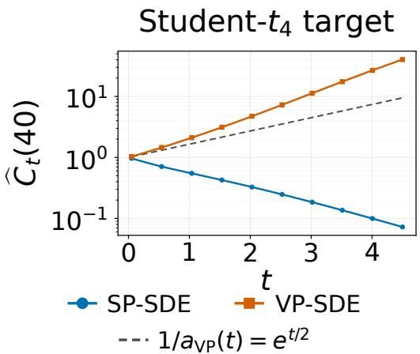
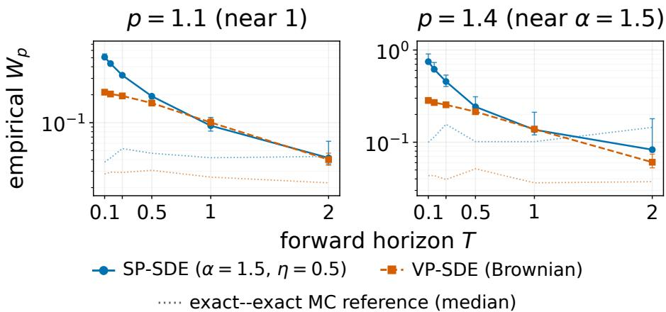
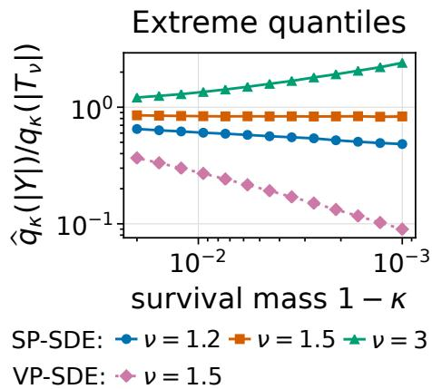
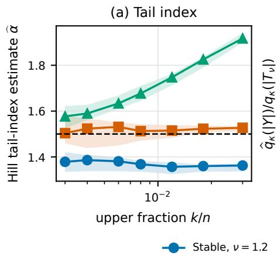
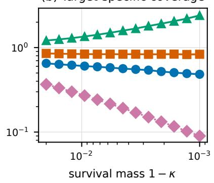
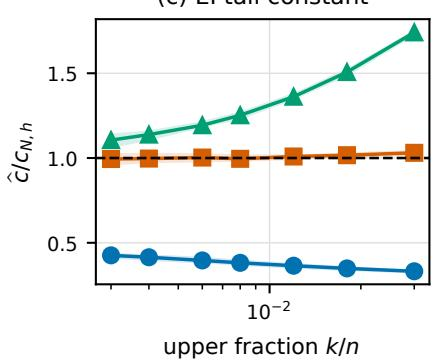

# From Global to Tail Convergence: Dynamics of α-Stable Score-Based Generative Models

Ianis Hammani1,2 Claire Boyer2,3

1Ecole Normale Supérieur Paris-Saclay, France

2Université Paris-Saclay, CNRS, Inria, Laboratoire de mathématiques d’Orsay, 91405 Orsay, France 3Institut Universitaire de France

Correspondence: ianis.hammani@ens-paris-saclay.fr

## ABSTRACT

Score-based generative models driven by α-stable Lévy processes have been proposed as an alternative to Brownian difusion models, with empirical evidence suggesting improved sampling and better modeling of heavy-tailed data. Yet theoretical guarantees for these models remain limited. We develop a non asymptotic convergence analysis for scale-preserving α-stable generative dynamics, covering both compactly supported and power-law targets. In p-Wasserstein distance, we quantify the efects of early stopping, initialization, score approximation, and time discretization, and show exponential decay of the initialization error. A comparison with Brownian dynamics reveals that global Wasserstein convergence alone does not fundamentally distinguish the two models: both initialization errors decay exponentially with the forward horizon on the common class of heavy-tailed targets. A sharp separation emerges instead in the tails. At any positive generation time, stable dynamics produces power-law tails with index α, whereas Brownian dynamics remains light-tailed. For a target with tail index ν, asymptotically correct extreme-quantile scaling is possible precisely when α = ν. These results identify tail-index matching as a principled mechanism behind the ability of stable generative models to capture extreme events.

Keywords Score-based generative models · α-stable Lévy processes · Heavy-tailed distributions · Non-asymptotic convergence · Wasserstein bound · Tail-index matching

## 1 INTRODUCTION

Score-based generative models learn to reverse a noising process that maps the data distribution to a tractable reference law (Song et al., 2021). Standard constructions use Brownian motion, based on Gaussian noising transitions. However, its continuous, light-tailed paths evolve through local increments, making distant or rare modes harder to explore and recover (Yoon et al., 2023; Paquet et al., 2024). Similarly, Brownian score-based models may also underrepresent power-law tails (Pandey et al., 2025) and be inadequately initialized for heavy-tailed targets (Fassina et al., 2026). These limitations motivate considering non-Gaussian noising processes (Nachmani et al., 2021; Deasy et al., 2021).

Isotropic α-stable noise represents a heavy-tailed alternative, where the parameter α controls the tails and jump scaling. In particular, $\alpha = 2$ recovers the Gaussian case, while $\alpha \in ( 1 , 2 )$ yields heavy-tailed noise. Yoon et al. (2023) use an α-stable noise in the continuous scale-preserving Lévy–Itô model (LIM), with explicit forward transitions and fractional score. LIM and the discrete model of Shariatian et al. (2025) have been reported to accelerate and diversify sampling, improve tail and rare-mode coverage, and better explore high-dimensional spaces (Yoon et al., 2023; Paquet et al., 2024; Shariatian et al., 2025; Popov et al., 2025). Why stable noise helps remains only partially understood theoretically: for the discrete model in the finite-sample regime, Cherkaoui et al. (2026) show that its initialization gain can be ofset by a harder estimation problem in the reverse dynamics.

In continuous time, the main dificulty lies in constructing a tractable backward dynamics. For jump processes, the exact time reversal is generally no longer an additive Lévy SDE (Conforti and Léonard, 2022; Qi et al., 2026), making it impractical for generative modeling. Popov et al. (2025) circumvent this dificulty by introducing a family of backward SDEs with additive Lévy noise that, while not pathwise reversals, exactly reproduce the forward marginal flow in reverse.

Non-asymptotic convergence guarantees are well developed for Brownian difusion models (Confort et al., 2025; Strasman et al., 2025; Gao et al., 2025), while general Lévy-type denoising Markov models have recently been studied through a unified generator framework (Ren et al., 2026). In contrast, quantitative guarantees for continuous α-stable score-based models remain largely unexplored, particularly for heavy-tailed data.

Contributions. We develop a convergence theory for continuous α-stable generative models and compare their global and tail behavior with Brownian dynamics. Our main contributions are:

• Building on a fractional Tweedie identity, we relate reverse-drift regularity to the Lipschitz modulus of the optimal denoiser and establish the required control for both compactly supported and power-law targets.

• For $1 \leq p < \alpha$ , we establish a non-asymptotic $W _ { p }$ bound for the practical α-stable sampler, separating early stopping, initialization, score approximation, and discretization errors. For power-law targets, we further show that the Brownian initialization error also decays exponentially despite the loss of the contractive coupling available in the stable case. Thus, global Wasserstein convergence, established so far, alone does not fundamentally separate the two dynamics.

• A sharp distinction emerges in the tails. For exact-score dynamics initialized at the reference laws, stable outputs have power-law tails with index α, whereas Brownian outputs are light-tailed at every positive generation time. For a target with tail index $\nu ,$ the stable extreme-quantile ratio vanishes for $\alpha > \nu ,$ diverges for $\alpha < \nu ,$ and converges to a finite nonzero limit precisely when $\alpha = \nu$ . Hence, tail-index matching is the unique regime allowing asymptotically correct extreme-quantile scaling.

Complete proofs and the protocols for numerical experiments are deferred to the appendices.

## 2 α-STABLE DYNAMICS

In this section, we introduce the scale-preserving forward process and its marginally exact additive reverse dynamics, then we characterize its regularity and dissipativity through the denoiser representation of the fractional score.

## 2.1 Forward and Backward Dynamics

For any $\alpha \in \left( 1 , 2 \right]$ , an isotropic α-stable Lévy process $( L _ { t } ^ { \alpha } ) _ { t \geq 0 }$ on $\mathbb { R } ^ { d }$ has stationary independent increments and characteristic function $\mathbb { E } [ e ^ { i \xi \cdot L _ { t } ^ { \alpha } } ] = e ^ { - t \| \xi \| ^ { \alpha } }$ for $\xi \in \mathbb { R } ^ { d }$ . It satisfies the scaling relation $L _ { t } ^ { \alpha } \overset { \mathcal { L } } { = } t ^ { 1 / \alpha } L _ { 1 } ^ { \alpha }$ . Since $L _ { t } ^ { 2 } \\\{ \stackrel { \mathcal { L } } { = } \sqrt { 2 } W _ { t }$ for a standard Brownian motion $W$ , we henceforth reserve “α-stable” for $\alpha \in ( 1 , 2 )$ and treat the conventionally normalized Brownian case separately.

Denote the standard isotropic α-stable law of $L _ { 1 } ^ { \alpha }$ by ${ \mathrm { S } } \alpha { \mathrm { S } } _ { d } ( 1 )$ , with density $\varphi _ { \alpha }$ , which is smooth and satisfies $\varphi _ { \alpha } ( z ) \asymp \| z \| ^ { - ( d + \alpha ) }$ as $\| z \|  \infty { \mathrm { ~ ( A p p l e b a u m } }$ , 2009; Samorodnitsky and Taqqu, 1994). Following Yoon et al. (2023), we consider the scale-preserving stochastic diferential equation (SP-SDE)

$$
\mathrm { d } X _ { t } = - \frac { \beta ( t ) } { \alpha } X _ { t } \mathrm { d } t + \beta ( t ) ^ { 1 / \alpha } \mathrm { d } L _ { t } ^ { \alpha } , \qquad X _ { 0 } \sim \pi _ { \mathrm { d a t a } } ,\tag{2.1}
$$

where $\beta > 0$ is measurable and locally bounded, and $X _ { 0 }$ is independent of $L ^ { \alpha }$ . For $t > 0$ , write $\pi _ { t } = \operatorname { L a w } ( X _ { t } )$ and use the same symbol for its density. Setting

$$
a ( t ) : = \exp \left( - \frac { 1 } { \alpha } \int _ { 0 } ^ { t } \beta ( s ) \mathrm { d } s \right) , \qquad \gamma ( t ) ^ { \alpha } : = 1 - a ( t ) ^ { \alpha } ,
$$

its solution satisfies

$$
X _ { t } \overset { \mathcal { L } } { = } a ( t ) X _ { 0 } + \gamma ( t ) Z , \qquad Z \sim \mathrm { S } \alpha \mathrm { S } _ { d } ( 1 ) ,
$$

with $Z$ independent of $X _ { 0 }$ . In particular, the SP-SDE preserves the isotropic stable law ${ \mathrm { S } } \alpha { \mathrm { S } } _ { d } ( 1 )$ , and the conditional density of $X _ { t }$ given $X _ { 0 } = x _ { 0 }$ takes the explicit form $\pi _ { t } ( x \mid x _ { 0 } ) = \gamma ( t ) ^ { - d } \varphi _ { \alpha } { \big ( } ( x - a ( t ) x _ { 0 } ) / \gamma ( t ) { \big ) }$ The reverse dynamics involves the fractional score The reverse dynamics involves the fractional score

$$
S _ { t } ^ { ( \alpha ) } ( x ) : = \frac { \Delta ^ { ( \alpha - 2 ) / 2 } \nabla \pi _ { t } ( x ) } { \pi _ { t } ( x ) } ,\tag{2.2}
$$

where $\Delta ^ { ( \alpha - 2 ) / 2 } \nabla$ has Fourier multiplier $- i \xi \lVert \xi \rVert ^ { \alpha - 2 }$ under the convention $\begin{array} { r } { \widehat { f } ( \xi ) = \int f ( x ) e ^ { i \xi \cdot x } } \end{array}$ dx; for $\alpha = 2$ this reduces to the classical score ∇ log $\pi _ { t }$ . Since the exact time reversal of (2.1) has a state-dependent jump kernel (Conforti and Léonard, 2022), we instead use the marginally exact additive family of Popov et al. (2025, Theorem 1).

Proposition 1 (Marginally exact reverse dynamics, Popov et al. (2025)). Fix $\eta > 0$ and an earlystopping time $0 < \varepsilon < T$ , write $\bar { \beta } ( \tau ) : = \beta ( T - \tau )$ , and assume $\mathbb { E } \left\| X _ { 0 } \right\| < \infty$ . Let

$$
\bar { b } ( \tau , x ) : = \frac { \bar { \beta } ( \tau ) } { \alpha } x + ( 1 + \eta ) \bar { \beta } ( \tau ) S _ { T - \tau } ^ { ( \alpha ) } ( x ) .\tag{2.3}
$$

Let ${ \overleftarrow { L } } ^ { \alpha }$ be an isotropic α-stable process independent of $\overleftarrow { Z } _ { 0 }$ . Under the well-posedness and Fokker–Planck uniqueness conditions of Appendix A.3, the solution of

$$
\mathrm { d } \overleftarrow { \boldsymbol { Z } } _ { \tau } = \bar { b } ( \tau , \overleftarrow { \boldsymbol { Z } } _ { \tau } ) \mathrm { d } \tau + \left( \eta \bar { \beta } ( \tau ) \right) ^ { 1 / \alpha } \mathrm { d } \overleftarrow { \boldsymbol { L } } _ { \tau } ^ { \alpha } , \qquad \overleftarrow { \boldsymbol { Z } } _ { 0 } \sim \pi _ { T } ,\tag{2.4}
$$

satisfies Law $( \overleftarrow { Z } _ { \tau } ) = \pi _ { T - \tau }$ for $0 \leq \tau \leq T - \varepsilon$

The parameter $\eta > 0$ is a genuine degree of freedom in the reverse sampler. Every choice preserves the same marginal evolution, but changes the backward noise intensity and drift. The family interpolates between deterministic and stochastic sampling: $\eta \downarrow 0$ yields the probability-flow ODE, while $\eta = 1$ matches the forward noise intensity, paralleling the probability-flow ODE and reverse-time SDE of Brownian variance-preserving (VP) models (Song et al., 2021).

Equation (2.4) defines the ideal reverse dynamics. In practice, three approximations are required to obtain a tractable sampler: (i) the unknown fractional score $S _ { t } ^ { ( \alpha ) }$ is replaced by a learned approximation sθ; (ii) the inaccessible initialization $\pi _ { T }$ is replaced by the reference distribution $\pi _ { \infty } ^ { \alpha } = \mathrm { S } \alpha \mathrm { S } _ { d } ( 1 )$ ; and (iii) the continuous-time dynamics is approximated by an exponential integrator on a uniform grid of N steps, with early stopping at time $\varepsilon > 0$ . We denote by $\hat { \pi } _ { N } ^ { \overline { { ( \beta , \theta , \eta , \varepsilon ) } } }$ the law generated by the resulting algorithm, which we study in the next sections.

## 2.2 Fractional Tweedie Formula

As in Gaussian score-based models, the fractional score admits a Tweedie-type representation in terms of the optimal denoiser. The following identity, essentially due to Yoon et al. (2023), extends the classical Tweedie formula (Efron, 2011) to the α-stable setting.

Proposition 2 (Fractional Tweedie formula, Yoon et al. (2023)). For the SP-SDE (2.1) with any initial distribution, the denoiser and fractional score are related, at every $t > 0$ , by

$$
m _ { t } ( x ) = \frac { x + \alpha \gamma ( t ) ^ { \alpha } S _ { t } ^ { ( \alpha ) } ( x ) } { a ( t ) } ,\tag{2.5}
$$

where $m _ { t } ( x ) : = \mathbb { E } [ X _ { 0 } \mid X _ { t } = x ]$ is the conditional mean, which is MSE-optimal when $X _ { 0 } \in L ^ { 2 }$

In what follows, we therefore quantify the regularity of $m _ { t }$ through its global Lipschitz constant

$$
C _ { t } : = \operatorname* { s u p } _ { x \in \mathbb { R } ^ { d } } \| \nabla m _ { t } ( x ) \| _ { \mathrm { o p } } .
$$

## 2.3 Dissipativity

The denoiser representation (2.5) yields dissipativity estimates for the fractional score and one-sided Lipschitz bounds for the reverse drift, which determine the contractivity and stability of the sampling dynamics.

Proposition 3 (Dissipativity and one-sided Lipschitz estimates). Let $t \in ( 0 , T ]$ , set $\tau = T - t$ , and suppose $C _ { t } < \infty$ . Then, for all $x , y \in \mathbb { R } ^ { d }$ , the score and reverse drift satisfy

$$
\begin{array} { r } { \langle S _ { t } ^ { ( \alpha ) } ( y ) - S _ { t } ^ { ( \alpha ) } ( x ) , x - y \rangle \geq C _ { t } ^ { ( \alpha ) } \left. x - y \right. ^ { 2 } , } \\ { \langle \bar { b } ( \tau , x ) - \bar { b } ( \tau , y ) , x - y \rangle \leq \bar { L } ( \tau ) \left. x - y \right. ^ { 2 } , } \end{array}\tag{2.6}
$$

$$
\begin{array} { r l } { w h e r e } & { \displaystyle C _ { t } ^ { ( \alpha ) } : = \frac { 1 - a ( t ) C _ { t } } { \alpha \gamma ( t ) ^ { \alpha } } , } \\ & { \bar { L } ( \tau ) : = \beta ( T - \tau ) \Big ( \frac { 1 } { \alpha } - ( 1 + \eta ) C _ { T - \tau } ^ { ( \alpha ) } \Big ) . } \end{array}
$$

The reverse drift is therefore contractive whenever $C _ { t } ^ { ( \alpha ) } > 1 / ( \alpha ( 1 + \eta ) )$ . We note here that increasing η facilitates contractivity.

## 3 COMPACTLY SUPPORTED TARGETS

## 3.1 Non-asymptotic $W _ { p }$ bound

We bound

$$
W _ { p } \left( \pi _ { \mathrm { d a t a } } , \hat { \pi } _ { N } ^ { ( \beta , \theta , \eta , \varepsilon ) } \right)
$$

for the exponential-integrator (EI) sampler defined in Appendix B.1, Equation (B.1). It integrates the dissipative linear part in (3.3) and the stochastic convolution exactly, while freezing the score residual over each step.

Backward processes. Choose a uniform grid of $[ 0 , T - \varepsilon ]$ as $\tau _ { k } = k h$ , for $k = 0 , \ldots , N$ , of constant time step $h = ( T - \varepsilon ) / N$ . To disentangle the diferent sources of approximation error, we introduce three backward processes: (i) the exact process $\overleftarrow { Z }$ solves (2.4) with the exact score and is initialized from $\overleftarrow { Z } _ { 0 } \sim \pi _ { T } ;$ (ii) the ideal process $\overleftarrow { Y }$ also solves (2.4) but is initialized from $\overleftarrow { Y } _ { 0 } \sim \pi _ { \infty } ^ { \alpha }$ instead; and (iii) the (piecewise-constant) numerical process $\bar { X } ^ { \theta , h }$ is the EI approximation driven by the learned score $s _ { \theta } ,$ , initialized from the same distribution $\pi _ { \infty } ^ { \alpha }$ . All three processes use the same backward Lévy process ${ \overleftarrow { L } } ^ { \alpha } \colon$ the EI noise is its exponentially weighted stochastic integral in (B.1). Consequently, the only diferences between the three dynamics arise from the initialization, the score approximation, and the time discretization.

Standing assumptions. The analysis rests on the following assumptions, bearing on the noise schedule, score approximation, temporal score regularity, and spatial denoiser regularity after early stopping.

Assumption A1 (Noise schedule). The schedule $\beta : [ 0 , \infty )  ( 0 , \infty )$ is continuous, nondecreasing, and satisfies $\begin{array} { r } { B ( T ) = \int _ { 0 } ^ { T } \beta ( t ) \mathrm { d } t  \infty } \end{array}$ as $T \to \infty ;$ for a given horizon it is used restricted to $[ 0 , T ]$

Assumption A2 (Score approximation error). The spatial modeling error of the network $s _ { \theta }$ is uniformly bounded in $L ^ { p }$ over the backward horizon: there exists err $\geq 0$ with

$$
\operatorname* { s u p } _ { 0 \leq k \leq N - 1 } \| s _ { \theta } ( \tau _ { k } , \bar { X } _ { \tau _ { k } } ^ { \theta , h } ) - S _ { T - \tau _ { k } } ^ { ( \alpha ) } ( \bar { X } _ { \tau _ { k } } ^ { \theta , h } ) \| _ { L ^ { p } ( \Omega ) } \leq \mathrm { e r r } .
$$

Assumption A3 (Temporal regularity of the score). For the early-stopping threshold $\varepsilon \in ( 0 , T )$ there is $L _ { \varepsilon } ^ { \mathrm { t i m e } } > 0$ , possibly depending on $T ,$ such that, for all $\boldsymbol { x } \in \mathbb { R } ^ { d }$ and all $s , t \in [ \varepsilon , T ]$ 2

$$
\begin{array} { r } { \left\| S _ { t } ^ { ( \alpha ) } ( x ) - S _ { s } ^ { ( \alpha ) } ( x ) \right\| \le L _ { \varepsilon } ^ { \mathrm { t i m e } } | t - s | \ ( 1 + \| x \| ) . } \end{array}
$$

Assumption A4 (Uniform denoiser regularity). For every early-stopping threshold $\varepsilon > 0 , \bar { C } _ { \varepsilon } : =$ $\mathrm { s u p } _ { t \geq \varepsilon } C _ { t } < \infty$

The assumptions play distinct roles. Assumption A1 fixes the time scale, while Assumptions A2–A3 control the two approximations made by the numerical sampler. They are stable analogues of standard Brownian SGM conditions (Conforti et al., 2025; Strasman et al., 2025). Finally, Assumption A4 controls the spatial regularity of the score after early stopping; it is target-dependent and is verified separately in the regimes studied.

Error decomposition. Since $\operatorname { L a w } ( \overleftarrow { Z } _ { T - \varepsilon } ) = \pi _ { \varepsilon }$ , one has

$$
W _ { p } \left( \pi _ { \mathrm { d a t a } } , \hat { \pi } _ { N } ^ { ( \beta , \theta , \eta , \varepsilon ) } \right) \leq \mathcal { E } _ { 0 } + \mathcal { E } _ { 1 } + \mathcal { E } _ { 2 } ,\tag{3.1}
$$

$$
\begin{array} { r l } { \mathrm { w h e r e ~ } } & { \left\{ \begin{array} { l l } { \mathcal { E } _ { 0 } = W _ { p } ( \pi _ { \mathrm { d a t a } } , \pi _ { \varepsilon } ) , } \\ { \mathcal { E } _ { 1 } = W _ { p } ( \mathrm { L a w } ( \overleftarrow { Z } _ { T - \varepsilon } ) , \mathrm { L a w } ( \overleftarrow { Y } _ { T - \varepsilon } ) ) , } \\ { \mathcal { E } _ { 2 } = W _ { p } ( \mathrm { L a w } ( \overleftarrow { Y } _ { T - \varepsilon } ) , \mathrm { L a w } ( \overleftarrow { X } _ { T - \varepsilon } ^ { \theta , h } ) ) , } \end{array} \right. } \end{array}
$$

respectively correspond to the stopping, initialization, and score+discretization errors.

For clarity of exposition, we state hereafter the result for a constant noise schedule. See Appendix B for a general version, allowing time-dependent schedules.

Theorem 4 (Constant schedule). Suppose $\pi _ { \mathrm { d a t a } }$ is supported in $\bar { B } ( 0 , R )$ . Fix $\eta > 0$ , choose $p \in [ 1 , \alpha )$ a constant noise schedule $\beta \equiv \beta _ { 0 }$ , and arbitrary times $0 < \varepsilon < T$ . Under Assumptions $A 1 - A { \boldsymbol { \mathcal { B } } } ,$ for h small enough there exist $\mathsf { c } _ { 0 } , \hdots , \mathsf { c } _ { 4 } > 0$ depending only on $( \alpha , \eta , d , p , \beta _ { 0 } , R , \varepsilon , L _ { \varepsilon } ^ { \mathrm { t i m e } } )$ such that

$$
\begin{array} { r l } & { W _ { p } ( \pi _ { \mathrm { d a t a } } , \hat { \pi } _ { N } ^ { ( \beta , \theta , \eta , \varepsilon ) } ) \leq \mathsf { c } _ { 0 } \varepsilon ^ { 1 / \alpha } + \mathsf { c } _ { 1 } e ^ { - \rho _ { \star } ( T - \varepsilon ) } } \\ & { \qquad + \mathsf { c } _ { 2 } ( T - \varepsilon ) \mathrm { e r r } + \mathsf { c } _ { 3 } \frac { h } { \varepsilon } + \mathsf { c } _ { 4 } \big ( 1 + T + \log ( 1 + \frac { 1 } { \varepsilon } ) \big ) h ^ { 1 / \alpha } , } \end{array}\tag{3.2}
$$

with $\begin{array} { r } { \rho _ { \star } = \beta _ { 0 } \frac { 1 + \eta } { \alpha } } \end{array}$

Following the Brownian analysis of Conforti et al. (2025), the proof first recasts the backward drift so that its linear part becomes dissipative. The stationary fractional score is linear, $S _ { \infty } ^ { ( \alpha ) } ( x ) = - x / \alpha$ and subtracting it yields

$$
\begin{array} { r l } & { \bar { b } ( \tau , x ) = - \frac { \eta } { \alpha } \beta ( T - \tau ) x } \\ & { ~ + ~ ( 1 + \eta ) \beta ( T - \tau ) \big [ S _ { T - \tau } ^ { ( \alpha ) } ( x ) - S _ { \infty } ^ { ( \alpha ) } ( x ) \big ] . } \end{array}\tag{3.3}
$$

Equation $( 2 . 4 )$ is thus a perturbation of a stable Ornstein–Uhlenbeck process of rate $\eta \beta ( T - \tau ) / \alpha$ by a term vanishing at the reference, a structure essential for the analysis of $\mathcal { E } _ { 2 }$ . The same reformulation of the Brownian reverse SDE gives a rate $\beta ( T - \tau ) / 2$ , exactly recovered here at $\alpha = 2$ and $\eta = 1$

The five terms of (3.2) have distinct origins. The first is the early-stopping bias, the price of not integrating the dynamics down to $t = 0 \mathrm { : }$ ; it decreases with ε. The second is the initialization error of the backward dynamics, which decays exponentially in the horizon T at the rate $\rho _ { \star }$ , itself increasing in η. The next two control score approximation and drift discretization. The last discretization term, of order $h ^ { 1 / \alpha }$ , reflects stable fluctuations over an EI step, where the nonlinear drift in (3.3) is frozen; its bound also absorbs drift and temporal-freezing contributions. This matches the usual $h ^ { 1 / 2 }$ term in the $W _ { 2 }$ analysis of the Brownian dynamics by Strasman et al. (2025).

Decreasing ε therefore reduces the first term but inflates the last three, through the singular behavior of the score near forward time $t = 0$ . The restriction $p < \alpha$ is required for the stable stationary law to have a finite p-th moment.

## 3.2 Denoiser regularity

The proof of Theorem 4 uses Assumption A4, which the following proposition verifies for compactly supported targets. It also shows that the denoiser Lipschitz constant vanishes asymptotically.

Proposition 5 (Decay of $C _ { t } )$ . $I f \pi _ { \mathrm { d a t a } }$ is supported in $\bar { B } ( 0 , R )$ , then with $\begin{array} { r } { \Lambda : = \operatorname* { s u p } _ { u } \left\| \nabla ^ { 2 } \log \varphi _ { \alpha } ( u ) \right\| < \infty } \end{array}$

$$
C _ { t } \leq \frac { d \Lambda R ^ { 2 } a ( t ) } { \gamma ( t ) ^ { 2 } } \xrightarrow [ t  \infty ] { } 0 .\tag{3.4}
$$

Consequently, Assumption A4 is satisfied for compactly supported targets. Compact support also ensures the well-posedness conditions required by Proposition 1, so that the convergence guarantee of Theorem 4 applies for any early-stopping time $0 < \varepsilon < T$ . Moreover, since $C _ { t } \to 0$ , the dissipativity constant satisfies $C _ { t } ^ { ( \alpha ) } \longrightarrow \frac { 1 } { \alpha }$ . The reverse drift is therefore contractive whenever the corresponding forward time is suficiently large. Any possible lack of contractivity is thus confined to a finite transient regime, whose contribution can be absorbed into the constants of the convergence bound; see Appendix B. Section 4 shows that the same asymptotic decay persists beyond compact support, for a class of heavy-tailed target distributions.

## 4 HEAVY-TAILED TARGETS

We now turn to heavy-tailed target distributions, where compact-support arguments no longer apply. Such distributions naturally arise in applications where rare but extreme events carry a significant fraction of the information, including financial and insurance losses, network trafic, and climate records (Pandey et al., 2025; Resnick, 2007). Our next result shows that the convergence guarantees established in the previous section extend beyond compactly supported targets to a broad class of power-law distributions, as specified by the following assumption.

Assumption A5 (Heavy-tailed target). The target $\pi _ { \mathrm { d a t a } }$ admits a bounded, positive and continuous density with an asymptotically radial power-law tail of index $\nu > 1$

$$
\pi _ { \mathrm { d a t a } } ( x ) = \left( c _ { \pi _ { \mathrm { d a t a } } } + o ( 1 ) \right) \| x \| ^ { - ( d + \nu ) }\tag{4.1}
$$

when $\| x \| \to \infty$ uniformly in the direction $x / \left. x \right.$

In order to extend the convergence analysis to heavy-tailed targets, the main additional dificulty is to control the denoiser regularity without relying on bounded support. Under Assumption $\mathrm { A 5 }$ , its value at the origin is controlled by the finite first moment,

$$
\begin{array} { r } { \| m _ { t } ( 0 ) \| \leq M _ { 1 } : = \mathbb { E } [ \| X _ { 0 } \| ] < \infty . } \end{array}
$$

The next result characterizes the denoiser regularity for heavy-tailed targets.

Proposition 6 (Denoiser regularity). Under Assumptions A1 and A5, the following hold.

(i) $I f 1 < \nu < \alpha$ , then $C _ { t } \geq a ( t ) ^ { - 1 } \xrightarrow [ t \to \infty ] { } \infty$

(ii) If $\alpha \leq \nu < 1 + \alpha$ , Assumption $A 5$ alone does not ensure $C _ { t } < \infty :$ for each such $\nu ,$ there is a smooth, positive density in dimension one satisfying this assumption for which $C _ { t } = \infty$ for every $t > 0$

(iii) If $\nu \geq 1 + \alpha$ , then for every $\varepsilon > 0$ there exists $c _ { \varepsilon } < \infty$ , independent $o f t$ , such that $C _ { t } \leq c _ { \varepsilon } a ( t )$ for all $t \geq \varepsilon$ . Consequently, $C _ { t } \to 0$ and Assumption $A _ { \mathscr { F } }$ holds.

For $\nu \geq 1 + \alpha ,$ we can therefore apply the convergence analysis of Theorem 4 without imposing any additional regularity assumption on the denoiser.

Theorem 7 $( W _ { p }$ -bound for heavy-tailed targets). Let $\pi _ { \mathrm { d a t a } }$ satisfy Assumption A5 with $\nu \geq 1 + \alpha$ Under the remaining hypotheses of Theorem $^ { 4 , }$ the same bound holds. In the drift estimates, the support-radius control of $\| m _ { t } ( 0 ) \|$ is replaced by $M _ { 1 }$ . The resulting constants may additionally depend on $\mu _ { p } = \mathbb { E } [ \| X _ { 0 } \| ^ { p } ] ^ { 1 / p }$ and on the quantitative constants in Assumption A5.

## 5 COMPARISON WITH BROWNIAN DYNAMICS

We now compare α-stable and Brownian dynamics on heavy-tailed targets from two complementary perspectives: global convergence of the generated distribution (which primarily reflects reconstruction of the bulk) and preservation of its tail behavior.

## 5.1 Global comparison

Our goal is to determine whether α-stable and Brownian dynamics exhibit a meaningful separation at the level of the generated distribution as a whole, in $W _ { p }$ . For the Brownian model, we consider a VP-SDE with a general noise schedule and its associated reverse-time dynamics. We denote its forward marginals by $\pi _ { t } ^ { ( 2 ) }$ and its stationary law by $\pi _ { \infty } ^ { ( 2 ) } = \mathcal { N } ( 0 , I _ { d } )$ . Since the stable and Brownian formulations share the same algebraic structure, we use $a ( t ) , \beta ( t ) , \gamma ( t )$ , and $C _ { t }$ for the corresponding quantities in both settings. When a distinction is needed, we make it explicit, e.g. writing $\mathcal { E } _ { 1 } ^ { ( \alpha ) }$ for the stable initialization error and $\mathcal { E } _ { 1 } ^ { ( 2 ) }$ for its Brownian counterpart.

Following the error decomposition of Section 3, we discuss the two dynamics in terms of denoiser regularity, mixing of the reverse dynamics, discretization, and early-stopping error.

Denoiser regularity. We first compare the regularity of the denoiser, as measured by its Lipschitz constant $C _ { t }$ . Under stable noise, Propositions 5 and 6 give $C _ { t } \to 0$ for compactly supported targets and power-law targets with $\nu \geq 1 + \alpha$ . In the Brownian case, the behavior actually depends on the target type.

Proposition 8 (Brownian denoiser regularity). Under Assumption A1, the Brownian VP denoiser satisfies:

$I f \pi _ { \mathrm { d a t a } }$ is supported on $\bar { B } ( 0 , R )$ , then $C _ { t } \leq a ( t ) R ^ { 2 } / \gamma ( t ) ^ { 2 } \to 0$ as t → ∞.

• Under Assumption A5, $\nabla m _ { t } ( x ) \to a ( t ) ^ { - 1 } I _ { d } ~ a s ~ \| x \| \to \infty$ for every $t > 0 ;$ hence $C _ { t } \geq a ( t ) ^ { - 1 } $ ∞ as $t \to \infty$

Thus, for heavy-tailed targets with $\nu \geq 1 + \alpha .$ , denoiser regularity separates the two models: stable noise asymptotically flattens the denoiser, yielding eventual contractivity, whereas Brownian noise produces the opposite behavior.

Figure 1 illustrates this dichotomy on a $\mathrm { S t u d e n t } { - } t _ { 4 }$ target with $\beta \equiv 1$ in both models through $\widehat { C } _ { t } ( 4 0 )$ , the maximum numerically evaluated $| m _ { t } ^ { \prime } |$ on a grid of $[ - 4 0 , 4 0 ]$ : it decreases under stable noise $( \alpha = 1 . 5 )$ and grows under Brownian noise, consistently with the lower bound $C _ { t } \geq 1 / a ( t ) = e ^ { t / 2 }$ ; see Appendix F.2 for details.

Crucially, this regularity gap does not imply a separation in global convergence. As we show next, the loss of Brownian contractivity makes the synchronous-coupling argument inefective, but does not prevent the Brownian reverse dynamics from mixing.

  
Figure 1: Illustration of $\widehat { C } _ { t } ( 4 0 )$ on a Student-t target for the stable (α = 1.5) and VP models.

Mixing. Here, mixing error denotes the propagated initialization error. For stable dynamics, the one-sided Lipschitz bound yields a contractive synchronous coupling, as $\mathcal { E } _ { 1 } ^ { ( \alpha ) } ~ \leq$ $W _ { p } ( \pi _ { \mathrm { d a t a } } , \pi _ { \infty } ^ { \alpha } ) e ^ { - \Phi ^ { ( \alpha ) } ( T ) }$ where

$$
\Phi ^ { ( \alpha ) } ( T ) : = \frac { 1 + \eta } { \alpha } \int _ { \varepsilon } ^ { T } \frac { \beta ( t ) \bigl ( 1 - a ( t ) C _ { t } \bigr ) } { \gamma ( t ) ^ { \alpha } } \mathrm { d } t .
$$

Combined with the decay of $C _ { t }$ , this gives an explicit exponential rate for the initialization error.

Corollary 9 (Stable mixing error). Under Assumptions A1 and A5 with $\nu \geq 1 + \alpha$ , for every $p \in [ 1 , \alpha )$ stable noise mixes exponentially in $B _ { i }$

$$
\begin{array} { r } { \mathcal { E } _ { 1 } ^ { ( \alpha ) } \le C W _ { p } ( \pi _ { \mathrm { d a t a } } , \pi _ { \infty } ^ { \alpha } ) e ^ { - \frac { 1 + \eta } { \alpha } ( B ( T ) - B ( \varepsilon ) ) } \xrightarrow [ T \to \infty ] { } 0 , } \end{array}
$$

where $C < \infty$ is independent of $T$

For Brownian dynamics, Proposition 8 gives $a ( t ) C _ { t } \geq 1$ , so the analogous synchronous-coupling bound is vacuous. Nevertheless, a direct analysis of the initialization error still yields exponential mixing.

Theorem 10 (Brownian mixing error). Under Assumption A1, suppose $\pi _ { \mathrm { d a t a } }$ satisfies Assumption A5 with $\nu > 2$ . Let $\mu _ { T , \varepsilon } ^ { ( 2 ) }$ denote the law at reverse time $T - \varepsilon$ of the Brownian reverse SDE with the exact score, initialized at the reference $\pi _ { \infty } ^ { ( 2 ) }$ in place of the forward marginal $\pi _ { T } ^ { ( 2 ) }$ . For $p \in [ 1 , \nu )$ and any $q \in ( p , \nu )$ there is $C _ { q } < \infty$ , independent of ε, such that for T large enough

$$
\mathcal { E } _ { 1 } ^ { ( 2 ) } = W _ { p } ( \mu _ { T , \varepsilon } ^ { ( 2 ) } , \pi _ { \varepsilon } ^ { ( 2 ) } ) \leq C _ { q } e ^ { - \frac { q - p } { 2 p q } B ( T ) } \xrightarrow [ T  \infty ] { } 0 .
$$

Figure 2 illustrates the decay of the initialization error on a $\mathrm { S t u d e n t } { - } t _ { 4 }$ target. For each model, we compare samplers initialized from the forward marginal $\pi _ { T }$ and from the stationary reference, using the same numerically evaluated score, step size $h = 0 . 0 1 2 5$ , and stopping time $\varepsilon = 0 . 0 5$ . The resulting $W _ { 1 . 1 }$ and $W _ { 1 . 4 }$ discrepancies decrease with $T$ for both stable and Brownian dynamics, eventually approaching the finite-sample baseline obtained from two independent samples from $\pi _ { \varepsilon } .$ . This is consistent with the predicted loss of initialization dependence in both models, including the non-contractive Brownian regime; see Appendix F.3.

Thus, on the common class of targets with $\nu \geq 1 + \alpha$ , both initialization errors decay exponentially in $W _ { p }$ , despite fundamentally diferent mechanisms: contractive coupling for stable dynamics and a direct mixing argument for Brownian dynamics. Global initialization error therefore does not separate the two models.

  
Figure 2: Empirical $W _ { 1 . 1 }$ and $W _ { 1 . 4 }$ discrepancies between samplers initialized from the stationary reference and from the exact forward marginal $\pi _ { T } .$ , for stable and Brownian dynamics on a Student- $\scriptstyle - t _ { 4 }$ target. Both discrepancies decrease with $T$ toward the finite-sample baseline (dotted), estimated from independent samples from $\pi _ { \varepsilon }$ . Points and bars report medians and 90% bootstrap intervals over 12 runs; see Appendix F.3.

Early stopping and discretization. Having found no qualitative separation in the initialization error, we finally compare the scaling of the remaining two terms. For the stable sampler, both directly reflect the self-similarity of the driving process: $\gamma ( \varepsilon ) \asymp ( \beta _ { 0 } \varepsilon ) ^ { 1 / \alpha }$ and $L _ { h } ^ { \alpha } \overset { \mathcal { L } } { = } h ^ { 1 / \alpha } L _ { 1 } ^ { \alpha }$ yield the respective upper bounds $\varepsilon ^ { 1 / \alpha }$ and $h ^ { 1 / \alpha }$ . For $\alpha < 2 , L ^ { \alpha }$ is a pure-jump process and $1 / \alpha > 1 / 2$ is its self-similarity index. It expresses superdifusive scaling, in a Lévy-flight sense: heavy-tailed jumps permit occasional long-range moves and thereby provide a mechanism for broader exploration of a large space (Viswanathan et al., 2008). At $\alpha = 2$ , both exponents reduce to the Brownian scaling $1 / 2$

A rigorous comparison of these bounds with Brownian dynamics is not currently available under the heavy-tailed assumptions considered here. In particular, Strasman et al. (2025) obtain an $h ^ { 1 / 2 }$ term for the same exponential-integrator construction, but under global score regularity and strong log-concavity and without the early-stopping error. The shared construction nevertheless suggests $\varepsilon ^ { 1 / 2 }$ and $h ^ { 1 / 2 }$ as the corresponding Brownian scalings. If these rates extend to the present heavy-tailed setting, the stable bounds would exhibit more favorable exponents for $\alpha < 2$ . This comparison is therefore suggestive rather than conclusive: it identifies a possible scaling mechanism consistent with the empirical sampling gains reported for Lévy-based generative models (Yoon et al., 2023; Paquet et al., 2024).

## 5.2 Tail behavior

Global convergence in $W _ { p }$ does not by itself guarantee that the generated distribution reproduces the extreme behavior of the target. In particular, it does not determine whether the generated law has the correct tail index or assigns the correct mass to extreme events. We therefore complement the Wasserstein analysis with two tail-sensitive quantities motivated by classical Extreme Value Theory (EVT, Resnick, 2007; de Haan and Ferreira, 2006; Ghosh and Resnick, 2010). The first, based on the mean-excess function, identifies the asymptotic tail regime; the second compares generated and target quantiles at increasingly extreme probability levels.

Tail regime. A target-independent criterion, called limiting relative mean excess, distinguishes power-law tails from lighter tails, such as Gaussian tails.

Definition 11 (Limiting relative mean excess). For a probability measure $\mu$ on $\mathbb { R } ^ { d } .$ , let $F _ { \mu } ( r ) =$ $\mu ( \{ x : \| x \| \leq r \} )$ denote its radial CDF. For a level $\kappa \in ( 0 , 1 )$ , let $q _ { \kappa } ( \mu ) = \operatorname* { i n f } \{ r : F _ { \mu } ( r ) \geq \kappa \}$ be its radial quantile of level $\kappa .$ Then, for u such that $1 - F _ { \mu } ( u ) > 0$ , introduce the mean-excess function $e _ { \mu } ( u ) = \mathbb { E } _ { \mu } [ \| X \| - u \mid \| X \| > u ]$ so that the limiting relative mean excess is given by

$$
\Gamma ( \mu ) : = \operatorname * { l i m } _ { u \to \infty } \frac { e _ { \mu } ( u ) } { u } ,
$$

whenever the limit exists.

Note that if $q _ { \kappa } ( \mu ) \to \infty$ as $\kappa  1$ , then the limiting relative mean excess can be re-expressed as $\Gamma ( \mu ) = \mathrm { l i m } _ { \kappa \to 1 } e _ { \mu } ( q _ { \kappa } ( \mu ) ) / q _ { \kappa } ( \mu )$ . This condition is satisfied by the distributions considered here.

We also introduce $\overline { { G } } _ { \mu } ( \cdot ) : = 1 - F _ { \mu } ( \cdot )$ , the radial survival function of $\mu$ . In particular, Assumption A5 implies that $\overline { { G } } _ { \pi _ { \mathrm { d a t a } } } ( r ) \sim c _ { \pi _ { \mathrm { d a t a } } } ^ { \prime } r ^ { - \nu }$ as $r  \infty$ , with $c _ { \pi _ { \mathrm { d a t a } } } ^ { \prime } = \omega _ { d - 1 } c _ { \pi _ { \mathrm { d a t a } } } / \nu ,$ where $\omega _ { d - 1 }$ is the surface area of the unit sphere.

Proposition 12 (Tail-regime dichotomy).

(i) $I f \overline { { G } } _ { \mu } ( r ) \sim c _ { \mu } r ^ { - \vartheta }$ for some $c _ { \mu } > 0$ and $\vartheta > 1$ , then $e _ { \mu } ( u ) \sim u / ( \vartheta - 1 )$ and

$$
\Gamma ( \mu ) = \frac { 1 } { \vartheta - 1 } > 0 .
$$

(ii) $I f X \sim \mu$ decomposes as $X = G + R$ with G a nondegenerate isotropic Gaussian vector and $\| R \| \leq K$ almost surely, then $e _ { \mu } ( u ) = \mathcal { O } ( 1 )$ and $\Gamma ( \boldsymbol { \mu } ) = 0$

Thus, $\Gamma ( \boldsymbol { \mu } )$ identifies a qualitative diference in tail regime, but does not measure whether the generated distribution reproduces the target at a given extreme probability level. To capture this second aspect, we compare their extreme quantiles directly.

Extreme-quantile matching. For a level $\kappa \in ( 0 , 1 )$ , define the extreme-quantile ratio of $\mu$ with respect to a target reference π by

$$
\mathcal { M } _ { \mu } ( \kappa ) : = \frac { q _ { \kappa } ( \mu ) } { q _ { \kappa } ( \pi ) } .
$$

Thus, $\mathcal { M } _ { \mu } ( \kappa ) \approx 1$ means that generated and target distributions reach comparable radial scales at probability level κ. For power-law tails, its asymptotic behavior follows directly from the corresponding tail indices and constants.

Lemma 13 (Extreme-quantile ratio under power-law tails). Consider a distribution µ such that $\overline { { G } } _ { \mu } ( r ) \sim c _ { \mu } r ^ { - \alpha }$ for $c _ { \mu } , \alpha > 0$ . Then, its quantile function satisfies $q _ { \kappa } ( \mu ) \sim c _ { \mu } ^ { 1 / \alpha } ( 1 - \kappa ) ^ { - 1 / \alpha }$ as $\kappa \uparrow 1$ Consider in addition a target distribution $\pi$ such that $\overline { { G } } _ { \pi } ( r ) \sim c _ { \pi } r ^ { - \nu }$ for $c _ { \pi } , \nu > 0$ . Then, the extremequantile ratio of µ w.r.t. π satisfies

$$
\begin{array} { r } { \mathcal { M } _ { \mu } ( \kappa ) \sim c _ { \mu } ^ { 1 / \alpha } c _ { \pi } ^ { - 1 / \nu } ( 1 - \kappa ) ^ { \frac { 1 } { \nu } - \frac { 1 } { \alpha } } \qquad ( \kappa \uparrow 1 ) . } \end{array}\tag{5.1}
$$

Lemma 13 separates tail mismatch as follows. A discrepancy between the tail indices produces a polynomial divergence or collapse of $\mathcal { M } _ { \mu } ( \kappa )$ as $\kappa \uparrow 1$ . When the indices match $( \alpha = \nu )$ this polynomial discrepancy disappears and $\mathcal { M } _ { \mu } ( \kappa ) \longrightarrow ( c _ { \mu } / c _ { \pi } ) ^ { 1 / \alpha }$

Stable/Brownian separation in the tails. Fix $0 < \varepsilon < T < \infty$ . Write $\mu _ { \tau } ^ { ( \alpha ) } : = \mathrm { L a w } ( \overleftarrow { Y } _ { \tau } )$ for the stable exact-score reverse law initialized at $\pi _ { \infty } ^ { \alpha }$ , and define $\mu _ { \tau } ^ { ( 2 ) }$ analogously for the Brownian reverse SDE initialized at $\pi _ { \infty } ^ { ( 2 ) }$ . The symbol $\mu$ denotes a generated law at reverse time $\tau \in ( 0 , T - \varepsilon ]$ , whereas π denotes a forward marginal. In particular, $\mu _ { T - \varepsilon } ^ { ( 2 ) } = \mu _ { T , \varepsilon } ^ { ( 2 ) }$ in Theorem 10.

Proposition 14 (Stable/Brownian tail separation). Suppose Assumption A5 holds, so that $\overline { { G } } _ { \pi _ { \mathrm { d a t a } } } ( r ) \sim$ $c _ { \pi _ { \mathrm { d a t a } } } ^ { \prime } r ^ { - \nu }$ . At every generation time $\tau \in ( 0 , T - \varepsilon ]$ , the Brownian output $\mu _ { \tau } ^ { ( 2 ) }$ has sub-Gaussian radial tails, whereas the α-stable output satisfies

$$
\overline { { G } } _ { \mu _ { \tau } ^ { ( \alpha ) } } ( r ) \sim c _ { \tau } r ^ { - \alpha } , \qquad c _ { \tau } \in ( 0 , \infty ) .
$$

In terms of relative mean excess, this gives

$$
\Gamma ( \mu _ { \tau } ^ { ( \alpha ) } ) = \frac { 1 } { \alpha - 1 } > 0 = \Gamma ( \mu _ { \tau } ^ { ( 2 ) } ) .
$$

For the extreme-quantile ratio, $\mathcal { M } _ { \mu _ { \tau } ^ { ( 2 ) } } ( \kappa ) \xrightarrow [ \kappa  1 ] { } 0$ , while

$$
\mathcal { M } _ { \mu _ { \tau } ^ { ( \alpha ) } } ( \kappa ) \underset { \kappa  1 } { \sim } c _ { \tau } ^ { 1 / \alpha } ( c _ { \pi _ { \mathrm { d a t a } } } ^ { \prime } ) ^ { - 1 / \nu } ( 1 - \kappa ) ^ { \frac { 1 } { \nu } - \frac { 1 } { \alpha } } .
$$

The proof decomposes the stable output into an exactly α-stable leading term and a uniformly sublinear remainder, which is negligible in the tail. The tail constant is $c _ { \tau } = C _ { d , \alpha } \rho _ { \tau } ^ { \alpha }$ , where $C _ { d , \alpha }$ is the radial tail constant of ${ \mathrm { S } } \alpha { \mathrm { S } } _ { d } ( 1 )$ and $\rho _ { \tau }$ is the scale of the leading stable component (see Appendix E for details).

The two diagnostics reveal complementary aspects of tail reconstruction: Γ distinguishes light from power-law tails, whereas $\mathcal { M } _ { \boldsymbol { \mu } }$ measures the scale of extreme quantiles. Their joint behavior is summarized in Table 1.

Thus, producing heavy tails is not suficient for correctly calibrated extremes. Indeed, if $\alpha > \nu ,$ the generated tail is lighter than the target one and the extreme-quantile ratio vanishes. If $\alpha < \nu ,$ the generated tail is heavier so that the extreme-quantile ratio diverges. Tail-index matching, $\alpha = \nu _ { \mathrm { { ; } } }$ is therefore the unique stable regime allowing asymptotically correct extreme-quantile scaling; exact matching further requires the tail constants to agree.

Table 1: Tail regimes under Assumption A5, at fixed $0 < \varepsilon < T < \infty$ , as in Proposition 14.
<table><tr><td colspan="2"> $\Gamma ( \mu _ { \tau } )$   $\mathcal { M } _ { \mu _ { \tau } } ( \kappa )$  as  $\kappa \uparrow 1$ </td></tr><tr><td>Brownian</td><td>0 0</td></tr><tr><td>Stable,  $\alpha > \nu$ </td><td> $\scriptstyle { \frac { 1 } { \alpha - 1 } }$  0</td></tr><tr><td>Stable,  $\alpha = \nu$ </td><td> $\left( c _ { \tau } / c _ { \pi _ { \mathrm { d a t a } } } ^ { \prime } \right) ^ { 1 / \nu }$   $\scriptstyle { \frac { 1 } { \nu - 1 } }$ </td></tr><tr><td>Stable,  $\alpha < \nu$ </td><td> $\scriptstyle { \frac { 1 } { \alpha - 1 } }$   $+ \infty$ </td></tr></table>

Figure 3 illustrates the three tail-reconstruction regimes predicted by Proposition 14 for Student- $\cdot t _ { \nu }$ targets. With stable noise $( \alpha = 1 . 5 )$ , as $\kappa \uparrow 1$ the extreme-quantile ratio decreases for $\nu < \alpha .$ , remains approximately constant for $\nu = \alpha .$ , and increases for $\nu > \alpha$ , consistently with the predicted scaling $( 1 - \kappa ) ^ { 1 / \nu - 1 / \alpha }$ . In the index-matched case $\nu = \alpha = 1 . 5 ,$ the Brownian ratio instead decreases toward zero, illustrating its failure to reproduce the target tail scale. The of-match experiments reproduce the predicted qualitative trends, although the available sample size does not reliably resolve their asymptotic exponents.

  
Figure 3: Generated-to-target extreme-quantile ratios for Student- $\cdot t _ { \nu }$ targets. Stable samplers use $( \alpha , \eta ) =$ (1.5, 0.5); the VP baseline uses $\nu = 1 . 5$ . Curves show medians over 12 runs; bands give the inter-seed 16–84% range. See Appendix F.4.

Overall, the exact-score dynamics initialized at the reference laws difer in their tails: Brownian outputs remain light-tailed at finite generation time, while stable outputs inherit the noise tail index. This distinction is not determined by global $W _ { p }$ convergence. Tail-index matching therefore provides a possible mechanism behind the improved tail coverage observed empirically with Lévy-based generative models (Yoon et al., 2023; Paquet et al., 2024; Pandey et al., 2025; Shariatian et al., 2025).

## CONCLUSION

Our results distinguish global accuracy from tail reconstruction in α-stable generative models. Our tail analysis includes the index-matched regime $\nu = \alpha$ , whereas our global convergence guarantees require stronger tail assumptions. Tail-index matching explains when stable dynamics can reproduce the correct asymptotic scale of extreme events, yet the role of tail constants, anisotropy, and multivariate dependence remains largely unexplored. It is also unclear whether Lévy noise provides advantages beyond tail reconstruction, for instance through faster exploration of multimodal landscapes or improved finite-step sampling. Finally, extending the tail analysis to learned scores is essential: estimation errors in low-density regions may interact strongly with the jump structure precisely where the stable dynamics is meant to improve tail coverage.

## AI Use Statement

In this work, we used generative AI tools, including ChatGPT, to assist with English writing and editing, literature checks, mathematical proofreading, and the implementation and verification of some numerical experiments. Generative AI tools were not used to define the research questions, formulate the main methodological ideas, or determine the scientific conclusions of the work.

All AI-assisted mathematical arguments were independently checked by the authors, and no proof or theoretical claim was accepted without verification. AI-assisted code and numerical experiments were reviewed, tested, and validated by the authors, including by checking their consistency with the underlying mathematical formulation and the reported results. Literature-related suggestions were verified against the original sources before being used or cited.

We take full responsibility for the final content of this work, including its text, mathematical claims, numerical results, and conclusions.

## References

Yang Song, Jascha Sohl-Dickstein, Diederik Pieter Kingma, Abhishek Kumar, Stefano Ermon, and Ben Poole. Score-based generative modeling through stochastic diferential equations. In International Conference on Learning Representations, 2021. URL https://openreview.net/forum?id=PxTIG12RRHS.

Eunbi Yoon, Keehun Park, Sungwoong Kim, and Sungbin Lim. Score-based generative models with Lévy processes. In Advances in Neural Information Processing Systems, volume 36, pages 40694–40707, 2023. doi: 10.52202/075280-1772. URL https://doi.org/10.52202/075280-1772.

Eric Paquet, Farzan Soleymani, Herna Lydia Viktor, and Wojtek Michalowski. Annealed fractional Lévy–Itô difusion models for protein generation. Computational and Structural Biotechnology Journal, 23:1641–1653, 2024. doi: 10.1016/j.csbj.2024.04.009.

Kushagra Pandey, Jaideep Pathak, Yilun Xu, Stephan Mandt, Michael Pritchard, Arash Vahdat, and Morteza Mardani. Heavy-tailed difusion models. In International Conference on Learning Representations, 2025. URL https://arxiv.org/abs/2410.14171.

Tiziano Fassina, Gabriel Cardoso, Sylvain Le Corf, and Thomas Romary. Generalizing score-based generative models for heavy-tailed distributions, 2026. URL https://arxiv.org/abs/2603.00772.

Eliya Nachmani, Robin San Roman, and Lior Wolf. Non-gaussian denoising difusion models, 2021. URL https://arxiv.org/abs/2106.07582.

Jacob Deasy, Nikola Simidjievski, and Pietro Liò. Heavy-tailed denoising score matching, 2021. URL https://arxiv.org/abs/2112.09788.

Dario Shariatian, Umut Şimşekli, and Alain Durmus. Heavy-tailed difusion with denoising Lévy probabilistic models. In International Conference on Learning Representations, 2025. URL https: //arxiv.org/abs/2407.18609.

Vadim Popov, Assel Yermekova, Tasnima Sadekova, Artem Khrapov, and Mikhail Kudinov. Improved sampling algorithms for Lévy–Itô difusion models. In International Conference on Learning Representations, 2025. URL https://openreview.net/forum?id=XxCgeWSTNp.

Hamza Cherkaoui, Hélène Halconruy, and Antonio Ocello. Do heavy tails help difusion? on the subtle trade-of between initialization and training, 2026. URL https://arxiv.org/abs/2605.13175.

Giovanni Conforti and Christian Léonard. Time reversal of markov processes with jumps under a finite entropy condition. Stochastic Processes and their Applications, 144:85–124, 2022. doi: 10.1016/j.spa.2021.10.002.

Tianfu Qi, Jun Wang, and Jun Zhang. Generator-guided inverse sampling for Lévy-driven generative models, 2026. URL https://arxiv.org/abs/2608.10384.

Giovanni Conforti, Alain Durmus, and Marta Gentiloni Silveri. KL convergence guarantees for score difusion models under minimal data assumptions. SIAM Journal on Mathematics of Data Science, 7 (1):86–109, 2025. doi: 10.1137/23M1613670.

Stanislas Strasman, Antonio Ocello, Claire Boyer, Sylvain Le Corf, and Vincent Lemaire. An analysis of the noise schedule for score-based generative models. Transactions on Machine Learning Research, 2025. URL https://openreview.net/forum?id=BlYIPa0Fx1.

Xuefeng Gao, Hoang M. Nguyen, and Lingjiong Zhu. Wasserstein convergence guarantees for a general class of score-based generative models. Journal of Machine Learning Research, 26(43):1–54, 2025. URL https://www.jmlr.org/papers/v26/24-0902.html.

Yinuo Ren, Grant M. Rotskof, and Lexing Ying. A unified approach to analysis and design of denoising markov models. Journal of Machine Learning Research, 27(105):1–69, 2026. URL https: //www.jmlr.org/papers/v27/25-0693.html.

David Applebaum. Lévy Processes and Stochastic Calculus, volume 116 of Cambridge Studies in Advanced Mathematics. Cambridge University Press, 2 edition, 2009. doi: 10.1017/CBO9780511809781.

Gennady Samorodnitsky and Murad S. Taqqu. Stable Non-Gaussian Random Processes: Stochastic Models with Infinite Variance. Chapman & Hall, 1994.

Bradley Efron. Tweedie’s formula and selection bias. Journal of the American Statistical Association, 106(496):1602–1614, 2011. doi: 10.1198/jasa.2011.tm11181.

Sidney I. Resnick. Heavy-Tail Phenomena: Probabilistic and Statistical Modeling. Springer, New York, 2007. doi: 10.1007/978-0-387-45024-7.

Gandhimohan M. Viswanathan, Ernesto Pessoa Raposo, and Marcos Gomes Eleutério da Luz. Lévy flights and superdifusion in the context of biological encounters and random searches. Physics of Life Reviews, 5(3):133–150, 2008. doi: 10.1016/j.plrev.2008.03.002. URL https://doi.org/10.1016/j. plrev.2008.03.002.

Laurens de Haan and Ana Ferreira. Extreme Value Theory: An Introduction. Springer, New York, 2006. doi: 10.1007/0-387-34471-3.

Souvik Ghosh and Sidney I. Resnick. A discussion on mean excess plots. Stochastic Processes and their Applications, 120(8):1492–1517, 2010. doi: 10.1016/j.spa.2010.04.002.

Michael Röckner, Longjie Xie, and Xicheng Zhang. Superposition principle for non-local Fokker– Planck–Kolmogorov operators. Probability Theory and Related Fields, 178(3–4):699–733, 2020. doi: 10.1007/s00440-020-00985-8. URL https://arxiv.org/abs/1910.11022v1.

Krzysztof Bogdan, Tomasz Grzywny, and Michał Ryznar. Density and tails of unimodal convolution semigroups. Journal of Functional Analysis, 266(6):3543–3571, 2014. URL https://arxiv.org/abs/ 1305.0976v2.

Kamil Kaleta and Paweł Sztonyk. Estimates of transition densities and their derivatives for jump Lévy processes. Journal of Mathematical Analysis and Applications, 431(1):260–282, 2015. doi: 10.1016/j.jmaa.2015.05.061. URL https://arxiv.org/abs/1307.1302v3.

Henrik Hult and Filip Lindskog. Extremal behavior of stochastic integrals driven by regularly varying Lévy processes. The Annals of Probability, 35(1):309–339, 2007. doi: 10.1214/009117906000000548. URL https://arxiv.org/abs/math/0703802.

Nicholas Hugh Bingham, Charles M. Goldie, and Edward Omey. Regularly varying probability densities. Publications de l’Institut Mathématique, 80(94):47–57, 2006. doi: 10.2298/PIM0694047B. URL https://www.ma.imperial.ac.uk/\~bin06/Papers/bgo.pdf.

Michel Denuit, Patricia Ortega-Jiménez, and Christian-Yann Robert. Conditional expectations given the sum of independent random variables with regularly varying densities. ASTIN Bulletin, 55(2): 449–485, 2025. doi: 10.1017/asb.2025.11.

Alex Dytso, Harold Vincent Poor, and Shlomo Shamai. A general derivative identity for the conditiona mean estimator in Gaussian noise and some applications, 2021. URL https://arxiv.org/abs/2104. 01883v1.

Patrick Cattiaux, Giovanni Conforti, Ivan Gentil, and Christian Léonard. Time reversal of difusion processes under a finite entropy condition. Annales de l’Institut Henri Poincaré, Probabilités et Statistiques, 59(4):1844–1881, 2023. doi: 10.1214/22-AIHP1320. URL https://arxiv.org/abs/ 2104.07708v3.

Dominique Bakry, Ivan Gentil, and Michel Ledoux. Analysis and Geometry of Markov Difusion Operators. Springer, Cham, 2014. doi: 10.1007/978-3-319-00227-9.

Péter Kevei. Regularly varying functions. Lecture notes, University of Szeged, n.d. URL https: //www.math.u-szeged.hu/\~kevei/tanitas/jegyzet/RegVar\_notes.pdf.

National Institute of Standards and Technology. NIST Digital Library of Mathematical Functions, n.d. URL https://dlmf.nist.gov/8.11#E2. Section 8.11(i), equation 8.11.2; consulted on 10 September 2026.

René L. Schilling. An introduction to Lévy and Feller processes. Lecture notes, 2016. URL https: //arxiv.org/abs/1603.00251.

Bruce M. Hill. A simple general approach to inference about the tail of a distribution. The Annals of Statistics, 3(5):1163–1174, 1975. doi: 10.1214/aos/1176343247.

Sergey Foss, Dmitry Korshunov, and Stan Zachary. Convolutions of long-tailed and subexponential distributions. Journal of Applied Probability, 46(3):756–767, 2009. doi: 10.1239/jap/1253279850.

John M. Chambers, Colin Lingwood Mallows, and Bart W. Stuck. A method for simulating stable random variables. Journal of the American Statistical Association, 71(354):340–344, 1976. doi: 10.1080/01621459.1976.10480344.

James Bradbury, Roy Frostig, Peter Hawkins, Matthew James Johnson, Chris Leary, Dougal Maclaurin, George Necula, Adam Paszke, Jake VanderPlas, Skye Wanderman-Milne, and Qiao Zhang. JAX: composable transformations of Python+NumPy programs, 2018. URL https://github.com/jax-ml/ jax. Version 0.7.2.

Charles R. Harris, K. Jarrod Millman, Stéfan J van der Walt, Ralf Gommers, Pauli Virtanen, David Cournapeau, Eric Wieser, Julian Taylor, Sebastian Berg, Nathaniel J. Smith, Robert Kern, Matti Picus, Stephan Hoyer, Marten H. van Kerkwijk, Matthew Brett, Allan Haldane, Jaime Fernández del Río, Mark Wiebe, Pearu Peterson, Pierre Gérard-Marchant, Kevin Sheppard, Tyler Reddy, Warren Weckesser, Hameer Abbasi, Christoph Gohlke, and Travis E. Oliphant. Array programming with NumPy. Nature, 585:357–362, 2020. doi: 10.1038/s41586-020-2649-2.

Pauli Virtanen, Ralf Gommers, Travis E. Oliphant, Matt Haberland, Tyler Reddy, David Cournapeau, Evgeni Burovski, Pearu Peterson, Warren Weckesser, Jonathan Bright, Stéfan J. van der Walt, Matthew Brett, Joshua Wilson, K. Jarrod Millman, Nikolay Mayorov, Andrew R. J. Nelson, Eric Jones, Robert Kern, Eric Larson, C J Carey, İlhan Polat, Yu Feng, Eric W. Moore, Jake VanderPlas, Denis Laxalde, Josef Perktold, Robert Cimrman, Ian Henriksen, E. A. Quintero, Charles R. Harris, Anne M. Archibald, Antônio H. Ribeiro, Fabian Pedregosa, Paul van Mulbregt, and SciPy 1.0 Contributors. SciPy 1.0: Fundamental Algorithms for Scientific Computing in Python. Nature Methods, 17:261–272, 2020. doi: 10.1038/s41592-019-0686-2. URL https://doi.org/10.1038/s41592-019-0686-2.

## Appendix

## Table of Contents

Notation 18   
A Proofs for Section 2: Stable Dynamics 20   
A.1 Strong solution and scale preservation 20   
A.2 Proof of Proposition 2: Fractional Tweedie formula 20   
A.3 Proof of Proposition 1: Matching marginals 21   
A.4 Proof of Proposition 3: Dissipativity 22   
A.5 Measurability and transient anti-contractivity 22   
B Proof of Theorem 4: The Non-Asymptotic Bound 23   
B.1 Dissipative reformulation and the EI scheme 23   
B.2 The early-stopping bias 23   
B.3 Exponential contraction of the initialization error 23   
B.4 Score and EI discretization error 24   
B.5 Assembly: the explicit bound 27   
B.6 Schedule corollaries and proof of Theorem 4 27   
C Proof of Proposition 5: Denoiser Regularity under Compact Support 29   
D Proofs for Sections 4 and 5.1: Heavy-Tailed Targets 29   
D.1 Proof of Theorem 7: Heavy-tailed bound . 30   
D.2 Proofs of Propositions 6 and 8: Denoiser regularity 30   
D.3 Proof of Corollary 9: Stable mixing . 34   
D.4 Proof of Theorem 10: Brownian initialization error 34   
E Proofs for Section 5.2: Tail Regimes and Extreme Quantiles 36   
E.1 Proof of Proposition 12: Tail-regime dichotomy 37   
E.2 Brownian tail bounds for Proposition 14 37   
E.3 Stable tail bounds for Proposition 14 38   
E.4 Proofs of Lemma 13 and Proposition 14 39   
F Numerical Protocol for Figures 1–4 40   
F.1 Common setup and score evaluation 40   
F.2 Figure 1: Deterministic denoiser modulus 41   
F.3 Figure 2: Initialization error . 41   
F.4 Figures 3 and 4: Tail coverage . 42   
F.5 Implementation and numerical controls . 44

## Notation

The following notation is used throughout the supplement. Vectors live in $\mathbb { R } ^ { d }$ and all stable laws are isotropic; $\alpha \in ( 1 , 2 )$ and $\nu > 1$ are fixed, and subscripts t (resp. τ) denote forward (resp. reverse) time.

Table 2: Notation used throughout the supplement.
<table><tr><td>Symbol</td><td>Meaning</td><td>Symbol</td><td>Meaning</td></tr><tr><td colspan="4">Indices, horizon, and schedule</td></tr><tr><td> $\alpha \in ( 1 , 2 )$ </td><td>stability index of the driving noise</td><td> $\nu$ </td><td>target tail index,  $\nu > 1$  (stable  $W _ { p }$  bounds use  $\nu \geq 1 + \alpha )$ </td></tr><tr><td> $d , \ p$ </td><td>dimension; Wasserstein / moment order,  $p \in [ 1 , \alpha )$ </td><td> $T , \ \varepsilon$ </td><td>terminal time and early-stopping threshold</td></tr><tr><td> $\beta ( t )$ </td><td>noise schedule;  $\beta _ { \mathrm { m i n } } = \beta ( \varepsilon )$  and  $\beta ( T )$  is its maximum on [ε, T]</td><td> $B ( t )$ </td><td>integrated schedule,  $\displaystyle \int _ { 0 } ^ { t } { \beta ( s ) \mathrm { d } s } ;$   $B _ { \varepsilon } = B ( \varepsilon ) , B _ { T } = B ( \breve { T } )$ </td></tr><tr><td> $\bar { \beta } ( \tau )$ </td><td>reversed schedule,  $\beta ( T - \tau )$ </td><td> $a ( t )$ </td><td>signal scale, e−B(t)/α (in VP,  $\bar { a _ { t } } = e ^ { - B ( t ) / 2 } )$ </td></tr><tr><td> $\gamma ( t )$ </td><td>noise scale,  $\gamma ( t ) ^ { \alpha } = 1 - a ( t ) ^ { \alpha }$  (in  $\mathrm { V P } , \gamma _ { t } ^ { 2 } = 1 - a _ { t } ^ { 2 } )$ </td><td> $\eta / \alpha$ </td><td>coefficient of the linear dissipative term</td></tr><tr><td> $\widetilde { m } ( \tau )$ </td><td>exponential attenuator,  $\mathrm { e x p } ( - \frac { \eta } { \alpha } \int _ { 0 } ^ { \tau } \bar { \beta } )$ </td><td> $h , \ N , \ \tau _ { k }$ </td><td>step size, number of steps, and grid points;  $h = ( T - \varepsilon ) / N$ </td></tr><tr><td> $\Delta B$ </td><td>per-step injected noise,  $\Delta B \le h \beta ( T )$ </td><td></td><td></td></tr><tr><td colspan="4">Processes and laws</td></tr><tr><td> $L _ { t } ^ { \alpha } , \overleftarrow { L } _ { \tau } ^ { \alpha }$ </td><td>forward and backward isotropic α-stable driving processes</td><td> $\nu _ { \alpha }$ </td><td>Lévy measure,  $\nu _ { \alpha } ( \| z \| > \rho ) = C _ { d , \alpha } \rho ^ { - \alpha }$ </td></tr><tr><td> $X _ { t }$ </td><td>forward process,  $X _ { 0 } \sim \pi _ { \mathrm { d a t a } }$ </td><td>Yτ</td><td>exact-score reverse process initialized at  $\pi _ { \infty } ^ { \alpha }$ </td></tr><tr><td> $\bar { X } _ { \tau _ { k } } ^ { \theta , h }$ </td><td>exponential-integrator (EI) scheme</td><td> $\pi _ { t } , ~ \pi _ { t } ^ { ( 2 ) }$ </td><td>stable and Brownian forward marginals and densities</td></tr><tr><td> $\mu _ { \tau } ^ { ( \alpha ) } , \ \mu _ { \tau } ^ { ( 2 ) }$ </td><td>stable and Brownian exact-score outputs under reference</td><td> $\widehat { \pi } _ { N } ^ { ( \beta , \theta , \eta , \varepsilon ) }$ </td><td>sampled law after N steps</td></tr><tr><td> $\pi _ { \infty } ^ { \alpha }$ </td><td>initialization;  $\mu _ { \tau }$  locally  $\mathrm { S } \alpha \mathrm { S } _ { d } ( 1 )$  stationary stable law,</td><td> $\pi _ { \infty } ^ { ( 2 ) }$ </td><td>stationary VP law,  $\mathcal { N } ( 0 , I _ { d } )$ </td></tr><tr><td> $\operatorname { L a w } ( \cdot ) , \ \stackrel { \mathrm { d } } { = }$ </td><td>law of a variable; equality in law</td><td> $\overleftarrow { Z } _ { \tau }$ </td><td>exact-score reverse process initialized at  $\pi _ { T } ,$  with law  $\pi _ { T - \tau }$ </td></tr><tr><td colspan="4">Fractional score, denoiser, and  $d r i f t$ </td></tr><tr><td> $\Delta ^ { ( \alpha - 2 ) / 2 } \nabla$ </td><td>fractional gradient, multiplier  $- i \xi \| \xi \| ^ { \alpha - 2 }$ </td><td> $S _ { t } ^ { ( \alpha ) }$ </td><td>marginal fractional score</td></tr><tr><td> $S _ { t } ^ { ( \alpha ) } ( \cdot \mid x _ { 0 } )$ </td><td>conditional fractional score</td><td> $m _ { t } ( x )$ </td><td>posterior barycenter; MSE-optimal denoiser when</td></tr><tr><td> $C _ { t }$ </td><td>global denoiser modulus,  $\operatorname { s u p } _ { x } \| \nabla m _ { t } ( x ) \| _ { \mathrm { o p } }$ </td><td> $\bar { C } _ { \varepsilon }$ </td><td> $X _ { 0 } \in L ^ { 2 }$  uniform modulus,  $\operatorname { s u p } _ { t \geq \varepsilon } C _ { t } .$  in Assumption A4</td></tr><tr><td> $C _ { t } ^ { ( \alpha ) }$ </td><td>score dissipativity constant,  $( 1 - a ( t ) \bar { C _ { t } } ) / ( \alpha \gamma \bar { ( t ) } ^ { \alpha } ) ; \bar { C _ { t } ^ { ( 2 ) } }$  is its  $\mathrm { V P }$  analogue</td><td> $\bar { b } ( \tau , x ) , \ \bar { L } ( \tau )$ </td><td>backward drift and one-sided Lipschitz constant</td></tr><tr><td> $S _ { t } ^ { ( \alpha ) , \mathrm { r e s } }$ </td><td>stationary-score residual,  $x + \alpha S _ { t } ^ { ( \alpha ) } ( x ) = \alpha ( S _ { t } ^ { ( \alpha ) } - S _ { \infty } ^ { ( \alpha ) } )$ </td><td> $L _ { t } ^ { \mathrm { r e s } } , \ C _ { t } ^ { \mathrm { r e s } }$ </td><td>Lipschitz and one-sided Lipschitz constants of the residual</td></tr><tr><td> $s = \nabla \log \varphi _ { \alpha }$ </td><td>score of the standard stable density</td><td> $s _ { \theta } , \ h _ { \theta }$ </td><td>learned score and learned residual map  $x + \alpha s _ { \theta }$ </td></tr><tr><td> $\chi _ { t }$ </td><td>direct-time contraction coefficient,  $( 1 + \eta ) C _ { t } ^ { ( \alpha ) } - 1 / \alpha$ </td><td> ${ \mathfrak { A } } _ { \varepsilon }$ </td><td>cumulative non-contractivity after early stopping</td></tr><tr><td> $\mathfrak { D } _ { \varepsilon } ^ { \mathrm { m i x } }$ </td><td>cumulative deficit from the asymptotic mixing rate</td><td> $\mathcal { G } _ { \varepsilon , h }$ </td><td>uniform bound on products of EI one-step factors</td></tr><tr><td colspan="4">Constants of the standard stable law</td></tr><tr><td> $\varphi _ { \alpha }$ </td><td>density of  $\mathrm { S } \alpha \mathrm { S } _ { d } ( 1 )$ </td><td> $k _ { d , \alpha }$ </td><td>density tail constant,  $\varphi _ { \alpha } ( z ) \bar { \sim } k _ { d , \alpha } \| z \| ^ { - ( d + \alpha ) }$ </td></tr><tr><td> $C _ { d , \alpha }$ </td><td>radial tail constant,  $\omega _ { d - 1 } k _ { d , \alpha } / \alpha$ </td><td> ${ c } _ { d , \alpha , p }$ </td><td> $\mathbb { E } [ \| Z \| ^ { p } ] ^ { 1 / p }$  p-moment constant, finite iff  $p < \alpha$ </td></tr><tr><td> $c _ { \varphi } , \ C _ { \varphi }$ </td><td>two-sided envelope constants of</td><td> $\Lambda _ { 1 } , \ \Lambda _ { 2 }$ </td><td>sup  $\| s \|$  and sup∥∇s∥|</td></tr><tr><td>Λ</td><td> $\varphi _ { \alpha }$  sup  $\| \nabla ^ { 2 } \log \varphi _ { \alpha } \|$ </td><td></td><td></td></tr><tr><td colspan="4">Target distribution and its tail</td></tr><tr><td>πdata (π locally)</td><td>target law and density, represented by the same symbol</td><td> $\overline { { G } } _ { \pi _ { \mathrm { d a t a } } } ( r )$ </td><td>radial survival,  $\mathbb { P } ( \| X _ { 0 } \| > r )$ </td></tr><tr><td> $c _ { \pi , - } , \ c _ { \pi , + } , \ R _ { \pi }$ </td><td>two-sided density-envelope constants and threshold</td><td> $M _ { 1 } , \ M _ { 2 }$ </td><td> $\mathbb { E } \Vert X _ { 0 } \Vert$  and  $\mathbb { E } \Vert X _ { 0 } \Vert ^ { 2 }$ </td></tr><tr><td> $S _ { \varepsilon , T }$ </td><td>uniform bound on the smoothed Brownian score for  $s \in [ \varepsilon , T ]$ </td><td> $M _ { * } ^ { \left( p \right) }$ </td><td>uniform conditional p-th moment</td></tr><tr><td> $B _ { \varepsilon } ^ { \left( p \right) }$ </td><td>uniform moment bound for the ideal reverse process</td><td> $R$ </td><td>support radius in the compact case</td></tr><tr><td colspan="4">Effective tail scales of the generated law</td></tr><tr><td> $\rho _ { \tau } \ \left( \rho _ { \nu , \tau } \ \mathrm { l o c a l l y } \right)$ </td><td>scale of the exactly stable leading term  $\mathcal { W } _ { \tau }$ </td><td> $E ( \tau , s ) , \ E _ { \nu } ( \tau , s )$ </td><td>gains of the corresponding linear flows from s to τ</td></tr><tr><td> $c _ { \tau }$ </td><td>tail constant,  $\overline { { G } } _ { \mu _ { \tau } ^ { ( \alpha ) } } ( r ) \sim c _ { \tau } r ^ { - \alpha }$ </td><td> $\sigma _ { \tau } ^ { 2 } , \ K _ { \tau }$ </td><td>Brownian variance and bounded-remainder radius</td></tr><tr><td colspan="4">Tail-reqime and extreme-quantile functionals</td></tr><tr><td> $\boldsymbol e _ { \mu } ( u )$ </td><td>radial mean excess,  $\mathbb { E } _ { \mu } [ \| X \| - u \mid \| X \| > u ]$ </td><td> $\Gamma ( \boldsymbol { \mu } )$ </td><td>limiting relative mean excess,  $\operatorname* { l i m } _ { u \to \infty } e _ { \mu } ( u ) / u$ </td></tr><tr><td> $q _ { \kappa } ( \mu )$ </td><td>radial κ-quantile</td><td> $\textstyle { \mathcal { M } } _ { \mu } ( \kappa )$ </td><td>generated-to-target extreme-quantile ratio</td></tr><tr><td colspan="4"> $\mathrm { o s c } _ { S } ( f )$ </td></tr><tr><td colspan="4">Error terms and metrics</td></tr><tr><td> $\mathcal { E } _ { 0 } , \mathcal { E } _ { 1 } , \mathcal { E } _ { 2 }$ </td><td>early-stopping, mixing, and score-plus-discretization errors</td><td>err</td><td>score-approximation error in Assumption A2</td></tr><tr><td> $L _ { \varepsilon } ^ { \mathrm { t i m e } }$ </td><td>time-regularity constant in Assumption A3</td><td> $W _ { p }$ </td><td>order-p Wasserstein distance</td></tr><tr><td> $\| \cdot \| _ { \mathrm { T V } }$ </td><td>total-variation distance</td><td> $\operatorname { K L } ( \cdot \| \cdot )$ </td><td>Kullback-Leibler divergence</td></tr><tr><td colspan="4">Miscellaneous</td></tr><tr><td> $I _ { d }$ </td><td>d × d identity matrix</td><td> $\varphi _ { \gamma } , ~ \varphi$ </td><td>Brownian density of scale  $\gamma ;$  standard Brownian density</td></tr><tr><td> $\omega _ { d - 1 }$ </td><td>surface area of  $\mathbb { S } ^ { d - 1 }$ </td><td> $\bar { B } ( 0 , R )$ </td><td>closed Euclidean ball of radius R</td></tr><tr><td> $\langle \cdot , \cdot \rangle , \parallel \cdot \parallel$ </td><td>Euclidean inner product and norm</td><td>(x)+</td><td>positive part, max(x, 0)</td></tr></table>

The constants $k _ { d , \alpha } , C _ { d , \alpha } ,$ , and ${ c } _ { d , \alpha , p }$ are, respectively, density-tail, radial-tail, and moment constants; despite their similar notation, they are not interchangeable.

## A Proofs for Section 2: Stable Dynamics

The explicit stable Ornstein–Uhlenbeck transition law gives both scale preservation and the conditional score. The Fourier convention stated below (2.2) then identifies the marginal score and the reverse marginals.

## A.1 Strong solution and scale preservation

Lemma 15 (Strong solution). The SP-SDE (2.1) admits the unique strong solution

$$
X _ { t } = a ( t ) X _ { 0 } + \int _ { 0 } ^ { t } { \frac { a ( t ) } { a ( s ) } } \beta ( s ) ^ { 1 / \alpha } \mathrm { d } L _ { s } ^ { \alpha } ,\tag{A.1}
$$

and $X _ { t } \overset { \mathcal { L } } { = } a ( t ) X _ { 0 } + \gamma ( t ) Z$ with $Z \sim \mathrm { S } \alpha \mathrm { S } _ { d } ( 1 )$ independent of $X _ { 0 } . \ I f X _ { 0 } \sim \mathrm { S } \alpha \mathrm { S } _ { d } ( 1 )$ , then $X _ { t } \sim \mathrm { S } \alpha \mathrm { S } _ { d } ( 1 )$ for all t.

Proof. Variation of constants gives (A.1) and uniqueness. For a deterministic scalar $k \in L ^ { \alpha }$ , independence of stable increments gives $\begin{array} { r } { \mathbb { E } e ^ { i \xi \cdot \int k \mathrm { d } L ^ { \alpha } } = \exp ( - \| \xi \| ^ { \alpha } \int | k | ^ { \alpha } ) } \end{array}$ , first for simple k and then by approximation. Here the scale to the power α is

$$
\int _ { 0 } ^ { t } \left( \frac { a ( t ) } { a ( s ) } \right) ^ { \alpha } \beta ( s ) \mathrm { d } s = \int _ { 0 } ^ { t } \beta ( s ) e ^ { - [ B ( t ) - B ( s ) ] } \mathrm { d } s = 1 - e ^ { - B ( t ) } = \gamma ( t ) ^ { \alpha } .
$$

The integral is independent of $X _ { 0 }$ , and scale preservation follows from $a ( t ) ^ { \alpha } + \gamma ( t ) ^ { \alpha } = 1$ □

## A.2 Proof of Proposition 2: Fractional Tweedie formula

The following conditional-score identity is standard for the Lévy–Itô model (Yoon et al., 2023). We include its short derivation to fix our Fourier and stable-scale conventions.

Lemma 16 (Conditional score). The conditional fractional score is exactly linear:

$$
S _ { t } ^ { ( \alpha ) } ( x \mid x _ { 0 } ) = - \frac { 1 } { \alpha \gamma ( t ) ^ { \alpha } } \big ( x - a ( t ) x _ { 0 } \big ) .\tag{A.2}
$$

Proof. This is the conditional fractional-score formula of Yoon et al. (2023, Theorem 4.4), with our stable-scale convention. Indeed, for $f ( x ) = \pi _ { t } ( x \mid x _ { 0 } ) , a = a ( t )$ and $\gamma = \gamma ( t )$ 2

$$
\widehat f ( \xi ) = e ^ { i a x _ { 0 } . \xi - \gamma ^ { \alpha } \| \xi \| ^ { \alpha } } , \qquad \mathcal F [ ( x - a x _ { 0 } ) f ] ( \xi ) = - \alpha \gamma ^ { \alpha } ( - i \xi \| \xi \| ^ { \alpha - 2 } ) \widehat f ( \xi ) .
$$

Fourier inversion and division by $f > 0$ give (A.2).

Proof of Proposition 2. For $t > 0 ,$ , the envelope $( 1 + \| \xi \| ^ { \alpha - 1 } ) e ^ { - \gamma ( t ) ^ { \alpha } \| \xi \| ^ { \alpha } }$ is integrable and independent of $x _ { 0 }$ . Fourier inversion and Fubini therefore allow $\Delta ^ { ( \alpha - 2 ) / 2 } \nabla$ to commute with the mixing integral. For fixed $( t , x )$ , the map $x _ { 0 } \mapsto \| x _ { 0 } \| \varphi _ { \alpha } ( ( x - a ( t ) x _ { 0 } ) / \gamma ( t ) )$ is bounded by the stable density envelope. Thus the conditional first moment is finite even without an unconditional moment assumption. Integrating (A.2) against the conditional law yields

$$
S _ { t } ^ { ( \alpha ) } ( x ) = \int S _ { t } ^ { ( \alpha ) } ( x \mid x _ { 0 } ) \mathbb { P } ( X _ { 0 } \in \mathrm { d } x _ { 0 } \mid X _ { t } = x ) = \frac { a ( t ) m _ { t } ( x ) - x } { \alpha \gamma ( t ) ^ { \alpha } } .
$$

## A.3 Proof of Proposition 1: Matching marginals

The exact time reversal of (2.1) is a jump process whose jump kernel is the stable Lévy measure tilted by a ratio of marginals, $\bar { \beta } ( \tau ) \nu _ { \alpha } ( \mathrm { d } z ) \pi _ { T - \tau } ( x + z ) / \pi _ { T - \tau } ( x )$ (Conforti and Léonard, 2022). It is not driven by a pure Lévy process and is not used here. We justify instead the matching-marginals family (2.4) in two steps.

Set $H : = T - \varepsilon$ and $\bar { \beta } ( \tau ) : = \beta ( T - \tau )$ . For $r \geq 1$ , write $\mathcal { P } _ { r } ( \mathbb { R } ^ { d } )$ for the probability measures with finite r-th moment. For a compact interval I, let $\mathcal { C } _ { 1 } ( I )$ denote the narrowly continuous curves $( \mu _ { t } ) _ { t \in I }$ in ${ \mathcal { P } } ( \mathbb { R } ^ { d } )$ such that $\begin{array} { r } { \int _ { I } \int _ { \mathbb { R } ^ { d } } \left\| x \right\| \mu _ { t } ( \mathrm { d } x ) \mathrm { d } t < \infty } \end{array}$ . Here $\Delta ^ { \alpha / 2 } = - ( - \Delta ) ^ { \alpha / 2 }$ denotes the generator with Fourier multiplier $- \| \xi \| ^ { \alpha }$ . In the weak sense, the forward Fokker–Planck Cauchy problem on $[ \varepsilon , T ]$ is

$$
\int \varphi \mathrm { d } \nu _ { t } - \int \varphi \mathrm { d } \pi _ { \varepsilon } = \int _ { \varepsilon } ^ { t } \int \left[ - \frac { \beta ( s ) } { \alpha } x \cdot \nabla \varphi ( x ) + \beta ( s ) \Delta ^ { \alpha / 2 } \varphi ( x ) \right] \nu _ { s } ( \mathrm { d } x ) \mathrm { d } s ,\tag{A.3}
$$

for $t \in [ \varepsilon , T ]$ and every $\varphi \in C _ { c } ^ { 2 } (  { \mathbb { R } } ^ { d } )$ . The corresponding reverse problem on $[ 0 , H ]$ is

$$
\begin{array} { r l } & { \displaystyle \int \varphi \mathrm { d } \mu _ { \tau } - \int \varphi \mathrm { d } \pi _ { T } = \int _ { 0 } ^ { \tau } \int \bar { b } ( u , x ) \cdot \nabla \varphi ( x ) \mu _ { u } ( \mathrm { d } x ) \mathrm { d } u } \\ & { \quad \quad \quad \quad + \eta \displaystyle \int _ { 0 } ^ { \tau } \bar { \beta } ( u ) \int \Delta ^ { \alpha / 2 } \varphi ( x ) \mu _ { u } ( \mathrm { d } x ) \mathrm { d } u . } \end{array}\tag{A.4}
$$

Proposition 17 (Specialization of Popov et al.’s theorem). Assume $\pi _ { \mathrm { d a t a } } \in \mathcal { P } _ { 1 } ( \mathbb { R } ^ { d } )$ and the following suficient weak formulation of the well-posedness requirements underlying Popov et al. (2025, Theorem 1 and Appendix A):

(P1) the forward SDE (2.1), restricted to [ε, T] with initial law $\pi _ { \varepsilon } ,$ and the reverse SDE (2.4) admit weak solutions whose marginal curves belong, respectively, to $\mathcal { C } _ { 1 } ( [ \varepsilon , T ] )$ and $ { \mathcal { C } } _ { 1 } ( [ 0 , H ] )$ ;

(P2) $( \pi _ { t } ) _ { t \in [ \varepsilon , T ] }$ is the unique solution of (A.3) in $\mathcal { C } _ { 1 } ( [ \varepsilon , T ] )$ , and (A.4) has a unique solution in $\mathcal { C } _ { 1 } ( [ 0 , H ] )$

Then every weak solution of (2.4) whose marginal curve belongs to $\mathcal { C } _ { 1 } ( [ 0 , H ] )$ satisfies $\mathrm { L a w } ( \overleftarrow { Z } _ { \tau } ) =$ $\pi _ { T - \tau } , \qquad 0 \leq \tau \leq H$

Proof. Specialize the Fokker–Planck calculation of Popov et al. (2025, Theorem 1 and Appendix A) to $\mu ( x , t ) = - \beta ( t ) x / \alpha , \sigma _ { t } = \beta ( t ) ^ { 1 / \alpha }$ and $\eta _ { t } = \eta$ . For $\mu _ { \tau } = \pi _ { T - \tau }$ , the identity div ${ \cdot ( \mu _ { \tau } S _ { T - \tau } ^ { ( \alpha ) } ) = \Delta ^ { \alpha / 2 } \mu _ { \tau } }$ gives, in the weak sense,

$$
- \operatorname { d i v } ( \bar { b } \mu _ { \tau } ) + \eta \bar { \beta } ( \tau ) \Delta ^ { \alpha / 2 } \mu _ { \tau } = - \frac { \bar { \beta } ( \tau ) } { \alpha } \operatorname { d i v } ( x \mu _ { \tau } ) - \bar { \beta } ( \tau ) \Delta ^ { \alpha / 2 } \mu _ { \tau } = \partial _ { \tau } \mu _ { \tau } .
$$

This curve belongs to $ { \mathcal { C } } _ { 1 } ( [ 0 , H ] )$ and starts from $\pi _ { T }$ . Under (P1) the reverse marginals solve the same weak problem; uniqueness in (P2) identifies them with $\mu _ { \tau }$ □

Proposition 18 (Verification of the Popov–et–al. well-posedness hypothesis). Assume $\pi _ { \mathrm { d a t a } } \in \mathcal { P } _ { 1 } ( \mathbb { R } ^ { d } )$ and that the drift (2.3) is Borel measurable, globally Lipschitz in $x$ uniformly in $\tau \in [ 0 , H ]$ , and satisfies $\begin{array} { r } { \operatorname* { s u p } _ { \tau \in [ 0 , H ] } \| \bar { b } ( \tau , 0 ) \| < \infty } \end{array}$ . Then conditions (P1)–(P2) of Proposition 17 hold. Consequently, Proposition 1 holds.

Moreover, the stated regularity conditions on $\bar { b }$ follow from

$$
\bar { C } _ { \varepsilon , T } : = \operatorname* { s u p } _ { t \in [ \varepsilon , T ] } C _ { t } < \infty .
$$

In particular, since $\bar { C } _ { \varepsilon , T } \leq \bar { C } _ { \varepsilon }$ , Assumption $A _ { \mathscr { F } }$ together with $\pi _ { \mathrm { d a t a } } \in \mathcal { P } _ { 1 } ( \mathbb { R } ^ { d } )$ verifies the conditions of Proposition 1. In that case,

$$
\operatorname* { s u p } _ { \tau \in [ 0 , H ] } \mathrm { L i p } _ { x } ( \bar { b } ( \tau , \cdot ) ) \leq \| \beta \| _ { L ^ { \infty } ( [ \varepsilon , T ] ) } \Bigl ( \frac { 1 } { \alpha } + ( 1 + \eta ) \frac { 1 + \bar { C } _ { \varepsilon , T } } { \alpha \gamma ( \varepsilon ) ^ { \alpha } } \Bigr ) .\tag{A.5}
$$

Proof. Subtracting the additive stochastic integral reduces either SDE to a pathwise Carathéodory equation with a Lipschitz vector field of linear growth. This gives a non-explosive strong solution and uniqueness from every starting time. The additive stable integral is a martingale with finite r-th moments for $1 < r < \alpha ;$ Doob’s $L ^ { r }$ inequality gives a finite maximal first moment on [0, H]. Grönwall therefore gives (P1). The jump measures are $\beta ( t ) \nu _ { \alpha }$ and $\eta \bar { \beta } ( \tau ) \nu _ { \alpha }$ , with bounded multipliers. Their required characteristics satisfy

$$
\int _ { \| z \| \leq 1 } \| z \| ^ { 2 } \nu _ { \alpha } ( \mathrm { d } z ) < \infty , \qquad \int _ { \| z \| > 1 } \log ( 1 + \| z \| ) \nu _ { \alpha } ( \mathrm { d } z ) < \infty .
$$

Together with linear drift growth, these bounds verify condition (1.17) of Röckner et al. (2020, arXiv version 1). Extend the coeficients past the fixed interval with the same bounds. Strong well-posedness gives well-posed martingale problems; their Corollary 1.8 then gives (P2). Finally, (2.5) gives $\mathrm { L i p } ( S _ { s } ^ { ( \alpha ) } ) \leq$ $( 1 + a ( s ) C _ { s } ) / ( \alpha \gamma ( s ) ^ { \alpha } )$ , hence $\left( \mathrm { { A . 5 } } \right)$ . In the integral formula for $m _ { s } ( 0 )$ the numerator is uniformly bounded by $C { \mathbb { E } } | | X _ { 0 } | |$ and the positive continuous denominator is bounded away from zero on $[ \varepsilon , T ]$ . This also bounds $\bar { b } ( \tau , 0 )$ ; the same formula gives its measurability. □

## A.4 Proof of Proposition 3: Dissipativity

Proof of Proposition 3. By (2.5) and the definition of $C _ { t }$ ,

$$
\langle S _ { t } ^ { ( \alpha ) } ( x ) - S _ { t } ^ { ( \alpha ) } ( y ) , x - y \rangle \leq - \frac { 1 - a ( t ) C _ { t } } { \alpha \gamma ( t ) ^ { \alpha } } \| x - y \| ^ { 2 } .
$$

This proves the score estimate. Substitution into (2.3) gives (2.6), with $\bar { L } ( \tau ) = \bar { \beta } ( \tau ) ( 1 / \alpha - ( 1 +$ $\eta ) C _ { T - \tau } ^ { ( \alpha ) } )$ □

## A.5 Measurability and transient anti-contractivity

Lemma 19 (Measurability of the denoiser modulus). Assume $\pi _ { \mathrm { d a t a } } \in \mathcal { P } _ { 1 } ( \mathbb { R } ^ { d } )$ . Then $( t , x ) \mapsto \nabla m _ { t } ( x )$ is continuous on $( 0 , \infty ) \times  { \mathbb { R } } ^ { d }$ and $t \mapsto C _ { t }$ is Borel measurable, with values in $[ 0 , \infty ]$

Proof. Write $m = N / D$ using the conditional numerator and normalizer. Boundedness of $\varphi _ { \alpha } , \nabla \varphi _ { \alpha }$ , the first moment of π, and $\operatorname* { i n f } _ { [ \varepsilon , T ] } \gamma > 0$ justify diferentiation and joint dominated convergence. Since $D > 0$ , ∇m is jointly continuous. Consequently $\begin{array} { r } { C _ { t } = \operatorname* { s u p } _ { x \in \mathbb { Q } ^ { d } } \| \nabla m _ { t } ( x ) \| _ { \mathrm { o p } } } \end{array}$ is a countable supremum of continuous functions, hence Borel measurable. □

Define the direct-time contraction coeficient

$$
\chi _ { t } : = ( 1 + \eta ) C _ { t } ^ { ( \alpha ) } - \frac { 1 } { \alpha } , \qquad \bar { L } ( \tau ) = - \bar { \beta } ( \tau ) \chi _ { T - \tau } ,\tag{A.6}
$$

and, for a fixed early-stopping time $\varepsilon > 0$ , the cumulative non-contractivity $\begin{array} { r } { \mathfrak { A } _ { \varepsilon } : = \int _ { \varepsilon } ^ { \infty } \beta ( t ) ( \chi _ { t } ) \ d t } \end{array}$ − dt. By Lemma 19, this integral is well defined.

Lemma 20 (Finite transient amplification). Under Assumptions A1 and $A _ { \mathit { 4 } } ,$ and $\pi _ { \mathrm { d a t a } } \in \mathcal { P } _ { 1 } ( \mathbb { R } ^ { d } )$ , one has $\chi _ { t }  \eta / \alpha$ . In particular, there exists $t _ { + } \geq \varepsilon$ , independent of the horizon T, such that

$$
\chi _ { t } \ge \frac { \eta } { 2 \alpha } , \qquad t \ge t _ { + } ,\tag{A.7}
$$

and $\mathfrak { A } _ { \varepsilon } < \infty$ . More precisely,

$$
\mathfrak { A } _ { \varepsilon } \le K _ { \varepsilon } \bigl ( B ( t _ { + } ) - B ( \varepsilon ) \bigr ) , \qquad K _ { \varepsilon } : = \frac { 1 } { \alpha } + \frac { 1 + \eta } { \alpha \gamma ( \varepsilon ) ^ { \alpha } } \bigl ( a ( \varepsilon ) \bar { C } _ { \varepsilon } - 1 \bigr ) _ { + } .\tag{A.8}
$$

Proof. The bound $a ( t ) C _ { t } \leq a ( t ) \bar { C } _ { \varepsilon } \to 0$ gives $C _ { t } ^ { ( \alpha ) } \to 1 / \alpha$ and $\chi _ { t }  \eta / \alpha$ . Thus (A.7) holds after a finite $t _ { + }$ independent of T. Moreover, for $t \geq \varepsilon .$

$$
( \chi _ { t } ) _ { - } \leq \frac { 1 } { \alpha } + \frac { 1 + \eta } { \alpha \gamma ( \varepsilon ) ^ { \alpha } } ( a ( \varepsilon ) \bar { C } _ { \varepsilon } - 1 ) _ { + } = K _ { \varepsilon } .
$$

The negative part vanishes after $t _ { + }$ ; integration gives (A.8).

## B Proof of Theorem 4: The Non-Asymptotic Bound

We follow the error-propagation structure of Strasman et al. (2025, Appendix C.2), adapting it to stable noise in $L ^ { p } , p < \alpha$ , and allowing a finite non-contractive phase.

We prove the bound under Assumptions A1–A3 and A4 for a target supported in $\bar { B } ( 0 , R )$ . Appendix D treats the heavy-tailed case. Propositions 5 and 6, respectively, verify Assumption A4 for these two target classes. Write $\bar { \beta } ( \tau ) = \beta ( T - \tau )$

## B.1 Dissipative reformulation and the EI scheme

Since $S _ { \infty } ^ { ( \alpha ) } ( x ) = - x / \alpha$ , define the stationary-score residual map $S _ { t } ^ { ( \alpha ) , \mathrm { r e s } } ( x ) : = x + \alpha S _ { t } ^ { ( \alpha ) } ( x ) = \alpha ( S _ { t } ^ { ( \alpha ) } ( x )$ $S _ { \infty } ^ { ( \alpha ) } ( x ) )$ . Then $\begin{array} { r } { \bar { b } ( \tau , x ) = - \frac { \eta } { \alpha } \bar { \beta } ( \tau ) x + \frac { 1 + \eta } { \alpha } \bar { \beta } ( \tau ) S _ { T - \tau } ^ { ( \alpha ) , \mathrm { r e s } } ( x ) } \end{array}$ , and $S _ { \infty } ^ { ( \alpha ) , \mathrm { r e s } } \equiv 0$ . On the uniform grid $0 = \tau _ { 0 } < \cdot \cdot \cdot < \tau _ { N } = T - \varepsilon .$ , the EI scheme is

$$
\bar { X } _ { \tau _ { k + 1 } } ^ { \theta , h } = \tilde { m } _ { k } \bar { X } _ { \tau _ { k } } ^ { \theta , h } + \frac { 1 + \eta } { \alpha } \int _ { \tau _ { k } } ^ { \tau _ { k + 1 } } \frac { \widetilde { m } ( \tau _ { k + 1 } ) } { \tilde { m } ( u ) } \bar { \beta } ( u ) h _ { \theta } ( \tau _ { k } , \bar { X } _ { \tau _ { k } } ^ { \theta , h } ) \mathrm { d } u + \int _ { \tau _ { k } } ^ { \tau _ { k + 1 } } \frac { \widetilde { m } ( \tau _ { k + 1 } ) } { \tilde { m } ( u ) } \big ( \eta \bar { \beta } ( u ) \big ) ^ { 1 / \alpha } \mathrm { d } \breve { \bar { L } } _ { u } ^ { \alpha } ,\tag{B.1}
$$

where $h _ { \theta } ( t , x ) : = x + \alpha s _ { \theta } ( t , x )$ and the exponential attenuator and its one-step ratio are $\widetilde { m } ( \tau ) : =$ $\begin{array} { r } { \exp \Bigl ( - \frac { \eta } { \alpha } \int _ { 0 } ^ { \tau } \bar { \beta } ( v ) \mathrm { d } v \Bigr ) } \end{array}$ and $\begin{array} { r } { \widetilde { m } _ { k } : = \frac { \widetilde { m } ( \tau _ { k + 1 } ) } { \widetilde { m } ( \tau _ { k } ) } } \end{array}$ . The attenuator is decreasing. Define $\begin{array} { r } { L _ { t } ^ { \mathrm { r e s } } : = 1 + \frac { 1 + a ( t ) C _ { t } } { \gamma ( t ) ^ { \alpha } } } \end{array}$ and $C _ { t } ^ { \mathrm { r e s } } : = 1 - \alpha C _ { t } ^ { ( \alpha ) }$ , which respectively bound the Lipschitz and one-sided Lipschitz constants of $S _ { t } ^ { ( \alpha ) , \mathrm { r e s } }$

## B.2 The early-stopping bias

Lemma 21 (Early-stopping bias). For every $\varepsilon \in ( 0 , T )$ and $p \in [ 1 , \alpha )$ 2

$$
\mathcal { E } _ { 0 } = W _ { p } ( \pi _ { \mathrm { d a t a } } , \pi _ { \varepsilon } ) \ \leq \ \left( 1 - a ( \varepsilon ) \right) \mathbb { E } [ \| X _ { 0 } \| ^ { p } ] ^ { 1 / p } + \gamma ( \varepsilon ) c _ { d , \alpha , p } .
$$

Proof. By Lemma 15, $X _ { \varepsilon } \ \triangleq \ a ( \varepsilon ) X _ { 0 } + \gamma ( \varepsilon ) Z _ { \alpha }$ with $Z _ { \alpha } \sim \mathrm { S } \alpha \mathrm { S } _ { d } ( 1 )$ independent of $X _ { 0 }$ . Coupling $\pi _ { \mathrm { d a t a } }$ and $\pi _ { \varepsilon }$ through $( X _ { 0 } , a ( \varepsilon ) X _ { 0 } + \gamma ( \varepsilon ) Z _ { \alpha } )$ and applying Minkowski’s inequality, $W _ { p } ( \pi _ { \mathrm { d a t a } } , \pi _ { \varepsilon } ) \leq$ $\begin{array} { r } { \| X _ { 0 } - a ( \varepsilon ) X _ { 0 } - \gamma ( \varepsilon ) Z _ { \alpha } \| _ { L ^ { p } } \leq ( 1 - a ( \varepsilon ) ) \| X _ { 0 } \| _ { L ^ { p } } + \gamma ( \varepsilon ) \| Z _ { \alpha } \| _ { L ^ { p } } } \end{array}$ □

## B.3 Exponential contraction of the initialization error

Lemma 22 (Forward contraction). For every $p \in [ 1 , \alpha ) , W _ { p } ( \pi _ { T } , \pi _ { \infty } ^ { \alpha } ) \leq a ( T ) W _ { p } ( \pi _ { \mathrm { d a t a } } , \pi _ { \infty } ^ { \alpha } )$

Proof. For any coupling of the two initial laws, use the same forward noise. Equation (A.1) gives $X _ { T } - X _ { T } ^ { \prime } = a ( T ) ( X _ { 0 } - X _ { 0 } ^ { \prime } )$ . Taking $L ^ { p }$ norms and the infimum over initial couplings proves the claim, since the second marginal is invariant. □

Lemma 23 (Backward propagation of the mixing error). For every $p \in [ 1 , \alpha )$ and $\varepsilon \in ( 0 , T )$ ,

$$
\mathcal { E } _ { 1 } \ \leq \ W _ { p } ( \pi _ { \mathrm { d a t a } } , \pi _ { \infty } ^ { \alpha } ) \exp \Bigl ( - \frac { 1 + \eta } { \alpha } \int _ { \varepsilon } ^ { T } \beta ( t ) \frac { 1 - a ( t ) C _ { t } } { \gamma ( t ) ^ { \alpha } } \mathrm { d } t \Bigr ) .\tag{B.2}
$$

If $\mathfrak { A } _ { \varepsilon } < \infty$ , then

$$
\begin{array} { r } { \mathcal { E } _ { 1 } \leq e ^ { \Omega _ { \varepsilon } } W _ { p } ( \pi _ { \mathrm { d a t a } } , \pi _ { \infty } ^ { \alpha } ) e ^ { - \frac { 1 } { \alpha } \left( B \left( T \right) - B \left( \varepsilon \right) \right) } . } \end{array}\tag{B.3}
$$

Moreover, define $\begin{array} { r } { \mathfrak { D } _ { \varepsilon } ^ { \operatorname* { m i x } } : = \int _ { \varepsilon } ^ { \infty } \beta ( t ) \left( \frac { \eta } { \alpha } - \chi _ { t } \right) _ { + } \mathrm { d } t . \ I f \mathfrak { D } _ { \varepsilon } ^ { \operatorname* { m i x } } < \infty , \ t h } \end{array}$ en

$$
\mathcal { E } _ { 1 } \leq e ^ { \mathfrak { D } _ { \varepsilon } ^ { \mathrm { m i x } } } W _ { p } ( \pi _ { \mathrm { d a t a } } , \pi _ { \infty } ^ { \alpha } ) e ^ { - \frac { 1 + \eta } { \alpha } ( B ( T ) - B ( \varepsilon ) ) } .\tag{B.4}
$$

Proof. Realize the two well-posed backward SDEs with common noise and any coupling of $( \pi _ { \infty } ^ { \alpha } , \pi _ { T } )$ independent of that noise. Their diference D is absolutely continuous, and (2.6) gives $\begin{array} { r } { \frac { \mathrm { d } } { \mathrm { d } \tau } \lVert D _ { \tau } \rVert ^ { 2 } \leq } \end{array}$ $2 \bar { L } ( \tau ) \Vert D _ { \tau } \Vert ^ { 2 }$ . Grönwall, the infimum over couplings, the marginal identity, and Lemma 22 yield

$$
\mathcal { E } _ { 1 } \leq W _ { p } ( \pi _ { \mathrm { d a t a } } , \pi _ { \infty } ^ { \alpha } ) a ( T ) \exp \left( - \int _ { \varepsilon } ^ { T } \beta ( t ) \chi _ { t } \mathrm { d } t \right) .
$$

The logarithm of this last factor equals $\begin{array} { r } { - B ( \varepsilon ) / \alpha - ( 1 + \eta ) \int _ { \varepsilon } ^ { T } \beta ( t ) C _ { t } ^ { ( \alpha ) } } \end{array}$ dt. Dropping $- B ( \varepsilon ) / \alpha$ gives (B.2). Writing its exponent $\begin{array} { r } { \mathrm { a s } - [ B ( T ) - B ( \varepsilon ) ] / \alpha - \int _ { \varepsilon } ^ { T } \beta \chi \mathrm { o r } \mathrm { a s } - ( 1 + \eta ) [ B ( T ) - B ( \varepsilon ) ] / \alpha - \int _ { \varepsilon } ^ { T } \beta ( \chi - \eta / \alpha ) \ f _ { \varepsilon } ( \varepsilon ) d \eta \ . } \end{array}$ then gives (B.3) and (B.4), respectively. □

## B.4 Score and EI discretization error

We first record a uniform moment bound for the ideal process, used to close the recursion.

Proposition 24 (Uniform moment bound). Under Assumptions A1 and $A _ { \mathit { 4 } } { } _ { } ,$ , for $p \in [ 1 , \alpha )$ and $\pi _ { \mathrm { d a t a } } \in \mathcal { P } _ { p } ( \mathbb { R } ^ { d } )$ ，

$$
\operatorname* { s u p } _ { \tau \in [ 0 , T - \varepsilon ] } \mathbb { E } [ \left\| \overleftarrow { Y } _ { \tau } \right\| ^ { p } ] ^ { 1 / p } \leq \big ( 1 + e ^ { \mathfrak { A } _ { \varepsilon } } \big ) \big ( \mathbb { E } [ \| X _ { 0 } \| ^ { p } ] ^ { 1 / p } + c _ { d , \alpha , p } \big ) = : B _ { \varepsilon } ^ { ( p ) } .\tag{B.5}
$$

Proof. Lemma 20 gives $\mathfrak { A } _ { \varepsilon } < \infty$ . Take any $\zeta \in \Pi ( \pi _ { \infty } ^ { \alpha } , \pi _ { T } )$ and drive $\overleftarrow { Y }$ and the matching-marginals process $\overleftarrow { Z }$ by the same stable noise, independent of their initial pair of law $\zeta .$ Proposition 18 identifies Law $\begin{array} { r } { \cdot ( \overleftarrow { Z } _ { \tau } ) = \pi _ { T - \tau } . } \end{array}$ , so Minkowski and the forward representation give $\| \overleftarrow { Z } _ { \tau } \| _ { L ^ { p } } \leq \| X _ { 0 } \| _ { L ^ { p } } + c _ { d , \alpha , p } .$ . The synchronous gap bound and the triangle inequality yield

$$
\| \overleftarrow { Y } _ { \tau } \| _ { L ^ { p } } \leq \| X _ { 0 } \| _ { L ^ { p } } + c _ { d , \alpha , p } + e ^ { \mathfrak { A } _ { \varepsilon } } \left( \int \| y - z \| ^ { p } \zeta ( \mathrm { d } y , \mathrm { d } z ) \right) ^ { 1 / p } .
$$

The left-hand side is independent of $\zeta .$ Taking the infimum gives $W _ { p } ( \pi _ { \infty } ^ { \alpha } , \pi _ { T } )$ in the last term. Forward contraction (Lemma 22) and an independent coupling then bound it by $W _ { p } ( \pi _ { \infty } ^ { \alpha } , \pi _ { \mathrm { d a t a } } ) \leq \| X _ { 0 } \| _ { L ^ { p } } + c _ { d , \alpha , p } ,$ proving (B.5). □

We now bound $\mathcal { E } _ { 2 } .$ , tracking the discretization gap $D _ { k } : = \bar { X } _ { \tau _ { k } } ^ { \theta , h } - \overleftarrow { Y } _ { \tau _ { k } }$ through a one-step contraction analysis and a telescoping sum.

Proposition 25 (Cumulative bound). Under Assumptions $A 1 - A \mathcal { B }$ and $A _ { \mathit { 4 } } ,$ for a target either supported in $\bar { B } ( 0 , R )$ or satisfying Assumption A5 with $\nu \geq 1 + \alpha$ (in which case R is replaced by $M _ { 1 } ) _ { : }$ , fix arbitrary $0 < \varepsilon < T$ and let $h \leq h _ { 0 } ( \varepsilon , T )$ be small enough. Then

$$
\mathcal { E } _ { 2 } \ \leq \ \mathcal { G } _ { \varepsilon , h } \Bigg \{ ( 1 + \eta ) \big [ \mathrm { e r r } + L _ { \varepsilon } ^ { \mathrm { t i m e } } h \left( 1 + B _ { \varepsilon } ^ { ( p ) } \right) \big ] \left( B ( T ) - B ( \varepsilon ) \right) + \frac { 1 + \eta } { \alpha } \sum _ { k = 0 } ^ { N - 1 } \Bigl ( \int _ { \tau _ { k } } ^ { \tau _ { k + 1 } } \bar { \beta } ( u ) L _ { T - u } ^ { \mathrm { r e s } } \mathrm { d } u \Bigr ) \Theta _ { k } \Bigg \}\tag{B.6}
$$

with $\Theta _ { k } : = ( B _ { \varepsilon } ^ { ( p ) } + R ) \Big [ \frac { \Delta B _ { k } } { \alpha } + \frac { 1 + \eta } { \alpha } \int _ { \tau _ { k } } ^ { \tau _ { k + 1 } } \bar { \beta } ( v ) \frac { 1 + a ( T - v ) C _ { T - v } } { \gamma ( T - v ) ^ { \alpha } } \mathrm { d } v \Big ] + c _ { d , \alpha , p } \eta ^ { 1 / \alpha } \Delta B _ { k } ^ { 1 / \alpha }$ , where $\Delta B _ { k } : =$ $\begin{array} { r } { \int _ { \tau _ { k } } ^ { \tau _ { k + 1 } } \bar { \beta } \leq h \beta ( T ) } \end{array}$ and $\mathcal { G } _ { \varepsilon , h }$ is defined in (B.15) below.

Proof. Both target classes belong to $\mathcal { P } _ { 1 } ( \mathbb { R } ^ { d } )$ , so Assumption A4 and Proposition 18 verify Proposition 1. Lemma 20 also provides $t _ { + }$ and $\mathfrak { A } _ { \varepsilon } < \infty$ . Set $r _ { k } ( u ) : = \widetilde { m } ( \tau _ { k + 1 } ) / \widetilde { m } ( u ) \le 1$ for $u \in [ \tau _ { k } , \tau _ { k + 1 } ]$ . Write $D _ { k } : = \bar { X } _ { \tau _ { k } } ^ { \theta , h } - \overleftarrow { Y } _ { \tau _ { k } }$ for the discretization gap. Subtracting the integral form of the exact SDE for $\overleftarrow { Y }$ from the scheme (B.1) (the shared jump integral cancels) and inserting $\pm S _ { T - u } ^ { ( \alpha ) , \mathrm { r e s } } ( \bar { X } _ { \tau _ { k } } ^ { \theta , h } )$ and $\pm S _ { T - u } ^ { ( \alpha ) , \mathrm { r e s } } ( \overleftarrow { Y } _ { \tau _ { k } } )$ splits the one-step gap as $D _ { k + 1 } = A _ { k } + R _ { k } ^ { ( 1 ) } + R _ { k } ^ { ( 2 ) }$ , with

$$
\begin{array} { r } { A _ { k } : = \widetilde { m } _ { k } D _ { k } + \frac { 1 + \eta } { \alpha } \int _ { \tau _ { k } } ^ { \tau _ { k + 1 } } r _ { k } ( u ) \bar { \beta } ( u ) [ S _ { T - u } ^ { ( \alpha ) , \mathrm { r e s } } ( \bar { X } _ { \tau _ { k } } ^ { \theta , h } ) - S _ { T - u } ^ { ( \alpha ) , \mathrm { r e s } } ( \overline { { Y } } _ { \tau _ { k } } ) ] \mathrm { d } u , } \end{array}\tag{B.7}
$$

$$
\begin{array} { r } { R _ { k } ^ { ( 1 ) } : = \frac { 1 + \eta } { \alpha } \int _ { \tau _ { k } } ^ { \tau _ { k + 1 } } r _ { k } ( u ) \bar { \beta } ( u ) \big [ S _ { T - u } ^ { ( \alpha ) , \mathrm { r e s } } ( \overleftarrow { Y } _ { \tau _ { k } } ) - S _ { T - u } ^ { ( \alpha ) , \mathrm { r e s } } ( \overleftarrow { Y } _ { u } ) \big ] \mathrm { d } u , } \end{array}\tag{B.8}
$$

$$
\begin{array} { r } {  { R _ { k } ^ { ( 2 ) } } : = \frac { 1 + \eta } { \alpha } \int _ { \tau _ { k } } ^ { \tau _ { k + 1 } } r _ { k } ( u ) \bar { \beta } ( u ) \big [ h _ { \theta } ( \tau _ { k } , \bar { X } _ { \tau _ { k } } ^ { \theta , h } ) - S _ { T - u } ^ { ( \alpha ) , \mathrm { r e s } } ( \bar { X } _ { \tau _ { k } } ^ { \theta , h } ) \big ] \mathrm { d } u , } \end{array}\tag{B.9}
$$

The three terms are, respectively, a contraction of the previous gap $\left( A _ { k } \right)$ , the local fluctuation of the ideal process $( R _ { k } ^ { ( 1 ) } )$ , and the modeling-plus-time-freezing residual $( R _ { k } ^ { ( 2 ) } )$ . We bound each in $L ^ { p } .$ Step 1 (one-step contraction of $A _ { k } )$ . Expanding $\| A _ { k } \| ^ { 2 } \leq \delta _ { k } ^ { 2 } \| D _ { k } \| ^ { 2 }$ pathwise from (B.7), the deterministic factor $\delta _ { k }$ is

$$
\delta _ { k } ^ { 2 } = \underbrace { \widetilde { m } _ { k } ^ { 2 } } _ { ( a ) } + \underbrace { 2 \widetilde { m } _ { k } \frac { 1 + \eta } { \alpha } \int _ { \tau _ { k } } ^ { \tau _ { k + 1 } } r _ { k } ( u ) \bar { \beta } ( u ) C _ { T - u } ^ { \mathrm { r e s } } \mathrm { d } u } _ { ( b ) } + \underbrace { \left( \frac { 1 + \eta } { \alpha } \int _ { \tau _ { k } } ^ { \tau _ { k + 1 } } r _ { k } ( u ) \bar { \beta } ( u ) L _ { T - u } ^ { \mathrm { r e s } } \mathrm { d } u \right) ^ { 2 } } _ { ( c ) } .\tag{B.10}
$$

We bound the three terms without expanding $\bar { \beta }$ or the score constants at the left endpoint, neither of which is assumed Lipschitz in time. Write $\begin{array} { r } { I _ { k } \ : = \ \int _ { \tau _ { k } } ^ { \tau _ { k + 1 } } \bar { \beta } } \end{array}$ , so that $\begin{array} { r } { \widetilde { m } _ { k } \ = \ e ^ { - \frac { \eta } { \alpha } I _ { k } } } \end{array}$ and $r _ { k } ( u ) \ =$ $\begin{array} { r } { \exp \bigl ( - \frac { \eta } { \alpha } \int _ { u } ^ { \tau _ { k + 1 } } \bar { \beta } \bigr ) \in ( 0 , 1 ] } \end{array}$ . The substitution $\begin{array} { r } { \boldsymbol { v } = \int _ { \boldsymbol { u } } ^ { \tau _ { k + 1 } } \boldsymbol { \bar { \beta } } . } \end{array}$ , for which $\mathrm { d } v = - \bar { \beta } ( u )$ du, gives the exact identity

$$
\int _ { \tau _ { k } } ^ { \tau _ { k + 1 } } r _ { k } ( u ) \bar { \beta } ( u ) \mathrm { d } u = \int _ { 0 } ^ { I _ { k } } e ^ { - \frac { \eta } { \alpha } v } \mathrm { d } v = \frac { \alpha } { \eta } \bigl ( 1 - \widetilde { m } _ { k } \bigr ) .\tag{B.11}
$$

Set $\begin{array} { r } { J _ { k } : = \int _ { \tau _ { k } } ^ { \tau _ { k + 1 } } r _ { k } ( u ) \bar { \beta } ( u ) \chi _ { T - u } \mathrm { d } u } \end{array}$ , and $\begin{array} { r } { Q _ { k } : = \frac { 1 + \eta } { \alpha } \int _ { \tau _ { k } } ^ { \tau _ { k + 1 } } r _ { k } ( u ) \bar { \beta } ( u ) L _ { T - u } ^ { \mathrm { r e s } } } \end{array}$ du. Since $\begin{array} { r } { \frac { 1 + \eta } { \alpha } C _ { t } ^ { \mathrm { r e s } } = \frac { \eta } { \alpha } - \chi _ { t } } \end{array}$ and $\begin{array} { r } { \frac { \eta } { \alpha } \int _ { \tau _ { k } } ^ { \tau _ { k + 1 } } r _ { k } ( u ) \bar { \beta } ( u ) \mathrm { d } u = 1 - \widetilde { m } _ { k } } \end{array}$ , the factor in (B.10) satisfies the exact identity

$$
\delta _ { k } ^ { 2 } = 1 - ( 1 - \widetilde { m } _ { k } ) ^ { 2 } - 2 \widetilde { m } _ { k } J _ { k } + Q _ { k } ^ { 2 } .\tag{B.12}
$$

Furthermore,

$$
L _ { t } ^ { \mathrm { r e s } } \leq L _ { \varepsilon } ^ { \mathrm { r e s } } : = 1 + \frac { 1 + a ( \varepsilon ) \bar { C } _ { \varepsilon } } { \gamma ( \varepsilon ) ^ { \alpha } } , \qquad Q _ { k } \leq C _ { L } I _ { k } , \qquad C _ { L } : = \frac { 1 + \eta } \alpha L _ { \varepsilon } ^ { \mathrm { r e s } } .
$$

For every step, (B.12) gives

$$
\delta \ j _ { k } \leq 1 + ( J _ { k } ) _ { - } + \frac { 1 } { 2 } C _ { L } ^ { 2 } I _ { k } ^ { 2 } ,\tag{B.13}
$$

because $\delta _ { k } ^ { 2 } \leq 1 + 2 ( J _ { k } ) _ { - } + C _ { L } ^ { 2 } I _ { k } ^ { 2 }$ and $\textstyle { \sqrt { 1 + y } } \leq 1 + y / 2$ for $y \geq 0$

If the direct-time cell $\mathcal { T } _ { k } : = [ T - \tau _ { k + 1 } , T - \tau _ { k } ]$ is contained in $[ t _ { + } , \infty )$ , then (A.7) and (B.11) give $J _ { k } \ge ( 1 - \widetilde { m } _ { k } ) / 2$ . Hence $\delta _ { k } ^ { 2 } \le \widetilde { m } _ { k } + C _ { L } ^ { 2 } I _ { k } ^ { 2 }$ . If $( \eta / \alpha ) I _ { k } \ \le \ 1$ , then $1 - \tilde { m } _ { k } \geq ( \eta / ( 2 \alpha ) ) I _ { k }$ , so $\delta _ { k } ^ { 2 } \le 1 - ( \eta / ( 2 \alpha ) ) I _ { k } + C _ { L } ^ { 2 } I _ { k } ^ { 2 }$ . Since the right-hand side is at least $1 / 2$ under the stated condition, $\textstyle { \sqrt { 1 + y } } \leq 1 + y / 2$ for $y \geq - 1$ gives

$$
\delta _ { k } \leq 1 - \frac { \eta } { 4 \alpha } I _ { k } + \frac { 1 } { 2 } C _ { L } ^ { 2 } I _ { k } ^ { 2 } .\tag{B.14}
$$

As $\delta _ { k }$ is deterministic, taking $L ^ { p }$ norms in (B.7) gives $\| A _ { k } \| _ { L ^ { p } } \leq \delta _ { k } \| D _ { k } \| _ { L ^ { p } }$

Step 2 (the residual $R _ { k } ^ { ( 2 ) }$ and closing the recursion). At $\bar { X } _ { \tau _ { k } } ^ { \theta , h }$ , split the bracket in (B.9) into a modeling part and a time-freezing part,

$$
h _ { \theta } ( \tau _ { k } , \cdot ) - S _ { T - u } ^ { ( \alpha ) , \mathrm { r e s } } ( \cdot ) = \underbrace { \alpha \big ( s _ { \theta } ( \tau _ { k } , \cdot ) - S _ { T - \tau _ { k } } ^ { ( \alpha ) } ( \cdot ) \big ) } _ { \mathrm { A s s u m p t i o n ~ A 2 : ~ \| \cdot \| _ { L ^ { p } } \leq \alpha e r r } } + \underbrace { \alpha \big ( S _ { T - \tau _ { k } } ^ { ( \alpha ) } - S _ { T - u } ^ { ( \alpha ) } \big ) ( \cdot ) } _ { \mathrm { A s s u m p t i o n ~ A 3 } } .
$$

Assumption A3 bounds the second part by $\alpha L _ { \varepsilon } ^ { \mathrm { t i m e } } ( u - \tau _ { k } ) ( 1 + \left. \bar { X } _ { \tau _ { k } } ^ { \theta , h } \right. )$ , and $\left\| \bar { X } _ { \tau _ { k } } ^ { \theta , h } \right\| _ { I , p } \le \| D _ { k } \| _ { L ^ { p } } + B _ { \varepsilon } ^ { ( p ) }$ by Proposition 24. Since $u - \tau _ { k } \le h \le I _ { k } / \beta _ { \mathrm { m i n } }$ and $r _ { k } ( u ) \le 1$ , the part proportional to $\| D _ { k } \| _ { L ^ { p } }$ is at most $C _ { 2 } I _ { k } ^ { 2 } \parallel D _ { k } \parallel _ { L ^ { p } }$ with $C _ { 2 } : = ( 1 + \eta ) L _ { \varepsilon } ^ { \mathrm { t i m e } } / \beta _ { \mathrm { m i n } }$ (the outer weight $\textstyle { \frac { 1 + \eta } { \alpha } }$ and the factor α of $h _ { \theta }$ combining into $1 + \eta )$ ; the remaining, Dk-independent term is Source $\begin{array} { r } { \ d _ { k } : = ( 1 + \eta ) \int _ { \tau _ { k } } ^ { \tau _ { k + 1 } } \ d \bar { \beta } ( u ) \big [ \mathrm { e r r } + L _ { \varepsilon } ^ { \mathrm { t i m e } } ( u - \tau _ { k } ) ( 1 + B _ { \varepsilon } ^ { ( p ) } ) \big ] } \end{array}$ du. Set $\widetilde { \delta } _ { k } : = \delta _ { k } + C _ { 2 } I _ { k } ^ { 2 }$ and $\begin{array} { r } { K _ { 1 } : = \frac { 1 } { 2 } C _ { L } ^ { 2 } + C _ { 2 } } \end{array}$ . For every step, (B.13) gives $\widetilde { \delta } _ { k } \leq \exp ( ( J _ { k } ) _ { - } + K _ { 1 } I _ { k } ^ { 2 } )$ . For a cell contained in $[ t _ { + } , \infty )$ , (B.14) instead gives $\widetilde { \delta } _ { k } \leq 1$ provided $\begin{array} { r } { I _ { k } \le I _ { \star } : = \operatorname* { m i n } \left\{ \frac { \alpha } { \eta } , \frac { \eta } { 4 \alpha K _ { 1 } } \right\} } \end{array}$

Let $\boldsymbol { \kappa } _ { \mathrm { t } 1 }$ contain the cells not entirely included in $[ t _ { + } , \infty )$ . Since the grid is uniform in direct time, for $h \leq 1$ their union is contained in $[ \varepsilon , t _ { + } + 1 ]$ . Consequently, $\begin{array} { r } { \sum _ { k \in \mathcal { K } _ { \mathrm { t r } } } ( J _ { k } ) _ { - } \leq \mathfrak { V } _ { \varepsilon } } \end{array}$ , and $\begin{array} { r } { \sum _ { k \in { \mathcal K } _ { \mathrm { t r } } } I _ { k } ^ { 2 } \le h \Xi _ { \varepsilon } } \end{array}$ with $\Xi _ { \varepsilon } : = \beta ( t _ { + } + 1 ) { \big ( } B ( t _ { + } + 1 ) - B ( \varepsilon ) { \big ) }$ . Here we used $\begin{array} { r } { ( J _ { k } ) _ { - } \le \int _ { \bar { \mathcal { T } } _ { k } } ^ { - } \beta ( t ) ( \chi _ { t } ) } \end{array}$ − dt, $I _ { k } \le h \beta ( t _ { + } + 1 )$ on transient cells, and disjointness of the cells. Thus every partial product of the one-step factors satisfies

$$
\prod _ { j } \tilde { \delta } _ { j } \leq \mathcal { G } _ { \varepsilon , h } : = \exp \bigl ( \mathfrak { A } _ { \varepsilon } + K _ { 1 } h \Xi _ { \varepsilon } \bigr ) .\tag{B.15}
$$

Since $I _ { k } \leq h \beta ( T )$ , it is enough to impose

$$
h \leq h _ { 0 } ( \varepsilon , T ) : = \operatorname* { m i n } \left\{ 1 , \frac { I _ { \star } } { \beta ( T ) } , \frac { 1 } { K _ { 1 } \Xi _ { \varepsilon } } \right\} ,\tag{B.16}
$$

with the convention that the last term is $+ \infty$ if $K _ { 1 } \Xi _ { \varepsilon } = 0$ . Then $\mathcal { G } _ { \varepsilon , h } \leq e ^ { \mathfrak { A } _ { \varepsilon } + 1 }$ , independently of $T$ Step 3 (the fluctuation $R _ { k } ^ { ( 1 ) } \big )$ . Integrating the exact backward SDE over one step,

$$
\overset {  } { \overline { { Y } } } _ { u } - \overset {  } { \overline { { Y } } } _ { \tau _ { k } } = \int _ { \tau _ { k } } ^ { u } \bar { \beta } ( v ) [ \frac { 1 } { \alpha } \overset {  } { Y } _ { v } + ( 1 + \eta ) S _ { T - v } ^ { ( \alpha ) } ( \overset {  } { \overline { { Y } } } _ { v } ) ] \mathrm { d } v + \int _ { \tau _ { k } } ^ { u } ( \eta \bar { \beta } ( v ) ) ^ { 1 / \alpha } \mathrm { d } \overset {  } { \overline { { L } } } _ { v } ^ { \alpha } .\tag{B.17}
$$

The score–denoiser identity bounds the score at the origin, $\begin{array} { r } { \left\| S _ { t } ^ { ( \alpha ) } ( 0 ) \right\| = \frac { a } { \alpha \gamma ^ { \alpha } } \left\| m _ { t } ( 0 ) \right\| \le \frac { a } { \alpha \gamma ^ { \alpha } } R \le } \end{array}$ $\begin{array} { r } { \frac { 1 + a C _ { t } } { \alpha \gamma ^ { \alpha } } R \ ( \mathrm { a s } \ a \leq 1 ) } \end{array}$ , so its at-most-linear growth gives $\begin{array} { r } { \left\| S _ { T - v } ^ { ( \alpha ) } ( \overleftarrow { Y } _ { v } ) \right\| _ { L ^ { p } } \leq \frac { 1 + a ( T - v ) C _ { T - v } } { \alpha \gamma ( T - v ) ^ { \alpha } } ( B _ { \varepsilon } ^ { ( p ) } + R ) } \end{array}$ . The drift term of (B.17) is therefore bounded in Lp by $\begin{array} { r } { \int _ { \tau _ { k } } ^ { u } \bar { \beta } ( v ) [ \frac { B _ { \varepsilon } ^ { ( p ) } } { \alpha } + \frac { 1 + \eta } { \alpha } \frac { 1 + a ( T - v ) C _ { T - v } } { \gamma ( T - v ) ^ { \alpha } } ( B _ { \varepsilon } ^ { ( p ) } + R ) ] } \end{array}$ dv $\leq$ $\begin{array} { r } { ( B _ { \varepsilon } ^ { ( p ) } + R ) [ \frac { \Delta B _ { k } } { \alpha } + \frac { 1 + \eta } { \alpha } \int _ { \tau _ { k } } ^ { \tau _ { k + 1 } } \bar { \beta } ( v ) \frac { 1 + a ( T - v ) C _ { T - v } } { \gamma ( T - v ) ^ { \alpha } } \mathrm { d } v ] } \end{array}$ ; the stochastic integral in (B.17) is $\mathrm { S } \alpha \mathrm { S } _ { d }$ with scale $( \eta \int _ { \tau _ { k } } ^ { u } \bar { \beta } ) ^ { 1 / \alpha } \leq ( \eta \Delta B _ { k } ) ^ { 1 / \alpha }$ , contributing $c _ { d , \alpha , p } \eta ^ { 1 / \alpha } \Delta B _ { k } ^ { 1 / \alpha }$ . Hence $\left. \overleftarrow { Y } _ { u } - \overleftarrow { Y } _ { \tau _ { k } } \right. _ { L ^ { p } } \leq \Theta _ { k }$ , and by (B.8),

$$
\left. R _ { k } ^ { ( 1 ) } \right. _ { L ^ { p } } \leq \frac { 1 + \eta } { \alpha } \Big ( \int _ { \tau _ { k } } ^ { \tau _ { k + 1 } } \bar { \beta } ( u ) L _ { T - u } ^ { \mathrm { r e s } } \mathrm { d } u \Big ) \Theta _ { k } .\tag{B.18}
$$

Step 4 (telescoping). Combining Steps 1–3, $\| D _ { k + 1 } \| _ { L ^ { p } } \leq \widetilde { \delta } _ { k } \| D _ { k } \| _ { L ^ { p } } + \left\| R _ { k } ^ { ( 1 ) } \right\| _ { L ^ { p } }$ + Sourcek. Starting from $\| D _ { 0 } \| _ { L ^ { p } } = 0$ (both processes start at $\pi _ { \infty } ^ { \alpha }$ , synchronously coupled) and using (B.15),

$$
\| D _ { N } \| _ { L ^ { p } } \leq \mathcal { G } _ { \varepsilon , h } \Big ( \sum _ { k = 0 } ^ { N - 1 } \mathrm { S o u r c e } _ { k } + \sum _ { k = 0 } ^ { N - 1 } \left\| R _ { k } ^ { ( 1 ) } \right\| _ { L ^ { p } } \Big ) .
$$

In the source sum, factor err and $L _ { \varepsilon } ^ { \mathrm { t i m e } } h ( 1 + B _ { \varepsilon } ^ { ( p ) } )$ out of $\begin{array} { r } { \sum _ { k } \int _ { \tau _ { k } } ^ { \tau _ { k + 1 } } \bar { \beta } = \int _ { 0 } ^ { T - \varepsilon } \bar { \beta } = B ( T ) - B ( \varepsilon ) } \end{array}$ ; this is the first term inside braces in (B.6). The second sum, bounded by (B.18), is the second term. Finally $\mathcal { E } _ { 2 } \leq \| D _ { N } \| _ { L ^ { p } }$ since $W _ { p }$ is an infimum over couplings. □

## B.5 Assembly: the explicit bound

Theorem 26 (Explicit non-asymptotic bound). Under Assumptions $A 1 - A \mathcal { B }$ and $A _ { \mathit { 4 } } ,$ , for a target supported in $\bar { B } ( 0 , R ) , p \in [ 1 , \alpha )$ , arbitrary $0 < \varepsilon < T$ , and $h \leq h _ { 0 } ( \varepsilon , T )$ ，

$$
\begin{array} { r l } { W _ { p } \big ( \pi _ { \mathrm { d a t a } } , \hat { \pi } _ { N } ^ { ( \beta , \theta , \eta , \varepsilon ) } \big ) \leq \mathcal { E } _ { 0 } + \mathcal { E } _ { 1 } + \mathcal { E } _ { 2 } , } & \\ { \mathcal { E } _ { 0 } \leq ( 1 - a ( \varepsilon ) ) \mathbb { E } \| | X _ { 0 } \| ^ { p _ { 1 } / p } + \gamma ( \varepsilon ) c _ { d , \alpha , p } , } & { } \\ { \mathcal { E } _ { 1 } \leq W _ { p } \big ( \pi _ { \mathrm { d a t a } } , \pi _ { \infty } ^ { \alpha } \big ) } \\ & { \qquad \times \exp \Big ( - \frac { 1 + \eta } { \alpha } \int _ { \varepsilon } ^ { T } \beta ( t ) \frac { 1 - a ( t ) C _ { t } } { \gamma ( t ) ^ { \alpha } } \mathrm { d } t \Big ) , } \\ { \mathcal { E } _ { 2 } \leq \mathcal { G } _ { \varepsilon , h } \bigg \{ ( 1 + \eta ) \big [ \exp { + } L _ { \varepsilon } ^ { \mathrm { t i m e } } h \big ( 1 + B _ { \varepsilon } ^ { ( p ) } \big ) \big ] \big ( B ( T ) - B ( \varepsilon ) \big ) } \\ & { \qquad + \frac { 1 + \eta } { \alpha } \displaystyle \sum _ { k = 0 } ^ { N - 1 } \Big ( \int _ { \tau _ { k } } ^ { \tau _ { k } + 1 } \bar { \beta } ( u ) L _ { T - u } ^ { \mathrm { r e s } } \mathrm { d } u \Big ) \Theta _ { k } \bigg \} . } \end{array}\tag{B.19}
$$

Here $\Theta _ { k } , B _ { \varepsilon } ^ { ( p ) }$ and $\mathcal { G } _ { \varepsilon , h }$ are as in Proposition 25.

Proof. Combine the triangle decomposition (3.1) with Lemmas 21 and 23 and Proposition 25. □

## B.6 Schedule corollaries and proof of Theorem 4

We express (B.19) through $\begin{array} { r } { B ( t ) = \int _ { 0 } ^ { t } \beta } \end{array}$ , with $B _ { \varepsilon } : = B ( \varepsilon ) , B _ { T } : = B ( T )$ , the per-step injected noise $\Delta B : =$ maxk $\begin{array} { r } { \int _ { \tau _ { k } } ^ { \tau _ { k + 1 } } \bar { \beta } \le h \beta ( T ) } \end{array}$ , and $\mu _ { p } : = \mathbb { E } [ \| X _ { 0 } \| ^ { p } ] ^ { 1 / p }$ . The change of variable $\mathrm { d } B = \beta ( t ) \mathrm { d } t , \gamma ( t ) ^ { \alpha } =$ $1 - e ^ { - B ( t ) }$ , gives

$$
{ \frac { \beta ( t ) } { \gamma ( t ) ^ { \alpha } } } \mathrm { d } t = { \frac { \mathrm { d } B } { 1 - e ^ { - B } } } .\tag{B.20}
$$

Corollary 27 (General schedule, intrinsic scale). Under the assumptions of Theorem 26 and the resolution $\Delta B \leq \mathrm { m i n } \{ B _ { \varepsilon } , 1 \}$ ,

$$
\begin{array} { r l } { { W _ { p } } \big ( \pi _ { \mathrm { d a t a } } , \hat { \pi } _ { N } ^ { ( \beta , \theta , \eta , \varepsilon ) } \big ) \leq c _ { 0 } ^ { \prime } B _ { \varepsilon } ^ { 1 / \alpha } } \\ { ~ } & { ~ + c _ { 1 } e ^ { - \rho _ { \star } ( B _ { T } - B _ { \varepsilon } ) } + c _ { 2 } ( B _ { T } - B _ { \varepsilon } ) \mathrm { e r r } } \\ { ~ } & { ~ + c _ { 3 } \displaystyle \frac { \Delta B } { B _ { \varepsilon } } } \\ { ~ } & { ~ + c _ { 4 } \left( B _ { T } - B _ { \varepsilon } + \log \left( 1 + \frac { 1 } { B _ { \varepsilon } } \right) \right) \Delta B ^ { 1 / \alpha } , } \end{array}\tag{B.21}
$$

where, writing $\begin{array} { r } { w : = \frac { 1 + \eta } { \alpha } , \bar { w } : = \operatorname* { m a x } ( 1 , w ) } \end{array}$ and $\mathcal { G } _ { \varepsilon } : = e ^ { \mathfrak { A } _ { \varepsilon } + 1 }$ R

$$
\rho _ { \star } = \frac { 1 + \eta } { \alpha } , \qquad c _ { 0 } ^ { \prime } = \mu _ { p } + c _ { d , \alpha , p } , \qquad c _ { 1 } = e ^ { \mathfrak { D } _ { \varepsilon } ^ { \mathrm { m i x } } } ( \mu _ { p } + c _ { d , \alpha , p } ) , \qquad c _ { 2 } = \mathcal { G } _ { \varepsilon } ( 1 + \eta ) ,
$$

c3 = 8 Gεw w¯ (B(p)ε + R)(2 + C¯ε)2,

$$
\begin{array} { r l } & { c _ { 4 } = \mathcal { G } _ { \varepsilon } \Big [ w \eta ^ { 1 / \alpha } c _ { d , \alpha , p } ( 2 + \bar { C } _ { \varepsilon } ) + 2 w \bar { w } ( B _ { \varepsilon } ^ { ( p ) } + R ) ( 2 + \bar { C } _ { \varepsilon } ) ^ { 2 } } \\ & { \qquad + ( 1 + \eta ) L _ { \varepsilon } ^ { \mathrm { t i m e } } ( 1 + B _ { \varepsilon } ^ { ( p ) } ) / \beta _ { \mathrm { m i n } } \Big ] . } \end{array}
$$

Proof. Bias. The global inequalities

$$
1 - a ( \varepsilon ) \leq \operatorname* { m i n } \{ B _ { \varepsilon } / \alpha , 1 \} \leq B _ { \varepsilon } ^ { 1 / \alpha } , \qquad \gamma ( \varepsilon ) \leq \operatorname* { m i n } \{ B _ { \varepsilon } , 1 \} ^ { 1 / \alpha } \leq B _ { \varepsilon } ^ { 1 / \alpha }
$$

and Lemma 21 yield $\mathcal { E } _ { 0 } \leq c _ { 0 } ^ { \prime } B _ { \varepsilon } ^ { 1 / \alpha }$

Mixing. By (A.6), $\begin{array} { r } { \left( \frac { \eta } { \alpha } - \chi _ { t } \right) _ { + } = \frac { 1 + \eta } { \alpha } \left( \frac { a ( t ) C _ { t } - a ( t ) ^ { \alpha } } { \gamma ( t ) ^ { \alpha } } \right) _ { + } \leq \frac { 1 + \eta } { \alpha } \frac { a ( t ) C _ { t } } { \gamma ( t ) ^ { \alpha } } } \end{array}$ . Assumption $\mathrm { A 4 }$ , the monotonicity of $\gamma ,$ and $\begin{array} { r } { \int _ { \varepsilon } ^ { \infty } \beta ( t ) a ( t ) \mathrm { d } t = \alpha a ( \varepsilon ) \stackrel { } { \textrm { : } } } \end{array}$ yield

$$
\mathfrak { D } _ { \varepsilon } ^ { \mathrm { m i x } } \le ( 1 + \eta ) \bar { C } _ { \varepsilon } \frac { a ( \varepsilon ) } { \gamma ( \varepsilon ) ^ { \alpha } } < \infty .\tag{B.22}
$$

Lemma 23 gives the mixing term in (B.21), while the independent coupling gives $W _ { p } ( \pi _ { \mathrm { d a t a } } , \pi _ { \infty } ^ { \alpha } ) \leq$ $\mu _ { p } + c _ { d , \alpha , p } .$

Score. The first term inside braces in (B.6) is $( 1 + \eta ) [ \mathrm { e r r } + L _ { \varepsilon } ^ { \mathrm { t i m e } } h ( 1 + B _ { \varepsilon } ^ { ( p ) } ) ] ( B _ { T } - B _ { \varepsilon } )$ . After multiplication by $\mathcal { G } _ { \varepsilon , h } \leq \mathcal { G } _ { \varepsilon }$ , the modeling part gives the coeficient c2. The temporal-regularity part, bounded via $h \leq \Delta B / \beta _ { \mathrm { m i n } }$ and $\Delta B \le \Delta B ^ { 1 / \alpha }$ because $\Delta B \le 1$ , is absorbed into the $c _ { 4 } ( B _ { T } - B _ { \varepsilon } ) \Delta B ^ { 1 / \alpha }$ term below. Discretization. Under compact support, $a ( t ) C _ { t } \leq \bar { C } _ { \varepsilon }$ , so, using $\gamma ( t ) ^ { \alpha } \leq 1$ and $\alpha > 1$ , both $L _ { t } ^ { \mathrm { r e s } } =$ $1 + \frac { 1 + a ( t ) C _ { t } } { \gamma ( t ) ^ { \alpha } }$ and $\begin{array} { r } { \frac { 1 } { \alpha } + \frac { 1 + a ( t ) C _ { t } } { \gamma ( t ) ^ { \alpha } } } \end{array}$ are at most $\frac { 2 + \bar { C } _ { \varepsilon } } { \gamma ( t ) ^ { \alpha } }$ . Passing to direct time $t = T - u$ and using (B.20), each one-step regularity factor is bounded by $( 2 + { \bar { C } } _ { \varepsilon } ) H _ { k }$ , where $\begin{array} { r } { H _ { k } : = \int _ { B ( t _ { k + 1 } ) } ^ { B ( t _ { k } ) } \frac { \mathrm { d } B } { 1 - e ^ { - B } } , t _ { k } : = T - \tau _ { k } } \end{array}$ ; the integration intervals partition $[ B _ { \varepsilon } , B _ { T } ]$ . Since $e ^ { B _ { \varepsilon } } \geq 1 + B _ { \varepsilon }$ implies $\begin{array} { r } { \frac { 1 } { 1 - e ^ { - B _ { \varepsilon } } } \leq 1 + \frac { 1 } { B _ { \varepsilon } } } \end{array}$ , the antiderivative $B + \log ( 1 - e ^ { - B } )$ gives the global estimate $\begin{array} { r } { \sum _ { k } H _ { k } = \int _ { B _ { \varepsilon } } ^ { B _ { T } } \frac { \mathrm { d } B } { 1 - e ^ { - B } } \leq B _ { T } - B _ { \varepsilon } + } \end{array}$ log $\begin{array} { r } { \left( 1 + \frac { 1 } { B _ { \varepsilon } } \right) } \end{array}$ . Moreover $\Theta _ { k } \le \bar { w } ( B _ { \varepsilon } ^ { ( p ) } + R ) ( 2 + \bar { C } _ { \varepsilon } ) H _ { k } + c _ { d , \alpha , p } \eta ^ { 1 / \alpha } \Delta B _ { k } ^ { 1 / \alpha }$ , since $\begin{array} { r } { \frac { \Delta B _ { k } } { \alpha } + w \int _ { \tau _ { k } } ^ { \tau _ { k + 1 } } \bar { \beta } \frac { 1 + a C } { \gamma ^ { \alpha } } \leq \Delta B _ { k } + w ( 1 + \bar { C } _ { \varepsilon } ) H _ { k } \leq } \end{array}$ $\bar { w } ( 2 + \bar { C } _ { \varepsilon } ) H _ { k } \ ( \Delta B _ { k } \leq H _ { k }$ , the integrand of $H _ { k }$ being $\geq 1$ , and $\begin{array} { r } { \frac { 1 } { \alpha } \leq 1 ) } \end{array}$ ; hence

$$
w \sum _ { k } \Big ( \int \bar { \beta } L ^ { \mathrm { r e s } } \Big ) \Theta _ { k } \leq w \bar { w } \big ( B _ { \varepsilon } ^ { ( p ) } + R \big ) ( 2 + \bar { C } _ { \varepsilon } ) ^ { 2 } \sum _ { k } H _ { k } ^ { 2 } + w \eta ^ { 1 / \alpha } c _ { d , \alpha , p } ( 2 + \bar { C } _ { \varepsilon } ) \sum _ { k } H _ { k } \Delta B _ { k } ^ { 1 / \alpha } .
$$

Drift part. The inequality $\frac { 1 } { 1 - e ^ { - B } } \leq 1 + \frac { 1 } { B }$ gives $\begin{array} { r } { H _ { k } \leq \Delta B _ { k } ( 1 + \frac { 1 } { B ( t _ { k + 1 } ) } ) } \end{array}$ . The resolution $\Delta B \le B _ { \varepsilon }$ entails $\begin{array} { r } { B ( t _ { k } ) \le 2 B ( t _ { k + 1 } ) , \mathrm { ~ s o ~ } \frac { 1 } { B ( t _ { k + 1 } ) ^ { 2 } } \le \frac { 4 } { B ( t _ { k } ) ^ { 2 } } } \end{array}$ , and the monotonicity of $B \mapsto B ^ { - 2 }$ gives $\begin{array} { r } { \frac { \Delta B _ { k } } { B ( t _ { k } ) ^ { 2 } } \leq \int _ { B ( t _ { k + 1 } ) } ^ { B ( t _ { k } ) } \frac { \mathrm { d } B } { B ^ { 2 } } } \end{array}$ Thus $\begin{array} { r } { \sum _ { k } H _ { k } ^ { 2 } \le 2 \Delta B \Big [ ( B _ { T } - B _ { \varepsilon } ) + 4 \int _ { B _ { \varepsilon } } ^ { B _ { T } } \frac {  { \mathrm { d } } B } { B ^ { 2 } } \Big ] \le 2 \Delta B \left( B _ { T } - B _ { \varepsilon } \right) + \frac { 8 \Delta B } { B _ { \varepsilon } } } \end{array}$ . The first piece, at most $2 \Delta B ^ { 1 / \alpha } ( B _ { T } - B _ { \varepsilon } )$ because $\Delta B \le 1$ , joins the noise term; the second gives $c _ { 3 } \Delta B / B _ { \varepsilon }$ . Noise part. The global integral estimate above gives $\begin{array} { r } { \sum _ { k } H _ { k } \Delta B _ { k } ^ { 1 / \alpha } \leq \Delta B ^ { 1 / \alpha } \left( B _ { T } - B _ { \varepsilon } + \log \left( 1 + \frac { 1 } { B _ { \varepsilon } } \right) \right) } \end{array}$ . Summing all five contributions and multiplying the score–discretization terms by $\mathcal { G } _ { \varepsilon , h } \leq \dot { \mathcal { G } } _ { \varepsilon } \mathrm { { g i v e s } } ^ { \prime } \mathrm { { ( B . 2 1 ) } }$ with the stated constants. □

Proof of Theorem 4. Set $\begin{array} { r } { \rho _ { \star } = \beta _ { 0 } \frac { 1 + \eta } { \alpha } , \qquad c _ { 0 } = \beta _ { 0 } ^ { 1 / \alpha } ( \mu _ { p } + c _ { d , \alpha , p } ) } \end{array}$ . Since Theorem 4 only requires h to be small enough, decrease its admissible threshold so that $h \leq$ min $\{ h _ { 0 } ( \varepsilon , T ) , \varepsilon , \beta _ { 0 } ^ { - 1 } \}$ Then $\Delta B = \beta _ { 0 } h \le \operatorname* { m i n } \{ B _ { \varepsilon } , 1 \} , \qquad B _ { \varepsilon } = \beta _ { 0 } \varepsilon$ , so Corollary 27 applies with $B _ { T } = \beta _ { 0 } T$ and $\beta _ { \mathrm { m i n } } = \beta _ { 0 }$ . Its bias term is $c _ { 0 } \varepsilon ^ { 1 / \alpha }$ . The mixing exponent is $\rho _ { \star } ( T - \varepsilon )$ ; the score coeficient is $\beta _ { 0 } c _ { 2 }$ , and the drift term is $c _ { 3 } \beta _ { 0 } h / ( \beta _ { 0 } \varepsilon ) = c _ { 3 } h / \varepsilon$ . Finally, $\begin{array} { r } { \left( \beta _ { 0 } ( T - \varepsilon ) + \log \left( 1 + \frac { 1 } { \beta _ { 0 } \varepsilon } \right) \right) ( \beta _ { 0 } h ) ^ { 1 / \alpha } \leq c _ { \beta _ { 0 } } \left( 1 + T + \log \left( 1 + \frac { 1 } { \varepsilon } \right) \right) h ^ { 1 / \alpha } } \end{array}$ for a constant $c _ { \beta _ { 0 } } < \infty$ depending only on $\beta _ { 0 }$ . After absorbing this factor into $c _ { 4 }$ , we obtain $( 3 . { \overset { . } { 2 } } )$ . The constants $c _ { 3 } , c _ { 4 }$ inherited from Corollary 27 depend on ε through $\bar { C } _ { \varepsilon }$ and $L _ { \varepsilon } ^ { \mathrm { t i m e } }$ , and $h _ { 0 }$ of (B.16) depends on $( \varepsilon , T )$ , including any horizon dependence of $L _ { \varepsilon } ^ { \mathrm { t i m e } }$ . At fixed $( \varepsilon , T )$ , the discretization contribution is $\mathcal { O } ( h ^ { 1 / \alpha } )$ . A joint accuracy or step-complexity bound also requires balancing early stopping, initialization, and score error. □

## C Proof of Proposition 5: Denoiser Regularity under Compact Support

The following properties of the isotropic stable kernel will also be used in the heavy-tailed analysis. Writing $\varphi _ { \alpha , d } = \varphi _ { \alpha }$ , the stable specialization of Bogdan et al. (2014, Corollary 23) gives $\varphi _ { \alpha , d } ( x ) \asymp$ $( 1 + \| x \| ) ^ { - d - \alpha }$ . Moreover, Kaleta and Sztonyk (2015, Theorem 3), applied to the stable Lévy measure, gives $| \partial ^ { j } \varphi _ { \alpha , d } ( x ) | \leq C ( 1 + \| x \| ) ^ { - d - \alpha }$ for $| j | \le 2$ . Thus, with operator norm for matrices,

$$
s : = \nabla \log \varphi _ { \alpha } , \quad \quad \Lambda _ { 1 } : = \operatorname* { s u p } _ { x } \| s ( x ) \| < \infty , \quad \quad \Lambda _ { 2 } : = \operatorname* { s u p } _ { x } \| \nabla s ( x ) \| < \infty , \quad \quad \Lambda : = \Lambda _ { 2 } .
$$

For the sharper derivative bound needed below, let $S$ be positive $\alpha / 2 \AA$ -stable with $\mathbb { E } e ^ { - v S } = e ^ { - v ^ { \alpha / 2 } }$ Gaussian subordination yields

$$
\varphi _ { \alpha , d } ( r ) = \mathbb { E } \big [ ( 4 \pi S ) ^ { - d / 2 } e ^ { - r ^ { 2 } / ( 4 S ) } \big ] , \qquad \varphi _ { \alpha , d } ^ { \prime } ( r ) = - 2 \pi r \varphi _ { \alpha , d + 2 } ( r ) , \quad r > 0 .
$$

Diferentiation is justified by domination on compact subsets of $( 0 , \infty )$ . The density bound in dimension $d + 2$ gives $| \varphi _ { \alpha , d } ^ { \prime } ( r ) | \leq C r ( 1 + r ) ^ { - d - \alpha - 2 }$ and radial monotonicity. Finally, Hult and Lindskog (2007, Lemma 2.1) gives $\mathbb { P } ( \| L _ { 1 } ^ { \alpha } \| > r ) \sim C _ { d , \alpha } r ^ { - \alpha }$ , where $C _ { d , \alpha } : = \nu _ { \alpha } ( \| z \| > 1 )$ . Radial monotonicity and comparison of annuli with radii r and $\lambda r .$ , followed by $\lambda \downarrow 1$ , give

$$
\varphi _ { \alpha } ( r e ) \sim k _ { d , \alpha } r ^ { - d - \alpha } , \qquad k _ { d , \alpha } = \frac { \alpha C _ { d , \alpha } } { \omega _ { d - 1 } } , \qquad e \in \mathbb { S } ^ { d - 1 } , \quad \omega _ { d - 1 } = | \mathbb { S } ^ { d - 1 } | .
$$

All kernel constants depend only on d and $\alpha .$

Assume now $\begin{array} { r } { R : = \operatorname* { s u p } _ { x _ { 0 } \in \mathrm { s u p p } \pi _ { \mathrm { d a t a } } } \left\| x _ { 0 } \right\| < \infty . } \end{array}$

Proof of Proposition 5. Let $\mu _ { t , x }$ be the conditional law of $X _ { 0 }$ given $X _ { t } = x$ and set $a = a ( t ) , \gamma = \gamma ( t )$ $U = ( x - a X _ { 0 } ) / \gamma$ and $s = \nabla$ log $\varphi _ { \alpha }$ . Diferentiating the conditional-mean quotient, justified by compact support, gives

$$
\nabla m _ { t } ( x ) = \gamma ^ { - 1 } \mathrm { C o v } _ { \mu _ { t , x } } ( X _ { 0 } , s ( U ) ) .\tag{C.1}
$$

Subtract $s ( ( x - a m _ { t } ( x ) ) / \gamma )$ from the second covariance argument. Since s is Λ-Lipschitz,

$$
\| \nabla m _ { t } ( x ) \| _ { \mathrm { o p } } \leq \frac { \Lambda a } { \gamma ^ { 2 } } \mathbb { E } _ { \mu _ { t , x } } \| X _ { 0 } - m _ { t } ( x ) \| ^ { 2 } \leq \frac { \Lambda a R ^ { 2 } } { \gamma ^ { 2 } } \leq \frac { d \Lambda a R ^ { 2 } } { \gamma ^ { 2 } } .
$$

This implies (3.4). Since $a \to 0$ and $\gamma  1 , C _ { t }  0 , C _ { t } ^ { ( \alpha ) }  1 / \alpha$ , and Assumption A4 holds. Lemma 20 gives the remaining conclusion. □

## D Proofs for Sections 4 and 5.1: Heavy-Tailed Targets

Assumption A5 implies that, for suitable constants $0 < c _ { \pi , - } \leq c _ { \pi , + }$ and $R _ { \pi } \geq 1$ ，

$$
c _ { \pi , - } \| x \| ^ { - ( d + \nu ) } \leq \pi ( x ) \leq c _ { \pi , + } \| x \| ^ { - ( d + \nu ) } , \qquad \| x \| \geq R _ { \pi } ,\tag{A5′}
$$

because the asymptotic relation (4.1) is uniform in direction. We use this density envelope throughout the appendix; the full asymptotic relation is invoked only where an exact limit is required.

Write π for the target density, $\mu _ { x }$ for the conditional law of $X _ { 0 }$ given $X _ { t } = x$ , and $\nu _ { x }$ for its image under $u = ( x - a x _ { 0 } ) / \gamma$ . We use the notation $s , \Lambda _ { 1 } , \Lambda _ { 2 }$ and the stable-kernel estimates from Appendix C, in particular

$$
c _ { \varphi } ( 1 + \| u \| ) ^ { - ( d + \alpha ) } \leq \varphi _ { \alpha } ( u ) \leq C _ { \varphi } ( 1 + \| u \| ) ^ { - ( d + \alpha ) } .
$$

## D.1 Proof of Theorem 7: Heavy-tailed bound

The heavy-tailed transfer requires a bound on $\| m _ { t } ( 0 ) \|$ together with the uniform regularity and decay estimates of Proposition 6.

Lemma 28 (Uniform bound of $m _ { t }$ at zero). Under Assumption A5, $\| m _ { t } ( 0 ) \| \le \mathbb { E } _ { \pi } [ \| X _ { 0 } \| ] = : M _ { 1 } < \infty$ for all t.

Proof. $\mathrm { A t } ~ x = 0$ the conditional law is weighted by $w ( R ) = \varphi _ { \alpha } ( a R / \gamma ) , R = \| X _ { 0 } \|$ , a nonincreasing function. For an independent copy $R ^ { \prime }$ , the identity $2 \mathrm { C o v } ( R , w ( R ) ) = \mathbb { E } [ ( R - R ^ { \prime } ) ( w ( R ) - w ( R ^ { \prime } ) ) ] \leq 0$ gives $\| m _ { t } ( 0 ) \| \le \mathbb { E } [ R w ( R ) ] / \mathbb { E } [ w ( R ) ] \le \mathbb { E } R$ □

Proof of Theorem 7. Use Lemma 28 in Step 3 of Proposition 25. Since $p < \alpha < \nu$ also at $\nu = 1 + \alpha$ $\mu _ { p } < \infty$ and controls the moment terms in the bound. Proposition 6 verifies Assumption $\mathrm { A 4 }$ , including at this boundary, and Lemma 20 gives $\mathfrak { A } _ { \varepsilon } < \infty$ and an eventual-contractivity time $t _ { + }$ independent of $T$ while (B.22) gives $\mathfrak { D } _ { \varepsilon } ^ { \mathrm { m i x } } < \infty$ . Therefore Proposition 24, the cumulative bound and the refined mixing estimate (B.4) all apply, with R replaced by $M _ { 1 }$ □

## D.2 Proofs of Propositions 6 and 8: Denoiser regularity

Spatial asymptotics give lower bounds on $C _ { t } ;$ global upper bounds require separate estimates of the Jacobian.

Asymptotics of the denoiser $m _ { s }$ . For $s \in \left[ \varepsilon , T \right]$ let $f _ { s } ( u ) : = a ( s ) ^ { - d } \pi ( u / a ( s ) )$ and $g _ { s } ( v ) \ : =$ $\gamma ( s ) ^ { - d } \varphi _ { \alpha } ( v / \gamma ( s ) )$ denote the densities of $a ( s ) X _ { 0 }$ and of $\gamma ( s ) Z$ , and set

$$
\mathsf { D } _ { s } : = f _ { s } \ast g _ { s } , \qquad \mathsf { H } _ { s } ( x ) : = \int _ { \mathbb { R } ^ { d } } u f _ { s } ( u ) g _ { s } ( x - u ) \mathrm { d } u ,\tag{D.1}
$$

so that $\mathsf { D } _ { s }$ is the density of $X _ { s }$ and, by Bayes’ formula,

$$
a ( s ) m _ { s } ( x ) = \mathbb { E } [ a ( s ) X _ { 0 } \mid X _ { s } = x ] = { \frac { \mathsf { H } _ { s } ( x ) } { \mathsf { D } _ { s } ( x ) } } .\tag{D.2}
$$

Since $a ( s )$ and $\gamma ( s )$ range in compact subsets of (0, 1] as s ranges over $[ \varepsilon , T ] , \ ( 4 . 1 )$ and $\varphi _ { \alpha } ( z ) \sim$ $k _ { d , \alpha } \parallel z \parallel ^ { - ( d + \alpha ) }$ give, uniformly in $s \in [ \varepsilon , T ]$ and $e \in \mathbb { S } ^ { d - 1 }$

$$
f _ { s } ( r e ) = ( c _ { \pi } a ( s ) ^ { \nu } + o ( 1 ) ) r ^ { - ( d + \nu ) } , \qquad g _ { s } ( r e ) = ( k _ { d , \alpha } \gamma ( s ) ^ { \alpha } + o ( 1 ) ) r ^ { - ( d + \alpha ) } ,\tag{D.3}
$$

together with the uniform global envelopes

$$
f _ { s } ( y ) \leq C \big ( 1 + \| y \| \big ) ^ { - ( d + \nu ) } , \qquad g _ { s } ( y ) \leq C \big ( 1 + \| y \| \big ) ^ { - ( d + \alpha ) } ,\tag{D.4}
$$

and, because $\nu > 1$ , the uniform first moment $\begin{array} { r } { \operatorname* { s u p } _ { s \in [ \varepsilon , T ] } \int _ { \mathbb { R } ^ { d } } \left\| u \right\| f _ { s } ( u ) \mathrm { d } u < \infty . } \end{array}$

The unweighted convolution principle is classical (Bingham et al., 2006, Theorem 1.1); related conditional-mean regimes for positive scalar variables are studied by Denuit et al. (2025, Section 3). We give the weighted $\mathbb { R } ^ { d }$ argument, including the uniformity in s needed below.

Lemma 29 (Two-centre convolution asymptotics). Uniformly in $s \in [ \varepsilon , T ]$ and $e \in \mathbb { S } ^ { d - 1 }$ , as $r  \infty ,$

$$
\mathsf { D } _ { s } ( r e ) = f _ { s } ( r e ) + g _ { s } ( r e ) + o \big ( f _ { s } ( r e ) + g _ { s } ( r e ) \big ) ,\tag{D.5}
$$

and, for the numerator $\mathsf { H } _ { s }$ of the denoiser, the following two alternatives hold, again uniformly in s and e:

$$
\mathsf { H } _ { s } ( r e ) = r e f _ { s } ( r e ) + o \bigl ( r f _ { s } ( r e ) \bigr ) , \qquad 1 < \nu < 1 + \alpha ,\tag{D.6}
$$

$$
\| \mathsf { H } _ { s } ( r e ) \| = \mathcal { O } \big ( g _ { s } ( r e ) \big ) ,
$$

$$
\nu \geq 1 + \alpha .\tag{D.7}
$$

Proof. Fix $x = r e$ and split the convolution into $A = \{ \| u \| \leq r / 2 \} , B = \{ \| x - u \| \leq r / 2 \}$ and their complement $C ; \ A \cap B$ is Lebesgue-null. Uniformly in the time parameter and direction, the tai equivalents and envelopes in (D.3)–(D.4) imply

$$
\int _ { A } f _ { s } ( u ) g _ { s } ( x - u ) \mathrm { d } u \sim g _ { s } ( x ) , \qquad \int _ { B } f _ { s } ( u ) g _ { s } ( x - u ) \mathrm { d } u \sim f _ { s } ( x ) .
$$

Indeed, on A the ratio $g _ { s } ( x - u ) / g _ { s } ( x )$ is uniformly bounded and tends to one for bounded $u ;$ the common integrable envelope for $f _ { s }$ gives uniform dominated convergence. The argument on B is identical after setting $v = x - u$ . On $C .$ , scaling $u = r w$ gives the bound $\begin{array} { r l } {  } & { { } C r ^ { - d - \nu - \alpha } } \end{array}$ , proving (D.5). For the weighted numerator the same argument on B gives $\begin{array} { r } { \int _ { B } u f _ { s } ( u ) g _ { s } ( x - u ) \mathrm { d } u = x f _ { s } ( x ) + o ( r f _ { s } ( x ) ) } \end{array}$ , since $\| ( x - v ) / r \| \leq 3 / 2$ there. The contribution from A is $O ( g _ { s } ( x ) )$ by the common first-moment bound, and that from C is $O ( r ^ { 1 - d - \nu - \alpha } )$ . For $\nu < 1 + \alpha$ these two terms are $o ( r f _ { s } ( x ) )$ ; for $\nu \geq 1 + \alpha$ , all three terms are $O ( g _ { s } ( x ) )$ . This proves $\mathrm { ( D . 6 ) } { - } ( \mathrm { D } . 7 )$ , including the boundary $\nu = 1 + \alpha .$ , with the required uniformity. □

Proposition 30 (Spatial asymptotic regimes of the denoiser). Under Assumption A5 with $\nu > 1$ , the following hold uniformly in $s \in [ \varepsilon , T ]$ and $e \in \mathbb { S } ^ { d - 1 }$

(i) $I f 1 < \nu < \alpha$ , then $m _ { s } ( r e ) = a ( s ) ^ { - 1 } r e + o ( r )$

(ii) If $: \nu = \alpha ,$ then ms(re) = κα,s re + o(r) with $\varkappa _ { \alpha , s } = \frac { c _ { \pi } a ( s ) ^ { \alpha - 1 } } { c _ { \pi } a ( s ) ^ { \alpha } + k _ { d , \alpha } \gamma ( s ) ^ { \alpha } } .$

(iii) If $\alpha < \nu < 1 + \alpha$ , then $m _ { s } ( r e ) = \Big ( \frac { c _ { \pi } a ( s ) ^ { \nu - 1 } } { k _ { d , \alpha } \gamma ( s ) ^ { \alpha } } + o ( 1 ) \Big ) r ^ { \alpha + 1 - \nu } e ;$ in particular $m _ { s }$ is unbounded, but sublinear since α $+ 1 - \nu \in ( 0 , 1 )$

(iv) If $\nu \geq 1 + \alpha$ , then $\begin{array} { r } { \operatorname* { s u p } _ { s \in [ \varepsilon , T ] } \operatorname* { s u p } _ { x } \| m _ { s } ( x ) \| < \infty ; } \end{array}$ the boundary $\nu = 1 + \alpha$ is included.

Consequently, setting

$$
\varkappa _ { \nu , s } : = \left\{ \begin{array} { l l } { a ( s ) ^ { - 1 } , } & { 1 < \nu < \alpha , } \\ { \frac { \displaystyle c _ { \pi } a ( s ) ^ { \alpha - 1 } } { \displaystyle c _ { \pi } a ( s ) ^ { \alpha } + k _ { d , \alpha } \gamma ( s ) ^ { \alpha } } , } & { \nu = \alpha , } \\ { 0 , } & { \nu > \alpha , } \end{array} \right.\tag{D.8}
$$

one has the unified decomposition $m _ { s } ( x ) = \varkappa _ { \nu , s } x + \mathfrak { r } _ { s } ( x )$ with a uniformly sublinear remainder,

$$
\operatorname* { l i m } _ { R  \infty } \ \operatorname* { s u p } _ { s \in [ \varepsilon , T ] } \ \operatorname* { s u p } _ { \| x \| \geq R } { \frac { \| \mathbf { r } _ { s } ( x ) \| } { \| x \| } } = 0 .\tag{D.9}
$$

Moreover $m _ { s }$ is $C ^ { 1 }$ in $x ,$ locally Lipschitz uniformly on compact space–time cylinders, and of uniform linear growth, $\begin{array} { r } { \operatorname* { s u p } _ { s \in [ \varepsilon , T ] } \| m _ { s } ( x ) \| \leq C ( 1 + \| x \| ) } \end{array}$

Proof. By (D.2), $m _ { s } = a ( s ) ^ { - 1 } \mathsf { H } _ { s } / \mathsf { D } _ { s }$ . In Lemma 29, the denominator is asymptotic to $f _ { s }$ if $\nu < \alpha$ to $f _ { s } + g _ { s } \mathrm { ~ i f ~ } \nu = \alpha ,$ , and to $g _ { s }$ if $\nu > \alpha$ . Substitution of (D.3) gives $( \mathrm { i } ) { - } ( \mathrm { i i i } )$ ; for $\nu \geq 1 + \alpha$ the numerator bound gives (iv) outside a fixed ball. Lemma 19 gives joint continuity of $m _ { s }$ and $\nabla { m _ { s } }$ , hence boundedness on compact cylinders and the remaining part of (iv). The uniform equivalents imply (D.9); together with continuity on the complementary compact set, they also give uniform linear growth. Joint continuity of the Jacobian gives the stated local Lipschitz property. □

Lemma 31 (Covariance identity). Under Assumption A5, for all x and $t > 0 , m _ { t } \in C ^ { 1 }$ and $\nabla m _ { t } ( x ) =$ $- \textstyle { \frac { 1 } { a } } \operatorname { C o v } _ { \nu _ { x } } ( U , s ( U ) )$

Proof. The diferentiation in (C.1) remains valid under the finite first moment, by boundedness of $\nabla \varphi _ { \alpha }$ The afine relation $X _ { 0 } = ( x - \gamma U ) / a$ therefore gives $\nabla m _ { t } ( x ) = - a ^ { - 1 } \mathrm { C o v } _ { \nu _ { x } } ( U , s ( U ) )$ □

Proposition 32 (Uniform conditional moment). Under Assumption A5, for $1 \leq p \leq \nu - \alpha$ and $0 < \gamma _ { 0 } \leq \gamma _ { 1 } , \ M _ { * } ^ { ( p ) } : = \operatorname* { s u p } \{ \mathbb { E } _ { \mu _ { x } } \| X _ { 0 } \| ^ { p } : \ x \in \mathbb { R } ^ { d } , \ a \in ( 0 , 1 ) , \ \gamma \in [ \gamma _ { 0 } , \gamma _ { 1 } ] \} < \infty .$

Proof. Let $K = d + \alpha$ and omit the common likelihood factor $\gamma ^ { - d }$ . Uniformly in the stated parameters, the conditional normalizer satisfies

$$
Z ( x ) = \int \pi ( y ) \varphi _ { \alpha } ( ( x - a y ) / \gamma ) \mathrm { d } y \geq c ( 1 + \| x \| ) ^ { - K } ,
$$

by restricting to $\| y \| \leq 1$ . The numerator is at most $C M _ { p }$ on bounded sets of $x ,$ where $M _ { p } = \mathbb { E } _ { \pi } \| X _ { 0 } \| ^ { p } <$ $\infty$ . For $r = \| x \| \geq \operatorname* { m a x } ( 2 R _ { \pi } , 2 )$ , split it at $\| a y \| = r / 2$ . The near contribution is at most $C r ^ { - K } M _ { p }$ . On the far region the power-law envelope gives $\Vert y \Vert ^ { p } \pi ( y ) \leq C ( r / a ) ^ { p - d - \nu }$ ; consequently

$$
N _ { p , { \mathrm { f a r } } } ( x ) \leq C ( r / a ) ^ { p - d - \nu } \int _ { \mathbb { R } ^ { d } } \varphi _ { \alpha } ( ( x - a y ) / \gamma ) { \mathrm { d } } y \leq C a ^ { \nu - p } r ^ { p - d - \nu } .\tag{D.10}
$$

Dividing by $Z ( x )$ bounds the conditional moment by $C ( M _ { p } + a ^ { \nu - p } r ^ { p + \alpha - \nu } )$ , uniformly bounded because $p + \alpha - \nu \leq 0$ . This includes $p = \nu - \alpha$ □

Proof of Proposition 6. Step 1 (spatial lower bounds). For $\nu < \alpha$ , Proposition 30 gives

$$
C _ { t } \geq \frac { \| m _ { t } ( r e ) - m _ { t } ( 0 ) \| } { r } \longrightarrow a ( t ) ^ { - 1 } ,
$$

which proves (i) without diferentiating a spatial equivalent. The same argument gives $C _ { t } \geq \varkappa _ { \alpha , t }$ at $\nu = \alpha$

Step 2 (lack of global regularity when $\alpha \leq \nu < 1 + \alpha )$ . Fix such $\mathrm { ~ a ~ } \nu ,$ choose

$$
\begin{array} { r } { \operatorname* { m a x } \{ 0 , 2 - \nu \} < \vartheta < 1 + \alpha - \nu , \qquad 0 < \lambda < \frac { 1 } { 2 } , } \end{array}
$$

and, in dimension one, let

$$
\pi ( y ) = c ( 1 + y ^ { 2 } ) ^ { - ( 1 + \nu ) / 2 } \left[ 1 + \lambda ( 1 + y ^ { 2 } ) ^ { - \vartheta / 2 } \cos y \right] ,\tag{D.11}
$$

where $c > 0$ normalizes the density. This density is smooth, positive, even, and satisfies Assumption A5 with $c _ { \pi } = c$

We first record an elementary convolution estimate. Let g be a one-dimensional symmetric stable density of index $\alpha ,$ and let h satisfy

$$
\int h = 0 , \qquad \int | u h ( u ) | \mathrm { d } u < \infty , \qquad | h ( u ) | \leq C ( 1 + | u | ) ^ { - k } , \qquad 2 < k < 2 + \alpha .
$$

If $h ( x ) = b x ^ { - k } \sin ( \omega x ) + o ( x ^ { - k } )$ as $x \to + \infty$ , with $\omega > 0$ , then

$$
( h * g ) ( x ) = b \widehat { g } ( \omega ) x ^ { - k } \sin ( \omega x ) + o ( x ^ { - k } ) .\tag{D.12}
$$

Indeed, on $| u | \leq x / 2$ , subtract $g ( x )$ and use $| g ^ { \prime } ( z ) | \leq C ( 1 + | z | ) ^ { - 2 - \alpha }$ , established for the stable kernel in Appendix C. The resulting integral is $\mathcal { O } ( x ^ { - 2 - \alpha } )$ ; the subtracted term is $\mathcal { O } ( x ^ { - k - \alpha } )$ because $\textstyle \int h = 0$ . On $| x - u | \leq x / 2$ , set $v = x - u$ . After multiplication by $x ^ { k }$ , the integrand is bounded by $C g ( v )$ , and the expansion of $h ( x - v )$ gives $\begin{array} { r } { b \int \sin ( \omega ( x - v ) ) g ( v ) \mathrm { d } v = b \widehat { g } ( \omega ) \sin ( \omega x ) } \end{array}$ , with an error tending to zero by dominated convergence. On the remaining region $| u | , | x - u | > x / 2$ , the two envelopes give $\mathcal { O } ( x ^ { - k - \alpha } )$ These bounds prove (D.12).

Now fix any $t > 0$ , abbreviate $a = a ( t ) , \gamma = \gamma ( t )$ , and use $f = f _ { t } , g = g _ { t } , \mathsf { D } = \mathsf { D } _ { t } , \mathsf { H } = \mathsf { H } _ { t }$ from (D.1). Set

$$
A = c a ^ { \nu } , \qquad B = c \lambda a ^ { \nu + \vartheta } , \qquad G = k _ { 1 , \alpha } \gamma ^ { \alpha } , \qquad \omega = a ^ { - 1 } , \qquad \phi = { \widehat g } ( \omega ) = e ^ { - \gamma ^ { \alpha } \omega ^ { \alpha } } > 0 .
$$

Direct diferentiation of (D.11) after rescaling gives

$$
f ^ { \prime } ( x ) = - \omega B x ^ { - 1 - \nu - \vartheta } \sin ( \omega x ) + \mathcal { O } ( x ^ { - 2 - \nu } ) , \qquad ( x f ( x ) ) ^ { \prime } = - \omega B x ^ { - \nu - \vartheta } \sin ( \omega x ) + \mathcal { O } ( x ^ { - 1 - \nu } ) .
$$

Both derivatives have integral zero and a finite absolute first moment, since $\nu + \vartheta > 2$ . Moreover, $\vartheta < 1$ and $\nu + \vartheta < 1 + \alpha , \mathrm { { s o } \ ( D . 1 2 ) }$ applies with $k = 1 + \nu + \vartheta$ and $k = \nu + \vartheta$ , respectively. Diferentiating the convolutions therefore yields

$$
\begin{array} { r l } & { \mathsf { D } ^ { \prime } ( x ) = - \omega B \phi x ^ { - 1 - \nu - \vartheta } \sin ( \omega x ) + o ( x ^ { - 1 - \nu - \vartheta } ) , } \\ & { \mathsf { H } ^ { \prime } ( x ) = - \omega B \phi x ^ { - \nu - \vartheta } \sin ( \omega x ) + o ( x ^ { - \nu - \vartheta } ) . } \end{array}
$$

Meanwhile, Lemma 29 gives

$$
\mathsf { H } ( x ) \sim A x ^ { - \nu } , \qquad \mathsf { D } ( x ) \sim \left\{ \begin{array} { l l } { ( A + G ) x ^ { - 1 - \alpha } , } & { \nu = \alpha , } \\ { G x ^ { - 1 - \alpha } , } & { \nu > \alpha . } \end{array} \right.
$$

Substitution into $m _ { t } ^ { \prime } = a ^ { - 1 } ( { \mathsf { H } } ^ { \prime } { \mathsf { D } } - { \mathsf { H } } { \mathsf { D } } ^ { \prime } ) / { \mathsf { D } } ^ { 2 }$ gives

$$
m _ { t } ^ { \prime } ( x ) = - K _ { t } x ^ { 1 + \alpha - \nu - \vartheta } \sin ( \omega x ) + o ( x ^ { 1 + \alpha - \nu - \vartheta } ) , \qquad K _ { t } = \frac { \omega B \phi } { a } \left\{ { G } / ( A + G ) ^ { 2 } , \quad \nu = \alpha , \pm ( x ^ { 1 + \alpha - \nu - \vartheta } ) , \right.
$$

Since $K _ { t } > 0$ and $1 + \alpha - \nu - \vartheta > 0$ , evaluating along $\omega x = \pi / 2 + 2 \pi n$ proves $C _ { t } = \infty$ . The density (D.11) is independent of $t ,$ so this holds for every $t > 0$ , proving (ii).

This failure is not forced by the matched index itself: if $X _ { 0 } \sim \mathrm { S } \alpha \mathrm { S } _ { 1 } ( \sigma )$ , the fractional Tweedie formula gives

$$
m _ { t } ( x ) = \frac { \sigma ^ { \alpha } a ( t ) ^ { \alpha - 1 } } { \sigma ^ { \alpha } a ( t ) ^ { \alpha } + \gamma ( t ) ^ { \alpha } } x , \qquad C _ { t } = \frac { \sigma ^ { \alpha } a ( t ) ^ { \alpha - 1 } } { \sigma ^ { \alpha } a ( t ) ^ { \alpha } + \gamma ( t ) ^ { \alpha } } \longrightarrow 0 .
$$

Step 3 (uniform decay for $\nu \geq 1 + \alpha )$ . Fix $\varepsilon > 0$ . Proposition 32 at $p = 1$ gives $\begin{array} { r } { \operatorname* { s u p } _ { t \geq \varepsilon , x } \mathbb { E } _ { \mu _ { x } } \| X _ { 0 } \| \leq } \end{array}$ $M _ { * } < \infty$ . Also $M _ { 2 } < \infty$ , since $\nu \geq 1 + \alpha > 2$ . With $a = a ( t ) , \gamma = \gamma ( t )$ and conditional density $w _ { x }$ , the covariance identity gives

$$
\nabla m _ { t } ( x ) = \gamma ^ { - 1 } \int ( y - m _ { t } ( x ) ) [ s ( ( x - a y ) / \gamma ) - s ( x / \gamma ) ] ^ { \top } w _ { x } ( y ) \mathrm { d } y .\tag{D.13}
$$

For bounded x, and also on $\| a y \| \leq \| x \| / 2$ when $\lVert x \rVert$ is large, the stable envelopes imply $w _ { x } ( y ) \leq C _ { \varepsilon } \pi ( y )$ The Lipschitz bound on s therefore bounds this contribution by $C _ { \varepsilon } a ( M _ { 2 } + M _ { * } M _ { 1 } )$ . On the remaining region, $r = \| x \| \geq \operatorname* { m a x } ( 2 R _ { \pi } , 2 )$ and $\| a y \| > r / 2$ . Equation (D.10) with $p = 1$ , divided by the normalizer, gives

$$
\int _ { \| a y \| > r / 2 } \| y \| w _ { x } ( y ) \mathrm { d } y \leq C _ { \varepsilon } a ^ { \nu - 1 } r ^ { 1 + \alpha - \nu } .
$$

Since $\| y \| > 1$ there, boundedness of s bounds the remaining contribution to (D.13) by the same expression up to a constant. It is at most $C _ { \varepsilon } a$ because $\nu - 1 > 1$ and $1 + \alpha - \nu \leq 0$ . Taking the supremum over x proves (iii), including $\nu = 1 + \alpha$ □

Proof of Proposition 8. The Gaussian conditional-mean derivative identity (Dytso et al., 2021, Proposition 1), applied to $a X _ { 0 } + \gamma Z _ { : }$ , gives $\nabla m _ { t } ( x ) = ( a / \gamma ^ { 2 } ) \mathrm { C o v } ( X _ { 0 } \mid X _ { t } = x )$ . The conditional second moments are finite by Gaussian damping. For compact support, the covariance operator norm is at most $R ^ { 2 }$ , giving $C _ { t } \leq a R ^ { 2 } / \gamma ^ { 2 } \to 0$ . Under Assumption $\mathrm { A 5 }$ , set $U = ( a X _ { 0 } - x ) / \gamma$ . Its conditional density is proportional to

$$
\rho _ { x } ( u ) \varphi ( u ) , \qquad \rho _ { x } ( u ) = \frac { \pi ( ( x + \gamma u ) / a ) } { \pi ( x / a ) } ,
$$

where $\varphi$ is the standard Gaussian density. $\operatorname { A s } \| x \| \to \infty , \rho _ { x } ( u ) \to 1$ for bounded u. On $\| u \| \leq \| x \| / ( 2 \gamma )$ it is uniformly bounded by the power-law envelopes; on the complement it is at most $C \| x \| ^ { d + \nu }$ . Dominated convergence on the first region and Gaussian tail decay on the second therefore give, for $w = 1 , u , u u ^ { \top }$ $\begin{array} { r } { \int w ( u ) \rho _ { x } ( u ) \varphi ( u ) \mathrm { d } u \to \int w ( u ) \varphi ( u ) } \end{array}$ du. Thus $\operatorname { C o v } ( U \mid X _ { t } = x ) \to I _ { d }$ and $\nabla m _ { t } ( x )  a ^ { - 1 } I _ { d }$ . It follows that $C _ { t } \geq a ( t ) ^ { - 1 } \to \infty$ and $C _ { t } ^ { ( 2 ) } \leq 0$ . All these spatial limits are uniform on compact positive-time intervals. Gaussian domination also gives joint continuity of the covariance there, hence its global spatial boundedness uniformly on each such interval. □

## D.3 Proof of Corollary 9: Stable mixing

Proof of Corollary 9. Since $\nu \geq 1 + \alpha > \alpha$ , both initial laws have finite p-th moments. Proposition 6 gives $C _ { t } \leq c _ { \varepsilon } a ( t )$ for $t \geq \varepsilon$ , and hence

$$
\mathfrak { D } _ { \varepsilon } ^ { \operatorname* { m i x } } \le \frac { ( 1 + \eta ) c _ { \varepsilon } } { \alpha \gamma ( \varepsilon ) ^ { \alpha } } \int _ { \varepsilon } ^ { \infty } \beta ( t ) a ( t ) ^ { 2 } \mathrm { d } t = \frac { ( 1 + \eta ) c _ { \varepsilon } a ( \varepsilon ) ^ { 2 } } { 2 \gamma ( \varepsilon ) ^ { \alpha } } < \infty ,
$$

using $\operatorname { d } ( a ^ { 2 } ) = - ( 2 / \alpha ) \beta a ^ { 2 }$ dt. Equation (B.4) proves the claim with $C = e ^ { \mathfrak { D } _ { \varepsilon } ^ { \mathrm { m i x } } }$ , independent of T.

Brownian synchronous coupling. The same argument for the VP SDE produces $\Phi ^ { ( 2 ) } ( T ) : = $ $\begin{array} { r } { \int _ { \varepsilon } ^ { T } \beta ( t ) ( 1 - a _ { t } C _ { t } ) / \gamma _ { t } ^ { 2 } \mathrm { d } t } \end{array}$ . Proposition 8 gives $a _ { t } C _ { t } \geq 1$ , so $\Phi ^ { ( 2 ) } ( T ) \leq 0$ and $e ^ { - \Phi ^ { ( 2 ) } ( T ) } \geq 1$ . Thus this synchronous bound is non-contractive; it does not imply that Brownian mixing fails.

## D.4 Proof of Theorem 10: Brownian initialization error

We prove the exponential $W _ { p }$ convergence of the Brownian model (Theorem 10), for the reverse $S D E ,$ so that the object compared with the stable sampler of Corollary 9 is of the same nature. We work in the constant-schedule VP model $\begin{array} { r } { \mathrm { d } X _ { t } = - \frac { \beta _ { 0 } } { 2 } X _ { t } \mathrm { d } t + \sqrt { \beta _ { 0 } } \mathrm { d } W _ { t } } \end{array}$ , with $a _ { t } = e ^ { - \beta _ { 0 } t / 2 } , \gamma _ { t } ^ { 2 } = 1 - a _ { t } ^ { 2 }$ and stationary law $\pi _ { \infty } ^ { ( 2 ) } = \mathcal { N } ( 0 , I _ { d } ) ;$ ; the general schedule follows by a time change. The standing hypotheses are those of Theorem 10:

(H)

$$
\pi _ { \mathrm { d a t a } } { \mathrm { ~ s a t i s f i e s ~ A s s u m p t i o n ~ A 5 ~ w i t h ~ } } \nu > 2 .\tag{D.14}
$$

In particular $M _ { 2 } : = \mathbb { E } \left\| X _ { 0 } \right\| ^ { 2 } < \infty$

The sampler analyzed is the Brownian reverse SDE

$$
\begin{array} { r } { \mathrm { d } \overleftarrow { \boldsymbol { Y } } _ { \tau } = \left[ \frac { \bar { \beta } ( \tau ) } { 2 } \overleftarrow { \boldsymbol { Y } } _ { \tau } + \bar { \beta } ( \tau ) \nabla \log \pi _ { T - \tau } ( \overleftarrow { \boldsymbol { Y } } _ { \tau } ) \right] \mathrm { d } \tau + \sqrt { \bar { \beta } ( \tau ) } \mathrm { ~ d } \overleftarrow { \boldsymbol { W } } _ { \tau } , } \end{array}\tag{D.15}
$$

run over $\tau \in [ 0 , T - \varepsilon ]$ . Lemmas 33 and 34 show that (D.15) is well posed from any initial law and that its transition kernel $\mathsf { K } _ { T , \varepsilon }$ is the forward conditional kernel,

$$
\mathsf { K } _ { T , \varepsilon } ( x , \cdot ) = \mathrm { L a w } \bigl ( X _ { \varepsilon } \mid X _ { T } = x \bigr ) , \qquad \mathrm { s o ~ t h a t } \qquad \pi _ { T } \mathsf { K } _ { T , \varepsilon } = \pi _ { \varepsilon } .\tag{D.16}
$$

The generated law is then $\mu _ { T , \varepsilon } ^ { ( 2 ) } : = \pi _ { \infty } ^ { ( 2 ) } \mathsf { K } _ { T , \varepsilon } ;$ to lighten notation, we abbreviate it as $\mu _ { T }$ throughout this subsection and write $\mathcal { E } _ { 1 } = W _ { p } ( \mu _ { T } , \pi _ { \varepsilon } )$ . Everything else follows from three ingredients: a total-variation

bound of order $a T$ for $\left. \pi _ { T } - \pi _ { \infty } ^ { ( 2 ) } \right. _ { \mathrm { T V } }$ , a uniform moment bound for $\mu _ { T }$ obtained from the likelihood ratio $\pi _ { \infty } ^ { ( 2 ) } / \pi _ { T }$ , and an interpolation between total variation and $W _ { p }$

Lemma 33 (Score regularity and well-posedness). Under Assumption A5 and $f o r \ \varepsilon > \ 0$ , write $\Sigma _ { t } ( y ) : = \operatorname { C o v } _ { \mu _ { y } } ( X _ { 0 } )$ for the conditional covariance entering the Jacobian of the denoiser $m _ { t }$ . Then $\pi _ { t } \in C ^ { \infty } , \pi _ { t } > 0$ , and

$$
\nabla \log \pi _ { t } ( y ) = \frac { a _ { t } m _ { t } ( y ) - y } { \gamma _ { t } ^ { 2 } } , \qquad \nabla ^ { 2 } \log \pi _ { t } ( y ) = - \frac { 1 } { \gamma _ { t } ^ { 2 } } I _ { d } + \frac { a _ { t } ^ { 2 } } { \gamma _ { t } ^ { 4 } } \Sigma _ { t } ( y ) ,
$$

with $\begin{array} { r } { \Lambda _ { \varepsilon , T } : = \operatorname* { s u p } _ { t \in [ \varepsilon , T ] } \operatorname* { s u p } _ { y } \big \| \nabla ^ { 2 } \log \pi _ { t } ( y ) \big \| < \infty } \end{array}$ . Consequently the drift of (D.15) is globally Lipschitz in $y ,$ uniformly in $\bar { \tau } \in [ 0 , T - \varepsilon ]$ , so (D.15) has a unique strong non-explosive solution from every initial law, and its transition kernel $\mathsf { K } _ { T , \varepsilon }$ is well defined.

Proof. Gaussian Tweedie calculus and Dytso et al. (2021, Proposition 1) give

$$
\nabla \log \pi _ { t } ( y ) = \frac { a _ { t } m _ { t } ( y ) - y } { \gamma _ { t } ^ { 2 } } , \qquad \nabla ^ { 2 } \log \pi _ { t } ( y ) = - \gamma _ { t } ^ { - 2 } I _ { d } + a _ { t } ^ { 2 } \gamma _ { t } ^ { - 4 } \Sigma _ { t } ( y ) .
$$

The proof of Proposition 8 bounds $\Sigma _ { t }$ uniformly on $[ \varepsilon , T ] \times \mathbb { R } ^ { d }$ . Joint continuity also bounds ∇ log $\pi _ { t } ( 0 )$ on that interval. The backward drift is therefore uniformly Lipschitz with linear growth; subtracting the additive Gaussian integral gives strong existence, pathwise uniqueness and non-explosion. □

Lemma 34 (The reverse kernel is the forward conditional kernel). Under (D.14), (D.16) holds for π -almost every x; in particular $\pi _ { T } { \sf K } _ { T , \varepsilon } = \pi _ { \varepsilon }$ , and $\mu _ { T } = \pi _ { \infty } ^ { ( 2 ) } \mathsf { K } _ { T , \varepsilon }$ is the law of the output of (D.15) initialized at $\pi _ { \infty } ^ { ( 2 ) }$

Proof. Let P be the forward Ornstein–Uhlenbeck path law and R the same process started from its Gaussian invariant law. Their conditional path laws given $X _ { 0 }$ agree, so $H ( P \mid R ) = \mathrm { K L } ( \pi _ { \mathrm { d a t a } } \mid \pi _ { \infty } ^ { ( 2 ) } ) < \infty$ by boundedness of $\pi$ and its finite second moment. The stationary Gaussian reference satisfies Hypotheses 1.10 of Cattiaux et al. (2023, arXiv version 3); their Theorem 1.12 identifies the reverse drift as $\beta _ { 0 } y / 2 + \beta _ { 0 } \nabla \log \pi _ { T - \tau } ( y )$ . Restricting to $[ 0 , T - \varepsilon ]$ and using Lemma 33 identifies the reverse transition kernel with Law $( X _ { \varepsilon } \mid X _ { T } = x )$ , πT-almost everywhere. Since $\pi _ { T }$ is positive, the identity also holds $\pi _ { \infty } ^ { ( 2 ) }$ -almost everywhere. Propagating the two initial laws gives the two asserted kernel identities.

Lemma 35 (TV bound). Under (D.14), let $K _ { 0 } : = \mathrm { K L } ( \pi _ { \mathrm { d a t a } } \| \pi _ { \infty } ^ { ( 2 ) } ) < \infty$ . Then

$$
\begin{array} { r } { \| \mu _ { T } - \pi _ { \varepsilon } \| _ { \mathrm { T V } } \leq \| \pi _ { T } - \pi _ { \infty } ^ { ( 2 ) } \| _ { \mathrm { T V } } \leq \sqrt { K _ { 0 } / 2 a _ { T } } . } \end{array}
$$

Proof. The first inequality is contraction of total variation under $\mathsf { K } _ { T , \varepsilon }$ , by Lemma 34. Gaussian log-Sobolev entropy decay and Pinsker (Bakry et al., 2014, Theorem 5.2.1, Eq. (5.2.2), and Proposition 5.5.1) give the second inequality, with the VP normalization $\mathrm { K L } ( \pi _ { T } \| \pi _ { \infty } ^ { ( 2 ) } ) \le a _ { T } ^ { 2 } K _ { 0 }$ . Here $K _ { 0 } \leq \log \| \pi \| _ { \infty } +$ $M _ { 2 } / 2 + ( d / 2 ) \log ( 2 \pi ) < \infty$ □

Lemma 36 (Density comparison). If $M _ { 2 } < \infty$ , then $\pi _ { \infty } ^ { ( 2 ) } ( x ) \leq K _ { T } e ^ { \lambda _ { T } \| x \| ^ { 2 } } \pi _ { T } ( x )$ with $\begin{array} { r } { \lambda _ { T } = \frac { a _ { T } } { 2 ( 1 - a _ { T } ) }  0 } \end{array}$ and $K _ { T } = \gamma _ { T } ^ { d } e ^ { \lambda _ { T } M _ { 2 } }  1$

Proof. For $a = a _ { T } \in ( 0 , 1 )$ , Young’s inequality gives $\| x - a X _ { 0 } \| ^ { 2 } \leq ( 1 + a ) ( \| x \| ^ { 2 } + a \| X _ { 0 } \| ^ { 2 } )$ . Jensen’s inequality and $\gamma _ { T } ^ { 2 } = ( 1 - a ) ( 1 + a )$ therefore yield

$$
\pi _ { T } ( x ) \geq ( 2 \pi \gamma _ { T } ^ { 2 } ) ^ { - d / 2 } \exp \left[ - \frac { \| x \| ^ { 2 } + a M _ { 2 } } { 2 ( 1 - a ) } \right] .
$$

Dividing the standard Gaussian density by this lower bound gives $K _ { T } e ^ { \lambda _ { T } | | x | | ^ { 2 } }$ without a centering assumption. □

Lemma 37 (Uniform moments of the generated law). Assume (D.14) and let $q \in [ 1 , \nu )$ . Choose $r > 1$ with $q r < \nu$ and set $r ^ { \prime } = r / ( r - 1 )$ . Then for every T with $r ^ { \prime } a _ { T } < 1$ 2

$$
\begin{array} { r } { { \mathbb { E } _ { \mu _ { T } } \| \boldsymbol { Y } \| ^ { q } } \le \left( { \mathbb { E } \left\| \boldsymbol { X } _ { \varepsilon } \right\| ^ { q r } } \right) ^ { 1 / r } \left[ { K _ { T } ^ { r ^ { \prime } - 1 } } ( 1 - 2 ( r ^ { \prime } - 1 ) \lambda _ { T } ) ^ { - d / 2 } \right] ^ { 1 / r ^ { \prime } } , } \end{array}
$$

with $K _ { T } , \lambda _ { T }$ as in Lemma 36. In particular $\mathrm { s u p } _ { T \geq T _ { q } , 0 < \varepsilon < T } \mathbb { E } _ { \mu _ { T } } \| Y \| ^ { q } < \infty$ for a threshold $T _ { q }$ determined $b y , f o r$ instance, $\begin{array} { r } { r ^ { \prime } a _ { T _ { q } } \le \frac { 1 } { 2 } } \end{array}$ , and the bound holds for every early-stopping time $0 < \varepsilon < T$ , since $a _ { \varepsilon } , \gamma _ { \varepsilon } \leq 1$ makes $\mathbb { E } \| X _ { \varepsilon } \| ^ { q r }$ bounded independently of ε.

Proof. Let $R _ { T } = \pi _ { \infty } ^ { ( 2 ) } / \pi _ { T }$ . The reverse-kernel identity and Hölder give

$$
\begin{array} { r } { \mathbb { E } _ { \mu _ { T } } \| Y \| ^ { q } = \mathbb { E } [ \| X _ { \varepsilon } \| ^ { q } R _ { T } ( X _ { T } ) ] \leq ( \mathbb { E } \| X _ { \varepsilon } \| ^ { q r } ) ^ { 1 / r } ( \mathbb { E } R _ { T } ( X _ { T } ) ^ { r ^ { \prime } } ) ^ { 1 / r ^ { \prime } } . } \end{array}
$$

Lemma 36 and Gaussian integration give

$$
\mathbb { E } R _ { T } ( X _ { T } ) ^ { r ^ { \prime } } = \int R _ { T } ^ { r ^ { \prime } - 1 } \pi _ { \infty } ^ { ( 2 ) } \leq K _ { T } ^ { r ^ { \prime } - 1 } \left( 1 - 2 ( r ^ { \prime } - 1 ) \lambda _ { T } \right) ^ { - d / 2 } ,
$$

provided $2 ( r ^ { \prime } - 1 ) \lambda _ { T } < 1$ , equivalently $r ^ { \prime } a _ { T } < 1$ . The representation $X _ { \varepsilon } = a _ { \varepsilon } X _ { 0 } + \gamma _ { \varepsilon } Z$ and $q r < \nu$ bound the first factor independently of ε. Taking $r ^ { \prime } a _ { T _ { q } } \leq 1 / 2$ bounds the second uniformly for $T \geq T _ { q }$ □

Proposition 38 (Constant-schedule Brownian $W _ { p }$ convergence). Assume (D.14). In the constantschedule VP model, for $p \in [ 1 , \nu )$ and any $q \in ( p , \nu )$ there is $K _ { p , q } < \infty$ , independent of the early-stopping time $0 < \varepsilon < T$ , such that for T large enough $\mathcal { E } _ { 1 } = W _ { p } ( \mu _ { T } , \pi _ { \varepsilon } ) \leq K _ { p , q } e ^ { - \frac { q - p } { 2 p q } \beta _ { 0 } T }$

Proof. Couple the common part of two probability measures identically and their residual parts arbitrarily. Since $\| x - y \| ^ { p } \leq 2 ^ { p - 1 } ( \| x \| ^ { p } + \| y \| ^ { p } )$ , this gives $\begin{array} { r } { W _ { p } ( \mu , \nu ) ^ { p } \leq 2 ^ { p - 1 } \int \| x \| ^ { p } \mathrm { d } | \mu - \nu | } \end{array}$ . Hölder with respect to $| \mu - \nu | \leq \mu + \nu$ then gives

$$
W _ { p } ( \mu , \nu ) ^ { p } \leq 2 ^ { p - 1 } \left( \int \| x \| ^ { q } \mathrm { d } ( \mu + \nu ) \right) ^ { p / q } ( 2 \| \mu - \nu \| _ { \mathrm { T V } } ) ^ { 1 - p / q } .
$$

Apply this with $\left( \mu , \nu \right) = \left( \mu T , \pi _ { \varepsilon } \right)$ . Lemmas 35 and 37 give $W _ { p } \leq K _ { p , q } a _ { T } ^ { 1 / p - 1 / q } = K _ { p , q } e ^ { - ( q - p ) \beta _ { 0 } T / ( 2 p q ) }$ 2 uniformly in ε. □

Lemma 39 (Reduction by time change). In the VP model the joint law of $( X _ { \varepsilon } , X _ { T } ) \textrm { -- }$ hence the kernel $\mathsf { K } _ { T , \varepsilon }$ , the marginals $\pi _ { \varepsilon } , \ \pi _ { T }$ and the generated law $\mu _ { T } $ depends on $( \varepsilon , T )$ only through $\left( B ( \varepsilon ) , B ( T ) \right)$ Consequently the pair $( \mu _ { T } , \pi _ { \varepsilon } )$ for a schedule $\beta$ is that of the unit schedule at horizon $B ( T )$ and early-stopping time $B ( \varepsilon )$

Proof. The Ornstein–Uhlenbeck transition from s to t has mean multiplier $e ^ { - [ B ( t ) - B ( s ) ] / 2 }$ and variance $1 - \dot { e } ^ { - [ B ( t ) - B ( s ) ] }$ . Consequently the joint law of $( X _ { \varepsilon } , X _ { T } )$ is that of the unit schedule at $( B ( \varepsilon ) , B ( T ) )$ The same is true of its conditional kernel and the two propagated laws. □

Proof of Theorem 10. Apply Proposition 38 with unit schedule at $( B ( \varepsilon ) , B ( T ) )$ , using Lemma 39. Its constants and threshold are uniform in the early-stopping time, and $B ( T )  \infty$ □

## E Proofs for Section 5.2: Tail Regimes and Extreme Quantiles

The two consequences of Assumption A5 used in this appendix are the density envelope $\left( \mathrm { A 5 ^ { \prime } } \right)$ and $\begin{array} { r } { G _ { \pi _ { \mathrm { d a t a } } } ( r ) \sim c _ { \pi } ^ { \prime } r ^ { - \nu } , \ : \ : \ : \ : \ : \ : c _ { \pi } ^ { \prime } = \frac { c _ { \pi } \omega _ { d - 1 } } { \nu } } \end{array}$ , where locally $c _ { \pi } : = c _ { \pi _ { \mathrm { d a t a } } } .$ , obtained by integrating the uniform asymptotic relation (4.1) in polar coordinates. The former controls the denoiser estimates, while the latter identifies the radial tail index and constant. Both hold here with $\nu > 1$ . Let $\mu _ { \tau } = \mathrm { L a w } ( \overleftarrow { Y } _ { \tau } )$ denote the output at $\tau \in ( 0 , T - \varepsilon ]$ from the appropriate reference law, and write $\mu _ { \tau } ^ { ( \alpha ) }$ and $\mu _ { \tau } ^ { ( 2 ) }$ when the stable and Brownian models must be distinguished. Both models are treated under Assumption $\mathrm { A 5 }$ with $\nu > 1$ and fixed $0 < \varepsilon < T < \infty$

## E.1 Proof of Proposition 12: Tail-regime dichotomy

Proof of Proposition 12. For (i), the survival representation and Karamata’s theorem (Kevei, n.d., Theorem 12(ii)) give

$$
e _ { \mu } ( u ) = \frac { \int _ { u } ^ { \infty } \overline { { G } } _ { \mu } ( r ) \mathrm { d } r } { \overline { { G } } _ { \mu } ( u ) } \sim \frac { u } { \vartheta - 1 } .
$$

For (ii), put $V = \| G + R \|$ and $Q = \| G \|$ . The bound $| V - Q | \leq K$ implies

$$
( V - u ) ^ { + } \leq 2 K \mathbf { 1 } _ { \{ V > u \} } + ( Q - u - K ) ^ { + } , \qquad \{ Q > u + K \} \subseteq \{ V > u \} .
$$

Consequently $e _ { \mu } ( u ) \leq 2 K + e _ { Q } ( u + K )$ , without any independence assumption. For $G \sim \mathcal { N } ( 0 , \sigma ^ { 2 } I _ { d } )$ the incomplete-gamma asymptotic (National Institute of Standards and Technology, n.d., Eq. 8.11.2) gives $\mathbb P ( Q > v ) \sim c v ^ { d - 2 } e ^ { - \smile v ^ { 2 } / ( 2 \sigma ^ { 2 } ) }$ and $e _ { Q } ( v ) \sim \sigma ^ { 2 } / v$ . Thus $e _ { \mu } ( u ) = \mathcal { O } ( 1 )$ and $\Gamma ( \boldsymbol { \mu } ) = 0$ □

## E.2 Brownian tail bounds for Proposition 14

Lemma 40 (Bounded smoothed Brownian score). Under Assumption A5, for every $0 < \varepsilon < T < \infty$

$$
S _ { \varepsilon , T } : = \operatorname* { s u p } _ { s \in [ \varepsilon , T ] , y \in \mathbb { R } ^ { d } } \| \nabla \log \pi _ { s } ^ { ( 2 ) } ( y ) \| < \infty .
$$

Proof. Set $U = ( a _ { s } X _ { 0 } - y ) / \gamma _ { s }$ . The weighted Gaussian-convolution argument in the proof of Proposition 8 gives $\mathbb { E } [ U \mid X _ { s } = y ]  0 { \mathrm { ~ a s ~ } } \| y \|  \infty$ , uniformly for $s \in [ \varepsilon , T ]$ . Diferentiating the Gaussian kernel yields

$$
\nabla \log \pi _ { s } ^ { ( 2 ) } ( y ) = \gamma _ { s } ^ { - 1 } \mathbb { E } [ U \mid X _ { s } = y ] .
$$

Since $\gamma _ { s }$ is bounded away from zero on this interval, the score tends to zero uniformly at spatial infinity. Gaussian convolution and positivity give joint continuity, hence boundedness on the remaining compact set. □

Lemma 41 (Brownian-plus-bounded decomposition). Under Assumption A5, fix $0 < \varepsilon < T <$ ∞ and consider the Brownian backward SDE d $\begin{array} { r } { | \overline { { Y } } _ { u } = [ \frac { \bar { \beta } ( u ) } { 2 } \overleftarrow { Y } _ { u } + \bar { \beta } ( u ) \nabla \log \pi _ { T - u } ^ { ( 2 ) } ( \overleftarrow { Y } _ { u } ) ] \mathrm { d } u + \sqrt { \bar { \beta } ( u ) } \mathrm { ~ d } W _ { u } } \end{array}$ $\overleftarrow { Y } _ { 0 } \sim \mathcal { N } ( 0 , I _ { d } )$ independently of W. Then for each $\tau \in ( 0 , T - \varepsilon ]$

$$
\overleftarrow { Y } _ { \tau } = G _ { \tau } + R _ { \tau } , \qquad G _ { \tau } \sim \mathcal { N } \big ( 0 , \sigma _ { \tau } ^ { 2 } I _ { d } \big ) , \quad \sigma _ { \tau } ^ { 2 } = 2 e ^ { 2 H ( \tau ) } - 1 , \quad \| R _ { \tau } \| \leq K _ { \tau } : = 2 S _ { \varepsilon , T } \big ( e ^ { H ( \tau ) } - 1 \big ) \ a . s . ,
$$

with $\begin{array} { r } { H ( \tau ) : = \frac { 1 } { 2 } \int _ { 0 } ^ { \tau } \bar { \beta } ( v ) \ d v } \end{array}$ dv (and $R _ { \tau }$ adapted, not independent of $G _ { \tau } )$

Proof. Variation of constants gives

$$
G _ { \tau } = e ^ { H ( \tau ) } \overline { { Y } } _ { 0 } + \int _ { 0 } ^ { \tau } e ^ { H ( \tau ) - H ( u ) } \sqrt { \bar { \beta } ( u ) } \mathrm { d } W _ { u } , \quad R _ { \tau } = \int _ { 0 } ^ { \tau } e ^ { H ( \tau ) - H ( u ) } \bar { \beta } ( u ) \nabla \log \pi _ { T - u } ^ { ( 2 ) } ( \overline { { Y } } _ { u } ) \mathrm { d } u .
$$

The two terms defining $G _ { \tau }$ are independent Gaussians; their summed per-coordinate variance is $e ^ { 2 H ( \tau ) } + ( e ^ { 2 H ( \tau ) } - 1 ) = \stackrel { \sim } { \sigma } _ { \tau } ^ { 2 }$ . Lemma 40 gives $\| R _ { \tau } \| \leq S _ { \varepsilon , T } \int _ { 0 } ^ { \tau } e ^ { H ( \tau ) - H ( u ) } \bar { \beta } ( \bar { u } ) \mathrm { d } u = 2 S _ { \varepsilon , T } ( e ^ { H ( \tau ) } - 1 ) =$ $K _ { \tau }$ □

Corollary 42 (Brownian relative excess). Under Assumption A5, for every $\tau \in ( 0 , T - \varepsilon ]$ the Brownian generated law satisfies $e _ { \mu _ { \tau } ^ { ( 2 ) } } ( u ) = \mathscr { O } ( 1 )$ and $\Gamma ( \mu _ { \tau } ^ { ( 2 ) } ) = 0$ , and its radial quantiles grow at most at square-root logarithmic order: $\begin{array} { r } { q _ { \kappa } ( \mu _ { \tau } ^ { ( 2 ) } ) = \mathcal { O } _ { d } ( \sigma _ { \tau } \sqrt { \log \frac { 1 } { 1 - \kappa } } ) + K _ { \tau } } \end{array}$ for κ close to 1.

Proof. Proposition 12(ii) applies to Lemma 41. Moreover, for $r > K _ { \tau }$ ,

$$
\begin{array} { r } { \mathbb { P } ( \| \overleftarrow { Y } _ { \tau } \| > r ) \leq 2 ^ { d / 2 } e ^ { - ( r - K _ { \tau } ) ^ { 2 } / ( 4 \sigma _ { \tau } ^ { 2 } ) } , } \end{array}
$$

by $\lVert \overleftarrow { Y } _ { \tau } \rVert \leq \lVert G _ { \tau } \rVert + K _ { \tau }$ τ and $\mathbb { E } e ^ { \| G _ { \tau } \| ^ { 2 } / ( 4 \sigma _ { \tau } ^ { 2 } ) } = 2 ^ { d / 2 }$ . Inverting this upper bound gives the stated quantile estimate. □

## E.3 Stable tail bounds for Proposition 14

Throughout this subsection $\mu _ { \tau } = \mathrm { L a w } ( \overleftarrow { Y } _ { \tau } )$ is the law at a fixed generation time $\tau \in ( 0 , T - \varepsilon ]$ . The normalization of Appendix C gives $\nu _ { \alpha } ( \| z \| > r ) = C _ { d , \alpha } r ^ { - \alpha }$ and $\mathbb { P } ( \| L _ { 1 } ^ { \alpha } \| > r ) \sim C _ { d , \alpha } r ^ { - \alpha }$

Scope. The fixed-time tail results in this subsection hold under Assumption A5 for every $\nu > 1$ Corollary 9 and the non-asymptotic generation bound require $\nu \geq 1 + \alpha$ , including equality. Proposition 6 gives the corresponding global regularity regimes.

The spatial asymptotics of $m _ { s }$ and its uniformly sublinear remainder were established in Proposition $3 0 ;$ we use that result below.

The next lemma requires only uniform sublinearity of the drift remainder, not independence from the stable leading term.

Lemma 43 (Tail stability under a uniformly sublinear drift). Fix $\tau > 0$ and consider

$$
\begin{array} { r } { \mathrm { d } \mathcal { X } _ { u } = \left( \lambda ( u ) \mathcal { X } _ { u } + \mathsf { r } ( u , \mathcal { X } _ { u } ) \right) \mathrm { d } u + \sigma ( u ) \mathrm { d } L _ { u } ^ { \alpha } , \qquad \mathcal { X } _ { 0 } \sim \mathrm { S o S } _ { d } ( 1 ) \ i n d e p e n d e n t \ o f \ L ^ { \alpha } , } \end{array}\tag{E.1}
$$

where $\lambda , \sigma$ are bounded deterministic measurable scalar functions on $[ 0 , \tau ]$ , and r is jointly measurable, locally Lipschitz in x uniformly on compact subsets of $[ 0 , \tau ] \times  { \mathbb { R } } ^ { d }$ , of linear growth, and uniformly sublinear: lim $\begin{array} { r } { { \cal { { R } } } {  } { \infty } \operatorname* { s u p } _ { u \in [ 0 , \tau ] } \operatorname* { s u p } _ { \| x \| \geq R } \| \mathsf { r } ( u , x ) \| / \| x \| = 0 } \end{array}$ . Then (E.1) has a unique non-explosive strong solution and, with $\begin{array} { r } { E ( \tau , u ) : = \exp \Big ( \int _ { u } ^ { \tau } \lambda ( v ) \mathrm { d } v \Big ) , \qquad \rho _ { \tau } ^ { \alpha } : = E ( \tau , 0 ) ^ { \alpha } + \int _ { 0 } ^ { \tau } E ( \tau , u ) ^ { \alpha } \left| \sigma ( u ) \right| ^ { \alpha } } \end{array}$ du, one has $\mathbb { P } ( \| \mathcal { X } _ { \tau } \| > R ) \sim C _ { d , \alpha } \rho _ { \tau } ^ { \alpha } R ^ { - \alpha } \ a s \ R \to \infty$

Proof. Subtracting the additive noise integral reduces the equation to a Carathéodory equation; local Lipschitz continuity and linear growth give strong existence, uniqueness and non-explosion. On the same probability space set

$$
{ \mathcal W } _ { u } = E ( u , 0 ) { \mathcal X } _ { 0 } + \int _ { 0 } ^ { u } E ( u , v ) \sigma ( v ) \mathrm { d } L _ { v } ^ { \alpha } .
$$

The stable-integral characteristic function gives $\mathscr { W } _ { \tau } \sim \mathrm { S } \alpha \mathrm { S } _ { d } ( \rho _ { \tau } )$ . The marginal tail constant agrees with that of the stable Lévy measure (Hult and Lindskog, 2007, Lemma 2.1), hence

$$
\mathbb { P } ( \| \mathcal { W } _ { \tau } \| > R ) \sim C _ { d , \alpha } \rho _ { \tau } ^ { \alpha } R ^ { - \alpha } .\tag{E.2}
$$

Writing $\mathcal { W } _ { u } = E ( u , 0 ) ( \mathcal { X } _ { 0 } + M _ { u } )$ , the process $\begin{array} { r } { M _ { u } = \int _ { 0 } ^ { u } E ( v , 0 ) ^ { - 1 } \sigma ( v ) \mathrm { d } L _ { v } ^ { \alpha } } \end{array}$ has the law of a stable process at the deterministic clock $\begin{array} { r } { \int _ { 0 } ^ { u } | E ( v , 0 ) ^ { - 1 } \sigma ( v ) | ^ { \alpha } } \end{array}$ dv. The stable maximal bound (Schilling, 2016, Theorem 13.1) therefore gives

$$
\begin{array} { r } { H _ { \tau } : = \underset { R  \infty } { \operatorname* { l i m } \operatorname* { s u p } } R ^ { \alpha } \mathbb { P } ( \underset { u \leq \tau } { \operatorname* { s u p } } \Vert \mathcal { W } _ { u } \Vert > R ) < \infty . } \end{array}\tag{E.3}
$$

For any $\delta > 0$ , uniform sublinearity gives $\| \boldsymbol { \mathsf { r } } ( u , x ) \| \leq \delta \| \boldsymbol { x } \| + K _ { \delta }$ . Variation of constants and Grönwall imply

$$
\operatorname* { s u p } _ { u \leq \tau } \| \mathcal { X } _ { u } - \mathcal { W } _ { u } \| \leq A _ { \delta } \operatorname* { s u p } _ { u \leq \tau } \| \mathcal { W } _ { u } \| + B _ { \delta } , \quad A _ { \delta } = C _ { E } \delta \tau e ^ { C _ { E } \delta \tau } , \quad B _ { \delta } = C _ { E } K _ { \delta } \tau e ^ { C _ { E } \delta \tau } ,
$$

where $\begin{array} { r } { C _ { E } = \operatorname* { s u p } _ { v < u < \tau } E ( u , v ) < \infty } \end{array}$ . For every $\zeta > 0 , ( \mathrm { E . 3 } )$ bounds the limsup of $R ^ { \alpha } \mathbb { P } ( \| \mathcal { X } _ { \tau } - \mathcal { W } _ { \tau } \| > \zeta R )$ by $H _ { \tau } ( A _ { \delta } / \zeta ) ^ { \alpha }$ . Letting δ ↓ 0 yields

$$
R ^ { \alpha } \mathbb { P } ( \| \mathcal { X } _ { \tau } - \mathcal { W } _ { \tau } \| > \zeta R ) \longrightarrow 0 .\tag{E.4}
$$

Sandwich $\mathbb { P } ( \| \mathcal { X } _ { \tau } \| > R )$ between the tails of $\| \mathcal { W } _ { \tau } \|$ at $( 1 \pm \zeta ) R$ , with the error in (E.4). Equation (E.2) and $\zeta \downarrow 0$ give the asserted constant. □

Lemma 44 (Linear-plus-sublinear decomposition of the backward drift). For $u \in [ 0 , T - \varepsilon ]$ set

$$
\begin{array} { r } { \ell _ { 0 } ( u ) : = \bar { \beta } ( u ) \Big ( \frac 1 \alpha - \frac { 1 + \eta } \alpha \gamma ( T - u ) ^ { - \alpha } \Big ) < 0 , \qquad c ( u ) : = \frac { 1 + \eta } \alpha \bar { \beta } ( u ) a ( T - u ) \gamma ( T - u ) ^ { - \alpha } > 0 , } \end{array}
$$

and, with $\varkappa _ { \nu , s }$ as in (D.8),

$$
\ell _ { \nu } ( u ) : = \ell _ { 0 } ( u ) + c ( u ) \varkappa _ { \nu , T - u } = \left\{ \begin{array} { l l } { \displaystyle \frac { \bar { \beta } ( u ) } { \alpha } , } & { 1 < \nu < \alpha , } \\ { \displaystyle \bar { \beta } ( u ) \Big [ \frac { 1 } { \alpha } - \frac { 1 + \eta } { \alpha } \cdot \frac { k _ { d , \alpha } } { c _ { \pi } a ( T - u ) ^ { \alpha } + k _ { d , \alpha } \gamma ( T - u ) ^ { \alpha } } \Big ] , } & { \nu = \alpha , } \\ { \ell _ { 0 } ( u ) , } & { \nu > \alpha . } \end{array} \right.\tag{E.5}
$$

Then the backward drift of (2.4) splits as

$$
\bar { b } ( u , x ) = \ell _ { \nu } ( u ) x + \widetilde { \mathsf { r } } ( u , x ) , \qquad \widetilde { \mathsf { r } } ( u , x ) : = c ( u ) \mathsf { r } _ { T - u } ( x ) ,\tag{E.6}
$$

where $\ell _ { \nu }$ and c are bounded on $[ 0 , T - \varepsilon ]$ and er is locally Lipschitz, of linear growth, and uniformly sublinear in the sense of (D.9). Setting

$$
E _ { \nu } ( \tau , u ) : = \exp \Bigl ( \int _ { u } ^ { \tau } \ell _ { \nu } ( v ) \mathrm { d } v \Bigr ) , \qquad \rho _ { \nu , \tau } ^ { \alpha } : = E _ { \nu } ( \tau , 0 ) ^ { \alpha } + \eta \int _ { 0 } ^ { \tau } E _ { \nu } ( \tau , u ) ^ { \alpha } \bar { \beta } ( u ) \mathrm { d } u \in ( 0 , \infty ) ,\tag{E.7}
$$

the hypotheses of Lemma $4 3$ hold with $\lambda = \ell _ { \nu }$ and $\sigma ( u ) = \left( \eta \bar { \beta } ( u ) \right) ^ { 1 / \alpha }$

Proof. The fractional Tweedie identity gives $\bar { b } ( u , x ) = \ell _ { 0 } ( u ) x + c ( u ) m _ { T - u } ( x )$ . Substitution of $m _ { s } ( x ) =$ $\varkappa _ { \nu , s } x + \mathfrak { r } _ { s } ( x )$ from Proposition 30 gives (E.6) and the three coeficients in (E.5). All coeficients are bounded on $[ 0 , T - \varepsilon ]$ since $\gamma ( T - u ) \geq \gamma ( \varepsilon ) > 0 ; \ell _ { 0 } < 0$ follows from $\gamma ^ { \alpha } < 1 + \eta$ . Multiplication by the bounded factor c preserves the local regularity, linear growth and uniform sublinearity of the remainder, so Lemma 43 applies with the announced coeficients. □

Theorem 45 (Exact tail of the stable generated law). Assume Assumption A5 for some $\nu > 1$ . Then for every $\tau \in ( 0 , T - \varepsilon ]$ 2

$$
\overline { { { G } } } _ { \mu _ { \tau } } ( r ) \sim c _ { \tau } r ^ { - \alpha } \quad ( r  \infty ) , \qquad c _ { \tau } : = C _ { d , \alpha } \rho _ { \nu , \tau } ^ { \alpha } \in ( 0 , \infty ) ,\tag{E.8}
$$

with $\rho _ { \nu , \tau }$ given by (E.7) (written $\rho _ { \tau }$ in the main text). In particular the generated law is power-law of index α for every target index $\nu > 1$ , and, by Proposition 12, $\begin{array} { r } { \Gamma ( \mu _ { \tau } ^ { ( \alpha ) } ) = \frac { 1 } { \alpha - 1 } } \end{array}$

Proof. Lemma 44 verifies every hypothesis of Lemma 43, with independent stable initialization. The latter gives (E.8) with $c _ { \tau } = C _ { d , \alpha } \rho _ { \nu , i } ^ { \alpha }$ at each fixed generation time. Proposition 12(i) gives $\begin{array} { r } { \Gamma ( \mu _ { \tau } ^ { ( \alpha ) } ) = } \end{array}$ $1 / ( \alpha - 1 )$ . □

## E.4 Proofs of Lemma 13 and Proposition 14

Proof of Lemma 13. Asymptotic inversion of regularly varying functions (Kevei, n.d., Theorem 16) gives $q _ { \kappa } ( \mu ) \sim ( c _ { \mu } / ( 1 - \kappa ) ) ^ { 1 / \alpha }$ . This applies to generalized quantiles as well; either inverse convention has the same equivalent. Apply the same result to π and take the ratio to obtain (5.1). □

Proof of Proposition 14. The tail regimes follow from Corollary 42 and Theorem 45. The Brownian quantile grows at most as $\sqrt { \log ( 1 / ( 1 - \kappa ) ) }$ , whereas the target quantile grows as $( c _ { \pi } ^ { \prime } / ( 1 - \kappa ) ) ^ { 1 / \nu }$ , so their ratio vanishes. For the stable output, apply Lemma 13 with tail constants $( c _ { \tau } , c _ { \pi } ^ { \prime } )$ and indices $( \alpha , \nu )$ □

## F Numerical Protocol for Figures 1–4

All reported experiments are one-dimensional, synthetic, and training-free. We set $\beta ( t ) \equiv 1$ , and use $\alpha = 1 . 5 \ \mathrm { a n d } \ \eta = 0 . 5$ for the stable backward runs. Scores are not learned: the model-specific continuous scores are evaluated numerically from exact forward characteristic functions. We distinguish deterministic numerical approximations, such as $\widehat { C } _ { t } ( 4 0 )$ , from empirical Monte-Carlo quantities, such as $\widehat { W } _ { p }$ and the tail estimators.

## F.1 Common setup and score evaluation

On the backward grid $\tau _ { k } = k h , t _ { k } = T - \tau _ { k } , h = ( T - \varepsilon ) / N$ , the stable EI scheme is

$$
Y _ { k + 1 } = e ^ { - \lambda h } Y _ { k } + \frac { 1 - e ^ { - \lambda h } } { \lambda } F ( Y _ { k } , t _ { k } ) + ( 1 - e ^ { - \eta h } ) ^ { 1 / \alpha } Z _ { k } , \qquad Z _ { k } \sim \mathrm { S o S } _ { 1 } ( 1 ) ,\tag{F.1}
$$

where

$$
\lambda = \frac { \eta } { \alpha } , \qquad F ( x , t ) = \frac { 1 + \eta } { \alpha } ( x + \alpha S _ { t } ^ { ( \alpha ) } ( x ) ) .
$$

Thus the linear term and its stable stochastic convolution are integrated exactly, while F is frozen at the left endpoint. In particular, the noise scale in (F.1) uses the same η as the drift. The VP baseline uses the same splitting principle with $\lambda = 1 / 2 , F _ { \mathrm { V P } } ( x , t ) = x + s _ { t } ( x )$ , and Gaussian noise of variance $1 - e ^ { - h }$ . No trajectory is clipped or projected.

For a Student-tν target with characteristic function $\phi _ { \nu }$ , the forward characteristic functions are

$$
\begin{array} { r } { \phi _ { t } ^ { ( \alpha ) } ( u ) = \phi _ { \nu } ( e ^ { - t / \alpha } u ) \exp \bigl ( - ( 1 - e ^ { - t } ) | u | ^ { \alpha } \bigr ) , } \\ { \phi _ { t } ^ { ( \mathrm { V P } ) } ( u ) = \phi _ { \nu } ( e ^ { - t / 2 } u ) \exp ( - \frac { 1 } { 2 } ( 1 - e ^ { - t } ) u ^ { 2 } ) . } \end{array}
$$

Fourier inversion of these exact expressions provides the density and the numerator of the corresponding score. Separate space–time tables are built for every pair of target and forward model and interpolated during propagation. Stable tables use $2 ^ { 1 9 }$ Fourier modes and VP tables use $2 ^ { 1 8 }$ ; the main tables have $1 2 9 \times 8 1 9 3$ points for the tail experiment and $2 5 7 \times 4 0 9 7$ points for the initialization experiment. Independent evaluations and tables with doubled Fourier and interpolation resolutions are used as controls. Outside the tabulated spatial range, the known score asymptotics are used rather than truncating the state.

Table 3: Parameters of the three reported experiments. Stable backward runs use $\eta = 0 . 5$
<table><tr><td>Experiment</td><td>Target and models</td><td>Time discretization</td><td>Sampling and displayed quantity</td></tr><tr><td>Denoiser modulus</td><td> $\mathrm { S t u d e n t - } t _ { 4 } ; \mathrm { s t a b l e }$   $\alpha = 1 . 5 , \mathrm { V P }$ </td><td>64 times in [0.05, 4.5]; no backward dynamics</td><td>deterministic  $\widehat { C } _ { t } ( 4 0 )$  , no particles or seeds</td></tr><tr><td>Initialization</td><td> $\mathrm { S t u d e n t - } t _ { 4 } ; \mathrm { s t a b l e }$   $( \alpha , \eta ) = ( 1 . 5 , 0 . 5 )$   $\mathrm { V P }$ </td><td> $\varepsilon = 0 . 0 5 , h = 0 . 0 1 2 5 ,$   $T \in \{ 0 . 1 , 0 . 1 5 , 0 . 2 5 , 0 . 5 , 1 , 2 \}$ </td><td>12 seeds,  $n = 1 6 3 8 4 ; I _ { p }$  for  $p \in \{ 1 . 1 , 1 . 4 \}$ </td></tr><tr><td>Tail coverage</td><td> $\mathrm { S t u d e n t } { \cdot } \ t _ { \nu } ,$   $\nu \in \{ 1 . 2 , 1 . 5 , 3 \} ;$   ${ \mathrm { s t a b l e ~ } } \alpha = 1 . 5 , { \mathrm { V P } }$  only for  $\nu = 1 . 5$ </td><td> $T = 2 , \varepsilon = 0 . 5 , N = 8 0$ </td><td>12 seeds,  $n = 2 6 2 1 4 4 ; { \mathrm { H i l l } }$  index, quantile ratio, and tail constant</td></tr></table>

## F.2 Figure 1: Deterministic denoiser modulus

In this section, we describe how the Lipschitz modulus of the denoiser is computed in Figure 1, for Brownian and stable dynamics in the case of a Student- $\cdot t _ { 4 }$ target. In the $\mathrm { S t u d e n t } { - } t _ { 4 }$ case, $\phi _ { 4 } ( u ) =$ $2 u ^ { 2 } K _ { 2 } ( 2 | u | )$ for $u \ne 0$ , with $\phi _ { 4 } ( 0 ) = 1$ . Using the convention $\begin{array} { r } { \widehat { f } ( u ) = \int _ { \mathbb { R } } f ( x ) e ^ { i x u } } \end{array}$ dx, the stable fractionalscore numerator has multiplier $- i u | u | ^ { \alpha - 2 }$ , while the ordinary VP-score numerator has multiplier −iu. A further spatial derivative contributes another factor $- i u$ . Fourier inversion therefore gives $p _ { t } , g _ { t } , p _ { t } ^ { \prime } , g _ { t } ^ { \prime } .$ from which

$$
S _ { t } ^ { \prime } ( x ) = \frac { g _ { t } ^ { \prime } ( x ) } { p _ { t } ( x ) } - \frac { g _ { t } ( x ) p _ { t } ^ { \prime } ( x ) } { p _ { t } ( x ) ^ { 2 } } .
$$

The denoiser derivative is then evaluated from the Tweedie identities,

$$
m _ { t , \alpha } ^ { \prime } ( x ) = \frac { 1 + \alpha ( 1 - e ^ { - t } ) S _ { t , \alpha } ^ { \prime } ( x ) } { e ^ { - t / \alpha } } , \qquad m _ { t , \mathrm { V P } } ^ { \prime } ( x ) = \frac { 1 + ( 1 - e ^ { - t } ) s _ { t } ^ { \prime } ( x ) } { e ^ { - t / 2 } } .
$$

Figure 1 reports

$$
\widehat { C } _ { t } ( 4 0 ) = \operatorname* { m a x } _ { x \in \mathcal { G } \cap [ - 4 0 , 4 0 ] } | \widehat { m } _ { t } ^ { \prime } ( x ) | .\tag{F.2}
$$

Here $\mathcal { G }$ is the evaluation grid and $\widehat { m } _ { t } ^ { \prime }$ is the numerically computed derivative. This is a truncated, discretized maximum, not a closed-form evaluation of $\operatorname { s u p } _ { \mathbb { R } } | m _ { t } ^ { \prime } |$

The main Fourier grids use $( L , N _ { \mathrm { F F T } } ) = ( 8 1 9 2 , 2 ^ { 2 0 } )$ for the stable model and $( 1 0 2 4 , 2 ^ { 1 9 } )$ for VP. At seven times, ${ \cal N } _ { \mathrm { F F T } }$ is doubled at fixed L, leaving (F.2) stable at the displayed resolution. The maxima also agree on the nested domains $| x | \leq 8 , 1 6 , 2 4 , 4 0$ , with every detected maximizer lying in the innermost domain. Since the calculation does not involve random samples, Figure 1 shows no error bars.

## F.3 Figure 2: Initialization error

For each $T ,$ model, and seed, two independent EI populations are propagated to $t = \varepsilon .$ . One starts from the model-specific stationary reference, $\mathrm { S } \alpha \mathrm { S } _ { 1 } ( 1 )$ or $\mathcal { N } ( 0 , 1 )$ ; the other starts from an exact draw of the forward marginal

$$
X _ { T } \stackrel { \mathcal { L } } { = } e ^ { - T / \alpha } X _ { 0 } + ( 1 - e ^ { - T } ) ^ { 1 / \alpha } Z
$$

on the stable side, with the Gaussian analogue on the VP side. The two arms use the same score table and step size but independent initial samples and innovations.

For equal-size one-dimensional samples $X , Y .$ , empirical Wasserstein distance is computed exactly by sorting,

$$
{ \widehat W } _ { p } ( X , Y ) = \left( { \frac { 1 } { n } } \sum _ { i = 1 } ^ { n } | X _ { ( i ) } - Y _ { ( i ) } | ^ { p } \right) ^ { 1 / p } .
$$

The displayed initialization proxy is

$$
I _ { p } ( T ) = \widehat { W } _ { p } ( Y _ { \varepsilon , h } ^ { \mathrm { s t a t } } , Y _ { \varepsilon , h } ^ { \pi _ { T } } ) , \qquad p \in \{ 1 . 1 , 1 . 4 \} .
$$

The exact–exact reference

$$
F _ { p } ( T ) = \widehat { W } _ { p } ( X _ { \varepsilon } ^ { ( 1 ) } , X _ { \varepsilon } ^ { ( 2 ) } )
$$

uses two independent exact samples from the same $\pi _ { \varepsilon }$ . It measures finite-sample resolution, and is displayed on the final figure as an empirical sampling baseline to account for the quality of the statistical estimation in the experiment.

Figure 2 shows medians over 12 seeds with pointwise 90% percentile-bootstrap intervals for the median, obtained by resampling seed labels jointly across horizons. At $T = 2$ , temporal refinements N = 156, 312, 624 and a doubled score table control the EI and interpolation errors. The choices $p = 1 . 1$ and $p = 1 . 4$ remain below $\alpha = 1 . 5$

## F.4 Figures 3 and 4: Tail coverage

Each Student $\scriptstyle - t _ { \nu }$ target determines its own forward marginal, score table, reverse drift, and target quantiles. Stable runs use $\nu \in \{ 1 . 2 , 1 . 5 , 3 \}$ , while the VP baseline is included only at $\nu = 1 . 5$ . The main runs start from the model-specific stationary reference and use $T = 2 , \varepsilon = 0 . 5$ , and $N = 8 0$ , with $n = 2 6 2 1 4 4$ terminal samples per seed. Figure 4 collects three complementary diagnostics: the generated tail index, the scale of generated extreme quantiles relative to the target, and the tail constant relative to the EI prediction.

Tail index. Let $R _ { ( 1 ) } \geq \cdots \geq R _ { ( n ) }$ be the descending order statistics of the generated radii $R _ { i } = | Y _ { i } |$ Panel (a) reports the reciprocal Hill estimate (Hill, 1975)

$$
\widehat { \alpha } _ { k } = \left( \frac { 1 } { k } \sum _ { j = 1 } ^ { k } \log \frac { R _ { ( j ) } } { R _ { ( k + 1 ) } } \right) ^ { - 1 } ,
$$

which estimates the power-law exponent from logarithmic excesses above the threshold $R _ { ( k + 1 ) }$ . It is evaluated at the pre-specified fractions

$$
k / n \in \{ 0 . 0 0 3 , 0 . 0 0 4 , 0 . 0 0 6 , 0 . 0 0 8 , 0 . 0 1 2 , 0 . 0 1 8 , 0 . 0 3 \} ,
$$

with principal fraction $k / n = 0 . 0 0 6$ . Smaller fractions use fewer, more extreme observations; comparison across fractions assesses sensitivity to the threshold. The reference value is $\alpha = 1 . 5$ for all three stable outputs, irrespective of the target index $\nu .$

Extreme-quantile ratio. Writing $s = 1 - \kappa .$ , panel (b) reports

$$
{ \widehat M } _ { \nu } ( s ) = \displaystyle \frac { { \widehat q } _ { 1 - s } ( | Y | ) } { q _ { 1 - s } ( | T _ { \nu } | ) } ,
$$

where $\widehat { q }$ is the empirical quantile of the generated radii and $T _ { \nu }$ is a Student- $\cdot t _ { \nu }$ random variable. The denominator is evaluated from the Student CDF $F _ { \nu }$ through $q _ { 1 - s } ( | T _ { \nu } | ) = F _ { \nu } ^ { - 1 } ( 1 - s / 2 )$ , without a simulated target sample. The horizontal axis decreases to the right, so the rightmost points correspond to more extreme quantiles.

For the stable outputs, the predicted slope of log $\mathcal { M } _ { \nu } ( s )$ against log s is $1 / \nu - 1 / \alpha$ . Thus, as $s \downarrow 0$ the ratio should decrease for $\nu < \alpha .$ , approach a finite nonzero constant for $\nu = \alpha ,$ , and increase for $\nu > \alpha$ . At index match, this constant need not equal one: equality additionally requires matching tail constants. Slopes are fitted separately within each seed over the pre-specified extreme-quantile window, then aggregated across seeds.

Tail constant. For a putative α-tail, panel (c) uses

$$
\widehat { c } _ { k } = ( k / n ) R _ { ( k + 1 ) } ^ { \alpha } .
$$

This follows from $\mathbb { P } ( | Y | > r ) \sim c r ^ { - \alpha }$ , replacing the survival probability at $R _ { ( k + 1 ) }$ by $k / n$ . The displayed quantity is $\widehat { c } _ { k } / c _ { N , h } ^ { \mathrm { E I } }$ , where $c _ { N , h } ^ { \mathrm { E I } }$ is the tail constant predicted for the actual finite-step EI chain.

More precisely, let $G _ { k }$ denote the deterministic part of one step of (F.1), and set $\begin{array} { r l } { r _ { k } } & { { } = } \end{array}$ lim $\mathfrak { l } _ { x \to \infty } G _ { k } ( x ) / x .$ . For these symmetric targets, the same asymptotic slope applies at both tails. If $c _ { k }$ is the two-sided α-tail constant before that step, asymptotic linearity and addition of independent regularly varying tails (Foss et al., 2009, Corollary 7) give

$$
c _ { k + 1 } = | r _ { k } | ^ { \alpha } c _ { k } + C _ { 1 , \alpha } ( 1 - e ^ { - \eta h } ) , \qquad c _ { 0 } = C _ { 1 , \alpha } ,
$$

(b) Target-specific coverage

where $\begin{array} { r } { C _ { 1 , \alpha } = \operatorname* { l i m } _ { r \to \infty } r ^ { \alpha } \mathbb { P } ( | Z | > r ) } \end{array}$ for $Z \sim \mathrm { S } \alpha \mathrm { S } _ { 1 } ( 1 )$ . We set $c _ { N , h } ^ { \mathrm { E I } } = c _ { N }$ . The horizontal level one in panel (c) therefore tests agreement with the discretized chain’s tail constant; it does not assert equality with the target tail constant or the continuous-time limit. Panels (a) and (c) concern only the stable samplers.

  
Figure 4: Tail diagnostics for Student-t targets with stable $( \alpha , \eta ) = ( 1 . 5 , 0 . 5 ) , T = 2 , \varepsilon = 0 . 5 ,$ and $N = 8 0$ (a) Hill tail-index estimate; the dashed reference is $\alpha = 1 . 5$ . (b) Generated-to-target extreme-quantile ratio; the Brownian VP baseline is included for $\nu = 1 . 5$ . (c) Estimated tail constant normalized by the finite-step EI prediction; the dashed reference is one. Curves are medians over 12 independent seeds, and shaded bands show the inter-seed 16%–84% range.

Interpretation. At index match, $\nu = \alpha = 1 . 5$ , the three diagnostics are mutually consistent: the Hill estimate remains close to 1.5, the extreme-quantile ratio is approximately constant, and the normalized tail constant remains close to one. The quantile plateau is nevertheless below one over the displayed range, so generated extreme quantiles remain smaller than their target counterparts. This illustrates the distinction between matching the tail index and reproducing the target’s extreme scales: agreement with the EI tail constant in panel (c) does not remove the residual target discrepancy measured in panel (b).

Away from index match, panel (b) exhibits the predicted directions: the ratio decreases for $\nu = 1 . 2 <$ α and increases for $\nu = 3 > \alpha$ as the quantiles become more extreme. The other diagnostics are less conclusive. For $\nu = 1 . 2$ , the Hill estimates and normalized tail constants remain below their references; for $\nu = 3 .$ , both drift upward as larger upper fractions are included. Thus the displayed thresholds do not yield joint stabilization of the tail-index and tail-constant estimates. These observations support the qualitative quantile comparison but do not resolve all asymptotic predictions at the available sample size.

For the Brownian baseline at $\nu = 1 . 5 .$ , the quantile ratio decreases markedly as $s \downarrow 0 ,$ , whereas the stable ratio remains approximately flat. This illustrates increasingly undersized Brownian extreme quantiles, consistently with Proposition 14.

Numerical and statistical controls. Temporal refinements $N \in \{ 4 0 , 8 0 , 1 6 0 \}$ , independent highresolution score tables, exact-πT initialization, and direct SαS, Pareto, and Gaussian samples provide numerical and estimator controls. The displayed inter-seed bands describe variability across replications and are not confidence intervals; seed-level bootstrap diagnostics use 10000 resamples. At index match, the displayed diagnostics are qualitatively consistent with the predicted tail index, a constant quantile ratio, and the EI tail constant. Away from index match, threshold drift prevents an equally conclusive joint interpretation. Pickands estimates, generalized Pareto fits, and mean-excess ratios are retained as supplementary checks.

## F.5 Implementation and numerical controls

Stable variables use the convention $\mathbb { E } [ e ^ { i u Z } ] = e ^ { - | u | ^ { \alpha } }$ and are generated with the Chambers–Mallows– Stuck construction (Chambers et al., 1976). Random seeds are independent across reported replications; common random numbers are used only for paired resolution controls. Propagation costs $O ( n N )$ , and each one-dimensional Wasserstein evaluation costs $O ( n \log n )$ because of sorting.

The reported propagation runs were produced with JAX (Bradbury et al., 2018) in CPU float64; the deterministic denoiser calculation uses NumPy (Harris et al., 2020) and SciPy (Virtanen et al., 2020) FFTs in float64. The environment was Windows 11 with Python 3.12.10, JAX/JAXLIB 0.7.2, NumPy 2.3.3, SciPy 1.16.2, and 16 logical CPU cores. No GPU result is reported. Configurations, seeds, score-table hashes, raw seed-level summaries, and figure-generation commands are included in the supplementary code, available at https $: / / \mathrm { g } \mathrm { i }$ thub.com/ainsi333/stable-sbgm-experiments.

The project licenses for the stated versions are Apache-2.0 for JAX, BSD-3-Clause for NumPy, and BSD-3-Clause for SciPy. These identify the upstream project licenses; bundled third-party components retain their own applicable licenses and notices.