# From Plato to Aristotle: Toward a General Theory of Representation Hypotheses

Dai Shi 1∗ Andi Han 2 Xiaoyu Li 3 Luke Thompson 2 José Miguel Hernández-Lobato 1 1University of Cambridge 2University of Sydney 3University of New South Wales

## Abstract

The Platonic Representation Hypothesis (PRH) holds that increasingly capable models converge toward a common representation. However, recent studies have shown different views on aligning representations via their neighborhoods, spanning trees, and distances. We show that these views can differ because the alignment criteria behind them sit at different points of one lattice, and we formalize this explanation as the Lattice Representation Hypothesis (LRH). Under the LRH, the convergence claimed by the PRH is agreement at the top of the lattice, whereas its evidence comes from neighbor overlap, a criterion near the bottom. The Aristotelian Representation Hypothesis (ARH) restricts the claimed convergence to local neighborhoods because calibration keeps the growth of neighbor overlap with model size but largely removes that of centered kernel alignment. We show that this removal can come from calibrating a maximum over layers, so global convergence remains open. Back into Plato’s Cave (BPC) infers coarse shared structure from the collapse of neighbor overlap on larger evaluation sets, whereas we trace this collapse at least partly to a fixed number of neighbors covering shorter distances. We measure the spanning-tree overlap used by Structure over Geometry (SOG) and show that it mostly repeats one-nearest-neighbor overlap. The LRH also extends to independently trained models, whose training procedure and objective decide the criteria met reliably across runs. We prove this claim for the training procedure in a linear autoencoder and for the objective in a finite contrastive Gibbs model. Experiments on dozens of pretrained vision and language models and on thousands of runs of both theoretical models support these conclusions. We hope this work paves the way toward a general theory of representation hypotheses, with a framework for analyzing these hypotheses and comparing their evidence. Our project page can be found at https://eethanshi.github.io/LRH.

## 1 Introduction

Representation alignment across modalities has become central to training large multimodal models (Liu et al., 2023a) and matching entities between multimodal knowledge graphs (Liu et al., 2021), especially as models become larger and more capable (Kaplan et al., 2020) and their representations appear to grow more alike. The Platonic Representation Hypothesis (PRH) (Huh et al., 2024) states that networks trained with different objectives, data, and modalities converge toward a shared statistical model of reality. PRH supports this claim by investigating whether vision and language models share the k nearest neighbors of each image–caption pair and how this overlap grows with model capability, using the mutual k-nearest-neighbor overlap (mKNN). The Aristotelian Representation Hypothesis (ARH) (Gröger et al., 2026) questions and further studies this evidence by calibrating scores against randomly paired inputs. Global measures such as centered kernel alignment (CKA) largely lose the size trend kept by mKNN, and ARH narrows the claimed convergence to shared local neighborhoods. The Back into Plato’s Cave study (BPC) (Koepke et al., 2026) tests this neighbor evidence on larger evaluation sets and concludes that the shared structure is coarse, since mKNN at a fixed k collapses unless k grows in proportion. The Structure over Geometry study (SOG) (You et al., 2026) challenges ARH’s local view by separating relational structure from metric geometry, and finds this structure converging locally in neighbor sets and globally in minimum spanning trees (MSTs).

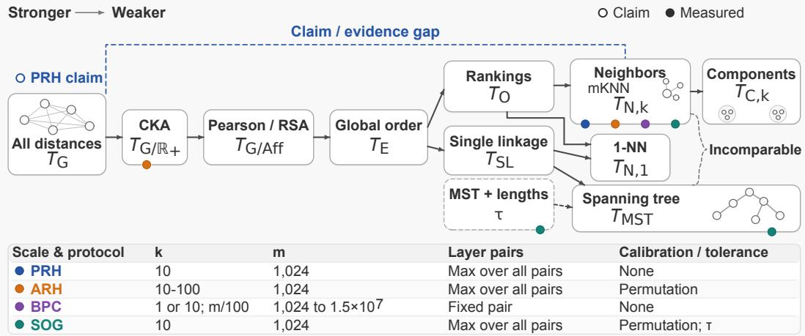  
Figure 1: The lattice of alignment criteria for the four studies, from strongest (left) to weakest (right).

The four studies thus offer competing hypotheses about the structure shared by the same pretrained models. However, these hypotheses are drawn from measures of different strength, applied under different settings such as the numbers of evaluation samples and neighbors, the compared layers, and calibration. If the models represent the same reality, it is natural to ask whether the conflict comes from different ways of viewing their representations, which would require a general theory relating these views.

To answer this question, we define an alignment criterion as a test that compares how two models represent a shared set of evaluation samples, through one relation among these samples (e.g., the neighbor sets in mKNN or the distances in calibrated CKA), and accepts the pair of models if the two relations agree within a tolerance under a fixed scale and protocol. We call one criterion stronger than another if every pair accepted by the first is accepted by the second, so one pair of models can satisfy a criterion and fail a stronger one. The criteria then form a lattice, on which Figure 1 places the four studies. Furthermore, as studies also claim that networks trained with different objectives learn similar representations (Huh et al., 2024; Bansal et al., 2021), it then remains to explore which criteria can be satisfied by a pair of independently trained models. These two questions motivate our lattice representation hypothesis.

Lattice Representation Hypothesis (LRH). In the lattice of alignment criteria, the set of criteria accepting two models describes what is shared by their representations. Studies have conflicting conclusions because they apply criteria at different points ofthis lattice. For independently trained models, the training procedure and the objective decide the criteria met reliably across runs, each in a different part of the lattice.

## Under this lattice view, we obtain the following results.

1. PRH’s claim amounts to agreement under the criterion at the top of the lattice, where its idealized learners agree on all distances (Section 3.3). Its evidence comes from mKNN, a criterion near the bottom that compares neighbor sets (Proposition 1).

2. The loss of the CKA trend in ARH can come from calibrating a maximum over layers, whose chance level grows with effective dimension (Proposition 4, Corollary 1). On LLaMA-1, calibration turned the trend 0.68 into −0.85, a drop predicted from single-model features. With the preprocessing of PRH, the trend of calibrated CKA in language-model size keeps its sign at mid depth and at the last layer, so global convergence remains open (Section 5.4).

3. A larger evaluation set at a fixed k draws the neighbor boundary closer to each input, so the collapse of mKNN reported by BPC is at least partly a scale effect (Theorem 1). As in BPC, mKNN with sentence encoders (preregistered) and with last-layer vision features (exploratory) stays close to stable at a fixed $k / m$ for $k = 1 0$ and $k = 1 0 0$ (Section 5.2 and Appendix G).

4. Every MST contains the nearest-neighbor edge of each input (Proposition 2), and on the studied vision–language pairs these edges make up about 88% of the shared tree edges (Section 5.3). On these pairs, the MST overlap used by SOG thus mostly repeats one-nearest-neighbor overlap, while the number of other shared edges exceeds its chance level without an established size trend.

5. The training procedure of a linear autoencoder decides whether distances agree across runs by selecting the invertible map undone by its linear head (Theorem 2). In a finite contrastive Gibbs model, two learners trained with different contrastive objectives agree on the order of distances for large samples and differ in geometry, since they learn one relation through different increasing functions (Theorem 3). Preregistered tests confirm the main predictions of both theorems in these models, whereas results on trained networks outside the premises of the theorems contradict several of these predictions (Sections 5.5 and 5.6).

## 2 Alignment Criteria and Their Lattice

To state the lattice representation hypothesis formally as Hypothesis 1, we define alignment criteria, their order by strength, and the probability that two independently trained models meet a criterion.

Setting and Notation. We compare two models with representation maps $h _ { A }$ and $h _ { B }$ on m evaluation samples $\boldsymbol { S } = ( ( \boldsymbol { x } _ { i } ^ { A } , \boldsymbol { x } _ { i } ^ { B } ) ) _ { i = 1 } ^ { m } ,$ each pairing an input $\bar { \mathbf { \Phi } } _ { x _ { i } ^ { A } }$ of model A with the corresponding input $x _ { i } ^ { B }$ of model $\mathbf { B } ,$ such as an image and its caption. On $S ,$ , model $a \in \{ A , B \}$ has the Gram matrix $( \bar { K } _ { a } ) _ { i j } \stackrel { \cdot } { = } \langle h _ { a } ( x _ { i } ^ { a } ) , h _ { a } ( x _ { j } ^ { a } ) \rangle$ of its preprocessed features, the centered Gram matrix $\bar { K } _ { a } = H K _ { a } H$ with $H = I - \mathbf { 1 1 } ^ { \top } / m$ , and the squared distances $D _ { a } = D ( K _ { a } )$ with $D ( K ) _ { i j } = K _ { i i } + K _ { j j } - 2 K _ { i j }$ The preprocessing map of our protocols (Section 2.1) normalizes features to unit length, so Gram matrices have unit diagonal unless stated otherwise. Let $\mathcal { N } _ { k } ^ { a } ( i )$ be the set of the k inputs $l \neq i$ nearest to input i under $D _ { a } .$ , with $1 \leq k \leq m - 2$ and a fixed tie-breaking rule. We write $\mathcal { T } _ { a }$ for the edge set of the minimum spanning tree (MST) of the complete graph on the m inputs weighted by the distances $d _ { a } = D _ { a } ^ { \circ 1 / 2 }$ , i.e., the entrywise square roots of $D _ { a }$ . Mutual k-nearest-neighbor overlap (mKNN), MST overlap, and linear centered kernel alignment (CKA) are $s _ { N } = ( m k ) ^ { - 1 } \sum _ { i } | \mathcal { N } _ { k } ^ { A } ( i ) \cap \mathcal { N } _ { k } ^ { B } ( i ) |$ $s _ { T } = | T _ { A } \cap T _ { B } | / ( m - 1 )$ , and $\operatorname { C K A } ( K _ { A } , K _ { B } ) = \langle \bar { K } _ { A } , \bar { K } _ { B } \rangle _ { F } / ( \| \bar { K } _ { A } \| _ { F } \| \bar { K } _ { B } \| _ { F } )$ (Huh et al., 2024; You et al., 2026; Kornblith et al., 2019), with the conventions of Appendix B.

## 2.1 Observables, Protocols, and Criteria

Each of these scores depends on the two Gram matrices through one kind of relation among the inputs, such as the neighbor sets for mKNN or the spanning-tree edges for MST overlap, and an observable maps a Gram matrix to such a relation.

Definition 1 (Observable and Information Refinement). An observable is a measurable map $T$ : $\kappa  \mathcal { V } _ { T }$ on a common domain $\kappa \subseteq \mathbb { S } _ { + } ^ { m }$ of admissible Gram matrices. For observables on the same domain, $T _ { 2 }$ refines $T _ { 1 }$ , written $T _ { 1 } \preceq T _ { 2 } , \mathrm { i f } T _ { 1 } = q \circ T _ { 2 }$ for some measurable map $q : \mathcal { V } _ { T _ { 2 } } \to \mathcal { V } _ { T _ { 1 } }$ i.e., the value of $T _ { 2 }$ determines the value of $T _ { 1 }$

Besides the squared distances $T _ { { \cal G } } ( K ) = D ( K )$ and the neighbor sets $T _ { N , k }$ , Appendix B defines four observables built from graphs on the inputs, i.e., the connected components $T _ { C , k }$ of the $k \mathrm { - }$ nearest-neighbor graph, the single-linkage dendrogram $T _ { S L }$ , the MST edge set $T _ { \mathrm { M S T } }$ , and the nearest-neighbor map $T _ { N , 1 }$ . The remaining observables of this appendix are the rankings $T _ { O }$ of the other inputs by their distance to each input, the global order $T _ { E }$ of all distances, and the classes $T _ { G / \mathrm { A f f } }$ and $T _ { G / \mathbb { R } _ { + } }$ of $D ( K )$ under positive affine maps and rescaling. The Pearson correlation of two distance matrices is a function of their classes under positive affine maps, and linear CKA is a function of the classes of the two distance matrices under rescaling.

Proposition 1 (Two Branches below the Global Order). On Gram matrices whose distances $D ( K ) _ { i j } , i < j ,$ , are pairwise distinct, the following hold: (1) $T _ { C , k } \preceq T _ { N , k } \preceq T _ { O } \preceq T _ { E } \preceq$

$T _ { G / \mathrm { A f f } } \preceq T _ { G / \mathbb { R } _ { + } } \preceq T _ { G } ; ( 2 ) T _ { \mathrm { M S T } } \preceq T _ { S L } \preceq T _ { E } a n d T _ { N , 1 } \preceq T _ { S L } ; ( 3 )$ for every $m \geq 4$ and $1 \leq k \leq m - 2 , T _ { \mathrm { M S T } } \neq T _ { O } ,$ hence TMST $\neq T _ { N , k }$ , and $T _ { N , k } \not \simeq T _ { \mathrm { M S T } }$

The third part places neighbor sets and spanning trees on separate branches below $T _ { E }$ (Appendix C.5 proves all three parts). Since learned representations carry nonzero error, a criterion on an observable $\bar { T }$ also fixes a tolerance $\varepsilon \geq 0$ on a discrepancy $\Delta \geq 0$ between values of $T ,$ , such as $\Delta _ { N } = 1 - s _ { N }$ for neighbor sets, whereas the exact criterion $( T , = )$ takes $\varepsilon = 0$ and $\Delta = \mathbb { I } \{ T ( K ) \neq T ( K ^ { \prime } ) \}$ . The neighbor count k and the number m of inputs set the scale of a criterion, i.e., the range of distances over which the two models are compared. BPC changes this scale at fixed k through the size m of its evaluation sets. The length tolerance $\tau$ of SOG sets how strongly a mismatch between the normalized lengths of a shared edge in the two models lowers the weight of this edge (Equation (B.1)).

To compare the two models across layers, we write $K _ { a } ^ { \ell }$ for the Gram matrix of model a at layer $\ell$ and $s \ell \ell ^ { \prime }$ for the score computed on $K _ { A } ^ { \ell }$ and $K _ { B } ^ { \ell ^ { \prime } }$ . An evaluation protocol $\mathcal { P } = ( \mathrm { p r e } , \mathrm { a g g } , \mathrm { c a l } )$ consists of a preprocessing map pre of the features of each layer, an aggregation agg of the layer-pair scores $( s _ { \ell \ell ^ { \prime } } ) _ { \ell , \ell ^ { \prime } }$ into one score $s ,$ and a calibration cal of $s .$ . The calibration uses the scores computed by the same protocol after a uniformly random permutation π of the inputs of one model. The random-pairing baseline of a score is its expectation under $\pi . \mathrm { \Delta A }$ protocol acts equivalently on a score s with largest possible value $s _ { \mathrm { m a x } }$ and on its discrepancy $s _ { \operatorname* { m a x } } - s ,$ , so the maximum of the layer-pair scores corresponds to the minimum of the layer-pair discrepancies. PRH, ARH, and SOG aggregate by the maximum ma $\mathrm { { X } } \ell , \ell ^ { \prime } ^ { \mathrm { ~ \tiny ~ S ~ } } \ell \ell ^ { \prime }$ over layer pairs (Table $\mathrm { 8 . 1 } )$ , whereas a fixed-layer protocol uses $s \ell _ { 0 } \ell _ { \mathrm { { 0 } } } ^ { \prime }$ ARH calibrates an observed score $s _ { \mathrm { o b s } } \tan s _ { \mathrm { c a l } } = [ s _ { \mathrm { o b s } } - c _ { \alpha } ] _ { + } / ( s _ { \mathrm { m a x } } - c _ { \alpha } )$ with $[ u ] _ { + } = \operatorname* { m a x } \{ u , 0 \}$ where the calibration threshold $c _ { \alpha }$ is a $( 1 - \alpha )$ quantile of the aggregated scores on the observed pairing and on the permuted pairings of the inputs (Gröger et al., 2026).

Definition 2 (Alignment Criterion). An alignment criterion $Q = ( T , \Delta , \varepsilon ; \mathcal { P } )$ consists of an observable $T ,$ , a discrepancy $\Delta .$ , a tolerance $\varepsilon \geq 0$ , and an evaluation protocol $\mathcal { P }$ with fixed scale parameters and permutation draws. It accepts a pair of models if $\mathcal { P }$ computes a discrepancy of at most ε from the layer-pair discrepancies $\Delta ( T ( K _ { A } ^ { \ell } ) , T ( K _ { B } ^ { \ell ^ { \prime } } ) )$ ). Its acceptance set $\boldsymbol { \mathcal { A } } _ { Q }$ is the set of tuples of layer Gram matrices satisfying this condition, and we treat criteria with equal acceptance sets as the same criterion.

We write $( K _ { A } , K _ { B } ) \in \mathcal { A } _ { Q }$ when the tuple of layer Gram matrices of the two models lies in $\boldsymbol { \mathcal { A } } _ { Q }$ On a common domain, we call $Q _ { 2 }$ stronger than $Q _ { 1 }$ , written $Q _ { 1 } \preceq Q _ { 2 } , { \mathrm { i f } } \lrcorner A _ { Q _ { 2 } } \subseteq A _ { Q _ { 1 } } , { \mathrm { i . e . } }$ , every pair accepted by $Q _ { 2 }$ is accepted by $Q _ { 1 }$ . If intersections and unions of acceptance sets also count as criteria, the criteria on a common domain form a lattice under strength (Appendix $\mathrm { C } ) . ^ { 2 }$ Any two criteria then have a weakest criterion stronger than both (their join) and a strongest criterion weaker than both (their meet). Since strength reduces to refinement for exact criteria with a common protocol on the observables used here, Proposition 1 describes the exact part of this lattice. One pair of models can satisfy a criterion on one branch and fail a criterion on the other. To explain such opposite results on one pair, we identify the quantities that determine the outcome of each criterion (Section 3). Such a quantity is a function of the two representations and fixes the discrepancy of the criterion or the expectation of this discrepancy over the evaluation samples, exactly or up to a stated error.

## 2.2 Reliable Agreement and the Hypothesis

The criteria above compare two fixed representations, whereas repeated training can change the representation map of a model. For each model, we choose where the representation map takes its features, such as a specified layer, and leave aggregation over layers to the protocol of Section 2.1. The learning condition $\boldsymbol { r } _ { a } = \left( P _ { a } , N _ { a } , \mathcal { H } _ { a } , \mathcal { L } _ { a } , \mathsf { T r a i n } _ { a } \right)$ of model a consists of its data distribution, training sample size, model class, objective, and training procedure. Repeated draws of the training sample and of the training randomness induce a law $\mu _ { r _ { a } }$ of Gram matrices on evaluation samples drawn independently of training. With independent draws for the two models, $Q$ is met with probability $p _ { Q } ( r _ { A } , r _ { B } ) = \mathbb { P } _ { \mu _ { r _ { A } } \otimes \mu _ { r _ { B } } } ( ( K _ { A } , K _ { B } ) \in \mathcal { A } _ { Q } )$ . An intervention changes some entries of $( r _ { A } , r _ { B } )$

and $\mathcal { T } ( r _ { A } , r _ { B } )$ denotes the pairs of conditions reached by one family of interventions, such as all increases of the training sample size.

Definition 3 (Reliable Agreement and Obstruction). Fix a level $1 - \delta$ with $0 < \delta < 1$ and a separation $\eta \in ( 0 , 1 - \delta )$ , i.e., the gap between the thresholds for reliable agreement and for obstruction. For models trained under $r _ { A }$ and $r _ { B }$ , agreement under Q is reliable at level $1 - \delta \operatorname { i f } p _ { Q } ( r _ { A } , r _ { B } ) \geq 1 - \delta$ A criterion $Q$ is obstructed over $\bar { \mathcal { T } } ( r _ { A } , r _ { B } )$ if $\begin{array} { r } { \operatorname* { s u p } _ { ( r _ { A } ^ { \prime } , r _ { B } ^ { \prime } ) \in \mathbb { Z } ( r _ { A } , r _ { B } ) } p _ { Q } ( r _ { A } ^ { \prime } , r _ { B } ^ { \prime } ) \le 1 - \delta - \eta _ { \bar { + } } } \end{array}$ , and, for a family of pairs of learning conditions indexed by the training sample size $N .$ , asymptotically obstructed if lim $\begin{array} { r } { \operatorname* { s u p } _ { N \to \infty } p _ { Q } \le 1 - \delta - \eta } \end{array}$

Hypothesis 1 (Lattice Representation Hypothesis). (1) For two fixed representations with Gram matrices $K _ { A }$ and $K _ { B } ,$ , the set $\{ Q : ( K _ { A } , \bar { K } _ { B } ) \in \mathcal { A } _ { Q } \}$ ofcriteria accepting the pair describes what is shared by the two representations. Studies reach conflicting conclusions about the same models because they apply criteria at different points ofthe lattice. (2) For learning conditions $( r _ { A } , r _ { B } )$ and a level $1 - \delta , \bar { l e t } \mathcal { R } _ { \delta } ( r _ { A } , r _ { B } ) = \{ Q : \bar { p _ { Q } } ( r _ { A } , \bar { r } _ { B } ) \geq 1 - \delta \}$ be the set ofcriteria met reliably across runs. The training procedure, the objective, the sample size, and the model class each decide this set in a different part of the lattice.

## 3 What Determines the Outcome of a Criterion

To support part 1 of Hypothesis 1, we explain why the four studies reach conflicting conclusions about the same models. Two representations can differ in many ways, and each criterion detects only some of these differences. For example, a nonlinear change of all distances that keeps their order leaves every neighbor set unchanged and can still lower CKA. Starting from mKNN, we change its scale, replace it with MST overlap and then with CKA, and finally change the protocol. The four studies differ in these choices and thereby apply criteria at different points of the lattice.

## 3.1 Neighbor Overlap Is Determined by Boundary Crossings at the Scale $k / m$

For a neighbor criterion such as mKNN, the neighbor count k and the number m of inputs set the scale, i.e., the distance from each anchor to its kth nearest input. We ask on which differences between the two representations the outcome of this criterion depends at each scale. Since the neighbor set $\mathcal { N } _ { k } ^ { a } ( i )$ depends on the distances from its anchor i alone, we compare the two models through the joint law of their distances from an anchor to a random input. We assume that the evaluation inputs are independent draws from a law $P _ { S }$ of evaluation samples, with an image and its caption drawn together as one sample in the cross-modal case. We call the joint law of the squared distances $( \bar { D _ { A } } ( x , x ^ { \prime } ) , D _ { B } ( x , x ^ { \prime } ) )$ for $x ^ { \prime } \sim P _ { S }$ the cross-model distance coupling at the anchor x.

The coupling records how far apart model B places two inputs found at a given distance in model A. The two neighbor sets of an anchor differ when model B carries inputs across the neighbor boundary, which separates the $k$ nearest inputs of the anchor in model A from the other inputs. A worst-case margin certifies neighbor agreement at an anchor i whose gap between the kth and $( k + 1 )$ th smallest distances in model A exceeds $\begin{array} { r l } { { 2 } \operatorname* { m a x } _ { j \neq i } \vert D _ { A } ( i , j ) - D _ { B } ( i , j ) } \end{array}$ | (cf. Sumiya, 2026, and Lemma D.2). Since this gap shrinks with $m ,$ the margin certifies a smaller share of anchors on larger evaluation sets, and to describe the typical anchor we count the inputs crossing the neighbor boundary. At an anchor i with $b _ { l } = D _ { B } ( i , l )$ , a threshold ϑ is crossed by the $X ( \vartheta ) \overset { = } = | \{ j \in \overline { { \mathcal { N } _ { k } ^ { A } } } ( i ) : b _ { j } > \vartheta \}$ | neighbors of model A pushed out by model B and the $Y ( \vartheta ) = | \{ l \notin \mathcal { N } _ { k } ^ { A } ( i ) \cup \{ i \} : b _ { l } \leq \bar { \vartheta } \} |$ non-neighbors pulled below the threshold.

Theorem 1 (Crossing Law). For every anchor i and threshold ϑ, the number $| \mathcal { N } _ { k } ^ { A } ( i ) \setminus \mathcal { N } _ { k } ^ { B } ( i ) |$ of replaced neighbors lies between $\dot { X } ( \vartheta )$ and $Y ( \vartheta )$ . Let G be $\textit { a } \sigma { - } f i e l d$ with respect to which row i of $D _ { A }$ is measurable. If the entries $b _ { l }$ with $l \neq i$ are independent with continuous laws given ${ \dot { \mathcal { G } } } ,$ , then there is a $\mathcal { G }$ -measurable threshold $\vartheta ^ { \ast }$ with $\mathbb { E } [ X ( \mathsf { \bar { \vartheta } } ^ { * } ) \mid \mathcal { G } ] = \mathbb { E } [ Y ( \vartheta ^ { * } ) \mid \mathcal { G } ]$ . For this $\vartheta ^ { \ast }$ , the conditional expectation of the number of replaced neighbors given G lies almost surely within $( \kappa _ { i } / 2 ) ^ { 1 / 2 } o f \dot { \kappa } _ { i } = \mathbb { E } [ X ( \mathsf { \bar { \vartheta } } ^ { * } ) \mid \mathcal { G } ]$ , which is almost surely the same at every such $\vartheta ^ { \ast }$ and is unchanged when one deterministic strictly increasing function is applied to every entry $o f$ row i of $D _ { A }$ or of $D _ { B }$

By Theorem 1, the expected fraction of replaced neighbors is $\kappa _ { i } / k$ up to an error of order $\sqrt { \kappa _ { i } } / k$ The loss of neighbor overlap thus counts the neighbors pushed across the neighbor boundary by model B, a count unchanged by deterministic strictly increasing maps of either row. Fixed models on independent inputs satisfy the assumption of the theorem whenever the coupling has continuous conditional laws (Lemma D.1 in Appendix D). Under this condition, the crossing law holds on pretrained models without a noise model, and neighbor overlap depends on the coupling through the expected crossings at each anchor.

With a growing ratio $m / k ,$ the neighbor boundary moves inward and $\kappa _ { i }$ depends on the coupling at smaller distances. At a fixed $k ,$ a neighbor criterion on a larger evaluation set therefore compares the two models at a finer scale. The outcomes of two neighbor criteria differing in m alone depend on the coupling at different distances, and one pair of models can satisfy one of these criteria and fail the other. Conjecture D.1 in Appendix D.2 sorts the limits of $s _ { N }$ at fixed k into three classes, a classification whose proof awaits a local Poisson limit. The limit is one when the two embeddings agree up to a local rescaling of distances, lies in (0, 1) for other smooth embeddings, and is zero when model B separates inputs placed arbitrarily close by model $\mathbf { A } .$ . In these three classes, the heuristic first-order law behind the conjecture predicts that $s _ { N }$ at fixed k rises, stays flat, or falls with m. At a fixed $k / m$ , the same law predicts a stable $s _ { N }$ for large m.

The size trend of mKNN reported by PRH and kept by ARH is a trend in the crossings at the neighbor boundary, measured in each study at one scale set by its k and $m .$ . BPC enlarges the evaluation set at a fixed k and finds that mKNN between vision and language models collapses unless k grows in proportion to $m .$ . This fall of mKNN with the evaluation size comes at least partly from the change to a finer scale, and the collapse is consistent with the third class of Conjecture D.1. On one million WIT pairs, the neighbor criteria compared by BPC are two points of one lattice, criteria on the observables $T _ { N , 1 0 }$ and $T _ { N , m / 1 0 0 }$ , the second keeping the scale $k / m$ of PRH. PRH and BPC thus reach different conclusions from neighbor criteria at different scales. At every scale, neighbor overlap depends on the crossings at each anchor separately, through the ranking of the other inputs by their distance from this anchor.

## 3.2 Spanning Trees Contain the Nearest-neighbor Forest

Since neighbor overlap depends on the crossings at each anchor separately, we keep the inputs and move to the MST. This tree is built by comparing distances from different anchors, and the observable $T _ { \mathrm { M S T } }$ lies on the other branch below the order $\bar { T } _ { E }$ . By Proposition 1, the rankings from every anchor leave this tree undetermined, and we ask whether part of the MST overlap nevertheless comes from one-nearest-neighbor overlap. Since Kruskal’s algorithm builds the MST from the shortest edges first, part of each tree is decided at the nearest-neighbor scale, and Proposition 2 names this part.

Proposition 2 (Spanning Trees Contain the Nearest-neighbor Forest). If each model a has pairwise distinct distances $D _ { a } ( i , j )$ with $i < j$ , the MST of each model contains its nearestneighborforest $F _ { a } ,$ , which joins each input to its nearest neighbor. The other $n _ { a } ^ { \mathrm { m u t } } - 1$ edges ofthe MST are bridges joining two trees of $F _ { a } ,$ , where $n _ { a } ^ { \mathrm { m u t } }$ counts the pairs ofmutual nearest neighbors, and $s _ { T } \geq$ max $\{ m s _ { N , 1 } - n _ { A } ^ { \mathrm { m u t } }$ , m $s _ { N , 1 } / 2 \} / ( m - 1 )$ for the one-nearest-neighbor overlap $s _ { N , 1 }$ , i.e., sN at $k = 1$

Proposition 2 names a part of each tree fixed by the nearest-neighbor relations alone, the nearestneighbor forest, and this forest makes up at least half of each tree because the mutual pairs are disjoint. The two branches share the nearest-neighbor map $T _ { N , 1 }$ , which determines this forest and lies below both $T _ { O }$ and $T _ { S L }$ . Since each tree contains its forest, the shared MST edges include the shared nearest-neighbor edges, and the bound on $s _ { T }$ keeps MST overlap at least half of the one-nearest-neighbor overlap. MST overlap depends on structure beyond neighbor sets through the bridges, which carry the information in the MST beyond the nearest-neighbor scale. The tree also leaves the neighbor sets undetermined (Proposition 1), and one pair of models can satisfy a criterion on spanning trees and fail a criterion on neighbor sets.

SOG infers converging global structure from the size trend of MST overlap. By Proposition 2, the part of this trend carried by the shared nearest-neighbor edges depends on the models through their nearest-neighbor maps alone, as does the trend of one-nearest-neighbor overlap. The trend of MST overlap supports this conclusion of SOG to the extent that it is carried by the bridges. Both branches lie below the order $T _ { E }$ of all distances, and two representations whose distances differ by a strictly increasing distortion therefore agree on neighbor sets and spanning trees.

## 3.3 Unlike Neighbor Overlap, CKA Also Depends on a Monotone Link

A strictly increasing distortion of all distances can still change the value of CKA (Proposition D.1 in Appendix D), whose observable $T _ { G / \mathbb { R } _ { + } }$ lies above $T _ { E }$ in the chain of Proposition 1. To find which quantities determine the outcome of a criterion above $T _ { E }$ in addition to the order of all distances, we split the difference into a monotone distortion of the distances and the remaining disagreement. We write $\mathrm { C K A } ( D , D ^ { \prime } )$ for the CKA of HDH and $H D ^ { \prime } H$ , which equals the CKA of the Gram matrices. For hollow symmetric m × m matrices $D _ { A }$ and $D _ { B }$ , a monotone link from $D _ { A }$ to $D _ { B }$ is a nondecreasing function $\phi : [ 0 , \infty )  \mathbb { F }$ applied entrywise off the diagonal, the residual around ϕ is the hollow symmetric matrix $\dot { R } = D _ { B } - \phi ( D _ { A } )$ , and an isotonic link minimizes $\| R \| _ { F }$ over all monotone links.

Proposition 3 (CKA under a Monotone Link and a Residual). For each $m ,$ let $D _ { A }$ be a fixed nonzero hollow symmetric matrix with nonnegative entries, ϕ increasing, and $D _ { B } \ =$ ${ \overset { \cdot } { \phi } } ( D _ { A } ) + R$ for a random hollow symmetric residual R whose entries above the diagonal are independent with mean zero, variance $\sigma ^ { 2 } ,$ , andfourth moments bounded uniformly in m. As $m  \infty w i t h \sigma ^ { 2 } a n d \varsigma ^ { 2 } = \| H \phi ( D _ { A } ) H \| _ { F } ^ { 2 } / ( m ( m - 1 ) )$ bounded away from zero and infinity, $\mathrm { C K A } ( D _ { A } , D _ { B } ) - \mathrm { C K A } ( D _ { A } , \phi ( D _ { A } ) ) / \sqrt { 1 + \sigma ^ { 2 } / \varsigma ^ { 2 } } \to 0$ in probability.

By Proposition 3, when both effects are small, $1 - \mathrm { C K A } \approx \left( 1 - \mathrm { C K A } ( D _ { A } , \phi ( D _ { A } ) ) \right) + \sigma ^ { 2 } / ( 2 \varsigma ^ { 2 } )$ so CKA depends on the monotone link at zeroth order and on the residual at second order relative to the global spread ς of the distances. Neighbor overlap instead ignores the link and depends on the residual through the crossings at the neighbor boundary (Theorem 1).

The observable of CKA determines the order of all distances, and exact agreement on this observable implies agreement on every neighbor set and spanning tree (Proposition 1). Two representations sharing the order of all distances differ by a monotone link with a zero residual, and CKA depends on this link at zeroth order. Agreement can thus hold on the order of all distances and fail above this order. Under the distortion of Proposition D.1, the two representations agree exactly on $T _ { E }$ and on every observable below this order, whereas CKA comes close to zero when the inputs vary along few effective directions relative to m.

The convergence claimed by PRH implies agreement under the exact criterion on $T _ { G }$ , the top of the chain in Proposition 1, since its idealized learners agree on all distances (Appendix A). ARH finds that mKNN keeps its size trend after calibration whereas global measures such as CKA largely lose this trend, and narrows the convergence inferred by PRH from the mKNN trend to shared local neighborhoods. By Propositions 3 and D.1, two models whose representations share the order of all distances can satisfy an mKNN criterion and fail a CKA criterion through a monotone link alone. PRH and ARH thus share the trend of mKNN, whose observable lies below $T _ { E }$ , and differ in their conclusions about agreement above this order. ARH computes its trends of mKNN and CKA after calibration of a maximum over layers, and the contrast between these trends can also depend on this protocol.

## 3.4 Calibration of a Layer Maximum Can Reverse a Size Trend

To separate the protocol from the observable, we keep the observables of mKNN and CKA and the representations unchanged and ask whether calibrating a maximum over layers can change the size trend of a score. Since calibration subtracts a permutation quantile of the score, the random-pairing baseline of each score sets the size of this subtraction at a single layer pair, and we first compute these baselines.

Proposition 4 (Random-pairing Baselines). Let π be a uniformly random permutation of the inputs of model B, and let $\mathbb { E } _ { \pi }$ denote the expectation of a quantity computed after this permutation, taken over π and over any random tie-breaking. (1) If each row of $D _ { B }$ has distinct off-diagonal entries or ties are broken uniformly at random independently of π, then after this permutation the number of neighbors shared by the two models at each anchor follows the hypergeometric distribution with population $m - 1$ , k successes, and k draws, and $\mathbb { E } _ { \pi ^ { S _ { N } } } \stackrel {  } { = } \bar { k } / ( m - 1 )$ ). (2) For nonzero centered Gram matrices, $\operatorname { \mathbb { E } } _ { \pi } \operatorname { C K A } \ =$ $( \mathrm { P R } ( \bar { K } _ { A } ) \mathrm { P R } ( \bar { K } _ { B } ) ) ^ { 1 / 2 } / ( m - 1 )$ with the participation ratio $\mathrm { P R } ( \bar { K } ) \ = \ ( \mathrm { t r } \bar { K } ) ^ { 2 } / \| \bar { K } \| _ { F } ^ { 2 }$ (3) For $m \geq 4 ,$ let $\mathrm { H S I C } _ { \mathrm { u } }$ be the unbiased estimator of the Hilbert–Schmidt independence criterion (Song et al., 2012). If $\mathrm { H S I C _ { u } } ( K _ { A } , K _ { A } )$ and $\mathrm { H S I C _ { u } } ( K _ { B } , K _ { B } )$ are positive, then $\mathbb { E } _ { \pi } \mathrm { C K A } _ { \mathrm { d e b } } = 0 a n d \mathbb { E } _ { \pi } \mathrm { C K A } _ { \mathrm { d e b } } ^ { 2 } = 2 / ( m ( m - 3 ) ) .$ for the debiased CKA $\mathrm { C K A _ { d e b } } ( K _ { A } , K _ { B } ) =$ $\mathrm { H S I C _ { u } } ( K _ { A } , K _ { B } ) / ( \mathrm { H S I C _ { u } } ( K _ { A } , K _ { A } ) \mathrm { H S I C _ { u } } ( K _ { B } , K _ { B } ) ) ^ { 1 / 2 } .$

For independent identically distributed representations, part 1 is Theorem C.10 and Proposition C.11 of Gröger et al. (2026), and part 2 is classical for the RV coefficient, which coincides with linear CKA (Kazi-Aoual et al., 1995; Josse et al., 2008). Every layer pair has the mKNN baseline $k / ( m - 1 )$ , whereas by part 2 the baseline of CKA grows with the participation ratio of each layer, i.e., its effective dimension. A calibration of the layer maximum recomputes this maximum inside each permutation, and we expect its threshold to lie near the largest baseline over layer pairs, as assumed in Corollary 1.

Corollary 1 (Aggregation before Calibration, Informal). For two model pairs indexed 1 and 2, let $\bar { s } _ { j }$ be the maximum ofthe layer-pair scores ofpair j, and let the calibration threshold of $\dot { s } _ { j }$ lie within $\zeta _ { j }$ of the largest random-pairing baseline $\bar { s } _ { j } ^ { 0 }$ over these layer pairs, with $\bar { s } _ { j } ^ { 0 } + \zeta _ { j } < \bar { s _ { \mathrm { m a x } } } .$ (1) $I f \bar { s } _ { 1 } ^ { 0 } = \bar { s } _ { 2 } ^ { 0 }$ and $\bar { s } _ { 2 } - \bar { s } _ { 1 } > \zeta _ { 1 } + \zeta _ { 2 } ,$ , calibration does not reverse the order ofthe two maxima. (2) Let $\bar { s } _ { 1 } < \bar { s } _ { 2 }$ , and let the largest baseline grow from pair 1 to pair 2 so much faster than the maximum that the calibrated score of $\overline { { s } } _ { 1 }$ at the threshold $\bar { s } _ { 1 } ^ { 0 } + \bar { \zeta } _ { 1 }$ exceeds that of $\bar { s } _ { 2 }$ at the threshold $\bar { s } _ { 2 } ^ { 0 } - \zeta _ { 2 }$ . Then calibration reverses this order.

By Corollary 1, the protocol alone can reverse a size trend on unchanged representations when the largest baseline grows faster than the aggregated score in the sense of part 2. With one baseline shared by all layer pairs and model pairs, mKNN falls under part 1, and calibration does not reverse the order of model pairs whose mKNN scores differ by more than the permutation fluctuations. Part 3 of Proposition 4 gives debiased CKA the baseline zero at every layer pair, which places this score under part 1. The largest CKA baseline belongs to the layers of largest effective dimension and can outgrow the aggregated score along a model family, as the condition of part 2 requires. The corollary and its proof apply unchanged to calibration at layers fixed in advance, with the score, baseline, and threshold of the fixed layer pair in place of those of the maximum. Calibration of each layer pair before the maximum also subtracts baselines growing with these dimensions but lies outside the corollary. Appendix D gives the formal version of the corollary and its proof.

ARH calibrates a maximum over layer pairs, and when the threshold of this calibration follows the largest baseline over layer pairs, the loss of the CKA trend in ARH can come from the protocol. The mKNN trend kept by ARH after calibration is consistent with part 1 of Corollary 1.

On one pair of fixed representations, whether a criterion accepts the pair can change with its scale and with its observable, both between the two branches below the order $T _ { E }$ and across this order. With the representations unchanged, the protocol of a criterion alone can reverse a size trend along a model family. The four studies differ in these choices, since PRH and BPC use mKNN at different scales, while SOG compares spanning trees and ARH uses CKA after calibrating a maximum over layers. Their conflicting conclusions about the same models can therefore come from criteria applied at different points of the lattice, which supports part 1 of Hypothesis 1. This section compares fixed representations, whereas the representations of independently trained models vary from run to run, and in Section 4 we ask how their training decides the set of criteria met reliably across runs.

## 4 What Determines the Criteria Met Reliably across Runs

To support part 2 of Hypothesis 1, we show in two models with explicit minimizers how the training procedure and the objective decide the set $\mathcal { R } _ { \delta }$ of criteria met reliably across runs. As the training samples grow, the representations of two runs can stay apart for two reasons. The loss can have many global minimizers, each run reaching one of them, or two objectives can have unique but different minimizers. In Section 4.1, the training procedure of a linear autoencoder chooses among equivalent global minimizers, and in Section 4.2, learners trained with two contrastive objectives converge to unique but different limits. In each case, we find the criteria met reliably by the two models. For the other criteria, we find the change of the learning condition that removes their obstruction and the change of criterion that avoids this obstruction. Appendix E gives the formal versions of the theorems below and treats the sample size and the model class, the other two conditions named in part 2, and Table E.1 pairs all four conditions with their criteria.

## 4.1 The Training Procedure Selects the Gauge of a Linear Head

Two runs of one learner on the same sample share their learning condition, yet networks trained from different random seeds differ measurably in their representations (Mehrer et al., 2020; Ding et al., 2021). A model that predicts through a linear head computes the same outputs after an invertible change of its representation compensated in the head, so the task and any amount of its data fix the representation up to such changes. For a model computing outputs $W h ( x )$ from a representation $\bar { h } ( x ) \in \mathbb { R } ^ { n _ { h } }$ and a linear head W, the models $( h , W )$ and $( V \dot { h } , W V ^ { - 1 } )$ with an invertible $V \in \mathbb { R } ^ { n _ { h } \times n _ { h } }$ are gauge equivalent, and the gauge of a model is the matrix $V$ relating the model to a fixed reference model of its class. In a linear autoencoder $\hat { x } = W E x$ trained with the squared reconstruction loss, we ask how the training procedure chooses among these changes and which criteria are then met reliably by two runs. The two runs are compared on fixed evaluation samples drawn independently of training, which we call probes. In the linear autoencoder, the probe Gram matrix K is the Gram matrix of the features $E x$ on the probes, without the unit normalization of Section 2. Every criterion in this section compares the two probe Gram matrices of the theorems below, without further preprocessing and without calibration.

Theorem 2 (The Gauge of a Linear Head, Informal). Assume the conditions of the formal version. The global minimizers of the reconstruction loss on one sample are gauge equivalent, and the probe Gram matrix K depends on the gauge V through $\Omega = { \bf \bar { \Psi } } { \bf \Psi } ^ { \top } V .$ (1) Gradient flow conserves $\boldsymbol { C } = E \boldsymbol { E } ^ { \intercal } - \boldsymbol { W } ^ { \intercal } \boldsymbol { W }$ at its initial value $C _ { 0 } ,$ and a limit at a global minimizer has spec $\Omega = f ( \mathrm { s p e c } C _ { 0 } ) f o r f ( \lambda ) = ( \lambda + \sqrt { \lambda ^ { 2 } + 4 } ) / 2 .$ (2) Two such limits on the same or on different samplesfrom independent initializations with a densityfor $C _ { 0 }$ have $\mathrm { C K A } < 1$ almost surely, and $\mathbb { P } ( \mathrm { C K A } \geq 1 - \varepsilon )$ is at most a bound that tends to zero as $\varepsilon \to 0$ and depends only on the probes and the laws of $C _ { 0 } .$ . (3) With weight decay, the global minimizers on one sample have the same $\Omega ,$ and with tied weights $W = E ^ { \top }$ and no weight decay, $\Omega = I .$ (4) On one sample, the minimizers ofparts 1 and 3 share the projectors onto the column spaces ofK and HKH.

Under gradient flow, the initialization rather than the data determines the spectrum of $\Omega ,$ and the bound of part 2 does not depend on the training samples. More data therefore leaves CKA criteria of small tolerance obstructed whenever the hypotheses of part 2 hold almost surely. As the samples grow, weight decay and tied weights remove this obstruction by a change of the learning condition (part 5 of the formal version in Appendix E.4). By the same part, two runs under gradient flow that converge to global minimizers come to meet the projector criterion of part 4 reliably at every positive tolerance as the samples grow. A change from the CKA criteria to this criterion thus avoids the obstruction. For large samples in this model, the training procedure rather than the sample size decides whether CKA criteria of small tolerance belong to the set $\mathcal { R } _ { \delta }$ of Hypothesis 1.

Part 2 concerns CKA and leaves open whether two runs under gradient flow still share the neighbor sets compared by mKNN, which lie lower in the lattice. Since a gauge stretches distances by bounded factors, neighbor sets with large relative gaps survive the gauge.

Corollary 2 (Neighbor Sets under the Gauge). Let two global minimizers ofTheorem $^ 2$ on one sample have probe Gram matrices $K _ { A }$ and $K _ { B }$ and matrices $\Omega _ { A }$ and $\Omega _ { B }$ , and let cond be the condition number of $\cdot \Omega _ { A } ^ { - 1 / 2 } \Omega _ { B } \Omega _ { A } ^ { - 1 / 2 }$ . The two minimizers share the k-neighbor set of every probe i with $D _ { A , i , ( k + 1 ) } >$ condAB $\dot { D _ { A , i , ( k ) } } > 0 ;$ , where $D _ { A , i , ( k ) }$ is the kth smallest off-diagonal entry of row i of $\overset { \cdot } { D } _ { A } \overset { \cdot } { = } D ( K _ { A } )$ . Ifboth minimize the same loss ofpart 3 ofTheorem 2, then cond $_ { A B } = 1$

On a manifold of moderate dimension, the ratio $D _ { A , i , ( k + 1 ) } / D _ { A , i , ( k ) }$ typically exceeds one by a few percent at $k = 1 0$ . The corollary therefore covers the neighbor sets of typical probes when condAB lies within a few percent of one, as under weight decay, tied weights, or a small initialization under gradient flow (Appendix E.4). Networks are trained with finite steps and often with momentum rather than by gradient flow, and we record which parts of Theorem 2 hold under such optimizers.3

Remark 1 (Optimizers and the Selection of the Gauge). Parts 1 and 2 of Theorem 2 rest on the conservation of C by gradient flow, and finite steps or momentum change C during training. Part 3 concerns the global minimizers of the regularized loss, so weight decay selects the gauge under every optimizer that reaches a global minimizer.

## 4.2 The Objective Decides Whether Contrastive Learners Agree beyond the Order of Distances

Unlike two runs of Theorem 2 on one sample, whose global minimizers differ by a gauge, learners trained with different objectives can have unique yet different limits. Two such learners can learn one relation through different increasing functions, and the outcome of a criterion comparing their representations then depends on the difference between these functions rather than on a difference between relations. In ARH, this possibility appears as the observation that different objectives and architectures induce different distance scales while preserving the relative order of neighbors. We ask whether two learners trained with different objectives produce this pattern while both learn one relation, and which criteria the two learners then meet reliably as their samples grow.

We answer both questions in the finite Gibbs model of Appendix E.1, a finite contrastive model whose population limit is the idealized contrastive learner of PRH (Huh et al., 2024). In this model, the positive partner $x ^ { \prime }$ of an anchor x in a finite domain $\mathcal { X }$ with positive masses $P$ is drawn with probability proportional to $P ( x ^ { \prime } ) \exp ( K _ { \star } ( x , x ^ { \prime } ) / t )$ for a unit-diagonal positive definite matrix $K _ { \star }$ The masses are balanced if the law of $x ^ { \prime }$ given x has the same normalizing constant for every anchor x. Learner A minimizes the empirical InfoNCE risk at temperature t, and learner B minimizes the empirical spectral contrastive risk of HaoChen et al. (2021). We write ${ \hat { K } } _ { A }$ and $\hat { K } _ { B }$ for their Gram matrices normalized to unit diagonal, and $D _ { a } = D ( \hat { K } _ { a } )$ and $D _ { \star } = D ( K _ { \star } )$ for the squared distances on probes in $\mathcal { X } .$ . For a continuous, positive, positively homogeneous function $\psi$ of distance matrices, such as the mean off-diagonal distance, a criterion on scale-normalized geometry has the discrepancy $\| D _ { A } / \psi ( D _ { A } ) - D _ { B } / \psi ( \mathbf { \bar {  { D } } } _ { B } ) \| _ { \operatorname* { m a x } }$ in the entrywise maximum norm.

Theorem 3 (Objectives with Different Monotone Links, Informal). Consider thefinite Gibbs model with balanced masses under the conditions oftheformal version, and let both samples grow. (1) ${ \hat { K } } _ { A } \to K ,$ ⋆ and $\hat { K } _ { B } \to \exp \circ ( ( K _ { \star } - \mathbf { 1 1 } ^ { \top } ) / t )$ in probability, so $D _ { B } \to g _ { t } ( D _ { \star } )$ for the increasing concave $g _ { t } ( D ) = 2 ( 1 - e ^ { - D / ( 2 t ) } )$ (2) Exact agreement on every $T \preceq T _ { E }$ becomes reliable, whereas criteria on scale-normalized geometry are asymptotically obstructed at every tolerance below the limit $\varepsilon _ { \psi } > 0$ oftheir discrepancy, and CKA tends in probability to a limit below one. (3) Agreement at every positive tolerance becomes reliable under the isotonic discrepancy in $\boldsymbol { \mathrm { f } } _ { g } \| g ( D _ { A } ) - D _ { B } \| _ { \operatorname* { m a x } }$ over nondecreasing g, and so does agreement of two learners trained with the same objective under every continuous discrepancy of their distance matrices that vanishes on equal matrices.

Theorem 3 proves that the pattern invoked by ARH holds for two contrastive objectives in the finite Gibbs model. Exact agreement becomes reliable on every observable $T \preceq T _ { E } .$ , such as the neighbor sets of PRH and BPC and the spanning trees of SOG, whereas the CKA used by ARH tends to a limit below one. The two limits differ by a monotone link with a zero residual in the sense of Section 3.3, so a change of objective alone produces this pattern while both learners learn one relation. One objective for both learners removes the obstruction of criteria on scale-normalized geometry by a change of the learning condition. As both samples grow, two learners trained with different objectives reliably meet the criteria with the isotonic discrepancy of part 3 at every positive tolerance, and a change to these criteria avoids the obstruction. For large samples in this model, the objective rather than the sample size decides whether criteria on scale-normalized geometry with a small tolerance belong to $\mathcal { R } _ { \delta }$ . Since the temperature is a parameter of the InfoNCE objective, we also ask whether a change of temperature alters which criteria are met by two learners, as does the change of objective in Theorem $3 . { } ^ { \dot { 4 } }$

Remark 2 (Temperature). Learner A of Theorem 3 trained at a temperature $t _ { A }$ in place of t converges in probability to $\widehat { ( } t _ { A } / t ) K _ { \star } + ( 1 - t _ { A } / t ) \mathbf { 1 1 } ^ { \top }$ whenever this matrix is positive semidefinite, as it is for every $t _ { A } \leq t$ . The squared distances $( t _ { A } / t ) D _ { \cdot }$ ⋆ of this limit are a rescaling of those of $K _ { \star }$ , so every criterion on scale-normalized geometry in Theorem 3 accepts the pair of limits at $t _ { A }$ and at t. On a fixed sample, a lower temperature rescales a unique positive definite minimizer of the empirical risk in the same way. With other images as negatives, this risk has no positive definite minimizer at any temperature if two augmented views of one image are each other’s only positive partners.

By Remark 2, every criterion on scale-normalized geometry accepts the limits of InfoNCE learners at t and at any lower temperature, whereas the change of objective in Theorem 3 bends the distances by the concave link $g _ { t }$ . Under gradient flow, two runs of the linear autoencoder on one sample differ by a gauge, which leaves the neighbor set of a probe unchanged when its relative gap is large (Corollary 2). As both samples grow, two learners trained with different objectives instead converge to limits related by an increasing link, which leaves every observable at or below $T _ { E }$ unchanged. The training procedure and the objective thus decide $\mathcal { R } _ { \delta }$ in different parts of the lattice, which supports part 2 of Hypothesis 1 for these two conditions in the linear autoencoder and in the finite Gibbs model. Trained networks lie outside the premises of both theorems, and Section 5 tests their predictions inside these models and in networks trained on CIFAR-5m (Nakkiran et al., 2021).

## 5 Experiments

Our experiments test the explanations of Sections 3 and 4, first on the pretrained models compared by PRH, ARH, BPC, and SOG and then under controlled training. On the pretrained models, we test whether the scale, the observable, and the protocol of the criteria applied by the four studies account for their conflicting conclusions, as part 1 of Hypothesis 1 states. For example, the threshold of the calibrated layer maximum used by ARH follows the largest random-pairing baseline, so the protocol of ARH can account for the loss of the CKA trend that separates its conclusion from that of PRH. These tests follow the order of Section 3, from mKNN on growing evaluation sets (Section 5.2) through spanning trees and CKA (Section 5.3) to the calibration of a layer maximum (Section 5.4). Under controlled training, we test the predictions of the two theorems of Section 4 for part 2, on the gauge selected by the training procedure (Section 5.5) and on the monotone link set by the objective (Section 5.6).

## 5.1 Experimental Setup

We compare the 17 vision transformers of ARH with the BLOOMZ, OpenLLaMA, and LLaMA-1 language models on the 1,024 image–caption pairs of WIT used by PRH. Each score is computed from features at mid depth or at the last layer, or is the maximum of the layer-pair scores as in PRH, ARH, and SOG. The size trend of a score is the mean over vision models of its Spearman correlation with language-model size. We call an experiment preregistered if we fixed and recorded its predictions, evaluation settings, and decision rules before running it, which keeps a confirmed prediction from resting on choices made after seeing the results. To test part 2 of Hypothesis 1, we train linear autoencoders and CIFAR-5m networks, and in the finite Gibbs model we compute the minimizers of the empirical InfoNCE and spectral contrastive risks (Appendix F). In controlled training, agreement under a criterion is reliable if the one-sided 95% Clopper–Pearson lower bound on the fraction of disjoint pairs of runs within its tolerance fixed in advance exceeds 0.9, and unreliable if the upper bound falls below 0.8 (Definition 3 with $\delta = \eta = 0 . 1 )$ . Appendix F gives the full protocol, and Table F.1 lists every preregistered prediction with its outcome.

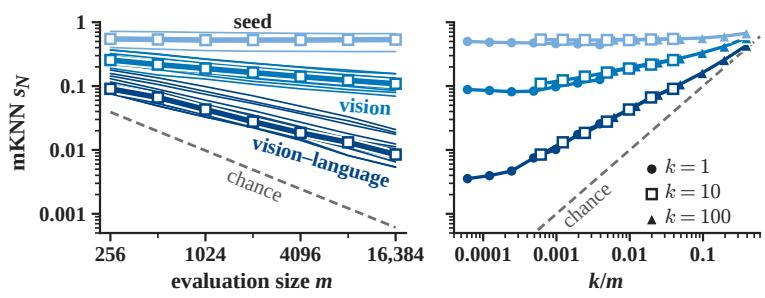  
(a)  
(b)

(c)  
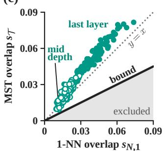  
Figure 2: At a fixed $k ,$ neighbor overlap stays flat or falls with the evaluation size according to the model pair, and spanning-tree overlap tracks one-nearest-neighbor overlap (Theorem 1, Conjecture D.1, Proposition $^ { 2 ) }$ . (a) mKNN against $m ,$ , for single pairs (thin) and the median of each type of pair (thick). (b) These medians at three values of k against $k / m$ , with the vertical axis of (a). (c) MST overlap against one-nearest-neighbor overlap for vision–language model pairs at two depths. Appendices F.3 and F.4 give the details.

## 5.2 Neighbor Overlap at a Fixed k Stays Flat or Falls with the Evaluation Size According to the Model Pair

We first test the conclusion of Section 3.1 that a neighbor criterion at a fixed k compares two models at a finer scale on a larger evaluation set. This change of scale explains at least partly why mKNN between vision and language models collapses on the larger evaluation sets of BPC unless k grows in proportion to $m$ (Theorem 1). The heuristic first-order law behind Conjecture D.1 predicts that $s _ { N }$ at a fixed k rises, stays flat, or falls with m according to the class of the model pair. The same law also predicts a stable $s _ { N }$ at a fixed $k / m$ for large m. We test both predictions on COCO evaluation sets of $m = 2 5 6$ to 16,384 images, each contained in every larger set. In a preregistered experiment, we measure mKNN on 4 pairs of Pythia-410M models trained from different seeds, 10 pairs of vision models, and 15 vision–language pairs. In a second preregistered experiment, we pair the vision models with three sentence encoders instead of the language models. $\mathbf { A } \mathbf { t } k = 1 0$ , the median mKNN of the vision–language pairs falls from 0.091 to 0.0085 (Figure 2a). The slope of ln $s _ { N }$ on ln m is set by the model pair, with medians of −0.57 for vision–language pairs, −0.21 for pairs of vision models, and −0.01 for pairs of Pythia-410M models, against −1.00 for chance. The rising class was absent, but our slope rule also classifies a synthetic coupling of this class as flat, which leaves the prediction for this class untested (Appendix F.3).

For the second prediction, the medians for $k = 1 0 0$ lie within 4% of those for $k = 1 0$ at a shared $k / m$ , which BPC holds fixed in one of its neighbor criteria by setting $k = m / 1 0 0$ , whereas those for $k = 1$ differ by up to 19% (Figure 2b). With sentence encoders, mKNN also falls with m on all 15 pairs, but two preregistered predictions linking the slope to the level of mKNN remained undecided. These pairs pass the preregistered test of stability at a shared $k / m$ for $k = 1 0$ and $k = 1 0 0 .$ 5 The preregistered out-of-sample test of the crossing law needed an estimator of the coupling, and every candidate estimator failed the preliminary check against two baseline predictors on synthetic couplings. Since this test was not run, we report the results in Figure 2a and b as measurements, not as outcomes of preregistered tests. The exceptions are the outcomes of two preregistered secondary predictions on the ordering of the slopes and the cancellation of the elasticities in k and m, i.e., the coefficients of a fit of ln $s N$ on ln k and ln m. For the 29 pairs without sentence encoders, the slopes kept the predicted order, and the medians of the summed elasticities for the three types of pairs lay between 0.03 and 0.06, near the cancellation preregistered without a tolerance.

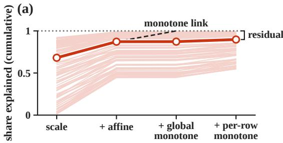

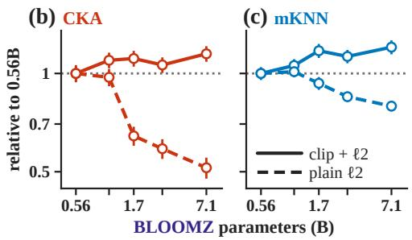  
Figure 3: Beyond an affine map, pretrained vision and language representations differ by a residual rather than a monotone link, and preprocessing can reverse size trends (Proposition 3). (a) Share of the squared-distance discrepancy at mid depth explained by increasingly flexible fits, per pair (thin), median (thick), and under a monotone link as in Theorem 3 (dashed). (b, c) CKA and mKNN after subtraction of the permutation mean, as mean ± s.e. over vision models, where clip $+ \ell _ { 2 }$ is the preprocessing of PRH. Appendix F.4 gives the details.

Insight 1: Evaluation size sets the scale of mKNN. Our results suggest that the evaluation size sets the scale at which mKNN with a fixed k compares two models, and that scores at a shared $k / m$ are comparable across evaluation sets for $k = 1 0$ and $k = 1 0 0$ . With sentence encoders in place of language models, a preregistered test confirms that mKNN stays stable at a shared $k / m$ for both values of k. These findings support the conclusion of Section 3.1 that the collapse of mKNN reported by BPC comes at least partly from a change of scale.

## 5.3 Shared Spanning-tree Edges Are Mostly Nearest-neighbor Edges, and Pretrained Vision and Language Representations Differ by More than a Monotone Link

Neighbor overlap depends on the distances of two models at a scale set by $k / m$ , whereas MST overlap and CKA also depend on distances beyond the nearest-neighbor scale. SOG challenges the local view of ARH with the size trend of MST overlap. Since the MST contains the nearest-neighbor forest for pairwise distinct distances (Proposition 2), we ask how many shared MST edges lie in this forest and whether the overlap of the bridges between its trees has a size trend. To answer both questions, we measure MST overlap and bridge overlap on WIT for the 136 pairs of a vision model and a language model and classify MST overlap with a preregistered rule. On a larger evaluation set of $m = 2 0 4 7$ inputs, MST overlap tracks one-nearest-neighbor overlap at both depths and exceeds it by a median factor of 1.20 and 1.32 (Figure 2c). The nearest-neighbor forest makes up a median 0.875 and 0.889 of the shared MST edges at mid depth and the last layer, near its 84 to 85% share of each tree (Figure F.3b). The preregistered rule classifies MST overlap as mostly one-nearest-neighbor overlap at both depths, although its conditions on the forest share and on $s _ { T } - s _ { N , 1 }$ hold nearly automatically. Bridge overlap exceeds its permutation null in 93% and 100% of pairs, but its BLOOMZ size trend at the last layer stays unresolved (trend 0.57, Holm-adjusted $p = 0 . 2 3 )$ .

By Proposition 3, the CKA used by ARH depends on both a monotone link between the distances of the two models and the residual around this link. To see whether the pretrained vision and language representations differ by a monotone link or by a residual, we fit increasingly flexible maps between their squared distances, as a preregistered check rather than a confirmatory test. Beyond an affine fit, a global monotone fit explains a further median 0.0004 and 0.0012 of the squared-distance discrepancy, and this share lies below the preregistered level of 0.10 in all 136 pairs (Figure 3a).

The conclusion of ARH concerns size trends, and at a fixed depth a size trend of CKA or mKNN can already depend on the preprocessing, before any maximum over layers. At mid depth and after subtraction of the permutation mean, the BLOOMZ trends of CKA and mKNN are 0.70 and 0.84 with the preprocessing of PRH (Figure 3b,c). Under plain $\ell _ { 2 }$ normalization, our preregistered secondary preprocessing, they reverse to −1.00 and −0.92.

Insight 2: Spanning-tree overlap comes mostly from the nearest-neighbor forest, and a monotone link explains little beyond an affine map. Our results suggest that on these pretrained pairs, spanning-tree overlap comes mostly from the nearest-neighbor forest of Proposition 2, and that the part of the discrepancy between the squared distances of the two models left by an affine map comes mostly from the residual of Proposition 3 rather than from a monotone link.

## 5.4 The Threshold of a Calibrated Layer Maximum Can Be Forecast from Single-model Features

Besides the preprocessing at a fixed depth, a size trend can depend on the maximum over layer pairs and on its calibration. ARH calibrates each score after taking its maximum over layer pairs, and finds that calibration largely removes the size trend of CKA and keeps that of mKNN. In Section 3.4 we relate this difference to the random-pairing baselines of Proposition 4, which are equal across layer pairs for mKNN and grow with the effective dimension of each layer for CKA. Corollary 1 assumes that the calibration threshold of the maximum lies near the largest baseline. Calibration then does not reverse the order of two model pairs with equal largest baselines and well-separated maxima, and reverses this order when the largest baseline grows faster than the maximum in the sense of part 2 of this corollary. We test this assumption and both parts of the corollary on the layer maximum along four families, BLOOMZ (0.56B to 7.1B), LLaMA-1 (7B to 30B), OpenLLaMA (3B to 13B), and Pythia (70M to 6.9B).6 For the last three families, we fixed and recorded predictions from single-model features before computing any score involving their new models. On LLaMA-1 and OpenLLaMA, we compared each outcome with its prediction without a confirmatory test, whereas on Pythia we preregistered a confirmatory test of the loss of the CKA trend.

In all four families the threshold of the layer maximum follows the largest random-pairing baseline of Proposition 4, in a post hoc analysis on BLOOMZ and as forecast from single-model features on LLaMA-1, OpenLLaMA, and Pythia. Part 2 of Corollary 1 gives a condition under which calibration reverses the order of two model pairs, and this condition requires the largest baseline to grow faster than the maximum. The trend is lost or reversed along BLOOMZ (0.89 to −0.02 under $s _ { \mathrm { c a l } }$ of Section 2.1), LLaMA-1 (0.68 to −0.85), and OpenLLaMA (0.88 to 0.18), where this baseline grows at least as fast as the raw score (Figure 4). It is kept along Pythia (0.93 to 0.89), where the raw score grows faster, by 0.024 per doubling of parameters against 0.0063 for the threshold (Appendix F.5). Along LLaMA-1, calibration produced the drop of at least 0.10 predicted from single-model features, whereas along Pythia the preregistered prediction of such a drop was not confirmed. Given the raw scores, the thresholds forecast from features nevertheless yield a predicted order after calibration in 30 of the 34 comparisons involving OpenLLaMA 13B and in 352 of the 357 Pythia comparisons. Every predicted order is correct. In every family, the trends of mKNN and debiased CKA move by 0.06 or less under calibration. With the preprocessing of PRH, the calibrated CKA trend keeps its sign at mid depth and at the last layer in all four families. On LLaMA-1, calibration of each layer pair before the maximum also reversed the CKA trend of the maximum, to −0.88, although we had predicted in advance that the trend would keep its sign under this protocol. With three sizes each, every exact p-value of a size trend along LLaMA-1 or OpenLLaMA is at least 1/6, and size, depth, and width grow together along these families (Appendix F.5).

Insight 3: The calibration threshold of a layer maximum follows the largest baseline. Our results suggest that the calibration threshold of a layer maximum follows the largest randompairing baseline of Proposition 4, which supports the assumption of Corollary 1. Along the four families, calibration kept the CKA trend where the raw score outgrew this baseline and removed or reversed the trend elsewhere, in line with this corollary. With the preprocessing of PRH, calibrated CKA at mid depth and at the last layer keeps the sign of its size trend in every family, so global convergence remains open.

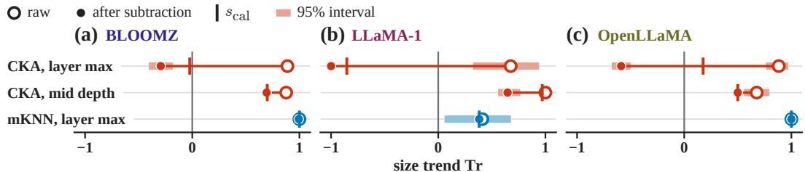

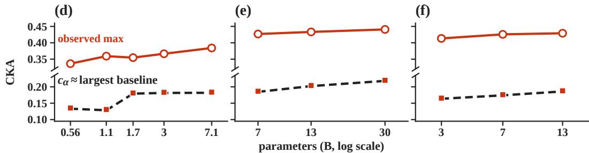

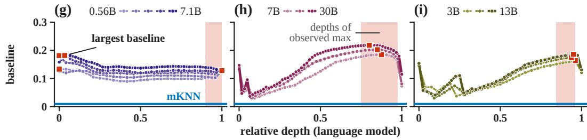  
Figure 4: The threshold of a layer maximum follows the largest baseline, and calibration removes or reverses the CKA trend in the families where this baseline grows at least as fast as raw CKA (Proposition 4, Corollary 1). (a–c) Size trends of three scores, raw, after subtraction of the permutation mean, and calibrated $( s _ { \mathrm { c a l } } )$ . (d–f) Squares give the threshold $c _ { \alpha }$ and dashed lines the largest baseline predicted from features. (g–i) Random-pairing CKA baseline of each language-model layer, predicted (lines) and measured (dots). Figure F.4 gives the full version.

## 5.5 The Training Procedure Decides Whether Two Runs of a Linear Autoencoder Agree on Distances

The models compared so far are fixed, whereas part 2 of Hypothesis 1 concerns the criteria met reliably across independent training runs. For the training procedure, Theorem 2 predicts that two gradient-flow runs of a linear autoencoder keep the gauges set by their initializations and disagree in geometry at every sample size. Part 2 certifies the resulting obstruction of CKA criteria only below a tolerance that it leaves unspecified, so our tolerance of 0.01 is a choice of the preregistration rather than a prediction of the theorem. Weight decay and tied weights instead fix one gauge, and by part 1 a small initialization keeps Ω close to the identity in both runs. The global minimizers of parts 1 and 3 on one sample all share the projectors of part 4. On independent samples, the projectors of two global minimizers converge in probability to one limit as the samples grow (part 5 of the formal version of Theorem 2). We test these predictions in a preregistered experiment on the linear autoencoder at sample sizes from $N = 2 ^ { 8 }$ to the population limit. Each run draws its own training sample at a finite N. Under gradient descent without a regularizer, the criteria on neighbor sets, mean-normalized squared distances $( G _ { s } )$ , and CKA each accepted 0 of 48 pairs of runs at every finite N and 0 of 500 at $\bar { N } = \infty$ . With weight decay, tied weights, or small initialization, agreement under these criteria was reliable for $N \geq 2 ^ { { \sqrt { 2 } } }$ , and agreement under the projector criterion of part 4 was reliable at these sizes for every training procedure, as preregistered for $N = 2 ^ { 1 6 }$ (Figure 5a,b). Outside the preregistered tests, the condition number of the learned $E E ^ { \top }$ matches the values predicted by parts 1 and 3 of the formal version of Theorem 2 (Figure 5c). Its medians are 4.66 against 4.67 predicted under a small step close to gradient flow and 1.0330 against 1.0329 under weight decay. The preregistered prediction for gradient descent also required the mean discrepancy over pairs of runs at $N \stackrel { \mathbf { \Delta } } { = } 2 ^ { 1 6 }$ to lie inside the 95% interval of this mean at $N = \infty$ , and this part of the prediction failed on $G _ { s }$ and CKA.

To test how the training procedure selects the gauge outside the premises of the theorem, we train CIFAR-5m networks with a linear head. The head maps its input features h to coordinates $u = M h \in \mathbb { R } ^ { 9 }$ and outputs $y = W u$ , and the task fixes u up to a gauge. In two preregistered network experiments, we train this head by momentum without weight decay, with weight decay, or from a small initialization, on $N = 2 5 { , } 0 0 0$ and 250,000 images. The runs form 96 pairs per training procedure and size, except 32 pairs under momentum from a small initialization in the second experiment. To separate the gauge kept by gradient flow from the change of $C$ under momentum (Remark 1), the second experiment adds gradient flow of the head (head flow). For each run, a balanced head $( C = M M ^ { \dag } - W ^ { \top } W = \bar { 0 } )$ computes the same outputs, so we split the excess of the discrepancy of u over that of $y$ into two parts. Measured in standard deviations (SD) of the discrepancy of y over pairs, these parts are the same excess computed for the coordinates of the balanced head (the balanced part) and the rest (the imbalance part). Under head flow, the imbalance part added 0.54 and 0.59 SD to the $G _ { s }$ discrepancy at the two sizes, about one fifth of the imbalance part under momentum (Figure 5d,e). Of this part, 0.29 and 0.46 SD varied from run to run, so the network realizes the mechanism of part 2 of Theorem 2 under head flow. From a balanced initialization with $C _ { 0 } = 0$ or a small initialization, momentum created a larger imbalance part than head flow on $G _ { s }$ and $1 - \mathrm { C K A }$ in 8 of 8 Holm-corrected tests. With weight decay, u agreed in 96 of 96 pairs on $G _ { s }$ and on neighbor sets, at 250,000 images in the first experiment and at both sizes in the second, without an excess on $G _ { s } ~ ( - 0 . 0 4 ~ \mathrm { S D }$ at 250,000). The preregistered predictions of Corollary 2 held, and at $k = 1 0$ the bound of the corollary certified neighbor agreement for at most 4.7% of the anchors.

Without weight decay, u agreed on neighbor sets in 96 of 96 pairs at 250,000 images, contrary to the preregistered prediction that this agreement would be unreliable at both sizes. In the second experiment at this size, the mean neighbor-set discrepancy of u lay about 0.002 below that of y under four training procedures, against the preregistered prediction that the 95% interval of this difference would lie within ±0.002. Under momentum, small initialization fell short of weight decay, against the preregistered predictions that it would make agreement of u reliable at 250,000 images and bring the fraction of agreeing pairs within 0.1 of that under weight decay. Under head flow, a balanced initialization with $C _ { 0 } = 0$ or a small initialization left a balanced part of about 3 SD, so the preregistered prediction that agreement of u on $G _ { s }$ would be reliable at both sizes failed under both initializations. This agreement reached the preregistered level of reliability in one of the four combinations of initialization and size, small initialization at 250,000 images (Appendices F.8 and F.8.1).

Insight 4: The training procedure selects the gauge of a linear head. Our results confirm the preregistered predictions of Theorem 2 that weight decay and tied weights fix one gauge of the linear autoencoder and that a small initialization keeps Ω close to the identity in both runs. They also suggest that gradient descent at a small step keeps the gauge set by the initialization, which supports part 1 of the theorem. In trained networks, the imbalance kept by head flow and the imbalance created by momentum both add an excess to the geometric discrepancy of u between two runs, and weight decay removes this excess on $G _ { s } ,$ , which supports Remark 1.

## 5.6 Agreement of InfoNCE and Spectral Learners on the Order of Distances Becomes Reliable in the Finite Gibbs Model

In the linear autoencoder, the training procedure decides whether agreement of two runs on distances becomes reliable for large samples. For the objective, Theorem 3 states that a learner minimizing InfoNCE and a learner minimizing the spectral contrastive loss learn one relation through different increasing links in the finite Gibbs model. As both samples grow, exact agreement of the two learners on the order of distances becomes reliable, whereas a criterion on scale-normalized geometry with a small tolerance is asymptotically obstructed. We test these predictions in two preregistered experiments, one inside the premises of the theorem and one in CIFAR-5m networks outside these premises. In the finite Gibbs model, both learners return certified minimizers of their exact empirical risks, in 192 runs per learner at each of eight sample sizes from $2 ^ { 2 0 }$ to $2 ^ { 4 0 }$ examples. Exact agreement across objectives on the order of all distances among eight probe inputs held in 0 of 96 pairs up to $2 ^ { 2 8 }$ examples and in 94 of 96 at $2 ^ { 3 4 }$ . The size $2 ^ { 3 4 }$ lies near the value $N ^ { * } = 2 ^ { 3 3 . 7 5 }$ predicted before the runs for agreement in 90% of pairs (Figure 6a). $\mathbf { A t } 2 ^ { 4 0 }$ examples, the largest difference of meannormalized distances across objectives on all 256 inputs settled at a median 0.348, the limit given by the theorem with these inputs as the probes (Figure 6b,c). Under the scale-normalized discrepancy, all 96 pairs stayed outside the tolerance, whereas under the isotonic discrepancy every pair fell within this tolerance. After Holm correction, all nine preregistered confirmatory predictions held, but two secondary Monte Carlo predictions failed, those of the ratio of the discrepancy across objectives to the mean discrepancy within an objective on neighbor sets and on spanning trees (Appendix F.9).

(e) imbalance part  
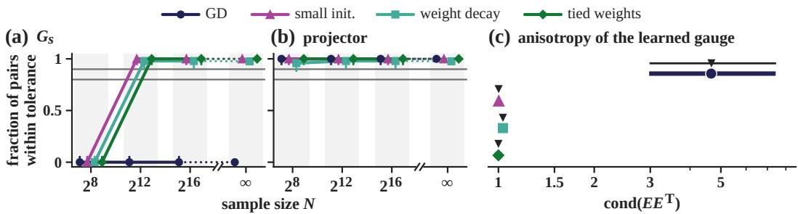

(d) excess of u over y  
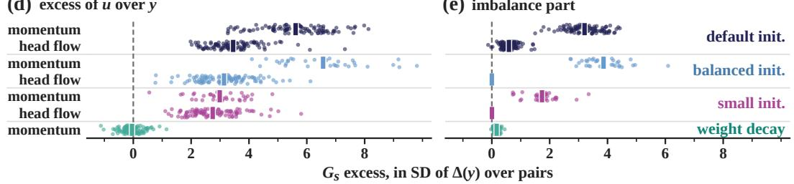  
Figure 5: Gradient flow keeps the gauge set by the initial imbalance of a linear head at every sample size, whereas weight decay fixes one gauge (Theorem 2, Remark 1). (a–c) Linear autoencoder, with gradient descent (GD) close to gradient flow. Bars in (a, b) are Clopper–Pearson bounds and grey lines the levels for reliable and unreliable agreement. (c) Medians and 10th to 90th percentiles at $N = \infty$ , with the predictions in black. (d, e) CIFAR-5m networks, with one dot per pair of runs and bars at the means.

(a)  
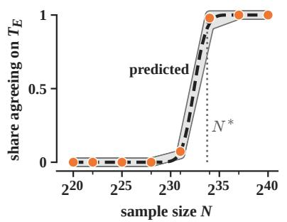

(b)  
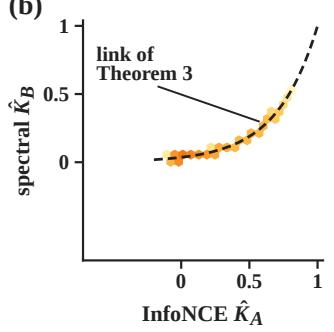

(c)  
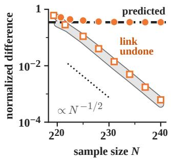  
Figure 6: In the finite Gibbs model of Theorem 3, InfoNCE and spectral learners come to agree on the order of distances and differ in geometry by the link of the theorem. (a) Share of pairs with the same global order $T _ { E } ,$ against the share predicted before the runs. (b) Density of the Gram-matrix entries of one pair. (c) Median over pairs of the largest difference of mean-normalized distances, before and after the link is undone on the spectral run. Appendix F.9 gives the details.

This experiment tests Theorem 3 and our analysis pipeline inside the premises of the theorem, not trained networks, and the sample size it needs for exact agreement on the global order (about $2 ^ { 3 4 }$ examples here) reflects how fine that criterion is rather than a practical training budget. The preregistered prediction failed in CIFAR-5m networks outside these premises, where at 500,000 images all 64 pairs of InfoNCE and spectral runs disagree even on neighbor sets and a fitted monotone link removes a median 15% of the residual left by an affine map, against 100% for the exact link of the theorem applied to an InfoNCE Gram matrix as a positive control (Appendix F.10 and Figure F.8).

Insight 5: In the finite Gibbs model, learners trained with different objectives come to agree on order and differ by the link. Our results suggest that certified minimizers of InfoNCE and of the spectral contrastive loss in the finite Gibbs model come to agree exactly on the order of distances and differ in geometry by the link, which confirms the preregistered predictions of Theorem 3 inside its premises.

## 6 Potential Applications

We prove our learning results in a linear autoencoder and the finite Gibbs model and test them there and in CIFAR-5m networks, whereas their tests on pretrained models remain future work. Appendix G states the limitations of our results and the open problems they leave. Our results also bear on current areas of machine learning, and we state their implications for seven areas below, with further material in Appendix H.

Pretraining, Scaling, and Multimodal Encoders. PRH and later studies relate model size and performance to mKNN between vision and language models with k = 10 on 1,024 image–caption pairs (Huh et al., 2024; Tjandrasuwita et al., 2025). Size trends at several values of $k / m$ would show whether larger models agree more on near neighbors or on coarse structure alone (Theorem 1). In multimodal models such as LLaVA (Liu et al., 2023a), a trained linear connector can undo any invertible linear map of the vision features, a gauge as in Section 4.1. Recent work selects encoders before connector training by CKA (Maniparambil et al., 2025) or by a Gromov–Wasserstein distance (Li et al., 2026), and both scores change under such maps. An experiment with maps of growing condition number applied before this training would show the invariance needed by such a score. Appendix H.1 also treats a preregistered test of Corollary 1 on CLIP models (Cherti et al., 2023) and a conjecture on the losses of CLIP and SigLIP.

Post-training, Fine-tuning, and Reinforcement Learning. Low-rank adaptation (LoRA) adds a product BA of trainable factors to a frozen weight (Hu et al., 2022), with the same update from VA and $B V ^ { - 1 }$ for every invertible V, a gauge as in Section 4.1. An $\ell _ { 2 }$ penalty on both factors restricts this gauge to orthogonal maps, which a Procrustes rotation could remove before LoraHub composes adapters (Huang et al., 2024). Under Bradley–Terry preferences, a classifier of pairwise wins (Sun et al., 2025) and a Bradley–Terry reward model have population limits whose scores differ by an increasing link within each prompt, as in Theorem 3. Their best-of-N responses coincide, whereas the advantages of group relative policy optimization (Shao et al., 2024) can change with the link. Under the dynamics of the three-feature task of Shi et al. (2026a), two runs of reinforcement learning (RL) share the squared overlaps of their feature directions in the limit with probability $p _ { Q } = q ^ { 2 } + ( 1 - q ) ^ { 2 }$ (Section 2.2). Here q is the probability that a run starts below an unstable policy. Replay under the sufficient condition of that work raises $p _ { Q }$ to one, which in this task needs a base-reward gap above $7 / 1 6 .$ . In Appendix H.2, we propose to compare RL with supervised fine-tuning.

Agents and Harness Engineering. Studies of multi-agent systems measure redundancy or diversity by the cosine similarity between output embeddings of agents (Kim et al., 2025; Subramaniam et al., 2025). The random-pairing baseline of the mean cosine between the output embeddings of two agents is the inner product of their mean normalized embeddings, large when all outputs share a format. As in Corollary 1, subtraction of these baselines can reverse the order of two agent systems, and we propose this subtraction for the redundancy predictor in the scaling model of Kim et al. (2025). The fractions of instances resolved by six runs of one variant of SWE-agent lie within 1.4 percentage points of each other (Yang et al., 2024). Their reported pass@1 and pass@2 imply that two runs share on average about half of the instances resolved by either run. The probability $p _ { Q }$ of Section 2.2 extends to criteria $Q$ on the outputs of two sampled runs of an agent. The harness of an agent comprises the tools and control code around its model, and a change of harness matters under $Q$ when runs of two variants meet $Q$ less often than runs of one variant. Appendix H.3 also treats agents that communicate through key-value caches or activations.

Generative Models. Representation alignment (REPA) speeds up the training of diffusion transformers by aligning a projection of their hidden states with DINOv2 features (Yu et al., 2025). Yu et al. (2025) find that CKNNA (Huh et al., 2024) between DINOv2 and diffusion transformers trained without REPA rises with model size and training, at k = 10 on 10,000 images. CKNNA is CKA restricted to pairs of images that are k nearest neighbors in both representations, and these pairs change with the scale $k / m$ (Section 3.1). REPA-E uses CKNNA as a proxy for generation quality (Leng et al., 2025), and it remains open whether trends and rankings of CKNNA at one scale hold at other scales. Losses matching the similarities among patch features of a tokenizer (Yao et al., 2025a) or of a diffusion transformer (Chen et al., 2025b) to those of an encoder improve generation. Strictly increasing maps of the target similarities change the values of these losses and leave neighbor overlap unchanged (Proposition 1). An experiment with such maps would test whether generation benefits from agreement beyond the order of the similarities. Appendix H.4 also treats the gauge of the autoencoder in latent diffusion.

Mechanistic Interpretability. Sparse autoencoders (SAEs) trained from different seeds share part of their latents (Paulo and Belrose, 2026), and the survey of Shi et al. (2026b) concludes that latent reproducibility depends on the objective, the initialization, and the level of comparison. Gerasimov et al. (2026) find that the latents rarely matched across seeds concentrate in recurring lower-rank subspaces, and suggest that this seed dependence reflects ambiguity among bases. The exact symmetries of an SAE are permutations and positive scalings of its latents, and an approximate gauge can remain within such a subspace. By analogy with Theorem 2, we expect the initialization and the regularization of SAEs to decide whether runs from different seeds agree reliably on single directions in these subspaces. Since all global minimizers of the linear autoencoder on one sample share one projector, we expect these choices to matter less for agreement on projectors onto the subspaces. In Appendix H.5, we also argue that mKNN can stay high under superposition where CKA is low (Liu et al., 2026), and treat universal neurons and top-activating tokens.

Proteins, Molecules, and Materials. For interatomic potentials, Edamadaka et al. (2025) find that conservative Orb-v3 models align strongly with MACE under CKNNA with $k = 2 5$ on features averaged over each structure. Li and Walsh (2026) instead find near-zero overlap between the neighbor sets of single atoms in MP-20 crystals under Orb-v3 and under equivariant models including MACE. Under part 1 of Hypothesis 1, this conflict can come from criteria applied at different points of the lattice, or from the data or the level of the features. A comparison of both criteria on shared samples and features would separate these causes. The representations of interatomic potentials also grow more similar to those of the best-performing model with decreasing energy error, in scores computed without calibration (Edamadaka et al., 2025). Since the baselines of CKA and mKNN can be forecast from single-model features (Proposition 4), a recomputation of these trends with the two scores would show whether this convergence survives calibration (Corollary 1). Appendix H.6 also treats homology among proteins and linear heads in molecule–text and protein models.

Dynamical Systems and Operator Learning. DeepONet predicts through the inner product of its branch and trunk outputs (Lu et al., 2021), and an invertible map applied to the branch outputs and undone on the trunk outputs leaves every prediction unchanged. We conjecture that joint training selects this map as in Theorem 2, in which case CKA between the branch outputs of two runs could stay below one for large samples. Fixed orthonormal Wick features of the driving noise remove this map in several chaos-expansion operators of Shi et al. (2026c), whose learned propagators can then be compared across runs coordinate by coordinate. Across grid resolutions, Bartolucci et al. (2023) find aliasing errors in Fourier neural operators and note that discretization invariance (Kovachki et al., 2023) concerns the limit of infinite resolution. With the two discretizations of each test function as one evaluation sample, a neighbor criterion tests the transfer of an operator between two finite resolutions at a chosen scale $k / m$ (Theorem 1). Appendix H.7 also treats DeepONets with orthonormal trunk outputs and criteria on dynamics and on long-run statistics.

In these areas, a conclusion drawn from one score computed on the Gram matrices of two representations rests on one criterion of the lattice, at one scale and under one protocol. We hope that this lattice view offers a framework for comparing such conclusions.

## References

Sanjeev Arora, Nadav Cohen, and Elad Hazan. On the optimization of deep networks: Implicit acceleration by overparameterization. In Proceedings of the 35th International Conference on

Machine Learning, volume 80 of Proceedings of Machine Learning Research, pages 244–253, 2018.

Yamini Bansal, Preetum Nakkiran, and Boaz Barak. Revisiting model stitching to compare neural representations. In Advances in Neural Information Processing Systems, volume 34, pages 225–236, 2021. URL https://arxiv.org/abs/2106.07682.

Richard Baraniuk, Mark Davenport, Ronald DeVore, and Michael Wakin. A simple proof of the restricted isometry property for random matrices. Constructive Approximation, 28(3):253–263, 2008. doi: 10.1007/s00365-007-9003-x.

Francesca Bartolucci, Emmanuel de Bézenac, Bogdan Raonic, Roberto Molinaro, Siddhartha Mishra,´ and Rima Alaifari. Representation equivalent neural operators: a framework for alias-free operator learning. In Advances in Neural Information Processing Systems, volume 36, pages 69661–69672, 2023. doi: 10.52202/075280-3051.

Stella Biderman, Hailey Schoelkopf, Quentin Gregory Anthony, Herbie Bradley, Kyle O’Brien, Eric Hallahan, Mohammad Aflah Khan, Shivanshu Purohit, USVSN Sai Prashanth, Edward Raff, Aviya Skowron, Lintang Sutawika, and Oskar van der Wal. Pythia: A suite for analyzing large language models across training and scaling. In Proceedings of the 40th International Conference on Machine Learning, volume 202 of Proceedings ofMachine Learning Research, pages 2397–2430. PMLR, 2023. URL https://proceedings.mlr.press/v202/biderman23a.html.

Can Chen, David Heurtel-Depeiges, Robert M. Vernon, Christopher James Langmead, Yoshua Bengio, and Quentin Fournier. Structure-aligned protein language model, 2025a. URL https: //arxiv.org/abs/2505.16896. Version 2, December 2025.

Hesen Chen, Junyan Wang, Zhiyu Tan, and Hao Li. SARA: Structural and adversarial representation alignment for training-efficient diffusion models, 2025b. URL https://arxiv.org/abs/2503. 08253. Technical report.

Mehdi Cherti, Romain Beaumont, Ross Wightman, Mitchell Wortsman, Gabriel Ilharco, Cade Gordon, Christoph Schuhmann, Ludwig Schmidt, and Jenia Jitsev. Reproducible scaling laws for contrastive language-image learning. In Proceedings ofthe IEEE/CVF Conference on Computer Vision and Pattern Recognition, pages 2818–2829, 2023. doi: 10.1109/CVPR52729.2023.00276. URL https://arxiv.org/abs/2212.07143.

Nathan Cloos, Moufan Li, Markus Siegel, Scott L. Brincat, Earl K. Miller, Guangyu Robert Yang, and Christopher J. Cueva. Differentiable optimization of similarity scores between models and brains. In International Conference on Learning Representations, 2025. URL https://arxiv. org/abs/2407.07059.

David Cohen-Steiner, Herbert Edelsbrunner, and John Harer. Stability of persistence diagrams. Discrete & Computational Geometry, 37(1):103–120, 2007. doi: 10.1007/s00454-006-1276-5.

Frances Ding, Jean-Stanislas Denain, and Jacob Steinhardt. Grounding representation similarity through statistical testing. In Advances in Neural Information Processing Systems, volume 34, 2021. URL https://arxiv.org/abs/2108.01661.

Darshil Doshi, Wenjie Zhou, Corinna Elena Wegner, Daniel J. Korchinski, Santiago Acevedo, and Matthieu Wyart. A theory of platonic representations in language models, 2026. URL https://arxiv.org/abs/2610.07168.

Simon S. Du, Wei Hu, and Jason D. Lee. Algorithmic regularization in learning deep homogeneous models: Layers are automatically balanced. In Advances in Neural Information Processing Systems, volume 31, 2018.

Carl Eckart and Gale Young. The approximation of one matrix by another of lower rank. Psychometrika, 1(3):211–218, 1936. doi: 10.1007/BF02288367. URL https://link.springer.com/ article/10.1007/BF02288367.

Sathya Edamadaka, Soojung Yang, Ju Li, and Rafael Gómez-Bombarelli. Universally converging representations of matter across scientific foundation models, 2025. URL https://arxiv.org/ abs/2512.03750. Oral spotlight at the NeurIPS 2025 Workshop on Unifying Representations in Neural Models (UniReps).

Tianyu Fu, Zihan Min, Hanling Zhang, Jichao Yan, Guohao Dai, Wanli Ouyang, and Yu Wang. Cache-to-cache: Direct semantic communication between large language models. In International Conference on Learning Representations, 2026. URL https://arxiv.org/abs/2510.03215.

Xinyang Geng and Hao Liu. OpenLLaMA: An open reproduction of LLaMA. GitHub repository, May 2023. URL https://github.com/openlm-research/open\_llama.

Gleb Gerasimov, Timofei Rusalev, Nikita Balagansky, Daniil Laptev, Vadim Kurochkin, and Daniil Gavrilov. Unstable features, reproducible subspaces: Understanding seed dependence in sparse autoencoders, 2026. URL https://arxiv.org/abs/2606.12138.

Charles Godfrey, Davis Brown, Tegan Emerson, and Henry Kvinge. On the symmetries of deep learning models and their internal representations. In Advances in Neural Information Processing Systems, volume 35, 2022. URL https://arxiv.org/abs/2205.14258.

Fabian Gröger, Shuo Wen, and Maria Brbic. Revisiting the platonic representation hypothesis: An ´ aristotelian view. In Proceedings ofthe 43rd International Conference on Machine Learning, 2026. URL https://arxiv.org/abs/2602.14486.

Wes Gurnee, Theo Horsley, Zifan Carl Guo, Tara Rezaei Kheirkhah, Qinyi Sun, Will Hathaway, Neel Nanda, and Dimitris Bertsimas. Universal neurons in GPT2 language models. Transactions on Machine Learning Research, 2024. URL https://openreview.net/forum?id=ZeI104QZ8I.

Jeff Z. HaoChen, Colin Wei, Adrien Gaidon, and Tengyu Ma. Provable guarantees for self-supervised deep learning with spectral contrastive loss. In Advances in Neural Information Processing Systems, volume 34, 2021. URL https://arxiv.org/abs/2106.04156.

Sarah E. Harvey, David Lipshutz, and Alex H. Williams. What representational similarity measures imply about decodable information. In Proceedings of UniReps: the Second Edition of the Workshop on Unifying Representations in Neural Models, volume 285 of Proceedings of Machine Learning Research, pages 140–151, 2024.

Nils Lid Hjort and David Pollard. Asymptotics for minimisers of convex processes, 1993. URL https://arxiv.org/abs/1107.3806. Technical report, Yale University; arXiv:1107.3806.

Edward J. Hu, Yelong Shen, Phillip Wallis, Zeyuan Allen-Zhu, Yuanzhi Li, Shean Wang, Lu Wang, and Weizhu Chen. LoRA: Low-rank adaptation of large language models. In International Conference on Learning Representations, 2022. URL https://arxiv.org/abs/2106.09685.

Maggie Ziyu Huan, Yuetai Li, Tianyu Zheng, Xiaoyu Xu, Seungone Kim, Minxin Du, Radha Poovendran, Graham Neubig, and Xiang Yue. Does math reasoning improve general LLM capabilities? Understanding transferability of LLM reasoning. In Proceedings of the 43rd International Conference on Machine Learning, volume 306 of Proceedings ofMachine Learning Research, pages 46232–46268. PMLR, 2026. URL https://proceedings.mlr.press/v306/huan26a.html.

Chengsong Huang, Qian Liu, Bill Yuchen Lin, Tianyu Pang, Chao Du, and Min Lin. LoraHub: Efficient cross-task generalization via dynamic LoRA composition. In Conference on Language Modeling, 2024. URL https://arxiv.org/abs/2307.13269.

Minyoung Huh, Brian Cheung, Tongzhou Wang, and Phillip Isola. Position: The platonic representation hypothesis. In Proceedings ofthe 41st International Conference on Machine Learning, volume 235 of Proceedings ofMachine Learning Research, pages 20617–20642. PMLR, 2024. URL https://arxiv.org/abs/2405.07987.

Russell Impagliazzo, Rex Lei, Toniann Pitassi, and Jessica Sorrell. Reproducibility in learning. In Proceedings of the 54th Annual ACM Symposium on Theory of Computing, pages 818–831, 2022.

G. D. James. The Representation Theory of the Symmetric Groups, volume 682 of Lecture Notes in Mathematics. Springer, 1978. doi: 10.1007/BFb0067708. URL https://doi.org/10.1007/ BFb0067708.

Ruoxi Jiang, Peter Y. Lu, Elena Orlova, and Rebecca Willett. Training neural operators to preserve invariant measures of chaotic attractors. In Advances in Neural Information Processing Systems, volume 36, pages 27645–27669, 2023. doi: 10.52202/075280-1202.

Keller Jordan. 94% on CIFAR-10 in 3.29 seconds on a single GPU, 2024. URL https://arxiv. org/abs/2404.00498.

Julie Josse, Jérôme Pagès, and François Husson. Testing the significance of the RV coefficient. Computational Statistics & Data Analysis, 53(1):82–91, 2008.

Zahra Kadkhodaie, Florentin Guth, Eero P. Simoncelli, and Stéphane Mallat. Generalization in diffusion models arises from geometry-adaptive harmonic representations. In International Conference on Learning Representations, 2024. URL https://arxiv.org/abs/2310.02557.

Jared Kaplan, Sam McCandlish, Tom Henighan, Tom B. Brown, Benjamin Chess, Rewon Child, Scott Gray, Alec Radford, Jeffrey Wu, and Dario Amodei. Scaling laws for neural language models, 2020. URL https://arxiv.org/abs/2001.08361.

F. Kazi-Aoual, S. Hitier, R. Sabatier, and J.-D. Lebreton. Refined approximations to permutation tests for multivariate inference. Computational Statistics & Data Analysis, 20(6):643–656, 1995.

Yubin Kim, Ken Gu, Chanwoo Park, Chunjong Park, Samuel Schmidgall, A. Ali Heydari, Yao Yan, Zhihan Zhang, Yuchen Zhuang, Yun Liu, Mark Malhotra, Paul Pu Liang, Hae Won Park, Yuzhe Yang, Xuhai Xu, Yilun Du, Shwetak Patel, Tim Althoff, Daniel McDuff, and Xin Liu. Towards a science of scaling agent systems, 2025. URL https://arxiv.org/abs/2512.08296.

Max Klabunde, Tobias Schumacher, Markus Strohmaier, and Florian Lemmerich. Similarity of neural network models: A survey of functional and representational measures. ACM Computing Surveys, 57(9):242:1–242:52, 2025. doi: 10.1145/3728458.

Matthäus Kleindessner and Ulrike von Luxburg. Uniqueness of ordinal embedding. In Proceedings of the 27th Conference on Learning Theory, volume 35 of Proceedings of Machine Learning Research, pages 40–67, 2014.

A. Sophia Koepke, Daniil Zverev, Shiry Ginosar, and Alexei A. Efros. Back into Plato’s cave: Examining cross-modal representational convergence at scale, 2026. URL https://arxiv.org/ abs/2604.18572.

Simon Kornblith, Mohammad Norouzi, Honglak Lee, and Geoffrey Hinton. Similarity of neural network representations revisited. In Proceedings ofthe 36th International Conference on Machine Learning, volume 97 of Proceedings ofMachine Learning Research, pages 3519–3529. PMLR, 2019. URL https://proceedings.mlr.press/v97/kornblith19a.html.

Nikola Kovachki, Zongyi Li, Burigede Liu, Kamyar Azizzadenesheli, Kaushik Bhattacharya, Andrew Stuart, and Anima Anandkumar. Neural operator: Learning maps between function spaces with applications to PDEs. Journal ofMachine Learning Research, 24(89):1–97, 2023.

Daniel Kunin, Jonathan M. Bloom, Aleksandrina Goeva, and Cotton Seed. Loss landscapes of regularized linear autoencoders. In Proceedings ofthe 36th International Conference on Machine Learning, volume 97 of Proceedings ofMachine Learning Research, pages 3560–3569, 2019.

Sanghyun Lee and Yeonjong Shin. On the training and generalization of deep operator networks. SIAM Journal on Scientific Computing, 46(4):C273–C296, 2024. doi: 10.1137/23M1598751.

Xingjian Leng, Jaskirat Singh, Yunzhong Hou, Zhenchang Xing, Saining Xie, and Liang Zheng. REPA-E: Unlocking VAE for end-to-end tuning of latent diffusion transformers. In Proceedings of the IEEE/CVF International Conference on Computer Vision, pages 18262–18272, 2025.

Muyang Li, Yucheng Liu, Jianbo Ma, Elliot Osborne, Bo Han, and Tongliang Liu. Rethinking model selection in VLM through the lens of Gromov-Wasserstein distance. In Proceedings of the IEEE/CVF Conference on Computer Vision and Pattern Recognition, 2026. URL https: //arxiv.org/abs/2605.01325.

Zhenzhu Li and Aron Walsh. Platonic representation of foundation machine learning interatomic potentials. Nature Machine Intelligence, 8(5):830–840, 2026. doi: 10.1038/s42256-026-01235-7.

Baihan Lin and Nikolaus Kriegeskorte. The topology and geometry of neural representations. Proceedings of the National Academy of Sciences, 121(42):e2317881121, 2024. doi: 10.1073/pnas. 2317881121.

Fangyu Liu, Muhao Chen, Dan Roth, and Nigel Collier. Visual pivoting for (unsupervised) entity alignment. In Proceedings of the AAAI Conference on Artificial Intelligence, volume 35, pages 4257–4266, 2021. doi: 10.1609/aaai.v35i5.16550. URL https://doi.org/10.1609/aaai. v35i5.16550.

Haotian Liu, Chunyuan Li, Qingyang Wu, and Yong Jae Lee. Visual instruction tuning. In Advances in Neural Information Processing Systems, volume 36, pages 34892–34916, 2023a. URL https: //arxiv.org/abs/2304.08485.

Shengchao Liu, Weili Nie, Chengpeng Wang, Jiarui Lu, Zhuoran Qiao, Ling Liu, Jian Tang, Chaowei Xiao, and Animashree Anandkumar. Multi-modal molecule structure–text model for text-based retrieval and editing. Nature Machine Intelligence, 5(12):1447–1457, 2023b. doi: 10.1038/ s42256-023-00759-6.

Sunny Liu, Habon Issa, André Longon, Liv Gorton, Meenakshi Khosla, Alex Williams, and David Klindt. Similarity of neural network representations in superposition, 2026. URL https:// arxiv.org/abs/2604.00208.

Lu Lu, Pengzhan Jin, Guofei Pang, Zhongqiang Zhang, and George Em Karniadakis. Learning nonlinear operators via DeepONet based on the universal approximation theorem of operators. Nature Machine Intelligence, 3(3):218–229, 2021. doi: 10.1038/s42256-021-00302-5.

Lu Lu, Xuhui Meng, Shengze Cai, Zhiping Mao, Somdatta Goswami, Zhongqiang Zhang, and George Em Karniadakis. A comprehensive and fair comparison of two neural operators (with practical extensions) based on FAIR data. Computer Methods in Applied Mechanics and Engineering, 393:114778, 2022. doi: 10.1016/j.cma.2022.114778.

Qi Lyu and Xiao Fu. On finite-sample identifiability of contrastive learning-based nonlinear independent component analysis. In Proceedings ofthe 39th International Conference on Machine Learning, volume 162 of Proceedings ofMachine Learning Research, pages 14582–14600. PMLR, 2022. URL https://proceedings.mlr.press/v162/lyu22a.html.

Niru Maheswaranathan, Alex H. Williams, Matthew D. Golub, Surya Ganguli, and David Sussillo. Universality and individuality in neural dynamics across large populations of recurrent networks. In Advances in Neural Information Processing Systems, volume 32, 2019.

Mayug Maniparambil, Raiymbek Akshulakov, Yasser Abdelaziz Dahou Djilali, Sanath Narayan, Ankit Singh, and Noel E. O’Connor. Harnessing frozen unimodal encoders for flexible multimodal alignment. In Proceedings of the IEEE/CVF Conference on Computer Vision and Pattern Recognition, pages 29847–29857, 2025. doi: 10.1109/CVPR52734.2025.02778. URL https://arxiv.org/abs/2409.19425.

Johannes Mehrer, Courtney J. Spoerer, Nikolaus Kriegeskorte, and Tim C. Kietzmann. Individual differences among deep neural network models. Nature Communications, 11:5725, 2020.

Preetum Nakkiran, Behnam Neyshabur, and Hanie Sedghi. The deep bootstrap framework: Good online learners are good offline generalizers. In International Conference on Learning Representations, 2021. URL https://arxiv.org/abs/2010.08127.

Walter Nelson, Marco Fumero, Theofanis Karaletsos, and Francesco Locatello. Statistical and structural identifiability in representation learning. In International Conference on Learning Representations, 2026. URL https://arxiv.org/abs/2603.11970.

Mitchell Ostrow, Adam Eisen, Leo Kozachkov, and Ila Fiete. Beyond geometry: Comparing the temporal structure of computation in neural circuits with dynamical similarity analysis. In Advances in Neural Information Processing Systems, volume 36, pages 33824–33837, 2023. doi: 10.52202/075280-1467.

Gonçalo Paulo and Nora Belrose. Sparse autoencoders trained on the same data learn different features. In International Conference on Learning Representations, 2026. URL https://openreview. net/forum?id=EjInprGpk9.

Alec Radford, Jong Wook Kim, Chris Hallacy, Aditya Ramesh, Gabriel Goh, Sandhini Agarwal, Girish Sastry, Amanda Askell, Pamela Mishkin, Jack Clark, Gretchen Krueger, and Ilya Sutskever. Learning transferable visual models from natural language supervision. In Proceedings ofthe 38th International Conference on Machine Learning, volume 139 of Proceedings of Machine Learning Research, pages 8748–8763. PMLR, 2021. URL https://proceedings.mlr.press/v139/ radford21a.html.

Rafael Rafailov, Archit Sharma, Eric Mitchell, Stefano Ermon, Christopher D. Manning, and Chelsea Finn. Direct preference optimization: Your language model is secretly a reward model. In Advances in Neural Information Processing Systems, volume 36, 2023. URL https://arxiv.org/abs/ 2305.18290.

Vignav Ramesh and Kenneth Li. Communicating activations between language model agents. In Proceedings of the 42nd International Conference on Machine Learning, volume 267 of Proceedings of Machine Learning Research, pages 51094–51116. PMLR, 2025. URL https: //arxiv.org/abs/2501.14082.

Geoffrey Roeder, Luke Metz, and Diederik P. Kingma. On linear identifiability of learned representations. In Proceedings of the 38th International Conference on Machine Learning, volume 139 of Proceedings of Machine Learning Research, pages 9030–9039, 2021. URL https://arxiv.org/abs/2007.00810.

Robin Rombach, Andreas Blattmann, Dominik Lorenz, Patrick Esser, and Björn Ommer. Highresolution image synthesis with latent diffusion models. In Proceedings of the IEEE/CVF Conference on Computer Vision and Pattern Recognition, pages 10684–10695, 2022.

Walter Rudin. Positive definite sequences and absolutely monotonic functions. Duke Mathematical Journal, 26(4):617–622, 1959. doi: 10.1215/S0012-7094-59-02659-6.

Dominik Schnaus, Thomas Dagès, Daniel Cremers, Xi Wang, and Phillip Isola. Shared geometry as a Rosetta stone: Cross-modal alignment without paired data, 2026. URL https://arxiv.org/ abs/2610.09411.

I. J. Schoenberg. Positive definite functions on spheres. Duke Mathematical Journal, 9(1):96–108, 1942. doi: 10.1215/S0012-7094-42-00908-6.

Zhihong Shao, Peiyi Wang, Qihao Zhu, Runxin Xu, Junxiao Song, Xiao Bi, Haowei Zhang, Mingchuan Zhang, Y. K. Li, Y. Wu, and Daya Guo. DeepSeekMath: Pushing the limits of mathemat ical reasoning in open language models, 2024. URL https://arxiv.org/abs/2402.03300.

Idan Shenfeld, Jyothish Pari, and Pulkit Agrawal. RL’s razor: Why online reinforcement learning forgets less. In International Conference on Learning Representations, 2026. URL https: //arxiv.org/abs/2509.04259.

Dai Shi, Andi Han, Feng Chen, Yiqun Duan, Junbin Gao, and José Miguel Hernández-Lobato. Self-confirming superposition traps in reinforcement learning. arXiv preprint arXiv:2609.32966, 2026a.

Dai Shi, Xiaoyu Li, Andi Han, and José Miguel Hernández-Lobato. Feature superposition in neural networks: From theory to practice, 2026b. URL https://arxiv.org/abs/2609.06862.

Dai Shi, Lequan Lin, Andi Han, Luke Thompson, José Miguel Hernández-Lobato, Zhiyong Wang, and Junbin Gao. Expanding the chaos: Neural operator for stochastic (partial) differential equations. In Proceedings of the 43rd International Conference on Machine Learning, volume 306 of Proceedings of Machine Learning Research, pages 111889–111926. PMLR, 2026c. URL https://proceedings.mlr.press/v306/shi26i.html.

Jaskirat Singh, Xingjian Leng, Zongze Wu, Liang Zheng, Richard Zhang, Eli Shechtman, and Saining Xie. What matters for representation alignment: Global information or spatial structure? In International Conference on Learning Representations, 2026. URL https://arxiv.org/abs/ 2512.10794.

Diogo Soares, Pankhil Gawade, Andrea Dittadi, and Ewa Szczurek. Scalable and interpretable representation alignment with ordinal similarity. In Proceedings ofthe 43rd International Conference on Machine Learning, 2026. URL https://arxiv.org/abs/2606.16379.

Le Song, Alex Smola, Arthur Gretton, Justin Bedo, and Karsten Borgwardt. Feature selection via dependence maximization. Journal ofMachine Learning Research, 13(47):1393–1434, 2012. URL https://jmlr.org/papers/v13/song12a.html.

Vighnesh Subramaniam, Yilun Du, Joshua B. Tenenbaum, Antonio Torralba, Shuang Li, and Igor Mordatch. Multiagent finetuning: Self improvement with diverse reasoning chains. In International Conference on Learning Representations, 2025. URL https://arxiv.org/abs/2501.05707.

Ilia Sucholutsky, Lukas Muttenthaler, Adrian Weller, Andi Peng, Andreea Bobu, Been Kim, Bradley C. Love, Christopher J. Cueva, Erin Grant, Iris Groen, Jascha Achterberg, et al. Getting aligned on representational alignment. Transactions on Machine Learning Research, 2025. URL https: //arxiv.org/abs/2310.13018.

Hideki Sumiya. Finite and dynamic stability horizons for nearest-neighbor future structures, 2026. URL https://arxiv.org/abs/2609.25779.

Hao Sun, Yunyi Shen, and Jean-Francois Ton. Rethinking reward modeling in preference-based large language model alignment. In International Conference on Learning Representations, 2025. URL https://arxiv.org/abs/2411.04991.

Gábor J. Székely and Maria L. Rizzo. Partial distance correlation with methods for dissimilarities. The Annals of Statistics, 42(6):2382–2412, 2014. doi: 10.1214/14-AOS1255. URL https: //doi.org/10.1214/14-AOS1255.

Robert Endre Tarjan. Sensitivity analysis of minimum spanning trees and shortest path trees. Information Processing Letters, 14(1):30–33, 1982.

Yoshikazu Terada and Ulrike von Luxburg. Local ordinal embedding. In Proceedings of the 31st International Conference on Machine Learning, volume 32 of Proceedings of Machine Learning Research, pages 847–855, 2014.

Megan Tjandrasuwita, Chanakya Ekbote, Liu Ziyin, and Paul Pu Liang. Understanding the emergence of multimodal representation alignment. In Proceedings ofthe 42nd International Conference on Machine Learning, volume 267 of Proceedings ofMachine Learning Research, pages 59723–59760. PMLR, 2025. URL https://proceedings.mlr.press/v267/tjandrasuwita25a.html.

Hugo Touvron, Thibaut Lavril, Gautier Izacard, Xavier Martinet, Marie-Anne Lachaux, Timothée Lacroix, Baptiste Rozière, Naman Goyal, Eric Hambro, Faisal Azhar, Aurelien Rodriguez, Armand Joulin, Edouard Grave, and Guillaume Lample. LLaMA: Open and efficient foundation language models, 2023. URL https://arxiv.org/abs/2302.13971.

Aäron van den Oord, Yazhe Li, and Oriol Vinyals. Representation learning with contrastive predictive coding, 2018. URL https://arxiv.org/abs/1807.03748.

Oskar van der Wal, Pietro Lesci, Max Müller-Eberstein, Naomi Saphra, Hailey Schoelkopf, Willem Zuidema, and Stella Biderman. PolyPythias: Stability and outliers across fifty language model pre-training runs. In International Conference on Learning Representations, 2025. URL https: //arxiv.org/abs/2503.09543.

Alex H. Williams, Erin Kunz, Simon Kornblith, and Scott W. Linderman. Generalized shape metrics on neural representations. In Advances in Neural Information Processing Systems, volume 34, pages 4738–4750, 2021.

John Yang, Carlos E. Jimenez, Alexander Wettig, Kilian Lieret, Shunyu Yao, Karthik Narasimhan, and Ofir Press. SWE-agent: Agent-computer interfaces enable automated software engineering. In Advances in Neural Information Processing Systems, volume 37, pages 50528–50652, 2024. doi: 10.52202/079017-1601. URL https://arxiv.org/abs/2405.15793.

Jingfeng Yao, Bin Yang, and Xinggang Wang. Reconstruction vs. generation: Taming optimization dilemma in latent diffusion models. In Proceedings ofthe IEEE/CVF Conference on Computer Vision and Pattern Recognition, pages 15703–15712, 2025a.

Shunyu Yao, Noah Shinn, Pedram Razavi, and Karthik Narasimhan. τ-bench: A benchmark for tool-agent-user interaction in real-world domains. In International Conference on Learning Representations, 2025b. URL https://arxiv.org/abs/2406.12045.

Junwon You, Mihyun Jang, Sangwoo Mo, and Jae-Hun Jung. What converges in the platonic representation hypothesis? structure over geometry, 2026. URL https://arxiv.org/abs/ 2609.27252.

Sihyun Yu, Sangkyung Kwak, Huiwon Jang, Jongheon Jeong, Jonathan Huang, Jinwoo Shin, and Saining Xie. Representation alignment for generation: Training diffusion transformers is easier than you think. In International Conference on Learning Representations, 2025. URL https: //arxiv.org/abs/2410.06940.

Xiaohua Zhai, Basil Mustafa, Alexander Kolesnikov, and Lucas Beyer. Sigmoid loss for language image pre-training. In Proceedings ofthe IEEE/CVF International Conference on Computer Vision, pages 11941–11952, 2023. doi: 10.1109/ICCV51070.2023.01100. URL https://arxiv.org/ abs/2303.15343.

Huijie Zhang, Jinfan Zhou, Yifu Lu, Minzhe Guo, Peng Wang, Liyue Shen, and Qing Qu. The emergence of reproducibility and consistency in diffusion models. In Proceedings of the 41st International Conference on Machine Learning, volume 235 of Proceedings of Machine Learning Research, pages 60558–60590. PMLR, 2024.

Roland S. Zimmermann, Yash Sharma, Steffen Schneider, Matthias Bethge, and Wieland Brendel. Contrastive learning inverts the data generating process. In Proceedings of the 38th International Conference on Machine Learning, volume 139 of Proceedings of Machine Learning Research, pages 12979–12990. PMLR, 2021. URL https://proceedings.mlr.press/v139/ zimmermann21a.html.

Liu Ziyin and Isaac Chuang. Proof of a perfect platonic representation hypothesis, 2025. URL https://arxiv.org/abs/2507.01098.

Jiaru Zou, Ruizhong Qiu, Gaotang Li, Xiyuan Yang, Katherine Tieu, Pan Lu, Ke Shen, Hanghang Tong, Yejin Choi, Jingrui He, James Zou, Mengdi Wang, and Ling Yang. Latent collaboration in

multi-agent systems. In Proceedings of the 43rd International Conference on Machine Learning, volume 306 of Proceedings of Machine Learning Research, pages 168813–168847. PMLR, 2026. URL https://arxiv.org/abs/2511.20639.

## A Related Work

Representation Hypotheses and Current Evidence. PRH formulates convergence in terms of the similarity structures induced by representations (Huh et al., 2024). Its main empirical measure is the mean size of the intersection of the two models’ k-nearest-neighbor sets over matched inputs, normalized by k, the mutual k-nearest-neighbor overlap (mKNN). This measure scores agreement on neighbor identities and leaves the corresponding distances unconstrained, whereas convergence to a common kernel in PRH’s idealized analysis implies agreement of the induced pairwise distances. ARH (Gröger et al., 2026) finds that mKNN keeps its size trend after permutation calibration whereas several geometric measures largely lose this trend, and accordingly posits convergence toward shared neighborhood relations rather than shared distances. BPC finds that mKNN between vision and language models at a fixed k falls sharply on larger evaluation sets and stays stable when k grows in proportion (Koepke et al., 2026). SOG adds the overlap of minimum spanning tree (MST) edge sets to score global structure and finds a size trend in this overlap (You et al., 2026). In SOG, the size trend of the length-weighted overlaps is weaker at a smaller length tolerance τ, which the authors interpret as convergence in structure rather than geometry. These four studies apply different criteria and reach conflicting conclusions about the same models. In this work, we place the criteria of all four studies in one lattice and identify the differences between two representations that determine the outcome of each criterion.

Alignment without Paired Inputs. The method of Schnaus et al. (2026) uses the geometry shared by two models to align vision and language embeddings without any paired inputs, fitting one orthogonal map after centering and normalization. On COCO the true partner of a query ranks on average behind 15% of the candidates, against 0.06% for CLIP, so the recovered correspondence is coarse. These authors compute CKA with the unbiased estimator of the Hilbert–Schmidt independence criterion, which gives the debiased CKA of Proposition 4 with its zero random-pairing baseline. Pooled over four caption corpora, this score predicts the success of their alignment better than mKNN at k = 10 and than the triplet and quadruplet scores of Soares et al. (2026). With one speech encoder applied to two speakers reading the same sentences, the identity map recovers the correspondence exactly, while their aligner leaves a mean share of 0.265 of candidates closer than the true partner. This example suggests that the success of alignment without pairs also depends on whether the correspondence can be identified from each space alone.

Similarity Measures and Their Invariances. Representational similarity measures are commonly classified by the transformations under which they are invariant (Kornblith et al., 2019; Williams et al., 2021; Klabunde et al., 2025), and Sucholutsky et al. (2025) organize alignment studies around the measurement taken from each system and the function comparing the two measurements. Closer to our ordering of criteria, Cloos et al. (2025) estimate which values of one similarity score remain reachable at a given value of a second score, and Harvey et al. (2024) relate several measures to the agreement of linear decoders. Lin and Kriegeskorte (2024) interpolate between geometry and topology through monotone transformations of dissimilarities. Soares et al. (2026) show that agreement on all anchored triplet comparisons is equivalent to mutual nearest-neighbor agreement at every k when the distances from each anchor are distinct. These works compare measures on fixed representations, whereas we order the criteria themselves, including their tolerance, scale, and evaluation protocol, and ask which learning conditions make agreement under each criterion reliable across independent runs.

Identifiability and Reproducibility of Learned Representations. Contrastive learning recovers a latent relation under suitable assumptions on the data-generating process (Zimmermann et al., 2021; Lyu and Fu, 2022), and the idealized contrastive learner of Huh et al. (2024) recovers a pointwise mutual information kernel. Models trained on prediction tasks with a linear head learn representations that are identifiable up to an invertible linear map (Roeder et al., 2021), and the symmetries of network parameterizations act on hidden representations (Godfrey et al., 2022). Nelson et al. (2026) quantify identifiability up to a transformation group within a tolerance. Ziyin and Chuang (2025) prove that, in embedded deep linear networks, the minimizers of the loss modeling finite-step stochastic gradient descent are aligned up to rotation, although most global minima of the original loss lack this alignment. Doshi et al. (2026) model languages that share the upper levels of a probabilistic grammar and use the Bayes-optimal predictor to derive when representations share neighborhood geometry and when they share coordinates. In their experiments, the representations of trained transformers match these predictions. Networks trained from different random seeds differ measurably in their representations (Mehrer et al., 2020; Ding et al., 2021). The probability that two runs with shared internal randomnes return the same output on independent samples has been formalized as reproducibility (Impagliazzo et al., 2022). In contrast, $p _ { Q }$ is the probability that two runs with independent randomness meet a specified criterion $Q ,$ , and we call $Q$ obstructed if this probability stays low across a family of interventions on the learning conditions (Definition 3).

Ordinal Geometry and Stability. For dense samples in a fixed Euclidean dimension, ordinal information can determine geometry, since maps preserving distance comparisons are close to similarity transformations (Kleindessner and von Luxburg, 2014). In the same setting, k-nearestneighbor graphs suffice to recover an embedding up to similarity when k grows suitably with the sample (Terada and von Luxburg, 2014). These results assume a common low dimension, whereas learned representations typically have high rank. In Proposition D.1, a representation and a full-rank transform of this representation agree on the order of all distances, while their CKA can come close to zero when the inputs vary along few effective directions relative to m. Worst-case stability of discrete relations under perturbation is classical, and MST sensitivity analysis computes the largest change of each edge length that leaves the tree unchanged (Tarjan, 1982). By the cycle condition behind this analysis, the MST is unchanged when every distance moves by less than half of the smallest gap between a non-tree edge and the heaviest tree edge on its cycle. Persistence diagrams are stable in the bottleneck distance (Cohen-Steiner et al., 2007), and nearest-neighbor sets are preserved when points move by less than a quarter of the gap between the kth and $( k + 1 )$ )th neighbor distances (Sumiya, 2026). In this work, we complement these worst-case bounds with a typical-case law for neighbor sets (Theorem 1). Under the assumptions of this theorem, the conditional expected number of replaced neighbors at an anchor lies almost surely within $\sqrt { k / 2 }$ of the prediction of this law at every evaluation size.

## B Scores, Observables, and the Four Studies

This appendix fixes the conventions behind the scores of Section 2, defines the observables of Proposition 1, and lists the criteria of the four studies.

Score Conventions. As in PRH (Huh et al., 2024), the neighbor sets $\mathcal { N } _ { k } ^ { a } ( i )$ of mKNN exclude the input itself. Neighbor and MST ties are broken by the input index. The tree $\mathcal { T } _ { a }$ is computed on the complete graph weighted by $d _ { \underline { { a } } }$ , which gives the same tree as weighting by $D _ { a } .$ . For linear CKA, $\begin{array} { r } { \langle \bar { K } _ { A } ^ { \bullet } , \bar { K } _ { B } \rangle _ { F } \stackrel { \bullet } { = } \sum _ { i , j } ( \bar { K } _ { A } ) _ { i j } ^ { \bullet } ( \bar { K } _ { B } ) _ { i j } } \end{array}$ and $\| \bar { K } \| _ { F } ^ { 2 } = \langle \bar { K } , \bar { K } \rangle _ { F }$ (Kornblith et al., 2019). The score requires nonzero centered Gram matrices and equals one exactly when the two centered matrices are positive scalar multiples.

In the calibration formula of Section 2.1, the threshold $c _ { \alpha } < s _ { \operatorname* { m a x } }$ is the rank-based $( 1 - \alpha )$ quantile of the aggregated scores on the observed pairing and on the permuted pairings (Gröger et al., 2026). Permutations relabel the matched inputs of one model while preserving each representation. When the protocol aggregates by a maximum over layer pairs, this maximum is recomputed within every permutation, with the same permutation of inputs at every layer. A maximum over layer pairs is high when the score of a single layer pair is high, and it carries an upward bias growing with the number of layers (Gröger et al., 2026). Section 2.2 therefore fixes one representation map per model and treats aggregation over layers as part of the protocol.

In the preprocessing map of their protocols, PRH, ARH, and SOG clip every coordinate at one threshold per model and then normalize each feature vector to unit length. This threshold is the mean over inputs of the 95th percentile of the absolute coordinates of each input, pooled over all layers of the model.

For the length-weighted overlaps of $\mathrm { S O G } , \mathcal { E } _ { a }$ contains either the mk directed neighbor edges or the m − 1 MST edges of model a (You et al., 2026), and the score is

$$
s _ { \mathcal { E } } ^ { ( \tau ) } = \frac { \sum _ { ( i , j ) \in \mathcal { E } _ { A } \cap \mathcal { E } _ { B } } w _ { i j } ^ { ( \tau ) } } { | \mathcal { E } _ { A } | } .
$$

Distances are normalized by $\bar { d } _ { a }$ , the 90th percentile of the positive off-diagonal entries of $d _ { a }$ , and the edge weight is

$$
w _ { i j } ^ { ( \tau ) } = \exp \left( - \frac { \vert \log \widetilde { d } _ { i j } ^ { A } - \log \widetilde { d } _ { i j } ^ { B } \vert } { \tau } \right) , \qquad \widetilde { d } _ { i j } ^ { a } = \frac { d _ { a } ( i , j ) } { \bar { d } _ { a } } , \quad \tau > 0 ,\tag{B.1}
$$

which uses distances rather than squared distances. Smaller $\tau$ penalizes length mismatch more strongly, and $\tau \to \infty$ recovers unweighted edge overlap.

Observables. Observables are the measurable maps $T : \mathcal { K }  \mathcal { V } _ { T }$ of Definition 1. If an observable needs information outside the Gram matrix, its domain is enlarged to include that information. Under $D ( K )$ , let $\mathcal { N } _ { k } ^ { K } ( i )$ be the neighbor set of input i and $o _ { i } ^ { K }$ the ranking of the other inputs by their distance to input i, and let the k-nearest-neighbor graph $G _ { k } ( K )$ join i and $j \ \mathrm { i f } \ j \in \mathcal { N } _ { k } ^ { K } ( i )$ or $i \in \mathcal { N } _ { k } ^ { K } ( j )$ . The observables of Proposition 1 are as follows:

$T _ { { \cal G } } ( K ) = D ( K )$ , all squared distances;

$T _ { G / \mathbb { R } _ { + } }$ , the class of $D ( K )$ under multiplication by a positive constant, whose values on two Gram matrices determine their linear CKA since $\bar { K } = - { \textstyle \frac { 1 } { 2 } } H D ( K ) H ;$ ;

$T _ { G / \mathrm { A f f } }$ , the class of $D ( K )$ under the off-diagonal maps that multiply every entry by one positive constant and add a second constant, whose values on two Gram matrices determine the Pearson correlation of their distance matrices;

$T _ { E }$ , the order of the entries $D ( K ) _ { i j } , i < j$ , whose values on two Gram matrices determine the Spearman correlation of these entries;

$T _ { O } ( K ) = ( o _ { i } ^ { K } ) _ { i = 1 } ^ { m }$ , the rankings of the other inputs by their distance to each input;

$T _ { N , k } ( K ) = ( \mathcal { N } _ { k } ^ { K } ( i ) ) _ { i = 1 } ^ { m }$ , the neighbor sets, and $T _ { C , k } ( K ) = \mathrm { C o m p } ( G _ { k } ( K ) )$ ), the connected components of $G _ { k } ( K ) ;$

$T _ { S L }$ , the single-linkage dendrogram, i.e., the MST edges together with their order of addition;

$T _ { \mathrm { M S T } }$ , the MST edge set, and $T _ { N , 1 }$ , the map sending each input to its nearest neighbor.

Criteria of the Four Studies. Table B.1 lists the claim of each of the four studies together with the criterion behind its scores.

## C Supplements to Section 2

This appendix first shows that the strength order of criteria with positive tolerances depends on their tolerances as well as on their observables, and then completes the lattice of criteria. It also bounds the probability that models from two learning conditions meet an exact criterion by the probabilities of agreement within each condition, defines transitions, and proves Proposition 1.

## C.1 Refinement and Criteria with Positive Tolerances

Information refinement of the observables alone does not determine the strength order of criteria with positive tolerances. A pair of models may fail a stringent neighbor criterion because of a near tie between the kth and (k + 1)th nearest inputs of one anchor, and still satisfy a loose distance criterion. In the opposite case, a CKA criterion with a small tolerance can accept a pair of independent representations of large width, while the expectation of their mKNN stays at its chance level. Gröger et al. (2026) show that linear CKA at a fixed number of inputs tends to one with growing width even when the two representations share a part of their signal and differ in the rest (their Proposition C.5). The argument of this proposition applies unchanged to independent representations, whereas mKNN between independent representations has expectation $k / ( m - 1 )$ ) at every width (their Theorem C.10). Strength is therefore an order on complete criteria, including their tolerances.

<table><tr><td>Study</td><td>Claim</td><td>Observable and score</td><td>Scale and length Layers tolerance</td><td></td><td>Calibration</td></tr><tr><td>PRH</td><td>shared statistical mKNN model of reality; idealized analysis: common kernel up to offset</td><td></td><td> $\begin{array} { l } { { k \ = \ 1 0 , \ m \ = } } \\ { { 1 0 2 4 } } \end{array}$ </td><td>max over all layer pairs and concatenated features</td><td>none</td></tr><tr><td>ARH</td><td>shared neighborhoods geometry</td><td>local mKNN, CKNNA, k rather than global and unbiased CKA; m = 1024 RV; SVCCA, PWCCA; Procrustes</td><td>cycle-kNN; linear, RBF, {10, 20, 50, 100}, layer pairs</td><td>∈ max over all</td><td> $s _ { \mathrm { c a l } }$  of Sec- tion 2.1, max recomputed in- side each per- mutation</td></tr><tr><td>BPC</td><td>without evidence of convergence</td><td>multimodal repre- mKNN for the m sweep; sentations share RSA and linear CKA on</td><td> $k \in \{ 1 , 1 0 \}$   $k \ = \ m / 1 0 0 ;$  m coarse structure ImageNet class galleries from 1,024 (WIT) WIT-1024,  $\begin{array} { l l l l } { \mathrm { t o } } & { \mathrm { ~  ~ { 1 . 5 } ~ } } & { \times } & { \mathrm { ~  ~ { 1 0 } ^ { 7 } ~ } } \end{array}$  (LAION)</td><td>or best pair selected on then fixed</td><td>none for the m sweep; permutation- calibrated variants in an</td></tr><tr><td>SOG</td><td>local and global laps scale, metric geometry weakly</td><td></td><td>relational struc- mKNN; MST overlap; k = 10, m = max over all as ARH, 500 ture converges at length-weighted over- 1024, τ from 1 to layer pairs  $1 0 ^ { - 4 }$ </td><td></td><td>appendix permutations</td></tr></table>

Table B.1: Claims and criteria of four studies of representational convergence. All four evaluate pretrained models.

## C.2 The Lattice of Criteria

Up to equivalence, an observable is the partition of K into its fibers, and partitions ordered by refinement form a lattice. Rankings, neighbor sets, and components are invariant under strictly increasing maps of each row of D. The observables $T _ { E } , T _ { S L } ,$ , and $T _ { \mathrm { M S T } }$ are invariant under one strictly increasing map of all distances, and $T _ { G / \mathrm { A f f } }$ and $T _ { G / \mathbb { R } _ { + } }$ under positive affine maps and positive rescaling, respectively. For $T _ { O } , T _ { E } , T _ { G / \mathrm { A f f } }$ , and $T _ { G / \mathbb { R } _ { + } }$ , the invariances listed above exhaust the invariances on matrices with distinct entries, and the coarser observables are invariant under more maps. These invariances fix the differences between two representations ignored by each observable. The pair $( T ( K _ { A } ) , T ( K _ { B } ) )$ determines the outcome of an exact criterion $( T , { \dot { = } } )$ in the sense of Section 2.1. A distance criterion accepts a pair of models if the largest absolute entry or the root mean square of the entries of $D _ { A } - D _ { B }$ is at most its tolerance.

For fixed-layer criteria $Q _ { 1 }$ and $Q _ { 2 }$ with positive tolerances $\varepsilon _ { 1 }$ and $\varepsilon _ { 2 }$ , the join and the meet of Section 2.1 are again criteria in the sense of Definition 2. Both have the observable $( T _ { 1 } , T _ { 2 } )$ and tolerance one, with discrepancy max $\{ \Delta _ { 1 } / \varepsilon _ { 1 } , \Delta _ { 2 } / \varepsilon _ { 2 } \}$ for the join and min $\{ \Delta _ { 1 } / \varepsilon _ { 1 } , \Delta _ { 2 } / \varepsilon _ { 2 } \}$ for the meet. A smaller tolerance for a fixed observable and discrepancy gives a stronger criterion, and so does a larger set of compared input pairs for a criterion on the largest distance error over these pairs, at a fixed tolerance. A distance-error bound implies neighbor agreement at anchors whose neighbor gap exceeds twice the error (Equation (D.1)). Criteria that differ in the neighbor count or in the protocol are in general unordered by strength.

## C.3 Shared Corpus and the Within-condition Ceiling

If the models share a random training corpus C, the product law in the definition of $p _ { Q }$ (Section 2.2) is instead formed from $\mu _ { r _ { A } } ( \cdot \mid \mathcal { C } )$ and $\mu _ { r _ { B } } ( \cdot \mid \mathcal { C } )$ , provided the remaining randomness is independent. The average over C then gives the probability of agreement for models trained on one shared corpus, which in general differs from $p _ { Q } ( r _ { A } , r _ { B } )$ . For exact criteria, the probabilities of agreement within each of two learning conditions bound the probability of agreement across the two conditions, and the same holds for expected scores that are inner products.

Remark C.1 (Within-condition Ceiling). For an exact criterion $( T , = )$ whose observable T takes countably many values, let $\mu _ { r } ^ { T }$ be the law of $T ( K )$ under $\mu _ { r }$ . Then $p _ { ( T , = ) } ( r _ { A } , r _ { B } )$ is the inner product of the probability mass functions of $\mu _ { r _ { A } } ^ { T }$ and $\mu _ { r _ { B } } ^ { T }$ , so $p _ { ( T , = ) } ( r _ { A } , r _ { B } ) \leq$ $\left( p _ { ( T , = ) } \left( r _ { A } , r _ { A } \right) p _ { ( T , = ) } \left( r _ { B } , r _ { B } \right) \right) ^ { 1 / 2 }$ by the Cauchy–Schwarz inequality. The same argument bounds every expected score of the form $\mathbb { E } \langle \Theta ( K _ { A } ) , \Theta ( K _ { B } ) \rangle$ with independent $K _ { A } \sim \mu _ { r _ { A } }$ and $K _ { B } \sim \mu _ { r _ { B } } ,$ including $\mathbb { E } s _ { N } , \mathbb { E } | \mathcal { T } _ { A } \cap \mathcal { T } _ { B } |$ , and ECKA with $\Theta ( \dot { K } ) = \bar { K } / \| \dot { K } \| _ { F }$ . The bound does not extend to criteria with a positive tolerance. With a real-valued T, the discrepancy $| T ( K ) - T ( K ^ { \prime } )$ |, a tolerance $\varepsilon > 0 , \bar { \mu } _ { r _ { \downarrow } } ^ { T }$ uniform on $\{ 0 , 2 \varepsilon \}$ , and $\mu _ { r _ { B } } ^ { T }$ a point mass at ε, we have $p _ { Q } ( r _ { A } , r _ { A } ) = 1 / 2$ and $p _ { Q } ( r _ { B } , r _ { B } ) = 1$ , whereas $p _ { Q } ( r _ { A } , r _ { B } ) = 1 > 2 ^ { - 1 / 2 }$ . Within one learning condition, Jensen’s inequality gives $\mathbb { E } _ { \boldsymbol { \mathcal { C } } } \| \mathbb { E } [ \Theta ( K ) \mid \dot { \mathcal { C } } ] \| ^ { 2 } \geq \| \mathbb { E } \Theta ( K ) \| ^ { 2 }$ , so a shared corpus does not lower such an expected score.

The seed-pair probability of a learning condition is the probability that two runs with independent training samples and seeds under this condition meet a criterion. By Remark C.1, the probability that models from two conditions meet an exact criterion is at most the geometric mean of the two seed-pair probabilities, and the same bound holds for the expected scores above. For criteria with a positive tolerance, the seed-pair probability is a reference rather than a bound.

## C.4 Transitions

When models share one relation but fail a stronger criterion, we ask whether a change of the learning conditions can remove the remaining discrepancy. In the learning condition $r _ { a }$ of Section 2.2, the training procedure ${ \mathsf { T r a i n } } _ { a }$ fits a function from the model class $\mathcal { H } _ { a }$ to a training sample $\mathcal { D } _ { a } \sim P _ { a } ^ { N _ { a } }$ under the objective $\mathcal { L } _ { a }$ , with a training budget and randomness $\xi _ { a }$ . To test whether more training samples remove the discrepancy, we compare $p _ { Q }$ before and after an increase of $N _ { a }$ at a fixed data distribution, objective, model class, and training procedure. A comparison across architectures, training budgets, or objectives instead tests whether the changed entry of the learning condition limits $p _ { Q }$ . The criterion and the evaluation inputs stay fixed throughout such a comparison, so a change of $p _ { Q }$ comes from a change in the learned representations. A change of criterion alters which learned differences count as disagreement under fixed representations, whereas an intervention alters the representations under a fixed criterion. Division of all distances by their mean and restriction of a comparison to pairs within groups are two such changes of criterion, which make the criterion ignore a uniform rescaling and the discrepancies between groups, respectively.

We expect the outcome of a criterion obstructed over one intervention family to depend on a difference between the two learned representations ignored by some weaker criterion and reduced by an intervention of another kind. Since $Q _ { 1 } \preceq Q _ { 2 }$ implies $p _ { Q _ { 1 } } \geq p _ { Q _ { 2 } } ,$ , the set $\mathcal { R } _ { \delta } ( r _ { A } , r _ { B } )$ of Hypothesis 1 contains every criterion weaker than one of its members, so we describe the effect of an intervention on this set by the change of its strongest members. In Theorem 2, more data leaves the obstruction of CKA criteria of small tolerance in place, while weight decay removes this obstruction. In Theorem 3, criteria on scale-normalized geometry with a small tolerance are asymptotically obstructed for learners trained with different objectives, while one objective for both learners removes this obstruction.

Definition C.1 (Transition). Fix the level $1 - \delta$ and the separation η of Definition 3. For a weaker criterion $Q _ { c }$ and a stronger criterion $Q _ { f }$ with $Q _ { c } \preceq Q _ { f }$ , an intervention from $\left( r _ { A } , r _ { B } \right) \mathbf { t o } \left( r _ { A } ^ { \prime } , r _ { B } ^ { \prime } \right)$ produces a transition if

$$
\begin{array} { r } { p _ { Q _ { c } } ( r _ { A } , r _ { B } ) \geq 1 - \delta , \qquad p _ { Q _ { f } } ( r _ { A } , r _ { B } ) \leq 1 - \delta - \eta , \qquad p _ { Q _ { f } } ( r _ { A } ^ { \prime } , r _ { B } ^ { \prime } ) \geq 1 - \delta . } \end{array}\tag{C.1}
$$

The separation $\eta$ keeps a transition from being declared on the basis of a probability that merely crosses the level $1 - \delta$ , and the supremum in Definition 3 keeps an obstruction from vanishing in the limit of the intervention family. A proof of the transition in Equation (C.1) therefore needs a lower bound on $p _ { Q _ { f } }$ after the intervention and an upper bound on $p _ { Q _ { j } }$ before the intervention. A sufficient condition for agreement under $Q _ { f }$ that fails at the original conditions leaves the second inequality unproved. Theorems $2 , 3 .$ , and E.1 prove obstructions in the asymptotic form.

## C.5 Proof of Proposition 1

ProofofProposition 1. Part 1. The connected components of $G _ { k }$ are computed from the neighbor sets, and the neighbor sets are the first k entries of the rankings. The ranking around i is the order of the entries $D ( i , \bar { l } ) , l \neq i ,$ , i.e., the restriction of $T _ { E }$ to the pairs containing i. Every off-diagonal affine map with positive slope preserves the order of the off-diagonal entries, so $T _ { E }$ is a function of $T _ { G / \mathrm { A f f } }$

The class of $D$ under positive rescaling is contained in its affine class, so $T _ { G / \mathrm { A f f } }$ is a function of $T _ { G / \mathbb { R } _ { + } }$ , which is a function of $T _ { G }$

Part 2. Kruskal’s algorithm examines the edges in increasing order of distance and accepts an edge when this edge joins two trees of the current forest. Since the MST and the order of acceptance of its edges depend on $T _ { E }$ alone, $T _ { S L } \preceq T _ { E } ,$ , and $T _ { \mathrm { M S T } } \preceq T _ { S L }$ follows by forgetting the order. For an input i, the edge $\{ i , \mathrm { N N } ( i ) \}$ is the lightest edge crossing the cut between $\{ i \}$ and the remaining inputs, so this edge belongs to the MST by the cut property. Every other MST edge at i crosses the same cut and is heavier than this edge. Hence $\mathrm { N N } ( i )$ is the MST neighbor of i whose edge comes first in the order recorded by $T _ { S L }$ , and $T _ { N , 1 } \preceq T _ { S L }$

Part 3. All configurations below are point sets in the plane with pairwise distinct distances. The Gaussian Gram matrix $K _ { i j } = e ^ { - \| { \bf p } _ { i } - { \bf p } _ { j } \| ^ { 2 } / 2 }$ has unit diagonal and is positive definite, and $D ( K ) _ { i j } =$ $2 - 2 e ^ { - \| \mathbf { p } _ { i } - \mathbf { p } _ { j } \| ^ { 2 } / 2 }$ is a strictly increasing function of the Euclidean squared distance, so K has the same $T _ { E } , T _ { O } , T _ { N , k }$ , and MST as the point set.

For $T _ { \mathrm { M S T } } \not \simeq T _ { O }$ at $m = 4$ , take ${ \bf p } _ { 0 } = ( 0 , 0 ) , { \bf p } _ { 1 } = ( 2 \pm 0 . 1 , 0 ) , { \bf p } _ { 2 } = ( 2 , 1 )$ , and $\mathbf { p } _ { 3 } = ( 0 , 1 )$ , with the plus sign in one configuration and the minus sign in the other. The distances are $d _ { 0 1 } = 2 \pm 0 . 1$ $d _ { 0 2 } = { \sqrt { 5 } } , d _ { 0 3 } = 1 , d _ { 1 2 } = { \sqrt { 1 . 0 1 } } , d _ { 1 3 } = { \sqrt { ( 2 \pm 0 . 1 ) ^ { 2 } + 1 } }$ , and $d _ { 2 3 } = 2$ . In both configurations the rankings are $( 3 , 1 , 2 )$ around $\mathbf { p } _ { 0 } , ( 2 , 0 , 3 )$ around $\mathbf { p } _ { 1 } , ( 1 , 3 , 0 )$ around $\mathbf { p } _ { 2 } .$ , and $( 0 , 2 , 1 )$ around $\mathbf { p } _ { 3 } ,$ while the MST is $\{ 0 3 , 1 2 , 2 3 \}$ for the plus sign and $\{ 0 3 , \dot { 1 } 2 , 0 1 \}$ for the minus sign. For $m > 4 ,$ add the points $\mathbf { p } _ { 3 + j } = ( 1 / 2 , 1 0 \cdot 3 ^ { j } )$ for $j = 1 , \ldots , m - 4 ;$ consecutive heights $1 0 \cdot 3 ^ { j }$ and $1 0 \cdot 3 ^ { j + 1 }$ differ by twice the lower height. From $\mathbf { p } _ { 3 + j } ,$ the added points below $\mathbf { p } _ { 3 + j }$ are closer than $\mathbf { p } _ { 0 } , \ldots , \mathbf { p } _ { 3 }$ which follow in the order $\mathbf { p } _ { 3 } , \mathbf { p } _ { 2 } , \mathbf { p } _ { 0 } , \mathbf { p } _ { 1 } ,$ , and the added points above $\mathbf { p } _ { 3 + j }$ are farther than $\mathbf { p } _ { 1 }$ . From $\mathbf { p } _ { i }$ with $i \ \leq \ 3 ,$ , every added point is farther than all of $\mathbf { p } _ { 0 } , \ldots , \mathbf { p } _ { 3 }$ , and the added points follow in the order of their height. Hence $T _ { O }$ is the same in both configurations, while the MST is the four-point tree together with the edges $\left\{ \mathbf { p } _ { 3 } , \mathbf { p } _ { 4 } \right\}$ and $\{ { \bf p } _ { 3 + j } , { \bf p } _ { 4 + j } \}$ , so the two MSTs still differ. An observable $q \circ T _ { O }$ takes equal values on the two configurations, so $T _ { \mathrm { M S T } } \neq q \circ T _ { O }$ for every map q, and TMST $\angles { T } _ { N , k }$ follows from $T _ { N , k } \preceq T _ { O }$

For $T _ { N , k } \ \ne \ T _ { \mathrm { M S T } }$ , place $\mathbf { p } _ { 2 } , \ldots , \mathbf { p } _ { m }$ on a line at small generic perturbations of the positions $0 , 1 , \ldots , m - 2$ , and place $\mathbf { p } _ { 1 } \ \mathrm { a t \mathrm { - } } 1 / 2$ in one configuration and at $- 2 m$ in the other. In both configurations the MST is the path through consecutive points, while the k nearest neighbors of $\mathbf { p } _ { 2 }$ have the indices $\{ 1 , 3 , \ldots , k + 1 \}$ in the first configuration and $\{ 3 , \ldots , k + 2 \}$ in the second.

## D Proofs and Supplements for Section 3

This appendix states the two lemmas behind Section 3, the margin form of the crossing law, the scale conjecture, the proposition on ordinal agreement without geometric agreement, and the formal version of Corollary 1. Its last subsection gives the full version of Theorem 1, restates Propositions 2 to 4, and proves both lemmas and every result of Section 3.

## D.1 Rows, Margins, and the Margin Form

Neighbor criteria such as mKNN are row-wise, i.e., built from each anchor’s row of distances alone. The following lemma therefore gives the law of a row of $D _ { B }$ given its anchor and the row of $D _ { A }$ under the coupling of Section 3.1.

Lemma D.1 (Conditional Independence within a Row). Let $x _ { 1 } , \ldots , x _ { m }$ be independent draws from $P _ { S }$ Conditionally on $x _ { i }$ and on the row $( D _ { A } ( i , l ) ) _ { l \neq i }$ , the entries $( \bar { D _ { B } } ( i , l ) ) _ { l \neq i }$ are independent, and $D _ { B } ( \dot { \iota } , l )$ follows the conditional law of $D _ { B } ( x _ { i } , x ^ { \prime } )$ given $\dot { D _ { A } } ( \dot { x _ { i } } , \dot { x } ^ { \prime } ) =$ $D _ { A } ( i , l )$ under the coupling at $x _ { i }$

By Lemma D.1, the law of a row-wise score at an anchor is a function of the coupling at this anchor, and its expectation over the inputs is an average of such functions. We can therefore study the expected neighbor overlap through the coupling alone. With $\mathcal { G }$ generated by $x _ { i }$ and the row $\mathsf { \bar { ( } } D _ { A } ( i , \mathsf { \bar { \iota } } ) ) _ { l \neq i } ,$ the lemma also gives the conditional independence assumed in Theorem 1, with continuous laws whenever the coupling has continuous conditional laws. The order $T _ { E }$ of all distances, spanning trees, and CKA also depend on the joint law of entries in different rows. Section 3.2 instead relates spanning trees to neighbor sets, and Section 3.3 relates CKA to a monotone link and a residual.

Classical stability results $( \mathrm { e . g . }$ , Tarjan, 1982) bound the change of an observable by its margin, i.e., the size of the smallest perturbation of the distances that changes the observable. Here observables are regarded as functions of the off-diagonal distance profile, extended to row profiles in $\mathbb { R } ^ { m \times ( m - 1 ) }$ for row-wise observables, and balls are taken in that space. For an observable $\dot { T }$ and a norm on distance profiles, let $\rho _ { T } ( D )$ be the supremum of the radii of the balls around $D$ on which $T$ is constant, and let $\mathcal { W } _ { T }$ be the set of maps on distance profiles that leave $T$ unchanged.

Lemma D.2 (Margins and Invariances). Ifsome map in $\mathcal { W } _ { T }$ sends $D _ { A }$ to a profile at distance less than $\rho _ { T } ( D _ { B } )$ from $D _ { B }$ , then $T ( D _ { A } ) \stackrel { \cdot } { = } T ( D _ { B } ) . \stackrel { \cdot } { \ = } I f T _ { 1 } \preceq T _ { 2 }$ , then $\rho _ { T _ { 1 } } \geq \rho _ { T _ { 2 } }$ pointwise and $\mathcal { W } _ { T _ { 2 } } \subseteq \mathcal { W } _ { T _ { 1 } }$

Coarser observables therefore have larger margins and ignore more differences. Write $D _ { A , i , ( k ) }$ for the kth smallest non-self entry of row i of $D _ { A }$ . For neighbor sets in the row maximum norm, $\rho _ { T _ { N , k } }$ at anchor i is half of the gap $\gamma _ { i , k } ^ { A } = D _ { A , i , ( k + 1 ) } - D _ { A , i , ( k ) }$ , which gives the worst-case bound (cf. Sumiya, 2026)

$$
1 - s _ { N } ( K _ { A } , K _ { B } ) \leq \frac { 1 } { m } \sum _ { i = 1 } ^ { m } \mathbb { I } \{ \gamma _ { i , k } ^ { A } \leq 2 \mathrm { e r r } _ { i } \} , \qquad \mathrm { e r r } _ { i } = \operatorname* { m a x } _ { j \neq i } \lvert D _ { A } ( i , j ) - D _ { B } ( i , j ) \rvert .\tag{D.1}
$$

The bound requires the largest discrepancy in a row over all $m - 1$ other inputs to stay below half of the neighbor gap, and the gap shrinks with $m .$ Unlike this bound, the expected count $\kappa _ { i }$ of Theorem 1 is unchanged by deterministic strictly increasing maps of each row, which also leave neighbor sets unchanged. When model $\mathbf { B } ^ { \prime } \mathbf { s }$ row is a strictly increasing function of model A’s row plus a symmetric residual, the crossing law gives a bound that weights each input by its probability of crossing the boundary.

Corollary D.1 (Margin Form). Suppose $b _ { l } = \phi ( D _ { A } ( i , l ) ) + R _ { i l } f o r l \neq i ,$ with ϕ strictly increasing and residual entries $R _ { i l }$ independent across l and symmetric about zero. Then

$$
\mathbb { E } \big [ 1 - s _ { N } ( i ) \big ] \leq \frac { 1 } { k } \operatorname* { i n f } _ { \vartheta } \sum _ { l \neq i } \mathbb { P } \big ( R _ { i l } \geq | \phi ( D _ { A } ( i , l ) ) - \vartheta | \big ) ,
$$

where $s _ { N } ( i ) = | \mathcal { N } _ { k } ^ { A } ( i ) \cap \mathcal { N } _ { k } ^ { B } ( i ) | / k$ and the infimum runs over ϑ between $\phi ( D _ { A , i , ( k ) } )$ and $\phi ( D _ { A , i , ( k + 1 ) } )$ . If ϕ is the identity and $| R _ { i l } | \le \mathrm { e r r } _ { i }$ almost surely for every l, the bound is zero at every anchor with $\gamma _ { i , k } ^ { A } > 2 \mathrm { e r r } _ { i }$ . With $1 - s _ { N } ( i ) \leq 1$ at the other anchors, this gives Equation (D.1).

The worst-case bound counts an anchor as lost whenever the largest discrepancy in its row reaches half of the neighbor gap, whereas Corollary D.1 counts the inputs expected to cross the boundary at this anchor. Neighbor overlap therefore depends on the density of distances near the neighbor boundary relative to the dispersion of the coupling at this boundary.

## D.2 Scale Classes

The neighbor boundary moves inward for larger evaluation sets, since the k nearest neighbors of an input among m inputs lie within a radius $\varrho _ { k }$ decreasing in $m / k .$ . To measure the dispersion of the coupling in the distances of model $\mathbf { A } ,$ , we work with $d _ { a } ( x , x ^ { \prime } ) = D _ { a } ( x , x ^ { \prime } ) ^ { 1 / 2 }$ , and this strictly increasing change of every row leaves each $\kappa _ { i }$ unchanged by Theorem 1. Fix an anchor x, let $\phi _ { x }$ be the conditional median of $d _ { B } ( x , x ^ { \prime } )$ given $d _ { A } ( x , x ^ { \prime } )$ , and let $\tilde { R } = \big ( d _ { B } ( x , x ^ { \prime } ) - \phi _ { x } ( d _ { A } ( x , x ^ { \prime } ) ) \big ) / \phi _ { x } ^ { \prime } ( d _ { A } ( x , x ^ { \prime } ) )$ be the residual around $\phi _ { x }$ expressed in the distances of model A. The relative dispersion at distance ϱ is

$$
\sigma _ { \mathrm { r e l } } ( \varrho ) = \frac { \mathbb { E } \big [ | \tilde { R } - \mathbb { E } [ \tilde { R } \mid d _ { A } ( x , x ^ { \prime } ) = \varrho ] | ~ \big | ~ d _ { A } ( x , x ^ { \prime } ) = \varrho \big ] } { \varrho } .
$$

We state the resulting classification as a conjecture, since the derivation below is heuristic and a rigorous version awaits a local Poisson limit.

Conjecture D.1 (Scale Classes). Let the evaluation inputs be independent drawsfrom a continuous positive density on a compact Riemannian manifold of dimension $d _ { \mathrm { i n t } }$ , and let k befixed as $m  \infty$

1. If both representations are $C ^ { 2 }$ embeddings whose pullback metrics are conformal to each other, then $s _ { N } \to 1$ in probability.

2. If both are $C ^ { 2 }$ embeddings whose pullback metrics are not conformal on a set of positive measure, then $s _ { N }$ converges in probability to a constant in $( 0 , 1 )$

3. $I f \sigma _ { \mathrm { r e l } } ( \varrho )  \infty a s \varrho  0$ at almost every anchor, then $s _ { N } \to 0$ in probability.

The following heuristic derivation gives the first-order law $\begin{array} { r } { 1 - s _ { N } \approx \frac { d _ { \mathrm { i n t } } } { 2 } \mathbb { E } _ { x } \sigma _ { \mathrm { r e l } } ( \varrho _ { k } ) } \end{array}$ with $\varrho _ { k } \propto$ $( k / m ) ^ { 1 / d _ { \mathrm { i n t } } }$ , and each case of Conjecture D.1 corresponds to one limiting behavior of $\sigma _ { \mathrm { r e l } } ( \varrho )$ as $\varrho \to 0$ . Fix an anchor $x = x _ { i }$ and write $d _ { B } ( i , l ) = \phi _ { x } ( d _ { A } ( i , l ) ) + \phi _ { x } ^ { \prime } ( d _ { A } ( i , l ) ) \tilde { R } _ { i l }$ , so that $\ddot { R } _ { i l }$ is the residual around $\phi _ { x }$ in the coordinates of model A. Near the neighbor boundary $d _ { A , i , ( k ) } = D _ { A , i , ( k ) } ^ { 1 / 2 } .$ the distances of model A form approximately a homogeneous point process with intensity $\Lambda _ { x }$ per unit distance, and the residual has a law that varies slowly over its own spread. For a threshold placed at offset ϑ from the boundary in the coordinates of model $\mathbf { A } .$ , this gives $\mathbb { E } X = \Lambda _ { x } \mathbb { E } [ \tilde { R } - \vartheta ] _ { - }$ + and $\mathbb { E } Y = \Lambda _ { x } \mathbb { E } [ \vartheta - \tilde { R } ] _ { + }$ , which balance at $\vartheta = \mathbb { E } \tilde { R } ,$ , so

$$
\kappa _ { i } \approx \Lambda _ { x } \mathbb { E } \big | \tilde { R } - \mathbb { E } \tilde { R } \big | / 2 .
$$

For inputs drawn from a density on a manifold of dimension $d _ { \mathrm { { i n t } } }$ , the number of inputs within distance ϱ of x grows as $\varrho ^ { d _ { \mathrm { i n t } } }$ near the neighbor radius $\varrho _ { k } \propto ( k / m ) ^ { 1 / d _ { \mathrm { i n t } } }$ , so $\Lambda _ { x } = d _ { \mathrm { i n t } } k / \varrho _ { k }$ and

$$
1 - s _ { N } \approx { \frac { \mathbb { E } \kappa _ { i } } { k } } \approx { \frac { d _ { \mathrm { i n t } } } { 2 } } \mathbb { E } _ { x } \sigma _ { \mathrm { r e l } } ( \varrho _ { k } ) .
$$

For locally conformal embeddings, the residual at distance ϱ is of order $\varrho ^ { 2 }$ , so $\sigma _ { \mathrm { r e l } } ( \varrho _ { k } ) \to 0$ and $s _ { N } \to 1$ . For smooth non-conformal embeddings, the residual is of order $\varrho , \mathrm { s o } \sigma _ { \mathrm { r e l } }$ tends to a positive constant and $s _ { N }$ to a limit in $( 0 , 1 )$ . When $\sigma _ { \mathrm { r e l } } ( \varrho ) \to$ ∞ as $\varrho \to 0 .$ , as happens when the dispersion of the residual stays above a positive constant, $\sigma _ { \mathrm { r e l } } ( \varrho _ { k } )$ grows without bound with m and the first-order law leaves its range of validity. The expected crossing count $\kappa _ { i }$ then approaches k at each such anchor, and $s _ { N } \to 0$ when this holds at almost every anchor. With $\sigma _ { \mathrm { r e l } } ( \varrho ) \propto \varrho ^ { - \infty }$ , the first-order law gives $1 - s _ { N } \propto ( m / k ) ^ { \varpi / d _ { \mathrm { i n t } } }$ in the first-order range, so the slope of $\log ( 1 - s _ { N } )$ against log m at fixed k estimates $\varpi / d _ { \mathrm { i n t } } . \mathrm { A t }$ a fixed $k / m$ , the radius $\varrho _ { k }$ stays fixed as m grows, and the first-order law predicts a stable $s N$ for large m.

## D.3 Ordinal Agreement without Geometric Agreement

For each $\beta > 0$ , the following proposition gives a strictly increasing link of all distances that leaves every observable $T \preceq T _ { E }$ unchanged. Under these links, CKA tends to one as $\beta  0$ and to a value set by the participation ratio as $\beta \to \infty$

Proposition D.1 (Ordinal Agreement without Geometric Agreement). Let K be a unit-diagonal positive semidefinite matrix whose off-diagonal entries are smaller than one, and for $\beta > 0$ let $K _ { \beta } = \mathrm { e x p } \overset { \cdot } { \circ } ( \beta ( K - 1 \mathbf { 1 } ^ { \top } ) )$ entrywise. Then $K _ { \beta }$ is positive semidefinite with unit diagonal, $T ( K _ { \beta } ) \bar { = } \bar { T ( K ) }$ for every observable $T \preceq \bar { T } _ { E } , \widehat { \mathrm { C K A } } ( K , K _ { \beta } ) \ \stackrel { \circ } {  } \ 1 \ a s \ \beta  \ 0 ,$ , and $\mathrm { C K A } ( K , K _ { \beta } )  ( \mathrm { P R } ( \bar { K } ) / ( m - 1 ) ) ^ { 1 / 2 }$ as $\beta  \infty$ , where $\mathrm { P R } ( \bar { K } ) = ( \operatorname { t r } \bar { K } ) ^ { 2 } / \| \bar { K } \| _ { F } ^ { 2 }$ is the participation ratio of K¯ .

The participation ratio is the effective number of directions of variation among the inputs. When this number is small relative to $m ,$ two representations can agree on every neighbor set, ranking, and spanning tree while their CKA is close to zero. The uniqueness results of Kleindessner and von Luxburg (2014) exclude this case for dense samples in a common low dimension. The matrix $K _ { \beta }$ lies outside their assumptions, since it is the Gaussian kernel of distinct unit vectors and hence positive definite of rank m.

## D.4 Aggregation before Calibration

We give the formal version of Corollary 1, whose bounds hold whenever the calibration threshold of the layer maximum lies within a known distance of the largest random-pairing baseline over layer pairs.

Corollary 1 (Formal Version). For two model pairs indexed 1 and 2, let $\bar { s } _ { 1 }$ and $\bar { s } _ { 2 }$ be the maxima of their layer-pair scores, $\bar { s } _ { 1 } ^ { 0 }$ and $\bar { s } _ { 2 } ^ { 0 }$ the maxima of the random-pairing baselines of these scores, and $c _ { 1 }$ and $c _ { 2 }$ the calibration thresholds of $\overline { { s } } _ { 1 }$ and ${ \bar { s } } _ { 2 } ,$ with $| c _ { 1 } - \bar { s } _ { 1 } ^ { 0 } | \leq \zeta _ { 1 }$ $| \bar { c } _ { 2 } - \bar { s } _ { 2 } ^ { 0 } | \leq \zeta _ { 2 } , \bar { s } _ { 1 } ^ { 0 } + \zeta _ { 1 } < s _ { \operatorname * { m a x } } ,$ and $\bar { s } _ { 2 } ^ { 0 } + \zeta _ { 2 } < s _ { \mathrm { m a x } } .$ Let $s _ { \mathrm { c a l } , 1 } = [ \bar { s } _ { 1 } - c _ { 1 } ] _ { + } / ( s _ { \mathrm { m a x } } - c _ { 1 } )$ and $s _ { \mathrm { c a l } , 2 } = [ \bar { s } _ { 2 } - c _ { 2 } ] _ { + } / ( s _ { \mathrm { m a x } } - c _ { 2 } )$ be the calibrated scores of the two maxima. Then

$$
s _ { \mathrm { l o } , 1 } = \frac { [ \bar { s } _ { 1 } - \bar { s } _ { 1 } ^ { 0 } - \zeta _ { 1 } ] _ { + } } { s _ { \operatorname* { m a x } } - \bar { s } _ { 1 } ^ { 0 } - \zeta _ { 1 } } \leq s _ { \mathrm { c a l } , 1 } \leq \frac { [ \bar { s } _ { 1 } - \bar { s } _ { 1 } ^ { 0 } + \zeta _ { 1 } ] _ { + } } { s _ { \operatorname* { m a x } } - \bar { s } _ { 1 } ^ { 0 } + \zeta _ { 1 } } = s _ { \mathrm { h i } , 1 } ,
$$

and $s _ { \mathrm { l o } , 2 } \leq s _ { \mathrm { c a l } , 2 } \leq s _ { \mathrm { h i , 2 } }$ for the bounds defined in the same way with index $2 . \ ( 1 ) \ : I f { \bar { s } } _ { 1 } ^ { 0 } = { \bar { s } } _ { 2 } ^ { 0 }$ and $\bar { s } _ { 1 } + \zeta _ { 1 } + \zeta _ { 2 } < \bar { s } _ { 2 } ,$ , then $s _ { \mathrm { c a l , 1 } } < s _ { \mathrm { c a l , 2 } } o r s _ { \mathrm { c a l , 1 } } = s _ { \mathrm { c a l , 2 } } = 0 . ( 2 ) I f \bar { s } _ { 1 } < \bar { s } _ { 2 }$ and $s _ { \mathrm { l o } , 1 } > s _ { \mathrm { h i } , 2 } ,$ then $s _ { \mathrm { c a l } , 1 } > s _ { \mathrm { c a l } , 2 } ,$ , i.e., calibration reverses the order of the two maxima.

The bound $s _ { \mathrm { l o } , 1 }$ is the calibrated score of $\bar { s } _ { 1 }$ at the threshold $\bar { s } _ { 1 } ^ { 0 } + \zeta _ { 1 }$ , and $s _ { \mathrm { h i , 2 } }$ is that of $\bar { s } _ { 2 }$ at the threshold $\bar { s } _ { 2 } ^ { 0 } { - } \bar { \zeta } _ { 2 }$ , as in part 2 of the informal statement in Section $3 . 4$ . The proof below also shows that the condition $s _ { \mathrm { l o , 1 } } > s _ { \mathrm { h i , 2 } }$ of part 2 holds if and only if $\bar { s } _ { 1 } > \bar { s } _ { 1 } ^ { 0 } + \zeta _ { 1 }$ and $\bigl ( s _ { \mathrm { m a x } } - \bar { s } _ { 1 } \bigr ) \bigl ( s _ { \mathrm { m a x } } - \bar { s } _ { 2 } ^ { 0 } + \zeta _ { 2 } \bigr ) <$ $( s _ { \mathrm { m a x } } - \bar { s } _ { 2 } ) ( s _ { \mathrm { m a x } } - \bar { s } _ { 1 } ^ { 0 } - \zeta _ { 1 } )$ , a form without positive parts. Together with $\bar { s } _ { 1 } < \bar { s } _ { 2 }$ , this condition implies $\bar { s } _ { 2 } ^ { 0 } - \bar { s } _ { 1 } ^ { 0 } > \bar { s } _ { 2 } - \bar { s } _ { 1 } + \zeta _ { 1 } + \zeta _ { 2 }$ and $c _ { 2 } - c _ { 1 } > \bar { s } _ { 2 } - \bar { s } _ { 1 }$ , so it requires the largest baseline and the threshold to grow by more than the maximum. In Section 5.4 we test whether the calibration threshold of the layer maximum follows the largest baseline.

Proposition 4 also bears on comparisons across evaluation sets of different sizes, since at a fixed k the baseline $k / ( m - 1 )$ of mKNN changes with m while that of debiased CKA stays at zero. In the fourteen scientific modality pairs of Schnaus et al. (2026), the evaluation sets range in size from 123 to 10,000 paired samples, so at $k = 1 0$ the baseline of mKNN ranges from about 0.08 to 0.001. This shift can explain part of why mKNN predicts the success of their alignment less well than debiased CKA on these pairs. Schnaus et al. (2026) also suggest that the different sizes of these sets may explain this gap.

## D.5 Proofs

Proof of Lemma D.1. Conditionally on xi, the pairs $( D _ { A } ( i , l ) , D _ { B } ( i , l ) )$ = $( D _ { A } \dot { ( } x _ { i } , x _ { l } ) , D _ { B } ( x _ { i } , x _ { l } ) \rangle$ , $l \quad \neq \quad i ,$ are independent and identically distributed as $\left( D _ { A } ( x _ { i } , x ^ { \prime } ) , D _ { B } ( x _ { i } , x ^ { \prime } ) \right)$ . Given also the first coordinates, the second coordinates stay independent, each with the conditional law given its own first coordinate. □

ProofofLemma D.2. Let D′ be the image of $D _ { A }$ under a map in $\mathcal { W } _ { T }$ with $\| D ^ { \prime } - D _ { B } \| < \rho _ { T } ( D _ { B } )$ Then ${ \dot { T } } ( D _ { A } ) = T ( D ^ { \prime } ) = T ( D _ { B } )$ , since $D ^ { \prime }$ lies in a ball around $D _ { B }$ on which $T$ is constant. If $T _ { 1 } = q \circ T _ { 2 }$ and $T _ { 2 }$ is constant on a ball, then so is $T _ { 1 }$ , which gives $\rho _ { T _ { 1 } } \geq \rho _ { T _ { 2 } }$ , and every map leaving $T _ { 2 }$ unchanged leaves $q \circ T _ { 2 }$ unchanged, which gives $\mathcal { W } _ { T _ { 2 } } \subseteq \breve { \mathcal { W } } _ { T _ { 1 } }$ □

Theorem 1 (Full Version). For every anchor i and threshold $\vartheta ,$ with $b _ { l } = D _ { B } ( i , l )$ and the counts $X ( \vartheta )$ and $Y ( \vartheta )$ of Section $3 . I ,$

$$
\operatorname* { m i n } \{ X ( \vartheta ) , Y ( \vartheta ) \} \leq \left| \mathcal { N } _ { k } ^ { A } ( i ) \setminus \mathcal { N } _ { k } ^ { B } ( i ) \right| \leq \operatorname* { m a x } \{ X ( \vartheta ) , Y ( \vartheta ) \} .\tag{D.2}
$$

Let $\mathcal { G }$ be a σ-field with respect to which the row $( D _ { A } ( i , l ) ) _ { l \neq i }$ is measurable, and suppose that, conditionally on ${ \mathcal { G } } ,$ , the entries $( b _ { l } ) _ { l \neq i }$ are independent with continuous distributions. Then there is a G-measurable solution $\tilde { \vartheta } ^ { \ast } \ o f \mathbb { E } [ X ( \vartheta ) \ | \ \mathcal { G } ] = \mathbb { E } [ Y ( \vartheta ) \ | \ \mathcal { G } ]$ For any such $\vartheta ^ { \ast }$ , let $\begin{array} { r } { \kappa _ { i } = \mathbb { E } [ X ( \vartheta ^ { * } ) \mid \mathcal { G } ] = \sum _ { j \in \mathcal { N } _ { i } ^ { A } ( i ) } \mathbb { P } ( b _ { j } > \vartheta ^ { * } \mid \mathcal { G } ) } \end{array}$ , a value that almost surely does not depend

on the choice $o f \vartheta ^ { \ast }$ . Then, almost surely,

$$
\begin{array} { r } { \Big | \mathbb { E } \big [ | { \mathcal { N } } _ { k } ^ { A } ( i ) \setminus { \mathcal { N } } _ { k } ^ { B } ( i ) | \big | \mathcal { G } \big ] - \kappa _ { i } \Big | \leq \sqrt { \kappa _ { i } / 2 } , } \end{array}\tag{D.3}
$$

and $\vert \mathbb { E } \vert \mathcal { N } _ { k } ^ { A } ( i ) \backslash \mathcal { N } _ { k } ^ { B } ( i ) \vert - \mathbb { E } \kappa _ { i } \vert \leq ( \mathbb { E } \kappa _ { i } / 2 ) ^ { 1 / 2 }$ . Without the independence assumption, $\mathbb { E } | \mathcal { N } _ { k } ^ { A } ( i ) \backslash$ $\mathcal { N } _ { k } ^ { B } \dot { ( i ) } | \leq \operatorname* { i n f } _ { \vartheta } \left\{ \mathbb { E } X ( \vartheta ) + \mathbb { E } Y ( \vartheta ) \right\}$ . The quantity $\kappa _ { i }$ is unchanged when one deterministic strictly increasing function is applied to every entry of row i of either $D _ { A }$ or $D _ { B }$

ProofofTheorem 1. Let $n _ { < } = | \{ l \neq i : b _ { l } \leq \vartheta \} | = k - X ( \vartheta ) + Y ( \vartheta )$ . If $n _ { < } \geq k ,$ , the k smallest entries of the row are at most $\vartheta ,$ so $\mathcal { N } _ { k } ^ { B } ( i ) \subseteq \{ b \leq \vartheta \}$ . The neighbors of model A with $b _ { j } > \vartheta$ are then outside $\mathcal { N } _ { k } ^ { B } ( i )$ , and the inputs of $\mathcal { N } _ { k } ^ { B } ( i ) \setminus \mathcal { N } _ { k } ^ { A } ( i )$ are among the $Y ( \vartheta )$ non-neighbors below ϑ, so $X ( \vartheta ) \leq | \tilde { \mathcal { N } } _ { k } ^ { A } ( i ) \setminus \mathcal { N } _ { k } ^ { B } ( i ) | = | \mathcal { N } _ { k } ^ { B } ( \tilde { i } ) \setminus \mathcal { N } _ { k } ^ { A } ( \tilde { i } ) | \leq Y ( \vartheta )$ . If $n _ { \leq } < k ,$ , every input with $b _ { l } \leq \vartheta$ belongs to $\mathcal { N } _ { k } ^ { B } ( i )$ , so the $Y ( \vartheta )$ non-neighbors below ϑ enter $\mathcal { N } _ { k } ^ { B } ( i )$ and the neighbors that leave are among the $X ( \vartheta )$ neighbors above ϑ, which gives $Y ( \vartheta ) \leq | \mathcal { N } _ { k } ^ { \tilde { A } } ( i ) \setminus \mathcal { N } _ { k } ^ { B } ( i ) | \leq X ( \vartheta )$ . This proves Equation (D.2), which holds for any tie rule.

Conditionally on G, the set $\mathcal { N } _ { k } ^ { A } ( i )$ is fixed. Computed from the conditional laws of the entries b given G, the functions $\mathbb { E } [ X ( \vartheta ) ^ { ^ { \prime } } \vert \mathcal { G } ]$ and $\mathbb { E } [ Y ( \dot { \vartheta } ) \mid \mathcal { G } ]$ are almost surely continuous, the first nonincreasing from k to 0 and the second nondecreasing from 0 to $m \overset { \cdot } { - } 1 - k \geq 1$ . Hence $\vartheta ^ { * } = \operatorname* { i n f } \{ q ^ { } { \overset { } { \in } } \mathbb { Q } : \mathbb { E } [ X ( q ) \mid { \mathcal { G } } ] \leq \mathbb { E } [ Y ( q ) \mid { \mathcal { G } } ] \}$ is finite and balances by continuity, and it is G-measurable, since $\{ \dot { \vartheta } ^ { * } < t \}$ is the union over rationals $q < t$ of G-measurable events. If $\vartheta _ { 1 } < \vartheta _ { 2 }$ both balance, then $\mathbb { E } [ { \dot { X } } ( \vartheta _ { 1 } ) \mid { \dot { \mathcal { G } } } ] \geq \mathbb { E } [ X ( \vartheta _ { 2 } ) \mid { \mathcal { G } } ] = \mathbb { E } [ Y ( { \dot { \vartheta } } _ { 2 } ) \mid { \mathcal { G } } ] { \stackrel { } { \geq } } \mathbb { E } [ Y ( \vartheta _ { 1 } ) \mid { \mathcal { G } } ] = \mathbb { E } [ X ( { \hat { \vartheta _ { 1 } } } ) \mid { \mathcal { G } } ]$ so $\kappa _ { i }$ does not depend on the choice of ϑ∗. By Equation $( \mathrm { D } . 2 )$ , the count $| \mathcal { N } _ { k } ^ { A } ( i ) \setminus \mathcal { N } _ { k } ^ { B } ( i ) |$ differs from $( X + Y ) / 2$ by at most $| X - Y | / 2 ,$ , and $\dot { \mathbb { E } } [ ( X + Y ) / 2 \mid \mathcal { G } ] = \dot { \kappa } _ { i }$ at $\vartheta ^ { \ast }$ . Since $\vartheta ^ { \ast }$ and $\mathcal { N } _ { k } ^ { A } ( i )$ are ${ \mathcal { G } } .$ -measurable, conditionally on G the counts $X ( \vartheta ^ { * } )$ and $\dot { Y } ( \vartheta ^ { * } )$ are sums of independent indicators over disjoint sets of inputs, so they are independent with $\operatorname { V a r } ( X \mid { \mathcal { G } } ) \leq \mathbb { E } [ X \mid ^ { \cdot } { \mathcal { G } } ]$ and $\operatorname { V a r } ( Y \mid { \mathcal { G } } ) \leq \mathbb { E } [ { \dot { Y } } \mid { \mathcal { G } } ]$ , and since their conditional means are equal at $\vartheta ^ { * } .$

$$
\mathbb { E } \left[ | X - Y | \bigm | \mathcal { G } \right] \leq \left( \operatorname { V a r } ( X \mid \mathcal { G } ) + \operatorname { V a r } ( Y \mid \mathcal { G } ) \right) ^ { 1 / 2 } \leq ( 2 \kappa _ { i } ) ^ { 1 / 2 } ,
$$

which gives Equation (D.3). The unconditional bound follows by taking expectations and applying Jensen’s inequality to the concave square root. Without independence, the sandwich gives $| \sqrt { \smash [ b ] { k } } ^ { A } ( i ) \bar { \smash [ b ] { \mathstrut } }$ $\mathcal { N } _ { k } ^ { B } ( i ) | \leq \operatorname* { m a x } \{ X , Y \} \leq X + Y$ for every $\vartheta .$ Finally, a deterministic strictly increasing function applied to every entry of row i of $D _ { B }$ keeps these entries conditionally independent with continuous laws and sends the events $\{ b _ { l } > \vartheta \}$ to the events in which the transformed entries exceed the image of ϑ, so balancing thresholds correspond and $\kappa _ { i }$ is unchanged. A strictly increasing map of row i of $D _ { A }$ leaves $\mathcal { N } _ { k } ^ { A } ( i )$ unchanged and therefore leaves $\kappa _ { i }$ unchanged. □

ProofofCorollary $D . l .$ . For ϑ between $\phi ( D _ { A , i , ( k ) } )$ and $\phi ( D _ { A , i , ( k + 1 ) } )$ , every $j ~ \in \mathcal { N } _ { k } ^ { A } ( i )$ has $\phi ( D _ { A } ( i , j ) ) \leq \vartheta$ and $\mathbb { P } ( b _ { j } > \vartheta ) \le \mathbb { P } \big ( R _ { i j } \ge \vartheta - \phi ( D _ { A } ( i , j ) ) \big )$ , and every non-neighbor l has $\phi ( D _ { A } ( i , l ) ) > \vartheta$ and, by symmetry, $\mathbb { P } ( b _ { l } \le \vartheta ) = \mathbb { P } \big ( R _ { i l } \ge \phi ( D _ { A } ( i , l ) ) - \vartheta \big )$ . The bound without independence in the full version of Theorem 1 then gives the claim. If ϕ is the identity and $| R _ { i l } | \le \mathrm { e r r } _ { i }$ every term with $| D _ { A } ( i , l ) - \vartheta | > \mathrm { e r r } _ { i }$ i vanishes, and ϑ at the midpoint of the neighbor gap makes the sum zero when $\gamma _ { i , k } ^ { A } > 2 \mathrm { e r r } _ { i }$ , so that $s _ { N } ( i ) = 1$ almost surely. With $1 - s _ { N } ( i ) \leq 1$ at the other anchors, the average over anchors gives Equation (D.1). □

Proposition 2 (Restated). Suppose that each model a has pairwise distinct distances $D _ { a } ( i , j )$ with $\textit { i } < \textit { j } .$ . For each model a, let $\mathrm { N N } _ { a } ( i )$ be the nearest neighbor of input i, let $F _ { a } \ =$ $\{ \{ i , \mathrm { N N } _ { a } ( i ) \} : i \in [ m ] \}$ be the nearest-neighborforest, and let $n _ { a } ^ { \mathrm { m u t } }$ be the number of pairs of inputs that are each other’s nearest neighbor. Then $F _ { a } \subseteq \mathcal { T } _ { a }$ and $| \bar { F } _ { a } | = m - n _ { a } ^ { \mathrm { m u t } }$ , so $\mathcal { T } _ { a } \setminus F _ { a }$ consists of $\cdot n _ { a } ^ { \mathrm { m u t } } - 1$ bridges, i.e., edges joining two trees of $F _ { a } ,$ , and

$$
s _ { \mathcal { T } } \geq \frac { \operatorname* { m a x } \{ m s _ { N , 1 } - n _ { A } ^ { \mathrm { m u t } } , ~ m s _ { N , 1 } / 2 \} } { m - 1 } ,
$$

where $s _ { N , 1 }$ is the one-nearest-neighbor overlap of the two models.

ProofofProposition 2. Part 2 of the proof of Proposition 1 shows the inclusion $F _ { a } \subseteq \mathcal { T } _ { a }$ . In the directed graph $i \mapsto \mathrm { N N } _ { a } ( i )$ , distances strictly decrease along every path until a pair of mutual nearest neighbors is reached, so every cycle has length two, and the m directed edges give $m - n _ { a } ^ { \mathrm { m u t } }$ undirected edges. Since $F _ { a } \subseteq \mathcal { T } _ { a }$ and $\mathcal { T } _ { a }$ is acyclic, every edge of $\mathcal { T } _ { a } \setminus F _ { a }$ joins two trees of $F _ { a } ,$ and there are $m { \stackrel { \mathbf { - } } { - } } 1 - | F _ { a } | = n _ { a } ^ { \mathrm { m u t } } - 1$ such edges. Let $I = \dot { \{ \ i : \mathrm { N N } _ { A } ( i ) = \mathrm { N N } _ { B } ( i ) \} }$ , so |I| = m sN,1. Each $i \in I$ gives an edge $\{ i , \mathrm { N N } _ { A } ( i ) \} \in \bar { F _ { A } } \cap F _ { B } \subseteq \bar { \mathcal { T } _ { A } } \cap \bar { \mathcal { T } _ { B } }$ , and two inputs give the same edge exactly when they are mutual nearest neighbors in model A. The number of distinct shared edges is therefore at least $| I | / 2$ and at least $| I | - \bar { n } _ { A } ^ { \mathrm { m u t } }$ □

Proposition 3 (Restated). For each m, let $D _ { A }$ be afixed nonzero hollow symmetric matrix with nonnegative entries, $\phi : [ 0 , \infty )  \mathbb { R }$ increasing, and R a random symmetric hollow matrix whose entries $R _ { i j } , i < j ,$ are independent with mean zero, variance ${ \dot { \sigma } } ^ { 2 } ,$ , and fourth moments bounded uniformly in m. Let $D _ { B } \overset { \cdot } { = } \phi ( D _ { A } ) + R ,$ so that R is the residual around $\phi ,$ and let $\varsigma ^ { 2 } = \| H \phi ( \bar { D } _ { A } ) \dot { H } \| _ { F } ^ { 2 } / ( m ( m - 1 ) )$ . If m → ∞ while $\sigma ^ { 2 }$ and $\varsigma ^ { 2 }$ stay in a compact subset of $( 0 , \infty )$ , then

$$
\mathrm { C K A } ( D _ { A } , D _ { B } ) - \frac { \mathrm { C K A } ( D _ { A } , \phi ( D _ { A } ) ) } { \sqrt { 1 + { \sigma } ^ { 2 } / { \varsigma } ^ { 2 } } } \to 0 i n p r o b a b i l i t y .
$$

Proof of Proposition 3. Write $\bar { D } _ { A } \ = \ H D _ { A } H , \bar { D } _ { \phi } \ = \ H \phi ( D _ { A } ) H ,$ and $\bar { \cal R } \ = \ { \cal H } { \cal R } { \cal H } ,$ , so that $\mathrm { C K A } ( D _ { A } , D _ { B } ) = \langle \bar { D } _ { A } , \bar { D } _ { \phi } + \bar { R } \rangle _ { F } / ( \| \bar { D } _ { A } \| _ { F } \| \bar { D } _ { \phi } + \bar { R } \| _ { F } )$ . Since ${ \bar { D } } _ { A }$ is centered, $\langle \bar { D } _ { A } , \bar { R } \rangle _ { F } =$ $\begin{array} { r } { \langle \bar { D } _ { A } , R \rangle _ { F } = 2 \sum _ { i < j } ( \bar { D } _ { A } ) _ { i j } R _ { i j } } \end{array}$ has mean zero and variance at most $2 \sigma ^ { 2 } \lVert \bar { D } _ { A } \rVert _ { F } ^ { 2 }$ , and likewise $\mathrm { V a r } \langle \bar { D } _ { \phi } , \bar { R } \rangle _ { F } \leq 2 \sigma ^ { 2 } \| \bar { D } _ { \phi } \| _ { F } ^ { 2 } . $ direct computation gives $\mathbb { E } \| \bar { R } \| _ { F } ^ { 2 } = m ( m - 1 ) \sigma ^ { 2 } ( 1 - 2 / m + 2 / m ^ { 2 } )$ and the uniformly bounded fourth moments give $\mathrm { V a r } \| \bar { R } \| _ { F } ^ { 2 } = \bar { O } ( m ^ { 2 } )$ . After division of the numerator by $\| \bar { D } _ { A } \| _ { F } \| \bar { D } _ { \phi } \| _ { F }$ and of the squared norm $\| \bar { D } _ { \phi } + \bar { R } \| _ { F } ^ { 2 } \mathrm { b y } \| \dot { \bar { D } } _ { \phi } \| _ { F } ^ { 2 } = m ( m - 1 ) \varsigma ^ { 2 }$ , Chebyshev’s inequality yields

$$
\operatorname { C K A } ( D _ { A } , D _ { B } ) = \frac { \operatorname { C K A } ( D _ { A } , \phi ( D _ { A } ) ) + O _ { P } ( 1 / m ) } { \left( 1 + \sigma ^ { 2 } / \varsigma ^ { 2 } + O _ { P } ( 1 / m ) \right) ^ { 1 / 2 } } ,
$$

which converges as stated.

ProofofProposition D.1. The matrix exp $\begin{array} { l } { { \circ ( \beta K ) } } \end{array} = ~ \sum _ { n > 0 } \beta ^ { n } K ^ { \circ n } / n !$ is a convergent sum of Hadamard powers of a positive semidefinite matrix, each positive semidefinite by the Schur product theorem, and multiplication by $e ^ { - \beta }$ preserves this property and gives unit diagonal. The squared distances of $K _ { \beta }$ are ${ \bf \dot { \cal D } } ( K _ { \beta } ) = { \bf \dot { 2 } } - 2 e ^ { { \bf \dot { - } } \beta { \cal D } ( K ) / 2 }$ , a strictly increasing function of $D ( K )$ applied entrywise, so the order of distances and every observable below $T _ { E }$ are unchanged. As $\beta  0 , H K _ { \beta } H =$ $\beta H K H + O ( \beta ^ { 2 } )$ , so $\mathrm { C K A } ( K , K _ { \beta } ) \to 1$ . As $\beta \to \infty , K _ { \beta } \to I$ because the off-diagonal entries of K are smaller than one, and CK $\mathrm { A } ( K , I ) = \langle \bar { K } , H \rangle _ { F } / ( \| \bar { K } \| _ { F } \| H \| _ { F } ) = \mathrm { t r } \bar { K } / ( \| \bar { K } \| _ { F } \sqrt { m - 1 } )$ since $\bar { K } H = \bar { K }$ and $\| H \| _ { F } ^ { 2 } = m - 1$

Proposition 4 (Restated). Let π be a uniformly random permutation of the inputs of model B, write $K _ { B } ^ { \pi }$ and $\mathcal { N } _ { k } ^ { B , \pi }$ for the Gram matrix and the neighbor sets of model B after relabeling, and let $\mathbb { E } _ { \pi }$ denote the expectation over π and over any random tiebreaking. (1) If the off-diagonal entries of each row of $D _ { B }$ are distinct, or ties are broken uniformly at random independently of π, then for every anchor i the overlap $| \mathcal { N } _ { k } ^ { A } ( i ) \cap \mathcal { N } _ { k } ^ { B , \pi } ( i ) |$ follows the hypergeometric distribution with population $m - 1 ,$ , k successes, and k draws, and $\mathbb { E } _ { \pi ^ { S _ { N } } } \overset { \sim } { = } \overset { \sim } { k } / ( m - 1 )$ . (2) For nonzero centered Gram matrices, $\mathbb { E } _ { \pi } \mathrm { C K A } ( K _ { A } , K _ { B } ^ { \pi } ) \ = \ ( \mathrm { P R } ( \bar { K } _ { A } ) \mathrm { P R } ( \bar { K } _ { B } ) ) ^ { 1 / 2 } / ( m - 1 )$ (3) With the unbiased estimator HS $\operatorname { \mathrm { I C } } _ { \mathrm { u } } o f$ the Hilbert–Schmidt independence criterion (Song et al., 2012), let debiased CKA be $\operatorname { C K A } _ { \operatorname { d e b } } ^ { - \sim } ( K _ { A } , K _ { B } ) = \operatorname { H S I C } _ { \mathrm { u } } ( K _ { A } , K _ { B } ) / ( \operatorname { H S I C } _ { \mathrm { u } } ( K _ { A } , K _ { A } ) \operatorname { H S I C } _ { \mathrm { u } } ( K _ { B } , K _ { B } ) ) ^ { 1 / 2 }$ . If m ≥ 4 and $\mathrm { H S I } @ _ { \mathrm { u } } ( K _ { A } , \dot { K } _ { A } ) \ : a n d \ : \mathrm { H S I C } _ { \mathrm { u } } ( K _ { B } , \dot { K } _ { B } )$ are positive, then $\mathbb { E } _ { \pi } \mathrm { C K A } _ { \mathrm { d e b } } ( K _ { A } , K _ { B } ^ { \pi } ) = 0$ and $\mathbb { E } _ { \pi } \mathrm { C K A } _ { \mathrm { d e b } } ( K _ { A } , K _ { B } ^ { \pi } ) ^ { 2 } = 2 / ( m ( { \dot { m } } - 3 ) )$

ProofofProposition 4. Part 1. Write $j = \pi ^ { - 1 } ( i )$ . The permuted neighbor set of i is $\pi ( S )$ for the set S of the k inputs nearest to j under $D _ { B }$ . If row $j$ of $D _ { B }$ has distinct off-diagonal entries, then

$S = \mathcal { N } _ { k } ^ { B } ( j )$ . If ties are broken uniformly at random independently of $\pi _ { \mathrm { : } }$ , the tie-breaking order carried back to the original labels is uniform and independent of π, so S is independent of π given j. Conditionally on $j ,$ , the restriction of π to the inputs other than $j$ is a uniformly random bijection onto the inputs other than $i .$ Hence $\pi ( S )$ is a uniformly random k-subset of $[ m ] \backslash \{ i \}$ , and its overlap with the fixed k-subset $\mathcal { N } _ { k } ^ { A } ( i )$ is hypergeometric with mean $k ^ { 2 } / ( m - 1 )$

Part 2. Since H commutes with every permutation of the inputs, the permuted centered matrix $\bar { K } _ { B } ^ { \pi } = H K _ { B } ^ { \pi } H$ has entries $( \bar { K } _ { B } ) _ { \pi ^ { - 1 } ( i ) \pi ^ { - 1 } ( j ) }$ . Its diagonal entries have expectation tr $\bar { K } _ { B } / m .$ , and its off-diagonal entries have expectation $( { \bf 1 } ^ { \top } \bar { K } _ { B } { \bf 1 } - \mathrm { t r } \bar { K } _ { B } ) / ( m ( m - 1 ) ) = - \mathrm { t r } \bar { K } _ { B } / ( m ( m - 1 ) )$ Since $\mathbf { 1 } ^ { \top } \bar { K } _ { A } \mathbf { 1 } = 0$ , the off-diagonal entries of $\bar { K } _ { A }$ sum $\mathrm { t o } - \mathrm { t r } \bar { K } _ { A }$ , and

$$
\mathbb { E } _ { \pi } \langle \bar { K } _ { A } , \bar { K } _ { B } ^ { \pi } \rangle _ { F } = \frac { \mathrm { t r } \bar { K } _ { A } \mathrm { t r } \bar { K } _ { B } } { m } + \frac { \mathrm { t r } \bar { K } _ { A } \mathrm { t r } \bar { K } _ { B } } { m ( m - 1 ) } = \frac { \mathrm { t r } \bar { K } _ { A } \mathrm { t r } \bar { K } _ { B } } { m - 1 } .
$$

The norms are invariant under permutation, and tr $\bar { K } / \| \bar { K } \| _ { F } = \mathrm { P R } ( \bar { K } ) ^ { 1 / 2 }$

Part 3. For a symmetric $m \times m$ matrix K, let $K ^ { \mathrm { u } }$ be its U-centered matrix (Székely and Rizzo, 2014), which has zero diagonal and off-diagonal entries

$$
K _ { i j } ^ { \mathrm { u } } = K _ { i j } - { \frac { 1 } { m - 2 } } \sum _ { l \neq i } K _ { i l } - { \frac { 1 } { m - 2 } } \sum _ { l \neq j } K _ { l j } + { \frac { 1 } { ( m - 1 ) ( m - 2 ) } } \sum _ { l \neq l ^ { \prime } } K _ { l l ^ { \prime } } , \qquad i \neq j .
$$

The estimator of Song et al. (2012) expands to HSI $\mathrm { C _ { u } } ( K , K ^ { \prime } ) = \langle K ^ { \mathrm { u } } , K ^ { \prime \mathrm { u } } \rangle _ { F } / ( m ( m - 3 ) )$ , so $\mathrm { C K A _ { d e b } } ( K _ { A } , K _ { B } ) = \langle K _ { A } ^ { \mathrm { u } } , K _ { B } ^ { \mathrm { u } } \rangle _ { F } / ( \lVert \hat { K } _ { A } ^ { \mathrm { u } } \rVert _ { F } \lVert K _ { B } ^ { \mathrm { u } } \rVert _ { F } )$ . For m $\geq 4 ,$ the two positivity hypotheses hold if and only if $K _ { A } ^ { \mathrm { u } }$ and $K _ { B } ^ { \mathrm { u } }$ are nonzero. U-centering commutes with relabeling, so the U-centered matrix of $K _ { B } ^ { \pi } \mathrm { \bar { ~ i s ~ } } ( K _ { B } ^ { \mathrm { u } } ) ^ { \pi }$ , and the denominator of $\mathrm { C K } \bar { \mathrm { A } } _ { \mathrm { d e b } } ( K _ { A } , K _ { B } ^ { \pi } )$ does not depend on π. Every U-centered matrix is symmetric with zero diagonal and zero row sums. The average of $( K _ { B } ^ { \mathrm { u } } ) ^ { \pi }$ over all permutations is unchanged by every relabeling and is therefore a linear combination of I and $\mathbf { 1 1 ^ { \top } }$ Zero diagonal and zero row sums make this combination zero, so $\mathbb { E } _ { \pi } \mathrm { C K A } _ { \mathrm { d e b } } ( K _ { A } , K _ { B } ^ { \pi } ) = 0$ . For the second moment, the symmetric matrices with zero diagonal form the permutation module of the 2-subsets of the inputs. For $m \geq 4$ , this module is the direct sum of one copy of each irreducible representation of the symmetric group indexed by the partitions $( m ) , ( m { - } 1 , 1 )$ , and $( m - 2 , 2 )$ (James, $1 9 7 8 )$ . The row-sum map from these matrices to $\bar { \mathbb { R } ^ { m } }$ commutes with relabeling and is surjective, and $\mathbb { R } ^ { m }$ carries the representations indexed by (m) and $( m - 1 , 1 )$ , so the kernel of this map is the representation indexed by $( m - 2 , 2 )$ . This kernel consists of the matrices with zero row sums and has dimension $m ( m - 3 ) / 2$ . Schur orthogonality for this absolutely irreducible representation gives $\mathbb { E } _ { \boldsymbol \pi } \langle K _ { A } ^ { \mathrm { u } } , ( K _ { B } ^ { \mathrm { u } } ) ^ { \pi } \rangle _ { F } ^ { 2 } = 2 \| \dot { K } _ { A } ^ { \mathrm { u } } \| _ { F } ^ { 2 } \| K _ { B } ^ { \mathrm { u } } \| _ { F } ^ { 2 } / \langle \overline { { \left( m \mathrm { ( } m \mathrm { - } 3 ) \right) } }$ ), which is the second moment after division by the two squared norms. With the small positive constant added to the denominator of $\mathrm { C K A _ { d e b } }$ by the code of ARH, the mean stays zero and the second moment falls below $2 / ( m ( m - 3 ) )$ ). □

ProofofCorollary 1. For $\bar { s } \le s _ { \mathrm { m a x } }$ , the map $c \mapsto [ \bar { s } - c ] _ { + } / ( s _ { \operatorname* { m a x } } - c )$ is nonincreasing on $c < s _ { \operatorname* { m a x } } .$ since the map is zero for $c \geq { \bar { s } }$ and has derivative $( \bar { s } - \dot { s } _ { \operatorname* { m a x } } ) / ( s _ { \operatorname* { m a x } } - c ) ^ { 2 } \leq 0$ for $c < { \bar { s } } .$ Since $\bar { s } _ { 1 }$ and $\bar { s } _ { 2 }$ are at most the largest possible value $s _ { \mathrm { m a x } } .$ , the bounds follow by evaluating this map at $c = \bar { s } _ { 1 } ^ { 0 } \pm \zeta _ { 1 }$ and at $c = \bar { s } _ { 2 } ^ { 0 } \bar { \pm } \zeta _ { 2 } ^ { }$ , all below $s _ { \mathrm { m a x } } . \ \mathrm { I f } \ \bar { s } _ { 1 } ^ { 0 } = \bar { s } _ { 2 } ^ { 0 } ,$ , write $\bar { s } ^ { 0 }$ for the common value, so that $\bar { s } _ { 1 } ^ { \cdot } - \bar { s } ^ { 0 } + \zeta _ { 1 } < \bar { s } _ { 2 } - \bar { \bar { s } } ^ { 0 } - \zeta _ { 2 }$ . If $\bar { s } _ { 2 } - \bar { s } ^ { 0 } - \zeta _ { 2 } \leq \bar { 0 }$ , then $\bar { s } _ { 1 } - \bar { s } ^ { 0 } + \zeta _ { 1 } < 0 .$ , so $s _ { \mathrm { h i , 1 } } = 0$ and $s _ { \mathrm { c a l , 1 } } = 0 \le s _ { \mathrm { c a l , 2 } }$ . Otherwise $s _ { \mathrm { c a l , 1 } } \leq s _ { \mathrm { h i , 1 } } < ( \bar { s } _ { 2 } - \bar { s } ^ { 0 } - \zeta _ { 2 } ) / ( s _ { \mathrm { m a x } } - \bar { s } ^ { 0 } - \zeta _ { 2 } ) = s _ { \mathrm { l o , 2 } } \leq s _ { \mathrm { c a l , 2 } } .$ since the numerator of $s _ { \mathrm { h i , 1 } }$ is zero or smaller than the positive number $\bar { s } _ { 2 } - \bar { s } ^ { 0 } - \zeta _ { 2 }$ and its denominator $s _ { \operatorname* { m a x } } - \bar { s } ^ { 0 } + \zeta _ { 1 }$ is at least $s _ { \operatorname* { m a x } } - \bar { s } ^ { 0 } - \zeta _ { 2 } > 0$ . In both cases $s _ { \mathrm { c a l , 1 } } < s _ { \mathrm { c a l , 2 } } \mathrm { o r } s _ { \mathrm { c a l , 1 } } = s _ { \mathrm { c a l , 2 } } = 0$ which is part 1. Part 2 follows from $s _ { \mathrm { c a l } , 1 } \geq s _ { \mathrm { l o } , 1 } > s _ { \mathrm { h i } , 2 } \geq s _ { \mathrm { c a l } , 2 }$

For the equivalent form of the condition of part $^ { 2 , }$ note that $s _ { \mathrm { h i , 2 } } \geq 0 ,$ , so $s _ { \mathrm { l o } , 1 } ~ > ~ s _ { \mathrm { h i , 2 } }$ requires $s _ { \mathrm { l o , 1 } } > 0 , \mathrm { i . e . , } \bar { s } _ { 1 } > \bar { s } _ { 1 } ^ { 0 } + \zeta _ { 1 }$ . Under this inequality, $1 - s _ { \mathrm { l o , 1 } } = ( s _ { \mathrm { m a x } } - \bar { s } _ { \mathrm { 1 } } ) / ( s _ { \mathrm { m a x } } - \bar { s } _ { \mathrm { 1 } } ^ { \mathrm { 0 } } - \zeta _ { \mathrm { 1 } } )$ If $\bar { s } _ { 2 } > \bar { s } _ { 2 } ^ { 0 } - \zeta _ { 2 }$ , then $1 - s _ { \mathrm { h i , 2 } } = ( s _ { \mathrm { m a x } } - \bar { s } _ { 2 } ) / ( s _ { \mathrm { m a x } } - \bar { s } _ { 2 } ^ { 0 } + \zeta _ { 2 } )$ , and $1 - s _ { \mathrm { l o , 1 } } < 1 - s _ { \mathrm { h i , 2 } }$ becomes the product inequality after multiplication by the two positive denominators. Otherwise $s _ { \mathrm { h i , 2 } } = 0 < s _ { \mathrm { l o , 1 } }$ , and the product inequality also holds, since $s _ { \mathrm { m a x } } - \bar { s } _ { 1 } < s _ { \mathrm { m a x } } - \bar { s } _ { 1 } ^ { 0 } - \zeta _ { 1 }$ and $s _ { \operatorname* { m a x } } - \bar { s } _ { 2 } \geq s _ { \operatorname* { m a x } } - \bar { s } _ { 2 } ^ { 0 } + \zeta _ { 2 } > 0$

Finally, let $\bar { s } _ { 1 } < \bar { s } _ { 2 }$ and let the condition of part 2 hold. Then $s _ { \mathrm { m a x } } - \bar { s } _ { 1 } ^ { 0 } - \zeta _ { 1 } > s _ { \mathrm { m a x } } - \bar { s } _ { 1 } >$ $s _ { \operatorname* { m a x } } - \bar { s } _ { 2 } \geq 0$ , and dividing the product inequality by $s _ { \operatorname* { m a x } } - \bar { s } _ { 1 }$ gives

$$
\bar { s } _ { 2 } ^ { 0 } - \bar { s } _ { 1 } ^ { 0 } - \zeta _ { 1 } - \zeta _ { 2 } > \left( s _ { \operatorname* { m a x } } - \bar { s } _ { 1 } ^ { 0 } - \zeta _ { 1 } \right) \frac { \bar { s } _ { 2 } - \bar { s } _ { 1 } } { s _ { \operatorname* { m a x } } - \bar { s } _ { 1 } } > \bar { s } _ { 2 } - \bar { s } _ { 1 } .
$$

Since $c _ { 2 } - c _ { 1 } \geq \bar { s } _ { 2 } ^ { 0 } - \bar { s } _ { 1 } ^ { 0 } - \zeta _ { 1 } - \zeta _ { 2 } ,$ , also $c _ { 2 } - c _ { 1 } > \bar { s } _ { 2 } - \bar { s } _ { 1 }$

## E Learning Conditions: Full Statements and Proofs

This appendix states the finite Gibbs model behind Section 4.2 and proves the sample-size and model-class results of Table E.1. It then gives the formal versions of Theorems 2 and 3, the full versions of Corollary 2 and Remark 2, and the proofs of all four results.

Suppose that the Gram matrices of two learners converge in probability to $K _ { A } ^ { \infty }$ and $K _ { B } ^ { \infty }$ with growing samples. Then $p _ { Q }$ tends to one when $( K _ { A } ^ { \infty } , K _ { B } ^ { \infty } )$ lies in the interior of $\mathcal { A } _ { Q }$ and to zero when the pair lies outside its closure. A criterion can thus stay obstructed if the limits differ by more than its tolerance or lie on the boundary of ${ \mathcal { A } } _ { Q } .$ . A criterion can also be obstructed when the loss has several global minimizers, since the limits then depend on the training randomness. Table E.1 pairs these cases with four learning conditions. In each row, the learning condition makes agreement reliable under some criteria, and the outcome of each obstructed criterion depends on the difference changed by this condition and ignored by some weaker criterion.

<table><tr><td>Learning condition</td><td>Difference changed Criteria met reliably</td><td></td><td>Remaining obstruction</td><td>Result</td><td>Trained networks</td></tr><tr><td>Training procedure</td><td>choice among equivalent minimizers (gauge)</td><td>geometry under weight decay or tied weights, approximately under small initialization and gradient flow; the projector for every minimizer as the samples grow; on one sample, neighbor sets of every probe whose ratio  $D _ { A , i , ( k + 1 ) } / D _ { A , i , ( k ) }$  exceeds cond AB (Ćor. 2)</td><td>CKA of small tolerance under gradient flow from a generic initialization</td><td>Thm. 2, Cor. 2 weight decay</td><td>removes the excess of the discrepancy of the head coordinates over that of the outputs in scale-normalized geometry (Sec. 5.5)</td></tr><tr><td>Objective</td><td>monotone link</td><td>exact criteria on every  $T \preceq T _ { E }$ </td><td>scale-normalized geometry at small tolerance, at all large N</td><td>Thm. 3</td><td>preregistered prediction failed in networks trained on CIFAR-5m (Nakkiran et al., 2021), which disagree even on</td></tr><tr><td>Sample size</td><td>estimation error</td><td>coarser criteria first, at a size set by the margin; criteria on distant pairs at sizes growing at least exponentially in their squared</td><td>ties in the target</td><td>Lem. E.1, Thm. E.1</td><td>neighbor sets (Sec. 5.6) prediction derived from Lem. E.1 failed (App. F.10)</td></tr><tr><td>Model class</td><td></td><td>distance approximation floor tolerance above the discrepancy of geometry against a richer the limits, which is at least the floor</td><td>model</td><td>Prop. E.1</td><td>untested</td></tr></table>

Table E.1: Learning conditions, the difference between two learned representations changed by each, and the resulting transitions and obstructions. In the models of Theorems 2 and $^ { 3 , }$ a change to the projector criterion avoids the obstruction of row 1, and a change to the criteria with the isotonic discrepancy avoids that of row 2, while the representations stay the same. The last column reports the results measured on trained networks, which lie outside these models. Appendices E.2 and E.3 prove the results of rows 3 and 4.

## E.1 The Finite Gibbs Model

To obtain results about sample size and objectives, we use a model in which independently sampled co-occurrences reveal a shared statistical relation. On a finite domain X with positive masses $P ( x )$ let a unit-diagonal positive definite matrix K⋆ on X determine the distribution of positive partners,

$$
P _ { \star } ( x ^ { \prime } \mid x ) = \frac { P ( x ^ { \prime } ) \exp ( K _ { \star } ( x , x ^ { \prime } ) / t ) } { Z ( x ) } , \qquad Z ( x ) = \sum _ { x ^ { \prime \prime } \in \mathcal { X } } P ( x ^ { \prime \prime } ) \exp ( K _ { \star } ( x , x ^ { \prime \prime } ) / t ) , \qquad t > 0 .
$$

Each training example contains an anchor x drawn from $P ,$ a positive partner drawn from $P _ { \star } ( \cdot \mid x )$ and $J \ge 1$ independent negatives drawn from $P ,$ , so positive pairs follow the law $P _ { + } ( x , \dot { x } ^ { \prime } ) \stackrel { \cdot } { = }$ $P ( x ) P _ { \star } ( x ^ { \prime } \mid x )$ . Each model receives independent examples through its own injective observation map. A learner trained with the softmax contrastive (InfoNCE) loss at temperature t (van den Oord et al., 2018) distinguishes the positive partner from the negatives with a critic, a unit-diagonal positive semidefinite matrix $K$ on X. Learner B of Theorem 3 is instead trained with the spectral contrastive loss of HaoChen et al. (2021). This finite Gibbs model is a special case of the settings of Zimmermann et al. (2021) and Lyu and Fu (2022), and PRH’s idealized contrastive learner (Huh et al., 2024) is its population limit. The masses are balanced if $Z ( x )$ takes one value $Z$ for every x, and $P _ { + }$ is then symmetric.

Lemma E.1 (Co-occurrence Information). For distinct $x , x ^ { \prime } \in { \mathcal { X } } ,$ , the Fisher information about   
the entry $K ( x , x ^ { \prime } )$ carried by one training example is at most $P _ { + } ^ { s } ( x , x ^ { \prime } ) / t ^ { 2 }$ , where   
1 1   
Ps+(x, x′) = P(x)P⋆(x′ | x) + P(x′)P⋆(x | x′) = P(x)P(x′) eK⋆(x,x )/t Z(x) + Z(x′)    
Every estimator that is regular at $K _ { \star }$ therefore has asymptotic variance of $\sqrt { N } ( \hat { K } ( x , x ^ { \prime } ) -$   
$K _ { \star } ( \dot { x } , x ^ { \prime } ) )$ ) at least $t ^ { 2 } / P _ { + } ^ { s } \breve { ( x , x ^ { \prime } ) }$

When both learned Gram matrices have unit diagonal and recover the restriction of $K _ { \star }$ to the probes $S \subseteq { \mathcal { X } }$ within $e _ { A } ^ { \mathrm { m a x } }$ and $e _ { B } ^ { \mathrm { m a x } }$ in the maximum norm,

$$
\| D _ { A } - D _ { B } \| _ { \operatorname* { m a x } } \leq 2 ( e _ { A } ^ { \operatorname* { m a x } } + e _ { B } ^ { \operatorname* { m a x } } ) ,\tag{E.1}
$$

so recovery bounds transfer to agreement. Two inaccurate models can nevertheless agree on the same wrong relation, so agreement and recovery remain different questions.

## E.2 Sample Size: Co-occurrence and Fixed-target Transitions

To show that agreement on the distances of rarely co-occurring pairs needs many examples, we bound the Fisher information that one training example carries about the entry $K ( x , \dot { x } ^ { \prime } )$ of a pair.

Since $Z ( x ) \geq P ( x ) e ^ { 1 / t }$ by the unit diagonal of $K _ { \star }$ , the information about a pair is at most $( P ( x ) +$ $P ( x ^ { \prime } ) ) e ^ { - \bar { D } _ { \star } ( x , x ^ { \prime } ) / ( 2 t ) } / t ^ { 2 }$ , which decays exponentially in $D _ { \star } ( x , x ^ { \prime } ) / ( 2 t )$ for the squared distance $D _ { \star } ( x , x ^ { \prime } ) = 2 - 2 K _ { \star } ( x , x ^ { \prime } )$ . Reliable agreement within ε on the distances of distant pairs therefore needs a number of examples of order at least $t ^ { 2 } / ( \varepsilon ^ { 2 } P _ { + } ^ { s } ( x , x ^ { \prime } ) )$ for the least co-occurring pair, for instance under a tolerance ε on the maximum distance error. This delay of agreement on distant pairs arises within one objective and one model class, and more data removes the delay. Theorem E.1 gives the sample size at which two independent runs come to agree on a discrete observable.

Theorem E.1 (Fixed-target Transitions between Independent Runs). In thefinite Gibbs model, let both learners use temperature t and return minimizers ofthe empirical InfoNCE risk over unit-diagonal positive semidefinite matrices on ${ \mathcal { X } } ,$ with independent samples ofsizes N and $\nu N .$ Let θ collect the entries $K ( x , x ^ { \prime } )$ over unordered pairs x $\dot { \neq } x ^ { \prime } ,$ , let $\theta _ { \star }$ collect those of $K _ { \star } ,$ , and let $I _ { J }$ be the Hessian ofthe population risk at $\theta _ { \star }$

1. $\sqrt { N } ( \hat { \theta } _ { N } - \theta _ { \star } )$ converges in distribution to the centered Gaussian law with covariance $I _ { J } ^ { - 1 }$

2. Let $T ,$ viewed as afunction ofθ, be constant on the open cells ofafinite arrangement of hyperplanes. ${ \it I f } \theta _ { \ast }$ lies in an open cell, then $p _ { ( T , = ) }  1$ . If θ⋆ lies on exactly one hyperplane ofthe arrangement and T takes different values on its two sides near $\theta _ { \star } ,$ then $p _ { ( T , = ) }  1 / 2$

3. Ifinstead $\boldsymbol { \theta } _ { \star } = \boldsymbol { \theta } _ { 0 } + \mathbf { v } / \sqrt { N }$ for afixed v and a point $\theta _ { 0 }$ on exactly one hyperplane of the arrangement, with normal vector n, near which T takes different values on its two sides, then $p _ { ( T , = ) } \to \Phi ( z ) \Phi ( \sqrt { \nu } z ) + \Phi ( - z ) \Phi ( - \sqrt { \nu } z )$ with $\overset { \boldsymbol \omega } { \boldsymbol z } = \mathbf { n } ^ { \top } \mathbf { v } / ( \mathbf { n } ^ { \top } I _ { \boldsymbol J } ^ { - 1 } \mathbf { n } ) ^ { 1 / 2 }$ and Φ the standard normal distribution function.

With equal sample sizes, part 3 gives the sample size at which exact agreement on an observable becomes reliable. Let $\rho _ { T } ^ { I _ { J } }$ be the smallest Fisher-normalized margin $| \mathbf { n } ^ { \top } ( \theta _ { \star } - \theta _ { \mathbf { n } } ) | / ( \mathbf { n } ^ { \top } I _ { J } ^ { - 1 } \mathbf { n } ) ^ { 1 / 2 }$ over the hyperplanes $\theta _ { \mathbf { n } } + \mathbf { n } ^ { \perp }$ that separate cells with different values of $T$ , which is the margin of $T$ at $\theta _ { \star }$ in the metric of $I _ { J \cdot } \operatorname { A }$ greement on $T$ then becomes reliable at a level $1 - \delta$ with $0 < \delta < 1 / 2$ near $N ^ { * } \approx z _ { \delta } ^ { 2 } / ( \rho _ { T } ^ { I _ { J } } ) ^ { 2 }$ , where $z _ { \delta }$ solves $\Phi ( z ) ^ { 2 } + \Phi ( - z ) ^ { 2 } = 1 - \delta$ . Since $p _ { Q _ { 1 } } \geq p _ { Q _ { 2 } }$ whenever

$Q _ { 1 } \preceq Q _ { 2 }$ , agreement under exact criteria becomes reliable in the order of the lattice for every pair of learning conditions, and part 3 sets the sample size of each transition (Definition C.1). A coarser observable changes value across a subset of the hyperplanes of a finer observable, so its margin $\rho _ { T } ^ { I _ { J } }$ is at least as large. $\mathbf { A }$ tie in the target keeps agreement on $T$ from becoming reliable, since part $^ 2$ gives $p _ { ( T , = ) }  1 / \bar { 2 }$ when $\theta _ { \ast }$ lies on exactly one hyperplane of the arrangement, across which $T$ changes value. The exact criterion $( T , = )$ is then asymptotically obstructed in the sense of Definition $^ 3$ whenever $\delta + \eta \le 1 / 2$

ProofofLemma $E . l .$ The law of the negatives does not depend on $K$ . For an example whose anchor is $x ,$ , the log-likelihood of its positive partner $x _ { + }$ is log $\bar { P ( x _ { + } ) } + K ( x , x _ { + } ) / t - \bar { \log { Z _ { K } ( x ) } }$ , where $Z _ { K }$ and $P _ { K }$ denote the normalizing constant and the partner law under $K$ , and its derivative with respect to the symmetric entry $K ( x , x ^ { \prime } )$ equals $( \mathbb { I } \{ x _ { + } \overset { \cdot } { = } x ^ { \prime } \} - P _ { K } ( x ^ { \prime } \mid x ) ) / t$ . An example anchored at ${ \bar { x } } ^ { \prime }$ contributes $( \mathbb { I } \{ x _ { + } = x \} - \dot { P } _ { K } ( x \mid x ^ { \prime } ) ) / t$ , and every other example contributes zero. The Fisher information of one example is the expected square of this score at $K _ { \star }$ ,

$$
\frac { 1 } { t ^ { 2 } } \Bigl ( P ( x ) P _ { \star } ( x ^ { \prime } \mid x ) \bigl ( 1 - P _ { \star } ( x ^ { \prime } \mid x ) \bigr ) + P ( x ^ { \prime } ) P _ { \star } ( x \mid x ^ { \prime } ) \bigl ( 1 - P _ { \star } ( x \mid x ^ { \prime } ) \bigr ) \Bigr ) \leq \frac { P _ { + } ^ { s } ( x , x ^ { \prime } ) } { t ^ { 2 } } ,
$$

since a Bernoulli variance is at most its mean. The InfoNCE loss is the likelihood of the index of the positive given the set of candidates, a statistic of the example, so its information is at most that of the full example. The full-example information matrix dominates $I _ { J } ,$ , which is positive definite by the proof of Theorem E.1, so it is nonsingular. For a regular estimator, the asymptotic variance of a coordinate is at least the corresponding diagonal entry of the inverse of this matrix, which is at least the inverse of its diagonal entry. □

ProofofTheorem E.1. The empirical InfoNCE risk is a sum of log-sum-exp functions of linear forms in K minus a linear term, hence convex in $\theta ,$ and the set of unit-diagonal positive semidefinite matrices is convex. Since InfoNCE is the correctly specified conditional likelihood of the index of the positive among the $J + 1$ candidates, the score covariance of the population risk at $\theta _ { \star }$ equals its Hessian $I _ { J \cdot } \mathbf { A }$ direction in the coordinates of $\theta$ is a symmetric function on $\mathcal { X } \times \mathcal { X }$ with zero diagonal. The quadratic form of $I _ { J }$ at this direction equals $t ^ { - 2 }$ times the expected variance of the function at the anchor and a candidate drawn from the posterior of the positive’s index given the example. Every pair of elements of $\mathcal { X }$ occurs among the candidates with positive probability when $J \geq 1$ , so this variance vanishes only if the function is constant in its second argument for every anchor, and the zero diagonal then makes the function zero. Hence $I _ { J }$ is positive definite. The convexity lemma of Hjort and Pollard (1993) gives part 1 for the unconstrained minimizer, and the positive semidefiniteness constraint is inactive with probability tending to one because $K _ { \star }$ is positive definite.

For part 2, the two estimates are independent and asymptotically Gaussian around $\theta _ { \star }$ . If $\theta _ { \star }$ ⋆ lies in an open cell, both estimates fall in that cell with probability tending to one. If $\theta _ { \star }$ lies on one hyperplane, the two estimates fall independently on either side, each with probability tending to $1 / 2$ and the two values of $T$ are equal exactly when the estimates fall on the same side. For part $^ { 3 , }$ the model is a smooth finite-dimensional family, so the local alternatives $\theta _ { 0 } + \mathbf { v } / \sqrt { N }$ are contiguous, and by Le Cam’s third lemma $\sqrt { N } \mathbf { n } ^ { \top } ( \hat { \boldsymbol { \theta } } - \boldsymbol { \theta } _ { 0 } )$ converges to the Gaussian law with mean $\mathbf { n } ^ { \top }$ v and variance n $^ { \top } I _ { J } ^ { - 1 }$ n for learner A and variance ${ \bf n } ^ { \top } I _ { J } ^ { - 1 } { \bf n } \bar { / } \nu$ for learner B. Agreement occurs when the two estimates fall on the same side, which gives the stated limit. □

## E.3 Model Class: Rank

A model class unable to express the target leaves an approximation floor, and the simplest floor comes from the rank of the representation.

Proposition E.1 (Rank Obstruction). Let $\lambda _ { 1 } ( \bar { K } _ { \star } ) \geq \cdots \geq \lambda _ { m } ( \bar { K } _ { \star } )$ be the eigenvalues of $\bar { K } _ { \star } = H K .$ ⋆H and $\begin{array} { r } { \chi _ { n _ { h } } ( S ) = ( \sum _ { i > n _ { h } } \lambda _ { j } ( \bar { K } _ { \star } ) ^ { 2 } ) ^ { 1 / 2 } / \sqrt { m ( m - 1 ) } } \end{array}$ . If rank $( H K _ { B } H ) \le n _ { h }$ and $K _ { A } , K _ { B } , K _ { \star }$ have unit diagonal, then $\| D _ { A } - D _ { B } \| _ { \mathrm { m a x } } \geq 2 \big [ \chi _ { n _ { h } } ( S ) - e _ { A } ^ { \mathrm { r m s } } \big ] _ { + }$ , where $e _ { A } ^ { \mathrm { r m s } }$ is the root mean square of the off-diagonal entries of $K _ { A } - K ,$ ⋆.

A model whose representation has dimension $n _ { h }$ therefore keeps a distance error of at least $2 \chi _ { n _ { h } } ( S )$ against an accurate model, for every sample size, budget, and optimizer. Two models restricted in the same way agree with each other on the same biased relation if their population optimum is unique and their empirical risk minimizers are consistent. The rank obstruction therefore concerns comparisons with a richer model or with the target.

ProofofProposition E.1. Write $\bar { K } = H K H$ . By the Eckart–Young theorem (Eckart and Young, 1936), every centered matrix of rank at most $n _ { h }$ differs from $\bar { K } ,$ ⋆ by at least $( \sum _ { j > n _ { h } } \lambda _ { j } ( \bar { K } _ { \star } ) ^ { 2 } ) ^ { 1 / 2 }$ in Frobenius norm, so $\Vert \bar { K } _ { \star } - \bar { K } _ { B } \Vert _ { F } \geq \sqrt { m ( m - 1 ) } \chi _ { n _ { h } } ( S )$ . The triangle inequality bounds the left side by $\lVert \bar { K } _ { \star } - \bar { K } _ { A } \rVert _ { F } + \lVert \bar { K } _ { A } - \bar { K } _ { B } \rVert _ { F } ,$ . The first term is at most $\| K _ { \star } - K _ { A } \| _ { F } = \sqrt { m ( m - 1 ) } e _ { A } ^ { \mathrm { r m s } }$ because the diagonals agree, and the second equals $\begin{array} { r } { \frac { 1 } { 2 } \| H ( D _ { A } - D _ { B } ) H \| _ { F } \leq \frac { 1 } { 2 } \sqrt { m ( m - 1 ) } \| D _ { A } - } \end{array}$ $D _ { B } { \big \| } _ { \operatorname* { m a x } }$ because $D _ { A } - D _ { B }$ has zero diagonal. Rearranging gives the bound. □

## E.4 The Gauge of a Linear Head

Theorem 2 (Formal Version). Let the training inputs $x _ { 1 } , . . . , x _ { N } \in \mathbb { R } ^ { n _ { x } }$ have positive definite second-moment matrix $\begin{array} { r } { \hat { \Sigma } = N ^ { - 1 } \sum _ { i } x _ { i } x _ { i } ^ { \top } } \end{array}$ with eigenvalues $\hat { \lambda } _ { 1 } \geq \cdots \geq \hat { \lambda } _ { n _ { x } }$ and $\hat { \lambda } _ { n _ { h } } > \hat { \lambda } _ { n _ { h } + 1 }$ let $\hat { U } \in \mathbb R ^ { n _ { x } \times n _ { h } }$ have orthonormal columns with $\hat { \Sigma } \hat { U } = \hat { U } \mathrm { d i a g } ( \hat { \lambda } _ { 1 } , \dots , \hat { \lambda } _ { n _ { h } } )$ , and consider $\hat { x } = W E x$ with $E \in \mathbb { R } ^ { n _ { h } \times n _ { x } } , W \in \mathbb { R } ^ { n _ { x } \times n _ { h } } , n _ { h } \geq 2 ,$ the loss $\mathcal { L } ( E , W ) = \mathrm { t r } ( ( I - W E ) \hat { \Sigma } ( I -$ $W E ) ^ { \top } )$ , and the probe Gram matrix $K = \mathbf { X } E ^ { \top } E \mathbf { X } ^ { \top }$ for a probe matrix $\mathbf { X } \in \mathbb { R } ^ { m \times n _ { x } }$ with HXUˆ of full column rank. The features Ex are not normalized here, an exception to the convention ofSection 2. Every global minimizer ofL has $E = V \hat { U } ^ { \top }$ and $W = \hat { U } V ^ { - 1 }$ for an invertible V , so $E ^ { \top } E = \hat { U } \Omega \hat { U } ^ { \top }$ with $\Omega = V ^ { \top } V$ positive definite.

1. Gradientflow conserves $C = E E ^ { \top } - W ^ { \top } W$ . If it converges to a global minimizer, then $E ^ { \top } E = \hat { U } \Omega \hat { U } ^ { \top }$ with Ω positive definite and spectrum $\{ f ( \lambda ) : \lambda \in \mathrm { s p e c } ( C _ { 0 } ) \}$ where $C _ { 0 }$ is the value of C at initialization and $f ( \lambda ) = ( \lambda + \sqrt { \lambda ^ { 2 } + 4 } ) / 2 .$ . Since f is 1-Lipschitz with $f ( 0 ) \stackrel { \cdot } { = } 1 , \| \Omega - I \| _ { \mathrm { o p } } \leq \| C _ { 0 } \| _ { \mathrm { o p } } .$

2. Let two runs ofgradientflow converge to global minimizersfrom independent initializations under which $C _ { 0 }$ has a density. If both runs use the same sample, the probe Gram matrices at the limits of the two flows satisfy $\mathrm { C K A } < 1$ almost surely. If HX has full column rank, then the same holds when the two runs use different samples that both satisfy the hypotheses above, and, for the same or for different samples, $\mathbb { P } ( 1 - \mathrm { C K A } \leq \varepsilon )$ is at most a bound determined by X and the laws of $C _ { 0 }$ in the two runs, which tends to zero as $\varepsilon  0$

3. With weight decay $\lambda _ { \mathrm { w d } } \in ( 0 , \hat { \lambda } _ { n _ { h } } )$ , every critical point of $\mathcal { L } + \lambda _ { \mathrm { w d } } ( \| E \| _ { F } ^ { 2 } + \| W \| _ { F } ^ { 2 } )$ satisfies $E E ^ { \top } = W ^ { \top } W$ , and every global minimizer has $E ^ { \top } E ~ = ~ \hat { U } \mathrm { d i a g } ( 1 -$ $\lambda _ { \mathrm { w d } } / \hat { \lambda } _ { 1 } , \ldots , 1 - \lambda _ { \mathrm { w d } } / \hat { \lambda } _ { n _ { h } } ) \hat { U } ^ { \top }$ . With tied weights $W = E ^ { \top }$ and no weight decay, every global minimizer has $E ^ { \top } E = \hat { U } \hat { U } ^ { \top }$ . In both cases the probe Gram matrix is unique.

4. The orthogonal projectors onto the column spaces ofK and of $\bar { K } = H K H$ are the same for every global minimizer in parts 1 and 3 on one sample.

5. Let two independent samples each consist of N independent draws from a law with mean zero and finite second moments, and let HX have full column rank. Let the covariance ofthis law be positive definite with its $n _ { h } t h$ largest eigenvalue above the next eigenvalue and above $\lambda _ { \mathrm { w d } } . \ A s \ N \to \infty ,$ , both samples satisfy the hypotheses above with probability tending to one, and on the two samples each orthogonal projector of part 4 converges in probability to one limit. The probe Gram matrices of global minimizers ofthe same loss ofpart 3 on the two samples also converge in probability to one limit, and their CKA converges in probability to one.

In embedded deep linear networks, Ziyin and Chuang (2025) prove that the implicit gradient-norm penalty of finite-step stochastic gradient descent selects solutions aligned up to rotation. This selection by the optimizer differs from the selection by weight decay in part 3.

Proof of Theorem 2. Part 1. Writing $\boldsymbol { \Gamma } = ( I - W E ) \boldsymbol { \hat { \Sigma } } .$ , gradient flow on L is $\dot { E } = 2 W ^ { \top } \Gamma$ and $\dot { W } = 2 \Gamma E ^ { \top }$ , so the derivatives of $E E ^ { \top }$ and $W ^ { \top } W$ along the flow are $2 ( W ^ { \top } \Gamma E ^ { \top } + E \Gamma ^ { \top } W )$ and $2 ( E \Gamma ^ { \top } W + W ^ { \top } \Gamma E ^ { \top } )$ , whose difference is zero (Du et al., 2018; Arora et al., 2018). At a global minimizer, $W E = \hat { U } \hat { U } ^ { \top }$ , the unique minimizer of tr $( ( I - W E ) \hat { \Sigma } ( I - W E ) ^ { \top } )$ over products $W E$ of rank at most $n _ { h }$ , because Σˆ is positive definite and $\hat { \lambda } _ { n _ { h } } > \hat { \lambda } _ { n _ { h } + 1 }$ . The row space of E then equals the column space of $\hat { U }$ , so $E = V \hat { U } ^ { \top }$ and $W = \hat { U } V ^ { - 1 }$ for an invertible $V .$ . Hence $E E ^ { \top } = V V ^ { \top }$ and $W ^ { \top } W \ = \ ( V V ^ { \top } ) ^ { - 1 }$ , so $V V ^ { \top } - ( V V ^ { \top } ) ^ { - 1 } = C _ { 0 }$ , whose unique positive definite solution is $V V ^ { \top } = f ( C _ { 0 } )$ , and $E ^ { \top } E = \hat { U } ( V ^ { \top } V ) \hat { U } ^ { \top }$ with $\operatorname { s p e c } ( V ^ { \top } V ) = \operatorname { s p e c } ( V V ^ { \top } )$ . The derivative $f ^ { \prime } ( \lambda ) = ( 1 + \lambda / \sqrt { \lambda ^ { 2 } + 4 } ) / 2$ lies in (0, 1), which gives the Lipschitz bound.

Part 2. Let $\mathbf { X } _ { U } = H \mathbf { X } { \hat { U } }$ and $\boldsymbol { \Sigma } _ { U } = \mathbf { X } _ { I ^ { \prime } } ^ { \top } \mathbf { X } _ { U }$ , which is positive definite. Then $\bar { K } = \mathbf { X } _ { U } \Omega \mathbf { X } _ { U } ^ { \top } ,$ , and CKA is the cosine between $\Sigma _ { U } ^ { 1 / 2 } \Omega _ { A } \Sigma _ { U } ^ { 1 / 2 }$ and $\Sigma _ { U } ^ { 1 / 2 } \Omega _ { B } \Sigma _ { U } ^ { 1 / 2 }$ . With $\mathbf { f } _ { a }$ the vector of the values $f ( \lambda )$ $\lambda \in \mathrm { s p e c } ( C _ { 0 } ^ { a } )$ ), in decreasing order, this cosine is at most

$$
\Psi _ { \Sigma _ { U } } ( \mathbf { f } _ { A } , \mathbf { f } _ { B } ) = \operatorname* { m a x } _ { \substack { \mathcal { O } _ { A } , \mathcal { O } _ { B } \in \mathcal { O } ( n _ { h } ) } } \cos \bigl ( \Sigma _ { U } ^ { 1 / 2 } { \cal O } _ { A } \mathrm { d i a g } ( \mathbf { f } _ { A } ) { \cal O } _ { A } ^ { \top } \Sigma _ { U } ^ { 1 / 2 } , \ \Sigma _ { U } ^ { 1 / 2 } { \cal O } _ { B } \mathrm { d i a g } ( \mathbf { f } _ { B } ) { \cal O } _ { B } ^ { \top } \Sigma _ { U } ^ { 1 / 2 } \bigr ) ,
$$

which is attained on the compact set $O ( n _ { h } ) ^ { 2 }$ and, since $\Sigma _ { U } ^ { 1 / 2 }$ is invertible, equals one only if $\mathbf { f } _ { A } \propto \mathbf { f } _ { B }$ . Independent initializations under which $C _ { 0 }$ has a density make $\mathbf { f } _ { A } \propto \mathbf { f } _ { B }$ an event of probability zero. Indeed, a density of $C _ { 0 }$ on symmetric matrices gives the sorted vector $\mathbf { f } _ { A }$ a density on $\mathbb { R } ^ { n _ { h } }$ , and for $n _ { h } \ge 2$ the vectors proportional to a fixed $\mathbf { f } _ { B }$ form a null set, so this event has probability zero given $\mathbf { f } _ { B }$ . Hence $\mathrm { C K A } < 1$ almost surely. Now let HX have full column rank, and let the two runs use samples with matrices $\hat { U } _ { A }$ and $\hat { U } _ { B }$ . Writing $\Omega _ { a } = { \cal O } _ { a } \mathrm { d i a g } ( { \bf f } _ { a } ) { \cal O } _ { a } ^ { \top }$ with $O _ { a } \in O ( n _ { h } )$ , we have $\bar { K } _ { a } = H \mathbf { X } U _ { a } \operatorname { d i a g } ( \mathbf { f } _ { a } ) U _ { a } ^ { \top } \mathbf { X } ^ { \top } H$ for $U _ { a } = \hat { U } _ { a } O _ { a }$ , which has orthonormal columns. Hence CKA is at most the maximum of the cosine between $H \mathbf { X } U _ { A } \mathrm { d i a g } ( \mathbf { f } _ { A } ) U _ { A } ^ { \top } \mathbf { X } ^ { \top } H$ and $H \mathbf { X } U _ { B } \mathrm { d i a g } ( \mathbf { f } _ { B } ) U _ { B } ^ { \top } \mathbf { X } ^ { \top } H$ over all $U _ { A } , U _ { B } \ \in \ \mathbb { R } ^ { n _ { x } \times n _ { h } }$ with orthonormal columns. These matrices are nonzero and the set of such pairs $( U _ { A } , U _ { B } )$ is compact, so this maximum is a continuous function of $( \mathbf { f } _ { A } , \mathbf { f } _ { B } )$ determined by X. Since HX has a left inverse, the cosine equals one only if $\begin{array} { r } { U _ { A } \mathrm { d i a g } ( \mathbf { f } _ { A } ) U _ { A } ^ { \top } \propto U _ { B } \mathrm { d i a g } ( \mathbf { f } _ { B } ) U _ { B } ^ { \top } } \end{array}$ , which requires $\mathbf { f } _ { A } \propto \mathbf { f } _ { B }$ . Hence $\mathbb { P } ( 1 - \mathrm { C K A } \leq \varepsilon )$ is at most the probability that this maximum is at least $1 - \varepsilon . \operatorname { A s } \varepsilon  0$ , these events decrease to the event that the maximum equals one, which lies in the event $\mathbf { f } _ { A } \propto \mathbf { f } _ { B }$ of probability zero, so the bound tends to zero. The same argument gives $\mathrm { C K A } < 1$ almost surely for different samples.

Part 3. A critical point of the regularized loss satisfies $W ^ { \top } \Gamma = \lambda _ { \mathrm { w d } } E$ and $\Gamma E ^ { \top } = \lambda _ { \mathrm { w d } } W$ Multiplying the first equation by $E ^ { \top }$ on the right and the second by $W ^ { \top }$ on the left gives $\lambda _ { \mathrm { w d } } \dot { E } \dot { E } ^ { \top } \stackrel {  } { = } W ^ { \top } \Gamma E ^ { \top } \stackrel { \cdot } { = } \lambda _ { \mathrm { w d } } \dot { W } ^ { \top } W$ . For every $( E , W ) , \| E \| _ { F } ^ { 2 } + \| \dot { W } \| _ { F } ^ { 2 } \geq 2 \| W E \| _ { * }$ , with equality if and only if $E ^ { \top } E = ( ( W E ) ^ { \top } W E ) ^ { 1 / 2 }$ and W $W ^ { \top } = ( W E ( W E ) ^ { \top } ) ^ { 1 / 2 }$ , and every matrix of rank at most nh is a product W E attaining equality. The problem therefore reduces to minimizing $\mathrm { t r } ( ( I - W E ) \hat { \Sigma } ( I - W E ) ^ { \top } ) + 2 \lambda _ { \mathrm { w d } } \| W E \|$ over the product WE of rank at most $n _ { h }$ , whose minimizer is $V E = \hat { U } \mathrm { d i a g } ( 1 - \lambda _ { \mathrm { w d } } / \hat { \lambda } _ { 1 } , \dots , 1 - \lambda _ { \mathrm { w d } } / \hat { \lambda } _ { n _ { h } } ) \hat { U } ^ { \top }$ (Kunin et al., 2019). Each direction saves $( \hat { \lambda } _ { i } - \lambda _ { \mathrm { w d } } ) ^ { 2 } / \hat { \lambda } _ { i }$ , which increases with $\hat { \lambda } _ { i } .$ , and $\lambda _ { \mathrm { w d } } < \hat { \lambda } _ { n _ { I } }$ together with $\hat { \lambda } _ { n _ { h } } > \hat { \lambda } _ { n _ { h } + 1 }$ makes the minimizer unique. Equality then gives $E ^ { \top } E = ( ( W E ) ^ { \top } W E ) ^ { 1 / 2 } = W E$ . With tied weights the loss is $\mathrm { t r } ( ( I - E ^ { \top } E ) \hat { \Sigma } ( I - E ^ { \top } E ) )$ , and by the uniqueness in part 1 its minimum over positive semidefinite $E ^ { \top } E$ of rank at most nh is attained only at $\hat { U } \hat { U } ^ { \top }$

Part 4. In every case $K = \mathbf { X } \hat { U } \Omega \hat { U } ^ { \top } \mathbf { X } ^ { \top }$ with Ω positive definite, so the column space of K is that of $\mathbf { X } \hat { U }$ , and the column space of $\bar { K } = H \mathbf { X } \hat { U } \Omega \hat { U } ^ { \top } \mathbf { X } ^ { \top } H$ is that of $H \mathbf { X } { \hat { U } }$

Part 5. By the weak law of large numbers, the second-moment matrix of each sample converges in probability to the covariance $\bar { \Sigma }$ of the law, since the law has mean zero. With probability tending to one, both second-moment matrices are therefore positive definite, with their $n _ { h }$ th largest eigenvalues above the next eigenvalues and above $\lambda _ { \mathrm { w d } }$ . The gap of $\Sigma$ makes the orthogonal projector $\hat { U } \hat { U } ^ { \top }$ onto the $\mathrm { t o p } { \cdot } n _ { h }$ eigenspace of $\hat { \Sigma }$ continuous in $\hat { \Sigma }$ at $\Sigma ,$ , and $\hat { \Sigma } ^ { - 1 }$ is continuous at Σ. Under weight decay, part 3 gives $E ^ { \top } E = \hat { U } \hat { U } ^ { \top } - \lambda _ { \mathrm { w d } } \hat { \Sigma } ^ { - 1 } \hat { U } \hat { U } ^ { \top }$ , and with tied weights $E ^ { \top } E = \hat { U } \hat { U } ^ { \top }$ . For global minimizers of the same loss of part 3, the probe Gram matrices $\mathbf { \boldsymbol { K } } = \mathbf { \check { X } } \mathbf { \boldsymbol { E } } ^ { \top } \mathbf { \boldsymbol { E } } \mathbf { \mathbf { X } } ^ { \top }$ on the two samples thus converge in probability to one limit. The limit of $E ^ { \top }$ E is positive semidefinite of rank $n _ { h } .$ , and HX has full column rank, so the centered limit is nonzero and the CKA of the two probe Gram matrices converges in probability to one. By part 4, the column spaces of K and K¯ are those of $\mathbf { X } \hat { U } \hat { U } ^ { \top }$ and $H \mathbf { X } \hat { U } \hat { U } ^ { \top }$ , which converge in probability to $\mathbf { X } U U ^ { \top }$ and $H \mathbf { X } U U ^ { \top }$ for the orthogonal projector $U U ^ { \top }$ onto the $\mathrm { t o p } { \cdot } n _ { h }$ eigenspace of Σ. All these matrices have rank $n _ { h }$ , because $H \bar { \bf X }$ , and hence X, has full column rank. The orthogonal projector onto the column space is continuous along matrices of constant rank, so on the two samples each projector of part 4 converges in probability to one limit. □

Corollary 2 (Full Version). In the setting of Theorem 2, let two global minimizers on one sample have $E _ { a } ^ { \top } E _ { a } = \hat { U } \Omega _ { a } \hat { U } ^ { \top } , a \in \{ A , B \}$ , and let $\mathrm { c o n d } _ { A B }$ be the condition number of $\Omega _ { A } ^ { - 1 / 2 } \Omega _ { B } \Omega _ { A } ^ { - 1 / 2 }$ . Their probe Gram matrices share the k-neighbor set of every probe i with $D _ { A , i , ( k + 1 ) } >$ condAB $D _ { A , i , ( k ) } > 0 _ { ; }$ , where $D _ { A , i , ( k ) }$ is the kth smallest off-diagonal entry of row i of ${ \dot { D } } _ { A }$ If both are global minimizers of the same loss ofpart 3 of Theorem 2, then cond $_ { A B } = 1$ Ifboth minimizers are limits ofgradientflowfrom initial values $C _ { 0 } ^ { A }$ and $C _ { 0 } ^ { B } o f$ $C ,$ then cond $\begin{array} { r } { \ L _ { 4 B } \ L \leq \prod _ { a \in \{ A , B \} } f ( \lambda _ { \operatorname* { m a x } } ( C _ { 0 } ^ { a } ) ) / f ( \lambda _ { \operatorname* { m i n } } ( \bar { C } _ { 0 } ^ { a } ) ) } \end{array}$ , and this bound is at most $f ( \bar { \lambda } _ { 0 } ) ^ { \bar { 4 } }$ $i f \| C _ { 0 } ^ { a } \| _ { \mathrm { o p } } \leq \lambda _ { 0 } f o r$ both runs.

ProofofCorollary 2. Both minimizers share $\hat { U } ,$ , so $D _ { a } ( i , j ) = ( x _ { i } - x _ { j } ) ^ { \top } \hat { U } \Omega _ { a } \hat { U } ^ { \top } ( x _ { i } - x _ { j } )$ for the probes $x _ { i } ,$ , the rows of X. Let $\lambda _ { - }$ and $\lambda _ { + }$ be the smallest and the largest eigenvalue of $\Omega _ { A } ^ { - 1 / 2 } \Omega _ { B } \Omega _ { A } ^ { - 1 / 2 }$ , so that $\mathrm { c o n d } _ { A B } = \lambda _ { + } / \lambda _ { - }$ . The ratio $D _ { B } ( i , j ) / D _ { A } ( i , j )$ is a generalized Rayleigh quotient, so $\lambda _ { - } D _ { A } ( i , j ) \le D _ { B } ( i , j ) \le \lambda _ { + } D _ { A } ( i , j )$ for all $i , j . \operatorname { F o r } j \in \mathcal { N } _ { k } ^ { A } ( i )$ and $l \notin \mathcal { N } _ { k } ^ { A } ( i ) \cup \{ i \}$ the assumption $D _ { A , i , ( k + 1 ) } > \mathrm { c o n d } _ { A B } D _ { A , i , ( k ) }$ gives $D _ { B } ( i , j ) \leq \lambda _ { + } D _ { A , i , ( k ) } ^ {  } < \lambda _ { - } D _ { A , i , ( k + 1 ) } ^ {  } \leq$ $D _ { B } ( i , l )$ , so the k smallest entries of row i of $D _ { B }$ are those indexed by $\mathcal { N } _ { k } ^ { A } ( i )$ . Under weight decay or tied weights, part 3 of Theorem 2 gives $\Omega _ { A } = \Omega _ { B }$ , hence cond $_ A B \ = \ 1$ . In general $\lambda _ { + } \doteq \lambda _ { \operatorname* { m a x } } ( \Omega _ { B } ) \big / \bar { \lambda } _ { \operatorname* { m i n } } \big ( \Omega _ { A } \big )$ and $\lambda _ { - } \geq \lambda _ { \operatorname* { m i n } } ( \bar { \Omega } _ { B } ) / \lambda _ { \operatorname* { m a x } } ( \Omega _ { A } )$ , so cond $A B$ is at most the product of the condition numbers of $\Omega _ { A }$ and $\Omega _ { B } ,$ , a bound that holds without gradient flow. Under gradient flow, part 1 of Theorem 2 gives spec $( \Omega _ { a } ) = f ( \mathrm { s p e c } C _ { 0 } ^ { a } )$ , and $f$ is increasing, so the condition number of $\Omega _ { a }$ is $f ( \lambda _ { \operatorname* { m a x } } ( \bar { C _ { 0 } ^ { a } } ) ) / f ( \bar { \lambda } _ { \operatorname* { m i n } } ( \bar { C _ { 0 } ^ { a } } ) ) . \ \bar { \operatorname { I f } } \ \lVert \bar { C } _ { 0 } ^ { a } \rVert _ { \mathrm { o p } } \leq \lambda _ { 0 }$ for both runs, this ratio is at most $f ( \lambda _ { 0 } ) / f ( - \lambda _ { 0 } ) = f ( \lambda _ { 0 } ) ^ { 2 }$ , because $f ( \lambda ) f ( - \lambda ) = 1$ , so cond $_ { A B } \le f ( \lambda _ { 0 } ) ^ { 4 } = e ^ { 4 \operatorname { a r s i n h } ( \lambda _ { 0 } / 2 ) }$ , since $f ( \lambda ) = e ^ { \mathrm { a r s i n h } ( \lambda / 2 ) }$ □

## E.5 Objectives with Different Monotone Links

In the informal statement of Section 4.2, part 2 combines parts 2 and 3 of the formal version below, and part 3 is part 4 of the formal version.

Theorem 3 (Formal Version). In the balancedfinite Gibbs model with positive definite $K _ { \star }$ , let learner A minimize the empirical InfoNCE risk at temperature t over unit-diagonal positive semidefinite matrices on $x ,$ , with a minimizer $\hat { K } _ { A }$ , and let learner B minimize the empirical spectral contrastive risk of HaoChen et al. $( 2 0 2 I )$ over features h of dimension at least $| { \mathcal { X } } | ,$ whose Gram matrix normalized to unit diagonal is $\hat { K } _ { B }$ . This risk $i s - 2 \mathbb { E } _ { ( x , x ^ { \prime } ) \sim P _ { + } } h ( x ) ^ { \top } h ( x ^ { \prime } ) +$ $\mathbb { E } ( h ( x ) ^ { \top } h ( x ^ { \prime \prime } ) ) ^ { 2 }$ , with x and $x ^ { \prime \prime }$ drawn independently from P in the second term. Suppose $| S | \ge 3$ and the off-diagonal distances of $K _ { \star }$ on S are pairwise distinct, and let $D _ { a } = D ( \hat { K } _ { a } )$ $\dot { \cal D } _ { \star } ^ { \dot { } } = { \cal D } ( K _ { \star } )$ , and CKA be computed on S. As both sample sizes grow:

1. ${ \hat { K } } _ { A } \to K ,$ ⋆ and $\hat { K } _ { B }  K _ { \star } ^ { ( t ) }$ in probability, where $K _ { \star } ^ { ( t ) } = \exp \circ ( ( K _ { \star } - \mathbf { 1 1 } ^ { \top } ) / t )$ , so that $D _ { B }$ converges in probability to $D _ { B } ^ { \infty } = g _ { t } ( D _ { \star } )$ with $g _ { t } ( D ) = 2 ( 1 - e ^ { - D / ( 2 t ) } )$ applied entrywise;

2. $p _ { ( T , = ) }  1$ for every observable $T \preceq T _ { E } ;$

3. for every continuous, positive, positively homogeneous normalization ψ of distance matrices, $\varepsilon _ { \psi } = \| D _ { \star } / \psi ( D _ { \star } ) - g _ { t } ( D _ { \star } ) / \psi ( g _ { t } ( D _ { \star } ) ) \| _ { \operatorname* { m a x } }$ is positive, the discrepancy $\| D _ { A } / \psi ( D _ { A } ) - \dot { D } _ { B } / \psi ( D _ { B } ) \| _ { \operatorname* { m a x } }$ converges in probability to $\varepsilon _ { \psi } ,$ , the criterion with this discrepancy and tolerance $\varepsilon ~ < ~ \varepsilon _ { \psi }$ has $p _ { Q } ~  ~ 0 ~$ and $\mathrm { C K A } ( \hat { K } _ { A } , \hat { K } _ { B } ) $ $\mathrm { C K A } ( K _ { \star } , K _ { \star } ^ { ( t ) } ) < 1$ in probability;

4. the criterion with discrepancy inf $\dot { \mathbf { \zeta } } _ { g } \| g ( D _ { A } ) - D _ { B } \| _ { \operatorname* { m a x } } ,$ , the infimum over nondecreasing g applied entrywise, has $p _ { Q }  1 f o r$ every $\varepsilon > 0 _ { ; }$ , and two learners trained with the same objective have $p _ { Q }  1$ for every criterion whose discrepancy is a continuous function of their two distance matrices that vanishes when these are equal, at every tolerance $\varepsilon > 0 .$

The concave link $g _ { t }$ compresses the large distances of learner B relative to those of learner A. If one entrywise link relates the Gram matrices learned with two objectives for every target on domains of every size, this link belongs to a restricted class. A continuous function applied entrywise preserves positive semidefiniteness of correlation matrices of every size if and only if the function is a power series with nonnegative coefficients (Schoenberg, 1942), and Rudin (1959) removed the continuity assumption. The map $K _ { \star } \mapsto K _ { \star } ^ { ( t ) }$ of Theorem 3 is of this form. The fit of a monotone link ranges over all nondecreasing maps, a class containing the monotone links of this form. The share of the geometric discrepancy of two trained models removed by a fitted monotone link therefore bounds from above the share explained by a change of objective of this kind.

ProofofTheorem 3. Population limits. For learner $\mathbf { A } ,$ the InfoNCE risk is minimized by critics of the form $K ( x , x ^ { \prime } ) / t = \overset { \cdot } { K } _ { \star } ( x , x ^ { \prime } ) / t + v ( x )$ . Symmetry of K forces υ to be constant, and the unit diagonal forces $v = 0 ,$ so $K _ { \star }$ is the unique population minimizer. For learner B, write $K ( x , x ^ { \prime } ) =$ $h ( x ) ^ { \top } h ( x ^ { \prime } )$ . The spectral risk equals $\begin{array} { r } { \dot { \sum _ { x , x ^ { \prime } } P ( x ) } P ( x ^ { \prime } ) \big ( K ( x , x ^ { \prime } ) ^ { 2 } - 2 K ( x , x ^ { \prime } ) K _ { + } ( x , x ^ { \prime } ) \big ) } \end{array}$ with $K _ { + } ( x , x ^ { \prime } ) = P _ { + } ( x , x ^ { \prime } ) / ( P ( x ) P ( x ^ { \prime } ) ) = e ^ { K _ { \star } ( x , x ^ { \prime } ) / t } / Z$ under balance, $\mathrm { i . e . }$ , it is a weighted squared distance from K to $K _ { + }$ up to a constant. The matrix $K _ { + }$ is positive definite by the argument of Proposition D.1, so it is the unique minimizer over positive semidefinite $K$ and is realized by features of dimension |X|. Its diagonal equals $e ^ { 1 / t } / Z$ , and normalization gives $K _ { \star } ^ { ( t ) }$ . Both empirical risks are convex in $K$ and converge uniformly on compact sets, so both estimates are consistent. The diagonal of the limit $K _ { + }$ is positive, so the Gram matrix learned by B has a positive diagonal with probability tending to one, and its normalization $\hat { K } _ { B }$ converges to $K _ { \star } ^ { ( t ) }$ , which is part 1, and $D ( K _ { \star } ^ { ( t ) } ) = 2 - 2 e ^ { - D _ { \star } / ( 2 t ) } = g _ { t } ( D _ { \star } )$

Part 2 follows because $g _ { t }$ is strictly increasing, so the two limits share every observable below $T _ { E }$ and the distinct distances of $K _ { \star }$ place the limits in the interior of their common fibers. For part $^ { 3 , }$ $g _ { t } ( D ) / D$ is strictly decreasing for $D > 0$ , so $g _ { t } ( D _ { \star } )$ is proportional to $D _ { \star }$ on the probes only if all their off-diagonal distances are equal, which distinct distances exclude when $| \bar { S | } \geq 3 $ . Hence $\varepsilon _ { \psi } > 0 .$ . By part 1 and the continuity and positivity of $\psi _ { : }$ , the discrepancy converges in probability to $\varepsilon _ { \psi }$ , and the limits lie outside the closure of the acceptance set when $\varepsilon < \varepsilon _ { \psi }$ . CKA equals one exactly when the centered Gram matrices are proportional, and for hollow distance matrices $H D H$ determines $D _ { \mathbf { \delta } }$ , so the limit of CKA is smaller than one. For part 4, the two limits have the same order of entries, so near the limits a nondecreasing map sends the entries of $D _ { A }$ to those of $D _ { B } ^ { \infty }$ , and the isotonic discrepancy is at most $\| D _ { B } - D _ { B } ^ { \infty } \| _ { \mathrm { { m a x } } } ^ { * } \dot {  } 0 .$ Two learners trained with the same objective have equal limits, so for a discrepancy that is a continuous function of the two distance matrices and vanishes when these are equal, the pair of limits lies in the interior of the acceptance set at every tolerance $\varepsilon > 0$ □

Remark 2 (Full Version). 1. Fix the training examples, and suppose that the empirical InfoNCE risk at temperature $t _ { 1 }$ has a unique minimizer $\hat { K } _ { t _ { 1 } }$ over unit-diagonal positive semidefinite matrices on X . $I f { \hat { K } } _ { t _ { 1 } }$ is positive definite and the matrix

$$
\frac { t _ { 2 } } { t _ { 1 } } \hat { K } _ { t _ { 1 } } + \Big ( 1 - \frac { t _ { 2 } } { t _ { 1 } } \Big ) \mathbf { 1 1 } ^ { \top }
$$

is positive semidefinite, then this matrix is the unique minimizer at temperature $t _ { 2 }$ on the same examples, and its squared distances are $t _ { 2 } / t _ { 1 }$ times those of $\hat { K } _ { t _ { 1 } }$ . The matrix is positive semidefinite for every $t _ { 2 } \leq t _ { 1 }$

2. In the finite Gibbs model, with probability tending to one, the empirical risk at temperature t has a unique minimizer, and this minimizer is positive definite, so part 1 applies with $t _ { 1 } = t .$ . An InfoNCE learner at temperature $t _ { A }$ in this model converges in probability to $( t _ { A } / t ) K _ { \star } \dot { + } ( 1 - t _ { A } / t ) \mathbf { 1 } \mathbf { 1 } ^ { \top }$ ifthis matrix is positive semidefinite. This matrix is positive semidefinite for every $t _ { A } \leq t ,$ and its squared distances are $t _ { A } / t$ times those of $K _ { \star } .$ Since ψ is positively homogeneous, every criterion with the discrepancy $\| D _ { A } / \psi ( D _ { A } ) - D _ { B } / \psi ( D _ { B } ) \| _ { \operatorname* { m a x } }$ ofpart 3 oftheformal version ofTheorem 3 accepts the pair of this matrix and $K _ { \star }$

3. Fix the training examples. If every example anchored at an input x has the positive partner $\displaystyle x ^ { \prime } \neq x ,$ every example anchored at x′ has the positive partner $x ,$ and one of these examples has a candidate other than its positive partner, then at every temperature the empirical risk has no positive definite minimizer.

ProofofRemark 2. Part 1. Let U be the affine space of unit-diagonal symmetric matrices on $x ,$ , and let $u _ { + } \subset u$ be the set of its positive semidefinite matrices. The $J + 1$ candidates of an example with anchor x are its positive partner $x _ { + }$ and its J negatives, and at temperature $t _ { 1 }$ the example has the loss log $\textstyle \sum _ { x ^ { \prime \prime } } e ^ { K ( x , x ^ { \prime \prime } ) / t _ { 1 } } - K ( x , x _ { + } ) / t _ { 1 }$ , where $x ^ { \prime \prime }$ runs over the candidates. The empirical InfoNCE risks $\hat { \mathcal { L } } _ { t _ { 1 } }$ and $\hat { \mathcal { L } } _ { t _ { 2 } }$ average the losses at temperatures $t _ { 1 }$ and $t _ { 2 }$ over the examples and are convex on U by the proof of Theorem E.1. For $K \in { \mathcal { U } } ,$ the matrix $K ^ { \prime } = ( t _ { 2 } / t _ { 1 } ) K + ( 1 - \bar { t } _ { 2 } / t _ { 1 } ) \mathbf { 1 1 } ^ { \top }$ lies in U and satisfies $K ^ { \prime } / t _ { 2 } = K / t _ { 1 } + ( 1 / t _ { 2 } - 1 / t _ { 1 } ) \mathbf { 1 } \mathbf { 1 } ^ { \top } . \ A$ constant added to $K ( x , x ^ { \prime \prime } ) / t _ { 1 }$ for every candidate $x ^ { \prime \prime }$ of an example leaves its loss unchanged, so $\hat { \mathcal { L } } _ { t _ { 2 } } ( K ^ { \prime } ) = \hat { \mathcal { L } } _ { t _ { 1 } } ( K )$ . The map $K \mapsto K ^ { \prime }$ is a bijection of $\mathcal { U }$ onto itself, with inverse $K ^ { \prime } \mapsto ( t _ { 1 } / t _ { 2 } ) K ^ { \prime } + ( 1 - t _ { 1 } / t _ { 2 } ) \mathbf { 1 } \mathbf { 1 } ^ { \intercal }$ . Since $\hat { K } _ { t _ { 1 } }$ is positive definite, a neighborhood of $\hat { K } _ { t _ { 1 } }$ in $\mathcal { U }$ lies in $\ d \mathcal { U } _ { + }$ , so $\hat { K } _ { t _ { 1 } }$ is a local minimizer of the convex function $\hat { \mathcal { L } } _ { t _ { 1 } }$ on $\mathcal { U }$ and hence a global minimizer on $\mathcal { U } .$ . It is the unique minimizer on $u ,$ because a second minimizer would make $\hat { \mathcal { L } } _ { t _ { 1 } }$ constant on the segment joining the two minimizers, and the points of this segment near $\hat { K } _ { t _ { 1 } }$ would be minimizers on $\ d \mathcal { U } _ { + }$ other than $\hat { K } _ { t _ { 1 } }$ . For $K ^ { \prime } \in \mathcal { U } _ { + }$ , the preimage K lies in U, so $\hat { \mathcal { L } } _ { t _ { 2 } } ( K ^ { \prime } ) = \hat { \mathcal { L } } _ { t _ { 1 } } ( K ) \ge \hat { \mathcal { L } } _ { t _ { 1 } } ( \hat { K } _ { t _ { 1 } } )$ , with equality only if $K = \hat { K } _ { t _ { 1 } }$ . The matrix of part 1 is the image of $\dot { K } _ { t _ { 1 } }$ and therefore the unique minimizer of $\hat { \mathcal { L } } _ { t _ { 2 } }$ on $\ d \mathcal { U } _ { + }$ if it lies in $\mathcal { U } _ { + }$ . For $t _ { 2 } \leq t _ { 1 }$ this matrix is a convex combination of $\hat { K } _ { t _ { 1 } }$ and $\mathbf { 1 1 } ^ { \top }$ , hence positive semidefinite. Off the diagonal, its squared distances are $2 - 2 \big ( ( t _ { 2 } / t _ { 1 } ) \hat { K } _ { t _ { 1 } } + 1 - t _ { 2 } / t _ { 1 } \big ) = ( t _ { 2 } / t _ { 1 } ) ( 2 - 2 \hat { K } _ { t _ { 1 } } )$

Part 2. In the finite Gibbs model with $t _ { 1 } = t ,$ , the proof of Theorem E.1 gives a minimizer of $\hat { \mathcal { L } } _ { t }$ on U with probability tending to one, and this minimizer converges in probability to $K _ { \star }$ . Since $K _ { \star }$ is positive definite, the minimizer is also positive definite with probability tending to one. An example takes finitely many values, each with a smooth convex loss, and $\hat { \mathcal { L } } _ { t }$ weights the loss of each value by the frequency of this value among the examples. These frequencies converge almost surely to the probabilities of the values, so the Hessian of $\hat { \mathcal { L } } _ { t }$ in the coordinates $\theta$ of Theorem E.1 converges to that of the population risk uniformly on a neighborhood of $K _ { \star }$ . At this minimizer, the empirical Hessian therefore converges in probability to $I _ { J } .$ , which is positive definite by the proof of Theorem E.1. A convex function whose Hessian at a minimizer is positive definite has no other minimizer, since the function would be constant on the segment joining two minimizers and have a vanishing second derivative along this segment. With probability tending to one, the minimizer on U is thus unique and lies in $\mathcal { U } _ { + }$ , so it is also the unique minimizer on $\mathcal { U } _ { + }$ . At every temperature, the population risk weights the loss of each value of an example by the probability of this value instead of its frequency. By the proof of Theorem $3 , K ,$ ⋆ is the unique minimizer of the population risk at temperature t on $u ,$ hence also on $\mathcal { U } _ { + }$ . Applied to the population risk with $t _ { 1 } = t$ and $t _ { 2 } = t _ { A }$ , part 1 shows that $( t _ { A } / t ) K _ { \star } + ( 1 - t _ { A } / t ) \bar { { \bf 1 } } \bar { { \bf 1 } } ^ { \top }$ is the unique population minimizer on $\mathcal { U } _ { + }$ at $t _ { A }$ if this matrix is positive semidefinite. Unit-diagonal positive semidefinite matrices have entries in [−1, 1], so $\ d \mathcal { U } _ { + }$ is compact, and the empirical risks at $t _ { A }$ converge to the population risk uniformly on $\ d \mathcal { U } _ { + }$ . Their minimizers therefore converge in probability to this matrix, as in the proof of Theorem 3. For $t _ { A } \leq t ,$ , this matrix is a convex combination of $K$ ⋆ and $\mathbf { 1 1 } ^ { \top }$ , and the computation at the end of part 1 with K⋆ in place of $\hat { K } _ { t _ { 1 } }$ gives its squared distances. Multiplying a distance matrix $D$ by a positive number leaves $D / \psi ( D )$ unchanged, since $\psi$ is positively homogeneous, so the discrepancy of every such criterion vanishes at this pair.

Part 3. The loss of an example depends on $K ( x , x ^ { \prime } )$ only if the example is anchored at x or at $x ^ { \prime } .$ . In an example anchored at x, the derivative of the loss at temperature $t _ { 1 }$ with respect to $K ( x , x ^ { \prime } )$ equals $- t _ { 1 } ^ { - 1 }$ times the total softmax weight of $K ( x , \cdot ) / t _ { 1 }$ on the candidates other than the positive partner $x ^ { \prime }$ . This derivative is nonpositive, and negative if some candidate differs from $x ^ { \prime } .$ . The same holds with x and $x ^ { \prime }$ exchanged, so the derivative of $\hat { \mathcal { L } } _ { t _ { 1 } }$ with respect to $K ( x , x ^ { \prime } )$ is negative on all of U at every temperature $t _ { 1 } > 0 .$ A positive definite minimizer on $\ d \mathcal { U } _ { + }$ would be a stationary point of $\hat { \mathcal { L } } _ { t _ { 1 } }$ on U, as in part 1, and $\hat { \mathcal { L } } _ { t _ { 1 } }$ has no stationary point on U. □

## F Experimental Details and Full Results

This appendix gives the protocol, compute, and preregistration history behind Section $5 ,$ and then the design, the results, and every failed preregistered prediction of each experiment in that section. Table F.1 lists every preregistered prediction with its outcome. The complete experimental record at https://eethanshi.github.io/LRH/experiment\_record.pdf holds every table and detail summarized here. The public repository https: $/ / { \tt g i }$ thub.com/EEthanShi/LRH holds the code and the frozen plans, predictions, and tolerances, except ten frozen files that are withheld for now. A script generated every table from the frozen result files, except entries transcribed from frozen summary files and logs and checked against their sources.

## F.1 Protocol

Reporting Rules. A prediction is frozen before scoring if we computed it from single-model features before any cross-model score of the new models. An analysis is exploratory if it lacks a decision rule fixed in advance or if its plan labels it exploratory, and post hoc if we formulated its tested statement after seeing the result. We present both kinds as descriptions of the measured results, not as tests. We report effect sizes, directions, and intervals with the exact p of each family, and we label a joint p over families as exploratory. A clear trend that misses a preregistered threshold is reported with both the outcome of its test and its size.

Models, Data, and Criteria. The language models compared with the 17 vision transformers of ARH are BLOOMZ at five sizes from 0.56B to 7.1B parameters, OpenLLaMA 3B and 7B, and LLaMA-1 7B. In Section 5.4, we add LLaMA-1 13B and 30B, OpenLLaMA 13B, and seven Pythia models from 70M to 6.9B, and the repository lists the Hugging Face identifier and pinned revision of every pretrained model. Features are preprocessed by the clip and $\ell _ { 2 }$ normalization of PRH (Appendix B), with plain $\ell _ { 2 }$ normalization as secondary preprocessing. Appendix F.2 reports the check of our code against the published code of PRH, ARH, and SOG, and Appendix F.6 the comparison of our measurements with the published results. The size trend Tr of Section 5.1 has an exact one-sided p of at least 1/120 along BLOOMZ, 1/6 along LLaMA-1 and OpenLLaMA, and 1/5040 along Pythia. The fixed depths are relative depth 0.5 (mid depth) and 1 (the last layer), and we compute the layer maximum of PRH, ARH, and SOG under a preregistered plan.

Decisions in Controlled Training. In a learning experiment we train disjoint pairs of runs, count the pairs whose discrepancy is at most a frozen tolerance ε, and decide with a one-sided 95% Clopper– Pearson bound. Agreement is reliable if the lower bound exceeds 0.9, unreliable if the upper bound is below 0.8, and inconclusive otherwise, which instantiates Definitions 3 and C.1 with $\delta = \eta = 0 . 1$ With 96, 64, and 32 pairs, these rules return “reliable” with at least 92, 62, and 32 pairs within tolerance and “unreliable” with at most 69, 45, and 21. In Table F.1, an entry such as “u reliable on $T _ { N , 1 0 } \mathrm { ^ { , 9 } }$ states that agreement of disjoint pairs of runs under this criterion is reliable.

What Is Random. The pretrained models are fixed, and a score on them is random through the draw of evaluation inputs (Lemma D.1) and the $n _ { \pi } = 5 0 0$ permutations of its calibration. The comparisons on WIT use one draw of 1,024 inputs, and our intervals resample the 17 vision models, so they cover the choice of vision models and the permutations but not the draw of inputs. The COCO experiment varies this draw through five random nested orderings of its pool (Appendix F.3). In the linear autoencoder the randomness is the initialization, the training sample at finite N, and the minibatches, with common random numbers across training procedures. In the finite Gibbs model the randomness is the training sample of each run, drawn as exact multinomial counts from its own seed. In the networks the randomness is the initialization, the training subset, its order, and the augmentation, each drawn from its own seed. We evaluate the networks on a fixed set of 2048 held-out images. The two Gram matrices of a disjoint pair of runs therefore form a draw from $\mu _ { r _ { A } } \otimes \mu _ { r _ { B } }$ , with $r _ { A } = r _ { B }$ for two runs of one training procedure and objective, and draws of different pairs are independent. The exception is one arm of the first network experiment, whose runs share training corpora (Appendix F.8). An arm is the set of runs or measurements under one setting of an experiment, such as one training procedure and step size or one objective and temperature.

<table><tr><td>Experiment, item</td><td>Preregistered rule or prediction</td><td>Outcome</td></tr><tr><td colspan="3">COCO, G1 Crossing-law predictor beats two baseline predictors out of Not run, since every candidate estimator failed this check;</td></tr><tr><td>COCO,</td><td>sample, once an estimator passes a preliminary check against predictor reported as unvalidated these predictors on synthetic couplings Slopes ordered seed  $\dot { \geq }$  vision  $\geq$  vision-language; elasticities Ordering holds at</td><td> $k = 1 , 1 0 , 1 0 0 .$  , mirroring the levels;</td></tr><tr><td>secondary</td><td>in k and m cancel, without a tolerance</td><td>summed elasticities have class medians 0.03 to 0.06, and the correlation 0.99 of the elasticity in k with minus the</td></tr><tr><td>WIT, PE2 (Prop. 2)</td><td>"SOG-global ≈ 1-NN" if forest share of shared MST edges “SOG-global ≈ 1  $\ge ~ 0 . 7 0 ~ \mathrm { i n } \ge ~ 9 0 \%$  of pairs,  $\begin{array} { r } { | s _ { \mathcal { T } } - s _ { N , 1 } | \ \le \ 0 . } \end{array}$ </td><td>elasticity in m is nearly guaranteed by the range of pairs  $- \mathrm { N N ^ { , , } \ a t }$  both depths; the first two condi- 03 in tions hold nearly automatically, and the last-layer bridge</td></tr><tr><td></td><td>≥ 80%, and bridge trend absent</td><td>trend 0.57 (Holm  $ { p ^ { \mathrm { ~ ~ } } } = \ 0 . 2 3 )$  is a power-limited non- rejection WIT, diagnostics A difference by a global monotone link refuted if a monotone Refuted (0.0004, 0.0012); 0 anchors at k = 10 in 544</td></tr><tr><td>WIT, PE3</td><td>fit explains &lt; 0.10 beyond an affine fit; anchors certified by Equation (D.1) expected near 0 "Width artifact" if equalizing width to 128 components raises</td><td>configurations Rule returns “genuine global loss" (change 0.00, —0.07), a name false as worded, since CKA minus its permutation</td></tr><tr><td>WIT, layer max</td><td>the trend of CKA minus its permutation mean b  $y \ge 0 . 3 ;$  "genuine global loss" if by ≤ 0.1 Layer-maximum protocol of ARH with decision rules fixed Pooled “ARH pattern absent" and BLOOMZ "layer max</td><td>mean keeps its fixed-depth trend (0.70, 0.92); the test shows that width does not drive this trend, not that the trend is lost loses the CKA trend"; with LLaMA-1 13B and 30B, pooled “partial” and LLaMA-1 "intermediate" (mKNN trend with OpenLLaMA 13B, pooled not decid-</td></tr><tr><td></td><td>WIT, LLaMA-1, Calibration lowers the layer-max CKA trend by  $\geq 0 . 1 0 \ : ( \mathrm { P } - $ </td><td> ${ \bar { 0 } } . 3 8 < { \bar { 0 } } . 6 0 ) ;$  able, since the interval [—0.02, 0.24] of the difference 0.10 covers the rule boundary and 0 (“direction not established"), and OpenLLaMA “layer max loses the CKA trend" All hold;  $\mathrm { C K A 0 . 6 8 \dot { \ } } \to - 0 . 8 \dot { \ }$  6; median gap 0.0018, or- L2); median threshold within 0.01 of the predicted baseline, der 51 of 51; mKNN —0.03; debiased CKA 0.00, pooled</td></tr><tr><td>WIT, LLaMA-1, P-L5 WIT, OpenLLaMA,</td><td>trend moves by &lt; 0.10 (P-L1); debiased CKA trend drops by &lt; 0.10 and its pooled correlation by &lt; 0.05 (P-L4); fixed-depth CKA keeps its sign (P-L3, marked at risk) Calibration of each layer pair before the maximum keeps the Reversed (0.68 → —0.88) sign of the CKA trend All descriptive; bounds on the raw 13B score fixed from All hold; 30 of 34 decided, all correct; offset 0.0019, order</td><td></td></tr><tr><td>(Prop. 4, Cor. 1) WIT, Pythia, H1</td><td>after calibration, 0 wrong among ≥ 10 decided (P-O2b); CKA +0.06, pooled median threshold offset in [0.0009, 0.0029], order in ≥ 22 of 33 (P-O2a); P-O1, P-O4 as P-L1, P-L4; calibration before the maximum does not raise the CKA trend (P-O5); fixed- depth CKA without a prediction (P-O3) Calibration lowers the layer-max CKA trend by  $\geq ~ 0 . 1 0$  consistently across the seven sizes (H1, level 0.05), and if</td><td> $0 . 3 7  0 . 3 6 ;$  calibration before the maximum  $0 . 8 \bar { 8 } \to 0 . 2 1$  ; fixed depth keeps its sign; every  $p \geq 1 / 6$  H1 not confirmed (CKA  $0 . 9 3 \ : \ :  \ : \ : 0 . 8 9 ,$  drop 0.034,</td></tr><tr><td></td><td>H1 is confirmed, three secondary tests H2 to H4 under Holm; models, predicted order in  $\geq \dot { 2 7 } 7$  of 307 (P-P2a); 0 wrong decided, all correct) among ≥ 30 decided forecasts of the order after calibration (P-P2b)</td><td>mKNN and debiased CKA move by 0.00; P-P2a holds (7 median threshold offset in the predicted band for ≥ 6 of 7 of 7 in band, order 307 of 307); P-P2b holds (352 of 357</td></tr><tr><td colspan="3">encoders, P-S1 within ±0.03 and to within ±0.05 in ≥ 80% of the pairs 0.006; holds in every ordering, in all 11 further arms, and (Conj. D.1) (≥ 8) whose elasticity in m has size</td></tr><tr><td>COCO, sentence encoders, P-S2b, P-S2c</td><td> $\geq 0 . 1 ; k \geq 1 0$  tolerances set after the primary pairs</td><td>and for the primary pairs under centering (P-S2b) The slope at k = 10 follows the line fitted on the Undecided, both labeled uninformative; predicted slopes primary pairs against the log level, not the language-model differ by a median 0.092, below the required 0.113 (P-S2b), slope of its vision model; (P-S2c) within a pair, averaging and five captions raise the level by 19% over the first, below</td></tr><tr><td>rate of this line</td><td>one to five captions moves the slope with the log level at the the required 35% (P-S2c) Controlled training (randomness from initialization, data, order, and minibatches)</td><td></td></tr><tr><td colspan="3">every N, mean at</td></tr><tr><td>Linear AE, P1</td><td>Gradient descent: neighbor sets,  $G _ { s } , \mathrm { C K A }$   $N = 2 ^ { 1 6 }$ </td><td>unreliable at Falsified; unreliable in 12 of 12 cells, plateau test fails for inside the 95% interval at Gs and CKA (paired differences about 10−4)</td></tr><tr><td> $N = \infty$  Linear AE, P2,</td><td>Agreement on neighbor sets,  $G _ { s }$  and CKA reliable at Confirmed  $N = 2 ^ { 1 6 }$ </td><td></td></tr><tr><td></td><td>Experiment, item Preregistered rule or prediction</td><td>Outcome</td></tr><tr><td colspan="3">First network experiment (CIFAR-5m networks with a linear head)</td></tr><tr><td>Network, P1</td><td>Without weight decay, u unreliable on  $T _ { N , 1 0 }$  and both N</td><td>at Failed;  $T _ { N , 1 0 }$  96 of 96 at 250k, meeting the preregistered falsification condition;  $G _ { \varepsilon }$  unreliable (65 of 96) under a tolerance set at 100k (same-size test in row A3)</td></tr><tr><td>Network, P2, P4</td><td>Without weight decay, y and  $\Delta _ { \Pi }$  reliable at 250k; trunk sN (10) equal across arms within 0.05</td><td>Passed (largest trunk difference 0.011)</td></tr><tr><td>Network, P3</td><td>250k</td><td>Weight decay and small initialization make u reliable at Held under weight decay; failed under small initialization (Gs 82 of 96)</td></tr><tr><td>Network, P5</td><td>Fraction of agreeing pairs under small initialization within Failed (0.146 on 0.1 of that under weight decay</td><td> $G _ { s }$  at 250k)</td></tr><tr><td colspan="3">Second network experiment (fresh runs; tolerances from pilot pairs of the same arm and size) Momentum from gives a median relative imbalance All hold at both N; 0.28 and 0.33, 64 of 64 runs; 9.3</td></tr><tr><td>Second network, C3, C4a (Rem. 1)</td><td> $C _ { 0 } = 0$  above 0.05 (lower  $\cdot 9 7 . 5 \%$  bound), at least 0.02 in  $\geq$  of runs; from the default initialization, a median change of C above its initial norm and a median cosine of the final and</td><td>90% and 8.8 times; -0.017 and —0.005 (upper bounds 0.011, 0.012)</td></tr><tr><td>Second network, I3</td><td>the initial C below 0.5 (upper bound) larger imbalance part than head flow on  $G _ { s }$  and  $1 - \mathrm { C K A }$ </td><td>From a balanced or small initialization, momentum adds a 8 of 8 rejected; raw differences 0.0012 to 0.0111</td></tr><tr><td>Second network,</td><td>at both  $N ; 8$  tests, Holm at 0.05 direction: (i) mechanism of part 2 realized if the imbalance and 0.46 SD; (ii) does not hold, upper bounds 0.59 to 0.74</td><td>Head flow from the default initialization, without a predicted Outcome (i), 0.54 and 0.59 SD with run-to-run parts 0.29</td></tr><tr><td>I4 (part 2 of Thm. 2)</td><td>part on  $G _ { s }$  and its run-to-run part exceed 0 at both N; (ii) not SD detectable if the imbalance part is within ±0.5 SD on Gs</td><td></td></tr><tr><td>Second network,</td><td>and  $1 - \mathrm { C K A }$  at both  $N ;$  simultaneous 98.75% intervals Weight decay: u reliable on  $T _ { N , 1 0 }$  and  $G _ { s }$  at both N</td><td>Holds; 96 of 96 in all four cells, also under the pooled toler- ance</td></tr><tr><td>A1 (part 3 of Thm. 2) Second network,</td><td>Momentum without weight decay: u and its common-gauge</td><td>Tolerance-sensitive, without a categorical claim; u 0 and 5</td></tr><tr><td>A3 Second network,</td><td>counterfactual unreliable on  $G _ { s }$  at both N</td><td>of 96, counterfactual 1 and 21 of 96, and 95 of 96 at 250k under the 7.8% larger pooled tolerance Balanced or small initialization under head flow: (a) u reli- (a) fails in both arms (u 20 and 35 of 96 balanced, 8 and 93</td></tr><tr><td>A7</td><td>able on  $G _ { \varepsilon }$  at both N and not tolerance-sensitive; (b) bal- of 96 small); (b) holds, 2.7 to 3.9 SD; preregistered sentence anced part above 0.5 SD at both N (lower 95% bound)</td><td>on weight decay not added, since the balanced part under weight decay lies outside ±0.5 SD (—1.23 SD at 25k)</td></tr><tr><td>Second network, A2</td><td>Where y is reliable, u not unreliable on TN,10 and the 95% interval of its mean excess within ±0.002</td><td>Fails in 4 of 10 cells, all at 250k, with u agreeing better than y by 0.0017 to 0.0023; u reliable on TN,10 in every cell All hold; 0.71; 0.83; 96 of 96 at both N</td></tr><tr><td>Second network, A4, A8, A9</td><td>Momentum without weight decay: common-gauge share of the  $G _ { s }$  excess at 250k in [0.5, 0.9], intervals of the mismatch, balanced, and imbalance parts excluding 0 (A4);</td><td></td></tr><tr><td>Second network,</td><td> $G _ { s }$  excess at 250k over that at 25k in [0.5, 1.5] (A8);  $\Delta _ { E } ( u ) < \Delta _ { E } ( y )$  in ≥ 90% of pairs (A9)  ${ \bf A t } \ k = 1 0 ,$ </td><td>outputs of one run under the gauges of both All hold; 10.9 to 12.7; at most 0.047; 0.052 and 0.070;</td></tr><tr><td>K4, K5, K6 (Cor. 2)</td><td>runs: median bound over observed slot change in [5, 25] per at most 0.0002 cell, certified fraction  $\leq$  0.10 (K4); balanced-head coordi- nates move ≥ 0.01 of the slots under momentum without</td><td></td></tr><tr><td></td><td>weight decay (K5); cross-run excess over the function alone ≤ 0.0005 (K6)</td><td></td></tr><tr><td></td><td>Finite Gibbs model (certified minimizers inside the premises of Theorem 3)</td><td></td></tr><tr><td></td><td>Nine confirmatory tests under Holm: both learners converge</td><td>; order</td></tr><tr><td>Gibbs, F0 (Thm. 3, parts 1</td><td></td><td> $7 . 9 \times 1 0 ^ { - 6 8 } \mathrm { t o } 5 \times 1 0 ^ { - 5 }$ </td></tr><tr><td></td><td></td><td>All 9 confirmed, p from</td></tr><tr><td></td><td>from  $2 ^ { 3 4 } \ : _ { \mathrm { t o 2 ^ { 4 0 } \dot { \ddagger } } }$ </td><td></td></tr><tr><td></td><td>exact agreement across objectives on the</td><td>96 of 96, geometry 0 of 96, isotonic 96 of 96 (Appendix F.9)</td></tr><tr><td></td><td></td><td></td></tr><tr><td>to 4 of the</td><td></td><td></td></tr><tr><td></td><td>global order of eight probes and agreement under the isotonic</td><td></td></tr><tr><td></td><td></td><td></td></tr><tr><td>formal version, one model</td><td>discrepancy reliable at  $2 ^ { 4 0 }$  ; agreement on mean-normalized</td><td></td></tr><tr><td></td><td></td><td></td></tr><tr><td>prediction)</td><td>distances unreliable at  $2 ^ { 3 4 }$  and  $2 ^ { 4 0 } ; 1 - \mathrm { C K A }$  at its limit;</td><td></td></tr><tr><td></td><td></td><td></td></tr><tr><td></td><td>difference after undoing the link converging; cross-objective</td><td></td></tr><tr><td></td><td>mean discrepancy within the sum of the within-objective</td><td></td></tr><tr><td></td><td></td><td></td></tr><tr><td></td><td>means on order criteria, above it on geometric ones</td><td></td></tr><tr><td></td><td></td><td></td></tr><tr><td>Gibbs, secondary</td><td>Monte Carlo prediction of the ratio of the mean discrepancy</td><td>P5b failed for neighbor sets and spanning trees; P1b and P2b</td></tr><tr><td></td><td></td><td></td></tr><tr><td></td><td>across objectives to the mean of the two within-objective</td><td>pass</td></tr><tr><td></td><td></td><td></td></tr><tr><td></td><td>means at  $\stackrel { \prime } { 2 } ^ { 4 0 }$  , within a factor of 1.5 (P5b); Gaussian limit</td><td></td></tr><tr><td></td><td></td><td></td></tr><tr><td></td><td></td><td></td></tr><tr><td></td><td>and transition of Thm. E.1 (P1b, P2b)</td><td></td></tr><tr><td></td><td></td><td></td></tr><tr><td></td><td></td><td></td></tr><tr><td></td><td></td><td></td></tr><tr><td></td><td></td><td></td></tr><tr><td></td><td></td><td></td></tr><tr><td></td><td>CIFAR-5m contrastive networks (outside the premises of Theorem 3)</td><td></td></tr><tr><td></td><td></td><td></td></tr><tr><td></td><td></td><td></td></tr><tr><td></td><td></td><td></td></tr><tr><td></td><td></td><td></td></tr><tr><td></td><td></td><td></td></tr><tr><td></td><td></td><td></td></tr><tr><td></td><td></td><td></td></tr><tr><td></td><td></td><td></td></tr><tr><td></td><td></td><td>Falsified; warp share 0.147, order gaps 1.0; (i), (iii), (iv),</td></tr><tr><td></td><td></td><td></td></tr><tr><td></td><td></td><td></td></tr><tr><td></td><td></td><td></td></tr><tr><td></td><td></td><td></td></tr><tr><td></td><td>Contrastive, link Link confirmed if items (i) to (v) hold; falsified if the warp</td><td></td></tr></table>

Table F.1: Preregistered predictions and their outcomes for the pretrained models and the linear autoencoder, with failed items in bold. The LLaMA-1, OpenLLaMA, and Pythia rows concern language models added after the first preregistration, with predictions frozen before scoring (Appendix F.1), and H1 to H4 were fixed before the download of any Pythia weight.

Criteria and Discrepancies. All criteria are computed in float64 on the squared distances D of the preprocessed features, with ties broken by input index, and in the learning experiments we evaluate the criteria ordered by Proposition 1. The neighbor-set discrepancy $T _ { N , k } \mathrm { i s } 1 - s _ { N }$ at k neighbors, with chance level $k / { \bar { ( m - 1 ) } }$ for $s N$ . The order discrepancy $T _ { O }$ is the fraction of discordant pairs between the two rankings of the other inputs by distance to an anchor, averaged over anchors, with ties counted as one half. The discrepancy $T _ { E } \mathrm { i s } ( 1 - \tau _ { b } ) / 2$ for Kendall’s $\tau _ { b }$ between the off-diagonal entries of $D _ { A }$ and $D _ { B }$ . The spanning-tree discrepancy $T _ { \mathrm { M S T } } \mathrm { i s } 1 - s _ { T }$ , with the forest and bridge split of Proposition 2 reported for the forest $F _ { A } .$ , and $\mathrm { S O G } _ { 0 . 1 }$ is one minus the length-weighted 10-nearest-neighbor overlap of Equation (B.1) at $\tau = 0 . 1$ . On the off-diagonal entries of $D _ { A }$ and $D _ { B }$ $T _ { G / \mathrm { A f f } }$ is one minus their Pearson correlation, and $G _ { s }$ on $T _ { G / \mathbb { R } }$ is their root mean square difference after division of each matrix by its mean off-diagonal entry. We write 1 − CKA for one minus linear (biased) CKA. On the pretrained models, debiased CKA is linear CKA with the unbiased estimator of the Hilbert–Schmidt independence criterion in place of the biased estimator. ARH calls this score unbiased CKA, and our implementation matches the code of ARH. For the contrastive networks, $\Delta _ { \mathrm { i s o } }$ is the cross-fitted root mean square residual of the best global nondecreasing map from one distance matrix to the other, in units of the target’s mean distance and averaged over both directions. The warp share is the fraction of the affine residual removed by this map. The projector distance $\Delta _ { \Pi } = \Vert \Pi _ { A } ^ { - } - \Pi _ { B } \Vert _ { F } ^ { 2 } / ( \operatorname { r a n k } \Pi _ { A } + \operatorname { r a n k } \Pi _ { B } )$ compares the orthogonal projectors $\Pi _ { a }$ onto the column spaces of the two centered feature matrices. It equals one minus the mean squared canonical correlation when the ranks are equal (part 4 of Theorem 2).

Hardware, Software, and Compute. Every experiment ran on one machine with an NVIDIA RTX PRO 6000 Blackwell Workstation Edition GPU (97,887 MiB), an Intel Core Ultra 9 285K CPU with 24 cores, and 125 GiB of memory, under Ubuntu 24.04.3. The training code used PyTorch 2.13.0 with CUDA 13.2 and bf16 autocast, and the metric code used float64 NumPy. GPU kernels are seed-deterministic but not bitwise reproducible. The computations on the pretrained models took under 4 GPU-hours for feature extraction, layer maxima, and their checks, and about 210 CPU-hours, 159 of them for the neighbor computations over evaluation sizes. With up to four runs sharing the GPU, the 1,392 runs of the first network experiment took 4.91 hours of summed run time and the 496 runs of the contrastive networks took 35.43 hours. Each count includes 48 excluded pilot runs. The second network experiment trained 4,352 runs, 1,984 of them pilots, in 20.92 hours of summed run time. The finite Gibbs experiment took 12.71 GPU-hours and the linear autoencoder experiment about 1.5 CPU-hours. These times include contention between jobs sharing the machine.

## F.2 Preregistration, Gates, and Deviations

Documents. Each preregistered experiment ran under a plan frozen before its main computation, and an event log records the time of every freeze. The Stage 1 preregistration (pretrained models and the linear autoencoder) preceded the first experiment, and its amendment v1.1 preceded the opening of the COCO features. The plan of the evaluation-size test followed the selection of its estimator and preceded the opening of the COCO features. The Stage 2 preregistration (first network experiment and contrastive networks) preceded any main run. Its one amendment changed the time criterion of a pilot gate from per-run wall time to throughput before the evaluation of that gate. The plans for LLaMA-1, OpenLLaMA, and Pythia preceded the download of any new weights, and their predictions from features preceded any cross-model score of the new models, an order confirmed by file creation times.

Gates. Before any analysis of real data, the metric code passed four of its six known-answer checks on synthetic couplings. A cross-fitted isotonic fit explained 0.9978 of the variance of an exponential link coupling against a required 0.999. The first coupling estimator missed the observed $s _ { N }$ at $k = 1$ on Gaussian couplings by up to 0.057 against a tolerance of 0.02. Amendment v1.1 based the isotonic check on the in-sample fit and replaced the first-order approximation behind the estimator by the exact expected discrepancy for $k \leq 3$ . We did not execute the rebuild of the exponential coupling specified by this amendment, so the pass of the isotonic check rests on the existing run, with an in-sample fraction of 1.000000. The first coupling estimator also failed a real-data sanity check on held-out WIT items. Under the amendment, we re-selected among at most four pre-listed estimators, and every candidate failed the preliminary check of G1, so we did not run G1. Our code agreed with the reference implementations of PRH and ARH to $1 . 6 7 \times 1 0 ^ { - 8 }$ , within a tolerance of $\mathrm { \bar { 1 0 } ^ { - 6 } }$ . On three pairs of models at both fixed depths, it also agreed to $1 0 ^ { - 6 }$ with the published code of PRH and ARH, and with that of SOG under the preprocessing of PRH. The exceptions come from two WIT inputs with identical captions. The code of SOG gives these inputs a distance of about $1 0 ^ { - 8 }$ , which changes its length-weighted overlaps by up to $9 . { \overset { \smile } { 8 } } \times 1 0 ^ { - 4 }$ . The mKNN code shared by ARH and SOG breaks their tie differently from ours in one of 60 values, by $3 . 3 \times 1 0 ^ { - 5 }$ . The first and second network experiments and the contrastive networks passed all of their pilot gates.

## Deviations.

1. The power gate of the spanning-tree test asked for $m = 3 0 7 2$ inputs, more than were extracted, so we used the largest disjoint set $( m = 2 0 4 7 )$ , with the same outcome as on $m = 1 0 2 4 .$

2. In the linear autoencoder, we added secondary arms with step 0.002 before the confirmatory runs, since the preregistered step 0.05 changes C by a median 53%. The preregistration left the learning rates of SGD and Adam open, and we chose these rates on excluded pilots.

3. The unconstrained spectral loss diverged at every tested learning rate, so the spectral arm of the contrastive networks uses the ball projection of HaoChen et al. (2021). This projection was active on every evaluated input, and the arm therefore trains on the unit sphere.

4. The main run of the layer maximum started before the end of the check against the code of ARH, and its outputs were opened after a pass of this check.

5. In the first network experiment, an interim analysis on two runs per cell preceded the tolerance freeze, and the analysis code was frozen only after the tolerances were fixed. The final analysis reused cached per-pair results after an independent recomputation matched all 252 decision cells. The analysis code computes $\Delta _ { \Pi }$ on u instead of y, and the two distances agree to $1 0 ^ { - 7 }$

6. The fixed-depth comparison preceded the recording of the amendment for the two failed knownanswer checks, although the preregistration required these checks to pass before any analysis of real data. This comparison uses neither failed check, and each cross-fitted isotonic value carries a flag.

7. A script of the evaluation-size test was edited after its outputs existed, without an event-log entry, and an independent script reproduces every number of the plan. A verification run printed frozen predictions of the first coupling estimator for three WIT pairs, outside every preregistered endpoint.

8. In the LLaMA-1 experiment, the order of the prediction freeze and the scores rests on file creation times, since the automated order check inspected an unused directory. Deterministic validation jobs also exceeded the plan’s cap of six CPU threads for about 77 minutes. The LLaMA-1 7B results of one implementation reproduce the frozen run bitwise.

9. In the OpenLLaMA experiment, we saw the exploratory joint statistic in a log of one implementation before the agreement check of the two implementations. The inputs, code, and rule of this statistic were frozen beforehand, and read-only check scripts were added after the code freeze. The plan’s bound on the fixed-depth baseline fails at the last layer under plain $\ell _ { 2 } ,$ so under both preprocessings we report P-O3 without a prediction.

10. In the Pythia experiment, the agreement check failed by its letter on floating-point differences of at most ${ \mathrm { { \dot { 9 } } . 1 \times 1 { \bar { 0 } } ^ { - 1 4 } } }$ . We accepted this check post hoc, after seeing the category returned by the decision rule (Appendix F.5). A GPU smoke test was rewritten after the code freeze, and the new version was frozen before its first run.

11. The finite Gibbs experiment ran under four amendments, two of which fixed programming errors in the frozen analysis code (Appendix F.9).

12. The sentence-encoder follow-up ran under one amendment, which fixed a programming error in its file-writing step, and its review preceded the independent reimplementation, against the planned order. Its plan calls the pool caption random, whereas the pool holds the last caption of every image (Appendix F.3).

Design Errors in the Stage 2 Preregistration. We record seven errors in our own Stage 2 design, each of which leaves every number and decision above unchanged. Prediction P1 of the first network experiment extended the obstruction to the neighbor-set criterion, outside part 2 of Theorem 2. Prediction P3 stated that agreement of u under small initialization would be reliable, although the same document expected the balance premise of this initialization to fail under stochastic gradient descent. Both Stage 2 experiments set the tolerance at a pilot size between the two tested sizes, and with a fixed budget the smaller size also meant more epochs. At 25k, the first network experiment therefore finds 0 of 96 pairs within tolerance for u and y on every criterion under each training procedure with independent training subsets. A decision on u at the tolerance of y depends on both the gauge shared by all runs and the run-to-run mismatch, without separating these two parts. In the contrastive experiment, item (v) assumed that a change of temperature is a pure rescaling, which Remark 2 gives for a unique positive definite minimizer, a minimizer absent from the empirical risk of the networks. The falsification threshold of 0.2 on the warp share rules out the sharp link of the theorem but not a general monotone link. Finally, the fitted exponent $\hat { \beta }$ equals minus the logarithm of the mean cosine of the spectral arm to within 0.008, which ties $\hat { \beta }$ to the spectral embedding independently of the InfoNCE temperature (Appendix F.10).

## F.3 Evaluation Size

The two preregistered experiments of Section 5.2 test Conjecture D.1 by measuring $s _ { N }$ at a fixed k and at a fixed $k / m$ on growing evaluation sets. Two exploratory follow-ups measure how the depth of the vision features changes the level of $s _ { N }$ . All four use one pool of 16,384 COCO validation images, each paired with the caption stored by coco-30-val-2014, i.e., its last caption in the COCO annotation file. Five fixed random orderings of the pool define nested prefixes of sizes $m \in \{ 2 5 6 , 5 1 2 , \ldots , 1 6 , 3 8 4 \}$ , and in each ordering the anchors are those of the first 1024 images that lie in a fixed random half of the pool, with neighbors searched in the whole prefix. The slope of a pair at fixed k is the least-squares slope of ln sN on ln m over the seven sizes, averaged over the five orderings. A slope is flat if its absolute value is below 0.1 and falling or rising otherwise. At k = 10 the standard deviation of the $s _ { N }$ of a pair over the five orderings is at most 0.031. The vision models are DINOv2-B, OpenCLIP ViT-B/16 (LAION-2B), MAE-B, AugReg ViT-B/16 (ImageNet-21k), and SigLIP-B/16, and the language models are PolyPythia-410M seeds 1 to 9, BLOOMZ-1.7B, and OpenLLaMA-3B, all at mid depth. The 29 primary pairs are 4 disjoint pairs of PolyPythia-410M seeds, the 10 pairs of vision models, and the 15 pairs of a vision model with BLOOMZ-1.7B, OpenLLaMA-3B, or seed 1 of PolyPythia-410M. A secondary set holds all 36 pairs of the nine seeds. The experimental record gives the values of each pair, the class medians of $s _ { N }$ at every k and m, the per-pair crossing-law predictions, and three sensitivity analyses.

Slope Classes and Stability at Fixed $k / m$ All 4 seed pairs have flat slopes at $k = 1$ and $k = 1 0$ as do all 36 seed pairs of the secondary set. All 10 vision pairs have falling slopes at $k = 1 0$ and $k = 1 0 0$ , although after correction for chance the slope stays falling for 7 of 10 at $k = 1 0 0$ (exploratory). All 15 vision–language pairs have falling slopes at every $k ,$ and at $k = 1 0$ their class median of $s _ { N }$ falls from 0.091 at $m = 2 5 6$ to 0.0085 at $m = 1 6 { , } 3 8 4$ . There, the $s _ { N }$ of every such pair exceeds its chance level by a factor of at least $8 . 7 5$ $\mathbf { A } \mathbf { t } \ k = 1 0$ the class median slopes are $- 0 . 0 1 , - 0 . 2 1$ , and −0.57 for seed, vision, and vision–language pairs, against −1.00 for the chance level $k / ( m - 1 )$ . At all three values of $k ,$ , the slopes follow the preregistered secondary order, seed above vision above vision–language, but this order repeats that of the levels of $s N$ rather than adding a second observation. The rising class of Conjecture D.1 appears in 0 of the 87 combinations of a primary pair and a value of $k .$ The preregistered slope rule also classifies as flat all 9 units of a synthetic conformal coupling used to select the coupling estimator. At these levels of $s N$ the rule fails to detect the rising class, and the conformal case of the conjecture stays untested. In a post hoc analysis of the slope of ln $\left( 1 - s _ { N } \right)$ on ln $m ,$ , the steepest seed pair reaches −0.026 at $k = 1$ , against about −0.05 for a conformal coupling at the intrinsic dimension of the seed models. The separation between the seed pairs and the conformal case is moderate. At a shared $k / m$ , the class medians for k = 100 stay within 4% of those for $k = 1 0$ , whereas those for $k = 1$ lie 13 to 19% below for seed and vision pairs and within 11% for vision–language pairs (Figure 2b). The elasticities in k and m of a pair are the two coefficients of a least-squares fit of ln $s _ { N }$ on ln k and ln m. Their per-pair sums have class medians of 0.03, 0.06, and 0.03 for seed, vision, and vision–language pairs, against $- 0 . 0 2 , - 0 . 1 9 .$ , and −0.56 for the elasticity in m alone. The preregistered secondary prediction of a zero sum of these elasticities lacks a tolerance, so we report these sums as its outcome. The elasticity in k and minus the elasticity in m have correlation 0.99 across the 29 pairs. The spread of $s _ { N }$ nearly guarantees this value, since identical representations give zero for both elasticities and pairs at chance level give one and about minus one. For vision–language pairs the stability at large $k / m$ is partly trivial, since at $k = 1 0 0$ and $m = 2 5 6$ their class median is 1.10 times chance.

The Crossing-law Estimate. The preregistered out-of-sample test G1 required a coupling estimator that passed a real-data sanity check and a preliminary check on synthetic couplings against two baseline predictors. These are the no-change null N0, which predicts the value of the pair at $m = 1 0 2 4$ for every $m ,$ and the affine null N1, an affine fit of the coupling with Gaussian noise. Every candidate estimator failed this preliminary check. In three of its four comparisons, the null generates the synthetic coupling exactly or approximately. The failure means that each estimator lost to a null on the coupling generated by this null, not that the crossing law is wrong. G1 was therefore not run, and the predictor is reported as unvalidated, following the preregistered outcome rule. In a descriptive comparison, the predictor recovers the slope class of all 29 pairs at $k = 1 0$ , against 4 for N0 and 25 for N1. Like N1, it predicts the sign of the slope correctly in all 69 non-flat combinations of a pair and a value of k. On vision–language pairs at $k = 1 0$ , the predictor gives a median slope of −0.24 against −0.57 observed (Figure F.1), too shallow for all 15 pairs by 0.29 to 0.40. N1 instead predicts too steep a slope at $k = 1 0$ for all 29 pairs. We take the median of | ln(predicted/observed)| over the cells of all three values of k with $m \neq 1 0 2 4$ and an observed $s _ { N }$ above twice chance. On vision–language pairs, this median corresponds to a factor of 2.86 for the crossing law, larger than the 2.26 of N0. The slopes are measured over a 64-fold range of $m _ { : }$ , and at $k = 1$ the class median of the vision pairs levels off at 0.082 to 0.088 for $m \geq 2 0 4 8$ . The falling class of these pairs at larger k may therefore be pre-asymptotic.

(a)  
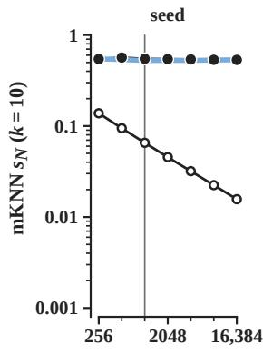

(b)  
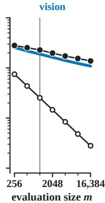

(c)  
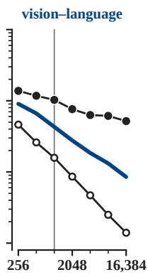

(d)  
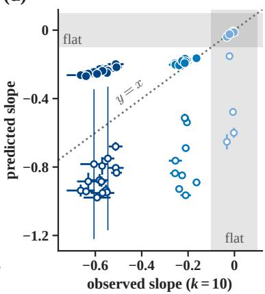  
Figure F.1: Descriptively, at $k = 1 0$ the crossing law recovers the slope class of every pair but predicts too shallow vision–language slopes, whereas the affine null N1 predicts every slope too steep (Theorem 1). (a–c) Class medians of mKNN at $k = 1 0$ on the growing COCO evaluation sets, observed and as predicted from the measurements at the fit size $m = 1 0 2 4$ . (d) Predicted against observed slope of ln $s _ { N }$ on ln m per pair, $\pm 1 \mathrm { \ s . d }$ . over the five orderings of the images. Predicted and observed slope classes coincide where the grey bands cross or in the white lower left. The two long thin bars come from orderings where N1 is undefined.

Sentence Encoders. We call the second preregistered experiment of Section 5.2 the sentenceencoder follow-up. This follow-up pairs the five vision models with all-mpnet-base-v2 (MPNet), Contriever, and Qwen3-Embedding-0.6B at pinned revisions, and each encoder embeds a caption with the pooling of its model card. Its main arm keeps the evaluation sets, orderings, anchors, caption, and clip of the 29 primary pairs, with a sentence encoder in place of the language model of each vision–language pair. Eleven further arms average up to five or all captions of each image, combine this averaging with centering, center the features in place of the clip, use plain $\ell _ { 2 }$ normalization, or drop duplicate captions. We froze the plan and then the code of the follow-up before the download of any sentence-encoder weight. Before the first cross-model score, one amendment let the frozen file-writing step reuse four tables already written with identical content, and every rule and statistic of the plan stayed unchanged. A checking script and the creation times of all 87 output files of the new pairs confirm this order. An independent reimplementation reproduced the overlap counts in all 9,450 cells of the main arm and of the five arms with the first one to five captions, and all 41 labels. In the main arm, $s _ { N }$ falls with m for all 15 pairs at $k = 1 , 1 0 .$ , and 100, and at $k = 1 0$ their class median falls from 0.105 at $m = 2 5 6$ to 0.013 at $m = 1 6 { , } 3 8 4$ (Figure F.2a). $\mathbf { A } \mathbf { t } k = 1 0$ and $m = 1 0 2 4$ , the median $s N$ of these pairs is $0 . 0 5 9$ , between the $0 . 0 4 3$ of vision–language pairs with language models and the 0.189 of vision pairs. The $s _ { N }$ of each vision model with every sentence encoder exceeds its $s _ { N }$ with any language model.

(a)  
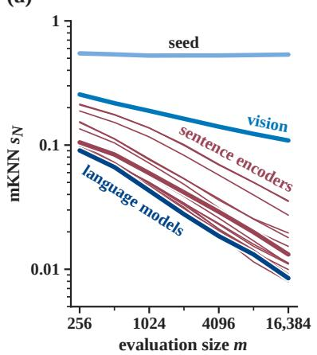

(b)  
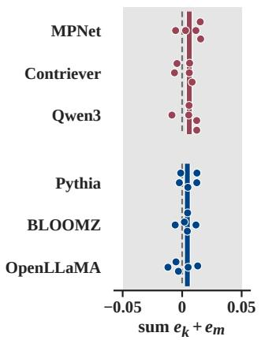

(c)  
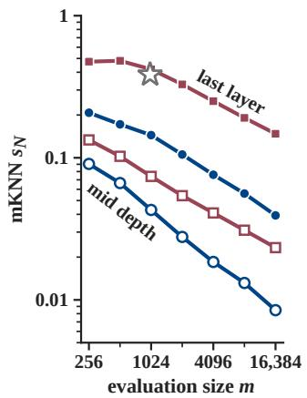  
Figure F.2: Neighbor overlap between vision models and sentence encoders falls with the evaluation size but stays close to stable at a fixed $k / m$ (Conjecture D.1), and in exploratory follow-ups vision features from the last layer in place of mid depth raise this overlap. (a) Class medians at $k = 1 0$ as in Figure 2a, with sentence-encoder pairs as thin lines. (b) Sums of the elasticities in k and m on $k \in \{ 1 0 , 1 0 0 \}$ , with group medians as bars and the preregistered tolerance in grey. (c) Medians at $k = 1 0$ with vision features from mid depth (open) or from the last layer (filled, exploratory), for sentence encoders with centering and five averaged captions (squares) and for language models (circles). The star marks the value of Schnaus et al. (2026) for DINOv2-B and MPNet at equal $k / m$

Stability with Sentence Encoders. The preregistered prediction of stability at a shared $k / m$ (P-S1 in Table F.1) required at least 8 pairs whose elasticity in m has absolute value at least 0.1. Among these pairs, the median sum of the elasticities in k and m on $k \in \{ 1 0 , 1 0 0 \}$ had to lie within $\pm 0 . 0 3$ with at least 80% of the sums within ±0.05. We fixed the range $\dot { k } \geq 1 0$ and these tolerances after scoring the primary pairs and before any sentence-encoder score. The range leaves out $k = 1$ , where the $s _ { N }$ of the primary pairs departs from a function of $k / m$ . Since the tolerances come from the sums of the primary pairs, the primary vision–language pairs lie inside the band of Figure F.2b by construction. All 15 new pairs qualify, with elasticities in m from $- 0 . 6 0 \mathrm { t o } - 0 . 3 9$ , and their sums lie between −0.009 and 0.016 around a median of 0.006. P-S1 holds in the main arm, in each of its five orderings, in all 11 further arms, and for the primary pairs under centering. With $k = 1$ included, the median sum of the new pairs rises to 0.058, against 0.030 for the primary vision–language pairs, and 5 of the 15 new sums stay within ±0.05, against 12 of 15 (exploratory). $\mathbf { A } \mathbf { t } ~ k = 1 0 0$ and $m = 2 5 6$ the $s _ { N }$ of the new pairs sits near chance, and on $m \geq 2 0 4 8$ , where these values lie at least 2.25 times above chance, the median sum is 0.005 (exploratory). The training data of MPNet include COCO caption pairs, probably from the 2014 training images outside our validation pool (unverified), and the pairs of MPNet have the largest median sum, 0.012. Without them, the sums keep a median of 0.006 and all lie within ±0.05, so P-S1 also holds (post hoc).

Undecided Slope Predictions. Two further preregistered predictions concern the slope at $k = 1 0$ (P-S2b and P-S2c in Table F.1). P-S2b states that the slope of each new pair follows the line fitted on the primary pairs against the logarithm of the level, rather than the slope of the same vision model with the language models. P-S2c states that averaging one to five captions moves the slope of a pair with the logarithm of its level at the rate 0.228 of this line. The other alternative is the rate 0.080 seen within the classes of the primary pairs. The frozen plan counted each prediction as decidable if its two alternatives lay far enough apart, a condition called the guard. The guards required a median gap of at least 0.113 between the two predicted slopes of P-S2b and a median rise of the level by at least 35% from the first caption to the average of five for P-S2c. The gap reached 0.092 and the rise 19%, so both predictions carry the frozen label “uninformative”. In the frozen operating characteristics of P-S2b, this label occurred in 84 to 88% of simulated runs at a median level near 0.06. Whatever the label, the plan fixed two values for the report: the weight 0.44 of the level line in a mixture of the two predictions of P-S2b and the median rate 0.435 of P-S2c. The unmet guards leave both values without an interpretation. Of the 12 secondary cells of P-S2b, 9 are uninformative and one is inconclusive. The other two pass the guard by less than 0.01 and give “holds” with a weight of 0.96. This weight comes from averaging slopes flatter than the line for three vision models with steeper slopes for SigLIP-B/16.

Absolute Level and Depth of the Vision Features. Schnaus et al. (2026) center each side and average the captions of an image before they compare two models. $\mathbf { A } \mathbf { t } \ k = 1 0$ and $m = 1 0 2 4$ centering raises the level of the new pairs by a median 9% and the average of five captions by 17%. With both changes, the $s _ { N }$ of DINOv2-B and MPNet reaches 0.077 at $k = 1 0 0$ and $m = 1 0 , 0 0 0$ against about 0.38 read from the figure of Schnaus et al. (2026) for the same two models at $k = 1 0 0$ on 10,000 COCO images. We interpolate every value at $m = 1 0 \small { , } 0 0 0$ between our two largest evaluation sets, of 8,192 and 16,384 images. In two exploratory follow-ups, each with decision rules fixed before its first score, vision features from the last layer in place of mid depth close the gap between 0.077 and about 0.38. With the CLS token of DINOv2-B from its last layer and every other setting kept, its $s N$ with MPNet rises to 0.429. At k = 100 and $m = 1 0 , 0 0 0$ , vision features from the last layer raise the $s _ { N }$ of all 15 pairs of a vision model and a sentence encoder by a median factor of 4.3 (range 2.3 to 7.4). We wrote the rules of the second follow-up after the first follow-up had produced the scores of the three last-layer pairs of DINOv2-B with the sentence encoders. These rules include the three pairs, and the $s _ { N }$ of the other 12 sentence-encoder pairs also rises at the last layer. With language models as the text side, last-layer vision features raise the $s N$ of all 15 pairs at $k = 1 0$ and $m = 1 0 2 4$ by a median factor of 2.8, from 0.043 to 0.144. Across layers of the language model, this level changes by at most a factor of 1.4. At the last layer, s still falls with m at $k = 1 0$ for all 30 pairs, with median slopes of $- 0 . 4 2$ with language models and −0.30 with sentence encoders, against $- 0 . 5 7$ and −0.43 at mid depth (Figure F.2c). Here the sentence-encoder pairs use centering and five averaged captions. The elasticities of these 30 pairs on $k \in \{ 1 0 , 1 0 0 \}$ sum to at most 0.02 in absolute value. In a post hoc comparison at a shared $k / m ,$ , the values for $k = 1 0 0$ lie within 9% of those for $k = 1 0$ . Neighbor overlap therefore stays close to stable at a fixed $k / m$ also at these higher levels. In a post hoc check, the line fitted on the primary pairs and its counterpart for centered features predict too shallow slopes at the last layer. The predicted slopes are −0.31 against −0.42 observed with language models and −0.05 against −0.30 with sentence encoders. Independent reimplementations reproduced every overlap count and label of both follow-ups. These follow-ups rest on COCO, five ViT-B models, and language models of at most 3B parameters, and we did not score the vision pairs at the last layer.

## F.4 Pretrained Models at Fixed Depth

On WIT at fixed depth, we classify MST overlap with a preregistered spanning-tree test and split the squared-distance discrepancy by increasingly flexible fits as a preregistered diagnostic. A preregistered width test then checks whether model width drives the CKA trend, and all three analyses follow the rules of Table F.1. Unless stated otherwise, the trend Tr in this subsection is computed on $s _ { \mathrm { o b s } }$ minus its permutation mean, not on $s _ { \mathrm { c a l } }$ of Section 2.1. Its p-values are exact over the 120 relabelings of the BLOOMZ sizes, and where stated they are Holm-corrected across four primary tests, i.e., the spanning-tree and width tests at the two depths.

Spanning Trees. The primary evaluation set has $m = 2 0 4 7$ inputs, since the power gate of the test required $m = 3 0 7 2 .$ , larger than the set of extracted inputs (Appendix F.2). On this set, the forest share of the shared MST edges exceeds the threshold of 0.70 in every pair. With the other two conditions also met, the preregistered rule returns “SOG-global $\approx 1 \mathrm { - N N ^ { \prime } }$ at both depths, $\mathrm { i . e . }$ , it classifies MST overlap as mostly one-nearest-neighbor overlap (Figure F.3). The forest share has medians 0.875 and $0 . 8 8 9 .$ , against 0.850 and 0.852 expected if the shared edges were a random subset of the language-model tree, and its minimum over pairs is 0.76 and 0.78. MST overlap exceeds one-nearest-neighbor overlap by a median factor of 1.20 and 1.32 at the two depths, in 129 and 136 of the 136 pairs (Figure 2c). The bound of Proposition 2 holds in all 816 configurations. Its half term m $s _ { N , 1 } / 2$ attains the maximum of the bound in every configuration, so these pretrained pairs leave the branch m $s _ { N , 1 } - n _ { A } ^ { \mathrm { m u t } }$ of the bound untested. Bridge overlap exceeds its permutation null in 93% and 100% of pairs, with medians 0.016 and 0.035 against 0.001. The bridge trend within BLOOMZ is $\mathrm { T r } = - 0 .$ .16 at mid depth and 0.57 at the last layer $( p = 0 . 0 5 8$ , Holm-adjusted 0.23). At the last layer, the rule counts the bridge trend as absent through a failure to reject. The point estimate 0.57 exceeds the preregistered bar of 0.5, but the Holm correction across the four primary tests requires $p \leq 0 . 0 1 2 5$ . On the $m = 1 0 2 4$ inputs of the other fixed-depth tests, the Holm-corrected outcome is also “SOG-global ≈ $1 - \mathrm { N N } ^ { \prime \prime }$ at both depths. Without the correction, the last-layer bridge trend of 0.72 $( p = 0 . 0 1 7 )$ on these inputs would change this outcome to “genuine global convergence”. Two of the three conditions of the rule hold nearly automatically. The forest makes up a median 84 to 85% of each language-model tree and at least 82% in every pair. This fraction is the forest share expected among the shared edges under random relabeling, so a random subset of tree edges would pass the threshold of 0.70. With $s \tau$ and $s _ { N , 1 }$ between 0.02 and 0.05, their difference stays within 0.03 almost by construction. The data add a modest enrichment over the forest fraction, with forest edges shared at 1.25 and 1.40 times the bridge rate (exploratory). The mean number of shared language-model bridges per pair is 5.32 at mid depth, below the power target of 10, and 10.72 at the last layer. At this layer, the rule returns “mixed” when the forest of the vision model replaces the primary forest of the language model.

Warps and Margins. In the preregistered diagnostics, we split the squared-distance discrepancy into the shares explained by four increasingly flexible fits, a scale fit, an affine fit, a global monotone fit, and one monotone fit per row. Each share counts what its fit adds beyond the previous fits. The shares are in-sample, since each fit is estimated and scored on the same $m = 1 0 2 4$ inputs. Their medians are 0.681, 0.190, 0.0004, and 0.029 at mid depth and 0.683, 0.148, 0.0012, and 0.034 at the last layer, with residual shares 0.102 and 0.123. The share of the global monotone fit stays below the preregistered level of 0.10 in all 136 pairs at both depths. The bound of Equation (D.1) certifies 0 anchors at $k = 1 0$ in all 544 configurations under every variant of the bound. This count follows from the neighbor gap, which is a median 0.0017 and 0.0026 times twice the largest discrepancy in its row. On these pretrained pairs, neighbor overlap therefore depends on the typical crossings of Theorem 1 rather than on the worst-case margin.

Preprocessing and Families. With the clip of PRH and after subtraction of the permutation mean, mKNN and CKA rise with size at the last layer along BLOOMZ and LLaMA-1, whereas the scores with OpenLLaMA 7B exceed those with OpenLLaMA 3B for 12% of the vision models on mKNN and 29% on CKA (exploratory). With 13B added, the OpenLLaMA trends of $s _ { \mathrm { c a l } }$ at the last layer are 0.59 for mKNN and 0.56 for CKA (Table F.2), so this difference between families rests on the step from 3B to 7B. At mid depth, the BLOOMZ trends with the clip are 0.70 for CKA (exact one-sided $p = 0 . 1 1 7 )$ and 0.84 for mKNN $( p = 0 . 0 2 5 )$ ). Under plain $\ell _ { 2 }$ they are −1.00 (two-sided $p = 0 . 0 1 7 )$ and $- 0 . 9 2 \ : ( p = 0 . 0 3 3 )$ , and CKA falls strictly with size for 17 of the 17 vision models (Figure 3b,c). These p-values are uncorrected for multiplicity. Each line of Figure 3b,c is divided by its value at 0.56B. Before this division, the means over vision models range from 0.113 to 0.130 for CKA and from 0.034 to 0.041 for mKNN with the clip. Under plain $\ell _ { 2 }$ normalization the ranges are 0.007 to 0.014 and 0.018 to 0.024. On these models, a size trend thus depends on the model family, the layer, and the preprocessing together.

Width. In the preregistered width test, we project every model to 128 principal components. With the clip of PRH, this projection changes the fixed-depth trend of CKA minus its permutation mean along BLOOMZ by 0.00 at mid depth and by −0.07 at the last layer, from 0.92 $( p = 0 . 0 1 7 )$ to 0.85 $( p = 0 . 0 2 5 )$ . Under plain $\ell _ { 2 }$ normalization, the projection leaves both trends unchanged. Width therefore does not drive this trend, in line with Proposition 4, which ties the CKA baseline to effective dimension rather than width. The preregistered rule returns “genuine global loss” at both depth and under both preprocessings. With the clip of PRH, the claim of this name is false as worded, since CKA minus its permutation mean keeps its fixed-depth trend at $0 . 7 0 \ ( p = 0 . 1 1 7 )$ and 0.92 $( p = 0 . 0 1 7 )$ .

## F.5 Layer Aggregation

This subsection gives the details of the layer-maximum experiments of Section 5.4 along BLOOMZ, LLaMA-1, OpenLLaMA, and Pythia, each family compared with the 17 vision models of ARH on the 1,024 WIT pairs. For each vision–language pair we evaluate every layer pair with $n _ { \pi } = 5 0 0$ permutations and recompute the maximum inside each permutation, which applies the same relabeling to every layer. The preregistered experiment applied this protocol of ARH to the 136 pairs of the vision models with the eight language models of Appendix F.1, in 80,960 layer pairs and under decision rules fixed in a frozen plan. We derived Corollary 1 after seeing the BLOOMZ result, so the threshold analyses on BLOOMZ are post hoc. For LLaMA-1 13B and 30B, OpenLLaMA 13B, and seven Pythia models, a plan for each family fixed predictions from single-model features before any score involving the new models. We compare the LLaMA-1 outcomes with their predictions without a confirmatory test, and the OpenLLaMA plan declared every outcome descriptive. Before the download of any Pythia weight, the Pythia plan fixed a confirmatory test (H1) of a drop of at least 0.10 in the layer-max CKA trend under calibration. In each family two independent implementations agree on every decision, with floating-point differences of at most $\mathrm { 1 0 ^ { - 1 4 } }$ along BLOOMZ, LLaMA-1, and OpenLLaMA. When the second implementation reproduces the frozen LLaMA-1 7B results, the relative deviation exceeds the strict tolerance of $1 0 ^ { - 1 \dot { 2 } }$ in one value, a debiased-CKA permutation mean with expectation zero. Its absolute deviation of $6 . 7 \times 1 0 ^ { - 1 8 }$ lies within the mixed tolerance of the plan. The permutation means of biased CKA match the baseline of part 2 of Proposition 4 with median relative errors between 0.07% and 0.09% in every family. On the new LLaMA-1 and OpenLLaMA layer pairs, the permutation means of debiased CKA are consistent with the zero baseline of part 3. In Figures 4d–i and F.4d–i, every line and marker gives a mean over the 17 vision models, and the baseline of a language-model layer is its largest baseline over the layers of a vision model. The measured baselines in Figures 4g–i and F.4g–i agree with the predicted baselines to a relative error of at most $4 . 4 \times 1 0 ^ { - 4 }$ . Table F.2 gives the size trends of the four families.

(a)  
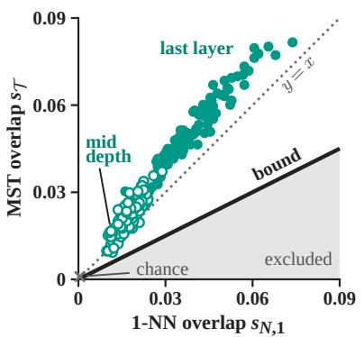

(b)  
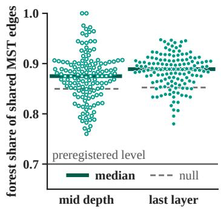

(c)  
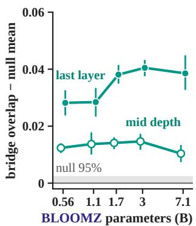  
Figure F.3: Spanning-tree overlap mostly depends on the one-nearest-neighbor scale, and bridge overlap exceeds its permutation null without an established size trend (Proposition 2). Vision– language pairs of WIT at mid depth (open) and the last layer (filled). (a) MST overlap against one-nearest-neighbor overlap for each pair, with chance as a cross. (b) Per pair, the share of the shared MST edges that lie in the nearest-neighbor forest of the language model, with its value for a random subset of tree edges (null). (c) Bridge overlap minus its permutation null mean along BLOOMZ, as means over vision models with 95% intervals. The grey band ends at the median 95% permutation quantile. The experimental record gives the values.

BLOOMZ. Along BLOOMZ, the layer-max CKA trend of 0.89 $( p = 0 . 0 4 2 )$ falls to −0.29 after subtraction of the permutation mean $( p = 0 . 6 8 ; 9 5 \%$ interval over vision models $[ - 0 . 4 1 , - 0 . 1 8 ] )$ ) and to −0.02 under $s _ { \mathrm { c a l } } ( [ - 0 . 1 9 , 0 . 1 2 ] )$ ). After subtraction, the layer-max trends of mKNN and debiased CKA are 0.99 $( p = 0 . 0 0 8 )$ and 0.84 $( p = 0 . 0 3 3$ , exploratory), the second with a zero baseline at every layer pair by part 3 of Proposition 4. At fixed depth the threshold rises with size at mid depth and falls at the last layer (Tr = 0.99 and −0.91). Calibration moves the CKA trend opposite to the trend of the threshold without a reversal. In post hoc analyses, the threshold $c _ { \alpha }$ of the maximum lies 0.0017 to 0.0028 above the largest predicted baseline maxℓ $, \ell ^ { \prime } \sqrt { \mathrm { P R } _ { A } \mathrm { P R } _ { B } } / ( m - 1 )$ over the 85 BLOOMZ pairs, as assumed in Corollary 1. For every size except 1.1B this baseline sits in the first two language-model layers, where the participation ratio jumps from 134 at 0.56B to between 242 and 249 at 1.7B and above. In contrast, 112 of the 136 observed maxima of the preregistered pairs fall at relative depth 0.9 or above, so on BLOOMZ the maximum and its threshold mostly come from different layer pairs. From 0.56B to 7.1B the mean threshold rises from 0.135 to 0.184, a gain of

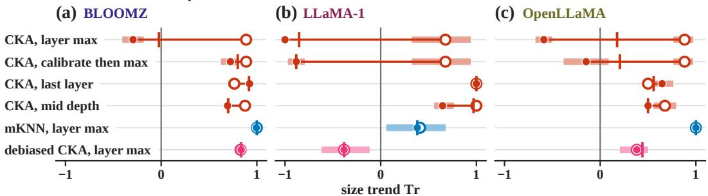

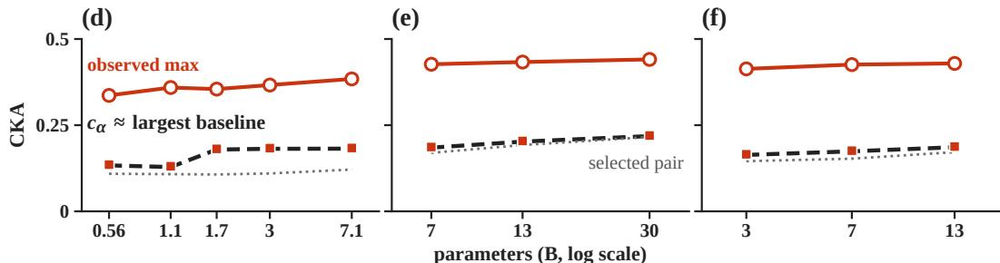

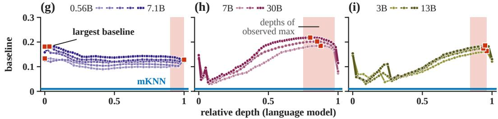  
Figure F.4: After a maximum over layers, the calibration threshold follows the largest randompairing baseline along BLOOMZ, LLaMA-1, and OpenLLaMA (Proposition 4, Corollary 1). The trends of debiased CKA and the BLOOMZ trends of calibration before the maximum are exploratory. (a–c) Size trend of each score in its raw form, after subtraction of the permutation mean, and under $s _ { \mathrm { c a l } }$ . (d–f) Squares give the threshold $c _ { \alpha } .$ , dashed lines the largest baseline predicted from features, and dotted lines the threshold of the layer pair attaining the maximum (“selected $\mathrm { p a i r } ^ { \prime \prime } )$ (g–i) CKA baseline of each language-model layer, predicted (lines) and measured (dots). Table F.2 gives the trends.

0.048 equal to that of the observed maximum (0.336 to 0.384) and close to the 0.049 of the largest baseline. The threshold of the layer pair attaining the maximum stays between 0.107 and 0.121. The calibrated score therefore loses its upward trend, the outcome allowed by the corollary when the baselines grow as fast as the score. Two further analyses support the corollary on BLOOMZ, the first fixed in the frozen plan and the second post hoc. A subtraction of the threshold of the layer pair attaining the maximum gives Tr = 0.76. A restriction of the maximum to language-model layers at relative depth 0.5 or more restores the trend after subtraction to 0.89 (p = 0.017).

LLaMA-1. Along LLaMA-1, the 7B, 13B, and 30B models give 51 pairs with 47,520 layer pairs. Computed from single-model participation ratios before any cross-model score, the largest predicted baselines have means 0.1847, 0.2023, and 0.2182 and sit at relative depth 0.80 to 0.88, where the observed maximum also lies. The thresholds lie a median 0.0018 above these baselines (range 0.0015 to 0.0021) and follow their order in 51 of 51 comparisons. From 7B to 30B the threshold of the maximum gains 0.033 against 0.014 for the observed maximum. Calibration turns the layer-max CKA trend of 0.68 into −0.85 under $s _ { \mathrm { c a l } }$ (95% interval $[ - 1 . 0 0 , - 0 . 6 5 ] \rangle$ ) and into −1.00 after subtraction, while mKNN moves from 0.41 to 0.38. The threshold of the layer pair attaining the maximum lies 0.004 below the threshold of the maximum at 30B, so the two analyses that restored the trend on BLOOMZ leave the LLaMA-1 trend reversed. A subtraction of this threshold gives $\operatorname { T r } = - 0 . 9 1$ , and a restriction to layers at relative depth 0.5 or more leaves $s _ { \mathrm { c a l } } \mathrm { a t } - 0 . 8 5$ . At fixed depth the calibrated

<table><tr><td rowspan="2">Family</td><td rowspan="2">Metric</td><td colspan="3">layer maximum</td><td colspan="2">mid depth</td><td colspan="2">last layer</td><td rowspan="2">calibrate</td></tr><tr><td>raw</td><td> $s _ { \mathrm { c a l } }$ </td><td> $s _ { \mathrm { o b s } }  \overline { { s } } _ { \pi }$ </td><td>raw</td><td> $s _ { \mathrm { c a l } }$ </td><td>raw</td><td> $s _ { \mathrm { c a l } }$  then max</td></tr><tr><td rowspan="2">BLOOMZ</td><td>CKA</td><td>0.89</td><td>-0.02</td><td>-0.29</td><td>0.88</td><td>0.70</td><td>0.76</td><td>0.92</td><td>0.80</td></tr><tr><td>mKNN</td><td>1.00</td><td>1.00</td><td>0.99</td><td>0.85</td><td>0.84</td><td>0.99</td><td>0.98</td><td>一</td></tr><tr><td rowspan="3">LLaMA-1</td><td>debiased CKA</td><td>0.83</td><td>0.84</td><td>0.84</td><td>0.70</td><td>0.70</td><td>0.90</td><td>0.91</td><td>一</td></tr><tr><td>CKA</td><td>0.68</td><td>-0.85</td><td>-1.00</td><td>1.00</td><td>0.97</td><td>1.00</td><td>1.00</td><td>-0.88</td></tr><tr><td>mKNN</td><td>0.41</td><td>0.38</td><td>0.38</td><td>0.82</td><td>0.82</td><td>0.91</td><td>0.91</td><td>0.38</td></tr><tr><td rowspan="3">OpenLLaMA</td><td>debiased CKA</td><td>-0.38</td><td>-0.38</td><td>-0.38</td><td>1.00</td><td>1.00</td><td>1.00</td><td>1.00</td><td>-0.38</td></tr><tr><td>CKA</td><td>0.88</td><td>0.18</td><td>-0.59</td><td>0.68</td><td>0.50</td><td>0.50</td><td>0.56</td><td>0.21</td></tr><tr><td>mKNN</td><td>1.00</td><td>1.00</td><td>1.00</td><td>0.68</td><td>0.68</td><td>0.56</td><td>0.59</td><td>1.00</td></tr><tr><td rowspan="3">Pythia</td><td>debiased CKA</td><td>0.38</td><td>0.44</td><td>0.38</td><td>0.50</td><td>0.50</td><td>0.59</td><td>0.53</td><td>0.38</td></tr><tr><td>CKA</td><td>0.93</td><td>0.89</td><td>0.89</td><td>0.98</td><td>0.96</td><td>0.67</td><td>0.80</td><td>0.89</td></tr><tr><td>mKNN</td><td>1.00</td><td>1.00</td><td>1.00</td><td>0.99</td><td>0.99</td><td>0.94</td><td>0.95</td><td>1.00</td></tr><tr><td></td><td>debiased CKA</td><td>0.90</td><td>0.90</td><td>0.90</td><td>0.97</td><td>0.96</td><td>0.84</td><td>0.84</td><td>0.90</td></tr></table>

Table F.2: Size trends Tr along the four families under the clip and $\ell _ { 2 }$ normalization of PRH, for the layer maximum, the two fixed depths, and $s _ { \mathrm { c a l } }$ under calibration of each layer pair before the maximum. The column ${ s _ { \mathrm { o b s } } } - \overline { { s } } _ { \pi }$ gives the trend of $s _ { \mathrm { o b s } }$ minus the mean of its 500 permutation values, and the fixed-depth trends use the permutations drawn for the layer maximum. The experimental record gives every exact one-sided $\mathbf { \nabla } \cdot p .$ Along Pythia, the predicted drop of at least 0.10 in the layermax CKA trend under calibration (H1) was not confirmed, and every other Pythia entry and every OpenLLaMA entry are descriptive. The debiased CKA rows and the BLOOMZ value of calibration before the maximum are exploratory. A dash marks a trend not reported.

CKA trend keeps its sign, as predicted, at 0.97 at mid depth and 1.00 at the last layer. We had marked this prediction as at risk, since the mid-depth baselines also rise with size (means 0.050, 0.065, and 0.075). The raw scores rise faster, from 0.184 to 0.227 between 7B and 13B, against a threshold rise from 0.052 to 0.067. Even so, subtraction of the permutation mean lowers the mid-depth trend from 1.00 to 0.65. Calibration of each layer pair before the maximum reverses the trend to −0.88, although we had predicted in advance that the trend would keep its sign under this protocol. The layer pairs selected under this protocol stay on the late block, where their own thresholds rise from 0.146 to 0.167 with size. On BLOOMZ, where the largest baseline sits away from the layers of the maximum, this protocol keeps the trend, at 0.80 for $s _ { \mathrm { c a l } }$ and 0.72 after subtraction. This result is exploratory, since we defined the protocol in the LLaMA-1 plan after seeing the BLOOMZ result.

OpenLLaMA. Along OpenLLaMA, the 3B, 7B, and 13B models give 51 pairs, with 14,432 layer pairs for the new 13B model. The largest participation ratio over layers grows from 202 at 3B through 229 at 7B to 261 at 13B, and the largest baseline grows with it for each of the 17 vision models. This baseline has means 0.1636, 0.1741, and 0.1860 and sits on late layers at relative depth 0.94 to 0.96. The offsets of the thresholds above this baseline have a median of 0.0019 (range 0.0016 to 0.0023) and lie inside the frozen band of 0.0009 to 0.0029 for 17 of 17 vision models. From 3B to 13B the threshold and the largest baseline gain 0.022, against 0.016 for the observed maximum. The CKA trend of 0.88 falls to 0.18 under $s _ { \mathrm { c a l } }$ and to −0.59 after subtraction (95% interval [−0.68, −0.50]). Although the lines of Figure 4f are nearly parallel, the trend after subtraction is strongly negative, because Tr averages per-vision-model rank correlations over three sizes and the small excess of baseline growth recurs in all 17 vision models. From 7B to 13B the raw gain falls below the threshold gain for 17 of 17 vision models, with medians of 0.0018 against 0.0130, an outcome outside the predictions fixed in advance. Given the raw scores, the thresholds forecast from features yield a predicted order after calibration in 30 of the 34 comparisons involving OpenLLaMA 13B, all correct. These 30 cover 16 of the 17 orders reversed by calibration, 10 of the 13 kept orders, and 4 comparisons in which 13B already scores lower before calibration. As predicted, the mKNN trend stays at 1.00 under calibration and the debiased CKA trend moves by 0.06 or less. Calibration before the maximum lowers the CKA trend from 0.88 to 0.21, in line with the prediction that this protocol does not raise the trend. At both fixed depths the CKA trend keeps its sign under calibration (descriptive). With an uncensored mKNN trend of 1.00, the decision rule of the plan assigns OpenLLaMA the category “layer max loses the CKA trend”, whereas the mKNN trend of 0.38 left LLaMA-1 in the category “intermediate”.

Pythia. Along the seven Pythia models from 70M to 6.9B, calibration kept the layer-max CKA trend, from 0.93 $( p = 0 . 0 0 2 0 )$ to 0.89 $( p = 0 . 0 0 4 2 )$ under $s _ { \mathrm { c a l } }$ . The primary preregistered prediction of a drop of at least 0.10 consistent across the sizes was not confirmed. The trend changes by −0.034 under calibration (95% interval over vision models $[ - 0 . 0 4 6 , - 0 . 0 2 3 ] \rangle$ ). The permutation p is 1612/5040 for the consistency of the drop across sizes, and the bootstrap p is 1.0 for a drop of at least 0.10. Since the plan made the secondary tests H2 to H4 conditional on a confirmed primary prediction, we did not carry out these tests. To forecast the offset of each threshold above its predicted baseline, the plan fixes for model i the band $f ( \mathrm { P R } _ { i } ^ { * } ) \pm 0 . 0 0 0 8$ , where $\mathrm { P R } _ { i } ^ { * }$ is the largest participation ratio over the layers of the language model. The function $f ( \mathrm { P R ^ { * } } ) = 0 . 0 0 1 0 6 9 + 0 . 0 1 2 9 2 / \sqrt { \mathrm { P R ^ { * } } }$ is fitted on the 187 known pairs of the 11 language models of the other families. The values of PR∗ lie between 91.5 at 70M and 166.6 at 6.9B, so the bands of 70M and 160M extrapolate below the fitted range, which starts at 124.5. The median offsets lie between 0.0020 and 0.0021, inside the band of every model, and the threshold order matches the predicted order in 307 of the 307 comparisons with a material predicted gap. Given the raw scores, the bands yield a predicted order after calibration in 352 of the 357 comparisons, all correct, including 11 of the 14 orders reversed by calibration. The raw score of the layer maximum gains a median 0.024 per doubling of parameters against 0.0063 for the threshold. With one size or one of the four vision-model families left out, or without the censoring of $s _ { \mathrm { c a l } } ,$ the change of the trend stays between −0.054 and −0.017. The five sizes from 410M to 6.9B give the largest drop, $- 0 . 0 6 5 \ : ( p = 0 . 3 5 )$ , so every subset stays short of the required 0.10. The category returned by the decision rule stays the same for every required drop from 0.06 to 0.20 and changes at 0.03. The two implementations agree on every integer, p-value, decision, and category and differ in 163 pair-level and 3 descriptive floating-point values by at most $9 . 1 \times 1 0 ^ { - 1 4 }$ , so the preregistered agreement check failed by its letter. After seeing the category, we accepted this check with an added absolute tolerance of $1 0 ^ { \dot { - } 1 2 }$ , a post hoc ruling, and a third implementation reproduces the results of both with 0 mismatches. The plan fixed the wording of Section 5.4 for each outcome before any Pythia weight was downloaded, and that section reports a subset of these numbers in a different order, a post hoc choice of wording.

Scope. With three sizes, every exact one-sided p of a size trend along LLaMA-1 or OpenLLaMA is at least 1/6, so each outcome along these families is a directional result on one family. Their intervals cover the choice of vision models but not of language models. On both families the thresholds follow the predicted order in every comparison, but this order is the same for each of the 17 vision models, since the vision model enters the predicted baseline as a common factor. Once the thresholds track the largest baseline, two predictions hold almost by construction, because $s _ { \mathrm { c a l } }$ does not increase with the threshold. These are the OpenLLaMA forecast of the order after calibration and part of the LLaMA-1 prediction that calibration lowers the CKA trend. A failure of these predictions would come from the raw gain, which fell below the threshold gain for 17 of 17 vision models at each pair of LLaMA-1 sizes (medians 0.006 against 0.019 from 7B to 13B). Joint permutation tests over families are exploratory. Under calibration, the mean of the BLOOMZ and LLaMA-1 trends falls by 1.22 for $s _ { \mathrm { c a l } }$ and by 1.43 after subtraction $( p = 6 / 7 2 0$ and 2/720). The test on the weakest drop along BLOOMZ, LLaMA-1, and OpenLLaMA gives $p = 4 8 / 4 3 2 0$ and 2/4320. The BLOOMZ result generated the tested hypothesis, and the trend of the largest BLOOMZ baseline fails the materiality rule of the plan. The BLOOMZ and LLaMA-1 results were known before the OpenLLaMA plan. With the BLOOMZ and LLaMA-1 drops held at their observed values, a rule rejecting at $p \leq 0 . 0 5$ rejects under 2 of the 6 relabelings of the OpenLLaMA sizes, so the three-family value carries little evidence about OpenLLaMA itself. Depth and width grow with size along LLaMA-1, whose 30B model was also trained on more tokens (Touvron et al., 2023), and along OpenLLaMA, whose three models share one corpus of 1T tokens (Geng and Liu, 2023). The seven Pythia models share their training data and its order (Biderman et al., 2023), and their width grows from 512 to 4096, whereas their depth does not grow monotonically (16 blocks at 1B against 24 at 410M).

Secondary Preprocessing. Under plain $\ell _ { 2 }$ normalization, our secondary preprocessing, the largest baseline sits at the embedding layer for all three sizes of LLaMA-1 and of OpenLLaMA. Before any score, both plans declared this preprocessing not material, since its predicted baselines differ too little between sizes to support a directional prediction. They differ by 0.0023 between LLaMA-1 13B and 30B, and the participation ratio of 178.45 at OpenLLaMA 13B lies below the 180.02 of 7B. The analysis of this preprocessing is therefore descriptive, as in the Pythia plan. With plain $\ell _ { 2 }$ normalization, calibration moves the layer-max CKA trend from −0.50 to −0.56 on LLaMA-1, from −0.26 to −0.62 on OpenLLaMA, and from 0.68 to −0.06 on Pythia $( p _ { \mathrm { p e r m } } = 4 7 / 5 0 4 0 )$ . On

BLOOMZ the uncensored trend is −0.09 against 0.43 before calibration (post hoc). Along Pythia the raw score gains 0.0015 per doubling against 0.0049 for the threshold, in line with the condition of part 2 of Corollary 1. The drop rests on 6.9B, without which $p _ { \mathrm { p e r m } }$ is 0.12. On LLaMA-1, the prediction that the calibrated CKA trend keeps its sign at fixed depth holds at the last layer and does not apply at mid depth, where the raw trend is 0.03. Over all 187 pairs of the 11 language models, the difference between the drops of CKA and mKNN in the pooled statistic of ARH is 0.081 under this preprocessing, with interval [0.006, 0.165]. The OpenLLaMA plan excluded this secondary result from the comparison with ARH (Appendix F.6).

## F.6 Comparison with the Published Results

On the models shared with PRH, ARH, and BPC, our measurements agree with a central observation of each study. With the preprocessing of PRH, layer-max mKNN rises with BLOOMZ size $( \mathrm { T r } = 1 . 0 0 $ before calibration), in line with the cross-modal trend of Huh et al. (2024). The loss and reversal of the calibrated layer-max CKA trend along BLOOMZ, LLaMA-1, and OpenLLaMA are in line with the loss reported by ARH. ARH plots this loss for RBF kernel alignment in its main figure and reports the same loss for linear CKA, the version of CKA in our measurements. Along Pythia, whose raw scores outgrow their baselines, the trend stays at 0.89 (Appendix F.5). BPC reports that mKNN at $k = 1 0$ for its primary vision–language pair falls from 0.135 on 1,024 WIT pairs to 0.008 on fifteen million LAION pairs, with the layer pair fixed. On our COCO evaluation sets, the median vision–language mKNN at $k = 1 0$ falls in the same direction, from 0.091 to 0.0085 over a 64-fold range of m. SOG reports that spanning-tree overlap tracks mKNN with a Spearman correlation of 0.968 over 204 pairs (You et al., 2026). By Proposition 2, the MST contains the nearest-neighbor forest for pairwise distinct distances, and on our models most shared MST edges are shared nearest-neighbor edges, so this correlation comes at least partly from the nearest-neighbor forest. On our models, MST overlap and one-nearest-neighbor overlap have a correlation of 0.96 over both depths (exploratory), computed from uncalibrated scores at fixed depth rather than from the calibrated layer-max scores of SOG.

Our results differ from those of these studies in three respects. First, on our models the pooled statistic of ARH changes less under calibration than on the models of ARH. There, this Pearson correlation between score and language-model rank moves from 0.86 to 0.45 for CKA and from 0.85 to 0.84 for mKNN. Over our 136 preregistered pairs it moves from 0.49 to 0.43 for CKA and stays at 0.52 for mKNN, and the preregistered decision rule returns “ARH pattern absent”. With LLaMA-1 13B and 30B added, the difference between the two drops is 0.12 (95% interval over vision models [0.003, 0.26]), in the category “partial”. With OpenLLaMA 13B also added, the 187 pairs give 0.50 to 0.40 and 0.51 to 0.51, and the difference of 0.10 has the interval [−0.02, 0.24]. This interval contains zero and covers the boundary 0.10 of the decision rule, so the direction of the loss reported by ARH is not established on our models. With 187 pairs the category of the rule is not decidable. The corresponding difference of 0.40 in ARH lies above our interval, and our models do not include LLaMA-65B. ARH also reports a loss for unbiased CKA, from 0.65 to −0.01, whereas our debiased CKA uses the same estimator (Appendix F.1) and moves from 0.37 to 0.36 over the 187 pairs. Its zero baseline by part 3 of Proposition 4 places debiased CKA under part 1 of Corollary 1, by which calibration does not reverse the order of model pairs with well-separated maxima (Section 3.4). The source of the difference from ARH remains open. In a secondary analysis along vision-model sizes at the last layer, CKA minus its permutation mean has $\mathrm { T r } = - 0 . 0 \dot { 4 } \left( p = 0 . 5 5 \right)$ against 0.71 $( p = 0 . 0 0 5 )$ for mKNN, so the contrast reported by ARH appears there at fixed depth. Such a loss can come from baselines of the fixed vision layers that grow with size faster than the score, as in part 2 of Corollary 1, and we leave this explanation untested. Second, ARH attributes the inflation of layer-max scores to the number of layer pairs (Gröger et al., 2026). In a post hoc analysis of biased CKA, the permutation mean of the maximum exceeds the largest single-pair mean by $6 \times 1 0 ^ { - 5 }$ on average over our 136 pairs and by at most $1 0 ^ { - 5 }$ on LLaMA-1. There, the trend of a maximum over 17 layers of each model stays reversed (−0.91 under $s _ { \mathrm { c a l } } )$ . Over the 136 pairs, the threshold of the maximum exceeds that of the layer pair attaining the maximum by 0.040, so the level of the highest-baseline layer pair sets the threshold, rather than the number of layer pairs (exploratory). Third, the BLOOMZ trends at mid depth reverse under plain $\ell _ { 2 }$ normalization (Appendix F.4), so their sign depends on the clip of PRH, and preprocessing belongs to the criterion.

Our controlled runs add two results to this comparison. In the CIFAR-5m networks with a linear head, the linear map of the head adds an excess to the geometric discrepancy without lowering agreement on neighbor sets. Weight decay on the head removes this excess (Appendix F.8). These results suggest one candidate mechanism for why representations agree on neighbor sets but not on global geometry, a question left open by ARH. Under momentum without weight decay, most of this excess on $G _ { s }$ at 250,000 images comes from a gauge shared by all runs trained this way (preregistered, Appendix F.8.1). Our contrastive networks trained with the two objectives also disagree on neighbor sets (Appendix F.10), so these networks are not described by the idealized contrastive learner of PRH, which recovers one kernel up to an offset.

## F.7 Linear Autoencoder

In the linear-autoencoder experiment of Section 5.5, the inputs $x \in \mathbb { R } ^ { 1 6 }$ are Gaussian with mean zero and covariance $U \Lambda U ^ { \top } , \Lambda = \mathrm { d i a g } ( 4 , 3 , 2 , 1 . 5 , 0 . 2 , \ldots ) \overline { { { 0 . 2 } } } )$ with twelve eigenvalues 0.2, and $U$ a fixed random orthogonal matrix. The latent dimension is $n _ { h } \ = \ 4 .$ , and $m \ : = \ : 2 5 6$ probes drawn independently of every training stream form the rows of X and define the probe Gram matrix $\boldsymbol { K } = \mathbf { X } \boldsymbol { E } ^ { \intercal } \boldsymbol { E } \mathbf { \check { X } } ^ { \intercal }$ of Theorem 2. Every criterion uses the unnormalized features Ex of the probes, without the unit normalization of Section 2, and the training loss uses the second-moment matrix $N ^ { - 1 } \sum _ { i } x _ { i } x _ { i } ^ { \top }$ of the run’s sample without centering, or $U \Lambda \breve { U } ^ { \top }$ at $N = \infty$ . Runs start from $\mathcal { N } ( 0 , 1 / \mathrm { f a n } { \cdot } \mathrm { i } \overline { { \mathrm { n } } } )$ , or from entries of scale 0.01 under small initialization, and train until the relative gap to the closed-form optimum or the relative gradient falls below $1 0 ^ { - 8 }$ . The weight-decay arms use $\lambda _ { \mathrm { w d } } = 0 . 0 7 5$ . Runs under stochastic gradient descent and Adam use minibatches of 16 for $4 \times 1 0 ^ { 5 }$ steps at a constant rate and $1 0 ^ { 5 }$ steps of decay and then end with full-batch gradient steps under the same stopping rule. For each training procedure we trained 48 disjoint pairs of runs at each $N \in \{ 2 ^ { 8 } , 2 ^ { 1 \dot { 2 } } , 2 ^ { 1 6 } \}$ and 500 pairs at $N = \infty$ , the population limit. Run r keeps its initialization at every $N$ and draws its own training sample and minibatches at each N. The tolerances are 0.05 for $1 - s _ { N }$ at $k = 1 0 , 0 . 0 2$ for $G _ { s }$ , and 0.01 for 1 − CKA and for the projector distance, and a pair with a diverged run fails every criterion. The experimental record gives the decision table behind Figure F.5.

Gradient Flow and Other Optimizers. The preregistered gradient-descent arm uses a step of 0.05, which changes the imbalance C of part 1 of Theorem 2 by a median 53%. A secondary arm declared before the confirmatory runs uses a step of 0.002 and conserves C to 0.18%, so this arm stands in for gradient flow. In that arm the spectrum of the learned $E E ^ { \top }$ equals $f ( \mathrm { s p e c } C _ { 0 } )$ of part 1 to a median relative error of 0.1%. The median of cond( $E E ^ { \top } )$ is 4.66 against 4.67 predicted by part 1, with 10th and 90th percentiles of 2.98 and 7.43 across initializations. At both steps, 0 of 48 pairs of gradient-descent runs at every finite N and 0 of 500 at $N = \infty$ lie within tolerance on 10-nearest-neighbor sets, $G _ { s } ,$ and CKA. Under weight decay, tied weights, small initialization, and weight decay at the secondary step 0.002, at least 47 of 48 pairs at $\bar { N } = 2 ^ { 1 2 }$ and $2 ^ { 1 6 }$ and 488 of 500 at $N = \infty$ lie within tolerance on all four criteria. $\mathbf { A } \mathbf { t } \ { \bar { N } } = 2 ^ { 8 }$ the count on neighbor sets and $G _ { s }$ is 0 of 48 under every training procedure. Under weight decay, the median condition number of the learned $E E ^ { \top }$ is 1.0330, against 1.0329 predicted by part 3 of the formal version, a comparison made for Figure F.5e outside the preregistered tests. Tied weights, small initialization, and weight decay use the preregistered step of 0.05, since part 3 holds at any step and small initialization keeps the imbalance $\rvert \boldsymbol C$ of part 1 near zero. Minibatch stochastic gradient descent and Adam change C during training, outside the premises of the theorem, and the learned $E E ^ { \top }$ has intermediate median condition numbers of 1.19 and 1.54. Agreement between their runs on neighbor sets, $G _ { s } ,$ , and CKA stays unreliable at every N. At $N = \infty$ , 164, 12, and 322 of 500 pairs lie within tolerance under stochastic gradient descent and 13, 0, and 172 under Adam. Agreement under the projector criterion is reliable for $N \geq 2 ^ { 1 2 }$ under every training procedure. Each pair failing at these sizes under weight decay or on the projector criterion contains a run that diverged at step 0.05. The exceptions are two pairs of runs trained with stochastic gradient descent at $N = \infty$ , whose runs diverged in the minibatch phase.

Failed Prediction P1. For gradient descent at step 0.05, P1 required unreliable agreement on neighbor sets, $G _ { s } ,$ , and CKA at every N, and a mean discrepancy at $N = 2 ^ { 1 6 }$ inside the two-sided 95% interval of the mean at $N = \infty$ . The first part holds in 12 of 12 cells. The second part holds for neighbor sets (0.2787 against [0.2699, 0.2806]) and fails for $G _ { s }$ (0.4287 against [0.4072, 0.4286]) and CKA (0.1496 against [0.1319, 0.1447]). The paired differences between the same initializations at $N = 2 ^ { 1 6 }$ and $N = \infty \ \mathrm { a r e } 8 . 6 \times 1 0 ^ { - 4 } , 1 . 3 \times \bar { 1 0 } ^ { - 4 } , \mathrm { a n d } - 1 . 0 \times 1 0 ^ { - 4 }$ , each with a 95% interval containing zero. The plan stated before the runs that this literal test passes with probability about 0.46 when the two means are equal, because the 48-pair mean is far noisier than the 500-pair interval. For the secondary arm at step 0.002, the second part fails for all three criteria. P1 remains falsified, and our conclusion that more data leaves agreement between gradient-descent runs unreliable rests on the first part.

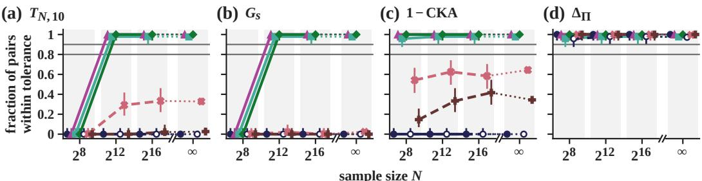

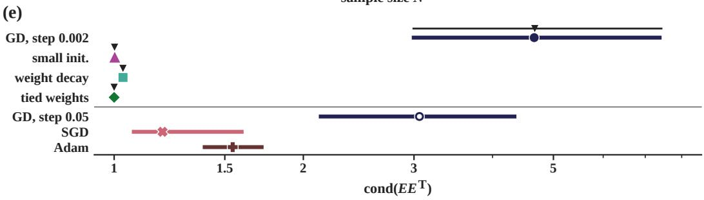  
Figure F.5: On the criteria whose outcomes depend on the gauge, agreement between runs trained by gradient descent without a regularizer stays unreliable at every sample size, whereas agreement between runs trained with weight decay, tied weights, or small initialization becomes reliable as N grows (Theorem 2). (a–d) Fraction of disjoint pairs of linear-autoencoder runs within tolerance against N, with one-sided 95% Clopper–Pearson bounds and grey decision levels. Dashed lines mark training procedures outside the premises of the theorem, and dotted segments join $N = 2 ^ { 1 6 } \mathrm { t o } N = \infty$ . The projector criterion (d) is a control whose outcome is invariant to the gauge. (e) Condition number of the learned $E E ^ { \top }$ at $N = \infty$ as the median and the 10th to 90th percentile of runs, with the predictions of parts 1 and 3 for the training procedures covered by the theorem in black.

## F.8 CIFAR-5m Networks with a Linear Head

In the first network experiment of Section 5.5, the trunk is the airbench94 network (Jordan, 2024) on $3 2 \times 3 2 \mathrm { C I F A R } { - } 5 \mathrm { m }$ images (Nakkiran et al., 2021) with trunk features $h \in \mathbb { R } ^ { 2 5 6 }$ , followed by the bias-free head $u = M h , y = W u$ with $u , y \in \mathbb { R } ^ { 9 }$ , and logits equal to $y / 9$ mapped by a fixed $1 0 \times 9$ matrix with orthonormal columns. Each run follows the airbench94 recipe (Nesterov momentum 0.85, label smoothing 0.2, flips and translations) for 488 steps of 1024 images. Three arms differ in the head alone, without weight decay on M and W (noWD), with weight decay on both (WD), or with a tenfold smaller initialization of both (small init). Each arm was trained on N = 25,000 and 250,000 images at a fixed budget of 500,000 images seen, in 192 runs per arm and size, which gives 96 disjoint pairs. Each run draws its own training subset from five million images, so two subsets overlap by 0.5% at 25,000 and 5% at 250,000 in expectation. The two runs of a pair differ in initialization, training subset, data order, and augmentation. The tolerance of each criterion is the largest discrepancy between the outputs y over 24 pairs of pilot runs at $N = 1 0 0 { , } 0 0 0$ , eight per arm. We judge u against the tolerance of y and compare features without normalization. The experimental record gives the tolerances and the full tables of this experiment.

Preregistered Decisions and Failed Predictions. $\mathrm { A t } N = 2 5 0 , 0 0 0$ , weight decay makes u agree in 96 of 96 pairs under all nine criteria, as predicted by part 3 of Theorem 2. At this size, y agrees in 96 of 96 pairs under every criterion in every arm. Without weight decay, u agrees on 10-nearest-neighbor sets in 96 of 96 pairs, and this result meets the preregistered falsification condition of prediction P1, which stated that this agreement would be unreliable at both sizes. The neighbor criterion is loose here, since the largest discrepancy of the pilot outputs sets its tolerance at 0.84 on $1 - s _ { N }$ Agreement of u fails instead on the scale-normalized criteria, where it is unreliable under G at 65 of 96 pairs (Clopper–Pearson bounds 0.590 and 0.756) and inconclusive under $1 - \mathrm { C K A }$ at 73 of 96. The mean $G _ { s }$ discrepancy of u is 0.2050, just below the tolerance $\varepsilon = 0 . 2 0 7 3$ set at $N = 1 0 0 { , } 0 0 0$ and a tolerance 4.7% larger would make the cell reliable (Figure F.6b). The preregistered secondary tolerance is the 0.9 quantile of the pilot discrepancies (0.2030 on $G _ { s }$ and 0.0810 on $1 - \mathrm { C K A } )$ . At 250,000, 39 and 45 of 96 pairs of u lie within this tolerance on $G _ { s }$ and $1 - \mathrm { C K A }$ without weight decay, 96 and 96 with weight decay, and 58 and $^ { 7 9 }$ under small initialization. In the second network experiment, with tolerances from the same arm and size, 0 and 5 of 96 pairs of u lie within tolerance on $G _ { s }$ under momentum without weight decay. We report prediction A3 on this agreement as tolerance-sensitive, without a categorical claim (Appendix F.8.1).

Under a tenfold smaller initialization, 82 of 96 pairs of u lie within tolerance on $G _ { s }$ (inconclusive, lower bound 0.781) and 86 of 96 on $1 - \mathrm { C K A }$ (inconclusive), so prediction P3 failed in this arm. Prediction P5 stated that the fractions of agreeing pairs under small initialization and under weight decay differ by at most 0.1, and it failed on $G _ { s }$ at 250,000, where these fractions differ by 0.146. The other three comparisons of P5 are 0 against 0 or 96 against 96 pairs. At $N = 2 5 { , } 0 0 0 { , } \dot { 0 }$ of 96 pairs lie within tolerance for u and y on every criterion under each of the three training procedures with independent training subsets, since the tolerance came from pilot runs at $N = 1 0 0 { , } 0 0 0$ . The 25,000 parts of P1, P3, and P5 hold or fail vacuously, whereas with same-size tolerances the second network experiment finds agreement of u under weight decay reliable at both sizes.

Optimizer, Projector, and Trunk. These runs fall in the case of Remark 1, in which finite steps and momentum change C during training. Stochastic gradient descent with momentum raised the median imbalance $\| M \bar { M } ^ { \top } - W ^ { \top } \bar { W } \| _ { F }$ of the head about ninefold at $N = 2 5 0 { , } 0 0 0$ , from 0.98 to 8.59, and about seven-hundredfold from the small initialization, from 0.0098 to 6.92. Under weight decay this imbalance fell to 0.43. We divide the final imbalance by $\| M M ^ { \top } \| _ { F } + \| W ^ { \top } W \| _ { F }$ to obtain the relative imbalance, whose median at 250,000 is 0.31 without weight decay, 0.040 with weight decay, and 0.28 under small initialization. Under momentum the imbalance arises during training rather than from the initialization, since in the second network experiment the median cosine between the final and the initial $C \ \mathrm { i s \mathrm { ~ - } 0 . 0 1 7 }$ and −0.005 (Appendix F.8.1). Agreement of u under the projector criterion is reliable in every arm at $N = 2 5 0 { , } 0 0 0$ , because $\Pi _ { u } = \Pi _ { y }$ (largest deviation $4 . { \overset { \cdot } { 9 } } \times { \overset { \cdot } { 1 } } 0 ^ { - 8 }$ over 1,344 runs) makes this criterion compare the column spaces of y. The mean $s _ { N } ( 1 0 )$ of the trunk features differs across arms by at most 0.011, as predicted by P4. At 250,000, agreement of h and of its $\ell _ { 2 }$ -normalized version is reliable under every criterion in every arm except for $h$ on $1 - \mathrm { C K A }$ under small initialization (91 of 96, inconclusive). At 25,000 with independent training subsets, agreement of $h$ is unreliable on every criterion except $G _ { s }$ under weight decay, whose reliable decision comes from a tolerance set by one pilot pair trained with small initialization. In an exploratory cell whose runs share four training corpora, with 24 dependent pairs per corpus, every mean discrepancy at 25,000 fell relative to independent subsets, consistent with the distinction between independent and shared corpora in Appendix C.

Exploratory Analyses. We chose the comparison of u with $y$ within each pair and its split into a common gauge and a mismatch after seeing the preregistered decisions. Without weight decay, the $G _ { s }$ discrepancy of u exceeds that of y in 96 of 96 pairs at both sizes, by a median 0.023 at 25,000 and 0.020 at 250,000 (Figure F.6c). Weight decay removes the $G _ { s }$ excess (−0.0001 at 250,000), whereas small initialization keeps most of this excess (0.016). On $T _ { N , 1 0 }$ the median excess lies between −0.0011 and 0.0003 in every cell, pilot pairs included. When the gauge of one run is applied to the outputs of both runs of a pair, this common gauge produces about three quarters of the $G _ { s }$ excess without weight decay at 250,000 (0.0148 of 0.0200). The output discrepancy plus the remaining mismatch part lies within the tolerance of this experiment in 96 of 96 pairs in every cell at 250,000. The preregistered decision on u therefore depends both on a gauge shared by all runs and on the run-to-run mismatch addressed by Theorem $^ { 2 , }$ , and the second network experiment separates these two parts (Appendix F.8.1). Order criteria stronger than the neighbor sets can detect a gauge. On $T _ { E }$ the pairs of u agree more closely than the pairs of $y$ (median excess −0.023 at 250,000, 96 of 96 pairs), a difference predicted by neither Theorem 2 nor Corollary 2.

Neighbor Sets under the Gauge. We formulated Corollary 2 after the results of the first network experiment, and the second network experiment tests this corollary prospectively (Appendix F.8.1).

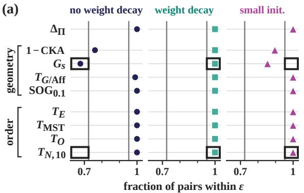

(b)  
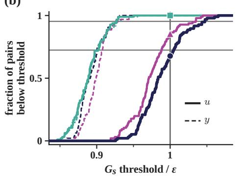

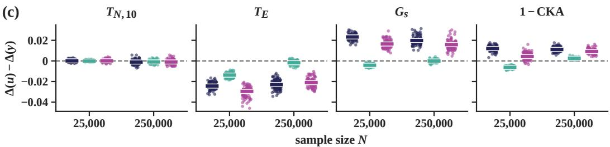  
Figure F.6: Without weight decay, the gauge of a linear head raises the discrepancy of the head coordinates u above that of the outputs y on scale-normalized geometry but not on neighbor sets, and weight decay makes agreement of u reliable under every criterion at $N = 2 5 0 { , } 0 0 0$ (Theorem $^ { 2 , }$ Remark 1). (a) Fraction of disjoint pairs of CIFAR-5m runs at $N = 2 5 0 { , } 0 0 0$ whose discrepancy in the head coordinates u lies within the tolerance $\varepsilon$ fixed in advance. Black boxes mark the ranges predicted in the preregistration, so a marker outside its box shows a failed prediction. (b) Fraction of pairs whose $G _ { s }$ discrepancy lies below a threshold, against this threshold over ε, for u (solid) and the outputs $y$ (dashed). Grey lines at the fractions $6 9 / 9 6$ and $9 2 / 9 6 $ in (a) and (b) mark the decision levels, and the vertical line in (b) marks $\varepsilon .$ (c) Excess $\Delta ( u ) - \dot { \Delta } ( y )$ of the discrepancy of u over that of $y$ per pair of runs at both sample sizes, with median bars and the training procedures ordered and colored as in (a). The fractions in (b) and the excesses in (c) are exploratory.

Since the corollary is proved, we count the anchors certified by its ratio condition in the stored runs to check our code and to measure the coverage of the certificate, not to confirm a prediction (exploratory). In the linear autoencoder at $N = \infty ,$ where both runs of a pair minimize the same population loss, every certified anchor kept its neighbor set at $k = 1$ and $k = 1 0$ in 3,972 pairs from eight training procedures. $\mathrm { A t } \ k = 3 0$ , two violations come from one anchor of one tied-weights pair, whose saved encoders leave the span of $\hat { U }$ by a relative $6 \times 1 0 ^ { - 5 }$ . Both disappear when the distances are computed from the projected minimizer. At finite $N ,$ where the two runs of a pair see different samples and lie outside the premises of the corollary, certified anchors change, for instance 6,877 of 12,288 for tied weights at $N = 2 ^ { 8 }$ . The certificate covers at least 94% of the anchors at $k = 1 0$ under weight decay, tied weights, and small initialization, where cond $_ { A B } - 1 < 0 . 0 0 8$ Under gradient descent at step 0.002, where the median cond $A B$ is $8 . 9$ , the certificate covers 0 anchors at $k = 1 0 ,$ , and 99% of the 10-nearest-neighbor sets differ between the two runs of a pair. In the linear autoencoder, the gauge prevents agreement on neighbor sets together with agreement under CKA, and 0 of the 3,972 pairs met the neighbor tolerance while missing the CKA tolerance. The two bounds on cond $A B$ through the initial imbalance in the proof of the corollary hold in 500 of 500 pairs of the step-0.002 arm. Outside gradient flow, both bounds can fail, as permitted by Remark 1. Under gradient descent from a small initialization they fail in 281 and 90 of 500 pairs, by at most 0.007. From the default initialization at step 0.05, the first bound fails in 1 of 486 pairs.

In the CIFAR-5m networks, which lie outside the premises of Theorem 2, the median $\mathrm { c o n d } _ { A B }$ lies between 1.14 and 1.45 across cells. The certificate covers at most 5% of the anchors at $k = 1 0 .$ , with 0 violations, the count implied by construction. An exchange of the head gauge alone moves 2 to 6% of the 10-nearest-neighbor slots of one run, but without weight decay at 250,000 the outputs of two runs share a mean of 0.19 of their 10 nearest neighbors. Added to this difference between the learned functions, the gauge changes the mean cross-run discrepancy on neighbor sets by at most 0.0002 in every cell. The decisions of this network on neighbor sets therefore reflect the learned functions and are not evidence for the corollary, and the same holds for the failed prediction P1.

## F.8.1 Second Experiment: Head Flow and Same-size Tolerances

Design. The second network experiment trains fresh runs of the network above, with new seeds for every source of randomness and the head computed in float64. It separates a gauge shared by the runs of an arm from the run-to-run gauge. Five core arms have 96 main pairs per size and 96 pilot pairs (64 for FLOW). MOM trains the head with the Nesterov momentum of the trunk, as in the arm without weight decay above, and WD adds weight decay on the head. FLOW, BAL-FLOW, and SMALL-FLOW remove the head from the optimizer, while the trunk keeps its momentum. After each trunk step, these arms hold the trunk features fixed and integrate gradient flow of the head on the minibatch loss over the time of one momentum-equivalent step (the learning rate of the trunk divided by $1 - 0 . 8 5 )$ . The integration uses an adaptive Heun–Euler integrator of relative tolerance $1 0 ^ { - 4 }$ These three arms start from the default, a balanced $( C _ { 0 } = 0 )$ , and a tenfold smaller initialization. Three secondary arms with 32 main and 16 pilot pairs per size train the head with momentum from the balanced and the small initialization (BAL-MOM, SMALL-MOM) or with one plain Euler step per minibatch (SGD-K). At $N = 2 5 0 { , } 0 0 0$ , MOM-BF16 repeats MOM in 32 runs with the bfloat16 head of the first experiment, and KS-4 and KS-16 split the Euler step into 4 and 16 substeps in 16 runs each. We estimate the drift of C from these three cells. The balanced initialization gives W a condition number near 1.34 against about 26 for the default, and SMALL-FLOW controls for this confound by keeping the default condition number at one tenth of the scale.

Tolerances and Decompositions. Each tolerance is the largest discrepancy of y over the pilot pairs of the same arm and size, and u is judged against this tolerance. As a sensitivity check, a pooled tolerance takes the largest discrepancy over the pilot pairs of all arms that pass the accuracy gate at that size. A decision entry that is reliable under one of the two tolerances and unreliable under the other is reported as tolerance-sensitive, without a categorical claim. A decision on u requires reliable agreement of y in the same cell and is otherwise inconclusive. Per pair and criterion, the excess $\Delta ( u ) - \Delta ( y )$ splits in two ways. The common-gauge part is the excess of a counterfactual that gives every run of the arm one common gauge, and the mismatch part is the rest. This common gauge is the log-Euclidean mean of the determinant-normalized metrics $( W W ^ { \top } ) ^ { - 1 }$ of the pilot runs. The balanced part is the excess of the coordinates $( W M M ^ { \top } W ^ { \top } ) ^ { - 1 / 4 } y$ of the balanced head computing the same outputs, and the imbalance part is the rest. Its run-to-run component equals the mismatch part minus the mismatch part of the balanced coordinates. The distortion caused by the imbalance is the value of cond $A B$ between the coordinates u of a run and those of its balanced head. Every part is given in standard deviations (SD) of $\Delta ( y )$ over the main pairs of the cell.

Order, Gates, and Checks. The preregistration and all training, gate, and analysis code were frozen before any engineering, pilot, or main run. The tolerances were frozen from pilot pairs alone during the training of the main runs, before the first main measurement. All 4,352 runs completed, with 0 runs flagged as failed or diverged and 0 retries. We divide $\| C _ { \mathrm { e n d } } - C _ { 0 } \| _ { F }  { \mathbf { b y } } \| M M ^ { \top } \| _ { F } ^ {  { \mathbf { \Upsilon } } } + \| W ^ { \top } W \| _ { F }$ at the end of training to obtain the relative drift of C. The pilot runs passed every gate, including the gate on the median relative imbalance (0.273 and 0.314 under MOM, 0.030 and 0.040 under WD). The main runs passed every check, with a largest relative drift of C under head flow of $2 . 7 5 \times 1 0 ^ { - 5 }$ against a limit of $2 \times 1 0 ^ { - \hat { 4 } }$ . Two preregistered bounds on the distortion held in the 2,337 of 2,368 runs where the first bound is non-vacuous and in all 1,152 runs of the flow arms. A third bound held in every pair, and the certificate of Corollary 2 had 0 violations, the count implied by construction. An independent recomputation reproduced every tolerance, all 704 decision entries, and all 880 means of the decompositions. We wrote a second recomputation without reading the analysis code or the first, and it reproduced every preregistered decision and every estimate up to Monte Carlo error.

Estimates. Under FLOW, whose C is conserved, the final gauge lies closer to the run’s own initial gauge than to that of another run in 95 and 102 of 192 runs, and both 95% intervals contain 0.5. The first experiment’s conclusion about this memory rested on the same statistic (46% to 52%). As this statistic stays at chance even when C is conserved, this conclusion now rests on the cosine between the final and the initial $C$ under momentum (C4a in Table F.1). Under SGD-K, a plain Euler step of the same size changes C slightly more than momentum, with a median relative drift of 0.343 and 0.376 against 0.276 and 0.314 under MOM and $2 . 4 \times 1 0 ^ { - 5 }$ and $2 . 5 \times 1 0 ^ { - 5 }$ under FLOW. At 250,000 the drift under momentum is 0.76 times the drift of a plain step extrapolated from KS-4 and KS-16 (0.137 and 0.028). This ratio lies below the preregistered factor of 3 for naming momentum the main cause, so Remark 1 names both finite steps and momentum as causes of the change of C. The bfloat16 head gives a median relative imbalance of 0.3121 against 0.3119 in float64, which rules out bfloat16 precision as the cause of the ninefold growth of the imbalance in the first experiment.

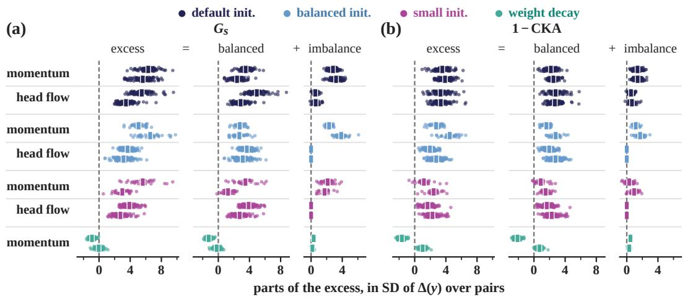

(c)  
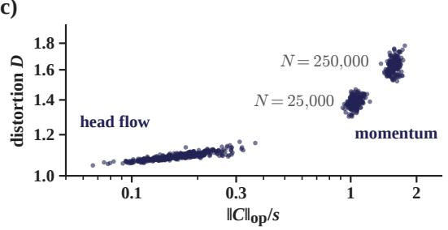

(d)  
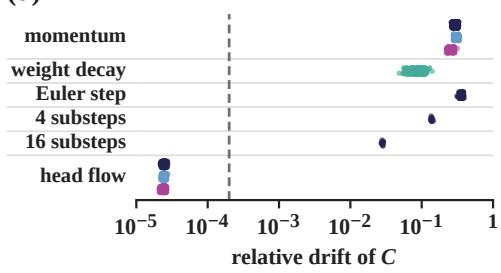  
Figure F.7: The initial imbalance kept by head flow contributes a smaller part of the excess discrepancy of the head coordinates than the imbalance created by momentum, and weight decay removes the excess on $G _ { s }$ (Theorem 2, Remark 1). (a, b) Excess $\Delta ( u ) - \Delta ( y )$ of each pair of runs in the second network experiment and its balanced and imbalance parts. Dots are pairs, bars means, and each row shows $N \doteq 2 5 , 0 0 0$ above $N = 2 5 0 { , } 0 0 0$ . (c) Distortion D caused by the imbalance in each run against the imbalance relative to the smallest singular value s of the head, initial under head flow and final under momentum (exploratory). (d) Relative drift of C per run against the limit set in advance for head flow (dashed). Appendix F.8.1 gives the tests.

Relative to the balanced start, the default start raises the imbalance part more under head flow than under momentum, with every difference-in-differences interval above zero. The distortion caused by the imbalance rises with the imbalance relative to the smallest singular value of the head (exploratory, Figure F.7c). Its Spearman correlation with this ratio is 0.89 and 0.73 under FLOW for the initial imbalance and 0.33 and 0.32 under MOM for the final imbalance (unadjusted $p < 1 0 ^ { - 5 } )$ . Under head flow the imbalance part is 0.19 and 0.18 times that under momentum on $G _ { s }$ at the two sizes and 0.39 and 0.48 times on 1 − CKA. Weight decay removes the excess on $G _ { s } , \mathrm { a t } - 0 . 9 1$ and −0.04 SD, whereas on 1−CKA the excess under weight decay is −1.65 SD at 25,000 and +1.02 SD at 250,000, with all 96 pairs above zero (Figure F.7). Under MOM at 250,000, the common-gauge part makes up 0.71 of the excess on $G _ { s } .$ . In this cell, agreement under the output discrepancy plus the mismatch part is inconclusive at 78 of 96 pairs, with a mismatch part of 1.63 SD (95% interval [1.46, 1.80]). Agreement of u under the tolerance of the common-gauge counterfactual is inconclusive at 90 of 96. On $T _ { N , 1 0 } ,$ , agreement of u is reliable in every cell, but prediction A2 fails in 4 of 10 cells, all at $2 5 0 { , } 0 0 0$ . In these cells the mean discrepancy of u lies 0.0017 to 0.0023 below that of $y ,$ and the 95% interval of this difference leaves the band of ±0.002 required by A2.

Sensitivity to the Pooled Tolerance and a Collapsed Pilot Run. Under MOM with same-size tolerances, 0 and 5 of 96 pairs of u lie within tolerance on $G _ { s } ,$ and 1 and 21 of 96 pairs of its common-gauge counterfactual lie within this tolerance. Under the pooled tolerance, which is 7.8% larger, 95 of 96 pairs of this counterfactual lie within tolerance at $2 5 0 { , } 0 0 0$ , so we report the outcome of prediction A3 as tolerance-sensitive. At 250,000, the tolerance-sensitive outcomes of A3 and A7 rest on one pilot pair of SMALL-FLOW, which sets the pooled tolerance on $G _ { s } ( 0 . 2 0 9 8 ) , 1 - \mathrm { C K A }$ and $T _ { N , 1 0 }$ . Its $\bar { G } _ { s }$ discrepancy lies 5.7 SD above the main pairs of the arm, although both runs are healthy (accuracy about 0.897). At the next pooled value on $G _ { s } ~ ( 0 . 2 0 1 7 )$ 79 of 96 pairs of the common-gauge counterfactual of MOM and 72 of 96 pairs of u under BAL-FLOW lie within tolerance, and both decisions are inconclusive. The same pair sets the tolerance of SMALL-FLOW at 250,000, where 93 of 96 pairs of u lie within tolerance on $G _ { s }$ . This count falls to 52 of 96 at the second-largest pilot value of the arm and to 22 of 96 under the 0.9-quantile tolerance. We therefore do not read this cell as a selection of the gauge by small initialization, and prediction $\mathbf { A } 7 ( \mathbf { a } )$ fails in both arms (Table F.1). One SGD-K pilot run at 250,000 collapsed without triggering the divergence flag (accuracy 0.089, condition number of W near $2 . 1 \times 1 0 ^ { 5 } )$ . This run alone makes the tolerances of its cell vacuous (1.17 on $G _ { s }$ against 0.20 at the 0.9 quantile) and removes the cell from the pooled tolerance through the accuracy flag. The primary endpoints exclude this cell, and the estimates of the drift of C use main runs, whose final condition number of $W$ is at most 2.5.

## F.9 Contrastive Objectives in the Finite Gibbs Model

Inside the premises of Theorem 3, all nine confirmatory predictions held after Holm correction (Table F.1), and by the preregistered rule the pattern of the theorem is present on the order criteria.

Design. The model has $| \mathcal { X } | = 2 5 6$ inputs with uniform masses, in 16 clusters of 16 points grouped into 4 superclusters, and the temperature is $t = 0 . 3$ . Its $K _ { \star }$ is built from a Gaussian kernel on fixed coordinates in $\mathbb { R } ^ { 8 }$ and adjusted so that the masses are balanced, with smallest eigenvalue 0.129 and pairwise distinct off-diagonal distances. Learners A and B are those of the formal version of Theorem 3 (Appendix E.5). Each run draws its own $N$ examples as exact multinomial counts, and each example has one negative $( J = 1 )$ ). Both learners return minimizers with numerical certificates of optimality, and a run whose certificate fails after one re-solve is kept and counted against every test that uses the run. We run each learner 192 times at each of the sample sizes $\mathrm { 2 ^ { 2 0 } , 2 ^ { 2 2 } , 2 ^ { 2 5 } , 2 ^ { 2 8 } , 2 ^ { 3 1 } }$ $2 ^ { 3 4 } , 2 ^ { 3 7 }$ , and $2 ^ { 4 0 }$ , in 96 disjoint blocks of two runs of each learner. Exact criteria compare the order of all distances among eight probe inputs, one in each of eight clusters, and the criteria of Appendix F.1 compare all 256 inputs. The tolerance of the largest difference of mean-normalized distances and of the isotonic discrepancy inf $\dot { \bf \zeta } _ { g } \| g ( D _ { A } ) - D _ { B } / \bar { \psi } ( D _ { B } ) \| _ { \mathrm { m a x } } .$ , which is that of part 4 of the formal version of Theorem 3 in units of $\psi ( D _ { B } )$ , is half the limit $\varepsilon _ { \psi } = 0$ .3477 of part 3 of the formal version, with ψ the mean off-diagonal distance. These criteria, CKA, and $\varepsilon _ { \psi }$ take all 256 inputs as the probes of Theorem $^ { 3 , }$ and the exact criteria take the eight probe inputs. Before the first training sample, the frozen code computed the Gaussian limits of both learners, with that of InfoNCE given by part 1 of Theorem E.1. From these limits, a Monte Carlo simulation predicted that the share of pairs in exact agreement across objectives on the order of the probes reaches 90% at $N ^ { * } = 2 ^ { 3 3 . 7 5 }$ examples, so the grid is centered on $2 ^ { \mathsf { { \breve { 3 } 4 } } }$ . A secondary arm pairs learner A with InfoNCE at temperature $t / 2$ at $2 ^ { 2 0 }$ and $\bar { 2 } ^ { 2 2 }$ examples, and positive controls and two planted breaks of the order check the pipeline.

Results. Exact agreement across objectives on the order of the probes held in 0 of 96 pairs up to $2 ^ { 2 8 }$ examples, 7 of 96 at $2 ^ { 3 1 }$ , 94 of 96 at $2 ^ { 3 4 }$ , and 96 of 96 at $2 ^ { 3 7 }$ and $2 ^ { 4 0 }$ . The predicted shares were 0.073 at $2 ^ { 3 1 }$ and 0.944 at $2 ^ { 3 4 }$ , and at $2 ^ { 4 0 }$ the lower confidence bound of the share of pairs in exact agreement is 0.969. From $2 ^ { 3 4 } \ \mathrm { t o } \ 2 ^ { 4 0 }$ , the recovery errors of learners A and B fell by ratios of 0.124 [0.122, 0.126] and 0.126 [0.121, 0.130], below the preregistered bound of 0.35 and close to 0.125 at the rate $N ^ { - 1 / 2 }$ . Across objectives the largest difference of mean-normalized distances fell from a median 0.519 at $2 ^ { 2 0 }$ to 0.348 at $2 ^ { 4 0 }$ , and 0 of 96 pairs came within the tolerance of 0.174 at any size. $\mathrm { { A t 2 ^ { 4 0 } } }$ , all 96 pairs within each objective met this tolerance and agreed exactly on the order of the probes. With the link undone on the spectral run, the median difference fell from 0.606 at $2 ^ { 2 0 }$ to 0.00497 at $2 ^ { 3 4 }$ and 0.000618 at $2 ^ { 4 0 }$ , against 0.00058 and 0.00043 within the two objectives. Its ratio from $2 ^ { 3 4 }$ to $2 ^ { 4 0 }$ is 0.124 [0.121, 0.127]. Intervals are 95% block-bootstrap intervals over the 96 blocks. Under the isotonic discrepancy, every pair across objectives came within the tolerance at $2 ^ { 4 0 }$ . At this size, on neighbor sets, per-anchor rankings, and the global order, the mean discrepancy across objectives stayed below the sum of the two mean discrepancies within objectives, as predicted from the finite model. Its ratio to the mean of these two was 0.97 to 1.00 on these criteria, against 1.11 on spanning trees (secondary). On $G _ { s }$ and 1 − CKA, the mean discrepancy across objectives exceeded that sum by 0.113 and 0.141, and 1 − CKA across objectives on all 256 inputs reached 0.14135, within 0.01 of its limit 0.1414. On the positive controls, a run and the link of the theorem applied to its own Gram matrix agreed on every order criterion, as did a run and its pure rescaling. The pipeline detected both planted breaks of the order. $\mathrm { { A t 2 ^ { 2 0 } } }$ , the mean $s _ { N } ( 1 0 )$ was 0.806 and 0.735 within the two objectives and 0.763 across them, against 0.715 within InfoNCE in the networks of Appendix F.10. At this size the mean discrepancy across objectives on every order criterion also stayed below the sum of the two mean discrepancies within objectives, as predicted from the finite model (descriptive). Its ratio to the mean of these two was 1.01 to 1.03 on these criteria and 1.14 on $\Delta _ { \mathrm { i s o } }$ , against 3.2 in the networks. The secondary arm compares the temperatures t and $t / 2$ $2 ^ { 2 0 }$ and $2 ^ { 2 \bar { 2 } }$ , where the InfoNCE minimizers lie on the boundary of the positive semidefinite cone, outside the rescaling case of Remark 2. Its mean discrepancy across temperatures exceeded that within each temperature by at most 6.1% on every criterion (descriptive). In Figure 6a and c, the grey band runs between the values within InfoNCE and within the spectral loss. Figure 6b shares the axes and color scale of Figure F.8b. It shows the pair at $2 ^ { 4 0 }$ examples ranking 48th of 96 by increasing difference after undoing the link, a choice fixed before plotting.

Secondary Predictions and Certificates. Two secondary predictions held, the Gaussian limit of part 1 of Theorem E.1 in 192 of 192 checks (P1b) and the transition of the agreement within InfoNCE (P2b). $\mathrm { { A t 2 ^ { 4 0 } } }$ , the Monte Carlo simulation predicted the ratio of mean discrepancies to be 0.557 on neighbor sets and 0 on spanning trees, against the observed 0.973 and 1.111 (P5b). Both predictions fall outside the factor of 1.5 required by the plan, so P5b failed. We attribute the failure on neighbor sets to the Monte Carlo error of 48 simulated blocks. Of the 3,456 main solves, 44 narrowly missed the tolerance $1 0 ^ { - 6 }$ of their optimality certificate, and we kept and flagged all 44. Thirty-nine are InfoNCE runs at $2 ^ { 2 5 }$ , a size without a test, and five belong to the secondary arm at $2 ^ { 2 2 }$ , where counting them against its descriptive conclusion leaves the conclusion unchanged.

Amendments and Checks. The preregistration and the 37 code files of this experiment were frozen before any computation, and the experiment ran under four amendments. Under amendment A1, we resumed the experiment on a free GPU after another job had slowed the pilot solves about tenfold, and we excluded the slowed timings from the frozen projection of GPU time. Amendment A2 removed the limits of 11.5 and 12 GPU-hours that we had set ourselves in the preregistration, after the main phase stopped at the first limit with 156 runs of the secondary arm left. Amendments A3 and A4 fixed two programming errors in the frozen analysis code, a cache that lost its newest matrix on overflow and a division by a Monte Carlo prediction equal to zero. We wrote and froze both amendments during the analysis run, and the preregistration allows such code fixes if they precede the opening of the affected data. The file metadata do not show whether the 418 pair caches written before the A4 freeze were opened before this freeze. Every decision is independent of this question, since A3 leaves every computed value unchanged and A4 defines one secondary boolean outside every decision. A recomputation written without importing any code of the experiment reproduced every decision and every frozen value other than the bootstrap intervals to within $1 . 2 \times 1 0 ^ { - 7 }$ . The creation times of 53 files confirmed the order of the experiment.

Compute and Scope. The InfoNCE minimizers lie on the boundary of the positive semidefinite cone up to $2 ^ { 2 5 }$ examples and in its interior at every larger size. $\mathrm { { A t 2 ^ { 2 5 } } }$ the frozen projection therefore underestimated the GPU time of the solves about fivefold. The experiment used 12.71 GPU-hours, 2.71 of them for the Gaussian limits, against an estimate of about 8, while learner B and the analysis ran on the CPU. One preregistered gate used the rescaling identity of Remark 2 as a check of the solver rather than as a test of the remark. Its residual was at most $\mathrm { i . 1 \times 1 0 ^ { - 1 6 } }$ on the 32 samples at $2 ^ { 3 4 }$ and $2 ^ { 4 0 }$ that satisfy the premises of the remark. The preregistration also fixes a second stage that removes one premise of the theorem at a time, and we have not run this stage.

## F.10 Contrastive Networks

In our preregistration, we extended the prediction of Theorem 3 to CIFAR-5m networks, where learners trained with InfoNCE and with the spectral contrastive loss would learn one relation through different increasing links. Their representations would then agree on every order criterion and disagree on scale-normalized geometry. The trunk is the airbench94 network (Jordan, 2024) with features $h \in \mathbb { R } ^ { 2 5 6 }$ , followed by a projection head to a 128-dimensional embedding. InfoNCE uses a cosine critic at temperature 0.2 (arm A) and 0.5 (arm A′). The spectral contrastive loss (arm B) uses the ball projection of HaoChen et al. (2021) with unit parameter, a deviation recorded in Appendix F.2. All arms use stochastic gradient descent with Nesterov momentum, weight decay $5 \times 1 0 ^ { - 4 }$ , and batches of 512 images with two views each. We train 64 runs of each arm on $\dot { N } = 5 0 { , } 0 0 0$ and 500,000 images at a budget of five million images seen, so 50,000 images mean 100 epochs and 500,000 images 10. Embeddings are compared with the cosine kernel on 2048 held-out images. The tolerance of each criterion is the largest discrepancy over 24 pooled within-arm pilot pairs at $N = 1 5 0 { , } 0 0 0$ , and pairs within an arm (32 per arm) and across arms (64) are disjoint. Table F.3 gives every decision, and Figure F.8b shows the pair across objectives ranking 32nd of 64 by increasing warp share, chosen before plotting. Grey boxes in Figure F.8a span all within-arm pairs.

Outcome. These networks lie outside the premises of the theorem, since the spectral arm trains on the unit sphere and the embedding dimension falls far below the size of the input domain. Their empirical InfoNCE risk also has no positive definite minimizer at any temperature (Remark 2), since two views of each image are each other’s only positive partners. All 64 pairs of InfoNCE and spectral runs fall outside the tolerance on neighbor sets, per-anchor rankings, the global order, and spanning trees at both sizes. At 500,000 images their median discrepancies on these criteria are 1.34 to 2.51 times the tolerance, whereas pairs with a common objective meet every criterion (Figure F.8a). The mean $s _ { N } ( 1 0 )$ at this size is 0.313 across objectives against 0.715 and 0.640 within the two objectives. On each of the ten criteria of Table F.3, the discrepancy of every pair across objectives exceeds that of every pair within an objective, at both sizes and for both temperatures. The preregistered requirement of reliable agreement within each objective fails at 50,000 images, on four criteria for InfoNCE at 0.2 and on six for the spectral loss. In a preregistered descriptive cell, we trained 32 runs of each of arms A and B on 50,000 images for the 10 epochs of the main runs at 500,000 images. All 32 pairs across objectives lie outside the tolerance on every criterion, and agreement within each arm is unreliable on six or seven of the ten criteria and inconclusive on the others.

Items of the Link Prediction. The median warp share across objectives lies below 0.2 and the order gaps exceed 0.1, so both conditions for falsification in Table F.1 hold and the link prediction is falsified for these networks. Item (i) required the share of pairs across objectives within tolerance under each order criterion to come within 0.1 of the within-objective ceiling of Remark C.1 at 500,000 images, and their mean discrepancy to fall with N. Every gap is 1.0, and the fall from 50,000 to 500,000 images is significant after Holm correction for $T _ { N , 1 0 } ^ { \mathrm { ~ ~ } } \bar { ( } - 0 . 0 1 2 5 , 9 5 \%$ interval $[ - 0 . 0 1 4 5 , - 0 . 0 1 0 5 ] \rangle$ and $\mathbf { \bar { \mathit { T } } _ { M S T } } \left( \mathbf { \bar { - } } 0 . 0 1 1 9 \right)$ but not for $T _ { O } ( p = 0 . 0 3 7$ against 0.025) or $T _ { E } \left( p = 0 . 2 \bar { 5 } \right)$ . Item (ii) required agreement across objectives under the geometric criteria to be unreliable at both $N$ , with reliable agreement within each objective at 500,000 images. The item passes by its letter, but agreement across objectives is unreliable under every criterion, so the item does not single out geometry. Item (iii) required the isotonic discrepancy across objectives to stay within 1.5 times its value within an objective, and the ratio is 3.198. Item (iv) required a median warp share of at least 0.5 across objectives, and the median is 0.147 at 500,000 images (Figure F.8c) and 0.142 at 50,000, against 0.012 and 0.002 within the two objectives. Applied without a fit, the link of the theorem explains a share of −0.04 of the discrepancy of the median pair (Figure F.8b). A warp share below 0.2 is compatible with a general monotone link (Appendix F.2). Our conclusion that these networks trained with the two objectives learn representations differing by more than a monotone link therefore rests on the order criteria and on $\Delta _ { \mathrm { i s o } }$ . Theorem 3 remains a statement about the finite Gibbs model, where its pattern appears at $2 ^ { 3 4 } , 2 ^ { 3 7 }$ , and $2 ^ { 4 0 }$ examples.

Link Checks. As a check of the pipeline, A runs are paired with the exponential link $\exp ( 5 ( K - 1 ) )$ of their own Gram matrix (self, 64 pairs) and of the Gram matrix of another A run (peer, 32 pairs). Every self pair meets every order criterion and fails every geometric criterion, with a median warp share of 1.00 (diamonds in Figure $\mathrm { F . 8 a , c ) }$ , so the pipeline detects an exact link. In peer pairs, the link leaves the discrepancy under every order criterion at its value for the two InfoNCE runs. It moves the discrepancy under every geometric criterion outside the tolerance, with median warp shares of 0.66 and 0.75 at the two sizes.

Temperatures. At each size, InfoNCE runs agree on neighbor sets in 32 of 32 pairs within each temperature. All 64 pairs of InfoNCE runs across the two temperatures lie within the tolerance on $\Delta _ { \Pi }$ at both sizes and outside the tolerance on every other criterion. Between these temperatures, a

fitted monotone link removes a median 11% of the residual left by an affine map. Item (v) required InfoNCE runs at the two temperatures to agree on $G _ { s } , \mathrm { C K A }$ , and $\mathrm { S O G } _ { 0 . 1 }$ , and every one of the 64 pairs fails all three, while its clause on raw distances passes. The two InfoNCE arms therefore lie outside the rescaling case of Remark $^ { 2 , }$ which remains a statement about exact minimizers over unit-diagonal positive semidefinite matrices.
<table><tr><td> $\overline { { N } }$ </td><td>Pair set</td><td> $T _ { N , 1 0 }$ </td><td> $T _ { O }$ </td><td> $T _ { E }$ </td><td> $T _ { \mathrm { M S T } }$ </td><td> $\mathrm { S O G } _ { 0 . 1 }$ </td><td> $T _ { G / \mathrm { A f f } }$ </td><td> $G _ { s }$ </td><td>1 − CKA</td><td> $\Delta _ { \mathrm { i s o } }$ </td><td> $\Delta _ { \Pi }$ </td></tr><tr><td>50k</td><td>InfoNCE at 0.2, within</td><td>32/32 R</td><td>0/32 U</td><td>0/32 U</td><td>32/32 R</td><td>32/32 R</td><td>0/32 U</td><td>32/32 R</td><td>0/32 U</td><td>32/32 R</td><td>32/32 R</td></tr><tr><td>50k</td><td>InfoNCE at 0.5, within</td><td>32/32 R</td><td>32/32 R</td><td>32/32 R</td><td>32/32 R</td><td>32/32 R</td><td>32/32 R</td><td>32/32 R</td><td>32/32 R</td><td>32/32 R</td><td>32/32 R</td></tr><tr><td>50k</td><td>spectral, within</td><td>1/32U</td><td>32/32 R</td><td>32/32 R</td><td>7/32U</td><td>2/32 U</td><td>32/32 R</td><td>19/32U</td><td>32/32 R</td><td>19/32 U</td><td>0/32U</td></tr><tr><td>500k</td><td>each arm, within</td><td>32/32 R</td><td>32/32R</td><td>32/32R</td><td>32/32 R</td><td>32/32R</td><td>32/32R</td><td>32/32 R</td><td>32/32 R</td><td>32/32 R</td><td>32/32R</td></tr><tr><td>both</td><td>InfoNCE at 0.2 or 0.5 vs spectral</td><td>0/64U</td><td>0/64U</td><td>0/64U</td><td>0/64U</td><td>0/64 U</td><td>0/64U</td><td>0/64U</td><td>0/64U</td><td>0/64U</td><td>0/64U</td></tr><tr><td>both</td><td>InfoNCE at 0.2 vs 0.5</td><td>0/64 U</td><td>0/64 U</td><td>0/64U</td><td>0/64U</td><td>0/64 U</td><td>0/64U</td><td>0/64 U</td><td>0/64 U</td><td>0/64 U</td><td>64/64 R</td></tr><tr><td>both</td><td>link check, self</td><td>64/64 R</td><td>64/64R</td><td>64/64R</td><td>64/64R</td><td>0/64 U</td><td>0/64U</td><td>0/64U</td><td>0/64U</td><td>64/64R</td><td>n/a</td></tr><tr><td>50k</td><td>link check, peer</td><td>32/32 R</td><td>0/32 U</td><td>0/32 U</td><td>32/32 R</td><td>0/32 U</td><td>0/32 U</td><td>0/32 U</td><td>0/32 U</td><td>32/32 R</td><td>n/a</td></tr><tr><td>500k</td><td>link check, peer</td><td>32/32 R</td><td>32/32 R</td><td>32/32 R</td><td>32/32 R</td><td>0/32 U</td><td>0/32 U</td><td>0/32 U</td><td>0/32 U</td><td>32/32 R</td><td>n/a</td></tr></table>

Table F.3: Decisions of the contrastive networks on the embedding with the cosine kernel, as pairs within tolerance and the decision of Appendix F.1 (R reliable, U unreliable). A row marked “both” applies to $N = 5 0 { , } 0 0 0$ and to $5 0 0 { , } 0 0 0$ , and the row “each arm” applies to each of the three arms.

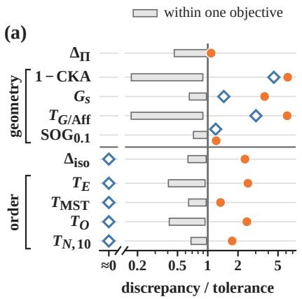

(b)  
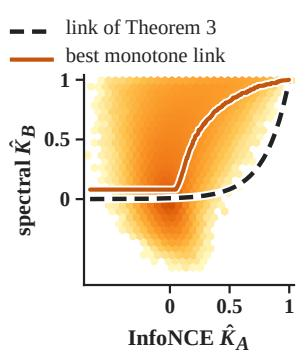

(c)  
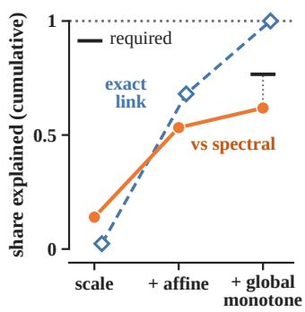  
Figure F.8: In CIFAR-5m networks, InfoNCE and spectral learners disagree on the order of distances as well as on geometry, and a monotone link explains little beyond an affine map. (a) Discrepancy over the tolerance of each criterion. Theorem 3 predicts agreement on the criteria below the horizontal line, and diamonds mark pairs of an InfoNCE run and the exact link of the theorem applied to its Gram matrix. (b) Density of kernel entries of one pair of runs. (c) Share of the squared-distance discrepancy explained by successive maps, with the share required by the preregistered prediction. All panels are at $N = 5 0 0 { , } 0 0 0$ , and marks in (a) and (c) are medians over pairs. Each pair across objectives joins a run of InfoNCE at temperature 0.2 with a spectral run.

Secondary Predictions. The fitted link $K _ { B } \approx \mathrm { e x p } ( \beta ( K _ { A } - 1 ) )$ has median exponent $\hat { \beta } \ =$ 2.04 across objectives, outside the predicted interval [2.5, 10]. The ratio of $\hat { \beta }$ between the two temperatures is 1.006, outside the predicted [1.5, 3.5], and we trace this failure to an error of our design (Appendix F.2). The co-occurrence prediction derived from Lemma E.1 stated that more data would shrink the log-distance error of near pairs faster than that of far pairs in both InfoNCE arms. In all three arms, more data shrinks the error of near pairs less than that of far pairs, so this prediction fails, while the predicted ordering between the two temperatures holds.

Exploratory Analyses. At 500,000 images, the participation ratio of the centered Gram matrix is 67.7 and 27.9 for InfoNCE at the two temperatures and 11.7 for the spectral arm. On four pairs of runs, an exponential link of the InfoNCE Gram matrix raises this ratio above 300 and spreads the variance over many directions, whereas the spectral embedding concentrates its variance on few directions. These runs leave two explanations open, a change of rank or spectrum as in the model-class row of Table E.1, and a common path of temperatures for the three arms. A heuristic second-order expansion makes the spectral loss of unit-norm embeddings resemble InfoNCE at temperature 1 without its penalty on the mean embedding. The three arms may therefore lie at 0.2, 0.5, and about 1 on one path.

## G Limitations and Open Problems

This appendix states the limitations of the results of Sections 3 to 5, one topic per paragraph, and then the open problems that these limitations leave.

## G.1 Limitations

The Crossing Law on Pretrained Models. The predictor of mKNN built from the crossing law of Theorem 1 with an estimated coupling is not validated. Every candidate estimator of the coupling failed the preliminary check against two baseline predictors, so the preregistered out-of-sample test was not run (Section 5.2). On the 29 pairs without sentence encoders, this predictor recovers the sign of every non-flat slope, as does an affine fit of the coupling with Gaussian noise. On the vision–language pairs among them, the predicted fall of mKNN with m is too slow, and the predictor errs more in the level of mKNN than a no-change prediction from m = 1,024 (Appendix F.3).

Levels of mKNN between Vision and Language Models. The mKNN scores of our vision– language pairs depend on the depth of the vision features, the text model, and the protocol. With last-layer instead of mid-depth vision features, mKNN at $k / m = 0 . 0 1$ rises by a median factor of 2.8 with language models and 4.3 with sentence encoders (exploratory, on COCO with ViT-B models). At the last layer, DINOv2-B and MPNet reach an mKNN of 0.43 with centered features and five averaged captions, slightly above the mKNN that Schnaus et al. (2026) report for these two models. At this depth, mKNN still falls with m and stays close to stable at a fixed k/m (Appendix F.3).

Linear Heads in Trained Networks. In CIFAR-5m networks with a linear head, outside the premises of Theorem 2, our results contradicted several preregistered predictions (Section 5.5). Without weight decay, the coordinates u agreed on neighbor sets in all 96 pairs at 250,000 images, whereas our extension of part 2 of this theorem to neighbor sets had predicted unreliable agreement at both sizes. From a small initialization, runs under momentum or gradient flow of the head agreed less reliably on the scale-normalized geometry of u than runs with weight decay under momentum.

The disagreement between runs also has sources outside Theorem 2, which concerns the mismatch between the gauges of two runs. Under gradient flow of the head, the coordinates of the balanced heads of two networks still differed more in geometry than their outputs y. Under momentum without weight decay, a gauge shared by all networks trained this way produced most of the excess of u over y in the $G _ { s }$ discrepancy at 250,000 images (preregistered, Appendix F.8.1).

Contrastive Objectives in Trained Networks. In CIFAR-5m networks outside the premises of Theorem 3, the representations trained with InfoNCE and with the spectral contrastive loss differed even in their neighbor sets, against the preregistered prediction (Section 5.6). InfoNCE networks at two temperatures lie outside the rescaling case of Remark 2. In these networks, more data did not shrink the log-distance error of near pairs of images faster than that of far pairs, against the prediction derived from Lemma E.1 (Appendix F.10).

Statistical Scope of the Size Trends. Each size trend in Section 5 rests on one draw of evaluation inputs. The loss of the CKA trend under calibration rests on BLOOMZ, LLaMA-1, and OpenLLaMA, with exact one-sided p-values of at least 1/120 along BLOOMZ and 1/6 along the other two families. On Pythia, the one family with a confirmatory test, the raw score outgrew the threshold and calibration kept the trend. This loss therefore still awaits a confirmatory test on a family that meets the condition of part 2 of Corollary 1.

Scope of the Lattice. A criterion of Definition 2 compares two representations on paired inputs, whereas alignment without pairs (Schnaus et al., 2026) also depends on whether the correspondence can be identified from each space alone, a property untested by the criteria of the lattice.

## G.2 Open Problems

Scales and Baselines. A prediction of mKNN on a larger evaluation set needs the dispersion of the coupling at shorter distances, i.e., the spread of the distances of model B at a given short distance of model A. The main open problem on the measurement side is therefore a law linking this dispersion across scales, together with the local Poisson limit needed to prove Conjecture D.1. Before an agreement is read as convergence, calibration also needs baselines that keep structure shared for reasons unrelated to convergence, such as a common dependence on caption length.

Gauge Selection by Practical Optimizers. On the learning side, the selection of the gauge under momentum and finite steps remains open, since both change the imbalance C conserved by gradient flow in Theorem 2 (Remark 1). A law for the change of C under such training and under adaptive optimizers such as Adam would predict the criteria met reliably by two runs of the linear autoencoder. In networks, this law would predict the imbalance part of the disagreement between two runs.

Objectives and the Two Branches. In the finite Gibbs model, learners trained with two contrastive objectives learn one relation through different increasing links as both samples grow (Theorem 3). A model in which a change of objective alters the learned relation itself is still lacking, and the results of our contrastive networks (Appendix G.1) motivate such a model. This model could also give a learning condition under which agreement becomes reliable on neighbor sets and not on spanning trees, or the reverse, for a test of part 2 of Hypothesis 1 on these two branches.

## H Extended Potential Applications

For each area of Section 6, this appendix describes the methods of the cited works, the implications of our results for these works, and our proposed tests. These tests are left to future work, and the statements marked as expectations or conjectures are not proved in this paper.

## H.1 Pretraining, Scaling, and Multimodal Encoders

Size Trends at One Scale. PRH and later studies of multimodal alignment relate model size and performance to mKNN between vision and language models, computed with $k = 1 0$ on 1,024 image–caption pairs and a maximum over layer pairs (Huh et al., 2024; Tjandrasuwita et al., 2025). A neighbor criterion compares two models at the scale $k / m$ (Theorem 1), and size trends reported at several values of $k / m$ would show whether larger models agree more on near neighbors or on coarse structure alone. For a calibrated maximum of CKA over layer pairs, as in ARH, the size trend also depends on whether the largest random-pairing baseline grows faster than the raw maximum (Corollary 1). Cherti et al. (2023) trained CLIP models of several architectures on 80 million to 2 billion image–text pairs. These models would allow a preregistered test of this corollary in which the training data grow at fixed depth and width, unlike the language-model families of Section 5.4, along which size, depth, and width grow together.

Width and Superposition. Besides the baseline of Proposition 4, the raw CKA in these size trends can depend on width. Under superposition, i.e., with more features than dimensions, CKA between two networks storing the same features depends on the overlaps between the feature directions of each network (Liu et al., 2026; Shi et al., 2026b). For uncorrelated features of equal variance and directions drawn independently at random, this CKA is approximately the ratio of the width to the number of features (Liu et al., 2026). Raw CKA can then rise with width while the stored features stay the same.

A Conjecture on the Losses of CLIP and SigLIP. Part 2 of Hypothesis 1 also bears on pretraining runs that differ in their objective, such as the softmax loss of CLIP (Radford et al., 2021) and the sigmoid loss of SigLIP (Zhai et al., 2023). SigLIP scores each pair by a logit with a learned scale and bias, and treats each pair as a separate binary classification (Zhai et al., 2023). In the finite Gibbs model of Appendix E.1, we apply this loss with the logit $t ^ { \prime } K ( x , x ^ { \prime } ) + b$ of a critic K to the positive pair and to the J negatives of each example. We state the resulting limit without proof as Conjecture H.1.

Conjecture H.1 (Sigmoid Loss in the Finite Gibbs Model). In the finite Gibbs model with balanced masses, let a learner minimize the empirical sigmoid risk with logit $t ^ { \prime } K ( x , x ^ { \prime } ) + b$ over unit-diagonal positive semidefinite critics K, scales $t ^ { \bar { \prime } } > 0 ;$ , and biases b, and let it be able to represent its population minimizers. As the sample grows, the distance of its critic on the probes to the set $\{ \bar { a } K _ { \star } + ( 1 - a ) \mathbf { 1 1 } ^ { \top } : a > 0 \}$ tends to zero in probability.

The conjecture rests on the fact that the logit minimizing a logistic loss is the logarithm of the ratio between the rates at which a pair occurs as a positive and as a negative. With $J$ negatives for each positive pair and balanced masses, this logarithm equals $K _ { \star } / t - \log ( J Z )$ , and the unit diagonal of K then gives $K = a K _ { \star } + ( 1 - a ) \mathbf { 1 1 } ^ { \top }$ with $a = 1 / ( t t ^ { \prime } )$ . By part 1 of Theorem 3 and Remark 2, such a limit differs from the InfoNCE limit $K _ { \star }$ by a rescaling of all squared distances, ignored by every criterion on scale-normalized geometry. If the conjecture holds, learners trained with the two losses meet every criterion on scale-normalized geometry in the limit, unlike the InfoNCE and spectral learners of Theorem 3. A comparison of image encoders trained on the same data with the losses of CLIP and SigLIP would test this prediction outside the model, where our InfoNCE and spectral networks differed even in their neighbor sets (Section 5.6).

Pretraining Runs from Different Seeds. PolyPythias (van der Wal et al., 2025) provides ten pretraining runs per model size with checkpoints along training, and we compare four pairs of these runs at 410M parameters by mKNN in Section 5.2. By the rule of Section 5.1, the five disjoint pairs of runs of one size at a checkpoint can show unreliable agreement under a criterion, whereas reliable agreement needs at least 29 agreeing disjoint pairs. Estimates of the probability $p _ { Q }$ that two runs meet a criterion $Q$ would thus show where in the lattice agreement across pretraining runs is unreliable during training.

Connectors of Multimodal Models. In LLaVA (Liu et al., 2023a), a trained linear layer maps the features of a frozen CLIP encoder into the word-embedding space of a language model. This connector can undo any invertible linear map V of the vision features, i.e., a change of gauge as in Section 4.1. Recent work selects encoders by CKA (Maniparambil et al., 2025) or by a Gromov– Wasserstein distance (Li et al., 2026) before the training of connectors, and both scores change under such maps. With an $\ell _ { 2 }$ penalty on the connector in its loss, the function learned by the connector depends on V through $\bar { V } ^ { \top } V$ alone, as the probe Gram matrix of Theorem 2 depends on its gauge through $\Omega = V ^ { \top } V .$ A score for choosing encoders then needs invariance to orthogonal maps under this penalty. Without regularization, every invertible map leaves the set of minimizing maps from the original features unchanged, but gradient training can select among several minimizers according to the map, as in Theorem 2. An experiment applying maps of growing condition number to the vision features before the training of the connector would test whether the trained multimodal model depends on these maps through $\bar { V } ^ { \top } V$ alone.

## H.2 Post-training, Fine-tuning, and Reinforcement Learning

Low-rank Adaptation. Low-rank adaptation (LoRA) adds the product BA of two trainable factors to a frozen weight matrix (Hu et al., 2022), and the factors VA and $B V ^ { - 1 }$ give the same update for every invertible $V ,$ a gauge as in Section 4.1. As in Theorem 2, gradient flow keeps the imbalance $A A ^ { \dagger } - B ^ { \dagger } B$ fixed (Du et al., 2018), whereas an $\ell _ { 2 }$ penalty on both factors gives $\mathbf { \bar { \theta } } A \mathbf { \theta } ^ { \top } = B ^ { \top } B$ at every critical point and restricts the gauge to orthogonal matrices. Hu et al. (2022) judge the rank needed by the update through a comparison of the top right singular directions of A between two random seeds. These directions coincide in order with the top right singular directions of BA when the imbalance is a multiple of the identity. LoRA starts from $B = 0$ and a random A with many more columns than rows, which places the initial imbalance near such a multiple. The AdamW optimizer of these runs can change this imbalance through its per-coordinate steps and its momentum (Remark 1), whereas its decoupled weight decay alone multiplies the imbalance by a constant factor. The singular directions of BA are the same in every gauge, and a comparison of seeds through these directions would separate a difference between updates from a difference between gauges.

Model Merging. LoraHub composes adapters trained on different tasks by multiplying weighted sums of their factors (Huang et al., 2024), and the composed update changes with the gauge of each adapter. We propose to test whether this composition improves for adapters trained with an $\ell _ { 2 }$ penalty added to the loss and aligned by an orthogonal Procrustes rotation of their factors. For two adapters that learn one update, factors balanced and aligned in this way compose into this update, whereas for adapters of different tasks we state this improvement as a hypothesis.

Reinforcement Learning and Supervised Fine-tuning. Studies of post-training find that reinforcement learning (RL) changes the representation of the base model less than supervised fine-tuning (SFT) (Shenfeld et al., 2026; Huan et al., 2026). In an appendix analysis, Shenfeld et al. (2026) measure this change by CKNNA (Huh et al., 2024), a CKA restricted to pairs of samples that are k nearest neighbors in both representations. Huan et al. (2026) measure a shift of mean hidden states along two principal components. A nonlinear change of all distances of one model that keeps their order leaves the pairs selected by CKNNA unchanged and can still change the value of CKNNA, as for CKA (Section 3.3). To locate the difference between RL and SFT in the lattice, we propose to compare each fine-tuned model with its base model by a rank correlation of all distances and by the residual around an isotonic link. A gap between RL and SFT that persists in the rank correlation would indicate that SFT reorders the distances of the base model. A gap that vanishes in the residual around the isotonic link would instead indicate an order-preserving change of geometry.

Reward Models. Recent work on reward models argues that a reward model learned up to an increasing transformation of the true reward suffices for sampling-based optimization (Sun et al., 2025). As an alternative to the Bradley–Terry model, this work trains a classifier that scores each response by the logit of its probability of winning a comparison. Under the Bradley–Terry model, this logit is an increasing and generally nonlinear function of the reward within each prompt. In the population limit, the scores of the classifier and of a Bradley–Terry reward model differ by an increasing link within each prompt, like the limits of the two learners of Theorem 3. Best-of-N sampling selects responses by the order of their scores within a prompt, so the two reward models select the same best-of-N responses. The KL-regularized optimal policy (Rafailov et al., 2023) and the group-normalized advantages of group relative policy optimization (GRPO) (Shao et al., 2024) can instead change with the link. The GRPO advantages stay unchanged when the rewards in a group take two values, since every increasing link is affine on two values.

We propose to train policies with GRPO from both reward models, and again after the scores of the classifier pass through an isotonic map fitted within each prompt to the Bradley–Terry rewards. The part of the gap between the policies trained from the two reward models closed by this isotonic map would measure the effect of the link.

Agreement across Runs of Reinforcement Learning. In RL, each run collects its own training data through its policy, whereas the data distribution is a fixed part of the learning condition in our theoretical models. In the three-feature task of Shi et al. (2026a), a policy is the probability of choosing branch E rather than branch S, and a code assigns each of three features a unit direction in two dimensions. All codes that best fit the data of one policy share the squared overlaps between these directions, and the codes for the two deterministic policies differ in which features share a direction. We assume exact adaptation, i.e., a code that best fits the data of the current policy at every step. Under the policy dynamics of that work, each run then converges to the deterministic policy on the same side of an unstable policy as its initial policy. In the limit, two independent runs therefore meet the exact criterion Q on these squared overlaps with probability $p _ { Q } = q ^ { 2 } + ( 1 - q ) ^ { 2 }$ , where q is the probability that the initial policy of a run lies below the unstable policy. This probability is at most 0.8, the threshold of unreliable agreement in Section 5.1, whenever q lies in [0.113, 0.887].

In the PPO experiments of Shi et al. (2026a), agents with a rank-two bottleneck initialized toward different actions also develop different interference between features. Agreement between the representations of RL agents trained from different seeds can therefore depend on the policies reached by these runs. With exact adaptation in the three-feature task, replay can meet the sufficient condition of Shi et al. (2026a) when the base reward of branch E exceeds that of branch S by more than 7/16. Such replay brings every run with a positive initial probability of the better branch E to this branch, and in the limit the codes of any two such runs share their squared overlaps. Replay is a candidate intervention for making agreement across RL runs reliable, in addition to raising returns.

## H.3 Agents and Harness Engineering

Redundancy and Diversity of Agents. Studies of multi-agent systems measure the redundancy (Kim et al., 2025) or diversity (Subramaniam et al., 2025) of agents by the cosine similarity between embeddings of their outputs. In the scaling model of agent systems of Kim et al. (2025), redundancy is one predictor, with a main effect that is not significant and an interaction with the number of agents that the authors call marginal. The mean cosine between the output embeddings of two agents on the same tasks has the inner product of their mean normalized embeddings as its random-pairing baseline, which is large when all outputs share a format. As in Corollary 1, after subtraction of these baselines, an agent system with the higher raw score ranks below another system whenever its baseline exceeds the other baseline by more than the gap between the raw scores. With tasks as evaluation samples, mKNN instead compares the neighbor sets of each task under the output embeddings of two agents, with the baseline $k / { \bar { ( m - 1 ) } }$ for every pair of agents and every embedding model (Proposition 4). We propose to refit the scaling model of Kim et al. (2025) with redundancy measured after subtraction of the random-pairing baseline of the mean cosine, or by mKNN.

Communication through Internal States. Agents can also share internal states, such as key-value caches within one backbone (Zou et al., 2026), activations passed between two models (Ramesh and Li, 2025), or caches fused across two models by a trained network (Fu et al., 2026). Over six pairs of models, the gain of activation communication on one task correlates positively with an uncentered matrix analogue of the squared cosine between the activations of the two models (Ramesh and Li, 2025). The random-pairing baseline of this score grows with the share of the average squared norm of the activations carried by their mean. A calibrated version of this score and mKNN on the same probe sentences would test whether the correlation comes from relations among these sentences shared by the two models or from their mean activations. For a channel through a linear map fitted by least squares, an invertible linear change of the sender’s activations leaves the fitted outputs and the projector of Theorem 2 unchanged and can still lower CKA. Canonical correlations compare the column spaces of the activations of the two models, and on more probe sentences than dimensions we therefore expect them to predict the gain of such a channel better than CKA.

Harnesses and Agent Evaluation. The harness of an agent comprises the tools and control code around its model, and Yang et al. (2024) compare variants of the agent–computer interface of SWEagent by the fraction of resolved instances. The resolved fractions of six runs of one variant lie within 1.4 percentage points of each other, whereas the runs resolve partly different sets of instances (Yang et al., 2024). By inclusion and exclusion, the reported pass@1 and pass@2 of these runs imply that about half of the instances resolved by either of two runs are resolved by both. The $\mathrm { p a s s } ^ { k }$ of τ-bench measures reliability over such variation as the chance that k independent trials on a task all succeed (Yao et al., 2025b). With the sampling randomness of an agent in place of training randomness, the probability $p _ { Q }$ of Section 2.2 extends to the chance that two runs of an agent meet a criterion Q on their outputs. A change of harness then matters under Q when runs of two variants meet Q less often than two runs of one variant, with Q ranging from equal resolved fractions to equal sets of resolved instances.

## H.4 Generative Models

Alignment with a Pretrained Encoder. Representation alignment (REPA) speeds up the training of diffusion transformers by aligning a projection of their hidden states at an early layer with DINOv2 features of the clean image, patch by patch (Yu et al., 2025). Yu et al. (2025) measure the alignment between SiT diffusion transformers and DINOv2 by CKNNA at $k = 1 0$ on 10,000 images, and find that this CKNNA rises with model size and training in diffusion transformers trained without REPA. REPA-E tunes the autoencoder together with the diffusion transformer and uses CKNNA as a proxy for generation quality (Leng et al., 2025). The pairs selected by CKNNA change with the scale $k / m$ of Section 3.1. Since mKNN at a fixed k stays flat or falls with m according to the model pair (Section 5.2), it remains open whether trends and rankings of CKNNA at one scale hold at other scales.

Losses on Patch Similarities. Across 27 target encoders, the generation quality reached with REPA correlates far more with the spatial structure of the cosine similarities among the patch features of an encoder than with its linear-probe accuracy (Singh et al., 2026). Losses matching the similarities among the patch features of a model to those of the encoder improve generation when applied to a tokenizer (Yao et al., 2025a) or to a diffusion transformer (Chen et al., 2025b). The values of these losses change under strictly increasing maps of the target similarities, which leave neighbor overlap unchanged (Proposition 1) and can change CKA through the monotone link between the two sets of similarities (Proposition 3). An experiment that passes the target similarities through such maps, or replaces these losses with a loss on the order of the similarities, would test whether generation benefits from agreement beyond this order.

The Gauge of a Latent Autoencoder. In latent diffusion (Rombach et al., 2022), the first convolution of the decoder can absorb the inverse of an invertible linear map of the latent channels, which then leaves the reconstruction unchanged. Since the diffusion process adds isotropic noise to the mapped latent, this map changes the ratio of signal to noise along each latent direction. As in the linear autoencoder of Theorem 2, the training procedure of the autoencoder can then select this map among those allowed by the data. Like the weight decay of part 3 of this theorem, the KL penalty of this autoencoder changes under maps that are not orthogonal. We propose to test whether the weight of this penalty, the initialization, the optimizer, or weight decay changes generation quality at equal reconstruction.

Reproducibility across Training Runs. Independently trained diffusion models can generate nearly the same image from the same noise (Kadkhodaie et al., 2024; Zhang et al., 2024). A one-step neural operator trained on the noise paths of a pretrained diffusion sampler also reconstructs the images of this sampler with high fidelity (Shi et al., 2026c). These comparisons concern generated images, and it remains open which criteria on internal representations are met reliably by two independent training runs of such models.

## H.5 Mechanistic Interpretability

Recurring Latents and Subspaces. Studies in mechanistic interpretability ask whether neurons and the latents of sparse autoencoders (SAEs) recur across training runs and models (Gurnee et al., 2024; Paulo and Belrose, 2026). For an unstable latent, i.e., a latent without a counterpart in other runs, a description inferred in one run need not transfer to another run (Shi et al., 2026b). SAEs trained from different seeds share part of their latents under one-to-one matching of directions (Paulo and Belrose, 2026), and the latents rarely matched across seeds concentrate in lower-rank subspaces that recur across runs (Gerasimov et al., 2026). Gerasimov et al. (2026) suggest that this seed dependence reflects ambiguity among bases, and the survey of Shi et al. (2026b) concludes that latent reproducibility depends on the objective, the initialization, and the level of comparison.

In a linear autoencoder, all global minimizers on one sample share one projector while the training procedure selects the invertible map undone by the linear head (Theorem 2). The exact symmetries of an SAE are permutations and positive scalings of its latents, and an approximate gauge can remain within a group of co-active latents, such as a recurring subspace. For SAEs, we expect the initialization and the regularization to decide whether runs from different seeds agree reliably on single directions within these subspaces, and to matter less for their agreement on projectors onto the subspaces. SAEs are trained with adaptive optimizers, and by analogy with Remark 1, runs with and without weight decay would give a direct test of this expectation.

Universal Neurons. The study of universal neurons in GPT2 (Gurnee et al., 2024) scores a neuron by its maximum correlation with the neurons of another seed minus its maximum correlation with randomly rotated neurons of that seed, averaged over four other seeds. By this score, GPT2-medium has a smaller share of universal neurons than GPT2-small. As in Corollary 1, this smaller share can come from the subtracted maximum if the maximum over rotated neurons grows with model size faster than the maximum over the neurons of the other seed. A share computed with a baseline fixed across sizes would separate the effect of the subtracted maximum from a difference in universality.

Top-activating Tokens. Descriptions of latents are often inferred from their top-k activating tokens (Shi et al., 2026b). With the negative activation of a latent as the distance, these tokens form a neighbor set at the scale $k / m$ in a corpus of m tokens. As in Theorem 1, the overlap between the top-k tokens of two matched latents is unchanged by strictly increasing maps of either activation, and at a fixed k this overlap can fall with the corpus size.

CKA and Neighbor Sets under Superposition. Under superposition, CKA between two networks storing the same sparse features can stay low even where these features remain recoverable (Liu et al., 2026), and it remains open whether such a pair meets neighbor criteria. Suitably scaled random projections with enough dimensions for this recovery multiply every squared distance between sparse feature vectors by a factor in $[ 1 - \gamma , 1 + \gamma ]$ with high probability (Baraniuk et al., 2008). By the argument of Corollary 2, the representations given by two such projections share the k-neighbor set of every input i whose ratio $D _ { A , i , ( k + 1 ) } / D _ { A , i , ( k ) }$ exceeds $( ( 1 + \dot { \gamma } ) / \mathsf { \bar { ( } } 1 - \gamma ) ) ^ { 2 }$ . Since this ratio can be large at the boundary of a group of inputs sharing most of their features, we expect mKNN at the scale of such groups to stay high where CKA is low.

## H.6 Proteins, Molecules, and Materials

Conflicting Studies of Interatomic Potentials. Studies of scientific foundation models compare the representations of molecules, materials, and proteins across models and take the agreement found as evidence that these models share a representation of matter (Edamadaka et al., 2025; Li and Walsh, 2026). For interatomic potentials, Edamadaka et al. (2025) find that the representations of conservative Orb-v3 models align strongly with those of MACE, whereas Li and Walsh (2026) find near-zero neighbor overlap between Orb-v3 models and equivariant models including MACE. The first study computes CKNNA with $k = 2 5$ on features averaged over the atoms of each structure. The second compares the neighbor sets of single atoms in MP-20 crystals and leaves unstated whether these sets are computed on the original embeddings or on their projection onto 100 shared anchor atoms. Under part 1 of Hypothesis 1, such a conflict can come from criteria applied at different points of the lattice, and it can also come from the data, the level of the features, or the anchor projection. A comparison of both criteria on shared samples and features, in the original and in the projected spaces, would separate these causes.

Convergence with Performance. The representations of interatomic potentials also grow more similar to those of the best-performing model with decreasing energy error, by CKNNA on 1,000 OMat24 structures and by distance correlation on 1,000 QM9 molecules (Edamadaka et al., 2025). These scores are computed without calibration against random pairings, although calibration can reverse a trend when the random-pairing baseline grows faster than the raw score along the compared models (Corollary 1). For CKA and mKNN, this baseline can be forecast from single-model features (Proposition 4), whereas the baselines of distance correlation and CKNNA need permutations. Recomputed with CKA and mKNN, these trends and the forecast baselines would show whether the convergence survives calibration.

Homology among Proteins. For proteins, Edamadaka et al. (2025) use k = 25 on 50,000 structures drawn at random from the Protein Data Bank, which sets a fine scale k/m at which the neighbors of a protein can be its close homologs. A comparison of each model with a reference representation built from sequence identity would show how much of the agreement between sequence and structure models comes from homology.

Linear Heads in Molecule–text and Protein Models. Molecule–text models such as MoleculeSTM (Liu et al., 2023b) and structure-aligned protein language models (Chen et al., 2025a) pass encoder features through linear heads into a shared space. An invertible map of these features undone by the heads then leaves the training loss unchanged, a gauge as in Section 4.1. In our CIFAR-5m networks trained without weight decay, the coordinates of two runs before the last linear map differed more in mean-normalized squared distances than the outputs of the networks, and weight decay removed this excess (Section 5.5). In the released code of MoleculeSTM, the default weight decay is zero, and runs from several seeds with and without weight decay would test whether its encoder features carry the same excess.

## H.7 Dynamical Systems and Operator Learning

The Gauge of DeepONet. DeepONet predicts through the inner product of two learned factors, its branch and trunk outputs (Lu et al., 2021), and an invertible map applied to the branch outputs and undone on the trunk outputs leaves every prediction unchanged. We conjecture that joint training selects this map as in Theorem 2. The branch outputs of two runs would then share their column space, while CKA between these outputs could stay below one for large samples. Two-step training (Lee and

Shin, 2024) and POD-DeepONet (Lu et al., 2022) instead make the trunk outputs orthonormal over the output locations. The chaos-expansion operators SDENO and F-SPDENO of Shi et al. (2026c) combine learned propagators with fixed orthonormal Wick features of the driving noise. In two runs whose orthonormal factors span the same space, least-squares fits of the other factor differ by an orthogonal map, so CKA between these fits equals one. Tied weights restrict the gauge in the same way in part 3 of Theorem 2. Fixed Wick features remove the gauge in these operators, and their learned propagators can be compared across runs coordinate by coordinate. The gauge remains in variants that multiply two learned factors, such as G-SDENO.

Resolution Transfer. Across grid resolutions, Bartolucci et al. (2023) find aliasing errors in Fourier neural operators and note that discretization invariance (Kovachki et al., 2023) concerns the limit of infinite resolution. With the two discretizations of each test function as one evaluation sample, a neighbor criterion compares an operator at two finite resolutions. By Theorem 1, its outcome depends on the test functions moved across each neighbor boundary by the change of resolution. Such criteria give a test of resolution transfer at the resolutions used in practice and at a chosen scale k/m.

Criteria on Dynamics. Recurrent networks trained on the same task can share the topology of their fixed points and their linearized dynamics while their states differ in geometry under SVCCA, CKA, and Procrustes analysis (Maheswaranathan et al., 2019; Ostrow et al., 2023). A criterion on dynamics can thus accept a pair of networks rejected by a criterion on geometry, which suggests extending the lattice of Section 2 from Gram matrices on fixed inputs to criteria on dynamics. For chaotic systems, Jiang et al. (2023) add an optimal-transport loss or a contrastive feature loss to a relative root-mean-squared error of neural operators and report smaller errors in long-run statistics. Under an extension of part 2 of Hypothesis 1 to criteria on long-run statistics, we expect the objective to decide whether two independently trained operators share these statistics with probability at least 1 − δ over training runs.

Criteria Indexed by the Chaos Order. For dynamics driven by Brownian noise, the output of a surrogate has an expansion in the orthonormal Wick features used by Shi et al. (2026c), so the mean squared difference between two surrogates splits into one term per chaos order. This split gives a set of criteria indexed by the chaos order, from the Gaussian response to the noise at order one to nonlinear interactions of the noise at higher orders.