# From Spectral to Frobenius: When Muon Loses Its Spectral Implicit Bias

Yongtao Wu Renmin University of China

Mahdi Mansouri The University of Hong Kong

Zhenyu Zhu The University of Hong Kong

YONGTAOWU@RUC.EDU.CN

UNI.MAHDI.MANSOURI@GMAIL.COM

ZZHENYU@HKU.HK

## Abstract

Prior work on implicit bias shows that gradient descent selects the Frobenius max-margin direction on linearly separable problems, whereas Fan et al. (2025) established spectral max-margin behavior for spectral-norm steepest descent methods, including idealized Muon with exact orthogonalization. In practice, however, Muon approximates orthogonalization using finite Newton–Schulz iterations and a positive stabilization constant. We prove that these implementation choices cause Muon to select the Frobenius rather than the spectral max-margin direction in linear classification with separable data. We also establish this behavior for both exponential moving average and Nesterovstyle momentum. The key technical ingredient is a summable perturbation argument showing that the resulting parameter trajectories remain at bounded distance from those of gradient descent. We then disentangle the roles of Newton–Schulz iteration count, the stabilization constant, and the Newton–Schulz polynomial, revealing distinct asymptotic behaviors, including directions that achieve neither Frobenius nor spectral max-margin. Finally, we show that Muon can recover its spectral max-margin bias with Newton–Schulz iterations growing logarithmically over training.

Keywords: implicit bias, Muon, Newton–Schulz iterations, max-margin, stabilization

## 1. Introduction

Optimization algorithms can favor different solutions even when minimizing the same training objective, a phenomenon known as implicit bias (Neyshabur et al., 2014; Gunasekar et al., 2017). A classical example arises in linear classification with separable data, where logistic and exponential losses can approach zero only as the parameter norm diverges. In this setting, the limiting direction of the parameters becomes the object of interest. Gradient descent converges in direction to the Euclidean max-margin classifier (Soudry et al., 2018; Nacson et al., 2019a; Ji et al., 2020; Ji and Telgarsky, 2021), whereas steepest descent under different norms can select different max-margin solutions (Gunasekar et al., 2018; Wang et al., 2023).

Muon, an optimizer that has attracted considerable attention for large language model training (Jordan et al., 2024; Liu et al., 2025), orthogonalizes matrix-valued updates rather than following conventional gradient directions. Ignoring momentum for simplicity, its idealized update maps a gradient matrix $G = U \Sigma V ^ { \top }$ to its polar factor $U V ^ { \top }$ . This update corresponds to steepest descent under the spectral norm, in contrast to the Frobenius-norm geometry of standard gradient descent. Recent work has studied the implicit bias of Muon with exact orthogonalization, establishing spectral max-margin behavior in linear multiclass classification (Fan et al., 2025; Li et al., 2026) and margin stationarity in homogeneous neural networks (Gronich and Vardi, 2026).

However, these analyses rely on exact orthogonalization, which can be computationally expensive for large matrices. Practical Muon instead approximates the polar factor using a fixed number of Newton–Schulz iterations. Specifically, the original Muon optimizer proposed by Jordan et al. (2024), when considered without momentum, normalizes the gradient as $G / ( \| G \| _ { \mathrm { F } } + \varepsilon )$ , with a fixed stabilization constant $\varepsilon > 0$ , and then applies five Newton-Schulz iterations using a quintic polynomial. Whether these practical modifications preserve the spectral max-margin bias of idealized Muon remains unclear. This raises the central question of this work:

## Does practical Muon retain the spectral max-margin bias of its idealized counterpart?

We show that the answer is negative: practical Muon with a fixed number of Newton-Schulz iterations and positive stabilization selects the Frobenius rather than the spectral max-margin direction on linear classification problems. The key technical idea is to express the practical Muon update as a gradient descent step plus a summable perturbation, thereby establishing that their parameter trajectories remain at bounded distance. We further investigate how the Newton–Schulz iteration count, stabilization constant, and polynomial choice affect the implicit bias and establish conditions under which spectral max-margin behavior can be recovered. Our contributions are as follows.

• We establish that Muon with a fixed number of Newton-Schulz iterations and positive stabilization leads to Frobenius max-margin selection on linear classification problems. Our results cover a general class of Newton–Schulz polynomials, including the quintic polynomial used in practical Muon, and extend to both exponential moving average and Nesterov-style momentum (Section 3).

• We examine how the Newton–Schulz iteration count, stabilization constant, and polynomial choice affect implicit bias. We show that removing stabilization alone does not necessarily restore spectral max-margin behavior: a fixed number of Newton-Schulz iterations can select directions that achieve neither Frobenius nor spectral max-margin. We further characterize the limiting behavior as the Newton–Schulz iteration count tends to infinity, revealing distinct asymptotic behaviors for the cubic and quintic polynomials (Section 4.1).

• We show that spectral max-margin behavior can be recovered with logarithmically growing Newton-Schulz iteration counts during training. For the cubic polynomial, this holds with a fixed positive stabilization constant, while for the quintic polynomial, we establish a recovery guarantee using gradient-dependent stabilization (Section 4.2).

## 2. Preliminary

We introduce the matrix notation and separable classification problem, then specify the exact and practical Muon updates used throughout the paper.

## 2.1. Notation

For matrices of the same shape, let $\langle A , B \rangle = \operatorname { t r } ( A ^ { \top } B )$ , where tr denotes the matrix trace. We use $\| \cdot \| _ { \mathrm { F } } , \| \cdot \| _ { \mathrm { o p } }$ , and ∥·∥∗ to denote the Frobenius, spectral (i.e., Euclidean-induced operator), and nuclear norms, respectively. A compact singular-value decomposition (SVD) $G = U \Sigma V ^ { \top }$ contains the positive singular values, and polar $\cdot ( G ) = U V ^ { \top }$ , with $\mathrm { p o l a r } ( 0 ) = 0$ . For an odd polynomial $p ,$ write $p ^ { \circ K }$ for its K-fold composition, with $p ^ { \circ 0 } ( s ) = s$ . For a compact SVD, $G = U \Sigma V ^ { \top }$ , define $\mathcal { P } _ { K } ( G ) = U p ^ { \circ K } ( \Sigma ) V ^ { \intercal }$ , where $p ^ { \circ K }$ is applied entrywise to the diagonal entries of Σ. A detailed summary of the core notation can be found in Table 3.

## 2.2. Problem setting and implicit bias

Consider a binary classification dataset $\{ ( X _ { i } , y _ { i } ) \} _ { i = 1 } ^ { n }$ with $n \in  { \mathbb { N } } _ { > 0 } .$ , where $X _ { i } \in \mathbb { R } ^ { d _ { 1 } \times d _ { 2 } }$ and $y _ { i } \in$ $\{ - 1 , + 1 \}$ denote the features and labels, respectively. We consider linear predictors parameterized by $W \in \mathbb { R } ^ { d _ { 1 } \times d _ { 2 } }$ , with prediction scores $\langle X _ { i } , W \rangle$ . Defining the signed features $A _ { i } = y _ { i } X _ { i }$ , the classification margins are $\langle A _ { i } , W \rangle$ . The empirical loss is

$$
\mathcal { L } ( W ) = \frac { 1 } { n } \sum _ { i } \ell ( \langle A _ { i } , W \rangle ) ,\tag{1}
$$

with either logistic loss $\ell ( z ) = \log ( 1 + e ^ { - z } )$ or exponential loss $\ell ( z ) = e ^ { - z }$ . These are the standard exponential-tail losses used in implicit-bias analysis (Soudry et al., 2018; Gunasekar et al., 2018). We assume that the data are linearly separable, as formalized below.

Assumption 1 (Separable data) There exist $U \in \mathbb { R } ^ { d _ { 1 } \times d _ { 2 } }$ with $\| U \| _ { \mathrm { F } } = 1$ and $\gamma > 0$ such that $\langle A _ { i } , U \rangle \geq \gamma f o r$ every i.

Remark 1 This is the standard linear separability assumption used by Soudry et al. (2018); Gunasekar et al. (2018) and, in its multiclass form, by Fan et al. (2025).

Under Assumption 1, the Frobenius hard-margin separator is uniquely defined by

$$
\widehat { W } _ { \mathrm { F } } = \underset { W } { \arg \operatorname* { m i n } } \| W \| _ { \mathrm { F } } \quad \mathrm { s u b j e c t ~ t o } \langle A _ { i } , W \rangle \geq 1 \quad ( i \in [ n ] ) .\tag{2}
$$

Implicit bias describes the limiting direction selected by an optimization algorithm as training progresses. For gradient descent with a sufficiently small constant stepsize, the iterates satisfy $\begin{array} { r } { \operatorname* { l i m } _ { t  \infty } \frac { W _ { t } } { \| W _ { t } \| _ { \mathrm { F } } } = \frac { \widehat { W } _ { \mathrm { F } } } { \| \widehat { W } _ { \mathrm { F } } \| _ { \mathrm { F } } } } \end{array}$ , where $W _ { t }$ denotes the parameter iterate at iteration t (Soudry et al., 2018). In contrast, Fan et al. (2025) establish spectral max-margin behavior for spectral-norm steepest descent, including Muon with exact orthogonalization. Analogous to Equation (2), a spectral hard-margin separator satisfies

$$
\widehat { W } _ { \mathrm { o p } } \in \mathop { \mathrm { a r g } \operatorname* { m i n } } _ { W } \lVert W \rVert _ { \mathrm { o p } } \quad \mathrm { s u b j e c t ~ t o } \langle A _ { i } , W \rangle \geq 1 \quad ( i \in [ n ] ) .\tag{3}
$$

The Frobenius max-margin $\gamma _ { \mathrm { F } }$ and spectral max-margin $\gamma _ { \mathrm { o p } }$ are defined by

$$
\gamma _ { \nu } = \operatorname* { m a x } _ { \| W \| _ { \nu } \leq 1 } \operatorname* { m i n } _ { i \in [ n ] } \langle A _ { i } , W \rangle = \frac { 1 } { \| \widehat { W } _ { \nu } \| _ { \nu } } , \qquad \nu \in \{ \mathrm { F } , \mathrm { o p } \} .\tag{4}
$$

Under Assumption 1, the max-margin and hard-margin formulations yield the same optimal directions.   
Specifically, normalizing any hard-margin solution $\widehat { W } _ { \nu }$ by its ν-norm gives a max-margin solution.

Algorithm 1: Idealized Muon Algorithm 2: Muon with Newton–Schulz   
Initialize parameter $W _ { 0 }$ and buffer $M _ { - 1 } = 0$ Initialize parameter $W _ { 0 }$ and buffer $M _ { - 1 } = 0$   
for $t = 0 , 1 , \ldots \mathbf { d o }$ Choose NS polynomial $p ,$ iteration count K   
// Compute the gradient Choose coefficients $0 \leq \beta < 1$ and $0 \leq \kappa \leq 1$   
$G _ { t } \gets \nabla \mathcal { L } ( W _ { t } )$ for $t = 0 , 1 , \ldots \mathbf { d o }$   
// Update the momentum buffer // Compute the gradient   
$M _ { t } \gets \beta M _ { t - 1 } + ( 1 - \beta ) G _ { t }$ $G _ { t } \gets \nabla \mathcal { L } ( W _ { t } )$   
// Compute a compact SVD // Update the momentum buffer   
$U _ { t } \Sigma _ { t } V _ { t } ^ { \top }  \operatorname { S V D } ( M _ { t } )$ $M _ { t } \gets \beta M _ { t - 1 } + ( 1 - \beta ) G _ { t }$   
// Set positive singular values to one $N _ { t } \gets \kappa M _ { t } + ( 1 - \kappa ) G _ { t }$   
$D _ { t } \gets U _ { t } V _ { t } ^ { \top } \left( \mathrm { i . e . , } D _ { t } \gets \mathrm { p o l a r } ( M _ { t } ) \right)$ // Normalize with stabilization   
// Take an update step $\widehat { N } _ { t } \gets N _ { t } / ( \| N _ { t } \| _ { \mathrm { F } } + \varepsilon )$   
$W _ { t + 1 }  W _ { t } - \eta _ { t } D _ { t }$ // Apply K iterations and update   
end $W _ { t + 1 } \gets W _ { t } - \eta _ { t } \mathcal { P } _ { K } ( \widehat { N } _ { t } )$   
end  
Table 1: Idealized and practical Muon for matrix parameters. The idealized update uses an SVD polar factor. The practical update normalizes Nesterov-style momentum and applies K Newton–Schulz iterations.

## 2.3. Idealized and Practical Muon

Spectral-norm steepest descent uses the polar factor to maximize alignment with the gradient over the spectral-norm unit ball,

$$
\operatorname { p o l a r } ( G ) \in \arg \operatorname* { m a x } _ { \mathbf { \Gamma } } \langle G , D \rangle .\tag{5}
$$

Idealized Muon applies this operation to an exponential moving average of gradients, as specified in Algorithm 1.

Practical Muon1 replaces the SVD by finite matrix-polynomial iterations. The implementation of Jordan et al. (2024) uses an EMA buffer and a Nesterov-style momentum input.

$$
M _ { t } = \beta M _ { t - 1 } + ( 1 - \beta ) G _ { t } , \qquad N _ { t } = ( 1 - \kappa ) G _ { t } + \kappa M _ { t } , \qquad M _ { - 1 } = 0 ,\tag{6}
$$

where $G _ { t } = \nabla \mathcal { L } ( W _ { t } ) , 0 \leq \beta < 1$ , and $0 \leq \kappa \leq 1$ . The input $N _ { t }$ is normalized by $\| N _ { t } \| _ { \mathrm { F } } + \varepsilon$ before applying K polynomial iterations, as detailed in Algorithm 2. The default practical Muon settings are $K = 5 , \beta = \kappa = 0 . 9 5$ , and $\varepsilon = 1 0 ^ { - 7 }$

Regarding the polynomial part, Jordan et al. (2024) uses the quintic Newton–Schulz polynomial

$$
p _ { \mathrm { q u i n } } ( s ) = 3 . 4 4 4 5 s - 4 . 7 7 5 0 s ^ { 3 } + 2 . 0 3 1 5 s ^ { 5 } ,\tag{7}
$$

with a fixed number of iterations. We also consider the cubic Newton–Schulz polynomial

$$
p _ { \mathrm { c u b } } ( s ) = \frac { 3 } { 2 } s - \frac { 1 } { 2 } s ^ { 3 } .\tag{8}
$$

Unlike the quintic polynomial, the cubic satisfies $p _ { \mathrm { c u b } } ^ { \circ K } ( s )  1$ as $K  \infty$ for every $s \in ( 0 , 1 ]$ Consequently, its matrix iteration converges to the exact polar factor, recovering the orthogonalization used in idealized Muon (Algorithm 1). More generally, our analysis allows any odd polynomial $p$ satisfying the following assumption.

Assumption 2 (Positive polynomial map) The polynomial $p$ is odd, and for the chosen finite $K$ $( p ^ { \circ K } ) ^ { \prime } ( 0 ) > 0 a n d p ^ { \circ K } ( s ) > 0 f o r a l l 0 < s \leq 1$

Both the cubic and quintic satisfy Assumption 2 for every finite K. Unless stated otherwise, we consider a fixed finite number K of Newton–Schulz iterations.

## 3. Frobenius Max-Margin Bias of Practical Muon

In this section, we first study the implicit bias of practical Muon with a fixed positive stabilizer and a fixed finite number of Newton–Schulz iterations. Under suitable stepsize conditions, we show that its iterates converge in direction to the Frobenius max-margin classifier, matching the implicit bias of gradient descent. We establish this result for the momentum-free algorithm under logistic and exponential losses, and then extend the logistic-loss result to EMA and Nesterov-style momentum.

## 3.1. Frobenius Max-Margin of practical Muon

In this subsection, we first consider the momentum-free variant of Algorithm 2, obtained by setting $\beta = 0$ . The following theorem establishes Frobenius maximum-margin selection under explicit stepsize conditions, with proof deferred to Section B.

Theorem 1 (Frobenius max-margin bias) Suppose Assumption 1 holds. Fix a polynomial p and a finite iteration count K satisfying Assumption 2, and a stabilizer $\varepsilon > 0$

Define $u _ { K } = \operatorname* { s u p } _ { 0 < s \leq 1 } \frac { p ^ { \circ K } ( s ) } { s }$ and $R = \mathrm { m a x } _ { i \in [ n ] } \| A _ { i } \| _ { \mathrm { F } }$ . Let $\gamma > 0$ be as in Assumption 1. Startingfrom an arbitrary initialization $W _ { 0 } \in \mathbb { R } ^ { d _ { 1 } \times d _ { 2 } }$ , run Algorithm 2 with $\beta = 0$ and a constant stepsize $\eta > 0$ satisfying the corresponding condition: (i) logistic loss with $\eta \le 4 \varepsilon / ( R ^ { 2 } u _ { K } )$ ; (ii) exponential loss with $\jmath R ^ { 2 } u _ { K } e ^ { \eta R u _ { K } } \leq \gamma$ . Then:

$$
\operatorname* { l i m } _ { t \to \infty } \mathcal { L } ( W _ { t } ) = 0 , \qquad \operatorname* { l i m } _ { t \to \infty } \frac { W _ { t } } { \| W _ { t } \| _ { \mathrm { F } } } = \frac { \widehat { W } _ { \mathrm { F } } } { \| \widehat { W } _ { \mathrm { F } } \| _ { \mathrm { F } } } .\tag{9}
$$

The theorem shows that the loss converges to zero and the iterates converge in direction to the Frobenius max-margin separator. This result can also be extended to EMA and Nesterov-style momentum with logistic loss, and we provide the result below with proof deferred to Section B.6.

Corollary 1 (Frobenius max-margin bias with momentum) Suppose Assumption 1 holds. Fix an odd polynomial p and a finite iteration count K satisfying Assumption 2, a stabilizer $\varepsilon > 0$ and coefficients $0 \leq \beta < 1$ and $0 \leq \kappa \leq 1$ . Let R be as in Theorem 1. Under logistic loss, run Algorithm 2 from an arbitrary initialization $W _ { 0 } \in \mathbb { R } ^ { d _ { 1 } \times d _ { 2 } }$ with a constant stepsize $\eta > 0$ satisfying

$$
\operatorname* { i n f } _ { 0 < s \leq 1 } \frac { p ^ { \circ K } ( s ) } { s } \geq \frac { ( R + \varepsilon ) \eta R ^ { 2 } u _ { K } ^ { 2 } } { 4 \varepsilon ^ { 2 } } \left( 1 + \frac { 2 \kappa \beta } { 1 - \beta } \right) .\tag{10}
$$

Then the loss converges to $z e r o ,$ , and the iterates converge in direction to the Frobenius max-margin separator, i.e., Equation (9) holds.

Table 2: Comparison of implicit-bias behaviors. Frobenius checkmarks indicate max-margin direction convergence. Spectral checkmarks indicate spectral max-margin convergence, while Other indicates counterexamples where the direction differs from both or the relevant directional limit fails to exist.
<table><tr><td>Setting</td><td>Polynomial</td><td>Frobenius Spectral Other</td><td></td></tr><tr><td colspan="4">Previous results</td></tr><tr><td>Gradient descent</td><td></td><td>L</td><td></td></tr><tr><td>Idealized Muon with exact-polar</td><td></td><td>1</td><td></td></tr><tr><td colspan="4">Our results on practical Muon</td></tr><tr><td colspan="4">Frobenius Max-Margin Bias</td></tr><tr><td>Fixed  $K \geq 1 , \varepsilon > 0$  (Theorem 1 and Corollary 1) General(Assumption 2)</td><td></td><td>7</td><td></td></tr><tr><td colspan="4">Disentangling Implementation Choices</td></tr><tr><td>Fixed  $K \geq 1 , \varepsilon = 0$  (Theorem 2(i))</td><td>Cubic</td><td></td><td>L</td></tr><tr><td></td><td>Quintic</td><td></td><td> $\checkmark$ </td></tr><tr><td> $K  \infty , \varepsilon = 0$  (Theorem 2(ii))</td><td>Cubic</td><td></td><td></td></tr><tr><td> $K  \infty ,$  fixed  $\varepsilon > 0$  (Theorem 2(iii))</td><td>Quintic</td><td></td><td>1</td></tr><tr><td></td><td>Cubic</td><td>L</td><td></td></tr><tr><td colspan="4">Spectral Max-Margin Recovery</td></tr><tr><td>Growing  $K _ { t }$  , fixed  $\varepsilon > 0$  (Theorem 3)</td><td>Cubic</td><td></td><td></td></tr><tr><td>Growing  $K _ { t } ,$  varying  $\varepsilon _ { t }$  (Theorem 4)</td><td>Quintic</td><td></td><td></td></tr></table>

## 3.2. Proof Outline of Theorem 1

We prove Theorem 1 by comparing the Muon iterates with gradient descent. The following lemma shows that the finite Newton–Schulz update with positive stabilization becomes approximately linear as its input approaches zero.

Lemma 1 (Local linearization of the stabilized update) Forfixedfinite K and $\varepsilon > 0 ,$ let $a _ { K } =$ $( p ^ { \circ K } ) ^ { \prime } ( 0 ) . A s \| G \| _ { \mathrm { F } } \to 0$ with $G \in \mathbb { R } ^ { d _ { 1 } \times d _ { 2 } }$ , we have

$$
\mathcal { P } _ { K } \bigg ( \frac { G } { \| G \| _ { \mathrm { F } } + \varepsilon } \bigg ) = \frac { a _ { K } } { \varepsilon } G + O ( \| G \| _ { \mathrm { F } } ^ { 2 } ) .\tag{11}
$$

The implicit constant depends only on $p , K ,$ , and $\varepsilon ,$ and the remainder bound holds uniformly over bounded sets of inputs.

To control how the approximation errors accumulate, we use the following stability lemma.

Lemma 2 (Trajectory stability under summable perturbations) Let f be differentiable andfix $\alpha > 0$ . Consider the iterations $W _ { t + 1 } = W _ { t } - \alpha \nabla f ( W _ { t } ) + r _ { t } a n d V _ { t + 1 } = V _ { t } - \alpha \nabla f ( V _ { t } ) f o r t \ge T _ { t }$ with $V _ { T } = W _ { T }$ . Assume that both trajectories remain in a set on which the map $X \mapsto X - \alpha \nabla f ( X )$ is nonexpansive, and that $\textstyle \sum _ { t = T } ^ { \infty } \lVert \boldsymbol { r } _ { t } \rVert _ { \mathrm { F } } < \infty$ . Then

$$
\operatorname* { s u p } _ { t \geq T } \lVert W _ { t } - V _ { t } \rVert _ { \mathrm { F } } \leq \sum _ { t = T } ^ { \infty } \lVert r _ { t } \rVert _ { \mathrm { F } } < \infty .\tag{12}
$$

$I f V _ { t } = \widehat { W } \log t + O ( \log \log t )$ for some nonzero ${ \widehat { W } } ,$ then the same expansion holds for $W _ { t }$ . In particular, both normalized trajectories converge to $\widehat { W } / \| \widehat { W } \| _ { \mathrm { F } }$

The proofs of Lemmas 1 and 2 are given in Sections B.2 and B.3, respectively.

Proof sketch of Theorem 1. Bounds on the polynomial update and the stated stepsize conditions yield loss descent and $\begin{array} { r } { \sum _ { t } \lVert G _ { t } \rVert _ { \mathrm { F } } ^ { 2 } < \infty } \end{array}$ . Thus $G _ { t } \to 0$ , and separability gives $\mathcal { L } ( W _ { t } ) \to 0$ . By Lemma 1, the update becomes $W _ { t + 1 } = W _ { t } - \alpha G _ { t } + r _ { t }$ , where $\alpha = \eta a _ { K } / \varepsilon$ and $\| r _ { t } \| _ { \mathrm { F } } = O ( \| G _ { t } \| _ { \mathrm { F } } ^ { 2 } )$ Consequently, $\textstyle \sum _ { t } \lVert \boldsymbol { r } _ { t } \rVert _ { \mathrm { F } } < \infty$

We compare this iteration with gradient descent using stepsize $\alpha .$ , initialized at $V _ { T } = W _ { T }$ . For logistic loss, the global Hessian bound $R ^ { 2 } / 4$ and the stepsize condition make the gradient-descent map globally nonexpansive, allowing $T = 0$ . For exponential loss, $\| \nabla ^ { 2 } { \mathcal { L } } ( W ) \| _ { \mathrm { o p } } \leq R ^ { 2 } { \mathcal { L } } ( W )$ , so we choose $T$ with sufficiently small $\mathcal { L } ( W _ { T } )$ . The established Muon descent and a small-loss descent estimate for gradient descent keep both trajectories in $\{ { \mathcal { L } } \leq { \mathcal { L } } ( W _ { T } ) \}$ , where the gradient-descent map is nonexpansive.

By Lemma 2, $\begin{array} { r } { \operatorname* { s u p } _ { t \geq T } \lVert W _ { t } - V _ { t } \rVert _ { \mathrm { F } } < \infty } \end{array}$ . The classical gradient-descent result of Soudry et al. (2018, Theorem 3) gives $V _ { t } = \widehat { W } _ { \mathrm { F } } \log t + O ( \log \log t )$ . For exponential loss, we apply this result to a globally smooth extension of the scalar loss that leaves the reference trajectory unchanged. Bounded tracking transfers the same expansion to $W _ { t }$ , yielding Equation (9). Sections B.4 and B.5 give the loss-specific details.

## 4. Implicit Bias Regimes and Spectral Recovery

In the previous section, we established Frobenius max-margin bias for Muon with fixed finite Newton–Schulz iterations and positive stabilization. However, the individual roles of these two implementation choices remain unclear. In this section, we disentangle their effects, examine the role of polynomial choice, and investigate how spectral max-margin behavior can be recovered.

## 4.1. Disentangling Finite Orthogonalization and Stabilization

For fixed finite K and $\varepsilon > 0$ , Theorem 1 establishes Frobenius max-margin selection on general separable data. We now distinguish the roles of iteration count, stabilization, and polynomial choice. Table 2 summarizes the resulting guarantees and counterexamples. The following theorem characterizes these regimes, with proofs in Section C.

Theorem 2 Under Assumption 1, consider Algorithm 2 with $\beta = 0$ and the empirical loss in Equation (1) with either logistic or exponential loss. The following statements hold.

(i) Fixed $K \geq 1 , \varepsilon = 0 ,$ , for any nonzero signed feature matrix $A = y X$ , any positive stepsize sequence $( \eta _ { t } ) _ { t \geq 0 }$ , initial weight $W _ { 0 } = 0$ , and a polynomial satisfying Assumption 2, define $D _ { K } = \mathcal { P } _ { K } ( A / \Vert A \Vert _ { \mathrm { F } } )$ . Then, we have:

$$
\operatorname* { l i m } _ { t  \infty } \frac { W _ { t } } { \| W _ { t } \| _ { \mathrm { F } } } = \frac { D _ { K } } { \| D _ { K } \| _ { \mathrm { F } } } .\tag{13}
$$

For either the cubic or the quintic and every finite $K \geq 1$ , there exists an A such that the selected direction differsfrom both Frobenius and spectral max-margin directions.

(ii) $K  \infty , \varepsilon = 0 .$ . For the cubic with any finite $W _ { 0 }$ and $\eta _ { t } = \eta _ { 0 } / ( t + 1 ) f o r \eta _ { 0 } > 0$ , the spectral max-margin is achieved:

$$
\operatorname* { l i m } _ { T \to \infty } \operatorname* { l i m } _ { K \to \infty } \left( \gamma _ { \mathrm { o p } } - \frac { \operatorname* { m i n } _ { i } \langle A _ { i } , W _ { T } ^ { ( K ) } \rangle } { \| W _ { T } ^ { ( K ) } \| _ { \mathrm { o p } } } \right) = 0 ,\tag{14}
$$

where $W _ { T } ^ { ( K ) }$ denotes the iterate obtained using the samefinite K at every update.

In contrast, for the quintic, there exists a counterexample such that, for any positive stepsize sequence, the normalized iterates fail to converge as $K  \infty$ at every fixed $T \geq 1$

(iii) $K  \infty , f x e d \varepsilon > 0 .$ . For the cubic, under Assumption 1, with any finite $W _ { 0 }$ and the harmonic stepsize as in part (ii), the spectral-margin guarantee Equation (14) continues to hold for every $\mathit { f i x e d } \varepsilon > 0$

The results in Theorem 2 disentangle the roles of stabilization, iteration count, and polynomial choice in determining implicit bias. Part (i) shows that removing stabilization $( \varepsilon = 0 )$ can eliminate the Frobenius max-margin bias established in Theorem 1, without necessarily recovering the spectral max-margin bias of idealized Muon. With finite Newton–Schulz iterations, the selected direction can differ from both max-margin directions. Part (ii) shows that as $K  \infty$ with $\varepsilon = 0$ , spectral maxmargin can be recovered for the cubic polynomial, consistent with $p _ { \mathrm { c u b } } ^ { \circ K } ( s ) \to 1$ for every $s \in ( 0 , 1 ]$ In contrast, the quintic does not share this convergence property, and its normalized iterates can fail to converge as $K  \infty$ . Finally, part (iii) shows that for the cubic polynomial, orthogonalization plays a dominant role in determining implicit bias as $K  \infty \mathrm { : }$ the spectral max-margin is achieved regardless of the fixed stabilization level $\varepsilon \geq 0$

To illustrate the key idea behind the counterexamples, consider a single-example problem with ${ \cal A } = \mathrm { d i a g } ( 2 , 1 ) , { \cal W } _ { 0 } = 0$ , and either logistic or exponential loss. By a simple calculation, the Frobenius and spectral hard-margin solutions are $\widehat { W } _ { \mathrm { F } } = A / 5$ and $\widehat { W } _ { \mathrm { o p } } = \mathrm { I } _ { 2 } / 3$ , respectively, with diagonal-entry ratios 2 and 1. When $\varepsilon = 0$ , the cubic polynomial satisfies $1 < ( D _ { K } ) _ { 1 1 } / ( D _ { K } ) _ { 2 2 } < 2$ for every finite $K \geq 1$ , while the quintic polynomial with $K = 5$ satisfies $5 / 9 < ( D _ { 5 } ) _ { 1 1 } / ( D _ { 5 } ) _ { 2 2 } <$ $3 / 4$ . By Equation (13), both select directions that achieve neither Frobenius nor spectral max-margin.

## 4.2. Recovering Spectral Max-Margin

The previous subsection shows that fixed finite Newton–Schulz iterations do not necessarily recover the spectral max-margin direction, whereas taking $K  \infty$ can recover the spectral margin under suitable conditions. However, infinite Newton–Schulz iterations are computationally infeasible in practice. This motivates the question of whether the spectral max-margin bias of idealized Muon can be recovered using finite Newton–Schulz iterations at each training step. We address this question by allowing the iteration count $K _ { t }$ to grow with training time. We first establish spectral max-margin recovery for the cubic polynomial with fixed $\varepsilon > 0$

Theorem 3 (Spectral recovery for cubic polynomial) Under Assumption 1, consider Equation (1) with exponential loss. Run Algorithm 2 with the cubic polynomial, $\beta = 0$ , anyfinite $W _ { 0 } ,$ , andfixed $\varepsilon \ > \ 0 .$ Define $R _ { * } = \operatorname* { m a x } _ { i } \lVert A _ { i } \rVert _ { * }$ Choose $0 < \eta _ { 0 } \leq 1 / R _ { * } ,$ , stepsize $\eta _ { t } ~ = ~ \eta _ { 0 } / ( t + 1 )$ , and $\begin{array} { r } { K _ { t } = \left\lceil \frac { 2 \log ( t + 2 ) } { \log ( 3 / 2 ) } \right\rceil } \end{array}$ . Then lim $_ { T  \infty } \mathcal { L } ( W _ { T } ) = 0$ and

$$
0 \leq \gamma _ { \mathrm { o p } } - \frac { \operatorname* { m i n } _ { i } \langle A _ { i } , W _ { T } \rangle } { \| W _ { T } \| _ { \mathrm { o p } } } = O \bigg ( \frac { 1 } { \log ( T + 1 ) } \bigg ) \quad a s T \to \infty .\tag{15}
$$

Proof sketch. Let $G _ { t } = \nabla \mathcal { L } ( W _ { t } )$ denote the gradient at iteration t. Recall from Equation (5) that the exact polar factor achieves the optimal gradient alignment $\| G _ { t } \| _ { * } = \langle G _ { t } , \mathrm { p o l a r } ( G _ { t } ) \rangle$ . For $G _ { t } \neq 0$ the relative gradient-alignment gap of the finite Newton–Schulz update satisfies (see Lemma 8)

$$
0 \leq \frac { \| G _ { t } \| _ { * } - \langle G _ { t } , \mathcal { P } _ { K _ { t } } \Big ( \frac { G _ { t } } { \| G _ { t } \| _ { \mathrm { F } } + \varepsilon } \Big ) \rangle } { \| G _ { t } \| _ { * } } \leq r \left( 1 + \frac { \varepsilon } { \| G _ { t } \| _ { \mathrm { F } } } \right) ( 2 / 3 ) ^ { K _ { t } } ,\tag{16}
$$

where $r = \operatorname* { m i n } \{ d _ { 1 } , d _ { 2 } \}$ . The bound shows that the approximation error decreases exponentially with $K$ , while the factor $\varepsilon / \| G \| _ { \mathrm { F } }$ grows as the gradient vanishes. To control this factor, the bounded operator norm of the cubic update gives $\begin{array} { r } { \| W _ { t } \| _ { \mathrm { o p } } \leq \| W _ { 0 } \| _ { \mathrm { o p } } + \sum _ { s < t } \eta _ { s } } \end{array}$ . Combining this bound with the positive-margin condition in Assumption 1 yields $\begin{array} { r } { \| G _ { t } \| _ { \mathrm { F } } \geq \frac { \gamma e ^ { - 1 - R _ { * } \| W _ { 0 } \| _ { \mathrm { o p } } } } { t + 1 } } \end{array}$ . Substituting this lower bound and the chosen $K _ { t }$ into Equation (16) bounds the relative oracle error by $C / ( t + 2 )$ where C depends on the data, W0, and the fixed stabilization constant. Consequently, its stepsizeweighted sum is finite, whereas $\textstyle \sum _ { t < T } \eta _ { t }$ grows logarithmically. Applying the inexact spectral-margin bound in Lemma 11 then yields Equation (15). The full proof is given in Section D.1.

We next consider spectral max-margin recovery for the original quintic polynomial. Unlike the cubic, whose Newton–Schulz iterates converge to the exact polar factor as $K  \infty$ , the quintic does not generally have this convergence property, as discussed in Section 4.1. Consequently, increasing the iteration count alone does not necessarily provide the same recovery mechanism as in the cubic case. We instead establish spectral max-margin recovery by allowing both the iteration count and the stabilization parameter to vary over training. The following theorem gives a guarantee under a gradient-dependent stabilization scheme, with proof deferred to Section D.2.

Theorem 4 (Spectral recovery for quintic polynomial) Under Assumption 1, run Algorithm 2 with exponential loss, the quintic in Equation $( 7 ) , \beta = 0$ , and any finite $W _ { 0 }$ . Choose stepsize $\eta _ { t } = \eta _ { 0 } / ( t + 1 )$ for any $\eta _ { 0 } > 0 .$ . Set $\begin{array} { r } { K _ { t } = \left\lceil \frac { \log ( t + 2 ) } { \log p _ { \mathrm { q u i n } } ^ { \prime } ( 0 ) } \right\rceil } \end{array}$ and $\varepsilon _ { t } = \| G _ { t } \| _ { \mathrm { F } } \big ( ( t + 2 ) ^ { U _ { t } } - 1 \big )$ , where $U _ { t } \sim \mathrm { U n i f } ( 0 , 1 )$ . Then, almost surely, lim $\mathsf { \Pi } ^ { \mathsf { l } } T \to \infty \mathcal { L } ( W _ { T } ) = 0$ and

$$
0 \leq \gamma _ { \mathrm { o p } } - \frac { \operatorname* { m i n } _ { i } \langle A _ { i } , W _ { T } \rangle } { \| W _ { T } \| _ { \mathrm { o p } } } = O \bigg ( \frac { \log \log ( T + 2 ) } { \log ( T + 1 ) } \bigg ) \quad a s \ T \to \infty .\tag{17}
$$

Remark 2 The scheme of $\epsilon _ { t }$ in Theorem 4 depends on the gradient norm and an independent random variable, unlike the fixed positive ϵ used in practical Muon and previous theorems. This limits the theorem’s direct applicability to the standard implementation, although it establishes that spectral max-margin recovery is possible for the original quintic polynomial under a suitable scheme. Whether spectral max-margin can be recovered for the quintic with fixed $\varepsilon > 0$ remains open.

## 5. Experiments

We empirically investigate the implicit-bias behaviors established in previous sections. We train the classifiers of Equation (1) with exponential loss. The experiments here are momentum-free version of Algorithm 2, with additional momentum experiments provided in Section E.

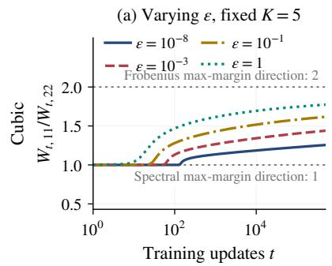

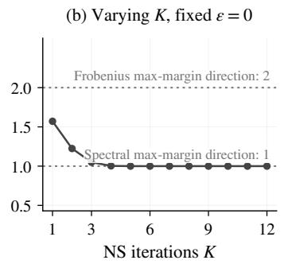

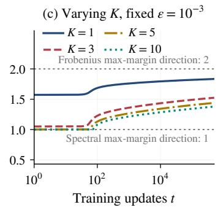

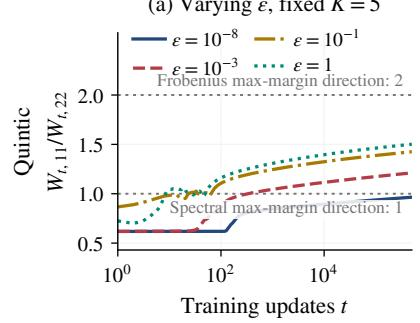

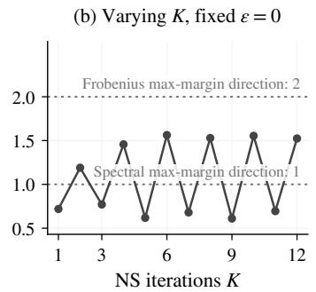

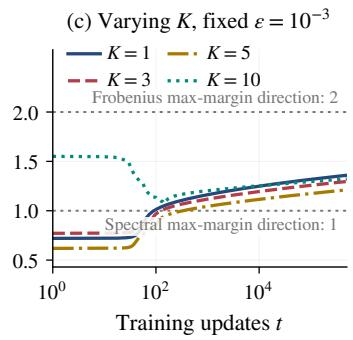  
Figure 1: Muon training using cubic (top) and quintic (bottom) Newton–Schulz iterations following the setting of Section 5.1. We track the predictor ratio $W _ { t , 1 1 } / W _ { t , 2 2 }$ , with reference values $( \widehat { W } _ { \mathrm { F } } ) _ { 1 1 } / ( \widehat { W } _ { \mathrm { F } } ) _ { 2 2 } = 2$ and $( \widehat { W } _ { \mathrm { o p } } ) _ { 1 1 } / ( \widehat { W } _ { \mathrm { o p } } ) _ { 2 2 } = 1$ for the Frobenius and spectral maxmargin directions, respectively.

## 5.1. Finite iterations and stabilization

Following the proof sketch of Theorem 2, we first use the same single-example dataset with signed feature $A = \mathrm { d i a g } ( 2 , 1 )$ . We track the predictor ratio $W _ { t , 1 1 } / W _ { t , 2 2 }$ and compare it with the corresponding ratios of the Frobenius and spectral max-margin directions, $( \widehat { W } _ { \mathrm { F } } ) _ { 1 1 } / ( \widehat { W } _ { \mathrm { F } } ) _ { 2 2 } = 2$ and $( \widehat { W } _ { \mathrm { o p } } ) _ { 1 1 } / ( \widehat { W } _ { \mathrm { o p } } ) _ { 2 2 } = 1$ , respectively. We initialize $W _ { 0 } = 0$ and run the cubic and quintic variants with constant stepsize $\eta = 0 . 0 5$ for $5 \times 1 0 ^ { 5 }$ updates. Figure 1 compares the cubic and quintic polynomials in its top and bottom rows, respectively. Specifically:

• Column (a) fixes $K = 5$ and varies positive ε. For both polynomials, the predictor ratios approach the Frobenius max-margin target as training progresses, consistent with Theorem 1. Interestingly, larger ε leads to an earlier transition toward the Frobenius max-margin direction.

• Column (b) sets $\varepsilon = 0 ,$ , where the predictor ratio remains constant throughout training for each fixed K, as established in Theorem 2(i). As K increases, the cubic approaches the spectral maxmargin ratio, consistent with Theorem 2(ii), whereas the quintic exhibits nonmonotonic behavior, consistent with the result in Theorem 2(ii).

• Column (c) fixes $\varepsilon = 1 0 ^ { - 3 }$ and varies K. For both polynomials, the predictor ratios approach the Frobenius max-margin target as training progresses, consistent with Theorem 1. The iteration count K affects the transient trajectories and the approach to the Frobenius max-margin direction, without changing the asymptotic implicit bias.

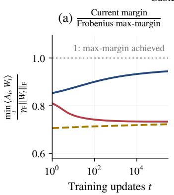

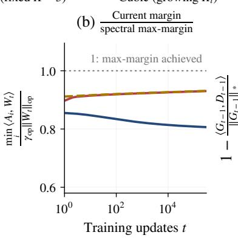

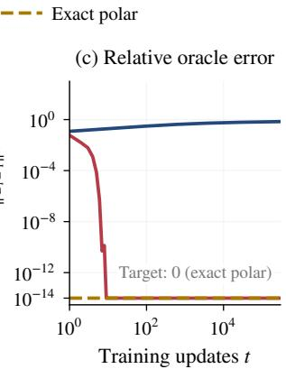  
Figure 2: Frobenius max-margin selection and spectral recovery under the experimental settings described in Section 5.2. Results are averaged over five random seeds.

## 5.2. Frobenius selection and spectral recovery

We next generate five synthetic datasets using independent random seeds, each with $n = 1 2$ and $d _ { 1 } = d _ { 2 } = 4 .$ . The datasets are constructed to have known Frobenius hard-margin solutions, as detailed in Section E.1. We compare three methods: Muon (Algorithm 2) with cubic Newton–Schulz iterations with fixed $K = 3 .$ , with growing $K _ { t } = \lceil 2 \log ( t + 2 ) / \log ( 3 / 2 ) \rceil$ , and idealized Muon (Algorithm 1) with exact polar orthogonalization. All methods use $\beta = 0$ , start from $W _ { 0 } = 0 ;$ and run for $3 \times 1 0 ^ { 5 }$ updates with the same stepsize $\eta _ { t } ~ = ~ 0 . 5 / ( t + 1 )$ . Both practical Muon variants use fixed $\varepsilon = 0 . 1$ . We evaluate the normalized minimum margins $\mathrm { m i n } _ { i } \langle A _ { i } , W _ { t } \rangle / \| W _ { t } \| _ { \mathrm { F } }$ and mini $\langle A _ { i } , W _ { t } \rangle / \| W _ { t } \| _ { \mathrm { o p } }$ , relative to their respective optimal values $\gamma _ { \mathrm { F } }$ and $\gamma _ { \mathrm { o p } }$ defined in Equation (4). A value of one indicates that the corresponding max-margin is achieved. We also measure the relative spectral-oracle error $1 - \langle G _ { t } , D _ { t } \rangle / \Vert G _ { t } \Vert _ { * }$ , where $G _ { t } = \nabla \mathcal { L } ( W _ { t } )$ and $D _ { t } = ( W _ { t } - W _ { t + 1 } ) / \eta _ { t }$ . This quantity measures the fraction of optimal gradient alignment lost by the computed update, as bounded in Equation (16). All metrics are averaged across the five datasets.

Figure 2(a) shows that the fixed-K cubic variant favors the Frobenius max-margin, consistent with Theorem 1. In contrast, panels (b,c) show that the growing- $K _ { t }$ cubic variant closely tracks idealized Muon in spectral margin and oracle accuracy, consistent with Theorem 3. The fixed-K variant exhibits a lower spectral margin and a larger oracle error.

## 6. Related Work

## 6.1. Implicit bias of optimization

Gradient descent and stochastic gradient descent select the Euclidean max-margin direction on separable linear problems under suitable loss and stepsize conditions (Soudry et al., 2018; Nacson et al., 2019b). Subsequent work connects this behavior to loss tails, regularization paths, and primaldual geometry (Nacson et al., 2019a; Ji et al., 2020; Ji and Telgarsky, 2021). Beyond Euclidean geometry, steepest descent, mirror descent, and mirror flow exhibit max-margin bias governed by the optimization geometry (Gunasekar et al., 2018; Sun et al., 2023; Wang et al., 2023; Pesme et al., 2024). For homogeneous neural networks, analyses of gradient flow and steepest descent establish directional convergence and margin-stationarity results (Lyu and Li, 2020; Ji and Telgarsky, 2020; Tsilivis et al., 2025).

For matrix-valued parameters, Fan et al. (2025) establish spectral max-margin behavior for spectral descent and Muon with exact orthogonalization on multiclass separable data. Related work examines the effects of momentum in homogeneous networks and separable classification, as well as sampling and variance reduction in stochastic steepest descent (Gronich and Vardi, 2026; Wang et al., 2022; Li et al., 2026). Studies of AdaGrad and Adam further examine the implicit bias of adaptive updates, including the role of stabilization (Qian and Qian, 2019; Wang et al., 2021; Zhang et al., 2024). More recently, Wang et al. (2026) study how annealed stabilization affects the implicit bias of smoothed-sign descent.

## 6.2. Steepest descent

Kelner et al. (2014) develop a non-Euclidean generalization of gradient descent under arbitrary norms and apply it to approximate maximum-flow problems. In neural-network optimization, Carlson et al. (2015a) introduce stochastic spectral descent for restricted Boltzmann machines, using the spectral norm to exploit the matrix structure of the objective. Carlson et al. (2015b) combine non-Euclidean descent with preconditioning and study restricted Boltzmann machines, feedforward networks, and convolutional networks. Bernstein and Newhouse (2024) interpret several modern optimizers through steepest descent under parameter-dependent norms, including operator norms for matrix weights. Muon uses a small number of Newton–Schulz iterations to approximate orthogonalized momentum updates and has been applied to language-model and image-classification training (Jordan et al., 2024). Liu et al. (2025) scale Muon to large language models through weight decay, update scaling, and distributed computation. Polynomial iterations have also been optimized for fast polar approximation in Muon (Amsel et al., 2026).

Kim and Oh (2026) establish convergence guarantees for Muon with Newton–Schulz iterations, whereas de Oliveira et al. (2026) analyze a soft-sign surrogate. Li and Tsuchiya (2026) investigate the smoothing effects of finite Newton–Schulz iterations in nonsmooth nonconvex optimization, while Peng et al. (2026) analyze convergence of practical Muon with finite Newton–Schulz iterations and Nesterov-style momentum. Unlike these convergence analyses, our work focuses on how the Newton–Schulz iteration count, stabilization constant, and polynomial choice determine the asymptotic max-margin behavior.

## 7. Conclusion

This paper establishes that Muon with finite Newton–Schulz iterations and positive stabilization selects the Frobenius max-margin direction in separable linear classification. We also characterize the effects of stabilization, iteration count, and polynomial choice, and provide conditions for recovering spectral max-margin behavior. Our results focus on full-batch linear classification, leaving stochastic optimization and nonlinear neural networks beyond the present analysis. Motivated by the asymptotic connection to gradient descent in linear classification, an interesting direction for future work is to investigate whether similar behavior emerges in later stages of large-scale neural network training.

## References

Noah Amsel, David Persson, Christopher Musco, and Robert M Gower. The polar express: Optimal matrix sign methods and their application to the muon algorithm. In International Conference on Learning Representations, volume 2026, pages 138323–138360, 2026.

Jeremy Bernstein and Laker Newhouse. Old optimizer, new norm: An anthology. arXiv preprint arXiv:2409.20325, 2024.

David Carlson, Volkan Cevher, and Lawrence Carin. Stochastic spectral descent for restricted boltzmann machines. In Artificial intelligence and statistics, pages 111–119. PMLR, 2015a.

David Carlson, Edo Collins, Ya-Ping Hsieh, Lawrence Carin, and Volkan Cevher. Preconditioned spectral descent for deep learning. Advances in neural information processing systems, 28, 2015b.

Arthur CB de Oliveira, Dhruv D Jatkar, Guilherme S Vicinansa, and Eduardo D Sontag. Convergence guarantees for muon: New parameter regimes and generalizations. arXiv preprint arXiv:2609.30546, 2026.

Chen Fan, Mark Schmidt, and Christos Thrampoulidis. Implicit bias of spectral descent and muon on multiclass separable data. Advances in Neural Information Processing Systems, 38:39622–39669, 2025.

Eitan Gronich and Gal Vardi. The implicit bias of adam and muon on smooth homogeneous neural networks. In Forty-third International Conference on Machine Learning, 2026.

Suriya Gunasekar, Blake E Woodworth, Srinadh Bhojanapalli, Behnam Neyshabur, and Nati Srebro. Implicit regularization in matrix factorization. Advances in neural information processing systems, 30, 2017.

Suriya Gunasekar, Jason Lee, Daniel Soudry, and Nathan Srebro. Characterizing implicit bias in terms of optimization geometry. In International Conference on Machine Learning, pages 1832–1841. PMLR, 2018.

Ziwei Ji and Matus Telgarsky. Directional convergence and alignment in deep learning. Advances in Neural Information Processing Systems, 33:17176–17186, 2020.

Ziwei Ji and Matus Telgarsky. Characterizing the implicit bias via a primal-dual analysis. In Algorithmic Learning Theory, pages 772–804. PMLR, 2021.

Ziwei Ji, Miroslav Dud´ık, Robert E Schapire, and Matus Telgarsky. Gradient descent follows the regularization path for general losses. In Conference on Learning Theory, pages 2109–2136. PMLR, 2020.

Keller Jordan, Yuchen Jin, Vlado Boza, Jiacheng You, Franz Cesista, Laker Newhouse, and Jeremy Bernstein. Muon: An optimizer for hidden layers in neural networks, 2024. URL https://kellerjordan. github. io/posts/muon, 6(3):4, 2024.

Jonathan A Kelner, Yin Tat Lee, Lorenzo Orecchia, and Aaron Sidford. An almost-linear-time algorithm for approximate max flow in undirected graphs, and its multicommodity generalizations.

In Proceedings of the twenty-fifth annual ACM-SIAM symposium on Discrete algorithms, pages 217–226. SIAM, 2014.

Gyu Yeol Kim and Min-hwan Oh. Convergence of muon with newton-schulz. In International Conference on Learning Representations, volume 2026, pages 45672–45718, 2026.

Jichu Li, Xuan Tang, and Difan Zou. The implicit bias of steepest descent with mini-batch stochastic gradient. In Forty-third International Conference on Machine Learning, 2026.

Mingyi Li and Taira Tsuchiya. Muon with finite newton-schulz: The smoothing benefit in nonsmooth nonconvex optimization. arXiv preprint arXiv:2608.26288, 2026.

Jingyuan Liu, Jianlin Su, Xingcheng Yao, Zhejun Jiang, Guokun Lai, Yulun Du, Yidao Qin, Weixin Xu, Enzhe Lu, Junjie Yan, et al. Muon is scalable for llm training. arXiv preprint arXiv:2502.16982, 2025.

Kaifeng Lyu and Jian Li. Gradient descent maximizes the margin of homogeneous neural networks. In International Conference on Learning Representations, 2020.

Mor Shpigel Nacson, Jason Lee, Suriya Gunasekar, Pedro Henrique Pamplona Savarese, Nathan Srebro, and Daniel Soudry. Convergence of gradient descent on separable data. In The 22nd International Conference on Artificial Intelligence and Statistics, pages 3420–3428. PMLR, 2019a.

Mor Shpigel Nacson, Nathan Srebro, and Daniel Soudry. Stochastic gradient descent on separable data: Exact convergence with a fixed learning rate. In The 22nd International Conference on Artificial Intelligence and Statistics, pages 3051–3059. PMLR, 2019b.

Behnam Neyshabur, Ryota Tomioka, and Nathan Srebro. In search of the real inductive bias: On the role of implicit regularization in deep learning. arXiv preprint arXiv:1412.6614, 2014.

Hanyng Peng, Hui Wang, and Yue Yu. Convergence of practical muon with finite newton-schulz iterations and nesterov momentum. arXiv preprint arXiv:2609.39595, 2026.

Scott Pesme, Radu-Alexandru Dragomir, and Nicolas Flammarion. Implicit bias of mirror flow on separable data. Advances in Neural Information Processing Systems, 37:114094–114121, 2024.

Qian Qian and Xiaoyuan Qian. The implicit bias of adagrad on separable data. Advances in Neural Information Processing Systems, 32, 2019.

Daniel Soudry, Elad Hoffer, Mor Shpigel Nacson, Suriya Gunasekar, and Nathan Srebro. The implicit bias of gradient descent on separable data. Journal of Machine Learning Research, 19(70):1–57, 2018.

Haoyuan Sun, Khashayar Gatmiry, Kwangjun Ahn, and Navid Azizan. A unified approach to controlling implicit regularization via mirror descent. Journal ofMachine Learning Research, 24 (393):1–58, 2023.

Nikolaos Tsilivis, Gal Vardi, and Julia Kempe. Flavors of margin: Implicit bias of steepest descent in homogeneous neural networks. In The Thirteenth International Conference on Learning Representations, 2025.

Bohan Wang, Qi Meng, Wei Chen, and Tie-Yan Liu. The implicit bias for adaptive optimization algorithms on homogeneous neural networks. In International Conference on Machine Learning, pages 10849–10858. PMLR, 2021.

Bohan Wang, Qi Meng, Huishuai Zhang, Ruoyu Sun, Wei Chen, Zhi-Ming Ma, and Tie-Yan Liu. Does momentum change the implicit regularization on separable data? Advances in Neural Information Processing Systems, 35:26764–26776, 2022.

Guanghui Wang, Zihao Hu, Vidya Muthukumar, and Jacob D Abernethy. Faster margin maximization rates for generic optimization methods. Advances in Neural Information Processing Systems, 36: 62488–62518, 2023.

Xiangwu Wang, Chengwei Cao, Yicheng Song, Ran Bi, and Peilin Yu. Stability annealing selects the implicit bias of smoothed sign descent: A rate-indexed barrier path on separable data. arXiv preprint arXiv:2607.06013, 2026.

Chenyang Zhang, Difan Zou, and Yuan Cao. The implicit bias of adam on separable data. Advances in neural information processing systems, 37:23988–24021, 2024.

## Contents of the Appendix

The Appendix is organized as follows:

• Section A summarizes the main notation used in this work.

• Section B contains the proofs for Section 3.

• Section C gives auxiliary lemmas and separate proofs of Theorem 2(i)–(iii).

• Section D gives auxiliary lemmas and proofs of Theorems 3 and 4.

• Section E provides additional experimental details and supplementary results.

## Appendix A. Notation

Table 3 summarizes the notation used in the main text and proofs.

Table 3: Core symbols and constants used in this paper.
<table><tr><td>Symbol</td><td>Type</td><td>Description</td></tr><tr><td> $A _ { i } , W _ { t }$ </td><td>Matrices</td><td>Signed matrix feature and parameter at training iteration  $t ,$  both in  $\mathbb { R } ^ { d _ { 1 } \times d _ { 2 } }$ </td></tr><tr><td> $\mathcal { L } , G _ { t }$ </td><td>Loss, gradient Empirical loss and</td><td> $G _ { t } = \nabla \mathcal { L } ( W _ { t } )$ </td></tr><tr><td> $\langle A , B \rangle$ </td><td></td><td>Inner product Frobenius inner product  $\operatorname { t r } ( A ^ { \top } B )$ </td></tr><tr><td> $\| \cdot \| _ { \mathrm { F } } , \| \cdot \| _ { \mathrm { o p } } , \| \cdot \| _ { * }$ </td><td></td><td>Matrix norms Frobenius, spectral, and nuclear norms.</td></tr><tr><td> $R , R _ { * } , \gamma$ </td><td> $> 0$ </td><td>Feature bounds  $R = \operatorname* { m a x } _ { i } \| A _ { i } \| _ { \mathrm { F } }$  and  $R _ { * } = \operatorname* { m a x } _ { i } \| A _ { i } \| _ { * }$  and a separating margin  $0 < \gamma \le \gamma _ { \mathrm { F } }$  from Assumption 1.</td></tr><tr><td> $H$ </td><td> $> 0$ </td><td>Local Hessian bound in the auxiliary lemmas and proofs, specified where it is used.</td></tr><tr><td> $p , p ^ { \circ K }$ </td><td>Scalar maps</td><td>Scalar polynomial iteration and its K-fold composition.</td></tr><tr><td> $\mathcal { P } _ { K }$ </td><td>Matrix map</td><td>Spectral polynomial map  $\mathcal { P } _ { K } ( G ) = U p ^ { \circ K } ( \Sigma ) V ^ { \intercal }$  for a compact SVD  $G = U \Sigma V ^ { \top }$ </td></tr><tr><td>K, ε</td><td>Parameters</td><td>Newton-Schulz iteration count and nonnegative stabilizer, with  $K _ { t }$  and  $\varepsilon _ { t }$  denoting time-dependent choices.</td></tr><tr><td> $a _ { K } , l _ { K } , u _ { K }$ </td><td> $> 0$ </td><td> $\mathrm { S l o p e ~ } ( p ^ { \circ K } ) ^ { \prime } ( 0 )$  and lower and upper sector bounds for  $p ^ { \circ K } ( s ) / s \mathrm { o n } [ 0 , 1 ]$ </td></tr><tr><td> $\eta , \eta _ { t } , \alpha$ </td><td> $> 0$ </td><td>Constant or time-dependent outer stepsize, and effective gradient-descent step  $\alpha = \eta a _ { K } / \varepsilon$  for fixed K and  $\varepsilon > 0 .$ </td></tr><tr><td> $M _ { t } , N _ { t }$ </td><td>Matrices</td><td>EMA buffer and input to the normalized polynomial map.</td></tr><tr><td> $\beta , \kappa$ </td><td>Scalars</td><td>Momentum coefficient  $\beta \in [ 0 , 1 )$  and input weight  $\kappa \in$  [0, 1].</td></tr><tr><td> $\widehat { W } _ { \mathrm { F } } , \widehat { W } _ { \mathrm { o p } }$ </td><td>Matrices</td><td>Frobenius and spectral hard-margin solutions in Equa-  $\widehat { W } _ { \mathrm { F } }$  tions (2) and (3), with unique.</td></tr><tr><td> $\gamma _ { \mathrm { F } } , \gamma _ { \mathrm { o p } }$ </td><td> $> 0$ </td><td>Frobenius and spectral max-margins, equal to  $1 / \Vert \widehat { W } _ { \mathrm { F } } \Vert _ { \mathrm { F } }$  and  $1 / \| \widehat { W } _ { \mathrm { o p } } \| _ { \mathrm { o p } } ,$  respectively, in Equation (4).</td></tr><tr><td>r</td><td> $\mathbb { N } _ { > 0 }$ </td><td>Matrix dimension bound  $r = \operatorname* { m i n } \{ d _ { 1 } , d _ { 2 } \}$ </td></tr></table>

## Appendix B. Proof of Section 3

We first provide auxiliary lemmas and prove Lemmas 1 and 2. We then prove Theorem 1 for logistic and exponential losses and establish the momentum extension in Corollary 1.

## B.1. Auxiliary lemmas

Fix a finite iteration count K and a stabilizer $\varepsilon > 0$ , and define

$$
l _ { K } = \operatorname* { m i n } _ { 0 \leq s \leq 1 } \frac { p ^ { \circ K } ( s ) } { s } ,\tag{18}
$$

with the ratio at zero defined by continuity as $a _ { K }$ . Continuity and Assumption 2 give $0 < l _ { K } \le$ $a _ { K } \leq u _ { K } < \infty$ . The following lemma bounds the alignment and norm of the polynomial update.

Lemma 3 (Alignment and norm bounds) Suppose Assumption 2 holds. For every matrix $G ,$ set $g = \| G \| _ { \mathrm { F } } , P = { \mathcal { P } } _ { K } ( G / ( g + \varepsilon ) )$ . Then

$$
\frac { l _ { K } g ^ { 2 } } { g + \varepsilon } \leq \langle G , P \rangle \leq \frac { u _ { K } g ^ { 2 } } { g + \varepsilon } , \qquad \| P \| _ { \mathrm { F } } ^ { 2 } \leq \frac { u _ { K } } { g + \varepsilon } \langle G , P \rangle .\tag{19}
$$

In particular, $\| P \| _ { \mathrm { F } } \le u _ { K } g / ( g + \varepsilon ) \le u _ { K }$

Proof The case $G = 0$ is immediate. Otherwise, write $\boldsymbol { G } = \boldsymbol { U } \mathrm { d i a g } ( \sigma _ { j } ) \boldsymbol { V } ^ { \intercal }$ as a compact SVD and set $s _ { j } = \sigma _ { j } / ( g + \varepsilon ) \in ( 0 , 1 )$ . The polynomial map gives

$$
\begin{array} { r } { P = U \mathrm { d i a g } \bigl ( p ^ { \circ K } ( s _ { j } ) \bigr ) V ^ { \top } . } \end{array}
$$

Using $l _ { K } s _ { j } \le p ^ { \circ K } ( s _ { j } ) \le u _ { K } s _ { j }$ and $\textstyle \sum _ { j } \sigma _ { j } ^ { 2 } = g ^ { 2 }$ , we obtain

$$
\frac { l _ { K } g ^ { 2 } } { g + \varepsilon } \leq \langle G , P \rangle = \sum _ { j } \sigma _ { j } p ^ { \circ K } ( s _ { j } ) \leq \frac { u _ { K } g ^ { 2 } } { g + \varepsilon } .
$$

Moreover, positivity and the same upper bound imply

$$
\| P \| _ { \mathrm { F } } ^ { 2 } = \sum _ { j } \bigl ( p ^ { \circ K } ( s _ { j } ) \bigr ) ^ { 2 } \leq \frac { u _ { K } } { g + \varepsilon } \sum _ { j } \sigma _ { j } p ^ { \circ K } ( s _ { j } ) = \frac { u _ { K } } { g + \varepsilon } \langle G , P \rangle .
$$

Combining the upper bounds gives $\| P \| _ { \mathrm { F } } \le u _ { K } g / ( g + \varepsilon ) \le u _ { K }$

Then we verify the nonexpansiveness condition in Lemma 2.

Lemma 4 (Nonexpansive gradient map) Let C be a convex set, and let $f$ be twice continuously differentiable on a neighborhood ofC. Suppose that,for some $H > 0$

$$
0 \preceq \nabla ^ { 2 } f ( Z ) \preceq H I \qquad f o r e \nu e r y Z \in { \mathcal { C } } .
$$

Then, for $0 < \alpha \leq 2 / H$ and $X , Y \in { \mathcal { C } } ,$

$$
\begin{array} { r } { \| X - \alpha \nabla f ( X ) - Y + \alpha \nabla f ( Y ) \| _ { \mathrm { F } } \leq \| X - Y \| _ { \mathrm { F } } . } \end{array}
$$

Proof We identify matrices with their vectorizations, under which the Frobenius norm equals the Euclidean norm. Define

$$
B = \int _ { 0 } ^ { 1 } \nabla ^ { 2 } f \bigl ( Y + s ( X - Y ) \bigr ) d s .
$$

Convexity of C and the Hessian bounds imply that B is symmetric and $0 ~ \preceq ~ B ~ \preceq ~ H I$ . The fundamental theorem of calculus gives

$$
\nabla f ( X ) - \nabla f ( Y ) = B ( X - Y ) .
$$

Since $0 < \alpha \leq 2 / H$ , the eigenvalues of $I - \alpha B$ lie in $[ 1 - \alpha H , 1 ] \subseteq [ - 1 , 1 ]$ , so

$$
\| I - \alpha B \| _ { \mathrm { o p } } \leq 1 .
$$

Consequently,

$$
\begin{array} { r l } & { \| X - \alpha \nabla f ( X ) - Y + \alpha \nabla f ( Y ) \| _ { \mathrm { F } } = \| ( I - \alpha B ) ( X - Y ) \| _ { \mathrm { F } } } \\ & { \qquad \leq \| I - \alpha B \| _ { \mathrm { o p } } \| X - Y \| _ { \mathrm { F } } } \\ & { \qquad \leq \| X - Y \| _ { \mathrm { F } } . } \end{array}
$$

Let R be as in Theorem 1, and let $U$ and $\gamma$ be as in Assumption 1. Write $m _ { i } ( W ) = \langle A _ { i } , W \rangle$ We first consider logistic loss.

Lemma 5 (Logistic loss and gradient) For logistic loss, the gradient and Hessian satisfy

$$
\| \nabla \mathcal { L } ( W ) \| _ { \mathrm { F } } \leq R , \qquad 0 \preceq \nabla ^ { 2 } \mathcal { L } ( W ) \preceq \frac { R ^ { 2 } } { 4 } I \qquad f o r e \nu e r y W .
$$

$I f \| \nabla \mathcal { L } ( W _ { t } ) \| _ { \mathrm { F } } \to 0 ,$ , then $m _ { i } ( W _ { t } )  \infty$ for every i, and $\mathcal { L } ( W _ { t } ) \to 0$

Proof Set $r _ { i } ( W ) = ( 1 + e ^ { m _ { i } ( W ) } ) ^ { - 1 }$ . Differentiation gives

$$
\nabla \mathcal { L } ( W ) = - \frac { 1 } { n } \sum _ { i } r _ { i } ( W ) A _ { i } ,
$$

$$
\nabla ^ { 2 } \mathcal { L } ( W ) = \frac { 1 } { n } \sum _ { i } r _ { i } ( W ) ( 1 - r _ { i } ( W ) ) \operatorname { v e c } ( A _ { i } ) \operatorname { v e c } ( A _ { i } ) ^ { \top } .
$$

Since $0 < r _ { i } ( W ) < 1$ and $r _ { i } ( W ) ( 1 - r _ { i } ( W ) ) \leq 1 / 4$

$$
\| \nabla \mathcal L ( W ) \| _ { \mathrm { F } } \leq \frac { 1 } { n } \sum _ { i } r _ { i } ( W ) \| A _ { i } \| _ { \mathrm { F } } \leq R ,
$$

$$
0 \preceq \nabla ^ { 2 } { \mathcal { L } } ( W ) \preceq { \frac { 1 } { 4 n } } \sum _ { i } { \mathrm { v e c } } ( A _ { i } ) { \mathrm { v e c } } ( A _ { i } ) ^ { \top } \preceq { \frac { R ^ { 2 } } { 4 } } I .
$$

Separability and $\| U \| _ { \mathrm { F } } = 1$ give

$$
\frac { \gamma } { n } \sum _ { i } r _ { i } ( W ) \leq \frac { 1 } { n } \sum _ { i } r _ { i } ( W ) \langle U , A _ { i } \rangle = \langle U , - \nabla \mathcal { L } ( W ) \rangle \leq \| \nabla \mathcal { L } ( W ) \| _ { \mathrm { F } } .
$$

$\mathrm { I f ~ } \| \nabla \mathcal { L } ( W _ { t } ) \| _ { \mathrm { F } } \to 0$ , nonnegativity implies $r _ { i } ( W _ { t } ) \to 0$ for every i, hence $m _ { i } ( W _ { t } )  \infty$ . Each term $\log ( 1 + e ^ { - m _ { i } ( W _ { t } ) } )$ therefore tends to zero, so $\mathcal { L } ( W _ { t } ) \to 0$ ■

For exponential loss, Assumption 1 and $\| A _ { i } \| _ { \mathrm { F } } \leq R$ give

$$
\gamma \mathcal L ( W ) \leq \| \nabla \mathcal L ( W ) \| _ { \mathrm { F } } \leq R \mathcal L ( W ) , \qquad \| \nabla ^ { 2 } \mathcal L ( W ) \| _ { \mathrm { o p } } \leq R ^ { 2 } \mathcal L ( W ) .\tag{20}
$$

Moreover, for any displacement $D$

$$
\begin{array} { r } { \mathcal { L } ( W + D ) \leq e ^ { R \| D \| _ { \mathrm { F } } } \mathcal { L } ( W ) . } \end{array}
$$

Lemma 6 (Exponential gradient descent from small loss) Suppose Assumption 1 holds, and consider exponential loss. $F i x \alpha > 0$ and an initial point $V _ { T }$ , and set $\mathcal { L } _ { * } = \mathcal { L } ( V _ { T } ) . I f \alpha n R ^ { 2 } \mathcal { L } _ { * } \leq 1 / 2 ,$ then gradient descent

$$
V _ { t + 1 } = V _ { t } - \alpha \nabla \mathcal { L } ( V _ { t } ) , \qquad t \geq T ,
$$

satisfies $\begin{array} { r } { \mathcal { L } ( V _ { t } ) \leq \mathcal { L } , } \end{array}$ ∗ for every $t \geq T$ and

$$
V _ { t } = \widehat { W } _ { F } \log t + O ( \log \log t ) \qquad a s t \to \infty .
$$

Proof Set $m _ { * } = - \log ( n \mathcal { L } _ { * } )$ and define

$$
\begin{array} { r } { \widetilde { \ell } ( u ) = \left\{ \begin{array} { l l } { e ^ { - u } , } & { u \geq m _ { * } , } \\ { e ^ { - m _ { * } } \big ( 1 - ( u - m _ { * } ) + ( u - m _ { * } ) ^ { 2 } / 2 \big ) , } & { u < m _ { * } . } \end{array} \right. } \end{array}\tag{21}
$$

This function is positive, strictly decreasing, and $C ^ { 2 }$ , with $0 < \widetilde { \ell } ^ { \prime \prime } ( u ) \le n \mathcal { L } _ { * }$ . The extended objective $\begin{array} { r } { { \widetilde { \mathcal { L } } } ( V ) = n ^ { - 1 } \sum _ { i } { \widetilde { \ell } } ( m _ { i } ( V ) ) } \end{array}$ therefore satisfies

$$
0 \preceq \nabla ^ { 2 } \widetilde { \mathcal { L } } ( V ) \preceq n R ^ { 2 } \mathcal { L } _ { * } I .
$$

If either objective is at most $\mathcal { L } _ { * }$ , each scalar loss term is at most n $\mathcal { L } _ { * } = e ^ { - m _ { * } } = \widetilde { \ell } ( m _ { * } )$ , so strict monotonicity gives $m _ { i } ( V ) \geq m _ { * }$ for every i. Consequently,

$$
\{ V : { \widetilde { \mathcal { L } } } ( V ) \leq { \mathcal { L } } _ { * } \} = \{ V : { \mathcal { L } } ( V ) \leq { \mathcal { L } } _ { * } \} ,
$$

and both objectives and their gradients agree on this set.

Whenever $\mathcal { L } ( V _ { t } ) \leq \mathcal { L } _ { * }$ , smoothness gives

$$
\begin{array} { r l } & { \widetilde { \mathcal { L } } ( V _ { t + 1 } ) \leq \mathcal { L } ( V _ { t } ) - \alpha \left( 1 - \frac { \alpha n R ^ { 2 } \mathcal { L } _ { * } } { 2 } \right) \| \nabla \mathcal { L } ( V _ { t } ) \| _ { \mathrm { F } } ^ { 2 } } \\ & { \qquad \leq \mathcal { L } ( V _ { t } ) \leq \mathcal { L } _ { * } . } \end{array}\tag{22}
$$

The equality of the sublevel sets implies $\mathcal { L } ( V _ { t + 1 } ) = \widetilde { \mathcal { L } } ( V _ { t + 1 } ) \leq \mathcal { L } ( V _ { t } )$ . Induction proves the loss bound and shows that the sequence is also gradient descent on ${ \mathcal { L } } .$

The extension has an exact exponential derivative tail. The vectorized data matrix has squared spectral norm at most $n R ^ { 2 }$ , and $\alpha n R ^ { 2 } \mathcal { L } _ { * } \leq 1 / 2 < 2$ . Thus Soudry et al. (2018, Theorem 3) applies, with stepsize $\alpha / n$ for the summed loss, yielding

$$
\begin{array} { r l } & { V _ { t } = \widehat { W } _ { F } \log ( t - T ) + O ( \log \log ( t - T ) ) } \\ & { \quad = \widehat { W } _ { F } \log t + O ( \log \log t ) , } \end{array}
$$

where the last equality uses that T is fixed.

## B.2. Proof of Lemma 1

Proof Oddness gives $p ^ { \circ K } ( s ) = a _ { K } s + O ( s ^ { 3 } )$ as $s \to 0 ,$ , so

$$
b _ { K } = \operatorname* { s u p } _ { 0 < s \leq 1 } \frac { | p ^ { \circ K } ( s ) - a _ { K } s | } { s ^ { 3 } } < \infty .
$$

Write $g = \| G \| _ { \mathrm { F } }$ and let $\sigma _ { j }$ be the singular values of $G .$ Applying the scalar remainder bound and using $\textstyle \sum _ { j } \sigma _ { j } ^ { 6 } \leq ( \sum _ { j } \sigma _ { j } ^ { 2 } ) ^ { 3 } = g ^ { 6 }$ yields

$$
\left\| \mathcal { P } _ { K } \bigg ( \frac { G } { g + \varepsilon } \bigg ) - \frac { a _ { K } G } { g + \varepsilon } \right\| _ { \mathrm { F } } \leq \frac { b _ { K } } { ( g + \varepsilon ) ^ { 3 } } \left( \sum _ { j } \sigma _ { j } ^ { 6 } \right) ^ { 1 / 2 } \leq \frac { b _ { K } g ^ { 3 } } { ( g + \varepsilon ) ^ { 3 } } .
$$

Also,

$$
\left. { \frac { a _ { K } G } { g + \varepsilon } } - { \frac { a _ { K } G } { \varepsilon } } \right. _ { \mathrm { F } } = { \frac { a _ { K } g ^ { 2 } } { \varepsilon ( g + \varepsilon ) } } .
$$

The triangle inequality therefore gives

$$
\begin{array} { r l } & { \left\| \mathcal { P } _ { K } \bigg ( \frac { G } { g + \varepsilon } \bigg ) - \frac { a _ { K } } { \varepsilon } G \right\| _ { \mathrm { F } } \leq \frac { b _ { K } g ^ { 3 } } { ( g + \varepsilon ) ^ { 3 } } + \frac { a _ { K } g ^ { 2 } } { \varepsilon ( g + \varepsilon ) } } \\ & { \qquad \leq \frac { a _ { K } + b _ { K } } { \varepsilon ^ { 2 } } g ^ { 2 } , } \end{array}\tag{23}
$$

where the last step uses $g / ( g + \varepsilon ) \leq 1$ and $g + \varepsilon \geq \varepsilon .$

## B.3. Proof of Lemma 2

Proof By the triangle inequality and nonexpansiveness,

$$
\begin{array} { r l } & { \| W _ { t + 1 } - V _ { t + 1 } \| _ { \mathrm F } = \| W _ { t } - \alpha \nabla f ( W _ { t } ) - V _ { t } + \alpha \nabla f ( V _ { t } ) + r _ { t } \| _ { \mathrm F } } \\ & { \qquad \leq \| W _ { t } - \alpha \nabla f ( W _ { t } ) - V _ { t } + \alpha \nabla f ( V _ { t } ) \| _ { \mathrm F } + \| r _ { t } \| _ { \mathrm F } } \\ & { \qquad \leq \| W _ { t } - V _ { t } \| _ { \mathrm F } + \| r _ { t } \| _ { \mathrm F } . } \end{array}
$$

Since $V _ { T } = W _ { T }$ , iteration gives, for every $t \geq T$

$$
\Vert W _ { t } - V _ { t } \Vert _ { \mathrm { F } } \leq \sum _ { s = T } ^ { t - 1 } \Vert r _ { s } \Vert _ { \mathrm { F } } \leq \sum _ { s = T } ^ { \infty } \Vert r _ { s } \Vert _ { \mathrm { F } } < \infty ,
$$

which proves Equation (12).

If the stated expansion holds for $V _ { t } .$ , this uniform bound implies

$$
W _ { t } = V _ { t } + O ( 1 ) = \widehat { W } \log t + O ( \log \log t ) .
$$

Since $W _ { t } / \log t$ and $V _ { t } /$ log t both converge to $\widehat { W } \neq 0$ , we obtain

$$
\operatorname* { l i m } _ { t  \infty } \frac { W _ { t } } { \| W _ { t } \| _ { \mathrm { F } } } = \operatorname* { l i m } _ { t  \infty } \frac { V _ { t } } { \| V _ { t } \| _ { \mathrm { F } } } = \frac { \widehat { W } } { \| \widehat { W } \| _ { \mathrm { F } } } .
$$

## B.4. Proof of Theorem 1(i)

For logistic loss, let $H = R ^ { 2 } / 4$ be the global Hessian bound from Lemma 5. We first establish loss convergence and then compare the iterates with gradient descent to identify the limiting direction.

Proof Follow the previous notations: $G _ { t } = \nabla \mathcal { L } ( W _ { t } ) , g _ { t } = \| G _ { t } \| _ { \mathrm { F } }$ , and $\begin{array} { r } { P _ { t } = \mathcal { P } _ { K } \bigg ( \frac { G _ { t } } { g _ { t } + \varepsilon } \bigg ) } \end{array}$

By Lemma 5, $g _ { t } \leq R .$ . The stepsize condition $\eta H u _ { K } \le \varepsilon \operatorname { g i v } ($ es

$$
1 - \frac { H \eta u _ { K } } { 2 ( g _ { t } + \varepsilon ) } \geq 1 - \frac { \varepsilon } { 2 ( g _ { t } + \varepsilon ) } \geq \frac { 1 } { 2 } .
$$

Since $W _ { t + 1 } = W _ { t } - \eta P _ { t }$ , smoothness and Lemma 3 yield

$$
\begin{array} { r l r } {  { \mathcal { L } ( W _ { t + 1 } ) \leq \mathcal { L } ( W _ { t } ) - \eta \langle G _ { t } , P _ { t } \rangle + \frac { H \eta ^ { 2 } } { 2 } \| P _ { t } \| _ { \mathrm { F } } ^ { 2 } } } \\ & { } & { \leq \mathcal { L } ( W _ { t } ) - \eta ( 1 - \frac { H \eta M _ { K } } { 2 ( \mathscr { Q } _ { t } + \varepsilon ) } ) \langle G _ { t } , P _ { t } \rangle } \\ & { } & { \leq \mathcal { L } ( W _ { t } ) - \frac { \eta } { 2 } \langle G _ { t } , P _ { t } \rangle } \\ & { } & { \leq \mathcal { L } ( W _ { t } ) - \frac { \eta l _ { K } } { 2 ( \mathscr { Q } _ { t } + \varepsilon ) } g _ { t } ^ { 2 } } \\ & { } & { \leq \mathcal { L } ( W _ { t } ) - \frac { \eta l _ { K } } { 2 ( \mathscr { Q } _ { K } + \varepsilon ) } g _ { t } ^ { 2 } . } \end{array}\tag{24}
$$

Summing and using ${ \mathcal { L } } \geq 0$ gives

$$
\sum _ { t \geq 0 } g _ { t } ^ { 2 } \leq \frac { 2 ( R + \varepsilon ) \mathcal { L } ( W _ { 0 } ) } { \eta l _ { K } } < \infty .
$$

Hence $g _ { t } \to 0 .$ , and Lemma 5 implies $\mathcal { L } ( W _ { t } ) \to 0$

Set $\alpha = \eta a _ { K } / \varepsilon$ and

$$
r _ { t } = - \eta \left( P _ { t } - { \frac { a _ { K } } { \varepsilon } } G _ { t } \right) .
$$

Then $W _ { t + 1 } = W _ { t } - \alpha G _ { t } + r _ { t }$ . By Lemma 1 and the square-summability above,

$$
\| r _ { t } \| _ { \mathrm { F } } = O ( g _ { t } ^ { 2 } ) , \qquad \sum _ { t \geq 0 } \| r _ { t } \| _ { \mathrm { F } } < \infty .
$$

Consider the reference iteration

$$
V _ { 0 } = W _ { 0 } , \qquad V _ { t + 1 } = V _ { t } - \alpha \nabla { \mathcal { L } } ( V _ { t } ) .
$$

Since $a _ { K } \leq u _ { K }$ , the stepsize condition gives $\alpha \leq 1 / H$ . The gradient map is therefore globally nonexpansive by Lemma 4. Applying Lemma 2, we obtain

$$
\operatorname* { s u p } _ { t \geq 0 } \lVert W _ { t } - V _ { t } \rVert _ { \mathrm { F } } < \infty .
$$

After vectorization, the reference iteration is gradient descent on the summed logistic loss with stepsize $\alpha / n$ . The summed loss is nH-smooth, and $\alpha / n \le 1 / ( n H ) < 2 / ( n H )$ . Thus Soudry et al. (2018, Theorem 3) yields

$$
V _ { t } = \widehat { W } _ { F } \log t + O ( \log \log t ) .
$$

By Lemma 2, the same expansion holds for Wt, and

$$
\operatorname* { l i m } _ { t  \infty } \frac { W _ { t } } { \Vert W _ { t } \Vert _ { \mathrm { F } } } = \frac { \widehat { W } _ { F } } { \Vert \widehat { W } _ { F } \Vert _ { \mathrm { F } } } .
$$

## B.5. Proof of Theorem 1(ii)

For exponential loss, we first prove $\mathcal { L } ( W _ { t } ) = O ( t ^ { - 1 } )$ and then compare the iterates with gradient descent on a small-loss sublevel set.

Proof Write $\mathcal { L } _ { t } = \mathcal { L } ( W _ { t } )$ . For $s \in [ 0 , 1 ]$ , Equation (20), the displacement bound, and Lemma 3 give

$$
\begin{array} { r } { \| \nabla ^ { 2 } \mathcal { L } ( W _ { t } - s \eta P _ { t } ) \| _ { \mathrm { o p } } \leq R ^ { 2 } \mathcal { L } _ { t } e ^ { s \eta R \| P _ { t } \| _ { \mathrm { F } } } \leq R ^ { 2 } \mathcal { L } _ { t } e ^ { \eta R u _ { K } } . } \end{array}
$$

Taylor’s formula and Lemma 3 therefore yield

$$
\begin{array} { r l } & { \mathcal { L } _ { t + 1 } \leq \mathcal { L } _ { t } - \eta \langle G _ { t } , P _ { t } \rangle + \frac { \eta ^ { 2 } R ^ { 2 } \mathcal { L } _ { t } e ^ { \eta R u _ { K } } } { 2 } \Vert P _ { t } \Vert _ { \mathrm { F } } ^ { 2 } } \\ & { \qquad \leq \mathcal { L } _ { t } - \eta \left( 1 - \frac { \eta R ^ { 2 } u _ { K } \mathcal { L } _ { t } e ^ { \eta R u _ { K } } } { 2 ( g _ { t } + \varepsilon ) } \right) \langle G _ { t } , P _ { t } \rangle . } \end{array}\tag{25}
$$

The stepsize condition and $g _ { t } \geq \gamma \mathcal { L } _ { t }$ imply

$$
1 - \frac { \eta R ^ { 2 } u _ { K } \mathcal { L } _ { t } e ^ { \eta R u _ { K } } } { 2 ( g _ { t } + \varepsilon ) } \geq 1 - \frac { \gamma \mathcal { L } _ { t } } { 2 ( g _ { t } + \varepsilon ) } \geq \frac { 1 } { 2 } .
$$

Thus $\mathcal { L } _ { t + 1 } \leq \mathcal { L } _ { t } \leq \mathcal { L } _ { 0 }$ . Using the sector lower bound and $\gamma { \mathcal { L } } _ { t } \leq g _ { t } \leq R { \mathcal { L } } _ { t }$ , we obtain

$$
\begin{array} { r l r } {  { \mathcal { L } _ { t + 1 } \leq \mathcal { L } _ { t } - \frac { \eta l _ { K } g _ { t } ^ { 2 } } { 2 ( g _ { t } + \varepsilon ) } } } \\ & { } & { \leq \mathcal { L } _ { t } - \frac { \eta l _ { K } \gamma ^ { 2 } \mathcal { L } _ { t } ^ { 2 } } { 2 ( R \mathcal { L } _ { t } + \varepsilon ) } } \\ & { } & { \leq \mathcal { L } _ { t } - c \mathcal { L } _ { t } ^ { 2 } , \qquad c = \frac { \eta l _ { K } \gamma ^ { 2 } } { 2 ( R \mathcal { L } _ { 0 } + \varepsilon ) } . } \end{array}\tag{26}
$$

Since $\mathcal { L } _ { t + 1 } > 0$ , the recurrence implies $0 < c \mathcal { L } _ { t } < 1$ , and hence

$$
\frac { 1 } { \mathcal { L } _ { t + 1 } } \geq \frac { 1 } { \mathcal { L } _ { t } ( 1 - c \mathcal { L } _ { t } ) } \geq \frac { 1 } { \mathcal { L } _ { t } } + c .
$$

Iteration gives

$$
\mathcal { L } _ { t } \leq \frac { 1 } { \mathcal { L } _ { 0 } ^ { - 1 } + c t } \longrightarrow 0 .
$$

Since $e ^ { - m _ { i } ( W _ { t } ) } \leq n \mathcal { L } _ { t }$ , every margin tends to infinity. Moreover, Equation (20) gives

$$
\sum _ { t \geq 0 } g _ { t } ^ { 2 } \leq R ^ { 2 } \sum _ { t \geq 0 } { \frac { 1 } { ( \mathscr { L } _ { 0 } ^ { - 1 } + c t ) ^ { 2 } } } < \infty .
$$

Set $\alpha = \eta a _ { K } / \varepsilon$ and write

$$
W _ { t + 1 } = W _ { t } - \alpha G _ { t } + r _ { t } , \qquad r _ { t } = - \eta \left( P _ { t } - \frac { a _ { K } } { \varepsilon } G _ { t } \right) .
$$

By Lemma 1 and the square-summability above,

$$
\| r _ { t } \| _ { \mathrm { F } } = O ( g _ { t } ^ { 2 } ) , \qquad \sum _ { t \geq 0 } \| r _ { t } \| _ { \mathrm { F } } < \infty .
$$

Choose a finite T such that αn $R ^ { 2 } { \cal L } _ { T } \leq 1 / 2 .$ , and consider

$$
V _ { T } = W _ { T } , \qquad V _ { t + 1 } = V _ { t } - \alpha \nabla \mathcal { L } ( V _ { t } ) , \quad t \geq T .
$$

By Lemma 6 and loss monotonicity, both trajectories remain in the convex sublevel set $\{ W : { \mathcal { L } } ( W ) \leq$ $\mathcal { L } _ { T } \big \}$ for $t \geq T$ . On this set, Equation (20) gives $\| \nabla ^ { 2 } \mathcal { L } ( W ) \| _ { \mathrm { o p } } \leq R ^ { 2 } \mathcal { L } _ { T }$ . Since $\alpha R ^ { 2 } \mathcal { L } _ { T } \leq 1 / 2 < 2$ the gradient map is nonexpansive by Lemma 4.

Applying Lemmas 2 and 6, we obtain

$$
W _ { t } = V _ { t } + O ( 1 ) = \widehat { W } _ { F } \log t + O ( \log \log t ) .
$$

Consequently,

$$
\operatorname* { l i m } _ { t  \infty } \frac { W _ { t } } { \Vert W _ { t } \Vert _ { \mathrm { F } } } = \frac { \widehat { W } _ { F } } { \Vert \widehat { W } _ { F } \Vert _ { \mathrm { F } } } .
$$

## B.6. Proof of Corollary 1

We first prove summability of the momentum error and then apply the gradient-descent comparison from Section B.4.

Proof As in Section B.4, let $H = R ^ { 2 } / 4$ . Define the momentum error $e _ { t } = M _ { t } - G _ { t }$ and

$$
P _ { t } = \mathcal { P } _ { K } \Bigg ( \frac { N _ { t } } { \lVert N _ { t } \rVert _ { \mathrm { F } } + \varepsilon } \Bigg ) .
$$

Then $N _ { t } = G _ { t } + \kappa e _ { t }$ and $W _ { t + 1 } = W _ { t } - \eta P _ { t }$

By Lemma $5 , \| G _ { t } \| _ { \mathrm { F } } \leq R$ . Since $M _ { - 1 } = 0$ , the momentum recurrence also gives $\| M _ { t } \| _ { \mathrm { F } } \leq R$ and $\Vert N _ { t } \Vert _ { \mathrm { F } } \leq R$ . Set

$$
c = { \frac { l _ { K } } { R + \varepsilon } } , \qquad C = { \frac { u _ { K } } { \varepsilon } } , \qquad \alpha = { \frac { \eta a _ { K } } { \varepsilon } } .\tag{27}
$$

The stepsize condition Equation (10) becomes

$$
\eta H C ^ { 2 } \left( \frac { \kappa \beta } { 1 - \beta } + \frac { 1 } { 2 } \right) \leq \frac { c } { 2 } .
$$

By Lemma 3,

$$
\begin{array} { r } { \langle N _ { t } , P _ { t } \rangle \ge c \| N _ { t } \| _ { \mathrm { F } } ^ { 2 } , \qquad \| P _ { t } \| _ { \mathrm { F } } \le C \| N _ { t } \| _ { \mathrm { F } } . } \end{array}
$$

Global smoothness therefore gives $\Vert G _ { t + 1 } - G _ { t } \Vert _ { \mathrm { F } } \leq \eta H C \Vert N _ { t } \Vert _ { \mathrm { F } }$

The momentum error satisfies

$$
e _ { t } = \beta e _ { t - 1 } + \beta ( G _ { t - 1 } - G _ { t } ) , \quad t \geq 1 , \quad \quad e _ { 0 } = - \beta G _ { 0 } .\tag{28}
$$

For a finite horizon T, set

$$
S _ { T } = \left( \sum _ { t = 0 } ^ { T } \lVert N _ { t } \rVert _ { \mathrm { F } } ^ { 2 } \right) ^ { 1 / 2 } , \qquad E _ { 0 } = \frac { \lVert e _ { 0 } \rVert _ { \mathrm { F } } } { \sqrt { 1 - \beta ^ { 2 } } } .
$$

Unrolling Equation (28) gives

$$
e _ { t } = \beta ^ { t } e _ { 0 } + \sum _ { j = 0 } ^ { t - 1 } \beta ^ { t - j } ( G _ { j } - G _ { j + 1 } ) .
$$

The triangle inequality in the finite-sequence $\ell _ { 2 }$ norm yields

$$
\begin{array} { r l r } {  { ( \sum _ { t = 0 } ^ { T } \lVert e _ { t } \rVert _ { \mathrm { F } } ^ { 2 } ) ^ { 1 / 2 } \le E _ { 0 } + \eta H C \sum _ { j = 1 } ^ { T } \beta ^ { j } ( \sum _ { t = 0 } ^ { T - j } \lVert N _ { t } \rVert _ { \mathrm { F } } ^ { 2 } ) ^ { 1 / 2 } } } \\ & { } & { \le E _ { 0 } + \frac { \beta \eta H C } { 1 - \beta } S _ { T } . } \end{array}\tag{29}
$$

Since $G _ { t } = N _ { t } - \kappa e _ { t }$ , smoothness gives

$$
\begin{array} { r l } & { \displaystyle \mathcal { L } ( W _ { t + 1 } ) \leq \mathcal { L } ( W _ { t } ) - \eta \langle N _ { t } - \kappa e _ { t } , P _ { t } \rangle + \frac { H \eta ^ { 2 } } { 2 } \| P _ { t } \| _ { \mathrm { F } } ^ { 2 } } \\ & { \quad \quad \quad \leq \mathcal { L } ( W _ { t } ) - \eta \left( c - \frac { \eta H C ^ { 2 } } { 2 } \right) \| N _ { t } \| _ { \mathrm { F } } ^ { 2 } + \eta \kappa C \| e _ { t } \| _ { \mathrm { F } } \| N _ { t } \| _ { \mathrm { F } } . } \end{array}\tag{30}
$$

Summing, applying Cauchy–Schwarz and Equation (29), and using $\mathcal { L } ( W _ { T + 1 } ) \ge 0$ , we obtain

$$
\eta \left[ c - \eta H C ^ { 2 } \left( \frac { \kappa \beta } { 1 - \beta } + \frac { 1 } { 2 } \right) \right] S _ { T } ^ { 2 } \leq \mathcal { L } ( W _ { 0 } ) + \eta \kappa C E _ { 0 } S _ { T } .\tag{31}
$$

The bracketed term on the left-hand side is at least $c / 2$ . Using $\kappa C E _ { 0 } S _ { T } \le c S _ { T } ^ { 2 } / 4 + \kappa ^ { 2 } C ^ { 2 } E _ { 0 } ^ { 2 } / c$ , we conclude that

$$
S _ { T } ^ { 2 } \leq \frac { 4 \mathcal { L } ( W _ { 0 } ) } { \eta c } + \frac { 4 \kappa ^ { 2 } C ^ { 2 } E _ { 0 } ^ { 2 } } { c ^ { 2 } } .
$$

Thus $\begin{array} { r } { \sum _ { t \geq 0 } \lVert N _ { t } \rVert _ { \mathrm { F } } ^ { 2 } < \infty } \end{array}$ . By Equation (29) and $G _ { t } = N _ { t } - \kappa e _ { t }$

$$
\sum _ { t \geq 0 } \lVert e _ { t } \rVert _ { \mathrm { F } } ^ { 2 } < \infty , \qquad \sum _ { t \geq 0 } \lVert G _ { t } \rVert _ { \mathrm { F } } ^ { 2 } < \infty .
$$

Hence $\| G _ { t } \| _ { \mathrm { F } } \to 0$ . By Lemma 5, all margins tend to infinity and $\mathcal { L } ( W _ { t } ) \to 0 .$

We next prove that $\textstyle \sum _ { t } \lVert e _ { t } \rVert _ { \mathrm { F } } < \infty$ . Recall $r _ { i } ( W ) = ( 1 { + } e ^ { \langle A _ { i } , W \rangle } ) ^ { - 1 }$ . Since $\begin{array} { r } { \left| \frac { d } { d z } \log ( ( 1 + e ^ { z } ) ^ { - 1 } ) \right| \leq } \end{array}$ 1, for any displacement D and $s \in [ 0 , 1 ]$

$$
r _ { i } ( W + s D ) \leq e ^ { R \| D \| _ { \mathrm { F } } } r _ { i } ( W ) .
$$

Using $r _ { i } ( 1 - r _ { i } ) \leq r _ { i }$ and separability, we obtain

$$
\begin{array} { r l } {  { \| \nabla ^ { 2 } \mathcal { L } ( W + s D ) \| _ { \mathrm { o p } } \leq \frac { R ^ { 2 } } { n } \sum _ { i } r _ { i } ( W + s D ) } } \\ & { \leq \frac { R ^ { 2 } } { n } e ^ { R \| D \| _ { \mathrm { F } } } \sum _ { i } r _ { i } ( W ) } \\ & { \leq \frac { R ^ { 2 } } { \gamma } e ^ { R \| D \| _ { \mathrm { F } } } \| \nabla \mathcal { L } ( W ) \| _ { \mathrm { F } } . } \end{array}\tag{32}
$$

With $D = - \eta P _ { t }$ , the fundamental theorem of calculus and $\| \boldsymbol { P } _ { t } \| _ { \mathrm { F } } \le u _ { K }$ give

$$
\begin{array} { r l } & { \| G _ { t + 1 } - G _ { t } \| _ { \mathrm { F } } \leq \eta \| P _ { t } \| _ { \mathrm { F } } \displaystyle \int _ { 0 } ^ { 1 } \| \nabla ^ { 2 } \mathcal { L } ( W _ { t } - s \eta P _ { t } ) \| _ { \mathrm { o p } } d s } \\ & { \qquad \leq \frac { \eta C R ^ { 2 } e ^ { \eta R u _ { K } } } { \gamma } \| G _ { t } \| _ { \mathrm { F } } \| N _ { t } \| _ { \mathrm { F } } . } \end{array}\tag{33}
$$

The right-hand side is summable by Cauchy–Schwarz, so $\begin{array} { r } { \sum _ { t } \lVert G _ { t + 1 } - G _ { t } \rVert _ { \mathrm { F } } < \infty } \end{array}$ . Summing the unrolled error recursion therefore yields

$$
\sum _ { t \geq 0 } \lVert e _ { t } \rVert _ { \mathrm { F } } \leq \frac { \lVert e _ { 0 } \rVert _ { \mathrm { F } } } { 1 - \beta } + \frac { \beta } { 1 - \beta } \sum _ { t \geq 0 } \lVert G _ { t + 1 } - G _ { t } \rVert _ { \mathrm { F } } < \infty .\tag{34}
$$

Write the update as

$$
\begin{array} { r l r } & { } & { W _ { t + 1 } = W _ { t } - \alpha G _ { t } + r _ { t } , } \\ & { } & { ~ r _ { t } = - \alpha \kappa e _ { t } - \eta \left( P _ { t } - \frac { a _ { K } } { \varepsilon } N _ { t } \right) . } \end{array}
$$

By Lemma 1,

$$
\| r _ { t } \| _ { \mathrm { F } } \leq \alpha \kappa \| e _ { t } \| _ { \mathrm { F } } + O \big ( \| N _ { t } \| _ { \mathrm { F } } ^ { 2 } \big ) .
$$

Thus Equation (34) and $\begin{array} { r } { \sum _ { t } \lVert N _ { t } \rVert _ { \mathrm { F } } ^ { 2 } < \infty } \end{array}$ imply $\textstyle \sum _ { t } \lVert \boldsymbol { r } _ { t } \rVert _ { \mathrm { F } } < \infty$

Finally, the stepsize condition gives $\eta H C ^ { 2 } \leq c .$ Since $a _ { K } l _ { K } \le u _ { K } ^ { 2 }$

$$
\alpha H \leq \frac { \varepsilon a _ { K } l _ { K } } { ( R + \varepsilon ) u _ { K } ^ { 2 } } \leq \frac { \varepsilon } { R + \varepsilon } < 1 .
$$

The gradient map is therefore globally nonexpansive by Lemma 4. Consider the reference iteration

$$
V _ { 0 } = W _ { 0 } , \qquad V _ { t + 1 } = V _ { t } - \alpha \nabla { \mathcal { L } } ( V _ { t } ) .
$$

Applying Lemma 2 and the gradient-descent asymptotics of Soudry et al. (2018, Theorem 3), as in Section B.4, gives

$$
W _ { t } = V _ { t } + O ( 1 ) = \widehat { W } _ { F } \log t + O ( \log \log t ) .
$$

Consequently,

$$
\operatorname* { l i m } _ { t  \infty } \frac { W _ { t } } { \Vert W _ { t } \Vert _ { \mathrm { F } } } = \frac { \widehat { W } _ { F } } { \Vert \widehat { W } _ { F } \Vert _ { \mathrm { F } } } .
$$

## Appendix C. Proof of Section 4.1

In this section, we prove the three parts of Theorem 2 in order. Throughout this section, let $r = \operatorname* { m i n } \{ d _ { 1 } , d _ { 2 } \}$ and $R _ { * } = \operatorname* { m a x } _ { i } \| A _ { i } \| .$ ∗.

## C.1. Proof of Theorem 2(i)

Proof For $A \neq 0$ , the constraints in Equations (2) and (3) are $\langle A , W \rangle \geq 1$ . Cauchy–Schwarz gives

$$
\| A \| _ { \mathrm { F } } \| W \| _ { \mathrm { F } } \geq \langle A , W \rangle \geq 1 .
$$

Thus $\| W \| _ { \mathrm { F } } \geq 1 / \| A \| _ { \mathrm { F } }$ , with equality exactly at $\widehat { W } _ { \mathrm { F } } = A / \Vert A \Vert _ { \mathrm { F } } ^ { 2 }$ . By Equation (4), $\gamma _ { \mathrm { { F } } } = \| A \| _ { \mathrm { { F } } }$ . For the spectral problem, nuclear/operator duality gives

$$
\| A \| _ { * } \| W \| _ { \mathrm { o p } } \geq \langle A , W \rangle \geq 1 .
$$

Since $\| \mathrm { p o l a r } ( A ) \| _ { \mathrm { o p } } = 1$ and $\langle A , \operatorname { p o l a r } ( A ) \rangle = \| A \|$ ∗, Equation (4) yields $\gamma _ { \mathrm { o p } } = \| A \| .$ ∗, attained by $\operatorname { p o l a r } ( A )$

We can express the gradient as $\nabla \mathcal { L } ( W _ { t } ) = \ell ^ { \prime } ( \left. A , W _ { t } \right. ) .$ A with $\ell ^ { \prime } < 0 . { \mathrm { ~ } } \mathrm { A t } \varepsilon = 0$ , we have

$$
\mathcal { P } _ { K } \left( \frac { \nabla \mathcal { L } ( W _ { t } ) } { \| \nabla \mathcal { L } ( W _ { t } ) \| _ { \mathrm { F } } } \right) = \mathcal { P } _ { K } \left( - \frac { A } { \| A \| _ { \mathrm { F } } } \right) = - \mathcal { P } _ { K } \left( \frac { A } { \| A \| _ { \mathrm { F } } } \right) = - D _ { K } ,
$$

where the last step is by the definition of $D _ { K }$ in Theorem $2 ( \mathrm { i } )$ . Starting from $W _ { 0 } = 0$ , Algorithm 2 with $\beta = 0$ gives $\begin{array} { r } { W _ { t } = ( \sum _ { s < t } \eta _ { s } ) D _ { K } } \end{array}$ . Since $\eta _ { s } > 0$ for all s, normalization gives $\begin{array} { r } { \frac { W _ { t } } { \| W _ { t } \| _ { \mathrm { F } } } = \frac { D _ { K } } { \| D _ { K } \| _ { \mathrm { F } } } } \end{array}$ for every $t \geq 1$ , proving Equation (13).

We next consider the cubic polynomial. We use any matrix A with at least two distinct positive singular values as a counterexample. Let $\sigma _ { i } > \sigma _ { j } > 0$ be two such singular values.

Since $0 < \sigma _ { j } < \sigma _ { i } < \| A \| _ { \mathrm { F } }$ and the cubic polynomial $\textstyle p ( x ) = { \frac { 3 } { 2 } } x - { \frac { 1 } { 2 } } x ^ { 3 }$ satisfies $0 < p ( x ) < 1$ and $p ^ { \prime } ( x ) > 0$ for $x \in ( 0 , 1 )$ , we have

$$
1 < \frac { p ( \sigma _ { i } / \| A \| _ { \mathrm { F } } ) } { p ( \sigma _ { j } / \| A \| _ { \mathrm { F } } ) } = \frac { \sigma _ { i } } { \sigma _ { j } } \frac { 3 - ( \sigma _ { i } / \| A \| _ { \mathrm { F } } ) ^ { 2 } } { 3 - ( \sigma _ { j } / \| A \| _ { \mathrm { F } } ) ^ { 2 } } < \frac { \sigma _ { i } } { \sigma _ { j } } .\tag{35}
$$

Thus, for every $K \geq 1$

$$
1 < \frac { p ^ { \circ K } ( \sigma _ { i } / \| A \| _ { \mathrm { F } } ) } { p ^ { \circ K } ( \sigma _ { j } / \| A \| _ { \mathrm { F } } ) } < \frac { \sigma _ { i } } { \sigma _ { j } } .
$$

Thus, the singular values of $D _ { K }$ are unequal and are not proportional to those of A. Strict Cauchy– Schwarz gives

$$
{ \frac { \langle A , D _ { K } \rangle } { \| D _ { K } \| _ { \mathrm { F } } } } < \| A \| _ { \mathrm { F } } = \gamma _ { \mathrm { F } } .
$$

Moreover,

$$
\frac { \langle A , D _ { K } \rangle } { \| D _ { K } \| _ { \mathrm { o p } } } = \frac { \sum _ { j } \sigma _ { j } p ^ { \circ K } ( \sigma _ { j } / \| A \| _ { \mathrm { F } } ) } { \operatorname* { m a x } _ { j } p ^ { \circ K } ( \sigma _ { j } / \| A \| _ { \mathrm { F } } ) } < \sum _ { j } \sigma _ { j } = \| A \| _ { * } = \gamma _ { \mathrm { o p } } .
$$

Thus, neither margin is achieved. If all positive singular values of A are equal, the Frobenius and compact-polar directions coincide, and every admissible finite polynomial selects that common direction.

Next, we consider the quintic polynomial. Fix any finite $K \geq 1$ . The invariant interval in Lemma 9 implies $p ^ { \circ K } ( 1 ) > 0$ . Moreover, $p ( x ) < p ^ { \prime } ( 0 ) x$ for $0 < x \le 5 / 4$ , since

$$
{ \frac { p ( x ) } { x } } - p ^ { \prime } ( 0 ) = x ^ { 2 } ( - 4 . 7 7 5 0 + 2 . 0 3 1 5 x ^ { 2 } ) < 0 .
$$

Iteration along the invariant interval yields $p ^ { \circ K } ( 1 ) < [ p ^ { \prime } ( 0 ) ] ^ { K }$

Take $A = \mathrm { d i a g } ( 2 , s )$ with $0 < s < 2$ . Then

$$
D _ { K } = \mathcal { P } _ { K } \left( \frac { A } { \| A \| _ { \mathrm { F } } } \right) = \mathrm { d i a g } \left( p ^ { \circ K } \left( \frac { 2 } { \sqrt { 4 + s ^ { 2 } } } \right) , p ^ { \circ K } \left( \frac { s } { \sqrt { 4 + s ^ { 2 } } } \right) \right) .
$$

Since $( p ^ { \circ K } ) ^ { \prime } ( 0 ) = [ p ^ { \prime } ( 0 ) ] ^ { K }$ , differentiability at zero and continuity at one give

$$
\operatorname* { l i m } _ { s \downarrow 0 } \frac { ( D _ { K } ) _ { 1 1 } } { ( D _ { K } ) _ { 2 2 } } = \infty , \qquad \operatorname* { l i m } _ { s \downarrow 0 } \frac { s } { 2 } \frac { ( D _ { K } ) _ { 1 1 } } { ( D _ { K } ) _ { 2 2 } } = \frac { p ^ { \circ K } ( 1 ) } { [ p ^ { \prime } ( 0 ) ] ^ { K } } \in ( 0 , 1 ) .\tag{36}
$$

Thus, for sufficiently small $s > 0 .$

$$
1 < \frac { ( D _ { K } ) _ { 1 1 } } { ( D _ { K } ) _ { 2 2 } } < \frac { 2 } { s } .
$$

Hence $D _ { K }$ is not proportional to A and has two unequal positive singular values. By the same strict margin inequalities as in the cubic case, $D _ { K }$ achieves neither the Frobenius nor the spectral max-margin.

For the concrete example $A = \mathrm { d i a g } ( 2 , 1 )$ , the Frobenius and spectral hard-margin solutions are $\widehat { W } _ { \mathrm { F } } = A / 5$ and $\widehat { W } _ { \mathrm { o p } } = \mathrm { I } _ { 2 } / 3$ , respectively. The cubic ratio bound follows directly from Equation (35). For the quintic with $K = 5$ , we have

$$
D _ { 5 } = \mathrm { d i a g } \left( p ^ { \circ 5 } ( 2 / { \sqrt { 5 } } ) , p ^ { \circ 5 } ( 1 / { \sqrt { 5 } } ) \right) .
$$

Direct computation gives

$$
\frac { 2 } { 3 } < ( D _ { 5 } ) _ { 1 1 } < \frac { 3 } { 4 } , \qquad 1 < ( D _ { 5 } ) _ { 2 2 } < \frac { 6 } { 5 } .
$$

Consequently,

$$
\frac { 5 } { 9 } < \frac { ( D _ { 5 } ) _ { 1 1 } } { ( D _ { 5 } ) _ { 2 2 } } < \frac { 3 } { 4 } .
$$

Since the Frobenius and spectral max-margin directions have ratios 2 and 1, respectively, $D _ { 5 }$ achieves neither max-margin.

## C.2. Proof of Theorem 2(ii)

Proof Fix a horizon T. Write $\begin{array} { r } { S _ { t } = \sum _ { s < t } \eta _ { s } } \end{array}$ s and $\begin{array} { r } { V _ { t } = \sum _ { s < t } \eta _ { s } ^ { 2 } , } \end{array}$ , where $\eta _ { s } = \eta _ { 0 } / ( s + 1 )$ . Then $V _ { t } \leq 2 \eta _ { 0 } ^ { 2 }$ . Set $G _ { t } ^ { ( K ) } = \nabla \mathcal { L } ( W _ { t } ^ { ( K ) } )$ and $D _ { t } ^ { ( K ) } = \mathcal { P } _ { K } ( G _ { t } ^ { ( K ) } / ( \| G _ { t } ^ { ( K ) } \| _ { \mathrm { F } } + \varepsilon ) )$ ). The cubic update has operator norm at most one, so

$$
\| W _ { t } ^ { ( K ) } \| _ { \mathrm { o p } } \leq \| W _ { 0 } \| _ { \mathrm { o p } } + S _ { t } .
$$

Every signed margin up to time $T$ is at most $R _ { * } ( \| W _ { 0 } \| _ { \mathrm { o p } } + S _ { T } )$ . For either loss, the negative derivative at such a margin is at least $[ 1 + \exp \{ R _ { * } ( \| W _ { 0 } \| _ { \mathrm { o p } } + S _ { T } ) \} ] ^ { - 1 }$ . Taking the inner product of $- G _ { t } ^ { ( K ) }$ with the Frobenius-unit separator in Assumption 1 therefore gives

$$
\| G _ { t } ^ { ( K ) } \| _ { \mathrm { F } } \ge \frac { \gamma } { 1 + \exp \{ R _ { * } ( \| W _ { 0 } \| _ { \mathrm { o p } } + S _ { T } ) \} } > 0 .
$$

Define $\delta _ { t } ^ { ( K ) } = 1 - \langle G _ { t } ^ { ( K ) } , D _ { t } ^ { ( K ) } \rangle / \| G _ { t } ^ { ( K ) } \|$ ∗ and $\begin{array} { r } { E _ { T } ^ { ( K ) } = \sum _ { t < T } \eta _ { t } \delta _ { t } ^ { ( K ) } } \end{array}$ . By Lemma 8, uniformly over $t < T$

$$
0 \leq \delta _ { t } ^ { ( K ) } \leq \operatorname* { m i n } \left\{ 1 , \ : r \left( 1 + \frac { \varepsilon } { \gamma } \left[ 1 + e ^ { R _ { * } ( \| W _ { 0 } \| _ { \mathrm { o p } } + S _ { T } ) } \right] \right) ( 2 / 3 ) ^ { K } \right\} .\tag{37}
$$

Consequently, lim ${ \bf \Lambda } _ { K  \infty } E _ { T } ^ { ( K ) } = 0$ for each fixed $T .$

For the remainder of the proof, we omit the superscript K. Write $\begin{array} { r } { Q _ { t } = n ^ { - 1 } \sum _ { i } [ - \ell ^ { \prime } ( \langle A _ { i } , W _ { t } \rangle ) ] } \end{array}$ Both losses satisfy $0 < - \ell ^ { \prime } \leq \ell$ and $\ell ^ { \prime \prime } \leq \ell .$ . For any $\| D \| _ { \mathrm { o p } } \leq 1$ , we have $| \langle A _ { i } , D \rangle | \leq R _ { * }$ , and hence

$$
\frac { d ^ { 2 } } { d u ^ { 2 } } \log \mathcal { L } ( W + u D ) \leq \frac { \frac { d ^ { 2 } } { d u ^ { 2 } } \mathcal { L } ( W + u D ) } { \mathcal { L } ( W + u D ) } \leq R _ { * } ^ { 2 } .
$$

Taylor’s formula gives

$$
\log \mathcal { L } ( W _ { t + 1 } ) - \log \mathcal { L } ( W _ { t } ) \leq - \eta _ { t } \frac { \langle G _ { t } , D _ { t } \rangle } { \mathcal { L } ( W _ { t } ) } + \frac { R _ { * } ^ { 2 } } { 2 } \eta _ { t } ^ { 2 } .\tag{38}
$$

Since $\left. G _ { t } , D _ { t } \right. \geq 0$ , we have $\mathcal { L } ( W _ { t } ) \le B : = \mathcal { L } ( W _ { 0 } ) e ^ { R _ { * } ^ { 2 } \eta _ { 0 } ^ { 2 } }$ at every time. An operator-norm-unit separator attaining $\gamma _ { \mathrm { o p } }$ in Equation (4) gives $\| G _ { t } \| _ { * } \geq \gamma _ { \mathrm { o p } } Q _ { t }$

For exponential loss, $Q _ { t } = \mathcal { L } ( W _ { t } )$ . For logistic loss, writing $z = \ell ( m ) \mathrm { g i v e s } - \ell ^ { \prime } ( m ) = 1 - e ^ { - z }$ and elementary scalar bounds yield

$$
{ \frac { z } { 1 + z } } \leq 1 - e ^ { - z } \leq z , \qquad 0 \leq z - ( 1 - e ^ { - z } ) \leq { \frac { z ^ { 2 } } { 2 } } .
$$

Each individual loss is at most $n \mathcal { L } ( W _ { t } )$ . Averaging these inequalities gives, for both losses,

$$
\frac { 1 } { 1 + n B } \le \frac { Q _ { t } } { \mathcal { L } ( W _ { t } ) } \le 1 , \qquad 0 \le 1 - \frac { Q _ { t } } { \mathcal { L } ( W _ { t } ) } \le \frac { n } { 2 } \mathcal { L } ( W _ { t } ) .\tag{39}
$$

Let $c = \gamma _ { \mathrm { o p } } / ( 1 + n B ) > 0$ . The alignment bound and Equation (38) imply

$$
\log \mathcal { L } ( W _ { t } ) \leq \log \mathcal { L } ( W _ { 0 } ) - c ( S _ { t } - E _ { t } ) + R _ { * } ^ { 2 } V _ { t } / 2 .
$$

When $E _ { T } \leq 1$ , all $t \leq T$ therefore satisfy

$$
{ \mathcal { L } } ( W _ { t } ) \leq B e ^ { c } e ^ { - c S _ { t } } .
$$

Because $\eta _ { t } \leq \eta _ { 0 }$

$$
\sum _ { t < T } \eta _ { t } e ^ { - c S _ { t } } \leq e ^ { c \eta _ { 0 } } \int _ { 0 } ^ { S _ { T } } e ^ { - c u } d u \leq \frac { e ^ { c \eta _ { 0 } } } { c } .
$$

It follows that

$$
\sum _ { t < T } \eta _ { t } ( 1 - Q _ { t } / \mathcal { L } ( W _ { t } ) ) \le n B e ^ { c ( 1 + \eta _ { 0 } ) } / ( 2 c ) ,
$$

uniformly over such $T$ and $K$ . Since

$$
\frac { ( 1 - \delta _ { t } ) Q _ { t } } { \mathcal { L } ( W _ { t } ) } \geq 1 - \delta _ { t } - \left( 1 - \frac { Q _ { t } } { \mathcal { L } ( W _ { t } ) } \right) ,
$$

applying this bound to Equation (38) yields

$$
\begin{array} { r } { - \log \mathcal { L } ( W _ { T } ) \geq \gamma _ { \mathrm { o p } } S _ { T } - \gamma _ { \mathrm { o p } } E _ { T } - C _ { 0 } , } \end{array}
$$

where $C _ { 0 }$ is a finite constant independent of $T$ and $K$ . For exponential loss,

$$
\operatorname* { m i n } _ { i } \langle A _ { i } , W _ { T } \rangle \geq - \log ( n { \mathcal { L } } ( W _ { T } ) ) .
$$

For logistic loss, each individual loss is at most $n { \cal { L } } ( W _ { T } )$ , so

$$
\operatorname* { m i n } _ { i } \langle A _ { i } , W _ { T } \rangle \ge - \log ( e ^ { n \mathcal { L } ( W _ { T } ) } - 1 ) \ge - \log ( n \mathcal { L } ( W _ { T } ) ) - n \mathcal { L } ( W _ { T } ) .
$$

The last inequality follows from $e ^ { x } - 1 \leq x e ^ { x }$ for $x > 0$ . Since $\begin{array} { r } { \mathcal { L } ( W _ { T } ) \le B } \end{array}$ , either loss gives

$$
\operatorname* { m i n } _ { i } \langle A _ { i } , W _ { T } \rangle \geq \gamma _ { \mathrm { o p } } S _ { T } - \gamma _ { \mathrm { o p } } E _ { T } - C
$$

where $C$ is a finite positive constant independent of $T , K$ whenever $E _ { T } \leq 1$

For all sufficiently large T and then all sufficiently large K, this lower bound is positive. Using Equation (4), dividing by $\lVert W _ { T } ^ { ( K ) } \rVert _ { \mathrm { o p } } \leq \lVert W _ { 0 } \rVert _ { \mathrm { o p } } + S _ { T }$ , and taking $K  \infty$ at this fixed $T$ gives

$$
0 \leq \operatorname* { l i m } _ { K  \infty } \operatorname* { s u p } ( \gamma _ { \mathrm { o p } } - \frac { \operatorname* { m i n } _ { i } \langle A _ { i } , W _ { T } ^ { ( K ) } \rangle } { \| W _ { T } ^ { ( K ) } \| _ { \mathrm { o p } } } ) \leq \frac { \gamma _ { \mathrm { o p } } \| W _ { 0 } \| _ { \mathrm { o p } } + C } { \| W _ { 0 } \| _ { \mathrm { o p } } + S _ { T } } .\tag{40}
$$

Finally, $S _ { T } \geq \eta _ { 0 } \log ( T + 1 )$ , so the right-hand side tends to zero as $T \to \infty$ . Setting $\varepsilon = 0$ proves the cubic assertion in part (ii) for both losses and every finite $W _ { 0 }$

For the quintic, take $n = 1 , A = \mathrm { d i a g } ( 2 , 1 ) , W _ { 0 } = 0$ , and $\varepsilon = 0$ . By Lemma 10, the diagonalentry ratios of the matrices $D _ { K }$ from Theorem 2(i) lie in two disjoint intervals for odd and even $K \geq 3$ . The update identity in Section C.1 gives, for every fixed $t \geq 1$ and any positive stepsize sequence,

$$
\frac { W _ { t } ^ { ( K ) } } { \Vert W _ { t } ^ { ( K ) } \Vert _ { \mathrm { F } } } = \frac { D _ { K } } { \Vert D _ { K } \Vert _ { \mathrm { F } } } .
$$

Thus the normalized iterates do not converge as $K  \infty$

## C.3. Proof of Theorem 2(iii)

Proof Fix $\varepsilon > 0$ . The proof in Section C.2 treats every fixed $\varepsilon \geq 0 .$ . In particular, the factor multiplying $( 2 / 3 ) ^ { K }$ in Equation (37) is finite at each fixed horizon T, so lim $. \kappa \mathrm {  } \infty { \cal E } _ { T } ^ { ( K ) } = 0$ . Thus Equation (40) holds for the present stabilizer. Since $S _ { T } \geq \eta _ { 0 } \log ( T + 1 )$ , taking $T \to \infty$ gives Equation (14). 一

## C.4. Auxiliary lemmas

Lemma 7 For every $s \in ( 0 , 1 ]$ and integer $K \geq 0 ,$ , the cubic in Equation (8) satisfies

$$
p _ { \mathrm { c u b } } ^ { \circ K } ( s ) \geq \frac { s } { \sqrt { s ^ { 2 } + ( 2 / 3 ) ^ { 2 K } ( 1 - s ^ { 2 } ) } } , \qquad 0 \leq s ( 1 - p _ { \mathrm { c u b } } ^ { \circ K } ( s ) ) \leq ( 2 / 3 ) ^ { K } .\tag{41}
$$

Moreover, $0 \leq p _ { \mathrm { c u b } } ^ { \circ K } ( s ) \leq 1 o n [ 0 , 1 ]$

Proof We omit the subscript cub in this proof. The cubic polynomial p maps [0, 1] into [0, 1] and is strictly positive on (0, 1]. For $0 < s < 1$

$$
\begin{array} { c } { \displaystyle \frac { p ( s ) ^ { - 2 } - 1 } { s ^ { - 2 } - 1 } = \frac { ( 1 - s ^ { 2 } ) ( 4 - s ^ { 2 } ) } { ( 3 - s ^ { 2 } ) ^ { 2 } } \qquad } \\ { \displaystyle = \frac { 4 } { 9 } - \frac { s ^ { 2 } ( 2 1 - 5 s ^ { 2 } ) } { 9 ( 3 - s ^ { 2 } ) ^ { 2 } } \leq \frac { 4 } { 9 } . } \end{array}\tag{42}
$$

At $s = 1 , p ( s ) = 1$ . Iterating the bound yields $p ^ { \circ K } ( s ) ^ { - 2 } - 1 \leq ( 4 / 9 ) ^ { K } ( s ^ { - 2 } - 1 )$ , which is the first bound in Equation (41).

Since $1 - s ^ { 2 } \leq 1$ , that bound also gives $p ^ { \circ K } ( s ) \geq s / \sqrt { s ^ { 2 } + ( 2 / 3 ) ^ { 2 K } }$ . Consequently

$$
s ( 1 - p ^ { \circ K } ( s ) ) \leq s ( 1 - s / \sqrt { s ^ { 2 } + ( 2 / 3 ) ^ { 2 K } } ) \leq \sqrt { s ^ { 2 } + ( 2 / 3 ) ^ { 2 K } } - s \leq ( 2 / 3 ) ^ { K } ,
$$

where the second inequality uses $s \leq \sqrt { s ^ { 2 } + ( 2 / 3 ) ^ { 2 K } }$ , and the last follows from $\sqrt { s ^ { 2 } + ( 2 / 3 ) ^ { 2 K } } \leq$ $s + ( 2 / 3 ) ^ { K }$

Lemma 8 (Relative dual-oracle error) Let $G \neq 0 , \varepsilon \geq 0 ,$ , and $D = { \mathcal { P } } _ { K } ( G / ( \| G \| _ { \mathrm { F } } + \varepsilon ) )$ with the cubic polynomial. Then $\| D \| _ { \mathrm { o p } } \leq 1$ and

$$
0 \leq \| G \| _ { * } - \langle G , D \rangle \leq r ( \| G \| _ { \mathrm { F } } + \varepsilon ) ( 2 / 3 ) ^ { K } , \qquad \langle G , D \rangle \geq \left[ 1 - r \left( 1 + \frac { \varepsilon } { \| G \| _ { \mathrm { F } } } \right) ( 2 / 3 ) ^ { K } \right] \| G \| _ { * } .\tag{43}
$$

Proof Let $G = U \Sigma V ^ { \top }$ be a compact SVD and set $s _ { j } = \sigma _ { j } ( G ) / ( \lVert G \rVert _ { \mathrm { F } } + \varepsilon ) \in ( 0 , 1 ]$ . The singular values of D are $p _ { \mathrm { c u b } } ^ { \circ K } ( s _ { j } ) \in ( 0 , 1 ] , \mathrm { s o } \| D \| _ { \mathrm { o p } } \leq 1$ . By Lemma 7,

$$
\begin{array} { r l } { 0 \leq \| G \| _ { * } - \langle G , D \rangle = \displaystyle \sum _ { j } \sigma _ { j } ( G ) \big ( 1 - p _ { \mathrm { c u b } } ^ { \circ K } ( s _ { j } ) \big ) } & { } \\ { = ( \| G \| _ { \mathrm { F } } + \varepsilon ) \displaystyle \sum _ { j } s _ { j } ( 1 - p _ { \mathrm { c u b } } ^ { \circ K } ( s _ { j } ) \big ) } & { } \\ { \leq r ( \| G \| _ { \mathrm { F } } + \varepsilon ) ( 2 / 3 ) ^ { K } . } \end{array}
$$

Dividing by $\| G \| _ { * } \geq \| G \| _ { \mathrm { F } }$ gives the relative bound.

Lemma 9 (Bounds for the quintic) The quintic in Equation (7) satisfies

$$
\begin{array} { r l r } & { p _ { \mathrm { q u i n } } ( [ 0 , 5 / 4 ] ) \subseteq [ 0 , 5 / 4 ] , } & { p _ { \mathrm { q u i n } } ( [ 1 / 2 , 5 / 4 ] ) \subseteq [ 1 / 2 , 5 / 4 ] , } \\ & { } & { p _ { \mathrm { q u i n } } ( s ) \geq 2 s \quad ( 0 \leq s \leq 1 / 2 ) , \qquad p _ { \mathrm { q u i n } } ( s ) \leq p _ { \mathrm { q u i n } } ^ { \prime } ( 0 ) s \quad ( 0 \leq s \leq 5 / 4 ) . } \end{array}\tag{44}
$$

Proof We omit the subscript quin in this proof. For a polynomial h of degree d and a rational interval $[ l , u ]$ , write its Bernstein expansion as

$$
h ( l + ( u - l ) x ) = \sum _ { j = 0 } ^ { d } b _ { j } { \binom { d } { j } } x ^ { j } ( 1 - x ) ^ { d - j } .\tag{45}
$$

On [0, 1], the nonnegative basis functions sum to one, so min $~ _ { j } b _ { j } \leq h ( l + ( u - l ) x ) \leq \operatorname* { m a x } _ { j } b _ { j }$ Applying this bound to the six coefficients of $p$ on each interval gives

$$
\begin{array} { r l } & { p ( [ 0 , 1 / 2 ] ) \subseteq [ 0 , 6 / 5 ] , \qquad p ( [ 1 / 2 , 3 / 4 ] ) \subseteq [ 1 , 5 / 4 ] , } \\ & { p ( [ 3 / 4 , 1 ] ) \subseteq [ 7 / 1 0 , 1 1 / 1 0 ] , \qquad p ( [ 1 , 5 / 4 ] ) \subseteq [ 3 / 5 , 6 / 5 ] . } \end{array}
$$

These enclosures prove both interval inclusions in Equation (44). For $0 < s \leq 1 / 2$

$$
p ( s ) / s \geq p ^ { \prime } ( 0 ) - 4 . 7 7 5 / 4 > 2 .
$$

For $0 < s \leq 5 / 4$

$$
p ( s ) / s - p ^ { \prime } ( 0 ) = s ^ { 2 } ( - 4 . 7 7 5 + 2 . 0 3 1 5 s ^ { 2 } ) < 0
$$

At s = 0, both scalar bounds hold with equality.

Lemma 10 (Quintic iteration for diag(2, 1)) Let $A = \mathrm { d i a g } ( 2 , 1 )$ and $D _ { K } = \mathcal { P } _ { K } ( A / \Vert A \Vert _ { \mathrm { F } } )$ for the quintic in Equation (7). Then $D _ { K } / \lVert D _ { K } \rVert _ { \mathrm { F } }$ does not converge as $K  \infty .$

Proof We omit the subscript quin for $p$ in this proof. We show that the two diagonal entries of $D _ { K }$ alternate between two disjoint intervals, so their ratio cannot converge.

Set

$$
I _ { - } = [ 2 / 3 , 4 / 5 ] , \qquad I _ { + } = [ 1 9 / 2 0 , 2 3 / 2 0 ] .
$$

The Bernstein bound in Equation (45), applied on $I _ { - } , [ 1 9 / 2 0 , 1 ]$ , and [1, 23/20], gives

$$
p ( I _ { - } ) \subset I _ { + } , \qquad p ( I _ { + } ) \subset I _ { - } .
$$

For the two normalized diagonal entries of A, we calculate the first three scalar iterates. Since $2 / \sqrt { 5 } \in [ 8 / 9 , 9 / 1 0 ]$ and $1 / \sqrt { 5 } \in [ 4 / 9 , 9 / 2 0 ]$ ], applying the same Bernstein bound three times gives

$$
p ^ { \circ 3 } ( [ 8 / 9 , 9 / 1 0 ] ) \subset I _ { - } , \qquad p ^ { \circ 3 } ( [ 4 / 9 , 9 / 2 0 ] ) \subset I _ { + } .\tag{46}
$$

Thus the diagonal entries of $D _ { 3 }$ lie in $I _ { - }$ and $I _ { + }$ , respectively, and every subsequent iteration exchanges these intervals. Consequently, for every $K \geq 3$

$$
{ \frac { ( D _ { K } ) _ { 1 1 } } { ( D _ { K } ) _ { 2 2 } } } \in \left\{ \begin{array} { l l } { { [ 4 0 / 6 9 , 1 6 / 1 9 ] , } } & { { K \mathrm { o d d } , } } \\ { { { [ 1 9 / 1 6 , 6 9 / 4 0 ] , } } } & { { K \mathrm { e v e n } . } } \end{array} \right.\tag{47}
$$

Since these two intervals are disjoint, the normalized matrices cannot converge to a common limit along the odd and even subsequences.

## Appendix D. Proof of Section 4.2

We prove the cubic recovery guarantee with fixed stabilization and the quintic recovery guarantee with randomized stabilization. We use r and $R _ { * }$ from Section C.

## D.1. Proof of Theorem 3

Proof Let $S _ { T } , E _ { T } , V _ { T }$ be as in Lemma 11. By Lemma 8, the cubic update $D _ { t } = \mathcal { P } _ { K _ { t } } ( G _ { t } / ( \Vert G _ { t } \Vert _ { \mathrm { F } } +$ $\varepsilon ) )$ satisfies $\| D _ { t } \| _ { \mathrm { o p } } \leq 1$ . Thus $\| W _ { t } \| _ { \mathrm { o p } } \leq \| W _ { 0 } \| _ { \mathrm { o p } } + S _ { t }$ . For $t \geq 0$ , the harmonic stepsize and $\eta _ { 0 } R _ { * } \leq 1$ give $R _ { * } S _ { t } \leq 1 + \log ( t + 1 )$ . Each margin is at most $R _ { * } ( \| W _ { 0 } \| _ { \mathrm { o p } } + S _ { t } )$ , so Equation (20) yields

$$
\| G _ { t } \| _ { \mathrm { F } } \geq \gamma \mathcal { L } ( W _ { t } ) \geq \gamma e ^ { - R _ { * } ( \| W _ { 0 } \| _ { \mathrm { o p } } + S _ { t } ) } \geq \frac { \gamma e ^ { - 1 - R _ { * } \| W _ { 0 } \| _ { \mathrm { o p } } } } { t + 1 } .\tag{48}
$$

Let $\delta _ { t } = 1 - \langle G _ { t } , D _ { t } \rangle / \| G _ { t } \| ,$ ∗. The positive cubic singular values imply $0 \leq \delta _ { t } \leq 1$ . Since $\begin{array} { r } { K _ { t } = \left\lceil \frac { 2 \log ( t + 2 ) } { \log ( 3 / 2 ) } \right\rceil } \end{array}$ , Lemma 8 and Equation (48) imply

$$
\delta _ { t } \leq \operatorname* { m i n } \left\{ 1 , \frac { r ( 1 + \varepsilon e ^ { 1 + R _ { * } \| W _ { 0 } \| _ { \mathrm { o p } } } ( t + 1 ) / \gamma ) } { ( t + 2 ) ^ { 2 } } \right\} \leq \frac { r ( 1 + \varepsilon e ^ { 1 + R _ { * } \| W _ { 0 } \| _ { \mathrm { o p } } } / \gamma ) } { t + 2 } .\tag{49}
$$

Consequently, using $\begin{array} { r } { \sum _ { t > 0 } [ ( t + 1 ) ( t + 2 ) ] ^ { - 1 } = 1 } \end{array}$

$$
E _ { T } \le \eta _ { 0 } r \bigl ( 1 + \varepsilon e ^ { 1 + R _ { * } \| W _ { 0 } \| _ { \infty } } / \gamma \bigr ) , \qquad V _ { T } \le 2 \eta _ { 0 } ^ { 2 } , \qquad S _ { T } \ge \eta _ { 0 } \log ( T + 1 ) .\tag{50}
$$

The bound from Lemma 11 gives

$$
- \log \mathcal { L } ( W _ { T } ) \geq - \log \mathcal { L } ( W _ { 0 } ) + \gamma _ { \mathrm { o p } } S _ { T } - \gamma _ { \mathrm { o p } } E _ { T } - R _ { * } ^ { 2 } V _ { T } / 2 .
$$

Since $S _ { T }  \infty$ while $E _ { T }$ and $V _ { T }$ remain bounded, the loss converges to zero and the positivity condition in Lemma 11 holds for sufficiently large $T .$ . The resulting explicit margin bound is

$$
\begin{array} { r l } & { 0 \leq \gamma _ { \mathrm { o p } } - \displaystyle \frac { \operatorname* { m i n } _ { i } \langle A _ { i } , W _ { T } \rangle } { \| W _ { T } \| _ { \mathrm { o p } } } } \\ & { \quad \leq \frac { \gamma _ { \mathrm { o p } } \eta _ { 0 } r \left( 1 + \varepsilon e ^ { 1 + R _ { * } \| W _ { 0 } \| _ { \mathrm { o p } } } / \gamma \right) + R _ { * } ^ { 2 } \eta _ { 0 } ^ { 2 } + \log \left( n \mathcal { L } ( W _ { 0 } ) \right) + \gamma _ { \mathrm { o p } } \| W _ { 0 } \| _ { \mathrm { o p } } } { \eta _ { 0 } \log \left( T + 1 \right) + \left\| W _ { 0 } \right\| _ { \mathrm { o p } } } . } \end{array}\tag{51}
$$

This gives Equation (15) as $T \to \infty$

## D.2. Proof of Theorem 4

Proof We omit the subscript quin in this proof. Let $\mathcal { F } _ { t }$ be the history generated by $U _ { 0 } , \dots , U _ { t - 1 }$ The matrix $G _ { t }$ is $\mathcal { F } _ { t }$ -measurable and is nonzero by Equation (20). Let $\mu _ { t }$ be the scalar mean defined in Lemma 12. Write

$$
D _ { t } = \mathcal { P } _ { K _ { t } } \left( \frac { G _ { t } } { \| G _ { t } \| _ { \mathrm { F } } + \varepsilon _ { t } } \right) , \qquad \overline { { D } } _ { t } = \mathbb { E } [ D _ { t } \mid \mathcal { F } _ { t } ] .
$$

The schedule in Theorem 4 gives $G _ { t } / ( \Vert G _ { t } \Vert _ { \mathrm { F } } + \varepsilon _ { t } ) = ( t + 2 ) ^ { - U _ { t } } G _ { t } / \Vert G _ { t } \Vert _ { \mathrm { F } }$ . Since $U _ { t }$ is independent of $\mathcal { F } _ { t } .$ , Lemmas 12 and 13 apply conditionally on $\mathcal { F } _ { t }$ . Separability and nuclear/operator duality give

$$
0 < \gamma _ { \mathrm { o p } } \mathcal { L } ( W _ { t } ) \leq \| G _ { t } \| _ { * } \leq R _ { * } \mathcal { L } ( W _ { t } ) , \qquad \frac { \langle G _ { t } , \overline { { D } } _ { t } \rangle } { \mathcal { L } ( W _ { t } ) } \geq \mu _ { t } \gamma _ { \mathrm { o p } } - \frac { 5 r R _ { * } } { 4 e \log ( t + 2 ) } ,\tag{52}
$$

where we used $\| G _ { t } \| _ { \mathrm { F } } \leq \| G _ { t } \| _ { * } \leq R _ { * } { \mathcal { L } } ( W _ { t } )$ to bound the error term.

Since $\| D _ { t } \| _ { \mathrm { F } } \leq 5 \sqrt { r } / 4$ , the matrix martingale $\begin{array} { r } { \sum _ { t < T } \eta _ { t } \big ( D _ { t } - \overline { { D } } _ { t } \big ) } \end{array}$ has total expected squared increments at most $\begin{array} { r } { \frac { 2 5 r } { 4 } \sum _ { t } \eta _ { t } ^ { 2 } < \infty } \end{array}$ . It is therefore bounded in $L ^ { 2 }$ and converges almost surely. Decomposing

$$
W _ { T } = W _ { 0 } - \sum _ { t < T } \eta _ { t } \overline { { { D } } } _ { t } - \sum _ { t < T } \eta _ { t } ( D _ { t } - \overline { { { D } } } _ { t } )
$$

and using $\| \overline { { D } } _ { t } \| _ { \mathrm { o p } } \leq \mu _ { t } + p ^ { \prime } ( 0 ) / \log ( t + 2 )$ from Lemma 13 gives, for a finite nonnegative random constant $C _ { 1 }$

$$
\| W _ { T } \| _ { \mathrm { o p } } \leq \sum _ { t < T } \eta _ { t } \mu _ { t } + p ^ { \prime } ( 0 ) \sum _ { t < T } { \frac { \eta _ { t } } { \log ( t + 2 ) } } + C _ { 1 } \quad { \mathrm { f o r ~ e v e r y ~ } } T \geq 1\tag{53}
$$

almost surely.

The bound used in Equation (59), now with $\| D _ { t } \| _ { \mathrm { o p } } \leq 5 / 4 .$ gives

$$
\begin{array} { r } { - \log \mathcal { L } ( W _ { t + 1 } ) \ge - \log \mathcal { L } ( W _ { t } ) + \eta _ { t } \frac { \langle G _ { t } , D _ { t } \rangle } { \mathcal { L } ( W _ { t } ) } - \frac { 2 5 R _ { * } ^ { 2 } } { 3 2 } \eta _ { t } ^ { 2 } . } \end{array}\tag{54}
$$

Its quadratic term follows from the variance bound for a variable in $[ - 5 R _ { * } / 4 , 5 R _ { * } / 4 ]$ . The scalar martingale

$$
\sum _ { t < T } \eta _ { t } \frac { \langle G _ { t } , D _ { t } - \overline { { D } } _ { t } \rangle } { \mathcal { L } ( W _ { t } ) }
$$

also converges almost surely, because its increments have absolute values at most $5 R _ { * } \eta _ { t } / 2$ and $\textstyle \sum _ { t } \eta _ { t } ^ { 2 } < \infty$ . Summing Equation (54) and using Equation (52) therefore gives a finite nonnegative random constant $C _ { 2 }$ such that

$$
- \log \mathcal { L } ( W _ { T } ) \geq \gamma _ { \mathrm { o p } } \sum _ { t < T } \eta _ { t } \mu _ { t } - \frac { 5 r R _ { * } } { 4 e } \sum _ { t < T } \frac { \eta _ { t } } { \log ( t + 2 ) } - C _ { 2 } \quad \mathrm { f o r } \mathrm { e v e r y } T \geq 1\tag{55}
$$

almost surely, and the constant $C _ { 2 }$ includes the bounded quadratic sum and $| \log \mathcal { L } ( W _ { 0 } ) |$ |. Set

$$
A _ { T } = \sum _ { t < T } \eta _ { t } \mu _ { t } , \qquad B _ { T } = \sum _ { t < T } \eta _ { t } / \log ( t + 2 ) .
$$

Since $\mu _ { t } \ge 1 / 4$ and $\eta _ { t } = \eta _ { 0 } / ( t + 1 )$

$$
A _ { T } \geq \frac { \eta _ { 0 } } { 4 } \log ( T + 1 ) , \qquad B _ { T } = O ( 1 + \log \log ( T + 2 ) ) \quad \mathrm { a s } T \to \infty .\tag{56}
$$

Thus the right-hand side of Equation (55) diverges to infinity, establishing loss convergence. Every exponential term is at most $n { \mathcal { L } } ( W _ { T } )$ , so the minimum margin is at least − log $\mathcal { L } ( W _ { T } )$ − log n and is

eventually positive. Combining Equations (53) and (55) then yields, almost surely for all sufficiently large $T ,$ ,

$$
0 \leq \gamma _ { \mathrm { o p } } - \frac { \operatorname* { m i n } _ { i } \langle A _ { i } , W _ { T } \rangle } { \| W _ { T } \| _ { \mathrm { o p } } } \leq \frac { ( p ^ { \prime } ( 0 ) \gamma _ { \mathrm { o p } } + 5 r R _ { * } / ( 4 e ) ) B _ { T } + \gamma _ { \mathrm { o p } } C _ { 1 } + C _ { 2 } + \log n } { A _ { T } + p ^ { \prime } ( 0 ) B _ { T } + C _ { 1 } } ,\tag{57}
$$

where the lower bound follows from the definition of $\gamma _ { \mathrm { o p } } .$ . Substitution of Equation (56) proves Equation (17). ■

## D.3. Auxiliary lemmas

Lemma 11 (Inexact spectral margin) Suppose Assumption 1 holds and consider the exponential loss. Let $W _ { t + 1 } = W _ { t } - \eta _ { t } D _ { t }$ with finite $W _ { 0 } ,$ , where $\eta _ { t } > 0 , \| D _ { t } \| _ { \mathrm { o p } } \leq 1$ , and $\langle G _ { t } , D _ { t } \rangle \geq$ $\left( 1 - \delta _ { t } \right) \| G _ { t } \| _ { * } f o r$ some $0 \leq \delta _ { t } \leq 1$ . Set $\begin{array} { r } { S _ { T } = \sum _ { t < T } \eta _ { t } , E _ { T } = \sum _ { t < T } \eta _ { t } \delta _ { t } } \end{array}$ , and $\begin{array} { r } { V _ { T } = \sum _ { t < T } \eta _ { t } ^ { 2 } } \end{array}$ Whenever

$$
\gamma _ { \mathrm { o p } } ( S _ { T } - E _ { T } ) - R _ { * } ^ { 2 } V _ { T } / 2 - \log ( n \mathcal { L } ( W _ { 0 } ) ) > 0 ,
$$

we have

$$
0 \leq \gamma _ { \mathrm { o p } } - \frac { \operatorname* { m i n } _ { i } \langle A _ { i } , W _ { T } \rangle } { \| W _ { T } \| _ { \mathrm { o p } } } \leq \frac { \gamma _ { \mathrm { o p } } E _ { T } + R _ { * } ^ { 2 } V _ { T } / 2 + \log ( n \mathcal { L } ( W _ { 0 } ) ) + \gamma _ { \mathrm { o p } } \| W _ { 0 } \| _ { \mathrm { o p } } } { S _ { T } + \| W _ { 0 } \| _ { \mathrm { o p } } } .\tag{58}
$$

Proof For each t, define a discrete random variable $X _ { t }$ that takes value $\langle A _ { i } , D _ { t } \rangle$ with probability $\frac { e ^ { - \langle A _ { i } , W _ { t } \rangle } } { n \mathcal { L } ( W _ { t } ) } , \quad i \in [ n ]$ . These weights sum to one, and nuclear/operator duality gives $| X _ { t } | \le R _ { * }$ . Also $\mathbb { E } X _ { t } = - \langle G _ { t } , D _ { t } \rangle / \mathcal { L } ( W _ { t } )$ . The exponential-loss identity and the bounded-variable moment bound give

$$
\log \mathcal { L } ( W _ { t + 1 } ) - \log \mathcal { L } ( W _ { t } ) = \log \mathbb { E } e ^ { \eta _ { t } X _ { t } } \le - \eta _ { t } \frac { \langle G _ { t } , D _ { t } \rangle } { \mathcal { L } ( W _ { t } ) } + \frac { \eta _ { t } ^ { 2 } R _ { * } ^ { 2 } } { 2 } .\tag{59}
$$

To obtain the moment bound, let $F ( a ) = \log \mathbb { E } e ^ { a X }$ for $X \in [ - R _ { * } , R _ { * } ]$ . The derivative $F ^ { \prime \prime } ( a )$ is the variance under the exponentially tilted law and is bounded by its second moment, hence by $R _ { * } ^ { 2 }$ Taylor’s formula at zero gives $F ( a ) \leq a \mathbb { E } X + a ^ { 2 } R _ { * } ^ { 2 } / 2$ for $a \geq 0$

Let $W _ { \mathrm { o p } }$ attain $\gamma _ { \mathrm { o p } }$ in Equation (4). By duality,

$$
\begin{array} { r l } { \displaystyle \| G _ { t } \| _ { * } \geq \langle - G _ { t } , W _ { \mathrm { o p } } \rangle } & { } \\ { \displaystyle } & { = \frac { 1 } { n } \sum _ { i } e ^ { - \langle A _ { i } , W _ { t } \rangle } \langle A _ { i } , W _ { \mathrm { o p } } \rangle } \\ { \displaystyle } & { \geq \gamma _ { \mathrm { o p } } \frac { 1 } { n } \sum _ { i } e ^ { - \langle A _ { i } , W _ { t } \rangle } } \\ { \displaystyle } & { = \gamma _ { \mathrm { o p } } \mathcal { L } ( W _ { t } ) . } \end{array}
$$

Using $1 - \delta _ { t } \geq 0$ in Equation (59) and summing gives

$$
- \log \mathcal { L } ( W _ { T } ) \ge - \log \mathcal { L } ( W _ { 0 } ) + \gamma _ { \mathrm { o p } } S _ { T } - \gamma _ { \mathrm { o p } } E _ { T } - \frac { R _ { * } ^ { 2 } } { 2 } V _ { T } .\tag{60}
$$

Each exponential term is at most n $\mathcal { L } ( W _ { T } )$ , so the minimum margin is at least − log $\mathcal { L } ( W _ { T } ) \mathrm { ~ - ~ }$ log n. Also $\| W _ { T } \| _ { \mathrm { o p } } \leq \| W _ { 0 } \| _ { \mathrm { o p } } + S _ { T }$ by the triangle inequality and the oracle norm bound. The stated positivity condition ensures that the minimum margin is positive and $W _ { T } \neq 0$ . Dividing this positive lower bound by $\| W _ { T } \| _ { \mathrm { o p } } \leq \| W _ { 0 } \| _ { \mathrm { o p } } + S _ { T }$ proves the right-hand inequality in Equation (58). The left-hand inequality is the definition of the spectral max-margin, applied to $W _ { T } / \| W _ { T } \| _ { \mathrm { o p } } .$

Lemma 12 (Logarithmic averaging of the quintic) For each integer $t \geq 0$ , let $K _ { t }$ be the iteration count in Theorem 4, let $U _ { t } \sim \mathrm { U n i f } ( 0 , 1 )$ , and define $\begin{array} { r } { \mu _ { t } = \int _ { 0 } ^ { 1 } p _ { \mathrm { q u i n } } ^ { \circ K _ { t } } ( ( \bar { t } + 2 ) ^ { - u } ) } \end{array}$ du. Then $1 / 4 \le \mu _ { t } \le$ $5 / 4$ , and for every $0 < s \le 1$

$$
\mu _ { t } - \frac { 5 \log ( 1 / s ) } { 4 \log ( t + 2 ) } \leq \mathbb { E } p _ { \mathrm { q u i n } } ^ { \circ K _ { t } } ( s ( t + 2 ) ^ { - U _ { t } } ) \leq \mu _ { t } + \frac { p _ { \mathrm { q u i n } } ^ { \prime } ( 0 ) } { \log ( t + 2 ) } .\tag{61}
$$

Proof We omit the subscript quin in this proof. By Lemma 9, an orbit starting at $x \in [ ( t + 2 ) ^ { - 1 / 2 } , 1 ]$ and staying below $1 / 2$ through iteration $K _ { t }$ would satisfy $p ^ { \circ K _ { t } } ( x ) \geq 2 ^ { K _ { t } } ( t + 2 ) ^ { - \operatorname { \bar { 1 } } / 2 } > 1$ , since $p ^ { \prime } ( 0 ) = 3 . 4 4 4 5 < 4$ . Hence it enters $[ 1 / 2 , 5 / 4 ]$ by iteration $K _ { t }$ and stays there. Consequently,

$$
\frac { 1 } { 4 } \leq \int _ { 0 } ^ { 1 / 2 } p ^ { \circ K _ { t } } ( ( t + 2 ) ^ { - u } ) d u \leq \mu _ { t } \leq \frac { 5 } { 4 } .
$$

A change of variables gives

$$
\begin{array} { l l l } { \displaystyle \mathbb { E } p ^ { \circ K _ { t } } ( s ( t + 2 ) ^ { - U _ { t } } ) - \mu _ { t } } \\ { \displaystyle \quad = \frac { 1 } { \log ( t + 2 ) } \left( \int _ { \log ( t + 2 ) } ^ { \log ( t + 2 ) + \log ( 1 / s ) } p ^ { \circ K _ { t } } ( e ^ { - u } ) d u - \int _ { 0 } ^ { \log ( 1 / s ) } p ^ { \circ K _ { t } } ( e ^ { - u } ) d u \right) . } \end{array}\tag{62}
$$

The bounds $0 \le p ^ { \circ K _ { t } } \le 5 / 4$ on $[ 0 , 1 ]$ from Lemma 9 give the lower inequality in Equation (61). Iterating the linear upper bound in the same lemma gives $p ^ { \circ K _ { t } } ( x ) \leq [ p ^ { \prime } ( 0 ) ] ^ { K _ { t } } x$ for $0 \leq x \leq 1$ , so

$$
\begin{array} { r l r } {  { \int _ { \log ( t + 2 ) } ^ { \log ( t + 2 ) + \log ( 1 / s ) } p ^ { \circ K _ { t } } ( e ^ { - u } ) d u \le \int _ { \log ( t + 2 ) } ^ { \infty } [ p ^ { \prime } ( 0 ) ] ^ { K _ { t } } e ^ { - u } d u } } \\ & { } & { = \frac { [ p ^ { \prime } ( 0 ) ] ^ { K _ { t } } } { t + 2 } \le p ^ { \prime } ( 0 ) . \quad \quad } \end{array}
$$

Substitution into Equation (62) proves the upper inequality.

Lemma 13 (Mean quintic update) For each integer $t \geq 0 ,$ , use the quintic and iteration count $K _ { t }$ from Theorem 4. For $G \neq 0 ,$ , let $U _ { t } \sim \operatorname { U n i f } ( 0 , 1 )$ and $D = \mathcal { P } _ { K _ { t } } { ( ( t + 2 ) ^ { - U _ { t } } G / \| G \| _ { \mathrm { F } } ) }$ . Then $\| D \| _ { \mathrm { o p } } \leq 5 / 4$ and, with $\mu _ { t }$ defined in Lemma 12,

$$
\| \mathbb { E } D \| _ { \mathrm { o p } } \leq \mu _ { t } + \frac { p _ { \mathrm { q u i n } } ^ { \prime } ( 0 ) } { \log ( t + 2 ) } , \qquad \langle G , \mathbb { E } D \rangle \geq \mu _ { t } \| G \| _ { * } - \frac { 5 r } { 4 e \log ( t + 2 ) } \| G \| _ { \mathrm { F } } .\tag{63}
$$

Proof Let $G = U \Sigma Q ^ { \top }$ be a compact SVD, with $s _ { j } = \sigma _ { j } ( G ) / \| G \| _ { \mathrm { F } } \in ( 0 , 1 ]$ . The transformation preserves these singular vectors, so Lemma 12 bounds each singular value of its expectation. The invariant interval in Lemma 9 gives $\| D \| _ { \mathrm { o p } } \leq 5 / 4$ . Summing the lower scalar bounds with weights $\sigma _ { j } ( G )$ gives

$$
\begin{array} { l } { \displaystyle \langle G , \mathbb { E } D \rangle \geq \mu _ { t } \| G \| _ { * } - \frac { 5 \| G \| _ { \mathrm { F } } } { 4 \log ( t + 2 ) } \sum _ { j } s _ { j } \log ( 1 / s _ { j } ) } \\ { \displaystyle \geq \mu _ { t } \| G \| _ { * } - \frac { 5 r } { 4 e \log ( t + 2 ) } \| G \| _ { \mathrm { F } } , } \end{array}
$$

where the last step is by $s \log ( 1 / s ) \leq 1 / e$ on (0, 1].

## Appendix E. Additional experiments

## E.1. Synthetic Dataset Construction

We construct the five synthetic datasets in Section 5.2 around known Frobenius hard-margin solutions. For each dataset, we draw independent orthogonal matrices $Q , V \in \mathbb { R } ^ { 4 \times 4 }$ by QR factorization of independent Gaussian matrices and define

$$
\begin{array} { r } { W _ { \star } = Q \mathrm { d i a g } ( 2 , 1 , 0 . 7 , 0 . 3 ) V ^ { \top } , } \end{array}
$$

We generate eight independent Gaussian matrices, subtract their mean, and project each orthogonally to $W _ { \star }$ in the Frobenius inner product. We rescale the resulting matrices $H _ { i }$ so that their mean squared Frobenius norm is one, and set $\begin{array} { r } { A _ { i } = \frac { W _ { \star } } { \| W _ { \star } \| _ { \mathrm { F } } ^ { 2 } } + 0 . 3 2 H _ { i } , \quad i = 1 , \ldots , 8 . } \end{array}$ . By construction, $\begin{array} { r } { \sum _ { i = 1 } ^ { 8 } \bar { H _ { i } } = 0 } \end{array}$ and $\langle H _ { i } , W _ { \star } \rangle = 0$ . For the remaining four samples, we set $\begin{array} { r } { A _ { i } = 1 . 6 \frac { W _ { \star } } { \parallel W _ { \star } \parallel _ { \mathrm { F } } ^ { 2 } } + 0 . 1 5 E _ { i } } \end{array}$ i = $9 , \ldots , 1 2$ , where the $E _ { i }$ are independent Gaussian matrices projected orthogonally to $W _ { \star }$ . Thus, the first eight samples have margin one at $W _ { \star }$ , while the remaining four have margin 1.6. We independently sample labels $y _ { i } \sim \mathrm { U n i f } \{ - 1 , + 1 \}$ and set $X _ { i } ~ = ~ y _ { i } A _ { i }$ . For any feasible $W$ in Equation (2), summing the first eight constraints gives

$$
1 \leq \frac { 1 } { 8 } \sum _ { i = 1 } ^ { 8 } \langle A _ { i } , W \rangle = \frac { \langle W _ { \star } , W \rangle } { \| W _ { \star } \| _ { \mathrm { F } } ^ { 2 } } \leq \frac { \| W \| _ { \mathrm { F } } } { \| W _ { \star } \| _ { \mathrm { F } } } .
$$

Since $W _ { \star }$ is feasible, it minimizes the Frobenius norm. Equality in Cauchy–Schwarz makes it the unique minimizer. The spectral hard-margin solutions are computed using CVXPY with the Clarabel solver.

## E.2. Additional experiment on quintic and momentum

We compare three variants of Algorithm 2: cubic, quintic, and quintic with Nesterov-style momentum (Equation (6)). All methods use $K = 5$ , fixed $\varepsilon = 1 0 ^ { - 3 }$ , and constant stepsize $\eta = 0 . 0 5$ for $3 \times 1 0 ^ { 5 }$ updates on the same five datasets as in Section 5.2. The momentum variant uses $\beta = \kappa = 0 . 9 5$ while the other two use $\beta = 0$ . We measure the distance between the normalized parameter update $U _ { t } = W _ { t } - W _ { t - 1 }$ and the negative gradient $- G _ { t - 1 }$ , as well as the distance between the normalized predictor $W _ { t }$ and the Frobenius max-margin direction $\widehat { W } _ { \mathrm { F } } / \Vert \widehat { W } _ { \mathrm { F } } \Vert _ { \mathrm { F } }$ . Results are averaged over five random seeds. Figure 3(a) shows that the update directions approach the negative-gradient direction much faster than the predictors approach the Frobenius max-margin direction in panel (b). This observation is consistent with the local gradient approximation underlying Theorem 1. Momentum affects the transient behavior, while the two quintic variants exhibit similar predictor trajectories.

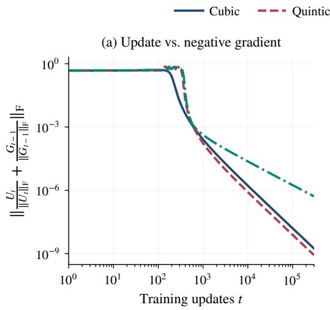

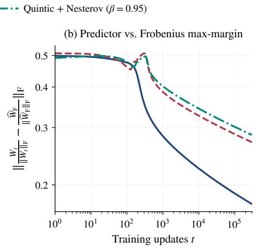  
Figure 3: Direction distances during Muon training with cubic, quintic, and quintic with Nesterovstyle momentum, under the experimental settings described in Section E.2. Results are averaged over five random seeds.