# HARNESS POLICY DISTILLATION: ALIGNING AGENT POLICIES WITH RUNTIME SEMANTICS

Junze Zhu<sup>1,2</sup> Weihao Chen<sup>1,2</sup> Zhiyang Zhou<sup>1,2</sup> Zhen Wu<sup>1,2∗</sup> Xinyu Dai<sup>1,2</sup>

<sup>1</sup>National Key Laboratory for Novel Software Technology, Nanjing University, China <sup>2</sup>School of Artificial Intelligence, Nanjing University, China {zhujz, chenwh, zhouzy}@smail.nju.edu.cn {wuz, daixinyu}@nju.edu.cn

Code | Model

## ABSTRACT

Deploying a general-purpose model as an agent means running it inside a productspecific runtime harness that decides which actions are executable, how state advances, and when the loop may terminate. Ordinary trajectory supervision shows which action was taken but leaves the runtime semantics behind that action implicit. We introduce Harness Policy Distillation (HPD), which makes these runtime control semantics an explicit training target alongside actions to align the harness policy. HPD replays reference trajectories through the harness to recover the runtime semantics that are implicit in ordinary trajectory data, and represents them as control documents at each model-call boundary. These documents provide privileged information for a teacher to generate actions, while harness verification ensures that the resulting targets are executable under the runtime contract. We jointly trains a shared model on the runtime semantics recovered from control-state privileged information and native history, thereby internalizing these semantics into the model policy. At deployment, the trained model uses the original harness interface without requiring the control document or any additional supplement. On TRAJECT-Bench with the Pi harness, Qwen3-8B trained with HPD reaches 22.98% autonomous task success and 49.23% runtime compliance, against 3.09% and 19.90% for the unadapted model. Harness-verified teacher actions substantially improve the native deployment policy, while joint control-state supervision provides further gains in task completion and runtime compliance. HPD turns executable runtime semantics into dense supervision for learning harness-compatible actions at each decision boundary.

## 1 INTRODUCTION

A general-purpose model becomes a deployed agent only inside a product-specific runtime harness. The harness serializes visible history, exposes an approved action interface, enforces permissions and workflow stages, inserts tool observations, schedules subsequent model calls, and defines valid termination (Yang et al., 2024; Wang et al., 2025). For an organization adapting a model to its own product, the relevant target is therefore not task competence or tool syntax alone, but a harness-bound policy whose actions remain executable under that product’s runtime contract.

Most post-training objectives supervise behavior without separately specifying the runtime control state on which that behavior depends. Demonstration and trajectory training maximize the likelihood of reference actions conditioned on observed histories, leaving the control state implicit in the mapping from history to action. Direct Preference Optimization (DPO) increases the relative likelihood of preferred outputs (Rafailov et al., 2023); Reinforcement learning with verifiable rewards (RLVR) optimizes expected return from executable checks (Shao et al., 2024; Guo et al., 2025), leaving the policy to infer reward-relevant control state through credit assignment. On-policy distillation (OPD) matches teacher behavior at student-generated prefixes (Agarwal et al., 2024), improving the coverage of states at which supervision is supplied while leaving the teacher’s action distribution as the direct target. These objectives can learn runtime-sensitive behavior, but their standard forms leave the underlying control state to be inferred through action, preference, reward, or teacher supervision.

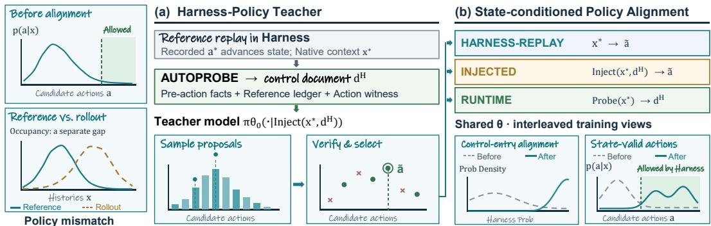  
Figure 1: Harness Policy Distillation. Left: agent model–harness policy mismatches. (a) Recorded actions advance replay; AUTOPROBE compiles control documents; teacher-model proposals are verified and ranked by reference similarity. (b) Three views train one shared model for native action prediction, document-conditioned action prediction, and document reconstruction.

Within an agent, the model selects actions while the harness governs their execution. We distinguish two sources of policy mismatch between them. Supervision mismatch arises when the histories used for supervision differ from those generated by the agent’s own rollout: a model may fit reference actions yet struggle to continue once its own actions lead to histories poorly covered during training (Ross et al., 2011; Bengio et al., 2015). Runtime-state mismatch arises when the model policy fails to reflect the harness’s current execution requirements. Even on a valid reference history, action labels leave implicit which obligations remain and whether termination is allowed; the model may therefore repeat completed work or stop while required work is still pending. The two problems interact through the closed loop: each action changes the successor state and hence the context of the next decision. Improving the conditional policy at replayed boundaries is therefore a concrete training target, while autonomous task completion measures its effect across an entire execution. Because each action changes the next runtime state and model context, a local error can affect later decisions.

The harness provides a complementary source of supervision: its execution history and runtime bookkeeping identify the obligations and lifecycle conditions that govern the next action. For example, tool availability alone does not indicate whether the corresponding obligation has already been completed. Learning the next action from a reference trajectory leaves this distinction implicit; explicitly supervising the boundary’s control state makes it a prediction. We therefore target this policy mismatch with explicit control-state and action supervision at replayed boundaries, and evaluate its effect through autonomous task completion.

To make this connection learnable, we propose Harness Policy Distillation (HPD), which couples explicit control-state supervision with harness-verified action targets to align the model policy with the runtime semantics governing execution. At each replayed boundary, HPD compiles runtime observations and reference-derived control annotations into a privileged control document. This document guides a sampling model to propose actions, while harness verification restricts the training targets to candidates consistent with the execution and reference-control requirements. Recorded actions advance replay while selected candidates provide training targets, preserving the reference histories on which the paired supervision is defined.

To internalize these control semantics without requiring the document during autonomous execution, HPD jointly trains three views of one shared model. RUNTIME uses the compiled document as a target for control-state prediction from native history; INJECTED teaches action selection with these conditions made explicit. HARNESS-REPLAY trains the same verified action from native context alone, so action learning also matches the input available at deployment. Together, these views connect explicit control supervision to native action selection. The trained model acts through the original harness without an external control document or an additional model call (Figure 1).

## 2 RELATED WORK

Trajectory learning and policy distillation. Policies trained by behavior cloning run on histories induced by their own actions, motivating interactive imitation and scheduled sampling (Ross et al., 2011; Bengio et al., 2015). Sequence models instead fit state–action trajectories directly (Chen et al., 2021; Janner et al., 2021), while knowledge distillation and language-model post-training transfer teacher sequences, demonstrations, or preferences (Hinton et al., 2015; Kim & Rush, 2016; Ouyang et al., 2022; Rafailov et al., 2023). On-policy distillation and agentic RL move supervision or reward toward student-generated prefixes (Agarwal et al., 2024; Shao et al., 2024; Guo et al., 2025). These methods primarily change the action target, reward, or visited occupancy; HPD instead adds runtime facts and reference-derived control labels as supervised targets at replayed decision boundaries.

Privileged and process supervision. Learning using privileged information introduces trainingtime variables that need not be available at inference (Vapnik & Vashist, 2009; Lopez-Paz et al., 2016). In self-distillation, privileged context lets a model supervise its counterpart without that context (Zhao et al., 2026a). π-Distill jointly trains a privileged-information-conditioned teacher and a student without that information using shared model parameters in multi-turn agentic environments (Penaloza et al., 2026). Process supervision identifies where a multistep solution becomes invalid (Uesato et al., 2022; Lightman et al., 2024). Training with Harnesses uses a harness-augmented current model as an on-policy self-teacher to internalize reasoning workflows (Zhao et al., 2026b). HPD pairs replay-derived control documents with actions selected by harness verification at the same decision boundary.

Tool agents and runtime harnesses. ReAct and tool-learning methods interleave language-model generation with environment actions or construct tool-use supervision (Yao et al., 2023; Schick et al., 2023; Yang et al., 2023; Qin et al., 2024). Interactive benchmarks make stateful execution central (Shridhar et al., 2021; Yao et al., 2022; Zhou et al., 2024; Liu et al., 2024; Mialon et al., 2024; Jimenez et al., 2024). SWE-agent and OpenHands further show that the agent interface, event stream, sandbox, and stopping rules are part of the deployed system (Yang et al., 2024; Wang et al., 2025). Evaluation work separates final task completion from intermediate progress and policy compliance (Ma et al., 2024; Yao et al., 2025; Lu et al., 2025). HPD uses this runtime lifecycle as a supervised object rather than treating it only as an external evaluator.

## 3 METHODOLOGY

## 3.1 CLOSED-LOOP EXECUTION UNDER A RUNTIME HARNESS

Let $q$ denote a task instance, comprising the request and execution resources, and H the target runtime harness. Its native initialization produces the initial state $s _ { 0 }$ from that instance. The state space $\boldsymbol { S _ { H } }$ contains complete runtime configurations: execution history, tool interfaces, and the control fields maintained by $H ,$ , including its permissions, scheduling state, obligation bookkeeping, and remaining budget. For replay, the fixture additionally supplies recorded tool-observation queues; their consumption positions are part of the state. Valid stopping states form $S _ { H } ^ { \mathrm { t e r m } } \subseteq S _ { H }$ . Add an absorbing failure state $\perp \notin S _ { H }$ for fatal contract violations or budget exhaustion, giving $\bar { S } _ { H } = S _ { H } \cup \{ \perp \}$ Assume finite execution and let B be the first index with $s _ { B } \mathbf { \bar { \in } } \mathbf { \mathcal { S } } _ { H } ^ { \mathrm { t e r m } } \cup \{ \bot \}$ }. For $b = 0 , \ldots , B - \mathrm { i } , \dot { s _ { b } }$ is the complete state immediately before model call $b ,$ and $x _ { b }$ is its serialized model-visible context.

Let $\mathcal { X } _ { H }$ be the space of native contexts and A the space of complete model outputs interpreted as actions, including tool calls and final responses. The harness exposes a serializer $\Omega _ { H } : { \cal S } _ { H }  \mathcal { X } _ { H }$ and a transition kernel:

$$
x _ { b } = \Omega _ { H } \big ( s _ { b } \big ) , \qquad T _ { H } : \bar { \mathcal { S } } _ { H } \times \mathcal { A }  \Delta ( \bar { \mathcal { S } } _ { H } ) ,\tag{1}
$$

where $\Delta$ denotes probability distributions over its argument space. $T _ { H } ( \cdot \mid s , a )$ is the successor law induced by executing action a from state s through the harness’s parsing, permission checks, tool execution, observation insertion, scheduling, and stopping code. The successor is the next pre-call state or the terminal/failure outcome. Terminal and failure states are absorbing; recoverable errors become observations in nonterminal states. Thus $T _ { H }$ is supplied by the runtime implementation, while the harness policy denotes its state-dependent execution and stopping rules.

For a nonterminal state s, the immediately admissible action set is

$$
\begin{array} { r } { \mathcal { A } _ { H } ( s ) = \left\{ a \in \mathcal { A } : T _ { H } ( \perp \mid s , a ) = 0 \right\} . } \end{array}\tag{2}
$$

For deterministic replay, admissible actions reach a successor in $ { \boldsymbol { S } } _ { H }$ . Reference-path agreement evaluates a sequence of decisions, while task success evaluates completed obligations, the answer, and termination. The model $\pi _ { \theta }$ assigns sequence probabilities given a textual prompt, with trainable parameters $\theta .$ Its harness action policy is $\pi _ { \boldsymbol { \theta } } ( \boldsymbol { a } \mid \boldsymbol { x } )$ for $x \in \mathcal { X } _ { H }$ . It generates the closed loop from the harness-initialized state $s _ { 0 } \colon$

$$
\begin{array} { r } { x _ { b } = \Omega _ { H } ( s _ { b } ) , \qquad a _ { b } \sim \pi _ { \theta } ( \cdot \mid x _ { b } ) , \qquad s _ { b + 1 } \sim T _ { H } ( \cdot \mid s _ { b } , a _ { b } ) . } \end{array}\tag{3}
$$

For a trajectory $\tau = ( s _ { 0 } , x _ { 0 } , a _ { 0 } , \ldots , s _ { B - 1 } , x _ { B - 1 } , a _ { B - 1 } , s _ { B } )$ with $x _ { b } = \Omega _ { H } ( s _ { b } )$ , conditioning on the task and initialization gives

$$
p _ { \theta , H } ( \tau \mid q , s _ { 0 } ) = \prod _ { b = 0 } ^ { B - 1 } \pi _ { \theta } ( a _ { b } \mid \Omega _ { H } ( s _ { b } ) ) T _ { H } ( s _ { b + 1 } \mid s _ { b } , a _ { b } ) .\tag{4}
$$

The executable agent is thus the process jointly induced by $\pi _ { \boldsymbol { \theta } } , \Omega _ { H }$ , and $T _ { H }$ . Each action determines a successor context, connecting boundary-level learning to closed-loop task completion.

## 3.2 RUNTIME SEMANTIC ALIGNMENT GAP

Policy distillation specifies both a context distribution $\mu$ and a teacher conditional $\pi ^ { \mathrm { { T } } } ( \cdot \mid x )$ over actions. Here $D _ { \mathrm { K I } }$ denotes forward Kullback–Leibler divergence, and E denotes averaging under the indicated distribution:

$$
\begin{array} { r } { \mathcal { L } _ { \mathrm { P D } } ( \boldsymbol { \theta } ; \mu , \boldsymbol { \pi } ^ { \mathrm { T } } ) = \mathbb { E } _ { \boldsymbol { x } \sim \mu } \left[ D _ { \mathrm { K L } } \big ( \boldsymbol { \pi } ^ { \mathrm { T } } ( \cdot \mid \boldsymbol { x } ) \big \| \pi _ { \boldsymbol { \theta } } ( \cdot \mid \boldsymbol { x } ) \big ) \right] . } \end{array}\tag{5}
$$

For a fixed task collection, $\mu _ { H } ^ { \star }$ is the empirical context distribution counting each replayed reference boundary once; $\mu _ { \boldsymbol { \theta } , H }$ normalizes the expected boundary counts under free rollout on that collection. Their discrepancy is the supervision mismatch; on-policy distillation moves supervision toward $\mu _ { \boldsymbol { \theta } , H }$

Runtime-state mismatch concerns the conditional target at a given boundary. An action label specifies what was emitted; runtime control labels additionally identify lifecycle stage, remaining obligations, ready calls, and termination conditions. HPD supervises these labels together with a verified action at reference-history boundaries. Verification yields retained records; uniform sampling of these records defines the context distribution $\mu _ { H } ^ { \mathrm { r e p } }$ . This filtering can change the relative weights of reference histories. Training fits the paired control and action targets there, and free rollout evaluates the resulting policy on its own successive decisions.

## 3.3 HARNESS POLICY DISTILLATION

HPD addresses this conditional-target gap by constructing paired control and action supervision at replayed reference boundaries (Figure 1). Reference actions advance the harness, while runtime observations and reference annotations are compiled into a privileged control document at each boundary. The frozen base model conditions on this document to propose actions, from which verification and near-reference selection produce the training target. The resulting context–document– action triples train one shared model through native-context action prediction, document-conditioned action prediction, and control-document reconstruction. At deployment, the model predicts actions directly from the native context.

Verified replay and control-document construction. Let $\tau ^ { \star }$ be a recorded task trajectory containing actions, tool observations, and reference stages; $a _ { b } ^ { \star }$ is its action aligned to the b-th harness invocation. Superscript ⋆ marks reference replay, and superscript H marks harness-specific annotations. Starting from native initialization $s _ { 0 } ^ { \star }$ , replay submits each $a _ { b } ^ { \star }$ to $H$ , supplies recorded observations from per-tool queues, and captures the resulting $s _ { b + 1 } ^ { \star }$ at the next boundary. The pre-action observation adapter Observe<sub>H</sub> reads accessible runtime fields into snapshot $o _ { b } ^ { H }$ ; the deterministic compiler $\Phi _ { H }$ maps that snapshot and the reference annotations to a textual control document $d _ { b } ^ { H }$ . Each retained boundary satisfies

$$
\begin{array} { r l } & { x _ { b } ^ { \star } = \Omega _ { H } ( s _ { b } ^ { \star } ) , \quad \quad o _ { b } ^ { H } = \mathrm { O b s e r v e } _ { H } ( s _ { b } ^ { \star } ) , } \\ & { d _ { b } ^ { H } = \Phi _ { H } ( o _ { b } ^ { H } ; \tau ^ { \star } , a _ { b } ^ { \star } ) , } \\ & { ~ a _ { b } ^ { \star } \in \mathcal { A } _ { H } ( s _ { b } ^ { \star } ) , \quad \quad T _ { H } ( s _ { b + 1 } ^ { \star } \mid s _ { b } ^ { \star } , a _ { b } ^ { \star } ) > 0 . } \end{array}\tag{6}
$$

The transition condition checks the successor actually produced by replay; for deterministic replay its probability is one. AUTOPROBE comprises Observe<sub>H</sub> and $\Phi _ { H }$ . The document $d _ { b } ^ { H }$ contains observed runtime facts, reference-stage progress, and witness-derived labels for the next control, ready frontier, and final permission. The latter fields provide privileged action information during training; field provenance and harness-specific adapters are detailed in Appendix B.

For illustration, specify a contract requiring lookup $( \mathrm { i } \mathsf { t e m \_ i d } = 4 2 )$ before a final response, and a replay queue containing value=7. Initially lookup is pending and finalization is blocked. Executing the recorded call consumes that observation, completes the lookup obligation, and enables finalization. The documents label these pre-action states as lookup=pending; final=blocked and lookup=complete; final=ready. These transitions follow from the specified contract.

Harness-verified privileged teacher. Let $\theta _ { 0 }$ be the frozen base-model parameters. The prompt constructor Injec $\cdot _ { H } ( x , d )$ supplies document d alongside native context x. The model samples K candidate actions $\tilde { a } _ { b } ^ { ( k ) }$ per attempt, where k indexes candidates; the accepted set is $\mathcal { A } _ { b } ^ { \mathrm { v e r } }$ and its selected action is $\tilde { a } _ { b } \mathrm { : }$

$$
\begin{array} { r l } & { \tilde { \boldsymbol { a } } _ { b } ^ { ( k ) } \sim \pi _ { \boldsymbol { \theta } _ { 0 } } \bigl ( \cdot \mid \mathrm { I n j e c t } _ { H } ( x _ { b } ^ { \star } , d _ { b } ^ { H } ) \bigr ) , \qquad k \in \{ 1 , \dots , K \} , } \\ & { \mathcal { A } _ { b } ^ { \mathrm { v e r } } = \biggl \{ \tilde { \boldsymbol { a } } _ { b } ^ { ( k ) } : V _ { H , b } \bigl ( \boldsymbol { s } _ { b } ^ { \star } , \tilde { \boldsymbol { a } } _ { b } ^ { ( k ) } \bigr ) = 1 \biggr \} , } \\ & { \quad \tilde { \boldsymbol { a } } _ { b } \in \mathcal { A } _ { b } ^ { \mathrm { v e r } } . } \end{array}\tag{7}
$$

$V _ { H , b } ( s , a ) \in \{ 0 , 1 \}$ checks admissibility, reference-stage consistency, and exact agreement with the recorded control decision, tool names, and complete normalized tool arguments. We select one verified candidate by cosine similarity to the reference over its remaining fields. The recorded action $a _ { b } ^ { \star }$ advances replay, while the selected $\tilde { a } _ { b }$ supplies the training target. Appendix B.3 details parameter replay, candidate selection, corrective resampling, and reference-based continuation during offline construction. Each retained record is the triple $( \bar { x _ { b } ^ { \star } } , d _ { b } ^ { H } , \tilde { a } _ { b } )$

Three-view training and native deployment. Let d range over control-document strings. The constructor Probe<sub>H</sub>(x) requests document prediction from native history without supplying the target document. Superscripts T, I, and R denote the three prompt contracts of one shared model:

$$
\begin{array} { r } { \pi _ { \theta } ^ { T } ( a \mid x ) = \pi _ { \theta } ( a \mid x ) , \phantom { a a a a a a a a a a a a a a a } } \\ { \pi _ { \theta } ^ { I } ( a \mid x , d ) = \pi _ { \theta } ( a \mid \mathrm { I n j e c t } _ { H } ( x , d ) ) , } \\ { \pi _ { \theta } ^ { R } ( d \mid x ) = \pi _ { \theta } ( d \mid \mathrm { P r o b e } _ { H } ( x ) ) . \phantom { a a a a a a a a a a a a a a a a a a a a a a a a a a a a a } } \end{array}\tag{8}
$$

HARNESS-REPLAY (T) predicts $\tilde { a } _ { b }$ from the native context; INJECTED (I) predicts the same action with $d _ { b } ^ { H }$ supplied; RUNTIME (R) predicts $d _ { b } ^ { H }$ from native history. These views connect history to control, control to action, and history directly to the deployed action through shared parameters. The paired document–action records define a joint teacher: R fits its document marginal, I its action conditional given the document, and T its native-runtime action marginal. By the KL chain rule, the R and I losses decompose joint-teacher matching; T directly supervises the deployment policy. Let $\mathcal { L } _ { T } , \mathcal { L } _ { I }$ , and $\mathcal { L } _ { R }$ be these conditional teacher-to-student KL losses averaged over retained records (Appendix F). Their weighted objective is

$$
{ \mathcal { L } } _ { \mathrm { H P D } } = \alpha _ { T } { \mathcal { L } } _ { T } + \alpha _ { I } { \mathcal { L } } _ { I } + \alpha _ { R } { \mathcal { L } } _ { R } , \qquad \alpha _ { T } + \alpha _ { I } + \alpha _ { R } = 1 .\tag{9}
$$

Here $\alpha _ { v } \geq 0$ is the supervision frequency for view $v \in \{ T , I , R \}$

Sequence-level distillation and implementation. For each view, let c be its prompt from Equation 8 and y its stored completion: $\tilde { a } _ { b }$ for T/I or $d _ { b } ^ { H }$ for R. The point mass $\delta _ { y }$ assigns probability one to y, including its completion boundary. With |y| tokens, token $y _ { j }$ , and target prefix $y _ { < j }$ , autoregressive factorization gives

$$
D _ { \mathrm { K L } } ( \delta _ { y } \parallel \pi _ { \theta } ( \cdot \mid c ) ) = - \log \pi _ { \theta } ( y \mid c ) = - \sum _ { j = 1 } ^ { | y | } \log \pi _ { \theta } ( y _ { j } \mid c , y _ { < j } ) .\tag{10}
$$

Teacher-forced token prediction thus implements sequence-level forward KL for each hard target (Kim & Rush, 2016). Averaging per-record NLLs recovers each view’s conditional teacher KL up to a constant teacher entropy; Appendix F derives this aggregation for shared prompts. The implemented loss $\ell _ { \theta } ( y , c ) = - \log \pi _ { \theta } ( y \mid c ) / | y |$ weights each sequence KL by inverse completion length, putting documents, final responses, and tool-call waves on a per-token scale. Training uses stored targets and cycles through view-specific batches. Deployment uses only $\pi _ { \theta } ^ { T } ( \cdot \mid x )$ ; the full implemented objective is given in Appendix F.

## 4 EXPERIMENTS

## 4.1 SETUP

We evaluate Qwen3-8B (Yang et al., 2025) with LoRA adaptation (Hu et al., 2022) on 583 held-out TRAJECT-Bench tasks (He et al., 2026). Table 1 compares HPD with the base model and supervised, preference, reinforcement-learning, and distillation baselines. We report task success (TS), finalanswer F1, gold-history action accuracy (Action-Acc), reference-prefix success (Step-SR), runtime compliance (RC), and exact-path success (Exact), all produced by pi-runtime. We then test component and schedule effects, boundary behavior, adaptation across models and harnesses, and transfer to a new task collection. Appendices C and E specify the training, baseline implementations, seed study, and metric definitions.

## 4.2 MAIN COMPARISON

Table 1: Qwen3-8B comparison on TRAJECT-Bench/Pi. Scores (%) are from pi-runtime; TS, RC, and Exact use 583 cases. HPD-T and HPD share document-conditioned, verifier-selected teacher targets; HPD-T trains only the Harness-Replay (T) view, while HPD adds I/R. Baselines are detailed in Appendix C.
<table><tr><td>Method</td><td>Supervision source</td><td>TS</td><td>F1</td><td>Step-SR</td><td>RC</td><td>Exact</td><td>Action-Acc</td></tr><tr><td>Base</td><td></td><td>3.09</td><td>26.82</td><td>26.45</td><td>19.90</td><td>2.57</td><td>53.41</td></tr><tr><td>SFT</td><td>Ground truth</td><td>2.06</td><td>2.40</td><td>47.20</td><td>55.92</td><td>1.72</td><td>2.06</td></tr><tr><td>DPO</td><td>Preference labels</td><td>7.20</td><td>33.62</td><td>11.12</td><td>25.56</td><td>5.15</td><td>72.38</td></tr><tr><td>GiGPO</td><td>Task reward</td><td>4.46</td><td>29.65</td><td>26.17</td><td>21.61</td><td>3.43</td><td>54.63</td></tr><tr><td>GRPO</td><td>Task reward</td><td>3.43</td><td>27.59</td><td>25.79</td><td>20.41</td><td>2.74</td><td>54.35</td></tr><tr><td>GSPO</td><td>Task reward</td><td>7.72</td><td>37.61</td><td>13.46</td><td>28.64</td><td>6.69</td><td>54.30</td></tr><tr><td>GDPO</td><td>Task reward</td><td>4.63</td><td>35.04</td><td>19.07</td><td>23.50</td><td>3.77</td><td>54.11</td></tr><tr><td>OPD</td><td>Teacher model</td><td>15.61</td><td>41.04</td><td>57.76</td><td>66.21</td><td>14.07</td><td>59.91</td></tr><tr><td>OPSD</td><td>Privileged info</td><td>13.55</td><td>26.27</td><td>55.98</td><td>26.93</td><td>10.98</td><td>63.97</td></tr><tr><td>OPHSD</td><td>Teacher + harness</td><td>3.09</td><td>29.45</td><td>27.66</td><td>19.73</td><td>2.06</td><td>53.22</td></tr><tr><td>TurnOPD</td><td>Teacher model</td><td>9.43</td><td>29.02</td><td>50.70</td><td>44.77</td><td>6.52</td><td>59.77</td></tr><tr><td>HPD-T</td><td>Harness runtime</td><td>20.58</td><td>39.96</td><td>59.25</td><td>43.74</td><td>15.61</td><td>61.40</td></tr><tr><td>HPD</td><td>Harness runtime</td><td>22.98</td><td>41.22</td><td>63.79</td><td>49.23</td><td>18.70</td><td>64.95</td></tr></table>

Table 1 separates local ranking (Action-Acc), execution (Step-SR and RC), answer overlap (F1), and completion (TS and Exact). HPD-T reaches 20.58 TS, above the strongest baseline, OPD at 15.61. Full HPD leads in TS, F1, Step-SR, and Exact: its 22.98 TS is 43 completed tasks above OPD (7.38 points; 47.3% relative). The five-seed paired analysis supports both TS differences (Appendix C.5).

Reference supervision: SFT and DPO. SFT raises RC from 19.90 to 55.92 and Step-SR from 26.45 to 47.20, yet lowers TS from 3.09 to 2.06 and F1 from 26.82 to 2.40. Fitting recorded gold actions improves reference-path metrics here without preserving answer quality or task completion under Pi deployment, illustrating the mismatch introduced in the Introduction. DPO achieves the best Action-Acc alongside 11.12 Step-SR and 7.20 TS. Its advantage is local reference-action ranking; its rollout follows the reference prefix less often. RC separately measures compliance with the execution contract. Together, these metrics distinguish fitting the next reference action, maintaining its reference path, and completing an executable task.

Task rewards: GRPO and its variants. GiGPO and GRPO give modest TS gains (4.46 and 3.43), with Step-SR (26.17 and 25.79) close to Base. GSPO leads the reward-based baselines in TS and F1 (7.72 and 37.61); GDPO reaches 35.04 F1 but only 4.63 TS. Their Step-SR values (13.46 and 19.07) show that higher answer overlap need not sustain the reference path.

Model teachers: self-distillation and OPD. OPHSD leaves TS at 3.09. OPSD reaches 13.55 TS and 55.98 Step-SR with F1 near Base (26.27 versus 26.82), showing stronger execution without higher answer overlap. OPD achieves the highest RC (66.21), with 57.76 Step-SR, 15.61 TS, and 14.07 Exact at 41.04 F1. TurnOPD also improves reference-prefix execution and compliance over Base, reaching 50.70 Step-SR, 44.77 RC, 9.43 TS, and 6.52 Exact. OPD has the highest RC, while HPD’s higher TS shows that compliance and completed tasks rank differently.

Harness-verified replay and runtime semantics. HPD-T uses the same document-conditioned, verifier-selected teacher as Full HPD, but trains only the native replay-action view. Relative to OPD, it gains 4.97 TS points and 1.54 Exact points while its mean F1 is slightly lower (39.96 versus 41.04). The verified-target and native-action pipeline thus improves closed-loop completion. Adding I/R training views raises TS by another 2.40 points, Step-SR by 4.54 points, and Exact by 3.09 points. The runtime semantics injection and control-document views contribute to this second gain.

## 4.3 CROSS-BENCHMARK ROBUSTNESS STUDY

We evaluate the TRAJECT-Bench-trained checkpoints on 92 BFCL v4 cases (Patil et al., 2025) without BFCL-specific training. BFCL supplies new tasks and default tool execution; the Pi agent, checkpoints, and model-side settings remain fixed (Appendix C.6). Full HPD reaches 21.74 TS, and 48.12 Step-SR versus Base’s 13.04, and 42.03. HPD-T reaches 13.04 TS, and 46.16 Step-SR: adding I/R raises TS by 8.70 and Step-SR by 1.96 points.

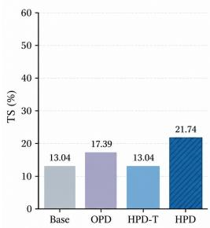

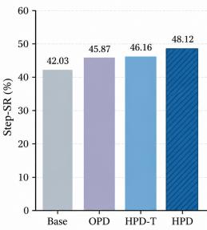

HPD-T improves answer overlap and prefix execution over Base but not task completion. On these new tasks, Full HPD’s completion gain is consistent with I/R connecting replay actions to Pi’s pending obligations and termination beyond

Figure 2: Zero-shot transfer to BFCL v4 from above checkpoints without specific training.

source-task patterns. When the test tasks extend beyond the range of trajectories encountered during training, the performance gains of HPD-T drop significantly; in contrast, HPD reinforces the alignment of the harness policy—rather than overfitting to a specific task distribution—by leveraging runtime semantic training (I/R), which accounts for its superior generalization capabilities.

## 4.4 HPD COMPONENTS AND TRAINING SCHEDULE

Table 2 compares the replay-action view and control-document views at matched exposure: each active view sees 20k training batches. Joint variants interleave view updates, whereas staged variants apply 20k batches per view in consecutive phases. Appendix C.2 explains the bookkeeping.

Table 2: Qwen3-8B HPD component and schedule ablation with 20k training batches per active view. T is the replay-action view; I and R are the injected- and runtime-document views. Arrows denote consecutive phases. Scores are percentages from pi-runtime.
<table><tr><td>HPD variant</td><td>TS</td><td>F1</td><td>Step-SR</td><td>RC</td><td>Exact</td><td>Action-Acc</td></tr><tr><td>HPD-T</td><td>20.58</td><td>39.96</td><td>59.25</td><td>43.74</td><td>15.61</td><td>61.40</td></tr><tr><td>T→I (staged)</td><td>18.01</td><td>40.23</td><td>47.99</td><td>34.99</td><td>14.24</td><td>64.07</td></tr><tr><td>T→R (staged)</td><td>7.03</td><td>17.47</td><td>37.29</td><td>18.35</td><td>5.15</td><td>56.64</td></tr><tr><td>T+I joint (without R)</td><td>20.58</td><td>39.66</td><td>56.92</td><td>41.68</td><td>14.92</td><td>62.90</td></tr><tr><td>T+R joint (without I)</td><td>20.58</td><td>40.63</td><td>63.13</td><td>48.03</td><td>16.81</td><td>62.80</td></tr><tr><td>Full HPD (T+I+R joint)</td><td>22.98</td><td>41.22</td><td>63.79</td><td>49.23</td><td>18.70</td><td>64.95</td></tr></table>

Using HPD-T as the anchor, the two-view rows distinguish the contributions of I and R before combining all three views. T+R improves Step-SR from 59.25 to 63.13 and RC from 43.74 to 48.03 while TS stays at 20.58; T+I also leaves TS unchanged and lowers both execution metrics. Only the joint T/I/R run raises TS beyond HPD-T, suggesting that I and R contribute to completion in combination rather than as independent additions.

Training order matters: T→R drops TS from 20.58 to 7.03 and RC from 43.74 to 18.35; T→I also degrades closed-loop performance. At matched updates and per-view exposure, both joint pairs outperform their staged counterparts on TS and RC. Interleaving retains replay-action supervision throughout training, while staging ends on an auxiliary target.

## 4.5 TOKEN DISTRIBUTIONS AND STATE-CONDITIONED ACTION ALIGNMENT

At the same replayed decision boundaries, we examine three aspects of action formation: confidence in the reference control entry, uncertainty over the reference-conditioned continuation, and validity of the action generated without a reference prefix. Figure 3 compares Base, SFT, GRPO, and HPD; Appendix E.1 defines the measurements.

(a)  
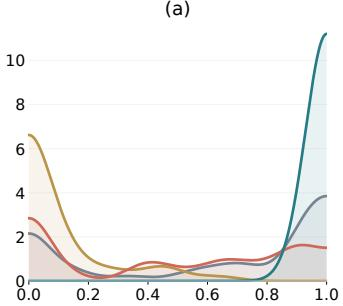

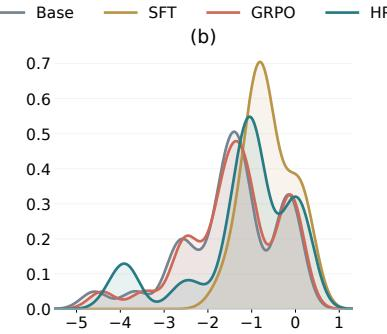

(c)  
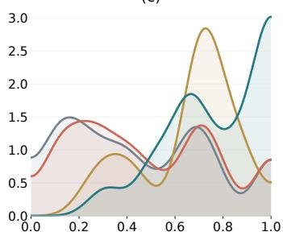  
Figure 3: Control entry and reference-conditioned continuation. At identical harness states: (a) probability of the reference harness control token; (b) $\log _ { 1 0 }$ of mean full-vocabulary predictive entropy in bits; (c) geometric mean reference-token probability. Continuation statistics use reference prefixes, exclude the initial control token, and cover at most 63 positions. KDEs share a bandwidth across models within each panel and integrate to one in the plotted coordinate.

In panel (a), HPD assigns a mean probability of 0.9962 to the reference control entry, compared with 0.6242 for Base, 0.5087 for GRPO, and 0.1296 for SFT. This is alignment with the reference entry at a supplied boundary; SFT can score higher on rollout compliance while assigning less probability to that particular entry.

Panel (b) examines the distribution of continuation entropy across those boundaries. SFT’s density shifts toward higher entropy and loses much of the low-entropy mass visible for Base. HPD and GRPO retain substantial overlap with Base, even as HPD’s reference control-entry confidence rises sharply. HPD’s stronger execution alignment thus coexists with a broadly overlapping reference-conditioned entropy profile, rather than a uniform concentration of continuation predictions.

In panel (c), SFT and HPD assign similar median probabilities to reference continuation tokens under the correct prefixes (0.7038 and 0.6966). When they generate complete actions from their own prefixes, however, the state-validity rates in this diagnostic are 7.40% and 81.48%, respectively. An action couples its control entry to a continuation generated from the model’s own earlier tokens. Neither the entry score in panel (a) nor a reference-conditioned continuation score tests that complete action. HPD’s T view fits verifier-approved actions, while I/R tie those actions to the runtime state during training. The contrast echoes the main comparison: SFT’s Step-SR and RC improve, but F1 and TS fall. Free rollout tests whether this state–action link holds across successive decisions.

## 4.6 ADAPTATION ACROSS ARCHITECTURES AND HARNESSES

Figure 4 shows higher TS and F1 across all evaluated architectures and harnesses after separate adaptation. Each within-study Base–HPD pair measures the effect of applying the same construction and training procedure to that configuration. Llama3-8B gains 20.07 TS points (Base TS: 0), while Gemma4-12B (Gemma Team et al., 2026) gains 16.47 points and Qwen3-30B-A3B (Yang et al., 2025) gains 12.69 points. Separate adapters for ReAct, Compiler, and OpenCode gain 9.44–18.35 TS points across different scheduling, dependency, and permission semantics. Each adaptation rebuilds replay, control documents, and verification for its harness while retaining the T/I/R objective and native-runtime deployment. The two axes stress different parts of HPD: the backbone comparison changes the policy under Pi, whereas the harness comparison changes the execution contract under Qwen3-8B. In each setting, replay and verification construct compatible action targets, and T/I/R connects them to native execution. The consistent gains support portability of this construction across both model and runtime changes.

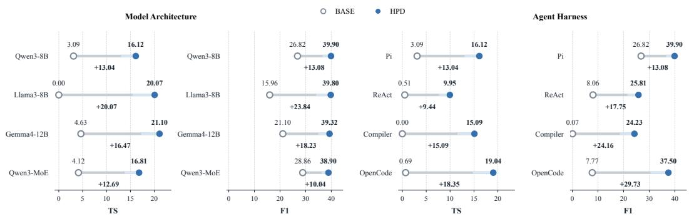  
Figure 4: TS and F1 across model architectures (left two panels) and separately adapted harnesses (right two panels). All scores are percentages. The Qwen3-8B/Pi Base scores match Table 1; its HPD scores use the 20k-optimizer-step checkpoint.

## 4.7 API MODEL DEPLOYMENT REFERENCES

Figure 5 places HPD beside four API-accessed models under the same Pi agent, TRAJECT-Bench tasks, and evaluation settings. HPD reaches 22.98 TS versus 22.30 for DeepSeek V4 Flash, while GPT-5.4-mini reaches 41.92 F1 versus 41.22 for HPD. HPD uses the same checkpoint as in Table 1; the API rows replace only the model backend. The different TS and F1 rankings are consistent with HPD’s training target: verifier-selected actions and control documents supervise the obligation and termination behavior that TS measures alongside answer quality.

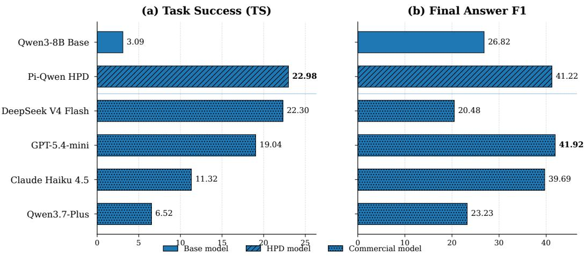  
Figure 5: Task success and final-answer F1 for the Qwen3-8B Base model, Pi-Qwen HPD, and API-accessed models in the same Pi agent and evaluation setup. Values are percentages.

## 5 CONCLUSION

Our study addresses policy mismatch between the model and harness within an agent by targeting runtime-state mismatch. It teaches the model both what to do and which execution conditions to account for. HPD turns executable runtime contracts into verified action targets and explicit control supervision and three shared-parameter views T, I, R, connect them to the native deployment policy. On TRAJECT-Bench with Pi, HPD reaches 22.98 task success versus OPD’s 15.61 at nearly equal aggregate F1. HPD-T already benefits from verified action supervision, while joint control-state training further improves completion. This benefit extends to new tasks: on 92 BFCL v4 cases without retraining, Full HPD reaches 21.74% task success versus HPD-T’s 13.04%. Separate adaptations improve performance across model backbones and harnesses. Deployment retains a single model and the existing agent interface, without an external control document. Together, these results support aligning agent policies not only with task actions, but also with the runtime semantics that govern execution.

## REFERENCES

Rishabh Agarwal, Nino Vieillard, Yongchao Zhou, et al. On-policy distillation of language models: Learning from self-generated mistakes. In International Conference on Learning Representations, 2024. URL https://proceedings.iclr.cc/paper\_files/paper/2024/hash/ 5be69a584901a26c521c2b51e40a4c20-Abstract-Conference.html.

Samy Bengio, Oriol Vinyals, Navdeep Jaitly, and Noam Shazeer. Scheduled sampling for sequence prediction with recurrent neural networks. In Advances in Neural Information Processing Systems, volume 28, 2015. URL https://proceedings.neurips.cc/paper\_files/paper /2015/hash/e995f98d56967d946471af29d7bf99f1-Abstract.html.

Lili Chen, Kevin Lu, Aravind Rajeswaran, et al. Decision transformer: Reinforcement learning via sequence modeling. In Advances in Neural Information Processing Systems, volume 34, 2021. URL https://proceedings.neurips.cc/paper\_files/paper/2021/hash/7 f489f642a0ddb10272b5c31057f0663-Abstract.html.

Lang Feng, Zhenghai Xue, Tingcong Liu, and Bo An. Group-in-group policy optimization for LLM agent training. In Advances in Neural Information Processing Systems, volume 38, 2025. URL https://proceedings.neurips.cc/paper\_files/paper/2025/hash/420c9 f777c0b4f78d515e53cf74d58b2-Abstract-Conference.html.

Gemma Team et al. Gemma 4 technical report. arXiv preprint arXiv:2607.02770, 2026. URL https://arxiv.org/abs/2607.02770.

Daya Guo, Dejian Yang, Haowei Zhang, et al. DeepSeek-R1 incentivizes reasoning in LLMs through reinforcement learning. Nature, 645(8081):633–638, 2025. doi: 10.1038/s41586-025-09422-z. URL https://www.nature.com/articles/s41586-025-09422-z.

Pengfei He, Zhenwei Dai, Bing He, Hui Liu, Xianfeng Tang, Hanqing Lu, Juanhui Li, Jiayuan Ding, Subhabrata Mukherjee, Suhang Wang, Yue Xing, Jiliang Tang, and Benoit Dumoulin. TRAJECT-Bench: A trajectory-aware benchmark for evaluating agentic tool use. In International Conference on Learning Representations, 2026. URL https://openreview.net/forum?id=TZWn WvsQ0X.

Geoffrey Hinton, Oriol Vinyals, and Jeff Dean. Distilling the knowledge in a neural network. arXiv preprint arXiv:1503.02531, 2015. URL https://arxiv.org/abs/1503.02531. Presented at the NIPS 2014 Deep Learning Workshop.

Edward J. Hu, Yelong Shen, Phillip Wallis, et al. LoRA: Low-rank adaptation of large language models. In International Conference on Learning Representations, 2022. URL https://open review.net/forum?id=nZeVKeeFYf9.

Michael Janner, Qiyang Li, and Sergey Levine. Offline reinforcement learning as one big sequence modeling problem. In Advances in Neural Information Processing Systems, volume 34, 2021. URL https://proceedings.neurips.cc/paper\_files/paper/2021/hash/0 99fe6b0b444c23836c4a5d07346082b-Abstract.html.

Carlos E. Jimenez, John Yang, Alexander Wettig, et al. SWE-bench: Can language models resolve real-world GitHub issues? In International Conference on Learning Representations, 2024. URL https://proceedings.iclr.cc/paper\_files/paper/2024/hash/edac78c3 e300629acfe6cbe9ca88fb84-Abstract-Conference.html.

Yoon Kim and Alexander M. Rush. Sequence-level knowledge distillation. In Proceedings of the 2016 Conference on Empirical Methods in Natural Language Processing, pp. 1317–1327. Association for Computational Linguistics, 2016. doi: 10.18653/v1/D16-1139. URL https: //aclanthology.org/D16-1139/.

Hunter Lightman, Vineet Kosaraju, Yura Burda, et al. Let’s verify step by step. In International Conference on Learning Representations, 2024. URL https://proceedings.iclr.cc/ paper\_files/paper/2024/hash/aca97732e30bcf1303bc22ac3924fd16-Abs tract-Conference.html.

Shih-Yang Liu, Xin Dong, Ximing Lu, et al. GDPO: Group reward-decoupled normalization policy optimization for multi-reward RL optimization. In Proceedings ofthe 43rd International Conference on Machine Learning, 2026. URL https://openreview.net/forum?id= Y1rHxA58If.

Xiao Liu, Hao Yu, Hanchen Zhang, et al. AgentBench: Evaluating LLMs as agents. In International Conference on Learning Representations, 2024. URL https://proceedings.iclr.cc/ paper\_files/paper/2024/hash/e9df36b21ff4ee211a8b71ee8b7e9f57-Abs tract-Conference.html.

David Lopez-Paz, Léon Bottou, Bernhard Schölkopf, and Vladimir Vapnik. Unifying distillation and privileged information. In International Conference on Learning Representations, 2016. URL https://arxiv.org/abs/1511.03643.

Jiarui Lu, Thomas Holleis, Yizhe Zhang, et al. ToolSandbox: A stateful, conversational, interactive evaluation benchmark for LLM tool use capabilities. In Findings of the Association for Computational Linguistics: NAACL 2025, pp. 1160–1183. Association for Computational Linguistics, 2025. doi: 10.18653/v1/2025.findings-naacl.65. URL https: //aclanthology.org/2025.findings-naacl.65/.

Chang Ma, Junlei Zhang, Zhihao Zhu, et al. AgentBoard: An analytical evaluation board of multi-turn LLM agents. In Advances in Neural Information Processing Systems, volume 37, 2024. URL https://proceedings.neurips.cc/paper\_files/paper/2024/hash/877b4 0688e330a0e2a3fc24084208dfa-Abstract-Datasets\_and\_Benchmarks\_Tra ck.html.

Grégoire Mialon, Clémentine Fourrier, Craig Swift, et al. GAIA: A benchmark for general AI assistants. In International Conference on Learning Representations, 2024. URL https: //proceedings.iclr.cc/paper\_files/paper/2024/hash/25ae35b5b1738d 80f1f03a8713e405ec-Abstract-Conference.html.

Long Ouyang, Jeffrey Wu, Xu Jiang, et al. Training language models to follow instructions with human feedback. In Advances in Neural Information Processing Systems, volume 35, 2022. URL https://proceedings.neurips.cc/paper\_files/paper/2022/hash/b1efd e53be364a73914f58805a001731-Abstract-Conference.html.

Shishir G Patil, Huanzhi Mao, Fanjia Yan, Charlie Cheng-Jie Ji, Vishnu Suresh, Ion Stoica, and Joseph E. Gonzalez. The berkeley function calling leaderboard (BFCL): From tool use to agentic evaluation of large language models. In Proceedings of the 42nd International Conference on Machine Learning, volume 267 of Proceedings ofMachine Learning Research, pp. 48371–48392. PMLR, 2025. URL https://proceedings.mlr.press/v267/patil25a.html.

Emiliano Penaloza, Dheeraj Vattikonda, Nicolas Gontier, Alexandre Lacoste, Laurent Charlin, and Massimo Caccia. Privileged information distillation for language models. In Proceedings ofthe 43rd International Conference on Machine Learning, 2026. URL https://arxiv.org/ab s/2602.04942.

Yujia Qin, Shihao Liang, Yining Ye, et al. ToolLLM: Facilitating large language models to master 16000+ real-world APIs. In International Conference on Learning Representations, 2024. URL https://proceedings.iclr.cc/paper\_files/paper/2024/hash/28e50ee5 b72e90b50e7196fde8ea260e-Abstract-Conference.html.

Rafael Rafailov, Archit Sharma, Eric Mitchell, et al. Direct preference optimization: Your language model is secretly a reward model. In Advances in Neural Information Processing Systems, volume 36, 2023. URL https://proceedings.neurips.cc/paper\_files/paper /2023/hash/a85b405ed65c6477a4fe8302b5e06ce7-Abstract-Conference. html.

Stéphane Ross, Geoffrey J. Gordon, and J. Andrew Bagnell. A reduction of imitation learning and structured prediction to no-regret online learning. In Proceedings ofthe Fourteenth International Conference on Artificial Intelligence and Statistics, volume 15, pp. 627–635. PMLR, 2011. URL https://proceedings.mlr.press/v15/ross11a.html.

Timo Schick, Jane Dwivedi-Yu, Roberto Dessì, et al. Toolformer: Language models can teach themselves to use tools. In Advances in Neural Information Processing Systems, volume 36, 2023. URL https://proceedings.neurips.cc/paper\_files/paper/2023/hash/d 842425e4bf79ba039352da0f658a906-Abstract-Conference.html.

Zhihong Shao, Peiyi Wang, Qihao Zhu, et al. DeepSeekMath: Pushing the limits of mathematical reasoning in open language models. arXiv preprint arXiv:2402.03300, 2024. URL https: //arxiv.org/abs/2402.03300.

Mohit Shridhar, Xingdi Yuan, Marc-Alexandre Côté, et al. ALFWorld: Aligning text and embodied environments for interactive learning. In International Conference on Learning Representations, 2021. URL https://openreview.net/forum?id=0IOX0YcCdTn.

Jonathan Uesato, Nate Kushman, Ramana Kumar, et al. Solving math word problems with processand outcome-based feedback. arXiv preprint arXiv:2211.14275, 2022. URL https://arxiv. org/abs/2211.14275. Presented at the NeurIPS 2022 MATH-AI Workshop.

Vladimir Vapnik and Akshay Vashist. A new learning paradigm: Learning using privileged information. Neural Networks, 22(5–6):544–557, 2009. doi: 10.1016/j.neunet.2009.06.042.

Xingyao Wang, Boxuan Li, Yufan Song, et al. OpenHands: An open platform for AI software developers as generalist agents. In International Conference on Learning Representations, 2025. URL https://proceedings.iclr.cc/paper\_files/paper/2025/hash/a4b6 ad6b48850c0c331d1259fc66a69c-Abstract-Conference.html.

An Yang, Anfeng Li, Baosong Yang, et al. Qwen3 technical report. arXiv preprint arXiv:2505.09388, 2025. URL https://arxiv.org/abs/2505.09388.

John Yang, Carlos E. Jimenez, Alexander Wettig, et al. SWE-agent: Agent-computer interfaces enable automated software engineering. In Advances in Neural Information Processing Systems, volume 37, 2024. URL https://proceedings.neurips.cc/paper\_files/paper /2024/hash/5a7c947568c1b1328ccc5230172e1e7c-Abstract-Conference. html.

Rui Yang, Lin Song, Yanwei Li, et al. GPT4Tools: Teaching large language model to use tools via self-instruction. In Advances in Neural Information Processing Systems, volume 36, 2023. URL https://proceedings.neurips.cc/paper\_files/paper/2023/hash/e3936 77793767624f2821cec8bdd02f1-Abstract-Conference.html.

Shunyu Yao, Howard Chen, John Yang, and Karthik Narasimhan. WebShop: Towards scalable real-world web interaction with grounded language agents. In Advances in Neural Information Processing Systems, volume 35, 2022. URL https://proceedings.neurips.cc/pap er\_files/paper/2022/hash/82ad13ec01f9fe44c01cb91814fd7b8c-Abstr act-Conference.html.

Shunyu Yao, Jeffrey Zhao, Dian Yu, et al. ReAct: Synergizing reasoning and acting in language models. In International Conference on Learning Representations, 2023. URL https://open review.net/forum?id=WE\_vluYUL-X.

Shunyu Yao, Noah Shinn, Pedram Razavi, and Karthik Narasimhan. τ-bench: A benchmark for tool-agent-user interaction in real-world domains. In International Conference on Learning Representations, 2025. URL https://proceedings.iclr.cc/paper\_files/pape r/2025/hash/1b126cc38b8638e07bef37e7b2bb72bf-Abstract-Conference. html.

Siyan Zhao, Zhihui Xie, Mengchen Liu, Jing Huang, Guan Pang, Feiyu Chen, and Aditya Grover. Self-distilled reasoner: On-policy self-distillation for large language models. In Proceedings of the 43rd International Conference on Machine Learning, 2026a. URL https://openreview.n et/forum?id=Jpxfof0EaS.

Zhengyang Zhao, Lu Ma, and Wentao Zhang. Training with harnesses: On-policy harness selfdistillation for complex reasoning. arXiv preprint arXiv:2605.08741, 2026b. URL https: //arxiv.org/abs/2605.08741.

Chujie Zheng, Shixuan Liu, Mingze Li, et al. Group sequence policy optimization. arXiv preprint arXiv:2507.18071, 2025. URL https://arxiv.org/abs/2507.18071.

Shuyan Zhou, Frank F. Xu, Hao Zhu, et al. WebArena: A realistic web environment for building autonomous agents. In International Conference on Learning Representations, 2024. URL https://proceedings.iclr.cc/paper\_files/paper/2024/hash/4410c071 1e9154a7a2d26f9b3816d1ef-Abstract-Conference.html.

Yuhang Zhou, Kai Zheng, Haoling Li, Dengyun Peng, Can Xu, and Jingjing Chen. TurnOPD: Making on-policy distillation turn-aware for efficient long-horizon agent training. arXiv preprint arXiv:2607.05804, 2026. URL https://arxiv.org/abs/2607.05804.

## A SCOPE AND LIMITATIONS

Harness-specific adaptation. HPD trains policies for a specified runtime contract. Applying the method to another harness requires reconstructing its teacher and training a separate adapter, as in Figure 4. The experiments evaluate this per-harness adaptation procedure. Reference replay supplies successful reference prefixes as the training distribution.

Verifier coverage and privileged information. Teacher construction requires exact agreement on the designated harness-policy and tool-call portions of the reference. The TRAJECT-Bench evaluation verifier checks tool names, required keys, control flow, and termination using fixed replay queues for tool outputs. Required-key matching defines its argument-level criterion. The control document combines pre-action observations with reference-ledger and action-witness labels. These labels supply privileged supervision during teacher construction and training; deployment acts directly from the native context. The component ablations evaluate the document views as complete supervision units.

Online extension. Reference replay primarily covers successful recorded prefixes. Extending training to states reached after deployment errors would require verified corrections for those states.

## B REPLAY CONSTRUCTION DETAILS

Figure 6 summarizes the workflow from verified replay through joint training to closed-loop agent deployment.

```latex
Offline teacher construction at boundary b
Reference prefix $\xrightarrow { \mathrm { r e p l a y i n } H } $ state $s _ { b } ^ { \star }$ and native context $\boldsymbol { x } _ { b } ^ { \star }$
Pre-action facts + reference ledger + action witness $a _ { b } ^ { \star } \xrightarrow { \mathrm { A U T O P R O B E } } d _ { b } ^ { H }$
Frozen model $\pi _ { \boldsymbol { \theta } _ { 0 } } ( \cdot \mid \mathrm { I n j e c t } _ { H } ( x _ { b } ^ { \star } , d _ { b } ^ { H } ) ) \xrightarrow { K = 2 } \quad$ candidate actions
Harness verification −→ nearest-reference selection −→ one hard target $\tilde { a } _ { b }$
The recorded action $a _ { b } ^ { \star }$ advances replay; $\tilde { a } _ { b }$ supervises training.
⇓ retained record $( x _ { b } ^ { \star } , d _ { b } ^ { H } , \tilde { a } _ { b } )$
One shared student, three interleaved training views
T: HARNESS-REPLAY native context x<sup>⋆</sup><sub>b</sub> $\tilde { a } _ { b }$
I: INJECTED injected context $\begin{array} { r l } { ( x _ { b } ^ { \star } , d _ { b } ^ { H } ) } & { { } \longrightarrow \tilde { a } _ { b } } \end{array}$
R: RUNTIME probe of native context $\begin{array} { r l } { \dot { x _ { b } ^ { \star } } } & { { } \longrightarrow d _ { b } ^ { H } } \end{array}$
${ \mathcal { L } } _ { \mathrm { H P D } } = \alpha _ { T } { \mathcal { L } } _ { T } + \alpha _ { I } { \mathcal { L } } _ { I } + \alpha _ { R } { \mathcal { L } } _ { R }$
⇓ Deployment: native context $x _ { b } \longrightarrow \pi _ { \theta } ^ { T } \longrightarrow a _ { b } \longrightarrow { \cal H }$
No control document or additional model call at deployment.
```

Figure 6: Overview of Harness Policy Distillation. Reference trajectories are replayed through the target harness; at each retained model-call boundary the runtime state is compiled into a control document, the frozen base model is queried with that document, and the verified candidate nearest the recorded trajectory becomes the hard action target. One shared student is trained on native-runtime action prediction, document-conditioned action prediction, and document reconstruction.

## B.1 ASSUMPTIONS AND HARNESS ADAPTATION

Replay requires five conditions: each recorded action must be executable under the target harness; the pre-action runtime prefix must be available at every model-call boundary; observed fields must be computed only from that prefix; privileged control annotations must declare their replay provenance; and the successor transition must be verifiable. The recorded action is one executable witness that reconstructs the reference path. The selected verified model candidate supplies the action-training target. At each boundary, AUTOPROBE compiles the control document, the frozen base model is queried with the document-injected context, and candidate actions are checked by the harness verifier. The main replay state is then advanced with the recorded action, while recorded tool observations are consumed through a per-tool queue stored in runtime state. Unconsumed future observations remain an execution fixture and are not exposed to the model-visible prefix. The construction stores the selected verified hard target rather than teacher logits.

Adapting HPD to a new harness requires definitions of the deployment serializer $\Omega _ { H }$ , transition law $T _ { H } ,$ , decision boundaries, control-state adapter $\Phi _ { H }$ , Inject and Probe prompt constructors, and transition and obligation verifiers. The observation adapter may inspect only messages, prior actions, tool results, scheduler events, permissions, and exit state available at the current boundary. The subsequent replay compiler may additionally use the reference stage and current action witness to label ready calls and the continue/final condition. Pi represents lifecycle phase, completed and pending obligations, ready calls, and the continue/final condition. Compiler additionally represents DAG readiness, dispatch, and joins; OpenCode includes permission gates and post-tool continuation. Harness-specific adapters translate these lifecycle structures into control documents; the same replay, verification, and three-view objective then apply to each adapter.

## B.2 AUTOPROBE BOUNDARY AND FIELD PROVENANCE

For Pi, the probe is attached to the real provider request inside the agent loop. When the callback fires, the current action has not yet been generated, whereas all prior assistant actions, tool results, errors, and user steering have already been inserted and the previous turn preparation has completed. AUTOPROBE snapshots this state before the privileged model call. The probe location therefore coincides with an actual model decision boundary rather than a token-level approximation; the resulting sampled action is subsequently checked against the harness transition and reference-stage obligation ledger.

The compiler first normalizes harness-visible objects into stable fields. It retains message roles and text, prior tool names and arguments, tool-result content and error status, available tool schemas, and execution modes, while discarding call identifiers, timestamps, usage metadata, streaming events, and runtime function objects. From this pre-action snapshot it deterministically computes observational fields such as lifecycle position, issued calls, and successful or failed tools. A second replay-ledger stage uses the reference stage to label completed and pending recorded requirements. Witness-derived fields use the current recorded action to label the ready frontier and the next continue/final decision. Each field class consequently has a distinct supervisory role: observed fields describe the pre-action runtime, replay-ledger fields identify progress along the reference, and witness-derived fields annotate the next recorded control decision. The complete document is a privileged target. RUNTIME learns its conditional prediction from the native context, while INJECTED receives its explicit action hints. This provenance connects the source of each label to its use in training: the reference supplies the supervised control labels, the injected view learns the associated action, and the native and runtime views learn their conditionals from deployment history.

The provenance distinction used throughout the paper is summarized as follows:
<table><tr><td>Field class</td><td>Source</td><td>Prefix-causal</td></tr><tr><td>Observed</td><td>pre-action harness snapshot</td><td>yes</td></tr><tr><td>Replay ledger</td><td>reference stage structure</td><td>no</td></tr><tr><td>Witness-derived</td><td>current recorded action</td><td>no</td></tr></table>

## B.3 TEACHER SAMPLING, VERIFICATION, AND RETRIES

Each sampling attempt produces $K = 2$ complete candidate actions from the frozen base model with the control document injected. The hard gate requires the recorded control decision, tool names, and complete normalized tool arguments to match; tool observations are replayed using the reference parameters. Among candidates passing this gate, selection compares the remaining generated fields with the reference. Writing $r ( a )$ for their vector representation, the selection is

$$
\mathrm { S e l e c t N e a r G o l d } ( \mathcal { A } _ { b } ^ { \mathrm { v e r } } ; a _ { b } ^ { \star } ) \in \arg \operatorname* { m a x } _ { a \in \mathcal { A } _ { b } ^ { \mathrm { v e r } } } \cos ( r ( a ) , r ( a _ { b } ^ { \star } ) ) .\tag{11}
$$

The selected verified action is the hard target shared by T and I. Thus the executable tool content remains reference-aligned while similarity selection operates on the other generated fields.

If neither candidate passes verification, construction stops at the failed turn and retries from a prefix extended by one recorded trajectory turn, including its recorded tool content. Each subsequent failure extends the prefix by one more turn before resampling. The model generates each continuation in the harness loop, and only a verified sampled action is retained. The first $K = 2$ attempt accepts 87.90% of raw trajectories, and cumulative coverage reaches 100% by the fifth attempt. Evaluation and deployment execute autonomously. Table 3 summarizes these settings and diagnostics.

Table 3: Teacher sampling settings and recorded construction diagnostics.
<table><tr><td>Setting or diagnostic</td><td>Value</td></tr><tr><td>Candidates per sampling attempt</td><td> $K = 2$ </td></tr><tr><td>Attempts to full raw-trajectory coverage</td><td>5</td></tr><tr><td>Sampling temperature</td><td>1</td></tr><tr><td>Vocabulary filter</td><td>distribution_top_k=0 (full vocabulary)</td></tr><tr><td>First-attempt acceptance rate  $( K = 2 )$ </td><td>87.90%</td></tr><tr><td>Cumulative coverage by attempt 5</td><td>100%</td></tr><tr><td>Agreement with the reference trajectory</td><td>90.89%</td></tr></table>

## C EXPERIMENTAL DETAILS

## C.1 DATA CONSTRUCTION AND EVALUATION

The experiments use a TRAJECT-Bench partition (He et al., 2026) with 4,703 training tasks, 584 validation tasks, and 583 held-out test tasks, for 5,870 tasks in total. The Pi test set contains 2,140 gold-history action boundaries. Each full task is executed through a multi-turn agent loop with replayed tool outputs. Main end-to-end evaluation uses temperature zero and one rollout per case. The TRAJECT-Bench results are produced by pi-runtime using the replay-based metric definitions in Appendix E. The Qwen3-8B Base in the checkpoint and model-size studies uses the same end-to-end scores as Table 1; the portability study reports the Base runs associated with its respective configurations as within-panel references.

The training pool contains 17,599 retained replay boundaries. Each boundary defines one HARNESS-REPLAY record, one INJECTED record, and one RUNTIME record, for 52,797 boundary–view records. The T and I records share the selected hard target $\tilde { a } _ { b } .$ , whereas the R record has the point target $d _ { b } ^ { H }$ No additional task trajectory is introduced by the extra views. Contexts follow each backbone’s native budget; construction does not impose a fixed truncation that silently removes late turns. Teacher construction follows the sampling, exact-match verification, similarity ranking, and retry procedure in Appendix B.3.

## C.2 TRAINING-STEP CONVENTION

Each active view receives 20k batch exposures. In a joint run, one training round cycles through the active views, with one optimizer update per view; for T/I/R, this means three view-specific batch updates, each on 128 sequences. The completed T-only, joint two-view, and joint three-view runs therefore have 20k rounds and log 20k, 40k, and 60k optimizer updates, respectively. A staged two-view run instead applies 20k consecutive updates per view (40k in total) rather than interleaving them in joint rounds.

The optimization diagnostics retain the original optimizer-step axis: 20k, 40k, and 60k updates correspond to approximately 6.7k, 13.3k, and 20k training rounds in the full three-view run. Separate portability and signal-density studies retain their own fixed evaluation protocols.

## C.3 TRAINING AND COMPARISON METHODS

The principal experiments use Qwen3-8B (Yang et al., 2025) with LoRA adaptation (Hu et al., 2022). The completed HPD component runs use 20k batch exposures per active view, as defined in

Appendix C.2. The shared training configuration is summarized in Table 4. The portability study trains adapters for Qwen3-8B, Llama3-8B, Gemma4-12B, and Qwen3-MoE on Pi, and separate Qwen3-8B adapters for Pi, ReAct, Compiler, and OpenCode.

Table 4: Training platform and optimization settings shared by HPD and all baseline training runs.
<table><tr><td>Setting</td><td>Value</td></tr><tr><td>Accelerators</td><td>8× NVIDIA A800-SXM4-80GB (81,920 MiB each)</td></tr><tr><td>Host resources</td><td>64 CPU cores; 1,030,000 MB RAM</td></tr><tr><td>Runtime and precision</td><td>CUDA 12.8; BF16 (bfloat16)</td></tr><tr><td>Batch size</td><td>128</td></tr><tr><td>Optimizer</td><td>torch.optim.AdamW(foreach=False)</td></tr><tr><td>Learning rate</td><td>constant  $2 \times 1 0 ^ { - 6 }$ </td></tr><tr><td>Schedule</td><td>no scheduler, warmup, or decay</td></tr><tr><td>Adam parameters</td><td> $\beta = ( 0 . 9 , 0 . 9 9 9 ) ; \epsilon = 1 0 ^ { - 8 }$ </td></tr><tr><td>Weight decay</td><td>0.01</td></tr><tr><td>Gradient clipping</td><td>maximum norm 1.0</td></tr><tr><td>Main-run training seed</td><td>42</td></tr></table>

The Qwen3-8B comparison includes the unadapted Base model; standard SFT, which maximizes the likelihood of recorded ground-truth actions under their reference histories; DPO (Rafailov et al., 2023); matched-data GiGPO and GRPO-RLVR adaptations (Feng et al., 2025; Shao et al., 2024); GSPO (Zheng et al., 2025); GDPO (Liu et al., 2026); a Pi adaptation of training with harnesses (OPHSD) (Zhao et al., 2026b); OPSD, using privileged-context self-distillation (Zhao et al., 2026a); classic OPD (Agarwal et al., 2024); and TurnOPD (Zhou et al., 2026). HARNESS-REPLAY is HPD’s native-action view. HPD-T retains the full HPD teacher-construction pipeline and is evaluated in Tables 1, 2, and 5. All baseline training runs share the HPD configuration in Table 4; their objectives, preference construction, rollout collection, and use of privileged information differ. Rollout costs and total compute remain method-dependent.

Supervision sources. Table 1 identifies the primary training signal for each method. SFT uses recorded ground-truth actions, and DPO uses preference labels (Rafailov et al., 2023). All RL variants are grouped under Task reward; GRPO-RLVR implements this supervision through rulebased verification. OPHSD uses a harness-augmented model teacher (Zhao et al., 2026b); OPSD, OPD, and TurnOPD use model predictions as distillation supervision. For HPD, Harness runtime denotes the runtime control documents and harness-verified action targets constructed from reference replay and frozen-model candidates, as defined in Section 3.3.

Distillation baselines. OPSD distills supervision from the base model conditioned on privileged information; OPD and TurnOPD use a privileged 32B teacher. All three use the same pi-runtime evaluation pipeline as the other baselines.

## C.4 API AND CROSS-BENCHMARK EVALUATION SETTINGS

The API comparison uses the same Pi agent, test tasks, evaluation settings, and metric definitions as Table 1, replacing only the model backend with the endpoint identified in Figure 5. The HPD checkpoint is unchanged. BFCL evaluation instead replaces the test tasks and retains each model’s TRAJECT-Bench checkpoint without retraining, as well as the same Pi agent and model-side evaluation settings. Task and tool execution follow BFCL v4’s default settings. Appendix C.6 reports this cross-benchmark transfer.

## C.5 SEED-STUDY RESULTS

Table 5 reports five additional runs with seeds 715–719. These runs are separate from the main-table run with seed 42. Cases interrupted by device crashes are excluded from the affected run’s evaluation, so effective task counts can differ across runs. Each run is scored on its retained cases, and the table reports the mean and standard deviation of the five run-level scores. Base is evaluated under the same five seed settings; its variation reflects differences in inference outcomes across those evaluations, without model training. Full HPD reaches 22.14 mean TS, improving by 19.46 points over Base. Relative to HPD with the T view alone, joint T/I/R training adds 3.94 points in TS, 1.29 in F1, 4.37 in Step-SR, and 5.44 in RC. Both HPD variants use the same teacher-construction procedure; this comparison measures the additional benefit of jointly supervising control documents and actions.

Table 5: Supplementary seed-study results from pi-runtime. Values are percentages, reported as mean ± standard deviation over five seeds (715–719), excluding the main-run seed 42. Run-level scores exclude cases interrupted by device crashes. HPD-T retains the full teacher-construction pipeline and trains only the native-action view.
<table><tr><td>Method</td><td>TS</td><td>F1</td><td>Step-SR</td><td>RC</td></tr><tr><td>Base</td><td> $2 . 6 8 \pm 0 . 2 3$ </td><td> $2 6 . 8 1 \pm 0 . 1 1$ </td><td> $2 6 . 5 4 \pm 0 . 1 3$ </td><td> $1 9 . 6 2 \pm 0 . 1 5$ </td></tr><tr><td>HPD-T</td><td> $1 8 . 2 0 \pm 1 . 6 7$ </td><td> $3 9 . 5 0 \pm 0 . 6 6$ </td><td> $5 6 . 2 1 \pm 3 . 4 3$ </td><td> $4 2 . 8 2 \pm 0 . 8 1$ </td></tr><tr><td>Full HPD</td><td> ${ \bf 2 2 . 1 4 \pm 1 . 1 8 }$ </td><td> ${ \bf 4 0 . 7 9 \pm 0 . 3 9 }$ </td><td> ${ \bf 6 0 . 5 8 \pm 3 . 5 4 }$ </td><td> ${ \bf 4 8 . 2 6 \pm 0 . 8 8 }$ </td></tr></table>

Full HPD improves all four mean metrics over its T-only ablation. Its TS and F1 standard deviations are 1.18 and 0.39, respectively, compared with 1.67 and 0.66 for T only. The five-run results reinforce the component comparison: harness-verified target construction supports native-action learning, and joint control-document supervision improves completion, reference-prefix execution, and compliance further.

For paired significance testing, we use a two-sided exact sign-flip test on source-cluster differences across the five seed runs. We apply Holm correction within each comparison to TS, F1, Step-SR, and RC. The adjusted TS p-values for Full HPD versus HPD-T and OPD are 0.00343 and 0.00338, respectively.

## C.6 CROSS-BENCHMARK TRANSFER WITHOUT RETRAINING

We evaluate Base, SFT, DPO, GRPO, OPD, OPSD, HPD-T, and HPD on 92 BFCL v4 cases using the same checkpoints as in the TRAJECT-Bench comparison, without further training on BFCL. The Pi agent and model-side evaluation settings remain unchanged; only the test tasks are replaced. Task and tool execution follow BFCL v4’s default settings. BFCL evaluates function calling and stateful agentic behavior (Patil et al., 2025). Figure 7 reports TS, final-answer F1, and Step-SR, using the same metric definitions as the main comparison. This BFCL evaluation reports these three metrics.

Full HPD has the highest TS and Step-SR (21.74 and 48.12), whereas HPD-T has the highest F1 (26.12). HPD-T matches Base’s 13.04 TS but exceeds its F1 and Step-SR by 6.66 and 4.13 points. Relative to HPD-T, Full HPD gains 8.70 TS and 1.96 Step-SR points while losing 2.83 F1 points. T-only replay thus transfers answer overlap and prefix execution without improving completed-task coverage on this collection; the additional I/R views are associated with the completion gain. OPD and DPO tie for the highest external-baseline TS at 17.39. OPD has the strongest external-baseline F1 and Step-SR (21.50 and 45.87); Full HPD exceeds it by 4.35, 1.79, and 2.25 points, respectively. OPSD reaches 8.70 TS, 16.89 F1, and 44.06 Step-SR, improving reference-prefix execution over Base without improving task completion. DPO improves TS over Base but lowers F1 and Step-SR; SFT and GRPO fall below Base on all three metrics. These differences suggest that verified replay alone can transfer partial execution behavior, while I/R better connects those actions to the runtime control state required for completion on new tasks.

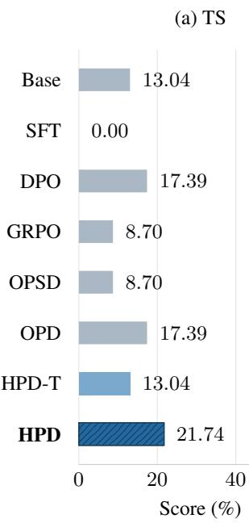

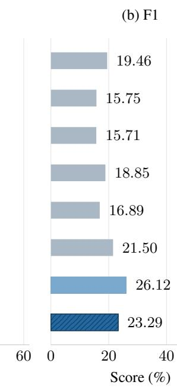

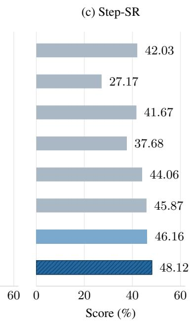  
Figure 7: BFCL v4 transfer on 92 cases without retraining. Panels show (a) TS, (b) final-answer F1, and (c) Step-SR for the eight methods. All axes share the same zero-based percentage scale. HPD-T and Full HPD are blue; Full HPD is hatched. Numerical labels give the scores on this subset.

## D OPTIMIZATION DIAGNOSTICS

## D.1 CHECKPOINT DYNAMICS

Figure 8 aligns optimization loss with end-to-end performance at 20k, 40k, and 60k optimizer step in the full three-view run. The 200-cycle mean loss decreases from 0.188 to 0.181 and 0.162. TS rises from 3.09 to 16.12, 19.55, and 22.98, while F1 rises from 26.82 to 39.90, 39.79, and 41.22. Continued training improves executable cross-turn completion after most answer-content gains have appeared.

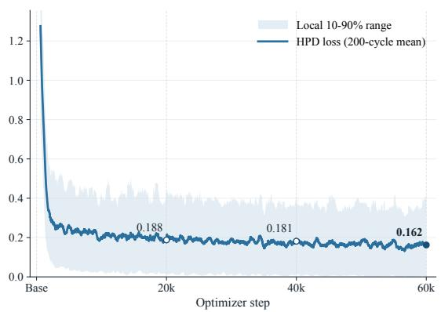

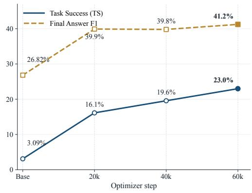  
Figure 8: Full HPD optimization over 60k optimizer steps (20k training rounds). Left: 200-cycle mean loss and local 10–90% range. Right: task success and final-answer F1. Base scores are TS 3.09% and F1 26.82%; trained-checkpoint labels are rounded to one decimal.

Table 6: Intermediate and completed full-HPD checkpoints evaluated by pi-runtime, indexed by optimizer steps. The 60k endpoint completes 20k training rounds. Scores are percentages.
<table><tr><td>Optimizer steps</td><td>TS</td><td>F1</td><td>Action-Acc</td><td>Step-SR</td><td>RC</td><td>Exact</td></tr><tr><td>40k (intermediate)</td><td>19.55</td><td>39.79</td><td>63.74</td><td>58.27</td><td>43.40</td><td>15.61</td></tr><tr><td>60k (completed)</td><td>22.98</td><td>41.22</td><td>64.95</td><td>63.79</td><td>49.23</td><td>18.70</td></tr></table>

## D.2 LOSS DECOMPOSITION

Because each optimizer update uses one view, a naive moving average mixes objective composition with optimization progress. Aggregating each complete T/I/R cycle yields the trend in Figure 8. At the 60k-optimizer-step endpoint, the view losses are 0.2415 for HARNESS-REPLAY, 0.2283 for INJECTED, and 0.0170 for RUNTIME. The losses summarize different prediction tasks with completion-length normalization. In particular, the document loss measures token prediction across observed, ledger, and witness-derived fields. Reporting the losses separately tracks optimization progress for each supervision path; rollout metrics measure the resulting policy’s execution behavior.

## D.3 SIGNAL-DENSITY SEARCH

Figure 9 and Table 7 report a separate Qwen3-8B diagnostic at 20k optimizer steps per configuration. Harness-Replay is fixed at 1.0 while either Injected or Runtime is varied over 0.2, 0.6, 1.4, and 1.8; the other auxiliary view stays at 1.0. These weights set the sampling frequency of each view. At the fixed update budget, changing one frequency reallocates updates among the three supervision paths. The default 1:1:1 cycle anchors both sweeps. Injected at 0.2 gives the highest RC (43.57) and Step-SR (56.40), gains of 2.92 and 3.64 percentage points over the default. Runtime at 0.6 gives the highest TS (18.18), Exact (14.24), and F1 (40.05), improving by 2.06, 1.03, and 0.15 points, respectively. The preferred frequency depends on the target metric: Injected at 0.2 favors prefix execution and compliance, whereas Runtime at 0.6 favors completed tasks in this sweep. Each axis is searched separately with one seed, giving a coordinate-wise comparison around the default cycle.

Task success (%)  
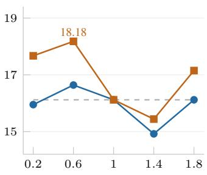

Runtime compliance (%)  
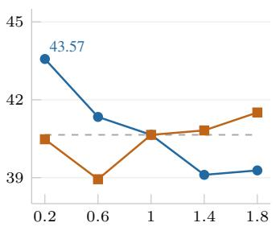

Step-SR (%)  
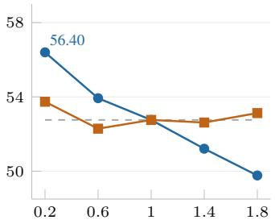  
Exact-path success (%)

Final-answer F1 (%)  
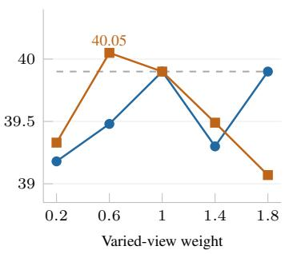

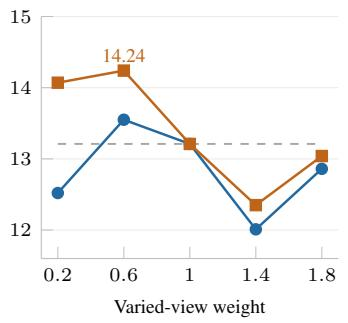  
Figure 9: Single-axis sampling-weight search at 20k optimizer steps. Blue circles vary Injected; orange squares vary Runtime. Dashed lines mark the shared 1:1:1 default. Each panel shows one metric with its own y-scale and labels its maximum. Lines connect evaluated settings.

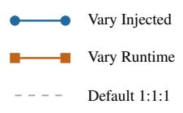  
T and the other view stay at 1. Highest scores are labeled. Each panel has its own y-scale.

Table 7: Complete single-axis sampling-weight search. Ratios give the realized T:I:R sampling cycle; all scores are percentages. Bold marks the highest score in each metric.
<table><tr><td>Varied view</td><td>T:I:R</td><td>TS</td><td>F1</td><td>Step-SR</td><td>RC</td><td>Exact</td></tr><tr><td>Default</td><td>1:1:1</td><td>16.12</td><td>39.90</td><td>52.76</td><td>40.65</td><td>13.21</td></tr><tr><td>Injected (0.2)</td><td>5:1:5</td><td>15.95</td><td>39.18</td><td>56.40</td><td>43.57</td><td>12.52</td></tr><tr><td>Injected (0.6)</td><td>5:3:5</td><td>16.64</td><td>39.48</td><td>53.93</td><td>41.34</td><td>13.55</td></tr><tr><td>Injected (1.4)</td><td>5:7:5</td><td>14.92</td><td>39.30</td><td>51.21</td><td>39.11</td><td>12.01</td></tr><tr><td>Injected (1.8)</td><td>5:9:5</td><td>16.12</td><td>39.90</td><td>49.77</td><td>39.28</td><td>12.86</td></tr><tr><td>Runtime (0.2)</td><td>5:5:1</td><td>17.67</td><td>39.33</td><td>53.74</td><td>40.48</td><td>14.07</td></tr><tr><td>Runtime (0.6)</td><td>5:5:3</td><td>18.18</td><td>40.05</td><td>52.29</td><td>38.94</td><td>14.24</td></tr><tr><td>Runtime (1.4)</td><td>5:5:7</td><td>15.44</td><td>39.49</td><td>52.62</td><td>40.82</td><td>12.35</td></tr><tr><td>Runtime (1.8)</td><td>5:5:9</td><td>17.15</td><td>39.07</td><td>53.13</td><td>41.51</td><td>13.04</td></tr></table>

## D.4 MODEL-SIZE SCALING STUDY

Table 8 evaluates Base and HPD across seven Qwen3 checkpoints. HPD improves both TS and F1 at every size, with TS gains ranging from 4.46 points at 0.6B to 14.41 at 14B; the 32B gain is 13.90 points. Step-SR and RC also improve at every size. The 14B and 32B dense checkpoints exceed the 30B-A3B MoE checkpoint on TS. All rows use the same 583 cases and one seed.

Each Base evaluation contains 583 unique cases and 2,140 reference steps, with no worker failures. TS uses the historical task-success definition; F1, RC, and Exact use the runtime evaluation summaries. Action-Acc comes from a separate native gold-history boundary evaluation. The Qwen3-8B HPD row corresponds to the 20k-optimizer-step checkpoint, rather than the completed 60k checkpoint in Table 1.

Table 8: Qwen3 model-size results. Action-Acc uses the native gold-history boundary protocol separately from end-to-end evaluation. Exact retains the historical strict trajectory-success definition, not answer-string exact match. All values are percentages.
<table><tr><td>Model</td><td>Variant</td><td>TS</td><td>F1</td><td>Action-Acc</td><td>Step-SR</td><td>RC</td><td>Exact</td></tr><tr><td>Qwen3-0.6B</td><td>Base</td><td>0.00</td><td>24.78</td><td>52.06</td><td>3.64</td><td>0.00</td><td>0.00</td></tr><tr><td rowspan="2">Qwen3-1.7B</td><td>HPD</td><td>4.46</td><td>25.70</td><td>54.07</td><td>24.20</td><td>16.50</td><td>2.40</td></tr><tr><td>Base</td><td>0.00</td><td>27.00</td><td>49.90</td><td>4.53</td><td>0.00</td><td>0.00</td></tr><tr><td rowspan="2">Qwen3-4B</td><td>HPD</td><td>6.52</td><td>30.50</td><td>59.00</td><td>33.60</td><td>20.80</td><td>3.30</td></tr><tr><td>Base</td><td>1.03</td><td>20.81</td><td>53.40</td><td>9.81</td><td>7.38</td><td>0.86</td></tr><tr><td rowspan="2">Qwen3-8B</td><td>HPD</td><td>15.09</td><td>38.50</td><td>59.40</td><td>48.60</td><td>38.90</td><td>11.50</td></tr><tr><td>Base</td><td>3.09</td><td>26.82</td><td>53.40</td><td>26.45</td><td>19.90</td><td>2.57</td></tr><tr><td rowspan="2">Qwen3-14B</td><td>HPD</td><td>16.12</td><td>39.90</td><td>60.80</td><td>52.80</td><td>40.70</td><td>13.21</td></tr><tr><td>Base</td><td>3.43</td><td>27.96</td><td>52.90</td><td>14.77</td><td>15.61</td><td>2.74</td></tr><tr><td rowspan="2">Qwen3-30B-A3B</td><td>HPD</td><td>17.84</td><td>40.00</td><td>60.00</td><td>57.40</td><td>44.90</td><td>14.92</td></tr><tr><td>Base</td><td>4.12</td><td>28.86</td><td>52.90</td><td>14.44</td><td>17.67</td><td>2.74</td></tr><tr><td rowspan="2">Qwen3-32B</td><td>HPD</td><td>16.81</td><td>38.90</td><td>58.80</td><td>53.60</td><td>40.10</td><td>13.21</td></tr><tr><td>Base</td><td>6.00</td><td>30.42</td><td>56.82</td><td>19.63</td><td>25.73</td><td>4.12</td></tr><tr><td></td><td>HPD</td><td>19.90</td><td>40.29</td><td>62.15</td><td>64.49</td><td>49.23</td><td>16.81</td></tr></table>

## E METRIC DEFINITIONS

Unless noted otherwise, reported values are percentages. Final-answer F1 is token-level F1 between the emitted final response and the reference answer.

Gold-history action accuracy. At each of the 2,140 Pi provider boundaries, the evaluator supplies the recorded gold history as context and compares the sequence likelihood of the reference next action with that of a constructed alternative. Action-Acc is the fraction of boundaries where the

reference action ranks higher. The two candidates are scored but not executed; each boundary is evaluated independently, so model-generated rollout histories do not enter this metric. The rollout metrics below evaluate the policy through execution.

Reference-prefix step success. Step-SR counts correct reference steps until first divergence:

$$
{ \mathrm { S t e p - S R } } = { \frac { \sum _ { i } { \mathrm { c o r r e c t } } { \mathrm { p r e f i x ~ s t e p s ~ i n ~ r o l l o u t } } i } { \sum _ { i } { \mathrm { r e f e r e n c e } } { \mathrm { s t e p s ~ i n ~ t a s k } } i } } .\tag{12}
$$

Later actions receive no reference-path credit after the first divergence by definition, even if the rollout later recovers or reaches an equivalent runtime state.

Runtime compliance, Exact, and task success. RC is the fraction of tasks satisfying the harness execution contract: required tool sequence and parameter keys, exactly one final response, native exit, and a healthy worker. Exact additionally requires reproduction of the reference control path and final-answer F1 of at least 0.5. For task i, let $O _ { i }$ indicate eventual obligation completion, $F _ { i }$ final-answer $\mathrm { F } 1 , C _ { i }$ exactly one final, $E _ { i }$ native exit, and $W _ { i }$ healthy worker execution:

$$
\mathrm { T S } _ { i } = \mathbf { 1 } [ O _ { i } ] \mathbf { 1 } [ F _ { i } \geq 0 . 5 ] \mathbf { 1 } [ C _ { i } ] \mathbf { 1 } [ E _ { i } ] \mathbf { 1 } [ W _ { i } ] .\tag{13}
$$

TS is the mean of this indicator. A recovered success can have Exact= 0 because retries or a valid action ordering different from the reference path are allowed. The TRAJECT-Bench evaluation contract uses required parameter keys as its argument-level criterion and replayed observations as tool outputs. RC, Exact, and TS therefore describe execution within this specified runtime.

## E.1 TOKEN-DISTRIBUTION DIAGNOSTIC

At boundary $b ,$ let $c _ { b } ^ { \star }$ be the correct initial control token and $u _ { b , 1 : m _ { b } } ^ { \star }$ the reference continuation after it, truncated to $m _ { b } \leq 6 3$ tokens. For $m _ { b } > 0$ , define

$$
\begin{array} { l } { \displaystyle p _ { b , j } ( \boldsymbol { v } ) = \pi _ { \boldsymbol { \theta } } ( \boldsymbol { v } \mid \boldsymbol { x } _ { b } ^ { \star } , \boldsymbol { c } _ { b } ^ { \star } , \boldsymbol { u } _ { b , < j } ^ { \star } ) , } \\ { \displaystyle \bar { h } _ { b } = - \frac { 1 } { m _ { b } } \sum _ { j = 1 } ^ { m _ { b } } \sum _ { \boldsymbol { v } \in \boldsymbol { \mathcal { V } } } p _ { b , j } ( \boldsymbol { v } ) \log _ { 2 } p _ { b , j } ( \boldsymbol { v } ) , } \\ { \displaystyle g _ { b } = \exp \left( \frac { 1 } { m _ { b } } \sum _ { j = 1 } ^ { m _ { b } } \log p _ { b , j } ( \boldsymbol { u } _ { b , j } ^ { \star } ) \right) , } \end{array}\tag{14}
$$

where V is the full token vocabulary. The three panels of Figure 3 plot $\pi _ { \boldsymbol { \theta } } ( c _ { b } ^ { \star } \mid x _ { b } ^ { \star } ) , \log _ { 1 0 } \bar { h } _ { b } ,$ and $g _ { b } .$ , respectively. Thus panel (b) takes the logarithm after averaging position-wise entropy, while panel (c) exponentiates the mean reference-token log probability. Neither continuation statistic uses model-generated prefixes.

## E.2 INTERPRETING F1 AND TASK COMPLETION

For task-averaged final-answer F1, let $S _ { i }$ be the binary task-success indicator and $F _ { i } \in [ 0 , 1 ]$ the final-answer F1 for task i. Writing $p _ { \mathrm { T S } } = \mathbb { E } [ S _ { i } ]$ , the mean decomposes as

$$
\begin{array} { r } { \mathbb { E } [ F _ { i } ] = p _ { \mathrm { T S } } \mathbb { E } [ F _ { i } \mid S _ { i } = 1 ] + ( 1 - p _ { \mathrm { T S } } ) \mathbb { E } [ F _ { i } \mid S _ { i } = 0 ] . } \end{array}\tag{15}
$$

Thus aggregate F1 can change through the fraction of successful tasks, the mean F1 within either group, or both. The tables provide the aggregate and success rate, which describe answer overlap and completed-task coverage as separate outcomes.

HPD and OPD have nearly equal aggregate F1 (41.22 versus 41.04), while HPD has substantially higher TS (22.98 versus 15.61) and Exact (18.70 versus 14.07). OPSD similarly raises TS over Base (13.55 versus 3.09) without raising F1 (26.27 versus 26.82). Together with HPD’s T-only and joint-view ablations, these patterns identify HPD’s completion advantage at comparable aggregate answer overlap. The distinction follows directly from the metrics: F1 averages answer overlap over all tasks, whereas TS counts tasks that jointly satisfy the execution conditions and answer threshold. Similar mean F1 can therefore accompany different successful-completion coverage.

Equation 15 also specifies a task-level analysis for attributing F1 changes: measure answer overlap on tasks completed by both methods, newly completed tasks, previously completed tasks that become unsuccessful, and tasks completed by neither method. Grouping instead by execution-only conditions, such as obligation completion and native termination, separates execution coverage from the answer threshold used in TS. These two decompositions distinguish the coverage of successful execution from answer quality within each group. Runtime alignment and reference-distribution fitting can contribute jointly; paired, execution-conditioned analyses separate their completion-coverage and within-group answer-quality outcomes.

## F DISTILLATION DERIVATION AND IMPLEMENTATION

## F.1 REPLAY-TEACHER DISTRIBUTIONS

Offline construction fixes a document and selected action at each retained boundary, defining the point-mass teacher. Here $\delta _ { z }$ assigns probability one to the sequence z and zero elsewhere; d and a are document and action variables, respectively:

$$
\pi _ { b } ^ { \mathrm { r e p } } ( d , a \mid x _ { b } ^ { \star } ) = \delta _ { d _ { b } ^ { H } } ( d ) \delta _ { \tilde { a } _ { b } } ( a ) .\tag{16}
$$

Write $\pi ^ { \mathrm { r e p } } ( d , a \mid x )$ for the empirical conditional distribution of document–action pairs given context x. Its document marginal $\pi _ { R } ^ { \mathrm { r e p } }$ , document-conditioned action distribution $\pi _ { I } ^ { \mathrm { r e p } }$ , and native action marginal $\pi _ { T } ^ { \mathrm { r e p } }$ satisfy

$$
\pi ^ { \mathrm { r e p } } ( d , a \mid x ) = \pi _ { R } ^ { \mathrm { r e p } } ( d \mid x ) \pi _ { I } ^ { \mathrm { r e p } } ( a \mid x , d ) ,\tag{17}
$$

$$
\pi _ { T } ^ { \mathrm { r e p } } ( a \mid x ) = \sum _ { d } \pi ^ { \mathrm { r e p } } ( d , a \mid x ) .\tag{18}
$$

The document includes runtime facts and privileged replay labels. Each record has a point target;   
records sharing a serialized context induce an empirical mixture when conditioned on that context.   
This distinction connects stored supervision to the conditional teacher objectives.

## F.2 CONDITIONAL KL DECOMPOSITION

All KL divergences use natural logarithms. Expectations below are taken under the empirical teacher conditionals defined above.

RUNTIME and INJECTED define the factorized student $\begin{array} { r } { \pi _ { \theta } ( d , a ~ \mid ~ x ) ~ = ~ \pi _ { \theta } ^ { R } ( d ~ \mid ~ x ) \pi _ { \theta } ^ { I } ( a ~ \mid ~ x , d ) } \end{array}$ Suppressing boundary and harness indices, the KL chain rule gives

$$
\begin{array} { r l } & { { D } _ { \mathrm { K L } } ( { \pi } ^ { \mathrm { r e p } } ( d , a \mid x ) \parallel \widetilde { \pi } _ { \theta } ( d , a \mid x ) ) } \\ & { \quad = { D } _ { \mathrm { K L } } \big ( { \pi } _ { R } ^ { \mathrm { r e p } } ( \cdot \mid x ) \parallel { \pi } _ { \theta } ^ { R } ( \cdot \mid x ) \big ) } \\ & { \qquad + \mathbb { E } _ { d \sim { \pi } _ { R } ^ { \mathrm { r e p } } ( \cdot \mid x ) } { D } _ { \mathrm { K L } } \big ( { \pi } _ { I } ^ { \mathrm { r e p } } ( \cdot \mid x , d ) \parallel { \pi } _ { \theta } ^ { I } ( \cdot \mid x , d ) \big ) . } \end{array}\tag{19}
$$

The chain rule motivates the R and I losses; T additionally matches the teacher’s native-runtime action marginal. The three losses in Equation 9 are

$$
\begin{array} { r l } & { \mathcal { L } _ { R } = \mathbb { E } _ { x \sim \mu _ { H } ^ { \mathrm { r e p } } } D _ { \mathrm { K L } } \left( \pi _ { R } ^ { \mathrm { r e p } } ( \cdot \mid x ) \parallel \pi _ { \theta } ^ { R } ( \cdot \mid x ) \right) , } \\ & { \mathcal { L } _ { I } = \mathbb { E } _ { x \sim \mu _ { H } ^ { \mathrm { r e p } } } \mathbb { E } _ { d \sim \pi _ { R } ^ { \mathrm { r e p } } ( \cdot \mid x ) } D _ { \mathrm { K L } } \left( \pi _ { I } ^ { \mathrm { r e p } } ( \cdot \mid x , d ) \parallel \pi _ { \theta } ^ { I } ( \cdot \mid x , d ) \right) , } \\ & { \mathcal { L } _ { T } = \mathbb { E } _ { x \sim \mu _ { H } ^ { \mathrm { r e p } } } D _ { \mathrm { K L } } \left( \pi _ { T } ^ { \mathrm { r e p } } ( \cdot \mid x ) \parallel \pi _ { \theta } ^ { T } ( \cdot \mid x ) \right) , } \end{array}\tag{20}
$$

where $\pi _ { T } ^ { \mathrm { r e p } }$ is the deployment marginal of Equation 18.

## F.3 STORED TARGETS AND THE IMPLEMENTED LOSS

After sampling, verification, and near-gold selection, let $c _ { b } ^ { v }$ denote the stored prompt and $p _ { b } ^ { v }$ the target-sequence distribution for boundary b and view $v \in \{ T , I , R \}$ . The three implementation pairs are

$$
\begin{array} { r l } & { ( c _ { b } ^ { T } , p _ { b } ^ { T } ) = \left( x _ { b } ^ { \star } , \delta _ { \tilde { a } _ { b } } \right) , } \\ & { ~ ( c _ { b } ^ { I } , p _ { b } ^ { I } ) = \left( \mathrm { I n j e c t } _ { H } ( x _ { b } ^ { \star } , d _ { b } ^ { H } ) , \delta _ { \tilde { a } _ { b } } \right) , } \\ & { ( c _ { b } ^ { R } , p _ { b } ^ { R } ) = \left( \mathrm { P r o b e } _ { H } ( x _ { b } ^ { \star } ) , \delta _ { d _ { b } ^ { H } } \right) . } \end{array}\tag{21}
$$

Thus the two action views share the selected verifier-approved hard target, while the document view predicts the control document stored for the same boundary. Student training consumes these stored targets and requires no teacher forward pass. Rejected and unselected candidates do not enter the three supervised targets.

Per-record NLL and conditional teacher KL. Equation 10 establishes the point-target identity for each complete stored sequence. To connect these per-record losses to the conditional teacher, average over the empirical distribution of prompt–target pairs.

For any frozen target distribution $p$ and context $c ,$ with $\mathcal { H } ( \boldsymbol { p } )$ denoting Shannon entropy using natural logarithms,

$$
\begin{array} { r } { \mathbb { E } _ { y \sim p } \left[ - \log \pi _ { \theta } ( y \mid c ) \right] = D _ { \mathrm { K L } } ( p \parallel \pi _ { \theta } ( \cdot \mid c ) ) + \mathcal { H } ( p ) , } \end{array}\tag{22}
$$

where $\mathcal { H } ( \boldsymbol { p } )$ is independent of $\theta$ (Kim & Rush, 2016). Let $\widehat { P } _ { v } ( c , y )$ be the empirical distribution of stored pairs for view $v ,$ with context marginal $\begin{array} { r } { \widehat { P } _ { v } ( c ) = \sum _ { y } \widehat { P } _ { v } ( c , y ) } \end{array}$ and conditional teacher $q _ { v } ( y \mid c ) = \widehat { P } _ { v } ( y \mid c )$ . Conditioning on the prompt and applying Equation 22 gives

$$
\begin{array} { r l } & { \mathbb { E } _ { ( c , y ) \sim \widehat { P } _ { v } } [ - \log \pi _ { \theta } ( y \mid c ) ] = \mathbb { E } _ { c \sim \widehat { P } _ { v } } \left[ D _ { \mathrm { K L } } ( q _ { v } ( \cdot \mid c ) \| \pi _ { \theta } ( \cdot \mid c ) ) \right] } \\ & { \qquad + \mathbb { E } _ { c \sim \widehat { P } _ { v } } \mathcal { H } ( q _ { v } ( \cdot \mid c ) ) . } \end{array}\tag{23}
$$

For T, I, and $\mathrm { R } , q _ { v }$ is the corresponding conditional teacher under Equation 21. Thus per-record NLL averaging recovers $\mathcal { L } _ { T } , \mathcal { L } _ { I }$ , and $\mathcal { L } _ { R }$ up to constant entropies. Individual targets have zero entropy; pooling records with a shared prompt produces the conditional mixture in Equation 23.

Normalization and implementation. For a target y of $| y |$ tokens, $y _ { j }$ is token j and $y _ { < j }$ its preceding prefix. The trainer uses the completion-length-normalized loss

$$
\ell _ { \theta } ( y , c ) = - { \frac { 1 } { | y | } } \sum _ { j = 1 } ^ { | y | } \log \pi _ { \theta } ( y _ { j } \mid c , y _ { < j } ) ,\tag{24}
$$

which normalizes short documents, final responses, and longer tool-call waves by their completion lengths. For the stored point targets, this is the sequence-level KL in Equation 10 weighted by $1 / | y |$

The implemented objective samples retained records uniformly from $\mathcal { D } _ { H } ^ { \mathrm { r e p } }$ and selects view v with probability $\alpha _ { v } \mathrm { . }$

$$
\mathcal { L } _ { \mathrm { H P D } } ^ { \mathrm { i m p l } } = \mathbb { E } _ { ( x _ { b } ^ { \star } , d _ { b } ^ { H } , \tilde { a } _ { b } ) \sim \mathcal { D } _ { H } ^ { \mathrm { r e p } } } \mathbb { E } _ { v \sim \mathrm { C a t } ( \alpha _ { T } , \alpha _ { I } , \alpha _ { R } ) } \mathbb { E } _ { y \sim p _ { b } ^ { v } } \left[ \ell _ { \theta } ( y , c _ { b } ^ { v } ) \right] .\tag{25}
$$

Each inner expectation evaluates the stored target: $\tilde { a } _ { b }$ for T/I and $d _ { b } ^ { H }$ for R. A deterministic cycle realizes the long-run view weights through sequential AdamW updates, each using 128 sequences from one view’s seeded permutation. One T/I/R round is one training step, giving default weights $\alpha _ { T } = \alpha _ { I } = \alpha _ { R } = 1 / 3$ and 60k optimizer updates over 20k training steps. All views update the same parameters; deployment uses only $a _ { b } \sim \pi _ { \theta } ^ { T } ( \cdot \mid x _ { b } )$ under the native harness contract.