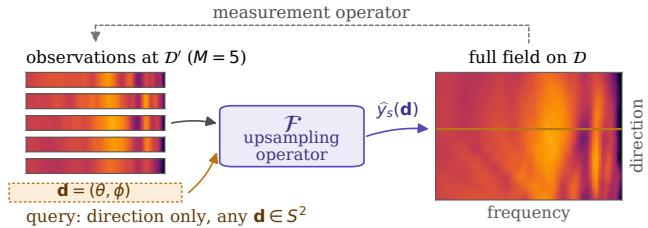
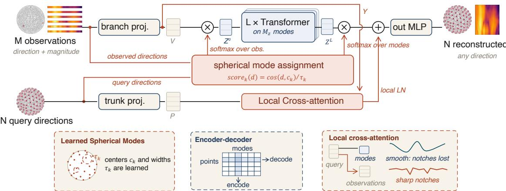
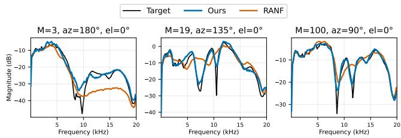

# HRTF UPSAMPLING AND PERSONALIZATION VIA NEURAL OPERATORS

Meenakshi Krishnan1∗, You Zhang2, Ramani Duraiswami1, C. Phillip Brown2

1University of Maryland, College Park 2Dolby Laboratories, Inc.

## ABSTRACT

Head-related transfer function (HRTF) spatial upsampling from sparse measurements is a fundamental challenge in personalized binaural audio. We formulate HRTF upsampling as an operator learning problem and introduce SPARO, a neural operator that maps sparse measurements at a set of spatial directions to the HRTF field, a continuous representation that can be queried at arbitrary positions. SPARO projects the measurements onto a learned set of spherical latent modes, processes the latent modes with Transformer blocks, and decodes the resulting representations at query directions. On SONICOM, using the LAP24 measurement configuration, SPARO attains the best log-spectral distortion (LSD) and interaural level difference (ILD) error at every sparsity level from 3 to 100 measurements (18% lower LSD and 43% lower ILD error than the strongest baseline at 100 measurements) while remaining competitive in interaural time difference (ITD) error. It reconstructs a dense HRTF 15–373× faster than the leading neural-field method RANF. We further validate the approach on HUTUBS, demonstrating its effectiveness across HRTF datasets.

Index Terms— Head-related transfer function, spatial audio, neural operator, upsampling, personalization

## 1. INTRODUCTION

Personalized spatial audio rendering for virtual and augmented reality (VR/AR) requires head-related transfer functions (HRTFs), which capture the direction-dependent acoustic filtering of a listener’s head, torso, and pinnae. As these filtering effects are highly anatomy-specific, the use of non-individualized HRTFs measurably degrades sound localization accuracy and perceptual attributes such as externalization and immersion [1, 2]. Personalized HRTFs are also relevant for hearing assistive devices (including hearing aids and cochlear implant processors) where accurate spatial rendering can improve speech intelligibility in multi-talker environments [3].

While acoustic measurement remains the gold standard for individual HRTFs, densely sampled datasets typically require impulse responses at hundreds of spatial directions, for example, SONI-COM [4], CIPIC [5], and ARI [6] contain 793, 1250, and 1550 measured directions, respectively. Such acquisition is costly and impractical at scale, while practical rendering may additionally require HRTFs at arbitrary directions outside the measurement grid. HRTF spatial upsampling addresses this bottleneck by estimating dense HRTFs from a sparse set of individual measurements [7, 8].

Algorithmic upsampling methods such as barycentric interpolation and spherical harmonic decomposition [9, 10, 11] are effective when measurements are sufficiently dense, but degrade severely under high sparsity [12, 13]. Learning-based approaches have shown strong performance for HRTF upsampling from sparse measurements [7, 14]. In particular, neural field (NF) methods represent HRTFs as a function of sound source direction conditioned on subject-specific parameters, enabling a pre-trained generic model to be adapted to new subjects from sparse measurements [12, 15, 16, 17]. The Retrieval-Augmented Neural Field (RANF) [13], the winning system of Task 2 of the Listener Acoustic Personalization (LAP24) challenge [7], further augments this with similar-subject retrieval, achieving state-of-the-art performance in log-spectral distortion (LSD), interaural level difference (ILD) and interaural time difference (ITD) errors across sparsity levels of 3 to 100 measurements.

  
Fig. 1. HRTF upsampling as operator learning. SPARO learns the upsampling operator F that generalizes across listeners and can be queried at arbitrary directions to produce the HRTF field.

Neural-field approaches provide a flexible continuous representation of HRTFs [15], where personalization typically involves optimizing subject-specific representations or parameters from the available measurements. Many methods thus use per-subject iterative adaptation at inference, for example by optimizing low-rank subjectspecific parameters [12, 13]. In this formulation, the sparse measurements primarily serve to identify a listener-specific field. Rather than representing each listener’s HRTF as a separate field, an alternative is to learn a single upsampling operator that maps sparse HRTF measurements to the corresponding HRTF field across listeners.

In general, operator learning methods aim to learn mappings between infinite-dimensional function spaces, with the functions represented in practice by their values on finite sets of sample locations [18, 19]. They offer a discretization-invariant representation that is independent of the input-output dimensions, and prior architectures [20, 21] decouple input and output discretizations through a fixed latent representation. In this paper, we learn a shared upsampling operator across individuals that maps sparse measurements to the HRTF at arbitrary query directions, as illustrated in Fig. 1.

We therefore introduce SPARO, a sparse-to-dense neural operator for HRTF spatial upsampling. SPARO learns a direct mapping from sparse HRTF observations at measured directions to the HRTF field at arbitrary query directions through a learned spherical mode representation that decouples observation and prediction locations. SPARO couples the input and output mappings through a shared learned geometry on the sphere S2: sparse observations are projected onto spherical latent modes, the resulting mode representations are transformed globally, and the learned mode geometry is used to interpolate the transformed representation at arbitrary query directions. We predict HRTF log-magnitude and ITD on SONI-COM from sparse measurements, and evaluate under the LAP24 protocol [7]. SPARO achieves the lowest error on LSD and ILD at all sparsity levels and is competitive on ITD, pointing to operator learning as a promising direction for personalized spatial audio.

  
Fig. 2. Architecture for HRTF upsampling. Sparse HRTF observations are embedded by the branch projector and aggregated into a fixed set of learned spherical modes according to their angular similarity to mode centers on $S ^ { 2 }$ . Transformer blocks model interactions entirely in the latent mode space. At arbitrary query directions, the transformed modes are interpolated using the same spherical mode geometry, and a final MLP produces the output HRTF.

## 2. METHODS

## 2.1. Preliminary and Notations: HRTF Upsampling

For subject $s ,$ ear $c \in \{ L , R \}$ , and source direction $\mathbf { d } = ( \theta , \phi )$ with azimuth $\theta \in [ 0 , 2 \pi )$ , and elevation $\phi \in [ - \pi / 2 , \pi / 2 ]$ , the HRTF is:

$$
H _ { s } ^ { c } ( f , { \bf d } ) = \frac { P _ { \mathrm { e a r } } ^ { c } ( f , { \bf d } ) } { P _ { \mathrm { f r e e } } ( f ) } ,\tag{1}
$$

where $P _ { \mathrm { e a r } } ^ { c }$ is the sound pressure at the blocked ear-canal entrance, $P _ { \mathrm { f r e e } }$ is the free-field pressure at the head center [22, 23], and $f$ denotes frequency. The HRTF is thus a complex-valued transfer function encoding both magnitude and phase information as a function of frequency and source direction. Its time-domain counterpart is the head-related impulse response (HRIR).

Let $\mathbf { H } _ { s } ^ { c } ( \mathbf { d } ) \mathbf { \bar { \Sigma } } \in \mathbb { C } ^ { F }$ denote the HRTF at F frequency bins, and let $\mathcal { D }$ and S denote a dense spatial grid and the training subjects, respectively. For a test subject ${ \bar { s } } \notin S$ , HRTFs are available only on a sparse set $\mathcal { D } ^ { \prime } ($ ; the goal is to estimate ${ \bf H } _ { \bar { s } } ^ { c } ( { \bf d } )$ for all d $\in \mathcal { D }$

Rather than predict the full complex spectrum, HRTF upsampling methods [12, 13, 24] often model log-magnitude and ITD separately. HRTF magnitude carries direction-dependent spectral cues important for elevation and front–back localization, while ITD and ILD provide dominant binaural cues for horizontal localization [25, 26]. Minimum-phase HRIRs are reconstructed from the predicted magnitudes and the predicted ITD applied as a fractional delay [27].

## 2.2. Formulating HRTF Upsampling as Operator Learning

Let $\mathbf { \mathcal { D } ^ { \prime } } = \{ \mathbf { d } _ { i } ^ { \prime } \} _ { i = 1 } ^ { M }$ denote the set of M sparse measurement directions. SPARO learns an operator of the form

$$
\mathcal { F } : \left\{ \left( \mathbf { d } _ { i } ^ { \prime } , \mathbf { u } _ { s } \left( \mathbf { d } _ { i } ^ { \prime } \right) \right) \right\} _ { i = 1 } ^ { M } \longmapsto \mathbf { u } _ { s } ( \mathbf { d } ) , \qquad \mathbf { d } \in \mathcal { D } ,\tag{2}
$$

mapping sparse observations of a directional field on $S ^ { 2 }$ to its value at arbitrary query directions. We apply this formulation both to the log-magnitude $\dot { \mathbf { u } _ { s } } ( \mathbf { d } ) = \log _ { 1 0 } | \mathbf { H } _ { s } ^ { c } ( \mathbf { \hat { d } } ) | \in \mathbb { R } ^ { F }$ and to the scalar ITD field ${ \bf u } _ { s } ( { \bf d } ) = \tau _ { s } ( { \bf d } ) \in \mathbb { R }$

## 2.3. SPARO Architecture

To support arbitrary sparse measurement and query locations, SPARO maps the HRTF at observed positions to a fixed set of latent modes, processes the latent representation, and decodes the result at arbitrary query directions. The overall architecture is shown in Fig. 2. Since HRTFs are functions of direction on $S ^ { 2 }$ , we parameterize these latent modes by learned spherical centers, and the prediction at a query direction attends to the processed modes with weights determined by angular proximity to these centers.

Input Embeddings. Following the branch–trunk construction used in neural operators such as DeepONet [19] and LNO [20], a branch multilayer perceptron (MLP) embeds each observed pair $\left( \mathbf { d } _ { i } ^ { \prime } , \mathbf { u } _ { s } ( \mathbf { d } _ { i } ^ { \prime } ) \right)$ , for $i \in \{ 1 , 2 , \ldots , M \}$ as bi $\in \mathbb { R } ^ { D }$ , while a trunk MLP embeds a query direction $\mathbf { d } _ { j }$ alone as $\mathbf { p } _ { j } \in \mathbb { R } ^ { D }$ . Since the branch requires an observed field value but the trunk requires only a direction, the branch is evaluated only at the measured locations, whereas the trunk can be evaluated independently at query directions.

Spherical Mode Projection Encoder. The encoder maps the variable-size set of M observations to a fixed set of $M _ { z }$ latent modes. Each mode k, for $k \in \{ 1 , 2 , \ldots , M _ { z } \}$ , is associated with a learnable center ${ \bf c } _ { k } \in S ^ { 2 }$ and positive temperature $\tau _ { k }$ . Observations are weighted according to their angular similarity to ${ \bf c } _ { k } \mathrm { : }$

$$
A _ { i k } = \mathrm { s o f t m a x } _ { i } \left( \frac { \mathbf { d } _ { i } ^ { \prime \top } \mathbf { c } _ { k } } { \tau _ { k } } \right) , \quad \mathbf { z } _ { k } ^ { 0 } = \sum _ { i = 1 } ^ { M } A _ { i k } W _ { v } \mathbf { b } _ { i } ,\tag{3}
$$

where $\mathbf { d } _ { i } ^ { \prime }$ and $\mathbf { c } _ { k }$ are unit Cartesian vectors, $\mathbf { b } _ { i } \in \mathbb { R } ^ { D }$ is the branch embedding of $\left( \mathbf { d } _ { i } ^ { \prime } , \mathbf { u } _ { s } ( \mathbf { d } _ { i } ^ { \prime } ) \right)$ ), and $W _ { v }$ is a learned value projection. The softmax is taken over the $M$ available observations independently for each mode, so each $ { \mathbf { z } } _ { k } ^ { 0 }$ is a weighted aggregate of the observed field values associated with a learned region of the sphere. The centers are initialized uniformly on a Fibonacci lattice on $S ^ { 2 }$ and learned jointly with the network, while $\tau _ { k }$ controls the angular concentration of each mode.

Transformer Blocks. The latent representation $\mathbf { Z } ^ { 0 } \in \mathbb { R } ^ { M _ { z } \times D }$ is then processed by $L$ standard Transformer blocks [28], each comprising multi-head scaled dot-product self-attention and a positionwise MLP with residual connections and layer normalization. Since this processing is performed only over the $M _ { z }$ latent modes, its cost is independent of the number of output query directions.

Table 1. HRTF upsampling performance on the SONICOM dataset under the LAP24 protocol. Results are reported for different numbers of sparse HRTF measurements. Lower is better for all metrics. Best results are shown in bold.
<table><tr><td rowspan="2">Method</td><td colspan="4">LSD (dB) ↓</td><td colspan="4">ILD error (dB) ↓</td><td colspan="4">ITD error  $\mathbf { \mu } ( \mu \mathbf { s } ) \mathbf { \mathcal { \downarrow } }$ </td></tr><tr><td>3</td><td>5</td><td>19</td><td>100</td><td>3</td><td>5</td><td>19</td><td>100</td><td>3</td><td>5</td><td>19</td><td>100</td></tr><tr><td>Nearest Neighbor</td><td>8.7</td><td>8.3</td><td>5.4</td><td>3.4</td><td>7.6</td><td>4.8</td><td>3.0</td><td>1.4</td><td>274.2</td><td>154.2</td><td>108.3</td><td>44.0</td></tr><tr><td>HRTF Selection (ITD) [13]</td><td>5.8</td><td>5.6</td><td>5.5</td><td>5.4</td><td>1.4</td><td>1.5</td><td>1.6</td><td>1.4</td><td>26.3</td><td>24.5</td><td>23.2</td><td>20.0</td></tr><tr><td>NF + LoRA [12]</td><td>4.7</td><td>4.6</td><td>4.1</td><td>3.8</td><td>1.3</td><td>1.4</td><td>1.1</td><td>1.1</td><td>28.6</td><td>24.7</td><td>14.7</td><td>9.1</td></tr><tr><td>RANF [13]</td><td>4.4</td><td>4.6</td><td>3.6</td><td>3.0</td><td>1.2</td><td>1.2</td><td>1.0</td><td>0.8</td><td>20.5</td><td>18.7</td><td>14.2</td><td>10.0</td></tr><tr><td>IOA3D [24]</td><td>5.0</td><td>5.3</td><td>3.6</td><td>2.8</td><td>1.3</td><td>1.4</td><td>0.8</td><td>0.7</td><td>31.2</td><td>30.0</td><td>30.4</td><td>25.9</td></tr><tr><td>Ours</td><td>4.1</td><td>4.1</td><td>3.1</td><td>2.3</td><td>1.1</td><td>1.0</td><td>0.6</td><td>0.4</td><td>20.8</td><td>19.0</td><td>14.0</td><td>10.4</td></tr><tr><td>Ours (single model, all M)</td><td>4.1</td><td>4.1</td><td>3.2</td><td>2.8</td><td>1.1</td><td>1.1</td><td>0.7</td><td>0.6</td><td>21.6</td><td>19.1</td><td>15.1</td><td>12.8</td></tr><tr><td>Ours w/o TTO</td><td>4.1</td><td>4.1</td><td>3.3</td><td>2.5</td><td>1.1</td><td>1.0</td><td>0.8</td><td>0.4</td><td>21.0</td><td>19.1</td><td>15.2</td><td>12.7</td></tr></table>

Spherical Mode Projection Decoder. To obtain the field value at an arbitrary query direction ${ \bf d } _ { j } \in { \cal S } ^ { 2 }$ , the decoder weights the transformed latent modes according to their angular similarity to the same learned spherical centers:

$$
D _ { j k } = \mathrm { s o f t m a x } _ { k } \left( \frac { \mathbf { d } _ { j } ^ { \top } \mathbf { c } _ { k } } { \tau _ { k } } \right) , \qquad \mathbf { r } _ { j } ^ { \mathrm { m o d e } } = \sum _ { k = 1 } ^ { M _ { z } } D _ { j k } \widetilde { \mathbf { z } } _ { k } ^ { L } ,\tag{4}
$$

where $\widetilde { \mathbf { z } } _ { k } ^ { L }$ denotes a learned transformation of the final latent mode and $\mathbf { d } _ { j }$ and $\mathbf { c } _ { k }$ are unit Cartesian vectors. The softmax is taken over the $M _ { z }$ latent modes independently for each query, so each query representation is a location-dependent mixture of the learned modes.

The encoder and decoder share the same learned spherical mode centers $\mathbf { c } _ { k }$ and temperatures $\tau _ { k }$ . The encoder projects sparse observations onto learned spatial modes on $S ^ { 2 }$ , the Transformer models interactions between these modes, and the decoder interpolates the transformed modes at arbitrary query directions.

Local Cross-attention. In the spherical-mode pathway, measured HRTFs influence a query only after being aggregated into latent modes. To provide a direct query-to-observation pathway, we apply cross-attention between the query and the original sparse measurements. Using the trunk embedding $\mathbf { p } _ { j }$ of query direction $\mathbf { d } _ { j }$ as the query, and the branch embeddings $\{ { \bar { \mathbf { b } } } _ { i } \} _ { i = 1 } ^ { M }$ as keys and values,

$$
\begin{array} { r l } & { \mathbf { r } _ { j } = \mathbf { r } _ { j } ^ { \mathrm { m o d e } } + \mathrm { L N } \Big ( \mathrm { C r o s s A t t n } ( \mathbf { p } _ { j } , \{ \mathbf { b } _ { i } \} _ { i = 1 } ^ { M } ) \Big ) , } \\ & { \widehat { \mathbf { u } } _ { s } ( \mathbf { d } _ { j } ) = \mathrm { O u t M L P } ( \mathbf { r } _ { j } ) . } \end{array}
$$

Here, $\widehat { \mathbf { u } } _ { s } ( \mathbf { d } _ { j } )$ is the final prediction at query direction $\mathbf { d } _ { j }$ . Each prediction thus attends directly to available measurements, in addition to the representation through the learned spherical modes.

## 2.4. Implementation and Test-time Personalization

HRTF Reconstruction. For HRTF upsampling, we train two instances of the SPARO model: one for HRTF log-magnitude and one for ITD. The magnitude model maps sparse observations $\{ ( \mathbf { d } _ { i } ^ { \prime } , \log | \mathbf { H } _ { s } ^ { c } ( \mathbf { d } _ { i } ^ { \prime } ) | ) \} _ { i = 1 } ^ { M }$ to the log-magnitude response at arbitrary query directions. A second SPARO model predicts the scalar ITD field $\tau _ { s } ( \mathbf { d } )$ , taking sparse ITD observations $\widehat { \{ ( { \bf d } _ { i } ^ { \prime } , \tau _ { s } ( { \bf d } _ { i } ^ { \prime } ) ) \} } _ { i = 1 } ^ { M }$ as input. The two models are trained independently and their predictions are combined at inference to reconstruct the full HRTF.

Right Ear Handling. Following [15], we represent right-ear measurements in a mirrored coordinate system. Specifically, right-ear azimuths are reflected as $\theta \mapsto ( 3 6 0 ^ { \circ } - \theta )$ mod $\mathrm { { \bar { 3 } 6 0 ^ { \circ } } }$ , allowing both ears to share a common left-ear convention and effectively doubling the number of training examples. This assumes approximate bilateral symmetry after reflection about the median plane.

Test-time Adaptation. For each test subject, we first encode the sparse observations to obtain the initial latent representation $Z _ { 0 }$ . We then perform a short test-time optimization (TTO) using only the observed measurements, jointly updating $Z _ { 0 }$ and the final output MLP head while keeping the latent Transformer blocks and all remaining model parameters fixed. The adaptation objective combines relative $L ^ { 2 }$ error at the observed directions with penalties that keep the optimized latent and output-layer parameters close to their pretrained values to prevent overfitting on measurements. After adaptation, the optimized latent is decoded at all query directions to obtain the final HRTF prediction. The loss at test-time is thus:

$$
\mathcal { L } _ { \mathrm { T T O } } = \frac { \left. \hat { \mathbf { u } } _ { \mathcal { D } ^ { \prime } } - \mathbf { u } _ { \mathcal { D } ^ { \prime } } \right. _ { 2 } } { \left. \mathbf { u } _ { \mathcal { D } ^ { \prime } } \right. _ { 2 } } + \lambda \left. \mathbf { Z } - \mathbf { Z } _ { 0 } \right. _ { 2 } ^ { 2 } + \lambda \left. \theta _ { \mathrm { o u t } } - \theta _ { \mathrm { o u t } } ^ { ( 0 ) } \right. _ { 2 } ^ { 2 } ,
$$

where $\mathbf { Z } _ { 0 }$ is the latent representation produced by the pretrained encoder, Z its adapted value; $\theta _ { \mathrm { o u t } } ^ { ( 0 ) }$ and $\theta _ { \mathrm { o u t } }$ are the pretrained and adapted output-MLP parameters. We set $\lambda = 1$ in all experiments.

## 3. EXPERIMENTS AND RESULTS

## 3.1. Experimental Setup

Models are trained for log-magnitude and ITD with 1024 latent modes, latent dimension 128, and 4 Transformer blocks, optimized for 200 epochs with Adam [29] (learning rate $1 0 ^ { - 3 }$ with 20-epoch warmup and cosine decay, batch size 1) using relative $L ^ { 2 }$ loss on a single A6000 GPU. We report results both for models trained at a single sparsity level and for a single model trained on all sparsity configurations jointly, evaluated at every level without retraining.

Evaluation: Evaluation uses the three objective metrics defined in the LAP24 challenge [7]. The LSD measures spectral fidelity between the upsampled and reference HRTFs:

$$
\mathrm { L S D } = \frac { 1 } { 2 N } \sum _ { c \in \{ L , R \} } \sum _ { n = 1 } ^ { N } \sqrt { \frac { 1 } { B } \sum _ { b = 1 } ^ { B } \left( 2 0 \log _ { 1 0 } \frac { \vert \widehat { H } ^ { c } ( f _ { b } , \mathbf { d } _ { n } ) \vert } { \vert H ^ { c } ( f _ { b } , \mathbf { d } _ { n } ) \vert } \right) ^ { 2 } } ,\tag{5}
$$

where $H ^ { c } ( f _ { b } , \mathbf { d } _ { n } )$ and ${ \widehat { H } } ^ { c } ( f _ { b } , \mathbf { d } _ { n } )$ are the reference and reconstructed HRTFs for ear c, frequency bin $f _ { b }$ and direction $\mathbf { d } _ { n } ,$ respectively. B is the number of frequency bins and N is the number of evaluation directions. ILD and ITD errors are computed as in [7], as mean absolute errors (MAE) in dB and µs respectively.

## 3.2. Experiments on the Measured SONICOM Dataset

We train and evaluate on SONICOM [4] following the same setting as in RANF [13]. The dataset provides 793 measured directions per subject at 48 kHz; free-field compensation is applied with a minimum-phase filter. Subject P0079 is excluded because of atypical ITD behavior, leaving 199 subjects. When comparing with [13], we use the same 20 test subjects; they hold out a validation set for checkpoint and hyperparameter selection, while we train for a fixed number of epochs with a fixed hyperparameter set on the remaining 179 subjects. Upsampling is evaluated at four sparsity levels, $\bar { M } \in \{ 3 , 5 , 1 9 , 1 0 0 \}$ , using the LAP24 measurement configurations.

  
Fig. 3. HRTF magnitude predicted by SPARO and RANF at different sparsity levels and directions.

Tab. 1 reports performance against various baselines, including RANF, which reported the best performance across metrics in [13]. Following the setup in [13], metrics are evaluated only at unmeasured directions $\mathcal { D } \setminus \overline { { \mathcal { D } ^ { \prime } } }$ . Baseline results for nearest neighbor, HRTF selection, NF+LoRA and RANF are taken from [13]. We retrained IOA3D [24] under the same protocol as our method. SPARO achieves the lowest LSD at every sparsity level, and improves on the best competing method by up to 18% (2.3 dB against 2.8 dB at $M { = } 1 0 0 )$ , with consistent gains of 7–14% at $M { = } 3 ,$ 5 and 19. ILD error is also lowest throughout, with a best-case improvement of 43% at $M { = } 1 0 0$ . ITD error is competitive with the best-performing methods at all sparsity levels. The single model trained across all M matches the per-M models at $M = 3$ and 5 and remains competitive at higher sparsity levels. Fig. 3 compares predicted and reference magnitude spectra at various directions; the reconstruction tracks the target spectral features even at M=3.

## 3.3. Experiments on the Simulated HUTUBS Dataset

For HUTUBS-simulated [30] we compare against SUpDEq [10] as a non-neural spherical-harmonic baseline, following the sampling and evaluation setup in [10], where the spherical-harmonic order is prescribed by the sampling grid. The LAP24 SONICOM configurations do not correspond to such grids, so applying SUpDEq there would require additional choices of interpolation order and regularization. The observed directions are Lebedev grids ranging from 6 to 170 directions (degree $Q = 1 , \ldots , 1 0 )$ and a degree-29 Fliege target grid containing 900 directions. We use subjects 2–95, excluding the KE-MAR heads (subjects 1 and 96), with subjects 86–95 held out for testing and the remaining subjects used for training.

Tab. 2 evaluates SPARO on simulated HUTUBS HRTFs. Since the Lebedev observation grids are not subsets of the Fliege target grid, metrics are reported over all 900 target directions. SPARO achieves lower LSD at every Lebedev degree, with the advantage increasing in the sparser regimes. SPARO reaches 3.39 dB from only six observed directions, a level the baseline does not attain until approximately $Q = 4 ( M = 3 8 )$ , corresponding to roughly 4–6× reduction in the number of required measurements. SPARO achieves lower LSD than SUpDEq and RANF for all ten held-out subjects at every sampling level. As on SONICOM, the single model trained across all M is strongest in the sparse regime.

## 3.4. Ablations

Tab. 3 evaluates local cross-attention (LCA) and test-time optimization (TTO) on simulated HUTUBS. Removing either degrades performance across most sampling levels. TTO improves LSD at every sampling level on HUTUBS and also shows improvements on SONICOM (Tab. 1). However, SPARO without it already outperforms baselines at all but the densest HUTUBS level. LCA’s benefit grows with M, suggesting it is greatest when enough observations are available for direct query-to-measurement interaction.

Table 2. HRTF upsampling on simulated HUTUBS dataset. LSD (dB, mean ± std over the 10 test subjects) over all 900 target directions with Lebedev degree Q and M observations. Results are reported for SPARO trained separately for each M and across all M.
<table><tr><td>Q</td><td>M</td><td> $\mathrm { S U p D E q }$ </td><td>RANF</td><td>SPARO</td><td>SPARO (all M)</td></tr><tr><td>1</td><td>6</td><td> $5 . 3 2 \pm 0 . 2 6$ </td><td> $4 . 0 4 \pm 0 . 2 5$ </td><td> $3 . 3 9 \pm 0 . 3 1$ </td><td> ${ \bf 3 . 3 2 \pm 0 . 3 0 }$ </td></tr><tr><td>2</td><td>14</td><td> $4 . 3 8 \pm 0 . 2 6$ </td><td> $3 . 4 9 \pm 0 . 3 4$ </td><td> $2 . 9 1 \pm 0 . 2 5$ </td><td> $\mathbf { 2 . 8 3 \pm 0 . 2 4 }$ </td></tr><tr><td>3</td><td>26</td><td> $3 . 7 0 \pm 0 . 2 1$ </td><td> $3 . 2 6 \pm 0 . 4 0$ </td><td> $2 . 6 2 \pm 0 . 2 3$ </td><td> $\mathbf { \ } 2 . 5 7 \pm \mathbf { 0 . 2 1 }$ </td></tr><tr><td>4</td><td>38</td><td> $3 . 2 6 \pm 0 . 2 1$ </td><td> $3 . 0 7 \pm 0 . 3 7$ </td><td> ${ \bf 2 . 3 8 \pm 0 . 1 8 }$ </td><td> $2 . 3 7 \pm 0 . 1 9$ </td></tr><tr><td>5</td><td>50</td><td> $2 . 8 9 \pm 0 . 2 1$ </td><td> $2 . 9 7 \pm 0 . 4 0$ </td><td> $\mathbf { 2 . 1 8 \pm 0 . 1 7 }$ </td><td> $2 . 2 3 \pm 0 . 1 7$ </td></tr><tr><td>6</td><td>74</td><td> $2 . 6 3 \pm 0 . 1 7$ </td><td> $2 . 8 2 \pm 0 . 3 5$ </td><td> ${ \bf 2 . 1 0 \pm 0 . 1 8 }$ </td><td> $2 . 1 5 \pm 0 . 1 7$ </td></tr><tr><td>7</td><td>86</td><td> $2 . 3 4 \pm 0 . 1 6$ </td><td> $2 . 7 6 \pm 0 . 3 4$ </td><td> ${ \bf 1 . 9 3 \pm 0 . 1 5 }$ </td><td> $2 . 0 6 \pm 0 . 1 6$ </td></tr><tr><td>8</td><td>110</td><td> $2 . 1 0 \pm 0 . 1 3$ </td><td> $2 . 7 7 \pm 0 . 3 0$ </td><td> ${ \bf 1 . 7 9 \pm 0 . 1 5 }$ </td><td> $2 . 0 1 \pm 0 . 1 6$ </td></tr><tr><td>9</td><td>146</td><td> $1 . 9 0 \pm 0 . 1 1$ </td><td> $2 . 6 8 \pm 0 . 3 1$ </td><td> ${ \bf 1 . 6 6 \pm 0 . 1 3 }$ </td><td> $1 . 9 5 \pm 0 . 1 6$ </td></tr><tr><td>10</td><td>170</td><td> $1 . 7 6 \pm 0 . 1 1$ </td><td> $2 . 7 2 \pm 0 . 2 8$ </td><td> ${ \bf 1 . 5 6 \pm 0 . 1 2 }$ </td><td> $1 . 9 3 \pm 0 . 1 6$ </td></tr></table>

Table 3. Ablation on simulated HUTUBS. LSD (dB) with local cross-attention (LCA) and test-time optimization (TTO) removed. LCA gains increase with M; TTO helps at every level.
<table><tr><td>Variant</td><td> $M { = } 6$ </td><td> $M { = } 2 6$ </td><td> $M { = } 5 0$ </td><td> $M { = } 1 1 0$ </td><td> $M { = } 1 7 0$ </td></tr><tr><td>SPARO</td><td>3.39</td><td>2.62</td><td>2.18</td><td>1.79</td><td>1.56</td></tr><tr><td>w/o LCA</td><td>3.37</td><td>2.71</td><td>2.47</td><td>2.26</td><td>2.22</td></tr><tr><td>w/o TTO</td><td>3.51</td><td>2.84</td><td>2.41</td><td>2.04</td><td>1.83</td></tr></table>

## 3.5. Computational Efficiency

Tab. 4 compares inference cost against RANF, measured on an A6000 GPU over 793 target directions. SPARO’s test-time cost is independent of M (0.56–0.59 s with TTO, 12 ms without), whereas RANF’s grows from 8.7 s at $M = 3$ to 207.2 s at $M = 1 0 0$ , giving speedups of 15–373×. RANF adapts low-rank subject-specific parameters over 500 epochs of backpropagation through the full network and all retrieved subjects. SPARO’s TTO updates only the latent representation and output head for 20 steps.

Table 4. Per-subject inference cost, including magnitude and ITD for both methods. Speedup is relative to SPARO with TTO. Parameters: 1.73M (SPARO, two networks) vs. 0.82M shared + 2,048 per listener (1.23M total, RANF).
<table><tr><td>M</td><td>SPARO w/o TTO</td><td>SPARO</td><td>RANF</td><td>Speedup</td></tr><tr><td>3</td><td>0.012 s</td><td>0.59 s</td><td>8.7 s</td><td>15×</td></tr><tr><td>19</td><td>0.012s</td><td>0.56s</td><td>29.3 s</td><td>53×</td></tr><tr><td>100</td><td>0.012s</td><td>0.56s</td><td>207.2 s</td><td>373×</td></tr></table>

## 4. CONCLUSION

We formulated HRTF spatial upsampling as operator learning and introduced SPARO, which maps sparse measurements to arbitrary query directions through a learned spherical mode representation. SPARO achieves the lowest LSD and ILD error among the compared methods at all four SONICOM sparsity levels, with competitive ITD and substantially lower test-time cost than neural-field methods. Results on HUTUBS further support operator learning as an effective approach for personalized HRTF reconstruction.

## 5. REFERENCES

[1] E. M. Wenzel, M. Arruda, D. J. Kistler, and F. L. Wightman, “Localization using nonindividualized head-related transfer functions,” J. Acoust. Soc. Am., vol. 94, no. 1, pp. 111–123, 1993.

[2] H. Møller, M. F. Sørensen, C. B. Jensen, and D. Hammershøi, “Binaural technique: Do we need individual recordings?” J. Audio Eng. Soc., vol. 44, no. 6, pp. 451–464, 1996.

[3] M. Cuevas-Rodriguez, D. Gonzalez-Toledo, A. Reyes-Lecuona, and L. Picinali, “Impact of non-individualised head related transfer functions on speech-in-noise performances within a synthesised virtual environment,” J. Acoust. Soc. Am., vol. 149, no. 4, pp. 2573–2586, 2021.

[4] I. Engel, R. Daugintis, T. Vicente, A. O. Hogg, J. Pauwels, A. J. Tournier, and L. Picinali, “The SONICOM HRTF dataset,” J. Audio Eng. Soc., vol. 71, no. 5, pp. 241–253, 2023.

[5] V. R. Algazi, R. O. Duda, D. M. Thompson, and C. Avendano, “The CIPIC HRTF database,” in Proc. IEEE Workshop Appl. Signal Process. Audio Acoust. (WASPAA), 2001, pp. 99–102.

[6] P. Majdak, M. J. Goupell, and B. Laback, “3-d localization of virtual sound sources: Effects of visual environment, pointing method, and training,” Attention, perception, & psychophysics, vol. 72, no. 2, pp. 454–469, 2010.

[7] A. O. Hogg, R. Barumerli, R. Daugintis, K. C. Poole, F. Brinkmann, L. Picinali, and M. Geronazzo, “Listener acoustic personalisation challenge-LAP24: Head-related transfer function upsampling,” IEEE Open J. Signal Process., 2025.

[8] X.-l. Zhong and B.-s. Xie, “Head related transfer function and virtual auditory display,” Soundscape Semiotics: Localization and Categorization, p. 99, 2014.

[9] R. Duraiswami, D. N. Zotkin, and N. A. Gumerov, “Interpolation and range extrapolation of HRTFs,” in Proc. ICASSP, vol. 4, 2004, pp. iv–iv.

[10] J. M. Arend, C. Porschmann, S. Weinzierl, and F. Brinkmann,¨ “Magnitude-corrected and time-aligned interpolation of headrelated transfer functions,” IEEE/ACM Trans. Audio, Speech, Language Process., vol. 31, pp. 3783–3799, 2023.

[11] D. N. Zotkin, R. Duraiswami, and N. A. Gumerov, “Regularized HRTF fitting using spherical harmonics,” in Proc. IEEE Workshop Appl. Signal Process. Audio Acoust. (WAS-PAA), 2009, pp. 257–260.

[12] Y. Masuyama, G. Wichern, F. G. Germain, Z. Pan, S. Khurana, C. Hori, and J. Le Roux, “NIIRF: Neural iir filter field for hrtf upsampling and personalization,” in Proc. ICASSP, 2024, pp. 1016–1020.

[13] Y. Masuyama, G. Wichern, F. G. Germain, C. Ick, and J. Le Roux, “Retrieval-augmented neural field for HRTF upsampling and personalization,” in Proc. ICASSP, 2025, pp. 1– 5.

[14] D. Fantini, M. Geronazzo, F. Avanzini, and S. Ntalampiras, “A survey on machine learning techniques for head-related transfer function individualization,” IEEE Open J. Signal Process., vol. 6, pp. 30–56, 2025.

[15] Y. Zhang, Y. Wang, and Z. Duan, “HRTF field: Unifying measured HRTF magnitude representation with neural fields,” in Proc. ICASSP, 2023, pp. 1–5.

[16] Y. Masuyama, G. Wichern, F. G. Germain, C. Ick, and J. Le Roux, “SuDaField: Subject-and dataset-aware neural field for hrtf modeling,” IEEE Open J. Signal Process., vol. 6, pp. 1169–1178, 2025.

[17] D. Hu, J. Hu, and C. Jiang, “Graph neural field with spatialcorrelation augmentation for HRTF personalization,” in Proceedings of the AAAI Conference on Artificial Intelligence, vol. 40, no. 21, 2026, pp. 17 490–17 498.

[18] N. Kovachki, Z. Li, B. Liu, K. Azizzadenesheli, K. Bhattacharya, A. Stuart, and A. Anandkumar, “Neural operator: Learning maps between function spaces with applications to PDEs,” Journal ofMachine Learning Research, vol. 24, no. 89, pp. 1–97, 2023.

[19] L. Lu, P. Jin, G. Pang, Z. Zhang, and G. E. Karniadakis, “Learning nonlinear operators via DeepONet based on the universal approximation theorem of operators,” Nature machine intelligence, vol. 3, no. 3, pp. 218–229, 2021.

[20] T. Wang and C. Wang, “Latent neural operator for solving forward and inverse pde problems,” Advances in Neural Information Processing Systems, vol. 37, pp. 33 085–33 107, 2024.

[21] M. Krishnan, P. Pulijala, K. Chen, H. Yang, and R. Duraiswami, “GAIA: Geometry-adaptive operator learning for forward and inverse problems,” arXiv preprint arXiv:2607.01128, 2026.

[22] B. F. Katz, “Boundary element method calculation of individual head-related transfer function. i. rigid model calculation,” J. Acoust. Soc. Am., vol. 110, no. 5, pp. 2440–2448, 2001.

[23] N. A. Gumerov, A. E. O’Donovan, R. Duraiswami, and D. N. Zotkin, “Computation of the head-related transfer function via the fast multipole accelerated boundary element method and its spherical harmonic representation,” J. Acoust. Soc. Am., vol. 127, no. 1, pp. 370–386, 2010.

[24] J. Zhao, D. Yao, and J. Li, “Head-related transfer function upsampling with spatial extrapolation features,” IEEE Trans. Audio, Speech, Language Process., 2025.

[25] A. Carlini, C. Bordeau, and M. Ambard, “Auditory localization: a comprehensive practical review,” Frontiers in Psychology, vol. 15, p. 1408073, 2024.

[26] V. C. Raykar, R. Duraiswami, and B. Yegnanarayana, “Extracting the frequencies of the pinna spectral notches in measured head related impulse responses,” J. Acoust. Soc. Am., vol. 118, no. 1, pp. 364–374, 2005.

[27] D. J. Kistler and F. L. Wightman, “A model of head-related transfer functions based on principal components analysis and minimum-phase reconstruction,” J. Acoust. Soc. Am., vol. 91, no. 3, pp. 1637–1647, 1992.

[28] A. Vaswani, N. Shazeer, N. Parmar, J. Uszkoreit, L. Jones, A. N. Gomez, L. Kaiser, and I. Polosukhin, “Attention is all you need,” Advances in neural information processing systems, vol. 30, 2017.

[29] D. P. Kingma and J. Ba, “Adam: A method for stochastic optimization,” arXiv preprint arXiv:1412.6980, 2014.

[30] F. Brinkmann, “A cross-evaluated database of measured and simulated hrtfs including 3d head meshes, anthropometric features, and headphone impulse responses,” 2019.