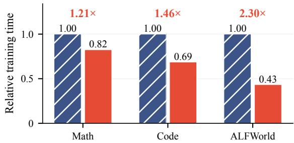
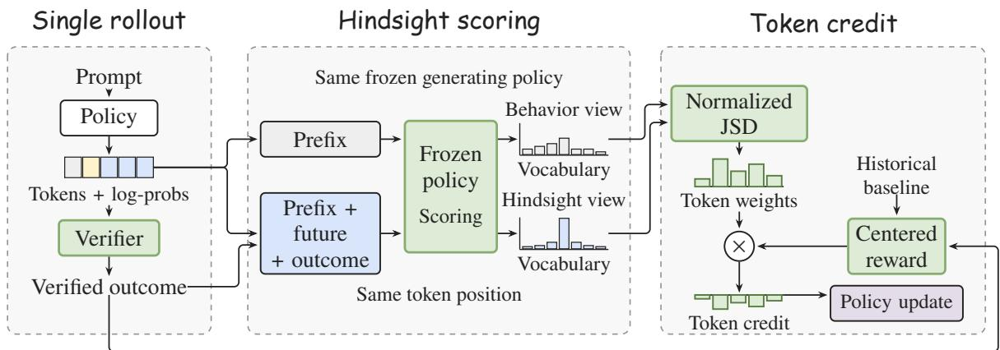
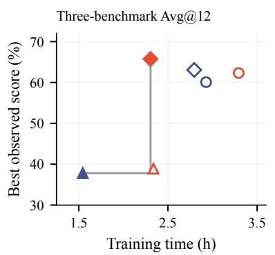
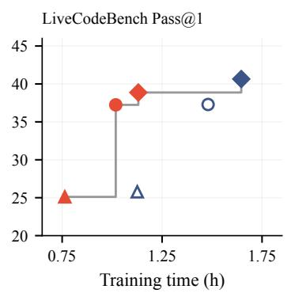
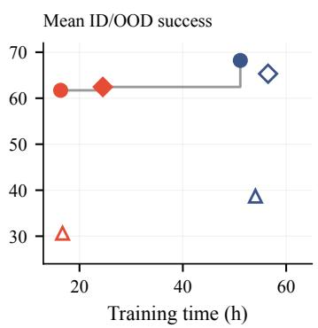
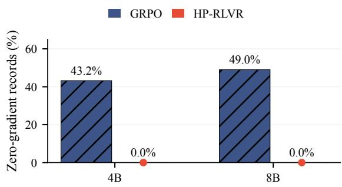

# Hindsight-Privileged RLVR: Single-Rollout Token Credit Without Group Sampling

Wei Chen1, Yubing Wu1, Zhou Xu2, Haoyue Zhang3, Delu Zeng1, Jiahao Wang4 Junmei Yang1, Pan tiewen5, Jingfeng Liu6, Zhiheng Zhou1, Bo Li1, Min Chen1

1South China University of Technology 2Tsinghua University

3The Hong Kong University of Science and Technology 4Huawei 2012 Laboratories 5Shenzhen Technology University 6LinkSprite

## Abstract

Reinforcement learning with verifiable rewards (RLVR) trains language models from checked task outcomes, but assigning a terminal reward to individual reasoning tokens or actions remains difficult. Group-relative methods such as Group Relative Policy Optimization (GRPO) sample several attempts per prompt, but lose their reward-based learning signal when all attempts receive the same outcome. We propose Hindsight-Privileged RLVR (HP-RLVR), a single-rollout method that turns a completed trajectory’s own future into token-level update weights. The generating policy snapshot scores each eligible token under its causal history and under a hindsight context containing the real ized future and verifier feedback. A normalized Jensen–Shannon divergence between the two views weights the reward relative to a historical baseline, yielding bounded token credit for both successful and failed attempts, with no reference solution or learned critic. In paired Qwen3-8B runs over a shared 100-step schedule, HP-RLVR trains 1.21×, 1.46×, and 2.30× faster than GRPO on mathematics, code generation, and ALFWorld, using one eighth the rollouts per prompt. Accuracy is comparable overall, with HP-RLVR ahead on mathematics at all three sizes and GRPO ahead on code and ALFWorld. In ALFWorld, 43.2% (4B) and 49.0% (8B) of GRPO’s gradient-norm records are zero, versus none for HP-RLVR.

## 1 Introduction

Reinforcement learning with verifiable rewards (RLVR) trains language models through outcomes checked by symbolic verifiers, test suites, or interactive environments (Guo et al., 2025). Terminal verification supplies supervision without labeling every intermediate decision. Turning that supervision into efficient learning, however, requires addressing both the cost of obtaining an update signal and its allocation within a trajectory.

  
Figure 1: Qwen3-8B training cost at four prompts per step and 100 steps. HP-RLVR uses group size G=1, versus GRPO’s G=8. Bars are relative to GRPO, with labels above each pair showing speedup.

First, group-relative learning obtains its signal through repeated attempts. Group Relative Policy Optimization (GRPO) compares multiple responses to each prompt, replacing a learned critic with a baseline computed from group rewards (Shao et al., 2024). This comparison requires multiple rollouts, yet homogeneous outcomes give zero reward advantages (Yu et al., 2025). Additional sampling therefore incurs cost without necessarily supplying an informative comparison.

Second, comparisons between complete attempts leave credit coarse within each attempt. Outcome-supervised GRPO broadcasts a trajectory’s advantage to its tokens (Shao et al., 2024), despite the different roles of intermediate decisions in reasoning and multi-turn interaction (Lightman et al., 2023; Feng et al., 2025). Process supervision supplies intermediate labels (Lightman et al., 2023), implicit process rewards learn dense signals (Yuan et al., 2024; Cui et al., 2025), and intermediatevalue estimation can require additional continuations (Kazemnejad et al., 2025). These approaches motivate a complementary question: can a single verified attempt, whether successful or failed, itself supply a finer learning signal?

  
Figure 2: Overview of HP-RLVR’s single-rollout training pipeline with training-only hindsight. After generation, the frozen generating policy scores the trajectory under causal and hindsight contexts, without additional sampling. The paired profiles show full-vocabulary distributions at the same token position. Normalized JSD weights the historically centered verifier reward to produce token credit. Bars are schematic, and dashed frames group stages.

A completed attempt’s realized future provides context for revisiting earlier decisions (Harutyunyan et al., 2019; Mesnard et al., 2021). We introduce Hindsight-Privileged RLVR (HP-RLVR), which uses this future as training-only privilege (Fig. 2). The generating policy compares token distributions with and without the future and verifier feedback. Historical reward centering directs the update and can give failures negative credit, while normalized Jensen–Shannon divergence supplies bounded, nonnegative token weights. This yields local credit from one rollout per prompt, without a reference solution or learned critic (Sec. 3).

We evaluate Qwen3 models (1.7B/4B/8B) (Yang et al., 2025) on mathematics, code generation, and ALFWorld (Shridhar et al., 2020). Figure 1 summarizes the Qwen3-8B cost benefit at a shared prompt and step budget, using one eighth as many rollouts per prompt. Task accuracy and training-signal diagnostics assess the resulting single-rollout updates (Figs. 3 and 4).

Our contributions are:

• A single-rollout hindsight construction using the generating policy and its own realized future, without reference solutions or a learned critic (Sec. 3.2).

• A bounded token-credit rule for both successful and failed trajectories, combining historical reward centering with normalized distributional divergence (Sec. 3.3).

• Lower training cost at a shared step schedule, with accuracy comparisons and protocol

diagnostics (Sec. 4).

## 2 Background and Related Work

## 2.1 Related work

Outcome-based and hindsight credit assignment. Methods for assigning local credit differ in how they obtain information beyond a terminal reward. Learned value baselines estimate future returns (Schulman et al., 2016), and RUDDER redistributes delayed rewards through a return predictor (Arjona-Medina et al., 2019). In language-model reasoning, process supervision supplies intermediate labels (Lightman et al., 2023), implicit process rewards learn dense signals from outcome supervision (Yuan et al., 2024; Cui et al., 2025), and VinePPO estimates intermediate values through additional continuations (Kazemnejad et al., 2025). Hindsight credit assignment instead uses observed future information to revisit past actions (Harutyunyan et al., 2019). Counterfactual credit assignment conditions value functions on suitable future events to reduce policy-gradient variance (Mesnard et al., 2021).

This distinction also matters for multi-turn agents. GiGPO augments episode-level group advantages with step-level comparisons at repeated states across sampled trajectories (Feng et al., 2025). HCAPO uses the language model as a posthoc critic and combines hindsight action evaluation with multi-scale advantages (Tan et al., 2026). HP-RLVR draws on the same idea of revisiting decisions after completion, but constructs its weights from the full-vocabulary divergence between two views of the generating snapshot.

Privileged supervision and failures. On-policy distillation scores student-generated sequences with a teacher (Agarwal et al., 2024). OPSD conditions the same model on privileged reference information (Zhao et al., 2026). Feedback-based self-distillation obtains privilege from interaction (Hübotter et al., 2026; Liu et al., 2026; Yeo et al., 2026). $\mathrm { H } ^ { \mathrm { 2 } } \mathrm { S D }$ uses verified student responses to refine successful trajectories and reference hints to correct failures (Cai et al., 2026). HP-RLVR instead uses an unsigned divergence to weight reward-based updates, including updates on failures without a corrective reference. Negative reinforcement can itself improve reasoning (Zhu et al., 2025), but update dynamics depend on weighting (Chen et al., 2026), loss normalization, and length dynamics (Liu et al., 2025; Yu et al., 2025). HP-RLVR and GRPO use trajectory-balanced loss reduction, and we report training-signal availability under this shared protocol (Sec. 4.4).

## 2.2 Problem formulation

Let $\pi _ { \pmb { \theta } }$ generate a response or interactive trajectory y for a prompt $\mathbf { \boldsymbol { x } } \sim \mathcal { D }$ . A verifier assigns $R ( { \pmb x } , { \pmb y } ) \in [ 0 , 1 ]$ , binary for task success or graded for partial credit. The objective is

$$
\mathcal { I } _ { \mathrm { R L V R } } ( \theta ) = \mathbb { E } _ { { \pmb x } \sim \mathcal { D } , { \pmb y } \sim \pi _ { \theta } } [ R ( { \pmb x } , { \pmb y } ) ] .\tag{1}
$$

For interactive trajectories, this expectation also includes environment transitions, but only policygenerated tokens contribute policy scores. With a parameter-independent verifier and environment, the score-function gradient is $\mathbb { E } [ R \nabla _ { \theta }$ log $\pi _ { \boldsymbol { \theta } } ( y$ | x)].

GRPO samples $G$ trajectories per prompt and assigns

$$
\hat { A } _ { i } = \frac { R _ { i } - \overline { { R } } } { \sigma _ { R } + \epsilon _ { \mathrm { s t a b } } } , \qquad \overline { { R } } = \frac { 1 } { G } \sum _ { i = 1 } ^ { G } R _ { i } ,\tag{2}
$$

where $\sigma _ { R }$ is the group reward standard deviation and $\epsilon _ { \mathrm { s t a b } } > 0$ stabilizes the denominator. The same advantage applies to every generated token of trajectory i. Homogeneous groups give $\hat { A } _ { i } = 0$ for all members. Appendix A summarizes notation.

## 3 Hindsight-Privileged RLVR

3.1 From trajectory rewards to token credit With a single rollout, group-relative credit vanishes: $\overline { { R } } = R _ { i }$ and $\hat { A } _ { i } = 0 ( \mathrm { E q . } ( 2 ) )$ . A baseline fixed before sampling can instead supply a reward comparison without requiring another attempt at the same prompt. The following standard identity provides the basis for this construction.

Lemma 3.1 (Historical baseline invariance). Condition on the completed history $\mathcal { H } _ { k } ,$ , and let $\mathbb { E } _ { k }$ denote expectation over a fresh prompt from D and a matched on-policy rollout. Assume the task distribution, verifier, and environment are parameterindependent, and the trajectory law has differentiable, fixed support with integrably dominated derivatives as specified in appendix B. Let $g _ { \theta }$ be the sum of policy scores over all generated tokens. Any $\mathcal { H } _ { k }$ -measurable baseline $b _ { k } \in [ 0 , 1 ]$ , heldfixed when differentiating, satisfies

$$
\mathbb { E } _ { k } [ ( R - b _ { k } ) g _ { \theta } ] = \nabla _ { \theta } \mathcal { I } _ { \mathrm { R L V R } } ( \theta ) .\tag{3}
$$

Thus a single on-policy trajectory yields an unbiased estimator of the unweighted reward gradient under these assumptions. We choose the mean reward of earlier trajectories. For batch $k ,$ let $\mathcal { C } _ { k }$ contain trajectories completed before that batch, and define

$$
\begin{array} { l } { \displaystyle b _ { k } = \frac { 1 } { | { \mathcal C } _ { k } | } \sum _ { i ^ { \prime } \in { \mathcal C } _ { k } } R _ { i ^ { \prime } } , } \\ { \displaystyle s _ { i } = R _ { i } - b _ { k } . } \end{array}\tag{4}
$$

When history is empty, use an initial $b _ { \mathrm { i n i t } } \in [ 0 , 1 ]$ fixed before sampling. The current batch enters the running sum and count only after its advantages are constructed.

Broadcasting $s _ { i }$ still assigns the same credit to every token. For generated position j, we therefore separate trajectory evaluation from local allocation:

$$
A _ { j } = \underbrace { \left( R _ { i } - b _ { k } \right) } _ { \mathrm { t r a j e c t o r y e v a l u a t i o n ~ l o c a l ~ a l l o c a t i o n } } .\tag{5}
$$

Here, $w _ { j } ~ \in ~ [ 0 , 1 ]$ is a token weight. The completed trajectory’s future offers additional context for revisiting earlier decisions. We use its effect on the generating policy’s predictions to construct $w _ { j }$ (Fig. 2).

## 3.2 Hindsight-conditioned scoring

Let $h _ { j }$ be the history visible when token $y _ { j }$ was generated, $F _ { j }$ the allowed future from the same trajectory, and $O$ the textual verifier report. With the generating snapshot frozen, the two scoring distributions are

$$
\begin{array} { l } { p _ { j } = \pi _ { \theta _ { \mathrm { o l d } } } ( \cdot \mid h _ { j } ) , } \\ { q _ { j } = \pi _ { \theta _ { \mathrm { o l d } } } ( \cdot \mid h _ { j } , F _ { j } , O ) . } \end{array}\tag{6}
$$

Both views score the same position. $F _ { j }$ excludes $y _ { j }$ and contains the allowed continuation or later agent transitions. Only the training scorer receives $F _ { j }$ and $O$ (appendix C.1). Both views reuse the same completed trajectory, so no additional continuations are sampled (Algorithm 1). Their distributional change supplies the local weight defined below.

A task adapter renders the verifier report as an outcome descriptor O, for example “the completed trajectory was unsuccessful” or “the solution passed 7 of 10 tests.” The adapter restates the report without adding an independent correctness judgment. An eligible future $F _ { j }$ contains only allowed information from the same realized trajectory and excludes the scored token itself. For a single response it is the allowed continuation after that token; for an agent it comprises the subsequent executed actions and observations, starting at the next transition. Scoring turn t therefore uses transitions from (actiont+1, observationt+2) onward, excluding the immediate observation that could trivially reveal the current action. Future information is available only after completion, and never during rollout generation or deployment.

## 3.3 Outcome-centered token credit

The local allocation should vanish when the causal and hindsight views agree, and be positive when they differ. Jensen–Shannon divergence (JSD) satisfies this criterion (Lin, 1991).

Lemma 3.2 (Zero divergence). Let p, q be probability massfunctions on afinite vocabulary V, and let $m = ( p + q ) / 2$ . With natural logarithms and zero-mass terms interpreted as zero,

$$
\begin{array} { r } { \mathrm { J S D } ( p , q ) = \frac { 1 } { 2 } D _ { \mathrm { K L } } ( p \Vert m ) + \frac { 1 } { 2 } D _ { \mathrm { K L } } ( q \Vert m ) } \end{array}
$$

is nonnegative and equals zero ifand only $i f p ( v ) =$ q(v) for every $v \in \mathcal V$

Motivated by Lemma 3.2, we use the normalized divergence as the token weight. With $m _ { j } = ( p _ { j } +$ $q _ { j } ) / 2$ , define

$$
w _ { j } = \frac { \mathrm { J S D } ( p _ { j } , q _ { j } ) } { \log 2 } \in [ 0 , 1 ] ,\tag{7}
$$

The normalization gives the following bound on the resulting credit.

Proposition 3.3 (Bounded credit). Let $p _ { j } , q _ { j }$ be probability mass functions on $\nu , R _ { i } , b _ { k } \in [ 0 , 1 ]$ and define wj, $A _ { j }$ by Eqs. (5) and (7). Every scored position satisfies

$$
0 \leq w _ { j } \leq 1 , \qquad | A _ { j } | \leq | R _ { i } - b _ { k } | \leq 1 .
$$

Moreover, $w _ { j } = 1$ if and only $i f p _ { j }$ and $q _ { j }$ have disjoint supports.

The advantages are detached before optimization, and positions with no eligible future are masked out. For scored positions, Lemma 3.2 gives $A _ { j } = 0$ exactly when $R _ { i } = b _ { k } \ \mathrm { o r } \ p _ { j } = q _ { j }$ . Otherwise, the centered reward determines the sign and the divergence determines the relative magnitude within a trajectory. A zero-advantage position contributes zero to the credit-weighted surrogate gradient. Although reward enters explicitly as one scalar factor, $w _ { j }$ also depends on its rendered descriptor O.

Lemma 3.1 applies to the unweighted trajectory score, before hindsight weighting, token-length normalization, and clipping. Since $w _ { j }$ depends on the sampled trajectory, its baseline contribution need not have zero expectation. HP-RLVR therefore optimizes a weighted surrogate. Proofs of the two lemmas and the proposition appear in appendix B.

## 3.4 Training objective and reduction

Let $s _ { i }$ be the eligible generated positions of trajectory $i , N _ { i } = \left| S _ { i } \right|$ , and B the number of contributing trajectories. We maximize the empirical PPO-style surrogate (Schulman et al., 2017)

$$
\begin{array} { r l r } {  { \widehat { \mathcal { T } } _ { \mathrm { H P } } ( \theta ) = \displaystyle \frac { 1 } { B } \sum _ { i = 1 } ^ { B } \frac { 1 } { N _ { i } } \sum _ { j \in S _ { i } } \ell _ { j } ( \theta ) , } } \\ & { } & { \ell _ { j } ( \theta ) = \operatorname* { m i n } \bigl ( r _ { j } A _ { j } , \mathrm { c l i p } ( r _ { j } , 1 - \epsilon , 1 + \epsilon ) A _ { j } \bigr ) , } \\ & { } & { r _ { j } ( \theta ) = \frac { \pi _ { \theta } ( y _ { j } \mid h _ { j } ) } { \pi _ { \theta _ { \mathrm { o l d } } } ( y _ { j } \mid h _ { j } ) } . } \end{array}\tag{8}
$$

Only the current policy receives gradients, with prompts, observations, and hindsight context excluded from the policy loss. We use one optimization epoch and $\epsilon = 0 . 2$

Both methods average over valid tokens within each trajectory and then over trajectories. For multiturn data stored as rows, a row with $N _ { i t }$ valid tokens receives weight $N _ { i t } / N _ { i }$ within its trajectory. Successful episodes can terminate before failed episodes, so equal turn-row weights can give longer episodes greater aggregate weight. This reduction avoids that extra weighting by turn count. Implementation checks are described in appendix 4.1.

Algorithm 1 summarizes one rollout/training step. Sampling and scoring follow Secs. 3.1 and 3.2. Both scoring views are detached, divergence is evaluated over the full vocabulary, and only eligible generated tokens enter the trajectorybalanced loss.

Algorithm 1 HP-RLVR training step   
Require: policy $\pi _ { \pmb { \theta } } ,$ prompt batch $\{ x _ { i } \}$ , verifier   
$R ,$ completed history $\mathcal { C } _ { k }$   
Ensure: updated policy $\pi _ { \pmb { \theta } } ,$ extended history $\mathcal { C } _ { k + 1 }$   
1: $\theta _ { \mathrm { o l d } }  \theta$ ▷ frozen generating snapshot   
2: $b _ { k } \gets$ mean $\{ R _ { i ^ { \prime } } : i ^ { \prime } \in \mathcal { C } _ { k } \}$ ▷ Eq. (4)   
3: ${ \pmb y } _ { i } \sim \pi _ { \theta _ { \mathrm { o l d } } } ( { \bf \cdot } \mid { \pmb x } _ { i } )$ ▷ one rollout per prompt   
4: Record log $\pi _ { \theta _ { \mathrm { o l d } } } ( y _ { j } \mid h _ { j } )$   
5: $R _ { i } \gets R ( { \pmb x } _ { i } , { \pmb y } _ { i } )$ ▷ verifier reward   
6: $O _ { i }  \mathrm { R e n d e r } ( R _ { i } )$ ▷ outcome descriptor   
7: $p _ { j }  \pi _ { \theta _ { \mathrm { o l d } } } ( \cdot \mid h _ { j } )$   
8: $q _ { j }  \pi _ { \theta _ { \mathrm { o l d } } } ( \cdot \mid h _ { j } , F _ { j } , O _ { i } )$ ▷ Eq. (6)   
9: $w _ { j } \gets \mathrm { J S D } ( p _ { j } , q _ { j } ) /$ log 2 ▷ Eq. (7)   
10: $A _ { j } \gets \left( R _ { i } - b _ { k } \right) w _ { j }$ ▷ dvantage (Eq. (5))   
11: Update $\pmb \theta$ ▷ Eq. (8)   
12: ${ \mathcal { C } } _ { k + 1 } \gets { \mathcal { C } } _ { k } \cup \{ R _ { i } \}$ ▷ history updated after   
credit

## 4 Experiments

Our evaluation tests whether training-only hindsight can replace group sampling at lower computational cost, and how that substitution affects task accuracy and the availability of a training signal. We study sequence-level verification in mathematics and code generation, and sparse terminal rewards in multi-turn ALFWorld interaction.

## 4.1 Experimental setup

We evaluate Qwen3-1.7B, 4B, and 8B (Yang et al., 2025), comparing HP-RLVR (G=1) with a criticfree GRPO control (G=8). Paired runs share task data, seed 42, LoRA configuration (Hu et al., 2021), Adam settings (Kingma and Ba, 2014), and one PPO epoch per rollout step. Both use full-support training sampling and trajectory-balanced loss reduction. We evaluate at steps 25, 50, 75, and 100. A training step comprises one rollout-and-training iteration, with run-specific trajectory budgets and internal optimizer-step counts. Run-specific batching records appear in appendix D.1.

Both methods use LoRA rank 64, α = 128, and dropout 0, applied to attention and MLP projections, with Adam betas 0.9 and 0.999, zero weight decay, a constant learning rate of $5 \times 1 0 ^ { - 6 }$ , gradient clipping 1.0, and a PPO clip range of 0.2. Each step takes one optimization epoch over its rollout batch, and the shared schedule runs 100 rolloutand-training steps with checkpoints every 25 steps. Training steps count rollout-and-training iterations, separately from internal optimizer steps and log records.

Mathematics trains on a 30k-prompt OpenThoughts mixture (Guha et al., 2025), and code generation trains on 800 problems divided into 60% standard-I/O and 40% function-call tasks. Both cap training responses at 1,024 tokens. ALFWorld uses four prompts per rollout step, 50 turns, an eight-turn retained history, a 4,096-token per-turn response cap, and an 8,192-token training context. Mathematics uses an official symbolic verifier, code generation a test harness, and ALFWorld the environment’s terminal success signal.

Both methods sample at temperature 1 without top-p or top-k truncation, which keeps the sampled distribution, the behavior scoring, and the likelihood-ratio denominator aligned. At each generated position $j$ the rollout engine records the token $y _ { j }$ and its generation-time log-probability, which supplies the behavior denominator of Eq. (8); for agents, $h _ { j }$ contains the retained observation– action history rather than necessarily the entire episode. The full behavior distribution of Eq. (6) is obtained by replaying the same history with the generating snapshot, and a check at the first update replays current log-probabilities against that record, aborting the run on a mismatch rather than biasing the ratios. The exact divergence of Eq. (7) is evaluated over the full vocabulary in groups of token positions, with no top-k or restricted-support approximation: stored token weights require O(T) memory and temporary divergence calculations O(CV ) for T positions, vocabulary size V , and groups of at most C positions, excluding model states and activations.

Mathematics uses AIME24, AIME25, and HMMT25 (Balunovic et al.´ , 2025; HMMT, 2025), with 30 problems per benchmark and 12 samples per problem, thinking enabled, temperature 1, top-p 0.95, and a 38,912-token response cap. Avg@12 averages sampled correctness and Pass@12 measures whether any sample solves a problem. Mathematics aggregates average the three benchmarks. Code evaluates at temperature 0.2 on all 1,055 LiveCodeBench release-6 problems (Jain et al., 2024), with Pass@1 and Pass@8 computed as eight-sample estimates from a common dump. ALFWorld reports the mean success rate across in-distribution (ID, 140 games) and out-ofdistribution (OOD, 134 games) splits (Shridhar et al., 2020), evaluating one episode per game under the 50-turn protocol. Each method has one training seed. All timings use 8 Ascend 910B NPUs.

Implementation Details The dense packed attention path gives approximately $5 \times 1 0 ^ { - 4 } \mathrm { t o } 6 \times 1 0 ^ { - 4 }$ nats of KL against a reference implementation on identical context. Results from the discarded attention prototype are excluded.

For the released implementation, the trajectorybalanced reduction of Sec. 3.4 carries per-trajectory assertions: the within-trajectory row weights $w _ { i t } =$ $N _ { i t } / N _ { i }$ must sum to one, and the effective trajectory weight must be uncorrelated with its turn and token counts. The clipped surrogate of Eq. (8) is applied with the coefficient used by the GRPO control in the same stack.

## 4.2 Cost of replacing group sampling

The practical benefit of G=1 depends on whether its additional hindsight scoring costs less than the group rollouts it replaces. We test this on Qwen3- 8B at a shared four-prompt budget and 100 rollout steps, generating four trajectories per step for HP-RLVR and 32 for GRPO. Figure 1 shows lower end-to-end training time in all three task families, with GRPO-to-HP-RLVR ratios of 1.21–2.30. The largest reduction occurs on ALFWorld, saving 255.8 NPU-hours despite the additional scoring passes. Wall-clock spans each run’s first and last timestamps. Absolute timings and NPU-hours appear in Tab. 1. The comparison measures cost at a fixed prompt and step budget, rather than at equal trajectory counts or matched accuracy.

Where the control spends computation. Table 2 decomposes the recorded 4B GRPO mathematics run. Generation accounts for 72.9% of its wall-clock, compared with 12.7% for policy training and 5.5% for behavior-policy replay. This run generates 12,800 trajectories from 16 prompts per step, a different prompt budget from the 8B pairs. Its 1,024-token training cap truncates 41.6% of responses. The profile identifies generation as the largest measured cost in this control. It does not provide a paired phase decomposition for HP-RLVR or isolate the cost of hindsight scoring.

## 4.3 Task accuracy under single-rollout training

To assess the performance–time tradeoff, Fig. 3 pairs each configuration’s best observed task score within 100 steps with its measured complete-run training time. Checkpoint selection maximizes the mean benchmark score at a single checkpoint. Mathematics averages AIME24, AIME25, and HMMT25 Avg@12, code uses eight-sample mean Pass@1 on LiveCodeBench, and ALFWorld averages ID and OOD success. Table 3 reports each configuration’s best observed value per metric. Both methods are evaluated at all four checkpoints at every size, and code passes use eight completions per problem from a common dump.

At 8B, HP-RLVR’s best mathematics score is 65.73% versus 63.07% for GRPO, with 1.21× shorter training time. Code and ALFWorld expose a different tradeoff: HP-RLVR trains 1.46× and 2.30× faster, respectively, with best observed scores of 38.87% versus 40.65% and 62.45% versus 65.32%. HP-RLVR contributes non-dominated configurations in all three task families. The frontier describes the measured configurations and does not establish statistical superiority or isolate estimator effects across hardware and budgets.

In mathematics, HP-RLVR has the higher best observed Avg@12 at all three scales, by 1.1 to 2.7 points: 38.90% against 37.80% at 1.7B, 62.32% against 60.09% at 4B, and 65.73% against 63.07% at 8B. It also has the higher Pass@12 at 1.7B and 4B, extending the comparison to solution coverage, while GRPO reaches the higher 8B Pass@12 (81.10% versus 79.97%). These results show stronger accuracy retention relative to the control under a constrained training regime: responses are capped at 1,024 tokens during training and 38,912 during evaluation, and approximately 42% of the 4B control’s training responses reach the cap.

The ordering changes for code generation, where GRPO has the higher best observed Pass@1 and Pass@8 at all three sizes. The margin is narrowest at 4B, where HP-RLVR reaches 37.24% Pass@1 and 44.55% Pass@8 against 37.29% and 45.31% for GRPO on 1,055 problems. On ALFWorld, GRPO has the higher ID success, OOD success, and mean at all three sizes. Together, these comparisons indicate a task-dependent accuracy tradeoff when replacing group-relative updates with singlerollout credit.

The 8B runs evaluate all three task families

(a) Mathematics

(c) ALFWorld  
Table 1: Training-cost records for completed 100-step runs. NPU-hours are separately logged run totals. Ratio: GRPO/HP-RLVR training time, so values below one favor GRPO. The 4B mathematics pair uses 32/16 prompts per step for HP-RLVR/GRPO.
<table><tr><td></td><td></td><td colspan="2">Time (min)</td><td colspan="2">NPU-hours</td><td></td></tr><tr><td>Model</td><td>Task</td><td>GRPO</td><td>HP-RLVR</td><td>GRPO</td><td>HP-RLVR</td><td>Ratio</td></tr><tr><td>1.7B</td><td>Mathematics</td><td>92.70</td><td>140.27</td><td>12.36</td><td>18.70</td><td>0.66×</td></tr><tr><td></td><td>Code</td><td>67.55</td><td>45.80</td><td>9.01</td><td>6.11</td><td>1.48×</td></tr><tr><td></td><td>ALFWorld</td><td>3242.85</td><td>1003.25</td><td>432.4</td><td>133.8</td><td>3.23×</td></tr><tr><td>4B</td><td>Mathematics</td><td>175.66</td><td>125.47</td><td>23.42</td><td>16.73</td><td>1.40×</td></tr><tr><td></td><td>Code</td><td>88.80</td><td>61.09</td><td>11.84</td><td>8.15</td><td>1.45×</td></tr><tr><td></td><td>ALFWorld</td><td>3067.50</td><td>981.00</td><td>409</td><td>130.8</td><td>3.13×</td></tr><tr><td>8B</td><td>Mathematics</td><td>167.68</td><td>138.30</td><td>22.4</td><td>18.4</td><td>1.21×</td></tr><tr><td></td><td>Code</td><td>98.77</td><td>67.87</td><td>13.2</td><td>9.0</td><td>1.46×</td></tr><tr><td></td><td>ALFWorld</td><td>3389.55</td><td>1471.05</td><td>451.9</td><td>196.1</td><td>2.30×</td></tr></table>

(b) Code  

  
Filled: non-dominated Hollow: dominated Best evaluated checkpoint within 100 steps  
Figure 3: Best observed task performance versus complete-run training time over 100 steps. Each method and model size uses the highest whole-task score at steps 25/50/75/100. Filled and hollow points are non-dominated and dominated within each task, respectively, and gray steps trace the observed budget envelope. Code uses Pass@1 over 1,055 problems. Single-seed runs differ in hardware and prompt budgets, including 32/16 prompts per step for 4B mathematics (HP-RLVR/GRPO). The 1.7B HP-RLVR ALFWorld timing includes a restart.

Table 2: Qwen3-4B GRPO mathematics timing over 100 steps at 16 prompts and 128 trajectories per step. Residual time is the total minus the four listed phase measurements.
<table><tr><td>Phase</td><td>Time (s)</td><td>Share (%)</td></tr><tr><td>Rollout generation</td><td>7,678.48</td><td>72.9</td></tr><tr><td>Policy training</td><td>1,343.70</td><td>12.7</td></tr><tr><td>Behavior-policy replay</td><td>576.85</td><td>5.5</td></tr><tr><td>Weight synchronization</td><td>141.96</td><td>1.3</td></tr><tr><td>Residual time</td><td>798.51</td><td>7.6</td></tr><tr><td>Total</td><td>10,539.50</td><td>100.0</td></tr></table>

(Tab. 3). Code generation and ALFWorld both favor GRPO at 8B, and mathematics favors HP-RLVR, at 65.73% against 63.07%.

Best observed values. The benchmark-level results in Tab. 3 report each configuration’s best observed value per metric. At 4B, GRPO has the higher ALFWorld ID success (70.00% versus 62.14%), OOD success (66.42% versus 63.43%), and mean (68.21% versus 61.72%). For the ID and OOD evaluations of 140 and 134 games, individual success-rate estimates near 65% have approximate binomial standard errors of 4.1 percentage points. Paired uncertainty requires the per-game discordance counts.

## 4.4 Training-signal availability and controls

Group-relative credit vanishes when all sampled outcomes agree. HP-RLVR instead compares each outcome with a historical baseline, so failed trajectories can carry negative credit without requiring a successful attempt at the same prompt. The nonnegative JSD weights distribute this credit across eligible tokens (Eqs. (5) and (7)). In 4B mathematics, 430 of 902 recorded reward groups (47.7%) are homogeneous, supplying no reward-based advantage. In ALFWorld, zero gradient-norm records account for 43.2% and 49.0% of GRPO records at 4B and 8B, respectively, versus none for HP-RLVR (Fig. 4). These diagnostics support the availability of single-rollout updates without an informative within-prompt reward comparison. Counts appear on the plot and in Tab. 5. Reward groups measure uninformative comparisons, whereas logged gradient records measure current-gradient availability.

Table 3: Qwen3-1.7B, 4B, and 8B results under the current protocol (%). Each cell is the best observed value for that metric across the four checkpoints. Avg@12 averages correctness over 12 samples per problem and the mathematics Avg. is the mean over the three benchmarks. Code reports Pass@1 and Pass@8 on 1,055 LiveCodeBench problems. ALFWorld reports ID/OOD success (140/134 games) and their mean.
<table><tr><td></td><td></td><td colspan="4">Mathematics (Avg@12)</td><td></td><td colspan="2">Code</td><td colspan="3">ALFWorld</td></tr><tr><td>Size</td><td>Method</td><td>AIME24</td><td>AIME25</td><td>HMMT25</td><td>Avg.</td><td>Pass@12</td><td></td><td>Pass@1 Pass@8</td><td>ID</td><td>OOD</td><td>Avg.</td></tr><tr><td>1.7B</td><td>GRPO (G=8)</td><td>51.90</td><td>38.10</td><td>25.00</td><td>37.80</td><td>65.56</td><td>25.78</td><td>32.04</td><td>40.00</td><td>39.55</td><td>38.71</td></tr><tr><td>1.7B</td><td>HP-RLVR (G=1)</td><td>52.20</td><td>40.30</td><td>27.20</td><td>38.90</td><td>66.67</td><td>25.11</td><td>31.75</td><td>32.14</td><td>31.34</td><td>30.64</td></tr><tr><td>4B</td><td>GRPO (G=8)</td><td>71.39</td><td>64.44</td><td>46.39</td><td>60.09</td><td>76.67</td><td>37.29</td><td>45.31</td><td>70.00</td><td>66.42</td><td>68.21</td></tr><tr><td>4B</td><td>HP-RLVR (G=1)</td><td>76.67</td><td>67.50</td><td>46.39</td><td>62.32</td><td>78.89</td><td>37.24</td><td>44.55</td><td>62.14</td><td>63.43</td><td>61.72</td></tr><tr><td>8B</td><td>GRPO (G=8)</td><td>74.20</td><td>72.20</td><td>45.00</td><td>63.07</td><td>81.10</td><td>40.65</td><td>49.29</td><td>65.71</td><td>64.93</td><td>65.32</td></tr><tr><td>8B</td><td>HP-RLVR (G=1)</td><td>75.00</td><td>73.30</td><td>49.20</td><td>65.73</td><td>79.97</td><td>38.87</td><td>47.30</td><td>62.14</td><td>64.18</td><td>62.45</td></tr></table>

  
Figure 4: ALFWorld zero gradient-norm records as a fraction of all logged records.

Both methods share trajectory-balanced reduction and interaction settings. Generation-time probabilities and replay checks align PPO ratios (appendix C.1). The comparisons assess the combined estimator: a matched $w _ { j } = 1$ control would test token weighting, and future-context controls would test the information source.

Evaluation coverage. The main-text Tab. 3 reports each configuration’s best observed value. Both methods appear at all three sizes for mathematics, code, and ALFWorld. Absolute timings appear in Tab. 1, and paired 1.7B comparisons appear in appendix D.2.

Training-side accounting. The mathematics comparison combines a short training cap with long evaluation responses. In the Qwen3-4B GRPO run, 41.6% of training responses reach the 1,024-token cap, whereas evaluation allows 38,912 tokens. The training statistics therefore include a substantial truncated-response population. Separately, 430 of 902 reward groups (47.7%) have zero reward variance, giving zero group-relative advantage under Eq. (2). This demonstrates the absence of rewardbased gradient contributions from those homogeneous groups, alongside the agent gradient-log diagnostic in Tab. 5.

## 5 Conclusion

HP-RLVR assigns token credit from one rollout per prompt: historical reward centering sets the update direction, while bounded, nonnegative JSD weights from causal and hindsight scoring allocate its magnitude. This rule applies to successful and failed trajectories and can give failures negative credit without a corrective reference. At a shared prompt and 100-step budget, paired Qwen3-8B runs train 1.21×, 1.46×, and 2.30× faster than G=8 GRPO on mathematics, code, and ALFWorld, using one eighth as many rollouts per prompt. Accuracy is comparable overall, with HP-RLVR ahead on mathematics at all three sizes and GRPO ahead on code and ALFWorld. In ALFWorld, 43.2% (4B) and 49.0% (8B) of GRPO’s gradient-norm records are zero, versus none for HP-RLVR.

## Limitations

Experiments cover Qwen3 models and text tasks with terminal verification. Other model families, multimodal feedback, and longer training contexts offer natural extensions.

## References

Rishabh Agarwal, Nino Vieillard, Yongchao Zhou, Piotr Stanczyk, Sabela Ramos, Matthieu Geist, and Olivier Bachem. 2024. On-policy distillation of language models: Learning from self-generated mistakes. In International Conference on Learning Representations.

Jose A. Arjona-Medina, Michael Gillhofer, Michael Widrich, Thomas Unterthiner, Johannes Brandstetter, and Sepp Hochreiter. 2019. RUDDER: Return decomposition for delayed rewards. In Advances in Neural Information Processing Systems, volume 32, pages 13544–13555.

Mislav Balunovic, Jasper Dekoninck, Ivo Petrov, Nikola´ Jovanovic, and Martin Vechev. 2025.´ MathArena: Evaluating LLMs on uncontaminated math competitions. arXiv preprint.

Qiye Cai, Yichuan Ma, Peiji Li, Yongkang Chen, Qipeng Guo, Yicheng Zou, Linyang Li, Xiaocheng Feng, and Bing Qin. 2026. H2SD: Hybrid hindsight self-distillation. Preprint, arXiv:2607.18955.

Wei Chen, Yubing Wu, Junmei Yang, Delu Zeng, Qibin Zhao, John Paisley, Min Chen, and Zhou Wang. 2026. Towards disentangled preference optimization dynamics: Suppress the loser, preserve the winner. In Proceedings of the 43rd International Conference on Machine Learning, volume 306 of Proceedings ofMachine Learning Research, pages 17552–17585. PMLR.

Ganqu Cui, Lifan Yuan, Zefan Wang, Hanbin Wang, Yuchen Zhang, Jiacheng Chen, Wendi Li, Bingxiang He, Yuchen Fan, Tianyu Yu, Qixin Xu, Weize Chen, Jiarui Yuan, Huayu Chen, Kaiyan Zhang, Xingtai Lv, Shuo Wang, Yuan Yao, Xu Han, and 6 others. 2025. Process reinforcement through implicit rewards. Preprint, arXiv:2502.01456.

Lang Feng, Zhenghai Xue, Tingcong Liu, and Bo An. 2025. Group-in-group policy optimization for LLM agent training. arXiv preprint.

Etash Guha, Ryan Marten, Sedrick Keh, Negin Raoof, et al. 2025. OpenThoughts: Data recipes for reasoning models. arXiv preprint.

Daya Guo, Dejian Yang, Haowei Zhang, Junxiao Song, Peiyi Wang, Qihao Zhu, Runxin Xu, Ruoyu Zhang, Shirong Ma, Xiao Bi, et al. 2025. DeepSeek-R1 incentivizes reasoning in LLMs through reinforcement learning. Nature, 645:633–638.

Anna Harutyunyan, Will Dabney, Thomas Mesnard, Mohammad Azar, Bilal Piot, Nicolas Heess, Hado van Hasselt, Greg Wayne, Satinder Singh, Doina Precup, and Rémi Munos. 2019. Hindsight credit assignment. Preprint, arXiv:1912.02503.

HMMT. 2025. Harvard–MIT mathematics tournament (HMMT). https://www.hmmt.org/.

Edward J. Hu, Yelong Shen, Phillip Wallis, Zeyuan Allen-Zhu, Yuanzhi Li, Shean Wang, Lu Wang, and Weizhu Chen. 2021. LoRA: Low-rank adaptation of large language models. arXiv preprint.

Jonas Hübotter, Frederike Lübeck, Lejs Behric, Anton Baumann, Marco Bagatella, Daniel Marta, Ido Hakimi, Idan Shenfeld, Thomas Kleine Büning, Carlos Guestrin, and Andreas Krause. 2026. Reinforcement learning via self-distillation. Preprint, arXiv:2601.20802.

Naman Jain, King Han, Alex Gu, Wen-Ding Li, Fanjia Yan, Tianjun Zhang, Sida Wang, Armando Solar-Lezama, Koushik Sen, and Ion Stoica. 2024. Live-CodeBench: Holistic and contamination free evaluation of large language models for code. arXiv preprint.

Amirhossein Kazemnejad, Milad Aghajohari, Eva Portelance, Alessandro Sordoni, Siva Reddy, Aaron Courville, and Nicolas Le Roux. 2025. VinePPO: Refining credit assignment in RL training of LLMs. In Proceedings ofthe 42nd International Conference on Machine Learning, volume 267 of Proceedings of Machine Learning Research, pages 29557–29590.

Diederik P. Kingma and Jimmy Ba. 2014. Adam: A method for stochastic optimization. arXiv preprint.

Hunter Lightman, Vineet Kosaraju, Yura Burda, Harri Edwards, Bowen Baker, Teddy Lee, Jan Leike, John Schulman, Ilya Sutskever, and Karl Cobbe. 2023. Let’s verify step by step. arXiv preprint.

Jianhua Lin. 1991. Divergence measures based on the shannon entropy. IEEE Transactions on Information Theory, 37(1):145–151.

Haoran Liu, Yuwei Zhang, Xiyao Li, Bohan Lyu, and Jingbo Shang. 2026. HERO: Hindsight-enhanced reflection from environment observations for agentic self-distillation. arXiv preprint.

Zichen Liu, Changyu Chen, Wenjun Li, Penghui Qi, Tianyu Pang, Chao Du, Wee Sun Lee, and Min Lin. 2025. Understanding R1-Zero-Like training: A critical perspective. Preprint, arXiv:2503.20783.

Thomas Mesnard, Théophane Weber, Fabio Viola, Shantanu Thakoor, Alaa Saade, Anna Harutyunyan, Will Dabney, Tom Stepleton, Nicolas Heess, Arthur Guez, Eric Moulines, Marcus Hutter, Lars Buesing, and Rémi Munos. 2021. Counterfactual credit assignment in model-free reinforcement learning. Preprint, arXiv:2011.09464.

John Schulman, Philipp Moritz, Sergey Levine, Michael I. Jordan, and Pieter Abbeel. 2016. Highdimensional continuous control using generalized advantage estimation. In International Conference on Learning Representations.

John Schulman, Filip Wolski, Prafulla Dhariwal, Alec Radford, and Oleg Klimov. 2017. Proximal policy optimization algorithms. arXiv preprint.

Zhihong Shao, Peiyi Wang, Qihao Zhu, Runxin Xu, Junxiao Song, Xiao Bi, Haowei Zhang, Mingchuan Zhang, Y. K. Li, Y. Wu, and Daya Guo. 2024. Deepseekmath: Pushing the limits of mathematical reasoning in open language models. Preprint, arXiv:2402.03300.

Mohit Shridhar, Xingdi Yuan, Marc-Alexandre Côté, Yonatan Bisk, Adam Trischler, and Matthew Hausknecht. 2020. ALFWorld: Aligning text and embodied environments for interactive learning. arXiv preprint.

Hui-Ze Tan, Xiao-Wen Yang, Hao Chen, Jie-Jing Shao, Yi Wen, Yuteng Shen, Weihong Luo, Xiku Du, Lan-Zhe Guo, and Yu-Feng Li. 2026. Hindsight credit assignment for long-horizon LLM agents. arXiv preprint.

An Yang, Anfeng Li, Baosong Yang, et al. 2025. Qwen3 technical report. arXiv preprint.

Woongyeong Yeo, Yumin Choi, Taekyung Ki, and Sung Ju Hwang. 2026. HINT-SD: Targeted hindsight self-distillation for long-horizon agents. arXiv preprint.

Qiying Yu, Zheng Zhang, Ruofei Zhu, Yufeng Yuan, Xiaochen Zuo, Yu Yue, Weinan Dai, Tiantian Fan, Gaohong Liu, Lingjun Liu, Xin Liu, Haibin Lin, Zhiqi Lin, Bole Ma, Guangming Sheng, Yuxuan Tong, Chi Zhang, Mofan Zhang, Wang Zhang, and 16 others. 2025. DAPO: An open-source LLM reinforcement learning system at scale. In Advances in Neural Information Processing Systems.

Lifan Yuan, Wendi Li, Huayu Chen, Ganqu Cui, Ning Ding, Kaiyan Zhang, Bowen Zhou, Zhiyuan Liu, and Hao Peng. 2024. Free process rewards without process labels. Preprint, arXiv:2412.01981.

Siyan Zhao, Zhihui Xie, Mengchen Liu, Jing Huang, Guan Pang, Feiyu Chen, and Aditya Grover. 2026. Self-distilled reasoner: On-policy self-distillation for large language models. Preprint, arXiv:2601.18734.

Xinyu Zhu, Mengzhou Xia, Zhepei Wei, Wei-Lin Chen, Danqi Chen, and Yu Meng. 2025. The surprising effectiveness of negative reinforcement in LLM reasoning. Preprint, arXiv:2506.01347.

## Appendix Contents

B Proofs 11   
B.1 Historical-baseline identity . . . . 12   
B.2 Zero divergence 12   
B.3 Bounded credit 12   
C Method Details 13   
C.1 Sampling and scoring details . . . 13   
D Experimental Details 13   
D.1 Setup Details 13   
D.2 Paired comparisons at Qwen3-1.7B 13   
E Additional Efficiency Measurements 13   
E.1 Current run timings and signal   
records . . 13   
LLM Usage Disclosure 14

## A Notation and Preliminaries

Table 4 summarizes the notation for HP-RLVR and GRPO. Symbols used only in a proof are defined where introduced.

Table 4: Core notation.
<table><tr><td>Symbol</td><td>Meaning</td></tr><tr><td> $\mathbf { \nabla } _ { \mathbf { x } , \mathbf { y } }$   $\pi _ { \boldsymbol { \theta } } , \pi _ { \boldsymbol { \theta } _ { \mathrm { o l d } } }$   $i , j , k$ </td><td>Prompt and generated trajectory. Current policy and rollout snapshot. Trajectory, token, and batch indices.</td></tr><tr><td> $\bar { R _ { i } } , O$   $G$ </td><td>Verifier reward and outcome descriptor. Group size: rollouts per prompt.</td></tr><tr><td> $h _ { j } , y _ { j }$   $F _ { j }$   $p _ { j } , q _ { j }$   $\mathcal { C } _ { k }$ </td><td>History and token at position  $j .$  Eligible future trace.</td></tr><tr><td></td><td>Causal and hindsight snapshot distributions. Rewards of trajectories completed before batch k.</td></tr><tr><td> $b _ { k }$ </td><td>Mean reward of completed trajectories before</td></tr><tr><td> $w _ { j }$   $A _ { j }$   $\hat { A } _ { i }$ </td><td>batch k. Normalized JSD token weight.</td></tr></table>

## B Proofs

We first establish the historical-baseline identity underlying single-rollout reward centering, then the divergence properties underlying local allocation. The former is an expectation identity for the unweighted trajectory score. The latter hold for each realized pair of scoring distributions.

Conditional sampling and regularity. Fix a realization of the completed history $\mathcal { H } _ { k }$ and a parameter value θ in an open neighborhood $U \subset \mathbb { R } ^ { d }$ . All history-dependent quantities, including $b _ { k } .$ , are held fixed when differentiating. The following assumptions specify the scope of Lemma 3.1.

(B1) Matched conditional sampling. Given this history, the current prompt has the parameterindependent law D. Conditional on a prompt x, the current trajectory has density $f _ { \pmb \theta } ( \pmb y \mid \pmb x )$ with respect to a parameter-independent reference measure $\mu _ { x }$ . The law used to sample this trajectory is the same law being differentiated. The verifier $R ( { \pmb x } , { \pmb y } ) \in [ 0 , 1 ]$ ], environment transition kernels, and external stopping or truncation rules have no explicit parameter dependence. The rollout terminates almost surely after finitely many generated tokens. Its density factors into policy token probabilities and parameter-independent factors. Policy-generated stopping decisions are included among the scored tokens. For interactive tasks, y includes the environment transitions.

(B2) Common support and differentiability. For $\mathcal { D } .$ almost every x, there is a measurable set $S _ { x }$ independent of the parameter in $U _ { \pm }$ on which $f _ { \eta } ( \pmb { y } \vert \pmb { x } ) > 0$ for all $\pmb { \eta } \in U$ , up to a common $\mu _ { \pmb { x } } .$ -null set. The density is zero off $S _ { x } .$ , normalized for every $\pmb { \eta } \in U$ , and continuously differentiable in η on $S _ { x }$

(B3) Integrable domination. There is a measurable $d ( { \pmb x } , { \pmb y } ) \ge 0$ such that, almost everywhere,

$$
\operatorname* { s u p } _ { \pmb { \eta } \in U } \| \nabla _ { \pmb { \eta } } f _ { \pmb { \eta } } ( \pmb { y } \mid \pmb { x } ) \| \le d ( \pmb { x } , \pmb { y } ) ,
$$

and

$$
\int _ { \chi } \int d ( x , y ) \mu _ { x } ( d y ) \mathcal { D } ( d x ) < \infty .
$$

This permits differentiation under both the trajectory integral and the task expectation.

By the autoregressive factorization in (B1), the trajectory score on its support is

$$
\begin{array} { r l } { g _ { \theta } ( \pmb { x } , \pmb { y } ) : = \nabla _ { \pmb { \theta } } \log f _ { \pmb { \theta } } ( \pmb { y } \mid \pmb { x } ) } & { } \\ { \quad \quad \quad = \displaystyle \sum _ { j \in \mathcal { G } ( \pmb { y } ) } \nabla _ { \pmb { \theta } } \log \pi _ { \pmb { \theta } } ( y _ { j } \mid h _ { j } ) , } \end{array}\tag{9}
$$

where $\mathcal G ( \pmb y )$ contains all policy-generated positions, including a sampled termination token when present. Observations contribute no policy score. This sum has no eligibility mask or token-length denominator. The policy probabilities must describe the actual sampling law, including its temperature convention. A parameter-dependent support change is excluded by (B2).

Divergence conventions. For probability mass functions $^ { a , }$ b on the finite vocabulary $\nu ,$ , define

$$
D _ { \mathrm { K L } } ( a \| b ) = \sum _ { v : a ( v ) > 0 } a ( v ) \log \frac { a ( v ) } { b ( v ) } ,
$$

with value +∞ if $a ( v ) > 0 \ = \ b ( v )$ for some $v .$ Terms with $a ( v ) ~ = ~ 0$ contribute zero, including when $b ( v ) = 0$ . For $m = ( p + q ) / 2$ both $D _ { \mathrm { K L } } ( p \Vert m )$ and $D _ { \mathrm { K L } } ( q \Vert m )$ are finite because $m ( v ) \geq p ( v ) / 2$ and $m ( v ) \geq q ( v ) / 2$

## B.1 Historical-baseline identity

ProofofLemma 3.1. Work under the fixed history above and write $\mathbb { E } _ { k }$ for expectation under (B1). Set the score to zero off $S _ { x } ,$ , a set of zero trajectory probability. Assumption (B3) gives

$$
\begin{array} { l } { \displaystyle \mathbb { E } _ { k } [ \| g _ { \theta } \| ] = \int \int _ { S _ { x } } \| \nabla _ { \theta } f _ { \theta } \| d \mu _ { x } d \mathcal { D } } \\ { \displaystyle \leq \int \int d d \mu _ { x } d \mathcal { D } < \infty . } \end{array}
$$

Here and below the arguments $\textbf { ( } y \textbf { ) } \pmb { x } )$ are suppressed inside integrals. Since R and $b _ { k }$ are bounded, all score expectations used below are well-defined.

By (B2), $f _ { \pmb { \theta } } g _ { \pmb { \theta } } = \nabla _ { \pmb { \theta } } f _ { \pmb { \theta } }$ on the common support. Normalization and differentiation under the integral, justified by (B3), imply, for D-almost every x,

$$
\begin{array} { l } { \displaystyle \mathbb { E } _ { k } [ g _ { \theta } \mid \mathbf { \boldsymbol { x } } ] = \int _ { S _ { x } } \nabla _ { \theta } f _ { \theta } d \mu _ { x } } \\ { \mathbf { \boldsymbol { \mathbf { \rho } } } = \nabla _ { \theta } \int _ { S _ { x } } f _ { \theta } d \mu _ { x } = 0 . } \end{array}
$$

Consequently $\mathbb { E } _ { k } [ g _ { \theta } ] = 0$ . The same domination, together with $0 \leq R \leq 1$ and its parameter independence, gives

$$
\begin{array} { r l } {  { \nabla _ { \theta } \mathcal { I } _ { \mathrm { R L V R } } ( \theta ) = \nabla _ { \theta } \int \int R f _ { \theta } d \mu _ { x } d \mathcal { D } } } \\ & { = \int \int R \nabla _ { \theta } f _ { \theta } d \mu _ { x } d \mathcal { D } } \\ & { = \mathbb { E } _ { k } [ R g _ { \theta } ] . } \end{array}
$$

The $\mathcal { H } _ { k }$ -measurable baseline is constant under this conditional expectation. Hence

$$
\begin{array} { r } { \mathbb { E } _ { k } [ ( R - b _ { k } ) g _ { \theta } ] = \mathbb { E } _ { k } [ R g _ { \theta } ] - b _ { k } \mathbb { E } _ { k } [ g _ { \theta } ] } \\ { = \nabla _ { \theta } \mathcal { T } _ { \mathrm { R L V R } } ( \theta ) , ~ } \end{array}
$$

which proves Eq. (3). Applying the identity at the current policy parameter gives the conditional unbiasedness of a single sampled estimator. Earlier batches may be dependent, and $b _ { k }$ may be correlated with the current policy through the history. The proof requires only the stated conditional sampling law and that $b _ { k }$ is fixed before the current rollout. No variance-reduction or nonzero-gradient conclusion follows from this identity alone. □

## B.2 Zero divergence

ProofofLemma 3.2. Let $\phi ( t ) = t \log t - t + 1$ for $t > 0$ , with $\phi ( 0 ) = 1$ by continuity. Its derivative

is $\phi ^ { \prime } ( t ) = \log t ,$ so ϕ decreases on $( 0 , 1 )$ and increases on $( 1 , \infty )$ . Thus $\phi ( t ) \geq 0$ for all $t \geq 0$ with equality exactly at $t = 1$

Set $M \ = \ \{ v \ \in \ \mathcal { V } \ : \ m ( v ) \ > \ 0 \}$ . Both p and q vanish outside M. Using $\textstyle \sum _ { v \in M } p ( v ) =$ $\begin{array} { r } { \sum _ { v \in M } m ( v ) = 1 } \end{array}$

$$
\begin{array} { c } { { D _ { \mathrm { K L } } ( p \| m ) = \displaystyle \sum _ { v \in M } m ( v ) \phi \biggl ( \frac { p ( v ) } { m ( v ) } \biggr ) } } \\ { { \geq 0 . } } \end{array}
$$

Every coefficient $m ( v )$ in this finite sum is positive. Equality therefore holds exactly when $p ( v ) / m ( v ) = 1$ at every $v \in M$ , equivalently $p = m$ on V. The same argument applies to $q .$ Since JSD is half the sum of these two nonnegative divergences, it is zero exactly when $p = m = q$ As $m = ( p { + } q ) / 2$ , this is equivalent to $p = q .$ This proves both directions, including distributions with zero probabilities. □

## B.3 Bounded credit

Proof of Proposition 3.3. Fix a scored position and write $p = p _ { j } , q = q _ { j }$ , and $m = ( p + q ) / 2$ The lower bound on JSD follows from Lemma 3.2. For every v with $p ( v ) > 0$

$$
\frac { p ( v ) } { m ( v ) } = \frac { 2 p ( v ) } { p ( v ) + q ( v ) } \leq 2 .
$$

Multiplying the logarithmic bound by $p ( v )$ and summing gives

$$
D _ { \mathrm { K L } } ( p \| m ) \leq \sum _ { v : p ( v ) > 0 } p ( v ) \log 2 = \log 2 .
$$

Equality holds exactly when $q ( v ) = 0$ at every v with $p ( v ) > 0$ , since every such summand has positive coefficient. The analogous bound holds for $q ,$ with equality exactly when $p$ vanishes on the support of $q .$ Consequently

$$
0 \leq \mathrm { J S D } ( p , q ) \leq \log 2 ,
$$

and the upper bound is attained exactly when the supports are disjoint. Dividing by log $2 > 0$ proves the claims about $w _ { j }$ . Since $R _ { i } , b _ { k } \in [ 0 , 1 ]$

$$
| A _ { j } | = | R _ { i } - b _ { k } | w _ { j } \leq | R _ { i } - b _ { k } | \leq 1 .
$$

The historical mean lies in [0, 1] because it averages rewards in that interval, and the empty-history baseline lies there by assumption. The absolute bound $| A _ { j } | = 1$ is attained exactly when $( R _ { i } , b _ { k } )$ is $( 1 , 0 )$ $\mathrm { o r } \left( 0 , 1 \right)$ and the two supports are disjoint. In particular, overlapping supports imply $w _ { j } < 1$ □

Consequences for the surrogate. Combining Lemma 3.2 and Proposition 3.3 with $A _ { j } = ( R _ { i }$ $b _ { k } ) w _ { j }$ gives, at every scored position,

$$
A _ { j } = 0 \quad \Longleftrightarrow \quad R _ { i } = b _ { k } \mathrm { o r } p _ { j } = q _ { j } .
$$

Because $A _ { j }$ is detached, $A _ { j } = 0$ makes the position’s entire credit-weighted objective term identically zero wherever the policy ratio is defined. Its gradient is therefore zero, including at the clipping boundaries. The converse for gradients need not hold: clipping or a zero policy score can also yield a zero gradient at a position with $A _ { j } \neq 0$ . The magnitude bound concerns advantages, not policy scores or optimizer stability.

For trajectory-dependent weights, the baseline term contains expectations of the form

$$
b _ { k } \mathbb { E } _ { k } \left[ \sum _ { j \in S _ { i } } w _ { j } \nabla _ { \pmb { \theta } } \log \pi _ { \pmb { \theta } } ( y _ { j } \mid h _ { j } ) \right] ,
$$

which the score identity does not force to vanish. Detaching $w _ { j }$ removes its derivative from the surrogate but does not remove its statistical dependence on the rollout. Eligibility masking, token-length normalization, and clipping further modify the update. Thus Lemma 3.1 justifies historical centering for the unweighted single-rollout estimator. It does not establish unbiasedness of the final HP-RLVR surrogate. The divergence results characterize predictive disagreement, not causal responsibility for the verified outcome.

## C Method Details

## C.1 Sampling and scoring details

Sampling and behavior-policy consistency. For each prompt, $\pi _ { \theta _ { \mathrm { o l d } } }$ samples one trajectory $( G = 1 )$ and receives its verifier reward:

$$
\begin{array} { l } { { { \pmb y } _ { i } \sim \pi _ { \theta _ { \mathrm { o l d } } } ( { \bf \cdot } \mid { \pmb x } _ { i } ) , } } \\ { { { \cal R } _ { i } = R ( { \pmb x } _ { i } , { \pmb y } _ { i } ) . } } \end{array}\tag{10}
$$

Generation-time recording, the temperature convention, the replay check, and the memory footprint of the exact divergence appear with the experimental setup in Sec. 4.1. Evaluation uses each benchmark’s specified sampling protocol.

Outcome descriptor and allowed future. The construction of O and the eligibility rule for $F _ { j }$ appear in Sec. 3.2. Both scoring views use the same detached generating snapshot.

## D Experimental Details

## D.1 Setup Details

Batching and accounting records. The main text reports the optimizer, schedule, data, and evaluation settings shared by both methods. What follows is the run-specific batching record. The Qwen3-4B GRPO mathematics notes record 16 prompts per step and 128 generated sequences, with the global batch configured to 128. This differs from the four-prompt accounting of the Qwen3- 8B timing runs. ALFWorld uses a global batch setting of 32 turn rows. A global turn-row batch is not an environment-trajectory budget, and per-step trajectory counts differ between the timing runs and the longer evaluation runs.

## D.2 Paired comparisons at Qwen3-1.7B

These comparisons assess whether the 4B mathematics ordering extends to a smaller model, and whether it also holds for code. Both methods are evaluated at all four checkpoints under the current protocol. The best observed 1.7B ALFWorld scores and training times appear in Fig. 3. Code uses eight completions per problem on the full 1,055-problem LiveCodeBench set, with Pass@1 and Pass@8 computed from the same samples.

The 1.7B mathematics comparison shows the same ordering as at 4B (Tab. 3). HP-RLVR has the higher best observed three-benchmark score, 38.90% against 37.80%, and the higher Pass@12, 66.67% against 65.56%.

The code ordering reverses (Tab. 3): GRPO has the higher best observed Pass@1 and Pass@8 at all three sizes. This contrast with mathematics limits the accuracy claim to the tested task and model setting. Both metrics use temperature 0.2.

## E Additional Efficiency Measurements

## E.1 Current run timings and signal records

Table 5 preserves the logged-record denominators of Fig. 4. Completed Qwen3-8B timings appear in the main-text Tab. 1.

Timing coverage. Run-completion and accounting qualifications are reported alongside the maintext Tab. 1. The 4B timing profile is not a completed paired 100-step run.

Table 5: ALFWorld zero gradient-norm records, counted with the same parser. Fractions use all logged gradient records, rather than distinct optimizer steps. The figure reports the same fractions.
<table><tr><td>Backbone</td><td>Method</td><td>Zero-gradient records</td><td>Fraction</td></tr><tr><td>Qwen3-4B</td><td>GRPO (G=8) HP-RLVR (G=1)</td><td>1,207/2,792 0/353</td><td>43.2% 0.0%</td></tr><tr><td>Qwen3-8B</td><td>GRPO (G=8) HP-RLVR (G=1)</td><td>1,343/2,739 0/293</td><td>49.0% 0.0%</td></tr></table>

## F LLM Usage Disclosure

In answer to the submission questions on the use of large language models, a large language model was used to aid and polish the writing of this paper, for retrieval and discovery such as finding related work, and to draft and revise sections of the manuscript. It also generated the plotting code for Fig. 1 and checked internal consistency between the text, the tables, and the figures. All research decisions, methods, implementations, experiments, and analysis are the authors’ own work. Every numerical result reported here was produced by the authors’ training and evaluation code, and every value was verified by the authors against the run artifacts before submission. The model did not generate any cited reference: every candidate reference it surfaced was checked against the bibliographic record and against the paper itself before being cited.