# IN-CONTEXT BATCH BLACK-BOX OPTIMIZATION VIA FLOW MATCHING

Quoc-Anh Hoang Nguyen<sup>1,2</sup>, Xinyu Zhang<sup>1,2</sup>, Daolang Huang<sup>1,2</sup> Julien Martinelli<sup>\*,1,2</sup>, Samuel Kaski<sup>\*,1,2,3</sup>

<sup>1</sup>ELLIS Institute Finland

<sup>2</sup>Department of Computer Science, Aalto University, Finland

<sup>3</sup>Department of Computer Science, University of Manchester

Equal contribution

## ABSTRACT

Batch black-box optimization is important for expensive systems where many candidates can be evaluated in parallel, yet only a few rounds of evaluation are affordable. In this regime, effective batch construction must identify multiple promising regions while avoiding redundant evaluations, and conventional Bayesian optimization can require increasingly difficult batch-selection procedures as the batch size grows. We introduce Flow Matching for Thompson-Sampling Refinement (FMTR), an amortized approach that learns offline a continuous, historyconditioned proposal distribution from which variable-size batches can be sampled. FMTR is trained offline by conditional flow matching on Thompsonsampling argmaxes refined toward high-value regions via a horizon-dependent Langevin pushforward map, adapting the exploration-exploitation tradeoff over the optimization horizon. At test time, the model parameters remain fixed and batch generation requires neither task-specific surrogate refitting nor numerical acquisition optimization. FMTR achieves strong performance against batch BO and in-context baselines on synthetic and real-world benchmarks, while substantially reducing the computational cost of batch selection.

## 1 INTRODUCTION

Many scientific and engineering design problems require optimizing an objective that can only be queried through costly experiments or simulations. Modern experimental and computational platforms increasingly support parallel evaluation, from high-throughput laboratories to compute clusters, motivating batch black-box optimization in applications such as enzyme engineering, regulatory RNA design, and materials design (Canty et al., 2025; Torres et al., 2026; Kelvin et al., 2026; Hastings et al., 2025). This changes the nature of the optimization decision: in the batch setting, the utility of each candidate depends on the rest of the batch, which should cover several plausible high-value regions and underexplored parts of the search space while avoiding redundant evaluations. Moreover, the evaluation of each batch can incur substantial experimental or computational costs, making the number of optimization rounds an important practical constraint. Consequently, it is desirable to develop batch selection methods that make effective use of each round and achieve high-quality solutions with as few evaluation rounds as possible.

Bayesian optimization (BO; Garnett 2023) is a standard approach for constructing such batches under limited evaluation budgets. It models the objective with a probabilistic surrogate, commonly a Gaussian process (GP, Rasmussen & Williams 2006), and selects evaluations through an acquisition function that balances promising predicted values against posterior uncertainty. However, when selecting q candidates at once, the acquisition must account for interactions among the proposed points, making its maximization a joint problem over qd variables. Joint acquisitions become difficult to optimize as q grows, while common alternatives construct the batch through q sequential or independent optimization problems (Wilson et al., 2018; Kandasamy et al., 2018; Balandat et al., 2020; Teufel et al., 2024). Each round thus requires updating a task-specific surrogate and solving a difficult, time-consuming batch-selection problem before the evaluations can be run in parallel.

<table><tr><td>Method</td><td>In-context amortization</td><td>Batch selection</td><td>Learned query distribution</td></tr><tr><td>Batch BO (Kandasamy et al., 2018; Teufel et al., 2024)</td><td>x</td><td>√</td><td>X</td></tr><tr><td>ICL-based BO (Rakotoarison et al., 2026; Yu et al., 2026)</td><td>Surrogate or acqf only</td><td></td><td>x</td></tr><tr><td>End-to-end ICL optimization (Maraval et al., 2023; Zhang et al., 2026)</td><td></td><td>x×√√</td><td>X√√</td></tr><tr><td>Generative BO (Yun et al., 2025; Oliveira et al., 2026)</td><td>x</td><td></td><td></td></tr><tr><td>FMTR (ours)</td><td>√</td><td></td><td></td></tr></table>

In-context learning offers a complementary route by moving recurring computation to offline pre training over a distribution of optimization tasks. At deployment, a pretrained model adapts to a new objective through the observations supplied in context, without updating its parameters. Existing methods introduce in-context learning at different stages of the BO loop. Surrogate-based approaches perform posterior inference in context but retain a conventional acquisition function and an online search over the design space (Muller et al.¨ , 2023; Chang et al., 2025; Yu et al., 2026). Acquisition-level approaches instead learn to predict acquisition values, replacing their potentially expensive computation while still searching for the maximizing candidate (Hung et al., 2025; Rakotoarison et al., 2026). End-to-end in-context optimizers go further by learning the query policy itself, commonly from trajectory-level rewards, and map the observed history and a supplied candidate set directly to the next query (Maraval et al., 2023; Zhang et al., 2025; 2026; Huang et al., 2025). These policies remove task-specific surrogate fitting and numerical acquisition optimization, but are typically formulated as single-query policies over a finite candidate set. They therefore do not directly provide an in-context sampler over continuous query locations from which a batch can be drawn.

Generative models offer a natural way forward. By learning a proposal distribution over continuous designs, they turn batch construction into sampling: the proposal places mass on several promising regions, generating a batch of the desired size without optimizing a joint acquisition. Recent generative BO methods either adapt a diffusion sampler using a task-specific surrogate or fit the proposal directly from observed utilities (Yun et al., 2025; Oliveira et al., 2026). In both cases, the proposal is fitted or updated on the current objective as optimization proceeds, rather than produced in context by a model pretrained across tasks. This leaves open how to combine in-context adaptation with a reusable continuous proposal and how to specify its target distribution for each observed history.

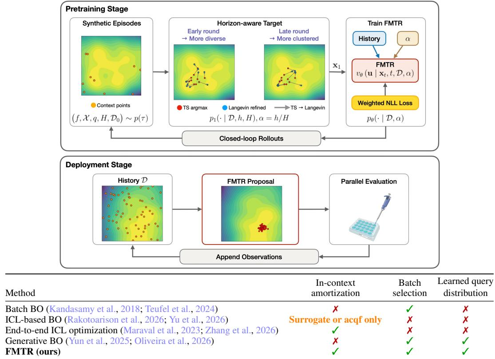  
Figure 1: Overview of FMTR and its positioning relative to related methods. FMTR directly models a query distribution for end-to-end batch selection. (Top) Pretraining and deployment with closed-loop rollouts for data generation.

Contributions. We address this gap with Flow Matching for Thompson-Sampling Refinement (FMTR), which combines in-context adaptation with sample-based generation for large-batch-fewround black-box optimization tasks. Figure 1 provides an overview of our method and positions it against concurrent baselines. Our contributions can be summarized as follows:

• We introduce a conditional flow-matching model that represents a proposal distribution over continuous query locations, conditioned on the observed history and remaining evaluation budget. FMTR generates a batch of the requested size by sampling from this proposal with fixed model parameters, without task-specific surrogate fitting or acquisition-function optimization.

• We construct supervised training targets by refining Thompson-sampling argmaxes toward highvalue regions according to the remaining optimization horizon. This provides a simple alternative to trajectory-level reinforcement learning while retaining more exploration early and increasing exploitation toward the end of optimization.

• Across synthetic and real-world benchmarks, FMTR achieves strong optimization performance at substantially lower batch-selection cost. Ablations further show that target refinement and value weighting both improve over directly amortizing parallel Thompson sampling.

## 2 BACKGROUND

We consider an expensive black-box objective $f : \mathcal { X } \to \mathbb { R }$ over a search space $\mathcal { X } \subset \mathbb { R } ^ { d }$ , with

$$
\mathbf { x } ^ { \star } \in \underset { \mathbf { x } \in \mathcal { X } } { \arg \operatorname* { m a x } } f ( \mathbf { x } ) .\tag{1}
$$

Starting from an initial history $\mathcal { D } _ { 0 } ,$ at round $r ~ = ~ 1 , \ldots , H$ , the optimizer selects a batch $B _ { r } \ = \ \{ \mathbf { x } _ { r , i } \} _ { i = 1 } ^ { q } \subset \mathcal { X }$ conditioned on D<sub>r−1</sub>. The q points are evaluated in parallel, yielding observations $y _ { r , i } ~ = ~ f ( \mathbf { x } _ { r , i } ) + \epsilon _ { r , i }$ , with $\epsilon _ { r , i } \stackrel { \mathrm { \tiny ~ i . i . d . } } { \sim } \mathcal { N } ( 0 , \sigma ^ { 2 } )$ . The history is then updated: $\begin{array} { r } { \mathcal { D } _ { r } = \mathcal { D } _ { r - 1 } \cup \{ ( \mathbf { x } _ { r , i } , y _ { r , i } ) \} _ { i = 1 } ^ { q } . } \end{array}$ We focus on the large-batch, few-round regime, where q is large and the batch horizon H is small.

Thompson sampling with Gaussian processes. A simple way to construct diverse batches is to sample plausible objective functions given the current observations and optimize each of them independently. A Gaussian process (GP) prior over $f$ induces a posterior $p ( f \mid \mathcal { D } )$ after conditioning on the observed history D (Rasmussen & Williams, 2006). Thompson sampling (TS) draws a function from this posterior and evaluates its maximizer:

$$
\widetilde { f } \sim p ( f \mid \mathcal { D } ) , \qquad \mathbf { x } _ { \mathrm { T S } } \in \arg \operatorname* { m a x } _ { \mathbf { x } \in \mathcal { X } } \widetilde { f } ( \mathbf { x } ) .\tag{2}
$$

The posterior draw therefore induces a distribution over optimizer locations,

$$
\begin{array} { r } { p _ { \mathrm { T S } } ( { \bf \cdot } \mid \mathcal { D } ) = \mathcal { L } \Big ( { \bf x } _ { \mathrm { T S } } \Big \vert \stackrel { \sim } { f } \sim p ( f \mid \mathcal { D } ) \Big ) , } \end{array}\tag{3}
$$

where $\mathcal { L }$ denotes the law of a random variable. Different posterior paths may place their maximizers in different regions that remain plausible under the posterior. Parallel TS forms a batch of size $q$ by drawing and maximizing q posterior paths independently, allowing these optimizations to be performed concurrently (Kandasamy et al., 2018).

Flow Matching. Flow Matching (FM) is a class of generative models that transform a prior dis tribution $p _ { 0 }$ to a target distribution $p _ { 1 }$ by learning a time-dependent velocity vector field $v _ { t }$ . This vector field constructs a flow $\phi _ { t }$ via the ordinary differential equation (ODE):

$$
\frac { d } { d t } \phi _ { t } ( \mathbf { x } _ { 0 } ) = v _ { t } ( \phi _ { t } ( \mathbf { x } _ { 0 } ) ) , \qquad \phi _ { 0 } ( \mathbf { x } _ { 0 } ) = \mathbf { x } _ { 0 }\tag{4}
$$

If $\mathbf { x } _ { 0 } \sim p _ { 0 } , \phi _ { t }$ acts as a push-forward map, creating distribution $p _ { t }$ at each time $t , \mathrm { e . g } p _ { t } = [ \phi _ { t } ] _ { * } p _ { 0 }$ For training, we construct a conditional flow and optimize the Conditional Flow Matching (CFM) objective. One of the most natural choices for conditional flow is a straight line from source point $\mathbf { x } _ { \mathrm { 0 } }$ to target point $\mathbf { x } _ { 1 }$ , where ${ \bf x } _ { t } = ( 1 - t ) { \bf x } _ { 0 } + t { \bf x } _ { 1 }$ for $t \in [ 0 , 1 ]$ . Then, the CFM loss takes the form:

$$
\begin{array} { r } { \mathcal { L } _ { C F M } ( \theta ) = \mathbb { E } _ { t , \mathbf { x } _ { 1 } \sim p _ { 1 } , \mathbf { x } _ { 0 } \sim p _ { 0 } } \left[ | | v _ { \theta } ( \mathbf { x } _ { t } , t ) - ( \mathbf { x } _ { 1 } - \mathbf { x } _ { 0 } ) | | ^ { 2 } \right] } \end{array}\tag{5}
$$

Usually, $t \sim U ( 0 , 1 )$ and $p _ { 0 }$ follows a standard Normal distribution. At inference time, one can randomly sample from source distribution $\mathbf { x } _ { 0 } \sim p _ { 0 }$ and generate a sample from target distribution by solving ODE from $t = 0 \mathrm { t o } t = 1$ using learned vector field $v _ { \theta }$

## 3 METHODOLOGY

We propose FMTR, which learns a conditional proposal over continuous query locations, and samples batches in parallel. Section 3.1 defines the synthetic episodes and histories used for pretraining; Section 3.2 constructs the query target distribution; Section 3.3 introduces the conditional flowmatching model and training objective; and Section 3.4 describes the closed-loop rollouts used to collect deployment-like histories. Model architecture is given in Figure S8.

## 3.1 PRETRAINING TASKS AND HISTORIES

We sample synthetic optimization episodes

$$
\tau = \left( f _ { \tau } , \mathcal { X } _ { \tau } , q _ { \tau } , H _ { \tau } , \mathcal { D } _ { 0 } ^ { \tau } \right) \sim p ( \tau ) ,\tag{6}
$$

where $f _ { \tau } : \mathcal { X } _ { \tau } \subset \mathbb { R } ^ { d _ { \tau } } $ R is the objective, $q _ { \tau }$ is the batch size, $H _ { \tau }$ is the number of optimization rounds, and $\mathcal { D } _ { 0 } ^ { \tau }$ is an initial history containing $n _ { 0 } ,$ <sub>τ</sub> random evaluations. At round $r \in \{ 0 , \ldots , H _ { \tau } -$ 1}, the model acts on the optimization state

$$
s _ { r } ^ { \tau } = \bigl (  { \mathcal { D } _ { r } ^ { \tau } } , h _ { r } ^ { \tau } , H _ { \tau } \bigr ) , \qquad h _ { r } ^ { \tau } = H _ { \tau } - r .\tag{7}
$$

The history $\mathcal { D } _ { r } ^ { \tau }$ serves as context, while the supervised targets are continuous query locations sampled from the target distribution introduced in Section 3.2. Thus, a pretraining example is determined by both the sampled objective and a history encountered while optimizing it.

Synthetic objective prior. We construct each objective as

$$
f _ { \tau } ( \mathbf { x } ) = f _ { \mathrm { R F F } , \tau } ( \mathbf { x } ) + f _ { \mathrm { t r e n d } , \tau } ( \mathbf { x } ) .\tag{8}
$$

The first component is a differentiable random Fourier feature approximation to a GP sample path (Rahimi & Recht, 2007), with kernel family and hyperparameters randomized across episodes. Importantly, its explicit form allows function values and gradients to be evaluated at arbitrary locations and retains the generating kernel required by the target construction in Section 3.2. Next, $f _ { \mathrm { t r e n d } }$ adds a randomized quadratic trend, providing smooth global structure on top of the local GP variation. This yields optimization landscapes with more clearly defined basins and optima, a technique employed in related amortized optimization methods (Yang et al., 2024; Chang et al., 2025; Zhang et al., 2025). The full RFF parameterization, trend definition, and sampling distributions are given in Appendices B.1 and B.2. Figure S7 displays synthetic samples.

Optimization histories. Starting from $\mathcal { D } _ { 0 } ^ { \tau }$ , we generate a trajectory by repeatedly proposing a batch, evaluating $f _ { \tau }$ , and appending the resulting observations to the history. Thus, a single episode contributes training states with different context sizes and remaining horizons. Since the proposal model induces the relevant history distribution, we periodically regenerate these trajectories using a mixture of the target distribution and the current model proposal, as described in Section 3.4.

## 3.2 QUERY TARGET DISTRIBUTION

For each synthetic episode $\tau$ and optimization state $( \mathcal { D } , h , H )$ , we construct a target distribution $p _ { 1 , \tau } ( \cdot \mid \mathcal { D } , h , H )$ over query locations. Because the episode is generated during pretraining, both the objective $f _ { \tau }$ and the kernel $k _ { \tau }$ used to generate its GP component are known. This information is used only to construct offline training targets: the kernel defines a distribution over plausible optimizer locations given the current history, while the objective is used to refine these locations according to the number of rounds remaining. We omit the dependence of $p _ { \mathrm { T S } }$ and $p _ { 1 }$ on τ below.

Thompson-sampling base distribution. We instantiate TS using the kernel $k _ { \tau }$ and trend f<sub>trend,τ</sub> sampled for the episode:

$$
\begin{array} { r }   { \tilde { \mathbf { \Gamma } } ^ { * \times * } ( \cdot \mid \mathcal { D } ) = \mathcal { L } \biggl ( \arg \operatorname* { m a x } _ { \mathbf { x } \in \mathcal { X } _ { \tau } } \widetilde { f } _ { \tau } ( \mathbf { x } ) \bigg \vert \widetilde { f } _ { \tau } \sim p _ { \tau } ( f \mid \mathcal { D } ) \biggr ) . } \end{array}\tag{9}
$$

Under the GP posterior induced by the sampled task and current history, p<sub>TS</sub> represents uncertainty over the optimizer location and can assign probability mass to several regions that remain plausible optima. We construct posterior paths by combining differentiable RFF prior draws (Rahimi & Recht, 2007) with the pathwise update given by Matheron’s rule (Wilson et al., 2020). Because $k _ { \tau }$ and its hyperparameters are sampled as part of the episode, these paths can be constructed without estimating kernel parameters from the typically sparse history. Each path is maximized independently using gradient-based optimization. Appendix C.1 gives the complete construction.

Refinement based on remaining rounds. TS conditions on the observed history but does not explicitly account for the remaining horizon. To favor exploitation when fewer rounds remain, we refine its samples using the known synthetic objective. We define

$$
T ( h , H ) = T _ { \mathrm { m i n } } + ( T _ { \mathrm { m a x } } - T _ { \mathrm { m i n } } ) \frac { h - 1 } { H - 1 } , \qquad K _ { h , H } = \left\lfloor K \frac { T _ { \mathrm { m a x } } } { T ( h , H ) } \right\rfloor ,\tag{10}
$$

where $0 < T _ { \mathrm { m i n } } \le T _ { \mathrm { m a x } }$ and $K$ is the base number of refinement steps. Starting from $\mathbf { x } ^ { ( 0 ) }$ ∼ $p _ { \mathrm { T S } } ( \cdot \mid \mathcal { D } )$ , we apply the Langevin-inspired updates

$$
\begin{array} { r } { { \mathbf { x } } ^ { ( k + 1 ) } = { \mathbf { x } } ^ { ( k ) } + \eta { \mathbf { g } } _ { \tau } ( { \mathbf { x } } ^ { ( k ) } ) + \sigma _ { \mathrm { L } } \sqrt { 2 \eta } { \boldsymbol { \xi } } _ { k } , \qquad { \boldsymbol { \xi } } _ { k } ^ { \mathrm { ~ i . i . d . } } \mathcal { N } ( \mathbf { 0 } , \mathbf { I } _ { d _ { \tau } } ) , } \end{array}\tag{11}
$$

for $k = 0 , \ldots , K _ { h , H } - 1$ , where $\mathbf { g } _ { \ u { \tau } }$ is the normalized objective gradient, $\eta > 0$ is the step size, and $\sigma _ { \mathrm { L } } > 0$ controls the perturbations. Normalization bounds the deterministic step length, while the Gaussian perturbations keep refinement stochastic. A smaller remaining-round fraction increases the number of updates, rather than their individual magnitude: this allows for objective-guided refinement near the end of optimization.

Flow-matching target. The finite-step refinement above induces the horizon-dependent distribution

$$
p _ { 1 } ( \cdot \mid \mathcal { D } , h , H ) = \mathcal { L } \Big ( \mathbf { x } ^ { ( K _ { h , H } ) } \Big ) .\tag{12}
$$

Although refinement moves TS locations toward higher objective values, the probability mass of $p _ { 1 }$ still depends on how frequently the TS initialization and stochastic refinement reach each region. We therefore define target distribution by favoring high-value regions via the Gibbs variational problem

$$
\tilde { p } _ { 1 } = \underset { p \ll p _ { 1 } } { \arg \operatorname* { m a x } } \left\{ \mathbb { E } _ { p } [ f _ { \tau } ( \mathbf { x } ) ] - T ( h , H ) \operatorname { K L } ( p \Vert p _ { 1 } ) \right\} \propto p _ { 1 } ( \cdot \vert \mathcal { D } , h , H ) \exp \left( \frac { f _ { \tau } ( \cdot ) } { T ( h , H ) } \right) .\tag{13}
$$

As h decreases, the same schedule both increases the refinement budget $K _ { h , H }$ and lowers the temperature, progressively shifting the target toward high-value regions. In practice, we approximate $\tilde { p } _ { 1 }$ by value-weighting samples from $p _ { 1 }$ , yielding the weighted flow-matching objective in Section $3 . 3 .$ The variational derivation and sampling approximation are given in Appendices C.3 and D.2. The synthetic objective and its gradients are used only during pretraining: deployment requires only the observed history and remaining-round fraction.

## 3.3 MODEL ARCHITECTURE AND TRAINING OBJECTIVE

We learn a proposal $p _ { \theta } ( \mathbf { x } \mid \mathcal { D } , \alpha )$ from the target samples constructed in Section 3.2, where $\alpha =$ $h / H$ is the fraction of optimization rounds remaining. The model combines a transformer encoder for the observed history with a conditional flow decoder operating on continuous query locations.

History-conditioned architecture. Each observation $\left( \mathbf { x } _ { i } , y _ { i } \right)$ is embedded using its location and objective value, then processed by a transformer encoder without positional encodings (Vaswani et al., 2017). The encoded observations form a memory matrix $\mathcal { M } \in \mathbb { R } ^ { n _ { c } \times d _ { \mathrm { m o d e l } } }$ , where $n _ { c } = | D |$ and $d _ { \mathrm { m o d e l } }$ is the hidden dimension. Each flow state $\mathbf { x } _ { t } ,$ , at flow time $t \in [ 0 , 1 ]$ , is embedded and attends to this memory through a cross-attention decoder. Flow time and the remaining-round fraction modulate the decoder through adaptive layer normalization, following the DiT architecture (Peebles & Xie, 2023). We omit self-attention between query states, allowing independent processing given the history. For M flow states, this gives a cross-attention cost of $\check { \mathcal { O } } ( M n _ { c } )$ per decoder evaluation. The memory is computed once per optimization round and reused throughout generation. Zeropadding and an active-dimension mask accommodate objectives of dimension $d \leq D ,$ , where D is the maximum supported dimension. Appendix D.1 specifies the embeddings and decoder blocks.

Velocity distribution. Under the straight-line interpolation used for flow matching (Equation 5), the same intermediate state can arise from different source-target pairs and therefore be associated with different target velocities. We model this conditional variation with a Gaussian mixture velocity head. Following Chen et al. (2025):

$$
\begin{array} { r l } { \displaystyle v _ { \theta } \left( \mathbf { u } \mid \mathbf { x } _ { t } , t , \mathcal { D } , \alpha \right) = \sum _ { c = 1 } ^ { C } \pi _ { c } \mathcal { N } \left( \mathbf { u } ; \pmb { \mu } _ { c } , \mathrm { d i a g } ( \pmb { \sigma } _ { c } ^ { 2 } ) \right) , } & { } \end{array}\tag{14}
$$

where $C$ is the number of components. The mixture weights $\pi _ { c } ,$ means $\mu _ { c } ,$ and diagonal standard deviations $\pmb { \sigma } _ { c }$ are predicted from the decoded flow token. Here, v denotes a density over velocities, distinct from the proposal $p _ { \theta }$ over query locations.

Training objective. For each sampled episode and history, the ideal objective is the flow-matching loss under the tilted target $\tilde { p } _ { 1 }$

$$
\mathcal { L } _ { \mathrm { t i l t } } ( \theta ) = - \mathbb { E } \left[ \mathbb { E } _ { t \sim \mathcal { U } ( 0 , 1 ) , \tilde { \mathbf { x } } _ { 1 } \sim \tilde { p } _ { 1 } , \mathbf { x } _ { 0 } \sim p _ { 0 } } \left[ \log v _ { \theta } \left( \tilde { \mathbf { u } } _ { t } \mid \tilde { \mathbf { x } } _ { t } , t , \mathcal { D } , \alpha \right) \right] \right] ,\tag{15}
$$

where $p _ { 0 } = \mathcal { N } ( \mathbf { 0 } , \mathbf { I } _ { d } ) , \tilde { \mathbf { x } } _ { t } = ( 1 - t ) \mathbf { x } _ { 0 } + t \tilde { \mathbf { x } } _ { 1 }$ , and $\tilde { \mathbf { u } } _ { t } \ = \tilde { \mathbf { x } } _ { 1 } - \mathbf { x } _ { 0 }$ . The outer expectation is over sampled episodes and histories. Rather than sampling directly from $\tilde { p } _ { 1 }$ , we approximate the inner expectation using samples $\mathbf { x } _ { 1 } ^ { ( i ) } \sim p _ { 1 } ( \cdot \mid \mathcal { D } , h , H )$ and self-normalized importance sampling (Aeckerle-Willems et al., 2026). With $\mathbf { x } _ { t } ^ { ( i ) } = ( 1 - t ) \mathbf { x } _ { 0 } ^ { ( i ) } + t \mathbf { x } _ { 1 } ^ { ( i ) }$ and $\mathbf { u } _ { t } ^ { ( i ) } = \mathbf { x } _ { 1 } ^ { ( i ) } - \mathbf { x } _ { 0 } ^ { ( i ) }$ , this gives

$$
\mathcal { L } ( \theta ) = - \mathbb { E } \left[ \sum _ { i = 1 } ^ { M } w _ { i } \log v _ { \theta } \left( \mathbf { u } _ { t } ^ { ( i ) } \mid \mathbf { x } _ { t } ^ { ( i ) } , t , \mathcal { D } , \alpha \right) \right] , \quad w _ { i } = \mathrm { s o f t m a x } _ { i } \left( f _ { \tau } ( \mathbf { x } _ { 1 } ^ { ( i ) } ) / T ( h , H ) \right)\tag{16}
$$

Appendix D.2 derives this approximation, while lastly, Section 3.4 describes history collection.

Batch generation. At deployment, we transform q independent Gaussian base samples through the learned flow, sharing the encoded history across their trajectories. The model parameters remain fixed, and the requested batch size determines the number of samples generated. See Algorithm 3 for batch generation procedure.

## 3.4 CLOSED-LOOP PRETRAINING

The histories encountered at deployment depend on batches generated by FMTR in previous rounds. Training only on randomly sampled histories or trajectories generated solely from $\tilde { p } _ { 1 }$ would therefore expose the model to a different state distribution. We address this with Dataset Aggregation (DAgger, Ross et al. 2011). At rollout iteration s, the entire batch at each visited state is sampled either from the target distribution or from the current FMTR proposal:

$$
B _ { r } \sim \left\{ \begin{array} { l l } { \tilde { p } _ { 1 } ( \cdot \vert \mathcal { D } _ { r } , h _ { r } , H ) ^ { \otimes q } , } & { \mathrm { w i t h ~ p r o b a b i l i t y ~ } \beta _ { s } , } \\ { p _ { \theta } ( \cdot \vert \mathcal { D } _ { r } , \alpha _ { r } ) ^ { \otimes q } , } & { \mathrm { w i t h ~ p r o b a b i l i t y ~ } 1 - \beta _ { s } , } \end{array} \right. \qquad \alpha _ { r } = \frac { h _ { r } } { H } ,\tag{17}
$$

where $\beta _ { s } : = \gamma ^ { s } , \gamma \in ( 0 , 1 )$ , decreases over rollout iterations. Regardless of which distribution advances the trajectory, $\tilde { p } _ { 1 }$ is recomputed at every visited state using the corresponding synthetic episode and stored as supervision. The collected histories therefore become increasingly representative of those induced by FMTR while retaining target samples at each visited state. In practice, for simplicity, we can use $p _ { 1 }$ instead of $\tilde { p } _ { 1 }$ for $B _ { r }$

Moreover, since episodes with different values of n<sub>0</sub>, q, and H produce context sizes $\left| \mathcal { D } _ { r } \right| = n _ { 0 } + r q$ at unequal frequencies, we partition the replay buffer into buckets indexed by context size. Each training minibatch is obtained by first sampling a non-empty bucket uniformly and then sampling examples from that bucket, preventing frequently occurring context lengths from dominating training. Parameter updates use the current replay buffer, which is periodically augmented with rollouts from the updated model. The exact complete training procedure is given in Appendix B.3. Algorithm 1 summarizes the collection and training cycle, see Algorithm 2 for the full procedure. Figure S5 shows the targets and the learned proposal over a full optimization trajectory.

## 4 RELATED WORK

Batch Bayesian optimization. Classical batch BO either optimizes set-valued acquisitions, Monte Carlo batch acquisitions, and energy–entropy criteria, or constructs batches through sequential or independent single-point decisions (Wilson et al., 2018; Balandat et al., 2020; Teufel et al., 2024; Gonzalez et al., 2016; Kandasamy et al., 2018). Joint acquisitions account for interactions among q candidates but require optimization over qd variables; local penalization and parallel TS replace this with repeated or independent optimizations. These methods retain a task-specific surrogate and online design-space search at each round.

Generative models for BO. Recent work uses generative models directly as proposal distributions for batch BO. DiBO learns a diffusion prior over evaluated designs and an ensemble surrogate for uncertainty-aware utility, then fine-tunes the sampler toward their product distribution before applying local search and filtering (Yun et al., 2025). GenBO removes the intermediate surrogate by fitting a single generative model directly from noisy utilities, targeting a proposal whose density follows an expected-utility acquisition (Oliveira et al., 2026). Both update task-specific generators as observations accumulate, whereas FMTR pretrains a history-conditioned proposal that adapts in context with fixed parameters.

```latex
Algorithm 1 FMTR pretraining: overview
Require: Episode prior $p ( \tau ) ;$ ; update budget $N _ { \mathrm { t r a i n } } ;$ rollout settings $N _ { \mathrm { r o l l } } , M , T _ { \mathrm { r e f r e s h } } , \gamma$
1: Initialize θ, bucketed buffer $\begin{array} { r } { B  \emptyset , } \end{array}$ , and counters $u \gets 0 , s \gets 0$
2: while $u < N _ { \mathrm { t r a i n } }$ do
3: $\beta _ { s }  \gamma ^ { s }$ ▷ $\beta _ { 0 } = 1 \colon$ initial rollouts use p<sub>1</sub> only
4: for each of $N _ { \mathrm { r o l l } }$ episodes $\tau \sim p ( \tau )$ do
5: $\mathcal { D }  \mathcal { D } _ { 0 } ^ { \tau }$
6: for $r = 0 , \ldots , H _ { \tau } - 1$ do
7: $h  H _ { \tau } - r , \alpha  h / H _ { \tau }$
8: Draw M Thompson-sampling locations (Equation 9)
9: Refine the Thompson-sampling locations for $K _ { h , H _ { \tau } }$ steps (Equation 11)
10: Store the state, refined targets, and their values in $\boldsymbol { B } _ { | \mathcal { D } | }$
11: Sample $B _ { r }$ from the target–model mixture (Equation 17)
12: Evaluate B in parallel and append its observations to D
13: end for
14: end for
15: $U $ min $\mathsf { \Pi } _ { \mathrm { l } } ( T _ { \mathrm { r e f r e s h } } , N _ { \mathrm { t r a i n } } - u )$
16: Perform U updates using context-length-stratified replay (Equation 16)
17: $u  u + U , s  s + 1$
18: end while
19: return θ
```

In-context optimization. In-context methods replace different components of the BO loop with pretrained models. PFNs4BO and GIT-BO perform posterior prediction in context, while α-PFN predicts entropy-search values (Muller et al.¨ , 2023; Yu et al., 2026; Rakotoarison et al., 2026). These methods retain an explicit acquisition or candidate-search step. End-to-end methods instead learn the decision rule from optimization trajectories, including NAP, PABBO, TAMO, and FICBO (Maraval et al., 2023; Zhang et al., 2025; 2026; Blumer et al., 2026). These policies generally act on supplied candidate sets, but FMTR learns a continuous history-conditioned sampler for variable-size batches.

## 5 EXPERIMENTS

Ackley-3D q=64 Ackley-5D q=64 Ackley-10D q=64 Ackley-15D q=64 Average Rank Ackley   
3.0 3.0 3.00 8   
2.5 2.75   
2.5   
2.50   
2.25   
2.0   
0 2.00   
1.0 1.75   
1.5   
-1   
1.50   
0.5   
-2 1.0 1.25   
0 8 10 6 8 10 0 8 10 8 10 10   
Rosenbrock-3D q=64 Rosenbrock-5D q=64 Rosenbrock-10D q=64 Rosenbrock-15D g=64 Average Rank Rosenbrock   
14 8   
10   
12   
12   
10   
10   
0 6 8 10 2 8 10 2 10 2 8 10 2 10   
Levy-3D q=64 Levy-5D q=64 Levy-10D q=64 Levy-15D q=64 Average Rank Levy   
-2   
-2   
-6 0   
-1   
-8   
-10   
0 4 6 8 10 2 4 6 8 10 0 2 4 6 8 10 2 6 8 10 0 2 6 10   
Iteration Iteration Iteration Iteration Iteration   
FMTR TuRBO GenBO DiBO BEEBO qLogEl qUCB gTS Matheron GITBO  
Figure 2: Experiments on synthetic functions. Log simple regret over 15 runs, shown as mean with 95% CI. The last column reports the average rank across dimensions for each function.

Baselines. We compare FMTR with the trust-region optimizer TuRBO (Eriksson et al., 2019), BEEBO (Teufel et al., 2024), the diffusion-based optimizer DiBO (Yun et al., 2025), and the incontext surrogate method GIT-BO (Yu et al., 2026). We also include three GP-based batch strategies: qLogEI (Ament et al., 2023), parallel TS with Matheron’s rule (qTS-Matheron; Kandasamy et al., 2018; Wilson et al., 2020), and qUCB (Wilson et al., 2018). See Appendix E.1 for baseline details.

Implementation details and evaluation protocol. Each run starts from 10 observations and proceeds for $H = 1 0$ batch-evaluation rounds, with batch sizes specified below. We apply the Yeo– Johnson transformation to observed objective values (Cowen-Rivers et al., 2022). FMTR’s parameters remain fixed during evaluation, and each batch is generated using 100 flow-integration steps without access to test-objective gradients. We report means and 95% confidence intervals over 15 independent runs. Pretraining settings and model details are provided in Appendices B and D.

## 5.1 RESULTS

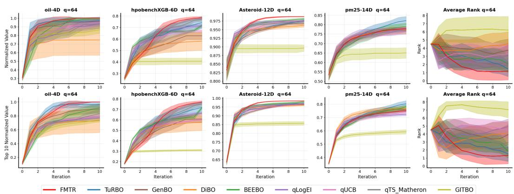  
Figure 3: Experiments on real-world functions. Top row: normalized best value. Bottom row: Top 10 normalized best value. Mean with 95% CI computed across 15 runs with random initializa tions. Higher is better. Last column is the average rank across all tasks for each batch size.

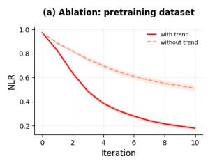

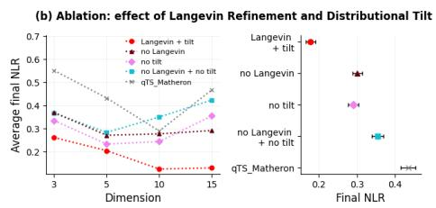

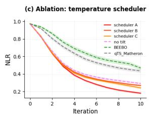  
Figure 4: Ablation studies. Performance is normalized and averaged on the Ackley, Levy, and Rosenbrock functions with $q \in \{ 3 2 , 6 4 \}$ and $d \in \{ 3 , 5 , 1 0 , 1 5 \}$ . (a) Effect of the pretraining dataset composition. (b) Effect of the Langevin refinement and Distributional Tilt. (c) Effect of temperature scheduler. These results represent averages, individual results can be found in Figure S4.

Synthetic functions. We evaluate Ackley, Rosenbrock, and Levy with $d \in \{ 3 , 5 , 1 0 , 1 5 \}$ and batch size $q = 6 4$ (Figure 2). FMTR achieves the best final average rank for each function, consistently across tested dimensions. Although geared towards $q = 1$ , GIT-BO supports batch selection through multiple effective subspaces, but its performance degrades markedly in the large-batch regime considered here. More explicitly batch-oriented alternatives also remain behind FMTR. BEEBO directly constructs joint batches through an energy–entropy acquisition, explicitly accounting for dependencies among candidates, while DiBO use a diffusion-based generative model to form batch proposals. In DiBO,

accurately learning the acquisition from the limited observations available during optimization can be difficult, potentially hindering its ability to identify promising regions. FMTR instead grounds its target distribution in TS and amortizes the subsequent refinement through offline pretraining, combining posterior-driven exploration with knowledge transferred across optimization tasks. Moreover,

FMTR consistently outperforms qTS, even though TS provides the base distribution from which its training targets are constructed. We return to this finding in Section 5.2, where we examine which components of FMTR account for this improvement. Extended results for $q \in \{ 1 6 , 3 2 \}$ and more synthetic functions show broadly similar trends, although FMTR’s advantage is more pronounced for larger batches (Appendix $\mathrm { A } )$ . Finally, FMTR achieves the lowest reported runtime among the methods (Table S1).

Real-world applications. We evaluate four data-derived benchmarks considered by Hsieh et al. (2021): oil-4D, hpobenchXGB-6D, Asteroid-12D, and pm25-14D (Appendix E.3) with batch sizes $q = 6 4$ Figure 3 reports the best normalized objective value and the Top 10 Normalized Value, $\mathrm { i . e . }$ , the mean normalized value of the ten best points observed so far. Values are scaled by $( f ( \mathbf { x } ) - f _ { \operatorname* { m i n } } ) / ( f _ { \operatorname* { m a x } } - f _ { \operatorname* { m i n } } )$ The latter metric measures the ability to identify multiple highvalue candidates. FMTR remains competitive across these tasks and often attains the highest values in later rounds. Compared with the synthetic benchmarks, however, its advantage is less uniform, with several baselines closely matching its performance, such as TuRBO, which even obtains higher mean values on PM2.5. Nevertheless, FMTR achieves the best final average rank under both metrics. Extended results for $q = 3 2$ in Appendix $\mathrm { A . 4 }$ show a similar trend, with FMTR achieving stronger performance on both metrics in general. These results support the transfer of the pretrained proposal to real-world objectives, albeit with task-dependent differences in performance.

## 5.2 ABLATION STUDIES

We examine whether different modeling choices and hyperparameter settings significantly affect the performance of FMTR. In all experiments in this section, we evaluate FMTR and all baselines on the Ackley, Levy, and Rosenbrock functions with $q \in \{ 3 2 , 6 4 \} , d \in \{ 3 , 5 , 1 0 , 1 5 \}$ , and $H = 1 0$ . To average performance across functions with different regret scales, we report Normalized Log Simple Regret (NLR). Further details are provided in Appendix A.2.

Pretraining dataset composition. We compare FMTR pretrained with the full synthetic objective in Equation 8 against a variant using only the RFF component. Figure 4(a) reports mean with 95% CI across the three synthetic functions. Including the trend component substantially improves performance. One explanation is that broadly sampled GP hyperparameters can otherwise produce highly irregular functions, for example Matern-´ 3/2 samples with short lengthscales, that are less representative of practical optimization landscapes. The random trend adds smoother global structure while preserving the local variability of the RFF component.

Effect of Langevin refinement and distributional tilt. We disentangle the two transformations of the TS target by comparing FMTR with three variants: no Langevin, which applies the exponential tilt directly to the unrefined TS target; no tilt, which retains Langevin refinement but trains directly on $p _ { 1 } ;$ and no Langevin + no tilt, which amortizes the unrefined TS target. Figure 4(b) shows that removing either refinement or tilt causes a clear, similar degradation, while removing both yields the weakest FMTR variant. This indicates complementary gains from the two components. Still, the doubly ablated model outperforms qTS, pointing to an additional benefit from amortized pretraining.

Effect of the temperature schedule. We compare three schedules for $T ( h , H )$ : scheduler A, from Equation 10; scheduler B, $T ( h , H ) \ : = \ : T _ { \mathrm { m a x } } \left( T _ { \mathrm { m i n } } / T _ { \mathrm { m a x } } \right) ^ { 1 - \frac { h - 1 } { H - 1 } }$ ; and scheduler $C , T ( h , H ) =$ $\mathbb { I } \{ \bar { h } = 1 \} ( T _ { \operatorname* { m i n } } - T _ { \operatorname* { m a x } } ) + \dot { T } _ { \operatorname* { m a x } } .$ , following Teufel et al. 2024. Figure 4(c) shows that all three schedules outperform the variants without distributional tilt, indicating that the gains are not limited to a single temperature schedule. Still, scheduler A achieves the lowest NLR in later rounds, suggesting that the precise annealing profile still affects the strength and timing of exploitation.

## 6 CONCLUSION

We introduced FMTR, an in-context optimizer for large-batch, few-round black-box optimization that learns a continuous query proposal from horizon-dependent refinements of TS locations. Conditional flow matching amortizes these targets into parallel batch generation, avoiding task-specific model fitting and acquisition optimization. Across benchmarks, FMTR combines strong optimization performance at low online cost, while ablations show that both target refinement and value weighting improve over parallel TS. Notably, a single pretrained model remains competitive from d = 2 to 15, reusing optimization experience across tasks and search-space dimensions, whereas task-specific batch baselines fit each objective independently.

Limitations and future work. An interesting point is that FMTR samples batch members independently given the history and remaining budget, without explicitly modeling within-batch redundancy. Although it remains competitive with joint-batch methods like BEEBO, joint proposals could further improve complementarity between evaluations. However, this would require jointly structured pretraining targets and an explicit batch-level objective, thus increasing pretraining complexity. Performance also depends on the synthetic-task prior (Section 5.2), motivating better-designed training distributions. Extending FMTR beyond D = 15 and to discrete domains are further directions.

## REPRODUCIBILITY STATEMENT

We provide all experimental details needed for reproducibility. Hyperparameters are specified in Section B.2 and Table S2; the pretraining dataset generation procedure is described in Section B; the complete training algorithm is provided in Algorithm 2; baseline hyperparameters are reported in Section E.1; and the synthetic and real world benchmark functions are described in Sections E.2 and E.3, respectively. The code will be made publicly available upon acceptance.

## AI DISCLOSURE

In this work, we used generative AI tools for providing feedback on research methodology and implementing methods. We have not used generative AI tools for generating synthetic data sets, developing conceptual frameworks, assisting with reformat dataset and interpreting results are not applicable to this work. Additionally, we used generative AI tools for brainstorming, searching for information, and editing a research paper to improve readability. We have reviewed all AIassisted work. LLM-generated code was verified and tested for correctness by the authors. We take responsibility for the final content of this work, including text, claims or artifacts produced with the aid of generative AI.

## ACKNOWLEDGEMENTS

The authors thank Conor Hassan for helpful comments and feedback on early versions of this work. This work was supported by EU funding ERC ODD-ML 101201120 and the Research Council of Finland Flagship programme: Finnish Center for Artificial Intelligence FCAI and decisions 359207, 365982. S. Kaski was additionally supported by the UKRI Turing AI World-Leading Researcher Fellowship (EP/W002973/1) and J. Martinelli was supported by Research Council of Finland (grant agreement 377145). The authors acknowledge the computational resources provided by the Aalto Science-IT Project from Computer Science IT. Views and opinions expressed are however those of the author(s) only and do not necessarily reflect those of the European Union or the European Research Council Executive Agency. Neither the European Union nor the granting authority can be held responsible for them.


## REFERENCES

Cathrine Aeckerle-Willems, Ilja Klebanov, and Simon Weissmann. Error bounds for importance sampling with estimated proposal distributions. arXiv preprint arXiv:2605.19989, 2026.

Sebastian Ament, Samuel Daulton, David Eriksson, Maximilian Balandat, and Eytan Bakshy. Unexpected improvements to expected improvement for Bayesian optimization. Advances in neural information processing systems, 2023.

Maximilian Balandat, Brian Karrer, Daniel Jiang, Samuel Daulton, Ben Letham, Andrew G Wilson, and Eytan Bakshy. BoTorch: A framework for efficient monte-carlo Bayesian optimization. In Advances in Neural Information Processing Systems, 2020.

Nicolas Samuel Blumer, Julien Martinelli, and Samuel Kaski. In-context black-box optimization with unreliable feedback. arXiv preprint arXiv:2605.06187, 2026.

Richard B Canty, Jeffrey A Bennett, Keith A Brown, Tonio Buonassisi, Sergei V Kalinin, John R Kitchin, Benji Maruyama, Robert G Moore, Joshua Schrier, Martin Seifrid, et al. Science acceleration and accessibility with self-driving labs. Nature Communications, 2025.

Paul Edmund Chang, Nasrulloh Ratu Bagus Satrio Loka, Daolang Huang, Ulpu Remes, Samuel Kaski, and Luigi Acerbi. Amortized probabilistic conditioning for optimization, simulation and inference. In Proceedings of The 28th International Conference on Artificial Intelligence and Statistics, 2025.

Niladri Chatterji, Jelena Diakonikolas, Michael I Jordan, and Peter Bartlett. Langevin monte carlo without smoothness. In International Conference on Artificial Intelligence and Statistics, 2020.

Hansheng Chen, Kai Zhang, Hao Tan, Zexiang Xu, Fujun Luan, Leonidas Guibas, Gordon Wetzstein, and Sai Bi. Gaussian mixture flow matching models. In Forty-second International Conference on Machine Learning, 2025.

Alexander I Cowen-Rivers, Wenlong Lyu, Rasul Tutunov, Zhi Wang, Antoine Grosnit, Ryan Rhys Griffiths, Alexandre Max Maraval, Hao Jianye, Jun Wang, Jan Peters, et al. Hebo: Pushing the limits of sample-efficient hyper-parameter optimisation. Journal of Artificial Intelligence Research, 2022.

David Eriksson, Michael Pearce, Jacob Gardner, Ryan D Turner, and Matthias Poloczek. Scalable global optimization via local Bayesian optimization. Advances in neural information processing systems, 2019.

Roman Garnett. Bayesian optimization. Cambridge University Press, 2023.

Javier Gonzalez, Zhenwen Dai, Philipp Hennig, and Neil D. Lawrence. Batch Bayesian optimization via local penalization. In Proceedings of the 19th International Conference on Artificial Intelligence and Statistics, 2016.

Trevor Hastings, Mrinalini Mulukutla, Danial Khatamsaz, Daniel Salas, Wenle Xu, Daniel Lewis, Nicole Person, Matthew Skokan, Braden Miller, James Paramore, Brady Butler, Douglas Allaire, Vahid Attari, Ibrahim Karaman, George Pharr, Ankit Srivastava, and Raymundo Arroyave. Ac-´ celerated multi-objective alloy discovery through efficient Bayesian methods: Application to the fcc high entropy alloy space. Acta Materialia, 2025.

Bing-Jing Hsieh, Ping-Chun Hsieh, and Xi Liu. Reinforced few-shot acquisition function learning for Bayesian optimization. Advances in Neural Information Processing Systems, 2021.

Daolang Huang, Xinyi Wen, Ayush Bharti, Samuel Kaski, and Luigi Acerbi. ALINE: Joint amorti zation for Bayesian inference and active data acquisition. In The Thirty-ninth Annual Conference on Neural Information Processing Systems, 2025.

Yu Heng Hung, Kai-Jie Lin, Yu-Heng Lin, Chien-Yi Wang, Cheng Sun, and Ping-Chun Hsieh. BOFormer: Learning to solve multi-objective Bayesian optimization via non-markovian rl. In International Conference on Learning Representations, 2025.

Kirthevasan Kandasamy, Akshay Krishnamurthy, Jeff Schneider, and Barnabas Poczos. Parallelised Bayesian optimisation via thompson sampling. In Proceedings of the Twenty-First International Conference on Artificial Intelligence and Statistics, 2018.

Daniel Kelvin, Erik Kubaczka, Marianna Karava, Heinz Koeppl, and Beatrix Suess. Iterative design of a nand hybrid riboswitch by deep batch Bayesian optimization. Nucleic Acids Research, 2026.

Aaron Lou and Stefano Ermon. Reflected diffusion models. In International Conference on Machine Learning, pp. 22675–22701. PMLR, 2023.

Alexandre Max Maraval, Matthieu Zimmer, Antoine Grosnit, and Haitham Bou Ammar. End-to-end meta-Bayesian optimisation with transformer neural processes. In Thirty-seventh Conference on Neural Information Processing Systems, 2023.

Samuel Muller, Matthias Feurer, Noah Hollmann, and Frank Hutter. PFNs4BO: In-context learning¨ for Bayesian optimization. In International Conference on Machine Learning, 2023.

Rafael Oliveira, Daniel M. Steinberg, and Edwin V. Bonilla. Generative Bayesian optimization: Generative models as acquisition functions. In The Fourteenth International Conference on Learning Representations, 2026.

William Peebles and Saining Xie. Scalable diffusion models with transformers. In 2023 IEEE/CVF International Conference on Computer Vision (ICCV), 2023.

Ali Rahimi and Benjamin Recht. Random features for large-scale kernel machines. In Advances in Neural Information Processing Systems, 2007.

Herilalaina Rakotoarison, Steven Adriaensen, Tom Julian Viering, Carl Hvarfner, Samuel Muller,¨ Frank Hutter, and Eytan Bakshy. α-PFN: Fast entropy search via in-context learning. In Fortythird International Conference on Machine Learning, 2026.

Carl Edward Rasmussen and Christopher K. I. Williams. Gaussian processes for machine learning. MIT Press, 2006.

Stephane Ross, Geoffrey Gordon, and Drew Bagnell. A reduction of imitation learning and structured prediction to no-regret online learning. In Proceedings of the Fourteenth International Conference on Artificial Intelligence and Statistics, 2011.

Felix Teufel, Carsten Stahlhut, and Jesper Ferkinghoff-Borg. Batched energy-entropy acquisition for Bayesian optimization. In The Thirty-eighth Annual Conference on Neural Information Pro cessing Systems, 2024.

Marcelo DT Torres, Yimeng Zeng, Fangping Wan, Natalie Maus, Jacob Gardner, and Cesar de la Fuente-Nunez. A generative artificial intelligence approach for peptide antibiotic optimization. Nature Machine Intelligence, 2026.

Ashish Vaswani, Noam Shazeer, Niki Parmar, Jakob Uszkoreit, Llion Jones, Aidan N Gomez, Łukasz Kaiser, and Illia Polosukhin. Attention is all you need. Advances in neural information processing systems, 2017.

James Wilson, Frank Hutter, and Marc Deisenroth. Maximizing acquisition functions for Bayesian optimization. Advances in neural information processing systems, 2018.

James Wilson, Viacheslav Borovitskiy, Alexander Terenin, Peter Mostowsky, and Marc Deisenroth. Efficiently sampling functions from Gaussian process posteriors. In Proceedings of the 37th International Conference on Machine Learning, 2020.

Adam X. Yang, Laurence Aitchison, and Henry Moss. MONGOOSE: Path-wise smooth bayesian optimisation via meta-learning. In ICML 2024 Workshop on Structured Probabilistic Inference & Generative Modeling, 2024.

Rosen Yu, Cyril Picard, and Faez Ahmed. Git-bo: High-dimensional Bayesian optimization with tabular foundation models. In International Conference on Learning Representations, 2026.

Taeyoung Yun, Kiyoung Om, Jaewoo Lee, Sujin Yun, and Jinkyoo Park. Posterior inference with diffusion models for high-dimensional black-box optimization. In Forty-second International Conference on Machine Learning, 2025.

Ruqi Zhang, Xingchao Liu, and Qiang Liu. A langevin-like sampler for discrete distributions. In International Conference on Machine Learning, 2022.

Xinyu Zhang, Daolang Huang, Samuel Kaski, and Julien Martinelli. PABBO: Preferential amortized black-box optimization. In The Thirteenth International Conference on Learning Representations, 2025.

Xinyu Zhang, Conor Hassan, Julien Martinelli, Daolang Huang, and Samuel Kaski. In-context multi-objective optimization. In The Fourteenth International Conference on Learning Representations, 2026.

The appendix is organized as follows:

• Appendix A provides additional synthetic and real-world results across batch sizes, detailed ablations, a visualization of the optimization process, examples of pretraining tasks, and runtime comparisons.

• Appendix B details the synthetic task prior and closed-loop pretraining procedure.

• Appendix C gives the pathwise GP posterior construction, stochastic refinement, and Gibbs formulation of the value-weighted query target.

• Appendix D specifies the model architecture, derives the self-normalized importance sampling approximation to the tilted-target training objective, and provides batch-generation and computational details.

• Appendix E provides baseline details and definitions of the synthetic and real-world benchmark tasks.

## A ADDITIONAL EXPERIMENTS

## A.1 MORE EXPERIMENTS ON SYNTHETIC FUNCTIONS

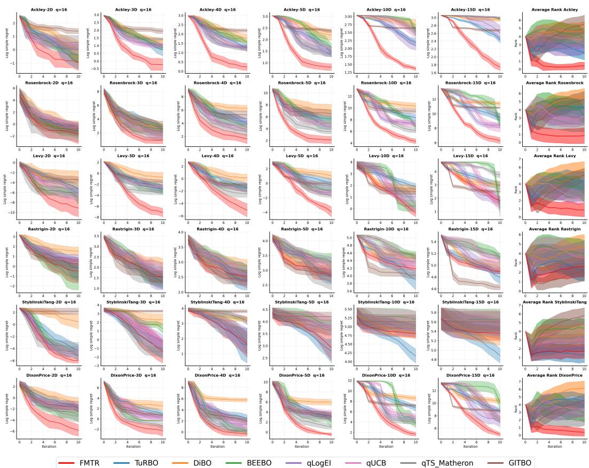  
Figure S1: Experiments on synthetic functions with $q \ = \ 1 6 .$ Log simple regret over 15 runs, shown as mean with 95% CI. The last column reports the average rank across dimensions for each function.

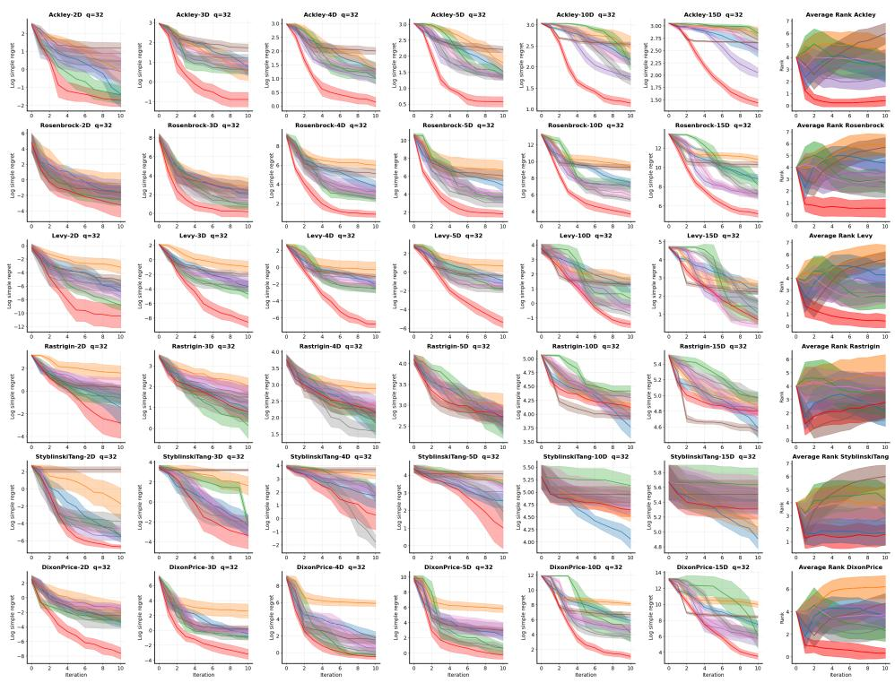  
Figure S2: Experiments on synthetic functions with q = 32. Log simple regret over 15 runs, shown as mean with 95% CI. Last column reports average rank across dimensions for each function.  
FMTR TuRBO DiBO BEEBO — qLogEl qUCB — qTS\_Matheron GITBO

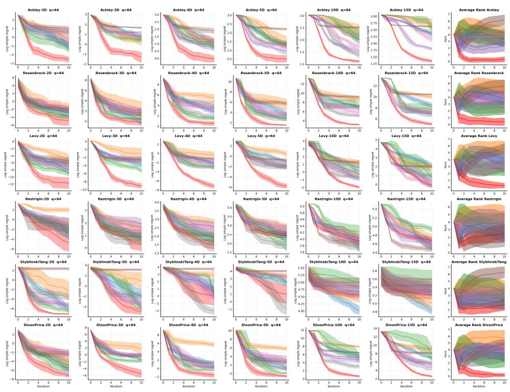  
FMTR TuRBO DiBO BEEBO — qLogEI qUCB qTS Matheron GITBO  
Figure S3: Experiments on synthetic functions with q = 64. Log simple regret over 15 runs, shown as mean with 95% CI. Last column reports average rank across dimensions for each function.

## A.2 FURTHER DETAIL ON ABLATION STUDIES

Because the Ackley, Levy, and Rosenbrock functions have different regret scales, we normalize the log simple regret before averaging performance across functions in Section 5.2. We refer to the resulting metric as Normalized Log Simple Regret (NLR). For each function and dimensionality, we compute the minimum and maximum log simple regret across the methods evaluated in Section 5.2 and rescale to [0, 1] : $\begin{array} { r } { \mathrm { N L R } = \frac { \mathrm { l o g ~ s i m p l e ~ r e g r e t - m i n } } { \mathrm { m a x - m i n } } } \end{array}$ . The individual results are shown in Figure S4.

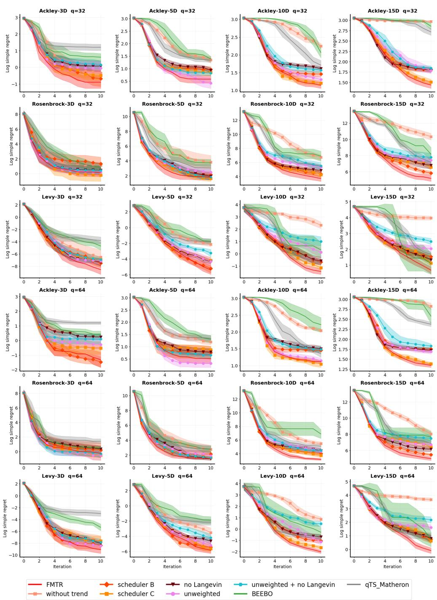  
Figure S4: More detail on Ablation Studies. Rows 1–3: Log simple regret with batch size 32. Rows 4–6: Log simple regret with batch size 64. Mean with 95% CI computed across 15 runs with random initializations. Lower is better.

## A.3 VISUALIZATION ON PROCESS

Figure S5 illustrates the targets and the FMTR proposal along one rollout with q = 16 and H = 10.

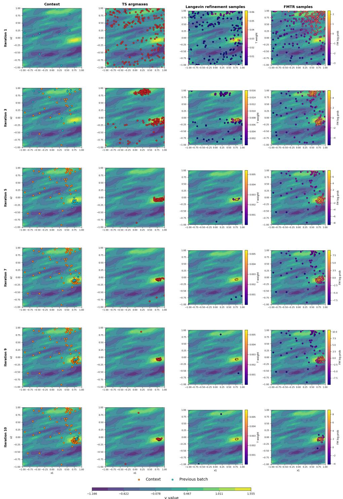  
Figure S5: Evolution of FMTR over a complete optimization rollout. Example two-dimensional trajectory with q = 16 and H = 10, shown at iterations 1, 3, 5, 7, 9, and 10. From left to right: the accumulated context with the previous batch highlighted, TS argmaxes conditioned on the current history, their horizon-dependent Langevin refinements, and samples from the learned FMTR proposal. The background shows the objective. As observations accumulate and the horizon shrinks, the target and FMTR proposal concentrate on high-value regions.

## A.4 MORE EXPERIMENTS ON REAL-WORLD APPLICATIONS

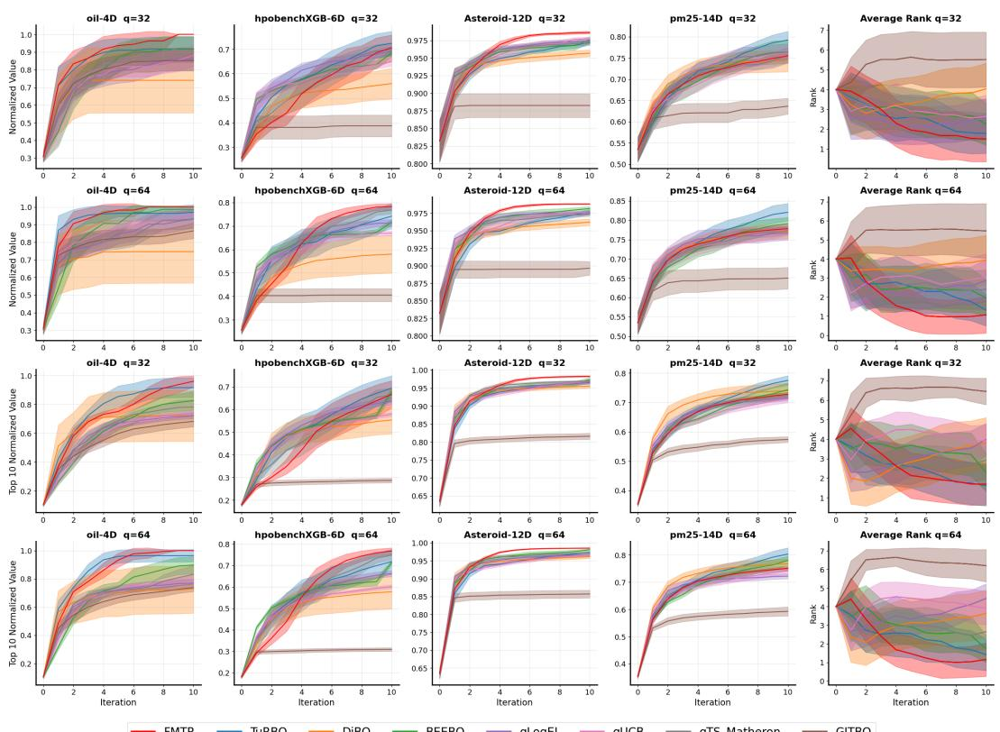  
Figure S6: Experiments on real-world functions with $q \in \{ 3 2 , 6 4 \}$ . Top 2 rows: normalized best value. Bottom 2 rows: Top 10 normalized best value. Mean with 95% CI computed across 15 runs with random initializations. Higher is better. Last column is the average rank across all tasks for each batch size.

## A.5 EXAMPLES OF TRAINING TASKS

Figure S7 shows 12 training sample tasks with d = 2.

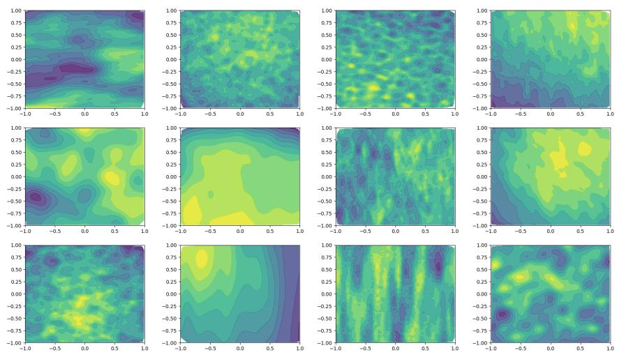  
Figure S7: Example of training samples used during pretraining with input dimension d=2.

## A.6 RUNTIME COMPARISON

Table S1 presents the runtime performance of all baselines evaluated on the Ackley function $( q =$ $6 4 , H = 1 0 )$ across 15 independent runs. The results demonstrate that our proposed method achieves the fastest execution time.  
Table S1: Runtime comparison. Wall-clock time is measured over all $H \ = \ 1 0$ iterations with $q = 6 4$ . The measurement unit is seconds.
<table><tr><td>Method</td><td> $d = 3$ </td><td> $d = 5$ </td><td> $d = 1 0$ </td><td> $d = 1 5$ </td></tr><tr><td>FMTR</td><td> ${ \bf 2 . 7 9 \pm 0 . 0 1 }$ </td><td> $\mathbf { 2 . 8 0 \pm 0 . 0 1 }$ </td><td> ${ \bf 2 . 7 9 \pm 0 . 0 1 }$ </td><td> ${ \bf 2 . 7 8 \pm 0 . 0 1 }$ </td></tr><tr><td>TuRBO</td><td> $8 . 1 5 \pm 0 . 6 7$ </td><td> $9 . 6 8 \pm 1 . 5 7$ </td><td> $1 2 . 1 7 \pm 1 . 3 7$ </td><td> $1 0 . 1 0 \pm 1 . 4 7$ </td></tr><tr><td>DiBO</td><td> $1 8 0 . 3 5 \pm 3 . 8 9$ </td><td> $1 5 6 . 3 8 \pm 1 . 9 7$ </td><td> $2 0 5 . 7 1 \pm 3 . 2 8$ </td><td> $1 7 9 . 2 9 \pm 1 . 8 9$ </td></tr><tr><td>BEEBO</td><td> $1 0 6 . 7 0 \pm 1 2 . 2 8$ </td><td> $1 9 8 . 1 7 \pm 4 2 . 5 0$ </td><td> $5 4 8 . 5 4 \pm 1 1 2 . 6 0$ </td><td> $7 8 9 . 3 5 \pm 1 4 9 . 5 3$ </td></tr><tr><td>qLogEI</td><td> $9 3 . 6 9 \pm 1 6 . 6 9$ </td><td> $1 9 9 . 4 8 \pm 2 3 . 6 9$ </td><td> $3 5 0 . 1 0 \pm 5 6 . 0 5$ </td><td> $5 3 6 . 1 3 \pm 6 6 . 4 4$ </td></tr><tr><td>qUCB</td><td> $5 6 . 8 5 \pm 8 . 6 9$ </td><td> $1 2 3 . 4 7 \pm 1 4 . 0 3$ </td><td> $4 3 6 . 7 0 \pm 3 1 . 0 4$ </td><td> $6 4 1 . 5 5 \pm 2 2 . 0 2$ </td></tr><tr><td>qTS-Matheron</td><td> $3 . 7 7 \pm 0 . 2 2$ </td><td> $5 . 6 0 \pm 0 . 4 6$ </td><td> $1 2 . 8 8 \pm 4 . 9 5$ </td><td> $8 . 1 8 \pm 1 . 5 7$ </td></tr><tr><td>GITBO</td><td> $2 4 . 7 9 \pm 0 . 1 0$ </td><td> $2 8 . 6 9 \pm 0 . 0 7$ </td><td> $3 6 . 7 9 \pm 2 . 0 1$ </td><td> $4 7 . 7 5 \pm 0 . 1 3$ </td></tr></table>

## B ADDITIONAL PRETRAINING DETAILS

## B.1 SYNTHETIC OBJECTIVE PRIOR

This section specifies the two components of the synthetic objective in Equation 8. For each optimization episode τ, we sample a stationary kernel $k _ { \tau }$ and its hyperparameters. Let $p _ { \tau } ( \omega )$ denote the corresponding spectral density. Following Rakotoarison et al. (2026), we approximate a sample from $\mathcal { G P } ( 0 , k _ { \tau } )$ using m random Fourier features:

$$
f _ { \mathrm { R F F } , \tau } ( \mathbf { x } ) = \sqrt { \frac { 2 } { m } } \mathbf { z } _ { \tau } ^ { \top } \cos ( \Omega _ { \tau } \mathbf { x } + \mathbf { b } _ { \tau } ) ,\tag{S1}
$$

where

$$
\Omega _ { \tau } = \left[ \begin{array} { l } { \omega _ { \tau , 1 } ^ { \top } } \\ { \vdots } \\ { \omega _ { \tau , m } ^ { \top } } \end{array} \right] \in \mathbb { R } ^ { m \times d _ { \tau } } , \qquad \omega _ { \tau , j } \stackrel { \mathrm { i . i . d . } } { \sim } p _ { \tau } ( \omega ) .
$$

The feature coefficients and phase offsets are sampled as

$$
\mathbf { z } _ { \tau } \sim \mathcal { N } ( \mathbf { 0 } , \mathbf { I } _ { m } ) , \qquad \mathbf { b } _ { \tau } \sim \mathcal { U } ( [ 0 , 2 \pi ] ^ { m } ) .\tag{S2}
$$

The cosine in Equation S1 is applied element-wise.

Next, we add the randomized trend

$$
f _ { \mathrm { t r e n d } , \tau } ( \mathbf { x } ) = - a _ { \tau } \left( \sum _ { j = 1 } ^ { d _ { \tau } } w _ { \tau , j } \big ( x _ { j } - c _ { \tau , j } \big ) ^ { 2 } \right) ^ { p _ { \tau } } ,\tag{S3}
$$

where $a _ { \tau } , p _ { \tau } , \mathbf { w } _ { \tau } = \left( w _ { \tau , 1 } , \ldots , w _ { \tau , d _ { \tau } } \right)$ , and $\mathbf { c } _ { \tau } = ( c _ { \tau , 1 } , \dots , c _ { \tau , d _ { \tau } } )$ are sampled independently for each episode. The resulting objective is

$$
f _ { \tau } ( \mathbf { x } ) = f _ { \mathrm { R F F } , \tau } ( \mathbf { x } ) + f _ { \mathrm { t r e n d } , \tau } ( \mathbf { x } ) .
$$

The explicit RFF representation makes each posterior path differentiable, so its maximizer can be obtained using gradient-based optimization. The kernel and its hyperparameters are sampled as part of the episode and are therefore available during target construction without task-specific estimation.

## B.2 SAMPLING KERNEL AND TREND FUNCTION

For each synthetic task, we sample the kernel and trend parameters as follows:

1. Kernel family. We sample a Matern kernel with´ $\nu \in \{ 1 / 2 , 3 / 2 , 5 / 2 , \infty \}$ , with probabilities proportional to (0.1, 1, 1, 1). The output scale is sampled from $\mathcal { U } ( 0 . 1 , 1 . 0 )$

2. Lengthscale structure. We sample isotropic, ARD, or grouped lengthscales with probabilities 0.2, 0.7, and 0.1, respectively. Isotropic kernels use a shared lengthscale from $\mathcal { U } ( 0 . 0 1 , 0 . 5 )$ (our search domain being $\mathcal { X } _ { \tau } : = [ - 1 , 1 ] ^ { d } )$ , while ARD kernels sample each coordinate independently from the same distribution. For grouped kernels, dimensions are assigned to fast and slow groups with centers $c _ { \mathrm { f a s t } } < c _ { \mathrm { s l o w } }$ , which are independently perturbed across dimensions. This generates objectives with heterogeneous, potentially low effective dimensionality. A random rotation is additionally applied with probability $p _ { \mathrm { r o t } } = 0 . 3$ to generate non-axis-aligned functions.

3. Trend inclusion and location. We omit the quadratic trend with probability $p _ { \mathrm { n o n e } } = 0 . 2$ Otherwise, its center $\mathbf { c } _ { \tau }$ is sampled from $\mathcal { U } ( - 0 . 8 , 0 . 8 )$ with probability $p _ { \mathrm { o u t s i d e } } = 0 . 2 5$ and from $\mathcal { U } ( - 0 . 3 7 5 , 0 . 3 7 5 )$ otherwise, allowing some optima to lie near the boundary of the search space.

4. Trend shape. The weights are sampled as $\mathbf { w } _ { \tau } \sim \mathrm { e x p } ( \mathcal { U } ( - 0 . 8 , 0 . 8 ) )$ and normalized by their mean, while $p _ { \tau }$ is sampled uniformly from {0.5, 1, 2}.

5. Relative scale. We choose $a _ { \tau }$ such that the variance ratio between $f _ { \mathrm { R F F } , \tau }$ and $f _ { \mathrm { t r e n d } , \tau }$ lies in [0.3, 6.0], preventing either component from dominating the objective.

For the other hyper-parameters, see Table S2.

## B.3 CLOSED-LOOP PRETRAINING

At DAgger rollout iteration s, the probability of sampling the rollout batch from $\tilde { p } _ { 1 }$ is

$$
\beta _ { s } = \gamma ^ { s } ,\tag{S4}
$$

where $\gamma \in ( 0 , 1 )$ controls the decay. The initial replay buffer is constructed from $\tilde { p } _ { 1 } { \mathrm { - o n l y } }$ rollouts, corresponding to $s = 0$ and $\beta _ { 0 } = 1$ , so that valid training examples are available before the first parameter update. Later rollouts increasingly use the current FMTR proposal as $\beta _ { s }$ decreases. For each visited state $\left( \mathcal { D } _ { r } , h _ { r } , H \right)$ , we recompute $\tilde { p } _ { 1 } ( \cdot \mid \mathcal { D } _ { r } , h _ { r } , H )$ and store $M$ target locations together with the information required to evaluate the training objective. The complete rollout batch is then drawn from either $\tilde { p } _ { 1 }$ or the current FMTR proposal according to Equation 17. Its observations are appended to the history before constructing the next state. In practice, for simplicity, we can use $p _ { 1 }$ instead of $\tilde { p } _ { 1 }$ for $B _ { r }$ in Equation 17, and store the samples from $p _ { 1 }$ and their corresponding weights for computing the training loss in Equation 16.

The replay buffer is partitioned into buckets $\{ B _ { n } \}$ , where $B _ { n }$ contains states whose histories have size n. Let

$$
S _ { B } = \{ n : B _ { n } \neq \emptyset \}
$$

denote the occupied context-size buckets. A training minibatch is sampled by first drawing

$$
n \sim \mathcal { U } ( S _ { B } )
$$

and then drawing b examples uniformly from $B _ { n } .$ . All examples in the resulting minibatch have the same context length, which also permits rectangular batching without padding contexts of different sizes.

The buffer is augmented every $T _ { \mathrm { r e f r e s h } }$ parameter updates. As s increases, the decreasing $\beta _ { s }$ exposes FMTR to histories increasingly induced by its own proposals, while the target distribution is recomputed at every visited state. Algorithm 2 gives the corresponding rollout and replay procedures.

## C ADDITIONAL DETAILS ON QUERY TARGET DISTRIBUTION CONSTRUCTION

## C.1 PATHWISE GP POSTERIOR SAMPLING

Consider a history $\mathcal { D } = \{ ( \mathbf { x } _ { i } , y _ { i } ) \} _ { i = 1 } ^ { n _ { c } }$ , and define

$$
\mathbf { X } = \left[ \overset { \mathbf { x } _ { 1 } ^ { \top } } { \underset { \mathbf { x } _ { n _ { c } } ^ { \top } } { : } } \right] \in \mathbb { R } ^ { n _ { c } \times d _ { \tau } } , \qquad \mathbf { y } = ( y _ { 1 } , \dots , y _ { n _ { c } } ) ^ { \top } .
$$

Table S2: Hyperparameter settings.
<table><tr><td colspan="2">Synthetic task prior hyperparameters</td></tr><tr><td>Episode component</td><td>Distribution or value</td></tr><tr><td>Search domain  $\mathcal { X } _ { \tau }$ </td><td> $\lceil - 1 , 1 \rceil ^ { d }$ </td></tr><tr><td>Dimension  $d _ { \tau }$ </td><td>[2, 3, ., 14, 15]</td></tr><tr><td>Batch size  $q _ { \tau }$ </td><td>[30, 40, 50, 60, 70, 80]</td></tr><tr><td>Horizon  $H _ { \tau }$ </td><td>[5, 6, 7, 8, 9, 10]</td></tr><tr><td>Initial context size  $n _ { 0 , \tau }$ </td><td>[10, 20, 30]</td></tr><tr><td>Observation noise σ</td><td>0.01</td></tr><tr><td>Number of RFF features m</td><td>500d</td></tr><tr><td> $T _ { m i n }$ </td><td>0.4</td></tr><tr><td>Tmax</td><td>1.0</td></tr><tr><td>Learning rate Langevin dynamics η</td><td>0.05</td></tr><tr><td>Std of Langevin dynamics&#x27;s noise term  $\sigma _ { \mathrm { L } }$ </td><td>0.05</td></tr><tr><td>Base Langevin refinement steps K</td><td>7</td></tr><tr><td>Number of target location for each episode and history M</td><td>200</td></tr><tr><td> $N _ { r o l l }$ </td><td>1500</td></tr><tr><td>Trefresh</td><td>2000</td></tr><tr><td>γ</td><td>0.7</td></tr><tr><td colspan="2">Model hyperparameters</td></tr><tr><td>Embedding hidden  $d _ { \mathrm { m o d e l } }$ </td><td>128</td></tr><tr><td>Number of attention heads</td><td>4</td></tr><tr><td>Number of self-attention layers</td><td>6</td></tr><tr><td>Number of cross-attention layers  $L _ { d e c }$ </td><td>3</td></tr><tr><td>Feed-forward dimension</td><td>128</td></tr><tr><td>Number of components for GMM C</td><td>5</td></tr><tr><td>Number of decoder layer for GMM</td><td>2 (Separate per component)</td></tr><tr><td colspan="2">Training</td></tr><tr><td>Optimizer</td><td>AdamW</td></tr><tr><td>Learning rate</td><td>5e-4</td></tr><tr><td>Weight decay</td><td>1e-2</td></tr><tr><td>Number of warm up step</td><td>50000</td></tr><tr><td>Number of burn in step</td><td>37500</td></tr><tr><td>LR scheduler</td><td>Cosine annealing restart with polynomial</td></tr><tr><td>Restart period for LR</td><td>50000</td></tr><tr><td>Polynomial steps</td><td>100000</td></tr><tr><td>Number of training steps</td><td>1000000</td></tr><tr><td>Batch size</td><td>128</td></tr><tr><td colspan="2">Evaluation</td></tr><tr><td>Inference solver step</td><td>100</td></tr></table>

For episode τ , we treat $m _ { \tau } ( \mathbf { x } ) = f _ { \mathrm { t r e n d } , \tau } ( \mathbf { x } )$ as the GP mean and $k _ { \tau }$ as its covariance kernel. Let

$$
\mathbf { K } _ { \tau } = \left[ k _ { \tau } ( \mathbf { x } _ { i } , \mathbf { x } _ { j } ) \right] _ { i , j = 1 } ^ { n _ { c } } , \qquad \mathbf { k } _ { \tau , \mathbf { X } } ( \mathbf { x } ) = \left( k _ { \tau } ( \mathbf { x } , \mathbf { x } _ { 1 } ) , \dots , k _ { \tau } ( \mathbf { x } , \mathbf { x } _ { n _ { c } } ) \right) ^ { \top } ,
$$

and let $\mathbf { m } _ { \tau } = ( m _ { \tau } ( \mathbf { x } _ { 1 } ) , \dots , m _ { \tau } ( \mathbf { x } _ { n _ { c } } ) ) ^ { \top }$

For posterior draw $j ,$ we sample an independent zero-mean RFF prior path $g _ { \tau } ^ { ( j ) }$ , using the construction described in Appendix B.1 and Rahimi & Recht (2007). We also draw

$$
\widetilde \epsilon ^ { ( j ) } \sim \mathcal { N } ( \mathbf { 0 } , \sigma ^ { 2 } \mathbf { I } _ { n _ { c } } ) ,
$$

where $\sigma ^ { 2 }$ is the observation-noise variance, and define

$$
\boldsymbol { \psi } _ { \tau } ^ { ( j ) } ( \mathbf { x } ) = \left( \psi _ { \tau } ^ { ( j ) } ( \mathbf { x } _ { 1 } ) , \dots , \psi _ { \tau } ^ { ( j ) } ( \mathbf { x } _ { n _ { c } } ) \right) ^ { \top } .
$$

Matheron’s rule gives the correction coefficients

$$
\mathbf { v } ^ { ( j ) } = \left( \mathbf { K } _ { \tau } + \sigma ^ { 2 } \mathbf { I } _ { n _ { c } } \right) ^ { - 1 } \left( \mathbf { y } - \mathbf { m } _ { \tau } - \psi _ { \tau } ^ { ( j ) } - \widetilde { \pmb { \epsilon } } ^ { ( j ) } \right) ,\tag{S5}
$$

Algorithm 2 FMTR pretraining: full procedure   
Require: Episode prior $p ( \tau ) ;$ update budget $N _ { \mathrm { t r a i n } } ;$ ; minibatch size $b ;$ targets per state M; episodes per collec  
tion $N _ { \mathrm { r o l l } } ;$ refresh period $T _ { \mathrm { r e f r e s h } } ;$ decay $\gamma \in ( 0 , 1 )$   
1: Initialize θ, bucketed buffer $B  \varnothing .$ , and counters u $\mathbf { \omega } , \gets 0 , s \gets 0$   
2: while $u < N _ { \mathrm { t r a i n } }$ do   
3: $\beta _ { s }  \gamma ^ { s }$ ▷ Equation S4   
4: for $j = 1 , \ldots , {  { N _ { \mathrm { r o l l } } } }$ do   
5: Sample $\tau \sim p ( \tau ) ;$ set $\mathcal { D }  \mathcal { D } _ { 0 } ^ { \tau }$   
6: for $\hat { r } = 0 , \ldots , \hat { H } _ { \tau } - 1$ do   
7: $h  H _ { \tau } - r , \alpha  h / H _ { \tau }$   
8: Draw M independent posterior paths using Equation S6   
9: Maximize each path to obtain $\mathbf { x } _ { \mathrm { T S } } ^ { ( m ) }$ via Equation S7   
10: Refine each $\mathbf { x } _ { \mathrm { T S } } ^ { ( m ) }$ for $K _ { h , H _ { \tau } }$ steps using Equation 11, yielding $\mathbf { x } _ { 1 } ^ { ( m ) }$   
11: $\mathcal { Z }  \{ ( \mathbf { x } _ { 1 } ^ { ( m ) } , f _ { \tau } ( \mathbf { x } _ { 1 } ^ { ( m ) } ) ) \} _ { m = 1 } ^ { M }$   
12: Append $( \bar { \tau } , \mathcal { D } , h , H _ { \tau } , \mathcal { Z } )$ to $\boldsymbol { B } _ { | \mathcal { D } | }$   
13: Draw $z \sim$ Bernoul $\mathrm { i } ( \beta _ { s } )$   
14: $\mathbf { i f } \ z = 1$ then   
15: $B _ { r } \sim p _ { 1 } ( \cdot \mid \mathcal { D } , h , H _ { \tau } ) ^ { \otimes q _ { \tau } }$   
16: else   
17: $B _ { r } \sim p _ { \theta } ( \cdot \mid \mathcal { D } , \alpha ) ^ { \otimes q _ { \tau } }$   
18: end if   
19: Draw $\epsilon _ { r , i } \stackrel { \mathrm { i . i . d . } } { \sim } \mathcal { N } ( 0 , \sigma ^ { 2 } ) , i = 1 , \ldots , q \tau$   
20: Evaluate $y _ { r , i } = f _ { \tau } ( \mathbf { x } _ { r , i } ) _ { - } + \epsilon _ { r , i }$ in parallel for $\mathbf { x } _ { r , i } \in B _ { r }$   
21: $\mathcal { D }  \mathcal { D } \cup \{ ( \mathbf { x } _ { r , i } , \dot { y _ { r , i } } ) \} _ { i = 1 } ^ { q _ { \tau } }$   
22: end for   
23: end for   
24: $U \gets \mathrm { m i n } ( T _ { \mathrm { r e f r e s h } } , N _ { \mathrm { t r a i n } } - u )$   
25: $S B \gets \{ n : B _ { n } \neq \emptyset \}$   
26: for each of the next U parameter updates do   
27: Draw $n \sim \mathcal { U } ( S _ { B } )$   
28: Sample a minibatch $\tau$ of b records uniformly from $B _ { n }$   
29: for each record $( \tau , \mathcal { D } , h , H , \mathcal { Z } ) \in \mathcal { T }$ do   
30: Set $\alpha \gets h / \dot { H }$ and compute $w _ { 1 : M }$ using Equation S27   
31: Draw $t \sim \mathcal { U } ( 0 , 1 )$ and $\mathbf { x } _ { 0 } ^ { ( 1 : M ) } \sim \mathcal { N } ( \mathbf { 0 } , \mathbf { I } _ { d _ { \tau } } ) ^ { \otimes M }$   
32: $\mathrm { S e t } \mathbf { x } _ { t } ^ { ( m ) } \gets ( 1 - t ) \mathbf { x } _ { 0 } ^ { ( m ) } + t \mathbf { x } _ { 1 } ^ { ( m ) }$ and $\mathbf { u } _ { t } ^ { ( \min ) } \gets \mathbf { x } _ { 1 } ^ { ( m ) } - \mathbf { x } _ { 0 } ^ { ( m ) } , m = 1 , \ldots , M$   
33: end for   
34: Compute $\widehat { \mathcal { L } }$ by averaging the weighted losses in Equation S31 over $\tau$   
35: $\theta \gets \mathrm { { O } }$ PTIMISERSTEP(θ, $\nabla _ { \boldsymbol { \theta } } \widehat { \mathcal { L } } )$   
36: $u \gets u + 1$   
37: end for   
38: $s \gets s + 1$   
39: end while   
40: return θ

and the corresponding posterior path is

$$
\widetilde { f } _ { \tau } ^ { ( j ) } ( \mathbf { x } ) = m _ { \tau } ( \mathbf { x } ) + \psi _ { \tau } ^ { ( j ) } ( \mathbf { x } ) + \mathbf { k } _ { \tau , \mathbf { X } } ( \mathbf { x } ) ^ { \top } \mathbf { v } ^ { ( j ) } .\tag{S6}
$$

This separates the posterior sample into an RFF prior path and a function-space correction determined by the observations (Wilson et al., 2020). If the pretraining implementation conditions on noise-free observations, Equation S5 reduces to the case $\sigma = 0$ , and the auxiliary noise draw is omitted.

For each of M independent posterior paths, we compute

$$
\mathbf { x } _ { \mathrm { T S } } ^ { ( j ) } \in \arg \operatorname* { m a x } _ { \mathbf { x } \in \mathcal { X } _ { \tau } } \widetilde { f } _ { \tau } ^ { ( j ) } ( \mathbf { x } ) , \qquad j = 1 , \dotsc , M .\tag{S7}
$$

The resulting empirical Thompson-sampling distribution is

$$
\widehat { p } _ { \mathrm { T S } } ( \cdot \mid \mathcal { D } ) = \frac { 1 } { M } \sum _ { j = 1 } ^ { M } \delta _ { \mathbf { x } _ { \mathrm { T S } } ^ { ( j ) } } ( \cdot ) ,\tag{S8}
$$

Algorithm 3 FMTR batch generation   
Require: GMM velocity network v<sub>θ</sub>; total horizon H, remaining horizon $h ;$ batch size $q ;$ ODE solver step n;   
context set $\mathcal { D } = \{ ( \dot { \mathbf { x } } _ { i } , y _ { i } ) \} _ { i = 1 } ^ { n _ { c } }$   
1: $\alpha  h / H$   
2: $\mathbf { x } ^ { ( 1 : q ) } \sim \mathcal { N } ( \mathbf { 0 } , \mathbf { I } _ { d } ) ^ { \otimes q }$   
3: for $i = 0 , \ldots , n - 1$ do   
4: $t = i / n$   
5: $t _ { 2 } = ( i + 1 ) / n$   
6: $\mathbf { u } ^ { ( k ) } \sim v _ { \theta } \left( \cdot \mid \mathbf { x } ^ { ( k ) } , t , \mathcal { D } , \alpha \right)$ k = 1, . . . , q.   
7: $\hat { \mathbf { x } } _ { 1 } ^ { ( 1 : q ) } = \mathbf { x } ^ { ( \mathrm { i } : q ) } + ( 1 - t ) \mathbf { u } ^ { ( 1 : q ) }$ ▷ Endpoint sample.   
8: $\hat { \mathbf { x } } _ { 0 } ^ { ( 1 : q ) } \sim \mathcal { N } ( \mathbf { 0 } , \mathbf { I } _ { d } ) ^ { \otimes q }$ ▷ Re-noise source state.   
9: $\mathbf { x } ^ { ( 1 : q ) } = ( 1 - t _ { 2 } ) \hat { \mathbf { x } } _ { 0 } ^ { ( 1 : q ) } + t _ { 2 } \hat { \mathbf { x } } _ { 1 } ^ { ( 1 : q ) }$   
10: end for   
11: return $\mathbf { \underline { { \sigma } } } _ { \mathbf { X } } ( 1 : q )$

where $\delta _ { \mathbf { x } }$ denotes a point mass at x. The explicit RFF representation makes each posterior path differentiable, so its maximizer can be obtained using gradient-based optimization. The kernel and its hyperparameters are sampled as part of the episode and are therefore available during target construction without task-specific estimation.

## C.2 STOCHASTIC REFINEMENT OF THOMPSON-SAMPLING TARGETS

Normalized updates. For a fixed episode and optimization state $( \tau , \mathcal { D } , h , H )$ , the temperature and number of refinement steps are given by Equation 10. We define the normalized gradient as

$$
\begin{array} { r } { \mathbf { g } _ { \tau } ( \mathbf { x } ) = \left\{ \begin{array} { l l } { \displaystyle \frac { \nabla f _ { \tau } ( \mathbf { x } ) } { \| \nabla f _ { \tau } ( \mathbf { x } ) \| _ { 2 } } , } & { \| \nabla f _ { \tau } ( \mathbf { x } ) \| _ { 2 } > 0 , } \\ { \displaystyle \mathbf { 0 } , } & { \mathrm { o t h e r w i s e } . } \end{array} \right. } \end{array}\tag{S9}
$$

Thus, the deterministic increment in Equation 11 has norm at most $\eta ,$ independently of the objectivegradient magnitude. The temperature changes the number of updates through $K _ { h , H } ;$ it does not rescale the gradient or noise within an individual update.

Stochastic target construction. For each Thompson-sampling location $\mathbf { x } _ { \mathrm { T S } } ^ { ( j ) }$ , we initialize $\mathbf { x } ^ { ( 0 , j ) } =$ $\mathbf { x } _ { \mathrm { T S } } ^ { ( j ) }$ and apply Equation 11 using independent perturbations $\{ \pmb { \xi } _ { k } ^ { ( j ) } \} _ { k = 0 } ^ { K _ { h , H } - 1 }$ . Let

$$
\Phi _ { \tau , h , H } \left( \mathbf { x } _ { \mathrm { T S } } ^ { ( j ) } , \pmb { \xi } _ { 0 : K _ { h , H } - 1 } ^ { ( j ) } \right) = \mathbf { x } ^ { ( K _ { h , H } , j ) }
$$

denote the resulting refinement map. The population target is

$$
p _ { 1 } ( \cdot \mid \mathcal { D } , h , H ) = ( \Phi _ { \tau , h , H } ) _ { \# } \left[ p _ { \mathrm { T S } } ( \cdot \mid \mathcal { D } ) \otimes \mathcal { N } ( \mathbf { 0 } , \mathbf { I } _ { d _ { \tau } } ) ^ { \otimes K _ { h , H } } \right] .\tag{S10}
$$

Including the perturbations in the source measure makes the stochastic nature of the refinement explicit. To prevent samples from leaving the domain, we apply reflection (Lou & Ermon, 2023) after each refinement step whenever a point falls outside the domain bounds. In practice, the target is represented by M refined samples,

$$
\widehat { p } _ { 1 } ( \cdot \mid \mathcal { D } , h , H ) = \frac { 1 } { M } \sum _ { j = 1 } ^ { M } \delta _ { \mathbf { x } ^ { ( K _ { h , H } , j ) } } ( \cdot ) .\tag{S11}
$$

These samples provide the target locations used in Section 3.3; their relative contributions to training are subsequently determined by the value weights in Equation S27.

Finite-step interpretation. We use the distribution after exactly $K _ { h , H }$ updates, rather than running the process to stationarity. The construction therefore retains the Thompson-sampling initialization as part of the target definition. Accordingly, the target is defined by the finite-step refinement dynamics rather than by a stationary Langevin distribution. The values of $K , \eta , \sigma _ { \mathrm { L } } , \mathsf { T } _ { \mathrm { m i n } }$ , and $T _ { \mathrm { m a x } }$ are reported in Table S2.

Scope of the refinement procedure. The target construction only requires samples from a finite refinement procedure, so other procedures could be considered for different synthetic-task families. Related samplers address departures from smooth continuous objectives: P-LMC (Chatterji et al., 2020) treats nonsmooth potentials under assumptions that include subgradient access, whereas DLP (Zhang et al., 2022) uses gradients of a differentiable extension to construct proposals over discrete variables.

## C.3 VALUE-WEIGHTED TARGET DISTRIBUTION

For a fixed episode τ and state $( \mathcal { D } , h , H )$ , write $T = T ( h , H ) > 0$ and suppress the conditioning of $p _ { 1 }$ and $\tilde { p } _ { 1 }$ . Refinement changes query locations using the objective gradient, but the resulting basin masses also depend on the Thompson-sampling initialization and finite-step dynamics. Value weighting additionally adjusts these masses according to the attained objective values.

Gibbs variational characterization. Consider

$$
\tilde { p } _ { 1 } = \underset { p \ll p _ { 1 } } { \mathrm { a r g m a x } } \left\{ \mathbb { E } _ { p } [ f _ { \tau } ( \mathbf { x } ) ] - T \mathrm { K L } ( p \Vert p _ { 1 } ) \right\} ,\tag{S12}
$$

where $p \ll p _ { 1 }$ denotes absolute continuity, and we restrict to probability distributions with finite objective expectations and KL divergences. Define

$$
Z = \mathbb { E } _ { p _ { 1 } } \left[ \exp \left( \frac { f _ { \tau } ( \mathbf { x } ) } { T } \right) \right] , \qquad \tilde { p } _ { 1 } ( \mathrm { d } \mathbf { x } ) = \frac { \exp ( f _ { \tau } ( \mathbf { x } ) / T ) } { Z } p _ { 1 } ( \mathrm { d } \mathbf { x } ) .\tag{S13}
$$

Assume $0 < Z < \infty$ and $\mathbb { E } _ { \tilde { p } _ { 1 } } [ | f _ { \tau } ( \mathbf { x } ) | ] < \infty$ . For any admissible $p ,$ substituting the density ratio from Equation S13 gives

$$
\begin{array} { r } { \mathbb { E } _ { p } [ f _ { \tau } ( \mathbf { x } ) ] - T \mathrm { K L } ( p \| p _ { 1 } ) = T \log Z - T \mathrm { K L } ( p \| \tilde { p } _ { 1 } ) . } \end{array}\tag{S14}
$$

Nonnegativity of KL divergence establishes that $\tilde { p } _ { 1 }$ is the unique maximizer.

Relation to refinement. For a fixed reference distribution $p _ { 1 }$ , reducing $T$ increases the relative weight assigned to larger objective values. In FMTR, T also changes the reference distribution through the refinement budget $K _ { h , H }$ . The Gibbs characterization applies to this finite-step reference law and requires no stationary-distribution assumption for the refinement dynamics. Moreover, $\tilde { p } _ { 1 } \ll p _ { 1 } { : }$ value weighting redistributes existing probability mass but cannot recover regions assigned zero mass by $p _ { 1 }$ . Appendix D.2 explains its implementation through weighted training.

## D MODEL ARCHITECTURE AND TRAINING DETAILS

This section provides additional details for the conditional proposal model introduced in Section 3.3. We first specify the input representations and conditional decoder, then expand the weighted training objective in Equation 16, and finally give additional details on batch generation. Model architecture figure is given in Figure S8.

## D.1 INPUT REPRESENTATION AND CONDITIONAL DECODER

Variable-dimensional inputs. To support objectives with input dimension $d \leq D$ , where $D$ is the maximum dimension supported by FMTR, each location is zero-padded to D coordinates and paired with an active-dimension mask m $\in \{ 0 , 1 \} ^ { D }$ . Padded coordinates remain fixed at zero throughout generation. Section 3.3 uses the active d-dimensional coordinates for readability.

Context encoding. The location and objective value of each observation are embedded as

$$
\mathbf { z } _ { i } = E _ { x } ( \mathbf { x } _ { i } ) + E _ { y } ( y _ { i } ) ,\tag{S15}
$$

with $\mathbf { z } _ { i } \in \mathbb { R } ^ { d _ { \mathrm { m o d e l } } }$ . A pre-normalized transformer encoder processes these tokens together with a learned global token (Vaswani et al., 2017). We retain the contextualized observation tokens as the memory

$$
\mathcal { M } \in \mathbb { R } ^ { n _ { c } \times d _ { \mathrm { m o d e l } } } ,
$$

rather than pooling them into a single representation.

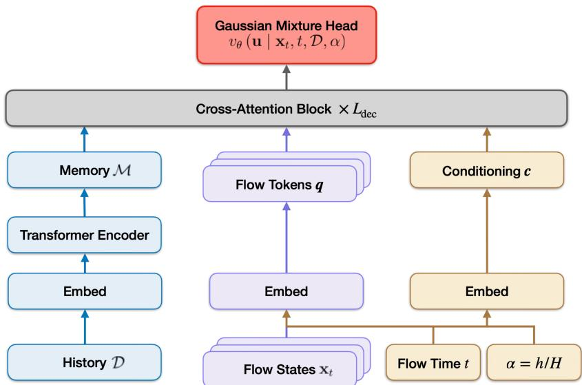  
Figure S8: Model Architecture.

No positional encodings are used for the observations. Permuting the history therefore only permutes the corresponding memory tokens, leaving cross-attention to the memory unchanged. Since $\mathcal { M }$ depends on the observed history but not on the flow state, it is computed once per optimization round and reused throughout flow generation.

Flow-state embedding. The semantics of $\mathbf { x } _ { t }$ vary with flow time: near $t = 0 ,$ , it is dominated by the Gaussian base sample, while near $t = 1$ , it approaches a query location. We therefore use

$$
\begin{array} { r } { \mathbf { q } = E _ { t } ( \mathbf { x } _ { t } , t , \alpha ) = E _ { x } ( \mathbf { x } _ { t } ) + ( 1 - t ) \mathrm { M L P } ( \mathbf { x } _ { t } , t , \alpha ) , } \end{array}\tag{S16}
$$

where both terms lie in $\mathbb { R } ^ { d _ { \mathrm { m o d e l } } }$ . The additional term vanishes at $t = 1$ , giving $E _ { t } ( \mathbf { x } , 1 , \alpha ) = E _ { x } ( \mathbf { x } )$

Conditional decoder with AdaLN-Zero. The flow token q is processed by $L _ { \mathrm { d e c } }$ cross-attention blocks, each attending to M without self-attention among flow tokens. Following AdaLN-Zero from DiT (Peebles & Xie, 2023), flow time and the remaining-round fraction are combined as

$$
\mathbf { c } = E _ { \mathrm { t i m e } } ( t ) + E _ { \mathrm { h o r i z o n } } ( \alpha ) ,\tag{S17}
$$

where $E _ { \mathrm { t i m e } }$ uses random Fourier features of t and $E _ { \mathrm { h o r i z o n } }$ is a multilayer perceptron.

Each decoder block maps this conditioning vector to scale, shift, and gating parameters,

$$
( \gamma _ { 1 } , \beta _ { 1 } , \mathbf { g } _ { 1 } , \gamma _ { 2 } , \beta _ { 2 } , \mathbf { g } _ { 2 } ) = W _ { \mathrm { a d a } } \mathrm { S i L U } ( \mathbf { c } ) ,\tag{S18}
$$

and applies

$$
\begin{array} { r } { \mathbf q  \mathbf q + \mathbf g _ { 1 } \odot \mathrm { M H A } ( ( 1 + \gamma _ { 1 } ) \odot \mathrm { L N } ( \mathbf q ) + \beta _ { 1 } , \mathrm { L N } ( \mathcal { M } ) ) , } \end{array}\tag{S19}
$$

$$
\begin{array} { r } { \mathbf q \gets \mathbf q + \mathbf g _ { 2 } \odot \mathrm { F F N } \left( ( 1 + \gamma _ { 2 } ) \odot \mathrm { L N } ( \mathbf q ) + \beta _ { 2 } \right) . } \end{array}\tag{S20}
$$

Here, the second argument of MHA supplies its keys and values. Following AdaLN-Zero, $W _ { \mathrm { a d a } }$ is initialized to zero, so the residual gates vanish at initialization and each decoder block initially acts as the identity on its query token. The context memory is normalized but not modulated by the flow-time conditioning, since it represents fixed observed data.

Gaussian mixture head. The final decoder representation is projected to the parameters of the velocity distribution in Equation 14: C mixture logits, C mean vectors, and C diagonal scale vectors. The mixture weights are obtained by applying a softmax to the logits. The predicted scales are lower-bounded by a small positive constant for numerical stability.

## D.2 TRAINING OBJECTIVE

We now expand the objective in Equation 16. Let $\rho _ { \mathrm { t r a i n } } ( \tau , \mathcal { D } , h , H )$ denote the distribution over training records produced by the closed-loop collection and context-length-stratified sampling pro-

cedure described in Section 3.4. For a sampled record, define $\alpha = h / H$ and consider the population flow-matching objective under the tilted target,

$$
\mathcal { L } _ { \mathrm { t i l t } } ( \theta ) = - \mathbb { E } _ { ( \tau , \mathcal { D } , h , H ) \sim \rho _ { \mathrm { t r a i n } } } [ \mathbb { E } \underbrace { t \sim \mathcal { U } ( 0 , 1 ) } _ { \tilde { \mathbf { x } } _ { 1 } \sim \tilde { \rho } _ { \mathbf { x } _ { 0 } \sim p _ { 0 } } ^ { 1 } ( \cdot | \mathcal { D } , h , H ) , } \log v _ { \theta } ( \tilde { \mathbf { u } } _ { t } \mid \tilde { \mathbf { x } } _ { t } , t , \mathcal { D } , \alpha ) ] ] , \qquad \alpha = \frac { h } { H } ,\tag{S21}
$$

where $p _ { 0 } = \mathcal { N } ( \mathbf { 0 } , \mathbf { I } _ { d } ) , \tilde { \mathbf { x } } _ { t } = ( 1 - t ) \mathbf { x } _ { 0 } + t \tilde { \mathbf { x } } _ { 1 }$ , and $\tilde { \mathbf { u } } _ { t } = \tilde { \mathbf { x } } _ { 1 } - \mathbf { x } _ { 0 }$

Direct samples from $\tilde { p } _ { 1 }$ are not available in our target construction. Instead, we have samples from $p _ { 1 } ( \cdot \mid \mathcal { D } , h , H )$ . From Equation 13,

$$
\tilde { p } _ { 1 } ( \mathbf { x } \mid \mathcal { D } , h , H ) = \frac { p _ { 1 } ( \mathbf { x } \mid \mathcal { D } , h , H ) \exp ( f _ { \tau } ( \mathbf { x } ) / T ( h , H ) ) } { Z ( \tau , \mathcal { D } , h , H ) } ,\tag{S22}
$$

where

$$
Z ( \tau , \mathcal { D } , h , H ) = \mathbb { E } _ { \mathbf { x } \sim p _ { 1 } ( \cdot \vert \mathcal { D } , h , H ) } \left[ \exp ( f _ { \tau } ( \mathbf { x } ) / T ( h , H ) ) \right] .\tag{S23}
$$

Hence, for any $\tilde { p } _ { 1 }$ -integrable function ψ, and assuming $0 < Z < + \infty$

$$
\begin{array} { l } { \displaystyle \mathbb { E } _ { \tilde { p } _ { 1 } } [ \psi ( { \bf x } _ { 1 } ) ] = \int \psi ( { \bf x } _ { 1 } ) \tilde { p } _ { 1 } ( { \bf x } _ { 1 } \mid \mathcal { D } , h , H ) \mathrm { d } { \bf x } _ { 1 } } \\ { \displaystyle \qquad = \frac { 1 } { Z } \int \psi ( { \bf x } _ { 1 } ) p _ { 1 } ( { \bf x } _ { 1 } \mid \mathcal { D } , h , H ) \exp \left( \frac { f _ { \tau } ( { \bf x } _ { 1 } ) } { T ( h , H ) } \right) \mathrm { d } { \bf x } _ { 1 } } \\ { \displaystyle \qquad = \frac { \mathbb { E } _ { p _ { 1 } } \left[ \exp \left( f _ { \tau } ( { \bf x } _ { 1 } ) / T ( h , H ) \right) \psi ( { \bf x } _ { 1 } ) \right] } { \mathbb { E } _ { p _ { 1 } } \left[ \exp \left( f _ { \tau } ( { \bf x } _ { 1 } ) / T ( h , H ) \right) \right] } . } \end{array}\tag{S24}
$$

For M independent samples $\mathbf { x } _ { 1 } ^ { ( i ) } \sim p _ { 1 } ( \cdot \mid \mathcal { D } , h , H )$ , define the unnormalized importance weights

$$
s _ { i } = \exp \left( \frac { f _ { \tau } ( \mathbf { x } _ { 1 } ^ { ( i ) } ) } { T ( h , H ) } \right) , \qquad i = 1 , \dots , M .\tag{S25}
$$

Self-normalized importance sampling (Aeckerle-Willems et al., 2026) then approximates Equation S24 as

$$
\mathbb { E } _ { \tilde { p } _ { 1 } } [ \psi ( \mathbf { x } _ { 1 } ) ] \approx \frac { \sum _ { i = 1 } ^ { M } s _ { i } \psi ( \mathbf { x } _ { 1 } ^ { ( i ) } ) } { \sum _ { j = 1 } ^ { M } s _ { j } } = \sum _ { i = 1 } ^ { M } w _ { i } \psi ( \mathbf { x } _ { 1 } ^ { ( i ) } ) ,\tag{S26}
$$

where

$$
\begin{array} { l } { \displaystyle w _ { i } = \frac { s _ { i } } { \sum _ { j = 1 } ^ { M } s _ { j } } } \\ { \displaystyle \quad = \frac { \exp \left( f _ { \tau } ( \mathbf { x } _ { 1 } ^ { ( i ) } ) / T ( h , H ) \right) } { \sum _ { j = 1 } ^ { M } \exp \left( f _ { \tau } ( \mathbf { x } _ { 1 } ^ { ( j ) } ) / T ( h , H ) \right) } } \\ { \displaystyle \quad = \mathrm { s o f t m a x } _ { i } \left( \frac { f _ { \tau } ( \mathbf { x } _ { 1 } ^ { ( i ) } ) } { T ( h , H ) } \right) . } \end{array}\tag{S27}
$$

Equivalently, using the density ratio from Equation S22,

$$
\frac { \tilde { p } _ { 1 } ( \mathbf { x } _ { 1 } ^ { ( i ) } \mid \mathcal { D } , h , H ) } { p _ { 1 } ( \mathbf { x } _ { 1 } ^ { ( i ) } \mid \mathcal { D } , h , H ) } = \frac { s _ { i } } { Z } ,\tag{S28}
$$

so that the unknown normalizing constant $Z$ cancels after normalizing the importance weights:

$$
\frac { \tilde { p } _ { 1 } ( \mathbf { x } _ { 1 } ^ { ( i ) } ) / p _ { 1 } ( \mathbf { x } _ { 1 } ^ { ( i ) } ) } { \sum _ { j = 1 } ^ { M } \tilde { p } _ { 1 } ( \mathbf { x } _ { 1 } ^ { ( j ) } ) / p _ { 1 } ( \mathbf { x } _ { 1 } ^ { ( j ) } ) } = \frac { s _ { i } } { \sum _ { j = 1 } ^ { M } s _ { j } } = w _ { i } .\tag{S29}
$$

We now apply this approximation to the inner expectation in Equation S21. For

$$
\psi ( \mathbf { x } _ { 1 } ) = \mathbb { E } _ { t \sim \mathcal { U } ( 0 , 1 ) , \atop \mathbf { x } _ { 0 } \sim p _ { 0 } } \left[ \log v _ { \theta } \left( \mathbf { u } _ { t } \mid \mathbf { x } _ { t } , t , \mathcal { D } , \alpha \right) \right] ,
$$

where ${ \bf x } _ { t } = ( 1 - t ) { \bf x } _ { 0 } + t { \bf x } _ { 1 }$ and ${ \bf u } _ { t } = { \bf x } _ { 1 } - { \bf x } _ { 0 }$ , Equation S26 gives

$$
\begin{array} { r l } & { \underset { \tilde { \mathbf { x } } _ { 1 } \sim \tilde { p } _ { 1 } ( \cdot \vert \mathcal { D } , h , H ) , } { \mathbb { E } } \left[ \log v _ { \theta } \left( \tilde { \mathbf { u } } _ { t } \mid \tilde { \mathbf { x } } _ { t } , t , \mathcal { D } , \alpha \right) \right] } \\ & { \quad \approx \underset { \mathbf { x } _ { 0 } \sim p _ { 0 } } { \mathbb { E } } } \\ & { \quad \quad \approx \underset { \mathbf { x } _ { 1 } ^ { ( 1 : M ) } \sim p _ { 1 } ( \cdot \vert \mathcal { D } , h , H ) ^ { \otimes M } } { \mathbb { E } } \left[ \underset { i = 1 } { \overset { M } { \sum } } w _ { i } \log v _ { \theta } \left( \mathbf { u } _ { t } ^ { ( i ) } \mid \mathbf { x } _ { t } ^ { ( i ) } , t , \mathcal { D } , \alpha \right) \right] . } \end{array}\tag{S30}
$$

with

$$
\mathbf { x } _ { t } ^ { ( i ) } = ( 1 - t ) \mathbf { x } _ { 0 } ^ { ( i ) } + t \mathbf { x } _ { 1 } ^ { ( i ) } , \qquad \mathbf { u } _ { t } ^ { ( i ) } = \mathbf { x } _ { 1 } ^ { ( i ) } - \mathbf { x } _ { 0 } ^ { ( i ) } .
$$

Combining this approximation with the outer expectation over training records gives the practical training objective

$$
\begin{array} { r l } { \mathcal { L } ( \boldsymbol { \theta } ) = - \mathbb { E } } & { ( \tau , \mathcal { D } , h , H ) \sim \rho _ { \mathrm { t r a i n } } , } \\ & { \qquad \quad \underset { \mathbf { x } _ { 1 } ^ { ( 1 : M ) } \sim \mathcal { D } \left( 1 , h , H \right) ^ { \otimes M } } { t \sim \mathcal { U } ( 0 , 1 ) } , } \end{array} \quad \left[ \underset { i = 1 } { \overset { M } { \sum } } w _ { i } \log v _ { \boldsymbol { \theta } } \left( \mathbf { u } _ { t } ^ { ( i ) } \mid \mathbf { x } _ { t } ^ { ( i ) } , t , \mathcal { D } , \boldsymbol { \alpha } \right) \right] , \qquad \boldsymbol { \alpha } = \frac { h } { H } .\tag{S31}
$$

This is the objective summarized in Equation 16. For a fixed target pool, the weighted loss corresponds exactly to the empirical distribution

$$
\hat { \tilde { p } } _ { 1 , M } = \sum _ { i = 1 } ^ { M } w _ { i } \delta _ { \mathbf { x } _ { 1 } ^ { ( i ) } } .\tag{S32}
$$

As an estimator of the population expectation under $\tilde { p } _ { 1 }$ , self-normalized importance sampling is generally biased for finite M, but is consistent under standard integrability conditions.

The target construction and value weighting use the synthetic objective in different ways. The refinement in Section 3.2 moves Thompson-sampling locations to define $p _ { 1 }$ , whereas Equation S27 reweights samples from $p _ { 1 }$ to approximate training under $\tilde { p } _ { 1 }$ . The objective values are used only for pretraining supervision and are not additional inputs to $p _ { \theta } ( \mathbf { x } \mid \mathcal { D } , \alpha )$

## D.3 COMPUTATIONAL RESOURCES

We trained FMTR on one NVIDIA H100 80GB HBM3 GPU. Training took approximately 19 hours per run. All models are evaluated on Tesla V100-SXM2-32GB GPUs.

## E EXPERIMENTAL DETAILS

This section supplements Section 5 with descriptions of the baseline methods. FMTR’s pretraining procedure and architecture are given in Appendices B and D. For evaluation, since FMTR is trained on the normalized domain $\mathcal { X } \overset { = } { = } [ - 1 , 1 ] ^ { d }$ , the observed query points are first mapped to X . FMTR then generates new query points within X, which are subsequently mapped back to the original domain for function evaluation.

## E.1 BASELINES

TuRBO (Eriksson et al., 2019). Trust Region Bayesian Optimization fits local GP models within adaptive trust regions. Their sizes expand after consecutive improvements and contract after unsuccessful evaluations, with restarts when a region becomes too small. Its Thompson-sampling batch rule selects candidates within these restricted regions, and can allocate evaluations across multiple local models. TuRBO therefore provides a baseline based on local modeling and adaptive search regions, while retaining task-specific surrogate fitting and online candidate selection. In our experi ments, we specify 5 trust regions for TuRBO.

DiBO (Yun et al., 2025). This method fits a diffusion model to evaluated designs and an ensemble of surrogate models to their objective values. It then adapts the diffusion sampler through relative trajectory balance toward a target combining the learned design prior with an ensemble-based UCB score. Generated candidates undergo local search and filtering before a batch is evaluated. Model fitting and sampler adaptation are repeated as observations accumulate, providing a generative baseline trained on the current optimization task. We use the authors’ official implementation.

GIT-BO (Yu et al., 2026). GIT-BO uses a pretrained TabPFN surrogate to predict objective values and uncertainty from the observed history. Gradients of the predictive mean identify a lowdimensional subspace in which candidate locations are sampled and scored using a UCB-based acquisition. For the batch setting, we use the native implementation provided in the authors’ official repository, setting $N _ { \mathrm { C A N D I D A T E S } } = q .$ The method constructs q candidate pools, evaluates the acquisition independently for each batch slot, and selects the maximizing candidate from each pool. The batch is therefore proposed without intermediate observations, but its members are not coupled through a joint acquisition or within-batch conditioning.

BEEBO (Teufel et al., 2024). Batched Energy–Entropy Bayesian Optimization uses a GP-based acquisition that combines predicted objective values with the information gained from evaluating a batch. A temperature controls the exploration–exploitation trade-off, while the information term accounts for dependencies through the joint posterior covariance. Candidate locations are optimized jointly, providing a batch-native acquisition baseline that retains online GP fitting and numerical batch selection. We use the BoTorch implementation (Balandat et al., 2020) with the default settings: meanBEEBO variant, keeping the temperature fixed at T = 2 and switching to $T = 0$ (full exploitation) in the final round.

qLogEI, qTS-Matheron, and qUCB. These baselines use a GP surrogate with different batchselection rules and are implemented with BoTorch (Balandat et al., 2020). qLogEI uses a numerically stabilized, smoothed log-space formulation of batch expected improvement (Ament et al., 2023). qTS-Matheron draws q independent posterior paths through Matheron’s rule and maximizes each path to obtain one query (Kandasamy et al., 2018; Wilson et al., 2020). qUCB extends upper confidence bounds to batches through a Monte Carlo acquisition based on the joint posterior (Wilson et al., 2018). Thus, qLogEI and qUCB optimize batch acquisitions, whereas qTS-Matheron constructs the batch through independent posterior-path optimizations.

For all baselines that optimize acquisition using BoTorch, we set raw samples = 512 and num restarts = 128.

## E.2 SYNTHETIC BENCHMARK FUNCTIONS

We evaluate our method on six standard synthetic benchmark functions with different optimization landscapes. The Ackley, Levy, and Rastrigin functions are highly multimodal, while Rosenbrock, Dixon–Price, and Styblinski–Tang provide complementary nonconvex landscapes. We define the functions below, where $\mathbf { x } = ( x _ { 1 } , \ldots , x _ { d } )$ and d denotes the input dimensionality.

Ackley.

$$
f ( \mathbf { x } ) = - 2 0 \exp \left( - 0 . 2 { \sqrt { \frac { 1 } { d } \sum _ { i = 1 } ^ { d } x _ { i } ^ { 2 } } } \right) - \exp \left( { \frac { 1 } { d } } \sum _ { i = 1 } ^ { d } \cos ( 2 \pi x _ { i } ) \right) + 2 0 + e ,\tag{S33}
$$

with domain

$$
x _ { i } \in [ - 3 2 . 7 6 8 , 3 2 . 7 6 8 ] , \qquad i = 1 , \ldots , d .
$$

Levy. Let

$$
w _ { i } = 1 + { \frac { x _ { i } - 1 } { 4 } } .
$$

The Levy function is

$$
f ( { \bf x } ) = \sin ^ { 2 } ( \pi w _ { 1 } ) + \sum _ { i = 1 } ^ { d - 1 } ( w _ { i } - 1 ) ^ { 2 } \left[ 1 + 1 0 \sin ^ { 2 } ( \pi w _ { i } + 1 ) \right] + ( w _ { d } - 1 ) ^ { 2 } \left[ 1 + \sin ^ { 2 } ( 2 \pi w _ { d } ) \right] .\tag{S34}
$$

with domain

$$
x _ { i } \in [ - 1 0 , 1 0 ] , \qquad i = 1 , \ldots , d .
$$

Rosenbrock.

$$
f (  { \mathbf { x } } ) = \sum _ { i = 1 } ^ { d - 1 } \left[ 1 0 0 ( x _ { i + 1 } - x _ { i } ^ { 2 } ) ^ { 2 } + ( x _ { i } - 1 ) ^ { 2 } \right] ,\tag{S35}
$$

with domain

$$
x _ { i } \in [ - 5 , 1 0 ] , \qquad i = 1 , \ldots , d .
$$

Rastrigin.

$$
f (  { \mathbf { x } } ) = 1 0 d + \sum _ { i = 1 } ^ { d } \left[ x _ { i } ^ { 2 } - 1 0 \cos ( 2 \pi x _ { i } ) \right] ,\tag{S36}
$$

with domain

$$
x _ { i } \in [ - 5 . 1 2 , 5 . 1 2 ] , \qquad i = 1 , \ldots , d .
$$

Dixon–Price.

$$
f (  { \mathbf { x } } ) = ( x _ { 1 } - 1 ) ^ { 2 } + \sum _ { i = 2 } ^ { d } i ( 2 x _ { i } ^ { 2 } - x _ { i - 1 } ) ^ { 2 } ,\tag{S37}
$$

with domain

$$
x _ { i } \in [ - 1 0 , 1 0 ] , \qquad i = 1 , \ldots , d .
$$

Styblinski–Tang.

$$
f (  { \mathbf { x } } ) = \frac { 1 } { 2 } \sum _ { i = 1 } ^ { d } \left( x _ { i } ^ { 4 } - 1 6 x _ { i } ^ { 2 } + 5 x _ { i } \right) ,\tag{S38}
$$

with domain

$$
x _ { i } \in [ - 5 , 5 ] , \qquad i = 1 , \ldots , d .
$$

## E.3 REAL-WORLD BENCHMARK TASKS

We consider four data-derived optimization benchmarks described by Hsieh et al. (2021).

Oil-well depth (oil-4D). This task uses the New York State Oil, Gas, and Other Regulated Wells dataset. The four inputs are the latitude and longitude of the surface and bottom of each well, and the objective is to identify wells with the greatest drilled depth.

XGBoost hyperparameter optimization (hpobenchXGB-6D). Precomputed HPOBench evaluations associate six XGBoost hyperparameters with classification performance. These include learning rate, $L _ { 1 }$ and $L _ { 2 }$ regularization, and subsampling ratios. The objective favors configurations with higher predictive performance.

Asteroid diameter (Asteroid-12D). Each candidate is represented by twelve numerical asteroid descriptors. The task seeks candidates associated with the largest diameters.

Air quality (pm25-14D). This benchmark uses air-quality observations collected in northern Taiwan in 2015. Its fourteen inputs include sulfur dioxide, carbon monoxide, and ozone measurements. The objective is to identify conditions associated with the highest $\mathrm { P M } _ { 2 . 5 }$ concentration.

Since these tasks are defined on a discrete set of points, we interpolate them onto a continuous do main using a radial basis function (RBF) interpolator with a linear kernel and 32 nearest neighbors. We implement the interpolation using the RBFInterpolator provided by SciPy. Further details are available in the SciPy documentation.