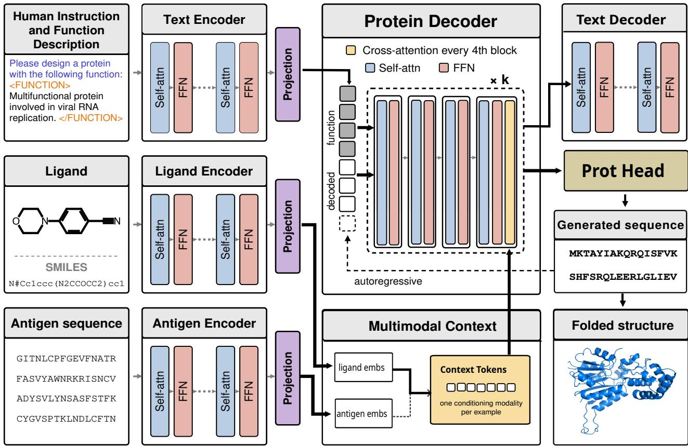
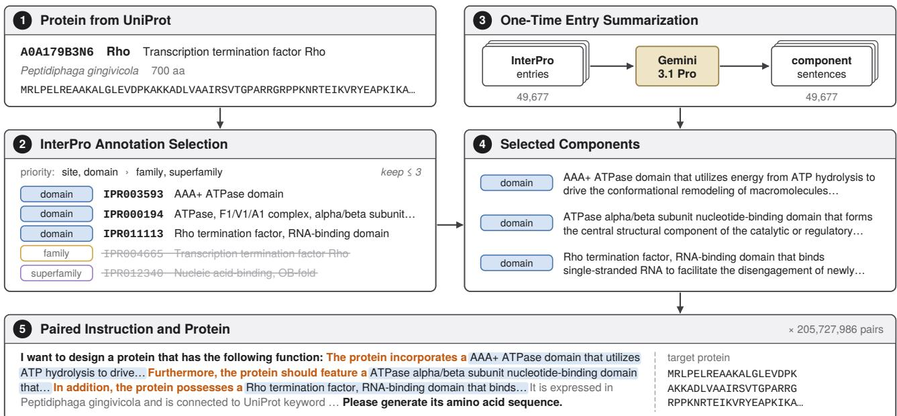
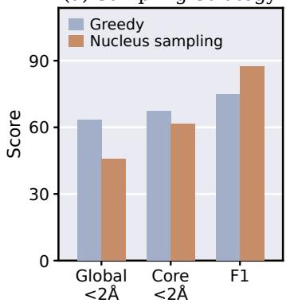
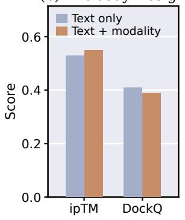
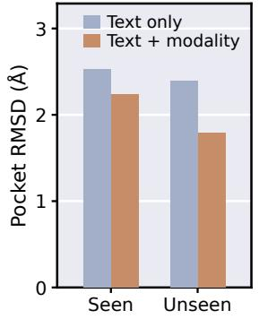
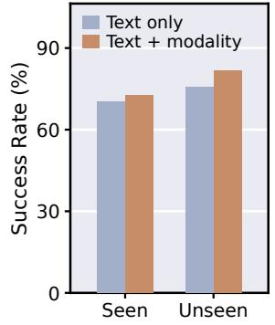
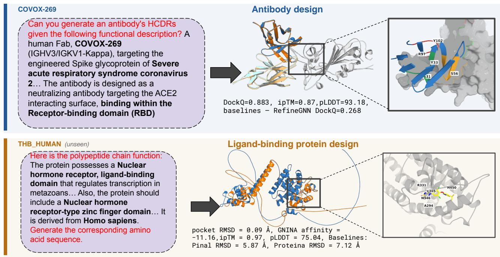
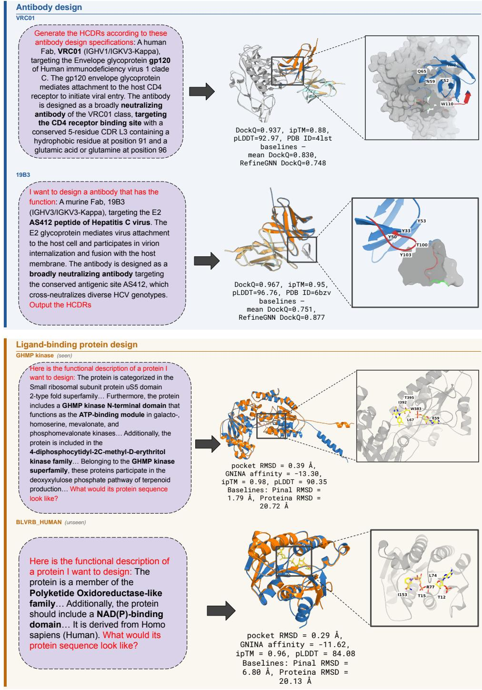

# InstructPro2: Natural Language and Biological Grounding Guided De Novo Protein Design

Charles Novak \* 1 Zhenqiao Song \* 2 Chuan Li 3 Jianwen Xie 3 Lei Li 2

## Abstract

The ability to generate proteins with desired functions is a central goal of computational biology. Although natural language can express diverse design objectives, existing protein generation methods often support only narrow tasks or make limited use of biological constraints. We develop InstructPro2 to translate natural-language design objectives into protein sequences while incorporating task-specific biological context. A text encoder captures the design instructions, while dedicated ligand and antigen encoders provide biological context to the sequence-generating decoder. For pretraining, we assemble InstructPro2Bench, comprising 205.7 million ⟨function description, protein⟩ pairs from UniProtKB. We subsequently adapt the model to ligand-binding protein and antibody design. On functional protein generation benchmarks, InstructPro2 outperforms Pinal, the strongest baseline, achieving a functional recovery F1 of 74.8 versus 62.2 and lowering global RMSD from 5.33A to 3.04˚ A. For antibody design,˚ the model obtains a DockQ score of 0.39, while ligand-binding protein design reaches a docking success rate of 72.6%. These findings highlight how integrating language-based instructions with biological conditioning can extend protein generation to distinct design settings.

## 1. Introduction

Proteins execute a vast range of functions essential to biological life. The ability to design functional proteins with specified properties on demand holds transformative potential across numerous domains, including therapeutic development (Nelson et al., 2010), enzyme engineering for sustainable chemical production (Bornscheuer et al., 2012), and the creation of novel diagnostic tools and biosensors (Rottinghaus et al., 2022). By enabling direct, targeted generation, efficient computational protein design circumvents the heavy reliance on slow natural evolutionary processes and labor-intensive high-throughput screening.

Recent progress has brought the field significantly closer to this goal. Large protein language models trained on evolutionary sequence data have captured much of the underlying grammar of proteins, enabling the generation of plausible, well-folded sequences (Nijkamp et al., 2022; Ferruz et al., 2022; Lin et al., 2023). Building on these foundations, generative frameworks have introduced explicit conditioning into protein design via specified structural motifs (Watson et al., 2023) or functional tags (Madani et al., 2023). Most recently, several systems have extended this paradigm to support natural language prompts for desired functions, making protein design increasingly versatile (Dai et al., 2024; Song et al., 2025). However, despite their effectiveness, existing methods remain constrained by narrow domain specificity, restricted design scopes, or insufficient biological grounding, which ultimately limits their design success rates.

To address these challenges, we introduce InstructPro2, a functional protein design framework that integrates natural language instructions with contextual biological knowledge. The architecture comprises a text encoder for natural language prompts, dedicated biological encoders (specifically for ligands and antigens) to capture biological grounding context, and a protein decoder that, conditioned on both modalities, generates protein sequences aligned with the specified function and binding target. We employ a twostage training strategy: first, we pretrain the model on instruction-following tasks to establish broad generalization across design objectives; second, we incorporate biological context to optimize performance on real-world downstream tasks.

Concretely, we make the following contributions:

• We introduce a text-conditioned protein design model capable of generating diverse, functional proteins directly guided by human natural language instructions.

Our code is available here: https://github.   
com/chovak/InstructPro2.

• We curate InstructPro2Bench, a large-scale dataset comprising 205.7 million <function description, protein> pairs across diverse families to support model pretraining.

• We pretrain InstructPro2 on InstructPro2Bench, demonstrating that it outperforms strong baselines, including ESM3 (Hayes et al., 2025), ProGen2 (Nijkamp et al., 2022), and Pinal (Dai et al., 2024), achieving a lower global RMSD of 3.04 A (vs. 5.33˚ A for the˚ strongest baseline) and a higher functional recovery F1 of 74.8 (vs. 62.2).

• We fine-tune the pretrained model on two key downstream tasks, showing that the text-conditioned decoder seamlessly transfers to antibody design (achieving a DockQ score of 0.39) and ligand-binding protein design (achieving a 72.6% docking success rate).

## 2. Related Work

Functional Protein Design. Designing proteins with desired functions has been studied with a wide range of methods. Early efforts demonstrated that models trained on large-scale evolutionary sequences can generate diverse, well-folded proteins without explicit conditioning (Nijkamp et al., 2022; Ferruz et al., 2022). Subsequent studies introduced conditioning signals to steer generation toward specific attributes, structures, or binding targets (Krishna et al., 2024; Zambaldi et al., 2024). Specifically, tag-based approaches leverage functional annotations, such as protein families (Madani et al., 2023), Enzyme Classification (EC) numbers (Munsamy et al., 2022), or species and chain types (Shuai et al., 2023) to guide generation toward targeted protein classes. Parallel work focuses on structure-conditioned generation, designing proteins that fold into specified backbones (Dauparas et al., 2022; Hsu et al., 2022) or scaffold key functional motifs (Watson et al., 2023; Wang et al., 2022). Most recently, advanced models enable atomic-level design tailored to designated binding partners (Stark et al., 2025; Butcher et al., 2025; Didi et al., 2026). Despite these advances, the efficient and precise design of proteins with arbitrary, user-defined functions remains an open challenge.

Natural Language-Guided Protein Design. Inspired by the instruction-following capabilities of large language models (Ouyang et al., 2022; Wang et al., 2023; Zhou et al., 2023), recent research has begun leveraging natural language conditioning for protein design. One prominent approach maps textual descriptions to intermediate structural representations, which are subsequently translated into protein sequences via generative models (Dai et al., 2024; Praljak et al., 2024; Riley et al., 2025). Other methods learn joint protein–text embedding spaces, enabling sequence retrieval or generation based on text representations (Wu et al., 2024; Wang et al., 2024; Liu et al., 2025). More recent efforts train models to design functional proteins directly from open-ended human instructions (Song et al., 2025). However, existing methods remain restricted to narrow design tasks and limited real-world scenarios. Developing a generalizable, instruction-guided model capable of generating biologically grounded proteins for arbitrary, user-defined goals remains an open challenge.

## 3. Proposed Method: InstructPro2

## 3.1. Problem Definition

Let $r \in \mathcal { A } ^ { N _ { r } }$ denote a protein sequence over an amino-acid vocabulary A, and $w \in \mathcal { V } ^ { N _ { w } }$ represent a natural-language functional description over a text vocabulary V, where $N _ { r }$ and $N _ { w }$ denote their respective sequence lengths. We represent the biological grounding as $C ,$ , which captures contextspecific constraints such as a target ligand’s SMILES string or an antigen sequence. Our objective is to learn a generative model $p _ { \theta } ( r \mid w , C )$ , parameterized by $\theta ,$ to design functional protein sequences r that follow natural-language instructions w while satisfying the biological grounding C.

## 3.2. Model Architecture

The overall architecture of InstructPro2 is illustrated in Figure 1. InstructPro2 integrates a text encoder to process natural-language functional descriptions alongside specialized biological encoders, specifically a ligand encoder and an antigen encoder to capture contextual biological grounding. Conditioned on these representations, the protein decoder generates a protein sequence that satisfies the specified functional requirements while effectively binding to the targeted biological partner.

Protein decoder and text conditioning. At the core of InstructPro2 is a protein decoder, a GPT-J-style autoregressive transformer with rotary position embeddings. We encode the natural-language instructions w with an autoregressive text encoder,

$$
H _ { w } = \mathrm { E n c } _ { \mathrm { t e x t } } ( w ) , \qquad \tilde { H } _ { w } = W _ { p } H _ { w } ,\tag{1}
$$

and concatenate the projected representation $\tilde { H } _ { w }$ as a prefix to the protein token embeddings $E ( r )$ . A single blockcausal pass through the decoder then yields the protein sequence logits,

$$
p _ { \theta } ( r _ { i } \mid r _ { < i } , w , C ) = \mathrm { s o f t m a x } \big ( W _ { o } X _ { L } ^ { ( i ) } \big ) ,\tag{2}
$$

where $X _ { L } ^ { ( i ) }$ is the decoder’s final hidden state at target position i. A second, text decoder takes the decoder’s hidden states at the text positions, $X _ { L } ^ { w }$ , and reconstructs the conditioning description from them in a single teacher-forced pass, giving an auxiliary signal that keeps the decoder from discarding the description after the first pass.

  
Figure 1. Overview of the InstructPro2 architecture. (a) During pretraining: natural-language function descriptions are encoded by the text encoder, and then the protein decoder takes the encoded representations as prefix to generate a consistent protein sequence. (b) During fine-tuning: biological grounding is incorporated alongside textual representations to enable contextually realistic protein design for real-world applications, such as ligand binding and antibody engineering.

Modality conditioning. For the antibody and ligand variants, frozen modality encoders ϕ encode the corresponding auxiliary modality $c .$ The resulting representation is projected into the decoder’s embedding space by $W _ { c } ,$ rescaled by a learned per-modality scalar $s _ { m } \in \mathbb { R }$ , and offset by a learned modality-type embedding $e _ { m } \colon$

$$
C = s _ { m } \cdot W _ { c } \phi ( c ) + e _ { m } .\tag{3}
$$

We insert zero-initialized gated cross-attention adapters (Alayrac et al., 2022) every four decoder layers, for eight adapters in total. Writing $R _ { \ell }$ for the output of decoder block ℓ’s own sublayers,

$$
R _ { \ell } = X _ { \ell } + { \mathrm { S e l f A t t n } } ( { \mathrm { L N } } ( X _ { \ell } ) ) + { \mathrm { M L P } } ( { \mathrm { L N } } ( X _ { \ell } ) ) ,\tag{4}
$$

the adapter appended to that block computes

$$
X _ { \ell + 1 } = R _ { \ell } + \operatorname { t a n h } ( \alpha _ { \ell } ) \cdot { \mathrm { C r o s s A t t n } } ( \operatorname { L N } ( R _ { \ell } ) , C , C ) .\tag{5}
$$

Here LN denotes layer normalization, $X _ { \ell }$ the hidden states entering decoder block $\ell ,$ and $R _ { \ell }$ the output of that block’s self-attention and feed-forward sublayers. The crossattention takes $\mathrm { L N } ( R _ { \ell } )$ as queries and the multimodal context C as keys and values. Since $\alpha _ { \ell }$ is initialized to zero, this modality pathway initially contributes no signal, leaving the pretrained decoder’s computation unchanged at the start of finetuning. During pretraining, all components are trained jointly: the protein decoder, the encoder layers, the text projection, and the reconstruction head. During fine-tuning, we initialize from the pretraining checkpoint and add the modality projections and gated cross-attention adapters. All of these remain trainable during finetuning, while the text encoder and the two modality encoders are held frozen, so that the conditioning representations stay fixed and the model learns to read them rather than reshape them.

Training objective. Across both stages, InstructPro2 mini-

mizes

$$
\begin{array} { l } { \displaystyle \mathcal { L } _ { \mathrm { p r o t e i n } } = - \sum _ { i = 1 } ^ { N _ { r } } \log p _ { \theta } ( \boldsymbol { r } _ { i } \mid \boldsymbol { r } _ { < i } , w , C ) , } \\ { \displaystyle \mathcal { L } _ { \mathrm { t e x t } } = - \sum _ { j = 1 } ^ { N _ { w } } \log p _ { \theta } ( w _ { j } \mid w _ { < j } ) , } \\ { \displaystyle \mathcal { L } = \mathcal { L } _ { \mathrm { p r o t e i n } } + \lambda \mathcal { L } _ { \mathrm { t e x t } } . } \end{array}\tag{6}
$$

(7)

C is omitted during the pretraining stage. The text reconstruction term is weighted by a hyperparameter λ, which keeps it an auxiliary signal so that protein generation stays the primary objective. We set λ = 0.5 in our experiments.

## 3.3. InstructPro2Bench Construction

To train our foundation model, we constructed Instruct-Pro2Bench, a large-scale corpus of 205,727,986 protein-text pairs. A central challenge in constructing such a corpus is obtaining functional descriptions at the scale of hundreds of millions of proteins without sacrificing the biological specificity of the annotations. We address this by grounding natural-language descriptions in InterPro annotations (Blum et al., 2025), which provide a structured vocabulary of protein domains, sites, motifs, families, and other sequence features that are directly associated with protein function. We summarize the 49,677 InterPro entries once using Gemini 3.1 Pro (Google DeepMind, 2026), producing reusable natural-language components that can be composed across proteins by combining the functional features associated with each protein.

To assemble the functional description for each protein, we select up to three InterPro entries associated with the protein whose descriptions together capture distinct functional characteristics. We prioritize more specific functional annotations over broader ones, selecting sites, active sites, and PTMs first, followed by domains and repeats, families, and superfamilies. We then remove redundant annotations among the selected entries using Jaccard similarity, allowing the remaining selections to capture distinct aspects of the protein’s function. The selected descriptions are then composed into a single natural-language instruction prompt using templates that provide connector phrases between individual functional components, producing a consistent, composable representation of protein function for training.

We then train on the resulting dataset using two complementary objectives, enabling the model to both generate complete protein sequences from function and complete partially specified sequences conditioned on function:

• Autoregressive generation (∼50% of examples): The model receives the natural-language function description and is tasked with generating the full protein sequence autoregressively.

• Masked infilling (∼50% of examples): We apply a span-corruption objective, akin to T5 (Raffel et al., 2020) and SpanBERT (Joshi et al., 2020), in which 20–40% of each protein sequence is masked across multiple spans. The model reconstructs the masked regions conditioned on the surrounding sequence and function description. This same span-infilling formulation is reused for HCDR generation in the antibody design task, providing a shared mechanism for localized sequence design across training stages. Further details of the masking and span construction procedure are provided in Appendix A.2.

Clustering and splits. To prevent data leakage between training and evaluation, we divide the dataset strictly at the cluster level. We cluster the sequences using MMseqs2 (Steinegger & Soding ¨ , 2017) at 50% sequence identity and 80% coverage, producing 29,008,229 distinct clusters. We assign approximately 1,000 clusters each to the validation and test sets. The training split uses all proteins within its assigned clusters, while validation and test evaluate a single representative sequence per cluster, selected via reservoir sampling.

## 3.4. Real-World Task Data Curation

Antibody-antigen design blueprints. To extend naturallanguage-guided protein design to antibodies, we construct examples combining antibody sequences, antigen information, and natural-language descriptions. We begin with a high-quality subset of experimentally solved SAbDab (Dunbar et al., 2014) antibody-antigen complexes for which both antibody and antigen structures are available. Using the structural and functional information associated with each complex, we generate natural-language descriptions of the target antigen and intended antibody function. Because the paired antibody-antigen dataset is limited in scale, we supplement it with additional antibody examples without paired antigen information from SAbDab, TrEMBL, and SwissProt (The UniProt Consortium, 2025). For these examples, available antibody annotations are converted into natural-language descriptions using templates, providing additional sequence-function training data without requiring antigen conditioning.

Because CDR-H3 is the primary design target, we cluster the antibody examples by CDR-H3 sequence identity to prevent sequence-level leakage between training and evaluation, and perform the train, validation, and test split at the cluster level. This ensures that closely related CDR-H3 sequences are not distributed across different splits.

Ligand-protein design dataset. To extend naturallanguage-guided protein design to ligand-binding proteins, we construct protein-ligand-text triples pairing a target ligand and a natural-language function description with a protein sequence with known binding to the ligand. We build this dataset from the train, validation, and test splits of InstructProBench (Song et al., 2025), giving 8,727,514 training examples, 3,263 validation examples, 1,500 seen-ligand test examples, and 127 unseen-ligand test examples held out to evaluate generalization to ligands not observed during training. Given the scale of this dataset, we construct each protein’s function description using the same InterProgrounded pipeline used for pretraining. The ligands are represented as SMILES strings and encoded with a frozen, pretrained ChemBERTa encoder (Chithrananda et al., 2020), whose representations are provided to the model through the cross-attention adapters described in Section 3.2.

  
Figure 2. Automated pipeline to construct InstructPro2Bench

## 4. Experiments

## 4.1. Experimental Setup

Baselines. We benchmark InstructPro2 against three categories of baselines: natural language-guided models, unconditional protein language models, and task-specific design methods. Natural language-guided baselines include: (1) Pinal (Dai et al., 2024), an encoder-decoder framework that generates protein sequences from natural language descriptions; and (2) ESM3 (Hayes et al., 2025), a multimodal generative model that reasons jointly over sequence, structure, and function, and can be conditioned on function annotations expressed in natural language; and (3) InstructPro-3B (Song et al., 2025), a natural language-guided model for ligand-binding protein design, which we include on the ligand task as the closest prior system in both objective and parameter count. We also compare against (4) ProGen2- large-BFD90 (Nijkamp et al., 2022), an autoregressive protein language model trained on evolutionary sequence data without any functional conditioning. Task-specific baselines are: (5) RefineGNN (Jin et al., 2022), which co-designs antibody CDR sequence and structure through iterative graph refinement; and (6) Proteina-complexa (Didi et al., 2026), a flow-matching generative model that jointly generates protein sequence and all-atom coordinates conditioned on a binding target. To ensure a fair comparison, we generate protein candidates for all baseline models using their official code. On the ligand task, all methods are scored on the subset of targets that every method completed, so the reported numbers are directly comparable across rows.

More implementation details are provided in Appendix C.2.

## Evaluation Metrics.

We evaluate the designed protein along three dimensions: functional performance, structure reliability, and structural accuracy. Functional performance is assessed using: (1) InterProScan (Jones et al., 2014) F1, which measures whether the designed proteins belong to the desired domains. (2) AlphaFold3 ipTM, which measures interface interaction geometry, with higher scores indicating more reliable binding. (3) DockQ (Basu & Wallner, 2016), evaluating the binding of antibody-antigen interface in the range [0, 1]. (4) Binding affinity predicted by GNINA (McNutt et al., 2021) for assessing ligand-binding proteins. Structure reliability is assessed using: (5) pLDDT via ESMFold, which evaluates the structure stability. Finally, structural accuracy is assessed using: (6) Global RMSD, the deviation from ground truth over the full protein. (7) Core RMSD, which applies an outlier-rejecting superposition to isolate whether the structural core is recovered when peripheral segments diverge. (8) Pocket RMSD, the deviation of the ligand-binding pocket. Each RMSD is reported together with the fraction of designs below 2A.˚

InstructPro2: Natural Language and Biological Grounding Guided De Novo Protein Design
<table><tr><td>Model</td><td colspan="5">pLDDT ↑ Gl. RMSD (Å) ↓ Core RMSD (Å) ↓ Gl. &lt;2Å (%) ↑ Core &lt;2Å (%) ↑ F1 ↑</td></tr><tr><td>ProGen2 (2.7B)</td><td>68.49</td><td>7.80</td><td>6.05</td><td>43.5</td><td>47.4</td><td>53.3</td></tr><tr><td>ESM3 (1.4B)</td><td>74.51</td><td>10.78</td><td>7.65</td><td>23.3</td><td>31.8</td><td>40.0</td></tr><tr><td>ESM3 (7B)</td><td>77.06</td><td>8.93</td><td>5.76</td><td>29.6</td><td>45.7</td><td>52.5</td></tr><tr><td>Pinal (1B)</td><td>86.25</td><td>5.33</td><td>5.49</td><td>33.5</td><td>52.0</td><td>62.2</td></tr><tr><td>InstructPro2</td><td>84.48</td><td>3.04</td><td>2.69</td><td>63.5</td><td>67.3</td><td>74.8</td></tr></table>

Table 1. Pretrained model performance on InstructPro2Bench. InstructPro2 achieves the best performance across all the function evaluation and structure accuracy metrics, showing its strong capability of designing proteins following human instructions.

Full metric definitions are provided in Appendix C.1.

Implementation Details. The protein decoder uses $N _ { p } =$ 32 autoregressive Transformer (Vaswani et al., 2017) layers with 16 attention heads and embedding dimensionality $D _ { p } = 2 { , } 5 6 0$ , initialized from ProGen2-large-BFD90 (Nijkamp et al., 2022). Natural-language instructions are encoded by a three-layer causally masked text encoder and reconstructed by a three-layer text decoder, initialized from the first and last three layers of PubMedBERT (Gu et al., 2020), respectively. The ligand and antigen encoders are initialized from ChemBERTa (Chithrananda et al., 2020) and esm2 t12 35M UR50D (Lin et al., 2023), and remain frozen throughout training. The full model contains 3.2B parameters. At inference, we use greedy decoding for the pretraining stage and nucleus sampling with p = 0.95 and τ = 0.8 for the finetuning stage. Full architecture and training details are given in Appendix B.

## 4.2. How good is the pretrained InstructPro2?

InstructPro2 is able to design proteins following human instructions for arbitrary goals. Table 1 reports pretrained model performance on InstructPro2Bench. InstructPro2 achieves the best performance across all structure accuracy evaluation metrics.

Specifically, InstructPro2 achieves the lowest RMSD and highest <2A success rate of any model compared, reducing˚ global RMSD to 3.04A from 5.33˚ A for the strongest base-˚ line and reaching 63.5% sub-2A accuracy against 43.5% for ˚ the next-best model. It does so while outperforming ESM3 7B, which has more than double the parameter count.

Generated sequences express the requested function, not only a plausible fold. Structural correctness alone does not confirm that a generated protein performs the requested function. The final column of Table 1 evaluates this directly, by checking whether the InterPro domains specified in the conditioning text are actually present in the folded design. InstructPro2 obtains the highest F1 of any model, recovering the requested domains substantially more often than the strongest baseline (74.8 against 62.2).

<table><tr><td>Model</td><td>pLDDT↑</td><td>ipTM ↑</td><td>DockQ ↑</td></tr><tr><td>Ground Truth</td><td>87.92</td><td>0.62</td><td>一</td></tr><tr><td>ESM3</td><td>86.47</td><td>0.50</td><td>0.29</td></tr><tr><td>Pinal</td><td>78.65</td><td>0.38</td><td>0.17</td></tr><tr><td>ProGen2</td><td>82.35</td><td>0.49</td><td>0.28</td></tr><tr><td>RefineGNN</td><td>85.60</td><td>0.52</td><td>0.38</td></tr><tr><td>InstructPro2-Ab</td><td>86.48</td><td>0.55</td><td>0.39</td></tr></table>

Table 2. Model performance on antibody design task.

## 4.3. Can InstructPro2 design high-quality antibodies?

We next evaluate InstructPro2’s ability in designing therapeutic antibodies. Specifically, we finetune the pretrained InstructPro2 on the curated antigen-antibody complex dataset. In inference, the finetuned model InstructPro2-Ab generates all three heavy-chain CDR loops (HCDR1–3) conditioned on a given antigen and a natural-language design blueprint.

Table 2 reports the antibody design performance. Instruct-Pro2 achieves the best performance across all metrics, even slightly better than an antibody-specific model RefineGNN. Specifically, InstructPro2-Ab obtains the highest DockQ and ipTM than any model compared, ahead of the general protein language models by a clear margin (0.39 DockQ against 0.29 for ESM3 and 0.28 for ProGen2) and narrowly ahead of RefineGNN, which is built for antibody CDR design (0.39 against 0.38). These results demonstrate InstructPro2 is capable of not only following natural language instructions, but also considering biological ground information, i.e., antigen, to design a high-affinity antibody.

## 4.4. Can InstructPro2 design ligand binding proteins?

Finally, we evaluate InstructPro2’s ligand-conditioned variant design quality, for both ligands seen during training and, to test generalization, a zero-shot set of unseen ligands.

InstructPro2: Natural Language and Biological Grounding Guided De Novo Protein Design
<table><tr><td>Model</td><td></td><td></td><td>pLDDT ↑ ipTM ↑ Pocket RMSD (Å) ↓ Succ &lt;2Å (%) ↑ GNINA Affinity ↓</td><td></td><td></td></tr><tr><td>Ground Truth</td><td>89.63</td><td>0.92</td><td>一</td><td>一</td><td>-7.35</td></tr><tr><td>ESM3</td><td>46.68</td><td>0.29</td><td>12.33</td><td>1.2</td><td>-0.13</td></tr><tr><td>Pinal</td><td>84.89</td><td>0.89</td><td>4.21</td><td>53.9</td><td>-6.32</td></tr><tr><td>ProGen2</td><td>82.76</td><td>0.80</td><td>4.14</td><td>66.5</td><td>-6.96</td></tr><tr><td>Proteina-complexa</td><td>73.58</td><td>0.62</td><td>11.59</td><td>0.1</td><td>-5.25</td></tr><tr><td>InstructPro-3B</td><td>89.09</td><td>0.90</td><td>3.40</td><td>67.9</td><td>-7.64</td></tr><tr><td>InstructPro2-Lb</td><td>85.49</td><td>0.90</td><td>2.24</td><td>72.6</td><td>-7.05</td></tr></table>

Table 3. Ligand-binding protein design, seen ligands. InstructPro2-Lb places the binding pocket most accurately and succeeds on the most targets. All models are evaluated on the 1,288 targets completed by every method.

InstructPro2-Lb places the binding pocket most accurately on seen ligands. Table 3 reports pocket RMSD, docking success rate, and predicted binding affinity. InstructPro2- Lb achieves the highest success rate and the most accurate pocket placement of any model compared, substantially outperforming ESM3 and Proteina-complexa and reducing pocket RMSD from 3.40A to 2.24˚ A against˚ InstructPro-3B, the strongest baseline. InstructPro-3B attains a lower GNINA-predicted affinity (−7.64 against −7.05), but places the pocket less accurately and succeeds on fewer targets (67.9% against 72.6%).

Pocket accuracy holds on ligands unseen during training. Table 4 repeats this evaluation on ligands held out from training. InstructPro2-Lb retains its lead on pocket RMSD and success rate, indicating that its ligand conditioning generalizes beyond the training distribution rather than memorizing seen ligand chemistry. Pinal, ProGen2 and InstructPro-3B are close on this smaller held-out set and edge InstructPro2-Lb on pLDDT, but all three place the pocket less accurately (2.56A, 2.47˚ A and 3.05˚ A against˚ 1.81A).˚

## 5. Analysis

## 5.1. Effect of Different Sampling Strategies

Figure 3(a) compares greedy decoding with nucleus sampling $( p = 0 . 9 5 , \tau = 0 . 8 )$ on the pretraining test set. Greedy decoding achieves the higher sub-2A rate, globally (63.5%˚ vs. 45.6%) and in the core (67.3% vs. 61.6%), while sampling achieves the higher InterProScan F1 (87.5 vs. 74.8). The two metrics ask different questions: RMSD measures agreement with a specific ground-truth structure, F1 only whether the requested domains are present. Sampling produces more varied sequences, which match any single reference less closely but express the requested function more often, and this is not a precision–recall trade: recall increases from 64.6 to 83.5 and precision from 88.8 to 91.8.

## 5.2. Influence of Biological Grounding

Because the blueprint already specifies the design target, we ask how much the modality pathway adds (Figure 3(b–d)). On ligands the effect is confined to pocket geometry: pocket RMSD decreases from 2.53A to 2.24˚ A on seen ligands˚ and from 2.41A to 1.81˚ A on unseen ones, while pLDDT,˚ ipTM, and predicted affinity are largely unchanged. The reduction is more than twice as large on unseen ligands, suggesting explicit ligand information matters most when the target chemistry is unfamiliar, though the unseen set is small (N = 124). On antibodies neither model holds a consistent advantage (DockQ 0.41 vs. 0.39 for text only, ipTM 0.55 vs. 0.53 for text + modality). Both results are consistent with the blueprint already carrying the target.

## 5.3. Case Study

Figure 4 shows one antibody design and one ligand-binding protein design, illustrating how the model’s conditioning is reflected in individual designs. For COVOX-269, which targets the SARS-CoV-2 receptor-binding domain, InstructPro2-Ab recovers the interface with a DockQ score of 0.883, while RefineGNN (0.268) does not. The instruction names the ACE2-interacting epitope and its location within the RBD, information that is not available from the antigen structure alone. For the unseen THB HUMAN target, drawn from a functional family held out of training, InstructPro2-Lb reaches a Pocket RMSD of 0.09 A against ˚ 5.87 A for Pinal and ˚ 7.12 A for Proteina-complexa, with ˚ a GNINA-predicted affinity of −11.16 that matches the −11.12 of the experimental structure, indicating a pocket that is chemically as well as geometrically accurate. These are selected examples rather than a random sample. Four further designs are analyzed in Appendix C.3.

## 6. Conclusion

We present InstructPro2, a functional protein design framework that integrates natural language instructions with contextual biological knowledge through a text encoder, dedicated ligand and antigen encoders, and a protein decoder conditioned on both. Leveraging the composability of InterPro annotations, we construct and release Instruct-Pro2Bench, 205.7 million <function description, protein> pairs spanning UniProt, enabling instruction following across diverse protein families at a fraction of the annotation cost. Experiments show that InstructPro2 outperforms ESM3, ProGen2, and Pinal on both structural accuracy (3.04A global RMSD vs. 5.33 ˚ A) and functional recovery˚ (74.8 F1 vs. 62.2), and that the same decoder transfers to real-world design tasks, reaching 0.39 DockQ on antibody design and a 72.6% docking success rate on ligand-binding design. Our evaluation is computational throughout, and experimental validation of the designed proteins remains an important direction for future work. InstructPro2 advances natural-language-guided protein design by offering a uniform mechanism for incorporating biological grounding, and provides practical resources for more controllable protein generation and its real-world applications. A potential limitation of this work is the absence of wet-lab validation, which is an essential step planned for our future research to further validate the model’s practical utility.

(c) Ligand Pocket RMSD (d) Ligand Success Rate  
InstructPro2: Natural Language and Biological Grounding Guided De Novo Protein Design
<table><tr><td>Model</td><td></td><td></td><td>pLDDT ↑ ipTM ↑ Pocket RMSD (Å) ↓ Succ</td><td> $- 2 \mathring \mathrm { A }$ </td><td>(%) ↑ GNINA Affinity ↓</td></tr><tr><td>Ground Truth</td><td>89.01</td><td>0.92</td><td></td><td>一</td><td>-4.48</td></tr><tr><td>ESM3</td><td>51.01</td><td>0.36</td><td>10.85</td><td>0.0</td><td>-0.01</td></tr><tr><td>Pinal</td><td>90.51</td><td>0.90</td><td>2.56</td><td>78.3</td><td>-4.47</td></tr><tr><td>ProGen2</td><td>86.12</td><td>0.85</td><td>2.47</td><td>81.5</td><td>-4.45</td></tr><tr><td>Proteina-complexa</td><td>85.09</td><td>0.70</td><td>9.38</td><td>0.0</td><td>-2.73</td></tr><tr><td>InstructPro-3B</td><td>90.33</td><td>0.88</td><td>3.05</td><td>70.0</td><td>-4.81</td></tr><tr><td>InstructPro2-Lb</td><td>85.63</td><td>0.88</td><td>1.81</td><td>81.7</td><td>-4.49</td></tr></table>

Table 4. Ligand-binding protein design for unseen ligands, testing generalization to ligands not observed during training. InstructPro2-Lb places the binding pocket most accurately while matching the best baseline on success rate. All models are evaluated on the 126 targets completed by every method.

(a) Sampling Strategy  

(b) Antibody Design  

Figure 3. Analysis of decoding strategy and modality conditioning. (a) Greedy decoding against nucleus sampling $( p = 0 . 9 5 , \tau = 0 . 8 )$ on InstructPro2Bench. (b) InstructPro2-Ab and (c–d) InstructPro2-Lb, each with and without the auxiliary modality encoder.  
  
Figure 4. Case studies of the fine-tuned InstructPro2 designs. Designed structures are shown in blue, ground-truth structures in orange, and the antigen in gray. Full prompts are provided in Appendix D. Both cases show strong binding to the binding partner, demonstrating InstructPro2’s ability to leverage both human instructions and biological context to design functional proteins.

## AI use statement

We used generative AI in two ways in this work. First, for generating synthetic datasets: the natural-language descriptions in InstructPro2Bench and in the Stage 2 antibody corpus were produced with the aid of large language models, as described in Section 3.3 and Appendices A.1 and A.3. Second, for polishing writing and paraphrasing text. Other than that, all other work was done by us. We take responsibility for the final content of this work, including text, claims, or artifacts produced with the aid of generative AI.

## References

Abramson, J., Adler, J., Dunger, J., Evans, R., Green, T., Pritzel, A., Ronneberger, O., Willmore, L., Ballard, A. J., Bambrick, J., et al. Accurate structure prediction of biomolecular interactions with AlphaFold 3. Nature, 630 (8016):493–500, 2024.

Alayrac, J.-B., Donahue, J., Luc, P., Miech, A., Barr, I., Hasson, Y., Lenc, K., Mensch, A., Millican, K., Reynolds, M., et al. Flamingo: a visual language model for few-shot learning. In Advances in Neural Information Processing Systems, volume 35, pp. 23716–23736, 2022.

Anthropic. Claude haiku 4.5 system card. https://assets.anthropic.com/ m/99128ddd009bdcb/original/ Claude-Haiku-4-5-System-Card.pdf, 2025. Accessed 2026-09-26.

Basu, S. and Wallner, B. DockQ: A quality measure

for protein-protein docking models. PLoS ONE, 11(8): e0161879, 2016. doi: 10.1371/journal.pone.0161879.

Blum, M. et al. InterPro: the protein sequence classification resource in 2025. Nucleic Acids Research, 53:D444– D456, 2025.

Bornscheuer, U. T., Huisman, G. W., Kazlauskas, R. J., Lutz, S., Moore, J. C., and Robins, K. Engineering the third wave of biocatalysis. Nature, 485(7397):185–194, 2012.

Butcher, J., Krishna, R., Mitra, R., Brent, R. I., Li, Y., Corley, N., Kim, P. T., Funk, J., Mathis, S. V., Salike, S., Muraishi, A., Eisenach, H., Thompson, T. R., Chen, J., Politanska, Y., Sehgal, E., Coventry, B., Zhang, O., Qiang, B., Didi, K., Kazman, M., DiMaio, F., and Baker, D. De novo design of all-atom biomolecular interactions with RFdiffusion3. bioRxiv, 2025. doi: 10.1101/2025.09. 18.676967.

Chithrananda, S., Grand, G., and Ramsundar, B. ChemBERTa: Large-scale self-supervised pretraining for molecular property prediction. arXiv preprint arXiv:2010.09885, 2020.

Dai, F., Fan, Y., Su, J., Wang, C., Han, C., Zhou, X., Liu, J., Qian, H., Wang, S., Zeng, A., Wang, Y., and Yuan, F. Toward de novo protein design from natural language. bioRxiv, 2024.

Dauparas, J., Anishchenko, I., Bennett, N., Bai, H., Ragotte, R. J., Milles, L. F., Wicky, B. I., Courbet, A., de Haas, R. J., Bethel, N., et al. Robust deep learning–based protein sequence design using ProteinMPNN. Science, 378 (6615):49–56, 2022.

Didi, K., Zhang, Z., Zhou, G., Reidenbach, D., Cao, Z., Cha, S., Geffner, T., Dallago, C., Tang, J., Bronstein, M. M., Steinegger, M., Kucukbenli, E., Vahdat, A., and Kreis, K. Scaling atomistic protein binder design with generative pretraining and test-time compute. In The Fourteenth International Conference on Learning Representations, 2026. URL https://openreview.net/forum? id=qmCpJtFZra.

Dunbar, J. and Deane, C. M. ANARCI: antigen receptor numbering and receptor classification. Bioinformatics, 32 (2):298–300, 2016. doi: 10.1093/bioinformatics/btv552.

Dunbar, J., Krawczyk, K., Leem, J., Baker, T., Fuchs, A., Georges, G., Shi, J., and Deane, C. M. SAbDab: the structural antibody database. Nucleic Acids Research, 42 (D1):D1140–D1146, 2014.

Ferruz, N., Schmidt, S., and Hocker, B. ProtGPT2 is a¨ deep unsupervised language model for protein design. Nature Communications, 13:4348, 2022. doi: 10.1038/ s41467-022-32007-7.

Google DeepMind. Gemini 3.1 pro model card. https://storage.googleapis. com/deepmind-media/Model-Cards/ Gemini-3-1-Pro-Model-Card.pdf, 2026. Accessed 2026-09-26.

Gu, Y., Tinn, R., Cheng, H., Lucas, M., Usuyama, N., Liu, X., Naumann, T., Gao, J., and Poon, H. Domain-specific language model pretraining for biomedical natural language processing. arXiv preprint arXiv:2007.15779, 2020.

Hayes, T., Rao, R., Akin, H., Sofroniew, N. J., Oktay, D., Lin, Z., Verkuil, R., Tran, V. Q., Deaton, J., Wiggert, M., Badkundri, R., Shafkat, I., Gong, J., Derry, A., Molina, R. S., Thomas, N., Khan, Y. A., Mishra, C., Kim, C., Bartie, L. J., Nemeth, M., Hsu, P. D., Sercu, T., Candido, S., and Rives, A. Simulating 500 million years of evolution with a language model. Science, 387(6736):850–858, 2025.

Henikoff, S. and Henikoff, J. G. Amino acid substitution matrices from protein blocks. Proceedings ofthe National Academy of Sciences, 89(22):10915–10919, 1992. doi: 10.1073/pnas.89.22.10915.

Hsu, C., Verkuil, R., Liu, J., Lin, Z., Hie, B., Sercu, T., Lerer, A., and Rives, A. Learning inverse folding from millions of predicted structures. In International conference on machine learning, pp. 8946–8970. PMLR, 2022.

Jin, W., Wohlwend, J., Barzilay, R., and Jaakkola, T. S. Iterative refinement graph neural network for antibody sequence-structure co-design. In International Conference on Learning Representations, 2022.

Jones, P., Binns, D., Chang, H.-Y., Fraser, M., Li, W., McAnulla, C., McWilliam, H., Maslen, J., Mitchell, A., Nuka, G., Pesseat, S., Quinn, A. F., Sangrador-Vegas, A., Scheremetjew, M., Yong, S.-Y., Lopez, R., and Hunter, S. InterProScan 5: genome-scale protein function classification. Bioinformatics, 30(9):1236–1240, 2014. doi: 10.1093/bioinformatics/btu031.

Joshi, M., Chen, D., Liu, Y., Weld, D. S., Zettlemoyer, L., and Levy, O. SpanBERT: Improving pre-training by representing and predicting spans. Transactions of the Association for Computational Linguistics, 8:64–77, 2020. doi: 10.1162/tacl a 00300.

Krishna, R., Wang, J., Ahern, W., Sturmfels, P., Venkatesh, P., Kalvet, I., Lee, G. R., Morey-Burrows, F. S., Anishchenko, I., Humphreys, I. R., McHugh, R., Vafeados, D., Li, X., Sutherland, G. A., Hitchcock, A., Hunter, C. N., Kang, A., Brackenbrough, E., Bera, A. K., Baek, M., DiMaio, F., and Baker, D. Generalized biomolecular

modeling and design with RoseTTAFold All-Atom. Science, 384(6693):eadl2528, 2024. doi: 10.1126/science. adl2528.

Lefranc, M.-P., Pommie, C., Ruiz, M., Giudicelli, V.,´ Foulquier, E., Truong, L., Thouvenin-Contet, V., and Lefranc, G. IMGT unique numbering for immunoglobulin and T cell receptor variable domains and Ig superfamily V-like domains. Developmental & Comparative Immunology, 27(1):55–77, 2003. doi: 10.1016/ S0145-305X(02)00039-3.

Lin, Z., Akin, H., Rao, R., Hie, B., Zhu, Z., Lu, W., Smetanin, N., Verkuil, R., Kabeli, O., Shmueli, Y., et al. Evolutionary-scale prediction of atomic-level protein structure with a language model. Science, 379(6637): 1123–1130, 2023.

Liu, S., Li, Y., Li, Z., Gitter, A., Zhu, Y., Lu, J., Xu, Z., Nie, W., Ramanathan, A., Xiao, C., et al. A text-guided protein design framework. Nature Machine Intelligence, pp. 1–12, 2025.

Madani, A., Krause, B., Greene, E. R., Subramanian, S., Mohr, B. P., Holton, J. M., Olmos, J. L., Xiong, C., Sun, Z. Z., Socher, R., Fraser, J. S., and Naik, N. Large language models generate functional protein sequences across diverse families. Nature Biotechnology, 41(8): 1099–1106, 2023. doi: 10.1038/s41587-022-01618-2.

McNutt, A. T., Francoeur, P., Aggarwal, R., Masuda, T., Meli, R., Ragoza, M., Sunseri, J., and Koes, D. R. GN-INA 1.0: molecular docking with deep learning. Journal ofCheminformatics, 13(1):43, 2021. doi: 10.1186/ s13321-021-00522-2.

Munsamy, G., Lindner, S., Lorenz, P., and Ferruz, N. Zym-CTRL: a conditional language model for the controllable generation of artificial enzymes. In NeurIPS 2022 Workshop on Machine Learning for Structural Biology, 2022.

Nelson, A. L., Dhimolea, E., and Reichert, J. M. Development trends for human monoclonal antibody therapeutics. Nature reviews drug discovery, 9(10):767–774, 2010.

Nijkamp, E., Ruffolo, J. A., Weinstein, E. N., Naik, N., and Madani, A. ProGen2: Exploring the boundaries of protein language models. arXiv preprint arXiv:2206.13517, 2022.

Ouyang, L., Wu, J., Jiang, X., Almeida, D., Wainwright, C., Mishkin, P., Zhang, C., Agarwal, S., Slama, K., Ray, A., et al. Training language models to follow instructions with human feedback. Advances in neural information processing systems, 35:27730–27744, 2022.

Praljak, N., Yeh, H., Moore, M., Socolich, M., Ranganathan, R., and Ferguson, A. L. Natural language prompts guide the design of novel functional protein sequences. bioRxiv, 2024. doi: 10.1101/2024.11.11.622734.

Raffel, C., Shazeer, N., Roberts, A., Lee, K., Narang, S., Matena, M., Zhou, Y., Li, W., and Liu, P. J. Exploring the limits of transfer learning with a unified text-to-text transformer. Journal ofMachine Learning Research, 21 (140):1–67, 2020.

Riley, T. P., Parsa, M. S., Kalantari, P., Naderi, I., Azimian, K., Begloo, N., Matusovsky, O., Azimian, K., and Wei, K. Y. An artificial intelligence model for translating natural language into functional de novo proteins. bioRxiv, 2025. doi: 10.1101/2025.03.21.644400.

Rottinghaus, A. G., Xi, C., Amrofell, M. B., Yi, H., and Moon, T. S. Engineering ligand-specific biosensors for aromatic amino acids and neurochemicals. Cell Systems, 13(3):204–214, 2022.

Shuai, R. W., Ruffolo, J. A., and Gray, J. J. IgLM: Infilling language modeling for antibody sequence design. Cell Systems, 14(11):979–989.e4, 2023. doi: 10.1016/j.cels. 2023.10.001.

Song, Z., Hettiarachchi, R., Li, C., Xie, J., and Li, L. InstructPro: Natural language guided ligand-binding protein design. arXiv preprint arXiv:2506.09332, 2025.

Stark, H., Faltings, F., Choi, M., Xie, Y., Hur, E., O’Donnell, T., Bushuiev, A., Uc¸ar, T., Passaro, S., Mao, W., et al. BoltzGen: Toward universal binder design. BioRxiv, 2025.

Steinegger, M. and Soding, J. MMseqs2 enables sensitive¨ protein sequence searching for the analysis of massive data sets. Nature Biotechnology, 35:1026–1028, 2017.

The UniProt Consortium. UniProt: the Universal Protein Knowledgebase in 2025. Nucleic Acids Research, 53 (D1):D609–D617, 2025. doi: 10.1093/nar/gkae1010.

Vaswani, A., Shazeer, N., Parmar, N., Uszkoreit, J., Jones, L., Gomez, A. N., Kaiser, Ł., and Polosukhin, I. Attention is all you need. Advances in neural information processing systems, 30, 2017.

Wang, J., Lisanza, S., Juergens, D., Tischer, D., Watson, J. L., Castro, K. M., Ragotte, R., Saragovi, A., Milles, L. F., Baek, M., et al. Scaffolding protein functional sites using deep learning. Science, 377(6604):387–394, 2022.

Wang, Y., Kordi, Y., Mishra, S., Liu, A., Smith, N. A., Khashabi, D., and Hajishirzi, H. Self-instruct: Aligning language models with self-generated instructions. In Proceedings of the 61st annual meeting of the association

for computational linguistics (volume 1: long papers), pp. 13484–13508, 2023.

Wang, Z., Zhang, Q., Ding, K., Qin, M., Zhuang, X., Li, X., and Chen, H. InstructProtein: Aligning human and protein language via knowledge instruction. In Proceedings ofthe 62nd Annual Meeting ofthe Associationfor Computational Linguistics (ACL), 2024.

Watson, J. L., Juergens, D., Bennett, N. R., Trippe, B. L., Yim, J., Eisenach, H. E., Ahern, W., Borst, A. J., Ragotte, R. J., Milles, L. F., et al. De novo design of protein structure and function with RFdiffusion. Nature, 620 (7976):1089–1100, 2023.

Wu, K. E., Chang, H. Y., and Zou, J. ProteinCLIP: enhancing protein language models with natural language. bioRxiv, 2024. doi: 10.1101/2024.05.14.594226.

Zambaldi, V., La, D., Chu, A. E., Patani, H., Danson, A. E., Kwan, T. O., Frerix, T., Schneider, R. G., Saxton, D., Thillaisundaram, A., et al. De novo design of highaffinity protein binders with AlphaProteo. arXiv preprint arXiv:2409.08022, 2024.

Zhou, J., Lu, T., Mishra, S., Brahma, S., Basu, S., Luan, Y., Zhou, D., and Hou, L. Instruction-following evaluation for large language models. arXiv preprint arXiv:2311.07911, 2023.

## Appendix

## A. Dataset Construction

## A.1. Stage 1: InterPro-Grounded Description Pipeline

Writing a function description for each of 205.7M proteins individually is not feasible. We instead summarize the InterPro vocabulary once and compose per-protein descriptions from those summaries, so annotation cost scales with the size of the vocabulary rather than the size of the corpus.

Entry summarization. InterPro entries are structured annotations rather than natural-language text. We summarize each of the 49,677 entries once with Gemini 3.1 Pro (Google DeepMind, 2026) into two or three sentences describing what the entry is and what it does. The summaries follow a common template so that several can be combined into one coherent paragraph.

Entry selection. A protein may carry many InterPro annotations at differing levels of specificity. We select up to three entries per protein across four tiers, preferring the most specific: sites, active sites and post-translational modifications (tier 1), then domains and repeats (tier 2), then families (tier 3), then superfamilies (tier 4). Within a tier, entries are ordered by sequence length, which we use as a heuristic for annotation richness, and selection across tiers is balanced so that the retained entries describe different aspects of the protein rather than restating one. We then remove near-duplicates by Jaccard similarity, applied to the word sets of the summaries at a threshold of 0.3 and to the word sets of the entry names at a threshold of 0.6. Proteins carrying no InterPro annotation are excluded from the corpus.

Description assembly. The selected summaries are joined into a single instruction using randomized templates. Separate template sets cover family and site descriptions, the connector phrases joining consecutive entries, the organism, and UniPro keywords, and the assembled text is wrapped in a randomly chosen instruction prompt. Randomizing at each position means the model never sees a single fixed phrasing for a given combination of annotations. Figure 2 illustrates the pipeline for one protein, and Appendix D gives complete composed descriptions.

## A.2. Span Masking and Infilling Construction

We construct the masked infilling task by converting 50% of eligible training examples from standard autoregressive generation to span infilling. Sequences shorter than 10 amino acids are not used for infilling and remain autoregressive. For each eligible sequence, we first sample a target masking length uniformly between 20% and 40% of the sequence length.

We then divide the masked region into multiple spans. Each span length is sampled from a Poisson distribution with λ = 20 and clipped to between 3 and 32 amino acids. Spans are sampled until their total length reaches the target masking length, with at most 30 spans per sequence. We require at least 5 unmasked amino acids between consecutive spans. If the sampled spans and required gaps do not fit within the sequence, spans are removed from the end until they fit. The remaining unmasked positions are then distributed randomly across the sequence, including before the first span, between spans, and after the last span.

Each masked span is replaced in the input sequence by a distinct sentinel token. We add 30 sentinel tokens, <M1> through <M30>, and a <SEP> token to the tokenizer vocabulary. The target consists of the masked sequence, followed by <SEP>, and then each sentinel token paired with the amino acid sequence that it replaced. For example, two masked spans are represented as [Masked Sequence] <SEP> <M1>[Span 1 Sequence]<M2>[Span 2 Sequence].

We also modify the natural-language instruction to match the infilling task. The functional description is extracted from the original instruction and inserted into one of 41 prompt templates that instruct the model to recover the missing sequence spans using the provided biological context. The templates vary whether this functional description appears at the beginning, middle, or end of the instruction.

Across the full training set, the resulting examples are evenly divided between autoregressive and infilling tasks, with 50.0% assigned to each. Among infilling examples, the mean corruption ratio is 0.339 with a standard deviation of 0.075, and sequences contain an average of 6.23 masked spans. The validation and test sets show similar distributions, with mean corruption ratios of 0.337 and 0.340 and averages of 6.41 and 5.86 masked spans per sequence, respectively.

We use the same span-infilling procedure for Heavy Chain Complementarity Determining Region (HCDR) generation in

Stage 2. This provides a consistent mechanism for localized sequence generation across the two training stages.

## A.3. Antibody–Antigen Dataset

The antibody corpus contains 21,601 examples from three sources (Table 5): a primary set of antigen-paired design blueprints, a heavy-chain-only supplement, and an additional antigen-paired supplement.

Table 5. Composition of the Stage 2 antibody corpus.
<table><tr><td>Component</td><td>Examples</td><td>Description</td></tr><tr><td>Primary (SAbDab + blueprints)</td><td>4,907</td><td>Train 4,030 / Val 433 / Test 444</td></tr><tr><td>Heavy-chain-only supplement</td><td>13,407</td><td>Template descriptions; of 15,124 processed</td></tr><tr><td>Heavy+antigen supplement</td><td>3,287</td><td>Post CDR-H3 dedup, from 5,316 raw</td></tr><tr><td>Total</td><td>21,601</td><td></td></tr></table>

Primary pipeline. For each SAbDab (Dunbar et al., 2014) complex we collect antigen metadata from RCSB and UniProt (name, organism, domain annotations, functional text) together with literature context, retrieved as PMC full text where available and falling back to the abstract or to metadata alone. A sequence- and structure-based cleaning stage then resolves antigen chains, rejects antibody-chain collisions using word-boundary matching with an override list for legitimate immunoglobulin-domain antigens, detects fusion and chaperone scaffolds (MBP, Protein A/G/L, T4 lysozyme, BRIL, SUMO, GFP, legobody and megabody constructs) and preserves them as ordered multi-domain constructs so the biological target is not conflated with the scaffold, and maps domains to UniProt reference coordinates via SIFTS. Domain labels are assigned only when overlap with an annotated UniProt Domain or Region feature reaches 80%, and are never inferred from model knowledge. Engineered-construct status is flagged from purification-tag motifs alone, not from mutation count. The cleaned record is passed to Claude Haiku 4.5 (Anthropic, 2025) at temperature 0.1 with structured output and seven few-shot examples covering recurring edge cases.

Supplemental heavy chains. We add heavy-chain examples without antigen information from SAbDab complexes lacking a resolved antigen and from TrEMBL and SwissProt (The UniProt Consortium, 2025). Every attribute is taken from a verified source field using audited regular expressions or lookup rules, with each extraction tagged by the method that produced it; nothing is inferred. Organisms map through a hand-verified adjective table, falling back to the Latin binomial rather than inventing a demonym. Of 15,124 rows processed, organism resolved for all (12,843 adjective, 1,938 binomial), germline V-gene for 11,640, isotype for 845, and an explicit target for only 1,535 — expected, since most heavy-chain-only entries state no target and the pipeline does not infer one. We manually reviewed a 400-example sample across several iterations. Attributes are assembled into descriptions by template.

CDR extraction. Supplemental examples use SAbDab’s IMGT-renumbered structures, with CDR-H1, CDR-H2, and CDR-H3 taken from IMGT ranges 27–38, 56–65, and 105–117 (Lefranc et al., 2003), and ANARCI (Dunbar & Deane, 2016) used to locate the heavy-chain variable domain. We reject entries with no identifiable heavy domain, incomplete CDRs, or a CDR-H3 shorter than five residues.

Training formulation and splits. Antibody examples use the span-infilling formulation of Appendix A.2, with CDR regions as infilling targets and the framework as context. We cluster CDR-H3 sequences with MMseqs2 (Steinegger & Soding¨ , 2017) at 40% sequence identity under the BLOSUM62 substitution matrix (Henikoff & Henikoff, 1992), then assign whole clusters to train, validation, and test in an 8:1:1 ratio, giving 4,030 / 433 / 444 examples. Supplemental examples falling into a cluster already assigned to a split are discarded under the same criterion, as are any whose PDB ID already appears in a primary split.

## A.4. Ligand–Protein Dataset

Data source and splits The ligand-conditioned dataset is built on InstructProBench (Song et al., 2025). We inherit both the protein–ligand pairs and the split assignment from that benchmark. This gives 8,727,514 training, 3,263 validation, 1,500 seen-ligand test, and 127 unseen-ligand test examples.

Function descriptions. InstructProBench pairs each protein with text derived from its UniProt function field alone. We replace this with a description from the InterPro-grounded pipeline of Appendix A.1, so that Stage 2 conditions on the same description distribution seen throughout Stage 1. This holds the text pathway fixed across stages and leaves the ligand cross-attention pathway as the only new conditioning signal introduced in Stage 2.

Evaluated subsets. Reported results cover fewer examples than the test splits contain. We evaluate the subset on which every compared model produced a scoreable structure, so that all rows of a table are computed over an identical set of targets; the common-set size is therefore limited by the baseline with the fewest completed generations. This gives 126 of 127 unseen-ligand examples and 1,288 of 1,500 seen-ligand examples.

## B. Model and Training Details

## B.1. Parameter Accounting and Training Configuration

Table 6 gives a component-level breakdown of InstructPro2’s parameters. The full model contains 3.20B parameters. Stage 1 trains the protein decoder, the text encoder, the text projection, and the text reconstruction head jointly; the adapters and modality projections do not yet exist at this stage, so the Stage 1 model contains 2.99B parameters of which 2.87B are updated. Stage 2 initializes from the Stage 1 checkpoint, introduces the gated cross-attention adapters and modality projections, and updates every component except the text encoder and the two pretrained modality encoders, giving 3.04B trainable parameters (94.9% of the total).

We hold the text encoder, ChemBERTa, and ESM-2 frozen during Stage 2 so that the conditioning representations remain fixed throughout finetuning: the model learns to read a stable textual, chemical, or antigen embedding space rather than co-adapting the encoder to the generation objective, which both preserves the domain knowledge in those pretrained encoders and keeps the interface uniform across modalities.

Table 6. Component-level parameter counts, measured from the released Stage 2 checkpoint. “S1” and “S2” indicate whether a component is updated in Stage 1 (pretraining) and Stage 2 (finetuning). The adapters and modality projections are introduced in Stage 2 and therefore do not exist during Stage 1; the Stage 1 model accordingly contains 2,990,576,029 parameters, of which 2,873,132,124 are trainable.
<table><tr><td>Component</td><td>Parameters</td><td>S1</td><td>S2</td></tr><tr><td>ProGen2-large-BFD90 backbone (32 layers, d=2560)</td><td>2,648,232,992</td><td>√</td><td>√</td></tr><tr><td>Protein LM head</td><td>131,123,200</td><td>√</td><td>√</td></tr><tr><td>Text encoder (PubMedBERT, first 3 layers)</td><td>45,102,336</td><td>√</td><td>frozen</td></tr><tr><td>Text projection  $W _ { p }$  (768 → 2560)</td><td>1,968,640</td><td>√</td><td>√</td></tr><tr><td>Text reconstruction head (3 layers + LM head)</td><td>46,704,956</td><td>√</td><td>√</td></tr><tr><td>Gated cross-attention adapters (8×)</td><td>209,838,088</td><td>一</td><td>√</td></tr><tr><td>Modality projections, type embeddings, scales</td><td>3,205,122</td><td>一</td><td>√</td></tr><tr><td>Ligand encoder (ChemBERTa, 6 layers)</td><td>83,450,880</td><td>frozen</td><td>frozen</td></tr><tr><td>Antigen encoder (ESM-2 35M, 12 layers, d=480)</td><td>33,993,025</td><td>frozen</td><td>frozen</td></tr><tr><td>Total</td><td>3,203,619,239</td><td></td><td></td></tr><tr><td>Trainable (Stage 2)</td><td>3,041,072,998</td><td></td><td></td></tr></table>

Adapter placement. Gated cross-attention adapters are inserted after transformer blocks 3, 7, 11, 15, 19, 23, 27, and 31, i.e. every fourth block, for eight adapters in total. Each adapter applies layer normalization followed by multi-head cross-attention into the multimodal context C, with its output scaled by tanh(α ) for a learned scalar α initialized to zero, so that the modality pathway contributes no signal at the start of Stage 2 and the Stage 1 computation is exactly preserved.

Modality encoders. Ligand SMILES are encoded with ChemBERTa (Chithrananda et al., 2020) (6-layer RoBERTa, d=768). Antigen sequences are encoded with esm2 t12 35M UR50D (Lin et al., 2023) (12 layers, d=480). Each encoder output is projected to the backbone width 2560, rescaled by a learned per-modality scalar $s _ { m } ,$ and offset by a learned modality-type embedding $e _ { m }$ , as in Eq. 3. All parameters are maintained in float32.

## B.2. Optimization and Compute

Stage 1 pretraining. InstructPro2 is trained in fairseq on 120 NVIDIA B200 GPUs (15 nodes × 8 GPUs) with c10d distributed data parallelism. We use Adam with $\beta = ( 0 . 9 , 0 . 9 8 )$ , a peak learning rate of $5 \times 1 0 ^ { - 4 }$ under an inverse-squareroot schedule with 10,000 warmup updates from an initial rate of $1 \times 1 0 ^ { - 5 }$ , and gradient-norm clipping at 1.0. Training runs in bfloat16 with float32 master weights. Batches are formed by token count, capped at 8,000 tokens and 32 sequences per GPU, with a gradient accumulation factor of 2, giving an effective batch of up to 1.92M tokens per update. The maximum sequence length is 1,024 positions, sequences exceeding this length are excluded from training, validation, and test rather than truncated, so all splits are drawn from the same length distribution. The combined objective weights the protein term at 1.0 and the text reconstruction term at 0.5 (Section 3.2).

Stage 2 finetuning. Both Stage 2 variants initialize from the Stage 1 checkpoint and keep the Adam settings above. We reduce the peak learning rate to $5 \times 1 0 ^ { - 5 }$ under the same inverse-square-root schedule, with 2,000 warmup updates from an initial rate of $1 \times 1 0 ^ { - 6 }$ , and tighten gradient-norm clipping to 0.5. Batches are capped at 1,100 tokens and 20 sequences per GPU with no gradient accumulation. Adapter and modality-projection parameters are trained at twice the base learning rate.

## C. Evaluation Details

## C.1. Metric Definitions

All metrics are computed on predicted structures. Stage 1 monomers are folded with ESMFold (Lin et al., 2023) and Stage 2 complexes with AlphaFold3 (Abramson et al., 2024).

## C.1.1. STAGE 1: MONOMER DESIGN

Confidence. pLDDT is the mean over Cα B-factors of the design’s predicted structure, where ESMFold stores its per-residue confidence.

Global RMSD. Computed with PyMOL’s super, a sequence-independent structural superposition with outlier rejection disabled, so every matched atom pair contributes. We use a sequence-independent method because a design is not required to match its target in sequence, only in structure.

Core RMSD. Computed with PyMOL’s align, which builds a sequence alignment and fits the corresponding atoms, using five refinement cycles and a 2.0 A rejection cutoff. Each cycle discards the worst-deviating atom pairs and refits, so˚ the value describes the structural core rather than the whole chain. Both Global and Core RMSD are computed over all atoms of the matched residues.

Reference selection. Validation and test clusters are represented by a single sequence, selected by reservoir sampling, which supplies the functional description. Each design is then compared against every ground-truth structure available in its cluster, up to five, and we report the minimum RMSD. The minimum is taken independently for the two measures.

Success rates. Gl. ${ < } 2 \mathrm { \AA }$ and Core $- 2 \mathrm { \AA }$ are the fractions of designs whose corresponding RMSD falls below $2 . 0 \textup { \AA }$

Functional recovery. We run InterProScan (Jones et al., 2014) version 5.77-108.0 on each designed sequence and compare the entries it returns against those used to compose the prompt. Precision is the fraction of returned entries that were requested, recall is the fraction of requested entries that were returned, and F1 is their harmonic mean.

## C.1.2. STAGE 2: COMPLEX DESIGN

Confidence. ipTM is taken from AlphaFold3’s summary output for the predicted complex. pLDDT is averaged over the designed chain only, excluding the antigen, light chain, or ligand supplied as context.

Pocket RMSD. We define each structure’s pocket as the protein residues within $8 \mathrm { \AA }$ of its own ligand, superimpose the design onto the reference using those residues, and report the RMSD between the two ligand poses. Ligands are compared over heavy atoms, matched by element group so the result does not depend on atom ordering. Pocket RMSD therefore measures where the ligand sits rather than how the protein folds

Docking success. Succ ${ < } 2 \mathrm { \AA }$ is the fraction of designs with a pocket RMSD below 2 A.˚

Predicted affinity. We rescore each predicted complex with GNINA (McNutt et al., 2021) using --score only, which scores the pose as predicted rather than redocking. We report GNINA’s empirical affinity in kcal/mol, where lower values indicate stronger predicted binding.

DockQ. Antibody designs are scored with DockQ v2.1.3 (Basu & Wallner, 2016), which evaluates one chain pair at a time. We compute the pairwise interfaces among heavy chain, light chain, and antigen, and report the average over all chain-pair interfaces in the complex.

## C.2. Baseline Configurations

ESM3. We extract the InterPro entries used to compose each prompt, together with their residue ranges, and supply them to ESM3 as function annotations alongside a fully masked sequence of the ground-truth length. Conditioned on these annotations, we generate an initial sequence, then predict a structure from it, then clear the sequence track and regenerate the sequence from the predicted structure and the annotations. We use the SDK’s default sampling settings and evaluate both ESM3-open (1.4B) and esm3-medium (7B) through the Forge API. ESM3 conditions on structured annotations rather than free text, so unlike the other baselines it receives the target length and residue-level positions for each annotation. We report it under these conditions because withholding them would not represent the model fairly.

ESM3 annotation coverage. ESM3’s function track recognizes only a subset of InterPro, so it rejects some of the entries our prompts specify. When an entry is rejected we drop it and resubmit, repeating until the request is accepted or no entries remain. Which entries survive therefore varies from example to example, and averaging F1 over all generations would mix designs conditioned on the full specification with designs conditioned on part of it or none. We report ESM3’s F1 in Table 1 over the subset that received every requested entry (N = 278 for the 1.4B model and 406 for the 7B model), which is the setting most favorable to ESM3. This restriction applies only to ESM3’s F1; ProGen2 receives no functional specification by design and is reported over all generations as an unconditioned reference, as are all other cells in the table.

Pinal. We use the released T2struc-1.2B checkpoint and the authors’ PinalDesign routine, generating one sequence per prompt at temperature 0.1 with mut SaProt sampling. Pinal takes the natural-language description directly and receives no length or positional information.

ProGen2. ProGen2 has no mechanism for conditioning on function, so we prompt it with the first 32 residues of the target sequence (fewer for proteins shorter than 32 residues) and decode greedily until the generated sequence matches the target length. We use the progen2-BFD90 checkpoint. ProGen2 therefore receives no functional specification at all, and instead a prefix of the answer; it serves as a reference for what an unconditioned protein language model recovers from evolutionary statistics alone.

RefineGNN. We ran inference only from the authors’ released checkpoints with no additional training or fine-tuning. The three heavy-chain CDRs are generated in three independent passes, each loading its corresponding released model (RefineGNN-hcdr1, -hcdr2, -hcdr3). Each pass redesigns a single CDR conditioned on the remaining antibody framework and its 3D structure. Architecture follows the released configuration (hidden dimension 256, 4 message-passing layers, k = 9 nearest neighbors, framework block size 8).

Proteina-Complexa. We use the released complexa ligand.ckpt checkpoint and run the ligand-binder generation pipeline once per target with its default configuration. Guidance was disabled and no reward model was active, so generation is unguided and the method’s inference-time search is not exercised; we report it here as a generative baseline only. Each target ligand is supplied as a protonated (pH 7.4), embedded 3D conformer (RDKit ETKDGv3, MMFF-optimized), and we evaluate one design per target.

Evaluation set. Generation fails for a small number of targets under each baseline. We evaluate every model on the intersection of targets for which all models produced a sequence. Where several evaluation records share a target protein, we generate one baseline sequence and reuse it across them.

## C.3. Additional Case Studies

Figure 5 shows four further designs beyond those in Section 5.3: two antibody designs and two ligand-binding protein designs. These examples span a wider range of baseline performance than the two in the main text.

Antibody design. VRC01, a broadly neutralizing anti-gp120 antibody, is among the most extensively characterized antibodies in the structural literature. InstructPro2-Ab achieves a DockQ score of 0.937, which is ahead of RefineGNN (0.748), but both methods recover a broadly correct interface on this target. For 19B3, a murine Fab targeting the conserved AS412 antigenic site of the hepatitis C virus E2 glycoprotein, InstructPro2-Ab achieves the highest DockQ score in our antibody shortlist (0.967), with RefineGNN also performing well (0.877). Taken together with COVOX-269 in Section 5.3, these examples indicate that the margin over structure-conditioned baselines varies considerably across targets, and is largest where the instruction supplies epitope information that is not recoverable from the antigen structure alone.

Ligand-binding protein design. On the seen GHMP kinase target, InstructPro2-Lb recovers the ATP-binding pocket with a Pocket RMSD of 0.39 A, compared with˚ 1.79 A for Pinal and˚ 20.72 A for Proteina-complexa; its GNINA-predicted affinity˚ is −13.30 against −13.78 for the experimental structure. Pinal remains within a few angstroms of the correct pocket on this target, in contrast to the unseen targets, where both baselines fail. On the unseen BLVRB HUMAN target, a human biliverdin reductase, InstructPro2-Lb achieves a Pocket RMSD of 0.29 A while Pinal and Proteina-complexa obtain˚ 6.80 A˚ and 20.13 A, respectively, and attains a predicted affinity of˚ −11.62 against −11.37 for the experimental structure. We note that the BLVRB HUMAN design has a pLDDT of 84.08 against 96.90 for the experimental structure, a larger confidence gap than in the other ligand examples, indicating that close pocket geometry does not always coincide with high predicted confidence across the full chain

## D. Full Functional Descriptions

The prompts in Figure 4 and Figure 5 are abbreviated for space. We reproduce them in full below, exactly as presented to the model. Following the figures, the task instruction is shown in red and the antibody, domain, family, and organism terms that identify the target in bold. In the ligand-binding prompts, the connector phrases that join consecutive InterPro entries (Appendix A.1) are additionally shown in orange. The VRC01 and 19B3 prompts appear in full in Figure 5 and are not repeated here.

## COVOX-269.

Can you generate an antibody’s HCDRs given the following functional description? A human Fab, COVOX-269 (IGHV3/IGKV1-Kappa), targeting the engineered Spike glycoprotein of Severe acute respiratory syndrome coronavirus 2. The Spike glycoprotein attaches the virion to the cell membrane by interacting with the host ACE2 receptor, initiating infection and mediating fusion of viral and cellular membranes. The antibody is designed as a neutralizing antibody targeting the ACE2 interacting surface, binding within the Receptor-binding domain (RBD).

## GHMP kinase (seen).

Here is the functional description of a protein I want to design: The protein is categorized in the Small ribosomal subunit protein uS5 domain 2-type fold superfamily, which features a left-handed β-α-β structure utilized in diverse nucleic acid-binding proteins and GHMP family kinases. This domain serves as a key component in translational machinery and DNA repair enzymes, such as MutL and DNA gyrase B, while also facilitating ATP-dependent phosphoryl transfer in metabolic enzymes like galactokinase and mevalonate kinase. Furthermore, the protein includes a GHMP kinase N-terminal domain that functions as the ATP-binding module in galacto-, homoserine, mevalonate, and phosphomevalonate kinases. It contains a conserved Gly/Ser-rich region essential for catalyzing the phosphorylation of these substrates. Additionally, the protein is included in the 4-diphosphocytidyl-2C-methyl-D-erythritol kinase family, which functions as a key enzyme in the non-mevalonate pathway for isoprenoid biosynthesis. Belonging to the GHMP kinase superfamily, these proteins participate in the deoxyxylulose phosphate pathway of terpenoid production and are essential for chloroplast development. What would its protein sequence look like?

## THB HUMAN (unseen).

Here is the polypeptide chain function: The protein possesses a Nuclear hormone receptor, ligand-binding domain that regulates transcription in metazoans by binding specific small hydrophobic molecules within a conserved α-helical sandwich structure. This binding event induces conformational changes in the ligand-dependent activation function (AF-2) region, facilitating the recruitment of transcriptional coregulators to modulate gene expression. Furthermore, the protein is assigned to the Nuclear hormone receptor family NR1 subfamily, which functions as a class of ligand-activated transcription factors regulating development, metabolism, and immune responses. Members utilize DNA-binding and ligand-binding domains to modulate gene expression in response to endogenous ligands such as thyroid hormones, vitamin D3, oxysterols, and bile acids. These receptors act as transcriptional switches to control critical physiological processes, including lipid, glucose, and cholesterol homeostasis. Also, the protein should include a Nuclear hormone receptor-type zinc finger domain that functions as a DNA-binding module composed of two C4-type zinc-nucleated motifs. These motifs determine sequence specificity for hormone-response elements and facilitate dimerization to regulate ligand-responsive gene transcription. It is derived from Homo sapiens (Human) and corresponds to UniProt keyword Zinc-finger, Transcription regulation, and Proteomics identification. Generate the corresponding amino acid sequence.

  
Figure 5. Additional case studies of InstructPro2-Ab or InstructPro2-Lb designs. Each row shows the natural-language input prompt (left), the designed structure superimposed on the ground-truth structure (middle), and a close-up of the binding region (right). Designed structures are shown in blue and ground-truth structures in orange; the antigen is shown in grey in the antibody designs. Ligand-binding designs are marked as drawn from the seen or unseen evaluation split. Ligand prompts are abbreviated (. . . ) for space, with complete descriptions in Appendix D.

## BLVRB HUMAN (unseen).

Here is the functional description of a protein I want to design: The protein is a member of the Polyketide Oxidoreductase-like family, which comprises oxidoreductases crucial for the biosynthesis of secondary metabolites, including polyketides and mycotoxins such as aflatoxins and sterigmatocystin. These enzymes catalyze specific oxidation steps to convert intermediates into complex structures, forming functional groups and rings essential for biological activity. Additionally, some members demonstrate broad specificity by reducing flavins and other substrates involved in diverse metabolic processes. Furthermore, the protein should include a NAD(P)-binding domain that adopts a core Rossmann-type fold to bind NAD or NADP cofactors. It is a versatile structural module found in a diverse array of oxidoreductases, such as alcohol and lactate dehydrogenases, as well as in certain potassium channels and transcriptional repressors. It is derived from Homo sapiens (Human) and corresponds to UniProt keyword Cytoplasm, Proteomics identification, and Transferase. What would its protein sequence look like?