# JointServe: Serving Multi-Model Agents on Memory-Constrained GPUs

Daijin Hu Beihang University daijinhu@buaa.edu.cn

## Abstract

LLM agents are evolving from a single model calling tools to planners that orchestrate multiple expert models whose capabilities live in distinct weights. This shift breaks a hidden assumption of today’s serving systems—that the working set of models fits in GPU memory. On the memory-constrained GPUs typical of private and edge deployments, naive wholemodel swapping serializes weight transfer with computation and, without host-backed KV restoration, discards session state at a switch.

We present JointServe, a serving system that treats weight shards and KV blocks as residency objects competing for one unified memory budget. JointServe exploits three structural properties of agent workloads—directed calls, gapped execution, and dual-state residency—to prepare models before they are called: an intent signal parsed from the caller’s own output stream triggers prefetch during generation, partial k\* residency reduces switching to incremental layers, and a preemptive transfer scheduler protects live-session KV with a guaranteed bandwidth share. A carve-out control step adjusts the weight/KV allocation as workload demands change.

Evaluations show that JointServe reduces session completion time by 21.7% over the strongest whole-model swap baseline and stays usable in a crash regime where every whole-model swap baseline fails to finish (a 46× gap). On replayed SWE-bench, �-bench, and OSWorld traces, it cuts session completion time by up to 49% and lifts SLO attainment from 2.8–24.5% to 76.8–100%.

Keywords: Large Language Model Serving, Multi-Model Agents, GPU Memory Management, KV Cache

## 1 Introduction

Large language models are moving beyond single-turn question answering toward multi-agent systems that plan, act, and revise over long horizons [24, 29, 52, 60]. Agents resolve repository issues end to end [23, 42, 49], and multi-agent sys tems distribute planning, coding, and reviewing roles across collaborating models [13, 19, 32, 40, 44]. A recurring archi tecture has emerged from these systems: a general-purpose planner model orchestrates a pool of domain-specialized expert models [36], invoking an expert much as earlier agents invoked an external tool [31, 34, 41]. The diference is where the capability lives. A tool exposes an interface; an expert’s coding, mathematical, or multimodal competence is baked into its weights, and no prompt can elicit a capability from a model that is not loaded. Serving these workloads therefore means serving many models on demand, not one model well.

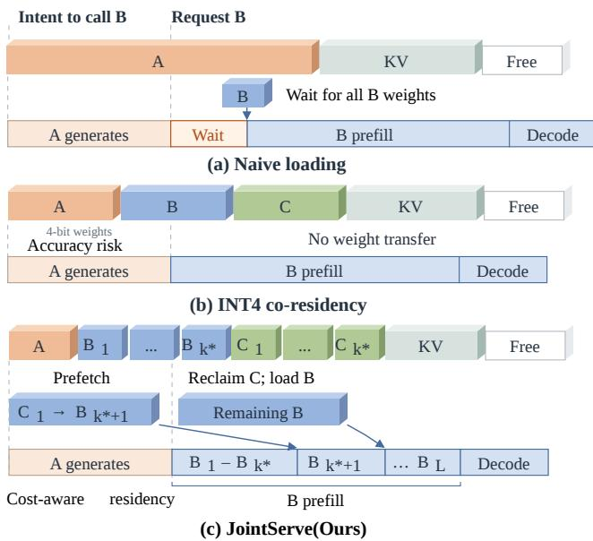  
Figure 1. (a) Naive loading: the request waits for the model weights to be transferred sequentially before prefill begins. (b) INT4 co-residency: all quantized model weights remain simultaneously resident in GPU memory. (c) JointServe: intentguided shard prefetch before request arrival eliminates the waiting phase.

Serving an expert pool requires memory for both model weights and the state of active agent sessions. Private, edge, and shared-GPU deployments typically ofer one or two 80 GB-class accelerators, while the combined weights ofeven a modest expert pool overflow a single GPU. Session state compounds the pressure: as an agent task deepens, the key– value (KV) cache of each session grows with every turn, so weights and KV blocks contend, physically and unavoidably, for the same bytes of HBM. The cost of this contention lands on two user-visible metrics that we use throughout the paper: time to first token (TTFT), which governs the interactivity of each model call, and session completion time (SCT), the wallclock duration of an entire agent task. The core challenge is not raw capacity; it is deciding which bytes should reside in scarce memory, and when they should move.

What happens when the planner calls an expert that is not resident? In a naive whole-model swap path, the serving stack must first make room in HBM, and then the entire weight footprint of the target model streams in before prefill can begin. This is a load-all barrier: until the last layer is in place, the first token cannot be produced (Figure 1(a)). Loading is not the only tax. When the session later switches back to a model whose KV blocks were evicted to make room without a host copy, that state is gone, and the context must be re-prefilled from scratch. A single cross-model call therefore pays twice: once in serial weight transfer on the way out, and once in KV recompute on the way back. The first tax alone reaches second scale on current hardware and grows linearly with model size, with the GPU idle throughout; we quantify both taxes precisely in §2. These costs characterize the naive path in Figure 1(a): weights move at whole-model granularity, and evicted KV is not preserved for fast restoration.

Prior work addresses diferent parts ofthis trade-of. Wholemodel loading and session-aware placement reduce switch and return costs. ServerlessLLM [11] accelerates checkpoint loading. Talaria [28] routes continuations using model residency, KV locality, and instance pressure; soft reservations, hostrestorable KV, and staged weights preserve session continuity across model switches. Talaria’s cold pool still switches at model granularity. JointServe instead selects resident weight layer groups and KV blocks within one constrained GPU and prefetches missing groups before a named call. Quantized co-residency (Figure 1(b)) removes swaps by shrinking weights [6, 8, 16, 35, 46], but merely relocates the contention: the bytes freed by quantization are reclaimed by growing KV, the scheme fails outright when even compressed weights do not fit, and it carries accuracy risk. Same-family compression shares a base model across adapters or deltas [5, 7, 14, 37, 53], an assumption that breaks in heterogeneous expert ecosystems whose architectures, vocabularies, and tokenizers difer. Passive caching, from LRU eviction to prefix reuse [58], decides what to keep from past reference statistics alone; blind to which model comes next, it discards the call-graph priors that agent workloads expose for free. These approaches improve diferent scheduling and memory costs, but leave open how one memory-constrained GPU should jointly select weight shards and session KV as demand changes.

This paper tackles exactly one question: under a single GPU’s tight memory budget, which bytes, weight shards or KV blocks, should reside, when should they move, and on whose signal? Our goal is to have both: the capacity headroom of aggressive swapping and the interactivity of full residency, without paying for one with the other.

Talaria uses session-aware placement and admission across serving instances [28]. JointServe instead manages weight shards and KV blocks within one constrained GPU, using the caller’s named target to move bytes ahead of demand. Two insights make this possible. First, residency is one problem, not two. Weight shards and KV blocks compete for the same memory pool, so we model both as residency objects under a single budget with explicit restore costs, and show that a fixed partition can become infeasible under the measured crash budget. Second, agent call structure supplies signals that passive statistics cannot. A planner reveals its target model while it is still generating the tool call, tool execution leaves idle gaps between calls, and 96.4–99.9% prefix reuse makes preserved KV state highly valuable. Together these observations turn the question of when to move from a prediction problem into a read-of problem.

JointServe occupies a point that complements, rather than competes with, recent serving systems. BlitzScale [56] scales model instances at the cluster level; Pensieve, HCache, and MORI [12, 45, 54] tier the KV state of a single model across the memory hierarchy; NanoFlow [61] overlaps compute, memory, and communication within an operator pipeline; and DeltaZip [53] compresses families of same-base finetunes. JointServe manages the unified residency of heterogeneous weights and KV within a single instance.

Concretely, this paper makes three contributions.

• Unified residency formulation and adaptive split. We formulate weight shards and KV blocks as samedomain residents of a single memory budget under an explicit cost model $c _ { i } = \alpha + s / \mathrm { B W } + r ( n )$ , use a carve-out step to adapt the split during serving, and prove a (1 − �) recovery-value approximation for one selection snapshot of independent, additive objects.

• Caller-generation proactive prefetching. We extract agent call-graph semantics into residency signals. The planner’s streaming tool-call header deterministically identifies the target model, moving the swap window from after request arrival to the caller’s generation phase and tool gaps; a preemptive, chunkgranular transfer scheduler with a �-floor bandwidth share keeps weight movement from starving KV restora tion of live sessions.

• Partial-shard streaming hot-swap and dual-state KV tiering. Each of � heterogeneous models keeps an analytically derived resident shard of �∗ layers with per-group readiness checks, so a swap streams only the remaining � − �∗ layers; the evaluated prototype switches by in-place overwrite, and a dual-state KV tier substitutes host-RAM reload for GPU recompute at a 20× cost advantage.

We implement JointServe on top of SGLang [58] and evaluate it across a range of real-world traces and datasets. Compared with the strongest whole-model swap baseline, JointServe reduces SCT by 21.7% in the tight memory regime, stays feasible in a crash regime where every whole-model swap baseline fails to finish (a 46× gap), and on real agent traces lifts SLO attainment from 2.8–24.5% to 76.8–100% while cutting SCT by up to 49%.

## 2 Background and Motivation

## 2.1 Model-as-Tool Agents and Serving Preliminaries

Multi-agent systems increasingly follow a model-as-tool architecture: a general-purpose planner model decomposes a task, streams intermediate reasoning, and invokes domain experts through tool calls, which execute on the tool’s output and resume planning. Software-engineering agents call a coding model behind a fixed agent–computer interface [49], and multi-agent systems cast planning, implementation, and review as roles played by diferent models [13, 32]. The expert pool assembled this way is genuinely heterogeneous, for three recurring reasons. Domain experts are fine-tuned from diferent base models and released independently; multimodal experts, such as vision or code models, carry their own architectures, vocabularies, and tokenizers; and legacy models remain in service long after their training stacks are retired. Expert heterogeneity matters to a serving system: it rules out sharing a single base weight across the pool, which precludes adapter- and delta-based co-residency schemes. Recent agent-serving systems schedule program structure and call dependencies well, but they assume that every model an agent may invoke stays resident at some serving endpoint [21, 27]. JointServe starts where that assumption breaks.

Serving engines such as vLLM and SGLang process each request in two phases [17, 58]. Prefill consumes the prompt in one forward pass and materializes its key–value (KV) state, which the engine caches in HBM as paged blocks; decode then generates tokens autoregressively, reusing that state at every step. Unlike request-level latency models in the serving literature [1, 30, 43, 59], which separate queuing from execution, a cross-model call must also pay for memory movement. A cross-model call traverses four latency components,

$$
T = T _ { \mathrm { q u e u e } } + T _ { \mathrm { s w a p } } + T _ { \mathrm { r e s t o r e } } + T _ { \mathrm { g e n } } ,\tag{1}
$$

where $T _ { \mathrm { q u e u e } }$ is queuing delay; $T _ { \mathrm { s w a p } }$ is the time to make room in HBM and transfer the target model’s weights, which delays the first token and therefore sets TTFT; $T _ { \mathrm { r e s t o r e } }$ is the time to recover the caller session’s KV state after a switch back, either by reloading preserved blocks from host memory or by re-prefilling them on the GPU if they were dropped; $T _ { \mathrm { g e n } }$ is the target model’s own execution, its prefill and decode, once the weights are resident. TTFT therefore spans $T _ { \mathrm { s w a p } }$ up to the start of target prefill. In §6 we attribute observed stalls to weight transfer, KV reload, and KV recompute under this breakdown.

Weights and KV blocks ultimately contend for HBM. HBM sits on the package and feeds tensor cores at full bandwidth, but its capacity is fixed per device; host RAM and NVMe are larger by orders of magnitude, yet narrower and slower by the same factor [33, 38]. Only HBM can sustain decode throughput, so weights and KV blocks must contend for its constrained space. On an A800-80GB GPU over PCIe 4.0, the efective host-to-device bandwidth is 24 GB/s, so swapping in a 7B FP16 expert (15.2 GB) costs at least 0.63 s with the GPU producing nothing. The capacity arithmetic closes the argument: five experts spanning 7B to 14B parameters carry a combined FP16 weight footprint of 70–140 GB, which exceeds the 80 GB ofone card and approaches the budget oftwo. Keeping the entire expert pool resident is therefore not a tuning choice but arithmetic: under the one- or two-accelerator budgets of private, edge, and shared-GPU deployments, full residency is out of reach. One more card defers the wall rather than removing it, because the pool grows with the number of experts served. Testbed and measurement details appear in $\ S 6$

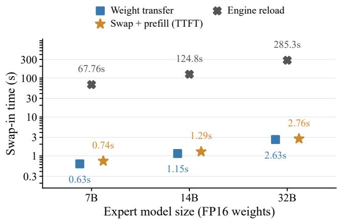  
Figure 2. Overhead of reloading model weights.

## 2.2 Why Not Swap Whole Models Faster?

The most direct response to capacity pressure is to reduce switching cost. ServerlessLLM [11] accelerates checkpoint loading, while Talaria [28] stages model weights across coldpool switches and preserves host-restorable session KV. These methods reduce exposed transfer and recovery time. A conventional whole-model reload, however, admits prefill only after the target weights are ready. When the weights have not been staged, moving the whole target model remains on the first-token path. JointServe instead keeps a startup prefix resident and streams later layer groups as execution proceeds. Figure 2 quantifies the tax. Swapping in a 7B FP16 expert (15.2 GB) at the full 24 GB/s host-to-device bandwidth costs 0.63 s with the GPU producing nothing, and the serial swap plus prefill reaches 0.74 s of TTFT; both grow linearly with model size. The default engine reload path, which stops the instance, streams the full checkpoint of NVMe into host memory, copies it over PCIe into HBM, and re-initializes the runtime before serving resumes, is two orders of magnitude worse at 67.76 s for a 7B model: it serializes disk reads, host to-device copies, and engine re-initialization, overlapping none of them with compute and serving no layer before the last one lands.

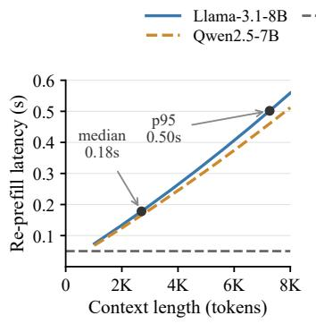  
(a) τ-bench median context 2.7K tokens

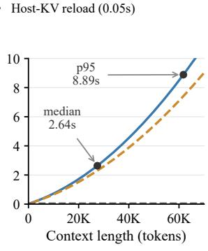  
(b) SWE-bench median context 27.5K tokens  
Figure 3. Re-prefill latency after KV-cache eviction as a function of evicted context length.

Faster transfer removes only the outbound tax, the serial weight transfer before the switch; the return tax is untouched. The swap path neither notices nor protects in-flight KV state, so blocks evicted to make room are gone when the session switches back, and the full context must be re-prefilled. Figure 3 shows that this recompute cost grows quadratically with context length. At the median �-bench context of 2.7K tokens it is still modest (0.18 s), but at the median SWE-bench context of 27.5K tokens one switch-back costs 2.64 s, roughly four whole-model transfer lower bounds, and at the p95 context of61.8K tokens it reaches 8.89 s. Restoring the same state from host memory instead costs 0.05 s, nearly independent of length.

The final limit is capacity, and Figure 4 shows the wall forming well before the largest model. The figure scales both JointServe and the whole-model route across model sizes on a 72 GB efective budget. At 14B the whole-model route still fits and JointServe cuts SCT p50 by 65% (978 s to 343 s); at 32B the margin narrows to 23% (1962 s to 1514 s) as the co-residency window shrinks; at 70B, whose FP16 weights total 140 GB, the whole-model route is not slow but infeasible, while a resident shard of �∗ = 23 layers (42 GB) keeps JointServe serving. And the wall only closes in as models grow, because weight footprints scale with width and depth while the card’s budget does not. The verdict is that swapping faster is not swapping less, and swapping has a capacity ceiling: the route pays both transfer and recompute, link optimization touches only the first, and once weights exceed the budget of a card the route ceases to exist. End-toend evidence that tight budgets still leave it 21.7% behind, and that collapse-budget workloads stall it entirely, appears in §6.

O1: Calls are directed, not predicted. The streamed toolcall header identifies the next expert before request arrival, allowing prefetch during caller generation; 54% of SWE-bench tool gaps precede a switch to a diferent tool.

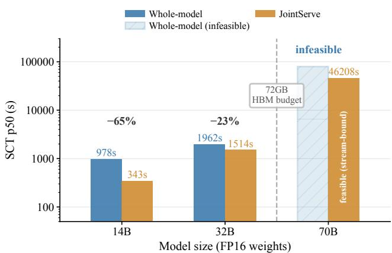  
Figure 4. SCT p50 of whole-model swapping and JointServe across model sizes (72 GB HBM budget).

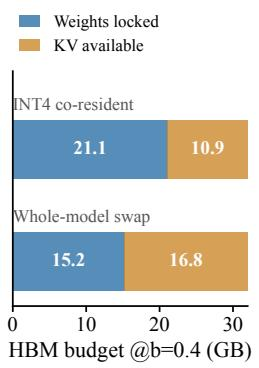  
(a) Compression locks more memory in weights

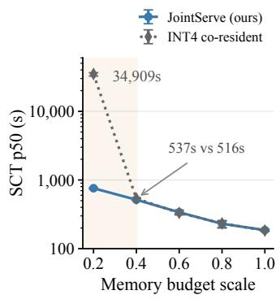  
(b) INT4 ties when relaxed, loses when tight  
Figure 5. Shrinking weights relocates the contention.

## 2.3 Why Not Shrink Models to Co-Reside?

A second family of designs avoids swapping altogether by making the weights small enough that the whole pool fits at once: quantize every expert to four bits, or share one base model across many adapters [10, 22, 37, 53]. Shrinking the weights, however, merely relocates the contention rather than removing it. Figure 5(a) makes the arithmetic concrete at a 32 GB efective budget. A whole-model swapper locks 15.2 GB for one FP16 expert and leaves 16.8 GB for KV; the INT4 co-resident scheme locks 21.1 GB for all five experts and leaves only 10.9 GB for KV. Compression has pinned more bytes in weights that may sit idle for whole stretches of a session, and the space left to the state that grows without bound shrinks. Nor does accuracy come for free: low-bit quantization degrades mathematical and code competence, a cost documented in the quantization literature [10, 22]. Adapter- and delta-based sharing is bounded by an even earlier constraint: it presumes a shared base model, which the heterogeneous expert pool does not have.

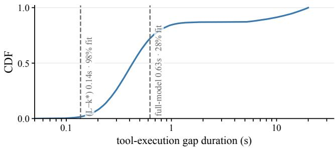  
Figure 6. Cumulative distribution of tool-execution gaps in SWE-bench. Vertical lines mark the times required to transfer the incremental (� − �∗) layers and the whole model.

Figure 5(b) compares INT4 co-residency against JointServe across efective memory budgets, expressed as a fraction � of the 80 GB card. When the budget is generous both coincide, because the contention the scheme was built to avoid never materializes; at a 32 GB budget $( b ~ = ~ 0 . 4 )$ the co-resident scheme is slightly worse (537 s versus 516 s), having traded KV headroom for resident weights without buying anything. At a 16 GB budget $( b = 0 . 2 )$ it fails outright, and the failure is structural: the five-expert INT4 pool needs 21.1 GB, which no longer fits, so co-residency degenerates into swapon-demand, the very mechanism it was built to replace, and makespan collapses to 34,909 s, within 5% of the naive wholemodel baseline, while JointServe completes the same workload in 758 s. Compression subtracts from one side of the weight–KV contest; it never cancels it.

O2: Execution is gapped. In the SWE-bench gap distribution shown in Figure 6, a 0.14 s incremental transfer fits 98% of gaps versus 28% for a 0.63 s whole-model transfer.

## 2.4 How Does Session-Aware Routing Difer?

Talaria [28] treats agent continuations as stateful. Its router weighs model residency, KV locality, and instance pressure; soft reservations preserve likely return afinity, while instancelocal host KV can be restored across model switches. Cold pool instances time-share multiple models and stage weights, so Talaria neither requires a full replica of every model nor discards session KV at each switch. Its main decisions concern where and when a session runs in a serverless pool. JointServe addresses a complementary decision within one memory-constrained GPU: which layer-group weight shards and session KV blocks share HBM, and which missing groups to prefetch using the caller’s intent. The two policies act at diferent scheduling levels; their integration is outside this paper’s evaluation.

Whole-model staging, compression, and session-aware routing address transfer, weight footprint, and cross-instance continuity, respectively; JointServe instead selects weight shards and KV blocks jointly within one GPU and combines this with intent-driven prefetch and partial residency (§3).

O3: Eviction is not destruction. Across four traces, prefix reuse is 96–100%; at the SWE-bench median context, host KV reload takes 0.05 s versus 2.64 s for re-prefill, making host RAM a useful second residency tier.

## 3 Unified Residency Management

JointServe selects weight shards and KV blocks under a shared HBM budget using agent intent, reuse estimates, and recovery costs. This section defines the objective, joint budget rule, and online selection procedure.

## 3.1 Unified Residency Model

Figure 7(b) shows the candidates $C = { \mathcal { W } } \cup { \mathcal { K } }$ : independently managed weight layer groups (W) and session KV units with known recovery sources (K). Each retains its model or session identity, so KV for one model cannot serve another.

The budget � excludes runtime, activation, and transfer bufers. Protected objects $\mathcal { P }$ reserve $P _ { W }$ weight bytes and $P _ { K }$ KV bytes, leaving $B _ { f } = B - P _ { W } - P _ { K }$ for selection. They include in-flight session state and the arriving model’s committed streaming prefix; selection cannot evict them. If $\mathcal { P }$ alone exceeds $B ,$ the execution layer handles the shortfall.

Candidate � has size $s _ { i } ,$ reuse probability $\mathbf { \nabla } \mathcal { P } i$ within the decision window, and cheapest-path recovery cost $c _ { i } .$ . Its retention value $u _ { i } = p _ { i } c _ { i }$ is expected avoided recovery work, and its density is $d _ { i } = u _ { i } / s _ { i }$ . The window counts one avoided recovery per object; for repeated reuses we use expected counts.

The residency problem maximizes

$$
\begin{array} { r } { \operatorname* { m a x } _ { S \subseteq C , \ s ( S ) \leq B _ { f } } U ( S ) , \qquad U ( S ) = \sum _ { i \in S } u _ { i } , } \end{array}\tag{2}
$$

where $\begin{array} { r } { s ( S ) = \sum _ { i \in S } s _ { i } } \end{array}$ . JointServe solves this objective using estimated values $\hat { u } _ { i } = \hat { p } _ { i } \hat { c } _ { i }$ . Appendix B bounds the efect of estimation error on the selected set’s recovery benefit. Translating that benefit into lower TTFT and SCT also requires timely transfers and overlap with computation (Appendix C.4).

Equation (2) assumes independent candidates and additive values, which §3.4 optimizes. Shared-prefix recovery or mutually exclusive legal prefix and layer-group states instead require complete legal plans per model or session.

## 3.2 Eviction and Recovery Costs

Weight objects reload from host. KV objects reload if a valid host copy exists; otherwise they recompute the missing range. Eviction may also require write-back, whose source bufer remains occupied until the transfer finishes. These recovery paths enter the cost model.

Reload costs combine a transfer startup overhead with the time to move the object’s bytes. Recompute costs depend on the missing token range and the model’s prefill curve:

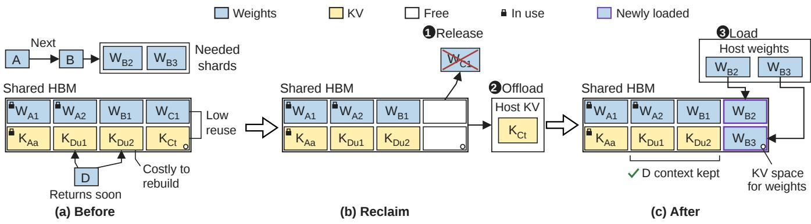  
Figure 7. An illustration of joint residency selection and update.

$$
\begin{array} { r l } & { ~ c _ { i } ^ { W } = \alpha _ { W } + s _ { i } / \mathrm { B W } _ { H 2 D } , } \\ & { ~ c _ { i } ^ { K , \mathrm { l o a d } } = \alpha _ { K } + s _ { i } / \mathrm { B W } _ { H 2 D } , } \\ & { ~ c _ { i } ^ { K , \mathrm { r e c o m p u t e } } = \Delta r _ { m } ( n _ { i } ^ { \mathrm { r e a d y } } , n _ { i } ) , } \end{array}\tag{3}
$$

where $\alpha _ { W }$ and $\alpha _ { K }$ are transfer startup costs and $\mathrm { B W } _ { H 2 D }$ is effective host-to-device bandwidth. For a context of $n _ { i }$ tokens with a usable prefix of $n _ { i } ^ { \mathrm { r e a d y } }$ tokens, $\Delta r _ { m }$ is the recovery cost of the missing sufix. We model a full-prefix recovery as $r _ { m } ( n ) = a _ { 0 , m } + a _ { m } n + b _ { m } n ^ { 2 }$ and charge a partially missing unit only the increment over its range. Shared recovery work, including startup, is counted once. Startup overhead and quadratic prefill cost can make recovery value per byte non-monotonic in prefix length; Appendix A.2 derives this relationship.

Equal-size objects can have diferent retention values: a recompute-bound KV block may outweigh a host-reloadable block or weight shard because prefill cost grows with missing context (Figure 3). JointServe ranks them by estimated avoided recovery per byte, $\hat { p } _ { i } \hat { c } _ { i } / s _ { i }$ , using the reuse signals of §4.1 and the costs above.

## 3.3 Joint Budget Allocation

JointServe selects objects under the shared capacity rather than fixing a weight–KV split. For each slow-path candidate, it adds the best use of residual capacity; this decomposition is exact for additive values and needs no continuity or equalmarginal assumption (Appendix A.3).

The slow path forms a frontier of representatives $( R _ { q } , s _ { q } , v _ { q } )$ from weights and compressed high-value KV: each stores a retained set, its true size, and its estimated value. For each rounded-value state, it keeps the smallest set, including the empty set; value scaling bounds the state count while sizes stay exact (Appendix B.3). The fast path queries $F _ { L } ( r )$ for the low-value KV set fitting residual capacity �.

Selection maximizes over the frontier,

$$
S ^ { * } = \arg \operatorname* { m a x } _ { R _ { q } } \hat { U } ( R _ { q } ) + \hat { U } \big ( F _ { L } ( B _ { f } - s _ { q } ) \big ) ,\tag{4}
$$

Algorithm 1 Joint Residency Selection   
Require: candidates W, K; protected set $\mathcal { P } ;$ free bytes $B _ { f } ;$   
scores $\hat { u } ;$ budgets $\varepsilon _ { C } , \varepsilon _ { S } , \varepsilon _ { K } > 0 , \varepsilon _ { C } + \varepsilon _ { S } + \varepsilon _ { K } < 1$   
1: if protection $\mathcal { P }$ is infeasible then return Capaci  
tyShortfall   
2: drop individually infeasible or nonpositive-value candi  
dates   
3: if $B _ { f } \leq 0$ or no candidates remain then return target   
$\mathcal { P }$   
4: � ← value of the feasible density prefix over ${ \mathcal { W } } \cup { \mathcal { K } } ;$   
� ← best feasible singleton; � ← max(�, �)   
5: split K at $\tau = \varepsilon _ { K } L$ into $\mathcal { K } _ { H }$ and $\mathcal { K } _ { L }$   
6: K′ ← CompressByValueAndSize $( \mathcal { K } _ { H } , \tau , \varepsilon _ { C } , \varepsilon _ { K } )$ ⊲   
Appendix A.5   
7: R ← MinBytesValueFrontier $( \mathcal { W } \cup \mathcal { K } _ { H } ^ { \prime } , B _ { f } , \varepsilon _ { S } )$ ⊲   
Appendix A.6   
8: � ← DensityPrefixIndex $( \mathcal { K } _ { L } )$   
9: best $ \emptyset$   
10: for all representatives $R _ { q } \in \mathcal { R } ,$ , including ∅ do   
11: $K _ { q } \gets F _ { L } . 9 mathsf { u e r y } ( B _ { f } - \mathsf { \bar { s } } ( R _ { q } ) )$   
12: if $\hat { U } ( R _ { q } \cup K _ { q } ) > \hat { U } ($ (best) then   
13: best $ R _ { q } \cup K _ { q }$   
14: end if   
15: end for   
16: target $ \mathcal { P } \cup$ best; derive $b _ { W } , b _ { K }$ by object type   
17: return target with its value and budget metadata

using true sizes and same-window values. High-value KV remains KV bytes. The winner sets $b _ { W } = P _ { W } + s ( S ^ { * } \cap \mathcal { W } )$ and $b _ { K } = B - b _ { W } ;$ the KV quota includes protected $\mathrm { K V , }$ selected blocks, and slack. These quotas are derived afresh when intent, estimates, protection, or capacity change. Each event rebuilds the frontier and KV index, then checks protection feasibility and the approximation bound.

## 3.4 Cost-Aware Residency Selection

Algorithm 1 sets � to the value of the feasible density prefix ending before the first nonfitting candidate and � to the best feasible singleton. For $L = \operatorname* { m a x } ( G , M ) , L \leq \widehat { \mathrm { O P T } } \leq 2 L$ (Appendix A.4), which sets the compression scale. Infeasible protection returns a shortfall; if $B _ { f } \leq 0$ or no positive-value candidate fits, the procedure returns only $\mathcal { P } _ { \cdot }$

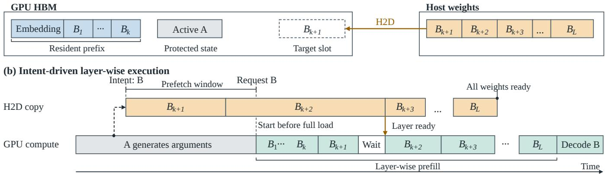  
Figure 8. Intent-driven partial residency and layer-wise execution.

The threshold $\tau = \varepsilon _ { K } L$ separates high-value KV $\left( \hat { u } _ { i } > \tau \right)$ from low-value KV. In each geometric value bucket,JointServe keeps the $h = \lceil 2 / \varepsilon _ { K } \rceil$ smallest high-value objects. Any optimum has fewer than $2 / \varepsilon _ { K }$ such objects, so these representatives preserve a feasible replacement with at most $\varepsilon _ { C }$ loss in that subset’s value; Supplementary Material, §A.8 bounds the candidate count. Compression changes the search space, not physical residency. Dependencies instead require complete legal options per model or session.

A value-scaling dynamic program stores the smallest representative at each rounded value for weights and compressed $\mathcal { K } _ { H } ^ { \prime } ; \varepsilon _ { S }$ controls rounding. The low-value KV index sorts by density and uses cumulative sizes and values to return the longest fitting prefix $F _ { L } ( r )$ by binary search. Filling later fitting objects may add value, but the guarantee uses this prefix. Equation (4) selects the target; Appendix C gives the exact Top-� case for equal-size KV and the grouped-plan dynamic program.

In Figure 7, intent names model B and session D updates its reuse estimate; selection retains A’s protected state and D’s context while admitting B’s shards.

The target induces loads, releases, and ofloads relative to current residency; unchanged objects stay. Write-back completes before its source bufer is released. The runtime in §4 commits feasible transfers and reports capacity shortfalls without replacing protected objects.

For a fixed set of independently selectable candidates with nonnegative additive values and one capacity constraint, Algorithm 1 returns a feasible set $S _ { A }$ satisfying ${ \hat { U } } ( S _ { A } ) \geq$ $\left( 1 - \varepsilon \right) \widehat { \mathrm { O P T } }$ , where $\varepsilon = \varepsilon _ { C } + \varepsilon _ { S } + \varepsilon _ { K } < 1$ . Representatives use no more space than the sets they replace, and compression, rounding, and prefix selection each consume their assigned error budget. Appendix A.7 gives the proof; Appendix B.1 relates the estimated objective to true expected recovery benefit.

## 4 JointServe System Design

JointServe turns the residency selection of §3 into transfers and execution through the architecture in Figure 9. The Request Scheduler, Residency Manager, and Signal Engine form the serving-control layer, which produces versioned residency plans. The GPU Worker and Transfer Scheduler execute those plans across shared HBM and host memory. This separation lets the residency policy operate independently of the loading back end.

Executing a residency plan requires making room for the next model while preserving the state of in-flight sessions. The Residency Manager tracks the selected target separately from the objects ready for execution. Within the shared HBM budget, the Transfer Scheduler overlaps weight loading with KV movement where dependencies permit and reserves bandwidth for live-session KV trafic. The GPU Worker begins prefill once the startup layer groups and required session KV are resident, while later groups stream in alongside computation. Per-group ready events enforce the remaining dependencies, allowing execution to begin before the full model arrives.

## 4.1 Signal-Driven Model Anticipation

Agent call structure turns which model comes next from a prediction problem into a read-out, and the Signal Engine’s job is narrow: it produces exactly the same-window inputs that Algorithm 1 consumes. Signals follow a quality ordering. An explicit intent is near-certain evidence, a session-level online Markov transition is weaker, and popularity or LRU recency is the fallback. The intent tap sits on the GPU Worker’s output stream toward the Request Scheduler (Figure 9, step 11), a bypass that observes without rerouting: a lightweight lexical matcher locks the target model as soon as the caller streams the function-call header, and fan-out headers generalize to a candidate set for next-set prefetch. This realizes the advance of opportunity O1 (§2.2) from request arrival into the caller’s own generation phase, and it opens the prefetch window of Figure 8.

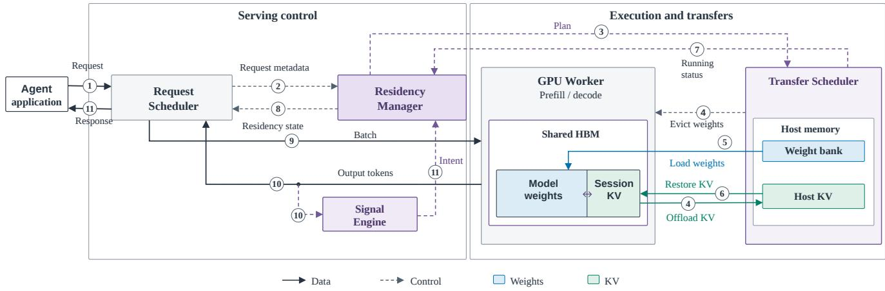  
Figure 9. JointServe system overview.

Without an explicit intent, the engine falls back to a firstorder Markov model over call transitions, updated asynchronously with Laplace smoothing as calls complete, and finally to popularity. A misprediction costs bounded work, not correctness, because bytes fetched for the wrong target are priced by the same value model and evicted like any candidate, so the worst case degrades to the passive baseline. For each candidate, the Signal Engine supplies a reuse estimate $\hat { p } _ { i }$ over the decision window defined in §3.1. The Residency Manager combines this estimate with the candidate’s recovery-path cost $\hat { c } _ { i }$ to obtain $\hat { u } _ { i } = \hat { p } _ { i } \hat { c } _ { i }$ for Algorithm 1. Appendix B.1 bounds how errors in these inputs afect the selected set’s expected recovery benefit.p.

## 4.2 Executing Residency Plans

A plan is a diferential, not a re-derivation: Algorithm 1 hands the Residency Manager a target residency set, its pertype quotas, and a dif of actions, release or ofload displaced objects and load selected ones (Figure 9, steps 3–6). Execution rests on one identity and one registry: every object keeps its model or session key end to end, and the host side registers a read-only weight bank plus a host KV store keyed by model.

Commit is a three-step protocol: the delta is dispatched, with evictions and ofloads running in parallel with loads and restores (steps 4–6). The Transfer Scheduler reports startup readiness once the groups needed to begin execution are resident (step 7), and the manager atomically switches the residency mapping and hands control back to the Request Scheduler (steps 8–9). Target set and ready set are tracked as distinct states: a new mapping is never committed before reclamation finishes and the target copies are in place, and the protected set of §3.1 is as unevictable here as it was in selection. If a plan is infeasible or capacity falls short, the old mapping is retained and the request returns to the decision layer, the runtime counterpart of the CapacityShortfall branch of Algorithm 1.

The plan determines which objects move; the Transfer Scheduler determines their order. Per-group ready events from the runtime establish when the startup prefix and required session state can be used. Remaining groups must arrive by their first use; otherwise, execution waits on the corresponding ready event. These execution checks preserve the selected target while tracking which parts are ready.

## 4.3 Preemptive Transfer Scheduler

Three trafic classes share one host-to-device channel: targetmodel prefetch, the streaming shard refill of §4.4, and background KV ofload and restore. Left unordered, a gigabytescale weight burst would starve the KV restoration of sessions already in service.

The scheduler enforces a static priority order, target prefetch above pipeline shard stream above background KV, and chunks weight transfers at layer-group granularity so a higher-priority transfer preempts an in-flight one at chunk boundaries. A �-floor, 15% of link bandwidth by default, reserves a minimum share for the KV trafic of live sessions: a lower bound on what KV restoration receives, not an upper bound on what weights may use when the channel is otherwise idle. Per-task readiness reports aggregate into the transfer status of step 7 in Figure 9. The scheduler only orders the deltas that §4.2 hands down and never alters the target set. Its priority input comes from the Signal Engine, whose intent marks the highest level, so signal, decision, and transfer depend on one another in a single direction.

## 4.4 Sharded Runtime and Streaming Hot-Swap

Partial residency refines the load-all barrier of §2.2 into pergroup dependencies. The runtime keeps a startup prefix of �∗ layer groups resident per model and checks each candidate prefix against per-group load times, first-use deadlines, and bufer lifetimes. Suficient conditions under aligned release times and one reserved channel appear in Appendix C.3. Execution then proceeds on ready events: a group computes once its copy completes, and any residual wait is exposed rather than assumed away.

Figure 8 follows one hot swap. While caller A is still generating, its intent opens the prefetch window (a): B’s incremental layer groups move over the host-to-device link, overlapped with A’s decode, and the window closes when B’s request arrives. Prefill starts immediately on the resident layers (b), every later group executes only after its own copy completes, and the whole model is resident before decode begins. A shadow-bufer ping-pong flip is the target hand-of between prefixes, while the current prototype overwrites in place, a diference §5 states concretely. The Load edge of Figure 7(b) is this figure’s layer stream: the space and time views of the same objects.

Sessions recover along the same plan-driven paths: a switch back reloads its KV from host memory (step 6 of Figure 9), reload versus recompute is decided online by the cost model of §3.2, and ofload is ordered before release, the executionlayer form of the staged accounting in §3.2. Host capacity is managed under the same value model, and the �-floor of §4.3 protects the restore trafic of sessions in service.

Layer-granular loading is an established lineage: PipeSwitch [ pipelines one model’s layers over PCIe for context switching, ZeRO-Inference [2] streams a single oversized model from CPU or NVMe memory, and �Scale [55] and BlitzScale [56] amortize loading across a cluster. All four move the layers of one model, or share one model’s loading cost across instances. None keeps several heterogeneous models partially resident in one memory pool and reassembles the working set per call. The two directions are orthogonal and compose: a single instance can run the �∗-prefix scheme here while the cluster layer reuses a multicast loading path.

## 5 Implementation

JointServe is implemented on SGLang [58]: the system core is about 1.5K lines of Python. Three hook groups form the integration surface. submit\_plan(target, delta) hands the runtime one versioned residency plan: a target set plus the release, ofload, load, and restore actions that reach it. ready\_event reports one layer group’s copy completion to the commit protocol. kv\_load and kv\_offload move session KV between the HBM and host tiers, and the intent tap observes the engine’s output stream without rerouting it.

The shard loader reads layer groups from a pinned, readonly host weight bank and copies them host-to-device on a dedicated stream that overlaps compute; page-locked stag ing keeps the copy at link rate, and the per-group events aggregate into the startup-readiness report that the commit protocol of §4.2 waits on. Two residency managers, one for weight shards and one for KV blocks, hold the residency maps keyed by model and session. The stock reload path rereads a full checkpoint from disk and admits execution only after the entire state dict is resident, so JointServe bypasses the engine loader and writes weight bufers directly from host memory.

The Signal Engine, Residency Manager, and Transfer Scheduler run as asynchronous threads that consume only the output-stream tap and engine heartbeats, never the request critical path. Plan deltas execute concurrently, and only the final mapping switch is serialized. Priorities and the �-floor are chunked queues inside the transfer channel, and preemption happens at chunk boundaries. Amortized control-plane overhead stays below 0.1% of a decode step (§6).

## 6 Evaluation

We evaluate the full JointServe implementation against five baselines on synthetic and real agent workloads. Three results summarize the chapter:

• Across memory budgets, JointServe cuts median session completion time (SCT) by 21.7% against the strongest whole-model baseline in the tight regime, and remains feasible at a crash budget where every whole-model baseline stalls past the measurement window.

• On real agent traces, JointServe raises SLO attainment on �-bench from 24.5% to 100% and cuts SWE-bench SCT by 49.1%.

• The mechanism itself is fast: a streaming hot-swap changes the resident expert in 1.83 s where an engine reload takes 67.76 s (37×), and the control plane amortizes to under 0.1% of a decode step.

## 6.1 Experimental Setup

Testbed. A single A800-SXM4-80GB GPU on PCIe 4.0, backed by 1 TB of host RAM and NVMe SSDs. Measured efective host-to-device bandwidth is 24.3 GB/s; per-transfer startup constants are $\alpha _ { W } { \approx } 0$ for weights and $\alpha _ { K } { = } 0 . 7 0 7$ ms for KV blocks. Memory budgets � are fractions of the 80 GB HBM; 8 GB is reserved for the runtime, so �=0.4 leaves a 24 GB usable budget.

Model catalogs. Three size tiers turn model scale into an independent variable. The standard pool holds five 7B-class experts (Llama-3.1-8B as planner plus Qwen2.5-7B-Instruct, Qwen2.5-Coder, Qwen2.5-Math, and Mistral-7B; 15.2 GB per expert in FP16), so the pool fits no single-GPU budget and the tight regime is the main battleground. The 14B tier (28– 30 GB per expert) lets one expert start to squeeze the budget; the 32B tier (64–66 GB per expert) approaches the whole card, where whole-model residency stops being physically possible.

Workloads. Three load families. Synthetic sessions with lognormal depths and lengths, parameterized from published agent-trace characterizations [28], drive the budget sweep.

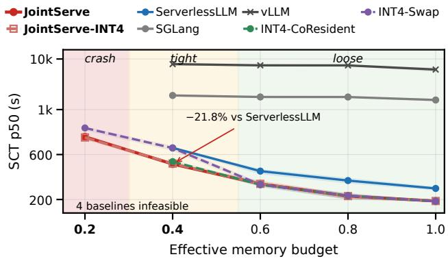  
Figure 10. SCT p50 across memory budgets � (� is the fraction of one 80 GB GPU’s memory capacity).

A released coding-agent trace (TraceLab [62], 665K turns) is replayed as a production-shaped check. Three public agent benchmarks are measured directly: SWE-bench [15], �-bench [51], and OSWorld [48].

## 6.2 Baselines

Our System uses the five baselines:

vLLM [17] restarts the engine on every model switch, the naive path.

SGLang [58] re-reads weights from NVMe and hot-reloads them without a restart, with HiCache-style LRU tiering for KV state; this is the default path of a mainstream serving framework.

ServerlessLLM [11] is the fastest published loading stack; we configure it at its oficial 23 GB/s loading bandwidth and additionally compare against an idealized host-resident variant that pays only the H2D transfer, which serves as an optimistic upper bound for the whole-model family.

INT4-CoResident keeps 4-bit weights of all experts resi dent and never swaps, the compression-only route.

INT4-Swap combines 4-bit weights with whole-model swap, the naive combination of the two routes. We report JointServe in two forms:JointServe (FP16, lossless) andJointServe-INT4 (sharding composed with quantization).

## 6.3 Evaluation Metrics

SCT is the primary metric: how long a user waits for a whole agent task. TTFT captures interactivity at the request level, and SLO attainment converts it to a production-readiness number: the fraction of requests with TTFT under 5 s, a threshold in line with what interactive agent workloads tolerate. Stall decomposition attributes per-request waiting to three sources, weight-switch, KV-reload, and KV-recompute, following the latency anatomy of a cross-model call. Modelswitch count exposes behavior directly: whether partial residency eliminates switching altogether.

## 6.4 End-to-End Results

JointServe dominates across all pressure regimes (Fig. 10). In the tight regime (�=0.4, 24 GB usable), JointServe completes the median session in 516 s, reducing SCT by 21.7– 72.9% over the stronger swapping baselines and by 15× over vLLM. The advantage comes from spending the scarce bytes on high-value objects rather than on whichever whole model happens to be resident. In the crash regime (�=0.2, 8 GB usable), every baseline that must place a whole model does not finish within the 35,000 s measurement window; JointServe, which needs only a �∗ shard per active model, completes in 758 s, a 46× gap against the least-afected baseline’s truncated reading.

When capacity is ample (�=1.0), JointServe still reduces SCT by 37.5% relative to ServerlessLLM, while matching INT4-CoResident, for which all weights already fit in HBM. This convergence is expected: once residency ceases to be a constraint, there is little room for sharding to improve capacity utilization. In contrast, SGLang remains 8.3× slower than JointServe even at full HBM capacity, indicating that its bottleneck lies in the storage-backed reload path rather than in HBM capacity itself.

Quantization composes with, and does not replace, sharding. At 7B under the tight budget, quantizing a wholemodel swap reduces transfer cost but retains the wholemodel loading barrier; JointServe-INT4 remains about 21% faster than INT4-Swap. As the budget increases, the two converge to within 2%, since both configurations can keep their working sets resident. The distinction grows with model size: at 32B, JointServe-INT4 is 2.3× faster than the best feasible alternative in the tight regime. Under the crash budget, FP16 sharding and INT4 whole-model swapping both cross the capacity limit, while JointServe-INT4 remains feasible at both 14B and 32B. Thus, quantization lowers the cost of movement, whereas sharding removes the whole-model capacity requirement; combining the two is the only evaluated configuration that remains robust as model size grows.

Real agent traces confirm the advantage outside the synthetic sweep (Fig. 11). On SWE-bench, where execution is dominated by model switching, JointServe reduces SCT by 49.1% and raises SLO attainment from 2.8% to 76.8%, while reducing physical model swaps from 478 to 2 per run. On �-bench, the primary benefit shifts from completion time to responsiveness: median TTFT improves by 45× and SLO attainment reaches 100%, whereas SCT improves by only 5.2%. This diference is structural. �-bench interleaves model calls with long user-thinking intervals, allowing much of the baseline’s swap latency to hide inside otherwise idle periods; those swaps still delay the first token of each response. On OSWorld, whose 16 s-scale tool gaps are the friendliest regime for prefetching, TTFT p50 falls from 31.7 s to 0.1 s, SLO attainment goes from 2.8% to 100%, and SCT drops 43.3%. Finally, replaying the TraceLab production coding-agent trace reduces SCT by 51%, confirming that the advantage extends beyond the benchmark workloads.

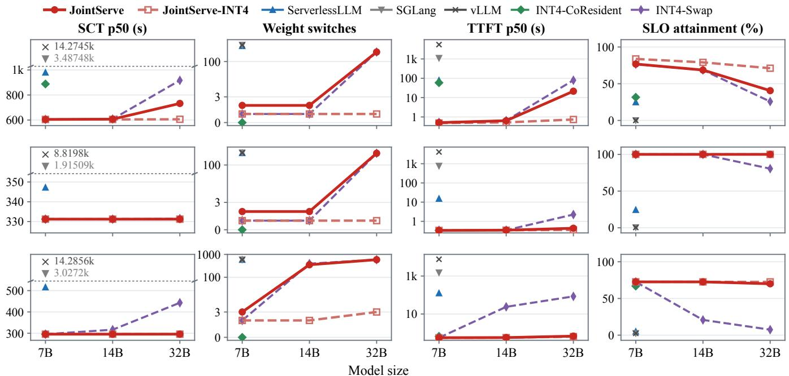

Figure 11. Real agent traces. JointServe wins on all three workloads.  
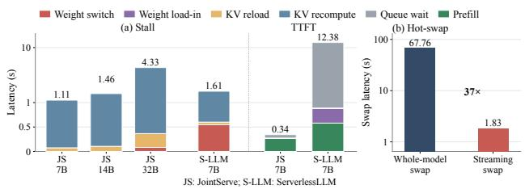  
Figure 12. (a) Per-request stall breakdown at (b=0.4) (left) and TTFT breakdown (right). (b) Expert-swap behavior: JointServe overlaps layer streaming with prefill, while the default engine performs a blocking reload.

Cost follows SCT: at \$2 per GPU-hour, serving 1,000 sessions costs \$10.30 with JointServe against \$14.67 for the strongest baseline, a 30% reduction from the same runs.

## 6.5 Breaking Down the Speedup

Stall decomposition (Fig. 12a, left) shows where JointServe’s advantage is manufactured. At �=0.4, ServerlessLLM pays 0.55 s of weight-switch stall per request; JointServe pays 0.00 s at 7B and 14B and 0.11 s at 32B, because intent-driven prefetch moves the bytes before the request exists. On the KV side, the dual-state tier replaces a 1.03 s GPU recompute with a 0.05 s host reload, a 20× cost diference per switchback. When a request waits on several resources at once, we attribute the wait once, in weight-switch, KV-reload, KVrecompute order.

TTFT anatomy (Fig. 12a, right) decomposes the �-bench result: JointServe’s 0.343 s TTFT consists of 0.007 s residency wait, 0.023 s queue wait, and execution, while Serverless-LLM’s 12.385 s is dominated by 11.497 s of queue wait. That gray segment bundles every way a request can be blocked by other sessions, including their compute, their swaps, and their KV restores. We do not claim it is all switching cost, but JointServe’s 0.007 s residency wait is the hard floor on how much of it can be. SWE-bench shows the same shape at the extreme: 137.0 s of the baseline’s 137.5 s median TTFT is waiting.

Hot-swap microbenchmark and overhead (Fig. 12b). On the A800, JointServe’s streaming hot-swap makes an expert usable in 1.83 s (prefill starts at 0.11 s; the remaining 1.72 s of layer copies overlap with compute), against 67.76 s for the default engine path (43.31 s NVMe read plus 24.45 s H2D), a 37× reduction that translates into an 84% TTFT cut on swap-bound requests. The control plane is efectively free: residency selection costs 811 µs per 32-request batch, the carve-out step 0.5 µs per 64 requests, and signal extraction about 1.2 µs per request, amortizing to 27.5 µs per request, under 0.1% of a decode step.

## 6.6 Ablation

Table 1 removes each pillar at � = 0.4 on the standard workload, using the same code snapshot. Without partial residency, SCT rises 18.0% and weight switches increase from 98 to 257 because whole models must be transferred. Without the host KV tier, SCT rises 53.8% because switch-backs recompute on the GPU: KV recomputes increase from 106 to 286 and reloads fall to zero. Removing adaptive control (intent prefetch, the carve-out budget, and �-floor scheduling) raises SCT 24.3% (516 → 641 s): transfers return to the request path and bulk movement delays in-flight KV restores.

Table 1. Pillar ablation on the standard workload.
<table><tr><td>Variant</td><td> ${ \mathrm { S C T } } _ { P 5 0 }$ </td><td></td><td>(s) weight sw. KV reloads KV rec.</td><td></td></tr><tr><td>JointServe (full)</td><td>516</td><td>98</td><td>180</td><td>106</td></tr><tr><td>w/o Partial Residency 608 (+18.0%)</td><td></td><td>257</td><td>187</td><td>105</td></tr><tr><td>w/o Host KV Tier</td><td>793 (+53.8%)</td><td>98</td><td>0</td><td>286</td></tr><tr><td>w/o Adaptive Control 641 (+24.3%)</td><td></td><td>115</td><td>189</td><td>103</td></tr></table>

At the crash budget (� = 0.2), only 8 GB remains usable after the runtime reserve, so no expert’s full weights fit. Without partial residency, the run exceeds the 35,000 s measurement window, as do the whole-model baselines. Without adaptive control, a fixed 50/50 split gives weights only 4 GB, below the 4.5 GB startup shard (�∗), and leaves no legal plan alongside in-flight KV. JointServe shifts capacity toward weights before a switch and back to KV during generation, finishing in 758 s.

The controls have a super-additive efect: they are individually near-neutral on the steady workload (−4.7% for a fixed split, +0.5% without prefetch, and +0.1% without �-floor), but removing them together raises SCT 24.3% and crosses the feasibility boundary at $b = 0 . 2 .$ . The carve-out converges to its predicted 12.0 GB equilibrium, and the residency selector’s measured optimality gap averages 5.1%.

## 7 Discussion

Capacity determines gains and feasibility. At loose budgets, compute saturates and residency policies converge; at �=0.4, JointServe saves 21.7% of session time; at the crash budget, whole-model baselines do not finish within the measurement window. SGLang still has 8.3× JointServe’s median SCT at full capacity because its storage-backed reload cost remains.

Gap structure shifts the benefit. Switch-bound SWEbench mainly gains completion time, �-bench gains interactivity, and OSWorld’s long tool gaps hide much of the transfer. Intent-driven prefetch reduces exposed stall, so end-to-end gains depend on the baseline’s critical path.

Adaptive allocation preserves feasibility. The control mechanisms are super-additive: nearly neutral individually but decisive together. Shifting capacity between weights and KV fits working sets that a fixed split cannot hold at the crash budget. Steady-state speed alone understates this benefit.

## 8 Related Work

Model and request placement. ServerlessLLM [11] speeds loading; BlitzScale [56] loads layers for autoscaling. Talaria [28] routes by residency, KV locality, and pressure, preserving return continuity through soft reservations, mid-slot admission, host-restorable KV, and staged weights. MuxServe and Llumnix [9, 39] multiplex or schedule instances. JointServe selects weight shards and KV blocks inside one GPU, retains startup prefixes, and streams missing groups.

KV and model families. Pensieve and HCache [12, 54] preserve or restore $\mathrm { K V } ;$ MORI [45] moves it during idle windows. CacheBlend [50] reuses KV; CacheGen [25] compresses and streams it. InfiniGen, H2O, StreamingLLM, SnapKV, and PyramidKV [4, 18, 20, 47, 57] manage long-context KV, and KIVI [26] quantizes it. AWQ and GPTQ [10, 22] compress weights; S-LoRA and Punica [5, 37] serve shared-base adapters; DeltaZip [53] compresses fine-tuned deltas. JointServe instead jointly allocates distinct-expert weights and session KV.

Agent execution. Parrot and Autellix [21, 27] expose or schedule agent structure; NanoFlow [61] overlaps pipeline operations. JointServe prefetches the named expert before request arrival; their combination remains untested.

## 9 Limitations and Future Work

JointServe serves heterogeneous, full-parameter experts on memory-constrained GPU; shared-base experts better suit adapters. Intent extraction assumes that tool-call headers are visible in the caller’s output stream, as in structured function calling. The residency objective estimates reuse and recovery cost over a decision window. The measured gains depend on transfer bandwidth, prefill cost, and available overlap, so their magnitude may difer on other hardware or agent traces. Future work can pair cluster replica counts with perinstance residency, use intermediate activations as a third KV recovery source between host reload and recompute, and adapt the currently fixed selection precision and re-solving cadence to observed estimation error.

## 10 Conclusion

Serving multi-model agents on a memory-constrained GPU forces weights and KV state to compete for the same bytes. JointServe treats that competition as one scheduling problem. A unified residency formulation values weight shards and KV blocks on a single recovery-cost scale; signals read from the agent’s own output stream move bytes before requests exist; and a sharded runtime swaps an expert in 1.83 s where a full reload takes 67.76 s. Across memory budgets and three real agent workloads, this keeps sessions interactive where whole-model systems stall, and keeps them feasible where those systems cannot run at all. As agents assemble ever more specialized models onto fixed hardware, we believe residency, not raw capacity, becomes the resource worth scheduling.

## References

[1] Amey Agrawal, Nitin Kedia, Ashish Panwar, et al. 2024. Taming Throughput-Latency Tradeof in LLM Inference with Sarathi-Serve. arXiv:2403.02310 htps://arxiv.org/abs/2403.02310

[2] Reza Yazdani Aminabadi, Samyam Rajbhandari, Ammar Ahmad Awan, Cheng Li, Du Li, Elton Zheng, Olatunji Ruwase, Shaden Smith, Minjia Zhang, Jef Rasley, and Yuxiong He. 2022. DeepSpeed- Inference: Enabling Eficient Inference of Transformer Models at Unprecedented Scale. In SC22: International Conference for High Performance Computing, Networking, Storage and Analysis. 1–15. doi:10.1109/SC41404.2022. 00051

[3] Zhihao Bai, Zhen Zhang, Yibo Zhu, and Xin Jin. 2020. PipeSwitch: Fast Pipelined Context Switching for Deep Learning Applications. In 14th USENIX Symposium on Operating Systems Design and Implementation (OSDI 20). USENIX Association, 499–514. htps://www.usenix.org/ conference/osdi20/presentation/ba

[4] Zefan Cai, Yichi Zhang, Bofei Gao, et al. 2024. PyramidKV: Dynamic KV Cache Compression based on Pyramidal Information Funneling. arXiv:2406.02069 htps://arxiv.org/abs/2406.02069

[5] Lequn Chen, Zihao Ye, Yongji Wu, et al. 2023. Punica: Multi-Tenant LoRA Serving. arXiv:2310.18547 htps://arxiv.org/abs/2310.18547

[6] Tim Dettmers, Mike Lewis, Younes Belkada, et al. 2022. LLM.int8(): 8- bit Matrix Multiplication for Transformers at Scale. arXiv:2208.07339 htps://arxiv.org/abs/2208.07339

[7] Tim Dettmers, Artidoro Pagnoni, Ari Holtzman, et al. 2023. QLoRA: Eficient Finetuning of Quantized LLMs. arXiv:2305.14314 htps: //arxiv.org/abs/2305.14314

[8] Tim Dettmers, Ruslan Svirschevski, Vage Egiazarian, et al. 2023. SpQR: A Sparse-Quantized Representation for Near-Lossless LLM Weight Compression. arXiv:2306.03078 htps://arxiv.org/abs/2306.03078

[9] Jiangfei Duan, Runyu Lu, Haojie Duanmu, et al. 2024. MuxServe: Flexible Spatial-Temporal Multiplexing for Multiple LLM Serving. arXiv:2404.02015 htps://arxiv.org/abs/2404.02015

[10] Elias Frantar, Saleh Ashkboos, Torsten Hoefler, and Dan Alistarh. 2022. Gptq: Accurate post-training quantization for generative pre-trained transformers. arXiv preprint arXiv:2210.17323 (2022).

[11] Yao Fu, Leyang Xue, Yeqi Huang, Andrei-Octavian Brabete, Dmitrii Ustiugov, Yuvraj Patel, and Luo Mai. 2024. {ServerlessLLM}:{Low-Latency} serverless inference for large language models. In 18th USENIX Symposium on Operating Systems Design and Implementation (OSDI 24). 135–153.

[12] Shiwei Gao, Youmin Chen, and Jiwu Shu. 2025. Fast state restoration in llm serving with hcache. In Proceedings of the Twentieth European Conference on Computer Systems. 128–143.

[13] Sirui Hong, Mingchen Zhuge, Jonathan Chen, Xiawu Zheng, Yuheng Cheng, Jinlin Wang, Ceyao Zhang, Steven Yau, Zijuan Lin, Liyang Zhou, et al. 2024. MetaGPT: Meta programming for a multi-agent collaborative framework. In International Conference on Learning Representations, Vol. 2024. 23247–23275.

[14] Edward J. Hu, Yelong Shen, Phillip Wallis, et al. 2021. LoRA: Low-Rank Adaptation of Large Language Models. arXiv:2106.09685 htps: //arxiv.org/abs/2106.09685

[15] Carlos E Jimenez, John Yang, Alexander Wettig, Shunyu Yao, Kexin Pei, Ofir Press, and Karthik Narasimhan. 2024. Swe-bench: Can language models resolve real-world github issues?. In International Conference on Learning Representations, Vol. 2024. 54107–54157.

[16] Sehoon Kim, Coleman Hooper, Amir Gholami, et al. 2023. SqueezeLLM: Dense-and-Sparse Quantization. arXiv:2306.07629 htps://arxiv.org/ abs/2306.07629

[17] Woosuk Kwon, Zhuohan Li, Siyuan Zhuang, Ying Sheng, Lianmin Zheng, Cody Hao Yu, Joseph Gonzalez, Hao Zhang, and Ion Stoica. 2023. Eficient memory management for large language model serving with pagedattention. In Proceedings of the 29th symposium on operating systems principles. 611–626.

[18] Wonbeom Lee, Jungi Lee, Junghwan Seo, et al. 2024. InfiniGen: Eficient Generative Inference of Large Language Models with Dynamic KV Cache Management. arXiv:2406.19707 htps://arxiv.org/abs/2406. 19707

[19] Guohao Li, Hasan Abed Al Kader Hammoud, Hani Itani, et al. 2023. CAMEL: Communicative Agents for "Mind" Exploration of Large Language Model Society. arXiv:2303.17760 htps://arxiv.org/abs/2303. 17760

[20] Yuhong Li, Yingbing Huang, Bowen Yang, et al. 2024. SnapKV: LLM Knows What You are Looking for Before Generation. arXiv:2404.14469 htps://arxiv.org/abs/2404.14469

[21] Chaofan Lin, Zhenhua Han, Chengruidong Zhang, Yuqing Yang, Fan Yang, Chen Chen, and Lili Qiu. 2024. Parrot: Eficient serving of {LLM-based} applications with semantic variable. In 18th USENIX Symposium on Operating Systems Design and Implementation (OSDI 24). 929–945.

[22] Ji Lin, Jiaming Tang, Haotian Tang, Shang Yang, Wei-Ming Chen, Wei Chen Wang, Guangxuan Xiao, Xingyu Dang, Chuang Gan, and Song Han. 2024. Awq: Activation-aware weight quantization for on-device llm compression and acceleration. Proceedings ofmachine learning and systems 6 (2024), 87–100.

[23] Junwei Liu, Kaixin Wang, Yixuan Chen, Xin Peng, Zhenpeng Chen, Lingming Zhang, and Yiling Lou. 2024. Large language model-based agents for software engineering: A survey. ACM Transactions on Software Engineering and Methodology (2024).

[24] Xiao Liu, Hao Yu, Hanchen Zhang, et al. 2023. AgentBench: Evaluating LLMs as Agents. arXiv:2308.03688 htps://arxiv.org/abs/2308.03688

[25] Yuhan Liu, Hanchen Li, Yihua Cheng, et al. 2023. CacheGen: KV Cache Compression and Streaming for Fast Large Language Model Serving. arXiv:2310.07240 htps://arxiv.org/abs/2310.07240

[26] Zirui Liu, Jiayi Yuan, Hongye Jin, et al. 2024. KIVI: A Tuning-Free Asymmetric 2bit Quantization for KV Cache. arXiv:2402.02750 htps: //arxiv.org/abs/2402.02750

[27] Michael Luo, Xiaoxiang Shi, Colin Cai, Tianjun Zhang, Justin Wong, Yichuan Wang, Chi Wang, Yanping Huang, Zhifeng Chen, Joseph E Gonzalez, et al. 2025. Autellix: An eficient serving engine for llm agents as general programs. arXiv preprint arXiv:2502.13965 (2025).

[28] Utopia Meng, Unicornt Zhao, Derek Li, Goalen Gao, and Frank Du. 2026. Talaria: Session-Aware Serverless Serving of Hundred-Billion-Parameter LLMs. arXiv preprint arXiv:2607.17181 (2026).

[29] Grégoire Mialon, Clémentine Fourrier, Craig Swift, et al. 2023. GAIA: a benchmark for General AI Assistants. arXiv:2311.12983 htps:// arxiv.org/abs/2311.12983

[30] Pratyush Patel, Esha Choukse, Chaojie Zhang, et al. 2023. Splitwise: Eficient generative LLM inference using phase splitting. arXiv:2311.18677 htps://arxiv.org/abs/2311.18677

[31] Shishir G. Patil, Tianjun Zhang, Xin Wang, et al. 2023. Gorilla: Large Language Model Connected with Massive APIs. arXiv:2305.15334 htps://arxiv.org/abs/2305.15334

[32] Chen Qian, Wei Liu, Hongzhang Liu, Nuo Chen, Yufan Dang, Jiahao Li, Cheng Yang, Weize Chen, Yusheng Su, Xin Cong, et al. 2024. Chatdev: Communicative agents for software development. In Proceedings of the 62nd annual meeting of the association for computational linguistics (volume 1: Long papers). 15174–15186.

[33] Ruoyu Qin, Zheming Li, Weiran He, et al. 2024. Mooncake: A KVCachecentric Disaggregated Architecture for LLM Serving. arXiv:2407.00079 htps://arxiv.org/abs/2407.00079

[34] Timo Schick, Jane Dwivedi-Yu, Roberto Dessì, et al. 2023. Toolformer: Language Models Can Teach Themselves to Use Tools. arXiv:2302.04761 htps://arxiv.org/abs/2302.04761

[35] Wenqi Shao, Mengzhao Chen, Zhaoyang Zhang, et al. 2023. Omni-Quant: Omnidirectionally Calibrated Quantization for Large Language Models. arXiv:2308.13137 htps://arxiv.org/abs/2308.13137

[36] Yongliang Shen, Kaitao Song, Xu Tan, et al. 2023. HuggingGPT: Solving AI Tasks with ChatGPT and its Friends in Hugging Face. arXiv:2303.17580 htps://arxiv.org/abs/2303.17580

[37] Ying Sheng, Shiyi Cao, Dacheng Li, Coleman Hooper, Nicholas Lee, Shuo Yang, Christopher Chou, Banghua Zhu, Lianmin Zheng, Kurt Keutzer, et al. 2023. S-lora: Serving thousands of concurrent lora adapters. arXiv preprint arXiv:2311.03285 (2023).

[38] Ying Sheng, Lianmin Zheng, Binhang Yuan, et al. 2023. FlexGen: High Throughput Generative Inference of Large Language Models with a Single GPU. arXiv:2303.06865 htps://arxiv.org/abs/2303.06865

[39] Biao Sun, Ziming Huang, Hanyu Zhao, et al. 2024. Llumnix: Dynamic Scheduling for Large Language Model Serving. arXiv:2406.03243 htps://arxiv.org/abs/2406.03243

[40] Khanh-Tung Tran, Dung Dao, Minh-Duong Nguyen, Quoc-Viet Pham, Barry O’Sullivan, and Hoang D Nguyen. 2025. Multi-agent collaboration mechanisms: A survey of llms. arXiv preprint arXiv:2501.06322 (2025).

[41] Xingyao Wang, Yangyi Chen, Lifan Yuan, et al. 2024. Executable Code Actions Elicit Better LLM Agents. arXiv:2402.01030 htps://arxiv.org/ abs/2402.01030

[42] Xingyao Wang, Boxuan Li, Yufan Song, et al. 2024. OpenHands: An Open Platform for AI Software Developers as Generalist Agents. arXiv:2407.16741 htps://arxiv.org/abs/2407.16741

[43] Bingyang Wu, Yinmin Zhong, Zili Zhang, et al. 2023. Fast Distributed Inference Serving for Large Language Models. arXiv:2305.05920 htps: //arxiv.org/abs/2305.05920

[44] Qingyun Wu, Gagan Bansal, Jieyu Zhang, et al. 2023. AutoGen: Enabling Next-Gen LLM Applications via Multi-Agent Conversation. arXiv:2308.08155 htps://arxiv.org/abs/2308.08155

[45] Tian Xia, Hanchen Li, Zhifei Li, Xiaokun Chen, Hao Kang, Yifan Qiao, Yi Xu, and Ion Stoica. 2026. Idleness is Relative: Exploiting Tool-Call Idle Windows for Ofloading in Agentic Systems with MORI. arXiv preprint arXiv:2606.00866 (2026).

[46] Guangxuan Xiao, Ji Lin, Mickael Seznec, et al. 2022. SmoothQuant: Accurate and Eficient Post-Training Quantization for Large Language Models. arXiv:2211.10438 htps://arxiv.org/abs/2211.10438

[47] Guangxuan Xiao, Yuandong Tian, Beidi Chen, et al. 2023. Eficient Streaming Language Models with Attention Sinks. arXiv:2309.17453 htps://arxiv.org/abs/2309.17453

[48] Tianbao Xie, Danyang Zhang, Jixuan Chen, Xiaochuan Li, Siheng Zhao, Ruisheng Cao, Toh J Hua, Zhoujun Cheng, Dongchan Shin, Fangyu Lei, et al. 2024. Osworld: Benchmarking multimodal agents for open-ended tasks in real computer environments. Advances in Neural Information Processing Systems 37 (2024), 52040–52094.

[49] John Yang, Carlos Jimenez, Alexander Wettig, Kilian Lieret, Shunyu Yao, Karthik Narasimhan, and Ofir Press. 2024. Swe-agent: Agentcomputer interfaces enable automated software engineering. Advances in Neural Information Processing Systems 37 (2024), 50528–50652.

[50] Jiayi Yao, Hanchen Li, Yuhan Liu, et al. 2024. CacheBlend: Fast Large Language Model Serving for RAG with Cached Knowledge Fusion. arXiv:2405.16444 htps://arxiv.org/abs/2405.16444

[51] Shunyu Yao, Noah Shinn, Pedram Razavi, and Karthik Narasimhan. 2024. �-bench: A Benchmark for Tool-Agent-User Interaction in Real World Domains. arXiv:2406.12045 [cs.AI]

[52] Shunyu Yao, Jefrey Zhao, Dian Yu, et al. 2022. ReAct: Synergizing Reasoning and Acting in Language Models. arXiv:2210.03629 htps: //arxiv.org/abs/2210.03629

[53] Xiaozhe Yao, Qinghao Hu, and Ana Klimovic. 2025. Deltazip: Eficient serving of multiple full-model-tuned llms. In Proceedings of the Twentieth European Conference on Computer Systems. 110–127.

[54] Lingfan Yu, Jinkun Lin, and Jinyang Li. 2025. Stateful large language model serving with pensieve. In Proceedings of the Twentieth European Conference on Computer Systems. 144–158.

[55] Minchen Yu, Rui Yang, Chaobo Jia, Zhaoyuan Su, Sheng Yao, Tingfeng Lan, Yuchen Yang, Zirui Wang, Yue Cheng, Wei Wang, Ao Wang, and Ruichuan Chen. 2026. �Scale: Enabling Fast Scaling for Serverless Large Language Model Inference. arXiv:2502.09922 [cs.DC] htps: //arxiv.org/abs/2502.09922

[56] Dingyan Zhang, Yang Liu, Haotian Wang, Xingda Wei, Yizhou Shan, Rong Chen, and Haibo Chen. 2025. Blitzscale: Fast and live large model autoscaling with O (1) host caching. ACM Transactions on Computer Systems (2025).

[57] Zhenyu Zhang, Ying Sheng, Tianyi Zhou, et al. 2023. H2O: Heavy-Hitter Oracle for Eficient Generative Inference of Large Language Models. arXiv:2306.14048 htps://arxiv.org/abs/2306.14048

[58] Lianmin Zheng, Liangsheng Yin, Zhiqiang Xie, Chuyue Sun, Jef Huang, Cody H Yu, Shiyi Cao, Christos Kozyrakis, Ion Stoica, Joseph E Gonzalez, et al. 2024. Sglang: Eficient execution of structured language model programs. Advances in neural information processing systems 37 (2024), 62557–62583.

[59] Yinmin Zhong, Shengyu Liu, Junda Chen, et al. 2024. DistServe: Disaggregating Prefill and Decoding for Goodput-optimized Large Language Model Serving. arXiv:2401.09670 htps://arxiv.org/abs/2401. 09670

[60] Shuyan Zhou, Frank F. Xu, Hao Zhu, et al. 2023. WebArena: A Realistic Web Environment for Building Autonomous Agents. arXiv:2307.13854 htps://arxiv.org/abs/2307.13854

[61] Kan Zhu, Yufei Gao, Yilong Zhao, Liangyu Zhao, Gefei Zuo, Yile Gu, Dedong Xie, Zihao Ye, Keisuke Kamahori, Chien-Yu Lin, et al. 2025. {NanoFlow}: Towards optimal large language model serving throughput. In 19th USENIX Symposium on Operating Systems Design and Implementation (OSDI 25). 749–765.

[62] Kan Zhu, Mathew Jacob, Chenxi Ma, Yi Pan, Stephanie Wang, Arvind Krishnamurthy, and Baris Kasikci. 2026. TraceLab: Characterizing Coding Agent Workloads for LLM Serving. arXiv preprint arXiv:2606.30560 (2026).

## A Joint Selection Guarantee

This appendix establishes the recovery-value guarantee for the joint residency selection algorithm in the main paper. We first specify the residency model and its recovery costs, then derive the joint budget decomposition and bound the losses from candidate compression, value rounding, and residual-capacity selection. Appendix B relates this guarantee to estimated values. Appendix C covers structured residency choices and transfer readiness.

## A.1 Snapshot model

Fix one decision snapshot. After reserving runtime space and protected objects, the free capacity is $B _ { f }$ . Optional weights W and KV objects K have positive sizes �� and nonnegative additive values $u _ { i } .$ . These candidates exclude the protected set. Discard individually infeasible and zero-value objects. Write $\begin{array} { r } { s ( S ) \ = \ \sum _ { i \in S } s _ { i } , U ( S ) \ = \ \sum _ { i \in S } u _ { i } , } \end{array}$ , and $\chi \ =$ $\{ S \subseteq \mathcal { W } \cup \mathcal { K } : s ( S ) \leq B _ { f } \}$ . The comparison optimum is $\mathrm { O P T } \ = \ \operatorname* { m a x } _ { S \in X } U ( S )$ , using the same candidates, values, protection, and capacity as the algorithm. The empty set is optimal when no positive-value candidate remains. The execution layer handles infeasible protection.

Candidate independence means that selecting one object changes neither another object’s size nor its recovery value. It does not require independent reuse events: expectations of additive recovery work remain additive even when calls are correlated. Recovery units must therefore avoid overlapping charges for the same prefix. Protected value is constant and excluded from the objective. The analysis holds for any fixed nonnegative input values. With estimated inputs, replace $u _ { i } ,$ �, and OPT by $\hat { u } _ { i } , \hat { U }$ , and OPTd , respectively.

## A.2 Recovery costs and value density

The main paper’s cost model assigns each object the work required by its recovery path. Reloading � bytes costs a startup term plus $s / \mathrm { B W } _ { H 2 D }$ . At fixed reuse probability ${ \boldsymbol { p } } ,$ its value per byte is $p ( \alpha / s + 1 / \mathrm { B W } _ { H 2 D } )$ , so startup overhead contributes more per byte for small transfers.

Recomputation has a diferent dependence on size. Consider one full-prefix recovery unit of $n ~ > ~ 0$ tokens with $s = \beta _ { m } n$ bytes, where $\beta _ { m }$ is model �’s KV footprint per token. For the fit $r _ { m } ( n ) = a _ { 0 , m } + a _ { m } n + b _ { m } n ^ { 2 }$ defined in the main paper, its density is

$$
\begin{array} { l } { { \displaystyle d _ { m } ( n ) = \frac { p } { \beta _ { m } } \left( \frac { a _ { 0 , m } } { n } + a _ { m } + b _ { m } n \right) , } } \\ { { \displaystyle d _ { m } ^ { \prime } ( n ) = \frac { p } { \beta _ { m } } \left( b _ { m } - \frac { a _ { 0 , m } } { n ^ { 2 } } \right) . } } \end{array}\tag{5}
$$

For $p > 0 , a _ { 0 , m } > 0$ , and $b _ { m } > 0$ , density decreases up to $n = \sqrt { a _ { 0 , m } / b _ { m } }$ and increases thereafter. The turning point depends on the model’s fitted costs, and diferent reuse prob abilities can change the ordering again.

Equation (5) charges one full-prefix recovery. When a usable prefix is already present, a missing unit receives only the incremental recovery work over its token range. A shared startup cost is charged once, rather than once per physical block. Taking the cheaper of reload and recompute as an object’s cost assumes that this choice leaves other objects’ recovery costs unchanged. Prefix dependencies instead require the legal options of Appendix C.2.

## A.3 Joint budget decomposition

Let $V _ { W } ( b )$ and $V _ { K } ( b )$ be the exact optima for each object type. Every joint solution induces a split $b = s ( S \cap \mathcal { W } )$ conversely, two solutions within complementary budgets have a feasible union. Consequently,

$$
\mathrm { O P T } = \operatorname* { m a x } _ { 0 \leq b \leq B _ { f } } \{ V _ { W } ( b ) + V _ { K } ( B _ { f } - b ) \} .\tag{6}
$$

The algorithm evaluates discrete representatives of this joint choice. High-value KV remains KV when accounting for physical occupancy.

## A.4 A feasible value scale

The value scale � sets the KV threshold and bounds the number of high-value objects that an optimum can retain. Let � be the value of the density-ordered feasible prefix, stopping at the first object that does not fit, and � the best feasible singleton. Set $L = \operatorname* { m a x } ( G , M )$ . The fractional knapsack relaxation adds at most one boundary item to the prefix, so $L \leq \mathrm { O P T } \leq G + M \leq 2 L$ . The lower bound holds because both the prefix and the singleton are feasible. If all candidates fit, the prefix itself is optimal.

## A.5 Compressing high-value KV candidates

Choose positive budgets $\varepsilon _ { C } , \varepsilon _ { S } , \varepsilon _ { K }$ with sum $\varepsilon < 1$ , and set $\tau = \varepsilon _ { K } L . \mathrm { K V }$ with $u _ { i } > \tau$ enters the high-value set. Partition it into buckets $[ \tau a ^ { j } , \tau a ^ { j + 1 } )$ for $j \geq 0$ , where $a = ( 1 - \varepsilon _ { C } ) ^ { - 1 }$ retaining at most $h = \lceil 2 / \varepsilon _ { K } \rceil$ smallest objects per bucket. Objects with $u _ { i } = \tau$ remain in the low-value set.

An optimal solution contains fewer than $2 / \varepsilon _ { K }$ high-value KV objects, since each contributes more than $\varepsilon _ { K } L$ and their total value is at most 2�. Ifthe optimum selects � objects from a bucket, the � smallest objects are all retained and occupy no more bytes. Each replacement has at least $1 / a = 1 - \varepsilon _ { C }$ times the value of the object it replaces. Replacing the selected objects in every bucket thus preserves feasibility and loses at most an $\varepsilon _ { C }$ fraction of the high-value KV contribution. This argument uses independently selectable objects. Compression changes the candidate set searched by the optimizer. Physical eviction follows only after a residency plan is selected.

## A.6 Minimum-byte representatives

Value rounding bounds the dynamic program’s state space while retaining exact byte sizes for capacity checks. The slow set contains all weights and the retained high-value KV. Let its size be � and its maximum item value $M _ { S }$ . For $m > 0 ,$ , set $\lambda = \varepsilon _ { S } M _ { S } / m$ and $q _ { i } = \lfloor u _ { i } / \lambda \rfloor$ . A dynamic program stores the minimum true bytes at each rounded value:

$$
D _ { j } ( q ) = \mathrm { m i n } \{ D _ { j - 1 } ( q ) , D _ { j - 1 } ( q - q _ { j } ) + s _ { j } \} ,\tag{7}
$$

with $D _ { 0 } ( 0 ) = 0$ and other initial states infinite. A branch with a negative value index is omitted. Each item is used once, and states exceeding $B _ { f }$ are removed. Store traceback information and the representative’s unrounded value. For every feasible slow set $T _ { \ast }$ , the state $\textstyle q = \sum _ { i \in T } q _ { i }$ has a representative � satisfying

$$
s ( R ) \leq s ( T ) , \quad \quad U ( R ) \geq U ( T ) - m \lambda = U ( T ) - \varepsilon _ { S } M _ { S } .\tag{8}
$$

To see this, � witnesses a state with rounded value $q \ =$ $\textstyle \sum _ { i \in T } q _ { i }$ , so its minimum-byte representative uses no more space. Its value is at least $\lambda q .$ , whereas rounding loses less than $\lambda$ per selected object. An empty slow set contributes only the empty representative.

## A.7 Residual selection and joint approximation

Sort low-value KV by decreasing density. Let $F _ { L } ( r )$ be its longest complete prefix fitting residual capacity �. The fractional relaxation difers by at most one item of value at most �, giving $U ( F _ { L } ( r ) ) ~ \ge ~ V _ { L } ( r ) - \tau .$ , where $V _ { L } ( r )$ is the exact low-value optimum. Compare every union � ∪ $F _ { L } ( B _ { f } - s ( R ) )$ using its unrounded value and return the best, $S _ { A }$

Theorem A.1. For a fixed independent candidate set with nonnegative additive values and one capacity constraint, joint selection is feasible and $U ( S _ { A } ) \geq ( 1 - \varepsilon ) \mathrm { O P T }$

Proof. Partition an optimum into weights $S _ { W } ^ { * }$ , high-value KV $S _ { H } ^ { * }$ , and low-value $\mathrm { K V } ~ S _ { L } ^ { * }$ . Compression replaces $S _ { H } ^ { * }$ without increasing bytes and loses at most $\varepsilon _ { C } U ( S _ { H } ^ { * } )$ . Equation (8) gives a slow representative using no more space, with further loss at most $\varepsilon _ { S } M _ { S }$ . The entire $S _ { L } ^ { * }$ still fits in its residual capacity, where the prefix query loses at most �. This union is one of the compared candidates, so

$$
\begin{array} { c } { { U ( S _ { A } ) \geq \mathrm { O P T } - \varepsilon _ { C } U ( S _ { H } ^ { \ast } ) - \varepsilon _ { S } { \cal M } _ { S } - \varepsilon _ { K } { \cal L } } } \\ { { \ } } \\ { { \geq ( 1 - \varepsilon ) \mathrm { O P T } . } } \end{array}\tag{9}
$$

The last inequality uses $U ( S _ { H } ^ { * } ) , M _ { S } , L \leq \mathrm { O P T }$ . The two parts are disjoint, and each residual query enforces the true byte budget. Adding back the protected objects preserves feasibility. □

## A.8 Cost and stopping certificate

Compression limits the dynamic program’s dependence on the number of KV candidates. For � optional objects and $n _ { W }$ weights, at most

$$
J = 1 + \left\lceil { \frac { \ln ( 2 / \varepsilon _ { K } ) } { - \ln ( 1 - \varepsilon _ { C } ) } } \right\rceil
$$

high-value buckets give $m \le n _ { W } + h J$ . The rounded state count is $Q \ = \ O ( m ^ { 2 } / \varepsilon _ { S } )$ . Sorting, the slow program, and binary-search prefix queries take $O ( N \log N { + } m ^ { 3 } / \varepsilon _ { S } { + } Q \log N )$ time. Rolling values need $O ( Q )$ space; a full traceback table needs $O ( m Q )$ . For any feasible solution of value $V ,$ a fractional upper bound $U _ { L P }$ over the original, uncompressed candidates certifies $V / \mathrm { O P T } \geq V / U _ { L P }$ when $U _ { L P } > 0 .$ . A certificate reaching the requested ratio permits early termination. Both the certificate and the approximation theorem concern the input objective. Appendix B relates guarantees on estimated values to actual recovery benefit.

## B Estimated Values and Oracle Gap

The selector uses predicted reuse and recovery costs. This appendix separates the resulting estimation error from optimization error, changes between decisions, and the advantage of knowing future requests. All comparisons use the same feasible family X from Appendix A.1.

## B.1 Error in estimated retention values

Let � be the true conditional expected recovery benefit and �ˆ the estimated objective. Set $\begin{array} { r } { \alpha = 1 - \varepsilon . \operatorname { I f } s \operatorname* { u p } _ { S \in \mathcal { X } } | U ( S ) - } \end{array}$ ${ \hat { U } } ( S ) | \leq E$ , then Theorem A.1 gives

$$
\begin{array} { l } { { U ( S _ { A } ) \geq \hat { U } ( S _ { A } ) - E \geq \alpha \operatorname* { m a x } _ { S } \hat { U } ( S ) - E } } \\ { { \qquad \quad \geq \alpha \mathrm { O P T } - ( 1 + \alpha ) E . } } \end{array}\tag{10}
$$

Thus optimization loses at most an � fraction of the true optimum, while the input error contributes an additive term $\left( 2 - \varepsilon \right) E$

Per-object errors $\lvert u _ { i } - \hat { u } _ { i } \rvert \leq e _ { i }$ imply $\begin{array} { r } { E \le \operatorname* { m a x } _ { S \in {  { \cal X } } } \sum _ { i \in {  { \cal S } } } e _ { i } \le } \end{array}$ $\textstyle \sum _ { i } e _ { i }$ . For $u _ { i } = p _ { i } c _ { i }$ and $\hat { u } _ { i } = \hat { p } _ { i } \hat { c } _ { i } ,$ , bounds $\left| \mathcal { p } _ { i } - \hat { p } _ { i } \right| \leq \delta _ { i } ^ { p }$ and $| c _ { i } - \hat { c } _ { i } | \le \delta _ { i } ^ { c }$ give

$$
\begin{array} { r } { | u _ { i } - \hat { u } _ { i } | \leq c _ { i } \delta _ { i } ^ { p } + \hat { p } _ { i } \delta _ { i } ^ { c } . } \end{array}\tag{11}
$$

This connects errors in the Signal Engine and recovery-cost model to the selection bound. If all object values instead satisfy a relative error bound $( 1 - \zeta ) u _ { i } \leq \hat { u } _ { i } \leq ( 1 + \zeta ) u _ { i }$ for $0 \leq \zeta < 1$ , the same comparison yields $U ( S _ { A } ) \geq \alpha ( 1 -$ $\zeta ) { \mathrm { O P T } } / ( 1 + \zeta )$

## B.2 Reusing a plan as values change

A plan computed at time � can be evaluated at a later time � by accounting for accumulated changes in its input values. If its initial error is at most $E _ { s }$ and su $\mathop { , } _ { S \in \mathcal { X } } | U _ { j + 1 } ( S ) - U _ { j } ( S ) | \leq d _ { j }$ the triangle inequality gives

$$
E _ { t } \leq E _ { s } + \sum _ { j = s } ^ { t - 1 } d _ { j } .\tag{12}
$$

Substituting $E _ { t }$ into Equation (10) bounds the value of the reused plan. This argument requires unchanged candidates, protection, and capacity. A change to those constraints requires a new feasibility check and selection over the updated family, as in the main paper’s joint budget allocation.

## B.3 Future information and execution loss

Let $R ( S , \omega )$ denote the recovery benefit of set � under future outcome �, and let I be the information available at decision

time. The snapshot objective and a future-aware oracle have values

$$
\begin{array} { r l } & { U ( S ) = \mathbb { E } [ R ( S , \omega ) \mid { \varI } ] , } \\ & { \phantom { = } O = \mathbb { E } [ \underset { S \in \mathcal { X } } { \operatorname* { m a x } } R ( S , \omega ) \mid { \var I } ] . } \end{array}\tag{13}
$$

The oracle chooses after observing the outcome, giving it an information advantage $I = O - \mathrm { O P T } \geq 0$ over the snapshot optimum. If execution reduces expected recovery benefit by at most $D ,$ , then

$$
U _ { \mathrm { a c t u a l } } \geq \alpha ( O - I ) - ( 1 + \alpha ) E - D .\tag{14}
$$

Even exact expected values do not eliminate �: when capacity holds one object and an unannounced request selects uniformly among � objects, advance selection obtains $1 / N$ of the clairvoyant benefit. Thus the static approximation alone specifies no fixed percentage of a future-aware serving oracle.

## C Legal States and Execution

The independent-object model captures the selection decision, while the runtime must respect legal residency states and transfer dependencies. This appendix gives an exact KV query for equal-size objects, a grouped formulation for dependent choices, and the deadline condition used to reason about streaming readiness. It also explains how recovery value relates to serving latency.

## C.1 Equal-size KV objects

When all KV objects are independent and have the same size $a _ { K }$ , the residual-capacity query is exact. Sort them by decreasing value and let �(�) be the sum of the first � values, with $H ( 0 ) = 0 .$ . For $n _ { K }$ KV objects and residual capacity �,

$$
V _ { K } ( r ) = H ( \operatorname* { m i n } \{ n _ { K } , \lfloor r / a _ { K } \rfloor \} ) .\tag{15}
$$

Exchanging a selected object for a higher-value unselected object preserves size and increases value, which proves optimality. After sorting and prefix-sum construction, each query takes �(1) time.

This variant builds the frontier over weights alone and uses Equation (15) for the remaining capacity. If its rounding parameter is $\varepsilon _ { W }$ and the largest feasible weight value is $M _ { W }$ Equation (8) gives $U ( S _ { A } ) \geq \mathrm { O P T } - \varepsilon _ { W } M _ { W } \geq ( 1 - \varepsilon _ { W } ) \mathrm { O P T }$ No KV compression or prefix approximation is needed. With no optional weights, the KV query alone is optimal.

## C.2 Structured residency choices

With prefix or mutual-exclusion constraints, enumerate legal options $( s _ { g \ell } , u _ { g \ell } )$ per model or session. Each option specifies a complete legal choice for that group beyond its protected state, including a zero option. Groups must have additive sizes and values, with no shared bytes or duplicated recovery benefit. Choose exactly one option per group.

For $m _ { g }$ groups and largest positive, individually feasible option value $M _ { g } ,$ set $\lambda _ { g } = \varepsilon M _ { g } / m _ { g }$ and $q _ { g \ell } = \lfloor u _ { g \ell } / \lambda _ { g } \rfloor$ . The

minimum-byte recurrence is

$$
D _ { g } ( q ) = \operatorname* { m i n } _ { \ell } \{ D _ { g - 1 } ( q - q _ { g \ell } ) + s _ { g \ell } \} .\tag{16}
$$

Initialize $D _ { 0 } ( 0 ) \ = \ 0$ and all other states to infinity, omit negative indices, and discard states exceeding $B _ { f }$ . If every option has zero value, return the zero options. Otherwise, return the representative with the largest feasible rounded value.

Every feasible solution chooses $m _ { g }$ options, so rounding loses at most $m _ { g } \lambda _ { g } = \varepsilon M _ { g } \leq \varepsilon \mathrm { O P T }$ , where OPT now ranges over legal grouped choices. The minimum-byte representative uses no more capacity, yielding a $\left( 1 - \varepsilon \right)$ approximation. This formulation enforces dependencies through the options themselves and does not use cross-group candidate substitution. For $A _ { g }$ explicitly enumerated options, the dynamic program takes $O ( A _ { g } m _ { q } ^ { 2 } / \varepsilon )$ time. The bound is in the size of that option list; enumerating arbitrary dependency structures may require exponentially many options.

## C.3 Transfer feasibility and first-use deadlines

Streaming can start from a resident prefix if the remaining groups arrive before their first use. Suppose all transfers are available at intent time, defined as time zero, and use one reserved channel at a fixed efective rate. Destination space and temporary bufers must remain feasible throughout. Let $t _ { j }$ be each transfer’s processing time and $d _ { j }$ its first-use deadline, ordered so that $d _ { 1 } \leq \dots \leq d _ { J }$ . A schedule meeting every deadline exists exactly when

$$
\sum _ { j = 1 } ^ { k } t _ { j } \leq d _ { k } , \qquad k = 1 , \ldots , J .\tag{17}
$$

Necessity follows because all transfers with deadlines at most $d _ { k }$ must finish by that time. For suficiency, execute transfers in deadline order; each completion time is its prefix sum and therefore meets its deadline.

For layer streaming, a deadline is the intent lead time plus the computation preceding that layer on a stall-free execution path. KV transfers use the deadline of their first consuming operation. Checking every prefix matters: total transfer time below total prefill time can still leave an early layer waiting. The priority scheduler described in the main paper must also respect write-back dependencies, later release times, and contention for shared resources. Execution waits on pergroup ready events whenever a required copy is incomplete. The condition in Equation (17) establishes schedulability under the common-release and reserved-channel assumptions.

## C.4 From recovery value to serving latency

The selection guarantee bounds avoided recovery work. Its efect on TTFT and SCT depends on which transfers overlap computation and which operations remain on the request’s critical path. Even in a serial model with $C = C _ { 0 } { - } U$ , where $C _ { 0 }$ is the cost with no optional recovery benefit, $U ( S _ { A } ) \geq \alpha \mathrm { O P T }$

implies

$$
C _ { A } \leq \alpha C ^ { * } + ( 1 - \alpha ) C _ { 0 } , \qquad C ^ { * } = C _ { 0 } - \mathrm { O P T } , \quad \alpha = 1 - \varepsilon .\tag{18}
$$

The additive term depends on $C _ { 0 } ,$ , so a value approximation does not imply the same multiplicative latency bound. Queueing and overlap further depend on the serving schedule. The main paper’s evaluation therefore measures TTFT and SCT directly.