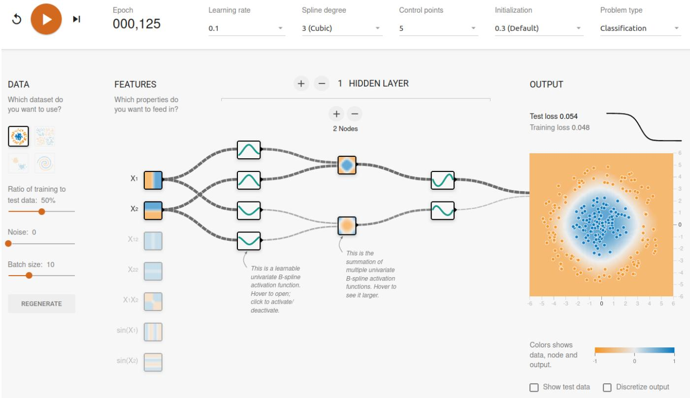
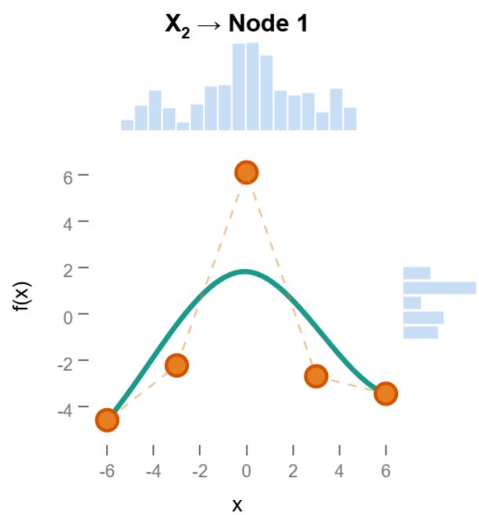

# KANLab: TensorFlow Playground for Kolmogorov-Arnold Networks

Lukas Niehaus12 , Robin Rawiel1 , Ulf Krumnack1

1University Osnabrueck

2University of Applied Sciences Osnabrueck

{lukas.niehaus, robin.rawiel, ulf.krumnack}@uos.de,

## Abstract

KANLab is a browser-based visualization tool designed to interactively teach the core concepts of Kolmogorov-Arnold Networks (KAN), forked from the widely successful TensorFlow Playground. To maximize educational clarity, KAN-Lab omits residual connections and learnable scaling parameters found in modern KAN implementations, ensuring that displayed B-spline activation curves directly correspond to their underlying trainable control points. Users can inspect and modify activation functions, initialization schemes and observe gradient descent correcting manual disruptions. Furthermore, user can explore phenomena such as activation variance, interactive pruning, and re-training within a compact 2D machine learning setting. KANLab is open-source and available at https://kanlab.app/.

## 1 Introduction

Combining lecture-like instructions with practical application has been shown to enhance the understanding of a variety of topics, including Artificial Intelligence (AI) [Turgunbaev, 2025]. A prime example of this is the popular TensorFlow Playground [Smilkov et al., 2017], which helps build intuition about the concepts and hyperparameters of Multi-layer Perceptrons (MLPs) by letting the user train interactively in the browser. In addition to being widely successful, it also inspired a whole branch of practice-oriented applications to improve the understanding in different fields of AI. One showcase for this is the Adversarial Playground [Norton and Qi, 2017], which focuses on education about adversarial attacks on already trained neural networks. Another browser-based rendition, GANLab [Kahng et al., 2019] allows the user to train a generator and a discriminator of a Generative Adversarial Network (GAN) on 2D distributions, while being able to observe their interplay directly. More recently, the Quantum Machine Learning Playground [Debus et al., 2024] has been released, also leveraging established interactivity and visualization methods.

A relatively new field in AI are KANs, which are popularized in their current form by [Liu et al., 2025]. They have been proposed as an interesting new tool in the repertoire of a deep learning researcher and can be used as an alternative to classical MLPs, promising more compact architecture due to more powerful activation functions, resulting in more interpretable models. MLPs layers sum up weighted inputs and then pass them through a static non-linear activation function (like ReLU) to solve non-linear problems. KANs layers, on the other hand, use trainable non-linear activation functions and sum up their results on nodes. While the primary success of KANs is in symbolic formula representation tasks [Yu et al., 2024], they are also frequently experimented with for classification tasks [Yang et al., 2025; Hadj Kilani, 2024; Jamali et al., 2024; Ibrahum et al., 2024].

Regarding KAN-specific projects, the KAN-Playground [Solovyeva, 2025] demonstrates a feature-rich Gradio implementation. While the project is readily accessible via Hugging Face Spaces, training is still computed server-side. While this enables a close-to feature-complete and highperformant experience, this API-based approach comes at the drawback of offering limited responsiveness and interactivity. For example, the architecture is represented via an image, that is updated once per epoch. Furthermore, modern KAN implementations add residual connections and learnable scaling/shifting parameters on top of the underlying univariate function. While these additions are important for performance, they distort the relationship between the activation visualization and the underlying spline parameterization, making the visualizations harder to interpret from an educational perspective.

Due to the close similarities between KANs and MLPs, and the established educational design decisions of the Tensor-Flow Playground, we created KANLab1 as a fork of it. This allows us to create more specialized visualizations and even enables users to drag individual control points during training and observe how gradient descent corrects these manual disruptions in real time. KANLab aims to fill the gap between people who are new to KANs and want to understand the core concepts, and KAN-experts who want to communicate or probe KAN behavior in an accessible environment.

  
Figure 1: Main view of KANLab, with a two layer Kolmogorov-Arnold Network (KAN) that has 2 input features (P), 2 hidden nodes (Q) and 1 output Node, represented by squares. In between these we visualize the green B-spline activation functions with rectangles. Left and right of the rectangles gray dashed lines represent the variance of the incoming (left) and outgoing (right) activation variance by contrasting levels of thickness.

## 2 Kolmogorov-Arnold Networks

Following their introduction by [Liu et al., 2025], KANs have garnered attention as a potential alternative to MLPs. However, learning their concepts through practical experience is still challenging. KANLab addresses this gap by providing a browser interface for interactive design, training, and analysis of KANs in real time. Figure 1 shows a screenshot of the main view, which dynamically visualizes the network architecture. It also allows users to modify hyperparameters, select input features, and observe immediate effects on the model’s behavior. The theoretical foundation of KANLab is the Kolmogorov-Arnold Representation Theorem, which states that any multivariate continuous function on a bounded domain can be represented as a finite composition of univariate functions and addition:

$$
f ( x _ { 1 } , \dots , x _ { n } ) = \sum _ { q = 1 } ^ { Q } \Phi _ { q } \left( \sum _ { p = 1 } ^ { P } \phi _ { q , p } ( x _ { p } ) \right) ,\tag{1}
$$

where $\Phi _ { q } , \phi _ { q , p } : \mathbb { R } \to$ R and $Q \ : = \ : 2 n + 1 , P \ : = \ : n$ . The theorem guarantees a two-layer solution with $Q = 2 n + 1$ nodes, but practical implementations often differ form by adjustments in width and also in depth. Figure 1 shows an example with $P = 2$ input features $( X _ { 1 } , X _ { 2 } )$ and $Q = 2$ hidden nodes. Unlike MLPs with fixed activation functions, KANs use B-splines that adapt during training, allowing for more flexible function approximation. The main view of KANLab shows the network architecture and animated B-splines illustrate information flow in real time. The network is trained using batched stochastic gradient descent minimizing the mean squared error loss. During this training the user can observe the evolving B-splines to gain insights on how KANs are able to decompose complex problems into simpler and trainable components.

## 3 Activation Functions

Extensive effort has gone into utilizing different basis functions to form the univariate activation functions. They include B-splines, Chebyshev and Jacobi Polynomials, ReLU compositions, Fourier series, Gaussian kernels, wavelets, finite basis partitions and sinc functions [Noorizadegan et al., 2026]. Among these bases the most widely adopted one is the B-spline, which was also introduced in the KAN formulation by [Liu et al., 2025]. KANLab uses this B-splinebased approach, since their theory allows for some of the strongest guarantees and has the firmest theoretical footing among KAN bases [Noorizadegan et al., 2026]. The B-spline $\varphi$ is defined as:

$$
\varphi ( x ) = \sum _ { n = 0 } ^ { N - 1 } c _ { n } B _ { n k } ( x )\tag{2}
$$

where $B _ { n k } ( x )$ are fixed B-spline basis functions of degree k (computed using de Boor’s algorithm), and $c _ { n }$ are trainable control points. The number of control points N can be set via a dropdown menu in the top bar (Figure 1).

  
Figure 2: Visualization of an activation function parameterized by a B-spline and its effect on activations. The green curve shows the current B-spline activation, while the orange points denote its learnable control points. The top histogram depicts the distribution of incoming activations, and the right histogram shows the distribution of outgoing activations after applying the activation function. Adjusting the orange control points changes the shape of the B-spline and, consequently, the mapping from inputs to outputs.

Figure 2 visualizes the N = 5 control points as orange circles. In KANLab the view depicted in Figure 2 is displayed when hovering over the rectangle of an activation function from Figure 1. The TensorFlow Playground and KANLab both generate their datasets in the interval of [−6, 6]. To make sure that all generated activations are represented on the B-splines, the control points are uniformly distributed on the same interval. The control points can be changed by dragging and dropping them to new positions. The effect of control point manipulation is directly observable in the decision boundaries of the final output and in the intermediate nodes. The incoming activation for a B-spline in the hidden layer is computed by summing over outputs of the B-splines from the preceding layer. Since the trainable control points are not bounded, the outgoing activations of a B-spline can exceed the control point domain [−6, 6] of the next B-spline. KANLab handles these cases by clipping the incoming activations of a B-spline into that interval.

## 4 Initialization

The topic of KAN initialization is still in development and KANLab supports multiple initialization methods. Each method determines the initialization variance of the control points. [Liu et al., 2025] recommend initializing the control points with small values. KANLab offers preset variances [0.1, 0.3, 0.5, 1.0, 5.0] sampled from a uniform distribution. KANLab also supports the LeCun- and Glorot-inspired, variance preserving initialization schemes proposed by [Rigas et al., 2026]. Additionally, KANLab supports identity as initialization method, which essentially starts the network with linear pass-through transformations by either initializing the control points with an identity function or its inverse. The variance is selectable via the top bar of Figure 1. Users can experiment and observe that small-variance initialization leads to near-zero activations initially. Identity initialization, on the other hand, preserves input structure, making it easier to see how training reshapes the activation functions.

## 5 Use Cases

Just like for the TensorFlow Playground, the experimental setup is serialized in the URL’s GET parameters. This allows a teacher to save the URL of an interesting setup and share it with students. Example setups could show the differences in training behavior between wide and deep KANs. The feature of manually adjusting the control points for each spline can also be used to train a KAN by hand. To do so, the user hovers over an activation function in Figure 1, so that a small window appears, which looks like Figure 2. There, the user can drag and drop the individual control points until the desired result in the following node is reached. In Figure 1 we see thick dark lines on the upper path and thinner lines on the lower path. This means that the activation variance is higher on the upper path which also indicates a stronger information flow. Each activation function on the edges and every (non-output) summation node in Figure 1 can be activated or deactivated individually during training by clicking on them (long click for touchscreens). When a spline in the upper path in Figure 1 gets pruned the loss increases and in the output we see that the classification error grows. The pruned node can now no longer pass information to the next layer. If training continues, the activation variance on the lower path increases and the classification error decreases, demonstrating that the network now routes information through the remaining connections.

## 6 Conclusion

We present KANLab, an interactive browser application, offering a familiar TensorFlow Playground-based interface. Our deliberate design choices favor educational benefits and clarity over performance, in order to close the gap between KAN-beginners and KAN-experts. Future work includes the addition of regularization methods.

## References

[Debus et al., 2024] Pascal Debus, Sebastian Issel, and Kilian Tscharke. Quantum Machine Learning Playground. IEEE Computer Graphics and Applications, 44(5):40–53, September 2024. arXiv:2507.17931 [quant-ph].

[Hadj Kilani, 2024] Bochra Hadj Kilani. Kolmogorov-Arnold Networks: Key Developments and Uses. Qeios, June 2024.

[Ibrahum et al., 2024] Ahmed Dawod Mohammed Ibrahum, Zhengyu Shang, and Jang-Eui Hong. How Resilient Are Kolmogorov–Arnold Networks in Classification Tasks? A Robustness Investigation. Applied Sciences, 14(22), November 2024.

[Jamali et al., 2024] Ali Jamali, Swalpa Kumar Roy, Danfeng Hong, Bing Lu, and Pedram Ghamisi. How to Learn More? Exploring Kolmogorov–Arnold Networks for Hyperspectral Image Classification. Remote Sensing, 16(21), October 2024.

[Kahng et al., 2019] Minsuk Kahng, Nikhil Thorat, Duen Horng Chau, Fernanda B. Viegas, and Martin ´ Wattenberg. GAN Lab: Understanding Complex Deep Generative Models using Interactive Visual Experimentation. IEEE Transactions on Visualization and Computer Graphics, 25(1):310–320, January 2019.

[Liu et al., 2025] Ziming Liu, Yixuan Wang, Sachin Vaidya, Fabian Ruehle, James Halverson, Marin Soljacic, Thomas Y. Hou, and Max Tegmark. KAN: Kolmogorov–Arnold Networks. In The Thirteenth International Conference on Learning Representations, 2025.

[Noorizadegan et al., 2026] Amir Noorizadegan, Sifan Wang, Leevan Ling, and Juan P. Dominguez-Morales. A Practitioner’s Guide to Kolmogorov-Arnold Networks, January 2026. arXiv:2510.25781 [cs].

[Norton and Qi, 2017] Andrew P Norton and Yanjun Qi. Adversarial-Playground: A visualization suite showing how adversarial examples fool deep learning. In Visualization for Cyber Security (VizSec), 2017 IEEE Symposium on, pages 1–4. IEEE, 2017.

[Rigas et al., 2026] Spyros Rigas, Dhruv Verma, Georgios Alexandridis, and Yixuan Wang. Initialization Schemes for Kolmogorov–Arnold Networks: An Empirical Study. In The Fourteenth International Conference on Learning Representations, 2026.

[Smilkov et al., 2017] Daniel Smilkov, Shan Carter, D. Sculley, Fernanda B. Viegas, and Martin Wattenberg. Direct- ´ Manipulation Visualization of Deep Networks, August 2017. arXiv:1708.03788 [cs].

[Solovyeva, 2025] Ekaterina Solovyeva. qksolov/kanplayground, December 2025. original-date: 2025-02- 25T17:43:08Z.

[Turgunbaev, 2025] Rashid Turgunbaev. Enhancing student understanding of artificial intelligence through practical neural network applications. Academic Journal of Science, Technology and Education, 1(6):36–40, October 2025.

[Yang et al., 2025] Zhuoqin Yang, Jiansong Zhang, Xiaoling Luo, Zheng Lu, and Linlin Shen. MedKAN: An Advanced Kolmogorov-Arnold Network for Medical Image Classification, February 2025. arXiv:2502.18416 [cs].

[Yu et al., 2024] Runpeng Yu, Weihao Yu, and Xinchao Wang. KAN or MLP: A Fairer Comparison, August 2024. arXiv:2407.16674 [cs].