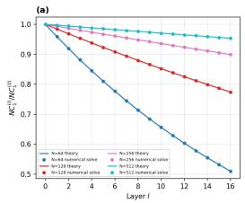
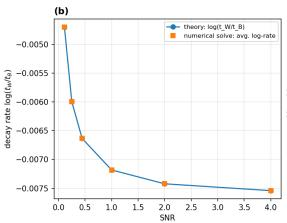
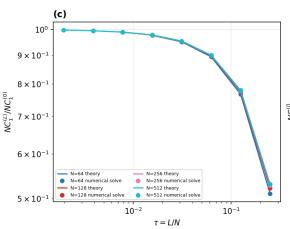
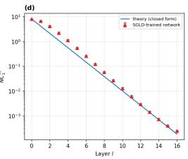
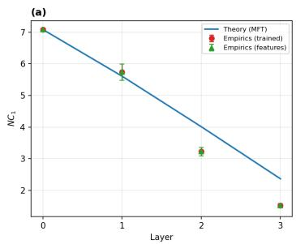
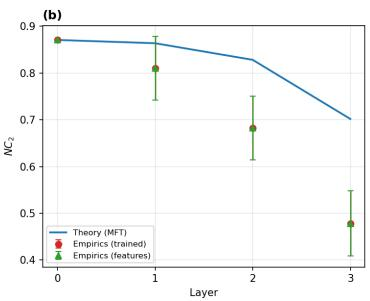
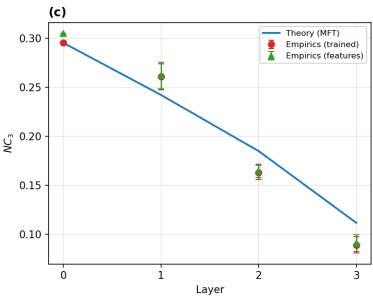

# A Closed Form Depth-Width Law for Neural Collapse in Deep Linear Networks

Pankhil Gawade∗,1,6 Kirsten Fischer∗,1 Guy Wolf2,3 Ewa Szczurek1,4,5

1Institute of AI for Health, Helmholtz Munich

2Université de Montréal

3Mila – Quebec AI Institute

4Faculty of Mathematics, Informatics and Mechanics, University of Warsaw

5Faculty of Mathematics, Informatics and Statistics, LMU Munich

6School of Computation, Information and Technology, Technical University of Munich

{gawade.pankhil,ewa.szczurek}@helmholtz-munich.de

## Abstract

How depth and width of neural networks shape learned representations is usually studied only after training. We show that, in a tractable feature-learning setting, this dependence can instead be obtained in closed form. Using neural collapse as a probe of representation geometry, we express NC1–NC3 directly in terms of the learned feature kernel, extending an identity known for NC1 to the angular part of NC2 and to NC3 under a ridge readout. For deep linear networks with exchangeable class structure, the resulting kernel equations yield a geometric law, exact within the theory, for the layerwise evolution of within-class variability. At large width, the accumulated compression becomes a function of the depth-towidth ratio L/N, with its rate determined self-consistently by the data, prior and architecture. Numerical experiments support the derived dependence on depth, width and signal-to-noise ratio. The result is a representation-level scaling law derived from feature-learning theory rather than fitted after training.

## 1 Introduction

Allocating a fixed budget between depth and width changes what a network learns, but the effect is usually measured after training rather than derived in advance. Proportional depth–width analyses have previously identified the depth-to-width ratio as a controlling parameter for finite-width kernel fluctuations, kernel renormalization, and effective depth [Hanin and Nica, 2020, Li and Sompolinsky, 2021, Hanin and Zlokapa, 2023]; here we show that the same architectural ratio controls a representation-level observable.

Neural collapse (NC) describes the progressive emergence of low within-class variability, simplexlike class means, and classifier–mean alignment [Papyan et al., 2020]. Empirical work has observed increasingly separated or collapsed representations across depth [He and Su, 2023, Rangamani et al., 2023], raising the question of what governs this evolution and how it depends on data and architecture. Existing theory has studied unconstrained-feature optima [Hong and Ling, 2024], perturbations of this idealization [Tirer et al., 2023], intermediate-layer compression under structural assumptions on trained weights [Wang et al., 2025], and data-dependent kernel descriptions [Kothapalli and Tirer, 2025].

Here we instead extend the kernel formulation of NC1 Kothapalli and Tirer [2025] to NC2 and NC3, and evaluate the resulting observables on the self-consistent feature-learning kernels of Fischer et al.

[2024]. Under exchangeable class geometry, the resulting deep-linear equations reduce to scalar within- and between-class channels, yielding the following contributions:

• Kernel forms for NC2 and NC3, extending the NC1 identity of Kothapalli and Tirer [2025], so that all three training-set observables are computable from the feature kernel and the labels.

• An exact geometric law for layerwise representation compression in exchangeable deep linear networks, showing that the accumulated compression is controlled at leading order by the depth-towidth ratio, with the collapse rate determined self-consistently by the data, prior, and architecture.

## 2 Neural collapse observables from feature kernels

Consider a balanced C-class problem with n samples per class and $P = C n$ training samples, one-hot labels $Y \in \mathbb { R } ^ { P \times C }$ , and feature matrix Z at a fixed layer. Let $\mu _ { c }$ and $\mu _ { G }$ be the class and global feature means and $\Sigma _ { W } , \Sigma _ { B }$ the within- and between-class covariances. Write $H = I _ { P } - \bar { P ^ { - 1 } } \mathbf { 1 } _ { P } \mathbf { 1 } _ { P } ^ { \top }$ and $H _ { C } = I _ { C } - C ^ { - 1 } \mathbf { 1 } _ { C } \mathbf { 1 } _ { C } ^ { \top }$ for the sample- and class-centering matrices and $Y _ { c } = H Y$ . The orthogonal projectors onto the centered class-indicator subspace and onto centered within-class fluctuations are

$$
{ \cal P } _ { B } = Y _ { c } ( Y _ { c } ^ { \top } Y _ { c } ) ^ { \dagger } Y _ { c } ^ { \top } , \qquad { \cal P } _ { W } = H - { \cal P } _ { B } .\tag{1}
$$

Let Π $\in \mathbb { R } ^ { P \times C }$ be the class-averaging membership matrix, $\Pi _ { \alpha c } = 1 / n$ if $y _ { \alpha } = c$ and 0 otherwise, and set $S = \Pi ^ { \top }$ and $\widetilde { S } = H _ { C } S$ , so that the rows of $\widetilde { S } Z$ are the centered class means.

Theorem 1 (Kernel forms of the neural-collapse observables). Assume balanced classes and nonzero normalizations. Then NC1, angular NC2 and kernel-ridge NC3 arefunctions offeature kernel K and the class labels alone:

$$
\operatorname { N C } _ { 1 } ( K ) = { \frac { \operatorname { T r } ( \Sigma _ { W } ) } { \operatorname { T r } ( \Sigma _ { B } ) } } = { \frac { \operatorname { T r } ( P _ { W } K ) } { \operatorname { T r } ( P _ { B } K ) } } , \qquad \operatorname { N C } _ { 2 } ( K ) = \left\| { \widehat { G } } - { \frac { C } { C - 1 } } H _ { C } \right\| _ { F } ,\tag{2}
$$

where $\widehat { G } = D ^ { - 1 / 2 } G D ^ { - 1 / 2 }$ is the cosine-normalized Gram matrix of the centered class means, built from $G = \widetilde { S } K \widetilde { S } ^ { \top }$ and $D = \operatorname { D i a g } ( G _ { 1 1 } , . . . , G _ { C C } )$ , and $\frac { C } { C - 1 } H _ { C }$ is the Gram matrix of a unit-norm C-vertex simplex ETF. For the bias-free ridge readout with regularization $\kappa > 0 ,$ , set $U = Y ^ { \top } ( K + \kappa I _ { P } ) ^ { - 1 }$ and $\widetilde { \cal U } = { \cal H } _ { \cal C } { \cal U } ,$ ; then

$$
\mathrm { N C } _ { 3 } ( K ) = 1 - \frac { 1 } { C } \sum _ { c = 1 } ^ { C } \frac { \widetilde { U } _ { c : } K \widetilde { S } _ { c : } ^ { \top } } { \sqrt { \left( \widetilde { U } _ { c : } K \widetilde { U } _ { c : } ^ { \top } \right) \left( \widetilde { S } _ { c : } K \widetilde { S } _ { c : } ^ { \top } \right) } } .\tag{3}
$$

The NC1 identity is due to Kothapalli and Tirer [2025]; the NC2 and NC3 kernel forms are new. They quantify within-class compression, angular deviation from a simplex ETF, and readout class mean misalignment, respectively (Appendix $\mathbf { A } )$ . NC4 additionally requires a test-train cross kernel. These identities hold for arbitrary representations; predicting their layerwise evolution requires a theory of the learned kernels.

## 3 Exact depth law for exchangeable deep linear networks

We build on the finite-width feature-learning theory of Fischer et al. [2024], which derives coupled forward–backward self-consistency equations for the maximum-a-posteriori (MAP) layerwise kernels, i.e. the most probable kernels conditioned on the training data. The underlying large-deviation theory is exact in the proportional limit $P = \alpha N \to \infty$ . We adopt their Bayesian setting, with Gaussian weight priors of variance $g _ { l } / d _ { l - 1 }$ , bias variance $g _ { b }$ , and Gaussian observation noise of variance $\kappa .$

Writing $K ^ { ( l ) }$ and $\widetilde { K } ^ { \left( l \right) }$ for the forward and conjugate kernels, respectively, the deep-linear equations of Fischer et al. [2024] take the closed form

$$
\begin{array} { c } { { { \cal K } ^ { ( l ) } = g _ { b } { \bf 1 } _ { P } { \bf 1 } _ { P } ^ { \top } + g _ { l } { \cal K } ^ { ( l - 1 ) } { \cal T } ^ { ( l ) } , } } \\ { { { \widetilde K } ^ { ( l - 1 ) } = g _ { l } { \cal T } ^ { ( l ) } { \widetilde K } ^ { ( l ) } , } } \\ { { { \cal T } ^ { ( l ) } = \left( I _ { P } - \frac { 2 g _ { l } } { N } { \widetilde K } ^ { ( l ) } K ^ { ( l - 1 ) } \right) ^ { - 1 } . } } \end{array}\tag{4}
$$

For training inputs $X \in \mathbb { R } ^ { P \times d _ { 0 } }$ , the fixed forward boundary is $K ^ { ( 0 ) } = ( g _ { 0 } / d _ { 0 } ) X X ^ { \top } + g _ { b } \mathbf { 1 } _ { P } \mathbf { 1 } _ { P } ^ { \top }$ These equations are self-consistent: forward kernels depend on conjugate kernels propagated from the output, while the terminal conjugate kernel depends on $K ^ { ( L ) }$ , so both families must be solved jointly.

Fischer et al. [2024] consider a scalar output. To study multiclass $\mathrm { N C } ,$ we extend the terminal condition to $N _ { \mathrm { o u t } }$ independent outputs. For $S _ { L } = K ^ { ( L ) } + \kappa I _ { P }$

$$
\widetilde { K } ^ { ( L ) } = \frac { 1 } { 2 } S _ { L } ^ { - 1 } \big ( Y Y ^ { \top } - N _ { \mathrm { o u t } } S _ { L } \big ) S _ { L } ^ { - 1 } .\tag{5}
$$

The bulk equations are unchanged. For C-class one-hot targets, $N _ { \mathrm { o u t } } = C ;$ see Appendix B.

Exchangeable class geometry. To obtain an analytic solution, we assume that the input kernel is invariant under permutations within classes and across classes, a natural idealization of the permutation-symmetric geometry approached under NC. Such kernels lie in the algebra spanned by $\dot { \boldsymbol { E } } = P ^ { - 1 } \mathbf { 1 1 } ^ { \top } , P _ { B }$ , and $P _ { W }$ , which have ranks $1 , C - 1$ , and $P - C$ . This algebra is closed under the sums, products and inverses appearing in Eq. 4 and both the bias and $\boldsymbol { Y } \boldsymbol { Y } ^ { \top } = n ( E + P _ { B } )$ lie in the same algebra, so every kernel generated by the recursion has the form

$$
K ^ { ( l ) } = \lambda _ { E } ^ { ( l ) } E + \lambda _ { B } ^ { ( l ) } P _ { B } + \lambda _ { W } ^ { ( l ) } P _ { W } ,
$$

and likewise for $\widetilde { K } ^ { \left( l \right) }$ . Thus the matrix problem decouples into three scalar channels; E drops out of centered NC observables. Under this symmetry, the angular class-mean and readout-alignment conditions are already ideal, so NC2 and NC3 vanish; the nontrivial layerwise observable is NC1.

Theorem 2 (Channel conservation and geometric depth law). For $X \in \{ W , B \} , q _ { X } = \lambda _ { X } ^ { ( l ) } \widetilde { \lambda } _ { X } ^ { ( l ) }$ is independent ofl. Hence $t _ { X } = 1 + 2 q _ { X } / \bar { N }$ is layer-independent and

$$
\lambda _ { X } ^ { ( l ) } = \lambda _ { X } ^ { ( 0 ) } \left( \prod _ { m = 1 } ^ { l } g _ { m } \right) t _ { X } ^ { l } , \qquad \mathrm { N C } _ { 1 } ^ { ( l ) } = \mathrm { N C } _ { 1 } ^ { ( 0 ) } \left( \frac { t _ { W } } { t _ { B } } \right) ^ { l } .\tag{6}
$$

Feature learning therefore acts through two fixed factors: t for within-class fluctuations and $t _ { B }$ for the centered between-class subspace. The common weight-variance factors cancel from their ratio, so NC1 decreases geometrically whenever $t _ { B } > t _ { W }$ . The input geometry fixes $\mathrm { N C } _ { 1 } ^ { ( 0 ) }$ , while the self-consistent feature-learning solution determines the depthwise contraction.

Corollary 1 (Depth–width scaling). At small κ, with $r = n / \lambda _ { B } ^ { ( L ) }$

$$
t _ { W } = 1 - { \frac { C } { N } } , \qquad t _ { B } = 1 + { \frac { r - C } { N } } , \qquad { \frac { t _ { W } } { t _ { B } } } = 1 - { \frac { r } { N } } + O ( N ^ { - 2 } ) , \quad \Longrightarrow \quad \mathrm { N C } _ { 1 } ^ { ( L ) } \approx \mathrm { N C } _ { 1 } ^ { ( 0 ) } e ^ { - r L / N } .\tag{7}
$$

This small-κ form applies while κ remains negligible relative to the terminal channel eigenvalues; otherwise the exact finite-κ fixed point applies.The leading contraction rate is $r / N$ , leaving $L / N$ as the controlling architectural variable, with r determined self-consistently by the data, prior, and architecture through the reduced scalar closure (Appendix D.4). The reduced fixed-point equations can therefore be used to select a depth-to-width ratio for a target level of representation compression without training each candidate architecture. This complements Wang et al. [2025], who obtain geometric within-class compression under nearly orthogonal inputs and structural assumptions on trained weights; here the contraction follows from the self-consistent finite-width feature-learning equations, making its data and width dependence explicit.

Input geometry and empirical verification. For balanced Gaussian classes $x _ { \alpha } = \mu _ { y _ { \alpha } } + \sigma \xi _ { \alpha }$ with isotropic within-class noise, the population input value is

$$
\mathrm { N C } _ { 1 } ^ { ( 0 ) } = \frac { d \sigma ^ { 2 } } { \frac { 1 } { C } \sum _ { c } \| \mu _ { c } - \mu _ { G } \| _ { 2 } ^ { 2 } } = \frac { 1 } { \mathrm { S N R } } ,\tag{8}
$$

and hence

$$
\mathrm { N C } _ { 1 } ^ { ( L ) } \approx \frac { 1 } { \mathrm { S N R } } \exp \left( - \frac { r L } { N } \right) .\tag{9}
$$

Figure 1: Verification of the exchangeable linear theory. (a) Geometric depth law for $C = 5$ and $g _ { \ell } = 1$ : normalized NC1, $\mathrm { N C } _ { 1 } ^ { ( l ) } / \mathrm { N C } _ { 1 } ^ { ( 0 ) }$ , versus layer for $N = 6 4 , 1 2 8 , 2 5 6 , 5 1 2 .$ , comparing Theorem 2 with the numerical fixed-point solution. (b) Data dependence of the contraction rate for $C = 5 , g _ { \ell } = 1 , N = 2 5 6$ , and $L = 1 6 \colon$ $\log ( t _ { W } / t _ { B } )$ versus SNR. (c) Depth–width scaling for $C = 5$ and $g _ { \ell } = .$ 1: terminal normalized NC1 versus $\tau = L / N$ , showing the predicted leading dependence on $L / N$ . (d) Layerwise NC1 for a sampled four-class Gaussian task and a contractive linear network $( v _ { w } = 0 . 5 )$ , comparing the closed-form prediction with an SGLD-trained finite-width network.  

  
Figure 2: NC1, NC2 and NC3 on four-class XOR $( N = 2 5 6 , L = 3 ) .$ , computed from the selfconsistent kernel theory and from trained finite-width networks. Error bars denote variation across seeds.

Thus the terminal collapse separates into an input-geometry contribution and a network-induced contraction controlled by depth relative to width.

Figure 1 separates verification of the analytic solution from its comparison with trained networks. Panels (a)–(c) consider the exactly exchangeable population-kernel setting: the closed-form geometric law agrees with the numerical fixed-point solution across depth, reproduces the data-dependent contraction rate, and exhibits the predicted leading dependence on $\tau = L / N$ under $g _ { \ell } = 1$ . Panel (d) asks the distinct question of whether this behavior persists in a finite trained network. The SGLDtrained network shows approximately geometric layerwise decay over several orders of magnitude, despite deviations from the idealized population-kernel setting.

Beyond the solvable regime. The kernel identities of Theorem 1 are not restricted to linear or exchangeable networks. We therefore ask whether they remain informative when the exact depth law no longer applies. On nonlinear four-class XOR, Figure 2 shows that NC1, NC2 and NC3 evolve in the same direction across depth in the self-consistent kernel solution and in trained finite-width networks. Agreement is strongest in the earlier layers, while trained networks typically reach stronger terminal collapse. We therefore interpret this experiment not as a validation of the exact $L / N$ law outside the linear exchangeable setting, but as evidence that the kernel observables continue to capture the qualitative evolution of learned representation geometry. Implementation details, solver tolerances, SGLD hyperparameters, seed countsare given in Appendix E.

## 4 Conclusion

We showed that NC1–NC3 can be evaluated directly from the feature kernel and class labels, without explicitly forming the feature coordinates. Combining these kernel observables with selfconsistent feature-learning theory makes representation geometry predictable from the data, prior, and architecture without training each candidate network. For exchangeable deep linear networks, we further derived an exact geometric law for the layerwise evolution of NC1. At large width, the accumulated compression is controlled at leading order by L/N, with its rate determined selfconsistently by the data, prior, and architecture. This provides a tractable representation-level scaling law that links architectural choices directly to learned geometry. Extending such predictive laws to nonlinear networks and general data geometry remains an important direction.

## Acknowledgments and Disclosure of Funding

This project has received funding from the European Research Council (ERC) under the European Union’s Horizon 2020 research and innovation programme (grant agreement No. 101125506 – DOG-AMP) [E.S.]. [G.W.] acknowledges support from a Canada CIFAR AI Chair (via Mila), Humboldt Research Fellowship, FRQNT-NSERC grant 2023-NOVA-329125 and NSERC Discovery grant 03267

## References

Kirsten Fischer, Javed Lindner, David Dahmen, Zohar Ringel, Michael Krämer, and Moritz Helias. Critical feature learning in deep neural networks. In Ruslan Salakhutdinov, Zico Kolter, Katherine Heller, Adrian Weller, Nuria Oliver, Jonathan Scarlett, and Felix Berkenkamp, editors, Proceedings of the 41st International Conference on Machine Learning, volume 235 of Proceedings of Machine Learning Research, pages 13660–13690. PMLR, 21–27 Jul 2024. URL https://proceedings. mlr.press/v235/fischer24a.html.

Boris Hanin and Mihai Nica. Finite depth and width corrections to the neural tangent kernel. In International Conference on Learning Representations, 2020.

Boris Hanin and Alexander Zlokapa. Bayesian interpolation with deep linear networks. Proceedings ofthe National Academy ofSciences, 120(23):e2301345120, 2023. doi: 10.1073/pnas.2301345120.

Hangfeng He and Weijie J. Su. A law of data separation in deep learning, 2023. URL https: //arxiv.org/abs/2210.17020.

Wanli Hong and Shuyang Ling. Neural collapse for unconstrained feature model under cross-entropy loss with imbalanced data. Journal of Machine Learning Research, 25(192):1–48, 2024. URL http://jmlr.org/papers/v25/23-1215.html.

Vignesh Kothapalli and Tom Tirer. Can kernel methods explain how the data affects neural collapse? Transactions on Machine Learning Research, 2025. ISSN 2835-8856. URL https://openreview.net/forum?id=MbF1gYfIlY.

Qianyi Li and Haim Sompolinsky. Statistical mechanics of deep linear neural networks: The backpropagating kernel renormalization. Physical Review X, 11(3):031059, 2021. doi: 10.1103/ PhysRevX.11.031059.

Vardan Papyan, X. Y. Han, and David L. Donoho. Prevalence of neural collapse during the terminal phase of deep learning training. Proceedings of the National Academy of Sciences, 117(40): 24652–24663, 2020. doi: 10.1073/pnas.2015509117.

Akshay Rangamani, Marius Lindegaard, Tomer Galanti, and Tomaso A Poggio. Feature learning in deep classifiers through intermediate neural collapse. In Andreas Krause, Emma Brunskill, Kyunghyun Cho, Barbara Engelhardt, Sivan Sabato, and Jonathan Scarlett, editors, Proceedings of the 40th International Conference on Machine Learning, volume 202 of Proceedings ofMachine Learning Research, pages 28729–28745. PMLR, 23–29 Jul 2023. URL https://proceedings. mlr.press/v202/rangamani23a.html.

Tom Tirer, Haoxiang Huang, and Jonathan Niles-Weed. Perturbation analysis of neural collapse. In Proceedings of the 40th International Conference on Machine Learning, volume 202 of Proceedings of Machine Learning Research, pages 34301–34329. PMLR, 2023.

Peng Wang, Xiao Li, Can Yaras, Zhihui Zhu, Laura Balzano, Wei Hu, and Qing Qu. Understanding deep representation learning via layerwise feature compression and discrimination. Journal of Machine Learning Research, 26(220):1–61, 2025. URL http://jmlr.org/papers/v26/ 24-0047.html.

## A Derivation of the kernel neural-collapse observables [Theorem 1]

We prove that the neural-collapse observables in Theorem 1 can be written entirely in terms of the feature kernel and the class labels. We work at an arbitrary fixed layer and make no assumption here on the network architecture, training dynamics, or exchangeability of the data.

Let

$$
\begin{array} { r } { Z = \left[ \overset { z _ { 1 } ^ { \top } } { \underset { \left\{ \vphantom { z _ { P } ^ { \top } } } } { \vd\right\ots } } \right] \in \mathbb { R } ^ { P \times d } , \qquad K = Z Z ^ { \top } \in \mathbb { R } ^ { P \times P } , } \end{array}
$$

where $z _ { \alpha } \in \mathbb { R } ^ { d }$ is the representation of training sample α. We consider C balanced classes with $n = P / C$ samples per class and one-hot label matrix $Y ~ \in ~ \mathbb { R } ^ { P \times C }$ . Denote by $\mu _ { c }$ the mean representation of class c and by $\mu _ { G }$ the global mean. We use the sample- and class-centering matrices

$$
H = I _ { P } - \frac { 1 } { P } { \bf 1 } _ { P } { \bf 1 } _ { P } ^ { \top } , \qquad H _ { C } = I _ { C } - \frac { 1 } { C } { \bf 1 } _ { C } { \bf 1 } _ { C } ^ { \top } ,
$$

and the centered label matrix

$$
Y _ { c } = H Y .
$$

For balanced classes,

$$
Y ^ { \top } Y = n I _ { C } , \qquad H Y = Y H _ { C } .
$$

The proof consists of three independent steps, corresponding to the three observables in Theorem 1. For NC1, we show that fixed label-dependent projectors separate the representation into its withinclass residual and centered class-mean components; their squared norms are therefore traces of projected kernel matrices. For NC2, we show that the Gram matrix of the centered class means is obtained by applying the class-averaging and centering operators directly to K. For NC3, we first derive the representer form of the bias-free ridge readout and then express its cosine alignment with the centered class means through kernel inner products. Together these three constructions show that NC1, angular NC2, and ridge-readout NC3 require no explicit coordinates for the representation once K and the labels are known.

The NC1 kernel identity was previously derived by Kothapalli and Tirer [2025]; we reproduce it in our notation because the same sample-space decomposition is used later in the exchangeable linear analysis. The kernel forms of angular NC2 and ridge-readout NC3 are new.

## A.1 Proof of the NC1 identity

Recall the class and global feature means

$$
\mu _ { c } = \frac { 1 } { n } \sum _ { \alpha : y _ { \alpha } = c } z _ { \alpha } , \qquad \mu _ { G } = \frac { 1 } { P } \sum _ { \alpha = 1 } ^ { P } z _ { \alpha } = \frac { 1 } { C } \sum _ { c = 1 } ^ { C } \mu _ { c } .\tag{10}
$$

The within- and between-class covariance matrices are

$$
\Sigma _ { W } = \frac { 1 } { P } \sum _ { c = 1 } ^ { C } \sum _ { \alpha : y _ { \alpha } = c } ( z _ { \alpha } - \mu _ { c } ) ( z _ { \alpha } - \mu _ { c } ) ^ { \top } ,\tag{11}
$$

and

$$
\Sigma _ { B } = \frac { 1 } { C } \sum _ { c = 1 } ^ { C } ( \mu _ { c } - \mu _ { G } ) ( \mu _ { c } - \mu _ { G } ) ^ { \top } .\tag{12}
$$

The projector onto the centered class-indicator subspace is

$$
P _ { B } = Y _ { c } ( Y _ { c } ^ { \top } Y _ { c } ) ^ { \dagger } Y _ { c } ^ { \top } .\tag{13}
$$

Since $Y _ { c } ^ { \top } Y _ { c } = n H _ { C }$ and $H _ { C } ^ { \dagger } = H _ { C }$

$$
\begin{array} { l } { { \displaystyle P _ { B } = \frac { 1 } { n } Y H _ { C } Y ^ { \top } } } \\ { { \displaystyle \quad = \frac { 1 } { n } Y Y ^ { \top } - \frac { 1 } { P } \mathbf { 1 } _ { P } \mathbf { 1 } _ { P } ^ { \top } } . } \end{array}\tag{14}
$$

Let sample α belong to class c. Then

$$
( Y ^ { \top } Z ) _ { c : } = \sum _ { \beta : y _ { \beta } = c } z _ { \beta } ^ { \top } = n \mu _ { c } ^ { \top } ,\tag{15}
$$

and therefore

$$
\begin{array} { c } { { ( P _ { B } Z ) _ { \alpha : } = \displaystyle \frac { 1 } { n } e _ { c } ^ { \top } H _ { C } Y ^ { \top } Z } } \\ { { = \left( \mu _ { c } - \mu _ { G } \right) ^ { \top } . } } \end{array}\tag{16}
$$

Thus $P _ { B } Z$ consists exactly of the centered class means repeated over the samples of each class.

$$
\begin{array} { r } { P _ { W } = H - P _ { B } . } \end{array}\tag{17}
$$

Since

$$
( H Z ) _ { \alpha : } = ( z _ { \alpha } - \mu _ { G } ) ^ { \top } ,\tag{18}
$$

we obtain

$$
\begin{array} { r l } & { ( P _ { W } Z ) _ { \alpha : } = ( z _ { \alpha } - \mu _ { G } ) ^ { \top } - ( \mu _ { c } - \mu _ { G } ) ^ { \top } } \\ & { \qquad = ( z _ { \alpha } - \mu _ { c } ) ^ { \top } . } \end{array}\tag{19}
$$

Hence $P _ { W } Z$ consists exactly of the within-class residuals.

Using $K = Z Z ^ { \top }$ , symmetry and idempotence of $P _ { B }$ ,

$$
\begin{array} { r l } & { \mathrm { T r } ( P _ { B } K ) = \mathrm { T r } ( P _ { B } Z Z ^ { \top } ) } \\ & { \qquad = \mathrm { T r } ( Z ^ { \top } P _ { B } Z ) } \\ & { \qquad = \| P _ { B } Z \| _ { F } ^ { 2 } . } \end{array}\tag{20}
$$

Using Eq. (16),

$$
\mathrm { T r } ( P _ { B } K ) = n \sum _ { c = 1 } ^ { C } \| \mu _ { c } - \mu _ { G } \| _ { 2 } ^ { 2 } .\tag{21}
$$

Since $P = C n$ , Eq. (12) gives

$$
\mathrm { T r } ( P _ { B } K ) = P \mathrm { T r } ( \Sigma _ { B } ) .\tag{22}
$$

Likewise,

$$
\begin{array} { l } { \operatorname { T r } ( P _ { W } K ) = \| P _ { W } Z \| _ { F } ^ { 2 } } \\ { \displaystyle = \sum _ { c = 1 } ^ { C } \sum _ { \alpha : y _ { \alpha } = c } \| z _ { \alpha } - \mu _ { c } \| _ { 2 } ^ { 2 } } \\ { \displaystyle = P \operatorname { T r } ( \Sigma _ { W } ) . } \end{array}\tag{23}
$$

Consequently,

$$
\operatorname { N C } _ { 1 } ( K ) = { \frac { \operatorname { T r } ( \Sigma _ { W } ) } { \operatorname { T r } ( \Sigma _ { B } ) } } = { \frac { \operatorname { T r } ( P _ { W } K ) } { \operatorname { T r } ( P _ { B } K ) } } .\tag{24}
$$

This proves the NC1 identity.

## A.2 Proof of the NC2 identity

Let

$$
\Pi _ { \alpha c } = \left\{ { \begin{array} { l l } { 1 / n , } & { y _ { \alpha } = c , } \\ { 0 , } & { { \mathrm { o t h e r w i s e } } , } \end{array} } \right. \qquad S = \Pi ^ { \top } \in \mathbb { R } ^ { C \times P } .\tag{25}
$$

Then

$$
S Z = \left[ \begin{array} { c } { { \mu _ { 1 } ^ { \top } } } \\ { { \vdots } } \\ { { \mu _ { C } ^ { \top } } } \end{array} \right] .\tag{26}
$$

Centering across classes gives

$$
\widetilde { S } = H _ { C } S ,\tag{27}
$$

and hence

$$
\widetilde { S } Z = \left[ \begin{array} { c } { ( \mu _ { 1 } - \mu _ { G } ) ^ { \top } } \\ { \vdots } \\ { ( \mu _ { C } - \mu _ { G } ) ^ { \top } } \end{array} \right] .\tag{28}
$$

Therefore the Gram matrix of the centered class means is

$$
\begin{array} { r c l } { G = ( \widetilde { S } Z ) ( \widetilde { S } Z ) ^ { \top } } \\ { = \widetilde { S } Z Z ^ { \top } \widetilde { S } ^ { \top } } \\ { = \widetilde { S } K \widetilde { S } ^ { \top } . } \end{array}\tag{29}
$$

Let

$$
D = \operatorname { D i a g } ( G _ { 1 1 } , \dots , G _ { C C } ) ,\tag{30}
$$

and assume all centered class means are nonzero. Then

$$
\widehat { G } = D ^ { - 1 / 2 } G D ^ { - 1 / 2 } ,\tag{31}
$$

with entries

$$
\widehat { G } _ { c c ^ { \prime } } = \frac { \langle \mu _ { c } - \mu _ { G } , \mu _ { c ^ { \prime } } - \mu _ { G } \rangle } { \| \mu _ { c } - \mu _ { G } \| _ { 2 } \| \mu _ { c ^ { \prime } } - \mu _ { G } \| _ { 2 } } .\tag{32}
$$

Thus $\widehat { G }$ is exactly the cosine Gram matrix of the centered class means. A unit-norm C-class simplex ETF has Gram matrix

$$
G _ { \mathrm { E T F } } = \frac { C } { C - 1 } H _ { C } .\tag{33}
$$

By the definition of the angular NC2 observable,

$$
\mathrm { N C } _ { 2 } ( K ) = \left\| D ^ { - 1 / 2 } \widetilde { S } K \widetilde { S } ^ { \top } D ^ { - 1 / 2 } - \frac { C } { C - 1 } H _ { C } \right\| _ { F } .\tag{34}
$$

Hence angular NC2 is completely determined by K and the class labels. This proves the NC2 identity.

## A.3 Proof of the NC3 identity

For NC3 we use the bias-free ridge readout associated with the feature matrix Z. Let

$$
W \in \mathbb { R } ^ { C \times d }\tag{35}
$$

minimize

$$
\begin{array} { r } { \mathcal { L } ( W ) = \Vert Y ^ { \top } - W Z ^ { \top } \Vert _ { F } ^ { 2 } + \kappa \Vert W \Vert _ { F } ^ { 2 } , \qquad \kappa > 0 . } \end{array}\tag{36}
$$

The first-order condition is

$$
( W Z ^ { \top } - Y ^ { \top } ) Z + \kappa W = 0 ,\tag{37}
$$

or equivalently

$$
W ( Z ^ { \top } Z + \kappa I _ { d } ) = Y ^ { \top } Z .\tag{38}
$$

Hence

$$
W = Y ^ { \top } Z ( Z ^ { \top } Z + \kappa I _ { d } ) ^ { - 1 } .\tag{39}
$$

Using the push-through identity

$$
Z ( Z ^ { \top } Z + \kappa I _ { d } ) ^ { - 1 } = ( Z Z ^ { \top } + \kappa I _ { P } ) ^ { - 1 } Z ,\tag{40}
$$

and $K = Z Z ^ { \top }$ , we obtain

$$
\boldsymbol { W } = \boldsymbol { Y } ^ { \intercal } ( \boldsymbol { K } + \kappa I _ { P } ) ^ { - 1 } \boldsymbol { Z } .\tag{41}
$$

Define

$$
\begin{array} { r } { U = Y ^ { \top } ( K + \kappa I _ { P } ) ^ { - 1 } . } \end{array}\tag{42}
$$

Then

$$
W = U Z .\tag{43}
$$

NC3 compares the class-specific readout directions after removing their common class component. Therefore define

$$
\begin{array} { r } { \widetilde { U } = H _ { C } U , \qquad \bar { W } = H _ { C } W = \widetilde { U } Z . } \end{array}\tag{44}
$$

From Eq. (28), the centered class means are

$$
\bar { M } ^ { \top } = \tilde { S } Z .\tag{45}
$$

Let $\bar { w } _ { c } ^ { \top }$ denote row c of $\bar { W }$ , and $\bar { \mu } _ { c } ^ { \top }$ row c of $\bar { M } ^ { \top }$ . Their inner product is

$$
\begin{array} { c } { { \left. \bar { w } _ { c } , \bar { \mu } _ { c } \right. = \widetilde { U } _ { c : } Z Z ^ { \top } \widetilde { S } _ { c : } ^ { \top } } } \\ { { = \widetilde { U } _ { c : } K \widetilde { S } _ { c : } ^ { \top } . } } \end{array}\tag{46}
$$

Similarly,

$$
\| \bar { w } _ { c } \| _ { 2 } ^ { 2 } = \widetilde { U } _ { c : } K \widetilde { U } _ { c : } ^ { \top } ,\tag{47}
$$

and

$$
\| \bar { \mu } _ { c } \| _ { 2 } ^ { 2 } = \widetilde { S } _ { c : } K \widetilde { S } _ { c : } ^ { \top } .\tag{48}
$$

Therefore

$$
\cos ( \bar { w } _ { c } , \bar { \mu } _ { c } ) = \frac { \widetilde { U } _ { c : } K \widetilde { S } _ { c : } ^ { \top } } { \sqrt { \left( \widetilde { U } _ { c : } K \widetilde { U } _ { c : } ^ { \top } \right) \left( \widetilde { S } _ { c : } K \widetilde { S } _ { c : } ^ { \top } \right) } } .\tag{49}
$$

Averaging the cosine misalignment over classes gives

$$
\mathrm { N C } _ { 3 } ( K ) = 1 - \frac { 1 } { C } \sum _ { c = 1 } ^ { C } \frac { \widetilde { U } _ { c } . K \widetilde { S } _ { c : } ^ { \top } } { \sqrt { \left( \widetilde { U } _ { c : } K \widetilde { U } _ { c : } ^ { \top } \right) \left( \widetilde { S } _ { c : } K \widetilde { S } _ { c : } ^ { \top } \right) } } .\tag{50}
$$

Here

$$
\widetilde { U } = H _ { C } Y ^ { \top } ( K + \kappa I _ { P } ) ^ { - 1 } .\tag{51}
$$

Every quantity on the right-hand side is therefore determined by K, Y, and κ. This proves the NC3 identity and completes the proof of Theorem 1.

## B Multi-output terminal condition

The feature-learning theory of Fischer et al. [2024] is formulated for a scalar network output. Since our neural-collapse setting uses C-class one-hot targets, we first extend the terminal boundary condition to C independent output channels. This extension is needed before proving Theorem 2, because the terminal conjugate kernel provides the backward boundary condition for the feature-learning equations.

The key point is that the bulk forward–backward equations are unchanged: all C output coordinates share the same scalar feature kernel $K ^ { ( L ) } \in \mathbb { R } ^ { P \times \dot { P } }$ . The output dimension enters only through the data-dependent part of the action.

Let the network output for training sample α be $f _ { \alpha } \in \mathbb { R } ^ { N _ { o u t } }$ , and let the readout matrix satisfy $W ^ { ( L ) } \in \mathbb { R } ^ { N _ { o u t } \times N }$ with independent rows

$$
W _ { k \cdot } ^ { ( L ) } \sim \mathcal { N } ( 0 , g _ { L } / N ) , \qquad k = 1 , \dots , N _ { o u t } .
$$

The labels are one-hot encoded in $Y \in \mathbb { R } ^ { P \times C }$ , with $Y _ { \alpha k } = \mathbf { 1 } \{ y _ { \alpha } = k \}$ . Assuming independent Gaussian observation noise of variance κ for each output coordinate,

$$
p ( Y \mid f ) = \prod _ { \alpha = 1 } ^ { P } \prod _ { k = 1 } ^ { C } { \mathcal { N } } ( Y _ { \alpha k } \mid f _ { \alpha k } , \kappa ) .\tag{52}
$$

Conditioned on the penultimate representations, the C output channels are independent Gaussian processes with common covariance $K ^ { ( L ) } + \kappa I _ { P }$ . Marginalizing the readout weights therefore gives

$$
\begin{array} { r } { \begin{array} { r } { \displaystyle \prod _ { k = 1 } ^ { C } N \Big ( Y _ { \cdot k } \mid 0 , K ^ { ( L ) } + \kappa I _ { P } \Big ) \quad \Longrightarrow \quad S _ { D } = - \frac { 1 } { 2 } \mathrm { T r } \bigg [ \Big ( K ^ { ( L ) } + \kappa I _ { P } \Big ) ^ { - 1 } Y Y ^ { \top } \bigg ] } \\ { \displaystyle - \frac { N _ { o u t } } { 2 } \log \operatorname* { d e t } \Big ( K ^ { ( L ) } + \kappa I _ { P } \Big ) . } \end{array} } \end{array}\tag{53}
$$

Relative to the scalar-output case, the trace term is unchanged, while the log-determinant acquires the factor $C .$

The terminal conjugate kernel follows from the corresponding equation of state of Fischer et al. [2024, App. A, Eq. (68)]. Differentiating Eq. (53) with respect to $\Breve { K } ^ { ( L ) }$ yields

$$
\widetilde { K } ^ { ( L ) } = \frac { 1 } { 2 } \left( K ^ { ( L ) } + \kappa I _ { P } \right) ^ { - 1 } \left[ Y Y ^ { \top } - N _ { o u t } \left( K ^ { ( L ) } + \kappa I _ { P } \right) \right] \left( K ^ { ( L ) } + \kappa I _ { P } \right) ^ { - 1 } .\tag{54}
$$

Thus, relative to the scalar-output terminal condition, only the subtraction term acquires the factor $C ;$ the two outer resolvents are unchanged. Equation (54) reduces to the scalar-output condition of Fischer et al. [2024] at $N _ { o u t } = 1$ . For C−class one-hot targets, $N _ { o u t } = C$ , which we use from here on. Since the bulk feature-learning equations are unaffected by the number of output channels, Eq. (54) is the only modification required for the multiclass analysis below.

## C Proof of Theorem 2

We now prove the exact geometric depth law of Theorem 2. The argument has three steps. First, we recall the exact forward–backward MAP equations for a deep linear network. Second, exchangeability reduces all matrix-valued kernels to independent scalar channels corresponding to the global mean, centered class means, and within-class fluctuations. Third, the scalar forward and backward recursions imply a conserved product, which makes the transfer factor in each channel independent of layer. The NC1 depth law then follows directly from the ratio of the within- and between-class channel eigenvalues.

## C.1 Exact deep-linear feature-learning equations

Consider an L-layer deep linear network conditioned on $P = C n$ training samples from C balanced classes. Let

$$
K ^ { ( l ) } \in \mathbb { R } ^ { P \times P } , \qquad \widetilde K ^ { ( l ) } \in \mathbb { R } ^ { P \times P } ,
$$

denote respectively the forward feature kernel and conjugate kernel at layer l.

For a linear network, the MAP equations of Fischer et al. [2024] close exactly:

$$
K ^ { ( l ) } = g _ { b } { \bf 1 } _ { P } { \bf 1 } _ { P } ^ { \top } + g _ { l } K ^ { ( l - 1 ) } \left( I _ { P } - \frac { 2 g _ { l } } { N } \widetilde { K } ^ { ( l ) } K ^ { ( l - 1 ) } \right) ^ { - 1 } ,\tag{55}
$$

$$
\widetilde { K } ^ { ( l - 1 ) } = g _ { l } \widetilde { K } ^ { ( l ) } \left( I _ { P } - \frac { 2 g _ { l } } { N } \widetilde { K } ^ { ( l ) } K ^ { ( l - 1 ) } \right) ^ { - 1 } .\tag{56}
$$

Eq (56) follows from differentiating $- \frac { N } { 2 }$ ln det $\begin{array} { r } { ( I - \frac { 2 g _ { l } } { N } \tilde { K } ^ { l } K ) } \end{array}$ at $K = K ^ { ( l - 1 ) }$ , and is the $\psi = i d$ case of Fischer et al. [2024]. Their $\operatorname { E q . } ( 9 3 )$ has the product in the reverse order; the two agree whenever $\tilde { K }$ and $K ^ { ( l - 1 ) }$ ) commute, including the exchangeable setting of Theorem 2. We assume throughout that the required inverses exist. Define the transfer matrix

$$
T ^ { ( l ) } = \left( I _ { P } - \frac { 2 g _ { l } } { N } \widetilde { K } ^ { ( l ) } K ^ { ( l - 1 ) } \right) ^ { - 1 } .\tag{57}
$$

Then Eqs. (55)–(56) become

$$
K ^ { ( l ) } - g _ { b } \mathbf { 1 } _ { P } \mathbf { 1 } _ { P } ^ { \top } = g _ { l } K ^ { ( l - 1 ) } T ^ { ( l ) } , \qquad \widetilde K ^ { ( l - 1 ) } = g _ { l } \widetilde K ^ { ( l ) } T ^ { ( l ) } .\tag{58}
$$

The forward boundary $K ^ { ( 0 ) }$ is fixed by the input data. The backward boundary is given by the multiclass terminal condition derived in Appendix B,

$$
\widetilde { K } ^ { ( L ) } = \frac { 1 } { 2 } \left( K ^ { ( L ) } + \kappa I _ { P } \right) ^ { - 1 } \left[ Y Y ^ { \top } - C \left( K ^ { ( L ) } + \kappa I _ { P } \right) \right] \left( K ^ { ( L ) } + \kappa I _ { P } \right) ^ { - 1 } .\tag{59}
$$

## C.2 Exchangeable projector decomposition

We now impose the exchangeability assumption of Theorem 2: the input kernel is invariant under permutations of samples within each class and under permutations of the classes. Under this symmetry, every kernel has three entry types: a diagonal value $d ,$ a common within-class off-diagonal value w, and a common between-class value b. Hence

$$
K = ( d - w ) I _ { P } + ( w - b ) Y Y ^ { \top } + b \mathbf { 1 } _ { P } \mathbf { 1 } _ { P } ^ { \top } .\tag{60}
$$

Introduce the mutually orthogonal projectors

$$
E = { \frac { 1 } { P } } { \bf 1 } _ { P } { \bf 1 } _ { P } ^ { \top } , \qquad P _ { B } = { \frac { 1 } { n } } Y Y ^ { \top } - E , \qquad P _ { W } = I _ { P } - { \frac { 1 } { n } } Y Y ^ { \top } .\tag{61}
$$

They project respectively onto the global-mean direction, the centered class-mean subspace, and the within-class fluctuation subspace, with

$$
\operatorname { r a n k } ( E ) = 1 , \qquad \operatorname { r a n k } ( P _ { B } ) = C - 1 , \qquad \operatorname { r a n k } ( P _ { W } ) = P - C .\tag{62}
$$

Equation (60) can therefore be written as

$$
K = \lambda _ { E } E + \lambda _ { B } P _ { B } + \lambda _ { W } P _ { W } ,\tag{63}
$$

with

$$
\lambda _ { E } = d + ( n - 1 ) w + n ( C - 1 ) b , \qquad \lambda _ { B } = d - w + n ( w - b ) , \qquad \lambda _ { W } = d - w .\tag{64}
$$

The matrices $E , P _ { B } , P _ { W }$ form a commuting projector basis. Their span

$$
\mathcal { A } = \operatorname { s p a n } \{ E , P _ { B } , P _ { W } \}
$$

is therefore closed under addition, multiplication, and inversion whenever the inverse exists. Moreover,

$$
Y Y ^ { \top } = n ( E + P _ { B } ) , \qquad ( y _ { E } , y _ { B } , y _ { W } ) = ( n , n , 0 ) ,\tag{65}
$$

and the bias term is purely global,

$$
g _ { b } \mathbf { 1 } _ { P } \mathbf { 1 } _ { P } ^ { \top } = g _ { b } P E .\tag{66}
$$

Thus the initial kernel, the target kernel, the bias, and the terminal condition all lie in A. Consequently every $K ^ { ( l ) } , \widetilde { K } ^ { ( l ) }$ , and $T ^ { ( l ) }$ remains in the same commuting algebra. The $P \times P$ matrix equations therefore decouple into scalar equations in the three fixed eigenspaces. Since the global-mean channel drops out of centered NC observables, only $X \in \{ B , W \}$ is needed below.

## C.3 Channel conservation law

Write

$$
\lambda _ { X } ^ { ( l ) } , \qquad \widetilde { \lambda } _ { X } ^ { ( l ) } , \qquad t _ { X } ^ { ( l ) }
$$

for the eigenvalues of $K ^ { ( l ) } , \widetilde { K } ^ { ( l ) }$ , and $T ^ { ( l ) }$ in channel $X \in \{ B , W \}$ . Equation (58) becomes

$$
\lambda _ { X } ^ { ( l ) } = g _ { l } \lambda _ { X } ^ { ( l - 1 ) } t _ { X } ^ { ( l ) } , \qquad \widetilde \lambda _ { X } ^ { ( l - 1 ) } = g _ { l } \widetilde \lambda _ { X } ^ { ( l ) } t _ { X } ^ { ( l ) } ,\tag{67}
$$

where

$$
t _ { X } ^ { ( l ) } = \left( 1 - \frac { 2 g _ { l } } { N } \widetilde { \lambda } _ { X } ^ { ( l ) } \lambda _ { X } ^ { ( l - 1 ) } \right) ^ { - 1 } .\tag{68}
$$

From Eq. (67),

$$
\frac { \lambda _ { X } ^ { ( l ) } } { \lambda _ { X } ^ { ( l - 1 ) } } = g _ { l } t _ { X } ^ { ( l ) } = \frac { \widetilde { \lambda } _ { X } ^ { ( l - 1 ) } } { \widetilde { \lambda } _ { X } ^ { ( l ) } } .\tag{69}
$$

Multiplying through shows that

$$
\lambda _ { X } ^ { ( l ) } \widetilde \lambda _ { X } ^ { ( l ) } = \lambda _ { X } ^ { ( l - 1 ) } \widetilde \lambda _ { X } ^ { ( l - 1 ) } = q _ { X } ,\tag{70}
$$

so the product $q _ { X }$ is conserved across depth.

Using

$$
\widetilde { \lambda } _ { X } ^ { ( l ) } \lambda _ { X } ^ { ( l - 1 ) } = \frac { q _ { X } } { g _ { l } t _ { X } ^ { ( l ) } }\tag{71}
$$

inside Eq. (68) gives

$$
t _ { X } ^ { ( l ) } = \left( 1 - \frac { 2 q _ { X } } { N t _ { X } ^ { ( l ) } } \right) ^ { - 1 } .\tag{72}
$$

Rearranging,

$$
t _ { X } ^ { ( l ) } = 1 + \frac { 2 q _ { X } } { N } = : t _ { X } .\tag{73}
$$

Hence the transfer factor is independent of the layer index.

Iterating the forward recursion in Eq. (67) therefore yields

$$
\lambda _ { X } ^ { ( l ) } = \lambda _ { X } ^ { ( 0 ) } \left( \prod _ { m = 1 } ^ { l } g _ { m } \right) t _ { X } ^ { l } .\tag{74}
$$

Equations (70), (73), and (74) establish the channel conservation and geometric propagation statements in Theorem 2.

## C.4 Geometric depth law for NC1

By Theorem 1,

$$
\mathrm { N C } _ { 1 } ^ { ( l ) } = \frac { \mathrm { T r } ( P _ { W } K ^ { ( l ) } ) } { \mathrm { T r } ( P _ { B } K ^ { ( l ) } ) } .\tag{75}
$$

Since $K ^ { ( l ) }$ acts as the scalar $\lambda _ { X } ^ { ( l ) }$ on each projector subspace,

$$
\mathrm { T r } ( P _ { W } K ^ { ( l ) } ) = ( P - C ) \lambda _ { W } ^ { ( l ) } ,\tag{76}
$$

$$
\mathrm { T r } ( P _ { B } K ^ { ( l ) } ) = ( C - 1 ) \lambda _ { B } ^ { ( l ) } .\tag{77}
$$

Therefore

$$
\mathrm { N C } _ { 1 } ^ { ( l ) } = \frac { P - C } { C - 1 } \frac { \lambda _ { W } ^ { ( l ) } } { \lambda _ { B } ^ { ( l ) } } .\tag{78}
$$

Using Eq. (74),

$$
\lambda _ { W } ^ { ( l ) } = \lambda _ { W } ^ { ( 0 ) } \left( \prod _ { m = 1 } ^ { l } g _ { m } \right) t _ { W } ^ { l } ,
$$

$$
\lambda _ { B } ^ { ( l ) } = \lambda _ { B } ^ { ( 0 ) } \left( \prod _ { m = 1 } ^ { l } g _ { m } \right) t _ { B } ^ { l } .\tag{79}
$$

The common product of weight-variance factors cancels in their ratio, giving

$$
\mathrm { N C } _ { 1 } ^ { ( l ) } = \mathrm { N C } _ { 1 } ^ { ( 0 ) } \left( \frac { t _ { W } } { t _ { B } } \right) ^ { l } .\tag{80}
$$

This completes the proof of Theorem 2.

## D Proof of Corollary 1

Theorem 2 is exact and shows that NC1 evolves geometrically with the ratio $t _ { W } / t _ { B }$ . Corollary 1 specializes this result to the small-κ, large-width regime and shows that the leading accumulated contraction is controlled by $L / N$

We first derive the exact scalar terminal closure, then simplify the within- and between-class transfer factors for $\kappa \ll \Lambda _ { W } , \Lambda _ { B }$ , and finally expand their ratio at large width.

## D.1 Exact scalar terminal closure

Let

$$
\Lambda _ { X } = \lambda _ { X } ^ { ( L ) }\tag{81}
$$

denote the terminal feature eigenvalue in channel $X \in \{ B , W \}$ . Because Eq. (59) is diagonal in the exchangeable projector basis,

$$
\widetilde { \lambda } _ { X } ^ { ( L ) } = \frac { 1 } { 2 } \frac { y _ { X } - C ( \Lambda _ { X } + \kappa ) } { ( \Lambda _ { X } + \kappa ) ^ { 2 } } ,\tag{82}
$$

where $y x$ is the eigenvalue of $Y Y ^ { \top }$ in channel X. The factor C multiplying $( \Lambda _ { X } + \kappa )$ is $N _ { \mathrm { o u t } }$ and n in $r = n / \Lambda _ { B }$ is the between-class target eigenvalue $y _ { B }$ . For another target coding replace $C \to N _ { \mathrm { o u t } }$ and $n  y _ { B } ;$ ; a scalar ±1 output for two classes has $N _ { \mathrm { o u t } } = 1 , y _ { B } = \mathbf { \bar { \mathit { P } } }$ . Since

$$
q _ { X } = \Lambda _ { X } \widetilde { \lambda } _ { X } ^ { ( L ) }
$$

and $t _ { X } = 1 + 2 q _ { X } / N$ , we obtain the exact transfer factor

$$
t _ { X } ( \Lambda _ { X } ) = 1 + \frac { 1 } { N } \frac { \Lambda _ { X } \left[ y _ { X } - C ( \Lambda _ { X } + \kappa ) \right] } { ( \Lambda _ { X } + \kappa ) ^ { 2 } } .\tag{83}
$$

From the geometric profile of Theorem 2,

$$
\Lambda _ { X } = \Lambda _ { X } ^ { \mathrm { N N G P } } t _ { X } ^ { L } , \qquad \Lambda _ { X } ^ { \mathrm { N N G P } } = \lambda _ { X } ^ { ( 0 ) } \prod _ { m = 1 } ^ { L } g _ { m } .\tag{84}
$$

Combining Eqs. (83) and (84) yields the exact scalar fixed-point equation

$$
\Lambda _ { X } = \Lambda _ { X } ^ { \mathrm { N N G P } } \left[ 1 + \frac { 1 } { N } \frac { \Lambda _ { X } \left[ y _ { X } - C ( \Lambda _ { X } + \kappa ) \right] } { ( \Lambda _ { X } + \kappa ) ^ { 2 } } \right] ^ { L }\tag{85}
$$

No small-κ or large-N approximation has been made so far.

## D.2 Small-κ transfer factors

For the within-class channel, the target kernel has no component in $P _ { W }$ , so

$$
y _ { W } = 0 .\tag{86}
$$

Equation (82) therefore gives

$$
\widetilde \lambda _ { W } ^ { ( L ) } = - \frac { C } { 2 ( \Lambda _ { W } + \kappa ) } ,\tag{87}
$$

and hence

When $\kappa \ll \Lambda _ { W }$

$$
q _ { W } = - \frac { C } { 2 } \frac { \Lambda _ { W } } { \Lambda _ { W } + \kappa } .\tag{88}
$$

$$
q _ { W } = - { \frac { C } { 2 } } + O \biggl ( { \frac { C \kappa } { \Lambda _ { W } } } \biggr ) ,\tag{89}
$$

so

$$
t _ { W } = 1 - \frac { C } { N } + O \biggl ( \frac { C \kappa } { N \Lambda _ { W } } \biggr ) .\tag{90}
$$

For the between-class channel,

Define

$$
y _ { B } = n .\tag{91}
$$

$$
r = \frac { n } { \Lambda _ { B } } .\tag{92}
$$

Then

$$
q _ { B } = \frac { 1 } { 2 } \frac { \Lambda _ { B } \left[ n - C ( \Lambda _ { B } + \kappa ) \right] } { ( \Lambda _ { B } + \kappa ) ^ { 2 } } .\tag{93}
$$

For $\kappa \ll \Lambda _ { B }$

$$
q _ { B } = \frac { 1 } { 2 } ( r - C ) + O \biggl ( \frac { \kappa } { \Lambda _ { B } } \biggr ) ,\tag{94}
$$

and therefore

$$
t _ { B } = 1 + \frac { r - C } { N } + O \left( \frac { \kappa } { N \Lambda _ { B } } \right) .\tag{95}
$$

## D.3 Large-width depth–width scaling

Neglecting the regularization corrections in Eqs. (90) and (95),

$$
\frac { t _ { W } } { t _ { B } } = \frac { 1 - C / N } { 1 + ( r - C ) / N } = \frac { N - C } { N + r - C } .\tag{96}
$$

At large N,

$$
\frac { t _ { W } } { t _ { B } } = 1 - \frac { r } { N } + O ( N ^ { - 2 } ) ,\tag{97}
$$

or equivalently

$$
\log \left( \frac { t _ { W } } { t _ { B } } \right) = - \frac { r } { N } + O ( N ^ { - 2 } ) .\tag{98}
$$

Substitution into the exact geometric law Eq. (80) at $l = L$ gives

$$
\mathrm { N C } _ { 1 } ^ { ( L ) } = \mathrm { N C } _ { 1 } ^ { ( 0 ) } \exp \left[ - \frac { r L } { N } + O \left( \frac { L } { N ^ { 2 } } \right) \right] .\tag{99}
$$

Hence, to leading order,

$$
\mathrm { N C } _ { 1 } ^ { ( L ) } \approx \mathrm { N C } _ { 1 } ^ { ( 0 ) } \exp \left( - \frac { r L } { N } \right)\tag{100}
$$

This proves the stated depth–width scaling in Corollary 1.

## D.4 Self-consistent determination of the rate

For completeness, we make explicit how the rate parameter r is determined. In the between-class channel,

$$
\Lambda _ { B } ^ { \mathrm { \tiny { N N G P } } } = \lambda _ { B } ^ { ( 0 ) } \prod _ { m = 1 } ^ { L } g _ { m } ,\tag{101}
$$

and define the dimensionless target drive

$$
\mu = \frac { n } { \Lambda _ { B } ^ { \mathrm { N N G P } } } .\tag{102}
$$

Since

$$
\Lambda _ { B } = \Lambda _ { B } ^ { \mathrm { N N G P } } t _ { B } ^ { L }
$$

and $r = n / \Lambda _ { B } ,$

$$
\mu = r t _ { B } ^ { L } .\tag{103}
$$

Using the small-κ expression Eq. (95),

$$
\mu = r \left( 1 + \frac { r - C } { N } \right) ^ { L }\tag{104}
$$

Thus the contraction rate r is not an externally fitted parameter: it is determined self-consistently by the input channel scale, prior variance schedule, depth, and width.

Under the convention $g _ { l } = 1$ used in the depth–width experiments, $\Lambda _ { B } ^ { \mathrm { { N N G P } } } = \lambda _ { B } ^ { ( 0 ) }$ is independent of depth, so the architectural dependence of this closure is carried by L and N through the ratio entering the large-width limit.

## E Experimental and numerical details

Synthetic data. We consider two balanced four-class Gaussian-mixture tasks in $\mathbb { R } ^ { d }$ with $d = 1 0 0$ and isotropic class-conditional noise $\mathcal { N } ( 0 , \sigma _ { \mathrm { t a s k } } ^ { 2 } I _ { d } )$ . For XOR-multi, the class centers are

$$
\{ e _ { 1 } , - e _ { 1 } , e _ { 2 } , - e _ { 2 } \} ,
$$

whereas Gaussian-multi uses

$$
\{ e _ { 1 } , e _ { 2 } , e _ { 3 } , e _ { 4 } \} .
$$

Both datasets use $\sigma _ { \mathrm { t a s k } } = 0 . 4$ , with $P = 4 0$ training samples $( n = 1 0$ per class) and 1000 test samples generated from disjoint random seeds.

Network training. Finite-width experiments use depth-L, width-N MLPs with $\mathbf { a } \mu \mathbf { P } \mathbf { \cdot }$ -style featurelearning parameterization of strength $\gamma .$ . Weights and biases are initialized from zero-mean Gaussian priors with implementation-level variances $v _ { w }$ and $v _ { b }$ . Training uses full-batch stochastic gradient Langevin dynamics (SGLD) with summed squared-error loss. For a parameter θ, one update is

$$
\theta _ { t + 1 } = \theta _ { t } - \eta \left( \nabla _ { \theta } \mathcal { L } ( \theta _ { t } ) + \lambda _ { \theta } \theta _ { t } \right) + \sqrt { \frac { 2 \eta T } { \gamma } } \xi _ { t } , \qquad \xi _ { t } \sim \mathcal { N } ( 0 , I ) ,
$$

where

$$
\eta = { \frac { \mathrm { l r } } { P } }
$$

is the per-step learning rate for P training samples. Since $\mathcal { L }$ is summed over the full training set, this normalization makes the deterministic data-gradient step equivalent to using learning rate lr on the per-sample averaged loss. The weight-decay coefficients are matched to the Gaussian prior,

$$
\lambda _ { W } = \frac { T / \gamma } { v _ { w } } d _ { \mathrm { i n } } , \qquad \lambda _ { b } = \frac { T / \gamma } { v _ { b } } ,
$$

with $d _ { \mathrm { i n } }$ the fan-in of the corresponding weight matrix. Each configuration is trained for $1 0 ^ { 5 }$ epochs with one full-batch update per epoch and repeated over 10 independent data/initialization seeds. Reported empirical values are the across-seed mean and standard deviation.

Kernel NC observables. At each layer we compute the post-activation feature kernel $K ^ { ( l ) }$ and evaluate NC1–NC3 using the kernel expressions of Theorem 1. For the NNGP-rescaled kernel convention used by the theory, the ridge strength in NC3 is

$$
\kappa = { \frac { T } { 2 \gamma } } ,
$$

matching the regularization of the terminal readout. We additionally report a raw-feature estimate, denoted “Empirics (features)”, obtained from the literal Gram matrix $Z \dot { Z } ^ { \top }$ without NNGP rescaling. Under the global kernel rescaling used here, NC1 and angular NC2 are unchanged. NC3 depends explicitly on the ridge scale, so for the raw-feature kernel we rescale κ according to the corresponding kernel-trace scale, ensuring comparable ridge regularization between the two conventions.

Nonlinear XOR experiment (Fig. 2). For Fig. 2 we use XOR-multi with $C = 4 , N = 2 5 6 , L = 3$ erf activations, $v _ { w } = 0 . 5 , v _ { b } = 0 . 1 , \gamma = 2$ , and $T = 1 0 ^ { - 4 }$ . The theoretical curves are obtained from the nonlinear self-consistent mean-field recursion. Forward and conjugate kernels are propagated jointly, with the required four-point interaction tensor estimated using $\mathrm { \bar { 5 } \times 1 0 ^ { 4 } }$ quasi-Monte Carlo samples per layer. The resulting equations are solved by Anderson acceleration with tolerance $1 0 ^ { - 3 }$ and at most 20 iterations per continuation step. To improve convergence at the target finite width, the solution is annealed from an auxiliary width $N = 2 \times 1 0 ^ { 4 }$ to $N \stackrel { } { = } 2 5 6$ over 50 width-continuation steps.

Exchangeable linear experiments (Fig. 1(a)–(c)). Panels 1(a)–(c) use an idealized exactly exchangeable population kernel, so no finite dataset is sampled and no seed averaging is required. We use $C = 5 , P = 5 0$ , input dimension $D = 4 0 0 , v _ { w } = 1 , v _ { b } = 0 . 0 1 , \gamma = 2 , \bar { \kappa } = 1 0 ^ { - \bar { 4 } }$ , and class-mean squared norm D. Throughout these experiments we set

$$
g _ { \ell } = 1 ,
$$

so that the lazy/NNGP channel eigenvalues do not acquire an additional depth dependence through $\textstyle \prod _ { \ell = 1 } ^ { L } g _ { \ell }$ . Consequently, varying $( L , N )$ isolates the dependence on the architectural ratio $\tau = L / N$ The closed-form prediction uses Theorem 2,

$$
\mathrm { N C } _ { 1 } ^ { ( l ) } = \mathrm { N C } _ { 1 } ^ { ( 0 ) } \left( \frac { t _ { W } } { t _ { B } } \right) ^ { l } ,
$$

with $t _ { W }$ and $t _ { B }$ obtained from the exact finite-κ scalar self-consistency equations. These scalar equations are solved by continuation from the unique shallow-depth solution, which prevents numerical switching between distinct roots when the closure becomes multi-rooted at larger depth.

As an independent check, we solve the full $P \times P$ forward–backward matrix equations in Eq. (4) using width-annealed Anderson acceleration with tolerance $1 0 ^ { - 6 }$ . The closed-form and full-matrix solutions agree to numerical precision for all widths shown, $N \in \{ 6 4 , 1 2 8 , 2 5 6 , 5 1 2 \}$

Panel 1(a) fixes $L = 1 6$ and compares the layerwise geometric law across widths. Panel 1(b) fixes $N = 2 5 6$ and $L = 1 6$ and varies

$$
\mathrm { { S N R } \in \{ 4 , 2 , 1 , 0 . 4 4 4 , 0 . 2 5 , 0 . 1 1 1 \} , }
$$

testing the data dependence of the contraction rate $\log ( t _ { W } / t _ { B } )$ . Panel 1(c) varies depth at each width so that all curves reach $\tau = 0 . 2 5 \colon L \leq 1 6 , 3 2 , 6 4 , 1 2 8$ for $N = 6 4$ , 128, 256, 512, respectively.

Trained linear-network comparison (Fig. 1(d)). Panel 1(d) departs from the exactly exchangeable population setting and uses a sampled Gaussian-multi dataset together with a finite-width trained linear network. We use the contractive initialization $v _ { w } = 0 . 5$ and compare the SGLD-trained layerwise NC1 values with the closed-form exchangeable prediction evaluated using the measured input channel eigenvalues of the sample. Thus, unlike panels 1(a)–(c), which compare two solutions of the same theoretical equations, panel 1(d) provides a direct comparison between the analytic law and representations learned by a trained finite-width network.