# A Quantum Machine Learning Approach to Content-Based Media Recommendation

Mina Abbaszadeh∗† University College London United Kingdom

Ouissal Moumou∗   
Quantinuum   
United Kingdom

Anna Pearson Quantinuum United Kingdom

Bob Coecke‡ Relational Intelligence United Kingdom

Rob Cooper   
British Broadcasting   
Corporation   
United Kingdom   
Alessandro Piscopo   
British Broadcasting   
Corporation   
United Kingdom

Mehrnoosh Sadrzadeh† University College London United Kingdom

## Abstract

We use quantum machine learning techniques to develop a contentbased media recommender system and evaluate its performance on TV programmes using textual descriptions from one week of BBC iPlayer data. Grounded in the Quantum Natural Language Processing framework (QNLP), programme synopses are mapped to variational quantum circuits using their semantic structure. The parameters of these circuits are trained via a supervised pairwise similarity learning task.

We benchmark the quantum recommender against a classical BiLSTM baseline trained on the same dataset and objective. While both models achieve comparable performance on the similarity learning task, the quantum model requires significantly fewer parameters (47k vs. 17.8M). When the BiLSTM is constrained to a matching parameter budget, its performance degrades substantially (by 3.63 percentage points in Mean Average Precision (MAP)), indi cating that the structured quantum representation provides a highly parameter-eficient alternative in this setting. We demonstrate the feasibility of executing the trained models on quantum hardware by deploying the circuits on Quantinuum’s System Model H2 (and accompanying emulator) using a SWAP-test-based protocol. The results confirm that the similarity signal is preserved under realistic, noisy conditions. Taken together, these findings highlight the potential of variational quantum circuits for recommendation tasks and represent a practical step toward their real-world deployment.

## 1 Introduction

In the rapidly evolving landscape of Video-on-Demand (VoD), defined by the recent UK Media Act 2024 [1], public service broadcasters like the BBC face a dual challenge: ensuring content prominence while delivering hyper-personalized user experiences (Ofcom, 2026 [24]). Content-based recommender systems are central to this mission, particularly in addressing the ‘cold-start’ problem, where new content lacks the interaction history required for collaborative filtering [2, 30, 31].

However, modern content-based recommenders struggle with the explosive growth of content metadata. Classical deep learning models often encounter the ‘readout problem’ and high-dimensional feature sparsity when mapping thousands of niche attributes across millions of items [27]. This leads to over-specialization and a lack of ‘serendipity’ in user discovery.

Quantum Machine Learning (QML) ofers a paradigm shift. While early foundational work focused on polylogarithmic run times for matrix factorisation and explored their applications to collaborative filtering recommender systems [15], this paper identifies a more immediate benefit via using quantum features and proposes a quantum content-based recommender.

The proposed methodology leverages Quantum Natural Language Processing (QNLP)[9, 20, 32] to transform program synopses into quantum states using their semantic content. Unlike standard NLP, which represents semantics in high-dimensional Euclidean space, this approach encodes textual assets directly onto a variational quantum circuit (VQC) and represents semantics in Hilbert space. The work uses the QNLP software Lambeq [8, 10, 14, 17, 19], which extracts the semantic relations within a piece of text and embeds them into the gate structure of a VQC. The parameters of the circuits are learnt by maximising the overlap between the quantum circuits, leading to an objective function based on the semantic similarity between program synopses. The similarities are subsequently inputted to a standard KNN recommender sys tem to generate recommendations and are evaluated on a BBC iPlayer benchmark of a week’s TV programmes. A subset of the test set is also evaluated on a quantum computer: Quantinuum’s H2 device [21].

We trained two QNLP models: an ideal formulation (evaluated with post-selection) and a practical variant (evaluated with discard). With only 47K parameters, both quantum models significantly outperformed a parameter-matched BiLSTM baseline (13.33% for the ideal model and 12.93% for the practical one vs. 9.40% MAP). The ideal QNLP model also marginally exceeded the performance of the full classical BiLSTM equipped with 17.8M parameters (13.33% vs. 13.03% MAP). While the practical model experienced a minor performance reduction to 12.93% MAP, it remained substantially superior to the parameter-matched classical baseline. During training, both quantum variants demonstrated stable convergence, achieving training, validation, and test accuracies in the high 80% and 90% range. In contrast, the parameter-matched BiLSTM struggled to learn efectively, with its train, validation, and test metrics lingering near chance level. The full-scale BiLSTM converged successfully, reaching classification accuracies comparable to those of the quantum models. To assess the importance of semantic structure, we also benchmarked against a Quantum Bag-of-Words baseline (Q-BOW), which encodes unordered sets of words without accounting for semantic sentence or text structure; this also performed just above chance level at 58.58% and failed to learn efectively.

The performance of the quantum models improved substantially when integrated with classical content-based baselines, specifically neural topic representations. This hybrid ensemble yielded a 0.46 point gain in MAP, reaching from 12.93% to 13.39% and narrowing the gap with collaborative filtering (16.00%). In contrast, combining the classical BiLSTM with these same content-based models provided a smaller performance benefit, improving from 13.03% to 13.44% MAP. Complementary evaluation metrics, including NDCG, Intra-List Diversity (ILD), surprisal, and catalog coverage, exhibited trends consistent with the MAP findings. Q-BOW exhibited poor generalization: although it attained a training accuracy of 71.79%, its validation and test accuracies degraded to 58.58% and 65.65%, respectively. Furthermore, its downstream recommendation performance was poor, yielding a MAP of just 9.30%—falling below even the parameter-matched BiLSTM baseline. It is worth noting that despite the fact that the classical content-based baseline was trained on the full transcripts of the programmes rather than short syn opses, its MAP was only 0.3% above the practical quantum model and lagged behind the ideal quantum model by 0.1%.

When executed on the Quantinuum H2 platform, both noisyemulator and physical-hardware executions preserved the predicted similarity structure. We validated this using the Pearson correlation coeficient (�). The noisy-emulator SWAP-test overlaps remained strongly correlated with the classical training fidelity (� = 0.875), compared with � = 0.910 for the noiseless emulator. On the H2-2 hardware subset, the measured overlaps correlated strongly with the training fidelity (� = 0.963) and with the corresponding noisy emulator results (� = 0.952). These results demonstrate the viability of variational quantum circuits for real-world tasks such as recommendation generation. Importantly, they show that quantum models can achieve competitive performance with orders of magnitude fewer parameters than classical deep learning architectures such as BiLSTMs, using thousands rather than millions of parameters. This parameter eficiency and resilience to physical device noise represent a promising step toward deploying quantum algorithms in practical commercial settings.

The remainder of this paper is structured as follows. We begin by reviewing the foundational framework of QNLP, detailing how programme synopses are translated into VQCs. Next, we describe the computation of content-based similarities between these syn opses and their use in training the VQCs. We then outline our experimental setup and implementation details, followed by the recommendation generation results. Finally, we present a hardware feasibility study on Quantinuum’s H2 device, comparing the correlation between classical simulations, the quantum emulator, and real hardware execution.

## 2 Background: Overview of QNLP

In this section, we review the theoretical foundations underlying the QNLP framework and the process of converting text into VQCs. We use two frameworks with QNLP; these are called DisCoCirc and QDisCoCirc. DisCoCirc analyses the semantic content of text and represents these by diagrams that facilitate the transition to quantum circuits [14, 19]. In this framework, sentences are diagram fragments that are composed to form novel discourse-level diagrams. QDisCoCirc extends this framework to the quantum setting by mapping the diagrams into Variational Quantum Circuits (VQCs) via a structure-preserving mapping [10].

From text to diagrams. Within each sentence, entities correspond to wires and the relations between them to boxes; these are transformations of entities. Discourse-level text diagrams are obtained by composing sentence diagrams sequentially. Here, these entities are represented as dynamic objects, allowing sentence diagrams to be composed with one another.

In controlled or task specific settings, diagrams are further decomposed to a set of generators that represent the words and phrases within each sentence.

The main generators are as follows:

• States, representing entities (e.g., noun phrases),

• Boxes, representing predicates and relations,

• Efects, representing semantic tests or queries,

• Discard operations, representing the removal of irrelevant subsystems.

The generators are combined by sequential and parallel composition, depending on the flow of information within text; if the information is updated, sequential composition is used, while if it is untouched and some other independent piece of information is provided, parallel composition is used. Sequential composition connects the outputs of one diagram to the inputs of the next, while parallel composition places components side by side without connecting their inputs and outputs. The above generators are depicted on the left hand sides of the four dashed regions of Figure 1.

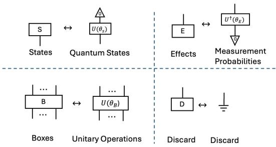  
Figure 1: Basic generators in the DisCoCirc framework and their quantum realisation.

From Diagrams to VQCs. Text diagrams are mapped to VQCs via the mapping depicted in Figure 1. The structure of each resulting circuit preserves the structure of its corresponding diagram, which in turn represents the semantic relations within and between the sentences of a piece of text. In this mapping:

• each wire is assigned a fixed number of qubits,

• states correspond to parameterised quantum state preparations,

• boxes correspond to parameterised quantum operations (in the most general case the boxes can have ancillas),

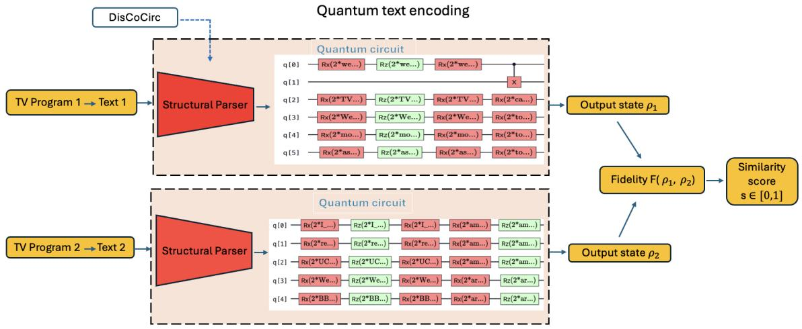  
Figure 2: Pipeline for quantum text-similarity computation. Each TV programme synopsis is structurally parsed and mapped to a parameterised quantum circuit, producing output states $\rho _ { 1 }$ and $\rho _ { 2 } .$ Their fidelity $F ( \rho _ { 1 } , \rho _ { 2 } )$ yields the final similarity score � ∈ [0, 1].

• efects correspond to measurements of specific outcomes, or equivalently to state unpreparations,

• discard operations correspond to removing subsystems.

Formally speaking, each circuit represents a series of tensors and tensor contractions, in such a way that the circuit as a whole (both before and after the contractions) corresponds to a state in a Hilbert space [3, 28]. Circuit parameters are optimised via classical simulation of these states, which are subsequently executed on quantum hardware for inference.

## 3 Methodology

In this section, we go over our methodology for training the VQCs on the programme synopses of the BBC iPlayer, built according to the QNLP approach.

## 3.1 Task Definition and Dataset

We use a dataset consisting of a week of TV programmes on iPlayer, where each programme is associated with a medium-length textual synopsis. These are 2-3 sentences of 5-10 words each that provide a summary of the content of each TV programme. The dataset also consists of users’ behavioural data, also observed within a given week. This data shows which user watched which programme for more than 5 minutes. The textual data is used to construct variational quantum circuits for the content-based quantum recommender. The behavioural data was used by the BBC Research and Development recommender software to provide gold standard collaborative filtering recommendations for comparison with the quantum model. This data is highly confidential and is not provided to third parties.

We implement a pairwise, content-based similarity learning task over programme synopses. The objective is to learn a mapping from a pair of synopses to a similarity score ∈ [0, 1], representing their semantic relatedness. Each synopsis is encoded into a VQC following the procedure in the previous section. The semantic similarity between two synopses is then computed via the quantum state overlap of their respective VQCs (formalized below). Figure 2 illustrates this pairwise similarity computation, in which each programme synopsis is structurally parsed and mapped to a parameterised quantum circuit, and the similarity between the resulting quantum representations is computed using fidelity. Finally, the VQC parameters are trained on ground-truth binary similarity labels generated by a neural topic model (NTM-R). We select this method because it leverages both latent features within the synopses and neural semantic embeddings of the words associated with each topic. The NTM-R model is trained on the full transcript of each programme—a multi-page, document-length text that yields richer similarity estimates than short synopses alone.

## 3.2 NTM-R Similarities and Label Construction

NTM-R stands for Neural Topic Model with Regularization [16]; it is a deep learning approach that identifies hidden topics in text. It works by encoding each document into a set of topic proportions and decoding these back into words. A regularization component based on pre-trained word embeddings helps the model form clearer and more coherent topics.

We use the NTM-R implementation of previous work [5, 6], where each TV program is represented using a bag-of-words (BoW) vector created from its subtitle text. The subtitles are tokenized, cleaned, and converted into a vocabulary ofall unique words appearing across the dataset. For each program, the BoW vector records how often each word occurred, producing a numerical representation of its textual content. These vectors are inputted into the NTM-R algorithm, which in turn learns abstract topics and represents each document as a mixture of those topics. The algorithm follows the structure of a variational autoencoder, consisting of two main parts: an encoder and a decoder, described below:

<table><tr><td>Models</td><td>Train</td><td>Valid</td><td>Test</td><td>mean train</td><td>mean test</td><td>Trainable Parameters</td></tr><tr><td>QNLP: discard</td><td>98.34%</td><td>89.00%</td><td>90.90%</td><td> $9 8 . 4 3 \% \pm 0 . 4 9 \%$ </td><td> $9 0 . 6 6 \% \pm 2 . 9 3 \%$ </td><td>47.4K</td></tr><tr><td>QNLP: post-selection</td><td>96.69%</td><td>87.87%</td><td>88.88%</td><td> $9 7 . 4 4 \% \pm 0 . 7 \%$ </td><td> $9 1 . 4 7 \% \pm 1 . 7 7 \%$ </td><td>47.4K</td></tr><tr><td>Q-BOW</td><td>71.79%</td><td>58.58%</td><td>65.65%</td><td> $7 2 . 5 9 \% \pm 6 . 3 4 \%$ </td><td> $6 7 . 1 1 \% \pm 1 0 . 9 0 \%$ </td><td>46.4k</td></tr><tr><td>BiLSTM@17M</td><td>92.76%</td><td>88.89%</td><td>90.91%</td><td> $9 5 . 5 9 \% \pm 0 . 6 6 \%$ </td><td> $9 1 . 7 0 \% \pm 1 . 8 7 \%$ </td><td>17.8M</td></tr><tr><td>BiLSTM@47K</td><td>53.24%</td><td>52.52%</td><td>53.54%</td><td> $5 3 . 3 0 \% \pm 0 . 8 6 \%$ </td><td> $5 3 . 3 0 \% \pm 3 . 0 9 \%$ </td><td>47.8K</td></tr></table>

Table 1: Results for the pairwise similarity prediction task. Train/Valid/Test results correspond to the initial fixed-split experiment used for hyperparameter tuning. Mean train and mean test report 5-fold cross-validation performance (mean ± standard deviation) using the selected hyperparameters. QNLP is our main quantum recommender; Q-BOW is a quantum baseline that only considers word meaning; the @ signs of the BiLSTMs are their numbers of parameters. For reference, a majority-class baseline that always predicts the positive class achieves an accuracy of 53.3%

• The encoder takes the BoW vector of a program and compresses it into a lower-dimensional latent vector that captures how strongly the program relates to each topic.

• The decoder reconstructs the original word distribution from this latent vector and learns which words are most associated with each topic.

An additional topic coherence regularization term was added to the autoencoder to guide the model to form more meaningful and interpretable topics. This was done by using pre-trained word embeddings ([5] used the statistical distributional vectors known as GloVe [25]) to ensure that the top words within each topic are semantically similar. Then, each TV program was represented by the latent topic distribution vector, which is a numerical summary indicating what proportion of each topic was presented in that program.

## 3.3 Circuit Construction and Ansatz

There exist several VQCs ansätze proposed, e.g. see [12, 13, 27]. In this work, we adopt the Sim4 ansatz [27], which provides a structured parameterisation of single-qubit rotations and entangling operations. This choice allows us to control circuit depth and the number of trainable parameters, while retaining the level of expressivity required for our model. The number of layers of the ansatz is a hyperparameter of the model and can be increased by stacking multiple layers of parameterised gates.

States are implemented using a standard Euler angle parametrisation, where a qubit is parametrised by a sequence of Z-X-Z rotation gates. Efects are measurement probabilities; boxes are unitary operations parametrised by the ansatz. Discard operations remove the corresponding subsystem by taking the partial trace over its qubits, leaving a reduced density matrix on the remaining output qubits.

To evaluate the similarity of a pair of quantum circuits, we project the $2 ^ { n } .$ -dimensional output vector space of each circuit into 4-dimensional vector space by merging the output wires with a box. For each circuit we retain two output qubits; the remaining qubits are discarded. Thus, the merge box acts as a global aggregation layer over the (latent) qubits present in the text circuit to extract a fixed-length embedding.

## 3.4 Training Objective and Optimisation

We implement the quantum recommender using the PytorchQuantum package from the lambeq library, which relies on PyTorch as the backend for all tensor operations, and we use the Adam optimiser. The objective function is implemented via the margin-based contrastive loss formula given below:

$$
L = 0 . 5 \left( y ( 1 - s ) ^ { 2 } + ( 1 - y ) \operatorname* { m a x } ( 0 , s - \mathrm { m a r g i n } ) ^ { 2 } \right) .
$$

During training, a continuous similarity score � ∈ [0, 1] is compared with a ground-truth label $y \in \{ 0 , 1 \}$ , which provides the supervision signal. The margin is set to 0.5. The continuous similarity score is the overlap between two quantum states and the ground-truth label comes from the NTM-R similarities. The NTM-R similarities are converted into binary labels by ranking the similarities for each programme. The top 20 most similar programmes are labelled 1, while the bottom 20 least similar programmes are labelled 0. The programme pairs in between the top 20 and bottom 20 do not feature in the dataset. $\mathrm { B y }$ training on labels derived from the most and least similar NTM-R pairs, we aim to learn a similarity measure that is correlated with NTM-R on these extreme examples but is ultimately distinct, since the quantum model learns its representation directly from the programme synopses. Intermediate programme pairs are not used for supervision, allowing the learned model to generalise beyond the NTM-R derived training subset.

The Uhlmann Fidelity Metric over Density Matrices. The overlap between two quantum states is computed via Uhlmann fidelity. Each circuit produces a density matrix representation $\boldsymbol { \rho } \in \mathbb { C } ^ { d \times d }$ obtained via tensor network contraction. The Uhlmann fidelity between two quantum states $\rho _ { a }$ and $\rho _ { b }$ is defined as follows:

$$
F ( \rho _ { a } , \rho _ { b } ) = \left( \mathrm { T r } \sqrt { \rho _ { a } ^ { 1 / 2 } \rho _ { b } \rho _ { a } ^ { 1 / 2 } } \right) ^ { 2 } .
$$

The matrix square roots are computed via Eigendecomposition to ensure the metric remains diferentiable during the parameter optimization process. The resulting fidelity $F \in [ 0 , 1 ]$ is what is used as the similarity in our contrastive loss formula above, denoted by �. The Uhlmann fidelity generalizes the pure-state overlap to mixed-state representations, enabling the model to learn optimal circuit parameters by maximizing the density matrix overlap of two semantically related circuits.

To design a recommender system viable on near-term quantum hardware, we must account for mixed states alongside pure states. In QNLP, post-selection or discarding are the method used to obtain a single output. While post-selection yields a pure state vector that is straightforward to model, its exponentially low success probability makes it prohibitively expensive on any quantum device. Conversely, discarding qubits traces out entangled subsystems, transforming the global pure state into a local mixed state represented by a density matrix. Consequently, we train two distinct circuit models: an idealized post-selected baseline and a hardware eficient partial trace model.

## 4 Evaluation and Results on Pairwise Similarity

To obtain a robust estimate of generalisation performance, we employ 5-fold cross-validation over the complete set of 985 selected programme pairs. The dataset consists of 985 pairs, which are partitioned into 5 disjoint folds of approximately equal size (≈197 samples per fold). In each iteration, one fold is used as the held-out test set, while the remaining four folds (≈790 samples) are used for training. The model is re-initialised from scratch for each fold to ensure independence across runs and to prevent information leakage between partitions. This procedure ensures that each sample is used exactly once for testing and four times for training. For evaluation, similarity scores are thresholded to obtain binary predictions. The threshold was selected during preliminary experiments on a fixed train/validation split and is kept fixed during the 5-fold cross-validation at 0.5. Binary predictions are then compared with the ground-truth labels to compute accuracy. The five randomly generated folds were approximately balanced with re spect to the ground-truth labels, with each test fold containing comparable numbers of positive and negative pairs. The dataset contains 53.3% positive and 46.7% negative pairs. Therefore, the appropriate constant-prediction baseline is 53.3%: a model that predicts the same label for every pair achieves its highest accuracy by always predicting the majority positive class. The present crossvalidation therefore evaluates generalisation to unseen programme pairs rather than to completely unseen synopses. Given the relatively small size of the dataset, we did not construct a separate evaluation setting for unseen synopses. Generalisation to unseen synopses composed of previously observed vocabulary will be considered in future work.

Each fold is trained for 25 epochs using fixed hyperparameters determined in preliminary experiments. Final performance is reported as the mean and standard deviation of test accuracy across the five folds. Figure 3 illustrates the overall training pipeline. The first four rectangles on the left describe the training process, the last two the recommendation generation procedure; we will explain the latter later.

Hyperparameters (learning rate, seed, batch size, margin parameter, and number of epochs) were selected using preliminary experiments on a fixed train/validation/test split of 787, 99, and 99 programme pairs, respectively. The models were trained for up to 50 epochs to analyse convergence behaviour. We observed that training consistently converges within 20–25 epochs. Based on this observation, we fix the number of training epochs to 25 for cross-validation experiments, reducing computational cost while maintaining performance. No further hyperparameter tuning was performed during cross-validation.

We use a batch size of 16 and a learning rate of $3 . 4 5 \times 1 0 ^ { - 4 }$ . While the experiments do not require specialised hardware, training time is substantial, thus all experiments were conducted on UCL CS’s high-performance computing cluster using CPU-based execution, with each run allocated 16 GB of RAM and a single CPU core.

A full 5-fold cross-validation run required approximately 70–80 hours of wall-clock time and the maximum allocated runtime was 96 hours.

To compare the performance of the quantum recommender with a classical baseline, we implement a bidirectional Long Short-Term Memory (BiLSTM) neural network on the same task.

The BiLSTM was trained from scratch, with no pre-trained embeddings or external knowledge to ensure a fair comparison with the quantum model, which likewise learns its representations exclusively from the training data. Each synopsis is tokenised by white space and mapped to a learned embedding of dimension $d _ { e } = 6 4$ Sequences are padded to a uniform length with a <PAD> token. The embedded sequence is then processed by two-layers with hidden dimension $d _ { h } = 1 2 8$ . This BiLSTM is described below:

$$
\begin{array} { r } { \begin{array} { r } { \overrightarrow { h } _ { t } , \overleftarrow { h } _ { t } = \mathrm { B i L S T M } ( w _ { t } , \ h _ { t - 1 } ) , \qquad \mathbf { s } = [ \overrightarrow { h } _ { T } \parallel \overleftarrow { h } _ { 1 } ] , } \end{array} } \end{array}\tag{1}
$$

where $w _ { t } \in \mathbb { R } ^ { d _ { e } }$ is the token representation and $\mathbf { s } \in \mathbb { R } ^ { 2 d _ { h } }$ is the sentence representation. The degree ofsimilarity between two sentence representations is computed using cosine similarity, and the model is trained using the same margin-based contrastive loss described in Section 3. For optimisation we used Adam again, with a learning rate of $1 0 ^ { - 3 }$ and batch size 16. Dropout is applied at rate 0.3 for regularisation. Training ran for up to 100 epochs with early stopping on validation loss. For the parameter-matched BiLSTM, our objective was to match the overall number of trainable parameters of the QNLP model rather than the dimensionality of the final synopsis representation. We therefore used a token embedding dimension $d _ { e } = 1 8 ,$ a hidden dimension $d _ { h } = 3 6 ,$ one bidirectional LSTM layer, and a final projection dimension $d _ { p } = 1$ . For this architecture, the number of trainable parameters is $\dot { P } = V d _ { e } + 8 d _ { h } ( d _ { e } + d _ { h } + 2 ) + 4 d _ { h } d _ { \phi } + 2 d _ { \rho } ^ { 2 } + 7 d _ { \rho } ,$ where � denotes the vocabulary size. For $V = 1 7 5 4 ,$ , this gives 47,853 trainable parameters, approximately matching the 47.4K parameters of the QNLP model.

The results are summarized in Table 1. Here, QNLP: post-selection represents the idealized baseline, whereas QNLP:discard denotes its practical counterpart. Both QNLP models converge with a high accuracy across all three training, validation and test subsets with post-selection performing slightly better in training and validation, whereas discard does better in test. Q-BOW is a baseline that ignores any semantic relationships across the text. In the Q-BOW baseline, each word is first represented by a parameterised quantum state. The word states are then combined using a spider construction, the quantum implementation of the spider introduces CNOT operations to merge the individual word wires, while the trainable parameters reside in the word-state preparation circuits.

As expected, it did not converge as well as the other QNLP models: its training accuracy was around 70%, its validation and test accuracies stagnated at around 58% and 65%. BiLSTM@17M reached similar accuracies to the QNLP models, however it needed 17 million as opposed to the 47 thousand parameters. A parametermatched BiLSTM@47K did not train as well and its accuracies across all subsets were only in the mid 50 percents.

<table><tr><td>Content-Based Models</td><td>MAP%</td><td>NDCG%</td><td>ILD%</td><td>Surprisal</td><td>Coverage%</td></tr><tr><td>Quantum Models:</td><td></td><td></td><td></td><td></td><td></td></tr><tr><td>QNLP: discard</td><td>12.93</td><td>25.87</td><td>78.84</td><td>5.31</td><td>100.00</td></tr><tr><td>QNLP: post-selection</td><td>13.33</td><td>26.80</td><td>78.28</td><td>5.30</td><td>100.00</td></tr><tr><td>Q-BOW</td><td>9.30</td><td>20.58</td><td>79.31</td><td>5.63</td><td>100.00</td></tr><tr><td>Classical Models:</td><td></td><td></td><td></td><td></td><td></td></tr><tr><td>BiLSTM@17.8M</td><td>13.03</td><td>26.02</td><td>79.10</td><td>5.37</td><td>100.00</td></tr><tr><td>BiLSTM@47K</td><td>9.40</td><td>20.61</td><td>79.88</td><td>5.84</td><td>100.00</td></tr><tr><td>NTM-R</td><td>13.23</td><td>26.53</td><td>78.88</td><td>5.24</td><td>100.00</td></tr><tr><td>Hybrid Models</td><td></td><td></td><td></td><td></td><td></td></tr><tr><td>One Quantum + One Classical Model:</td><td></td><td></td><td></td><td></td><td></td></tr><tr><td>QNLP:discard + NTM-R</td><td>13.39</td><td>26.78</td><td>78.66</td><td>5.20</td><td>100.00</td></tr><tr><td>QNLP:post-selection + NTM-R</td><td>13.80</td><td>27.47</td><td>78.08</td><td>5.19</td><td>100.00</td></tr><tr><td>QNLP:discard +BiLSTM</td><td>13.32</td><td>26.46</td><td>78.89</td><td>5.32</td><td>100.00</td></tr><tr><td>QNLP:post-selection +BiLSTM</td><td>13.43</td><td>26.80</td><td>78.44</td><td>5.32</td><td>100.00</td></tr><tr><td>One Quantum + Two Classical Models:</td><td></td><td></td><td></td><td></td><td></td></tr><tr><td>QNLP:discard +BiLSTM + NTM-R</td><td>13.35</td><td>26.70</td><td>78.68</td><td>5.24</td><td>100.00</td></tr><tr><td>QNLP:post-selection +BiLSTM + NTM-R</td><td>13.73</td><td>27.26</td><td>78.26</td><td>5.25</td><td>100.00</td></tr><tr><td>Two Classical Models: BiLSTM + NTM-R</td><td>13.44</td><td>26.84</td><td>78.56</td><td>5.23</td><td>100.00</td></tr><tr><td>Collaborative Filtering Model</td><td>16.00</td><td>30.74</td><td>79.16</td><td>4.10</td><td>98.58</td></tr></table>

Table 2: Evaluation of accuracy and diversity metrics for 145 TV programs.

When training Q-BOW, the number of trainable parameters initially improved the generalization performance, with the mean test accuracy increasing from 58.38% to approximately 77% for models with around 17k–23k parameters. Beyond this point, however, further increasing the model size did not lead to additional improvements. Instead, both the mean test accuracy and training stability decreased, with the largest model exhibiting a lower mean test accuracy (67.11%) and a higher standard deviation (10.90%).

BiLSTM@47K had an embedding dimension of 18 and hidden dimension of 36. With only one layer, the number of parameters reached 47K. When the layers were increased to two and three, the number of parameters increased to approximately 79K and 111K. Increasing the embedding dimensions to 32 and the hidden dimensions to 64 increased the parameters to 1.6M even with one layer. Decreasing the dimensions to 16 and 32 decreased it to 43K.

## 5 Recommendation Generation and Results

The recommender system utilizes an existing BBC Research and Development recommender package. We feed our learned pairwise similarity scores into this software for downstream recommendation generation. To obtain suficiently broad similarity information across the programme catalogue, the held-out similarity predictions from all five cross-validation folds are combined, so that each labelled programme pair contributes an out-of-fold similarity estimate. These combined similarity scores are then used by the software to generate recommendations using an item-based �-nearest neighbours (KNN) model over a catalogue of 145 TV programmes. A single global recommender model is applied to each user’s viewing history to produce personalised recommendation lists. The two right-hand-side rectangles of Figure 3 illustrate this procedure.

The evaluation set has 10,000 users. Recommendations are produced for each of these users following the below steps:

(1) Identify the set of programmes watched by a user �.

(2) For each candidate programme, compute a relevance score by summing its similarities to the programmes in the user’s history.

(3) Rank candidate programmes based on their scores.

(4) Recommend the top-� highest-scoring programmes.

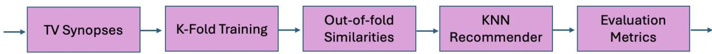  
Figure 3: Pipeline for evaluating learned similarity within a content-based recommender.

We report results at cut of � = 20, corresponding to the top-20 recommended items per user. To evaluate the performance of the generated recommendation, we use both accuracy (MAP, NDCG) and diversity metrics (Surprisal, ILD, Coverage). The overall perfor mance is obtained by averaging the results across all users. The definitions of these metrics are given below, following the evaluation framework used in previous BBC recommender-system work [5].

(1) Mean Average Precision (MAP) is defined as follows for � the set of users in the evaluation dataset

$$
A P @ K ( u ) = \frac { 1 } { \operatorname* { m i n } ( K , | G ( u ) | ) } \sum _ { n = 1 } ^ { K } P @ n \cdot r e l @ n ,
$$

where �@� is the precision at rank �, defined as the fraction of relevant items among the top-� recommendations, and ���@� = 1 if the item at rank � is in the ground truth set �(�), and 0 otherwise. The overall MAP is computed as:

$$
M A P @ K = \frac { 1 } { | U | } \sum _ { u \in U } A P @ K ( u ) .
$$

(2) Normalised Discounted Cumulative Gain (NDCG) is similar to MAP but additionally accounts for the rank posi tions of relevant programmes, giving greater importance to hits appearing higher in the recommendation list.

$$
\mathrm { D C G } @ K ( u ) = \sum _ { n = 1 } ^ { K } \frac { \mathrm { r e l } @ n } { \log _ { 2 } ( n + 1 ) } , ~ \mathrm { N D C G } @ K ( u ) = \frac { \mathrm { D C G } @ K ( u ) } { \mathrm { I D C G } @ K ( u ) } ,
$$

where IDCG@�(�) denotes the DCG of the ideal ranking. (3) Intra-List Diversity (ILD) measures the diversity of genres within each user’s recommendation list.

$$
\mathrm { I L D } @ K ( u ) = \frac { 2 } { K ( K - 1 ) } \sum _ { i < j , i , j \in R _ { u } } \left( 1 - \cos ( \mathbf { g } _ { i } , \mathbf { g } _ { j } ) \right) ,
$$

where $R _ { u }$ is the recommendation list for user �, and $\mathbf { g } _ { i }$ and $\mathbf { g } _ { j }$ denote the genre representations of programmes � and $j ,$ respectively.

(4) Surprisal reflects the presence of low-popularity programmes in the recommendations.

$$
I ( i ) = \log _ { 2 } \left( \frac { | U | } { k _ { i } } \right) , \qquad \mathrm { S u r p r i s a l } @ K ( u ) = \frac { 1 } { K } \sum _ { i \in R _ { u } } I ( i ) ,
$$

where $k _ { i }$ is the number of users who consumed programme � and |�| is the total number of users.

(5) Coverage indicates the proportion of available programmes that appear in the recommendation lists.

$$
\mathrm { C o v e r a g e @ } K = \frac { | \bigcup _ { u \in U } R _ { u } | } { | I | } ,
$$

where � denotes the full programme catalogue.

For user-level metrics, the reported score is obtained by averaging the corresponding metric over all evaluated users.

Table 2 summarizes the performance of the evaluated recommender systems. Across the standalone configurations, ideal QNLP: post-selection, QNLP:discard, and the classical BiLSTM models demonstrated comparable results. In terms of MAP, QNLP:postselection achieved the highest standalone score at 13.33%, marginally outperforming BiLSTM@17M at 13.03%, whereas the smaller BiL-STM@47K reached only 9.40%. Furthermore, QNLP:post-selection outperformed QNLP:discard (13.33% vs. 12.93%).

Following standard practice in recommendation ensembling [11, 18, 29], we constructed hybrid models by averaging the similarity scores of QNLP:discard with our classical content-based baselines NTM-R. Although the quantum model is trained using labels derived from NTM-R, it is only constrained to agree with NTM-R on the most similar and most dissimilar programme pairs selected for training. Intermediate pairs are not used for supervision, allowing the quantum model to generalise diferently on these pairs and thereby provide complementary information when combined with NTM-R in the hybrid recommender. As shown in the Hybrid section of Table 2, this combination outperformed all of the stand alone models and narrowed the performance gap with collaborative filtering (13.80% vs. 16.00% MAP). The combination QNLP:postselection + NTM-R was our best hybrid model, reaching an MAP of 13.80%, increasing the stand alone post-selection MAP by 0.47%. The combination QNLP:discard + NTM-R had a similar increase (0.46%), improving from an MAP of 12.93% to 13.39%. The BiL-STM@17M + NTM-R benefited from a similar increase (slightly lower and by 0.41%). Combining all three models acted in a similar way, with QNLP:post-selection+ BiLSTM + NTM-R reaching a higher MAP than QNLP:discard + BiLSTM + NTM-R. We also experimented with combining the BiLSTM model with each of the QNLP ones; following the same trend the combination with postselection did slightly better. Finally, it is worth noting that due to the training complexity, the quantum model was only trained on short synopses of programmes. This is whereas its classical NTM-R version was trained on the full transcripts of the programmes. Despite this restriction, the ideal quantum model performed better than NTM-R and the practical one only under performed by 0.3%. Generally, models such as NTM-R do not do well on short pieces of text and we believe that the quantum model excelled in the absence of data since it took the semantic structure of text into account.

## 6 Quantum Hardware Feasibility

The results in the preceding sections were obtained via classical simulation: each circuit is evaluated by tensor network contraction, and similarity is computed from the resulting representations. A central motivation of this work is to demonstrate that these computations can be carried out on quantum hardware. In this section, we present a hardware feasibility study in which the trained circuits are first executed on the Quantinuum H2 emulator [26], a classical emulation of the H2 trapped-ion quantum processor [21] that reproduces its gate set, connectivity, and noise characteristics, and then on the physical H2-2 device. We address two questions: (i) whether the similarity signal encoded in the circuits is recoverable via a hardware-compatible measurement protocol, and (ii) whether emulator results reliably predict hardware performance on our task.

We evaluate 99 programme pairs from the validation split. This subset retains the label balance of the full dataset and is small enough to run exhaustively on the emulator. We emphasise that this evaluation is distinct from the 5-fold cross-validation reported in Table 1: the cross-validation assesses model generalisation across the full dataset, while the hardware experiments assess whether the learned similarity is recoverable on a quantum device for a representative subset.

## 6.1 The Quantinuum H2 System and Emulator

The Quantinuum H2 is a trapped-ion quantum processor based on a race-track architecture [21], with the following properties:

• All-to-all connectivity: any pair of qubits can interact directly, without SWAP routing. This is important for our protocol, which applies gates between qubits in diferent circuit registers.

• High-fidelity gates: two-qubit gate fidelities exceed 99.5% [26], with a native gate set of single-qubit rotations, two-qubit ZZ gates, parameterized-angle ZZ gates, general SU(4) entangler.

• Up to 56 qubits: our combined circuits for each synopsis pair range from 9 to 23 qubits, well within capacity.

The H2 emulator [26] reproduces the device’s gate set and com pilation passes, and supports two modes:

• Noiseless: ideal unitary evolution with sampling noise only (standard error $1 / \sqrt { N }$ for � shots).

• Noisy: includes a noise model reproducing the characteristics of the physical device.

Running both modes allows us to separate two efects: whether the measurement protocol is correct (noiseless mode) and how device noise degrades the signal (noisy mode).

## 6.2 Why a Quantum Measurement Protocol is Needed

When a single circuit is executed on hardware, the result is a set of bitstrings sampled from a probability distribution. These bitstrings give access to the Born-rule probabilities $| \alpha _ { i } | ^ { 2 }$ , but not to the complex amplitudes $\alpha _ { i }$ themselves. The similarity metric used in training is the Uhlmann fidelity $F ( \rho _ { A } , \rho _ { B } )$ between the reduced output states. This quantity cannot in general be reconstructed from the individual measurement statistics of circuits � and � separately.

To compute the state overlap without reconstructing the states, we require a protocol that compares the two circuits jointly at the quantum level. The destructive SWAP test provides this capability.

In our circuits, the situation is further complicated by the presence of discarded qubits. On hardware, all qubits are physically measured, but the discarded wires’ outcomes are not used. Because the entangling gates create correlations between the discarded and non-discarded qubits, the marginal statistics on the output qubits alone correspond to those of a mixed state.

## 6.3 The Destructive SWAP Test

We employ the destructive SWAP test [4, 7] to estimate the state overlap

$$
\operatorname { T r } ( \rho _ { A } \rho _ { B } ) .\tag{2}
$$

This quantity compares the marginal statistics of the output qubits between two circuits. For pure states, it reduces to $| \langle \psi _ { A } | \psi _ { B } \rangle | ^ { 2 }$ . For our case, it does not reduce to the latter formula since we are not dealing with pure states.

Protocol. Given circuits $A ~ ( n _ { A }$ qubits) and $\textit { B } ( { \boldsymbol { n } } _ { B }$ qubits), each producing $n _ { \mathrm { o u t } } = 2$ output qubits:

(1) Run circuit � on qubits $\{ 0 , . . . , n _ { A } { - 1 } \}$ and circuit � on qubits $\left\{ { { n } _ { A } } , . . . , { { n } _ { A } } + { { n } _ { B } } - 1 \right\}$ . The two circuits use disjoint qubit registers initialised from |0⟩ .

(2) Apply a Bell-basis measurement across each pair of corresponding output qubits:

$$
\mathrm { C N O T } ( q _ { i } ^ { A }  q _ { i } ^ { B } ) , ~ H ( q _ { i } ^ { A } ) , ~ \mathrm { m e a s u r e ~ b o t h } ,\tag{3}
$$

for $i \in \{ 0 , 1 \}$

(3) Measure all remaining qubits in the computational basis (required by the H2 system).

(4) The hardware returns a set of bitstrings and their counts. From each bitstring, extract the four bits at the Bell-measured positions $( z _ { 1 } , z _ { 2 }$ from the Hadamard-transformed output qubits of �, and $x _ { 1 } , x _ { 2 }$ from the CNOT targets in �). Compute:

$$
\mathrm { T r } ( \rho _ { A } \rho _ { B } ) = \frac { 1 } { N } \sum _ { k = 1 } ^ { N } \prod _ { i = 1 } ^ { n _ { \mathrm { o u t } } } ( - 1 ) ^ { z _ { i } ^ { ( k ) } \cdot x _ { i } ^ { ( k ) } } ,\tag{4}
$$

where � indexes the shots. Each shot contributes +1 $\mathrm { o r - } 1 ;$ the average over � shots converges to $\operatorname { T r } ( \rho _ { A } \rho _ { B } )$ .

The overhead is minimal: $n _ { \mathrm { o u t } }$ additional CNOT gates and $n _ { \mathrm { o u t } }$ Hadamard gates, with no ancilla qubits. The total qubit count is $n _ { A } + n _ { B } .$ . On the H2 system, all-to-all connectivity ensures the crossregister gates incur no routing overhead.

## 6.4 Does the Similarity Signal Survive?

The circuits were trained to maximise the Uhlmann fidelity:

$$
F ( \rho _ { a } , \rho _ { b } ) = \left( \mathrm { T r } \sqrt { \rho _ { a } ^ { 1 / 2 } \rho _ { b } \rho _ { a } ^ { 1 / 2 } } \right) ^ { 2 } .
$$

for similar programmes and minimise it for dissimilar ones. On hardware, we measure $\operatorname { T r } ( \rho _ { A } \rho _ { B } )$ via the SWAP test.

We tested if the similarity signal survives in our protocol by computing $\operatorname { T r } ( \rho _ { A } \rho _ { B } )$ exactly for all 99 pairs via full statevector simulation and numerical partial trace, and comparing against the classical training fidelity. Table 3 shows the average values for each class. The Pearson correlation between the two metrics is $r = 0 . 9 1 0$

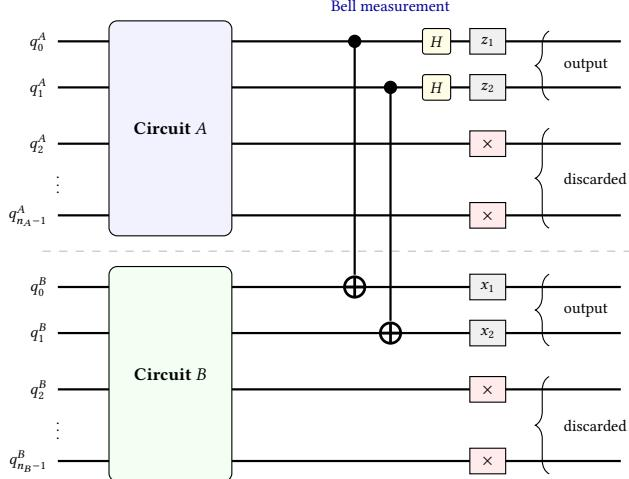

Figure 4: Destructive SWAP test. Circuits � and � run forward on disjoint registers. A Bell-basis measurement $( \mathbf { C N O T } + H )$ is applied across the output qubit pairs. Discarded qubits (×) are measured but not used.
<table><tr><td>Metric</td><td>Dissimilar</td><td>Similar</td></tr><tr><td>Training fidelity (Uhlmann)</td><td> $0 . 4 4 \pm 0 . 1 9$ </td><td> $0 . 8 5 \pm 0 . 1 0$ </td></tr><tr><td>SWAP test overlap</td><td> $0 . 1 7 4 \pm 0 . 0 4 2$ </td><td> $0 . 3 6 8 \pm 0 . 0 6 5$ </td></tr></table>

Table 3: Comparison of the classical training fidelity and the SWAP test overlap (noiseless emulator, 1000 shots) on 99 programme pairs (46 dissimilar, 53 similar). There is a strong correlation $r = 0 . 9 1 0$ between the two, confirming that the similarity signal is preserved in the output-qubit state overlap.

The training fidelity (Uhlmann) spans [0, 1], while the hardwaremeasurable overlap $\operatorname { T r } ( \rho _ { A } \rho _ { B } )$ occupies a compressed range. For two �-dimensional quantum states, $\operatorname { T r } ( \rho \sigma ) \leq \operatorname { T r } ( \rho ^ { 2 } )$ with equality when $\rho = \sigma ,$ and $\operatorname { T r } ( \rho \sigma ) \geq 1 / d ^ { 2 }$ for states drawn uniformly at random [23]. For our two-qubit outputs $( d ~ = ~ 4 )$ , the lower bound is $1 / 1 6 = 0 . 0 6 2 5$ . Since discarding entangled qubits generically produces mixed states, the purities of our circuit outputs are substantially less than 1 (mean purity ≈ 0.36 across the dataset). This compresses the efective range of $\operatorname { T r } ( \rho _ { A } \rho _ { B } )$ to approximately [0.06, 0.50] on the emulator and [0.08, 0.53] on hardware, compared to [0, 1] for the training fidelity. The same compression is observed on both emulator and hardware because it is a property of the quantum states, not of the measurement device.

Crucially, this compression is monotonic: the ranking of pairs by $\operatorname { T r } ( \rho _ { A } \rho _ { B } )$ preserves the ranking by training fidelity $( r = 0 . 9 1 0$ on the full emulator dataset, � = 0.963 on the hardware subset). To obtain a classification threshold in the overlap space, we project the training threshold of 0.5 (in Uhlmann fidelity) through the linear relationship between fidelity and overlap, yielding a mapped threshold of 0.213. This mapping uses only the continuous-valued fidelity and overlap scores, not the binary labels; the threshold of 0.5 was fixed during classical training before any quantum measurement was performed. As a consistency check, a threshold derived purely from the theoretical bounds (the midpoint of the accessible range $\textstyle \frac { 1 } { 2 } \bigl ( 1 / d ^ { 2 } + \bar { p } \bigr ) \approx 0 . 2 1$ , where $\bar { p } \approx 0 . 3 6$ is the mean purity and $d = 4$ is the output dimension) yields a comparable value without reference to any data. At this threshold, the classification accuracy is 91.9% (noiseless, 1000 shots) and 88.9% (noisy, 1000 shots).

## 6.5 Emulator Results

We executed the destructive SWAP test on the H2 emulator in both noiseless and noisy modes at 100 and 1000 shots per pair. After compilation to the H2 native gate set with optimisation level 2, the combined circuits ranged from 9 to 23 qubits, 124 to 676 compiled two-qubit gates, and 44 to 150 two-qubit gate depth.

6.5.1 Sampling Noise. Each shot of the SWAP test produces a value of +1 or −1 via the parity formula (4). The overlap estimate is the average over � such values. Since each value is bounded by ±1, the variance per shot is at most 1, and the standard error of the mean is

$$
{ \mathrm { S E } } = { \frac { 1 } { \sqrt { N } } } .\tag{5}
$$

At � = 1000 shots, $\mathrm { S E } \approx 0 . 0 3 2 .$ The average SWAP test overlap for dissimilar pairs is 0.174 and for similar pairs 0.368, a gap of approximately 0.194. With $\mathrm { S E } \approx 0 . 0 3 2$ , this gap is roughly 6.1 standard errors wide. For any individual pair, the measurement is noisy, but across the full population of pairs, the group averages are reliably separated. At 100 shots $( \mathrm { S E } \approx 0 . 1 0 )$ , the gap of 0.194 remains approximately 1.9 standard errors wide, providing meaningful separation even at lower shot counts (Figure 5).

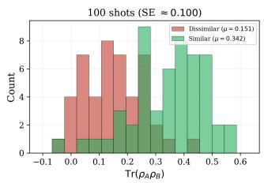

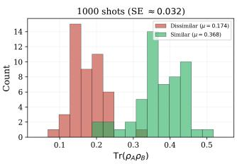  
Figure 5: Efect of shot budget on the distribution of SWAP test overlaps. Left: 100 shots $( \mathrm { S E } \approx 0 . 1 0 )$ , where the distributions overlap. Right: 1000 shots $\left( \mathrm { S E } \approx 0 . 0 3 \right)$ , where the distributions are more separated. Since $\mathrm { S E } = 1 / { \sqrt { N } } ,$ increasing the shot count improves the approximation of the true overlap at the cost of longer runtimes.

6.5.2 Correlation with Classical Training Fidelity. Figure 6 shows the emulator SWAP test overlap (noiseless, 1000 shots) versus the training fidelity (Uhlmann). The Pearson correlation is $r = 0 . 9 1 0$ Despite this, the overall trend is clear and the red/green separation is visible, indicating that the similarity signal learned during training is recoverable from hardware measurements.

Figure 7 shows the distribution of SWAP test overlaps by label on the emulator (noiseless, 1000 shots). The dissimilar pairs cluster around 0.174 and the similar pairs around 0.368, with partial overlap between the distributions due to sampling noise. As noted above, the standard error scales as $1 / { \sqrt { N } } ,$ so higher shot counts would further sharpen the separation at the cost of increased runtime.

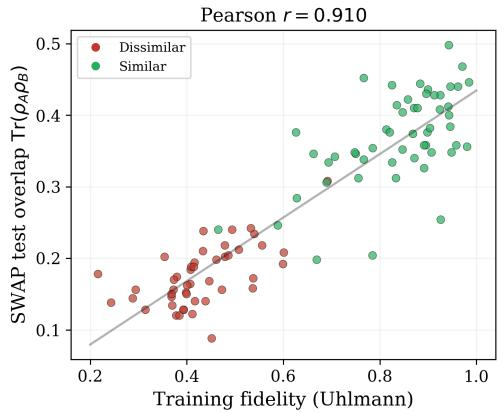  
Figure 6: Training fidelity (Uhlmann) versus emulator SWAP test overlap (noiseless, 1000 shots). The correlation $r = 0 . 9 1 0$ confirms that the similarity signal is recoverable from sampled measurements. Red: dissimilar; green: similar.

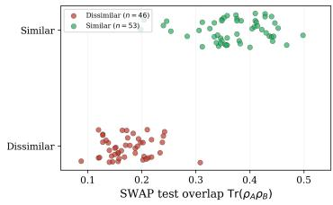

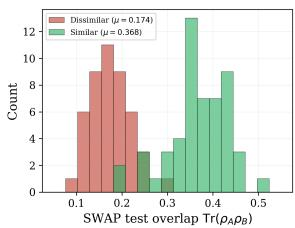  
Figure 7: Distribution of SWAP test overlaps on the H2 emulator (noiseless, 1000 shots) by label. Left: strip plot showing individual pairs. Right: histogram with group means. Dissimilar pairs cluster around 0.174 and similar pairs around 0.368.

6.5.3 Efect ofDevice Noise. Figure 8 compares noiseless and noisy emulator results across all 99 pairs. In aggregate, the efect of the noise model is small: the group means are nearly identical dissimilar: 0.174 noiseless vs 0.170 noisy; similar: 0.368 vs 0.358), and the correlation between the two is $r = 0 . 9 4 4 )$ . The noise model introduces additional per-pair variance beyond sampling noise, but does not systematically bias the overlap in one direction. Table 4 summarises the aggregate results.

We also show the noisy SWAP test overlap as a function of the compiled two-qubit gate depth (Figure 9).

## 6.6 H2 Hardware Results

Running all 99 emulator pairs on the H2 processor at 1000 shots would require more than the allocated hardware budget for this project. Therefore, we selected a representative subset of 20 circuit pairs that spans the full range of circuit sizes in the dataset. The selection covers four qubit-count bins (12–14, 15–17, 18–20, 21–23) and four compiled two-qubit gate depth bins (44–70, 71–90, 91–110,

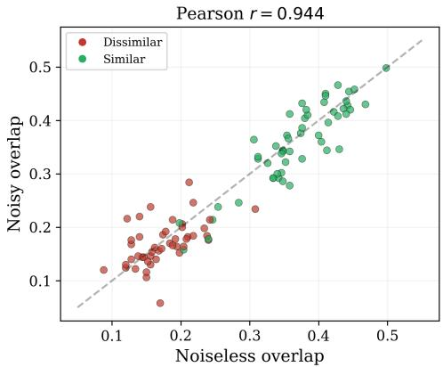

Figure 8: Noisy versus noiseless emulator overlap at 1000 shots $( r = 0 . 9 4 4 )$ . Points scatter around the diagonal, indicating that the noise model adds per-pair variance but does not systematically degrade the signal.  
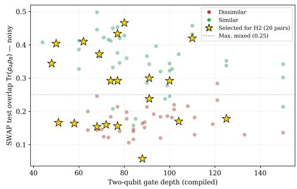  
Figure 9: Emulator SWAP test overlap (noisy, 1000 shots) versus compiled two-qubit gate depth. For circuits below approximately depth 100, the separation between similar and dissimilar pairs is clear. For the deepest circuits (depth > 120), both classes are compressed toward 0.25, the overlap value expected for maximally mixed states.

Table 4: Emulator SWAP test results at 1000 and 100 shots. Accuracy is computed at the mapped training threshold (0.213 for noiseless, 0.207 for noisy, 0.184 for 100 shots), obtained by projecting the Uhlmann fidelity threshold of 0.5 into the overlap space via linear regression.
<table><tr><td>Configuration</td><td>Dissimilar</td><td>Similar</td><td>r</td><td>Acc.</td></tr><tr><td>Noiseless, 1000 shots</td><td> $0 . 1 7 4 \pm 0 . 0 4 2$ </td><td> $0 . 3 6 8 \pm 0 . 0 6 5$ </td><td>0.910</td><td>91.9%</td></tr><tr><td>Noisy, 1000 shots</td><td> $0 . 1 7 0 \pm 0 . 0 4 1$ </td><td> $0 . 3 5 8 \pm 0 . 0 7 7$ </td><td>0.875</td><td>88.9%</td></tr><tr><td>Noiseless, 100 shots</td><td> $0 . 1 5 1 \pm 0 . 1 0 1$ </td><td> $0 . 3 4 2 \pm 0 . 1 2 9$ </td><td>0.690</td><td>79.8%</td></tr></table>

111–150), with both similar and dissimilar pairs in each populated bin. The subset preserves the statistical properties of the full dataset: the mean qubit count (15.7 vs 16.3), mean two-qubit gate depth (84 vs 89), and the emulator overlap gap on the selected subset (0.238) is comparable to the full-dataset gap (0.194), with the diference attributable to the subset’s bias toward smaller, better-separated circuits. We executed the circuits on the Quantinuum H2-2 trapped ion processor for this representative subset of 20 circuit pairs at 1000 shots per pair.

Table 5: Hardware (H2-2) and noisy emulator results for the 20 selected pairs at 1000 shots. The hardware gap (0.257) exceeds the emulator prediction (0.238).
<table><tr><td></td><td>H2-2 Hardware</td><td>Noisy Emulator</td></tr><tr><td>Dissimilar  $( n = 9 )$ </td><td> $0 . 1 5 7 \pm 0 . 0 4 2$ </td><td> $0 . 1 5 8 \pm 0 . 0 4 4$ </td></tr><tr><td>Similar  $( n = 1 1 )$ </td><td> $0 . 4 1 4 \pm 0 . 0 5 8$ </td><td> $0 . 3 9 5 \pm 0 . 0 6 1$ </td></tr><tr><td>Gap</td><td>0.257</td><td>0.238</td></tr><tr><td>Cohen&#x27;s d</td><td>5.11</td><td>4.48</td></tr><tr><td>r with training fidelity</td><td>0.963</td><td></td></tr></table>

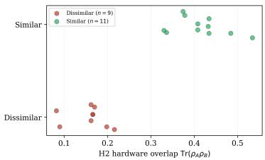

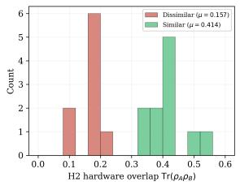  
Figure 10: H2-2 hardware results (1000 shots, 20 pairs). Left: strip plot showing clear separation between dissimilar (red) and similar (green) pairs. Right: histogram of hardware overlaps $( \mu _ { \mathbf { d i s } } = 0 . 1 5 7 , \mu _ { \mathbf { s i m } } = 0 . 4 1 4 , \mathbf { g a p } = 0 . 2 5 7 )$ .

Table 5 summarises the hardware results alongside the noisy emulator results for the same 20 pairs.

The similarity signal survives execution on quantum hardware. Dissimilar pairs produce a mean overlap of $0 . 1 5 7 { \pm } 0 . 0 4 2$ and similar pairs $0 . 4 1 4 \pm 0 . 0 5 8$ , yielding a gap of 0.257 (Cohen’s $d \ = \ 5 . 1 1$ $\ p = 3 . 5 \times 1 0 ^ { - 9 } )$ . The hardware overlap correlates with the training fidelity at $r = 0 . 9 6 3$ (Figure 11), confirming that circuits trained to have high similarity also produce high state overlap on hardware.

Figure 12 compares the hardware and noisy emulator overlaps for each pair. The Pearson correlation is $r = 0 . 9 5 2 ,$ , and the points cluster around the diagonal, confirming that the noisy emulator is a reliable predictor of hardware performance. The hardware gap (0.257) is slightly larger than the emulator prediction (0.238), indicating that the emulator noise model provides a conservative estimate.

Figure 13 shows the hardware overlap as a function of the compiled two-qubit gate depth. The separation between similar and dissimilar pairs is maintained across all depths tested, including circuits at depth 150. As expected, the deepest circuits show the most variance, but the signal remains above the maximally mixed baseline. Figure 14 shows the same trend as a function of qubit count, with separation maintained from 12 to 23 qubits.

## 7 Summary and Next Steps

The work presented in this paper demonstrated that a quantum content-based recommender system performs on par with a classical BiLSTM one, with a MAP diference of 0.10 (the BiLSTM

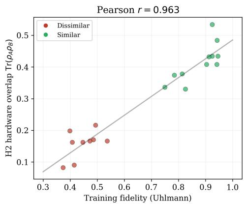  
Figure 11: H2-2 hardware overlap versus training fidelity (Uhlmann), $r = 0 . 9 6 3$ . Circuits trained to have high similarity produce high state overlap on hardware.

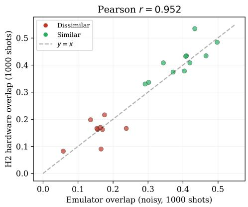  
Figure 12: H2-2 hardware overlap versus noisy emulator overlap for the same 20 pairs $( r = 0 . 9 5 2 )$ . Points near the diagonal confirm the emulator is a reliable predictor of hardware performance.

MAP was 13.03, and the quantum one 12.93), but with significantly less parameters: 47K vs 17.8M. A parameter-matched BiLSTM decreased the MAP by 3.63. It went down from 13.03 to 9.40. When combined with the classical NTM-R content-based recommender models MAP increased by $0 . 4 6 \% { - } 0 . 4 7 \%$ across the two QNLP models. This confirms previous results in the same field, where (1) combining diferent content-based models proved to be useful [5, 22], and (2) combining classical and quantum results resulted in a boost in accuracy [11, 18, 29]. Our main quantum models followed a framework known as QNLP, which embeds the semantic structure of the text into variational quantum circuits. The performance of this model was far better than an unstructured model that embedded a bag-of-words model of meaning into circuits (an MAP of 9.30% vs the ideal 13.33% and the practical 12.93%). This shows firstly, semantic structure plays a major role in a content-based recommender system, and secondly, quantum circuits are able to model this structure.

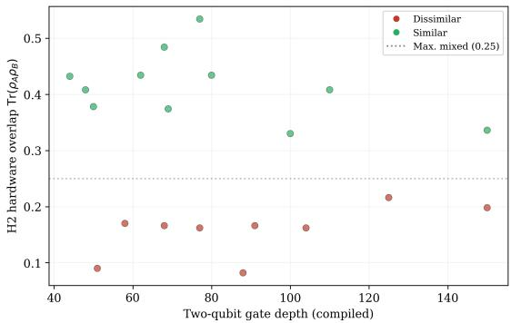  
Figure 13: H2-2 hardware overlap versus compiled two-qubit gate depth. The separation between similar and dissimilar pairs is maintained across all depths, including the deepest circuits (depth 150).

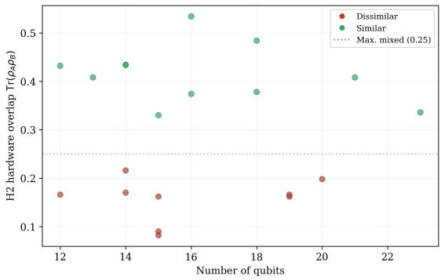  
Figure 14: H2-2 hardware overlap versus number of qubits. The separation between similar and dissimilar pairs is maintained across all circuit sizes (12 to 23 qubits). The dashed line shows the maximally mixed baseline (0.25).

In this paper we focused on content, extracted from the textual assets of programmes. In future work, we will experiment with other signals such as genre and audiovisual assets. With regards to genre, each programme has a tree describing to which hierarchy of categories does it belong, e.g. documentary-nature&nature, or documentary-history. Our roadmap would be to first train our QNLP models with the genre similarity labels, then combine these with the original genre model, and finally combine these ensembles with the NTM-R models, allowing for a three-way QNLP+NTM-R+genre hybrid recommender. Audiovisual assets come from the programmes audio and video files, which can be modelled into embedding vectors in ways similar to text. In previous work, they led to small increases in accuracy but required far more compute [5, 22]. We are hoping quantum-inspired approaches such as the one used in this paper, will improve on this.

A potential shortcoming of the current model is its use of a single merge box that combines all of the words within a piece of text. It is not optimal to use the same merge box for new pieces of text, especially when the size of their text-circuit is wider than the ones already seen in the current dataset. A solution to this problem is the use of a series of binary merge boxes in a staircase pattern. In this case, the binary box merges two words at the time and can be applied to a text of any length. Implementing this model is left to future work.

The model was run on the hardware emulator on Quantinuum’s H2 device. The results were used to provide a hardware feasibility study for this task. This established three results:

(1) The signal survives on quantum hardware. On 20 representative circuit pairs executed on the H2-2 processor, the SWAP test overlap separates similar from dissimilar pairs with a gap of 0.257 (Cohen’s � = 5.11). The hardware overlap correlates with the training fidelity at $r = 0 . 9 6 3$

(2) The emulator is a reliable predictor. Hardware and noisy emulator overlaps correlate at � = 0.952 across the 20 pairs, and the hardware gap (0.257) exceeds the emulator prediction (0.238). This validates the emulator-based analysis on the remaining 79 pairs.

(3) Noise does not destroy the signal. The noisy emulator results $( \mu _ { \mathrm { s i m } } = 0 . 3 5 8 , \mu _ { \mathrm { d i s } } = 0 . 1 7 0 )$ closely match the noiseless results (0.368 and 0.174), and the hardware results (0.414 and 0.157) confirm that real device noise is manageable.

The overall conclusion is that variational quantum circuits can learn textual content similarity with results comparable to a BiL-STM. When executed on the Quantinuum H2-2 trapped-ion processor, the trained circuits produce state overlaps that reliably separate similar from dissimilar programme pairs (Cohen’s � = 5.11), confirming hardware feasibility. These results suggest that recommender systems provide a potential application domain for studying parameter-eficient quantum machine learning models in the NISQ era.

## 8 Data and Code Availability

The code for the experiments presented in this work is publicly available at: https://github.com/Mina-Abbaszade/Quantum-Text-Similarity. The repository includes the full implementation of the quantum similarity models, training procedures, and the text-tocircuit pipeline based on DisCoCirc. The dataset used in this work consists of publicly available TV programme synopses together with derived pairwise similarity labels. The processed datasets (train, validation, and test splits) are provided in the repository to support reproducibility. Due to storage considerations, precomputed quantum circuits are not included and can be regenerated using the provided code. The downstream recommender system used for evaluation is based on proprietary BBC infrastructure and includes user data; therefore, it is not publicly available. This repository focuses solely on the similarity learning component.

## Acknowledgments

The authors would like to thank Stephen Clark, Dimitri Kartsaklis, Tifany Duneau, and Kin Ian Lo for helpful discussions and support during the development of this work. We also gratefully acknowledge Quantinuum for providing access to the H2 emulator and quantum hardware used in this study. Mina Abbaszadeh gratefully acknowledges University College London (UCL) for supporting her postdoctoral research position. This work was supported in part by the Royal Academy of Engineering Research Chair in “Engineered

Mathematics for Modelling Typed Structure” (RCSRF2122-14-152), sponsored by University College London (UCL), the British Broadcasting Corporation (BBC), and Quantinuum.

## References

[1] 2024. Media Act 2024. https://www.legislation.gov.uk/ukpga/2024/15 c. 15.

[2] Gediminas Adomavicius and Alexander Tuzhilin. 2005. Toward the Next Generation of Recommender Systems: A Survey of the State-of-the-Art and Possible Extensions. IEEE Transactions on Knowledge and Data Engineering 17, 6 (2005), 734–749. doi:10.1109/TKDE.2005.99

[3] Jacob Biamonte, Peter Wittek, Nicola Pancotti, Patrick Rebentrost, Nathan Wiebe, and Seth Lloyd. 2017. Quantum Machine Learning. Nature 549, 7671 (2017), 195–202. doi:10.1038/nature23474

[4] H. Buhrman, R. Cleve, J. Watrous, and R. de Wolf. 2001. Quantum Fingerprinting. Physical Review Letters 87, 16 (2001), 167902. doi:10.1103/PhysRevLett.87.167902

[5] T. Cagali, M. Sadrzadeh, and C. Newell. 2021. Enhancing personalised recommendations with the use of multimodal information. In Proc. IEEE Int. Symp. Multimedia (ISM). 186–190.

[6] T. Cagali, H. Wazni, S. Nazir, M. Sadrzadeh, and C. Newell. 2023. Semantic and lexical token-based vectors improve precision of recommendations for TV programmes. In Proc. IEEE Int. Symp. Multimedia (ISM). 287–290.

[7] L. Cincio, Y. Subaşı, A. T. Sornborger, and P. J. Coles. 2018. Learning the quantum algorithm for state overlap. New Journal of Physics 20 (2018), 113022. doi:10. 1088/1367-2630/aae94a

[8] Bob Coecke. 2021. The Mathematics of Text Structure. In Electronic Proceedings in Theoretical Computer Science (EPTCS), Vol. 340. 213–229. doi:10.4204/EPTCS. 340.14

[9] Bob Coecke, Giovanni de Felice, Konstantinos Meichanetzidis, and Alexis Toumi. 2020. Foundations for near-term quantum natural language processing. arXiv preprint arXiv:2012.03755 (2020). https://arxiv.org/abs/2012.03755

[10] T. Duneau et al. 2024. Scalable and interpretable quantum natural language processing. arXiv preprint arXiv:2409.08777 (2024).

[11] Michele Grossi, Noelle Ibrahim, Voica Radescu, Robert Loredo, Kirsten Voigt, Constantin von Altrock, and Andreas Rudnik. 2022. Mixed Quantum-Classical Method for Fraud Detection with Quantum Feature Selection. IEEE Transactions on Quantum Engineering 3 (2022), 1–12. arXiv:2208.07963 [quant-ph] doi:10.1109 TQE.2022.3213474

[12] Vojtěch Havlíček, Antonio D Córcoles, Kristan Temme, Aram W Harrow, Abhinav Kandala, Jerry M Chow, and Jay M Gambetta. 2019. Supervised learning with quantum-enhanced feature spaces. Nature 567, 7747 (2019), 209–212. doi:10. 1038/s41586-019-0980-2

[13] Abhinav Kandala, Antonio Mezzacapo, Kristan Temme, Maika Takita, Markus Brink, Jerry M Chow, and Jay M Gambetta. 2017. Hardware-eficient variational quantum eigensolver for small molecules and quantum magnets. Nature 549, 7671 (2017), 242–246. doi:10.1038/nature23879

[14] Dimitri Kartsaklis, Ian Fan, Richie Yeung, Anna Pearson, Robin Lorenz, Alexis Toumi, Giovanni de Felice, Konstantinos Meichanetzidis, and Bob Coecke. 2021. lambeq: An eficient high-level Python library for quantum NLP. arXiv preprint arXiv:2110.04236 (2021). https://arxiv.org/abs/2110.04236

[15] Iordanis Kerenidis and Anupam Prakash. 2017. Quantum Recommendation Systems. In 8th Innovations in Theoretical Computer Science Conference (ITCS 2017) (Leibniz International Proceedings in Informatics (LIPIcs), Vol. 67). Schloss Dagstuhl – Leibniz-Zentrum für Informatik, 33:1–33:21. doi:10.4230/LIPIcs.ITCS.2017.33

[16] K. Krasnashchok and A. Cherif. 2019. Coherence regularization for neural topic models. In Advances in Neural Networks: 16th Int. Symp. Neural Networks (ISNN). Moscow, Russia, 426–433.

[17] Colin Krawchuk, Nikhil Khatri, Neil John Ortega, and Dimitri Kartsaklis. 2025. Eficient Generation of Parameterised Quantum Circuits from Large Texts. arXiv preprint arXiv:2505.13208 (2025). https://arxiv.org/abs/2505.13208

[18] Ankur Kumar, Sanjay Dhanka, Amit Sharma, Mohammed Aljuaid, and Mochammad Fahlevi. 2025. A hybrid framework for heart disease prediction using classical and quantum-inspired machine learning techniques. Scientific Reports 15, 1 (2025), 25040. doi:10.1038/s41598-025-09957-1

[19] J. Liu, R. A. Shaikh, B. Rodatz, R. Yeung, and B. Coecke. 2023. A pipeline for discourse circuits from CCG. arXiv preprint arXiv:2311.17892 (2023).

[20] Robin Lorenz, Anna Pearson, Konstantinos Meichanetzidis, Dimitri Kartsaklis, and Bob Coecke. 2023. QNLP in practice: Running compositional models of meaning on a quantum computer. Journal of Artificial Intelligence Research 76 (2023), 1305–1342. doi:10.1613/jair.1.14329

[21] S. A. Moses, C. H. Baldwin, M. S. Allman, R. Ancona, L. Asber, et al. 2023. A Race-Track Trapped-Ion Quantum Processor. Physical Review X 13 (2023), 041052. doi:10.1103/PhysRevX.13.041052

[22] S. Nazir, T. Cagali, M. Sadrzadeh, and C. Newell. 2020. Audiovisual, genre, neural and topical textual embeddings for TV programme content representation. In Proc. IEEE Int. Symp. Multimedia (ISM). 197–200.

[23] M. A. Nielsen and I. L. Chuang. 2010. Quantum Computation and Quantum Information (10th anniversary ed.). Cambridge University Press. doi:10.1017/ CBO9780511976667

[24] Ofcom. (2026, April 2). Update on implementing the Media Act. https://www.ofcom.org.uk/tv-radio-and-on-demand/public-servicebroadcasting/update-on-implementing-the-media-act [n. d.]. Ofcom. (2026, April 2). Update on implementing the Media Act. https://www.ofcom.org.uk/tvradio-and-on-demand/public-service-broadcasting/update-on-implementingthe-media-act.

[25] J. Pennington, R. Socher, and C. D. Manning. 2014. GloVe: Global vectors for word representation. In Proc. Conf. Empirical Methods in Natural Language Processing (EMNLP). Doha, Qatar, 1532–1543.

[26] Quantinuum. 2024. System Model H2 Product Data Sheet. (2024). Available at https://www.quantinuum.com/hardware/h2.

[27] Sukin Sim, Peter D. Johnson, and Alán Aspuru-Guzik. 2019. Expressibility and Entangling Capability of Parameterized Quantum Circuits for Hybrid Quantum-Classical Algorithms. arXiv preprint arXiv:1905.10876 (May 2019).

[28] E. Miles Stoudenmire and David J. Schwab. 2016. Supervised Learning with Tensor Networks. Advances in Neural Information Processing Systems 29 (2016).

[29] Hadi Wazni and Mehrnoosh Sadrzadeh. 2023. Towards Transparency in Corefer ence Resolution: A Quantum-Inspired Approach. In Proceedings of the Sixth Workshop on Computational Models of Reference, Anaphora and Coreference (CRAC 2023), Maciej Ogrodniczuk, Vincent Ng, Sameer Pradhan, and Mas simo Poesio (Eds.). Association for Computational Linguistics, Singapore, 15–27. https://aclanthology.org/2023.crac-main.3

[30] Jian Wei, Jianhua He, Kai Chen, Yi Zhou, and Zuoyin Tang. 2017. Collaborative filtering and deep learning based recommendation system for cold start items. Expert Systems with Applications 69 (2017), 133–139. doi:10.1016/j.eswa.2016.09. 040

[31] Jamal M. Zawia, Hussein M. Gheni, Qusay Al-Maatouk, Faisal Ghabban, Ahmed Al-Safar, and Mohammed Habes. 2025. Comprehensive Review ofMeta-Learning Methods for Cold-Start Issue in Recommendation Systems. IEEE Access 13 (2025), 30123–30145. doi:10.1109/ACCESS.2025.3536123

[32] William Zeng and Bob Coecke. 2016. Quantum algorithms for compositional natural language processing. arXiv preprint arXiv:1608.01406 (2016). https: //arxiv.org/abs/1608.01406