# ABNAT: Atention-Based Noise-Aware Training for Robust Transformers on Analog Compute-in-Memory Systems

Wenshuai Yao1†, Wenyong Zhou2†, Hanyong Shao1, Zhiyuan Ning1, Yizhe Chen3, Yuannuo Feng3, Kechao Tang1,4\*, Ru Huang1,4

1School of Integrated Circuits, Peking University, Beijing, China 2Department of Electrical and Computer Engineering, The University of Hong Kong, Hong Kong 3School of Integrated Circuit Science and Engineering, Beihang University, Beijing, China 4Beijing Advanced Innovation Center for Integrated Circuits, Beijing, China † Equal contribution. \* Corresponding author: tkch@pku.edu.cn.

## Abstract

Transformer-based models have become the backbone of a wide range of tasks, but their intensive computation and data movement incur substantial energy overhead. Analog compute-in-memory (CIM) ofers an energy-eficient alternative, yet its inherent hard ware non-idealities perturb stored weights and can significantly degrade model performance. Although existing noise-aware training (NAT) methods improve robustness by injecting noise during training, they largely overlook the critical role of attention mechanisms in Transformer inference. To bridge this gap, we analyze how CIM-induced noise reshapes attention in Transformers and identify two key observations: (1) the divergence between clean and noisy attention maps increases substantially in deeper layers, and (2) conventional NAT can remain overconfident even when its attention routes deviate markedly from the clean reference. Motivated by these findings, we propose ABNAT, an attention-based noise-aware training framework that teaches the noisy student to preserve the clean teacher’s headwise attention routes rather than merely reproduce answers, without hardware changes or inference overhead; selective variants further reduce training cost. Extensive experiments across vision, language, and multimodal Transformers show that ABNAT consistently improves robustness over corresponding NAT baselines, improving noise-degraded accuracy by up to 11.28% and reducing attention deviation by up to 85.77%.

## CCS Concepts

• Hardware → Robustness.

## Keywords

Analog Compute-in-Memory, Noise-Aware Training, Attention Distillation, Transformer Deployment, Hardware Non-Idealities

## ACM Reference Format:

Wenshuai Yao, Wenyong Zhou, Hanyong Shao, Zhiyuan Ning, Yizhe Chen, Yuannuo Feng, Kechao Tang, and Ru Huang. 2027. ABNAT: Attention-Based

Input  
Clean  
Noisy  
NAT  
ABNAT  
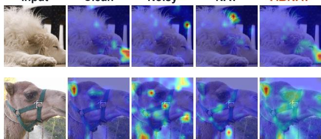  
Figure 1: Attention maps from clean inference and from the noisy model, NAT, and ABNAT under CIM noise.

Noise-Aware Training for Robust Transformers on Analog Compute-in-Memory Systems. In Proceedings of 32nd Asia and South Pacific Design Automation Conference (ASP-DAC ’27). ACM, New York, NY, USA, 7 pages.

## 1 Introduction

Transformers underpin modern vision, language, and multimodal models, but their intensive matrix operations impose substantial computation, memory, and data-movement costs. Analog Computein-Memory (CIM) performs matrix-vector multiplications (MVMs) in situ and therefore ofers an energy-eficient deployment substrate [11, 22, 25]. However, device variation, write noise, and other analog non-idealities perturb stored weights and can severely degrade Transformer inference.

To mitigate such degradation, noise-aware training (NAT) methods incorporate hardware noise injection during training to improve model robustness [12, 19, 26]. While efective for conventional convolutional neural networks (CNNs), these approaches treat the model as a black box and optimize solely for correct output predictions, overlooking the distinctive role of attention mechanisms in Transformer inference. This output-centric paradigm leaves a critical gap: the internal semantic reasoning pathways of Transformers remain fragile under CIM noise, even when final predictions appear correct.

For clear spatial visualization of attention routes, we conduct a detailed analysis of Vision Transformers (ViTs) [9]. (L) Outputcentric NAT misses semantic attention routes. Existing NAT methods supervise only final predictions, allowing models to produce correct answers via incorrect attention routes. Figure 1 shows severe attention distortion under NAT, motivating two structural observations. (O1) CIM noise accumulates attention drift across depth.

Weight perturbations disrupt attention concentration at each layer, and errors accumulate with depth. Figure 2 shows that this drift grows with noise severity and becomes concentrated in late blocks, motivating targeted route preservation. (O2) Head sensitivity is nonuniform within blocks. Figure 4 further reveals marked headto-head sensitivity variation, so uniform alignment over all layers is unnecessarily costly without commensurate accuracy gains.

Motivated by these observations, we propose ABNAT (Attention-Based Noise-Aware Training), an attention-based knowledge distillation (KD) framework for preserving semantic routes under CIM noise. ABNAT uses a clean, frozen copy of the target deployment model as the teacher and its noise-perturbed counterpart as the student. Rather than relying only on answer-level supervision, ABNAT transfers the content understanding encoded in the teacher’s attention routes by aligning teacher and student attention distributions. Figure 1 shows that ABNAT restores noise-distorted attention maps toward the clean reference across diverse inputs, indicating more faithful preservation of semantic attention routes. We further develop head- and block-selective variants that retain near-full robustness at lower training cost, and validate ABNAT across vision, language, and vision-language Transformers. The main contributions of this work are summarized as follows:

• We identify attention drift as a key robustness bottleneck in CIM-deployed ViTs and empirically establish its strong correlation with accuracy degradation under noise.

• We propose ABNAT, an attention-based KD framework that preserves semantic attention routes under CIM noise by aligning headwise attention maps between a clean teacher and a noisy student model.

• We introduce selective alignment variants at head and block granularity that reduce training cost while retaining accuracy close to full alignment.

• Extensive experiments spanning multiple noise levels, model scales, and datasets across vision, language, and multimodal tasks demonstrate that ABNAT consistently outperforms existing NAT baselines, achieving up to 11.28 percentage points higher noise-degraded accuracy and an 85.77% reduction in attention deviation.

## 2 Preliminaries

## 2.1 Transformers and Attention Mechanisms

Transformers represent vision, language, and multimodal inputs as token sequences processed by � stacked blocks [24]. Each block combines multi-head self-attention (MHSA) and a feed-forward network with residual connections and layer normalization. Selfattention enables each token to aggregate relevant information from other permitted tokens, supporting content-dependent, long range interactions. For head ℎ in block �, the input ${ \bf X } _ { l } \in \mathbb { R } ^ { N \times \bar { D } }$ is projected into queries $\mathbf { Q } _ { l , h } = \mathbf { X } _ { l } \mathbf { W } _ { l , h } ^ { Q } , \operatorname { k e y s } \mathbf { K } _ { l , h } = \mathbf { X } _ { l } \mathbf { W } _ { l , h } ^ { K }$ , and values $\mathbf { V } _ { l , h } = \mathbf { X } _ { l } \mathbf { W } _ { l , h } ^ { V }$ . The attention map and head output are

$$
\mathbf { A } _ { l , h } = \mathrm { s o f t m a x } \left( \frac { \mathbf { Q } _ { l , h } \mathbf { K } _ { l , h } ^ { \top } } { \sqrt { d _ { k } } } + \mathbf { M } \right) , \quad \mathbf { O } _ { l , h } = \mathbf { A } _ { l , h } \mathbf { V } _ { l , h } .\tag{1}
$$

Here, $d _ { k }$ is the head dimension and M is an optional structural or causal mask. Each row of $\mathbf { A } _ { l , h }$ defines how one query routes and aggregates information from the permitted tokens, while multiple heads capture complementary relations. Across blocks, these maps govern progressive information routing [1, 8], making them a natural internal target for ABNAT. The same mechanism is shared by vision, language, and vision-language Transformers [3, 9, 18].

## 2.2 Analog CIM Hardware

Analog CIM accelerators perform MVMs in situ by encoding weight matrices as analog device conductances and exploiting Ohm’s law for multiplication and Kirchhof’s current law for summation [7, 23]. This in-memory computation eliminates costly data movement between memory and processing units, enabling orders-of-magnitude improvements in energy eficiency compared to conventional digital accelerators [6, 11, 22]. These properties make CIM an attractive substrate for energy-eficient Transformer deployment [13, 14, 16].

However, analog device non-idealities introduce unavoidable perturbations to the stored weights [2, 4]. These arise from multiple physical sources: conductance programming variation, thermal read noise, inter-cell interference, and long-term conductance drift. The detailed bit-level noise formulation used in our experiments is introduced in Sec. 4. For Transformers, noise corrupts the projection matrices $\mathbf { W } _ { Q } , \mathbf { W } _ { K }$ , and $\mathbf { W } _ { V }$ at every layer, perturbing attention computation throughout the network. Because Transformer representations are built compositionally across depth, these per-layer errors accumulate rather than cancel, causing severe attention drift in deeper layers where semantic concentration is most critical.

## 2.3 Noise-Aware Training

NAT improves CIM robustness by injecting hardware noise during training, optimizing:

$$
\operatorname* { m i n } _ { \mathbf { W } } \mathbb { E } _ { \boldsymbol { \epsilon } } \big [ \mathcal { L } _ { \mathrm { C E } } ( f _ { \hat { \mathbf { W } } } ( \mathbf { x } ) , y ) \big ] ,\tag{2}
$$

where $\mathcal { L } _ { \mathrm { C E } }$ is the cross-entropy loss and $f _ { \hat { \mathbf { W } } }$ denotes the noisy model. NAT has demonstrated efectiveness for CNNs [5, 15, 26], but remains output-centric: supervising only final predictions places no explicit constraint on intermediate attention routes. The model may therefore learn shortcut solutions that produce correct, highly confident predictions through severely distorted attention maps. Such confidence–route inconsistency can generalize poorly across deployment noise levels and degrade clean accuracy because the semantic attention routes central to Transformer inference remain unconstrained.

KD transfers knowledge from a pretrained teacher $f _ { \mathbf { W } }$ to a student $f _ { \hat { \mathbf { W } } }$ by minimizing discrepancies in their outputs or intermediate representations, and has shown strong results in model compression and transfer learning [10, 21]. Prior studies have incorporated KD into NAT for CIM robustness: Charan et al. [5] distill the teacher’s output predictions, whereas Zhou et al. [27] additionally align intermediate feature maps in RRAM-based ViTs. Despite using knowledge distillation, both approaches essentially teach the noisy student to reproduce answers while overlooking attention drift, without teaching it to understand the content under noise. In contrast, ABNAT transfers the clean teacher’s attention distributions, teaching the noisy student to preserve content understanding under hardware noise. Section 4 demonstrates the resulting gains in robust performance and cross-noise generalization.

## 3 Methodology

## 3.1 Motivation

Let $f ^ { T }$ and $f ^ { S }$ denote the clean and noisy paths instantiated from the same pretrained ViT checkpoint. The clean path is frozen and serves as the teacher, while the noisy path injects CIM-induced weight noise and is optimized as the student; thus, ABNAT requires no separately trained teacher. Both paths contain � encoder blocks and � attention heads per block. Given an input �, let $\mathcal { P } _ { l , h } ^ { T } ( x ) , \mathcal { P } _ { l , h } ^ { S } ( x ) \in \Delta ^ { N - 1 }$ be the attention distributions over the � patch tokens, excluding [CLS], at block � and head ℎ for the teacher and student, respectively. Each distribution is computed by averaging the post-softmax attention weights over all query tokens.

The attention drift of head (�, ℎ) is defined as

$$
\begin{array} { r } { \bar { d } _ { l , h } = \mathbb { E } _ { x } \left[ D _ { \mathrm { K L } } \left( p _ { l , h } ^ { T } ( x ) \Vert p _ { l , h } ^ { S } ( x ) \right) \right] . } \end{array}\tag{3}
$$

A large $\bar { d } _ { l , h }$ implies that CIM noise significantly changes the student’s attention behavior from the clean reference, which may impair critical information flow. We therefore ask whether such drift is uniform across the network or follows structured patterns that can guide targeted training.

As shown in Figure 2, $d _ { l , h }$ remains consistently low and nearly uniform across blocks $^ { 1 - 8 , }$ but undergoes a sharp, accelerating increase in blocks 9–12. This depth-dependent pattern can be understood through the lens of error propagation: perturbations introduced by CIM noise at any given layer are not confined to that layer, but are carried forward and progressively amplified as they pass through the subsequent nonlinear transformations of the Transformer. Consequently, late blocks, which receive as input the accu mulated representations of all preceding layers, are disproportionately exposed to compounded noise efects. This observation has an important practical implication: a uniform attention alignment strategy that treats all blocks equally may be mismatched with the underlying structure of the problem. Instead, a depth-aware approach that concentrates alignment efort on late blocks is more eficient.

The depth-dependent drift pattern indicates where CIM noise has the strongest impact, but does not directly quantify its efect on task performance. To bridge this gap, Fig. 3 correlates the full network mean attention drift with the model-level accuracy drop across diverse noise conditions and seeds. The results show a strong correlation, with Pearson $r = 0 . 9 6 3 3$ and Spearman $\rho = 0 . 9 8 7 9$ . This observation has two implications. First, mean attention drift serves as a reliable network-level robustness diagnostic: noise settings with larger mean drift are typically associated with greater accuracy degradation, whereas those with smaller drift exhibit less perfor mance loss. Second, it identifies attention drift as a key robustness bottleneck under CIM noise, motivating our training framework to explicitly suppress drift rather than relying only on coarse output logits.

## 3.2 ABNAT Framework

The analyses above motivate full alignment for the strongest robustness and selective variants for lower training cost. Unless otherwise stated, ABNAT denotes full alignment over all attention heads and is used for the main accuracy results; ABNAT-selective restricts the alignment set S defined below. Figure 5 summarizes the

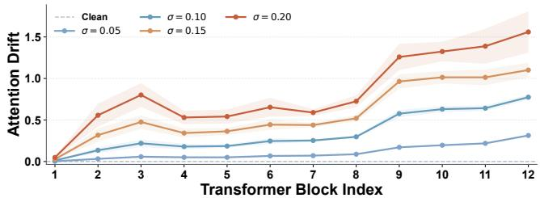  
Figure 2: Layerwise attention drift across CIM noise intensities; shaded bands denote std across seeds.

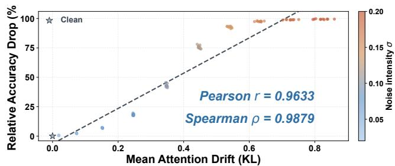  
Figure 3: Accuracy degradation versus mean attention drift across CIM noise settings.

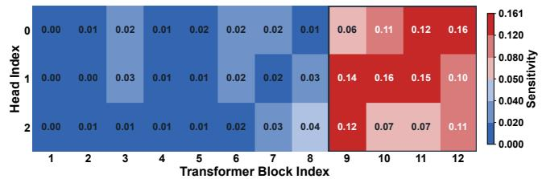  
Figure 4: Sensitivity scores sens� ℎ across all Transformer blocks and attention heads.

ABNAT pipeline. Although attention drift is concentrated in late blocks, both drift and clean attention concentration vary considerably across individual heads. To rank heads for sensitivity-guided selection, we therefore combine these two complementary factors. A concentrated head routes information through a small subset of tokens, whereas a difuse head distributes attention broadly, making concentration a useful complement to drift when prioritizing routes for alignment.

We measure clean attention concentration as

$$
\bar { c } _ { l , h } = \mathbb { E } _ { x } \left[ 1 - \frac { H ( \boldsymbol { p } _ { l , h } ^ { T } ( \boldsymbol { x } ) ) } { \log N } \right] ,\tag{4}
$$

where $\begin{array} { r } { H ( p ) = - \sum _ { i = 1 } ^ { N } p _ { i } } \end{array}$ log $\mathbf { \nabla } \mathcal { P } i$ and log � is the maximum entropy. This normalization places $\bar { c } _ { l , h }$ in [0, 1], with larger values indicating more concentrated attention. We compute it from the clean teacher so that it reflects the intended clean behavior independently of CIM noise.

The sensitivity score combines the two factors:

$$
\mathrm { s e n s } _ { l , h } = \bar { d } _ { l , h } \cdot \bar { c } _ { l , h } .\tag{5}
$$

A head therefore receives a high score only when it exhibits both large noise-induced drift and concentrated clean attention. A strongly drifted but difuse head, or a concentrated but stable head, receives a lower score. The product thus ranks heads by jointly considering route disruption and clean attention focus, without treating either factor alone as suficient. Figure 4 shows that high-sensitivity heads are concentrated primarily in blocks 9–12, with much lower scores in early blocks, reinforcing the depth-dependent pattern above.

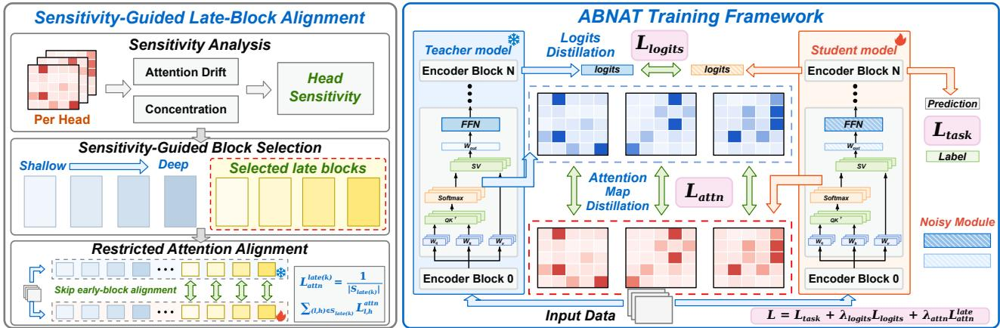  
Figure 5: ABNAT with sensitivity-guided late-block selection and task, logit-distillation, and attention-alignment objectives.

3.2.1 Sensitivity-GuidedHeadSelection. We construct the selected alignment set S by retaining the � heads with the highest sensitivity scores across all blocks and heads:

$$
S = \mathrm { T o p } \cdot k \big \{ \mathrm { s e n s } _ { l , h } \ \big | \ l \in \{ 1 , . . . , L \} , \ h \in \{ 1 , . . . , H \} \big \} .\tag{6}
$$

Here, � is a fixed training-overhead budget. For head-selective alignment, S is computed once before training by globally ranking all block–head pairs and is held fixed thereafter. Early-block heads remain eligible, while the observed concentration in late blocks emerges from the sensitivity ranking. Setting S to all heads recovers the default ABNAT.

3.2.2 Atention Alignment over the Selected Set. For a given $s ,$ we define the attention alignment loss over its selected heads:

$$
L _ { a t t n } ( S ) = \frac { 1 } { | S | } \sum _ { ( l , h ) \in S } D _ { \mathrm { K L } } \Bigl ( p _ { l , h } ^ { T } \left. p _ { l , h } ^ { S } \right) .\tag{7}
$$

The distributions used for alignment are obtained by dividing the corresponding attention logits by an attention temperature $\tau _ { a t t n }$ before softmax; $\tau _ { a t t n } = 1$ recovers the standard attention distribution. Minimizing this loss encourages the student to reproduce the teacher’s clean attention patterns precisely at the heads identified as most critical, directly targeting the internal mechanisms through which CIM noise degrades performance.

No block is excluded a priori in sensitivity-guided head selection. In practice, high-sensitivity heads concentrate predominantly in late blocks, so S naturally focuses supervision on the most noisevulnerable routes while retaining any high-scoring early heads. For the structured block-selective variants in Fig. 10, S instead contains all heads within the selected blocks.

3.2.3 Overall Training Objective. Bringing all components together, the complete training objective of ABNAT combines three complementary losses, each operating at a distinct level of abstraction:

$$
{ \cal L } _ { t o t a l } = { \cal L } _ { t a s k } + \lambda _ { l o g i t s } { \cal L } _ { l o g i t s } + \lambda _ { a t t n } { \cal L } _ { a t t n } ( S ) ,\tag{8}
$$

where $\lambda _ { l o g i t s }$ and $\lambda _ { a t t n }$ are scalar hyperparameters that balance the three objectives; $L _ { t a s k }$ is kept at unit coeficient as the scale anchor. Unless otherwise stated, we use $\lambda _ { l o g i t s } = 3 , \lambda _ { a t t n } = 5 0$ , and $\tau _ { \mathrm { K D } } = \tau _ { a t t n } = 1$

At the coarsest level, the task loss $L _ { t a s k }$ is the standard crossentropy loss computed against ground-truth labels, ensuring that the student retains discriminative performance on the target task regardless of noise conditions. Building on top of this, the logits distillation loss $L _ { l o g i t s } = D _ { \mathrm { K L } }$ (softmax(��/� )∥softmax $( z ^ { S } / \tau _ { \mathrm { K D } } ) \big ) ,$ ), where $z ^ { T }$ and $z ^ { S }$ are the pre-softmax logits and $\tau _ { \mathrm { K D } }$ is the distillation temperature, aligns the student’s output probability distribution with that of the clean teacher. Finally, at the finest level of granularity, the attention alignment loss $L _ { a t t n } ( S )$ reaches deeper into the network to preserve the selected internal attention pathways. Together, these three losses form a coherent, multi-level training strategy: $L _ { t a s k }$ anchors the student to correct predictions, $L _ { l o g i t s }$ aligns its output distribution with the teacher’s, and $L _ { a t t n } ( S )$ safeguards attention routes vulnerable to CIM-induced degradation. This layered design allows ABNAT to simultaneously maintain high clean accuracy and achieve strong robustness under hardware noise.

## 4 Experiment

## 4.1 Experimental Setup

We evaluate ABNAT primarily on ViT-Tiny/16 with CIFAR-100, comparing NAT [19], NAT+KD [5], FeatureAlign [27], and our AttnAlign. Generalization is tested on ViT-Small on CIFAR-100, ViT-Tiny on ImageNet-100, Swin-Tiny on CIFAR-100, Pythia-160M and Pythia-2.8B on WikiText-103, and CLIP ViT-B/32 on Flickr30K.

Unless otherwise specified, models are trained with AdamW for 100 epochs, batch size 1024, learning rate $1 \times 1 0 ^ { - 3 }$ , weight decay 0.05, cosine decay, and 5 warmup epochs. For task-specific runs, the Pythia models use 262,144 WikiText-103 training tokens for 5 epochs at sequence length 128 and are evaluated on 65,536 tokens at length 2,048; CLIP uses Flickr30K training images at 224 × 224 for 10 epochs. We use matched train–deploy noise, $\sigma _ { \mathrm { t r a i n } } = \sigma _ { \mathrm { i n f e r } } ,$ and report mean ± std over 30 inference seeds. Unless otherwise stated, ABNAT denotes full alignment; Fig. 10 studies structured block-selective variants for lower training cost. Since alignment is training-only, ABNAT preserves the NAT inference cost.

CIM inference is modeled under W8A8 quantization with bitlevel hardware variations, where $B _ { w } = B _ { a } = 8$

$$
X _ { q } = Q _ { a } ( X ) , \qquad W _ { q } = Q _ { w } ( W ) ,\tag{9}
$$

Table 1: Full component ablation for ViT-Tiny on CIFAR-100 under matched train–deploy noise. Accuracy under noisy inference is reported as mean±std over 30 seeds. Shaded rows denote the two KD-based ABNAT variants; ABNAT without $L _ { t a s k }$ retains logit KD and our attention-alignment loss.
<table><tr><td>Variant</td><td>Task loss</td><td>Logit KD</td><td>Feature [27]</td><td>Attn. Align. (Ours)</td><td> $\sigma = 0 . 0 5$ </td><td> $\sigma = 0 . 1 0$ </td><td> $\sigma = 0 . 1 5$ </td><td> $\sigma = 0 . 2 0$ </td><td>Avg.</td></tr><tr><td>Original+Noise</td><td></td><td></td><td></td><td></td><td> $8 6 . 2 8 { \pm } 0 . 3 7$ </td><td> $6 4 . 3 4 \pm 1 . 3 7$ </td><td> $1 0 . 0 6 { \pm } 1 . 5 1 $ </td><td> $2 . 0 9 { \pm } 0 . 6 1$ </td><td>40.69</td></tr><tr><td>NAT [19]</td><td>V</td><td></td><td></td><td></td><td> $8 4 . 9 8 { \pm } 0 . 3 5 $ </td><td> $7 9 . 2 3 { \pm } 0 . 5 1 $ </td><td> $7 1 . 5 2 { \pm } 0 . 6 7$ </td><td> $5 8 . 8 6 \pm 0 . 6 6$ </td><td>73.65</td></tr><tr><td>KD</td><td></td><td>√</td><td></td><td></td><td> $8 7 . 2 1 { \pm } 0 . 1 5 $ </td><td> $8 2 . 5 9 { \pm } 0 . 3 2 $ </td><td> $7 5 . 0 0 { \pm } 0 . 5 3 $ </td><td> $6 3 . 2 9 { \scriptstyle \pm 0 . 7 4 }$ </td><td>77.02</td></tr><tr><td>FeatureAlign</td><td></td><td></td><td></td><td></td><td>86.46±0.28</td><td>80.36±0.50</td><td> $4 3 . 2 7 { \pm } 1 . 3 3 $ </td><td> $1 4 . 7 2 { \pm } 1 . 5 9$ </td><td>56.20</td></tr><tr><td>AttnAlign</td><td></td><td></td><td></td><td>√</td><td>86.22±0.29</td><td>78.68±0.49</td><td> $5 4 . 7 6 { \pm } 1 . 1 4$ </td><td> $1 2 . 9 1 { \pm } 1 . 2 1 $ </td><td>58.14</td></tr><tr><td>NAT+KD [5]</td><td>√</td><td>√</td><td></td><td></td><td>87.20±0.17</td><td>82.69±0.29</td><td> $7 4 . 9 9 { \pm } 0 . 5 4 $ </td><td>62.45±0.76</td><td>76.83</td></tr><tr><td>NAT+Feature</td><td>√</td><td></td><td>√</td><td></td><td>86.49±0.20</td><td> $8 1 . 6 7 { \pm } 0 . 4 3 $ </td><td> $7 1 . 8 7 { \pm } 0 . 9 5 $ </td><td> $5 8 . 3 5 { \pm } 0 . 7 2 $ </td><td>74.60</td></tr><tr><td>NAT+AttnAlign</td><td>√</td><td></td><td></td><td>√</td><td>87.15±0.21</td><td> $8 3 . 3 7 { \pm } 0 . 4 1 $ </td><td> $7 7 . 0 1 { \pm } 0 . 7 0 $ </td><td> $6 6 . 0 5 { \scriptstyle \pm 0 . 9 2 }$ </td><td>78.39</td></tr><tr><td>KD+Feature</td><td></td><td>√</td><td>√</td><td></td><td> $8 7 . 6 4 \pm 0 . 2 0 $ </td><td> $8 3 . 2 2 { \pm } 0 . 3 6$ </td><td> $7 5 . 5 3 { \pm } 0 . 6 2$ </td><td> $6 3 . 1 5 { \pm } 0 . 8 0$ </td><td>77.39</td></tr><tr><td>NAT+KD+Feature [27]</td><td>√</td><td>√</td><td>√</td><td></td><td> $8 6 . 9 1 { \scriptstyle \pm 0 . 1 7 }$ </td><td> $8 3 . 3 3 { \pm } 0 . 3 5 $ </td><td> $7 5 . 2 5 { \pm } 0 . 6 1 $ </td><td> $6 2 . 6 3 { \pm } 1 . 0 4 $ </td><td>77.03</td></tr><tr><td>ABNAT without  $L _ { t a s k }$ </td><td></td><td>√</td><td>–</td><td>√</td><td> $\mathbf { 8 7 . 7 4 \pm 0 . 1 8 }$ </td><td> $\mathbf { 8 4 . 2 8 \pm 0 . 3 3 }$  </td><td> $7 8 . 6 2 { \pm } 0 . 5 6 $ </td><td> $7 0 . 0 4 { \pm } 0 . 8 2$ </td><td>80.17</td></tr><tr><td>ABNAT</td><td>√</td><td>√</td><td></td><td>√</td><td> $8 7 . 6 2 { \pm } 0 . 2 1 $ </td><td> $8 3 . 9 5 { \pm } 0 . 2 8 $ </td><td> $\mathbf { 7 8 . 6 6 { \pm } 0 . 4 8 }$ </td><td> $\mathbf { 7 0 . 1 4 \pm 0 . 7 8 }$ </td><td>80.09</td></tr></table>

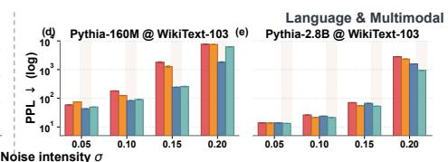

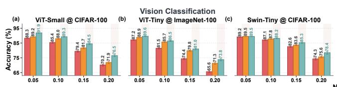

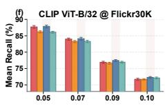  
Figure 6: Cross-setting results for ViT-Small on CIFAR-100, ViT-Tiny on ImageNet-100, Swin-Tiny on CIFAR-100, Pythia-160M and Pythia-2.8B on WikiText-103, and CLIP ViT-B/32 on Flickr30K.

$$
X _ { q } = \sum _ { j = 0 } ^ { B _ { \alpha } - 1 } 2 ^ { j } X ^ { ( j ) } , \qquad W _ { q } = \sum _ { k = 0 } ^ { B _ { w } - 1 } 2 ^ { k } W ^ { ( k ) } ,\tag{10}
$$

$$
\widetilde { W } ^ { ( k ) } = W ^ { ( k ) } \odot \left( 1 + \sigma \epsilon ^ { ( k ) } \right) , \qquad \epsilon ^ { ( k ) } \sim N ( 0 , \mathrm { I } ) .
$$

Here, $Q _ { a }$ and $Q _ { w }$ denote the activation and weight quantizers, $X ^ { ( j ) }$ and $W ^ { ( k ) }$ are the �-th activation and �-th weight bit planes, ⊙ denotes element-wise multiplication, and � denotes the relative standard deviation of device-conductance variation. For combined bit-parallel and bit-serial execution, the reconstructed CIM output is

$$
\mathit { Y } _ { \mathrm { C I M } } = \sum _ { j = 0 } ^ { B _ { \alpha } - 1 } \sum _ { k = 0 } ^ { B _ { w } - 1 } 2 ^ { j + k } \left[ \Phi _ { \mathrm { C I M } } \Big ( X ^ { ( j ) } , \widetilde { W } ^ { ( k ) } \Big ) + \epsilon _ { \mathrm { T I A } \& \mathrm { A D C } } ^ { ( j , k ) } \right] ,\tag{11}
$$

where $\Phi _ { \mathrm { C M } }$ is simulated by NeuroSim [17, 20], $\epsilon _ { \mathrm { T I A } \& \mathrm { A D C } } ^ { ( j , k ) }$ denotes the aggregate readout error from the TIA and ADC, ADC precision is tied to the activated-row count, and mapped matrix operations use full-row activation.

## 4.2 Experiment Results

Full Component Ablation Table 1 ablates noisy task supervision, logit KD, feature alignment, and attention alignment under matched train–deploy noise. Our AttnAlign becomes increasingly efective as noise intensifies: adding it to NAT improves accuracy by 2.17 percentage points at �=0.05 and by 7.19 points at $\sigma { = } 0 . 2 0 .$ . Together with logit KD, AttnAlign forms the complete ABNAT, which reaches 70.14% at $\sigma { = } 0 . 2 0$ , outperforming NAT+KD and NAT by 7.69 and 11.28 points, respectively. In comparison, FeatureAlign provides negligible high-noise benefit: adding it to NAT changes accuracy from 58.86% to 58.35%, while adding it to NAT+KD changes 62.45% to 62.63%. ABNAT without $L _ { \mathrm { t a s k } }$ also achieves a strong average accuracy of 80.17%, while complete ABNAT performs best at � ∈ {0.15, 0.20}. These results show that attention-route preservation becomes increasingly important as hardware noise intensifies.

Generalization Across Models and Datasets We evaluate AB-NAT’s efectiveness across model architectures and datasets to assess generalizability. Figure 6(a–c) presents results for ViT-Small on CIFAR-100, ViT-Tiny on ImageNet-100, and Swin-Tiny on CIFAR-100. At $\sigma = 0 . 2 0 ,$ , ABNAT improves over NAT by 6.34, 8.15, and 4.15 percentage points, respectively. These consistent gains across model scales, datasets, and both flat and hierarchical Transformer architectures indicate that attention-route supervision is not tied to a single configuration.

Generalization to Language and Multimodal Transformers We further evaluate attention-route preservation using Pythia-160M and Pythia-2.8B for language modeling [3] and CLIP ViT-B/32 for image–text retrieval [18]. Figure 6(d–f) reports perplexity and Mean Recall, where lower and higher values are better, respectively. An attention-aligned variant performs best in all three settings. At �=0.20, NAT+AttnAlign reduces Pythia-160M perplexity by 76.4%, from 7682.16 to 1812.96, while NAT+KD+AttnAlign reduces Pythia-2.8B perplexity by 59.6%, from 2329.72 to 941.04. On CLIP ViT-B/32 at � =0.10, NAT+AttnAlign improves Mean Recall from 71.70 for NAT to 72.27. These results extend attention-route preservation to autoregressive language modeling and multimodal retrieval.

Robustness Under Train–Deploy Noise Mismatch Inference noise can deviate from training conditions because of device variation, lifetime drift, and operating changes [2, 4]. We therefore fix $\sigma _ { \mathrm { t r a i n } } \in \{ 0 . 1 5 , 0 . 2 0 \}$ and sweep $\sigma _ { \mathrm { i n f e r } } \in \left[ 0 . 0 1 , 0 . 2 0 \right]$ in Fig. 7. AB-NAT outperforms NAT and NAT+KD throughout the sweep. For $\sigma _ { \mathrm { t r a i n } } = 0 . 1 5$ , its gain over NAT reaches 10.86 points at $\sigma _ { \mathrm { i n f e r } } = 0 . 2 0 ;$ when trained at 0.20, it retains a 9.68-point gain even at $\sigma _ { \mathrm { i n f e r } } = 0 . 0 1$ Under clean inference, the latter checkpoint maintains 79.29% accuracy, compared with 69.59% for NAT and 72.54% for NAT+KD. These results indicate that attention-route supervision strengthens the noisy model’s content understanding, enabling robust generalization across deployment noise while better preserving clean accuracy.

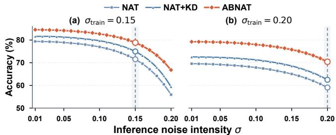  
Figure 7: Train–deploy noise mismatch for ViT-Tiny on CIFAR-100 at $\sigma _ { \mathrm { t r a i n } }$ ∈ {0.15, 0.20}.

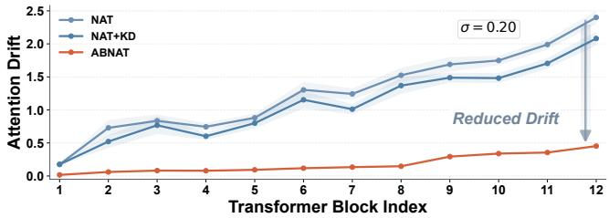  
Figure 8: Layerwise attention drift of NAT, NAT+KD, and ABNAT at $\sigma { = } 0 . 2 0$

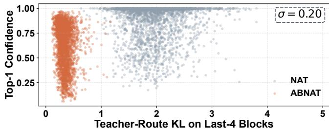  
Figure 9: Prediction confidence versus attention-route fidelity at $\sigma { = } 0 . 2 0$ on the common anchor subset.

## 4.3 Discussion

Analysis of Attention-Route Stabilization We analyze attention drift patterns to understand ABNAT’s performance improvements. Figure 8 shows that at � =0.20, the block-averaged attention drift is 1.272 for NAT and 1.096 for NAT+KD, but only 0.181 for ABNAT—an 85.77% reduction relative to NAT. ABNAT suppresses drift most strongly in the late blocks, where CIM noise causes the largest deviations. Together with the observed correlation between mean attention drift and accuracy degradation in Fig. 3, these results sup port that ABNAT improves robustness by stabilizing clean attention routes rather than relying only on output-level supervision.

Prediction Confidence and Route Quality Analysis We analyze prediction confidence versus attention-route fidelity using the common anchor subset at � =0.20, where NAT, ABNAT, and the clean teacher all predict correctly. Figure 9 shows that NAT is more confident than ABNAT on 88.9% of these samples, with a mean confidence of 0.899 versus 0.678. However, its teacher-route fidelity is substantially worse than ABNAT’s, with a KL divergence of 1.972 versus 0.338 and a top-10 token overlap of 0.178 versus 0.360. This confidence–route inconsistency shows that output-focused training can produce highly confident predictions from noise-corrupted attention routes, whereas ABNAT more faithfully preserves the teacher’s internal routing.

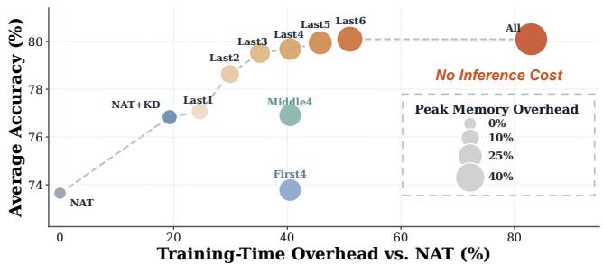  
Figure 10: Accuracy and training cost under selective block alignment.

Table 2: Hyperparameter sensitivity for ViT-Tiny on CIFAR-100. Bold marks the best setting in each sweep; shading marks defaults.
<table><tr><td colspan="2">λlogits</td><td colspan="2">λattn</td><td colspan="2">τKD</td><td colspan="2">τattn</td></tr><tr><td>Value</td><td>Avg.</td><td>Value</td><td>Avg.</td><td>Value</td><td>Avg.</td><td>Value</td><td>Avg.</td></tr><tr><td>0.25</td><td>78.41</td><td>15</td><td>78.52</td><td>0.5</td><td>79.36</td><td>0.125</td><td>67.57</td></tr><tr><td>0.5</td><td>79.00</td><td></td><td>79.44</td><td>è</td><td>80.09</td><td>0.25</td><td>74.53</td></tr><tr><td>1</td><td>79.52</td><td>10</td><td>79.85</td><td>2</td><td>80.17</td><td>0.5</td><td>78.47</td></tr><tr><td>3</td><td>80.09</td><td>25</td><td>80.16</td><td>3</td><td>79.90</td><td>1</td><td>80.09</td></tr><tr><td>5</td><td>80.19</td><td>50</td><td>80.09</td><td>4</td><td>79.80</td><td>2</td><td>79.93</td></tr><tr><td>8</td><td>80.14</td><td>100</td><td>79.71</td><td>6</td><td>79.63</td><td>4</td><td>79.24</td></tr><tr><td>12</td><td>80.05</td><td>200</td><td>78.69</td><td>8</td><td>79.46</td><td>8</td><td>78.37</td></tr></table>

Accuracy–Training Cost Tradeof Figure 10 evaluates structured block-selective variants against ABNAT with full alignment; here, S contains all heads in the selected blocks. Since attention alignment is training-only, all variants retain the same inference cost as NAT. Under the same four-block budget, Last4 outperforms First4 and Middle4, confirming that late blocks are more efective alignment targets. Accuracy improves and then saturates as the aligned lateblock budget increases from Last1 to All. Last4 achieves 79.68% average accuracy, only 0.41 percentage points below full alignment at 80.09%, while reducing training-time overhead relative to NAT from 82.9% to 40.8% and peak-memory overhead from 54.4% to 23.3%. Thus, selective late-block alignment preserves nearly all robustness gains at substantially lower training cost.

Head-Budget Sensitivity Head-selective alignment improves smoothly with budget: average accuracy rises from 78.24% to 78.90% and 79.44% as top-� increases from 3 to 6 and 9 heads. At fixed � = 6, high-drift heads achieve 78.90% average accuracy, outperforming low-drift heads at 77.01% by 1.89 percentage points. These results show that ABNAT is not sensitive to one particular budget and validate the sensitivity-guided selection.

Hyperparameter Sensitivity Table 2 reports one-factor sweeps with all other settings fixed at their defaults. Around the defaults, $\lambda _ { l o g i t s } \in [ 3 , 1 2 ] , \lambda _ { a t t n } \in [ 2 5 , 1 0 0 ]$ , and �KD ∈ [1, 4] retain 79.71– 80.19% average accuracy; $\tau _ { a t t n } \in [ 0 . 5 , 4 ]$ yields 78.47–80.09%, while the overly sharp value 0.125 drops to 67.57%. Thus, ABNAT does not require delicate hyperparameter tuning.

## 5 Conclusion

In this paper, we show that CIM noise induces depth-accumulated, head-dependent attention drift, while output-centric NAT may reproduce answers through routes that deviate from the clean model. We propose ABNAT, which aligns headwise attention between clean and noisy paths from the same checkpoint to preserve task-relevant content processing rather than merely match answers. Across vision, language, and multimodal Transformers, ABNAT improves noisy accuracy by up to 11.28 percentage points, reduces attention drift by 85.77%, generalizes under train–deploy noise mismatch, and adds no inference cost; selective variants retain near-full robustness with lower training overhead.

## Acknowledgments

This work was supported by National R&D Program of China (2022YFB4400300), NSFC (62534002, 62274003, 92564302) and 111 Project (B18001), in part by the STIC under Grant QYJS-2022-1501-B and the National Micro/Nano Fabrication Laboratory of Peking University.

## References

[1] Samira Abnar and Willem Zuidema. 2020. Quantifying Attention Flow in Transformers. In Proceedings ofthe 58th Annual Meeting ofthe Association for Computational Linguistics. 4190–4197. doi:10.18653/v1/2020.acl-main.385

[2] Stefano Ambrogio, Pritish Narayanan, Hsinyu Tsai, Robert M. Shelby, Irem Boy bat, Carmelo di Nolfo, Severin Sidler, Massimo Giordano, Martina Bodini, Nathan C. P. Farinha, Benjamin Killeen, Christina Cheng, Yassine Jaoudi, and Geofrey W. Burr. 2018. Equivalent-Accuracy Accelerated Neural-Network Training Using Analogue Memory. Nature 558 (2018), 60–67. doi:10.1038/s41586-018-0180-5

[3] Stella Biderman, Hailey Schoelkopf, Quentin Gregory Anthony, Herbie Bradley, Kyle O’Brien, Eric Hallahan, Mohammad Aflah Khan, Shivanshu Purohit USVSN Sai Prashanth, Edward Raf, Aviya Skowron, Lintang Sutawika, and Oskar Van Der Wal. 2023. Pythia: A Suite for Analyzing Large Language Models Across Training and Scaling. In Proceedings ofthe 40th International Conference on Machine Learning. 2397–2430.

[4] Geofrey W. Burr, Robert M. Shelby, Stephan Sidler, Carlo di Nolfo, Jae Woo Jang, Irem Boybat, R. Shenoy, Pritish Narayanan, Kumar Virwani, Eugenio Giacometti, B. Kurdi, and H.-S. Hwang. 2017. Neuromorphic Computing Using Non-Volatile Memory. Advances in Physics: X 2, 1 (2017), 89–124. doi:10.1080/23746149.2016. 1259585

[5] Gouranga Charan, Jubin Hazra, Karsten Beckmann, Xiaocong Du, Gokul Krish nan, and Rajiv V. Joshi. 2020. Accurate Inference with Inaccurate RRAM Devices: Statistical Data, Model Transfer, and On-line Adaptation. In Proceedings ofthe 57th ACM/IEEE Design Automation Conference. 1–6. doi:10.1109/DAC18072.2020. 9218605

[6] Wei-Hao Chen, Chunmeng Dou, Kai-Xiang Li, Wei-Yu Lin, Pin-Yi Li, Jian-Hao Huang, Jing-Hong Wang, Wei-Chen Wei, Cheng-Xin Xue, Yen-Cheng Chiu, Ya Chin King, Chorng-Jung Lin, Ren-Shuo Liu, Chih-Cheng Hsieh, Kea-Tiong Tang, J. Joshua Yang, Mon-Shu Ho, and Meng-Fan Chang. 2019. CMOS-Integrated Memristive Non-Volatile Computing-in-Memory for AI Edge Processors. Nature Electronics 2 (2019), 420–428. doi:10.1038/s41928-019-0288-0

[7] Ping Chi, Shuangchen Li, Cong Xu, Tianhao Zhang, Jishen Zhao, Yongpan Liu, Yuan Wang, and Yuan Xie. 2016. PRIME: A Novel Processing-in-Memory Archi tecture for Neural Network Computation in ReRAM-Based Main Memory. In Proceedings of the 43rd International Symposium on Computer Architecture. 27–39.

[8] Kevin Clark, Urvashi Khandelwal, Omer Levy, and Christopher D. Manning. 2019. What Does BERT Look At? An Analysis of BERT’s Attention. In Proceedings of the 2019 ACL Workshop BlackboxNLP: Analyzing and Interpreting Neural Networks for NLP. 276–286. doi:10.18653/v1/W19-4828

[9] Alexey Dosovitskiy, Lucas Beyer, Alexander Kolesnikov, Dirk Weissenborn, Xi aohua Zhai, Thomas Unterthiner, Mostafa Dehghani, Matthias Minderer, Georg Heigold, Sylvain Gelly, Jakob Uszkoreit, and Neil Houlsby. 2021. An Image Is Worth 16x16 Words: Transformers for Image Recognition at Scale. In International Conference on Learning Representations.

[10] Geofrey Hinton, Oriol Vinyals, and Jef Dean. 2015. Distilling the Knowledge in a Neural Network. arXiv preprint arXiv:1503.02531 (2015). https://arxiv.org/abs/ 1503.02531

[11] Daniele Ielmini and H.-S. Philip Wong. 2018. In-Memory Computing with Resis tive Switching Devices. Nature Electronics 1 (2018), 333–343. doi:10.1038/s41928-

018-0092-2

[12] Vinay Joshi, Manuel Le Gallo, Simon Haefeli, Irem Boybat, S. R. Nandakumar, Christophe Piveteau, Martino Dazzi, Bipin Rajendran, Abu Sebastian, and Evangelos Eleftheriou. 2020. Accurate Deep Neural Network Inference Using Computational Phase-Change Memory. Nature Communications 11 (2020), 2473. doi:10.1038/s41467-020-16108-9

[13] Wantong Li, Madison Manley, James Read, Ankit Kaul, Muhannad S. Bakir, and Shimeng Yu. 2023. H3DAtten: Heterogeneous 3-D Integrated Hybrid Analog and Digital Compute-in-Memory Accelerator for Vision Transformer Self-Attention. IEEE Transactions on Very Large Scale Integration (VLSI) Systems 31, 10 (2023), 1592–1602. doi:10.1109/TVLSI.2023.3299509

[14] Yi Li, Zijian Ye, Xiangqu Fu, Songqi Wang, Shucheng Du, Ning Lin, Dashan Shang, Jinshan Yue, Zhongrui Wang, Xiaojuan Qi, Feng Zhang, and Han Wang. 2025. Eficient Edge Vision Transformer Accelerator with Decoupled Chunk Attention and Hybrid Computing-In-Memory. In Proceedings ofthe 62nd ACM/IEEE Design Automation Conference. 1–7. doi:10.1109/DAC63849.2025.11132426

[15] Beiye Liu, Hai Li, Yiran Chen, Xin Li, Qing Wu, and Tingwen Huang. 2015. Vortex: Variation-Aware Training for Memristor X-Bar. In Proceedings ofthe 52nd Annual Design Automation Conference. 15:1–15:6. doi:10.1145/2744769.2744930

[16] Naoko Misawa, Tao Wang, Chihiro Matsui, and Ken Takeuchi. 2025. Transformer Hetero-CiM: Heterogeneous Integration of ReRAM CiM and SRAM CiM for Vision Transformer at Edge Devices. In Proceedings ofthe 30th Asia and South Pacific Design Automation Conference. 332–334. doi:10.1145/3658617.3698494

[17] Xiaochen Peng, Shanshi Huang, Hongwu Jiang, Anni Lu, and Shimeng Yu. 2021. DNN+NeuroSim V2.0: An End-to-End Benchmarking Framework for Computein-Memory Accelerators for On-Chip Training. IEEE Transactions on Computer-Aided Design ofIntegrated Circuits and Systems 40, 11 (2021), 2306–2319. doi:10. 1109/TCAD.2020.3043731

[18] Alec Radford, Jong Wook Kim, Chris Hallacy, Aditya Ramesh, Gabriel Goh, Sandhini Agarwal, Girish Sastry, Amanda Askell, Pamela Mishkin, Jack Clark, Gretchen Krueger, and Ilya Sutskever. 2021. Learning Transferable Visual Models From Natural Language Supervision. In Proceedings of the 38th International Conference on Machine Learning. 8748–8763.

[19] Malte J. Rasch, Charles Mackin, Manuel Le Gallo, An Chen, Andrea Fasoli, Frédéric Odermatt, Ning Li, S. R. Nandakumar, Pritish Narayanan, Hsinyu Tsai, Geofrey W. Burr, Abu Sebastian, and Vijay Narayanan. 2023. Hardware-Aware Training for Large-Scale and Diverse Deep Learning Inference Workloads Using In-Memory Computing-Based Accelerators. Nature Communications 14 (2023), 5282. doi:10.1038/s41467-023-40770-4

[20] James Read, Ming-Yen Lee, Wei-Hsing Huang, Yuan-Chun Luo, Anni Lu, and Shimeng Yu. 2025. NeuroSim V1.5: Improved Software Backbone for Benchmarking Compute-in-Memory Accelerators with Device and Circuit-Level Non-Idealities. arXiv preprint arXiv:2505.02314 (2025). doi:10.48550/arXiv.2505.02314

[21] Adriana Romero, Nicolas Ballas, Samira Ebrahimi Kahou, Antoine Chassang, Carlo Gatta, and Yoshua Bengio. 2015. FitNets: Hints for Thin Deep Nets. In International Conference on Learning Representations.

[22] Abu Sebastian, Manuel Le Gallo, Riduan Khaddam-Aljameh, and Evangelos Eleftheriou. 2020. Memory Devices and Applications for In-Memory Computing. Nature Nanotechnology 15 (2020), 529–544. doi:10.1038/s41565-020-0655-z

[23] Ali Shafiee, Abhronil Nag, Naveen Muralimanohar, Rajeev Balasubramonian, John Paul Strachan, Miao Hu, Robert Stanley Williams, and Vivek Srikumar. 2016. ISAAC: A Convolutional Neural Network Accelerator with In-Situ Analog Arithmetic in Crossbars. In Proceedings ofthe 43rd International Symposium on Computer Architecture. 14–26.

[24] Ashish Vaswani, Noam Shazeer, Niki Parmar, Jakob Uszkoreit, Llion Jones, Aidan N. Gomez, Lukasz Kaiser, and Illia Polosukhin. 2017. Attention Is All You Need. In Advances in Neural Information Processing Systems, Vol. 30. 5998– 6008.

[25] Peng Yao, Huaqiang Wu, Bin Gao, Jianshi Tang, Qingtian Zhang, Wenqiang Zhang, J. Joshua Yang, and He Qian. 2020. Fully Hardware-Implemented Memristor Convolutional Neural Network. Nature 577 (2020), 641–646. doi:10.1038/ s41586-020-1942-4

[26] Chuteng Zhou, Prad Kadambi, Matthew Mattina, and Paul N. Whatmough. 2020. Noisy Machines: Understanding Noisy Neural Networks and Enhancing Robustness to Analog Hardware Errors Using Distillation. arXiv preprint arXiv:2001.04974 (2020). https://arxiv.org/abs/2001.04974

[27] Wenyong Zhou, Zhengwu Liu, Taiqiang Wu, Chenchen Ding, Yuan Ren, and Ngai Wong. 2025. Towards Robust RRAM-Based Vision Transformer Models with Noise-Aware Knowledge Distillation. In 2025 Design, Automation & Test in Europe Conference (DATE). 1–2. doi:10.23919/DATE64628.2025.10993112