# ACTIVATION-ADJACENT LAYER NORMALIZATION: EFFECTS ON APPROXIMATION POWER

Yunhao N1, Yuxin Guo1, Jie Luo1, Wenjun Wu1,2, Lei Huang1,2\*

1State Key Laboratory of Complex and Critical Software Environment, Beihang University, Beijing, China

2Hangzhou International Innovation Institute, Beihang University, Hangzhou, China

## ABSTRACT

Layer normalization (LN) and root mean square normalization (RMSNorm) depend on their inputs and remain nonlinear at inference. Inserting either next to an activation may therefore change the function a network represents. We study when shallow activation-normalized (AN) and preactivation-normalized (PN) networks can approximate a prescribed width-N one-hidden-layer MLP. Viewing RMSNorm as input-dependent scaling, we use width augmentation to locally linearize normalization on compact feature sets. For AN networks, an unbounded activation range allows width N + 1, while every continuous nonconstant activation admits width N + r with error O f (r−1). For PN networks, affine parameters or, without them, degree-one positive homogeneity recover width N + 1; general continuous activations admit width N + r with error tending to zero. The corresponding LN constructions use centered coordinate pairs, yielding widths N + 2 and N + 2r, respectively. We prove that N + 1 for RMSNorm and N + 2 for LN are also the worst-case bound for approximations, and show that applicable universal-approximation theorems for ordinary MLPs transfer to these normalized architectures. Numerical experiments recover the predicted approximation rates for both normalizations across all five settings and illustrate the shifted-ReLU finite-width obstruction.

## 1 INTRODUCTION

Classical universal approximation results (Cybenko, 1989; Hornik, 1991; Leshno et al., 1993) provide a basic foundation for neural networks: sufficiently expressive classes can approximate large families of target functions. Modern architectures augment these standard networks with components such as residual connections (He et al., 2016) and normalization (Ioffe & Szegedy, 2015; Ba et al., 2016), often to improve optimization. The representational effects of residual architectures have also been studied (Lu et al., 2017; Lin & Jegelka, 2018). Far less is known about how normalization changes the function class represented by a network

Among normalization mechanisms, this representational question is especially subtle for layer normalization (LN) (Ba et al., 2016) and its centering-free variant, root mean square normalization (RMSNorm) (Zhang & Sennrich, 2019). Both recompute their statistics from each representation and therefore remain nonlinear at inference. Recent theory has primarily treated this nonlinearity as a source of expressivity. Ni et al. (2024) describe exact no-affine LN geometrically as centering followed by scaling. Centering projects the representation onto the zero-mean hyperplane. Scaling then maps the centered vector radially from the origin onto a sphere within that hyperplane. The nonlinear step is therefore RMSNorm applied to the centered vector, not to the original representation. Exploiting this scaling, Ni et al. (2024) show that width-3 LN networks can fit arbitrary labels on finite samples and derive a depth-dependent VC-dimension lower bound. Building on this view, Ni et al. (2025) arrange multiple LN blocks with linear maps in parallel layer normalization (PLN), treating LN itself as an approximation primitive to prove universal approximation. Whether adding normalization preserves a function already represented by an MLP with its own coordinate-wise activation has received little attention.

To study this preservation problem, we insert a single LN or RMSNorm after or before the activation function of a prescribed one-hidden-layer MLP, obtaining the activation-normalized (AN) architectures in Eqn. 5 and Eqn. 11, and the preactivation-normalized (PN) architectures in Eqn. 8 and Eqn. 12. Directly analyzing whether these architectures preserve the approximation power of the underlying MLP is challenging because LN and RMSNorm couple the hidden neurons (Ni et al., 2024). Therefore, we adopt a relative-approximation perspective and ask when such a normalized architecture can approximate a prescribed target MLP.

For RMSNorm, the only distortion is input-dependent scaling. Inspired by the geometry in Ni et al. (2024), we show that width augmentation moves a bounded feature set away from the origin, thereby shrinking the angle it subtends there and making the scaling factor nearly constant after an input-independent rescaling (Figure 1). Section 4 uses this geometric mechanism to construct AN approximations.

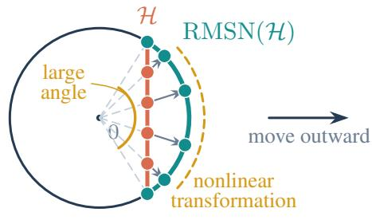  
(a) Finite distance from the origin

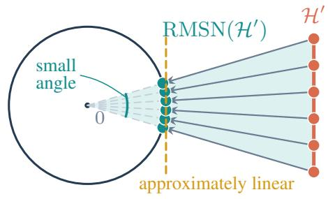  
(b) Distance from the origin → ∞  
Figure 1: Near- and far-field geometry of RMSNorm. In (a), radial normalization maps equally spaced points in H to unevenly spaced points on the sphere. In (b), the equally sized set $\mathcal { \dot { H } } ^ { \prime }$ lies farther from the origin. It subtends a smaller angle, and its normalized image occupies a shorter nearly flat arc.

For LN, centering introduces a second distortion. We absorb it on the linear side of the activation: by imposing zero-mean preactivations in PN networks and an equivalent zero-sum condition on the readout in AN networks. Width augmentation then makes the remaining input-dependent scaling nearly constant. Section 6 derives the corresponding LN counterparts of the RMSNorm constructions.

Section 7 establishes that the width-N + 1 RMSNorm and width-N + 2 LN bounds are worst-case sharp and shows that applicable universal-approximation theorems for ordinary MLPs transfer to the normalized architectures. The experiments in Section 8 recover the predicted approximation rates.

We provide an overview of our theoretical results in Table 1. Here $\checkmark , \mathrel { \times } ,$ and $\checkmark / \times$ indicate that affine normalization parameters are present, absent, or arbitrary, respectively. The two AN forms coincide, and affine RMSNorm contains only a coordinate-wise scale. In the lower-bound position, – indicates that no matching lower bound is claimed.

Table 1: Width and error guarantees for a width-N target. Entries are constructive upper bounds/worst-case lower bounds (UB/LB); matching entries are sharp, and – denotes that no matching lower bound is claimed. All rows assume continuous $\phi .$
<table><tr><td>Mode</td><td>Parameters</td><td>Additional condition on φ RMSNorm (UB/LB)</td><td></td><td>LN (UB/LB)</td><td>Error</td></tr><tr><td>AN</td><td> $\checkmark / \times$ </td><td>unbounded range</td><td> $N + 1 / N + 1$ </td><td> $N + 2 / N + 2$ </td><td> $< \varepsilon$ </td></tr><tr><td>AN</td><td> $\dot { \sqrt { \big / x } }$ </td><td>nonconstant</td><td> $N + r / -$ </td><td> $N + 2 r / -$ </td><td> $\leq C _ { f } / r$ </td></tr><tr><td>PN</td><td>√</td><td>none</td><td> $N + 1 / \dot { N } + 1$ </td><td> $N + 2 / \dot { N } + 2$ </td><td> $< \varepsilon$ </td></tr><tr><td>PN</td><td>X</td><td>degree-one homogeneous</td><td> $N + 1 \dot { / } N + 1$ </td><td> $N + 2 \dot { / } N + 2$ </td><td> $< \varepsilon$ </td></tr><tr><td>PN</td><td>X</td><td>none</td><td> $N + r / -$ </td><td> $N + 2 r / -$ </td><td> $ 0$ </td></tr></table>

## 2 RELATED WORK

Classical universal approximation theory studies when a neural-network class is dense in a target function space. Foundational shallow-network results (Cybenko, 1989; Hornik, 1991; Leshno et al., 1993) cover sigmoidal activations and, more generally, broad classes of nonpolynomial activations. Work on approximation rates and minimum-width conditions (Barron, 1993; Park et al., 2021) addresses related but distinct questions. Width-limited fully connected ReLU networks exhibit a nonuniversality threshold (Lu et al., 2017), whereas deep ResNets with one-neuron residual blocks can be universal in $L ^ { 1 }$ (Lin & Jegelka, 2018). Together, these results show that additional architectural structure can materially change the function class represented by a network.

Batch normalization (Ioffe & Szegedy, 2015) and LN (Ba et al., 2016) were originally introduced to improve neural-network training. With fixed population statistics, inference-time BN is a channelwise affine transformation and can be folded into a neighboring affine layer. LN is fundamentally different: its mean and variance depend on the current representation, so it remains nonlinear at inference. Ni et al. (2024) decompose LN into centering and scaling. Geometrically, centering projects onto the zero-mean hyperplane, whereas scaling projects onto a sphere. Since centering is linear, their constructions exploit the nonlinear scaling to show that width-3 LN networks can fit arbitrary labels on finite samples and to derive a depth-dependent VC-dimension lower bound. Building on LN as a nonlinear approximation primitive, parallel layer normalization networks (Ni et al., 2025) combine multiple LN blocks with linear maps and establish universal approximation directly for that architecture.

Unlike these studies, which use normalization itself as a source of expressivity, we study a preservation problem. The target MLP already contains a fixed coordinate-wise activation; after inserting a single RMSNorm or LN, we determine how much additional width suffices to recover its specified function. Our constructions use the centering-scaling decomposition in the opposite direction: width augmentation makes scaling nearly input independent, while preactivation or readout reparameterization absorbs LN's centering. The lower bounds show that this extra width can be unavoidable, and the universal approximation results follow by transferring classical density through the relative approximation rather than by constructing targets from LN blocks.

## 3 NOTATION AND PRELIMINARIES

In this paper, ordinary italic letters such as x denote scalars, bold lowercase letters such as x denote vectors, and bold uppercase letters such as W denote matrices. We write $\mathbf { 1 } _ { d } \in \mathbb { R } ^ { d }$ for the all-ones column vector. Unless stated otherwise, network inputs and outputs lie in $\mathbb { R } ^ { d _ { x } }$ and $\mathbb { R } ^ { d _ { y } }$

## 3.1 TARGET ONE-HIDDEN-LAYER MLPS

In this paper, we take a prescribed width-N one-hidden-layer MLP without normalization as the approximation target, namely

$$
f ( { \pmb x } ) = { \pmb W } _ { 2 } \phi ( { \pmb W } _ { 1 } { \pmb x } + { \pmb b } _ { 1 } ) + { \pmb b } _ { 2 } ,\tag{1}
$$

where $\phi : \mathbb { R } $ R acts coordinate-wise, $W _ { 1 } \in \mathbb { R } ^ { N \times d _ { x } } , b _ { 1 } \in \mathbb { R } ^ { N } , W _ { 2 } \in \mathbb { R } ^ { d _ { y } \times N }$ , and $\pmb { b } _ { 2 } \in \mathbb { R } ^ { d _ { y } }$ We write $\mathcal { M } _ { N } ( \phi )$ for the class of functions represented by all such networks. In this paper, we take $\mathcal { M } _ { N } ( \phi )$ to be the target function class. Approximation is measured on a compact set $K \subset \mathbb { R } ^ { d _ { x } }$ using $\| g \| _ { \infty , K } = \operatorname* { s u p } _ { x \in K } \| g ( \pmb { x } ) \|$ . For each $f \in \mathcal { M } _ { N } ( \phi )$ , we fix one width-N realization as in Eqn. 1; constants indexed by f may depend on this realization and on $K$

Accordingly, we compare a normalized network directly with a target $f \in \mathcal { M } _ { N } ( \phi )$ . For $\varepsilon > 0 ,$ a width-d normalized network $\widehat { f }$ is an ε-approximation of $f$ on K if

$$
\Big \| f - \widehat { f } \Big \| _ { \infty , K } < \varepsilon .\tag{2}
$$

## 3.2 RMS NORMALIZATION

We begin with normalization by scale alone. For $\pmb { h } \in \mathbb { R } ^ { d }$ , RMSN is defined as ${ \sqrt { d } } h / \left\| h \right\|$ when $\mathbf { \nabla } _ { \boldsymbol { h } } \neq \mathbf { 0 }$ and as 0 when $\mathbf { \nabla } _ { h } = \mathbf { 0 }$ . The map removes dependence on the input magnitude and sends every

nonzero input to the sphere $\left. \pmb { u } \in \mathbb { R } ^ { d } : \left\| \pmb { u } \right\| ^ { 2 } = d \right.$ . For $\diamond \in \{ 0 , \mathrm { a f f } \}$ , let $\mathrm { R M S N } ^ { ( 0 ) } ( h ) = \mathrm { R M S N } ( h )$ and $\mathrm { R M S N } ^ { \mathrm { ( a f f ) } } ( h ) = \alpha \odot \mathrm { R M S N } ( h )$ , where $\pmb { \alpha } \in \mathbb { R } ^ { d }$ . The affine mode has a learnable coordinatewise scale but no additive bias.

The next theorem shows that one extra coordinate lets RMSN approximate any linear map on a compact feature set

Theorem 3.1 (Approximation of linear maps by RMSN). Let $\mathcal { H } \subset \mathbb { R } ^ { N }$ be compact and let $W ^ { \star } \in$ $\mathbb { R } ^ { d _ { y } \times N }$ . For every $M > 0 _ { : }$ there exists a $w i d t h – ( N + 1 )$ map

$$
f _ { M } ( \pmb { h } ) = W _ { 2 } \mathrm { R M S N } ( W _ { 1 } \pmb { h } + \pmb { b } _ { 1 } ) + \pmb { b } _ { 2 }\tag{3}
$$

such that

$$
\operatorname* { s u p } _ { \pmb { h } \in \mathcal { H } } \| f _ { M } ( \pmb { h } ) - \pmb { W } ^ { \star } \pmb { h } \| = O ( M ^ { - 2 } ) .\tag{4}
$$

The parameters may depend on M. They can be chosen with $W _ { 1 }$ independent of M, $\left\| \pmb { b } _ { 1 } \right\| _ { \infty } = M$ , and $\| \mathbfcal { W } _ { 2 } \| _ { \operatorname* { m a x } } = \cal { O } ( M )$ where $\lVert \dot { \boldsymbol { A } } \rVert _ { \operatorname* { m a x } } : = \operatorname* { m a x } _ { i , j } | \ddot { \boldsymbol { A } } _ { i j } ^ { \sim } |$

The exact identity and proof are given in Appendix $\mathrm { A . 1 }$ . The construction augments the width by one, lifting each $\boldsymbol { h } \in \mathcal { H }$ to $[ h ^ { \top } , M ] ^ { \top }$ . Because H is bounded, the augmented family moves away from the origin and the angle it subtends there tends to zero as $M \to \infty$ . Figure 1 illustrates this far-field geometry. After an input-independent rescaling of order $M ,$ the resulting RMSN map approaches a linear map uniformly on $\mathcal { H } .$ The appended coordinate receives zero readout weight, so the decoder recovers $W ^ { \star } h$ . Figure 2 summarizes the construction. This lift-linearizedecode mechanism provides the basic template for the constructions that follow, with additional reparameterizations used to accommodate the activation and, in the LN case, centering.

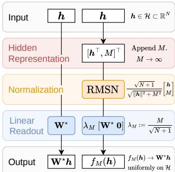  
Figure 2: Target map and its onecoordinate RMSNorm realization (Theorem 3.1).

We next study whether inserting RMSNorm immediately before or after the activation of a target one-hidden-layer MLP preserves its represented function.

## 4 ACTIVATION-NORMALIZED RMS NETWORKS

The width-N activation-normalized RMS class is

$$
\begin{array} { r } { \mathcal { R } _ { N } ^ { \mathrm { A N } , \diamondsuit } ( \phi ) : = \left\{ x \mapsto W _ { 2 } \mathrm { R M S N } ^ { ( \diamond ) } ( \phi ( W _ { 1 } x + b _ { 1 } ) ) + b _ { 2 } \right\} . } \end{array}\tag{5}
$$

Here and below all displayed weights, biases, and available normalization parameters vary freely The affine scale is absorbed into $W _ { 2 }$ , so the affine and no-affine AN classes coincide; we denote their common value by $\mathcal { R } _ { N } ^ { \mathrm { A N } } ( \phi )$

The common proof strategy is to augment the width until the original feature map is recovered, up to a uniformly vanishing scaling distortion, from the first N normalized coordinates. The added coordinates control the normalization statistics and are ignored by the target readout, as illustrated in Figure 2.

## 4.1 UNBOUNDED ACTIVATIONS: MAGNITUDE CONTROLS THE NORMALIZATION SCALE

Theorem 4.1 (Approximation by RMS-AN networks with unbounded activations). Let $\phi$ be continuous with unbounded range. For every $f \in \mathcal { M } _ { N } ( \phi )$ , there are constants $C _ { f } , R _ { f } > 0$ such that every attainable value $M \in \phi ( \mathbb { R } )$ with $| M | \geq R _ { f }$ admits

$$
\widehat { f } _ { M } \in \mathcal { R } _ { N + 1 } ^ { \mathrm { A N } } ( \phi ) , \qquad \left\| \widehat { f } _ { M } - f \right\| _ { L ^ { \infty } ( K ) } \leq \frac { C _ { f } } { M ^ { 2 } } .\tag{6}
$$

The construction appends the activated value M and assigns its coordinate zero readout weight. After a fixed rescaling, the signal is multiplied by $( 1 + \| z ( \mathbf { x } ) \| ^ { 2 } / M ^ { 2 } ) ^ { - 1 / 2 }$ , which converges uniformly to one. This is exactly the mechanism in Figure 2.

Driving the error in Eqn. 6 to zero requires attainable values $| M | \to \infty$ , which is why this onecoordinate construction needs an activation with unbounded range. For bounded activations this regime is unavailable; the next subsection replaces magnitude by multiplicity.

## 4.2 GENERAL ACTIVATIONS: MULTIPLICITY REPLACES MAGNITUDE

Theorem 4.2 (Approximation by RMS-AN networks with general activations). Let φ be continuous and nonconstant. For every $f \in \mathcal { M } _ { N } ( \phi )$ , there are constants $C _ { f } > 0 , r _ { f } \in \mathbb { N } _ { }$ , and a sequence $\widehat { f } _ { r } \in \mathcal { R } _ { N + r } ^ { \mathrm { A N } } ( \phi )$ such that

$$
\left\| \widehat { f } _ { r } - f \right\| _ { L ^ { \infty } ( K ) } \leq \frac { C _ { f } } { r } \qquad ( r \geq r _ { f } ) .\tag{7}
$$

Choose any nonzero attainable value a and append r copies. Their squared norm grows like $r a ^ { 2 }$ , while the target feature vector remains bounded, so the remaining scaling factor is $( 1 +$ $\left\| z ( \pmb { x } ) \right\| ^ { 2 } / ( r a ^ { 2 } ) ) ^ { - 1 / 2 }$ . Appendix B proves both theorems.

Summary. RMS-AN networks require only scale stabilization. One large attainable value gives width $N + 1$ , while r repeated bounded values give width $N + r$ . The next section moves normalization before the activation, where its scale can no longer generally be absorbed into the readout.

## 5 PREACTIVATION-NORMALIZED RMS NETWORKS

Unlike in AN networks, the affine RMSNorm scale in PN networks acts before the nonlinear activation and therefore cannot generally be absorbed into the output linear map. The affine and no-affine PN classes can therefore differ, so we treat them separately. The corresponding width-N PN classes are

$$
\mathcal { R } _ { N } ^ { \mathrm { P N } , \diamond } ( \phi ) : = \left\{ x \mapsto W _ { 2 } \phi \Big ( \mathrm { R M S N } ^ { ( \diamond ) } ( W _ { 1 } x + b _ { 1 } ) \Big ) + b _ { 2 } \right\} .\tag{8}
$$

## 5.1 PN NETWORKS WITH AFFINE PARAMETERS

Theorem 5.1 (Approximation by affine PN networks). Let φ be continuous. For every $f \in \mathcal { M } _ { N } ( \phi )$ and every $\varepsilon > 0 ,$ there exists $\widehat { f } \in \mathcal { R } _ { N + 1 } ^ { \mathrm { P N , a f f } } ( \phi )$ such that $\left\| \widehat { f } - f \right\| _ { L ^ { \infty } ( K ) } < \varepsilon .$ If φ is Lipschitz on compact sets, the approximants have error $O _ { f } ( M ^ { - 2 } )$ as $M  \infty .$

The proof follows the construction of Theorem 3.1, with the affine RMSNorm scale performing the required linear rescaling before $\phi .$ For each target preactivation t, append the constant $M$ as one extra coordinate and choose the affine scale so that the first N normalized coordinates are $\left( 1 + \left. t \right. ^ { 2 } / M ^ { 2 } \right) ^ { - 1 / 2 }$ t. Because t ranges over a compact set, the scalar factor converges uniformly to one as $| M |  \infty$ . The continuity of $\phi$ therefore transfers this identity limit through the activation. Appendix C gives the proof.

## 5.2 A FINITE-WIDTH OBSTRUCTION WITHOUT AFFINE PARAMETERS

Proposition 5.2 (A finite-width obstruction). For every finite normalized width $d ,$ let $\psi _ { d } ( t ) ~ =$ max $\{ 0 , t - \sqrt { d } \}$ . Every width-d no-affine RMS-PN network with activation $\psi _ { d }$ is constant, whereas ordinary ψd-networks can represent nonconstant functions.

Every coordinate of an RMSNorm output lies in $[ - \sqrt { d } , \sqrt { d } ]$ , where $\psi _ { d }$ vanishes. Thus no fixed d gives a guarantee uniform over all continuous activations: at finite width, normalization can erase the activation's nonconstant regime and hence its expressive power. The next two subsections give two distinct ways around this obstruction. Positive homogeneity makes an inverse rescaling of the second-layer weights equivalent to applying the required scale before $\phi ,$ retaining width $N \overset { \cdot } { + } 1 \mathop { : }$ for a general continuous activation, increasing width recovers approximation asymptotically.

## 5.3 NO-AFFINE PN NETWORKS WITH POSITIVELY HOMOGENEOUS ACTIVATIONS

Theorem 5.3 (Approximation by no-affine PN networks with homogeneous activations). Suppose that φ is continuous and positively homogeneous of degree one, namely, $\phi ( \lambda t ) ~ = ~ \lambda \phi ( t )$ for all $\lambda \geq 0$ and $t \in \mathbb R$ For every $f \in \mathcal { M } _ { N } ( \phi )$ and every $\varepsilon > 0 ,$ there exists $\widehat { f } \in \mathcal { R } _ { N + 1 } ^ { \mathrm { P N } , 0 } ( \phi )$ such that $\left\| \widehat { f } - f \right\| _ { L ^ { \infty } ( K ) } < \varepsilon .$ The approximants have error $O _ { f } ( M ^ { - 2 } )$ as $M \to \infty$

Without affine parameters, normalization leaves a positive common factor before $\phi ,$ so no homogeneity condition for negative multipliers is needed. Positive homogeneity moves this factor through the activation, and an inverse rescaling of the second-layer weights cancels it. Equivalently, the output-layer rescaling supplies the scale that affine RMSNorm would have applied before $\phi .$

## 5.4 NO-AFFINE PN NETWORKS WITH GENERAL CONTINUOUS ACTIVATIONS

Theorem 5.4 (Approximation by no-affine PN networks with general activations). Let φ be continuous. For every $f \in \mathcal { M } _ { N } ( \phi )$ , there is a sequence $\widehat { f } _ { r } \in \mathcal { R } _ { N + r } ^ { \mathrm { P N } , 0 } ( \phi )$ such that $\Big \| \widehat { f } _ { r } - f \Big \| _ { L ^ { \infty } ( K ) } \to 0 .$ $I f \phi$ is Lipschitz on compact sets, then for some $C _ { f } > 0$ and $r _ { f } \in  { \mathbb { N } } ,$

$$
\left\| \widehat { f } _ { r } - f \right\| _ { L ^ { \infty } ( K ) } \leq \frac { C _ { f } } { r } \qquad ( r \geq r _ { f } ) .\tag{9}
$$

For the target preactivation ${ \pmb t } ( { \pmb x } )$ , append r constant coordinates equal to one, forming $[ { \pmb t } ( { \pmb x } ) ^ { \top } , \mathbf { 1 } _ { r } ^ { \top } ] ^ { \top } \in \mathrm { ~ \mathbb { R } ^ { N + r } ~ }$ . By the definition of RMSNorm, its first N normalized coordinates are $\Big ( ( N + r ) / ( \| t ( x ) \| ^ { 2 } + r ) \Big ) ^ { 1 / 2 } t ( x )$ . On the compact input set, the scalar factor converges uniformly to one, so the normalized preactivation converges to the original one. The networks exist for every r, but the displayed error bound is asserted only for $r \geq r _ { f }$ . Appendix C gives the proofs of all results in this section.

Summary. Affine parameters give an $N + 1 \mathrm { R M S - P N }$ approximation for every continuous activation, and positive homogeneity retains width $N + 1$ without affine parameters. General continuous activations instead require replicated-coordinate width growth. The next section adds centering and derives the corresponding LayerNorm guarantees.

## 6 ADDING CENTERING: FROM RMSNORM TO LAYERNORM

LayerNorm (Ba et al., 2016) differs from RMSNorm by an additional centering operation: before normalization by scale, it subtracts the coordinate mean. Let $P _ { d } = I _ { d } - d ^ { \mathbf { - } 1 } \mathbf { 1 } _ { d } ^ { \mathbf { - } } \mathbf { 1 } _ { d } ^ { \intercal }$ . With this notation, LN is

$$
\mathrm { L N } ( \pmb { h } ) = \mathrm { R M S N } ( P _ { d } \pmb { h } ) = \frac { \pmb { h } - \mu ( \pmb { h } ) \mathbf { 1 } _ { d } } { \sigma ( \pmb { h } ) } ,\tag{10}
$$

where $\mu ( h ) = d ^ { - 1 } \mathbf { 1 } _ { d } ^ { \top } h$ and $\sigma ( { \pmb h } ) = ( d ^ { - 1 } \left\| { \pmb h } - { \boldsymbol \mu } ( { \pmb h } ) { \mathbf 1 } _ { d } \right\| ^ { 2 } ) ^ { 1 / 2 }$ . We set $\mathrm { L N } ( h ) = \mathbf { 0 }$ when h has zero variance. Its affine mode is $\mathrm { L N } _ { \alpha , \beta } ( h ) = \alpha \odot \mathrm { L N } ( h ) + \beta$ for $\alpha , \beta \in \mathbb { R } ^ { d }$ . For $\diamond \in \{ 0 , \mathrm { a f f } \}$ , let $\mathrm { L N } ^ { ( 0 ) } = \mathrm { L N }$ and $\mathrm { L N } ^ { \mathrm { ( a f f ) } } = \mathrm { L N } _ { \alpha , \beta } .$

For $\diamond \in \{ 0 , \mathrm { a f f } \}$ , define the LN classes

$$
\begin{array} { r } { \mathcal { P } _ { N } ^ { \mathrm { A N } , \diamond } ( \phi ) : = \left\{ x \mapsto W _ { 2 } \mathrm { L N } ^ { ( \diamond ) } ( \phi ( W _ { 1 } x + b _ { 1 } ) ) + b _ { 2 } \right\} , } \end{array}\tag{11}
$$

$$
\begin{array} { r } { \mathcal { P } _ { N } ^ { \mathrm { P N } , \diamond } ( \phi ) : = \left\{ \pmb { x } \mapsto W _ { 2 } \phi \Big ( \mathrm { L N } ^ { ( \diamond ) } ( W _ { 1 } \pmb { x } + b _ { 1 } ) \Big ) + b _ { 2 } \right\} , } \end{array}\tag{12}
$$

where $\mathrm { L N } ^ { ( 0 ) } = \mathrm { L N }$ and $\mathrm { L N } ^ { \mathrm { ( a f f ) } } = \mathrm { L N } _ { \alpha , \beta }$ . For AN networks the affine parameters are absorbed into the readout, so $\mathcal { P } _ { N } ^ { \mathrm { A N , a f f } } ( \phi ) = \mathcal { P } _ { N } ^ { \mathrm { A N , 0 } } ( \phi )$ ; we denote the common class by $\mathcal { P } _ { N } ^ { \mathrm { A N } } ( \phi )$

The width-augmentation principle is the same as for RMSNorm: the added coordinates make the normalization scale nearly constant on the bounded signal family. The new issue is LN's centering projection $P _ { d } ,$ which we absorb through reparameterization rather than by approximating the subtracted mean. Theorem 3.1 extends to LN by replacing its one-coordinate augmentation with the following mean-zero two-coordinate construction. Write $s ( h ) = \mathbf { 1 } _ { N } ^ { \top } h$ and replace the one-coordinate augmentation by $\pmb { y } _ { M } ( \pmb { h } ) = [ \pmb { h } ^ { \top } , - s ( \pmb { h } ) / 2 + M , - s ( \pmb { h } ) / 2 - \dot { M } ] ^ { \top }$ . Since $\mathbf { 1 } _ { N + 2 } ^ { \top } \pmb { y } _ { M } ( \pmb { h } ) = 0$ , LN equals RMSNorm on the augmented vector; the same decoder gives width $N { + 2 }$ and error $O ( M ^ { - 2 } )$ Appendix D.1 gives the exact calculation.

## 6.1 CENTERING THROUGH REPARAMETERIZATION

The centering operation can be absorbed on the side of the activation where the relevant map remains linear. For PN networks, the mean-zero two-coordinate construction above absorbs centering before the activation and retains the $O ( M ^ { - 2 } )$ rate; see Appendix D.4.

For AN networks, this input-side argument is unavailable because generally $\phi ( P _ { d } h ) \neq P _ { d } \phi ( h )$ Moreover, an activation such as ReLU may be unbounded only on one side, so the mean-zero pair $M , - M$ used above need not be attainable. The following result shows how one attainable large value still suffices.

Theorem 6.1 (Approximation by LN-AN networks with unbounded activations). Let φ be continuous with unbounded range. For every $f \in \mathcal { M } _ { N } ( \phi )$ , there are constants $C _ { f } , R _ { f } > 0$ such that every attainable value $M \in \phi ( { \mathbb R } )$ with $| M | \geq R _ { f }$ admits

$$
\widehat { f } _ { M } \in \mathcal { P } _ { N + 2 } ^ { \mathrm { A N } } ( \phi ) , \qquad \left\| \widehat { f } _ { M } - f \right\| _ { L ^ { \infty } ( K ) } \leq \frac { C _ { f } } { | M | } .\tag{13}
$$

Proof analysis. Let the target be the width-n MLP $g ( { \pmb x } ) = A \phi ( { \pmb B } { \pmb x } + { \pmb b } ) + { \pmb a } = A z ( { \pmb x } ) + { \pmb a }$ We first append a single attainable value M with zero readout weight. For clarity take $M > 0 ;$ the negative case has the same calculation with the corresponding signs. Put $d = n + 1 , s = \mathbf { 1 } _ { n } ^ { \top } z .$ $\bar { \mu _ { M } } = ( s + M ) / d , \sigma _ { M } = \sigma ( [ z ^ { \top } , M ] ^ { \top } ) , \tau _ { M } = M \bar { \sqrt { n } } / d ,$ and $\lambda _ { M } = \tau _ { M } / \sigma _ { M }$ . The candidate network is

$$
{ \widehat { g } } _ { M } ( \pmb { x } ) = \tau _ { M } \left[ \pmb { A } \quad \mathbf { 0 } \right] \operatorname { L N } \left( \left[ \begin{array} { c } { \qquad \forall } \\ { M } \end{array} \right] \right) + \pmb { a } + \frac { M } { d } \pmb { A } \mathbf { 1 } _ { n } .\tag{14}
$$

A direct calculation gives the approximation error

$$
\widehat g _ { M } - g = ( \lambda _ { M } - 1 ) { \cal A } z - \left( \lambda _ { M } \mu _ { M } - \frac { M } { d } \right) { \cal A } { \bf 1 } _ { n } .\tag{15}
$$

The last term in Eqn. 14 cancels the leading input-independent centering error. Uniformly on the compact input set, $\dot { \lambda } _ { M } = 1 + s / ( n M ) + \bar { O ( \ l M ^ { - 2 } ) }$ and $\lambda _ { M } \mu _ { M } - M / \bar { d } = s / n + O ( M ^ { - 1 } )$ . Thus the remaining error generally tends $\mathbf { t o } - ( s ( \pmb { x } ) / n ) \pmb { A } \mathbf { 1 } _ { n }$ . The one-coordinate construction succeeds precisely under the zero-sum condition $\mathbf { A 1 } _ { n } = \mathbf { 0 }$

Lemma 6.1 (Conditional one-coordinate approximation). Let φ be continuous with unbounded range, and let $g ( { \pmb x } ) = { \pmb A } \phi ( { \pmb B } { \pmb x } + { \pmb b } ) + { \pmb a }$ be a width-n MLP with $A \mathbf { 1 } _ { n } \ = \ \mathbf { 0 } .$ There are constants $C _ { g } , R _ { g } > 0$ such that every attainable $M \in \phi ( \mathbb { R } )$ with $| M | \geq R _ { g }$ admits $\widehat { g } _ { M } \in \mathcal { P } _ { n + 1 } ^ { \mathrm { A N } } ( \phi )$ with $\mathrm { s u p } _ { \pmb { x } \in K } \| \widehat { g } _ { M } ( \pmb { x } ) - g ( \pmb { x } ) \| \le C _ { g } / | M |$

The complete proof is given in Appendix D.2. Lemma 6.1 thus approximates a zero-sum target after appending only one coordinate. It remains to put an arbitrary target MLP in this favorable form; one additional constant activated coordinate suffices.

Lemma 6.2 (Zero-sum readout reparameterization). Every $f \in \mathcal { M } _ { N } ( \phi )$ has an exactly equivalent width-(N + 1) one-hidden-layer MLP $\bar { f } ( \pmb { x } ) = \bar { W } _ { 2 } \phi ( \bar { W } _ { 1 } \bar { \pmb { x } } + \bar { \pmb { b } } _ { 1 } ) + \bar { \pmb { b } } _ { 2 } ^ { \setminus }$ with $\bar { \cal W } _ { 2 } { \bf 1 } _ { N + 1 } \dot { = } \bar { \bf 0 }$

The proof is given in Appendix D.2. Combining Lemmas 6.1 and 6.2, first reparameterizing the target at width $N + 1$ and then appending M, gives width $N + 2$ and proves Theorem 6.1.

Remark 6.1. Viewed in isolation, Lemma 6.2 may look inapplicable: its zero-sum readout acts after scaling, whereas LN centers before scaling. In our construction, the large coordinate M makes the RMSNorm-type scale nearly input independent and hence approximately linear on the lifted compact family. Because the residual scaling is a common scalar, the readout centering passes through it and aligns with LN's inner centering. Thus Lemma 6.2 removes centering exactly, while Lemma 6.1 bounds the residual scaling error.

## 6.2 REMAINING LAYERNORM APPROXIMATION GUARANTEES

Proposition 6.2 (Remaining LayerNorm counterparts). The affine-PN and homogeneous-PN conclusions of Theorems 5.1 and 5.3 remain valid for the corresponding LN classes with width $N + 2 .$ The general-activation conclusions of Theorems 4.2 and 5.4 both remain valid with width $N + 2 r$ All stated rates are unchanged. Moreover, the finite-width obstruction in Proposition 5.2 remains valid when RMSNorm is replaced by LN.

The contrast with RMSNorm is explicit in the widths that grow with r. Its general AN construction repeats one attainable value r times and has width $N { + r }$ . After LN centering, copies of a single value cannot provide a nondegenerate limiting variance, so we repeat each of two distinct attainable values r times, giving width $N + 2 r$ The constant part of the induced mean is absorbed into the output bias; the remaining input-dependent centering and scaling errors are both $O ( r ^ { - 1 } )$ . Thus, unlike the one-sided unbounded construction, this argument does not require Lemma 6.2. For PN networks, the analogous replacement of r identical coordinates by r symmetric pairs also gives width $N + 2 r$ . The two-coordinate linearization in Appendix D.1 supplies the affine and homogeneous constructions, while replicated symmetric coordinates handle a general continuous activation. Appendix D gives the detailed arguments.

Summary. This section extends the five RMSNorm approximation results to LayerNorm by reparameterizing its centering. The next section establishes their joint worst-case width lower bounds and transfers them to universal approximation.

## 7 WIDTH LOWER BOUNDS AND UNIVERSAL APPROXIMATION

## 7.1 JOINT WORST-CASE WIDTH LOWER BOUNDS

The $N + 1 \mathrm { R M S N o r m }$ and $N + 2$ LayerNorm widths are jointly sharp. In each case the identity target on the unit ball exposes the obstruction: when the normalized layer is too narrow, it collapses a nontrivial input segment.

Proposition 7.1 (Worst-case necessity of one additional coordinate). Let $N \geq 1$ and $K = \{ \pmb { x } \in$ $\mathbb { R } ^ { N } : \| \pmb { x } \| \leq 1 \}$ . For every $d \leq N$ and every width-d map

$$
g ( \pmb { x } ) = W _ { 2 } \operatorname { R M S N } ( W _ { 1 } \pmb { x } + \pmb { b } _ { 1 } ) + \pmb { b } _ { 2 } \in \mathbb { R } ^ { N } ,\tag{16}
$$

we have $\begin{array} { r } { \operatorname* { s u p } _ { { \pmb x } \in K } \| { \pmb g } ( { \pmb x } ) - { \pmb x } \| \geq \frac { 1 } { 2 } } \end{array}$

The proof uses rank deficiency when $d < N$ and the ray invariance of RMSNorm when $d = N$ . The same argument applies to LN after replacing the affine map by its centered version $P _ { d } ( \pmb { W } _ { 1 } \pmb { x } + \pmb { b } _ { 1 } )$ where $\bar { \pmb { P } } _ { d } = \pmb { I } _ { d } - \llangle ^ { - 1 } \mathbf { 1 } _ { d } \mathbf { 1 } _ { d } ^ { \top }$ is the centering projection. Since rank( $P _ { d } W _ { 1 } ) \leq d - 1$ , every width $d \leq N + 1 \mathrm { L N }$ map likewise has error at least $1 / 2 ,$ so the first admissible width is $N + 2$

$\mathrm { W i t h } \phi ( t ) = t ,$ Proposition 7.1 and its LN counterpart show that the $N + 1$ RMSNorm and $N + 2$ LayerNorm width bounds are worst-case sharp. The $N + r$ and $N + 2 r$ widths remain constructive upper bounds. Appendix E.1 gives the shared argument.

## 7.2 UNIVERSAL APPROXIMATION TRANSFER

The preceding relative-approximation guarantees transfer any applicable universal-approximation theorem for one-hidden-layer MLPs to the corresponding normalized classes.

Corollary 7.2 (Universal approximation transfer). Suppose that $\begin{array} { r } { \bigcup _ { N > 1 } \mathcal { M } _ { N } ( \phi ) } \end{array}$ is dense in $C ( K ; \mathbb { R } ^ { d _ { y } } )$ under the uniform norm. $I f \phi$ is continuous and nonconstant, then the unions of both RMS-AN and LN-AN classes are dense. $I f \phi$ is continuous, then the corresponding affine and noaffine PN unions are dense as well.

Indeed, approximate the target first by a one-hidden-layer MLP and then approximate that MLP by the corresponding normalized network, the triangle inequality gives the claim. Appendix E.2 gives the details.

## 8 NUMERICAL ILLUSTRATION

We test the three fixed-overhead rate predictions using six independently sampled width-16 target MLPs in each setting. For each target and augmentation magnitude M, we instantiate the LN and RMSNorm approximants using the explicit constructions from the proofs, without fitting their parameters. We evaluate the maximum absolute output error on a fixed test grid and plot its mean over the six targets in Figure 3. In Figure 3(a), the RMSNorm AN error eventually decreases in line with the $M ^ { - 2 }$ rate in Theorem 4.1, whereas the LN AN error follows the $M ^ { - 1 }$ rate in Theorem 6.1. The LN curve drops sharply between M = 4 and $M = 8$ and then changes little at $M = 1 6$ . The $M ^ { - 1 }$ rate is asymptotic and does not prescribe the shape of this early part of the curve. Figures 3(b) and 3(c) show nearly overlapping LN and RMSNorm errors consistent with the $M ^ { - 2 }$ rates for affine and homogeneous PN in Theorems 5.1 and 5.3 and their LN counterparts in Proposition 6.2. The gray lines indicate reference slopes, not numerical error bounds.

We also test the remaining width-growing constructions, other activations, and target widths $N \in$ {4, 8, 16, 32}. These experiments exhibit the same predicted behavior. Appendix F gives the complete results, including interquartile ranges and the shifted-ReLU width obstruction.

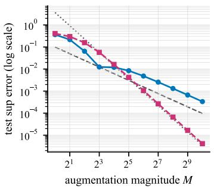  
(a) Unbounded AN (ReLU)

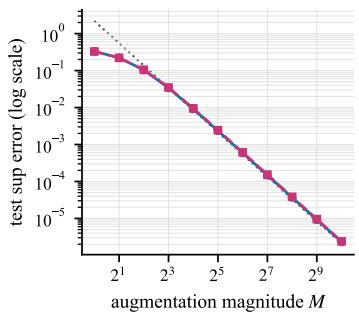  
(b) Affine PN (tanh).

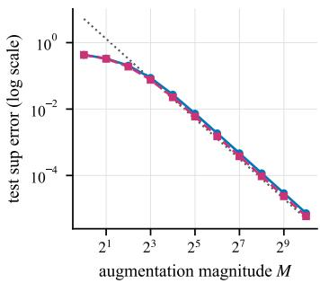  
(c) Homogeneous PN (ReLU).  
LayerNorm -- RMSNorm ---- O(M−1) …... O(M-2)  
Figure 3: Representative verification of the three M-controlled constructions at $N = 1 6$ Each curve reports the mean of grid-based maximum absolute errors over six target MLPs generated from independent random seeds. ReLU is used for unbounded AN and homogeneous PN, whereas tanh is used for affine PN. Both axes use logarithmic scales. Markers distinguish LayerNorm and RMSNorm, and gray lines illustrate reference slopes rather than error bounds. The complete fourwidth activation sweep and the width-growing experiments appear in Appendix F.

## 9 CONCLUSION

Starting from the nonlinearity of input-dependent scaling, we show that width augmentation can make normalization approximately linear on compact feature sets. Under the corresponding assumptions, inserting RMSNorm after or before the activation of a one-hidden-layer MLP can therefore preserve its represented function arbitrarily well by increasing width. LayerNorm admits analogous guarantees after its centering operation is absorbed by reparameterization. Applicable universality results transfer, the N + 1 RMSNorm and $N + 2$ LayerNorm bounds are worst-case sharp, and experiments recover the predicted approximation rates.

Limitations. The results concern LN and RMSNorm on compact sets in one shallow normalization-activation composition. Fixed numerical stabilizers, coupled normalization layers, residual architectures, and finite-precision effects lie outside the analysis. Whether the constructive widths $N + r$ and $N + 2 r$ are necessary for standard fixed activations remains open. The scalar synthetic experiments do not establish behavior in high-dimensional or deep networks.

## ACKNOWLEDGMENTS

This work was supported by the National Natural Science Foundation of China (62476016, 62441617), and the Fundamental Research Funds for the Central Universities and the Beijing Natural Science Foundation (Grant No. QY24137).

## CODE AVAILABILITY

The experiment code and numerical data are available at https: //github.com/Musicath/ AALN-experiments.

## AI USE STATEMENT

We used generative AI tools to assist with manuscript editing, proof checking, literature search and citation checking, code implementation and debugging, and the preparation and interpretation of synthetic experiments and figures. The research question, mathematical claims and constructions, and experimental objectives were formulated by the authors. All AI-assisted outputs were reviewed and verified by the authors, who take full responsibility for the final content.

## REFERENCES

Jimmy Lei Ba, Jamie Ryan Kiros, and Geoffrey E Hinton. Layer normalization. arXiv preprint arXiv:1607.06450, 2016.

Luca Baroni, Galvin Khara, Joachim Schaeffer, Marat Subkhankulov, and Stefan Heimersheim. Transformers Don't Need LayerNorm at Inference Time: Scaling LayerNorm Removal to GPT-2 XL and the Implications for Mechanistic Interpretability. arXiv preprint arXiv:2507.02559, 2025.

Andrew R Barron. Universal approximation bounds for superpositions of a sigmoidal function. IEEE Transactions on Information theory, 39(3):930–945, 1993.

Shaked Brody, Uri Alon, and Eran Yahav. On the expressivity role of LayerNorm in transformers' attention. In Findings of the Association for Computational Linguistics: ACL 2023, pp. 14211– 14221, 2023.

George Cybenko. Approximation by superpositions of a sigmoidal function. Mathematics of control, signals and systems, 2(4):303–314, 1989.

Xavier Glorot and Yoshua Bengio. Understanding the difficulty of training deep feedforward neural networks. In Proceedings of the thirteenth international conference on artificial intelligence and statistics, pp. 249–256. JMLR Workshop and Conference Proceedings, 2010.

Jialong Guo, Xinghao Chen, Yehui Tang, and Yunhe Wang. SLAB: Efficient Transformers with Simplified Linear Attention and Progressive Re-parameterized Batch Normalization. In Proceedings of the 41st International Conference on Machine Learning, volume 235 of Proceedings of Machine Learning Research, pp. 16802–16812, 2024. URL https: //proceedings .mlr. press/v235/guo24a.html.

Kaiming He, Xiangyu Zhang, Shaoqing Ren, and Jian Sun. Delving deep into rectifiers: Surpassing human-level performance on imagenet classification. In Proceedings of the IEEE international conference on computer vision, pp. 1026–1034, 2015.

Kaiming He, Xiangyu Zhang, Shaoqing Ren, and Jian Sun. Deep residual learning for image recognition. In Proceedings of the IEEE conference on computer vision and pattern recognition, pp. 770–778, 2016.

Kurt Hornik. Approximation capabilities of multilayer feedforward networks. Neural networks, 4 (2):251–257, 1991.

Sergey Ioffe and Christian Szegedy. Batch normalization: Accelerating deep network training by reducing internal covariate shift. In International conference on machine learning, pp. 448–456. pmlr, 2015.

Zixuan Jiang, Jiaqi Gu, Hanqing Zhu, and David Z. Pan. Pre-RMSNorm and Pre-CRMSNorm Transformers: Equivalent and Efficient Pre-LN Transformers. In Advances in Neural Information Processing Systems, volume 36, pp. 45777–45793, 2023. URL https://papers.nips.cc/paper\_files/paper/2023/hash/ 8f1bacee31caf990a4f08d84f0ccb322-Abstract-Conference.html.

Andrei Kanavalau, Carmen Amo Alonso, and Sanjay Lall. Gated Normalization Removal and Scale Anchoring in Pre-Norm Transformers, 2026. URL https : //arxiv. org/abs/2602. 10408v2. arXiv version v2.

Moshe Leshno, Vladimir Ya Lin, Allan Pinkus, and Shimon Schocken. Multilayer feedforward networks with a nonpolynomial activation function can approximate any function. Neural networks, 6(6):861–867, 1993.

Hongzhou Lin and Stefanie Jegelka. Resnet with one-neuron hidden layers is a universal approximator. Advances in neural information processing systems, 31, 2018.

Zhou Lu, Hongming Pu, Feicheng Wang, Zhiqiang Hu, and Liwei Wang. The expressive power of neural networks: A view from the width. Advances in neural information processing systems, 30, 2017.

Yunhao Ni, Yuxin Guo, Junlong Jia, and Lei Huang. On the Nonlinearity of Layer Normalization. In Proceedings of the 41st International Conference on Machine Learning, volume 235 of Proceedings of Machine Learning Research, pp. 37957–37998, 2024. URL https : //proceedings.mlr.press/v235/ni24b.html.

Yunhao Ni, Yuxin Guo, Yuhe Liu, Wenxin Sun, Jie Luo, Wenjun Wu, and Lei Huang. Parallel Layer Normalization for Universal Approximation. arXiv preprint arXiv:2505.13142, 2025. URL https://arxiv.org/abs/2505.13142v2.

Sejun Park, Chulhee Yun, Jaeho Lee, and Jinwoo Shin. Minimum Width for Universal Approximation. In International Conference on Learning Representations, 2021. URL https : //openreview.net/forum?id=O-XJwyoIF-k.

Paul M Riechers. Geometry and dynamics of LayerNorm. arXiv preprint arXiv:2405.04134, 2024.

Felix Stollenwerk. On the mathematical relationship between layer normalization and dynamic activation functions. In Proceedings of the 19th Conference of the European Chapter of the Association for Computational Linguistics (Volume 2: Short Papers), pp. 674–681, 2026.

Jingjing Xu, Xu Sun, Zhiyuan Zhang, Guangxiang Zhao, and Junyang Lin. Understanding and improving layer normalization. Advances in neural information processing systems, 32, 2019.

Biao Zhang and Rico Sennrich. Root mean square layer normalization. Advances in neural information processing systems, 32, 2019.

Jiachen Zhu, Xinlei Chen, Kaiming He, Yann LeCun, and Zhuang Liu. Transformers without normalization. In 2025 IEEE/CVF Conference on Computer Vision and Pattern Recognition (CVPR), pp. 14901–14911. IEEE, 2025.

## A PROOFS FOR SECTION 3

## A.1 PROOF OF THEOREM 3.1

Proof of Theorem 3.1. Put $d = N + 1$ and define

$$
{ W } _ { 1 , M } = \left[ { \pmb { I } } _ { N } \right] , \qquad { b } _ { 1 , M } = \left[ { \pmb { 0 } } _ { N } \right] , \qquad { W } _ { 2 , M } = \frac { | { \pmb { M } } | } { \sqrt { d } } \left[ { \pmb { W } } ^ { \star } \quad { \bf 0 } \right] , \qquad { b } _ { 2 , M } = { \bf 0 } .\tag{17}
$$

Then

$$
f _ { M } ( \pmb { h } ) = \left( 1 + \frac { \| \pmb { h } \| ^ { 2 } } { M ^ { 2 } } \right) ^ { - 1 / 2 } \pmb { W } ^ { \star } \pmb { h } .\tag{18}
$$

Since H is compact, the elementary inequality $0 \leq 1 - ( 1 + u ) ^ { - 1 / 2 } \leq u / 2$ for $u \geq 0$ gives Eqn. 4. □

## B PROOFS FOR SECTION 4

## B.1 PROOF OF THEOREM 4.1

Proof of Theorem 4.1. Write ${ f ( \pmb x ) = W _ { 2 } \pmb z ( \pmb x ) + b _ { 2 } }$ , where $z ( \pmb { x } ) = \phi ( \pmb { W } _ { 1 } \pmb { x } + \pmb { b } _ { 1 } )$ . For an attainable value M, append one constant activated coordinate and set $d = N + 1 \colon$

$$
{ y } _ { M } ( { \pmb x } ) = \left[ \ z ( { \pmb x } ) \right] , \qquad \widehat { f } _ { M } ( { \pmb x } ) = \frac { | M | } { \sqrt { d } } \left[ { \pmb W } _ { 2 } \quad { \pmb 0 } \right] \mathrm { R M S N } ( { \pmb y } _ { M } ( { \pmb x } ) ) + b _ { 2 } .\tag{19}
$$

Then

$$
\widehat { f } _ { M } ( \pmb { x } ) = \left( 1 + \frac { \left. \pmb { z } ( \pmb { x } ) \right. ^ { 2 } } { M ^ { 2 } } \right) ^ { - 1 / 2 } W _ { 2 } \pmb { z } ( \pmb { x } ) + b _ { 2 } .\tag{20}
$$

Since $z ( K )$ is bounded, the inequality used in Appendix A.1 gives Eqn. 6.

## B.2 PROOF OF THEOREM 4.2

Proof of Theorem 4.2. Choose $a \in \phi ( \mathbb { R } ) \setminus \{ 0 \}$ and append r copies:

$$
\begin{array} { r } { { \pmb y } _ { r } ( { \pmb x } ) = \left[ \pmb { z } ( { \pmb x } ) \right] \in \mathbb { R } ^ { N + r } . } \end{array}\tag{21}
$$

With $d = N + r .$ define

$$
\widehat { f } _ { r } ( x ) = \frac { \sqrt { r } | a | } { \sqrt { d } } \left[ W _ { 2 } \quad \mathbf { 0 } \right] \mathrm { R M S N } ( y _ { r } ( x ) ) + b _ { 2 } .\tag{22}
$$

The signal factor is

$$
\left( 1 + \frac { \left. z ( \pmb { x } ) \right. ^ { 2 } } { r a ^ { 2 } } \right) ^ { - 1 / 2 } = 1 + O _ { f } ( r ^ { - 1 } )\tag{23}
$$

uniformly on K, proving the claim.

## C PROOFS FOR SECTION 5

## C.1 PROOF OF THEOREM 5.1

Proof of Theorem 5.1. Write $f ( \pmb { x } ) = W _ { 2 } \phi ( \pmb { t } ( \pmb { x } ) ) + b _ { 2 }$ and put $d = N + 1$ . Apply RMSNorm to $[ { \pmb t } ( { \pmb x } ) ^ { \top } , M ] ^ { \top }$ and choose the affine scale

$$
\alpha _ { M } = \frac { | M | } { \sqrt d } \left[ { \bf 1 } _ { N } \right] .\tag{24}
$$

The first N coordinates after affine scaling are $\lambda _ { M } ( \pmb { t } ( \pmb { x } ) ) \pmb { t } ( \pmb { x } )$ , where $\lambda _ { M } ( t ) = \left( 1 + \left. t \right. ^ { 2 } / M ^ { 2 } \right) ^ { - 1 / 2 }$ and the added coordinate has zero readout weight. Uniform continuity of φ proves convergence; local Lipschitz continuity and $\lambda _ { M } - 1 = O ( M ^ { - 2 } )$ give the stated rate. □

## C.2 PROOF OF PROPOSITION 5.2

Proof of Proposition 5.2. Every RMSNorm output $\pmb { u } \in \mathbb { R } ^ { d }$ satisfies $\left\| \mathbf { \boldsymbol { u } } \right\| ^ { 2 } = a$ when nonzero, hence $| u _ { i } | \leq { \sqrt { d } } ;$ the same coordinate bound holds at zero. Thus $\psi _ { d } ( u _ { i } ) = 0$ for every coordinate, and every no-affine RMS-PN network has only its final bias left. By contrast, $\psi _ { d } ( \dot { \pmb { w } } ^ { \top } \pmb { x } + c ) =$ ReI $. \mathrm { U } ( { \pmb w } ^ { \top } { \pmb x } + c - \sqrt { d } )$ is nonconstant for suitable parameters in a one-hidden-layer MLP. □

## C.3 PROOF OF THEOREM 5.3

Proof of Theorem 5.3. With the notation above, the first N no-affine RMSNorm coordinates are $c _ { M } \lambda _ { M } ( { \pmb t } ( { \pmb x } ) ) { \pmb t } ( { \pmb x } )$ , where $c _ { M } = \sqrt { N + 1 } / | M |$ . Positive homogeneity moves $c _ { M }$ through φ, and the readout rescales by $c _ { M } ^ { - 1 }$ . The remaining factor $\lambda _ { M } = 1 + O ( M ^ { - 2 } )$ proves the result exactly as above. □

## C.4 PROOF OF THEOREM 5.4

Proof of Theorem 5.4. Append r unit coordinates to the preactivation:

$$
{ \pmb y } _ { r } ( { \pmb x } ) = \left[ \begin{array} { c } { { \pmb t } ( { \pmb x } ) } \\ { { \mathbf 1 } _ { r } } \end{array} \right] .\tag{25}
$$

The first N RMSNorm coordinates are

$$
{ \pmb u } _ { r } ( { \pmb x } ) = \left( \frac { N + r } { \left. { \pmb t } ( { \pmb x } ) \right. ^ { 2 } + r } \right) ^ { 1 / 2 } { \pmb t } ( { \pmb x } ) = { \pmb t } ( { \pmb x } ) + O _ { f } ( r ^ { - 1 } )\tag{26}
$$

uniformly on K. Define $\widehat { f } _ { r } = [ W _ { 2 } \ \mathbf { 0 } ] \phi ( \mathrm { R M S N } ( \pmb { y } _ { r } ) ) + b _ { 2 }$ . Uniform continuity of φ proves convergence, and local Lipschitz continuity gives Eqn. 9 for all sufficiently large r. □

## D PROOFS FOR SECTION 6

## D.1 LAYERNORM COUNTERPART OF THEOREM 3.1

Derivation of the two-coordinate LN linearization. Put $d = N + 2 .$ let $s ( h ) = \mathbf { 1 } _ { N } ^ { \top } h$ , and define

$$
\mathbf { { W } } _ { 1 , M } = \left[ \begin{array} { l } { I _ { N } } \\ { - \frac { 1 } { 2 } \frac { 1 } { \mathbf { { I } } _ { N } ^ { \top } } } \\ { - \frac { 1 } { 2 } \mathbf { { 1 } } _ { N } ^ { \top } } \end{array} \right] , \qquad b _ { 1 , M } = \left[ \begin{array} { l } { \mathbf { { 0 } } _ { N } } \\ { M } \\ { - M } \end{array} \right] , \qquad W _ { 2 , M } = \frac { \sqrt { 2 } M } { \sqrt { d } } \left[ \begin{array} { l l l } { W ^ { \star } } & { \mathbf { { 0 } } } & { \mathbf { { 0 } } } \end{array} \right] , \qquad b _ { 2 , M } = \mathbf { { 0 } } .\tag{27}
$$

The augmented vector is already centered:

$$
\mathbf { 1 } _ { d } ^ { \top } ( W _ { 1 , M } \pmb { h } + \pmb { b } _ { 1 , M } ) = 0 .\tag{28}
$$

Moreover, the signal-dependent part is orthogonal to the direction defined by the two augmentation coordinates, and hence

$$
\| { \pmb W } _ { 1 , M } { \pmb h } + { \pmb b } _ { 1 , M } \| ^ { 2 } = 2 M ^ { 2 } + \| { \pmb h } \| ^ { 2 } + \frac { 1 } { 2 } s ( { \pmb h } ) ^ { 2 } .\tag{29}
$$

Using Eqn. 10, we therefore obtain the exact identity

$$
f _ { M } ( \pmb { h } ) = \left( 1 + \frac { \| \pmb { h } \| ^ { 2 } + \frac { 1 } { 2 } s ( \pmb { h } ) ^ { 2 } } { 2 M ^ { 2 } } \right) ^ { - 1 / 2 } \pmb { W } ^ { \star } \pmb { h } .\tag{30}
$$

Since H is compact, both $\left\| h \right\|$ and $\begin{array} { r } { \left\| \boldsymbol h \right\| ^ { 2 } + \frac { 1 } { 2 } s ( \boldsymbol h ) ^ { 2 } } \end{array}$ are uniformly bounded on H. The elementary inequality

$$
0 \leq 1 - ( 1 + u ) ^ { - 1 / 2 } \leq \frac { u } { 2 } , \qquad u \geq 0 ,\tag{31}
$$

then gives the uniform $O ( M ^ { - 2 } )$ error asserted in Section 6.1.

## D.2 PROOF OF THEOREM 6.1

AN affine equivalence for LayerNorm. For an affine AN network,

$$
W _ { 2 } \mathrm { L N } _ { \alpha , \beta } ( y ) + b _ { 2 } = W _ { 2 } \mathrm { d i a g } ( { \pmb \alpha } ) \mathrm { L N } ( { \pmb y } ) + ( W _ { 2 } \beta + b _ { 2 } ) .\tag{32}
$$

Absorbing α and $\beta$ into the linear readout and output bias gives $\mathcal { P } _ { N } ^ { \mathrm { A N , a f f } } ( \phi ) \subseteq \mathcal { P } _ { N } ^ { \mathrm { A N , 0 } } ( \phi )$ . Conversely, every no-affine AN network is obtained from the affine class by choosing ${ \pmb { \alpha } } = { \bf 1 } _ { N }$ and $\beta = { \bf 0 }$ . This proves the reverse inclusion and hence the equality. □

Proof of Lemma 6.2. Write $f ( \pmb { x } ) = \pmb { W } _ { 2 } \pmb { z } ( \pmb { x } ) + \pmb { b } _ { 2 }$ , where $z ( \pmb { x } ) = \phi ( W _ { 1 } \pmb { x } + \pmb { b } _ { 1 } ) \in \mathbb { R } ^ { N }$ . Choose any $c \in \mathbb { R }$ and append the constant activated feature $\phi ( c )$

$$
\bar { \pmb { W } } _ { 1 } = \left[ \begin{array} { c } { \pmb { W } _ { 1 } } \\ { \mathbf { 0 } ^ { \top } } \end{array} \right] , \qquad \bar { \pmb { b } } _ { 1 } = \left[ \begin{array} { c } { \pmb { b } _ { 1 } } \\ { c } \end{array} \right] , \qquad \bar { \pmb { z } } ( \pmb { x } ) = \left[ \begin{array} { c } { \pmb { z } ( \pmb { x } ) } \\ { \phi ( c ) } \end{array} \right] .\tag{33}
$$

Set

$$
\bar { \cal W } _ { 2 } = [ { \cal W } _ { 2 } \quad - { \cal W } _ { 2 } { \bf 1 } _ { N } ] , \qquad \bar { b } _ { 2 } = b _ { 2 } + ( { \cal W } _ { 2 } { \bf 1 } _ { N } ) \phi ( c ) .\tag{34}
$$

Then

$$
\bar { W } _ { 2 } \bar { z } ( x ) + \bar { b } _ { 2 } = W _ { 2 } z ( x ) - ( W _ { 2 } { \bf 1 } _ { N } ) \phi ( c ) + b _ { 2 } + ( W _ { 2 } { \bf 1 } _ { N } ) \phi ( c ) = f ( x ) ,\tag{35}
$$

while

$$
\bar { W } _ { 2 } \mathbf { 1 } _ { N + 1 } = W _ { 2 } \mathbf { 1 } _ { N } - W _ { 2 } \mathbf { 1 } _ { N } = \mathbf { 0 } .\tag{36}
$$

Thus both the representation and the feature-centering condition hold exactly.

Proof of Lemma $6 . I .$ Compactness of K and continuity of φ imply that $z ( K )$ is bounded. For an attainable $M \ \in \ \phi ( \mathbb { R } )$ , choose $c _ { M } \in \mathbb { R }$ with $\phi ( c _ { M } ) = M$ and append one constant activated coordinate:

$$
\pmb { y } _ { M } ( \pmb { x } ) = \left[ \pmb { z } ( \pmb { x } ) \right] \in \mathbb { R } ^ { d } , \qquad d = n + 1 .\tag{37}
$$

This is a valid AN feature vector: append a zero row to $\textbf {  { B } }$ and the bias $c _ { M }$ to b. Let $s ( \pmb { x } ) = \mathbf { 1 } _ { n } ^ { \top } z ( \pmb { x } )$ $v ( \pmb { x } ) = \| \pmb { z } ( \pmb { x } ) \| ^ { 2 }$ , and $\sigma _ { M } ( { \pmb x } ) = \sigma ( { \pmb y } _ { M } ( { \pmb x } ) )$ . With

$$
\tau _ { M } = \frac { | M | \sqrt { n } } { d } ,\tag{38}
$$

a direct calculation gives

$$
\sigma _ { M } ( { \pmb x } ) ^ { 2 } = \frac { v ( { \pmb x } ) + M ^ { 2 } } { d } - \frac { ( s ( { \pmb x } ) + M ) ^ { 2 } } { d ^ { 2 } } ,\tag{39}
$$

$$
\frac { \sigma _ { M } ( { \pmb x } ) ^ { 2 } } { \tau _ { M } ^ { 2 } } = 1 - \frac { 2 s ( { \pmb x } ) } { n M } + \frac { d v ( { \pmb x } ) - s ( { \pmb x } ) ^ { 2 } } { n M ^ { 2 } } .\tag{40}
$$

The functions s and v are uniformly bounded on $K .$ Hence there are constants $C _ { 0 } , R _ { 0 } > 0$ such that every attainable $| M | \geq R _ { 0 }$ satisfies

$$
\operatorname* { s u p } _ { \pmb { x } \in K } \left| \frac { \sigma _ { M } ( \pmb { x } ) ^ { 2 } } { \tau _ { M } ^ { 2 } } - 1 \right| \leq \frac { C _ { 0 } } { | M | } .\tag{41}
$$

Increasing $R _ { 0 }$ if necessary makes the ratio lie in $[ 1 / 2 , 3 / 2 ]$ . Since $u \mapsto u ^ { - 1 / 2 }$ is Lipschitz on this interval, there is $C _ { 1 } > 0$ such that

$$
\operatorname* { s u p } _ { \pmb { x } \in \cal K } \left| \frac { \tau _ { M } } { \sigma _ { M } ( \pmb { x } ) } - 1 \right| \leq \frac { C _ { 1 } } { | \pmb { M } | } .\tag{42}
$$

Define the width-d AN network

$$
\widehat { g } _ { M } ( { \pmb x } ) = \tau _ { M } \left[ { \pmb A } \quad { \bf 0 } \right] \mathrm { L N } ( { \pmb y } _ { M } ( { \pmb x } ) ) + { \pmb a } .\tag{43}
$$

Because $[ { \pmb A } \ { \pmb 0 } ] { \bf 1 } _ { d } = { \pmb A } { \bf 1 } _ { n } = { \pmb 0 }$ , the readout cancels the mean subtracted by LN; the augmentation coordinate itself has zero direct readout weight. Therefore

$$
\widehat { g } _ { M } ( \pmb { x } ) = \frac { \tau _ { M } } { \sigma _ { M } ( \pmb { x } ) } \pmb { A } z ( \pmb { x } ) + \pmb { a } .\tag{44}
$$

Combining Eqn. 42 with boundedness of $A z ( K )$ yields

$$
\operatorname* { s u p } _ { x \in K } \| \widehat { g } _ { M } ( \pmb { x } ) - g ( \pmb { x } ) \| \leq \operatorname* { s u p } _ { \pmb { x } \in K } \bigg | \frac { \tau _ { M } } { \sigma _ { M } ( \pmb { x } ) } - 1 \bigg | \operatorname* { s u p } _ { \pmb { x } \in K } \| \pmb { A } z ( \pmb { x } ) \| \leq \frac { C _ { g } } { | M | } .\tag{45}
$$

The constructed width is $d = n + 1$

Proof of Theorem 6.1. Lemma 6.2 represents the target f exactly as a width- $( N + 1 )$ MLP with a zero-sum readout. Apply Lemma 6.1 with $n = N + 1$ The resulting LN-AN network has width $n + 1 = N + 2$ and satisfies Eqn. 13. Since the unbounded range of φ contains attainable values of arbitrarily large magnitude, the error can be made smaller than any prescribed $\varepsilon > 0$ □

## D.3 LAYERNORM COUNTERPART OF THEOREM 4.2

General AN case of Proposition 6.2. Write the target as

$$
f ( \pmb { x } ) = W _ { 2 } z ( \pmb { x } ) + b _ { 2 } , \qquad \pmb { z } ( \pmb { x } ) = \phi ( \pmb { W } _ { 1 } \pmb { x } + b _ { 1 } ) \in \mathbb { R } ^ { N } .\tag{46}
$$

Choose $\xi _ { a } , \xi _ { b } \in \mathbb { R }$ such that $a = \phi ( \xi _ { a } ) \neq b = \phi ( \xi _ { b } )$ . For $r \geq 1$ , append r copies of each value:

$$
\begin{array} { r } { { \pmb y } _ { r } ( { \pmb x } ) = \left[ \begin{array} { l } { { \pmb z } ( { \pmb x } ) } \\ { a { \bf 1 } _ { r } } \\ { b { \bf 1 } _ { r } } \end{array} \right] \in \mathbb { R } ^ { D } , \qquad D = N + 2 r . } \end{array}\tag{47}
$$

These constant activated coordinates are realized by constant preactivations $\xi _ { a }$ and $\xi _ { b }$ . Give all of them zero readout weight and put

$$
\widetilde { W } _ { 2 , r } = \left[ W _ { 2 } \quad \mathbf { 0 } \right] .\tag{48}
$$

Then

$$
\begin{array} { r } { \widetilde { W } _ { 2 , r } { y } _ { r } ( \boldsymbol { x } ) = W _ { 2 } z ( \boldsymbol { x } ) , \qquad \widetilde { W } _ { 2 , r } \mathbf { 1 } _ { D } = W _ { 2 } \mathbf { 1 } _ { N } . } \end{array}\tag{49}
$$

Write

$$
s ( { \pmb x } ) = { \bf 1 } _ { N } ^ { \top } z ( { \pmb x } ) , \quad v ( { \pmb x } ) = \left\| z ( { \pmb x } ) \right\| ^ { 2 } , \quad A _ { r } = r ( a ^ { 2 } + b ^ { 2 } ) , \quad B _ { r } = r ( a + b ) ,\tag{50}
$$

and define the augmentation-only baseline mean and variance by

$$
m _ { r } = \frac { B _ { r } } { D } , \qquad \tau _ { r } ^ { 2 } = \frac { A _ { r } } { D } - \frac { B _ { r } ^ { 2 } } { D ^ { 2 } } .\tag{51}
$$

The full mean is $\mu _ { r } ( { \pmb x } ) = m _ { r } + s ( { \pmb x } ) / D$ , and the full variance is

$$
\sigma _ { r } ( { \pmb x } ) ^ { 2 } = \frac { v ( { \pmb x } ) + A _ { r } } { D } - \frac { ( s ( { \pmb x } ) + B _ { r } ) ^ { 2 } } { D ^ { 2 } }\tag{52}
$$

$$
\begin{array} { r } { = \tau _ { r } ^ { 2 } + \Delta _ { r } ( { \pmb x } ) , } \end{array}\tag{53}
$$

where

$$
\Delta _ { r } ( { \pmb x } ) = \frac { v ( { \pmb x } ) } { D } - \frac { 2 B _ { r } s ( { \pmb x } ) + s ( { \pmb x } ) ^ { 2 } } { D ^ { 2 } } .\tag{54}
$$

Because $z ( K )$ is bounded, su $\begin{array} { r } { \operatorname { l p } _ { \pmb { x } \in K } | \Delta _ { \boldsymbol { r } } ( \pmb { x } ) | = O ( r ^ { - 1 } ) } \end{array}$ , while

$$
\tau _ { r } ^ { 2 } \longrightarrow \frac { ( a - b ) ^ { 2 } } { 4 } > 0 .\tag{55}
$$

Hence, uniformly on $K .$

$$
\frac { \tau _ { r } } { \sigma _ { r } ( { \pmb x } ) } = 1 + O ( r ^ { - 1 } ) .\tag{56}
$$

Finally, define

$$
\widehat { f } _ { r } ( \pmb { x } ) = \tau _ { r } \widetilde { W } _ { 2 , r } \operatorname { L N } ( \pmb { y } _ { r } ( \pmb { x } ) ) + b _ { 2 } + m _ { r } W _ { 2 } \pmb { 1 } _ { N } .\tag{57}
$$

Put $\rho _ { r } ( { \pmb x } ) = \tau _ { r } / \sigma _ { r } ( { \pmb x } )$ . Using Eqn. 49 and $\mu _ { r } = m _ { r } + s / D _ { \ast }$ the approximation error is

$$
\widehat { f } _ { r } ( \pmb { x } ) - f ( \pmb { x } ) = \big ( \rho _ { r } ( \pmb { x } ) - 1 \big ) W _ { 2 } z ( \pmb { x } ) + \left[ \big ( 1 - \rho _ { r } ( \pmb { x } ) \big ) m _ { r } - \rho _ { r } ( \pmb { x } ) \frac { s ( \pmb { x } ) } { D } \right] W _ { 2 } \pmb { 1 } _ { N } .\tag{58}
$$

Now $m _ { r } = O ( 1 ) , D ^ { - 1 } = O ( r ^ { - 1 } )$ , and s is uniformly bounded on K. Together with Eqn. 56, these facts give $\left\| \widehat { f } _ { r } - f \right\| _ { L ^ { \infty } ( K ) } = O _ { f } ( r ^ { - 1 } )$ , completing the proof with width $D = N + 2 r$ □

## D.4 LAYERNORM COUNTERPART OF THEOREM 5.1

Affine-PN case of Proposition 6.2. Write $f ( \pmb { x } ) = W _ { 2 } \phi ( \pmb { t } ( \pmb { x } ) ) + b _ { 2 } ,$ where ${ \pmb t } ( { \pmb x } ) = { \pmb W } _ { 1 } { \pmb x } + { \pmb b } _ { 1 } \in$ $\check { \mathbb R } ^ { N }$ , and apply the first layer parameters $W _ { 1 , M } , b _ { 1 , M }$ from Eqn. 27 to $\pmb { t } ( \pmb { x } )$ . Put $d = N + 2 ,$ $c _ { M } = \sqrt { 2 } M / \sqrt { d }$ , and choose affine LN parameters

$$
\begin{array} { r } { \pmb { \alpha } _ { M } = c _ { M } \left[ \begin{array} { l } { \mathbf { 1 } _ { N } } \\ { 0 } \\ { 0 } \end{array} \right] , \qquad \beta _ { M } = \mathbf { 0 } . } \end{array}\tag{59}
$$

By Eqn. 30 with $W ^ { \star } = I _ { N }$ , the first $N$ coordinates after affine LN are $\lambda _ { M } ( \pmb { t } ( \pmb { x } ) ) \pmb { t } ( \pmb { x } )$ , where $\lambda _ { M } ( t ) \to 1$ uniformly on $t ( K )$ with error $O ( M ^ { - 2 } )$ . The last two activated coordinates are assigned zero readout weight, so

$$
\widehat { f } _ { M } ( \pmb { x } ) = [ W _ { 2 } \textnormal { \bf { 0 } } \pmb { 0 } ] \phi ( \mathrm { L N } _ { \alpha _ { M } , \mathbf { 0 } } ( W _ { 1 , M } \pmb { t } ( \pmb { x } ) + b _ { 1 , M } ) ) + b _ { 2 } \longrightarrow f ( \pmb { x } )\tag{60}
$$

uniformly by continuity of φ. Local Lipschitz continuity gives the stated rate.

## D.5 LAYERNORM COUNTERPART OF PROPOSITION 5.2

Finite-width obstruction case of Proposition 6.2. Every nondegenerate LN output $\pmb { u } \in \mathbb { R } ^ { d }$ satisfies $\left\| \pmb { u } \right\| ^ { 2 } = d , \textnormal { s o } u _ { i } \leq \sqrt { d }$ for each coordinate. Thus $\psi _ { d } ( u _ { i } ) = 0$ for all i. At a degenerate input, our definition $\mathrm { L N } ( { \pmb u } ) = { \bf 0 }$ gives the same conclusion. Hence the network output is its final bias.

On the other hand,

$$
\psi _ { d } ( \pmb { w } ^ { \top } \pmb { x } + c ) = \mathrm { R e L U } ( \pmb { w } ^ { \top } \pmb { x } + c - \sqrt { d } ) ,\tag{61}
$$

so the threshold is absorbed into the first-layer bias of an ordinary ψd-network, which can therefore represent nonconstant functions. □

## D.6 LAYERNORM COUNTERPART OF THEOREM 5.3

Homogeneous PN case of Proposition 6.2. Write $f ( \pmb { x } ) = W _ { 2 } \phi ( \pmb { t } ( \pmb { x } ) ) + b _ { 2 }$ , where ${ \pmb t } ( { \pmb x } ) = { \pmb W } _ { 1 } { \pmb x } +$ $b _ { 1 }$ , and use the same augmented preactivation ${ \pmb W } _ { 1 , M } { \pmb t } ( { \pmb x } ) + { \pmb b } _ { 1 , M }$ as in Eqn. 27. Put $d = N + 2$ and $c _ { M } = \sqrt { 2 } M / \sqrt { d } . \mathrm { I f } \lambda _ { M } ( t )$ denotes the scalar in Eqn. 30 for $W ^ { \star } = I _ { N }$ , then the first N coordinates of $\mathrm { L N } ( { \pmb W } _ { 1 , M } { \pmb t } + { \pmb b } _ { 1 , M } )$ equal $c _ { M } ^ { - 1 } \lambda _ { M } ( t ) t$ . Positive homogeneity therefore gives

$$
c _ { M } \left[ W _ { 2 } \quad \mathbf { 0 } \quad \mathbf { 0 } \right] \phi ( \operatorname { L N } ( W _ { 1 , M } t ( \pmb { x } ) + b _ { 1 , M } ) ) + b _ { 2 } = \lambda _ { M } ( t ( \pmb { x } ) ) W _ { 2 } \phi ( t ( \pmb { x } ) ) + b _ { 2 } .\tag{62}
$$

The factor $\lambda _ { M }$ converges uniformly to one at rate $O ( M ^ { - 2 } )$ on the compact set $\pmb { t } ( K )$ , proving the claim. □

## D.7 LAYERNORM COUNTERPART OF THEOREM 5.4

Lemma D.1 (Replicated-coordinate identity limit). Let $\pmb { t } ( \pmb { x } ) = \pmb { W } _ { 1 } \pmb { x } + \pmb { b } _ { 1 } \in \mathbb { R } ^ { N }$ . For $r \geq 1$ , define

$$
{ \pmb y } _ { r } ( { \pmb x } ) = \left[ \frac { { \pmb t } ( { \pmb x } ) } { \mathbf { 1 } _ { r } } \right] \in \mathbb { R } ^ { N + 2 r } .\tag{63}
$$

Let ${ \pmb u } _ { r } ( { \pmb x } )$ be the first N coordinates of $\mathbf { \dot { L } N } ( \pmb { y } _ { r } ( \pmb { x } ) )$ . Then

$$
\operatorname* { s u p } _ { \pmb { x } \in K } \| \pmb { u } _ { r } ( \pmb { x } ) - \pmb { t } ( \pmb { x } ) \| = O ( r ^ { - 1 } ) .\tag{64}
$$

Proof. Write $s ( \pmb { x } ) = \mathbf { 1 } _ { N } ^ { \top } \pmb { t } ( \pmb { x } )$ and $D = N + 2 r$ . The replicated values —1 and 1 cancel in the sum, SO

$$
\mu _ { r } ( { \pmb x } ) = \frac { s ( { \pmb x } ) } { D } .\tag{65}
$$

They contribute 2r to the squared norm, and hence

$$
\rho _ { r } ( { \pmb x } ) ^ { 2 } = \frac { \| { \pmb t } ( { \pmb x } ) \| ^ { 2 } + 2 r } { D } - \frac { s ( { \pmb x } ) ^ { 2 } } { D ^ { 2 } }\tag{66}
$$

$$
= 1 + \frac { \left\| t ( \pmb { x } ) \right\| ^ { 2 } - N } { D } - \frac { s ( \pmb { x } ) ^ { 2 } } { D ^ { 2 } } .\tag{67}
$$

Compactness of $\pmb { t } ( K )$ gives $\begin{array} { r } { \operatorname* { s u p } _ { { \pmb x } \in K } | \rho _ { r } ( { \pmb x } ) ^ { 2 } - 1 | = O ( r ^ { - 1 } ) } \end{array}$ . Thus, for all sufficiently large r, $\rho _ { r }$ is uniformly bounded away from zero and $\rho _ { r } ^ { - 1 } - 1 = O ( r ^ { - 1 } )$ uniformly on $K$

The first N coordinates of $\mathrm { L N } ( { \pmb y } _ { r } ( { \pmb x } ) )$ are

$$
{ \pmb u } _ { r } ( { \pmb x } ) = \frac { { \pmb t } ( { \pmb x } ) - D ^ { - 1 } s ( { \pmb x } ) { \bf 1 } _ { N } } { \rho _ { r } ( { \pmb x } ) } .\tag{68}
$$

Consequently,

$$
{ \pmb u } _ { r } ( { \pmb x } ) - { \pmb t } ( { \pmb x } ) = \big ( \rho _ { r } ( { \pmb x } ) ^ { - 1 } - 1 \big ) { \pmb t } ( { \pmb x } ) - \frac { s ( { \pmb x } ) } { D \rho _ { r } ( { \pmb x } ) } { \pmb 1 } _ { N } .\tag{69}
$$

Both terms are uniformly $O ( r ^ { - 1 } )$ , which proves Eqn. 64.

General PN case of Proposition 6.2. Write $\begin{array} { r c l } { f ( { \pmb x } ) } & { = } & { { \pmb W } _ { 2 } \phi ( { \pmb t } ( { \pmb x } ) ) \ + \ { \pmb b } _ { 2 } } \end{array}$ and use ${ \pmb y } _ { r } ( { \pmb x } )$ from Lemma D.1. Define

$$
\widehat { f } _ { r } ( \pmb { x } ) = [ \pmb { W } _ { 2 } \quad \pmb { 0 } ] \phi ( \mathrm { L N } ( \pmb { y } _ { r } ( \pmb { x } ) ) ) + b _ { 2 } ,\tag{70}
$$

where the zero block ignores the $2 r$ augmentation coordinates after activation. By Lemma ${ \bf D . 1 } .$ the first N normalized coordinates converge uniformly to $\pmb { t } ( \pmb { x } )$ . They and $t ( K )$ lie in a common compact set for all sufficiently large r, so uniform continuity of φ proves uniform convergence to f. If φ is Lipschitz on compact sets, Eqn. 64 yields constants $C _ { f } > 0$ and $r _ { f }$ for which the $\begin{array} { r l } {  { O _ { f } ( r ^ { - 1 } ) } } \end{array}$ bound holds whenever $r \geq r _ { f }$ □

## E PROOFS FOR SECTION 7

## E.1 PROOF OF PROPOSITION 7.1

Proof of Proposition 7.1. If rank $W _ { 1 } < N$ , choose a unit ${ \pmb v } \in$ ker $W _ { 1 }$ . The inputs v and $- \pmb { v }$ have the same normalized representation, so the error is at least 1. Otherwise $d = N$ and $W _ { 1 }$ is invertible. Let $\scriptstyle { \mathbf { { \mathit { x } } } } _ { 0 }$ be the unique solution of $\pmb { W } _ { 1 } \pmb { x } _ { 0 } + \pmb { b } _ { 1 } = \pmb { 0 }$ and write ${ \pmb x } _ { 0 } = t { \pmb v }$ with $t \geq 0$ and $\| \pmb { v } \| = 1$ (choose any unit v if ${ \pmb x } _ { 0 } = { \bf 0 } )$ . For $- 1 \leq s < \operatorname* { m i n } \{ t , 1 \}$ , the representations of sv lie on the same nonzero ray, so their RMSNorm outputs coincide. This segment has diameter at least one, giving error at least $1 / 2 ;$ an endpoint of zero variance is handled by taking a limit.

LayerNorm extension. Set $C = P _ { d } W _ { 1 }$ and $c = P _ { d } b _ { 1 }$ . Any two inputs whose centered affine images lie on the same nonzero ray have the same LN representation and hence the same network output. Since rank $C \leq d - 1$ , if rank $C < N$ we may choose a unit ${ \pmb v } \in$ ker $C ;$ the inputs v and $- \pmb { v }$ then have the same centered affine image c, so the approximation error is at least 1. Otherwise rank $C = N$ , which forces $d = N + 1$ , and C is a bijection from $\mathbb { R } ^ { N }$ onto $\textstyle \mathbf { 1 } _ { d } ^ { \perp }$ . Because $\pmb { c } \in \mathbf { 1 } _ { d } ^ { \bot }$ there is a unique $\scriptstyle { \mathbf { { \mathit { x } } } } _ { 0 }$ satisfying $C { \pmb x } _ { 0 } + { \pmb c } = { \bf 0 }$ . Write ${ \pmb x } _ { 0 } = t { \pmb v }$ with $t \geq 0$ and $\lVert \boldsymbol { v } \rVert = 1$ , choosing any unit v when $\mathbf { { x } } _ { 0 } = \mathbf { { 0 } }$ . For $- 1 \leq s <$ min $\{ t , 1 \}$

$$
C ( s v ) + c = ( s - t ) C v\tag{71}
$$

lies on one nonzero ray. The corresponding inputs form a segment of diameter $1 + \operatorname* { m i n } \{ t , 1 \} \geq 1$ so their common network output has uniform error at least $1 / 2$ . If the limiting endpoint has zero variance, taking points approaching it gives the same bound. Thus the LN obstruction holds for every $d \leq N + 1$ □

## E.2 PROOF OF COROLLARY 7.2

Proof of Corollary 7.2. Given a target $f _ { \star } \in C ( K ; \mathbb { R } ^ { d _ { y } } )$ and $\varepsilon > 0$ , density of the one-hidden-layer MLPs gives some $f \in \mathcal { M } _ { N } ( \phi )$ with $\| f _ { \star } - f \| _ { \infty , K } < \varepsilon / 2$ . Apply Theorem 4.2, 5.1, or 5.4 for the three RMSNorm claims, and then Proposition 6.2 for their LayerNorm counterparts. In each case choose the approximation error below $\varepsilon / 2 ;$ the triangle inequality gives $\left\| f _ { \star } - \hat { f } \right\| _ { \infty , K } < \varepsilon .$ □

## F EXPERIMENTAL DETAILS

The activation-family experiments use $d _ { x } = d _ { y } = 1 , K = [ - 1 , 1 ]$ , and target MLPs with parameters

$$
W _ { 1 } = 1 . 1 5 G _ { 1 } , \qquad b _ { 1 } = 0 . 4 5 G _ { 2 } , \qquad W _ { 2 } = \frac { 0 . 7 G _ { 3 } + 0 . 2 5 { \bf 1 } _ { N } ^ { \top } } { \sqrt N } , \qquad b _ { 2 } = 0 . 1 5 G _ { 4 } ,\tag{72}
$$

where all entries of $G _ { 1 } , G _ { 2 } , G _ { 3 } , G _ { 4 }$ are standard normal draws. We hold each sampled target fixed while varying the augmentation parameter and set the LN and RMSNorm approximant parameters by the explicit constructions, without optimization. We evaluate the maximum absolute output error on an 8193-point grid in K using float64 arithmetic and exact normalization. This grid maximum estimates, but does not certify, the continuous uniform error.

Figure 3 fixes $N = 1 6$ and averages the grid maximum over six independently sampled targets. The extended sweep in Figures 4 and 5 uses three activations in each of the five regimes, widths $N \in \{ 4 , 8 , 1 6 , 3 2 \}$ , six targets per width, and $M , r \in \{ 2 ^ { 0 } , \dots , 2 ^ { 1 0 } \}$ . It contains 3960 evaluations per normalization, with no nonfinite errors. The shifted-ReLU experiments below use a different target setup, described in their own subsection.

Table 2 summarizes one representative activation per regime. For each target-width pair, we fit a slope over the final six log-log points, then report the median and interquartile range of the 24 fitted slopes. A slope near —q is consistent with error decaying like the control parameter raised ${ \mathfrak { t o } } - q$ over the observed tail. Because the error constant may depend on the target realization and its width N, these pooled summaries describe trends across the tested widths rather than an error bound with a constant uniform in $N .$

Table 2: Predicted and observed tail slopes for one activation in each regime. Observed values are medians (interquartile ranges) over 24 target-width pairs.
<table><tr><td>Construction</td><td>Predicted RMS/LN</td><td>RMS observed</td><td>LN observed</td></tr><tr><td>AN, unbounded (ReLU)</td><td> $- 2 / - 1$ </td><td>-1.998 (−1.999, -1.997)</td><td>-0.953 (-0.977, -0.886)</td></tr><tr><td>AN, general (tanh)</td><td> $- 1 \dot { / } - 1$ </td><td>-0.956 (−0.975, -0.931)</td><td>-0.968 (−0.982, -0.940)</td></tr><tr><td>PN, affine (tanh)</td><td> $- 2 / - 2$ </td><td>-1.999 (-1.999, -1.997)</td><td>-1.999 (-1.999, -1.998)</td></tr><tr><td>PN, homogeneous (ReLU)</td><td> $- 2 / - 2$ </td><td>-1.997 (-1.999, -1.994)</td><td>-1.998 (-1.999, -1.995)</td></tr><tr><td>PN, general (tanh)</td><td> $- 1 \dot { / } - 1$ </td><td>-0.956 (−0.970, −0.913)</td><td>-0.966 (-0.979, -0.937)</td></tr></table>

## F.1 EXTENDED ACTIVATION-FAMILY VERIFICATION

Figures 4 and 5 test two further activations alongside the representative one in each regime. Their rows cover unbounded AN, general AN, affine PN, homogeneous PN, and general PN, respectively. The first row shows the different $M ^ { - 1 } \mathrm { ~ L N }$ and $\dot { M } ^ { - 2 }$ RMSNorm trends. The general AN and PN rows approach the $r ^ { - 1 }$ reference slope, while the affine and homogeneous PN rows approach the common $M ^ { - 2 }$ slope. Some curves deviate at small augmentation values; across the tested activations, their tails are broadly consistent with the corresponding predicted rates.

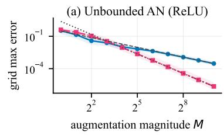

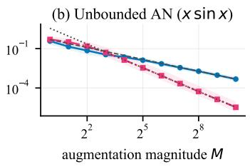

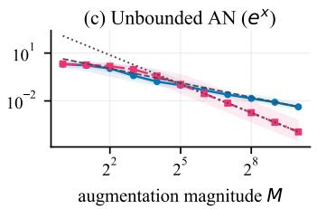

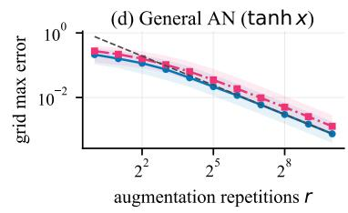

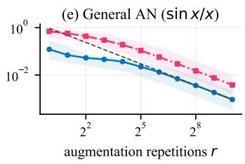

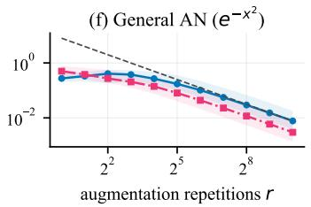

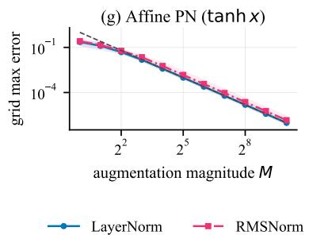

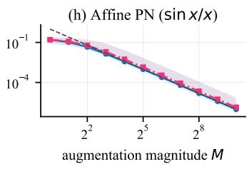

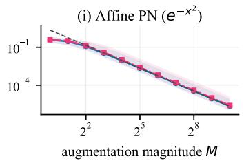

Figure 4: Extended activation-family tests: unbounded AN, general AN, and affine PN. Each blue or pink curve is the median grid maximum error over 24 target–width pairs for LN or RMSNorm, and the shaded region is its interquartile range. Gray dashed and dotted lines illustrate reference slopes, not error bounds. Both axes are logarithmic.  
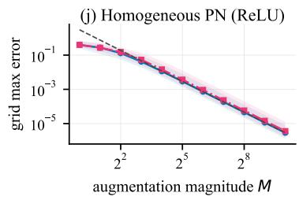

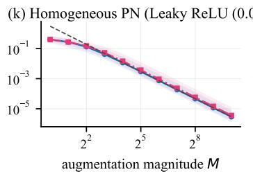

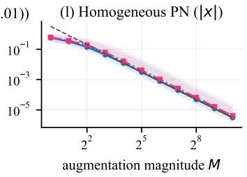

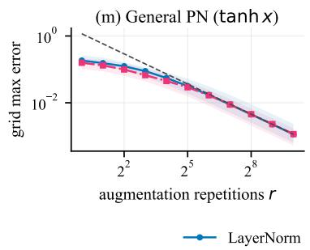

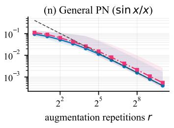

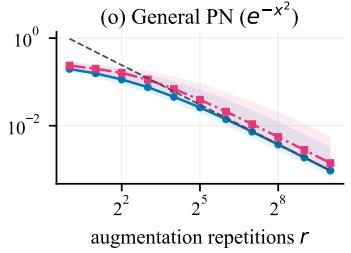  
Figure 5: Extended activation-family tests: homogeneous and general PN. Curves and shaded regions have the same meaning as in Figure 4; the gray dashed lines illustrate the common reference slopes.

## F.2 SHIFTED-RELU FINITE-WIDTH BARRIER

Both experiments in this subsection fix $K = [ - 1 , 1 ]$ and $\phi ( t ) = \mathrm { R e L U } ( t { - } 1 0 )$ ; they use explicit constructions without fitting parameters. Figure 6 takes $N = 1$ and $f ( x ) = \phi ( 1 0 + 2 x ) = \mathrm { R e L U } ( 2 x )$ For normalized width $d \leq 1 0 ^ { 2 }$ , the coordinate bound $| u _ { i } | \leq \sqrt { d }$ makes every no-affine PN hidden activation vanish. Such networks are constant, so their uniform error for this target is at least 1. This bound is a necessary width barrier, not the exact width at which the plotted constructions turn on.

Figures 6(a) and 6(b) show how the constructed RMS-PN and LN-PN outputs approach the target as d grows. Figure 6(c) plots their grid maximum errors: after the finite-width obstruction, their tails are consistent with $d ^ { - 1 }$ decay. With affine parameters, the widths remain 2 and 3, and Figure 6(d) shows the $M ^ { - 2 }$ trend. The growing-width behavior for this fixed activation does not contradict Proposition 5.2, whose activation depends on d.

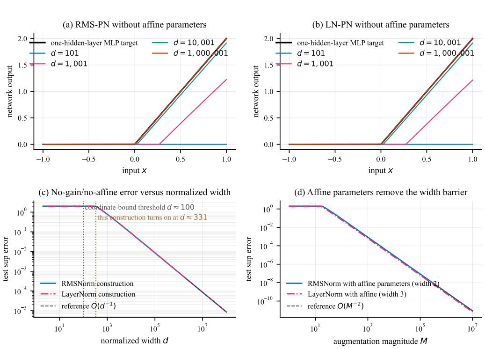  
Figure 6: Shifted-ReLU PN constructions for $f ( x ) = \mathrm { R e L U } ( 2 x )$ . (a,b) Function-level recovery as width grows. (c) The coordinate-bound barrier $d = 1 0 ^ { 2 }$ and subsequent grid-error decay consistent with $d ^ { - 1 }$ without affine parameters. (d) Fixed-width affine constructions with grid-error decay consistent with $M ^ { - 2 }$

Figure 7 repeats the comparison with random targets of widths $N \in \{ 4 , 8 , 1 6 , 3 2 \}$ , six at each width. For each target, let $z ( x ) ~ = ~ W _ { 1 } x + b _ { 1 }$ with the Gaussian parameters above and set $f ( x ) = W _ { 2 } \phi ( 1 0 + \bar { z } ( x ) ) = \tilde { W } _ { 2 } \mathrm { R e L U } ( z ( x ) )$ . For each target, the relative grid maximum error is the maximum absolute approximation error on the test grid divided by the maximum absolute target value on that grid. Figures 7(a) and 7(b) show one target and selected no-affine approximants. Across all 24 targets, Figure 7(c) shows median relative grid maximum error decreasing approximately like $d ^ { - 1 }$ after the barrier; the fixed-width affine curves in Figure 7(d) follow the $\mathbf { \bar { \boldsymbol { M } } } ^ { - 2 }$ reference slope. Shaded bands show interquartile ranges.

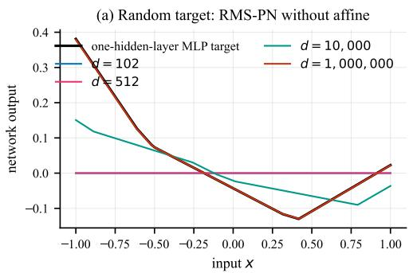

(b) Random target: LN-PN without affine  
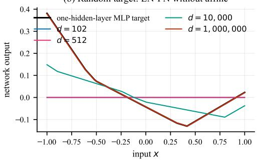

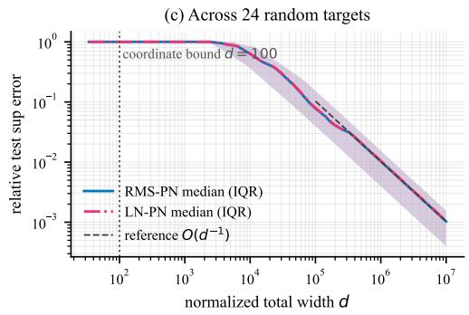

(d) Affine fixed-width constructions  
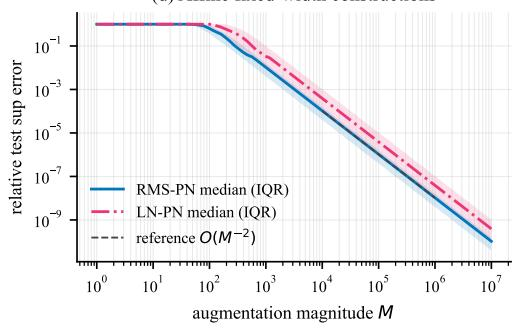  
Figure 7: Shifted-ReLU PN verification over 24 random one-hidden-layer MLP targets. (a,b) One representative target and selected approximants. (c,d) Median relative grid maximum errors and interquartile ranges for the width-growing no-affine and fixed-width affine constructions, respectively. Gray lines illustrate reference slopes, not error bounds.