# Attention over noisy examples Generalization and memorization in the exponential Hopfield network

Francesco Alemanno

Independent researcher, supported by SolarSud T.R.E. di Miccoli Antonia, Italy (https://solarsud.it). francescoalemanno710@gmail.com

## Abstract

In Hebbian learning from examples a Hopfield network of N neurons is not supplied with the K archetypes it has to retrieve but with M blurred examples of each, of quality r, and whether it can infer them depends on the load $\alpha = K / N$ (interference among them) and on the dataset entropy $\rho = ( 1 - r ^ { 2 } ) / ( M r ^ { 2 } )$ (how little the examples say about them). We transfer this protocol to the exponential Hopfield model, whose zero-temperature update is a step of softmax attention with the unlabelled examples as keys. A signal-to-noise analysis gives in closed form the overlap between the output and an unseen archetype, ${ \bar { m ^ { ( 1 ) } } } = \mathrm { e r f } ( 1 / \sqrt { 2 \rho _ { \mathrm { e f f } } } ) ;$ the majority-rule law of the pairwise model at small load, with ρ replaced by an attention entropy ρef built from the weight the softmax gives to the correct class and the number of examples it spreads it over. Two consequences follow. First, in a window of inverse temperatures $\beta$ that widens as N the interference between archetypes is exponentially small in Nβ: the load drops out and the number of archetypes that can be learnt grows as exp(c N). Second, learning fails diferently: in the pairwise model through a spin-glass phase, in the exponential model through memorization: the softmax concentrates its weight on the training example closest to the input and returns it in place of the archetype. Seen from the input the softmax weights are those of the random energy model, and memorization is its freezing transition, at $\beta \sqrt { N ( 1 - r ^ { 2 } ) } \simeq \sqrt { 2 \ln M } ;$ it is measurable on a head whose keys are examples as the number of examples carrying weight. On MNIST the diagnostic follows the random-energy prediction; on fashion-MNIST it detects sub-clusters in the classes, and the best accuracy lies beyond the memorization threshold, where the softmax reads out a local sub-prototype.

## 1 Introduction

Forty years after Hopfield’s model [1] and the statisticalmechanical theory of Amit, Gutfreund and Sompolinsky (AGS) [2, 3], Hebbian neural networks have returned to the centre of the machine-learning stage through two independent developments. On the one hand, dense associative memories [4, 5, 6] and their exponential limit [7, 8, 9] have shown that a Hebbian network with sufficiently steep interactions stores an exponential number of patterns, that the steepness of the interaction controls a transition from feature-like to prototype-like memories [4], and that one step of the zero-temperature dynamics of the exponential model is a softmax attention update with the stored patterns as keys and values [7, 11], a connection also read as a nearest-neighbour or kernel-smoothing view of attention [21, 22, 23]. On the other hand, the Hebbian prescription itself has been turned from a storage rule into a learning rule: in [12, 13] the network is supplied, instead of the archetypes $\xi ^ { \mu }$ , with M corrupted examples $\eta ^ { \mu a }$ of each of them, and the Hebbian coupling is built on the examples, without labels (unsupervised, [12]) or with the examples averaged class by class (supervised, [13]); the same protocol has been solved for dense p-body networks in [14, 15], where the load becomes $\alpha _ { p } = K / N ^ { p - 1 }$ (see also [16, 17, 18]). The resulting phase diagram is controlled by the AGS load $\alpha = K / N$ and by a new parameter, the dataset entropy $\rho \stackrel { \cdot } { = } ( 1 - r ^ { 2 } ) / ( M r ^ { 2 } )$ with r the quality of the examples; archetypes are retrieved although they were never presented, provided $\rho$ is small enough and α lies below a ρ-dependent critical load. Two sources of noise limit the retrieval: the finite number and quality of the examples, measured by $\rho ,$ and the interference of the other stored patterns on the field acting on each neuron, usually called crosstalk, which grows with the load α. When either is too large the network enters a spin-glass phase, in which its states are correlated with none of the archetypes: in the learning setting this phase is the thermodynamic signature of overfitting.

The present work merges the two lines. We ask what happens to the $( \alpha , \rho )$ phase diagram when the examples themselves become the stored keys of the exponential Hopfield model, that is, of an attention layer, with no use of the labels. Three questions are addressed: (i) whether a layer of attention, operating on a dataset of noisy examples, generalizes to the unseen archetypes and in which range of the inverse temperature $\beta$ of the softmax; (ii) what is the fate of the load $\alpha ,$ which in the pairwise model bounds the number of archetypes that can be learnt; (iii) whether the spin-glass phase has a counterpart in the exponential model, i.e., what overfitting looks like when the network is a transformer layer rather than a Hopfield network.

The answers are obtained analytically by a signalto-noise analysis, which in the present setting can be carried out in closed form, and are checked by Monte Carlo simulations. In a nutshell: in [13] the probability of reconstructing a pixel of the archetype by a majority vote over its M examples is $\begin{array} { r } { \frac { 1 } { 2 } [ 1 + \mathrm { e r f } ( 1 / \sqrt { 2 \rho } ) ] } \end{array}$ and the one-step magnetization of the network has the same error-function form; here we find that the one-step magnetization of an unseen archetype produced by an attention layer is again $m ^ { ( 1 ) } = \mathrm { e r f } ( 1 / \sqrt { 2 \rho _ { \mathrm { e f f } } } )$ , but the dataset entropy $\rho$ is replaced by an attention entropy $\rho _ { \mathrm { e f f } } ( \beta )$ that depends on how the softmax distributes its weight over the training set. At intermediate $\beta$ the load drops out $( \rho _ { \mathrm { e f f } } \ \to \ \rho$ for any α); at small $\beta$ the crosstalk of the pairwise model is recovered; at large $\beta$ the softmax condenses, i.e. it assigns essentially all of its weight to a single training example, and the layer memorizes. Seen from the query, the logits of the softmax are independent Gaussian variables, so that the attention layer is a random energy model (REM), the system of M independent Gaussian energy levels introduced by Derrida [26, 27] as the simplest spin glass: the condensation is the freezing transition of that model, located at $\beta \sqrt { N ( 1 - r ^ { 2 } ) } \simeq \sqrt { 2 \ln M }$ , and it is the attention counterpart of the spin-glass phase. The window of generalization between the two edges widens with the system size as $\sqrt { N }$ . We then test the picture on MNIST and fashion-MNIST, and compare the Hebbian attention with a one-head attention classifier trained by gradient descent on the same datasets.

The present model is the $p  \infty$ end of the family of dense Hebbian networks learning from examples of [14, 15]: there the crosstalk is still extensive in the polynomial load $\alpha _ { p } ,$ here it becomes logarithmic in $K ,$ which is what allows the closed-form treatment. Related settings of learning from examples have been considered in [19] for dense p-body networks in the teacher– student scenario, in [20] for the random-features Hopfield model, and in [25] for hierarchical prototypes in polynomial dense memories. For the storage, rather than learning, properties of exponential models we refer to [6, 8, 9], and to [10] for the multilayer heteroassociative extension, whose exponential capacity and basins are obtained at $\beta \to \infty$ by a large-deviation evaluation of the noise.

## 2 Dataset and models

We use the vocabulary of attention throughout. The vectors stored in a network are its keys; the state in which the network is prepared is the query; the softmax of the overlaps between query and keys gives the attention weights, and the state produced by one update is their weighted sum, passed through a sign. A network generalizes when, prepared in a query of a given archetype, it produces a state close to that archetype, which it has never seen; it memorizes when it produces a state close to one of its keys, i.e. to a training example. The quantities that make these notions precise are introduced in Definition 5 below.

Definition 1 (Dataset). The archetypes are K binary vectors $\pmb { \xi } ^ { \mu } \in \{ - 1 , + 1 \} ^ { N } , \mu \ = \ 1 , \ldots , K$ , with i.i.d. Rademacher entries, ${ \mathcal P } ( \xi _ { i } ^ { \mu } = \pm 1 ) = 1 / 2$ . The dataset ${ \cal S } = \{ \eta ^ { \mu a } \} _ { \mu = 1 , \dots , K } ^ { a = 1 , \dots , M }$ is made of M examples per archetype,

$$
\eta _ { i } ^ { \mu a } = \xi _ { i } ^ { \mu } \chi _ { i } ^ { \mu a } , \qquad \mathcal { P } ( \chi _ { i } ^ { \mu a } = \pm 1 ) = \frac { 1 \pm r } { 2 } , \qquad r \in ( 0 , 1 ] .\tag{1}
$$

The control parameters are the load $\alpha : = K / N$ , the dataset entropy $\rho : = ( 1 - r ^ { 2 } ) / ( M r ^ { 2 } )$ [13] and, for the exponential model, the inverse temperature β introduced below. The archetypes are never shown to the network; a query is a further example of quality q, $\pmb { \sigma } ^ { ( 0 ) } = \pmb { \xi } ^ { \mu } \pmb { \chi } ^ { ( 0 ) }$ with $\mathcal { P } ( \chi _ { i } ^ { ( 0 ) } = \pm 1 ) = ( 1 \pm q ) / 2$ , independent of S. The case $q = 1$ is the archetype itself, $q = r$ is a fresh test example.

For each archetype we introduce the empirical average of its examples, $\bar { \eta } _ { i } ^ { \mu } : = { \cal M } ^ { - 1 } \sum _ { a } \eta _ { i } ^ { \mu a }$ , which is the best estimate of $\xi ^ { \mu }$ available from the dataset (the prototype of the class, obtained by the majority rule sig $1 \bar { \eta } _ { i } ^ { \mu }$ on each pixel [13]). For any vector $\pmb { v } \in \mathbb { R } ^ { N }$ the overlap of a state $\pmb { \sigma }$ with it is $m _ { \pmb { v } } ( \pmb { \sigma } ) : = N ^ { - 1 } \pmb { v } \cdot \pmb { \sigma } \in [ - 1 , 1 ]$ ; the overlap with an archetype, $m _ { \mu } : = m _ { \xi ^ { \mu } }$ , is the Mattis magnetization, the order parameter of retrieval: $m _ { \mu } = 1$ means that the state coincides with $\xi ^ { \mu }$

Definition 2 (Pairwise Hebbian networks [12, 13]). The Hopfield networks built on the class averages and on the examples (called supervised and unsupervised in [12, 13]) have cost functions

$$
{ \mathcal { H } } ^ { \mathrm { s u p } } ( { \pmb \sigma } | S ) = - \frac { N } { 2 } \sum _ { \mu = 1 } ^ { K } m _ { \bar { \eta } ^ { \mu } } ( { \pmb \sigma } ) ^ { 2 } ,\tag{2}
$$

$$
{ \mathcal { H } } ^ { \mathrm { u n s u p } } ( { \pmb \sigma } | S ) = - \frac { N } { 2 M } \sum _ { \mu = 1 } ^ { K } \sum _ { a = 1 } ^ { M } m _ { \pmb { \eta } ^ { \mu a } } ( { \pmb \sigma } ) ^ { 2 } ,\tag{3}
$$

up to normalization and self-interaction terms, i.e., $\begin{array} { r } { \bar { J _ { i j } } \ \propto \ \sum _ { \mu } \bar { \eta } _ { i } ^ { \mu } \bar { \eta } _ { j } ^ { \mu } } \end{array}$ and $\begin{array} { r } { J _ { i j } \ \propto \ \sum _ { \mu , a } \eta _ { i } ^ { \mu a } \eta _ { j } ^ { \mu a } } \end{array}$ respectively, with $J _ { i i } \doteq 0$ . The first one, which uses the labels, is the reference against which the attention layer is compared below.

Definition 3 (Exponential Hebbian network). Given a set of keys $\{ \dot { k } _ { b } \} _ { b = 1 } ^ { \bar { P } }$ , the exponential Hopfield model $\left[ 6 , ~ 7 , ~ 8 \right]$ has cost function

$$
\mathcal { H } _ { \beta } ^ { \mathrm { e x p } } ( \pmb { \sigma } | \{ k _ { b } \} ) = - \frac { 1 } { \beta } \ln \sum _ { b = 1 } ^ { P } \mathrm { e x p } \left[ \beta N m _ { k _ { b } } ( \pmb { \sigma } ) \right] .\tag{4}
$$

Throughout, the keys are the $P = K M$ examples themselves, ${ \pmb k } _ { ( \mu a ) } ~ = ~ { \pmb \eta } ^ { \mu a }$ , and the labels are not used; the alternative choice of the K class averages as keys, $k _ { \mu } =$ $\bar { \pmb { \eta } } ^ { \mu }$ , is discussed in Remark 6.

Definition 4 (Dynamics). All networks evolve by the zero-temperature parallel dynamics $\sigma _ { i } ^ { ( t + 1 ) } = \mathbf { \partial }$ sign $[ h _ { i } ( \pmb { \sigma } ^ { ( t ) } ) ]$ , where $h _ { i } = - { \partial \mathcal { H } } / { \partial \sigma _ { i } }$ is the post-synaptic field. For (4)

$$
h _ { i } ( \pmb { \sigma } ) = \sum _ { b = 1 } ^ { P } w _ { b } ( \pmb { \sigma } ) k _ { b , i } , \qquad w _ { b } ( \pmb { \sigma } ) = \frac { e ^ { \beta N m _ { k _ { b } } ( \pmb { \sigma } ) } } { \sum _ { c } e ^ { \beta N m _ { k _ { c } } ( \pmb { \sigma } ) } } .\tag{5}
$$

Remark 1. Equation (5) is one head of self-attention with keys and values equal to the stored vectors and query $\sigma _ { i }$ the logit being $\beta N m _ { k _ { b } } = \beta \pmb { k } _ { b } \cdot \pmb { \sigma } ;$ one step of Definition 4 is one transformer layer acting on the training set $[ \gamma ] .$ Expanding the softmax to first order in $\beta _ { i }$ , with $\begin{array} { r } { \overline { { m } } : = P ^ { - 1 } \sum _ { b } m _ { { \pmb k } _ { b } } ( { \pmb \sigma } ) } \end{array}$ the average overlap of the query with the keys and $\begin{array} { r } { \dot { \bar { \pmb { k } } } : = { \cal P } ^ { - 1 } \sum _ { b } \dot { \pmb { k } } _ { b } } \end{array}$ the mean key,

$$
\begin{array} { l } { \displaystyle { w _ { b } \simeq \frac { 1 + \beta N ( m _ { k _ { b } } - \overline { { m } } ) } { P } , } } \\ { \displaystyle { h _ { i } \simeq \bar { k } _ { i } + \frac { \beta N } { P } \sum _ { b } k _ { b , i } ( m _ { k _ { b } } - \overline { { m } } ) , } } \end{array}
$$

that is, the pairwise field built on the examples, $E q . \ ( 3 )$ plus the constant $\bar { k } _ { i }$ and the self-interaction: $\beta  0$ is the pairwise regime, $\beta \to \infty$ is a nearest-key lookup. The parameter $\beta$ is the inverse temperature of the Gibbs measure (5) over the keys, i.e. of the exponential cost function (4), not of the neural dynamics, which is noiseless throughout; it is the $\mathit { 4 } \beta ^ { , 9 }$ of [7] and $t h e \textrm { ~ } ^ { \ast } \lambda ^ { \prime \prime }$ of [8]. The logit is scaled as βNm, so that $\beta = O ( 1 )$ is the regime of exponential capacity of [8, 9]; the natural scales of the present problem will turn out to be $\beta N$ and $\beta \sqrt { N }$

Definition 5 (Observables). Let the query $\pmb { \sigma } ^ { ( 0 ) }$ be an example of archetype $\xi ^ { \mu }$ . We distinguish the state $a f -$ ter a single update, $\pmb { \sigma } ^ { ( 1 ) }$ , which is what a transformer layer computes, from the fixed point $\pmb { \sigma } ^ { ( \infty ) }$ of the iterated map, which is the Hopfield retrieval, and we write $m ^ { ( t ) } : = m _ { \mu } ( \pmb { \sigma } ^ { ( t ) } )$ for the Mattis magnetization of the queried archetype. Generalization is measured by $m ^ { ( t ) } ,$ memorization by the overlap with the closest training example of the same class,

$$
n _ { \mathrm { m a x } } : = \operatorname* { m a x } _ { a } m _ { \eta ^ { \mu a } } ( \pmb { \sigma } ^ { ( t ) } ) ,\tag{6}
$$

which equals one when the state is a training example. For the exponential network we also record two statistics of the attention weights wb $\cdot ( \pmb { \sigma } ^ { ( 0 ) } )$ of Eq. (5), evaluated on the query:

$$
W : = \sum _ { a = 1 } ^ { M } w _ { ( \mu a ) } ( \pmb { \sigma } ^ { ( 0 ) } ) ,\tag{7}
$$

$$
M _ { \mathrm { e f f } } : = \frac { \left( \sum _ { a } w _ { ( \mu a ) } \right) ^ { 2 } } { \sum _ { a } w _ { ( \mu a ) } ^ { 2 } } .\tag{8}
$$

$W \in [ 0 , 1 ]$ is the total weight that the softmax assigns to the examples of the correct class. $M _ { \mathrm { e f f } } \in [ 1 , M ]$ is the participation ratio of the weights within that class, i.e. the number of examples that efectively contribute to the weighted sum: $M _ { \mathrm { e f f } } = M$ when the M examples carry equal weight (the layer pools them all, and the update is the majority rule), $M _ { \mathrm { e f f } } = 1$ when a single example carries all the weight (the layer has condensed on it). We refer to W and $M _ { \mathrm { e f f } }$ as the attention statistics. Condensation is thus a property of the weights $( M _ { \mathrm { { e f f } } } = O ( 1 ) )$ memorization one of the output $( n _ { \operatorname* { m a x } }  1 ) ;$ with keys equal to examples of a single archetype the two coincide, on structured data they need not (Sec. 5). Figure 1 shows them on one query, at three temperatures, together with the outcome of the update: it anticipates the three regimes derived in the next section.

## 3 Signal-to-noise analysis

The signal-to-noise technique [2, 33, 13] evaluates the field acting on neuron i when the network is prepared in the query $\pmb { \sigma } ^ { ( 0 ) }$ , approximates its distribution over the quenched disorder (archetypes, examples and query noise) by a Gaussian via the central limit theorem, and returns the magnetization after one parallel update as $m ^ { ( 1 ) } = \mathrm { e r f } \left( { \mathcal { M } } / { \sqrt { 2 \mathcal { V } } } \right)$ , where M and V are the mean and the variance of $\dot { \xi } _ { i } ^ { \mu } h _ { i }$ . In all cases the field is split into a signal, the contribution of the keys belonging to the queried archetype, and a crosstalk, the contribution of all the other keys; the magnetization is high when the former dominates the latter. We first record the pairwise result, which generalizes to a query of quality q the formula of [13] (there obtained for $q = 1 )$ , and then derive the exponential one.

Proposition 1 (pairwise network built on class averages). For the network (2) prepared in a query of quality q of archetype $\pmb { \xi } ^ { 1 }$ , in the limit $N \to \infty$ at fixed $\alpha , \rho$ and $M \gg 1$

$$
m _ { \mathrm { p a i r } } ^ { ( 1 ) } = \mathrm { e r f } \left( \frac { 1 } { \sqrt { 2 \rho + 2 \alpha ( 1 + \rho ) ^ { 2 } / q ^ { 2 } } } \right) .\tag{9}
$$

Proof. With the normalization $\begin{array} { r } { J _ { i j } = \frac { 1 } { N \mathcal { R } } \sum _ { \mu } \bar { \eta } _ { i } ^ { \mu } \bar { \eta } _ { j } ^ { \mu } } \end{array}$ $\begin{array} { r l r } { \mathcal { R } } & { { } = } & { r ^ { 2 } + ( 1 - r ^ { 2 } ) / M . } \end{array}$ the field splits into the signal $\bar { \eta } _ { i } ^ { 1 } m _ { \bar { \eta } ^ { 1 } } ( \pmb { \sigma } ^ { ( 0 ) } ) / \mathcal { R }$ and the crosstalk $\begin{array} { r } { \sum _ { \mu > 1 } \bar { \eta } _ { i } ^ { \mu } m _ { \bar { \eta } ^ { \mu } } ( \pmb { \sigma } ^ { ( 0 ) } ) / \mathcal { R } } \end{array}$ . By the law of large numbers $m _ { \bar { \eta } ^ { 1 } } ( { \pmb \sigma } ^ { ( 0 ) } ) \  \ r q .$ while $\bar { \eta } _ { i } ^ { 1 } = \xi _ { i } ^ { 1 } ( r + \zeta _ { i } \sqrt { ( 1 - r ^ { 2 } ) / M } )$ with $\zeta _ { i }$ standard Gaussian for $M \gg 1$ , so that ξ1×signal has mean $r ^ { 2 } q / \mathcal { R }$ and variance $( r q ) ^ { 2 } ( 1 - r ^ { 2 } ) \ / ( M \mathcal { R } ^ { 2 } )$ Each crosstalk term is a product of two independent centred variables of variances R and $\mathcal { R } / N$ , and there are $K \gets 1$ of them, giving variance α (we exclude $J _ { i i } )$ . Dividing by $\mathcal { M } ^ { \breve { 2 } } = \breve { ( } r ^ { 2 } q / \mathcal { R } ) ^ { 2 }$ one gets $\mathcal { V } / \mathcal { M } ^ { 2 } = \rho + \alpha ( 1 + \rho ) ^ { 2 } / q ^ { 2 }$ , whence (9). (The condition M $\gg ~ 1$ is used only for the Gaussianity of $\zeta _ { i } ;$ the crosstalk is Gaussian by the central limit theorem over µ.) □

For $q = 1 , ( 9 )$ is Eq. (68) of the Supplementary Material of [13]; the archetypes are stable under one update only in the region $\alpha ( 1 + \rho ) ^ { 2 } + \rho \lesssim 1$ , and a query of lower quality $q < 1$ shrinks that region by the factor $q ^ { 2 }$ in front of the load. We now turn to the exponential network with keys = examples; the choice of the class averages as keys is discussed in Remark 6.

(a) crosstalk, ¯ = 0:003  
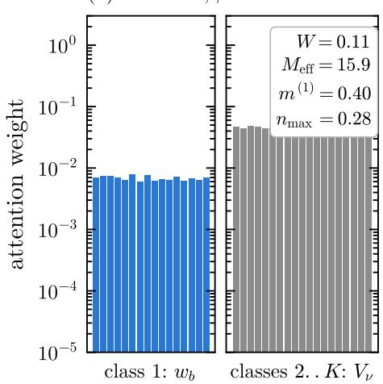

(b) prototype, ¯ = 0:029  
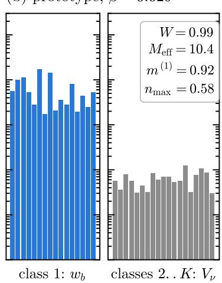

(c) memorization, ¯ = 0:256  
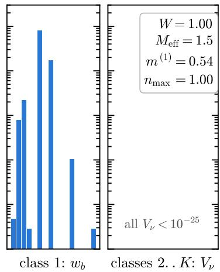  
Figure 1: The three regimes seen from one query. Attention weights (5) of the same query (a fresh example of archetype $\xi ^ { 1 } ; N = 1 0 0 0$ , K = 20, $M = 1 6 , \ : \rho = 0 . 2 )$ over the same training set at three inverse temperatures, $\beta = \beta _ { \mathrm { l o } } / 3 , ~ \sqrt { \beta _ { \mathrm { l o } } \beta _ { \mathrm { h i } } }$ and $3 \beta _ { \mathrm { h i } }$ , where $\beta _ { \mathrm { l o } }$ and $\beta _ { \mathrm { h i } }$ are the two edges of the generalization window derived in Sec. $3 , \mathrm { E q . } \ ( 1 7 )$ . In each panel the left part shows the M weights $w _ { b }$ of the keys of the correct class, the right part the total weight $\begin{array} { r } { V _ { \nu } = \sum _ { b \in \nu } w _ { b } } \end{array}$ of each of the other $K - 1$ classes (logarithmic scale, shared; bars below $1 0 ^ { - 5 }$ are not drawn). $\begin{array} { r } { W = \sum _ { a } w _ { 1 a } , \mathrm { E q . ~ } ( \overline { { 7 } } ) } \end{array}$ , is the sum of the blue bars and $M _ { \mathrm { e f f } } ,$ , Eq. (8), their participation ratio; $m ^ { ( 1 ) }$ and $n _ { \mathrm { m a x } }$ are the overlaps of the updated state with the archetype and with the closest example. (a) Crosstalk: the correct class weighs as much as any other. (b) Prototype: the correct class carries all the weight, spread over its examples. (c) Memorization: one example carries it, and is returned.

Lemma 1 (logit statistics). Let $\pmb { \sigma } ^ { ( 0 ) }$ be a query of quality q of $\xi ^ { 1 }$ . Conditionally on the query and on the archetypes, the overlaps of the keys with it are, for $N \gg 1$ , Gaussian variables

$$
m _ { \eta ^ { 1 a } } ( { \pmb \sigma } ^ { ( 0 ) } ) \simeq q r + z _ { a } \sqrt { ( 1 - r ^ { 2 } ) / N } , \qquad a = 1 , \dots , M ,\tag{10}
$$

$$
m _ { \eta ^ { \mu b } } ( \pmb { \sigma } ^ { ( 0 ) } ) \simeq r g _ { \mu } + z _ { \mu b } \sqrt { ( 1 - r ^ { 2 } ) / N } , \qquad \mu > 1 ,\tag{11}
$$

where the $z '$ are independent standard Gaussians and $\begin{array} { r } { g _ { \mu } : = N ^ { - 1 } \sum _ { i } \xi _ { i } ^ { \mu } \xi _ { i } ^ { 1 } \chi _ { i } ^ { ( 0 ) } \simeq \mathcal { N } ( 0 , 1 / N ) } \end{array}$ is a shift shared by the M keys of class µ. Within each class the keys thus difer only by independent fluctuations of spread ${ \sqrt { ( 1 - r ^ { 2 } ) / N } } ;$ the common shifts $( q r , o r r g _ { \mu } )$ are those of the query and do not depend on the key.

Proof. Conditionally on $\begin{array} { r } { \chi ^ { ( 0 ) } , N m _ { \eta ^ { 1 a } } = \sum _ { i } \chi _ { i } ^ { 1 a } \chi _ { i } ^ { ( 0 ) } } \end{array}$ is a sum of independent ±1 variables with means $r \chi _ { i } ^ { ( 0 ) }$ and variances $1 - r ^ { 2 } ;$ ; its mean is $\begin{array} { r } { r \sum _ { i } \chi _ { i } ^ { ( 0 ) } = N r q \ : + } \end{array}$ $O ( { \sqrt { N } } )$ , the $O ( { \sqrt { N } } )$ term being the same for all a. For $\mu > 1 , \xi _ { i } ^ { \mu } \xi _ { i } ^ { 1 } \chi _ { i } ^ { \mu b } \chi _ { i } ^ { ( 0 ) }$ has conditional mean $r \xi _ { i } ^ { \mu } \xi _ { i } ^ { 1 } \chi _ { i } ^ { ( 0 ) }$ and variance $1 - r ^ { 2 }$ , whence (11). Averaged also over the query and the archetypes, the unconditional variances are ${ \mathrm { ~ ( 1 ~ - ~ } q ^ { 2 } r ^ { 2 } ) } / { N }$ and $1 / N$ , but it is the conditional spread that governs the softmax, since the shifts cancel in the normalized weights of a class. □

Lemma 1 says that, seen from the query, the KM logits βNm of the attention layer are independent Gaussian variables, i.e. the energy levels of a random energy model [26, 27], with the softmax playing the role of the Gibbs measure. The model is a REM “with a planted block”: the M levels of the correct class have mean $\beta N q r$ , those of a wrong class µ have a random mean $\beta N r g _ { \mu }$ of spread $\beta r \sqrt { N }$ across classes, and within every class the levels have the same spread x $: = \beta \sqrt { N ( 1 - r ^ { 2 } ) }$ The two attention statistics of Definition 5 follow. For W we use the annealed approximation, in which the ratio of two random sums is replaced by the ratio of their averages; it is accurate as long as each sum is dominated by typical, rather than extreme, levels, i.e. below the freezing point of the corresponding $\mathrm { R E M } \colon x \lesssim \sqrt { 2 }$ ln M within a class and $\beta r \sqrt { N } \lesssim \sqrt { 2 \ln K }$ across the wrong classes.

Proposition 2 (weight of the correct class). In the annealed approximation, valid for $x \ \lesssim \ { \sqrt { 2 } }$ ln M and $\beta r \sqrt { N } \lesssim \sqrt { 2 \ln K }$

$$
\begin{array} { r } { W ( \beta ) = \Big [ 1 + ( K - 1 ) \exp \big ( - N \beta q r + \frac 1 2 N \beta ^ { 2 } r ^ { 2 } \big ) \Big ] ^ { - 1 } . } \end{array}\tag{12}
$$

Proof. Averaging the Boltzmann sums over the Gaussian variables of Lemma 1,

$$
\begin{array} { r l } { { } } & { { \mathbb { E } \displaystyle \sum _ { a } e ^ { \beta N m _ { \eta ^ { 1 } a } } = M e ^ { \beta N q r + x ^ { 2 } / 2 } , } } \\ { { } } & { { \mathbb { E } \displaystyle \sum _ { \mu > 1 , b } e ^ { \beta N m _ { \eta ^ { \mu b } } } = ( K - 1 ) M e ^ { \beta ^ { 2 } N r ^ { 2 } / 2 + x ^ { 2 } / 2 } ; } } \end{array}
$$

the ratio of the former to the total gives (12). Beyond the stated range the sums are dominated by their largest terms and the annealed average overestimates them: the exponent in (12) is then no longer the right one, and indeed it would turn non-monotonic at $\beta = 2 q / r$ far outside the window considered below. □

Proposition 3 (condensation of the softmax). Let

$$
\Phi _ { M } ( x ) : = \frac { 1 } { M } \mathbb { E } \left[ \frac { \big ( \sum _ { a = 1 } ^ { M } e ^ { x z _ { a } } \big ) ^ { 2 } } { \sum _ { a = 1 } ^ { M } e ^ { 2 x z _ { a } } } \right] ,
$$

with $z _ { a }$ i.i.d. standard Gaussian, be the participation ratio (normalized to one) of the Gibbs measure of a REM with M levels at inverse temperature x: it counts the fraction of levels that carry a non-negligible weight. Then

$$
M _ { \mathrm { e f f } } = M \Phi _ { M } ( x ) , \qquad x = \beta \sqrt { N ( 1 - r ^ { 2 } ) } ,\tag{13}
$$

independently of the quality q of the query. For small x, $\Phi _ { M } ( x ) = 1 - ( 1 - M ^ { - 1 } ) x ^ { 2 } + O ( x ^ { 4 } )$ , so that the pooling starts to degrade at $x \sim 1 ;$ for $M ~  ~ \infty$ the measure freezes at $x _ { c } ~ = ~ { \sqrt { 2 } }$ ln M onto the levels of lowest energy; in the frozen phase the inverse participation ratio has the exact average E $\textstyle \sum _ { a } w _ { a } ^ { 2 } \ =$ $1 - x _ { c } / x \ \lceil 2 6 , \ : 2 7 , \ : 2 9 , \ : 3 0 \rceil ,$ so that, by Jensen’s inequality, $\begin{array} { r } { M \Phi _ { M } ( x ) = \mathbb { E } [ 1 / \sum _ { a } w _ { a } ^ { \bar { 2 } } ] \geq ( 1 - x _ { c } / x ) ^ { - 1 } } \end{array}$ : a finite number ofexamples, oforder one, carries all the weight. The inequality is strict, because the weights remain random in the frozen phase (they have the Poisson–Dirichlet statistics of [30]); the gap is 10–20% at $x = 1 0$ (Appendix B). At the finite values of M of interest here $( M \leq 2 5 6 )$ the freezing is a crossover and $\Phi _ { M }$ is evaluated numerically.

Proof. Within the correct class, the common factor $e ^ { \beta N q r }$ cancels from the normalized weights, which become $w _ { a } \propto e ^ { x z _ { a } }$ by Lemma 1; the participation ratio of M such weights is by definition $M \Phi _ { M } ( x )$ . The smallx expansion follows from $e ^ { x z } = 1 + x z + x ^ { 2 } z ^ { 2 } / 2 + . . .$ (Appendix B); the freezing point is where the entropy ln M of the levels equals the energy gain $x ^ { 2 } / 2$ of the extreme level, $x _ { c } ^ { 2 } / 2 = \ln M$ , the frozen-phase value of $\mathbb { E } \sum _ { a } w _ { a } ^ { 2 } = 1 - x _ { c } / x$ is the classical result of [29, 30], and the bound on $\Phi _ { M }$ is Jensen’s inequality for the convex function $y \mapsto 1 / y$ □

The same argument applied to the keys of a wrong class, whose levels have the same spread x by Lemma 1, gives the number of examples pooled there, $M _ { \mathrm { e f f } } ^ { \prime } =$ $M \Phi _ { M } ( x ) = M _ { \mathrm { e f f } }$ . One last ingredient is needed before the central result can be stated: the logit of every key contains the term $\beta k _ { b , i } \sigma _ { i }$ of the very neuron i that is being updated, so that the field $h _ { i }$ receives a contribution proportional to the current state $\sigma _ { i }$ of that neuron. We call it the self-coupling; it is the exponential-model analogue of the diagonal term $J _ { i i }$ of the pairwise model, and it biases the update towards the query.

Proposition 4 (one attention step). For the exponential network (4) with keys = examples, prepared in a query of quality q of $\xi ^ { 1 }$ , in the limit $N \to \infty$

$$
m ^ { ( 1 ) } = \mathrm { e r f } \left( \frac { 1 } { \sqrt { 2 \rho _ { \mathrm { e f f } } ( \beta ) } } \right) ,\tag{14}
$$

with the attention entropy

$$
\begin{array} { c c c } { \displaystyle { \rho _ { \mathrm { e f f } } = \frac { \mathcal { V } } { \big ( r W + \tau q \big ) ^ { 2 } } , } } \\ { \displaystyle { \mathcal { V } = \frac { ( 1 - r ^ { 2 } ) W ^ { 2 } } { M _ { \mathrm { e f f } } } + \frac { ( 1 - W ) ^ { 2 } } { K - 1 } \Big [ r ^ { 2 } + \frac { 1 - r ^ { 2 } } { M _ { \mathrm { e f f } } ^ { \prime } } \Big ] } } \\ { \displaystyle { + \tau ^ { 2 } ( 1 - q ^ { 2 } ) , } } \end{array}\tag{15}
$$

with $\tau =$ tanh β, W given by (12) and $M _ { \mathrm { e f f } } = M _ { \mathrm { e f f } } ^ { \prime }$ by (13). The result holds as long as the field is a sum of many comparable terms, i.e. $M _ { \mathrm { e f f } } \gg 1$ or $W \ll 1 ;$ in the condensed regime $M _ { \mathrm { e f f } } = O ( 1 )$ the Gaussian approximation fails, see Remark 2.

Proof. Write the field (5) as $\begin{array} { r c l } { { h _ { i } } } & { { = } } & { { \sum _ { a } w _ { 1 a } \eta _ { i } ^ { 1 a } \ + } } \end{array}$ $\sum _ { \mu > 1 , b } w _ { \mu b } \eta _ { i } ^ { \mu b }$ and multiply by $\xi _ { i } ^ { 1 }$ . The i-th factor of each Boltzmann weight, $e ^ { \beta k _ { b , i } \sigma _ { i } } =$ cosh $\beta + \sigma _ { i } k _ { b , i }$ sinh $\beta ,$ is singled out: writing $\begin{array} { r } { h _ { i } ^ { \backslash i } : = \sum _ { b } w _ { b } ^ { \prime } k _ { b , i } } \end{array}$ with weights $w _ { b } ^ { \prime }$ that do not contain site $i ,$ one finds

$$
h _ { i } = \frac { h _ { i } ^ { \backslash i } + \tau \sigma _ { i } } { 1 + \tau \sigma _ { i } h _ { i } ^ { \backslash i } } , \qquad \mathrm { s i g n } h _ { i } = \mathrm { s i g n } \big ( h _ { i } ^ { \backslash i } + \tau \sigma _ { i } ^ { ( 0 ) } \big ) ,
$$

the denominator being positive, so that the second identity is exact: the self-coupling enters the update as an additive field $\tau \sigma _ { i } ^ { ( 0 ) }$ , and the weights $\boldsymbol { w _ { b } ^ { \prime } }$ are described by Lemma 1. (In the pairwise models of Definition 2 the analogous diagonal term $J _ { i i }$ is removed by convention; here it is part of the softmax and is kept.) Conditionally on the weights, $\xi _ { i } ^ { 1 } \eta _ { i } ^ { 1 a } = \chi _ { i } ^ { 1 a }$ has mean r and variance $1 - r ^ { 2 }$ , so the correct-class term has mean rW and variance $\begin{array} { r } { \left( 1 - r ^ { 2 } \right) \sum _ { a } w _ { 1 a } ^ { 2 } = ( 1 - r ^ { 2 } ) W ^ { 2 } / M _ { \mathrm { e f f } } } \end{array}$ . For a wrong class $\mu , \xi _ { i } ^ { 1 } \eta _ { i } ^ { \mu b } = \xi _ { i } ^ { 1 } \xi _ { i } ^ { \mu } \chi _ { i } ^ { \mu b }$ and all its examples share the factor $\xi _ { i } ^ { 1 } \xi _ { i } ^ { \mu } ;$ : the class contributes $\xi _ { i } ^ { 1 } \xi _ { i } ^ { \mu } \sum _ { b } w _ { \mu b } \chi _ { i } ^ { \mu b } .$ , of zero mean and variance $r ^ { 2 } V _ { \mu } ^ { 2 } + ( 1 - \stackrel { . } { r ^ { 2 } } ) \stackrel { . } { \sum _ { b } ^ { } } w _ { \mu b } ^ { 2 }$ with $\begin{array} { r } { V _ { \mu } = \sum _ { b } w _ { \mu b } } \end{array}$ . Summing over the $K - 1$ wrong classes with ${ \bar { V _ { \mu } } } \overset { \sim } { \simeq } ( 1 { - } W ) / ( K { - } 1 )$ and $\begin{array} { r } { \sum _ { b } w _ { \mu b } ^ { 2 } \simeq V _ { \mu } ^ { 2 } / M _ { \mathrm { e f f } } ^ { \prime } } \end{array}$ gives the second term of the numerator; the self-coupling $\tau \xi _ { i } ^ { 1 } \sigma _ { i } ^ { ( 0 ) } = \tau \chi _ { i } ^ { ( 0 ) }$ has mean $\tau q$ and variance $\tau ^ { 2 } ( 1 - q ^ { 2 } )$ Applying the central limit theorem to $\xi _ { i } ^ { 1 } h _ { i }$ and $m ^ { ( 1 ) } =$ E sign $\mathbb { \ } ( \xi _ { i } ^ { 1 } h _ { i } )$ yields (14) with $\rho _ { \mathrm { e f f } } = \mathcal { V } / \mathcal { M } ^ { 2 }$ . (We evaluate Mef at its typical value; replacing $1 / M _ { \mathrm { e f f } }$ by its average changes V only where the Gaussian approximation is already inaccurate.) □

Remark 2 (range of validity). Equation (14) has the form of the majority-rule bound of [13], $\begin{array} { r } { \mathcal { P } ( \pmb { \xi } | \pmb { \eta } ) ~ = } \end{array}$ $\begin{array} { r } { \frac { 1 } { 2 } [ 1 + \mathrm { e r f } ( 1 / \sqrt { 2 \rho } ) ] } \end{array}$ , which gives the probability of reconstructing a pixel of the archetype from M examples: the attention layer performs a weighted majority rule, and ρef is the entropy of that weighted vote.1 The Gaussian step of the derivation requires the field to be a sum of many comparable terms; it fails when the softmax has condensed on a few examples. The exact limit is however elementary: for $M _ { \mathrm { e f f } }  1$ the field is $\eta _ { i } ^ { a ^ { * } } + \tau \sigma _ { i } ^ { ( 0 ) }$ with $\tau < 1$ , so $\pmb { \sigma } ^ { ( 1 ) } = \pmb { \eta } ^ { a ^ { * } }$ and $m ^ { ( 1 ) } \to r ,$ up to the positive bias induced by the selection of the example $a ^ { * }$ closest to the query. Equation (14) tends instead to erf $\left( r / { \sqrt { 1 - r ^ { 2 } } } \right)$ and overestimates $m ^ { ( 1 ) }$ by up to 0.1 in that regime, see Sec. 4.

Corollary 1 (three regimes). Let $q = r$ (a fresh test example) and K, $M \gg 1$

(i) Crosstalk regime, $2 \beta N r ^ { 2 } \lesssim \ln K \colon W \ll 1 , M _ { \mathrm { e f f } } \simeq$ $M _ { \mathrm { e f f } } ^ { \prime } \ \simeq \ M$ and, neglecting the self-coupling, (15) reduces to

$$
\rho _ { \mathrm { e f f } } \simeq \rho + \frac { ( 1 + \rho ) } { K - 1 } \frac { ( 1 - W ) ^ { 2 } } { W ^ { 2 } } ,\tag{16}
$$

a crosstalk term with the same structure as $\alpha ( 1 +$ $\rho ) ^ { 2 } / q ^ { 2 }$ in (9): the vote of the correct class is drowned by the $K - 1$ wrong ones as long as $W \lesssim$ $K ^ { - 1 / 2 }$ , and the network is pairwise-like.

(ii) Prototype regime, ln $\begin{array} { l l l } { K } & { \lesssim } & { 2 \beta N r ^ { 2 } } \end{array}$ and $x \quad =$ $\beta \sqrt { N ( 1 - r ^ { 2 } ) } \lesssim 1$ : the crosstalk term is below $\rho$ and decays exponentially in $N \beta$ (W rises from $\sim$ $K ^ { - 1 / 2 }$ to one), $M _ { \mathrm { e f f } } \simeq M$ , hence $\rho _ { \mathrm { e f f } } \simeq \rho$ up to the self-coupling correction $\tau ,$ and $m ^ { ( 1 ) } \simeq \mathrm { e r f } ( 1 / \sqrt { 2 \rho } )$ independently of α. The retrieval boundary in the (α, ρ) plane is a horizontal line.

(iii) Memorization regime, $x \gtrsim \sqrt { 2 \ln M } \colon W = 1$ but $M _ { \mathrm { { e f f } } } \ = \ O ( 1 ) ;$ the pooling degrades gradually for $1 \lesssim x \lesssim \sqrt { 2 \ln M }$ , where (14) with $M _ { \mathrm { e f f } } = M \Phi _ { M } ( x )$ describes the decrease $o f m ^ { ( 1 ) }$ , and beyond the freezing point the layer returns the training example closest to the query, $n _ { \mathrm { m a x } } \to 1$ and $m ^ { ( 1 ) } \to r$ (Remark 2).

Figure 1 shows the three regimes on the attention weights of a single query. The generalization window is therefore bounded by a crosstalk edge $\beta _ { \mathrm { l o } }$ , defined as the point where the crosstalk term of (i) equals the dataset entropy ρ, i.e. where the noise coming from the other classes equals that coming from the finite number of examples, and a condensation edge $\beta _ { \mathrm { h i } }$ , defined by $x = { \sqrt { 2 \ln M } }$ , beyond which the correct class is represented by a finite number of examples. With $( 1 - \mathbf { \bar { \cal W } } ) / { \cal W } = ( K - 1 ) e ^ { - N \beta q r }$ from (12) (the quadratic term is negligible at these $\beta )$

$$
\beta _ { \mathrm { l o } } = \frac { \ln \frac { \left( K - 1 \right) \left( 1 + \rho \right) } { \rho } } { 2 N q r } < \beta < \beta _ { \mathrm { h i } } \simeq \frac { \sqrt { 2 \ln M } } { \sqrt { N ( 1 - r ^ { 2 } ) } } ,\tag{17}
$$

$o r ,$ in terms of the mean m¯ and the conditional standard deviation $\sigma _ { m }$ of the within-class overlaps $m _ { \eta ^ { \mu a } } ( \pmb { \sigma } ^ { ( 0 ) } )$ of Lemma 1 (here $\bar { m } = q r , \sigma _ { m } = \sqrt { ( 1 - r ^ { 2 } ) / N }$ , and $\rho =$ $N \sigma _ { m } ^ { 2 } / ( M { \dot { m } } )$ ; the form applies to any dataset once $\bar { m }$ and $\sigma _ { m }$ are measured query by query),

$$
\beta _ { \mathrm { l o } } = \frac { \ln [ ( K - 1 ) ( 1 + \rho ) / \rho ] } { 2 N \bar { m } } , \qquad \beta _ { \mathrm { h i } } \simeq \frac { \sqrt { 2 \ln M } } { N \sigma _ { m } } .\tag{18}
$$

At the crosstalk edge $\rho _ { \mathrm { e f f } } \simeq 2 \rho$ and $m ^ { ( 1 ) } \simeq \mathrm { e r f } ( 1 / \sqrt { 4 \rho } )$ (to leading order in x and neglecting the self-coupling; at $\rho = 0 . 2$ the full expression (15) gives $\rho _ { \mathrm { e f f } } = 0 . 3 9 8$ , at $\rho = 1$ , where $x _ { \mathrm { l o } } = 1 . 4$ , it gives 3.7), and the correct class carries only the weight

$$
W ( \beta _ { \mathrm { l o } } ) = \left[ 1 + \sqrt { ( K - 1 ) \rho / ( 1 + \rho ) } \right] ^ { - 1 } \simeq \sqrt { \frac { 1 + \rho } { K \rho } } ~ :
$$

the archetype is retrieved well before the softmax has selected its class, because the weight lost to the $K - 1$ wrong classes is spread over all of them (middle column of $F i g .$ 3: at $\beta _ { \mathrm { l o } } , \ W = 0 . 1 9$ and $m ^ { ( 1 ) } = 0 . 8 9$ from (14), 0.86 from the Monte Carlo). Above $\beta _ { \mathrm { l o } }$ the crosstalk keeps decaying as $e ^ { - 2 N \beta q r }$ and W saturates to one, while the pooling degrades as $x ^ { 2 } ;$ the magnetization is maximal where the two efects balance (Remark 3) and then decreases through the window. The width of the window in ln $\beta$ is

$$
\ln \frac { \beta _ { \mathrm { h i } } } { \beta _ { \mathrm { l o } } } = \frac { 1 } { 2 } \ln N + \ln \frac { 2 r ^ { 2 } \sqrt { 2 \ln M } } { \sqrt { 1 - r ^ { 2 } } \ln [ ( K - 1 ) ( 1 + \rho ) / \rho ] } \ :
$$

it opens as $\sqrt { N }$ (at fixed load ln K = ln αN subtracts a ln ln $N )$ , and it is non-empty as long as

$$
\ln \frac { ( K - 1 ) ( 1 + \rho ) } { \rho } \stackrel { } { \sim } 2 r ^ { 2 } \sqrt { \frac { 2 N \ln M } { 1 - r ^ { 2 } } } ,\tag{19}
$$

i.e. the number of archetypes that can be learnt from M examples of quality r grows as $\exp ( c { \sqrt { N } } )$ , faster than any power of N but not exponentially in $N ; ~ ( 1 9 )$ is the exponential-model counterpart of the condition $M \gtrsim$ $r ^ { - 2 }$ of [13].

Remark 3 (optimal temperature). Inside the window, neglecting the self-coupling and to leading order in x, ρef exceeds ρ by two terms: the pooling loss $\rho ( 1 - \dot { M } ^ { - 1 } ) x ^ { 2 }$ (Proposition 3) and the crosstalk (1 + $\rho ) ( K - 1 ) e ^ { - 2 N \beta r ^ { 2 } }$ (item $( i ) , q = r )$ . The first grows as $\beta ^ { 2 }$ , the second decays exponentially, and at the maximum of $m ^ { ( 1 ) }$ they stand in the ratio

$$
p o o l i n g \ l o s s = N \beta ^ { * } r ^ { 2 } \times c r o s s t a l k , \quad \quad N \beta ^ { * } r ^ { 2 } \simeq \ln K ,\tag{20}
$$

as one finds by diferentiating their sum (Appendix C, where the position $\beta ^ { * }$ is given in closed form). The optimum therefore does not remove the crosstalk: it stops when the crosstalk is a fraction 1/ ln K of the pooling loss, because the former is exponentially cheap to reduce and the latter is not. The correct class then carries a weight $W ^ { * } < 1 \ ( 0 . 7 5 , 0 . 5 0$ and 0.39 for the three columns of $F i g . \ 3 ,$ against 0.74, 0.49, 0.39 from the $f u l l$ expression (15)), and, within the same approximation, $W ^ { * }$ decreases with the load as $( \alpha \ln K ) ^ { - \bar { 1 } / 2 }$ : the layer generalizes best while it still shares its weight with the wrong classes. The maximum lies inside the window, at $\beta ^ { * } / \beta _ { \mathrm { l o } } = 1 . 3 \substack { - 1 . 8 }$ for the parameters explored here; $F i g .$ 2 draws it in the $( \beta , \rho )$ plane.

Remark 4 (the load disappears). In (15) the number of classes enters only through W, i.e. through $( K - \dot { 1 } ) e ^ { - N \beta q r + N \beta ^ { 2 } r ^ { 2 } / 2 }$ : the crosstalk of αN archetypes, which is extensive in the pairwise model and produces the spin-glass phase at α $> \alpha _ { c } ( \rho )$ , becomes exponentially small in Nβ above $\beta _ { \mathrm { l o } } \colon$ of order 1/K at $2 \beta _ { \mathrm { l o } }$ and of order $e ^ { - c { \sqrt { N } } }$ near the condensation edge. This is the learning counterpart of the exponential storage capacity of $\displaystyle { [ 6 , 8 , 9 ] } .$ the exponential model can learn from examples a number of archetypes that grows as exp(c N), Eq. (19), the limitation coming not from the crosstalk but from the condensation edge. The dense p-body networks learning from examples of [14, 15] interpolate between the two cases: there the load is $\dot { \alpha } _ { p } = { K } / { N ^ { p - 1 } }$ and the crosstalk is still extensive in $\alpha _ { p } ,$ the exponential model is the $p  \infty$ end of that family, where the polynomial load has become the logarithm in (12).

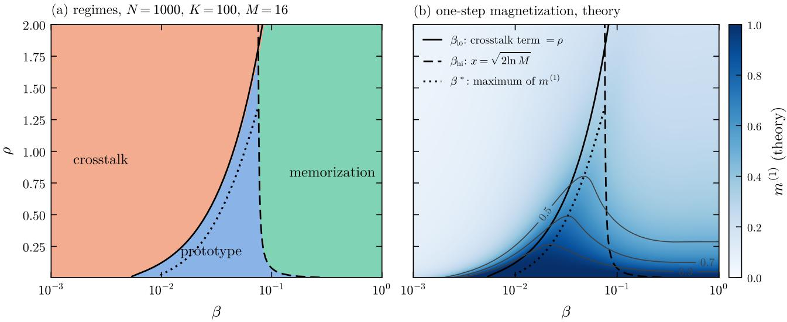  
Figure 2: The three regimes in the $( \beta , \rho )$ plane, from the closed-form theory alone (N = 1000, K = 100, $M = 1 6 )$ (a) Crosstalk (crosstalk term of Corollary 1(i) above $\rho )$ , prototype and memorization $( x > { \sqrt { 2 \ln M } } )$ regions; solid and dashed lines are the edges (17); the dotted line is the position $\beta ^ { * }$ of the maximum of $m ^ { ( 1 ) }$ , obtained by maximizing (14) numerically and drawn where it lies below the condensation edge (above $\rho \simeq 1 . 3$ it crosses it, and the closure is no longer reliable). The crosstalk edge moves with $\rho \mathrm { a s } 1 / r ^ { 2 }$ , the condensation edge as $1 / { \sqrt { 1 - r ^ { 2 } } }$ , and the window closes at $\rho \simeq 1 . 8 $ $\operatorname { E q } .$ . (19); at large $\rho$ the pooling loss is already appreciable at $\beta _ { \mathrm { l o } } \ ( x _ { \mathrm { l o } } > 1 )$ , and the crosstalk edge marks the point where the crosstalk drops below $\rho ,$ not a fixed value of $\bar { m } ^ { ( 1 ) }$ . (b) One-step magnetization (14), with the contours $m ^ { ( \mathrm { i } ) } = 0 . 5 , 0 . 7 .$ 0.9: the prototype regime is where the layer pools the correct class, not where it necessarily retrieves the archetype, since $\rho _ { \mathrm { e f f } }  \rho$ there; in the memorization region (14) overestimates $m ^ { ( 1 ) }$ , whose actual value tends to r (Remark 2).

Remark 5 (overfitting as a REM transition). In the pairwise model, overfitting is the spin-glass phase of a Hebbian spin glass with extensively many quenched patterns, a phase with full replica-symmetry breaking [3, 32, 34]. In the exponential model, overfitting is the condensation of Proposition 3: the Gibbs measure of the attention layer freezes on one training example, as in the low-temperature phase of the REM, which is the $p  \infty$ limit of the p-spin glass and has one step of replica-symmetry breaking [27, 31]: the overfitting phase of the exponential model is therefore 1-RSB, against the full RSB of the pairwise spin glass. Crosstalk and condensation have diferent scaling variables, βN and $\beta \sqrt { N }$ : this is why the two edges in (17) separate as N grows. We use the REM language for the softmax weights seen from a fixed query, which is where Lemma 1 applies, and do not claim a thermodynamic phase transition of the network at finite M.

Remark 6 (class averages as keys). If the labels are disclosed and the K class averages η¯µ are used as keys, the within-class condensation cannot occur $( M = 1$ per key). These keys are not binary, so the factorization of the self-coupling used in the proof of Proposition 4 does not apply: the i-th factor $e ^ { \beta \bar { \eta } _ { i } ^ { \mu } \sigma _ { i } }$ of each weight is a bias of relative size βr which cancels between numerator and denominator of (5) as soon as one key carries the weight (for $K = 1 , w _ { 1 } = 1$ and $\pmb { \sigma } ^ { ( 1 ) } = \mathrm { s i g n } \bar { \eta } ^ { 1 }$ for every $\beta$ and q). Neglecting it, the signal-to-noise computation gives $m ^ { ( 1 ) } = \mathrm { e r f } ( 1 / \sqrt { 2 \rho _ { \mathrm { e f f } } } )$ with

$$
\rho _ { \mathrm { e f f } } = \frac { 1 } { r ^ { 2 } W ^ { 2 } } \left[ \frac { ( 1 - r ^ { 2 } ) W ^ { 2 } } { M } + \frac { ( 1 - W ) ^ { 2 } } { K - 1 } \Big ( r ^ { 2 } + \frac { 1 - r ^ { 2 } } { M } \Big ) \right] ,
$$

W being the weight of the correct key: the prototype regime extends to $\beta  \infty ,$ where $\rho _ { \mathrm { e f f } } \ \to \ \rho$ and the update is the majority rule of [13], and the layer is a nearest-centroid classifier, i.e. it assigns the query to the class whose prototype $\bar { \pmb { \eta } } ^ { \mu }$ has the largest overlap with it. The interesting physics, and the transformerrelevant one, is in the keys = examples.

## 4 Numerical results

Simulations implement Definitions 1–4 literally: a dataset is drawn, the network is prepared in a fresh example of a randomly chosen archetype and updated in parallel at zero temperature; $m ^ { ( 1 ) } , n _ { \operatorname* { m a x } } , W$ and $M _ { \mathrm { e f f } }$ are measured after the first update and $m ^ { ( \infty ) }$ after convergence (at most ten parallel updates). Each point is an average over independent datasets and queries; error bars are standard errors. Theory curves contain no fitted parameter. Code and data are available at https: //github.com/francescoalemanno/hebb-attention.

The load disappears. Figure 4(a) compares, at three dataset entropies, the one-step magnetization of the pairwise network built on class averages, Eq. (9), with that of the attention layer at an inverse temperature inside the window (17), as the load is varied over almost two decades. The pairwise curves bend down with $\alpha ,$ as in [13]: at $\rho = 0 . 0 6$ the magnetization drops below 0.9 at $\alpha \simeq 0$ .14 and reaches $0 . 6 5 \mathrm { ~ a t ~ } \alpha = 0 . 5$ at $\rho = 0 . 2 5$ it is below 0.9 already at $\alpha \simeq 0 . 0 1 5$ and reaches 0.38, at $\rho = 0 . 5$ it reaches 0.24. The attention curves are flat over the whole range, at 1.0, 0.90 and 0.75 respectively, which are their $\alpha  0$ values, i.e. the majority-rule values erf $( 1 / \sqrt { 2 \rho } )$ lowered by the partial pooling $M _ { \mathrm { e f f } } / M \simeq 0 . 6 5$ at this $\beta .$ . The flatness is more robust than the saturation of W: at $\rho = 0 . 5$ the correct class carries only $W \simeq 0 . 3$ of the weight at $\alpha = 0 . 1$ and $W \simeq 0 . 1 \mathrm { ~ a t ~ } \alpha = 0 . 5$ , yet $m ^ { ( 1 ) }$ does not move, because the weight lost to the $K - 1$ wrong classes is spread over all of them and its contribution to the noise, the term $( 1 - W ) ^ { 2 } / [ ( K - 1 ) W ^ { 2 } ]$ in (15), stays well below $\rho$ (0.04 at $W = 0 . 1 , K = 2 0 0 0 )$ ; in the pairwise model the same crosstalk is of order α. The dependence on the load returns only when the crosstalk term of Corollary 1(i),

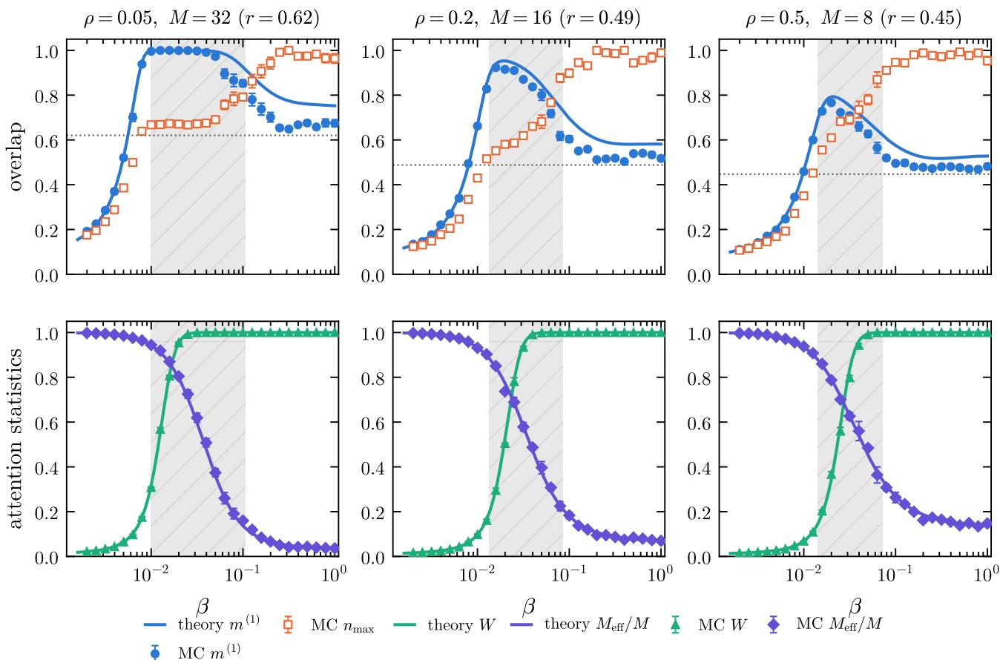  
Figure 3: One attention step over the training set as a function of the inverse temperature $\beta ,$ for $N = 1 0 0 0 , \alpha = 0 . 1$ and three datasets of increasing entropy (columns: $( \rho , M ) = ( 0 . 0 5 , 3 2 ) , ( 0 . 2 , 1 6 ) , ( 0 . 5 , 8 ) , \mathrm { i . e . } \ r = 0 . 6 2 , 0 . 4 9 , 0 . 4 5 )$ . Top: magnetization of the unseen archetype, theory (14) (line) versus Monte Carlo (full circles), and overlap $n _ { \mathrm { m a x } }$ with the closest training example (open squares); the dotted line is the quality r of a single example. Bottom: weight of the correct class W and pooled fraction $M _ { \mathrm { e f f } } / M$ , theory (12), (13) (lines) versus Monte Carlo (symbols). The grey band is the analytic window (17). The three regimes of Corollary 1 are visible from left to right: crosstalk $( W \ll 1 )$ , prototype (crosstalk below $\rho , M _ { \mathrm { e f f } } \simeq M )$ , memorization $( M _ { \mathrm { e f f } } \to 1 , n _ { \mathrm { m a x } } \to 1 , m ^ { ( 1 ) } \to r )$

$$
{ \frac { ( 1 + \rho ) ( 1 - W ) ^ { 2 } } { ( K - 1 ) W ^ { 2 } } } \simeq ( 1 + \rho ) ( K - 1 ) e ^ { - 2 N \beta r ^ { 2 } } \qquad ( q = r ) ,
$$

becomes comparable with $\rho ,$ which is the crosstalk edge of (17): there $W \sim K ^ { - 1 / 2 }$ . Panel (b) shows the dependence on $\rho$ at the fixed load $\alpha = 0 . 2 \mathrm { : }$ : the attention layer stays above the pairwise network at every $\rho ,$ and both follow their one-step theories. The triangles are the fixed point of the iterated attention map: for $\rho \lesssim 0 . 0 6$ the archetype itself, which is not one of the keys, is an attractor of the softmax dynamics and is retrieved exactly; for larger $\rho$ the fixed point is a training example $( n _ { \mathrm { m a x } } = 1 , ~ m ^ { ( \infty ) } \simeq r _ { \mathrm { m } }$ the dotted line). Iterating a transformer layer memorizes unless the examples are good enough for the pooled majority vote to be self-consistent; a single application generalizes over a wider range. This is a departure from the attractor paradigm of associative memory: when the keys are examples rather than archetypes, the fixed points of the map are the examples, and the archetype is reached by stopping after one step rather than by converging. It is also, we note, how attention is used in practice, where each layer is applied once in a feed-forward pass rather than iterated to a fixed point (iterated variants exist [11]); the present setting ofers one reason why the single application is not a loss.

Temperature scan. Figure 1 shows what the three regimes of Corollary 1 look like on the weights of one query; Fig. 3 follows them quantitatively as $\beta$ is varied. The magnetization is a non-monotonic function of $\beta _ { i }$ with its maximum inside the window (17), at the $\beta ^ { * }$ of Remark $3 ~ ( 1 . 4 \beta _ { \mathrm { l o } }$ for the middle column), where the crosstalk has become negligible while $M _ { \mathrm { e f f } }$ is still close to $M ;$ the maximum is close to the majority-rule value $\operatorname { e r f } ( 1 / { \sqrt { 2 \rho } } )$ (0.998, 0.975 and 0.84 for the three columns; measured 1.00, 0.92, 0.77). Through the window the pooling degrades as $\Phi _ { M } ( x )$ and $m ^ { ( 1 ) }$ decreases; beyond the condensation edge $n _ { \mathrm { m a x } }$ rises to one and $m ^ { ( 1 ) }$ settles at about $r :$ the layer has become a lookup table of its training set. The closed-form theory reproduces W and $M _ { \mathrm { e f f } }$ quantitatively at all $\beta$ (within 0.04), and $m ^ { ( 1 ) }$ while the pooling is substantial (within 0.03 for $M _ { \mathrm { e f f } } / M > 0 . 3 )$ ; in the condensed regime it overestimates $m ^ { ( 1 ) }$ by up to 0.1, because the Gaussian approximation no longer holds when a few keys carry the weight (Remark 2); the measured plateaus, 0.67, 0.53 and 0.48 for $r = 0 . 6 2 , 0 . 4 9 , 0 . 4 5$ (left to right), lie slightly above $r ,$ which is the selection bias of the closest example.

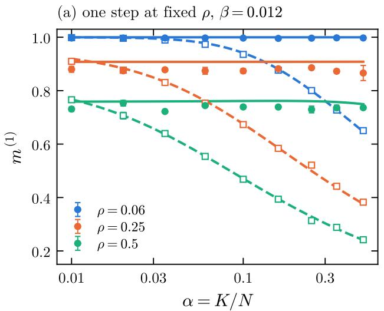

(b) fixed load ® = 0:2  
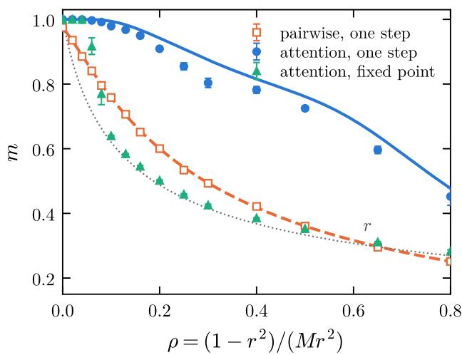  
Figure 4: The load disappears. Retrieval of an unseen archetype from a fresh test example $( q = r )$ , N = 4000, $M = 1 6 .$ $\beta = 0 . 0 1 2 ;$ ; lines are theory, symbols Monte Carlo (3 samples × 6 queries, standard errors). (a) One-step magnetization against the load α at three dataset entropies: the pairwise network, Eq. (9) (dashed lines, open squares), degrades as α grows, the attention layer, Eqs. (14)–(15) (solid lines, full circles), does not. (b) Magnetization against $\rho$ at $\alpha = 0 . 2 \mathrm { : }$ pairwise (open squares), attention after one step (full circles) and at the fixed point of the iterated map (triangles); the dotted line is the quality r of a single example. The iterated map retrieves the archetype only for $\rho \lesssim 0 . 0 6$ and otherwise converges to a training example.

Scaling of the two edges. The two edges of the window have diferent scaling variables, and Fig. 5 isolates them: plotted against βN the rising edges of the curves for N = 250 to 4000 collapse, plotted against $\beta \sqrt { N }$ the falling edges collapse. The window opens as $\sqrt { N }$ , as predicted by (17); at N = 250 it is a factor of four wide, at N = 4000 a factor of ten.

The condensation is a REM transition. Figure 6 tests Proposition 3 directly. Simulations at diferent sizes, dataset sizes and qualities, once plotted against $x = \beta \sqrt { N ( 1 - r ^ { 2 } ) }$ , fall on the REM participation ratio $\Phi _ { M } ( x )$ with no adjustable parameter, including the $r = 0 . 8$ series whose spread difers from the others by a factor of two. The departure of $M _ { \mathrm { e f f } }$ from M sets in at $x \sim 1$ , as the small-x expansion of Proposition 3 says, and the condensation is essentially complete beyond $x _ { c } = \sqrt { 2 }$ ln M, where $M _ { \mathrm { e f f } } / M$ is 0.2–0.3 at these values of M. The memorization edge of an attention layer is therefore not a property of the particular dataset but a universal feature of a softmax over M exchangeable keys: $\beta _ { \mathrm { h i } }$ depends on the data only through the conditional spread $\sqrt { ( 1 - r ^ { 2 } ) / N }$ of the within-class overlaps.

The attention entropy. Figure 7 summarizes the content of Proposition 4: when $\rho _ { \mathrm { e f f } }$ is evaluated from the softmax weights actually produced by each query, the one-step magnetization of every simulation, whatever $\alpha , \rho , \beta$ and $N$ , lies on the single curve $\mathrm { e r f } ( 1 / \sqrt { 2 \rho _ { \mathrm { e f f } } } )$ Points in the condensed regime (light colours) lie below the curve, by up to 0.1, where the Gaussian approximation fails (Remark 2). The pairwise network does not collapse against $\rho ,$ because the load is a second, independent source of noise there.

## 5 Structured data

The theory of Sec. 3 rests on Lemma 1: seen from the query, the within-class overlaps are independent Gaussian variables, so that the softmax is a REM. On real data the archetype is not available and the examples of a class are not independent blurred copies of one vector; in [13] they were shown to be organized in a quasiultrametric way, with an overlap distribution reminiscent of replica-symmetry breaking, more markedly in fashion-MNIST than in MNIST. We therefore ask which parts of the picture survive on MNIST and fashion-MNIST (F-MNIST), binarised as in [13] by thresholding each pixel at its mean over the training set, with the examples themselves as keys and the test images as queries. The ingredients of the theory that can be measured on the data are the mean $\bar { m }$ and the standard deviation $\sigma _ { m }$ of the overlaps between a query and the examples of its class, which enter the window in the form (18), with $\rho = N \sigma _ { m } ^ { 2 } / ( M \bar { m } )$ (0.025 on MNIST, 0.20 on F-MNIST at M = 256), and the condensation variable as $x = \beta N \sigma _ { m }$ . Figure 8 collects the results for $M = 2 5 6$ examples per class; $M = 1 6$ and 64 give the same picture with lower accuracies.

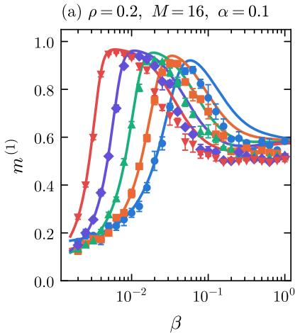

(b) crosstalk edge: ¯Nr 2 ln K  
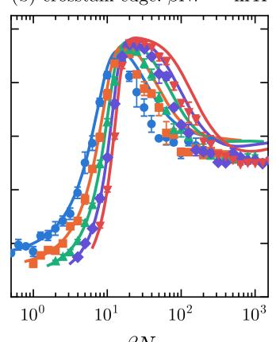

(c) condensation edge: $\beta \sqrt { N ( 1 - r ^ { 2 } ) } \sim \sqrt { 2 \mathrm { l n } M }$  
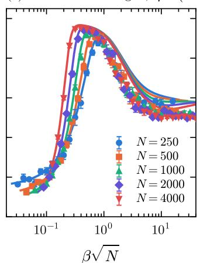  
Figure 5: Size dependence of the generalization window at $\rho = 0 . 2 , M = 1 6 , \alpha = 0 . 1$ (lines: theory; symbols: Monte Carlo, 3 samples $\times \ 8$ queries). (a) Against $\beta$ the window widens with N. (b) Against βN the rising (crosstalk) edges collapse, up to the slow drift ln $K = \ln ( \alpha N )$ of Eq. (17). (c) Against $\beta \sqrt { N }$ the falling (condensation) edges collapse.

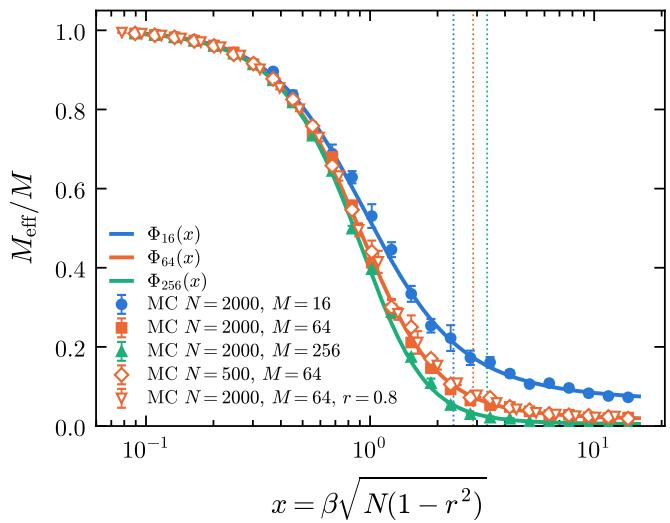  
Figure 6: Condensation of the within-class softmax. The pooled fraction $M _ { \mathrm { e f f } } / M$ measured in simulations with diferent $N , M$ and r (symbols; $r = 0 . 5$ unless stated) collapses, as a function of the single variable $x = \beta \sqrt { N ( 1 - r ^ { 2 } ) }$ , on the participation ratio $\Phi _ { M } ( x )$ of a random energy model with M levels (lines, Proposition 3); dotted verticals mark the REM freezing point $x _ { c } = \sqrt { 2 }$ ln M.

Condensation. Panel (a) repeats the test of Fig. 6 with $x = \beta N \sigma _ { m }$ . On MNIST the pooled fraction follows $\Phi _ { M } ( x )$ with no adjustable parameter, within 0.1 around $x \simeq 1$ and within 0.02 beyond $x _ { c } ,$ as on Rademacher data. On F-MNIST it condenses later and keeps a tail: $M _ { \mathrm { e f f } } / M = 0 . 1 1$ at $x = 4 . 4$ and 0.023 at $x = 1 0$ , where the REM gives 0.014 and 0.006. Panel (b) shows why: the standardised within-class overlaps of MNIST are Gaussian (skewness −0.16, excess kurtosis 0.0), those of F-MNIST are not (skewness −0.7, excess kurtosis 1.2), and in particular their upper tail is compressed, with $\mathcal { P } ( z > 2 ) = 0 . 0 0 6$ against 0.023 for a Gaussian and a gap between the two largest overlaps of 0.11 $\sigma _ { m }$ against the $0 . 3 2 \sigma _ { m }$ expected for 256 Gaussian levels. A query of $\mathrm { F { - } M N I S T }$ has many nearly equivalent closest examples, and a softmax over nearly degenerate levels cannot freeze on one of them: this is the signature of sub-clusters within the class, i.e. of the hierarchical organization found in [13], and it is where the REM should be replaced by its hierarchical generalization [28]. The diagnostic of Proposition 3 thus not only measures memorization but also detects structure.

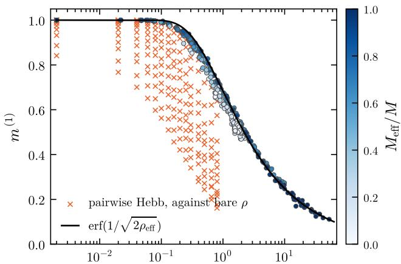  
½eff (attention); bare $\rho$ for the pairwise crosses  
Figure 7: All Monte Carlo points of Figs. 3 and 5 and of the $( \alpha , \rho )$ grid at $N = 1 0 0 0$ described in Appendix $\mathrm { A } ,$ for the attention layer (every α, ρ, β, N; colour: pooled fraction $M _ { \mathrm { e f f } } / M )$ , plotted against the attention entropy ρef evaluated from the measured weights, Eq. (15); the line is erf $( 1 / \sqrt { 2 \rho _ { \mathrm { e f f } } } )$ . Crosses: the pairwise network on the same grid, against the bare dataset entropy $\rho ,$ which does not account for the crosstalk.

(a) condensation of the softmax  
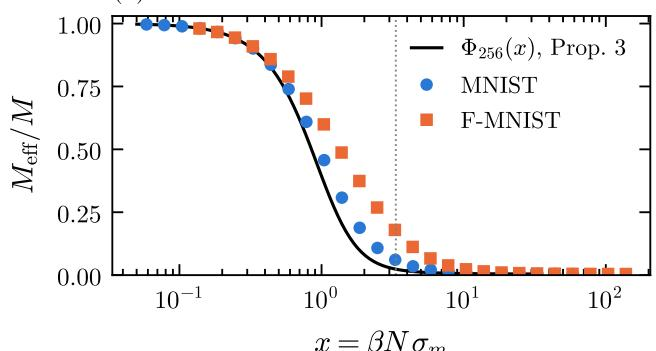  
(c) test accuracy, M = 256

(b) within-class overlaps  
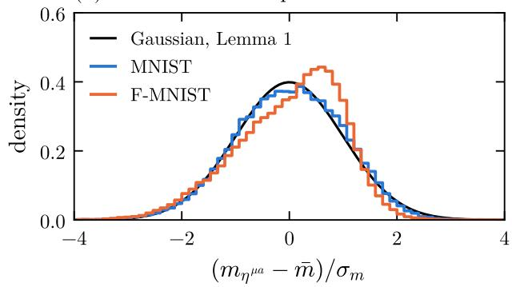

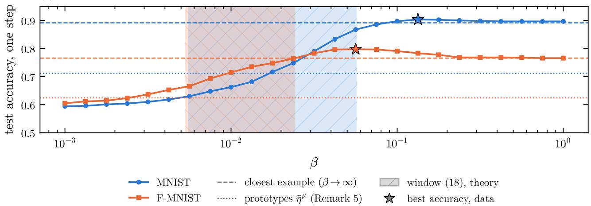  
Figure 8: One attention step with keys = binarised MNIST and fashion-MNIST (F-MNIST) examples, $M = 2 5 6$ per class, $K = 1 0 , N = 7 8 4$ , queries from the test sets (3 samples × 400 queries). (a) Pooled fraction $M _ { \mathrm { e f f } } / M$ against $x = \beta N \sigma _ { m } , \sigma _ { m }$ being the measured standard deviation of the within-class overlaps; line: $\Phi _ { 2 5 6 } ( x )$ of Proposition 3; dotted vertical: $\sqrt { 2 }$ ln M. (b) Distribution of the standardised within-class overlaps against the Gaussian of Lemma 1. (c) Test accuracy of the one-step readout (class of largest total weight) against $\beta ;$ dashed: the $\beta \to \infty$ limit, which returns the closest training example; dotted: the readout with the prototypes ${ \bar { \pmb { \eta } } } ^ { \mu }$ as keys (Remark $6 ) ;$ shaded: the window (18) with the measured ¯m and $\sigma _ { m }$ (and $\rho = N \sigma _ { m } ^ { 2 } / ( M \bar { m } ) )$ ; stars: the measured best accuracy.

Accuracy. Panel (c) shows the three regimes on the classification accuracy of the one-step readout. At small $\beta$ the accuracy falls to 0.6 on both datasets, below the prototype readout: this is the crosstalk regime. It then rises through the window (18) and reaches its maximum beyond the condensation edge, at $\beta \simeq 2 . 4 \beta _ { \mathrm { h i } }$ on MNIST (0.90, with $M _ { \mathrm { e f f } } / M = 0 . 0 1 )$ and $\beta \simeq 2 . 3 \beta _ { \mathrm { h i } }$ on F-MNIST (0.80, with $M _ { \mathrm { e f f } } / M = 0 . 0 4 )$ , far above the prototype readout (0.71 and 0.62). On MNIST the accuracy then stays at the value of the closest-example limit; on F-MNIST it is non-monotonic and its maximum exceeds that limit by 0.03. The overlap of the output state with the class prototype behaves instead as on Rademacher data: it is maximal inside the window, at $\beta \simeq 0 . 0 2$ on MNIST (0.84) and $\beta \simeq 0 . 0 1 3$ on F-MNIST (0.70), and decreases on condensation. The two maxima are separated because on structured data the class prototype is a poor target: it is the replicasymmetric representation of the class, which in [13] gave 75% on MNIST against 95% once a hidden layer of subprototypes was added. Here the same gain is obtained without a hidden layer, by the temperature: at $\beta$ a few times $\beta _ { \mathrm { h i } }$ the softmax pools a few examples around the query, i.e. it reads out a local sub-prototype rather than the class average, and the memorization regime of the Rademacher theory becomes the useful operating point. In the language of Corollary 1, the optimal $M _ { \mathrm { e f f } }$ is not M but the size of the sub-cluster to which the query belongs; on data with a single archetype per class that size is M, on hierarchical data it is of order one.

## 6 Gradient descent versus Hebb

The Hebbian attention of the previous sections has no trainable parameter besides $\beta .$ It is natural to ask whether an attention layer whose keys and values are learned by gradient descent on the same data does better, and whether the memorization phenomenology survives. We trained a one-head attention classifier,

$$
\pi = \operatorname { s o f t m a x } \mathbf { ( V } ^ { \top } \operatorname { s o f t m a x } ( \beta \mathbf { K } \pmb { \sigma } ) ) ,
$$

with $H = 4 K$ learnable keys $\mathbf { K } \in \mathbb { R } ^ { H \times N }$ (the rows of K are the slots of the layer, the analogue of the stored keys of the Hebbian network), values $\breve { \mathbf { V } } \in \mathbb { R } ^ { H \times K }$ mapping slots to classes, and learnable inverse temperature β (the same symbol as above, with the same meaning, now a trained parameter), by minimizing the crossentropy on the KM labelled examples. To characterize what the slots have learnt we measure, for each slot, the largest cosine between the slot and an archetype and the largest cosine between the slot and a training example, and we average these over the slots with weights given by the mean attention each slot receives on the test queries (usage-weighted cosines): a slot aligned with an archetype is a prototype, a slot aligned with an example is a memory of that example. Figure 9 collects the results. The trained layer always fits the training set, but its test accuracy on fresh examples lies systemati cally below that of the Hebbian attention at its best $\beta ,$ which on these data coincides with the nearest-centroid readout (Remark 6) and serves as the reference (it is not claimed to be optimal). The gap is not a function of $\rho$ alone: at fixed $\rho$ it grows with M, i.e. it is governed by the noise r of the individual examples; we interpret this as the keys fitting the noise directions of the examples they attend to, which are the more numerous the smaller r. The training curves (panel b) show the classical peak-and-decay: the test accuracy reaches the Hebbian value after a few tens of steps, when the keys are proportional to the class sums of the examples (the gradient of the cross-entropy at initialization is Hebbian), and then decays while the keys fit the noise. A weight decay of order $1 0 ^ { - 2 }$ on the keys stops the decay, brings the test accuracy back close to the Hebbian reference (within 0.01–0.03 at $r = 0 . 3 .$ , within 0.03–0.08 at $r = 0 . 2 )$ , and turns the learned keys into prototypes, their cosine with the archetypes rising from 0.4 to 0.7 (panel $\mathrm { c ) }$ . These observations refer to this setup, fullbatch Adam with a single learning-rate schedule and two datasets per point, and are not a statement about optimally tuned training. In the language of [13], gradient descent discovers by itself the averaged, “replicasymmetric” representation of each class, and overfits by moving away from it.

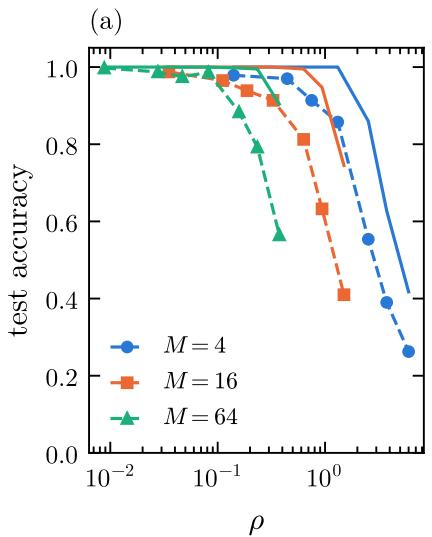

(b)  
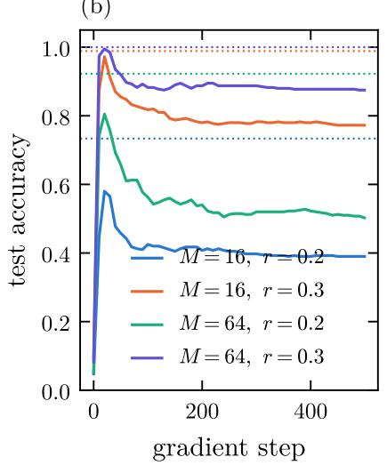

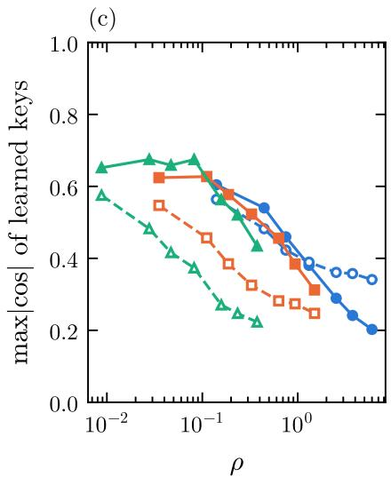  
Figure 9: One-head attention classifier $( H = 4 K$ learned keys and values, softmax inverse temperature learned, crossentropy, Adam) trained on the datasets of Definition 1 with $N = 4 0 0 , K = 2 0$ . (a) Test accuracy on fresh examples after 500 steps (dashed, symbols) against the Hebbian attention with keys = training examples at its best $\beta$ (solid), which coincides with the nearest-centroid readout, as a function of $\rho$ for $M = 4 , 1 6 , 6 4$ . (b) Test accuracy along training without weight decay, for four datasets; dotted lines are the corresponding Hebbian values. (c) Usage-weighted maximal cosine of the learned slots with the archetypes (full symbols) and with the training examples (open symbols), as defined in the text.

## 7 Conclusions and outlook

We have transferred Hebbian learning from examples [12, 13] from the pairwise Hopfield network to the exponential one, whose zero-temperature update is a layer of softmax attention with the training examples as keys and values. The signal-to-noise analysis closes in this setting, and yields a one-step magnetization $m ^ { ( 1 ) } = \mathrm { e r f } ( 1 / \sqrt { 2 \rho _ { \mathrm { e f f } } } )$ that has the same majority-rule form as in the pairwise network but with the dataset en tropy replaced by an attention entropy, Eq. (15), built from two analytically computable statistics of the softmax: the weight of the correct class and the number of examples it pools. The implications are of two kinds.

For Hopfield networks. (i) The load is no longer a control parameter of learning: within the window (17) the crosstalk of the other archetypes decays exponentially in Nβ instead of being of order $\alpha ,$ and the exponential network learns from examples a number of archetypes growing as $\exp ( c { \sqrt { N } } )$ , Eq. (19), limited by the condensation edge rather than by the crosstalk; the dense networks of [14, 15], with load $K / N ^ { p - 1 }$ , are the intermediate steps of this family. (ii) Overfitting changes nature. In the pairwise model it is a Hebbian spin glass with full replica-symmetry breaking; in the exponential model it is the condensation of the Gibbs measure over the keys onto one example, a random-energy transition with one step of replica-symmetry breaking at $\beta \sqrt { N ( 1 - r ^ { 2 } ) } = \sqrt { 2 \ln M }$ , whose location depends on the data only through the spread of the within-class overlaps. The exponential model is, in this sense, the least glassy member of the Hebbian family, as the REM is of the p-spin family. (iii) The dataset entropy generalizes to an entropy of the weighted vote: pairwise and exponential networks are the two ends of one formula, with $M _ { \mathrm { e f f } } \ = \ M$ and extensive crosstalk on one side, $M _ { \mathrm { e f f } } = M \Phi _ { M } ( x )$ and exponentially small crosstalk on the other. The labels are not needed: inside the window the examples of the correct class receive the weight by themselves $( W \to 1 )$ ), and the attention layer, which never sees a label, performs the same majority vote as the pairwise network built on class averages at zero load, Eq. (9) with $\alpha = 0$ , up to the pooling loss (Fig. 4). (iv) Iteration is not free. With keys equal to examples the fixed points of the dynamics are the examples, and the archetype is an attractor only for small $\rho ;$ the retrieval of an unseen archetype is a one-step operation, not a convergence.

For attention layers. (i) An attention head over a set of noisy examples has a computable phase diagram in the parameters $( \rho , \beta , N , K , M )$ , and the softmax temperature is the axis along which it moves from crosstalk to prototype to memorization; the two edges of the gen eralization window scale as $1 / N$ and $1 / \sqrt { N }$ , so that a larger model generalizes from the same context over a wider range of temperatures. (ii) Memorization is a measurable property of a head whose keys are training examples: the participation ratio of its weights, which drops to order one at the REM threshold, and whose departure from the REM curve measures the structure of the data (Sec. 5). Extending the diagnostic to heads with learned projections, where the logits are no longer the overlaps of Lemma 1, requires identifying the analogue of x and is left open. (iii) In our experiments the first steps of gradient descent on the cross-entropy are Hebbian, the later ones fit the noise of the examples and weight decay returns the keys close to the Hebbian prototypes; this suggests a reading of early stopping and weight decay in attention layers as a distance from the Hebbian solution, to be tested beyond the present setup. (iv) In the present setting the single application of a layer generalizes over a wider range than its fixedpoint iteration, which converges to a training example unless $\rho$ is small; this is consistent with the feed-forward use of attention, although we do not claim it explains it. (v) On structured data the memorization regime is not a failure but the operating point: the classes of MNIST and F-MNIST are made of sub-clusters, the class prototype is a poor target, and the softmax at a few times the condensation edge reads out the local sub-prototype, do ing with the temperature what the hidden layer of [13] did by construction; the departure of the condensation curve from the REM measures how far the data are from the single-archetype picture.

These implications are structural rather than numerical: the data are unstructured, the layer is single, the dynamics is noiseless and the signal-to-noise theory is Gaussian, hence quantitative only while the softmax pools many examples (within 0.03) and of by up to

0.1 once it has condensed. Several directions follow. The natural tool to close the latter gap is the REMlike treatment of exponential models of [8], or the largedeviation evaluation of the noise of [10], with examples in place of archetypes; either would also give the selection bias of the closest example. The latter work, at $\beta  \infty$ , finds generalization to unseen cues well below memorization: in the present picture that is the memorization regime, and the window of Corollary 1 is where the two capabilities meet. The iterated dynamics, in which the archetype emerges as a fixed point of the softmax map for small $\rho \ ( { \mathrm { F i g . 4 b } } ) $ , deserves an analytic condition. The finite-temperature equilibrium statistics, which in the pairwise model gives the firstorder retrieval transition of [13], is the obvious next step, as is the theory of structured datasets, where Sec. 5 indicates the route: a hierarchical random energy model [28] for the within-class overlaps, whose levels of condensation should correspond to the levels of the ultrametric organization uncovered in [13]. Finally, the diagnostic of point (ii) above and the Hebbian reading of regularization in point (iii) are the two statements that could be confronted with trained transformers, once the mapping from learned projections to the variables of Lemma 1 is understood.

## Acknowledgments

This work was supported by SolarSud T.R.E. di Miccoli Antonia (https://solarsud.it). The research on this topic was accelerated by the use of Claude Fable 5.1 (Anthropic); the author takes full responsibility for the content. Code, data and the Monte Carlo results reproducing all figures are available at https: //github.com/francescoalemanno/hebb-attention.

## References

[1] J. J. Hopfield, Proc. Natl. Acad. Sci. USA 79, 2554 (1982).

[2] D. J. Amit, H. Gutfreund, H. Sompolinsky, Phys. Rev. Lett. 55, 1530 (1985).

[3] D. J. Amit, H. Gutfreund, H. Sompolinsky, Ann. Phys. 173, 30 (1987).

[4] D. Krotov, J. J. Hopfield, Adv. Neural Inf. Process. Syst. 29, 1172 (2016).

[5] D. Krotov, J. J. Hopfield, Neural Comput. 30, 3151 (2018).

[6] M. Demircigil, J. Heusel, M. L¨owe, S. Upgang, F. Vermet, J. Stat. Phys. 168, 288 (2017).

[7] H. Ramsauer et al., Hopfield networks is all you need, Int. Conf. Learn. Repr. (2021).

[8] C. Lucibello, M. M´ezard, Phys. Rev. Lett. 132, 077301 (2024).

[9] L. Albanese, A. Alessandrelli, A. Barra, P. Sollich, Yet another exponential Hopfield model, arXiv:2509.06905 (2025).

[10] E. Agliari, A. Barra, A. Ladiana, A. Lepre, Exponential capacity in multilayer hetero-associative neural networks, arXiv:2607.29554 (2026).

[11] B. Hoover et al., Energy transformers, Adv. Neural Inf. Process. Syst. 36 (2023).

[12] E. Agliari, F. Alemanno, A. Barra, G. De Marzo, Neural Netw. 148, 232 (2022); arXiv:2109.00454.

[13] F. Alemanno, M. Aquaro, I. Kanter, A. Barra, E. Agliari, Europhys. Lett. 141, 11001 (2023); arXiv:2203.01304.

[14] E. Agliari, L. Albanese, F. Alemanno, A. Alessandrelli, A. Barra, F. Giannotti, D. Lotito, D. Pedreschi, Physica A 626, 129076 (2023).

[15] E. Agliari, L. Albanese, F. Alemanno, A. Alessandrelli, A. Barra, F. Giannotti, D. Lotito, D. Pedreschi, Physica A 627, 129143 (2023).

[16] L. Albanese, A. Barra, P. Bianco, F. Durante, D. Pallara, J. Math. Phys. 65, 113302 (2024).

[17] E. Agliari, F. Alemanno, M. Aquaro, A. Barra, F. Durante, I. Kanter, Neural Netw. 173, 106174 (2024).

[18] J. F. Fontanari, J. Phys. (France) 51, 2421 (1990).

[19] R. Th´eriault, D. Tantari, SciPost Phys. 17, 040 (2024).

[20] M. Negri, C. Lauditi, G. Perugini, C. Lucibello, E. Malatesta, Phys. Rev. Lett. 131, 257301 (2023).

[21] Y.-H. H. Tsai, S. Bai, M. Yamada, L.-P. Morency, R. Salakhutdinov, Transformer dissection: a unified understanding of transformer’s attention via the lens of kernel, Proc. EMNLP (2019).

[22] T. Bricken, C. Pehlevan, Attention approximates sparse distributed memory, Adv. Neural Inf. Process. Syst. 34 (2021).

[23] B. Millidge, T. Salvatori, Y. Song, T. Lukasiewicz, R. Bogacz, Universal Hopfield networks: a general framework for single-shot associative memory models, Proc. ICML (2022).

[24] S. Zhai et al., Stabilizing transformer training by preventing attention entropy collapse, Proc. ICML (2023).

[25] A. Cowsik, A. Sriram, Hierarchical prototype emergence in modern Hopfield models, arXiv:2609.12079 (2026).

[26] B. Derrida, Phys. Rev. Lett. 45, 79 (1980).

[27] B. Derrida, Phys. Rev. B 24, 2613 (1981).

[28] B. Derrida, J. Phys. Lett. (Paris) 46, L401 (1985); B. Derrida, E. Gardner, J. Phys. C 19, 2253 (1986).

[29] B. Derrida, G. Toulouse, J. Phys. Lett. (Paris) 46, L223 (1985).

[30] M. M´ezard, G. Parisi, M. A. Virasoro, J. Phys. Lett. (Paris) 46, L217 (1985).

[31] D. J. Gross, M. M´ezard, Nucl. Phys. B 240, 431 (1984).

[32] M. M´ezard, G. Parisi, M. A. Virasoro, Spin Glass Theory and Beyond (World Scientific, Singapore, 1987).

[33] A. C. C. Coolen, R. K¨uhn, P. Sollich, Theory of Neural Information Processing Systems (Oxford University Press, 2005).

[34] L. Albanese, F. Alemanno, A. Alessandrelli, A. Barra, J. Stat. Phys. 189, 24 (2022).

## A Details of the simulations

Datasets are generated as in Definition 1 with $r =$ $1 / { \sqrt { 1 + \rho M } } .$ For the pairwise networks the field is $\begin{array} { r } { h _ { i } = \sum _ { j \neq i } J _ { i j } \sigma _ { j } } \end{array}$ with the couplings of Definition 2; for the exponential network it is $\operatorname { E q . } \ ( 5 )$ , evaluated in logspace for numerical stability. A query is a fresh example of a randomly chosen archetype; the parallel update $\sigma \to \mathrm { s i g n } ( h )$ is applied once for $m ^ { ( 1 ) } , n _ { \mathrm { m a x } } , W , M _ { \mathrm { e f f } }$ and until convergence (at most ten parallel updates) for $m ^ { ( \infty ) }$ . Fig. 4: N = 4000, $M = 1 6 , \beta = 0 . 0 1 2 ;$ (a) 9 loads $\alpha ~ \in ~ [ 0 . 0 1 , 0 . 5 ]$ at $\rho ~ = ~ 0 . 0 6 , 0 . 2 5 , 0 . 5 , \ \mathrm { { ( b ) } }$ 15 entropies $\rho \in [ 0 , 0 . 8 ]$ at $\alpha = 0 . 2 ;$ 3 datasets $\times \textit { 6 }$ queries per point. Fig. 7 also uses a grid at $N = 1 0 0 0$ $\beta ~ = ~ 0 . 0 2 5 \colon$ 13 loads $\alpha \in [ 0 . 0 1 , 0 . 5 ] \ \times \ 1 5$ entropies $\rho ~ \in ~ [ 0 , 0 . 8 ]$ , 4 datasets $\times ~ 8$ queries per point. Fig. 1: one dataset and one query, $N = 1 0 0 0 , \ K = 2 0$ $M = 1 6 , \rho = 0 . 2 ;$ the three values of β are fixed by the edges (17). Fig. 2: theory only, $N = 1 0 0 0 , K = 1 0 0$ $M = 1 6 , 2 4 0 \times 2 2 0$ grid in $( \beta , \rho )$ . Fig. 3: $N = 1 0 0 0$ K = 100, (ρ, M) = (0.05, 32), (0.2, 16), (0.5, 8), 28 values of $\beta \in [ 2 \cdot 1 0 ^ { - 3 } , 1 ] , 4 \times 8$ samples per point. Fig. 5: $K = N / 1 0 , M = 1 6 , 3 \times 8$ samples. Fig. 6: $K = 2 ,$ $N ~ \in ~ \{ 5 0 0 , 2 0 0 0 \}$ $M \ \in \ \{ 1 6 , 6 4 , 2 5 6 \}$ $r ~ \in ~ \{ 0 . 5 , 0 . 8 \}$ $4 \times 8 \ \mathrm { s a m p l e s } ;$ the abscissa is computed from $\beta$ as $x = \beta \sqrt { N ( 1 - r ^ { 2 } ) }$ . The REM function $\Phi _ { M } ( x )$ is evaluated by averaging over 4000 realizations of M Gaussian levels. Fig. 8: MNIST and F-MNIST binarised by thresholding each pixel at its mean over the 60,000 train ing images; for each of 3 samples, M examples per class are drawn from the training set and 400 queries from the test set; 25 values of $\bar { \beta } \in [ 1 0 ^ { - 3 } , 1 ] ;$ ; ¯m, $\sigma _ { m } .$ , skewness and kurtosis are computed query by query over the examples of the query’s class, then averaged. Fig. 9: $N = 4 0 0$ $K = 2 0$ $H = 8 0$ , 500 full-batch Adam steps, 400 fresh test examples, 2 datasets per point; the Hebbian attention is evaluated on the same data by one step of (5), predicting the class of largest total weight, maximized over $\beta .$

## B Small-x expansion of $\Phi _ { M }$

Let $S _ { 1 } = \textstyle \sum _ { a } z _ { a }$ and $S _ { 2 } = \textstyle \sum _ { a } z _ { a } ^ { 2 }$ . Expanding $e ^ { x z } = $ $\textstyle 1 + x z + { \frac { 1 } { 2 } } { \overline { { x } } } ^ { 2 } z ^ { 2 } + O ( x ^ { 3 } )$ in the numerator and in the denominator of the participation ratio gives, realization by realization,

$$
\frac { ( \sum _ { a } e ^ { x z _ { a } } ) ^ { 2 } } { \sum _ { a } e ^ { 2 x z _ { a } } } = M + x ^ { 2 } \Big ( \frac { S _ { 1 } ^ { 2 } } { M } - S _ { 2 } \Big ) + O ( x ^ { 3 } ) ;
$$

the $O ( x ^ { 3 } )$ term is a cubic polynomial in the $z ^ { \prime } \mathrm { s }$ and averages to zero. Taking the average with $\mathbb { E } S _ { 1 } ^ { 2 } = \mathbb { E } S _ { 2 } =$ M gives $M \Phi _ { M } ( x ) \stackrel {  } { = } M - ( M - 1 ) x ^ { 2 } + \stackrel {  } { O } ( x ^ { 4 } )$ , i.e. $\Phi _ { M } ( x ) = 1 - ( 1 - M ^ { - 1 } ) x ^ { 2 } + O ( x ^ { 4 } ) \ ( \Phi _ { 1 6 } ( 0 . 3 ) = 0 . 9 2 1$ numerically, 0.916 from the expansion). For $x \ > \ x _ { c }$ and $M \ \to \ \infty , \ \mathbb { E } \sum _ { a } w _ { a } ^ { 2 } \ = \ 1 - \ x _ { c } / x$ in the frozen phase $[ 2 9 , 3 0 ]$ , and Jensen’s inequality gives $M \Phi _ { M } ( x ) =$ $\begin{array} { r } { \mathbb { E } [ 1 / \overset { \cdot } { \sum _ { a } } w _ { a } ^ { 2 } ] \overset { \cdot } { \geq } ( 1 - x _ { c } / x ) ^ { - 1 } } \end{array}$ ; the inequality is strict because $\textstyle \sum _ { a } w _ { a } ^ { 2 }$ keeps a non-degenerate distribution. At $x = 1 0$ the bound is 1.31, 1.40, 1.50 for $M = 1 6$ , 64, 256, while $2 \cdot 1 0 ^ { 4 }$ samples of M Gaussian levels give $\begin{array} { r } { \mathbb { E } \sum _ { a } w _ { a } ^ { 2 } \ = \ 0 . 8 2 , \ 0 . 7 7 } \end{array}$ , 0.72 (above $1 - x _ { c } / x = 0 . 7 6$ $0 . 7 1 , \ 0 . 6 7 ,$ , a finite-M efect), hence $\begin{array} { r } { 1 / \mathbb { E } \sum _ { a } w _ { a } ^ { 2 } = 1 . 2 1 } \end{array}$ $1 . 3 0 , \ 1 . 3 9$ , and $M \Phi _ { M } = 1 . 3 4$ , 1.50, 1.65, i.e. 11–19% above the bound. In the text $\Phi _ { M }$ is always evaluated numerically.

## C Position of the maximum

Write $t = ( 1 - W ) / W , a = ( 1 - r ^ { 2 } ) / M _ { \mathrm { e f f } } , b = ( r ^ { 2 } +$ $a ) / ( K - 1 ) , s = q \tau$ and $c = ( 1 - q ^ { 2 } ) \tau ^ { 2 } ;$ then (15) reads

$$
\rho _ { \mathrm { e f f } } = \frac { a + b t ^ { 2 } + c ( 1 + t ) ^ { 2 } } { [ r + s ( 1 + t ) ] ^ { 2 } } ,
$$

with $t = ( K - 1 ) e ^ { - N \beta q r + N \beta ^ { 2 } r ^ { 2 } / 2 }$ from (12), so that $t ^ { \prime } =$ $- L t$ with $L = N ( q r - \beta r ^ { 2 } )$ , and $a = ( 1 - r ^ { 2 } ) / ( M \Phi _ { M } ( x ) )$ from (13). The condition $\partial _ { \beta } \rho _ { \mathrm { e f f } } = 0$ is

$$
\begin{array} { r l } & { \left[ r + s ( 1 + t ) \right] \left[ a ^ { \prime } + b ^ { \prime } t ^ { 2 } + c ^ { \prime } ( 1 + t ) ^ { 2 } \right] - 2 s ^ { \prime } ( 1 + t ) \left[ a + b t ^ { 2 } \right. } \\ & { \left. \quad + c ( 1 + t ) ^ { 2 } \right] - 2 L t \left\{ \left[ b ( r + s ) + c r \right] t + c r - a s \right\} = 0 , } \end{array}\tag{21}
$$

a scalar equation in $\beta ,$ exact within the signal-to-noise closure, that can be solved once $\Phi _ { M }$ is known. For $x \ll 1 , a \simeq a _ { 0 } [ 1 + ( 1 - M ^ { - 1 } ) N ( 1 - r ^ { 2 } ) \beta ^ { 2 } ]$ with $a _ { 0 } =$ $( 1 - r ^ { 2 } ) / M$ ; neglecting the self-coupling $( s = c = 0 )$ , the quadratic term in the exponent of t and $\beta r$ against $q ,$ (21) reduces to $a ^ { \prime } = 2 L b t ^ { 2 }$ , i.e.

$$
( K - 1 ) e ^ { - 2 N q r \beta } = \kappa \beta , \qquad \kappa = \frac { ( M - 1 ) ( 1 - r ^ { 2 } ) ^ { 2 } } { M ^ { 2 } q r \left[ r ^ { 2 } + ( 1 - r ^ { 2 } ) / { M } \right] } ,\tag{22}
$$

which for $q = r$ is $\kappa = ( M - 1 ) \rho ^ { 2 } / ( 1 + \rho )$ and whose solution is

$$
\beta ^ { * } = \frac { \mathcal { W } \big ( 2 N q r ( K - 1 ) / \kappa \big ) } { 2 N q r } , \quad \frac { 1 - W ^ { * } } { W ^ { * } } = \sqrt { \kappa ( K - 1 ) \beta ^ { * } } ,\tag{23}
$$

with W the Lambert function, $\mathcal { W } ( y ) e ^ { \mathcal { W } ( y ) } = y .$ . Equation (20) is the same condition written for the two terms of ρef, since $2 N q r \beta ^ { * } = 2 \ln [ ( K - 1 ) / t ^ { * } ] ;$ with $\beta ^ { * } \simeq \ln K / ( N r ^ { 2 } )$ inside the square root,

$$
\frac { 1 - W ^ { * } } { W ^ { * } } \simeq \sqrt { \alpha \ln K \frac { ( M - 1 ) \rho ^ { 2 } } { ( 1 + \rho ) r ^ { 2 } } } ,
$$

the load dependence quoted in Remark 3. The expansion assumes $x ^ { * } \ll 1$ , i.e. a maximum well below the condensation edge, and is not uniform for $\rho \to 0$ , where $\kappa  0 \mathrm { : ~ a t ~ } N = 1 0 0 0 , K = 1 0 0 , M = 1 6$ the closed form is within 2% of the numerical maximum of (14) for $0 . 0 2 \leq \rho \leq 0 . 4 \ ( x ^ { * } \leq 0 . 9 )$ , 4% of at $\rho = 0 . 5 , 1 2 \%$ at $\rho = 0 . 8$ and $1 9 \%$ at $\rho = 1$ , where $x ^ { * } > 1 \ ( \mathrm { F i g . \ 2 } )$ . The self-coupling shifts the maximum only slightly: minimizing the full expression (15) at fixed load $\alpha = 0 . 1$ $\rho = 0 . 2$ , M = 16 gives $W ^ { * } \ = \ 0 . 4 9 , \ 0 . 4 3 , \ 0 . 3 5 , \ 0 . 3 2$ for $N = 1 0 ^ { 3 } , 1 0 ^ { 4 } , 1 0 ^ { \bar { 6 } } , 1 0 ^ { 7 }$ , against 0.50, 0.46, 0.40, 0.37 from (23), with $\beta ^ { * }$ within 2%. Asymptotically the term in s t of (21) takes over and $W ^ { * }$ decreases as 1/ ln N rather than $1 / \sqrt { \ln { N } }$ , but at any practical size (23) is accurate.