# Beyond Fixed Acquisition Functions: Temporal Diference Active Learning for Perturbation Discovery

Xudong Zhang<sup>1,2,∗</sup> Jianzhe Li<sup>1,2,∗</sup> Yitong Tang<sup>1</sup> Peijie Zhou<sup>1,2,†</sup>

<sup>1</sup>Center for Machine Learning Research, Peking University, Beijing, China <sup>2</sup>AI for Science Institute (AISI), Beijing, China xudongzhang25@stu.pku.edu.cn <sup>∗</sup>Equal contribution. <sup>†</sup>Corresponding author.

## Abstract

Genetic and drug perturbation screens are important tools for elucidating disease mechanisms and validating therapeutic targets, but experimental costs limit the number of candidates that can be tested. Existing perturbation screening methods typically update the surrogate model with feedback while keeping the acquisition function fixed, limiting their ability to adapt selection to diferent response landscapes. Experimental feedback reveals current hits and informs subsequent selection by updating candidate predictions, providing a training signal for learning how to select experiments. We formulate budgeted perturbation discovery as a sequential decision problem and propose Temporal Diference Active Learning (TDAL), which learns an acquisition function online through temporal diference learning from a single screening trajectory, accounting for current hits and future discoveries. TDAL uses the Hellinger distance between hit probabilities for unmeasured candidates before and after an experiment to weight successor value, and reuses measured outcomes through leave-batch-out (LBO) to construct virtual transitions and alleviate training data scarcity. Across eight public screens spanning single, double, and triple perturbations under varied experimental configurations, TDAL achieves an average rank of 1.63 among eleven methods and ranks first on four tasks, demonstrating its adaptability across response landscapes.

## 1 Introduction

Large-scale perturbational screens deepen the understanding of disease mechanisms and help validate therapeutic targets (Schmidt et al., 2022; Zhuang et al., 2019; Sanchez et al., 2021). The human genome comprises nearly 20,000 single-gene candidates, roughly 200 million pairs, and one trillion triples in terms of perturbation combinations. The costs of testing each perturbation and measuring its phenotype make exhaustive screening infeasible (Mehrjou et al., 2022; Pacchiano et al., 2023). Closed-loop systems have shown that model-guided experiment selection can improve biological discovery under limited resources (Xu et al., 2026; DeMeo et al., 2025). It is thus important to develop strategies that maximize cumulative discoveries within a fixed experimental budget.

Active learning addresses this challenge by iteratively fitting a surrogate model to measured outcomes and using an acquisition function to select subsequent experiments (Figure 1a). GeneDisco evaluates active learning methods for perturbation screening and reports substantial variation in their performance across experimental settings (Mehrjou et al., 2022). Existing methods employ diferent selection criteria to guide perturbation discovery. OAE (Pacchiano et al., 2023) seeks near-optimal perturbations, DiscoBAX (Lyle et al., 2023) considers response strength and mechanistic diversity, and Probability-of-Hit (PoH) (Rubbi et al., 2026) prioritizes perturbations that exceed a predefined phenotypic threshold. Recent approaches also incorporate language model agents or biological priors into experiment selection (Roohani et al., 2025; Hao et al., 2025; Li et al., 2026a).

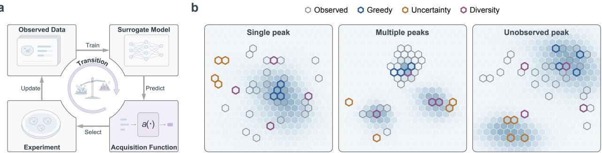  
Figure 1: a, Active learning fits a surrogate model, selects experiments with an acquisition function, and updates the model with new observations (gray arrows). TDAL learns a dynamic acquisition function from accumulated transitions (purple path). b, A surrogate model is fitted to observations. Fixed acquisition functions (Greedy, Uncertainty, and Diversity) use its predictions to select the next batch, yielding diferent selections across illustrative landscapes. Hexagon fills show responses. Gray and colored outlines mark observed candidates and next batch selections, respectively.

Indeed, diferent response landscapes favor diferent selection strategies (Figure 1b). In conventional active learning, experimental feedback updates the surrogate model and changes subsequent selections, while the acquisition rule itself typically remains predefined. The same feedback can also inform how experiments should be selected: each experiment yields immediate discoveries and updates predictions for the remaining candidates, influencing future discovery opportunities. This motivates learning an acquisition function that accounts for both current and future discoveries from experimental feedback. We therefore formulate screening as a sequential decision problem and use experimental transitions to learn a dynamic acquisition function online (Figure 1a). However, unlike reinforcement learning with repeated episodes, a screening campaign follows a single trajectory that cannot be reset, with each candidate queried at most once and only one real transition generated per round. Learning an acquisition function from such limited feedback presents a particular challenge.

Here we introduce Temporal Diference Active Learning (TDAL), which learns a dynamic acquisition function online from experimental feedback to maximize cumulative discoveries. Building on surrogate hit probabilities, TDAL uses temporal diference learning to incorporate observed discoveries and feedback-weighted successor value into experiment selection. It weights successor value according to changes in predicted hit probabilities for the remaining candidates, reflecting how experimental feedback updates their predicted outcomes. To alleviate the scarcity of real transitions, TDAL constructs additional training transitions from previously measured outcomes through leave-batch-out (LBO). Our main contributions are threefold.

• We formulate perturbation discovery as a sequential decision problem and learn a dynamic acquisition function from experimental feedback to adapt to diferent response landscapes.

• We introduce TDAL, which learns online from a single screening trajectory through temporal diference learning. It uses the Hellinger distance to weight successor value and LBO to construct additional training transitions, alleviating training data scarcity.

• We evaluate TDAL across eight screens spanning single, double, and triple perturbations. TDAL ranks first on four tasks and achieves an average rank of 1.63 among eleven methods.

## 2 Related Work

## 2.1 Active Learning and Acquisition Function Learning

Active learning alternates between sample selection and model updates to improve predictions with fewer labels. Methods include BALD, which uses information gain (Houlsby et al., 2011), CoreSet, which emphasizes geometric coverage (Sener and Savarese, 2018), and BADGE, which combines uncertainty and diversity (Ash et al., 2020). For discovery, active search (Garnett et al., 2012), ENS (Jiang et al., 2017), and its batch extension (Jiang et al., 2018) evaluate future hits within the budget. IDS (Xu et al., 2022) balances instantaneous regret and information gain to increase cumulative response. These methods adapt sampling to observations but retain predefined acquisition functions.

Other approaches learn acquisition functions from data. Learning Active Learning predicts expected error reduction (Konyushkova et al., 2017). MetaBO trains acquisition functions through reinforcement learning across tasks (Volpp et al., 2020). Amortized active search trains a neural network to imitate ENS selections (Nguyen et al., 2024). In molecular discovery, GLARE updates its selection policy online using measured activity labels (Chen et al., 2025), while Zhang et al. (2026) learn a policy to identify the optimal molecule. SOFisher uses Double DQN to select spatial-omics fields of view (Li et al., 2026b). Our work focuses on perturbation screens, where TDAL learns a dynamic acquisition function online from experimental feedback.

## 2.2 Active Learning for Perturbation Discovery

Active learning guides the discovery of perturbations with target phenotypes under a limited experimenta budget. GeneDisco provides a unified benchmark for gene perturbations (Mehrjou et al., 2022). OAE seeks near-optimal perturbations with high responses (Pacchiano et al., 2023), DiscoBAX balances response strength and mechanistic diversity (Lyle et al., 2023), and PoH selects candidates by their posterior probability of exceeding a predefined phenotypic threshold (Rubbi et al., 2026). RECOVER and NAIAD target drug and genetic combination discovery, respectively (Bertin et al., 2023; Qin et al., 2025), while BATCHIE uses information-driven batch design to improve predictions of drug combination responses (Tosh et al., 2025). These methods update surrogate models from observations while typically keeping acquisition functions fixed.

Biological priors and agents guide selection. IterPert improves predictions with multimodal priors (Huang et al., 2024), while BioBO combines gene representations and pathway information (Li et al., 2026a). Soper et al. (2025) and DeepAL (Zhu et al., 2026) combine knowledge graphs with Bayesian matrix factorization and representation learning, respectively, for double gene perturbation discovery. BioDiscoveryAgent and PerTurboAgent design perturbations using language models, experimental history, and tools (Roohani et al., 2025; Hao et al., 2025). AIDO.Builder updates models from feedback and reuses experience through memory (Guo et al., 2026). Gupta et al. (2025) found the tested agents insensitive to permuted feedback, whereas Wainrib et al. (2026) reported discovery gains from feedback beyond prior knowledge. We construct transitions from feedback to learn a dynamic acquisition function that adapts to diferent response landscapes (Appendix A.1).

## 3 Problem Formulation

We consider a fixed candidate pool and aim to maximize expected cumulative discoveries of perturbations that induce desired phenotypic responses within a fixed experimental budget. We formulate this task as a sequential decision problem and define an objective combining immediate discoveries with successor value weighted according to experimental feedback (notation in Appendix A.2).

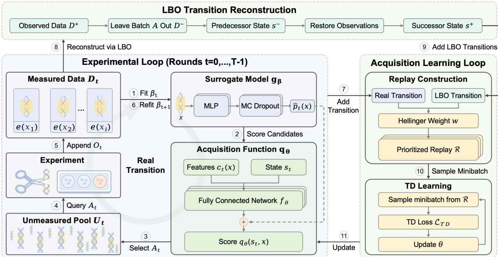  
Figure 2: TDAL framework. The surrogate is fitted to measurements, and the acquisition function sums hit probabilities and network outputs to select the next batch. TDAL incorporates new observations, refits the surrogate, and constructs real transitions. These enter replay alongside virtual LBO transitions reconstructed from measurements, training the acquisition function through TD learning with Hellinger distance weighting successor value according to prediction changes.

## 3.1 Sequential Perturbation Discovery

Let X be a finite pool of gene or gene combination perturbations. Testing a candidate $x \in \chi$ yields a scalar phenotype $e ( x )$ . We align efect directions across assays so that larger $e ( x )$ indicates closer agreement with the target phenotype. For a threshold $\tau$ fixed before screening, the hit indicator is $z ( x ) = \mathbf { 1 } \{ e ( x ) \geq \tau \}$ (Rubbi et al., 2026). Let $D _ { 0 }$ contain the $n _ { 0 }$ candidate–phenotype pairs $( x , e ( x ) )$ observed before sequential selection begins. The phenotypes of initially unmeasured candidates $x \in U _ { 0 }$ are revealed only when queried. The subsequent screening process consists of � rounds with batch size �, subject to the experimental budget.

In the experimental loop shown in Figure 2, let $A _ { t }$ denote the selected batch at round $t \in \{ 0 , \ldots , T - 1 \}$ and $O _ { t } \ = \ \{ ( x , e ( x ) ) \ : \ x \in \ A _ { t } \}$ its observed outcomes. Before selecting $A _ { t } .$ , the available history is $H _ { t } = ( D _ { 0 } , ( A _ { j } , O _ { j } ) _ { 0 \leq j < t } )$ . The measured dataset and unmeasured candidate pool are

$$
D _ { t } = D _ { 0 } \cup \bigcup _ { 0 \leq j < t } O _ { j } , \qquad U _ { t } = X \setminus \{ x : ( x , e ( x ) ) \in D _ { t } \} .\tag{1}
$$

A surrogate model trained on $D _ { t }$ estimates hit probabilities $\hat { p } _ { t } ( x )$ for $x \in U _ { t }$ . The acquisition function selects $A _ { t } \subseteq U _ { t }$ using the available history and surrogate predictions. Experimentally testing the selected batch yields $O _ { t }$ and a reward equal to the number of discoveries in round �: $\begin{array} { r } { R _ { t } = \sum _ { x \in A _ { t } } z ( x ) } \end{array}$ . Appending $\left( A _ { t } , O _ { t } \right)$ to the history gives $H _ { t + 1 }$ , with $D _ { t + 1 } = D _ { t } \cup O _ { t }$ and $U _ { t + 1 } = U _ { t } \ \backslash \ A _ { t }$ . Each round thus produces a transition $\left( H _ { t } , A _ { t } , R _ { t } , H _ { t + 1 } \right)$ . After � rounds, the final output consists of all verified hit candidates recorded in $D _ { T }$ whose cumulative discovery count is $\begin{array} { r } { C _ { T } = \sum _ { ( x , e ( x ) ) \in D _ { T } } z ( x ) } \end{array}$

## 3.2 Sequential Decision Objective

The screening goal is to maximize expected final discoveries $\mathbb { E } _ { \pi } [ C _ { T } \mid H _ { 0 } ]$ . Each experiment yields the current discovery count and updates the surrogate model’s predictions for unmeasured candidates, informing estimates of future discovery value and selection in the next round. We use the current discovery count as the immediate reward and adjust the successor value weight according to prediction changes before and after the experiment, defining a surrogate learning objective weighted by experimental feedback. Let $w _ { t } = w ( H _ { t } , A _ { t } , H _ { t + 1 } ) \in [ 0 , 1 ]$ denote the successor value weight determined by the observed transition. For a selection policy �, define

$$
J _ { w } ( \pi ) = \mathbb { E } _ { \pi } \left[ \sum _ { t = 0 } ^ { T - 1 } \left( \prod _ { j = 0 } ^ { t - 1 } w _ { j } \right) R _ { t } \Big | H _ { 0 } \right] .\tag{2}
$$

We seek a selection policy � that maximizes $J _ { w } ( \pi )$ . When $w _ { t } = 1$ for all �, this is equivalent to maximizing expected final discoveries $\mathbb { E } _ { \pi } [ C _ { T } \mid H _ { 0 } ]$

To maximize $J _ { w }$ , let $\textstyle Q _ { t } ^ { * , w } ( H _ { t } , A )$ denote the expected weighted cumulative discoveries from round � to $T - 1$ when batch � is selected given history $H _ { t }$ and subsequent selections follow the optimal policy. This value combines current discoveries with weighted successor value through the Bellman equation for a finite horizon:

$$
\begin{array} { r } { Q _ { t } ^ { * , w } ( H _ { t } , A ) = \mathbb { E } \big [ R _ { t } + w _ { t } \operatorname* { m a x } _ { A ^ { \prime } \subseteq U _ { t + 1 } } Q _ { t + 1 } ^ { * , w } ( H _ { t + 1 } , A ^ { \prime } ) \big | H _ { t } , A _ { t } = A \big ] . } \end{array}\tag{3}
$$

At each round, the optimal selection policy $\pi _ { w } ^ { * }$ selects the batch maximizing $Q _ { t } ^ { * , w }$ given the current history, thereby maximizing the weighted cumulative discovery objective $J _ { w }$ :

$$
\begin{array} { r } { \pi _ { w } ^ { * } ( H _ { t } ) \in \arg \operatorname* { m a x } _ { A \subseteq U _ { t } } \mathcal { Q } _ { t } ^ { * , w } ( H _ { t } , A ) , J _ { w } ( \pi _ { w } ^ { * } ) = \operatorname* { m a x } _ { \pi } J _ { w } ( \pi ) = \operatorname* { m a x } _ { A \subseteq U _ { 0 } } \mathcal { Q } _ { 0 } ^ { * , w } ( H _ { 0 } , A ) . } \end{array}\tag{4}
$$

## 4 Temporal Diference Active Learning

Within this sequential decision framework, TDAL uses experimental feedback to update a dynamic acquisition function online through TD learning, accounting for current and future discoveries while adapting selection to diferent response landscapes (Figure 2). See Algorithm 1 (Appendix A.3).

## 4.1 Dynamic Acquisition Function

The optimal value $\textstyle Q _ { t } ^ { * , w } ( H _ { t } , A )$ involves expectations over future experimental feedback and is dificult to compute directly. TDAL approximates this value using a dynamic acquisition function learned online from experimental feedback and built on surrogate predictions.

Surrogate model. In the active learning loop, the surrogate model approximates the posterior predictive distribution of unmeasured outcomes, providing a reference for estimating immediate discoveries. We use an $\mathrm { M L P } _ { \delta \beta }$ with MC dropout and fit parameters $\beta _ { t }$ to data $D _ { t }$ . For each unmeasured candidate, we estimate $\hat { p } _ { t } ( x )$ as the proportion of sampled predictions at or above threshold �.

Value decomposition. Given the measured data $\begin{array} { r } { D _ { t } , \widehat { R } _ { t } ( A ) = \sum _ { x \in A } \hat { p } _ { t } ( x ) } \end{array}$ estimates the number of discoveries in the unmeasured batch �. Thus, the optimal batch value can be written as

$$
\begin{array} { r } { Q _ { t } ^ { * , w } ( H _ { t } , A ) = \widehat { R } _ { t } ( A ) + \mathbb { E } \left[ R _ { t } - \widehat { R } _ { t } ( A ) + w _ { t } \operatorname* { m a x } _ { A ^ { \prime } } Q _ { t + 1 } ^ { * , w } ( H _ { t + 1 } , A ^ { \prime } ) \Big | H _ { t } , A _ { t } = A \right] . } \end{array}\tag{5}
$$

$$
F _ { t } ^ { * } ( H _ { t } , A )
$$

The term $F _ { t } ^ { * } ( H _ { t } , A )$ accounts for the expected error in this estimate and the weighted value of subsequent discoveries. This decomposition allows value learning to build on the surrogate’s estimate of immediate discoveries, which provides a reference grounded in measured data.

Acquisition function parameterization. We approximate $F _ { t } ^ { * } ( H _ { t } , A )$ using the summed outputs $F _ { \theta } ( s _ { t } , A )$ of a fully connected acquisition network $f _ { \theta }$ . The state $s _ { t }$ summarizes screening progress, measured outcomes, and surrogate prediction statistics for unmeasured candidates. The candidate features $c _ { t } ( x )$ combine a fixed biological representation with the surrogate model’s predictions. Adding each candidate’s network output to its estimated hit probability yields a dynamic acquisition function that scores candidates based on $s _ { t }$ and $c _ { t } ( x )$ (Appendices A.4–A.6)

$$
q _ { \theta } ( s _ { t } , x ) = \hat { p } _ { t } ( x ) + f _ { \theta } ( s _ { t } , c _ { t } ( x ) ) .\tag{6}
$$

We use an additive approximation $Q _ { \theta }$ to make batch maximization tractable. Selecting the � unmeasured candidates with the highest scores maximizes

$$
Q _ { \theta } ( s _ { t } , A ) = \sum _ { x \in A } q _ { \theta } ( s _ { t } , x ) \approx Q _ { t } ^ { * , w } ( H _ { t } , A ) .\tag{7}
$$

## 4.2 Temporal Diference Learning

We train the acquisition network $f _ { \theta }$ using real and LBO transitions (Appendix $\mathsf { A } . 7 \mathsf { ) }$ . Each transition provides an observed discovery count and a successor state, supplying a learning signal for the acquisition function to adapt its selection strategy to diferent response landscapes.

Real transitions. After querying batch $A _ { t }$ , we obtain observations $O _ { t }$ and discovery count $R _ { t }$ . We refit the surrogate on $D _ { t + 1 }$ and construct the successor selection state $s _ { t + 1 }$ . With successor value weight $w _ { t }$ , the round is stored as the training record $\xi _ { t } = ( s _ { t } , A _ { t } , R _ { t } , w _ { t } , s _ { t + 1 } )$

Virtual transitions through LBO. Screening follows a single trajectory, which cannot be reset to test alternative selection sequences within the same budget. Each round therefore provides only one real batch transition. LBO supplements these transitions by temporarily hiding measured outcomes and then restoring them to reconstruct experimental feedback. Let $D ^ { + }$ and $U ^ { + }$ denote the current measured dataset and unmeasured pool. For a batch $A$ of measured candidates, hiding its outcomes gives $D ^ { - } = D ^ { + } \setminus \left\{ \left( x , e ( x ) \right) : x \in A \right\}$ . We refit the surrogate model on $D ^ { - }$ to construct the predecessor state $s ^ { - }$ , and construct the successor state $s ^ { + }$ from $D ^ { + }$ with the outcomes restored. The discovery count $R$ is computed from the batch’s observed outcomes. We compute � by comparing hit probability estimates before and after restoration over $U ^ { + }$ . The resulting virtual transition is $\widetilde { \xi } = ( s ^ { - } , A , R , w , s ^ { + } )$ . Real and virtual transitions enter the same replay bufer ${ \mathcal { R } } .$ , providing more training data without additional experiments.

Feedback weights. For each candidate, hit and nonhit probabilities define a Bernoulli distribution. For both real and virtual transitions, we use Hellinger distance (Hellinger, 1909) to compare these distributions before and after feedback over the remaining pool. Unchanged predictions across $U _ { t + 1 }$ give $w _ { t } = 0$ , while larger Hellinger distances assign more weight to successor value:

$$
w _ { t } ^ { 2 } = \frac { \sum _ { x \in U _ { t + 1 } } H _ { \mathrm { B e r } } ^ { 2 } ( \hat { p } _ { t } ( x ) , \hat { p } _ { t + 1 } ( x ) ) } { | U _ { t + 1 } | } , \qquad H _ { \mathrm { B e r } } ^ { 2 } ( p , q ) = 1 - \sqrt { p q } - \sqrt { ( 1 - p ) ( 1 - q ) } .\tag{8}
$$

Updating the acquisition function through TD learning. For a replay transition $\xi = \left( s , A , R , w , s ^ { \prime } \right)$ , we follow Double DQN. The current acquisition function selects the successor batch $A _ { \theta } ^ { \prime } { }$ , and the target network evaluates its batch value $Q _ { \bar { \theta } } ( s ^ { \prime } , A _ { \theta } ^ { \prime } )$ (van Hasselt et al., 2016). Here, �<sup>¯</sup> denotes the target network parameters. The current discovery count and successor value weighted by � form the TD target �. Both real and LBO transitions use this target. During each update, the stored surrogate predictions remain fixed, and we optimize only �.

$$
Y = R + w Q _ { \bar { \theta } } ( s ^ { \prime } , A _ { \theta } ^ { \prime } ) , \qquad { \mathcal { L } } _ { \mathrm { T D } } ( \theta ) = \mathbb { E } _ { \xi \sim \mathcal { R } } \left[ { \mathrm { H u b e r } } ( Q _ { \theta } ( s , A ) - Y ) \right] .\tag{9}
$$

## 4.3 Theoretical Analysis

We analyze weighted Bellman optimality, predictive improvement, and the final discovery gap.

Proposition 1 (Weighted Bellman optimality). For a finite horizon, let $Q _ { t } ^ { * , w }$ satisfy the Bellman recursion in equation 3, and let $\pi _ { w } ^ { * }$ select a feasible batch maximizing $Q _ { t } ^ { * , w } ( H _ { t } , A )$ at every reachable history. Then $J _ { w } ( \pi _ { w } ^ { * } ) = \mathrm { m a x } _ { \pi } J _ { w } ( \pi )$ . Thus, optimal batch selection maximizes the weighted discovery objective (Appendix B.1).

Proposition 2 (Feedback and predictive improvement). Fix $H _ { t } , A _ { t }$ and $U = U _ { t + 1 }$ , with $\vert U \vert > 0$ . Let $p _ { x } = \mathrm { P r } ( \boldsymbol { z } ( \boldsymbol { x } ) = 1 \mid H _ { t } , A _ { t } )$ and $q _ { x } = \mathrm { P r } ( \boldsymbol { z } ( \boldsymbol { x } ) = 1 \mid H _ { t } , A _ { t } , O _ { t } )$ denote hit probabilities before and after feedback. Let $\Delta _ { \mathrm { p r e d } }$ denote the expected decrease in squared loss from $( p _ { x } - z ( x ) ) ^ { 2 } { \mathrm { t o } } ( q _ { x } - z ( x ) ) ^ { 2 }$ , averaged over $x \in U$ (Gneiting and Raftery, 2007). With $w _ { t }$ computed from these probabilities, the expected predictive improvement conditional on $H _ { t } , A _ { t }$ satisfies

$$
\mathbb { E } [ w _ { t } ^ { 4 } ] \le \Delta _ { \mathrm { p r e d } } = \frac { 1 } { | U | } \sum _ { x \in U } \mathbb { E } [ ( q _ { x } - p _ { x } ) ^ { 2 } ] \le 2 \mathbb { E } [ w _ { t } ^ { 2 } ] .\tag{10}
$$

This bounds predictive improvement using the Hellinger weight. For a query � revealing only $z ( a )$ , let $r = \operatorname* { P r } ( z ( a ) = 1 ) \in ( 0 , 1 ) , p _ { x } ^ { + } = \operatorname* { P r } ( z ( x ) = 1 \mid z ( a ) = 1 )$ , and $p _ { x } ^ { - } = \operatorname* { P r } ( z ( x ) = 1 \mid z ( a ) = 0 )$ , suppressing the same conditioning. The predictive improvement decomposes as

$$
\Delta _ { \mathrm { p r e d } } ( a ) = \frac { r ( 1 - r ) } { | U | } \sum _ { x \in U } ( p _ { x } ^ { + } - p _ { x } ^ { - } ) ^ { 2 } .\tag{11}
$$

Outcome uncertainty $r ( 1 - r )$ multiplies the mean squared diference between remaining predictions under the two outcomes. Queries without hits can therefore inform selection (Appendix B.2).

Proposition 3 (Final discovery gap). Under the same initial information and budget, let $\pi _ { C } ^ { * }$ maximize expected final discoveries and let $\pi _ { \theta }$ select a feasible batch maximizing $\mathcal { Q } _ { \theta } ( s _ { t } , A )$ at each round. For feedback weights $w _ { t } \in [ 0 , 1 ]$ , write $\begin{array} { r } { W _ { t } = \prod _ { j = 0 } ^ { t - 1 } w _ { j } } \end{array}$ , with $W _ { 0 } = 1$ . Define the value error over feasible batches as $\varepsilon _ { t } ^ { w } ( H _ { t } ) =$ max $_ A \left| Q _ { \theta } ( s _ { t } , A ) - Q _ { t } ^ { * , w } ( H _ { t } , A ) \right|$ | and the objective weighting bias as $\begin{array} { r } { \Delta _ { C } ( w ) = \mathbb { E } _ { \pi _ { C } ^ { * } } [ \sum _ { t = 0 } ^ { T - 1 } ( 1 - W _ { t } ) R _ { t } \ | \ H _ { 0 } ] } \end{array}$ The final discovery gap satisfies

$$
\mathbb { E } _ { \pi _ { C } ^ { * } } \left[ C _ { T } \mid H _ { 0 } \right] - \mathbb { E } _ { \pi _ { \theta } } \left[ C _ { T } \mid H _ { 0 } \right] \leq \Delta _ { C } ( w ) + 2 \mathbb { E } _ { \pi _ { \theta } } \left[ \sum _ { t = 0 } ^ { T - 1 } W _ { t } \varepsilon _ { t } ^ { w } ( H _ { t } ) \mid H _ { 0 } \right] .\tag{12}
$$

The first term measures discovery return attenuated by weighting. The second bounds selection losses from value estimation error. Small terms imply near-optimal expected final discoveries. For constant weights under a common value error bound, smaller weights lower the error bound but raise the bias bound. Larger weights lower the bias bound but raise the error bound (Appendix B.3).

## 5 Experiments and Results

We evaluate hit discovery performance across eight public genetic perturbation datasets under fixed experimental budgets. Then we examine how local landscape structure afects active discovery, assess individual components through ablations, and analyze candidate rankings over selection rounds.

## 5.1 Experimental Setup

Data and budgets. We evaluate TDAL on eight public datasets recording phenotypic responses to genetic perturbations, aiming to identify perturbations producing desired phenotypic changes (Appendix C.1). These comprise four single perturbation tasks (Schmidt et al., 2022; Zhuang et al., 2019; Carnevale et al., 2022), three double perturbation tasks (Fong et al., 2025; Simpson et al., 2023; Horlbeck et al., 2018), and one triple perturbation task (Kuzmin et al., 2020), with candidate pools ranging from 11,067 to 214,642. Initial sample sizes, batch sizes, and budgets vary across tasks (Table C2).

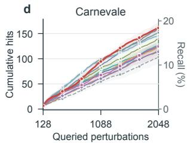

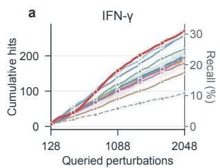

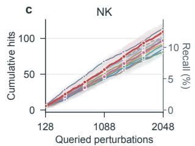

Experimental protocol. We conduct retrospective sequential evaluation using measured phenotypes from these genetic perturbation datasets. Candidate identities and fixed representations are available at the start. Each method initially receives the phenotypes of $n _ { 0 }$ candidates, and the remaining outcomes are revealed as candidates are selected in subsequent rounds. We fix the hit threshold � before screening to target the top 5% of candidates in the predefined efect direction (Mehrjou et al., 2022). Selection aims to maximize final cumulative hits $C _ { T }$ within the budget, and recall Recal $_ T = C _ { T } / \sum _ { x \in \mathcal { X } } z ( x )$ measures discovery coverage. Within each of five seeds (0–4), methods share the candidate pool, initial data, budget, and hit threshold (Appendix C.2).

Baselines. We compare diverse baselines with publicly available implementations (Appendix C.3). Perturbation discovery baselines include PoH (Rubbi et al., 2026), OAE (Pacchiano et al., 2023), and DiscoBAX (Lyle et al., 2023). General acquisition functions include UCB (Srinivas et al., 2010), Expected Improvement (Jones et al., 1998), and Thompson Sampling (Thompson, 1933). Active learning baselines include BADGE (Ash et al., 2020), CoreSet (Sener and Savarese, 2018), and TopUncertain and KMeans-Embedding from GeneDisco (Mehrjou et al., 2022). Random serves as a control. For computational scalability, we evaluate DiscoBAX on four single perturbation tasks.

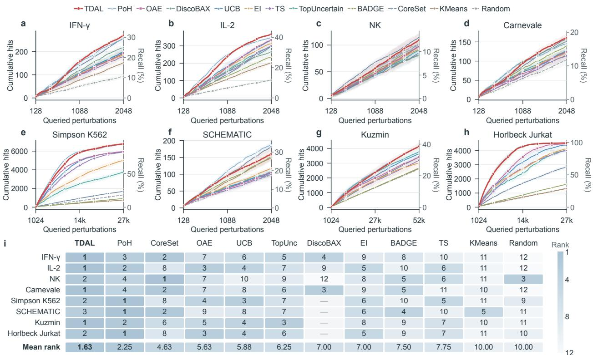

<table><tr><td></td><td rowspan=1 colspan=1>1</td><td rowspan=1 colspan=1>3</td><td rowspan=1 colspan=1>2</td><td rowspan=1 colspan=1>7</td><td rowspan=1 colspan=1>6</td><td rowspan=1 colspan=1>5</td><td rowspan=1 colspan=1>4</td><td rowspan=1 colspan=1>9</td><td rowspan=1 colspan=1>8</td><td rowspan=1 colspan=1>10</td><td rowspan=1 colspan=1>11</td><td rowspan=1 colspan=1>12</td></tr><tr><td rowspan=1 colspan=1>IL-2</td><td rowspan=1 colspan=1>1</td><td rowspan=1 colspan=1>2</td><td rowspan=1 colspan=1>8</td><td rowspan=1 colspan=1>3</td><td rowspan=1 colspan=1>4</td><td rowspan=1 colspan=1>7</td><td rowspan=1 colspan=1>9</td><td rowspan=1 colspan=1>5</td><td rowspan=1 colspan=1>10</td><td rowspan=1 colspan=1>6</td><td rowspan=1 colspan=1>11</td><td rowspan=1 colspan=1>12</td></tr><tr><td rowspan=1 colspan=1>NK</td><td rowspan=1 colspan=1>2</td><td rowspan=1 colspan=1>4</td><td rowspan=1 colspan=1>1</td><td rowspan=1 colspan=1>7</td><td rowspan=1 colspan=1>10</td><td rowspan=1 colspan=1>9</td><td rowspan=1 colspan=1>12</td><td rowspan=1 colspan=1>8</td><td rowspan=1 colspan=1>5</td><td rowspan=1 colspan=1>6</td><td rowspan=1 colspan=1>11</td><td rowspan=1 colspan=1>3</td></tr><tr><td rowspan=1 colspan=1>Carnevale</td><td rowspan=1 colspan=1>1</td><td rowspan=1 colspan=1>4</td><td rowspan=1 colspan=1>2</td><td rowspan=1 colspan=1>7</td><td rowspan=1 colspan=1>8</td><td rowspan=1 colspan=1>6</td><td rowspan=1 colspan=1>3</td><td rowspan=1 colspan=1>9</td><td rowspan=1 colspan=1>5</td><td rowspan=1 colspan=1>11</td><td rowspan=1 colspan=1>10</td><td rowspan=1 colspan=1>12</td></tr><tr><td rowspan=1 colspan=1>Simpson K562</td><td rowspan=1 colspan=1>2</td><td rowspan=1 colspan=1>1</td><td rowspan=1 colspan=1>8</td><td rowspan=1 colspan=1>4</td><td rowspan=1 colspan=1>3</td><td rowspan=1 colspan=1>7</td><td rowspan=1 colspan=1></td><td rowspan=1 colspan=1>6</td><td rowspan=1 colspan=1>10</td><td rowspan=1 colspan=1>5</td><td rowspan=1 colspan=1>11</td><td rowspan=1 colspan=1>9</td></tr><tr><td rowspan=1 colspan=1>SCHEMATIC</td><td rowspan=1 colspan=1>3</td><td rowspan=1 colspan=1>1</td><td rowspan=1 colspan=1>2</td><td rowspan=1 colspan=1>9</td><td rowspan=1 colspan=1>8</td><td rowspan=1 colspan=1>7</td><td rowspan=1 colspan=1></td><td rowspan=1 colspan=1>6</td><td rowspan=1 colspan=1>4</td><td rowspan=1 colspan=1>10</td><td rowspan=1 colspan=1>5</td><td rowspan=1 colspan=1>11</td></tr><tr><td rowspan=1 colspan=1>Kuzmin</td><td rowspan=1 colspan=1>1</td><td rowspan=1 colspan=1>2</td><td rowspan=1 colspan=1>6</td><td rowspan=1 colspan=1>5</td><td rowspan=1 colspan=1>4</td><td rowspan=1 colspan=1>3</td><td rowspan=1 colspan=1></td><td rowspan=1 colspan=1>8</td><td rowspan=1 colspan=1>9</td><td rowspan=1 colspan=1>7</td><td rowspan=1 colspan=1>10</td><td rowspan=1 colspan=1>11</td></tr><tr><td rowspan=1 colspan=1>Horlbeck Jurkat</td><td rowspan=1 colspan=1>2</td><td rowspan=1 colspan=1>1</td><td rowspan=1 colspan=1>8</td><td rowspan=1 colspan=1>3</td><td rowspan=1 colspan=1>4</td><td rowspan=1 colspan=1>6</td><td rowspan=1 colspan=1></td><td rowspan=1 colspan=1>5</td><td rowspan=1 colspan=1>9</td><td rowspan=1 colspan=1>7</td><td rowspan=1 colspan=1>11</td><td rowspan=1 colspan=1>10</td></tr><tr><td rowspan=1 colspan=1>Mean rank</td><td rowspan=1 colspan=1>1.63</td><td rowspan=1 colspan=1>2.25</td><td rowspan=1 colspan=1>4.63</td><td rowspan=1 colspan=1>5.63</td><td rowspan=1 colspan=1>5.88</td><td rowspan=1 colspan=1>6.25</td><td rowspan=1 colspan=1>7.00</td><td rowspan=1 colspan=1>7.00</td><td rowspan=1 colspan=1>7.50</td><td rowspan=1 colspan=1>7.75</td><td rowspan=1 colspan=1>10.00</td><td rowspan=1 colspan=1>10.00</td></tr></table>

Figure 3: Discovery performance across tasks. a–h, Mean cumulative hits and recall with pointwise 95% confidence intervals across five seeds. i, Ranks by mean final hits (darker is higher).

## 5.2 Budgeted Perturbation Discovery

Single perturbations. Across five seeds, TDAL achieves the highest mean final discovery counts on IFN-�, IL-2, and Carnevale (Figure 3a–d). Final cumulative hit counts are $2 7 0 . 6 \pm 6 . 1 , 3 6 7 . 4 \pm 3 . 0 , \mathrm { a n d } 1 6 1 . 2 \pm 8 . 6 .$

corresponding to recalls of 31.00%, 42.08%, and 18.40%, respectively. On NK, CoreSet, TDAL, and Random reach recalls of 13.01%, 12.49%, and 11.71%, respectively, with small gaps between active methods and Random. TDAL shows strong performance and adaptability across single gene perturbation landscapes.

Combinatorial perturbations. TDAL ranks first on Kuzmin and third on SCHEMATIC, with final recalls of 38.59% and 29.01%, respectively (Figure 3e–h). Although ranked second on Simpson K562 and Horlbeck Jurkat, TDAL approaches complete hit recovery with recalls of 94.40% and 99.45%, respectively, within 0.2 percentage points of the best method. These results show consistently strong performance across double and triple gene perturbation tasks.

Stability across tasks. Fixed acquisition functions favor diferent response landscapes (Mehrjou et al., 2022). Among eleven methods evaluated on all eight main tasks, TDAL achieves an average rank of 1.63, placing first on four tasks, second on three, and third on one (Figure 3i). TDAL’s top three performance on every task supports its adaptability across response landscapes (Appendix D).

a  
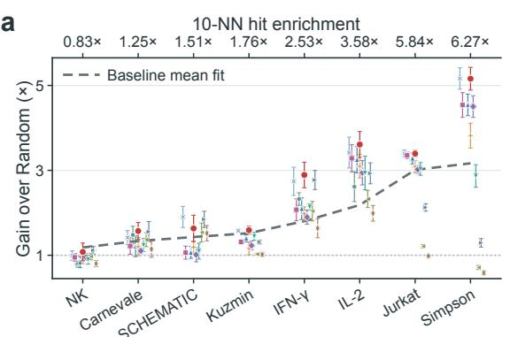

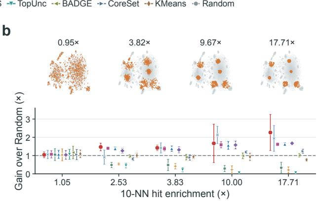  
Figure 4: Local hit structure and discovery gains. a, Real tasks. b, Noisy multicluster landscapes, with example hit locations. Axes show mean enrichment and discovery gains over Random. Points show mean gains with 95% confidence intervals across five repetitions.

## 5.3 Landscape Structure and Active Discovery

Real landscapes. Active learning gains over Random vary across datasets, with several methods underperforming Random on NK (Figure 3). We examine local hit structure in the fixed candidate representations. Within an analysis sample, enrichment is the mean hit rate among each hit candidate’s 10 nearest neighbors divided by the sample’s overall hit rate. Across eight tasks, enrichment ranges from 0.83× to 6.27×. The gray dashed fit to mean gains across nine shared baselines (Figure 4a) indicates that stronger local hit clustering is associated with greater active learning gains.

Controlled landscapes. To further examine this relationship, we construct simulated landscapes with controlled spatial structure. We keep the positions of 17,660 candidates and the set of phenotype values fixed, changing their assignment so that hits become progressively more clustered. With nearly random hit locations, methods perform close to Random. Across five enrichment levels, stronger clustering yields larger gains for TDAL and several baselines, although the benefit varies across acquisition functions (Figure 4b). These results indicate that local hit structure can provide useful information for active selection. Construction details and results are in Appendix E.

## 5.4 Component Ablations

Dynamic acquisition function. Surrogate only removes $f _ { \theta }$ and selects solely by $\hat { p } _ { t } ( x )$ , updating the surrogate model while keeping the acquisition function fixed (Appendix C.3). Its mean final discovery counts are lower than full TDAL on all four tasks, supporting learning the acquisition function alongside surrogate updates. w/o successor retains $f _ { \theta }$ but sets $w _ { t } = 0 ,$ , fitting the residual $R _ { t } - \widehat { R } _ { t } ( A _ { t } )$ between observed and surrogate estimated discoveries. Its mean final discovery count exceeds Surrogate only on all four tasks, showing that current feedback alone can train a dynamic acquisition function. Full TDAL adds further gains on every task, indicating that incorporating estimated future discovery value improves selection beyond learning from current feedback alone.

Training and scoring design. Fixing $w _ { t } = 1$ lowers mean final discovery counts below both full TDAL and w/o successor on all four tasks. Undiscounted successor value can therefore impair selection, supporting adjustment of its weight to experimental feedback. Removing LBO also lowers mean final discoveries on every task, supporting the use of additional reconstructed transitions to train $Q _ { \theta }$ when real experimental feedback is sparse. w/o anchor removes the explicit $\hat { p } _ { t } ( x )$ from the score while retaining surrogate predictions in the inputs. Its final mean decreases on the two 60-round single perturbation tasks but increases slightly on the two 200-round tasks. With more rounds of online training, the acquisition function maintains performance without the explicit probability baseline. Detailed ablation settings are provided in Appendix F.
<table><tr><td></td><td>Dataset Surrogate only w/o adaptive</td><td> $w _ { t }$ </td><td>w/o LBO</td><td>w/o successor w/o anchor</td><td></td><td>Full TDAL</td></tr><tr><td>IFN-γ</td><td> $1 8 6 . 4 \pm 2 7 . 7$ </td><td> $1 9 1 . 8 \pm 4 1 . 1$ </td><td> $2 2 2 . 2 \pm 7 9 . 8$ </td><td> $2 6 0 . 0 \pm 1 1 . 7$ </td><td> $\underline { { 2 6 2 . 2 \pm 1 5 . 3 } }$ </td><td> $\mathbf { 2 7 0 . 6 \pm 6 . 1 }$ </td></tr><tr><td>IL-2</td><td> $2 5 3 . 8 \pm 1 5 . 2$ </td><td> $3 1 9 . 6 \pm 1 6 . 8$ </td><td> $3 5 2 . 2 \pm 1 1 . 5$ </td><td> $\underline { { 3 6 1 . 4 \pm 3 . 4 } }$ </td><td> $3 4 2 . 8 \pm 4 3 . 2$ </td><td> ${ \bf 3 6 7 . 4 } \pm 3 . 0$ </td></tr><tr><td>Kuzmin</td><td> $3 2 7 7 . 8 \pm 3 5 . 5$ </td><td> $3 7 2 4 . 6 \pm 1 4 2 . 4$ </td><td> $4 0 9 6 . 4 \pm 2 0 8 . 1$ </td><td> $4 0 8 6 . 8 \pm 8 9 . 3$ </td><td> $\mathbf { 4 1 7 4 . 4 \pm 1 2 1 . 4 }$ </td><td> $\underline { { 4 1 4 1 . 0 \pm 1 9 4 . 0 } }$ </td></tr><tr><td>Jurkat</td><td> $4 5 1 8 . 2 \pm 1 3 . 3$ </td><td> $4 3 0 1 . 2 \pm 2 4 8 . 3$ </td><td> $4 5 1 0 . 4 \pm 3 9 . 3$ </td><td> $4 5 3 6 . 0 \pm 1 5 . 3$ </td><td> ${ \bf 4 5 5 0 . 2 \pm 3 . 8 }$ </td><td> $4 5 4 2 . 8 \pm 4 . 8$ </td></tr></table>

Table 1: Core ablations on four tasks. Final cumulative hits across five seeds (mean ± SD). Bold and underlined values mark the highest and second-highest means.

a  
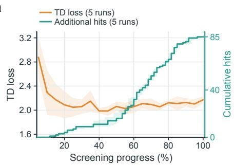

b  
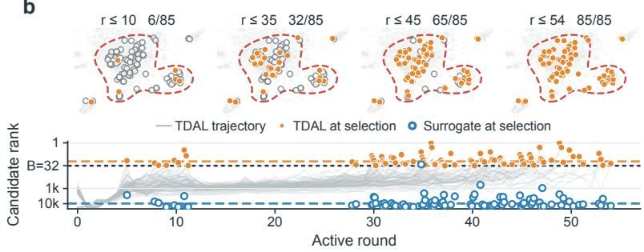  
Figure 5: Online learning and candidate reranking. a, Training loss and cumulative discoveries over screening rounds. b, Hit discovery in a t-SNE projection of representations (top) and ranking trajectories (bottom), with a comparison between TDAL and surrogate prediction ranks.

## 5.5 Online Feedback and Selection Paths

To examine how online learning changes candidate selection, we analyze 85 IL-2 hits discovered in all five TDAL runs but in none of the Surrogate only runs. Discoveries concentrate in the second half of screening, with the median cumulative count rising from 16 after 30 rounds to 85 at completion (Figure 5a). Candidate ranks under TDAL progressively improve before selection (Figure 5b). Across the 85 candidates, their mean ranks at selection are 16.6 under TDAL and 9,780 under concurrent surrogate predictions, showing how accumulated feedback helps prioritize hits ranked poorly by the surrogate alone (Appendix Figure F1).

## 6 Conclusion

We introduce TDAL to learn a dynamic acquisition function online from a single perturbation screening trajectory. Building on surrogate-estimated hit probabilities, TDAL uses temporal diference learning to incorporate observed discoveries and feedback-weighted successor value, while LBO reconstructs additional training transitions from measured outcomes. By learning how to select experiments from feedback accumulated within the ongoing screen, TDAL adapts candidate selection to both immediate discoveries and subsequent discovery opportunities under limited experimental feedback. Across eight public screens spanning single, double, and triple perturbations, TDAL achieves an average rank of 1.63 among eleven methods, demonstrating consistent discovery performance across diverse response landscapes.

Limitations. Our evaluation is retrospective, and the additive acquisition function does not explicitly model interactions among candidates within a batch. Feedback weighting also relies on surrogate-estimated hit probabilities, motivating further investigation of its robustness to prediction errors. Future work will explore batch-aware selection and alternative feedback weighting strategies, alongside prospective validation in closed-loop biological experiments.

## Reproducibility statement

The TDAL implementation, task configurations, and data preparation scripts are available at https://anonymous. 4open.science/r/TDAL/, with data sources and running instructions. Appendices A–C provide implementation details, theoretical assumptions and proofs, and experimental settings, respectively.

## AI use statement

The research ideas and methodological design originated from the authors. Generative AI tools were used to assist with code development, checking mathematical derivations and proofs, and improving manuscript clarity and grammar. The authors reviewed and verified all AI-assisted content and take full responsibility for the final work.

## References

Jordan T. Ash, Chicheng Zhang, Akshay Krishnamurthy, John Langford, and Alekh Agarwal. Deep batch active learning by diverse, uncertain gradient lower bounds. In International Conference on Learning Representations, 2020. URL https://openreview.net/forum?id=ryghZJBKPS.

Paul Bertin, Jarrid Rector-Brooks, Deepak Sharma, Thomas Gaudelet, Andrew Anighoro, Torsten Gross, Francisco Martínez-Peña, Eileen L Tang, M. S. Suraj, Cristian Regep, et al. RECOVER identifies synergistic drug combinations in vitro through sequential model optimization. Cell Reports Methods, 3(10):100599, 2023. doi: 10.1016/j.crmeth.2023.100599. URL https://doi.org/10.1016/j.crmeth.2023.100599.

Julia Carnevale, Eric Shifrut, Nupura Kale, William A Nyberg, Franziska Blaeschke, Yan Yi Chen, Zhongmei Li, Sagar P Bapat, Morgan E Diolaiti, Patrick O’Leary, et al. RASA2 ablation in T cells boosts antigen sensitivity and long-term function. Nature, 609(7925):174–182, 2022. doi: 10.1038/s41586-022-05126-w. URL https://doi.org/10.1038/s41586-022-05126-w.

Yicong Chen, Jiahua Rao, Jiancong Xie, Dahao Xu, Zhen Wang, and Yuedong Yang. Reinforced active learning for large-scale virtual screening with learnable policy model. In Advances in Neural Information Processing Systems, volume 38, pages 60831–60856, 2025. doi: 10.52202/085713-2034. URL https://proceedings. neurips.cc/paper\_files/paper/2025/file/57ac7ccded0eaaec4ad6f05612289b79-Paper-Conference.pdf.

Hyunghoon Cho, Bonnie Berger, and Jian Peng. Compact integration of multi-network topology for functional analysis of genes. Cell Systems, 3(6):540–548.e5, 2016. doi: 10.1016/j.cels.2016.10.017. URL https://doi.org/10.1016/j.cels.2016.10.017.

Benjamin DeMeo, Charlotte Nesbitt, Samuel A Miller, Daniel B Burkhardt, Inna Lipchina, Doris Fu, Peter Holderrieth, David Kim, Sergey Kolchenko, Artur Szalata, et al. Active learning framework leveraging transcriptomics identifies modulators of disease phenotypes. Science, 390(6776):eadi8577, 2025. doi: 10.1126/science.adi8577. URL https://doi.org/10.1126/science.adi8577.

Samson H Fong, Brent M Kuenzi, Nicole M Mattson, John Lee, Kyle Sanchez, Ana Bojorquez-Gomez, Kyle Ford, Brenton P Munson, Katherine Licon, Sarah Bergendahl, et al. A multilineage screen identifies actionable synthetic lethal interactions in human cancers. Nature Genetics, 57(1):154–164, 2025. doi: 10.1038/s41588-024-01971-9. URL https://doi.org/10.1038/s41588-024-01971-9.

Yarin Gal and Zoubin Ghahramani. Dropout as a Bayesian approximation: Representing model uncertainty in deep learning. In International Conference on Machine Learning, pages 1050–1059. PMLR, 2016. URL https://proceedings.mlr.press/v48/gal16.html.

Roman Garnett, Yamuna Krishnamurthy, Xuehan Xiong, Jef G. Schneider, and Richard P. Mann. Bayesian optimal active search and surveying. In ICML, 2012. URL http://icml.cc/2012/papers/618.pdf.

Tilmann Gneiting and Adrian E. Raftery. Strictly proper scoring rules, prediction, and estimation. Journal of the American Statistical Association, 102(477):359–378, 2007. doi: 10.1198/016214506000001437.

Han Guo, Youwei Liang, Xingyi Cheng, Caleb Ellington, Pengtao Xie, Le Song, and Eric Xing. Using AI to build AI: AIDO.Builder enables autonomous machine learning model building for biomedicine. bioRxiv, 2026. doi: 10.64898/2026.04.20.719735. URL https://www.biorxiv.org/content/10.64898/2026.04.20. 719735v2.

Rushil Gupta, Jason Hartford, and Bang Liu. LLMs for Bayesian optimization in scientific domains: Are we there yet? In Christos Christodoulopoulos, Tanmoy Chakraborty, Carolyn Rose, and Violet Peng, editors, Findings of the Association for Computational Linguistics: EMNLP 2025, pages 15482–15510, Suzhou, China, November 2025. Association for Computational Linguistics. doi: 10.18653/v1/2025.findings-emnlp. 838. URL https://aclanthology.org/2025.findings-emnlp.838/.

Minsheng Hao, Yongju Lee, Hanchen Wang, Gabriele Scalia, and Aviv Regev. PerTurboAgent: An LLM-based agent for designing iterative Perturb-Seq experiments. In MLCB, pages 44–64, 2025. URL https://proceedings.mlr.press/v311/hao25b.html.

E. Hellinger. Neue Begründung der Theorie quadratischer Formen von unendlichvielen Veränderlichen. Journal für die reine und angewandte Mathematik, 1909(136):210–271, 1909. doi: 10.1515/crll.1909.136.210. URL https://doi.org/10.1515/crll.1909.136.210.

Max A Horlbeck, Albert Xu, Min Wang, Neal K Bennett, Chong Y Park, Derek Bogdanof, Britt Adamson, Eric D Chow, Martin Kampmann, Tim R Peterson, et al. Mapping the genetic landscape of human cells. Cell, 174(4):953–967.e22, 2018. doi: 10.1016/j.cell.2018.06.010. URL https://doi.org/10.1016/j.cell.2018. 06.010.

Neil Houlsby, Ferenc Huszár, Zoubin Ghahramani, and Máté Lengyel. Bayesian active learning for classification and preference learning. arXiv preprint arXiv:1112.5745, 2011. URL https://arxiv.org/abs/1112.5745.

Kexin Huang, Romain Lopez, Jan-Christian Hütter, Takamasa Kudo, Antonio Rios, and Aviv Regev. Sequential optimal experimental design of perturbation screens guided by multi-modal priors. In International Conference on Research in Computational Molecular Biology, pages 17–37. Springer, 2024. doi: 10.1007/978-1-0716-3989-4\_2. URL https://doi.org/10.1007/978-1-0716-3989-4\_2.

Shali Jiang, Gustavo Malkomes, Geof Converse, Alyssa Shofner, Benjamin Moseley, and Roman Garnett. Eficient nonmyopic active search. In ICML, pages 1714–1723, 2017. URL http://proceedings.mlr.press/ v70/jiang17d.html.

Shali Jiang, Gustavo Malkomes, Matthew Abbott, Benjamin Moseley, and Roman Garnett. Eficient nonmyopic batch active search. In NeurIPS, pages 1107–1117, 2018. URL http://papers.nips.cc/paper/ 7387-eficient-nonmyopic-batch-active-search.

Donald R Jones, Matthias Schonlau, and William J Welch. Eficient global optimization of expensive black-box functions. Journal ofGlobal Optimization, 13(4):455–492, 1998. doi: 10.1023/A:1008306431147. URL https://doi.org/10.1023/A:1008306431147.

Ksenia Konyushkova, Raphael Sznitman, and Pascal Fua. Learning active learning from data. In Advances in Neural Information Processing Systems, volume 30, 2017. URL https://proceedings.neurips.cc/paper/2017/ hash/8ca8da41fe1ebc8d3ca31dc14f5fc56c-Abstract.html.

Elena Kuzmin, Benjamin VanderSluis, Alex N Nguyen Ba, Wen Wang, Elizabeth N Koch, Matej Usaj, Anton Khmelinskii, Mojca Mattiazzi Usaj, Jolanda Van Leeuwen, Oren Kraus, et al. Exploring whole-genome duplicate gene retention with complex genetic interaction analysis. Science, 368(6498):eaaz5667, 2020. doi: 10.1126/science.aaz5667. URL https://doi.org/10.1126/science.aaz5667.

Yanke Li, Tianyu Cui, Tommaso Mansi, Mangal Prakash, and Rui Liao. BioBO: Biology-informed Bayesian optimization for perturbation design. In The Fourteenth International Conference on Learning Representations, 2026a. URL https://openreview.net/forum?id=CF3kJrAwmV.

Zhuo Li, Weiran Wu, Chuangyi Han, Yan Cui, Tian Lu, Rongqin Ke, Jian Sun, and Zhiyuan Yuan. SOFisher: reinforcement learning-guided experiment designs for spatial omics. Nature Communications, 17:6830, 2026b. doi: 10.1038/s41467-026-73404-6. URL https://doi.org/10.1038/s41467-026-73404-6.

Clare Lyle, Arash Mehrjou, Pascal Notin, Andrew Jesson, Stefan Bauer, Yarin Gal, and Patrick Schwab. DiscoBAX: Discovery of optimal intervention sets in genomic experiment design. In ICML, pages 23170–23189, 2023. URL https://proceedings.mlr.press/v202/lyle23a.html.

Arash Mehrjou, Ashkan Soleymani, Andrew Jesson, Pascal Notin, Yarin Gal, Stefan Bauer, and Patrick Schwab. GeneDisco: A benchmark for experimental design in drug discovery. In International Conference on Learning Representations, 2022. URL https://openreview.net/forum?id=-w2oomO6qgc.

Robin M Meyers, Jordan G Bryan, James M McFarland, Barbara A Weir, Ann E Sizemore, Han Xu, Neekesh V Dharia, Phillip G Montgomery, Glenn S Cowley, Sasha Pantel, et al. Computational correction of copy number efect improves specificity of CRISPR–Cas9 essentiality screens in cancer cells. Nature Genetics, 49(12):1779–1784, 2017. doi: 10.1038/ng.3984. URL https://doi.org/10.1038/ng.3984.

Quan Nguyen, Anindya Sarkar, and Roman Garnett. Amortized nonmyopic active search via deep imitation learning. arXiv preprint arXiv:2405.15031, 2024. URL https://arxiv.org/abs/2405.15031.

Aldo Pacchiano, Drausin Wulsin, Robert A Barton, and Luis Voloch. Neural design for genetic perturbation experiments. In The Eleventh International Conference on Learning Representations, 2023. URL https://openreview.net/forum?id=TUBpc5rqGA.

Jason Qin, Hans-Hermann Wessels, Carlos Fernandez-Granda, and Yuhan Hao. Active learning for eficient discovery of optimal combinatorial perturbations. In Forty-second International Conference on Machine Learning, 2025. URL https://openreview.net/forum?id=fGbGF0kl5L.

Yusuf H Roohani, Andrew H. Lee, Qian Huang, Jian Vora, Zachary Steinhart, Kexin Huang, Alexander Marson, Percy Liang, and Jure Leskovec. BioDiscoveryAgent: An AI agent for designing genetic perturbation experiments. In The Thirteenth International Conference on Learning Representations, 2025. URL https://openreview.net/forum?id=HAwZGLcye3.

Andrea Rubbi, Arpit Merchant, Samuel Ogden, Amir Akbarnejad, Pietro Lio, Sattar Vakili, and Mohammad Lotfollahi. Many needles in a haystack: Active hit discovery for perturbation experiments. In Forty-third International Conference on Machine Learning, 2026. URL https://openreview.net/forum?id=iZN85pjpsS.

Carlos G Sanchez, Christopher M Acker, Audrey Gray, Malini Varadarajan, Cheng Song, Nadire R Cochran, Steven Paula, Alicia Lindeman, Shaojian An, Gregory McAllister, et al. Genome-wide CRISPR screen identifies protein pathways modulating tau protein levels in neurons. Communications Biology, 4(1):736, 2021. doi: 10.1038/s42003-021-02272-1. URL https://doi.org/10.1038/s42003-021-02272-1.

Igal Sason and Sergio Verdú. � -divergence inequalities. IEEE Transactions on Information Theory, 62(11): 5973–6006, 2016. doi: 10.1109/TIT.2016.2603151.

Ralf Schmidt, Zachary Steinhart, Madeline Layeghi, Jacob W Freimer, Raymund Bueno, Vinh Q Nguyen, Franziska Blaeschke, Chun Jimmie Ye, and Alexander Marson. CRISPR activation and interference screens decode stimulation responses in primary human T cells. Science, 375(6580):eabj4008, 2022. doi: 10.1126/science.abj4008. URL https://doi.org/10.1126/science.abj4008.

Ozan Sener and Silvio Savarese. Active learning for convolutional neural networks: A core-set approach. In International Conference on Learning Representations, 2018. URL https://openreview.net/forum?id= H1aIuk-RW.

Danny Simpson, Jia Ling, Yangwode Jing, and Britt Adamson. Mapping the genetic interaction network of PARP inhibitor response. bioRxiv, 2023. doi: 10.1101/2023.08.19.553986. URL https://doi.org/10.1101/ 2023.08.19.553986.

Braden Soper, Michal Lisicki, Mary Silva, Jose Cadena, Haonan Zhu, Shivshankar Sundaram, Priyadip Ray, and Jef Drocco. Knowledge graph-aided Bayesian active learning for top-K genetic interaction discovery. Scientific Reports, 15(1):31196, 2025. doi: 10.1038/s41598-025-13972-7. URL https: //doi.org/10.1038/s41598-025-13972-7.

Niranjan Srinivas, Andreas Krause, Sham M. Kakade, and Matthias W. Seeger. Gaussian process optimization in the bandit setting: No regret and experimental design. In Johannes Fürnkranz and Thorsten Joachims, editors, Proceedings ofthe 27th International Conference on Machine Learning (ICML-10), June 21-24, 2010, Haifa, Israel, pages 1015–1022. Omnipress, 2010. URL https://icml.cc/Conferences/2010/papers/ 422.pdf.

William R. Thompson. On the likelihood that one unknown probability exceeds another in view of the evidence of two samples. Biometrika, 25(3/4):285–294, 1933. doi: 10.1093/biomet/25.3-4.285. URL https://doi.org/10.1093/biomet/25.3-4.285.

Christopher Tosh, Mauricio Tec, Jessica B White, Jefrey F Quinn, Glorymar Ibanez Sanchez, Paul Calder, Andrew L Kung, Filemon S Dela Cruz, and Wesley Tansey. A Bayesian active learning platform for scalable combination drug screens. Nature Communications, 16(1):156, 2025. doi: 10.1038/s41467-024-55287-7. URL https://doi.org/10.1038/s41467-024-55287-7.

Hado van Hasselt, Arthur Guez, and David Silver. Deep reinforcement learning with double Q-learning. In Proceedings ofthe AAAI Conference on Artificial Intelligence, volume 30, 2016. doi: 10.1609/aaai.v30i1. 10295. URL https://doi.org/10.1609/aaai.v30i1.10295.

Michael Volpp, Lukas P. Fröhlich, Kirsten Fischer, Andreas Doerr, Stefan Falkner, Frank Hutter, and Christian Daniel. Meta-learning acquisition functions for transfer learning in Bayesian optimization. In International Conference on Learning Representations, 2020. URL https://openreview.net/forum?id=ryeYpJSKwr.

Gilles Wainrib, Barbara Bodinier, Haithem Dakhli, Josep Monserrat, Almudena Espin-Perez, Roberta Codato, and John Klein. Can AI scientist agents learn from lab-in-the-loop feedback? evidence from iterative perturbation discovery. In The 2026 Workshop on Generative and Agentic AIfor Biology, 2026. URL https://openreview.net/forum?id=sZijNyjuCF.

Yue Xu, Haotian Cui, Kuan Pang, Gen Li, Fanglin Gong, Songtao Dong, Bo Wang, and Bowen Li. LUMI-lab: a foundation model-driven autonomous platform enabling discovery of ionizable lipid designs for mRNA delivery. Cell, 189(6):1620–1635.e25, 2026. doi: 10.1016/j.cell.2026.01.012. URL https://doi.org/10.1016/j.cell.2026.01.012.

Ziping Xu, Eunjae Shim, Ambuj Tewari, and Paul Zimmerman. Adaptive sampling for discovery. In Advances in Neural Information Processing Systems, volume 35, pages 1114–1126, 2022. doi: 10.52202/068431-0082. URL https://proceedings.neurips.cc/paper\_files/paper/2022/hash/ 07bc8125400bf4b140c332010756bd9b-Abstract-Conference.html.

Hanwen Zhang, Wencheng Liu, Wenhao Zheng, Ting Kang, Shilong Hu, Zhuang Miao, Jin Liu, Bowen Ke, Xianggen Liu, and Jiancheng Lv. Policy-based active learning for eficient molecular identification. Journal ofChemical Information and Modeling, 66(10):5851–5868, 2026. doi: 10.1021/acs.jcim.6c00474. URL https://doi.org/10.1021/acs.jcim.6c00474.

Haonan Zhu, Mary Silva, Jose Cadena, Braden Soper, Michał Lisicki, Braian Peetoom, Sergio E Baranzini, Shivshankar Sundaram, Priyadip Ray, and Jef Drocco. Deep active learning-based experimental design to uncover synergistic genetic interactions for host-targeted therapeutics. Bioinformatics Advances, 6(1): vbaf228, 2026. doi: 10.1093/bioadv/vbaf228. URL https://academic.oup.com/bioinformaticsadvances/ article/6/1/vbaf228/8262951.

Xiaoxuan Zhuang, Daniel P Veltri, and Eric O Long. Genome-wide CRISPR screen reveals cancer cell resistance to NK cells induced by NK-derived IFN-�. Frontiers in Immunology, 10:2879, 2019. doi: 10.3389/fimmu.2019.02879. URL https://doi.org/10.3389/fimmu.2019.02879.

## Appendix

## A Algorithm and Implementation Details

## A.1 Comparison with Related Methods

Table A1 compares representative methods for perturbation screening, molecular virtual screening, and spatial omics sampling across five mechanisms including surrogate updates, biological knowledge, online acquisition updates, value bootstrapping, and experience augmentation.

Table A1: Comparison of active screening and experimental design methods. ✓/× indicate whether a method uses each mechanism.
<table><tr><td>Method</td><td>Research task</td><td>Surrogate updates</td><td>Biological knowledge</td><td>Online acquisition updates</td><td>Value bootstrapping</td><td>Experience augmentation</td></tr><tr><td>GeneDisco surrogate baselines</td><td>Perturbation screening</td><td>√</td><td>X</td><td>X</td><td>X</td><td>X</td></tr><tr><td>OAE</td><td>Perturbation screening</td><td>√</td><td>X</td><td>X</td><td>X</td><td>X</td></tr><tr><td>DiscoBAX</td><td>Perturbation screening</td><td>√</td><td>X</td><td>X</td><td>X</td><td>X</td></tr><tr><td>PoH</td><td>Perturbation screening</td><td>√</td><td>X</td><td>X</td><td>X</td><td>X</td></tr><tr><td>BioBO</td><td>Perturbation screening</td><td>√</td><td>√</td><td>X</td><td>X</td><td>X</td></tr><tr><td>BioDiscoveryAgent</td><td>Perturbation screening</td><td>X</td><td>√</td><td>X</td><td>X</td><td>X</td></tr><tr><td>PerTurboAgent</td><td>Perturbation screening</td><td>√</td><td>√</td><td>X</td><td>X</td><td>X</td></tr><tr><td>GLARE</td><td>Molecular virtual screening</td><td>√</td><td>X</td><td>√</td><td>X</td><td>X</td></tr><tr><td>SOFisher</td><td>Spatial omics sampling</td><td>X</td><td>X</td><td>X</td><td>√</td><td>X</td></tr><tr><td>TDAL</td><td>Perturbation screening</td><td>√</td><td>X</td><td>√</td><td>√</td><td>√</td></tr></table>

Surrogate updates use newly measured outcomes to fit a model that predicts unmeasured phenotypes or activities. Biological knowledge guides selection through pathway information, literature, or knowledge encoded in language models. BioBO and PerTurboAgent combine such knowledge with response modeling, whereas BioDiscoveryAgent incorporates experimental observations into its language model context without fitting a response surrogate. SOFisher uses observed spatial features as inputs to its sampling policy rather than fitting a phenotype prediction model.

Online acquisition updates use feedback from the current task to update the acquisition function’s parameters. Value bootstrapping constructs training targets from current rewards and estimated successor values. GLARE updates its selection policy during screening but does not explicitly bootstrap a successor value. SOFisher trains its sampling policy through value bootstrapping before application and uses fixed policy parameters on new tissue sections, while incorporating newly sampled observations into the state. TDAL performs both acquisition updates and successor value bootstrapping within the current screening task.

Experience augmentation reconstructs additional transitions from measured outcomes to train the acquisition function. In budgeted experimental design without replacement, the measured dataset grows while the unmeasured pool and remaining budget shrink. A screen therefore provides a single executed trajectory and cannot return to an earlier state to test alternative experimental sequences within the same budget. LBO reconstructs predecessor states in which a measured batch has not yet been observed, then restores that batch’s real outcomes to form additional transitions to a known successor state. The same experimental outcomes can thus support batch value learning under diferent information states, expanding online training experience without additional experiments.

## A.2 Notation

Table A2 summarizes the main notation used in the problem formulation and TDAL.

Table A2: Key notation for the screening objective and TDAL.
<table><tr><td>Symbol</td><td>Meaning</td></tr><tr><td> $\chi$ </td><td>Fixed pool of candidate perturbations.</td></tr><tr><td> $e ( x )$ </td><td>Phenotype of candidate x after aligning the effect direction.</td></tr><tr><td> $\tau$ </td><td>Threshold defining the desired phenotypic response.</td></tr><tr><td> $z ( x )$ </td><td>Indicator that candidate x meets the hit threshold.</td></tr><tr><td> $D _ { t }$ </td><td>Measured data available before selection in round t.</td></tr><tr><td> $U _ { t }$ </td><td>Unmeasured candidates available in round t.</td></tr><tr><td> $H _ { t }$ </td><td>History of observations and selections before round t.</td></tr><tr><td> $A _ { t }$ </td><td>Batch selected for experimentation in round t.</td></tr><tr><td> $B$ </td><td>Number of candidates queried per round.</td></tr><tr><td> $T$ </td><td>Number of active screening rounds.</td></tr><tr><td> $R _ { t }$ </td><td>Observed number of discoveries in batch  $A _ { t } .$ </td></tr><tr><td> $C _ { T }$ </td><td>Final verified discovery count, including initial discoveries.</td></tr><tr><td> $\pi$ </td><td>Policy that selects each batch from the available history.</td></tr><tr><td> $J _ { w } ( \pi )$ </td><td>Expected cumulative discoveries weighted by experimental feedback.</td></tr><tr><td> $\textstyle Q _ { t } ^ { * , w } ( H _ { t } , A )$ </td><td>Optimal weighted value of selecting batch A given history  $H _ { t }$ </td></tr><tr><td> $w _ { t }$ </td><td>Successor value weight determined by prediction changes.</td></tr><tr><td> $g _ { \beta }$ </td><td>Surrogate model predicting perturbation phenotypes.</td></tr><tr><td> $\hat { p } _ { t } ( x )$ </td><td>Estimated hit probability of an unmeasured candidate.</td></tr><tr><td> $\widehat { R } _ { t } ( A )$ </td><td>Estimated immediate discovery count from surrogate hit probabilities</td></tr><tr><td> $\phi ( x )$ </td><td>Fixed biological representation of candidate  $x .$ </td></tr><tr><td> $s _ { t }$ </td><td>Global summary of screening progress, observations, and predictions.</td></tr><tr><td> $c _ { t } ( x )$ </td><td>Candidate features combining biological representation and predictions.</td></tr><tr><td> $f _ { \theta }$ </td><td>Acquisition network mapping the state and candidate features to an output.</td></tr><tr><td> $q _ { \theta } \bigl ( s _ { t } , \boldsymbol { x } \bigr )$ </td><td>Dynamic acquisition function scoring candidate x.</td></tr><tr><td> $\mathcal { Q } _ { \theta } ( s _ { t } , A )$ </td><td>Batch value estimate obtained by summing candidate scores.</td></tr><tr><td> $\xi _ { t }$ </td><td>Transition generated by an experimental round.</td></tr><tr><td> $\widetilde { \xi }$ </td><td>Virtual transition reconstructed by LBO from measured outcomes.</td></tr><tr><td> $Y _ { i }$ </td><td>TD target for transition i.</td></tr></table>

## A.3 Complete TDAL Algorithm

Algorithm 1 summarizes TDAL from initialization through the end of screening. Starting from the initial observations $D _ { 0 }$ , TDAL fits a surrogate model, estimates hit probabilities for candidates in the initial unmeasured pool $U _ { 0 } ,$ , and forms the initial selection state. It then constructs initial LBO transitions from $D _ { 0 }$ to initialize the acquisition network through TD training before the first query.

At each round, the acquisition function scores candidates in $U _ { t }$ , and TDAL queries the � candidates with the highest scores. The observed outcomes are added to $D _ { t }$ , and the queried candidates are removed from $U _ { t }$ TDAL refits the surrogate model on the updated data. Before the next round, it updates predictions over $U _ { t + 1 }$ to construct the successor state. Comparing hit probabilities before and after the experiment over this pool gives the Hellinger weight. The selected batch, observed discovery count, feedback weight, and current and successor states form a real transition. Real and online LBO transitions enter the replay bufer, from which TD updates train the acquisition network for subsequent selection. After � rounds, TDAL returns all verified hit candidates.

## A.4 Candidate Representations

The mapping $\phi ( x )$ encodes candidate perturbation � as a vector of fixed dimension, providing gene functional information to the surrogate and acquisition network.

Human tasks use genome-wide $\mathrm { C R I S P R - C a s 9 }$ knockout screening data from the Broad Institute’s Project Achilles. The CERES gene dependency profiles in DepMap 20Q4 provide 808-dimensional gene representations. Each dimension corresponds to a cancer cell line and describes the efect of knocking out the gene on cell growth. CERES corrects for copy number efects (Meyers et al., 2017). The Kuzmin yeast task uses the 500-dimensional STRING network embeddings released with Mashup (Cho et al., 2016). These base gene representations remain fixed during screening. For a single gene perturbation, $\phi ( x )$ is the corresponding gene embedding.

For a candidate � containing $m \in \{ 2 , 3 \}$ genes with embeddings $\mathbf { v } _ { 1 } , \ldots , \mathbf { v } _ { m }$ , we define

$$
\phi ( x ) = \left[ \frac 1 m \sum _ { i = 1 } ^ { m } \mathbf v _ { i } , \frac 2 { m ( m - 1 ) } \sum _ { i < j } | \mathbf v _ { i } - \mathbf v _ { j } | , \frac 2 { m ( m - 1 ) } \sum _ { i < j } \mathbf v _ { i } \odot \mathbf v _ { j } \right] .\tag{13}
$$

The brackets concatenate the mean embedding, mean elementwise absolute diference, and mean elementwise product, with ⊙ denoting elementwise multiplication. Averaging over all members and unordered pairs makes this construction invariant to gene order.

## A.5 Surrogate Model and Hit Probability Estimation

Model and training. The surrogate takes a fixed vector representation (embedding) $\phi ( x )$ of candidate perturbation � as input and predicts the phenotype �(�) after aligning the efect direction. Its two hidden layers have widths 128 and 64. Each applies a linear transformation followed by ReLU and dropout. A final linear layer produces a scalar output. The model is

$$
\begin{array} { r l } & { \mathbf { h } _ { \mathrm { s u r } } ^ { ( 1 ) } ( x ) = \mathrm { D r o p o u t } _ { 0 . 2 } \big ( \mathrm { R e L U } ( W _ { 1 } ^ { \mathrm { s u r } } \phi ( x ) + b _ { 1 } ^ { \mathrm { s u r } } ) \big ) \in \mathbb { R } ^ { 1 2 8 } , } \\ & { \mathbf { h } _ { \mathrm { s u r } } ^ { ( 2 ) } ( x ) = \mathrm { D r o p o u t } _ { 0 . 2 } \Big ( \mathrm { R e L U } ( W _ { 2 } ^ { \mathrm { s u r } } \mathbf { h } _ { \mathrm { s u r } } ^ { ( 1 ) } ( x ) + b _ { 2 } ^ { \mathrm { s u r } } ) \Big ) \in \mathbb { R } ^ { 6 4 } , } \\ & { g _ { \beta } ( \phi ( x ) ) = W _ { \mathrm { o u t } } ^ { \mathrm { s u r } } \mathbf { h } _ { \mathrm { s u r } } ^ { ( 2 ) } ( x ) + b _ { \mathrm { o u t } } ^ { \mathrm { s u r } } \in \mathbb { R } . } \end{array}\tag{14}
$$

Here, $\mathrm { D r o p o u t } _ { 0 . 2 }$ denotes dropout with probability 0.2, and $\beta$ contains all weights and biases of the hidden and output layers. Predictive uncertainty is estimated through MC dropout (Gal and Ghahramani, 2016).

```latex
Algorithm 1 TDAL
Input Candidate pool X with representations $\phi ( x )$ , initial data $D _ { 0 } .$ , rounds $T ,$ batch size �, threshold $\tau ,$ and
LBO transition limits.
1: Initialize $U _ { 0 } \gets \chi \setminus \{ x : ( x , e ( x ) ) \in D _ { 0 } \}$
2: Initialize acquisition network $f _ { \theta }$ with a zero output layer.
3: Initialize target network $f _ { \bar { \theta } }$ with $\bar { \theta }  \theta .$
4: Initialize replay bufer ${ \mathcal { R } } \gets \emptyset .$
5: Fit surrogate $g _ { \beta _ { 0 } }$ to $D _ { 0 }$ with validation early stopping.
6: Estimate $\widehat { \mu } _ { 0 } ( x ) , \widehat { \sigma } _ { 0 } ( x )$ , and ${ \hat { p } } _ { 0 } ( x )$ using 50 MC dropout samples for $x \in U _ { 0 }$
7: Construct $s _ { 0 }$ and candidate features $\{ c _ { 0 } ( x ) : x \in U _ { 0 } \}$
8: if $| D _ { 0 } | > B$ then
9: Add initial LBO transitions to $\mathcal { R }$ using Algorithm $2 .$
10: for 20 initial TD updates do
11: Update $f _ { \theta }$ using the TD loss on a replay minibatch.
12: Soft update the target parameters ${ \bar { \theta } } .$
13: Refresh the sampled transitions' replay priorities.
14: end for
15: end if
16: for $t = 0 , \ldots , T - 1$ do
17: Compute $q _ { \theta } ( s _ { t } , x ) = \hat { p } _ { t } ( x ) + f _ { \theta } ( s _ { t } , c _ { t } ( x ) )$ for $x \in U _ { t }$
18: Select the � highest scoring candidates as $A _ { t }$
19: Experimentally query $A _ { t }$ to obtain $O _ { t } = \{ ( x , e ( x ) ) : x \in A _ { t } \}$
20: Compute the discovery count $\begin{array} { r } { R _ { t } = \sum _ { x \in A _ { t } } z ( x ) } \end{array}$
21: Update measured data $D _ { t + 1 }  D _ { t } \cup O _ { t } .$
22: Update the unmeasured pool $U _ { t + 1 } \gets U _ { t } \setminus A _ { t } .$
23: Refit $g _ { \beta _ { t + 1 } }$ to $D _ { t + 1 }$ with validation early stopping.
24: if $t < T - 1$ then
25: Estimate $\widehat { \mu } _ { t + 1 } ( x ) , \widehat { \sigma } _ { t + 1 } ( x )$ , and $\hat { p } _ { t + 1 } ( x )$ by MC dropout for $x \in U _ { t + 1 }$
26: Construct $s _ { t + 1 }$ and candidate features $\{ c _ { t + 1 } ( x ) : x \in U _ { t + 1 } \}$
27: Compute Hellinger weight $w _ { t }$ from $\hat { p } _ { t } ( x )$ and $\hat { p } _ { t + 1 } ( x )$ over $U _ { t + 1 }$
28: else
29: Set the terminal successor state $s _ { T } .$
30: Set $w _ { t } \gets 0 .$
31: end if
32: Add $\xi _ { t } = \left( s _ { t } , A _ { t } , R _ { t } , w _ { t } , s _ { t + 1 } \right)$ and its prediction inputs to ${ \mathcal { R } } .$
33: Add online LBO transitions using Algorithm 2.
34: for 20 online TD updates do
35: Update $f _ { \theta }$ using the TD loss on a replay minibatch.
36: Soft update the target parameters ${ \bar { \theta } } .$
37: Refresh the sampled transitions' replay priorities.
38: end for
39: end for
40: return verified hit set $\{ x : ( x , e ( x ) ) \in D _ { T } , z ( x ) = 1 \}$
```

At each round, the measured data $D _ { t }$ are split into a training set $D _ { t } ^ { \mathrm { t r } }$ and a validation set $D _ { t } ^ { \mathrm { v a l } }$ for early stopping, and the model parameters are reinitialized. The surrogate fits measured phenotypes by minimizing the mean squared error

$$
\mathcal { L } _ { \operatorname { s u r } } ( \beta ) = \frac { 1 } { | D _ { t } ^ { \operatorname { t r } } | } \sum _ { ( x , e ( x ) ) \in D _ { t } ^ { \operatorname { t r } } } \bigl ( g _ { \beta } ( \phi ( x ) ) - e ( x ) \bigr ) ^ { 2 } .\tag{15}
$$

Dropout is active during training and disabled when evaluating validation mean squared error after each epoch. Let $\beta _ { t } ^ { ( j ) }$ denote the parameters after epoch $j ,$ and let $J _ { t }$ be the number of epochs completed in the current round. We select the final model by minimizing validation error,

$$
\begin{array} { r l } & { \boldsymbol { j } _ { t } ^ { * } = \displaystyle \arg \operatorname* { m i n } _ { 1 \leq j \leq J _ { t } } \frac { 1 } { | D _ { t } ^ { \mathrm { v a l } } | } \sum _ { ( \boldsymbol { x } , \boldsymbol { e } ( \boldsymbol { x } ) ) \in D _ { t } ^ { \mathrm { v a l } } } \big ( g _ { \beta _ { t } ^ { ( j ) } } ( \phi ( \boldsymbol { x } ) ) - e ( \boldsymbol { x } ) \big ) ^ { 2 } , } \\ & { \beta _ { t } = \beta _ { t } ^ { ( j _ { t } ^ { * } ) } . } \end{array}\tag{16}
$$

Predictive statistics. Dropout remains active at inference. For each unmeasured candidate $x \in U _ { t }$ , we independently sample � forward passes. Denote the �th stochastic forward pass by $g _ { \beta _ { t } } ^ { ( k ) }$ , giving the phenotype prediction $\widehat { e } _ { t } ^ { ( k ) } ( x ) = g _ { \beta _ { t } } ^ { ( k ) } ( \phi ( x ) )$ . The predictive mean, uncertainty, and hit probability are estimated by the sample mean, standard deviation, and fraction reaching the hit threshold, respectively,

$$
\begin{array} { r l } & { \widehat { \mu } _ { t } ( x ) = \displaystyle \frac { 1 } { K } \sum _ { k = 1 } ^ { K } \widehat { e } _ { t } ^ { ( k ) } ( x ) , } \\ & { \widehat { \sigma } _ { t } ( x ) = \left[ \displaystyle \frac { 1 } { K } \sum _ { k = 1 } ^ { K } ( \widehat { e } _ { t } ^ { ( k ) } ( x ) - \widehat { \mu } _ { t } ( x ) ) ^ { 2 } \right] ^ { 1 / 2 } , } \\ & { \widehat { p } _ { t } ( x ) = \displaystyle \frac { 1 } { K } \sum _ { k = 1 } ^ { K } \mathbf { 1 } \{ \widehat { e } _ { t } ^ { ( k ) } ( x ) \geq \tau \} . } \end{array}\tag{17}
$$

These statistics define candidate features and the selection state. The hit probability also provides the acquisition function’s base score and is used to compute the Hellinger weight.

## A.6 State Representation and Acquisition Function Parameterization

Dynamic candidate features. For each unmeasured candidate $x \in U _ { t }$ , the acquisition network receives the shared selection state $s _ { t }$ and candidate features $c _ { t } ( x )$ . These features combine the fixed biological representation $\phi ( x )$ with the surrogate model’s predicted mean, uncertainty, and hit probability. We center the mean at the hit threshold and scale both the mean and uncertainty, giving

$$
c _ { t } ( x ) = \left[ \phi ( x ) , \frac { \widehat { \mu } _ { t } ( x ) - \tau } { a _ { t } } , \log \left( 1 + \frac { \widehat { \sigma } _ { t } ( x ) } { a _ { t } } \right) , \widehat { p } _ { t } ( x ) \right] .\tag{18}
$$

Here, $\widehat { \mu } _ { t } ( x )$ and $\widehat { \sigma } _ { t } ( x )$ are the predictive mean and standard deviation defined in Appendix A.5. The hit probability $\hat { p } _ { t } ( x )$ is included without rescaling.

The normalization denominator $a _ { t }$ is computed from the phenotypes already measured in $D _ { t }$ . It is the larger of their interquartile range (75th minus 25th percentile) and population standard deviation, with a minimum of $1 0 ^ { - 6 }$ to prevent division by zero. The same denominator is used for all candidates scored at that round. Their predicted means and uncertainties remain specific to each candidate. We recompute $a _ { t }$ when the measured data change.

Selection state. The selection state $s _ { t }$ is a vector summary of the current screening history $H _ { t }$ that provides global information for the dynamic acquisition function. Shared by all candidates, it combines screening progress, measured outcomes, and surrogate prediction statistics over the unmeasured pool $U _ { t }$ . Its 15 components follow the network input order

$$
\begin{array} { r l } & { s _ { t } = \Big [ \displaystyle \frac { | D _ { t } | } { M } , \displaystyle \frac { M - | D _ { t } | } { M } , \displaystyle \frac { \lceil \operatorname* { m i n } \{ M - | D _ { t } | , | U _ { t } | \} / B \rceil } { \lceil M / B \rceil } , \displaystyle \frac { | U _ { t } | } { | X | } , \displaystyle \frac { \operatorname* { m i n } \{ B , M - | D _ { t } | , | U _ { t } | \} } { B } , } \\ & { \qquad \tau , \operatorname* { m a x } _ { ( x , e ( x ) ) \in D _ { t } } e ( x ) , \ a _ { t } , \mathrm { ~ M e a n } _ { U _ { t } } ( \hat { p } _ { t } ) , \mathrm { ~ S D } _ { U _ { t } } ( \hat { p } _ { t } ) , \mathrm { ~ P _ { 9 0 , U _ t } ( \hat { p } _ { t } ) , } } \\ & { \qquad \mathrm { M e a n } _ { U _ { t } } \Big ( \displaystyle \frac { \hat { \mu } _ { t } - \tau } { a _ { t } } \Big ) , \mathrm { ~ S D } _ { U _ { t } } \Big ( \displaystyle \frac { \hat { \mu } _ { t } - \tau } { a _ { t } } \Big ) , } \\ & { \qquad \mathrm { M e a n } _ { U _ { t } } \Big ( \displaystyle \frac { \widetilde { \sigma } _ { t } } { a _ { t } } \Big ) , \mathrm { ~ P _ { 9 0 , U _ t } \Big ( \displaystyle \frac { \widetilde { \sigma } _ { t } } { a _ { t } } \Big ) ~ } \Big ] \in \mathbb { R } ^ { 1 5 } . } \end{array}\tag{19}
$$

Here, Mean $\mathbf { } _ { U _ { t } } , \mathbf { S D } _ { U _ { t } }$ , and $\mathrm { P } _ { 9 0 , U _ { t } }$ denote the mean, population standard deviation, and 90th percentile over candidates $x \in U _ { t }$ . The first five components describe the measured budget fraction, remaining budget fraction, normalized remaining rounds, remaining pool fraction, and query batch size relative to �. These ratios are clipped to [0, 1]. The batch size ratio is one for the full batches used here.

The hit threshold �, largest measured phenotype $\mathrm { m a x } _ { ( x , e ( x ) ) \in D _ { t } } e ( x )$ , and normalization denominator $a _ { t }$ retain the phenotype scale after aligning the efect direction. Statistics of the hit probability $\hat { p } _ { t } ( x )$ , normalized predicted efect $( \widehat { \mu } _ { t } ( x ) - \tau ) / a _ { t }$ , and scaled uncertainty $\widehat { \sigma } _ { t } ( x ) / a _ { t }$ summarize predictions over $x \in U _ { t }$ . The uncertainty statistics use the scaled standard deviation.

Acquisition network. The acquisition network $f _ { \theta }$ is the trainable component of $q _ { \theta } = \hat { p } _ { t } + f _ { \theta }$ . For each unmeasured candidate $x \in U _ { t }$ , its encoding and network layers are

$$
\begin{array} { l } { { \displaystyle { u _ { \theta } } ( x ) = \mathrm { R e L U } \Bigg ( W _ { \mathrm { e n c } } \frac { \phi ( x ) } { \operatorname* { m a x } \{ \| \phi ( x ) \| _ { 2 } , 1 0 ^ { - 8 } \} } + b _ { \mathrm { e n c } } \Bigg ) \in \mathbb { R } ^ { 6 4 } , } } \\ { { \displaystyle { \bf \cal h } _ { t } ^ { ( 0 ) } ( x ) = \left[ s _ { t } , u _ { \theta } ( x ) , \frac { \hat { \mu } _ { t } ( x ) - \tau } { a _ { t } } , \log \left( 1 + \frac { \hat { \sigma } _ { t } ( x ) } { a _ { t } } \right) , \hat { p } _ { t } ( x ) \right] \in \mathbb { R } ^ { 8 2 } } , } \\ { { \displaystyle { \bf h } _ { t } ^ { ( k ) } ( x ) = \mathrm { R e L U } \Big ( W _ { k } ^ { \mathrm { a c q } } { \bf h } _ { t } ^ { ( k - 1 ) } ( x ) + b _ { k } ^ { \mathrm { a c q } } \Big ) \in \mathbb { R } ^ { 1 2 8 } } , \quad k = 1 , 2 , } \\ { { \displaystyle f _ { \theta } ( s _ { t } , c _ { t } ( x ) ) = W _ { \mathrm { o u t } } ^ { \mathrm { a c q } } { \bf h } _ { t } ^ { ( 2 ) } ( x ) + b _ { \mathrm { o u t } } ^ { \mathrm { a c q } } \in \mathbb { R } } . } \end{array}\tag{20}
$$

Here, $u _ { \theta } ( x )$ encodes the normalized fixed representation. The input ${ \bf h } _ { t } ^ { ( 0 ) } ( x )$ concatenates the 15 state features, 64 encoding features, and three surrogate prediction features from $c _ { t } ( x )$

The parameters � include the weights and biases of the projection, two hidden layers, and output layer. The static embeddings remain fixed, while the projection is learned with the acquisition network. The output layer’s weights and bias are initialized to zero, so that $f _ { \theta } = 0$ and $q _ { \theta } = { \hat { p } } _ { t }$ <sub>�</sub> before initial TD training.

## A.7 TD Learning and Experience Replay

LBO transition construction. Initial LBO hides batches from $D _ { 0 }$ to train the acquisition network before the first query. Online LBO draws hidden batches from candidates measured after initialization, so a batch can combine observations from diferent rounds. Algorithm 2 gives the construction for both stages.

The current measured dataset $D ^ { + }$ and unmeasured pool $U ^ { + }$ define the successor state $s ^ { + }$ . Each hidden batch produces a diferent predecessor state, but restoring its outcomes returns to this same successor state. For a nonterminal successor, let $\hat { p } ^ { + } ( x )$ denote the MC dropout hit probability estimated by the surrogate trained on

$D ^ { + }$ , for $x \in U ^ { + }$ . For initial LBO, the successor dataset is $D ^ { + } = D _ { 0 }$ , giving $\hat { p } ^ { + } ( x ) = \hat { p } _ { 0 } ( x )$ . For online LBO after round �, it is $D ^ { + } = D _ { t + 1 }$ , giving $\hat { p } ^ { + } ( x ) = \hat { p } _ { t + 1 } ( x )$

For each hidden batch �, removing its outcomes from $D ^ { + }$ gives the predecessor dataset $D ^ { - }$ , and returning its candidates to the unmeasured pool gives $U ^ { - }$ . We fit the predecessor surrogate $g _ { \beta ^ { - } }$ to $D ^ { - }$ with validation early stopping. Its MC dropout predictions give predecessor hit probabilities $\hat { p } ^ { - } ( x )$ for $x \in U ^ { - }$ . These predictions also define $s ^ { - }$ <sup>−</sup> and the candidate features, with the phenotype scale and screening progress recomputed from $D ^ { - }$ . The Hellinger weight compares $\hat { p } ^ { - } ( x )$ and $\hat { p } ^ { + } ( x )$ over the shared remaining pool $U ^ { + } \subseteq U ^ { - }$ . The observed discoveries in � give the transition reward �. The predecessor state, hidden batch, reward, weight, and successor state then form the LBO transition.

The set $s$ prevents repeated hidden batches for a given successor and excludes the current real batch during online LBO. The list C contains the accepted hidden batches. Initial and online transition limits � and the generation schedule are specified in Table C3.

Successor selection and TD target. For a replay transition $\xi _ { i } = ( s _ { i } , A _ { i } , R _ { i } , w _ { i } , s _ { i } ^ { \prime } )$ , the TD target combines its observed reward with an estimate of weighted future discoveries. To estimate this successor value, the current acquisition function scores every candidate in the recorded successor pool $U _ { i } ^ { \prime }$ using

$$
q _ { \theta } ( s _ { i } ^ { \prime } , x ) = \hat { p } _ { i } ^ { \prime } ( x ) + f _ { \theta } ( s _ { i } ^ { \prime } , c _ { i } ^ { \prime } ( x ) ) , \qquad x \in U _ { i } ^ { \prime } .\tag{21}
$$

The state $s _ { i } ^ { \prime } ,$ candidate features $c _ { i } ^ { \prime } ( x )$ , and hit probabilities $\hat { p } _ { i } ^ { \prime } ( x )$ are saved when the transition is constructed. Replay keeps these inputs fixed and applies the current network to them. As � changes, the network can select a diferent successor batch from the same recorded pool.

Following Double DQN, we select the � candidates with the highest current scores to form $A _ { \theta , i } ^ { \prime }$ and evaluate them with the target network (van Hasselt et al., 2016). This gives

$$
\begin{array} { c } { { Q _ { \bar { \theta } } ( s _ { i } ^ { \prime } , A _ { \theta , i } ^ { \prime } ) = \displaystyle \sum _ { x \in A _ { \theta , i } ^ { \prime } } \left[ \hat { p } _ { i } ^ { \prime } ( x ) + f _ { \bar { \theta } } ( s _ { i } ^ { \prime } , c _ { i } ^ { \prime } ( x ) ) \right] , } } \\ { { Y _ { i } = R _ { i } + w _ { i } Q _ { \bar { \theta } } ( s _ { i } ^ { \prime } , A _ { \theta , i } ^ { \prime } ) . } } \end{array}\tag{22}
$$

This successor selection is used to calculate the training target and does not trigger additional experiments. For terminal transitions, $Y _ { i } = R _ { i }$ . Real and LBO transitions use the same target, which is held constant when computing gradients.

Experience replay and parameter updates. Real and LBO transitions enter a shared prioritized replay bufer. Let � be the number of stored transitions and $\rho _ { i }$ the priority of transition �. Each update samples a training batch $\mathcal { B }$ without replacement using normalized sampling weights

$$
P ( i ) = \frac { ( \rho _ { i } + \epsilon _ { \mathrm { P E R } } ) ^ { \alpha _ { \mathrm { P E R } } } } { \sum _ { j = 1 } ^ { n } ( \rho _ { j } + \epsilon _ { \mathrm { P E R } } ) ^ { \alpha _ { \mathrm { P E R } } } } .\tag{23}
$$

The exponent $\alpha _ { \mathrm { P E R } }$ controls the preference for high priority transitions. Frequently sampled transitions receive smaller importance weights in the loss, reducing the imbalance introduced by prioritized sampling. We use

$$
\widetilde { \kappa } _ { i } = ( n P ( i ) ) ^ { - \beta _ { \mathrm { I S } } } , \qquad \kappa _ { i } ^ { \mathrm { I S } } = \frac { \widetilde { \kappa } _ { i } } { \operatorname* { m a x } _ { j \in \mathcal { B } } \widetilde { \kappa } _ { j } } .\tag{24}
$$

Here, $\beta _ { \mathrm { I S } }$ controls the strength of the weighting, and normalization sets the largest weight within B to one. With TD error $\delta _ { i } = Q _ { \theta } ( s _ { i } , A _ { i } ) - Y _ { i }$ , the training loss is

$$
\widehat { \mathcal { L } } _ { \mathrm { T D } } ( \boldsymbol { \theta } ) = \frac { 1 } { | \mathcal { B } | } \sum _ { i \in \mathcal { B } } \kappa _ { i } ^ { \mathrm { I S } } \mathrm { H u b e r } _ { 1 } ( \delta _ { i } ) .\tag{25}
$$

Algorithm 2 LBO transition construction   
Input Measured data $D ^ { + }$ , unmeasured pool $U ^ { + }$ , initial data $D _ { 0 } .$ successor state $s ^ { + }$ , successor estimates   
$\{ \hat { p } ^ { + } ( x ) : x \in U ^ { + } \}$ when nonterminal, stage, batch size �, threshold �, transition limit �, replay bufer ${ \mathcal { R } } .$   
and current real batch $A _ { t }$ for online LBO.   
Output Replay bufer $\mathcal { R }$ augmented with up to � LBO transitions.   
1: if initial LBO then   
2: Set eligible candidates $E  \{ x : ( x , e ( x ) ) \in D _ { 0 } \}$   
3: Initialize used batches $s \gets \emptyset .$   
4: else   
5: Set $E  \{ x : ( x , e ( x ) ) \in D ^ { + } \backslash D _ { 0 } \}$   
6: Initialize $S \gets \{ A _ { t } \}$   
7: end if   
8: Initialize the hidden batch list $C \gets [ ]$   
9: Generate seeded random permutations of $E .$   
10: for each generated permutation do   
11: Partition it into complete batches of size $B .$   
12: for each batch $A$ in this partition do   
13: if $A \notin S$ then   
14: Append � to $C .$   
15: Add � to S.   
16: end if   
17: end for   
18: end for   
19: Retain at most the first � batches in C.   
20: for each hidden batch $A \in C$ do   
21: Hide its outcomes $D ^ { - }  D ^ { + } \setminus \{ ( x , e ( x ) ) : x \in A \}$   
22: Restore its candidates to the pool $U ^ { - }  U ^ { + } \cup A .$   
23: Fit predecessor surrogate $g _ { \beta ^ { - } } \ t _ { 0 } \ D ^ { - }$ with validation early stopping.   
24: Draw � = 50 MC dropout predictions from $g _ { \beta ^ { - } }$ for $x \in U ^ { - }$   
25: Estimate $\hat { p } ^ { - } ( x ) \gets K ^ { - 1 } \sum _ { k = 1 } ^ { K } \mathbf { 1 } \{ g _ { \beta ^ { - } } ^ { ( k ) } ( \phi ( x ) ) \geq \tau \}$ for $x \in U ^ { - }$   
26: Construct $s ^ { - }$ and $\{ c ^ { - } ( x ) : x \in U ^ { - } \}$ from $D ^ { - }$ and its predictive statistics.   
27: Compute $\textstyle R \gets \sum _ { x \in A } z ( x )$ from the hidden outcomes.   
28: if $s ^ { + }$ is terminal then   
29: Set $w  0 .$   
30: else   
31: Compute � from Hellinger distances between $\hat { p } ^ { - } ( x )$ and $\hat { p } ^ { + } ( x )$ for $x \in U ^ { + }$   
32: end if   
33: Add $\widetilde { \xi } = ( s ^ { - } , A , R , w , s ^ { + } )$ and its prediction inputs to ${ \mathcal { R } } .$   
34: end for   
35: return ${ \mathcal { R } } .$

The Huber loss is quadratic for absolute errors up to 1 and linear above 1. Gradients update only $\theta ,$ with surrogate predictions held fixed. After each update, the sampled transitions receive priorities $\rho _ { i } \gets | \delta _ { i } | + \epsilon _ { \mathrm { P E R } } .$ and the target parameters follow

$$
\bar { \theta }  ( 1 - \tau _ { \mathrm { t a r g e t } } ) \bar { \theta } + \tau _ { \mathrm { t a r g e t } } \theta .\tag{26}
$$

The optimizer and training settings are specified in Table C3.

## B Theoretical Analysis

We prove Propositions 1–3, establishing weighted Bellman optimality, relating the Hellinger weight to predictive improvement, and bounding the gap in final discoveries.

## B.1 Weighted Bellman Optimality

We fix the surrogate training and prediction procedures and condition on their randomness. Given the history $H _ { t }$ and query batch $A _ { t } ,$ the observed outcomes determine the discovery count $R _ { t }$ and feedback weight $w _ { t } = w ( H _ { t } , A _ { t } , H _ { t + 1 } ) \in [ 0 , 1 ]$ . Both quantities are therefore determined by the successor history $H _ { t + 1 }$ . At history �, the feasible batch set is

$$
{ \mathcal { A } } _ { t } ( H ) = \{ A \subseteq U _ { t } ( H ) : | A | = B \} .\tag{27}
$$

For any selection policy $\pi ,$ define the weighted discovery count from round � to the end of screening as

$$
G _ { t } ^ { w } = \sum _ { k = t } ^ { T - 1 } \left( \prod _ { j = t } ^ { k - 1 } w _ { j } \right) R _ { k } , \qquad G _ { T } ^ { w } = 0 .\tag{28}
$$

The current count $R _ { t }$ has weight one, while each subsequent count is weighted by the product of the intervening feedback weights. The corresponding policy value is

$$
V _ { t } ^ { w , \pi } ( H ) = \mathbb { E } _ { \pi } [ G _ { t } ^ { w } \mid H _ { t } = H ] ,\tag{29}
$$

the expected weighted number of remaining discoveries when selection follows � from the current screening history �. The terminal value is zero because no experiments remain.

Separating the current round from subsequent rounds gives

$$
G _ { t } ^ { w } = R _ { t } + w _ { t } G _ { t + 1 } ^ { w } .\tag{30}
$$

Given $H _ { t + 1 }$ , both $R _ { t }$ and $w _ { t }$ are known, and the conditional expectation of the remaining return is $V _ { t + 1 } ^ { w , \pi } ( H _ { t + 1 } )$ Averaging over the current batch and its observations, we obtain the following by the law of iterated expectations:

$$
V _ { t } ^ { w , \pi } ( H ) = \sum _ { A \in \mathcal { R } _ { t } ( H ) } \pi _ { t } ( A \mid H ) \mathbb { E } \big [ R _ { t } + w _ { t } V _ { t + 1 } ^ { w , \pi } ( H _ { t + 1 } ) \mid H _ { t } = H , A _ { t } = A \big ] .\tag{31}
$$

Here, $\pi _ { t } ( A \mid H )$ is the probability of selecting batch � given history �. This expression averages the expected current discoveries and weighted successor value over the policy’s batch choices.

Starting from the terminal condition $V _ { T } ^ { * , w } = 0 ;$ , define recursively

$$
\begin{array} { r l } & { \boldsymbol { Q } _ { t } ^ { * , w } ( H , \boldsymbol { A } ) = \mathbb { E } \big [ R _ { t } + w _ { t } \boldsymbol { V } _ { t + 1 } ^ { * , w } ( H _ { t + 1 } ) \mid H _ { t } = H , \boldsymbol { A } _ { t } = \boldsymbol { A } \big ] , } \\ & { \quad \boldsymbol { V } _ { t } ^ { * , w } ( H ) = \operatorname* { m a x } _ { \boldsymbol { A } \in \mathcal { A } _ { t } ( H ) } \boldsymbol { Q } _ { t } ^ { * , w } ( H , \boldsymbol { A } ) . } \end{array}\tag{32}
$$

This recursion starts at the last round, where only current discoveries contribute. Earlier rounds also include the weighted successor value already determined at the next round. Here, $Q _ { t } ^ { * , w } ( H , A )$ is the conditional expected value of selecting batch $A ,$ , and $V _ { t } ^ { * , w } ( H )$ takes the maximum over feasible batches. The finite horizon and finite batch sets uniquely determine these values. Since $0 \leq R _ { t } \leq B$ and $0 \leq w _ { t } \leq 1$ ，

$$
0 \leq Q _ { t } ^ { * , w } ( H , A ) \leq V _ { t } ^ { * , w } ( H ) \leq ( T - t ) B .\tag{33}
$$

To establish optimality, we first show that every policy has value at most $V _ { t } ^ { * , w }$ . At the terminal round $t = T$ every policy satisfies

$$
V _ { T } ^ { w , \pi } ( H ) = V _ { T } ^ { \ast , w } ( H ) = 0 .\tag{34}
$$

Suppose that, at round $t + 1$ , every policy and reachable history satisfy

$$
V _ { t + 1 } ^ { w , \pi } ( H _ { t + 1 } ) \leq V _ { t + 1 } ^ { \ast , w } ( H _ { t + 1 } ) .\tag{35}
$$

At round �, retain the policy’s current batch selection probabilities and replace its successor value by this upper bound. Since $w _ { t } \geq 0$ , this replacement cannot decrease the conditional expected value. Equations 31 and 32 therefore give

$$
\begin{array} { r l } & { V _ { t } ^ { w , \pi } ( H ) \leq \displaystyle \sum _ { A \in \mathcal { R } _ { t } ( H ) } \pi _ { t } ( A \mid H ) \mathbb { E } \big [ R _ { t } + w _ { t } V _ { t + 1 } ^ { * , w } ( H _ { t + 1 } ) \mid H _ { t } = H , A _ { t } = A \big ] } \\ & { \qquad = \displaystyle \sum _ { A \in \mathcal { R } _ { t } ( H ) } \pi _ { t } ( A \mid H ) Q _ { t } ^ { * , w } ( H , A ) } \\ & { \qquad \leq V _ { t } ^ { * , w } ( H ) . } \end{array}\tag{36}
$$

The last inequality holds because any probability-weighted average of batch values cannot exceed their maximum. Thus, the value bound at the next round implies the bound at the current round. Backward induction from the terminal round establishes $V _ { t } ^ { w , \pi } ( H ) \leq V _ { t } ^ { * , w } ( H )$ for every round, policy, and reachable history.

We next show that this upper bound is attained. Let $\pi _ { w } ^ { * }$ select a feasible batch maximizing $Q _ { t } ^ { * , w }$ at every round and reachable history. At the terminal round,

$$
V _ { T } ^ { w , \pi _ { w } ^ { * } } ( H ) = V _ { T } ^ { * , w } ( H ) = 0 .\tag{37}
$$

Suppose this policy attains $V _ { t + 1 } ^ { * , w }$ at every reachable history at round $t + 1$ . After selecting $\pi _ { w } ^ { * } ( H )$ at round �, its continuation therefore attains the optimal successor value in the definition of $Q _ { t } ^ { * , w }$

$$
\begin{array} { r l } & { V _ { t } ^ { w , \pi _ { w } ^ { * } } ( H ) = { \cal Q } _ { t } ^ { * , w } \big ( H , \pi _ { w } ^ { * } ( H ) \big ) } \\ & { \qquad = \operatorname* { m a x } _ { A \in { \mathcal { A } _ { t } } ( H ) } { \cal Q } _ { t } ^ { * , w } ( H , A ) } \\ & { \qquad = V _ { t } ^ { * , w } ( H ) . } \end{array}\tag{38}
$$

The first equality follows from the induction hypothesis, the second from the policy’s maximizing batch choice, and the third from the definition of $V _ { t } ^ { * , w }$ . Backward induction therefore establishes that this policy attains the bound at every round and reachable history.

Finally, since $J _ { w } ( \pi ) = V _ { 0 } ^ { w , \pi } ( H _ { 0 } )$ , every policy’s objective is bounded above by $V _ { 0 } ^ { * , w } ( H _ { 0 } )$ , and $\pi _ { w } ^ { * }$ attains this value. Therefore,

$$
\begin{array} { r l } & { J _ { w } ( \pi _ { w } ^ { * } ) = V _ { 0 } ^ { w , \pi _ { w } ^ { * } } ( H _ { 0 } ) = V _ { 0 } ^ { * , w } ( H _ { 0 } ) } \\ & { \phantom { J _ { w } ( \pi _ { w } ^ { * } ) = } = \operatorname* { m a x } _ { A \in \mathcal { A } _ { 0 } ( H _ { 0 } ) } Q _ { 0 } ^ { * , w } ( H _ { 0 } , A ) = \operatorname* { m a x } _ { \pi } J _ { w } ( \pi ) . } \end{array}\tag{39}
$$

Thus, maximizing the optimal batch value at each round maximizes the weighted cumulative discovery objective. This proves Proposition 1.

## B.2 Feedback and Predictive Improvement

Fix the current history $H _ { t }$ and query batch $A _ { t }$ , with remaining pool $U = U _ { t + 1 }$ and $\vert U \vert > 0$ . Under a common joint probability model, define the conditional hit probabilities before and after feedback as

$$
\begin{array} { r l } & { p _ { x } = \operatorname* { P r } ( z ( x ) = 1 \mid H _ { t } , A _ { t } ) , } \\ & { q _ { x } = \operatorname* { P r } ( z ( x ) = 1 \mid H _ { t } , A _ { t } , O _ { t } ) . } \end{array}\tag{40}
$$

We analyze the Hellinger weight computed from these probabilities. Before the batch outcomes are observed, averaging the updated probability $q _ { x }$ over their possible values recovers the current probability $p _ { x } , { \mathrm { g i v i n g } }$

$$
\mathbb { E } [ q _ { x } \mid H _ { t } , A _ { t } ] = p _ { x } .\tag{41}
$$

This analysis uses conditional hit probabilities before and after experimental feedback. TDAL approximates these probabilities using MC dropout predictions.

The expected reduction in mean squared prediction error is

$$
\Delta _ { \mathrm { p r e d } } = \frac { 1 } { | U | } \sum _ { x \in U } \mathbb { E } \big [ ( p _ { x } - z ( x ) ) ^ { 2 } - ( q _ { x } - z ( x ) ) ^ { 2 } \big ] .\tag{42}
$$

The two terms are the binary Brier losses before and after feedback (Gneiting and Raftery, 2007). Expanding their diference gives

$$
( p _ { x } - z ( x ) ) ^ { 2 } - ( q _ { x } - z ( x ) ) ^ { 2 } = ( q _ { x } - p _ { x } ) ^ { 2 } + 2 ( q _ { x } - p _ { x } ) ( z ( x ) - q _ { x } ) .\tag{43}
$$

By the definition of $q _ { x }$ ,

$$
\begin{array} { r } { \mathbb { E } [ z ( x ) - q _ { x } \mid H _ { t } , A _ { t } , O _ { t } ] = \operatorname* { P r } ( z ( x ) = 1 \mid H _ { t } , A _ { t } , O _ { t } ) - q _ { x } = 0 . } \end{array}\tag{44}
$$

Given the feedback, $q _ { x } - p _ { x }$ is fixed, so the cross term has zero conditional expectation. The law of iterated expectations therefore yields

$$
\Delta _ { \mathrm { p r e d } } = \frac { 1 } { | U | } \sum _ { x \in U } \mathbb { E } [ ( q _ { x } - p _ { x } ) ^ { 2 } ] .\tag{45}
$$

Thus, feedback does not increase mean prediction error in expectation, and the expected reduction equals the mean squared change in hit probabilities.

To relate this reduction to the Hellinger weight, write

$$
\begin{array} { l l } { h _ { x } ^ { 2 } = 1 - \sqrt { p _ { x } q _ { x } } - \sqrt { ( 1 - p _ { x } ) ( 1 - q _ { x } ) } , } \\ { w _ { t } ^ { 2 } = \displaystyle \frac { 1 } { | U | } \sum _ { x \in U } h _ { x } ^ { 2 } . } \end{array}\tag{46}
$$

For any $p , q \in [ 0 , 1 ]$ , let $h = H _ { \mathrm { B e r } } ( p , q )$ . The Bernoulli Hellinger bounds (Sason and Verdú, 2016) follow directly here. Since ${ \sqrt { a b } } \geq \operatorname* { m i n } ( a , b )$

$$
h ^ { 2 } \leq 1 - \operatorname* { m i n } ( p , q ) - \operatorname* { m i n } ( 1 - p , 1 - q ) = | p - q | .\tag{47}
$$

Conversely, define

$$
u = ( { \sqrt { p } } , { \sqrt { 1 - p } } ) , \qquad \nu = ( { \sqrt { q } } , { \sqrt { 1 - q } } ) .\tag{48}
$$

Cauchy–Schwarz gives

$$
\begin{array} { l } { \displaystyle | p - q | = \frac 1 2 \sum _ { i = 1 } ^ { 2 } \left| u _ { i } - \nu _ { i } \right| \left| u _ { i } + \nu _ { i } \right| } \\ { \displaystyle \qquad \leq \frac 1 2 \| u - \nu \| _ { 2 } \| u + \nu \| _ { 2 } = h \sqrt { 2 - h ^ { 2 } } \leq \sqrt 2 h . } \end{array}\tag{49}
$$

Hence

$$
\begin{array} { r } { h _ { x } ^ { 4 } \leq ( q _ { x } - p _ { x } ) ^ { 2 } \leq 2 h _ { x } ^ { 2 } . } \end{array}\tag{50}
$$

Jensen’s inequality gives, for each feedback outcome,

$$
\begin{array} { r l r } {  { w _ { t } ^ { 4 } = ( \frac { 1 } { | U | } \sum _ { x \in U } h _ { x } ^ { 2 } ) ^ { 2 } } } \\ & { } & { \leq \frac { 1 } { | U | } \sum _ { x \in U } h _ { x } ^ { 4 } } \\ & { } & { \leq \frac { 1 } { | U | } \sum _ { x \in U } ( q _ { x } - p _ { x } ) ^ { 2 } \leq 2 w _ { t } ^ { 2 } . } \end{array}\tag{51}
$$

Taking conditional expectations gives

$$
\mathbb { E } [ w _ { t } ^ { 4 } ] \leq \Delta _ { \mathrm { p r e d } } \leq 2 \mathbb { E } [ w _ { t } ^ { 2 } ] .\tag{52}
$$

An experiment therefore does more than establish whether queried candidates are hits. It can improve predictions for unmeasured candidates. These bounds connect that expected improvement to the Hellinger weight, supporting the use of feedback’s efect on remaining predictions to weight successor value.

Now consider querying one candidate � and observing only its hit indicator. Suppress conditioning on the current history and query, and define

$$
\begin{array} { r l } & { r = \mathrm { P r } ( z ( a ) = 1 ) \in ( 0 , 1 ) , } \\ & { p _ { x } ^ { + } = \mathrm { P r } ( z ( x ) = 1 \mid z ( a ) = 1 ) , } \\ & { p _ { x } ^ { - } = \mathrm { P r } ( z ( x ) = 1 \mid z ( a ) = 0 ) . } \end{array}\tag{53}
$$

The law of total probability gives

$$
p _ { x } = r p _ { x } ^ { + } + ( 1 - r ) p _ { x } ^ { - } .\tag{54}
$$

After feedback, $q _ { x } = p _ { x } ^ { + }$ with probability � and $q _ { x } = p _ { x } ^ { - }$ with probability $1 - r .$ . Hence

$$
\begin{array} { r l } & { \mathbb { E } [ ( q _ { x } - p _ { x } ) ^ { 2 } ] = r ( p _ { x } ^ { + } - p _ { x } ) ^ { 2 } + ( 1 - r ) ( p _ { x } ^ { - } - p _ { x } ) ^ { 2 } } \\ & { \qquad = r ( 1 - r ) ^ { 2 } ( p _ { x } ^ { + } - p _ { x } ^ { - } ) ^ { 2 } + ( 1 - r ) r ^ { 2 } ( p _ { x } ^ { + } - p _ { x } ^ { - } ) ^ { 2 } } \\ & { \qquad = r ( 1 - r ) ( p _ { x } ^ { + } - p _ { x } ^ { - } ) ^ { 2 } . } \end{array}\tag{55}
$$

Averaging over the remaining candidates yields

$$
\Delta _ { \mathrm { p r e d } } ( a ) = \frac { r ( 1 - r ) } { | U | } \sum _ { x \in U } ( p _ { x } ^ { + } - p _ { x } ^ { - } ) ^ { 2 } .\tag{56}
$$

This proves Proposition 2.

Outcome uncertainty and its influence on remaining candidates jointly determine predictive improvement. If neither outcome changes remaining predictions, the feedback provides no predictive improvement. Otherwise, even a query without a hit changes remaining predictions and produces a nonzero weight. This explains how TDAL retains the current discovery reward while allowing experiments without hits to contribute to learning through successor value.

The decomposition into two outcomes is the special case of one query revealing only a binary label. TDAL observes a batch of continuous phenotypes instead. The general identity for predictive improvement conditions on the complete batch observations $O _ { t }$ and also applies to that feedback under the same assumptions about the joint model. It does not require a binary observation space.

## B.3 Final Discovery Gap

Fix the initial history $H _ { 0 }$ , surrogate update rule, and algorithmic randomness. At each round, $0 \leq R _ { t } \leq B$ and the feedback weight is a measurable function $w _ { t } = w ( H _ { t } , A _ { t } , H _ { t + 1 } ) \in [ 0 , 1 ]$ . This permits the weight, current discovery count, and successor value to depend on the same feedback. Write

$$
W _ { t } = \prod _ { j = 0 } ^ { t - 1 } w _ { j } , \qquad W _ { 0 } = 1 .\tag{57}
$$

At each history $H ,$ let $s = s _ { t } ( H )$ be the screening state and let � denote the network parameters after all online updates at that history. The learned policy selects a feasible batch maximizing $Q _ { \theta } ( s , A )$ . Its value estimation error is

$$
\begin{array} { r } { \varepsilon _ { t } ^ { w } ( H ) = \operatorname* { m a x } _ { A \in \mathcal { A } _ { t } ( H ) } | Q _ { \theta } ( s , A ) - Q _ { t } ^ { * , w } ( H , A ) | . } \end{array}\tag{58}
$$

First consider how this error afects the current batch choice. Fix a history $H ,$ let $A ^ { * }$ maximize $Q _ { t } ^ { * , w } ( H , A )$ and let $\widehat { A }$ maximize $Q _ { \theta } ( s , A )$ . By the error definition,

$$
\begin{array} { r l } & { V _ { t } ^ { * , w } ( H ) = Q _ { t } ^ { * , w } ( H , A ^ { * } ) } \\ & { \qquad \leq Q _ { \theta } ( s , A ^ { * } ) + \varepsilon _ { t } ^ { w } ( H ) } \\ & { \qquad \leq Q _ { \theta } ( s , \widehat { A } ) + \varepsilon _ { t } ^ { w } ( H ) } \\ & { \qquad \leq Q _ { t } ^ { * , w } ( H , \widehat { A } ) + 2 \varepsilon _ { t } ^ { w } ( H ) . } \end{array}\tag{59}
$$

The second inequality uses the maximizing property of ${ \widehat { A } } .$ Thus,

$$
0 \leq V _ { t } ^ { * , w } ( H ) - Q _ { t } ^ { * , w } ( H , \widehat { A } ) \leq 2 \varepsilon _ { t } ^ { w } ( H ) .\tag{60}
$$

The gap between the optimal batch value and the value of the selected batch is therefore at most twice the estimation error.

Next, accumulate these losses across the screening trajectory. Let $\widehat { A } _ { t }$ be the batch selected by the learned policy at round �. The weighted Bellman equation gives

$$
{ Q } _ { t } ^ { \ast , w } ( H _ { t } , \widehat { A } _ { t } ) = \mathbb { E } \Big [ R _ { t } + w _ { t } V _ { t + 1 } ^ { \ast , w } ( H _ { t + 1 } ) \mid H _ { t } , A _ { t } = \widehat { A } _ { t } \Big ] .\tag{61}
$$

Since $W _ { t }$ is determined by the current history and $W _ { t + 1 } = W _ { t } w _ { t }$ , taking expectations along the learned policy gives

$$
\begin{array} { r l } & { \mathbb { E } _ { \pi _ { \theta } } \Big [ \sum _ { t = 0 } ^ { T - 1 } W _ { t } \big ( V _ { t } ^ { * , w } ( H _ { t } ) - \mathcal Q _ { t } ^ { * , w } ( H _ { t } , \widehat { A } _ { t } ) \big ) \mid H _ { 0 } \Big ] } \\ & { \quad = \mathbb { E } _ { \pi _ { \theta } } \Big [ \sum _ { t = 0 } ^ { T - 1 } \big ( W _ { t } V _ { t } ^ { * , w } ( H _ { t } ) - W _ { t } R _ { t } - W _ { t + 1 } V _ { t + 1 } ^ { * , w } ( H _ { t + 1 } ) \big ) \mid H _ { 0 } \Big ] } \\ & { \quad = V _ { 0 } ^ { * , w } ( H _ { 0 } ) - J _ { w } \big ( \pi _ { \theta } \big ) . } \end{array}\tag{62}
$$

Value terms from adjacent rounds cancel, leaving the initial value $V _ { 0 } ^ { * , w } ( H _ { 0 } )$ . The terminal term vanishes because $V _ { T } ^ { * , w } = 0$ . Proposition 1 and the batch value gap then imply

$$
\operatorname* { m a x } _ { \pi } J _ { w } ( \pi ) - J _ { w } ( \pi _ { \theta } ) \leq 2 \mathbb { E } _ { \pi _ { \theta } } \left[ \sum _ { t = 0 } ^ { T - 1 } W _ { t } \varepsilon _ { t } ^ { w } ( H _ { t } ) \mid H _ { 0 } \right] .\tag{63}
$$

Finally, relate the weighted objective to final discoveries. Since

$$
C _ { T } = C _ { 0 } + \sum _ { t = 0 } ^ { T - 1 } R _ { t } ,\tag{64}
$$

every policy satisfies

$$
\mathbb { E } _ { \pi } [ C _ { T } \mid H _ { 0 } ] = C _ { 0 } + J _ { w } ( \pi ) + \mathbb { E } _ { \pi } \left[ \sum _ { t = 0 } ^ { T - 1 } ( 1 - W _ { t } ) R _ { t } \mid H _ { 0 } \right] .\tag{65}
$$

The last term counts the expected discoveries omitted when each round receives weight $W _ { t }$ instead of one. It is nonnegative because $R _ { t } \geq 0$ and $W _ { t } \le 1$ . Let $\pi _ { C } ^ { * }$ maximize expected final discoveries under the same initial information and budget, and write

$$
\Delta _ { C } ( w ) = \mathbb { E } _ { \pi _ { C } ^ { * } } \left[ \sum _ { t = 0 } ^ { T - 1 } ( 1 - W _ { t } ) R _ { t } \mid H _ { 0 } \right] .\tag{66}
$$

Subtracting the final discovery counts and using the nonnegative weighting bias of the learned policy gives

$$
\begin{array} { r l } & { \mathbb { E } _ { \pi _ { C } ^ { * } } \left[ C _ { T } \mid H _ { 0 } \right] - \mathbb { E } _ { \pi _ { \theta } } \left[ C _ { T } \mid H _ { 0 } \right] } \\ & { \quad \le \Delta _ { C } ( w ) + J _ { w } ( \pi _ { C } ^ { * } ) - J _ { w } ( \pi _ { \theta } ) } \\ & { \quad \le \Delta _ { C } ( w ) + \operatorname* { m a x } _ { \pi } J _ { w } ( \pi ) - J _ { w } ( \pi _ { \theta } ) } \\ & { \quad \le \Delta _ { C } ( w ) + 2 \mathbb { E } _ { \pi _ { \theta } } \left[ \sum _ { t = 0 } ^ { T - 1 } W _ { t } \varepsilon _ { t } ^ { w } ( H _ { t } ) \mid H _ { 0 } \right] . } \end{array}\tag{67}
$$

This proves Proposition 3.

Feedback weights and the two error terms. Consider two weight rules $w , w ^ { \prime }$ in the same experimental environment. If, at every reachable history, batch, and feedback outcome,

$$
w ^ { \prime } ( H , A , H ^ { \prime } ) \geq w ( H , A , H ^ { \prime } ) ,\tag{68}
$$

then $W _ { t } ^ { \prime } \geq W _ { t }$ on every trajectory. Taking expectations under the same optimal discovery policy $\pi _ { C } ^ { * }$ yields

$$
\Delta _ { C } ( w ^ { \prime } ) \leq \Delta _ { C } ( w ) .\tag{69}
$$

Thus, increasing feedback weights reduces the objective weighting bias.

To examine the error term, consider constant weights $w _ { t } = w$ and assume all weight settings being compared share a common value error bound

$$
\varepsilon _ { t } ^ { w } ( H ) \leq \varepsilon .\tag{70}
$$

Then $W _ { t } = w ^ { t }$ , and $R _ { t } \le B$ gives

$$
\Delta _ { C } ( w ) \leq B \sum _ { t = 0 } ^ { T - 1 } ( 1 - w ^ { t } ) ,\tag{71}
$$

while

$$
2 \mathbb { E } _ { \pi _ { \theta } } \Big [ \sum _ { t = 0 } ^ { T - 1 } W _ { t } \varepsilon _ { t } ^ { w } ( H _ { t } ) \ | \ H _ { 0 } \Big ] \le 2 \varepsilon \sum _ { t = 0 } ^ { T - 1 } w ^ { t } .\tag{72}
$$

The bias bound is nonincreasing in �, whereas the estimation error term’s bound is nondecreasing under the common error bound �. Smaller weights reduce the error bound but attenuate more future discovery return. Larger weights retain more future return but increase the error bound. In the learned model, $\varepsilon _ { t } ^ { w } ( H )$ and the selected trajectory depend on �. Comparing weight settings therefore also involves their diferent value estimation errors. When $w = 1$ , the objective weighting bias vanishes and the final discovery gap is at most $2 T \varepsilon$ . If also $\varepsilon = 0$ , the learned policy achieves the optimal expected final discovery count.

Table C1: Perturbation types, phenotypes, and hit rules for eight tasks.
<table><tr><td>Dataset</td><td>Perturbation</td><td>Phenotype</td><td>Hit rule</td></tr><tr><td>IFN-γ (Schmidt et al., 2022) Single gene</td><td></td><td>IFN-γ production by T cells</td><td>Top 5% by absolute score</td></tr><tr><td>IL-2 (Schmidt et al., 2022)</td><td>Single gene</td><td>IL-2 production by T cells</td><td>Top 5% by absolute score</td></tr><tr><td>NK (Zhuang et al., 2019)</td><td>Single gene</td><td>Cancer cell sensitivity to NK cell killing</td><td>Top 5% by absolute score</td></tr><tr><td>Carnevale (Carnevale et al., 2022)</td><td>Single gene</td><td>T cell proliferation under adenosine suppression</td><td>Top 5% by absolute score</td></tr><tr><td>Simpson K562 (Simpson et al., 2023)</td><td>Two genes</td><td>K562 cell growth after dual gene repression Top 5% by raw score</td><td></td></tr><tr><td>SCHEMATIC (Fong et al., 2025)</td><td>Two genes</td><td>Genetic interactions across cancer cell backgrounds</td><td>Bottom 5% by raw score</td></tr><tr><td>Kuzmin yeast (Kuzmin et al., Three genes 2020)</td><td></td><td>Genetic interactions in triple gene yeast perturbations</td><td>Bottom 5% by raw score</td></tr><tr><td>Horlbeck Jurkat (HorlbeckTwo genes et al., 2018)</td><td></td><td>Jurkat cell growth after dual gene repression</td><td>Bottom 5% by raw score</td></tr></table>

## C Datasets and Experimental Setup

## C.1 Datasets and Hit Definitions

The eight public screens comprise four single gene tasks, three double gene tasks, and one triple gene task, covering T cell function, cancer cell growth, immune killing, and genetic interactions. Each candidate is a single gene or combinatorial perturbation. Table C1 summarizes perturbation types, phenotypes, and hit rules.

Raw phenotype scores are transformed into efects �(�) according to the direction in the table. For a pool of $N = | X |$ candidates, the score at rank max{1, ⌊0.05�⌋} in descending efect order defines the fixed threshold �, with hits given by $z ( x ) = 1 \{ e ( x ) \geq \tau \}$ . The target hit proportion is 5%, and � is the corresponding phenotype score threshold. The threshold is fixed before screening. The phenotype and hit label of each candidate are revealed when it is queried.

IFN-�. This task identifies genes that regulate interferon-� production in T cells. Enrichment diferences between populations with high and low cytokine levels measure perturbation efects. We target strong efects in either direction (Schmidt et al., 2022).

IL-2. This task identifies regulators of interleukin-2 production following T cell stimulation. Enrichment diferences between populations with high and low expression define the phenotype, with strong efects in either direction included as discovery targets (Schmidt et al., 2022).

NK. This task studies cancer cell genes that afect sensitivity or resistance to natural killer cells. The phenotype is the sum of standardized enrichment scores across two replicates for perturbed K562 cells exposed to NK cells relative to controls. Strong efects in either direction are targeted (Zhuang et al., 2019).

Carnevale. This task studies genes that afect T cell proliferation under immunosuppressive conditions. We use enrichment scores associated with proliferation from the screen under adenosine suppression and target perturbations that strongly increase or decrease proliferation (Carnevale et al., 2022).

Simpson K562. The original study examines how DNA repair genes jointly afect cell growth and PARP inhibitor response. We use its double gene CRISPRi growth phenotype and target combinations with the highest growth scores (Simpson et al., 2023).

SCHEMATIC. This task seeks gene combinations that cause synthetic lethality across cancer cell backgrounds. We use the multilineage interaction score to identify strong negative interactions whose growth or survival defects exceed expectations from individual perturbations (Fong et al., 2025).

Kuzmin yeast. This task examines how duplicate genes compensate for one another and how this compensation depends on other genes. We use the corrected trigenic interaction score to target combinations with stronger growth defects than expected (Kuzmin et al., 2020).

Horlbeck Jurkat. This task examines the efect of jointly repressing two genes on Jurkat cell growth. We use the double gene CRISPRi growth phenotype and target combinations that strongly inhibit growth (Horlbeck et al., 2018).

## C.2 Experimental Protocol and Hyperparameters

Table C2 summarizes candidate counts, pool hit counts, and screening configurations.

Table C2: Candidate pools, hits, and budgets for eight tasks.
<table><tr><td>Dataset</td><td>N</td><td>Pool hits</td><td> $n _ { 0 }$ </td><td>B</td><td>T</td><td>M</td></tr><tr><td>IFN-γ</td><td>17,470</td><td>873</td><td>128</td><td>32</td><td>60</td><td>2,048</td></tr><tr><td>IL-2</td><td>17,470</td><td>873</td><td>128</td><td>32</td><td>60</td><td>2,048</td></tr><tr><td>NK</td><td>17,533</td><td>876</td><td>128</td><td>32</td><td>60</td><td>2,048</td></tr><tr><td>Carnevale</td><td>17,526</td><td>876</td><td>128</td><td>32</td><td>60</td><td>2,048</td></tr><tr><td>Simpson K562</td><td>143,345</td><td>7,167</td><td>1,024</td><td>128</td><td>200</td><td>26,624</td></tr><tr><td>SCHEMATIC</td><td>11,067</td><td>553</td><td>128</td><td>32</td><td>60</td><td>2,048</td></tr><tr><td>Kuzmin yeast</td><td>214,642</td><td>10,732</td><td>1,024</td><td>256</td><td>200</td><td>52,224</td></tr><tr><td>Horlbeck Jurkat</td><td>91,378</td><td>4,568</td><td>1,024</td><td>128</td><td>200</td><td>26,624</td></tr></table>

� is the number of queryable perturbations with valid measured phenotypes and fixed representations in the retrospective evaluation. Combinatorial tasks count gene combinations as candidates. All candidate identities and representations are known at the start. Each method initially receives the phenotypes of the $n _ { 0 }$ candidates in $D _ { 0 }$ , while the phenotypes of the remaining $N - n _ { 0 }$ candidates are withheld. After batch $A _ { t }$ is selected, the evaluation environment returns its recorded experimental outcomes, adds these observations to the measured data, and removes the candidates from the unmeasured pool. Screening returns all verified hit candidates, whose count $C _ { T }$ measures final discovery.

For seed $i ,$ let $C _ { t , i }$ be the number of hits in the measured set after � active rounds, with $C _ { 0 , i }$ the number in the initial set. The final cumulative hit count is

$$
C _ { T , i } = C _ { 0 , i } + \sum _ { t = 0 } ^ { T - 1 } R _ { t , i } .\tag{73}
$$

This metric counts distinct discovered hits within the total budget, including initialization. Recall is $C _ { T , i }$ divided by the fixed pool hit count in Table C2. Batch size � gives the number of new queries per round, � is the number of active rounds, and the total budget $M = n _ { 0 } + B T$ includes initialization and all subsequent queries.

Each task is repeated with seeds 0–4. Methods share the candidate pool, initial set, hit threshold, experimental budget, and underlying phenotype dataset within each seed. Method diferences are paired within each task and seed before aggregation across seeds.

Hyperparameter settings. Table C3 summarizes TDAL’s model and training settings.

Table C3: Key TDAL hyperparameters.
<table><tr><td>Component</td><td>Parameter</td><td>Value</td></tr><tr><td>Surrogate</td><td>Hidden widths and dropout</td><td>Widths 128, 64, dropout probability 0.2</td></tr><tr><td>Surrogate</td><td>Training/validation split</td><td>80%/20%</td></tr><tr><td>Surrogate</td><td>Optimizer</td><td>Adam, learning rate  $1 0 ^ { - 3 }$ </td></tr><tr><td>Surrogate</td><td>Training batch and epochs</td><td>Batch size 64, at most 100 epochs, early stopping patience 10</td></tr><tr><td>Surrogate</td><td>MC samples</td><td> $K = 5 0$ </td></tr><tr><td></td><td>Acquisition network Projection and hidden widths</td><td>Projection dimension 64, hidden widths 128, 128</td></tr><tr><td>TD learning</td><td>Optimizer</td><td>AdamW, learning rate  $5 \times 1 0 ^ { - 4 }$ </td></tr><tr><td>TD learning</td><td>Training batch and updates</td><td>At most 16 transitions per update, 20 updates initially and after each active round</td></tr><tr><td>Initial LBO</td><td>Transition limit</td><td>min{80,  $2 \lfloor \lfloor D _ { 0 } \rfloor / B \rfloor \}$ </td></tr><tr><td>Online LBO</td><td>Rounds 1-8/9–32/33-64</td><td>At most 8/4/2 transitions per round</td></tr><tr><td>Online LBO</td><td>From round 65</td><td>At most 1 transition every 4 rounds</td></tr></table>

## C.3 Baseline Methods

For batch perturbation screening, we compare representative methods for hit discovery, Bayesian optimization, and batch active learning, with random selection as a reference. UCB, EI, TS, TopUncertain, and OAE use the GeneDisco Bayesian MLP and retrain their surrogate after each round of new observations (Mehrjou et al., 2022).

PoH. Many Needles selects the � unmeasured candidates with the highest estimated probability of exceeding the hit threshold (Rubbi et al., 2026). At each round, we refit a Bayesian MLP with two hidden layers of widths 128 and 64 on the measured data. For each candidate $x \in U _ { t }$ , we obtain 50 MC dropout predictions and use their mean and standard deviation to form a Gaussian predictive approximation. The probability of exceeding � then serves as the acquisition score.

OAE. OAE uses optimistic estimates for batch discovery of candidates with high responses. We use its released Bayesian variant, which combines predictive means and uncertainty to select each batch after aligning predictions with the efect direction (Pacchiano et al., 2023).

DiscoBAX. DiscoBAX targets a diverse subset of candidates with high responses and uses fantasized observations to estimate information gain about that subset. We use the authors’ surrogate training and acquisition implementation, with two hidden layers of 128 and 64 units and dropout 0.2 to match TDAL and PoH in network capacity. We evaluate this implementation on the four single gene perturbation tasks (Lyle et al., 2023).

UCB. Upper Confidence Bound combines the predictive mean with a weighted uncertainty term. It favors candidates with high predicted efects or high uncertainty to balance exploitation and exploration (Srinivas et al., 2010).

Expected Improvement (EI). EI estimates the expected improvement over the best efect observed so far and prioritizes candidates with larger expected gains (Jones et al., 1998).

Thompson Sampling (TS). TS draws an efect function from the surrogate posterior and selects a batch by ranking unmeasured candidates under that draw, allowing model uncertainty to influence selection (Thompson, 1933).

TopUncertain. TopUncertain ranks candidates by predictive standard deviation and allocates experiments to regions where the surrogate is most uncertain (Mehrjou et al., 2022).

BADGE. BADGE selects diverse batches using k-means++ in a gradient representation space. We use the GeneDisco regression implementation and its proxy gradient representations (Ash et al., 2020; Mehrjou et al., 2022).

CoreSet. CoreSet greedily expands geometric coverage in the candidate representation space extracted by the surrogate. It successively selects the candidate farthest from the existing selection centers (Sener and Savarese, 2018).

KMeans-Embedding. This method uses k-means to cluster candidate representations extracted by the surrogate and selects candidates near cluster centers to represent diferent regions of the candidate space (Mehrjou et al., 2022).

Random. Random samples uniformly without replacement from the current unmeasured pool, providing a reference for random screening.

## D Complete Benchmark Results

## D.1 Single Gene Perturbation Results

Table D1 reports the complete endpoint results for the four single gene perturbation tasks in Figure 3a–d, supplementing the discovery trajectories in the main text with cumulative hit counts for each method, variation across seeds, and recall.

Table D1: Final cumulative hits and recall on the four single gene perturbation tasks. Entries are mean ± sample SD of cumulative hits across five random seeds, with mean recall in parentheses. The second highest mean in each column is underlined.
<table><tr><td>Method</td><td>IFN-γ</td><td>IL-2</td><td>NK</td><td>Carnevale</td></tr><tr><td rowspan="2">TDAL</td><td> $2 7 0 . 6 \pm 6 . 1$ </td><td> $3 6 7 . 4 \pm 3 . 0$ </td><td> $\underline { { 1 0 9 . 4 \pm 9 . 3 } }$ </td><td> $1 6 1 . 2 \pm 8 . 6$ </td></tr><tr><td>(31.00%)</td><td>(42.08%)</td><td>(12.49%)</td><td>(18.40%)</td></tr><tr><td rowspan="2">PoH</td><td> $2 5 6 . 6 \pm 1 4 . 6$ </td><td> $\underline { { 3 4 7 . 8 \pm 6 . 0 } }$ </td><td> $1 0 1 . 0 \pm 4 . 1 $ </td><td> $1 4 5 . 6 \pm 2 . 7$ </td></tr><tr><td>(29.39%)</td><td>(39.84%)</td><td>(11.53%)</td><td>(16.62%)</td></tr><tr><td rowspan="2">OAE</td><td> $1 9 4 . 0 \pm 1 3 . 0$ </td><td> $3 3 4 . 2 \pm 6 . 4$ </td><td> $9 7 . 2 \pm 7 . 2 $ </td><td> $1 2 4 . 6 \pm 5 . 8$ </td></tr><tr><td>(22.22%)</td><td>(38.28%)</td><td>(11.10%)</td><td>(14.22%)</td></tr><tr><td>DiscoBAX</td><td> $2 1 8 . 0 \pm 1 0 . 4$  (24.97%)</td><td> $2 6 6 . 0 \pm 1 7 . 7$  (30.47%)</td><td> $8 1 . 0 \pm 5 . 2$  (9.25%)</td><td> $1 5 1 . 8 \pm 5 . 9$ </td></tr><tr><td rowspan="2">UCB</td><td> $1 9 6 . 4 \pm 1 2 . 4$ </td><td> $3 3 1 . 0 \pm 1 0 . 2 $ </td><td> $8 5 . 4 \pm 6 . 2$ </td><td>(17.33%)</td></tr><tr><td>(22.50%)</td><td>(37.92%)</td><td>(9.75%)</td><td> $1 2 3 . 8 \pm 8 . 3$ </td></tr><tr><td rowspan="2">Expected Improvement</td><td> $1 8 5 . 8 \pm 1 6 . 9$ </td><td> $3 1 5 . 4 \pm 7 . 1$ </td><td> $9 2 . 6 \pm 4 . 1$ </td><td>(14.13%)</td></tr><tr><td>(21.28%)</td><td>(36.13%)</td><td>(10.57%)</td><td> $1 2 3 . 2 \pm 8 . 3$  (14.06%)</td></tr><tr><td>Thompson Sampling</td><td> $1 7 8 . 2 \pm 1 2 . 1 $  (20.41%)</td><td> $2 9 9 . 8 \pm 6 . 5$  (34.34%)</td><td> $9 8 . 4 \pm 8 . 4 $  (11.23%)</td><td> $1 1 4 . 0 \pm 1 0 . 8$  (13.01%)</td></tr><tr><td>TopUncertain</td><td>(23.00%)</td><td>200.8 ± 10.1 298.6 ± 13.6 (34.20%)</td><td>91.4 ± 4.4 (10.43%)</td><td> $1 2 7 . 2 \pm 5 . 5$  (14.52%)</td></tr><tr><td>BADGE</td><td>190.8 ± 8.6 (21.86%)</td><td>237.0 ± 12.0 (27.15%)</td><td>99.0 ± 5.2 (11.30%)</td><td>140.2 ± 7.8 (16.00%)</td></tr><tr><td>CoreSet</td><td>259.8 ± 2.2 (29.76%)</td><td>298.4±4.8 (34.18%)</td><td>114.0 ± 6.1 (13.01%)</td><td>159.4 ± 7.3 (18.20%)</td></tr><tr><td>KMeans-Embedding</td><td>153.2 ± 11.2 (17.55%)</td><td>202.4 ± 6.5 (23.18%)</td><td>82.0 ± 3.4 (9.36%)</td><td>117.2 ± 8.9 (13.38%)</td></tr><tr><td>Random</td><td>94.0 ± 6.0 (10.77%)</td><td>102.2 ± 7.0 (11.71%)</td><td>(11.71%)</td><td>102.6 ± 10.5 103.4 ± 10.8 (11.80%)</td></tr></table>

## D.2 Combinatorial Perturbation Results

Table D2 reports the complete endpoint results for the four combinatorial perturbation tasks in Figure 3e– h, providing cumulative hit counts for each method, variation across seeds, and recall for the discovery performance comparison in the main text.

Table D2: Final cumulative hits and recall on the four main combinatorial perturbation tasks. Entries are mean ± sample SD of cumulative hits across five random seeds, with mean recall in parentheses. The second highest mean in each column is underlined.
<table><tr><td>Method</td><td>Simpson K562</td><td>SCHEMATIC</td><td>Kuzmin yeast</td><td>Horlbeck Jurkat</td></tr><tr><td rowspan="2">TDAL</td><td>6765.4 ± 102.5</td><td>160.4 ± 14.2</td><td>4141.0 ± 194.0</td><td>4542.8± 4.8</td></tr><tr><td>(94.40%)</td><td>(29.01%)</td><td>(38.59%)</td><td>(99.45%)</td></tr><tr><td>PoH</td><td>6771.0 ± 75.7 (94.47%)</td><td>187.2 ± 5.1 (33.85%)</td><td>4111.4 ± 42.2 (38.31%)</td><td>4551.4 ± 1.5 (99.64%)</td></tr><tr><td>OAE</td><td>5951.2 ± 36.4 (83.04%)</td><td>104.8 ± 10.0 (18.95%)</td><td>3420.4 ± 83.1 (31.87%)</td><td>4489.2 ± 23.3 (98.27%)</td></tr><tr><td>UCB</td><td>5955.4± 46.0 (83.09%)</td><td>105.0 ± 6.6 (18.99%)</td><td>3636.6 ± 157.1 4394.0 ± 103.0 (33.89%)</td><td>(96.19%)</td></tr><tr><td>Expected Improvement</td><td>5005.2 ± 176.9 (69.84%)</td><td>117.0 ± 2.9 (21.16%)</td><td>3013.4 ± 278.6 (28.08%)</td><td>4134.2 ± 92.5 (90.50%)</td></tr><tr><td>Thompson Sampling</td><td>5903.8 ± 17.1 (82.37%)</td><td>99.6 ± 6.9 (18.01%)</td><td>3196.2 ± 164.5 (29.78%)</td><td>4044.8 ± 48.9 (88.55%)</td></tr><tr><td>TopUncertain</td><td>3758.0 ± 181.5 (52.43%)</td><td>107.8 ± 7.6 (19.49%)</td><td>3759.6 ± 145.64059.8 ± 136.6 (35.03%)</td><td>(88.87%)</td></tr><tr><td>BADGE</td><td>932.8 ± 13.3 (13.02%)</td><td>151.4 ± 11.2 (27.38%)</td><td>2671.8 ± 25.2 (24.90%)</td><td>1622.6 ± 30.0 (35.52%)</td></tr><tr><td>CoreSet</td><td>1693.6 ± 44.4 (23.63%)</td><td>182.0 ± 8.0 (32.91%)</td><td>3417.0 ± 101.9 (31.84%)</td><td>2845.6 ± 78.3 (62.29%)</td></tr><tr><td>KMeans-Embedding</td><td>767.4 ± 18.8 (10.71%)</td><td>149.8 ± 7.8 (27.09%)</td><td>2646.6 ± 49.2 (24.66%)</td><td>1316.0 ± 17.8 (28.81%)</td></tr><tr><td>Random</td><td>1313.4 ± 59.8 (18.33%)</td><td>99.2 ± 10.0 (17.94%)</td><td>2603.2 ± 45.3 (24.26%)</td><td>1339.0 ± 25.3 (29.31%)</td></tr></table>

## D.3 Rank Consistency Across Tasks

We rank the eleven common methods by their mean final discovery counts over five seeds on each task. DiscoBAX is evaluated on four tasks and is excluded from this comparison. Table D3 summarizes mean ranks, variation across tasks, and top three coverage. TDAL has the best mean rank of 1.63 and the smallest rank standard deviation of 0.74, and is the only method ranked among the top three on all eight tasks. Omitting each task in turn leaves TDAL with the best average rank over the remaining seven tasks. Thus, its leading average rank does not depend on any single task.

To assess variation across seeds, we first rank methods separately for each task and seed. We then calculate the rank standard deviation across the five seeds within each task and average it over tasks. TDAL has the smallest rank variation across tasks, while CoreSet has the smallest variation across seeds.

Table D3: Rank consistency across the eight main tasks. Task ranks are based on mean final discovery counts over five seeds among the eleven common methods. Ties receive average ranks. Rank SD is the sample standard deviation across task ranks. Seed rank SD is the mean of the sample standard deviations across five seeds within each task.
<table><tr><td>Method</td><td>Mean rank</td><td>Rank SD</td><td>Range</td><td>Top three</td><td>Seed rank SD</td></tr><tr><td>TDAL</td><td>1.63</td><td>0.74</td><td>1-3</td><td>8/8</td><td>0.713</td></tr><tr><td>PoH</td><td>2.13</td><td>1.13</td><td>1-4</td><td>7/8</td><td>0.686</td></tr><tr><td>CoreSet</td><td>4.63</td><td>3.16</td><td>1-8</td><td>4/8</td><td>0.498</td></tr><tr><td>OAE</td><td>5.38</td><td>2.07</td><td>3-9</td><td>2/8</td><td>1.233</td></tr><tr><td>UCB</td><td>5.63</td><td>2.45</td><td>3-10</td><td>1/8</td><td>1.131</td></tr><tr><td>TopUncertain</td><td>6.00</td><td>1.93</td><td>3-9</td><td>1/8</td><td>1.004</td></tr><tr><td>EI</td><td>6.75</td><td>1.39</td><td>5-8</td><td>0/8</td><td>0.878</td></tr><tr><td>BADGE</td><td>7.13</td><td>2.47</td><td>4-10</td><td>0/8</td><td>0.757</td></tr><tr><td>TS</td><td>7.50</td><td>1.93</td><td>5-10</td><td>0/8</td><td>1.003</td></tr><tr><td>KMeans-Embedding</td><td>9.63</td><td>2.00</td><td>5-11</td><td>0/8</td><td>0.594</td></tr><tr><td>Random</td><td>9.63</td><td>2.77</td><td>3-11</td><td>1/8</td><td>0.753</td></tr></table>

## E Landscape Structure and Active Discovery

## E.1 Local Hit Enrichment and Discovery Gains on Real Tasks

Local hit enrichment. We compare the hit fraction around hit candidates with the overall hit fraction in the analysis sample to measure how hits cluster in candidate representation space. Neighbors are determined by cosine distance after standardizing the fixed candidate representations �(�) and applying L2 normalization.

For each task, we randomly sample hit candidates and other candidates in their proportions in the full candidate pool, forming an analysis sample $\mathcal { P }$ of at most 10,000 candidates. Let ${ \mathcal { P } } _ { + } = \{ x \in { \mathcal { P } } : z ( x ) = 1 \}$ be its hit set. For each hit candidate �, let $N _ { 1 0 } ( x )$ contain the ten nearest other candidates within P. We compute the hit fraction among these ten neighbors, average it over all hit candidates, and divide by the overall hit fraction in the sample to obtain

$$
\mathrm { E n r i c h } _ { 1 0 } = \frac { \displaystyle \frac { 1 } { | \mathcal { P } _ { + } | } \sum _ { x \in \mathcal { P } _ { + } } \frac { 1 } { 1 0 } \sum _ { y \in { \cal N } _ { 1 0 } ( x ) } z ( y ) } { | \mathcal { P } _ { + } | / | \mathcal { P } | } .\tag{74}
$$

The numerator is the mean neighbor hit fraction around hit candidates, and the denominator is the overall hit fraction in the analysis sample. For example, an overall hit fraction of 5% and a mean neighbor hit fraction of 15% give 3× enrichment. Values above one indicate that other hits are more common near hit candidates. Values near one indicate a similar hit fraction to the sample overall, and values below one indicate a lower local hit fraction. We repeat sampling and calculation three times for each task. Table E1 reports the mean enrichment over these three samples.

Discovery gains. For each task, we divide each method’s final cumulative hit count by Random’s count under the same seed, then average over five seeds. The shared methods are PoH, OAE, UCB, EI, TS, TopUncertain, BADGE, CoreSet, and KMeans-Embedding. Their average gain is the mean of these nine methods’ results. Across the eight tasks, this average gain increases with local hit enrichment (Spearman $\rho = 0 . 9 5 , n = 8 )$ Both enrichment and discovery gains are near random levels on NK and higher on Simpson K562, showing a close association between local hit structure and active discovery gains across tasks.

Table E1: Hit clustering and active discovery gains on real tasks.
<table><tr><td>Dataset</td><td>Hit enrichment (10 nearest neighbors)</td><td>Shared methods / Random</td><td>TDAL / Random</td></tr><tr><td>NK</td><td>0.83×</td><td>0.94×</td><td>1.08×</td></tr><tr><td>Carnevale</td><td>1.25×</td><td>1.27×</td><td>1.57×</td></tr><tr><td>SCHEMATIC</td><td>1.51×</td><td>1.36×</td><td>1.63×</td></tr><tr><td>Kuzmin</td><td>1.76×</td><td>1.28×</td><td>1.59×</td></tr><tr><td>IFN-γ</td><td>2.53×</td><td>2.15×</td><td>2.89×</td></tr><tr><td>IL-2</td><td>3.58×</td><td>2.91×</td><td>3.61×</td></tr><tr><td>Horlbeck Jurkat</td><td>5.84×</td><td>2.61×</td><td>3.39×</td></tr><tr><td>Simpson K562</td><td>6.27×</td><td>3.11×</td><td>5.16×</td></tr></table>

## E.2 Noisy Multicluster Landscapes

Landscape construction. We construct landscapes in which hits are dispersed or concentrated in six clusters.   
The 17,660 candidates have fixed two-dimensional coordinates that are defined without phenotype information.   
KMeans divides these coordinates into six regions, each with a response peak at its center.

Within each region, candidates closer to the center receive higher response scores. We sort candidates by distance, negate their ranks, and divide by the region’s hit quota. The quotas are 148 for one region and 147 for each of the other five, giving 883 hits in total. This scaling produces clusters of similar hit counts when no noise is added. We standardize the scores across candidates and mix them with independent standardized Gaussian noise. Increasing the noise contribution disperses hits away from the cluster centers.

To keep phenotype values comparable, we rank the mixed scores and assign them the same fixed set of standard normal quantiles. The top 5% are designated as hits. All settings therefore share the phenotype distribution and 883 hits, while hit locations range from nearly random at 1.05× mean enrichment to six concentrated clusters at 17.71×. Surrogates receive only candidate coordinates and measured phenotypes.

Screening settings. We use $n _ { 0 } = 1 2 8 .$ , � = 32, and $T = 6 0$ , giving a total query budget of 2,048. Each landscape setting has five paired repetitions with independent noise and selection seeds 5–9. Methods share the landscape, initial set, and budget within each repetition. The 17.71× landscape contains no noise, so only selection seeds vary in this setting. Model and training settings follow the real tasks. TDAL and PoH retain their empirical hit frequency and Gaussian tail estimators, respectively.

The comparison includes TDAL and the eleven baselines in Figure 4, giving 300 runs across five settings. Their mean hit enrichments are 1.05, 2.53, 3.83, 10.00, and 17.71×. Enrichment is computed using ten nearest neighbors in the full pool with Euclidean distances in the fixed coordinates, then averaged over the five realizations. The four snapshots in Figure 4b show the first realization with its own enrichment. Table E2 reports final recall for these same methods and settings, and Figure E1 shows their discovery trajectories.

Discovery performance. With nearly random hit locations, mean discovery gains are close to one. Between the least and most clustered settings, TDAL’s mean gain over Random rises from 1.04× to 2.26×, and PoH’s from 1.06× to 1.94×. OAE, UCB, and TS reach gains of 1.62×, 1.62×, and 1.67×, respectively, at the highest enrichment. Thus, clustered hits provide useful information for several acquisition functions, although their gains difer across settings. BADGE and KMeans-Embedding do not improve consistently with clustering, while EI, TopUncertain, and DiscoBAX remain below Random in the four structured settings.

Table E2: Final recall (%) on the five multicluster landscapes in Figure 4b. Column headings give mean hit enrichment. Values are means ± sample standard deviations over five paired repetitions.
<table><tr><td>Method</td><td>1.05×</td><td>2.53×</td><td>3.83×</td><td>10.00×</td><td>17.71×</td></tr><tr><td>TDAL</td><td> $1 1 . 4 8 \pm 0 . 3 9$ </td><td> $1 7 . 3 3 \pm 1 . 8 7$ </td><td> $1 6 . 7 8 \pm 1 . 3 8$ </td><td> $1 8 . 0 1 \pm 9 . 4 0 $ </td><td> $2 4 . 2 8 \pm 9 . 2 3$ </td></tr><tr><td>PoH</td><td> $1 1 . 6 6 \pm 1 . 0 5$ </td><td> $1 0 . 8 3 \pm 4 . 0 0$ </td><td> $1 6 . 7 6 \pm 2 . 6 2$ </td><td> $2 2 . 7 4 \pm 4 . 1 9$ </td><td> $2 0 . 8 2 \pm 7 . 0 5$ </td></tr><tr><td>OAE</td><td> $1 1 . 7 8 \pm 0 . 6 0$ </td><td> $1 6 . 4 9 \pm 1 . 1 1$ </td><td> $1 6 . 2 4 \pm 0 . 7 4$ </td><td> $1 6 . 9 9 \pm 1 . 0 7$ </td><td> $1 7 . 1 7 \pm 0 . 1 7$ </td></tr><tr><td>DiscoBAX</td><td> $1 1 . 5 1 \pm 1 . 5 6$ </td><td> $5 . 7 3 \pm 1 . 4 6$ </td><td> $5 . 7 3 \pm 2 . 9 2$ </td><td> $3 . 1 5 \pm 1 . 5 7$ </td><td> $3 . 5 3 \pm 2 . 5 2$ </td></tr><tr><td>UCB</td><td> $1 1 . 7 3 \pm 0 . 7 5$ </td><td> $1 6 . 1 9 \pm 1 . 3 0$ </td><td> $1 6 . 2 6 \pm 1 . 0 9$ </td><td> $1 6 . 6 0 \pm 1 . 0 1$ </td><td> $1 7 . 1 9 \pm 0 . 1 7$ </td></tr><tr><td>EI</td><td> $1 1 . 3 3 \pm 1 . 6 2$ </td><td> $6 . 3 4 \pm 0 . 7 6$ </td><td> $4 . 9 2 \pm 1 . 3 7$ </td><td> $2 . 4 5 \pm 1 . 8 5$ </td><td> $2 . 2 7 \pm 1 . 3 5$ </td></tr><tr><td>TS</td><td> $1 1 . 3 9 \pm 1 . 0 8$ </td><td> $1 4 . 9 3 \pm 1 . 8 2$ </td><td> $1 5 . 5 2 \pm 1 . 4 1$ </td><td> $1 6 . 8 1 \pm 1 . 0 0$ </td><td> $1 7 . 8 0 \pm 0 . 9 5$ </td></tr><tr><td>TopUncertain</td><td> $1 1 . 7 1 \pm 0 . 9 8$ </td><td> $5 . 3 0 \pm 1 . 2 1$ </td><td> $2 . 6 3 \pm 1 . 0 8$ </td><td> $0 . 6 1 \pm 0 . 1 0$ </td><td> $0 . 6 6 \pm 0 . 1 7$ </td></tr><tr><td>BADGE</td><td> $1 2 . 7 5 \pm 1 . 3 3$ </td><td> $1 1 . 4 2 \pm 0 . 8 3$ </td><td> $1 0 . 8 0 \pm 1 . 4 7$ </td><td> $1 0 . 5 1 \pm 1 . 1 9$ </td><td> $1 0 . 8 3 \pm 0 . 8 7$ </td></tr><tr><td>CoreSet</td><td> $1 1 . 6 0 \pm 1 . 9 5$ </td><td> $9 . 6 0 \pm 0 . 8 5$ </td><td> $1 0 . 5 5 \pm 1 . 2 5$ </td><td> $1 2 . 7 1 \pm 0 . 4 3$ </td><td> $1 3 . 1 6 \pm 0 . 7 8$ </td></tr><tr><td>KMeans-Embedding</td><td> $1 2 . 0 7 \pm 0 . 9 4$ </td><td> $1 1 . 8 7 \pm 1 . 6 0 $ </td><td> $1 1 . 0 1 \pm 0 . 6 7$ </td><td> $9 . 9 0 \pm 1 . 3 1 $ </td><td> $8 . 1 3 \pm 0 . 4 9$ </td></tr><tr><td>Random</td><td> $1 1 . 1 7 \pm 1 . 3 0$ </td><td> $1 1 . 8 0 \pm 0 . 7 9$ </td><td> $1 1 . 8 2 \pm 0 . 5 5$ </td><td> $1 0 . 6 9 \pm 0 . 5 7$ </td><td> $1 0 . 6 5 \pm 0 . 4 5$ </td></tr></table>

## F Ablation Studies and Selection Dynamics

## F.1 Component Ablations

We compare five ablations with full TDAL on IFN-�, IL-2, Kuzmin, and Horlbeck Jurkat. All methods share the surrogate configuration, fixed candidate representations, initial sets, experimental budgets, and five random seeds. Final cumulative hit counts are reported in Table 1.

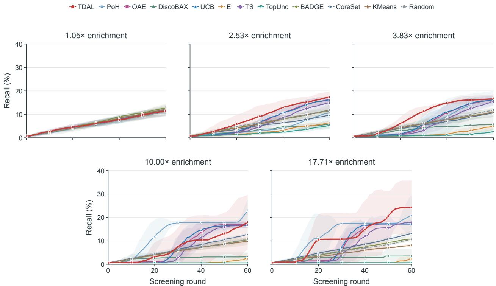  
Figure E1: Discovery trajectories for all twelve methods in Figure 4b. Panel titles give mean hit enrichment. Lines show mean recall over five paired repetitions, with shaded 95% confidence intervals. Round 0 is the initial set of 128 candidates. All panels share axis ranges.

Surrogate only. This ablation refits the same surrogate as TDAL after each round of observations but selects candidates with the highest $\hat { p } _ { t } ( x )$ without training an acquisition network, breaking exact probability ties at random. Its mean final recall is 0.54–13.01 percentage points lower than full TDAL across the four tasks. Updating response predictions alone therefore does not recover the full model’s discovery gains. Learning a selection function from batch feedback further improves screening.

w/o adaptive $w _ { t }$ . This ablation retains successor value bootstrapping but replaces the adaptive Hellinger weight with 1, applying the same successor weight in every round. Mean final recall decreases by 3.88–9.03 percentage points across the four tasks. Giving successor value full weight at every round therefore performs less well than adjusting its contribution to the observed prediction changes.

w/o LBO. This ablation disables LBO transitions constructed from the initial set, the associated initial TD training, and online LBO. The acquisition network learns only after receiving real batch feedback. Mean final recall is 0.42–5.54 percentage points lower than full TDAL across the four tasks. LBO reuses measured outcomes to provide training experience at initialization and supplement the single real transition obtained per online round.

w/o successor. This ablation sets the training target to $Y = R$ , retaining the hit probability term, acquisition network, and both real and LBO transitions. With surrogate predictions held fixed, the network fits the diference between the observed batch discovery count and its surrogate estimate. Mean final recall exceeds Surrogate only on all four tasks but is 0.15–1.21 percentage points lower than full TDAL. Current feedback can therefore train an efective selection function, while successor value bootstrapping further increases final discoveries.

w/o anchor. This ablation uses $q _ { \theta } ( s _ { t } , x ) = f _ { \theta } ( s _ { t } , c _ { t } ( x ) )$ . Both current and successor batch values sum network outputs without explicitly adding $\hat { p } _ { t } ( x )$ . Surrogate prediction features remain in the inputs. Relative to full TDAL, mean final recall decreases by 0.96 and 2.82 percentage points on IFN-� and IL-2, respectively, and increases by 0.31 and 0.16 points on Kuzmin and Horlbeck Jurkat. The two single perturbation tasks each use 60 screening rounds, whereas the two combinatorial tasks each use 200. More rounds provide the acquisition network with more feedback and training opportunities. The explicit hit probability term is more beneficial on the two tasks with 60 rounds. This pattern is consistent with a useful probability reference early in learning and motivates gradually reducing its contribution as feedback accumulates. Testing such a schedule within the same task would separate the efect of screening horizon from diferences between datasets.

## F.2 Training Dynamics and Candidate Reranking

Candidates analyzed. On IL-2, 85 hit candidates are discovered during active screening in all five TDAL runs and none of the five Surrogate only runs. We compare their discovery times and selection ranks across the five random seeds.

Training and discovery across seeds. Figure F1a–b shows TD loss per round and cumulative discoveries among these 85 candidates. Early loss changes vary in direction and magnitude across seeds. For all five seeds, fluctuations are smaller in the last 30 than in the first 10 rounds. Discoveries concentrate in the second half, with 74.1%–87.1% of the set discovered in the last 30 rounds (Table F1). This common timing pattern shows that these candidates mostly enter selected batches after feedback accumulates.

Candidate reranking at selection. We compare each candidate’s TDAL score rank and concurrent surrogate hit probability rank at selection, using the same unmeasured pool and surrogate predictions. Across seeds, mean TDAL ranks are 16.1–17.2, whereas mean surrogate ranks are 9,442–9,780. Of 425 selection records, 413 have surrogate ranks outside the top � = 32 (97.2%, Figure F1c–g). Across seeds, the acquisition network consistently promotes candidates ranked low by concurrent surrogate predictions into the selected batch.

Table F1: Discovery stages and selection ranks of the hit candidates analyzed across five seeds. Stage columns count newly discovered candidates. Ranks are computed in the same unmeasured pool at selection and averaged over the 85 candidates.
<table><tr><td>Seed</td><td>Rounds 0-9</td><td>Rounds 10-29</td><td>Rounds 30-59</td><td>Mean TDAL rank</td><td>Mean surrogate rank</td></tr><tr><td>0</td><td>4</td><td>7</td><td>74</td><td>16.6</td><td>9,780</td></tr><tr><td>1</td><td>1</td><td>15</td><td>69</td><td>16.1</td><td>9,442</td></tr><tr><td>2</td><td>2</td><td>12</td><td>71</td><td>16.8</td><td>9,574</td></tr><tr><td>3</td><td>3</td><td>18</td><td>64</td><td>17.2</td><td>9,522</td></tr><tr><td>4</td><td>4</td><td>18</td><td>63</td><td>16.4</td><td>9,479</td></tr></table>

## G Batch Size Sensitivity and Computational Cost

## G.1 Batch Size Sensitivity

Experimental settings. We vary batch size at fixed initial sample size and query budget on IL-2 and Simpson K562 to compare discovery at diferent feedback frequencies. IL-2 uses $n _ { 0 } = 1 2 8 , M = 2 , 0 4 8 .$ and $B \in \{ 1 6 , 3 2 , 6 4 , 1 2 8 \}$ . Simpson K562 uses $n _ { 0 } = 1 , 0 2 4 , M = 2 6 , 6 2 4$ , and $B \in \{ 6 4 , 1 2 8 , 2 5 6 , 5 1 2 \}$ Tables G1–G2 give the corresponding numbers of rounds. TDAL, PoH, UCB, BADGE, and CoreSet retain their respective model and training hyperparameters and share the candidate pool, initial set, and budget within each task and seed. Each setting uses five seeds.

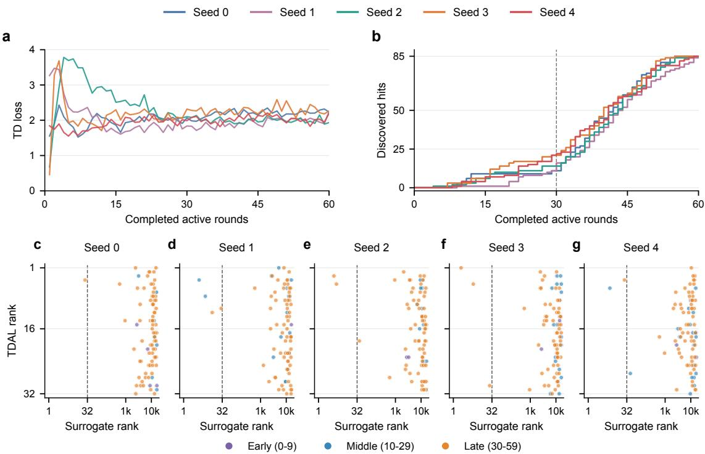  
Figure F1: Training dynamics and candidate reranking on IL-2 across five random seeds. a, TD loss per round. b, Cumulative discoveries among the 85 hit candidates analyzed. The dashed line marks 30 completed rounds. c–g, Surrogate and TDAL ranks at selection for seeds 0–4, with a logarithmic horizontal axis and a dashed line at surrogate rank 32. Colors indicate selection in rounds 0–9, 10–29, and 30–59.

Single perturbations. On IL-2, TDAL has the highest mean at $B = 1 6 , 3 2 , 6 4$ . At $B = 1 2 8 .$ , TDAL’s mean decreases to 252.2 with greater variation across seeds, while PoH reaches 351.4. This setting provides only 15 rounds of experimental feedback and no initial LBO, illustrating performance under limited training experience.

Table G1: Batch size comparison at a fixed budget on IL-2. Values are final cumulative hits, reported as mean ± sample standard deviation over five seeds. The highest mean in each column is bold and the second highest is underlined.
<table><tr><td>Method</td><td> $B = 1 6$   $T = 1 2 0$ </td><td> $B = 3 2$   $T = 6 0$ </td><td> $B = 6 4$   $T = 3 0$ </td><td> $B = 1 2 8$   $T = 1 5$ </td></tr><tr><td>TDAL</td><td> ${ \bf 3 5 5 . 4 \pm 7 . 8 }$ </td><td> ${ \bf 3 6 7 . 4 } \pm 3 . 0$ </td><td> $\mathbf { 3 5 3 . 8 \pm 1 0 . 1 }$ </td><td> $2 5 2 . 2 \pm 5 9 . 5$ </td></tr><tr><td>PoH</td><td> $\underline { { 3 4 8 . 8 \pm 7 . 5 } }$ </td><td> $\underline { { 3 4 7 . 8 \pm 6 . 0 } }$ </td><td> $\underline { { 3 4 7 . 0 \pm 1 1 . 0 } }$ </td><td> ${ \bf 3 5 1 . 4 \pm 8 . 0 }$ </td></tr><tr><td>UCB</td><td> $3 3 6 . 6 \pm 6 . 2$ </td><td> $3 3 1 . 0 \pm 1 0 . 2 $ </td><td> $3 4 0 . 0 \pm 1 8 . 4$ </td><td> $\underline { { 3 3 3 . 2 \pm 1 5 . 3 } }$ </td></tr><tr><td>BADGE</td><td> $2 6 3 . 8 \pm 3 . 6$ </td><td> $2 3 7 . 0 \pm 1 2 . 0$ </td><td> $2 1 6 . 8 \pm 9 . 3$ </td><td> $2 0 5 . 8 \pm 8 . 5$ </td></tr><tr><td>CoreSet</td><td> $3 0 1 . 2 \pm 8 . 8 $ </td><td> $2 9 8 . 4 \pm 4 . 8 $ </td><td> $2 9 7 . 0 \pm 5 . 8$ </td><td> $2 9 7 . 2 \pm 9 . 4$ </td></tr></table>

Double perturbations. On Simpson K562, TDAL stays in the top two at all four batch sizes, close to PoH. TDAL has the highest means at $B = 6 4 , 2 5 6$ , while PoH is slightly higher at $B = 1 2 8 , 5 1 2$ . TDAL’s mean declines with larger batches, remaining above UCB, BADGE, and CoreSet. At a fixed query budget, larger batches leave fewer rounds for incorporating experimental feedback and training the acquisition function. Smaller batches provide more opportunities to update selection, while PoH remains competitive at larger batches.

Table G2: Batch size comparison at a fixed budget on Simpson K562. Values are final cumulative hits, reported as mean ± sample standard deviation over five seeds. The highest mean in each column is bold and the second highest is underlined.
<table><tr><td>Method</td><td> $B = 6 4$   $T = 4 0 0$ </td><td> $B = 1 2 8$   $T = 2 0 0$ </td><td> $B = 2 5 6$   $T = 1 0 0$ </td><td> $B = 5 1 2$   $T = 5 0$ </td></tr><tr><td>TDAL</td><td> ${ \bf 6 8 6 8 . 2 \pm 6 5 . 8 }$ </td><td> $\underline { { 6 7 6 5 . 4 \pm 1 0 2 . 5 } }$ </td><td> ${ \bf 6 6 6 9 . 2 \pm 1 5 3 . 1 }$ </td><td> $6 6 3 8 . 0 \pm 8 1 . 9$ </td></tr><tr><td>PoH</td><td> $6 7 7 5 . 8 \pm 4 1 . 5$ </td><td> ${ \bf 6 7 7 1 . 0 \pm 7 5 . 7 }$ </td><td> $6 6 5 5 . 6 \pm 7 8 . 8$ </td><td> $\mathbf { 6 6 7 0 . 8 \pm 8 0 . 0 }$ </td></tr><tr><td>UCB</td><td> $5 9 5 5 . 6 \pm 5 2 . 5$ </td><td> $5 9 5 5 . 4 \pm 4 6 . 0$ </td><td> $5 9 3 5 . 4 \pm 5 0 . 3$ </td><td> $5 8 7 4 . 0 \pm 2 5 . 6$ </td></tr><tr><td>BADGE</td><td> $9 2 1 . 2 \pm 2 7 . 9$ </td><td> $9 3 2 . 8 \pm 1 3 . 3$ </td><td> $1 0 0 6 . 8 \pm 5 9 . 0$ </td><td> $1 0 1 5 . 8 \pm 4 0 . 4$ </td></tr><tr><td>CoreSet</td><td> $1 8 2 7 . 0 \pm 3 8 . 0$ </td><td> $1 6 9 3 . 6 \pm 4 4 . 4$ </td><td> $1 5 2 2 . 2 \pm 3 2 . 9$ </td><td> $1 3 7 7 . 6 \pm 2 7 . 3$ </td></tr></table>

## G.2 Computational Cost

On IL-2, we use $n _ { 0 } = 1 2 8 , B = 3 2$ , and the full budget � = 2,048, measuring active rounds 2–4 for each method with seeds 0–2. Each run has exclusive access to one NVIDIA A800 80 GB GPU and eight CPU cores, with runs for diferent seeds executed sequentially. Mean time per round excludes initialization and the first round, and includes selection and all model updates within the measured rounds. Peak host memory and reserved GPU memory are recorded over the same window, including persistent model and replay state.

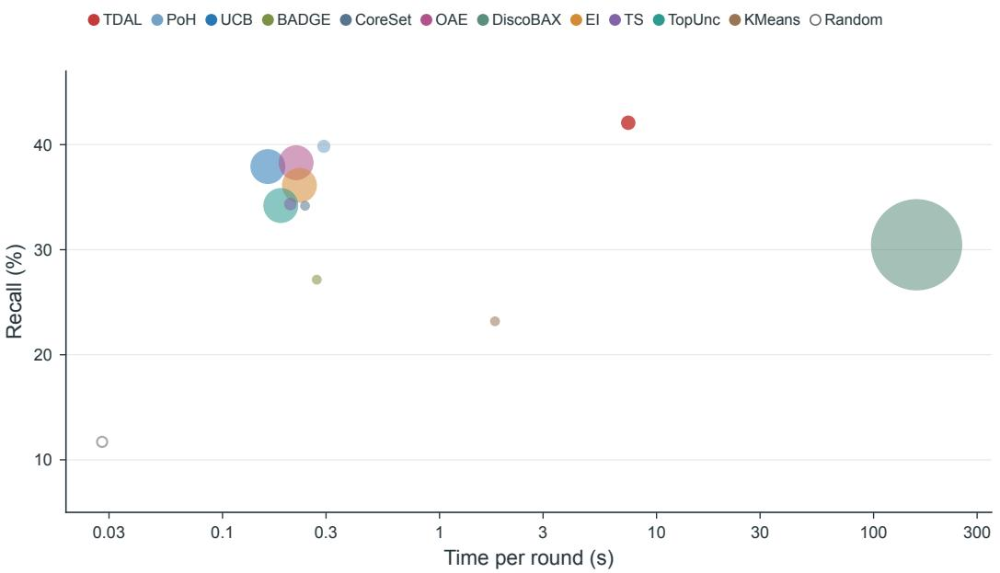  
Figure G1: Discovery performance and computational cost on IL-2. The horizontal axis shows mean time per round on a logarithmic scale, and the vertical axis shows final hit recall for twelve methods. Circle area is proportional to peak reserved GPU memory. Random uses zero reserved GPU memory and is shown as a hollow circle. Time and memory are means over three seeds over rounds 2–4. Recall is the mean over five seeds in the full screening experiment of 60 rounds.

TDAL achieves 42.08% final recall on IL-2, with a mean time of 7.40 seconds per round, 1.12 GiB peak host memory, and 0.051 GiB peak reserved GPU memory (Figure G1). DiscoBAX takes 157.78 seconds per round, 21.3 times the TDAL runtime, and reserves 2.674 GiB of GPU memory.