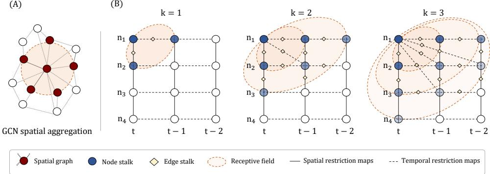
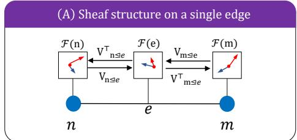
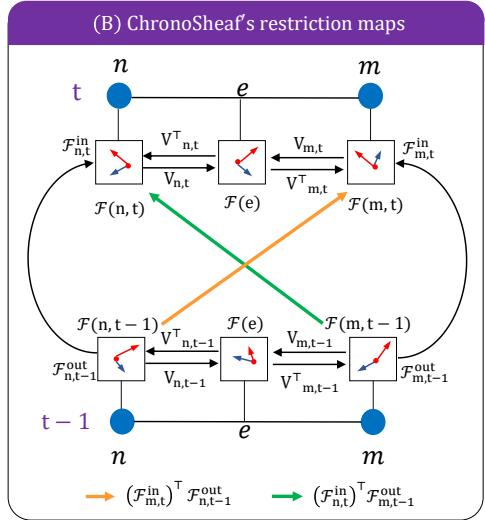
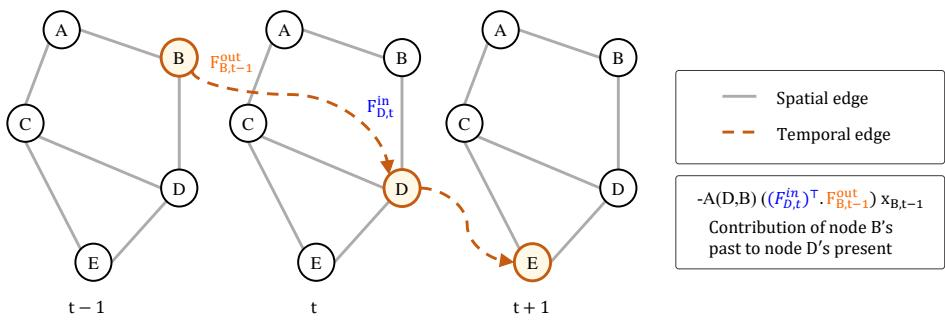
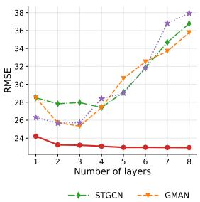
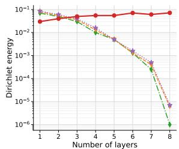
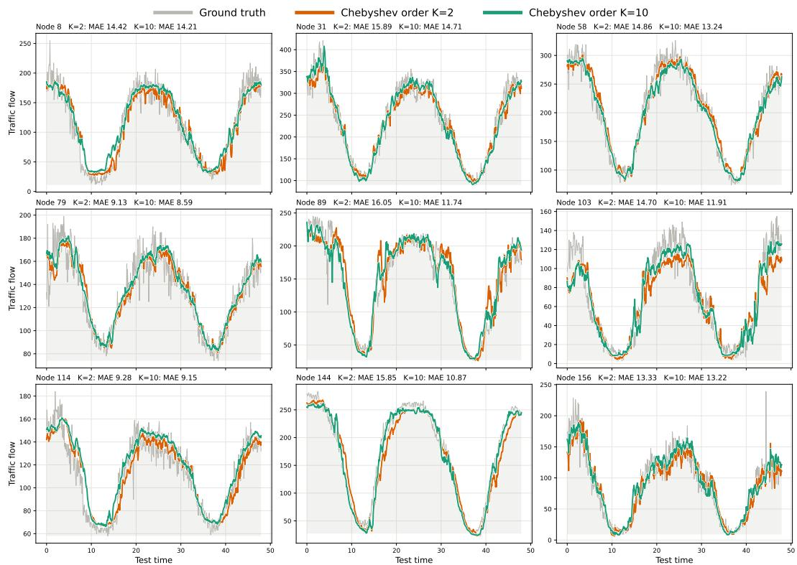

# CHRONOSHEAF: JOINT SPATIO-TEMPORAL SPECTRAL FILTERING ON CELLULAR SHEAVES

Abeer Mostafa1, Zahra Ahmadi1,2

1Peter L. Reichertz Institute for Medical Informatics, Hannover Medical School, Germany 2Lower Saxony Center for Artificial Intelligence and Causal Methods in Medicine (CAIMed), Hannover, Germany

{Mansour.Abeer, Ahmadi.Zahra}@mh-hannover.de

## ABSTRACT

Sheaf neural networks generalize graph neural networks by assigning each edge a learned linear restriction map that specifies how the local representations of adjacent nodes relate to one another, thereby mitigating oversmoothing. Existing sheaf architectures, however, define the sheaf Laplacian as an instantaneous spatial operator and therefore cannot explicitly model how signals evolve over time on a graph. We first introduce a spectral sheaf Laplacian, defined jointly over space and time, such that a single operator regulates signal propagation across both the spatial graph and the temporal domain. Directly extending this operator’s receptive field in space or time would require increasingly complex sheaf structures. Instead, we propose a spectral filter that expands the effective receptive field along both dimensions without enlarging the underlying sheaf. Building on this operator, we introduce ChronoSheaf, a spatio-temporal sheaf network with two key components. First, Transitional Restriction Maps (TRM) decompose each node’s restriction map into a spatial term and two temporal frames that independently control its relation to neighboring nodes at the preceding and following timestep, enabling asymmetric temporal influence. Second, the Dual Spectral Filter (DSF) applies a single bounded-degree polynomial filter with an adaptively estimated spectral radius to the joint spatio-temporal sheaf operator. We validate ChronoSheaf on a diverse set of spatio-temporal forecasting benchmarks, where it outperforms state-of-the-art baselines. The code is available at: https://anonymous.4open.science/r/ChronoSheaf-1D7D/.

## 1 INTRODUCTION

Sheaf neural networks generalize graph neural networks by assigning a vector space (stalk) to each node and edge and learning linear restriction maps between them, which lets them model heterogeneous relationships. The ordinary graph Laplacian is recovered as a special case of the constant sheaf, where every stalk is identical, and every restriction map is the identity. By letting restriction maps be learned and non-trivial, Bodnar et al. (2022) showed that a node’s local frame need not agree with its neighbors’ outright, giving sheaf neural networks a proven advantage over conventional graph neural networks on heterophilic graphs and against oversmoothing. In every such construction, however, the sheaf is defined purely over the spatial graph. Even when restriction maps are learned from node features (Bodnar et al., 2022), the base space contains no notion of time, so the sheaf Laplacian only learns from nodes observed at the same instant, and the associated diffusion relaxes toward a static equilibrium, the space of harmonic cochains (Hansen & Ghrist, 2019). As a consequence, increasing depth or filter order does not let a spatial sheaf Laplacian reach across time. Hence, temporal context must come from a separate module outside the sheaf that does not benefit from its learned local frames.

This restriction has a direct architectural consequence for spatio-temporal graph learning. The dominant paradigm thereby depends on conventional GNN architectures which are prone to oversmoothing and compose two separate operators, a spatial graph operator, and a recurrent, convolutional, or attention-based module for temporal dependence (Li et al., 2018b; Yu et al., 2018; Wu et al., 2019; Bai et al., 2020; Zheng et al., 2020; Wu et al., 2020). Marisca et al. (2025) recently showed this composition has a measurable cost; because causal temporal convolutions propagate information only forward, deeper stacks accumulate disproportionately more paths from early timesteps than from recent ones, so convolutional spatio-temporal GNNs counterintuitively favor temporally distant information over nearby steps.

We address this gap by defining a single spectral sheaf operator jointly over space and time, so that one filtering recursion controls both spatial and temporal dependence. This operator extends the sheaf domain from the spatial graph alone to a space-time graph, and edges connect spatial neighbors at a shared time as well as each node to its neighbors at the adjacent timestep. The network architecture built around this operator is ChronoSheaf, consisting of two components. Transitional restriction maps decompose each node’s restriction map into a learned spatial frame that determines how spatial neighbors are compared, plus two further frames, $F ^ { \mathrm { i n } }$ and $F ^ { \mathrm { o u t } }$ , that independently weight a node’s interaction with its neighbors at the preceding and following timestep. The dual spectral filter then applies a single spectral filter to this joint operator, giving ChronoSheaf a receptive field that grows jointly in graph hops and temporal lag from one spectral recursion (Figure 1). Our contributions are as follows:

• We introduce a new class of sheaf GNNs, called ChronoSheaf, in which we fundamentally rethink the three core components of sheaf GNNs:

1. The base space of the sheaf is a joint space-time graph, so that each node’s stalk is compared not only with its spatial neighbors but also with its own state and its neighbors states at adjacent timesteps.

2. The restriction maps allow each node to respond to its neighbors’ past and future states with distinct strengths to capture asymmetric temporal influence.

3. The sheaf Laplacian’s spatial hops and temporal lags are controlled by a spectral filter that acts on the Laplacian’s frequency spectrum without needing eigendecomposition. We further provide a theoretical analysis of the resulting operator, characterizing its spectral properties and its joint spatio-temporal receptive field.

• We conduct extensive experiments on six real-world datasets spanning diverse domains. The results show that ChronoSheaf resists oversmoothing, captures long-range dependencies more effectively, and outperforms state-of-the-art methods by a notable margin.

(A)  
(B)  
  
Figure 1: (A) State-of-the-art graph forecasting models aggregate spatial information from neighboring nodes and enlarge their receptive field by stacking additional layers. (B) Our model performs spectral filtering directly on joint space-time cellular sheaves. Higher-order polynomial filters extend the receptive field to larger neighborhoods and capture deeper temporal context.

## 2 RELATED WORK

Spectral graph convolution and its limits. Spectral filtering on graphs originates in Bruna et al. (2013) and is made scalable via polynomial truncation in Defferrard et al. (2016), whose first-order simplification underlies the method proposed in Kipf & Welling (2017). Velickoviˇ c et al. (2017)´ replace the fixed spectral filter with data-dependent attention weights. Known failure modes of this design, oversmoothing (Rusch et al., 2023; Li et al., 2018a) and oversquashing (Alon & Yahav,

2021), motivate architectures that enrich what a node can represent. This is the main gap targeted by sheaf neural architectures.

Sheaf neural networks. Hansen & Ghrist (2019) generalize the graph Laplacian to a Hodge Laplacian over a cellular sheaf using linear restriction maps defined between per-node stalks. Bodnar et al. (2022) instantiate this as a neural network, with a fully parametric diffusion architecture and provable control over Dirichlet-energy decay, showing a learned non-trivial sheaf mitigates oversmoothing where the trivial sheaf cannot. Follow-up work restricts the space of restriction maps: with orthogonal Laplacians (Barbero et al., 2022) and $O ( d )$ -bundle maps with continuous transport (Bamberger et al., 2025). Most recently, Hajij et al. (2025) subsume sheaf diffusion, GNNs, and attention into a single copresheaf-on-combinatorial-complex formalism. Ribeiro et al. (2026) define cellular sheaves over directed graphs, allowing the diffusion operator to selectively listen to distant nodes and mitigate oversquashing. Fiorini et al. (2026) also propose a directed cellular sheaf and its associated directed sheaf Laplacian, which encodes both graph topology and edge orientation. These extensions, however, address spatial connectivity specifically. From a different angle, we address two questions: how time can be encoded within the sheaf and how to learn the sheaf Laplacian’s spectrum.

Spatio-temporal graph learning. The dominant paradigm combines a spatial graph operator with a separate temporal mechanism, including recurrent units (Li et al., 2018b), gated temporal convolutions (Yu et al., 2018; Wu et al., 2019), and self-attention (Zheng et al., 2020). Other approaches enrich the spatial or dynamical component through adaptive graph learning (Bai et al., 2020), zigzagpersistence representations (Chen et al., 2021), neural ODEs (Fang et al., 2021), or controlled differential equations (Choi et al., 2022). Recent work continues to push the adaptive graph side toward efficiency: Ma et al. (2025) replace quadratic-cost adaptive graph learning with a linear, mixture-ofexperts formulation. Across these methods, spatial and temporal dependence are usually modeled by two distinct operators, composed architecturally, so receptive fields grow additively with depth. A few works operate on a joint space-time domain; STSGCN (Song et al., 2020) connects each node to itself and its neighbors at adjacent timesteps within a localized space-time graph and graphtime convolutional networks (Sabbaqi & Isufi, 2023) filter over parametric product graphs. These methods demonstrate the value of a joint domain, but they weight its edges with scalars: every node shares a single feature space with its past, its future, and its neighbors, which is precisely the reason behind oversmoothing.

## 3 CHRONOSHEAF

This section describes ChronoSheaf. Section 3.1 establishes the sheaf-theoretic and spectral preliminaries. Section 3.2 introduces the transitional restriction maps, the learned frames that control the space-time domain. Section 3.3 assembles these frames into the three-part sheaf Laplacian and proves it is a real, symmetric, positive semi-definite operator. Section 3.4 introduces the dual spectral filter, with the adaptive spectral-radius bound. Finally, Section 3.5 describes the proposed layer and the full network.

## 3.1 PRELIMINARIES

Spatial graph. Let $\mathcal { G } ~ = ~ ( \nu , \mathcal { E } )$ be a connected, undirected graph with $| \nu | = N$ nodes, and adjacency matrix $A \in \{ 0 , 1 \} ^ { N \times N }$ . We work with the symmetrically normalized adjacency ${ \tilde { A } } =$ $D ^ { - 1 / 2 } A D ^ { - 1 / 2 }$ , where $D = \mathrm { d i a g } ( A \mathbf { 1 } )$ , so that the normalized graph Laplacian is $L _ { \mathrm { s y m } } = I - \tilde { A }$

Cellular sheaves. A cellular sheaf $\mathcal { F }$ on $\mathcal { G }$ assigns to each node v a stalk $\mathcal { F } ( v ) \cong \mathbb { R } ^ { r }$ and, for each incident node-edge pair $v \triangleleft e ,$ a linear restriction map $\mathcal { F } _ { v \downarrow e } : \mathcal { F } ( v )  \mathcal { F } ( e )$ into a shared edge stalk (Hansen & Ghrist, 2019). The associated sheaf Laplacian

$$
( L _ { \mathcal { F } } x ) _ { v } = \sum _ { e = ( u , v ) \in \mathcal { E } } \mathcal { F } _ { v \leq e } ^ { \top } \big ( \mathcal { F } _ { v \leq e } x _ { v } - \mathcal { F } _ { u \leq e } x _ { u } \big ) ,\tag{1}
$$

is a symmetric, positive semi-definite operator whose quadratic form $\begin{array} { r } { x ^ { \top } L _ { \mathcal { F } } x = \sum _ { e } \| \mathcal { F } _ { v \ll e } x _ { v } - } \end{array}$ $\mathcal { F } _ { u \ < e } x _ { u } | | _ { 2 } ^ { 2 }$ measures disagreement between adjacent nodes after each node’s local frame is applied (Bodnar et al., 2022). Setting every restriction map to the identity on $\mathbb { R } ^ { 1 }$ recovers the ordinary,

unnormalized combinatorial graph Laplacian $D - A$ . The sheaf with identity restriction maps is called the trivial sheaf.

Spectral graph theory. For a symmetric operator L with eigendecomposition ${ \cal L } = U \Lambda U ^ { \top }$ , a spectral graph filter applies a function $g ( \Lambda )$ of the eigenvalues before returning to the node domain, $\bar { g ( L ) } x = \bar { U g ( \Lambda ) } U ^ { \top } \bar { x }$

In this work, we do not compute this eigendecomposition explicitly, because of the computationally expensive overhead it adds to the network. We use its polynomial (Chebyshev) approximation (Defferrard et al., 2016): with $\tilde { L }$ rescaled to [−1, 1], the order-K Chebyshev filter is

$$
g _ { \theta } ( L ) x = \sum _ { k = 0 } ^ { K } \theta _ { k } T _ { k } ( \tilde { L } ) x , \qquad T _ { 0 } ( z ) = 1 , T _ { 1 } ( z ) = z , T _ { k } ( z ) = 2 z T _ { k - 1 } ( z ) - T _ { k - 2 } ( z ) ,\tag{2}
$$

which is exactly K-localized (depends on nodes within K hops) and requires no eigendecomposition.

Joint space-time sheaf domain. ChronoSheaf’s central construction is a cellular sheaf defined not over G alone, but over a joint space-time graph ${ \mathcal { G } } ^ { \star } =$ $( \mathcal V ^ { \star } , \mathcal E ^ { \star } )$ Nodes are pairs $( n , t )$ for $\textit { n } \in \textit { \textbf { \em { \nu } } }$ and $t \in \{ 1 , \ldots , P \}$ , where $P$ is the number of observed timesteps. ${ \mathcal { E } } ^ { \star }$ contains a spatial edge between $( n , t )$ and $( m , t )$ whenever $( n , m ) \in { \mathcal { E } }$ , and a temporal edge between $( n , t )$ and $( m , t - 1 )$ for every m that is either n itself (a self-loop) or a spatial neighbor of n. Sections 3.2- 3.3 add to $\mathcal G ^ { \star }$ node-homogeneous frames and assemble its sheaf Laplacian; Section 3.4 shows that a single Chebyshev recursion over this one operator is what lets ChronoSheaf’s receptive field grow jointly in graph hops and temporal lag.

Forecasting Task. The model takes input signal $x \in \mathbb { R } ^ { N \times \breve { P } \times d _ { \mathrm { i n } } }$ , obtained from the raw observations after standard preprocessing (segmentation into $P$ timesteps of $d _ { \mathrm { i n } }$ channels). Given a history of such signals, the goal is to learn a mapping $F$ that predicts the next H steps of the underlying scalar measurement at each node.

  
Figure 2: (A) Neural sheaf structure Bodnar et al. (2022). (B) ChronoSheaf’s joint space-time sheaf structure.

## 3.2 TRANSITIONAL RESTRICTION MAPS (TRM)

ChronoSheaf’s first component assigns learned frames to the joint graph $\mathcal G ^ { \star }$ . Let $B \in  { \mathbb { R } } ^ { 3 \times N }$ ×r×d

be a learnable base tensor, holding one candidate frame of each of three kinds (spatial, outgoingtemporal, incoming-temporal frames) per node. At each timestep, a learned gate rescales the three candidates for node n as a function of the layer input $h _ { n , t } \in \mathbb { R } ^ { d } ;$

$$
\begin{array} { r } { g _ { n , t } = \mathbf { 1 } + \frac { 1 } { 2 } \operatorname { t a n h } ( W _ { g } h _ { n , t } ) , \qquad W _ { g } \in \mathbb { R } ^ { 3 \times d } , } \end{array}\tag{3}
$$

$$
V _ { n , t } = g _ { n , t , 1 } B _ { 1 , n } , \qquad F _ { n , t } ^ { \mathrm { o u t } } = g _ { n , t , 2 } B _ { 2 , n } , \qquad F _ { n , t } ^ { \mathrm { i n } } = g _ { n , t , 3 } B _ { 3 , n } ,\tag{4}
$$

so that $V _ { n , t } , F _ { n , t } ^ { \mathrm { i n } } , F _ { n , t } ^ { \mathrm { o u t } } \ \in \ \mathbb { R } ^ { r \times d }$ are node n’s three restriction maps at time t. Since tan $\mathrm { h } ( \cdot ) \in$ $( - 1 , 1 )$ , each component of $g _ { n , t } \in \mathbb { R } ^ { 3 }$ lies in (0.5, 1.5) to bound every frame’s scale for numerical stability.

We call $F ^ { \mathrm { i n } }$ and $F ^ { \mathrm { o u t } }$ transitional restriction maps. $V _ { n , t }$ plays the role of an ordinary spatial sheaf frame, learning how node n’s representation is compared with its spatial neighbors at the same time. $F _ { n , t } ^ { \mathrm { o u t } }$ and $F _ { n , t } ^ { \mathrm { i n } }$ learn how $n \mathrm { { : } }$ representation is compared across a single-step transition in time: $F _ { n , t } ^ { \mathrm { o u t } }$ sets how strongly n projects its current signal onto the following timestep, and $F _ { n , t } ^ { \mathrm { i n } }$ sets how strongly n accepts a neighbor’s projection from the preceding one. Because these are two independently learned maps, a node can weight its sensitivity to the past differently from it sensitivity to the future.

## 3.3 THE CHRONOSHEAF LAPLACIAN

Spatial term. We instantiate the sheaf Laplacian of Eq. 1 to node-homogeneous restriction maps, in which every spatial edge incident to $( n , t )$ uses the same spatial frame, $\mathcal { F } _ { ( n , t ) \leq e } = V _ { n , t }$ , and weight each edge by the normalized adjacency A˜:

$$
( L _ { s p } x ) _ { n , t } = \sum _ { m } \tilde { A } ( n , m ) V _ { n , t } ^ { \top } \left( V _ { n , t } x _ { n , t } - V _ { m , t } x _ { m , t } \right) .\tag{5}
$$

Because $V _ { n , t } \in \mathbb { R } ^ { r \times d }$ , the restriction maps project the d-dimensional feature stalks into a shared r-dimensional edge space before measuring disagreement.

Temporal terms. Let $\hat { A } = D ^ { - 1 / 2 } ( A + I ) D ^ { - 1 / 2 }$ be the self-loop-augmented normalized adjacency, and let $\begin{array} { r } { \hat { d } ( n ) : = \sum _ { m } \hat { A } ( n , m ) } \end{array}$ denote its weighted row sum at node n. The two transitional terms are:

$$
( L _ { i n } x ) _ { n , t } = \hat { d } ( n ) ( F _ { n , t } ^ { i n } ) ^ { \top } F _ { n , t } ^ { i n } x _ { n , t } - \sum _ { m } \hat { A } ( n , m ) ( F _ { n , t } ^ { i n } ) ^ { \top } F _ { m , t - 1 } ^ { o u t } x _ { m , t - 1 } ,\tag{6}
$$

$$
( L _ { o u t } x ) _ { n , t } = \hat { d } ( n ) ( F _ { n , t } ^ { o u t } ) ^ { \top } F _ { n , t } ^ { o u t } x _ { n , t } - \sum _ { m } \hat { A } ( n , m ) ( F _ { n , t } ^ { o u t } ) ^ { \top } F _ { m , t + 1 } ^ { i n } x _ { m , t + 1 } ,\tag{7}
$$

each masked to zero at the first and last timestep, where no earlier or later patch exists. The full Laplacian is then:

$$
{ \cal L } = { \cal L } _ { s p } + { \cal L } _ { i n } + { \cal L } _ { o u t } ,\tag{8}
$$

a linear operator on $\mathbb { R } ^ { N \times P \times d }$ that we equivalently view as a block matrix with one $d \times d$ block $L _ { ( n , t ) , ( m , s ) }$ per pair of joint-graph nodes, acting on $x _ { m , s } \in \mathbb { R } ^ { d }$ (Figure 2).

Proposition 1. L is a real, symmetric operator on $\mathcal { G ^ { \star } } \colon L _ { ( n , t ) , ( m , s ) } ^ { \top } = L _ { ( m , s ) , ( n , t ) } f o r$ every pair of joint-graph nodes, even though $F ^ { \mathrm { i n } } \neq F ^ { \mathrm { o u t } }$ in general.

Proof. Every diagonal block is a sum of Gram matrices, hence symmetric. For $s \ = \ t$ (spatial neighbors), Eq. 5 gives ${ \cal L } _ { ( n , t ) , ( m , t ) } ~ = ~ - \tilde { A } ( n , m ) V _ { n , t } ^ { \top } V _ { m , t } ;$ since $( V _ { n , t } ^ { \top } V _ { m , t } ) ^ { \top } \ : = \ : V _ { m , t } ^ { \top } V _ { n , t }$ and $\tilde { A } ( n , m ) = \tilde { A } ( m , n )$ , this equals $L _ { ( m , t ) , ( n , t ) } ^ { \top }$ . For $s = t - 1$ , Eq. 6 gives $L _ { ( n , t ) , ( m , t - 1 ) } =$ $- \hat { A } ( n , m ) ( F _ { n , t } ^ { \mathrm { i n } } ) ^ { \top } F _ { m , t - 1 } ^ { \mathrm { o u t } }$ , while Eq. 7 evaluated at node $m ,$ time $t - 1$ , gives $L _ { ( m , t - 1 ) , ( n , t ) } ~ =$ $- \hat { A } ( m , n ) ( F _ { m , t - 1 } ^ { \mathrm { o u t } } ) ^ { \top } F _ { n , t } ^ { \mathrm { i n } }$ Transposing the first block, $\begin{array} { r l } { \left( \mathbf { \nabla } - \mathbf { \nabla } \hat { A } ( n , m ) ( F _ { n , t } ^ { \mathrm { i n } } ) ^ { \top } F _ { m , t - 1 } ^ { \mathrm { o u t } } \right) ^ { \top } } & { = } \end{array}$ $- \hat { A } ( n , m ) ( F _ { m , t - 1 } ^ { \mathrm { o u t } } ) ^ { \top } F _ { n , t } ^ { \mathrm { i n } }$ , which equals $L _ { ( m , t - 1 ) , ( n , t ) }$ since $\hat { A } ( n , m ) = \hat { A } ( m , n )$ . Symmetry holds block by block, and therefore for $L$ as a whole; it follows from $L _ { \mathrm { i n } } \mathrm { \ ' } _ { \mathrm { s } }$ backward-looking mapping and $\chi _ { \mathrm { o u t } } \mathbf { \hat { s } }$ forward-looking mapping being adjoint to one another. □

Proposition 2 (Positive semi-definiteness). $L = L _ { \mathrm { s p } } + L _ { \mathrm { i n } } + L _ { \mathrm { o u t } }$ is positive semi-definite.

Proof. Spatial term. Fix a patch t and let $y _ { n , t } : = V _ { n , t } x _ { n , t } \in \mathbb { R } ^ { r }$ , with components $y _ { n , t , k } , k =$ $1 , \ldots , r$ . Expanding Eq. 5,

$$
x ^ { \top } L _ { \mathrm { s p } } x = \sum _ { t , k } y _ { \cdot , t , k } ^ { \top } { \big ( } \mathrm { d i a g } ( { \tilde { A } } \mathbf { 1 } ) - { \tilde { A } } { \big ) } y _ { \cdot , t , k } = \sum _ { t , k } { \frac { 1 } { 2 } } \sum _ { n , m } { \tilde { A } } ( n , m ) { \big ( } y _ { n , t , k } - y _ { m , t , k } { \big ) } ^ { 2 } \geq 0 ,
$$

using that diag(W1) − W is positive semi-definite for any symmetric $W \geq 0$

Temporal terms. Let $u _ { n , t } : = F _ { n , t } ^ { \mathrm { i n } } x _ { n , t }$ and $w _ { n , t } : = F _ { n , t } ^ { \mathrm { o u t } } x _ { n , t }$ , both in $\mathbb { R } ^ { r }$ . Expanding Eq. 6-Eq.7,

$$
x ^ { \top } L _ { \mathrm { i n } } x = \sum _ { n , t } { \hat { d } } ( n ) \| u _ { n , t } \| ^ { 2 } - \sum _ { n , t , m } { \hat { A } } ( n , m ) u _ { n , t } ^ { \top } w _ { m , t - 1 } ,
$$

$$
x ^ { \top } { L } _ { \mathrm { o u t } } x = \sum _ { n , t } \hat { d } ( n ) \| w _ { n , t } \| ^ { 2 } - \sum _ { n , t , m } \hat { A } ( n , m ) w _ { n , t } ^ { \top } u _ { m , t + 1 } .
$$

Reindexing the second cross term $( n  m , t \mapsto t - 1 )$ and using $\hat { A } ( n , m ) = \hat { A } ( m , n )$ shows the two cross terms are equal; reindexing $\begin{array} { r l } { \sum _ { n , t } \hat { d } ( n ) \lVert w _ { n , t } \rVert ^ { 2 } } & { { } } \end{array}$ the same way aligns every diagonal term with a cross term at the same $( n , t , m )$ . Completing the square gives the exact identity

$$
\boldsymbol { x } ^ { \top } ( \boldsymbol { L } _ { i n } + \boldsymbol { L } _ { o u t } ) \boldsymbol { x } = \sum _ { n , t , m } \hat { \boldsymbol { A } } ( n , m ) \| F _ { n , t } ^ { i n } \boldsymbol { x } _ { n , t } - F _ { m , t - 1 } ^ { o u t } \boldsymbol { x } _ { m , t - 1 } \| _ { 2 } ^ { 2 } ,
$$

the sum ranging over all valid $( n , t , m )$ with $t \geq 2 ;$ every term is nonnegative since ${ \hat { A } } ( n , m ) \geq 0$ Summing the two nonnegative quadratic forms gives $x ^ { \top } \dot { L } x \ge 0$ for all x. Figure 3 illustrates how a node’s past affect its neighbor’s present. □

  
Figure 3: Node $\mathbf { B } ^ { \prime } \mathbf { s }$ signal at $t - 1$ contributes $- A ( D , B ) ( F _ { D , t } ^ { \mathrm { i n } } ) ^ { \top } F _ { B , t - 1 } ^ { \mathrm { o u t } } x _ { B , t - 1 }$ to $( L x ) _ { D , t } ,$ , transporting B’s signal from its outgoing frame into D’s incoming frame. The analogous term one step later carries D’s present into E’s future.

## 3.4 DUAL SPECTRAL FILTER (DSF)

ChronoSheaf’s second component filters L with the Chebyshev polynomial of Section 3.1, using per-channel coefficients $\theta _ { c , 0 : K } \colon$ : the output is $\begin{array} { r } { \sum _ { k } \left( T _ { k } ( \tilde { L } ) x \right) \Theta _ { k } } \end{array}$ , where $\Theta _ { k } = \operatorname { d i a g } ( \theta _ { 1 , k } , \dots , \theta _ { d , k } )$ scales the d channels, so one order-K recursion over L filters jointly across the spatial and temporal edges of ${ \mathcal { E } } ^ { \star }$ . We call this the dual spectralfilter: a single Chebyshev recursion that is simultaneously a spatial and a temporal filter, since Propositions 1 and 2 let L carry both kinds of edges as one real, symmetric, positive semi-definite operator.

Applying this filter requires an estimate of the sheaf Laplacian’s largest eigenvalue $\lambda _ { \operatorname* { m a x } } ( L )$ . Because $V , \overline { { F ^ { \mathrm { i n } } } } , F ^ { \mathrm { o u t } }$ are learned and unconstrained in norm, no fixed bound holds for L in general, and an eigendecomposition at every forward pass is too costly. We instead adaptively bound $\lambda _ { \operatorname* { m a x } } ( L )$ for a real symmetric block matrix with $d \times d$ blocks $L _ { ( n , t ) , ( m , s ) }$

$$
\lambda _ { \operatorname* { m a x } } ( L ) \ \leq \ \operatorname* { m a x } _ { ( n , t ) } \Big [ \big \| L _ { ( n , t ) , ( n , t ) } \big \| _ { 2 } + \ \sum _ { ( m , s ) \neq ( n , t ) } \big \| L _ { ( n , t ) , ( m , s ) } \big \| _ { 2 } \Big ] ,\tag{9}
$$

where $\| \cdot \| _ { 2 }$ is the spectral norm. This is a generalization of the known scalar Gershgorin bound (entrywise absolute value) to the $d \times d$ blocks of L. We bound Eq. 9 directly from the frames of Section 3.2, using the triangle and submultiplicative inequalities for the spectral norm $( \| A + B \| _ { 2 } \leq$ $\begin{array} { r } { \| A \| _ { 2 } + \| B \| _ { 2 } , \| \mathbf { \bar { A } } B \| _ { 2 } \leq \| A \| _ { 2 } \| B \| _ { 2 } , \| A ^ { \top } A \| _ { 2 } = \| A \| _ { 2 } ^ { \hat { 2 } } ) \colon } \end{array}$

$$
\begin{array} { r l r } {  { \hat { \lambda } _ { \mathrm { m a x } } : = \operatorname* { m a x } _ { ( n , t ) } \Big [ s _ { n } \| V _ { n , t } \| _ { 2 } ^ { 2 } + \hat { d } ( n ) \big ( \| F _ { n , t } ^ { \mathrm { i n } } \| _ { 2 } ^ { 2 } + \| F _ { n , t } ^ { \mathrm { o u t } } \| _ { 2 } ^ { 2 } \big ) } } \\ & { } & { \quad \quad + \sum _ { m } \tilde { A } ( n , m ) \| V _ { n , t } \| _ { 2 } \| V _ { m , t } \| _ { 2 } } \\ & { } & { \quad \quad + \sum _ { m } \hat { A } ( n , m ) \big ( \| F _ { n , t } ^ { \mathrm { i n } } \| _ { 2 } \| F _ { m , t - 1 } ^ { \mathrm { o u t } } \| _ { 2 } + \| F _ { n , t } ^ { \mathrm { o u t } } \| _ { 2 } \| F _ { m , t + 1 } ^ { \mathrm { i n } } \| _ { 2 } \big ) \Big ] , } \end{array}\tag{10}
$$

with $\begin{array} { r } { s _ { n } = \sum _ { m } \tilde { A } ( n , m ) } \end{array}$ . Every quantity in Eq. 10 is a spectral norm of one $r \times d$ frame, so $\hat { \lambda } _ { \mathrm { m a x } }$ is tracked once per forward pass at negligible cost and detached from the computation graph (no backpropagation through $\hat { \lambda } _ { \operatorname* { m a x } } )$

Proposition 3 (Receptive field). The output at $( n , t )$ after M stacked ChronoSheaf layers depends on the input at $( m , s )$ with $d _ { \mathcal { G } } ( n , m ) + | t - s | \leq 2 M K$ , where $d _ { \mathcal { G } }$ is graph-hop distance in $\mathcal { G }$ and $t ,$ s index patches.

Proof. Every nonzero block of $L = L _ { \mathrm { s p } } + L _ { \mathrm { i n } } + L _ { \mathrm { o u t } }$ connects $( n , t )$ to some $( m , s )$ with $d _ { \mathcal { G } } ( n , m ) +$ $| t - s | \leq 2$ because $L _ { \mathrm { s p } }$ contributes same-patch spatial neighbors $( d _ { \mathcal { G } } ( n , m ) \leq 1 , | t - s | = 0 ) ; L _ { \mathrm { i n } }$ and $L _ { \mathrm { o u t } }$ each contribute a self term one patch earlier or later $( d _ { \mathcal { G } } ( n , m ) = 0 , | t - s | = 1 )$ and a spatial-neighbor term one patch earlier or later $( d _ { \mathcal { G } } ( n , m ) = 1 , \vert t - s \vert = 1$ , since $\hat { A } ( n , m ) \neq 0$ whenever $m = n$ or m is a spatial neighbor of n).

The order-K Chebyshev recursion of the dual spectral filter is a degree-K polynomial in $L ,$ so one ChronoSheaf layer’s output at $( n , t )$ depends on $( m , s )$ only if $d _ { \mathcal { G } } ( \bar { n , } m ) + | \bar { t - s | } \leq 2 K$ . Composing M layers sums this bound M times. □

## 3.5 CHRONOSHEAF LAYER

One ChronoSheaf layer applies the dual spectral filter of Section 3.4 to the operator L of Section 3.3, wrapped in a residual connection,

$$
\mathrm { C h r o n o S h e a f } ( h ) = \mathrm { L a y e r N o r m } \big ( h + \mathrm { D r o p o u t } ( W g _ { \theta } ( L ) h ) \big ) , \qquad W \in \mathbb { R } ^ { d \times d } ,\tag{11}
$$

with the frames $V , F ^ { \mathrm { i n } } , F ^ { \mathrm { o u t } }$ (hence $L )$ and the coefficients $\theta _ { c , 0 : K }$ learned independently at every layer. The full network stacks $\dot { M }$ such layers. Writing x for the patchified, preprocessed input and $\mathbf { \Psi } _ { e } \in \mathbb { R } ^ { N \times d }$ for a learned per-node embedding broadcast across the batch and every patch, the first layer’s input is $h ^ { ( 0 ) } = \mathrm { P E } \left( x W _ { \mathrm { i n } } + e \right)$ , where $W _ { \mathrm { i n } }$ projects into the model dimension d and PE adds a fixed sinusoidal encoding along the patch axis to mark the order in which the temporal edges of $\mathcal G ^ { \star }$ connect. Each of the M layers then maps $h ^ { ( l - 1 ) } \mapsto h ^ { ( l ) }$ as in Eq. 11.

## 4 EXPERIMENTS

We evaluate the performance of ChronoSheaf on several spatio-temporal forecasting benchmarks. In Section 4.1, we assess ChronoSheaf’s ability to mitigate oversmoothing in spatio-temporal learning tasks. In Section 4.2, we include the results of traffic, weather, air quality forecasting on six benchmark datasets compared to SOTA baselines. Section 4.3 examines the effect of spectral filtering on the space-time sheaf Laplacian and how different values of polynomial orders affect performance. Finally, in Section 4.4, we examine the network’s ability to retain local representations given heterogeneous features from another modality. Extended results and complete dataset details are provided in the Appendices.

## 4.1 OVERSMOOTHING ANALYSIS

We examine whether TRM preserves local representations as the network deepens. On PEMS08, we stack $M \ \in \ \{ 1 , \ldots , 8 \}$ layers and track both test Root Mean Square Error (RMSE) and the normalized Dirichlet energy:

$$
E ( \mathbf { H } ) = \frac { N } { \left| \mathbf { \varSigma } \right| } \cdot \frac { \displaystyle \sum _ { ( i , j ) \in \mathcal { E } } \sum _ { t = 1 } ^ { T } \left\| \mathbf { h } _ { i , t } - \mathbf { h } _ { j , t } \right\| _ { 2 } ^ { 2 } } { \displaystyle \sum _ { i = 1 } ^ { N } \sum _ { t = 1 } ^ { T } \left\| \mathbf { h } _ { i , t } \right\| _ { 2 } ^ { 2 } } ,
$$

  
Figure 4: Test RMSE (left) and Dirichlet energy (right, log scale) versus network depth. Baseline energy collapses with depth, while ChronoSheaf’s remains stable.

(12)

of the hidden node representations; energy that decays toward zero means node features are becoming indistinguishable. We compare against three representative baselines: STGCN (convolutionbased), GMAN (attention-based), and STDN (the current state of the art in spatio-temporal forecasting). Results are shown in Figure 4.

Table 1: Traffic forecasting results on LargeST (SD and CA), PEMS04, and PEMS08, averaged over 12 forecasting steps. Best results are in bold and second-best are underlined. "OOM" denotes out of memory.
<table><tr><td rowspan="2">Model</td><td colspan="3">LargeST (SD)</td><td colspan="3">LargeST (CA)</td><td colspan="3">PEMS04</td><td colspan="3">PEMS08</td></tr><tr><td>MAE</td><td>RMSE</td><td>MAPE</td><td>MAE</td><td>RMSE</td><td>MAPE</td><td>MAE</td><td>RMSE</td><td>MAPE</td><td>MAE</td><td>RMSE</td><td>MAPE</td></tr><tr><td>STGCN Yu et al. (2018)</td><td>19.67</td><td>34.14</td><td>13.86</td><td>21.33</td><td>36.39</td><td>16.53</td><td>22.70</td><td>35.55</td><td>14.59</td><td>18.02</td><td>27.83</td><td>11.40</td></tr><tr><td>DCRNN Li et al. (2018b)</td><td>21.03</td><td>33.37</td><td>14.13</td><td>21.87</td><td>34.41</td><td>17.06</td><td>24.70</td><td>38.12</td><td>17.12</td><td>17.86</td><td>27.83</td><td>11.45</td></tr><tr><td>GW-Net Wu et al. (2019)</td><td>17.74</td><td>29.62</td><td>11.88</td><td>21.72</td><td>34.20</td><td>17.40</td><td>25.45</td><td>39.70</td><td>17.29</td><td>19.13</td><td>31.05</td><td>12.68</td></tr><tr><td>GMAN Zheng et al. (2020)</td><td>19.63</td><td>30.01</td><td>12.20</td><td>OOM</td><td>OOM</td><td>OOM</td><td>20.23</td><td>32.17</td><td>17.06</td><td>16.47</td><td>25.72</td><td>10.48</td></tr><tr><td>ASTGCN Guo et al. (2019)</td><td>23.70</td><td>37.63</td><td>15.65</td><td>OOM</td><td>OOM</td><td>OOM</td><td>22.80</td><td>35.82</td><td>16.56</td><td>18.63</td><td>28.27</td><td>13.08</td></tr><tr><td>CrossGNN Huang et al. (2023)</td><td>23.09</td><td>39.04</td><td>15.87</td><td>26.16</td><td>41.25</td><td>20.25</td><td>25.11</td><td>40.32</td><td>20.88</td><td>21.91</td><td>35.69</td><td>16.73</td></tr><tr><td>FITS Xu et al. (2024)</td><td>21.34</td><td>38.01</td><td>14.36</td><td>20.12</td><td>35.22</td><td>15.81</td><td>20.02</td><td>33.31</td><td>16.49</td><td>15.43</td><td>26.34</td><td>10.75</td></tr><tr><td>SGP Cini et al. (2023)</td><td>20.25</td><td>35.06</td><td>12.33</td><td>OOM</td><td>OOM</td><td>OOM</td><td>21.90</td><td>34.27</td><td>16.15</td><td>18.06</td><td>27.33</td><td>13.55</td></tr><tr><td>CITRUS Einizade et al. (2024)</td><td>18.22</td><td>30.67</td><td>12.23</td><td>19.66</td><td>33.50</td><td>15.72</td><td>22.64</td><td>35.08</td><td>16.83</td><td>17.89</td><td>27.81</td><td>11.21</td></tr><tr><td>SparseTSF Lin et al. (2024)</td><td>25.90</td><td>46.77</td><td>18.30</td><td>23.75</td><td>43.03</td><td>18.87</td><td>22.24</td><td>38.65</td><td>17.25</td><td>16.61</td><td>30.84</td><td>11.54</td></tr><tr><td>TimeBase Huang et al. (2025) STDN Cao et al. (2025)</td><td>19.15 19.01</td><td>32.21 31.25</td><td>13.22 14.10</td><td>20.23 OOM</td><td>32.43 OOM</td><td>14.42 OOM</td><td>23.21 19.15</td><td>41.59</td><td>16.18</td><td>17.52</td><td>35.99</td><td>11.98</td></tr><tr><td></td><td></td><td></td><td></td><td></td><td></td><td></td><td></td><td>34.37</td><td>23.51</td><td>18.26</td><td>25.67</td><td>20.93</td></tr><tr><td>ChronoSheaf</td><td>16.42</td><td>28.33</td><td>10.72</td><td>17.52</td><td>31.66</td><td>14.22</td><td>19.95</td><td>29.11</td><td>13.11</td><td>14.32</td><td>23.26</td><td>10.21</td></tr></table>

All three baselines degrade sharply with depth, tracking a Dirichlet energy that collapses by four to six orders of magnitude by the eighth layer. This is exactly the known behavior of oversmoothing under repeatedly applied propagation discussed in Li et al. (2019) and Arroyo et al. (2026). ChronoSheaf’s energy stays within roughly one order of magnitude across the same range, and its RMSE saturates as depth increases.

## 4.2 SPATIO-TEMPORAL FORECASTING

Setup. For traffic forecasting, we use PEMS04 and PEMS08 (Song et al., 2020), in addition to the San Diego (SD) and full California (CA) subsets of LargeST (Liu et al., 2023). All four datasets consist of traffic flow readings from loop detectors aggregated into 5-minute intervals, with sensors as nodes and edges derived from road-network connectivity. Graph sizes vary from 170 to 8,600 nodes. Following the experimental setup of Liu et al. (2023), we use 12 historical timesteps as input to predict the next 12 steps. Further details and hyperparameter configurations are provided in Appendix C. Additionally, we use the Molene dataset (Girault, 2015) for weather forecasting, which contains hourly temperature readings from 32 stations in Brittany, France, with 10 historical timesteps as input to predict the next 5 steps. We further evaluate ChronoSheaf on the Air Quality dataset (Microsoft Research, 2026), which contains hourly $\mathrm { P M } _ { 2 . 5 }$ concentration readings from 437 monitoring stations across 43 Chinese cities. The input spans 48 hours and predicts the next 48 hours. Full dataset details are provided in Appendix C.

Baselines. We compare ChronoSheaf to established GCN/RNN methods (STGCN (Yu et al., 2018), DCRNN (Li et al., 2018b)), adaptive graph learning (Graph WaveNet (Wu et al., 2019), Cross-GNN (Huang et al., 2023)), attention-based models (ASTGCN (Guo et al., 2019), GMAN (Zheng et al., 2020)), scalable architectures (SGP (Cini et al., 2023), SparseTSF (Lin et al., 2024), FITS (Xu et al., 2024)), spectral methods (CITRUS (Einizade et al., 2024)), and the most recent decomposition-based approaches (TimeBase (Huang et al., 2025), STDN (Cao et al., 2025)). Note on comparison with other Sheaf-based methods: to the best of our knowledge, there is currently no published literature on sheaf-based methods for spatio-temporal modeling; all identified sheaf networks operate exclusively in the spatial domain. Therefore, direct comparisons with analogous sheaf models are not applicable.

Results. The reported results in Table 1 for traffic forecasting are in Mean Absolute Error (MAE), Root Mean Square Error (RMSE), and Mean Absolute Percentage Error (MAPE), averaged over 12 forecasting steps. On the four datasets, ChronoSheaf achieves the best result in 11 of the 12 reported dataset–metric combinations. Table 2 reports MAE for weather and air quality forecasting across multiple prediction horizons. ChronoSheaf’s advantage over the baselines is most pronounced at longer horizons, which is consistent with its ability to capture extended temporal context.

## 4.3 SPECTRAL FILTERING ANALYSIS

We vary the order k of the polynomial filter on the space-time sheaf Laplacian, which sets the number of hops each layer aggregates over on the PEMS08 dataset (Table 3). Accuracy improves sharply up to $k = 4$ and then saturates. Training time grows almost linearly with $k ,$ as each order adds one Laplacian multiplication. It should be noted that the spectral filtering approach here inherits the same advantages of the sheaf Laplacian in being more expressive. We therefore select k per dataset to balance predictive accuracy against computational cost, taking into account both graph size and the marginal gain from higher orders. Accordingly, we set k = 2 for the LargeST dataset and $k = 4$ for all other datasets.

Table 2: Weather (Molene) and air quality $\mathrm { ( P M _ { 2 . 5 } ) }$ forecasting results in MAE across multiple prediction horizons. Best results are in bold and second-best are underlined.
<table><tr><td rowspan="2">Model</td><td colspan="5">Molene (weather)</td><td colspan="3">Air Quality  $\mathbf { ( P M _ { 2 . 5 } ) }$ </td></tr><tr><td>step-1</td><td>step-2</td><td>step-3</td><td>step-4</td><td>step-5</td><td>1-12 hr</td><td> $I 3  – 2 4 h r$ </td><td>25-48 hr</td></tr><tr><td>STGCN (Yu et al., 2018)</td><td>1.066</td><td>1.552</td><td>1.933</td><td>2.225</td><td>2.698</td><td>22.77</td><td>31.59</td><td>35.59</td></tr><tr><td>DCRNN (Li et al., 2018b)</td><td>0.396</td><td>0.635</td><td>0.907</td><td>1.164</td><td>1.419</td><td>24.28</td><td>32.95</td><td>36.11</td></tr><tr><td>GW-Net (Wu et al., 2019)</td><td>0.855</td><td>1.124</td><td>1.455</td><td>1.865</td><td>2.104</td><td>22.42</td><td>30.29</td><td>34.73</td></tr><tr><td>GMAN (Zheng et al., 2020)</td><td>0.962</td><td>1.424</td><td>1.882</td><td>2.022</td><td>2.417</td><td>24.11</td><td>32.80</td><td>36.25</td></tr><tr><td>ASTGCN (Guo et al., 2019)</td><td>0.981</td><td>1.342</td><td>1.877</td><td>1.906</td><td>2.125</td><td>25.51</td><td>33.98</td><td>37.42</td></tr><tr><td>CrossGNN (Huang et al., 2023)</td><td>0.952</td><td>1.244</td><td>1.432</td><td>1.880</td><td>2.025</td><td>25.63</td><td>33.74</td><td>36.96</td></tr><tr><td>FITS (Xu et al., 2024)</td><td>0.813</td><td>1.036</td><td>1.37</td><td>1.671</td><td>1.964</td><td>21.81</td><td>31.17</td><td>34.56</td></tr><tr><td>SGP (Cini et al., 2023)</td><td>0.522</td><td>0.848</td><td>1.148</td><td>1.399</td><td>1.650</td><td>26.42</td><td>33.38</td><td>35.99</td></tr><tr><td>CITRUS (Einizade et al., 2024)</td><td>0.497</td><td>0.757</td><td>1.048</td><td>1.332</td><td>1.600</td><td>27.40</td><td>32.66</td><td>35.56</td></tr><tr><td>SparseTSF (Lin et al., 2024)</td><td>0.882</td><td>1.137</td><td>1.269</td><td>1.566</td><td>1.897</td><td>23.44</td><td>32.65</td><td>35.51</td></tr><tr><td>TimeBase (Huang et al., 2025)</td><td>0.574</td><td>0.821</td><td>1.036</td><td>1.478</td><td>1.988</td><td>21.20</td><td>29.88</td><td>32.97</td></tr><tr><td>STDN (Cao et al., 2025)</td><td>0.352</td><td>0.621</td><td>0.924</td><td>1.336</td><td>1.566</td><td>22.17</td><td>30.16</td><td>34.62</td></tr><tr><td>ChronoSheaf</td><td>0.312</td><td>0.524</td><td>0.806</td><td>1.010</td><td>1.242</td><td>21.31</td><td>29.90</td><td>32.41</td></tr></table>

Table 3: Effect of the spectral filter order k on test RMSE and training time.
<table><tr><td>Polynomial Filter Order</td><td> $k = 1$ </td><td> $k = 2$ </td><td> $k = 3$ </td><td> $k = 4$ </td><td> $k = 5$ </td><td> $k = 6$ </td><td> $k = 7$ </td><td> $k = 8$ </td><td> $k = 9$ </td><td> $k = 1 0$ </td></tr><tr><td>RMSE</td><td>25.96</td><td>23.92</td><td>23.26</td><td>23.20</td><td>23.15</td><td>23.15</td><td>23.05</td><td>23.04</td><td>23.01</td><td>23.01</td></tr><tr><td>Training Time (s/epoch)</td><td>8.021</td><td>11.63</td><td>15.22</td><td>19.46</td><td>23.86</td><td>26.80</td><td>30.57</td><td>34.80</td><td>37.70</td><td>40.32</td></tr></table>

## 4.4 PERFORMANCE UNDER HETEROGENEOUS FEATURES

Real-world sensor networks rarely observe a single, homogeneous signal: traffic dynamics are modulated by exogenous factors, which are recorded by physically distinct stations on different scales and with different semantics. Standard graph diffusion treats all node features as residing in a common space and propagates them through a shared aggregation, which tends to wash out modality-specific information and over-smooth local representations when heterogeneous signals are mixed. To test this, we augment PEMS04 and PEMS08 with meteorological covariates from NOAA weather stations across the same regions (District 4 and District

Table 4: Traffic forecasting results on PEMS04 and PEMS08 augmented with NOAA weather covariates from the corresponding regions, averaged over 12 forecasting steps. Best results are in bold and second-best are underlined.
<table><tr><td rowspan="2">Model</td><td colspan="3">Multimodal PEMS04</td><td colspan="3">Multimodal PEMS08</td></tr><tr><td>MAE</td><td>RMSE</td><td>MAPE</td><td>MAE</td><td>RMSE</td><td>MAPE</td></tr><tr><td>STGCN (Yu et al., 2018)</td><td>21.36</td><td>34.42</td><td>13.25</td><td>17.98</td><td>27.52</td><td>11.10</td></tr><tr><td>DCRNN (Li et al., 2018b)</td><td>21.67</td><td>35.91</td><td>14.32</td><td>18.44</td><td>27.93</td><td>13.62</td></tr><tr><td>GW-Net (Wu et al., 2019)</td><td>24.17</td><td>38.22</td><td>16.54</td><td>18.88</td><td>28.79</td><td>14.02</td></tr><tr><td>GMAN (Zheng et al., 2020)</td><td>23.63</td><td>37.67</td><td>15.50</td><td>17.08</td><td>28.41</td><td>12.66</td></tr><tr><td>CITRUS (Einizade et al., 2024)</td><td>20.34</td><td>30.11</td><td>14.89</td><td>15.56</td><td>27.31</td><td>12.10</td></tr><tr><td>STDN (Cao et al., 2025)</td><td>18.33</td><td>29.76</td><td>11.10</td><td>14.31</td><td>24.01</td><td>11.63</td></tr><tr><td>ChronoSheaf</td><td>15.53</td><td>27.22</td><td>12.47</td><td>13.26</td><td>22.59</td><td>10.55</td></tr></table>

8) during the same time intervals, and assess whether each model can exploit the additional modality. Baselines whose architectures do not support additional exogenous node features are omitted from this comparison. As shown in Table 4, ChronoSheaf achieves the lowest MAE and RMSE on both datasets, indicating that ChronoSheaf can effectively exploit heterogeneous input features without degrading forecasting performance.

## 5 CONCLUSION

In this work, we introduced ChronoSheaf, a cellular sheaf defined jointly over space and time, consisting of two main components. First, transitional restriction maps decompose each node’s restriction map into a spatial frame and a pair of independently gated frames that map it to its neighbors at the preceding and following timestep, giving a node asymmetric sensitivity to past versus future influence. We proved the resulting joint Laplacian is real, symmetric, and positive semi-definite by construction. Second, the dual spectral filter applies a single polynomial recursion to this operator, with an adaptively estimated spectral radius, giving one filtering pass a receptive field that grows jointly in graph hops and temporal lag. Evaluated on several forecasting benchmarks, ChronoSheaf outperforms established spatio-temporal graph baselines.

## 6 ETHICS AND REPRODUCIBILITY STATEMENT

Ethics Statement: We do not foresee any immediate negative societal or ethical impacts of our work.

Reproducibility Statement: We are committed to ensuring the reproducibility of our results. Detailed experimental setup and dataset descriptions are provided in the appendices. The source code is available at: https://anonymous.4open.science/r/ChronoSheaf-1D7D/.

## 7 AI USE STATEMENT

In this work, we used generative AI tools for: aiding and polishing writing, grammar and language checks, reviewing the paper before submission, providing feedback on research methodology and experiments, assisting with translation, summarizing existing literature, and editing the research paper to improve readability. We have not used generative AI tools for: ideation, developing theoretical models or conceptual frameworks, formulating mathematical claims, generating synthetic data sets, providing critical ingredients for proving mathematical claims, assisting in the writing of proofs, proposing or refining hypotheses, cleaning and reformatting datasets, supporting qualitative and thematic data analysis, or interpreting results. We have reviewed all AI-assisted work. We take responsibility for the final content of this work.

## REFERENCES

Uri Alon and Eran Yahav. On the bottleneck of graph neural networks and its practical implications. In International Conference on Learning Representations (ICLR), 2021.

Álvaro Arroyo, Alessio Gravina, Benjamin Gutteridge, Federico Barbero, Claudio Gallicchio, Xiaowen Dong, Michael Bronstein, and Pierre Vandergheynst. On vanishing gradients, oversmoothing, and over-squashing in gnns: Bridging recurrent and graph learning. Advances in Neural Information Processing Systems, 38:74356–74393, 2026.

Lei Bai, Lina Yao, Can Li, Xianzhi Wang, and Can Wang. Adaptive graph convolutional recurrent network for traffic forecasting. Advances in neural information processing systems, 33:17804– 17815, 2020.

Jacob Bamberger, Federico Barbero, Xiaowen Dong, and Michael Bronstein. Bundle neural network for message diffusion on graphs. In International Conference on Learning Representations, volume 2025, pp. 16788–16813, 2025.

Federico Barbero, Cristian Bodnar, Haitz Sáez de Ocáriz Borde, Michael Bronstein, Petar Velickoviˇ c, and Pietro Liò. Sheaf neural networks with connection laplacians. In´ Proceedings of Topological, Algebraic, and Geometric Learning Workshops 2022, volume 196 of Proceedings of Machine Learning Research, pp. 28–36. PMLR, 25 Feb–22 Jul 2022.

Cristian Bodnar, Francesco Di Giovanni, Benjamin Chamberlain, Pietro Lio, and Michael Bronstein. Neural sheaf diffusion: A topological perspective on heterophily and oversmoothing in gnns. Advances in Neural Information Processing Systems, 35:18527–18541, 2022.

Joan Bruna, Wojciech Zaremba, Arthur Szlam, and Yann LeCun. Spectral networks and locally connected networks on graphs. arXiv preprint arXiv:1312.6203, 2013.

Lingxiao Cao, Bin Wang, Guiyuan Jiang, Yanwei Yu, and Junyu Dong. Spatiotemporal-aware trendseasonality decomposition network for traffic flow forecasting. In Proceedings of the AAAI Conference on Artificial Intelligence, volume 39, pp. 11463–11471, 2025.

Yuzhou Chen, Ignacio Segovia, and Yulia R Gel. Z-gcnets: Time zigzags at graph convolutional networks for time series forecasting. In International conference on machine learning, pp. 1684– 1694. PMLR, 2021.

Jeongwhan Choi, Hwangyong Choi, Jeehyun Hwang, and Noseong Park. Graph neural controlled differential equations for traffic forecasting. In Proceedings of the AAAI conference on artificial intelligence, volume 36, pp. 6367–6374, 2022.

Andrea Cini, Ivan Marisca, Filippo Maria Bianchi, and Cesare Alippi. Scalable spatiotemporal graph neural networks. In Proceedings of the AAAI conference on artificial intelligence, volume 37, pp. 7218–7226, 2023.

Michaël Defferrard, Xavier Bresson, and Pierre Vandergheynst. Convolutional neural networks on graphs with fast localized spectral filtering. Advances in neural information processing systems, 29, 2016.

Aref Einizade, Fragkiskos Malliaros, and Jhony H Giraldo. Continuous product graph neural networks. Advances in Neural Information Processing Systems, 37:90226–90252, 2024.

Zheng Fang, Qingqing Long, Guojie Song, and Kunqing Xie. Spatial-temporal graph ode networks for traffic flow forecasting. In Proceedings of the 27th ACM SIGKDD conference on knowledge discovery & data mining, pp. 364–373, 2021.

Stefano Fiorini, Hakan Emre Aktas, Iulia Duta, Pietro Morerio, Alessio Del Bue, Pietro Lio, and Stefano Coniglio. Sheaves reloaded: A direction awakening. In International Conference on Learning Representations, volume 2026, pp. 5144–5168, 2026.

Benjamin Girault. Stationary graph signals using an isometric graph translation. In 2015 23rd European Signal Processing Conference (EUSIPCO), pp. 1516–1520. IEEE, 2015.

Shengnan Guo, Youfang Lin, Ning Feng, Chao Song, and Huaiyu Wan. Attention based spatialtemporal graph convolutional networks for traffic flow forecasting. In Proceedings of the AAAI conference on artificial intelligence, volume 33, pp. 922–929, 2019.

Mustafa Hajij, Lennart Bastian, Sarah Osentoski, Hardik Kabaria, John Davenport, Balaji Cherukuri, Joseph Kocheemoolayil, Nastaran Shahmansouri, Adrian Lew, Theodore Papamarkou, et al. Copresheaf topological neural networks: A generalized deep learning framework. Advances in Neural Information Processing Systems, 38:149759–149803, 2025.

Jakob Hansen and Robert Ghrist. Toward a spectral theory of cellular sheaves: J. hansen, r. ghrist. Journal of Applied and Computational Topology, 3(4):315–358, 2019.

Qihe Huang, Lei Shen, Ruixin Zhang, Shouhong Ding, Binwu Wang, Zhengyang Zhou, and Yang Wang. Crossgnn: Confronting noisy multivariate time series via cross interaction refinement. Advances in Neural Information Processing Systems, 36:46885–46902, 2023.

Qihe Huang, Zhengyang Zhou, Kuo Yang, Zhongchao Yi, Xu Wang, and Yang Wang. Timebase: The power of minimalism in efficient long-term time series forecasting. In Proceedings of the Forty-Second International Conference on Machine Learning, 2025.

Thomas N. Kipf and Max Welling. Semi-supervised classification with graph convolutional networks. In International Conference on Learning Representations (ICLR), 2017.

Guohao Li, Matthias Muller, Ali Thabet, and Bernard Ghanem. Deepgcns: Can gcns go as deep as cnns? In Proceedings of the IEEE/CVF international conference on computer vision, pp. 9267–9276, 2019.

Qimai Li, Zhichao Han, and Xiao-Ming Wu. Deeper insights into graph convolutional networks for semi-supervised learning. In Proceedings of the AAAI Conference on Artificial Intelligence, 2018a.

Yaguang Li, Rose Yu, Cyrus Shahabi, and Yan Liu. Diffusion convolutional recurrent neural network: Data-driven traffic forecasting. In International Conference on Learning Representations, 2018b.

Shengsheng Lin, Weiwei Lin, Wentai Wu, Haojun Chen, and Junjie Yang. SparseTSF: Modeling long-term time series forecasting with \*1k\* parameters. In Proceedings ofthe 41st International Conference on Machine Learning, volume 235 of Proceedings of Machine Learning Research, pp. 30211–30226. PMLR, 21–27 Jul 2024.

Xu Liu, Yutong Xia, Yuxuan Liang, Junfeng Hu, Yiwei Wang, Lei Bai, Chao Huang, Zhenguang Liu, Bryan Hooi, and Roger Zimmermann. Largest: A benchmark dataset for large-scale traffic forecasting. Advances in neural information processing systems, 36:75354–75371, 2023.

Jiaming Ma, Binwu Wang, Guanjun Wang, Kuo Yang, Zhengyang Zhou, Pengkun Wang, Xu Wang, and Yang Wang. Less but more: Linear adaptive graph learning empowering spatiotemporal forecasting. Advances in Neural Information Processing Systems, 38:58382–58418, 2025.

Ivan Marisca, Jacob Bamberger, Cesare Alippi, and Michael M. Bronstein. Over-squashing in spatiotemporal graph neural networks. In Advances in Neural Information Processing Systems (NeurIPS), volume 38, pp. 33969–33999. Curran Associates, Inc., 2025.

Microsoft Research. Urban air. https://www.microsoft.com/en-us/research/ project/urban-air/, 2026. Accessed: 2026-07-04.

André Ribeiro, Ana Luiza Tenório, Juan Belieni, Amauri Souza, and Diego Mesquita. Cooperative sheaf neural networks. In International Conference on Learning Representations, volume 2026, pp. 144580–144596, 2026.

T Konstantin Rusch, Michael M Bronstein, and Siddhartha Mishra. A survey on oversmoothing in graph neural networks. arXiv preprint arXiv:2303.10993, 2023.

Mohammad Sabbaqi and Elvin Isufi. Graph-time convolutional neural networks: Architecture and theoretical analysis. IEEE Transactions on Pattern Analysis and Machine Intelligence, 45(12): 14625–14638, 2023.

Chao Song, Youfang Lin, Shengnan Guo, and Huaiyu Wan. Spatial-temporal synchronous graph convolutional networks: A new framework for spatial-temporal network data forecasting. In Proceedings ofthe AAAI conference on artificial intelligence, volume 34, pp. 914–921, 2020.

Petar Velickoviˇ c, Guillem Cucurull, Arantxa Casanova, Adriana Romero, Pietro Lio, and Yoshua´ Bengio. Graph attention networks. arXiv preprint arXiv:1710.10903, 2017.

Zonghan Wu, Shirui Pan, Guodong Long, Jing Jiang, and Chengqi Zhang. Graph wavenet for deep spatial-temporal graph modeling. In 28th International Joint Conference on Artificial Intelligence (IJCAI-19). International Joint Conference on Artificial Intelligence (IJCAI), 2019.

Zonghan Wu, Shirui Pan, Guodong Long, Jing Jiang, Xiaojun Chang, and Chengqi Zhang. Connecting the dots: Multivariate time series forecasting with graph neural networks. In Proceedings of the 26th ACM SIGKDD international conference on knowledge discovery & data mining, pp. 753–763, 2020.

Zhijian Xu, Ailing Zeng, and Qiang Xu. Fits: Modeling time series with 10k parameters. In International Conference on Learning Representations, volume 2024, pp. 26295–26318, 2024.

Bing Yu, Haoteng Yin, and Zhanxing Zhu. Spatio-temporal graph convolutional networks: A deep learning framework for traffic forecasting. In Proceedings of the Twenty-Seventh International Joint Conference on Artificial Intelligence, pp. 3634–3640. International Joint Conferences on Artificial Intelligence Organization, 2018.

Chuanpan Zheng, Xiaoliang Fan, Cheng Wang, and Jianzhong Qi. Gman: A graph multi-attention network for traffic prediction. In Proceedings of the AAAI conference on artificial intelligence, volume 34, pp. 1234–1241, 2020.

## SUPPLEMENTARY MATERIAL

## A ADDITIONAL RESULTS

## A.1 PREDICTIONS COMPARISON

Figure 5 complements the spectral filtering analysis of Section 4.3 by comparing 12-step-ahead predictions of ChronoSheaf with Chebyshev orders K = 2 and $K = 1 0$ on nine PEMS08 test nodes. On nodes with steep rush-hour ramps (nodes 89, 103, and 144), $K = 2$ visibly lags the rising and falling edges of the daily cycle and underestimates peak flow. K = 10 follows these transitions closely and reduces MAE by a big margin. A higher order therefore lets each node draw on a wider space-time neighborhood, which is most useful when abrupt changes in flow propagate from upstream sensors before they reach the target node.

  
Figure 5: Ground truth versus 12-step-ahead ChronoSheaf predictions on nine PEMS08 test nodes, with Chebyshev order K = 2 and $K = 1 0$ . Per-node MAE is shown above each panel.

## A.2 ABLATION STUDIES

Table 5 evaluates four variants of ChronoSheaf, each altering one component while keeping all other settings fixed:

• trivial sheaf, with all restriction maps set to the identity.

$F ^ { \mathrm { i n } } = F ^ { \mathrm { o u t } }$ , tying the two transitional maps.

• self-loop temporal edges only.

• fixed $\lambda _ { \mathrm { m a x } }$ , replacing the adaptive bound of Eq. equation 9 with a constant $( \lambda _ { \operatorname* { m a x } } = 2 )$

Table 5: Ablation study on model variants across prediction horizons in MAE (lower is better).
<table><tr><td></td><td colspan="5">Molene (weather)</td><td colspan="3">Air Quality (PM2.5)</td></tr><tr><td>Variant</td><td>step-1</td><td>step-2</td><td>step-3</td><td>step-4</td><td>step-5</td><td>1–12 hr</td><td>13–24 hr</td><td>25–48 hr</td></tr><tr><td>Trivial sheaf</td><td>0.36</td><td>0.61</td><td>0.95</td><td>1.32</td><td>1.52</td><td>23.44</td><td>32.91</td><td>36.06</td></tr><tr><td> $F ^ { \mathrm { i n } } = F ^ { \mathrm { o u t } }$ </td><td>0.32</td><td>0.55</td><td>0.85</td><td>1.07</td><td>1.34</td><td>21.71</td><td>30.83</td><td>33.72</td></tr><tr><td>Self-loop temporal edges only</td><td>0.33</td><td>0.56</td><td>0.88</td><td>1.12</td><td>1.40</td><td>22.06</td><td>31.4</td><td>34.76</td></tr><tr><td>Fixed  $\lambda _ { \mathrm { m a x } }$ </td><td>0.32</td><td>0.55</td><td>0.84</td><td>1.05</td><td>1.29</td><td>22.05</td><td>30.88</td><td>33.41</td></tr><tr><td>ChronoSheaf (full)</td><td>0.31</td><td>0.52</td><td>0.80</td><td>1.01</td><td>1.24</td><td>21.31</td><td>29.90</td><td>32.41</td></tr></table>

## B COMPLEXITY AND RUNTIME ANALYSIS

Let N, |E|, P, d, r, K, and M denote the number of nodes, spatial edges, patches, the model and edge-stalk dimensions, the Chebyshev order, and the number of layers. ChronoSheaf never materializes L, which would require $\dot { \mathcal { O } } ( P ( N + | \mathcal { E } | ) d ^ { 2 } )$ memory. Instead, it computes Lx matrixfree in $\mathcal { O } ( P ( N r d + | \mathcal { E } | r ) )$ . It projects stalks into the r-dimensional edge space, aggregates along spatial and temporal edges, and projects back.

The dual spectral filter applies L K times. Because the gates are positive scalars, $\| V _ { n , t } \| _ { 2 } ~ =$ $g _ { n , t , 1 } \| B _ { 1 , n } \| _ { 2 }$ (and likewise for $F ^ { \mathrm { i n } }$ and $F ^ { \mathrm { o u t } } )$ ), so the spectral-radius bound $\hat { \lambda } _ { \mathrm { m a x } }$ needs only 3N base-frame norms per layer and adds no backward cost. An explicit eigendecomposition would instead cost $\mathcal { O } ( ( N P \dot { d } ) ^ { 3 } )$ . The total forward cost is $\mathcal { O } \big ( M P [ K ( N \dot { r } d + \vert \mathcal { E } \vert r ) + N d ^ { 2 } ] \big )$ , which is linear in N for sparse graphs with $| \mathcal { E } | = \mathcal { O } ( N )$ , and also linear in K.

In Table $^ { 6 , }$ we include the training time per epoch using different values of the Chebyshev order K on different graph sizes N:

Table 6: Training time (seconds/epoch) for different polynomial filter orders k and different graph sizes N.
<table><tr><td colspan="2">Polynomial Filter Order</td><td></td><td>k=1</td><td>k=2</td><td>k=3</td><td>k=4</td><td>k=5</td><td>k=6</td><td>k=7</td><td>k=8</td><td>k=9</td><td>k=10</td></tr><tr><td>Molene</td><td>(N = 32)</td><td></td><td>1.25</td><td>1.82</td><td>2.36</td><td>3.04</td><td>3.71</td><td>4.19</td><td>4.75</td><td>5.43</td><td>5.87</td><td>6.29</td></tr><tr><td>PEMS08</td><td></td><td>(N = 170)</td><td>8.021</td><td>11.63</td><td>15.22</td><td>19.46</td><td>23.86</td><td>26.80</td><td>30.57</td><td>34.80</td><td>37.70</td><td>40.32</td></tr><tr><td>PEMS04</td><td></td><td>(N = 307)</td><td>14.73</td><td>21.28</td><td>28.04</td><td>35.61</td><td>43.95</td><td>49.07</td><td>56.31</td><td>63.72</td><td>69.40</td><td>73.89</td></tr><tr><td>Air Quality</td><td>(N = 437)</td><td></td><td>23.60</td><td>34.31</td><td>44.65</td><td>57.38</td><td>70.04</td><td>79.02</td><td>89.77</td><td>102.56</td><td>110.71</td><td>118.85</td></tr><tr><td>LargeST (SD)</td><td>(N = 716)</td><td></td><td>34.89</td><td>50.47</td><td>66.38</td><td>84.51</td><td>103.96</td><td>116.42</td><td>133.18</td><td>151.14</td><td>164.23</td><td>175.20</td></tr><tr><td>LargeST (CA)</td><td></td><td>(N = 8600)</td><td>422.17</td><td>611.48</td><td>802.35</td><td>1022.91</td><td>1257.40</td><td>1408.76</td><td>1611.02</td><td>1829.35</td><td>1986.71</td><td>2119.84</td></tr></table>

## C EXPERIMENTAL DETAILS

This appendix describes the training protocol, evaluation metrics, and hyperparameters used for all experiments in Section 4. Unless stated otherwise, the same protocol is applied to ChronoSheaf and to all baselines.

## C.1 DATA PREPROCESSING

Each dataset is split chronologically into training, validation, and test sets. Following the protocols of the original benchmarks, PEMS04 and PEMS08 (Song et al., 2020) and the two LargeST subsets (Liu et al., 2023) use a 6:2:2 ratio. Molene and Air Quality use a 7:1:2 ratio. Samples are extracted with a stride-one sliding window of $T _ { \mathrm { i n } }$ input steps followed by $T _ { \mathrm { o u t } }$ target steps. Windows are extracted separately within each split, so that no window crosses a split boundary. All input channels are z-score standardized independently, using the mean and standard deviation computed on the training split only. The forecast target is standardized with its own training-split statistics. Model outputs are mapped back to the original scale before the training loss and the evaluation metrics are computed. The same normalization is applied to all baselines.

## C.2 TRAINING

We use four spatio-temporal blocks and set the rank of the restriction maps to 4. The model is trained using the Adam optimizer with an initial learning rate of $2 . 5 \times 1 0 ^ { - 3 } , \dot { \epsilon } = 1 0 ^ { - 4 }$ , and weight decay of $1 0 ^ { - 4 }$ , with the global gradient norm clipped at 5. Training windows are drawn from the training split with a stride of one, reshuffled at the start of every epoch, and grouped into mini-batches of 16. The maximum number of training epochs is set to 250. After each epoch, the model is evaluated on the validation split using the validation RMSE, computed on the original scale with missing entries masked. The learning rate is multiplied by 0.7 whenever the validation RMSE does not improve for 10 consecutive epochs, with a lower bound of $1 0 ^ { - 5 }$

## C.3 EVALUATION

Let $y _ { i , t }$ and $\hat { y } _ { i , t }$ denote the ground truth and the prediction for node i at forecast step $t ,$ on the original scale. Let Ω be the set of observed target entries. We report $\begin{array} { r } { \mathbf { M A E } = \frac { 1 } { | \Omega | } \sum _ { ( i , t ) \in \Omega } \left| y _ { i , t } - \hat { y } _ { i , t } \right| } \end{array}$ $\begin{array} { r } { \mathrm { R M S E } = \sqrt { \frac { 1 } { \left| \Omega \right| } \sum _ { ( i , t ) \in \Omega } \left( y _ { i , t } - \hat { y } _ { i , t } \right) ^ { 2 } } } \end{array}$ , and $\begin{array} { r } { \mathbf { M A P E } = \frac { 1 0 0 \mathcal { V } _ { 0 } } { | \Omega | } \sum _ { ( i , t ) \in \Omega } \left| \frac { y _ { i , t } - \hat { y } _ { i , t } } { y _ { i , t } } \right| } \end{array}$ . Unless a specific horizon is stated, metrics are averaged over all forecast steps and all test windows.

All experiments were run on a single NVIDIA A100 GPU (80 GB). Each configuration was trained and evaluated five times with random seeds {42, 43, 44, 45, 46}, and all reported numbers are the mean over the five runs.

## C.4 DATASET DETAILS

Table 7 summarizes the six benchmarks.

Table 7: Summary of dataset statistics.
<table><tr><td>Dataset</td><td>Domain</td><td>Nodes</td><td>Time steps</td><td>Interval</td><td>Period</td><td>Target</td></tr><tr><td>PEMS04</td><td>Traffic</td><td>307</td><td>16,992</td><td>5 min</td><td>01/2018-02/2018</td><td>Flow</td></tr><tr><td>PEMS08</td><td>Traffic</td><td>170</td><td>17,856</td><td>5 min</td><td>07/2016-08/2016</td><td>Flow</td></tr><tr><td>LargeST (SD)</td><td>Traffic</td><td>716</td><td>525,888</td><td>5 min</td><td>01/2017–12/2021</td><td>Flow</td></tr><tr><td>LargeST (CA)</td><td>Traffic</td><td>8,600</td><td>525,888</td><td>5 min</td><td>01/2017-12/2021</td><td>Flow</td></tr><tr><td>Molene</td><td>Weather</td><td>32</td><td>744</td><td>1h</td><td>01/2014</td><td>Temperature</td></tr><tr><td>Air Quality</td><td>Air quality</td><td>437</td><td>8,760</td><td>1 h</td><td>05/2014–04/2015</td><td>PM2.5</td></tr></table>

Multimodal PEMS04 and PEMS08. For the heterogeneous-feature experiment, we augment PEMS04 and PEMS08 with meteorological covariates from NOAA weather stations located in District 4 and District 8, over the same periods as the traffic data (January to February 2018 and July to August 2016, respectively). We retain four variables: dry-bulb temperature (◦C), hourly precipitation (in), visibility (mi), and wind speed (mph). The hourly NOAA observations are aligned to the 5-minute traffic resolution by broadcasting. NOAA data did not have any missing values. All channels are standardized independently with training-split statistics, and traffic flow remains the sole forecast target.