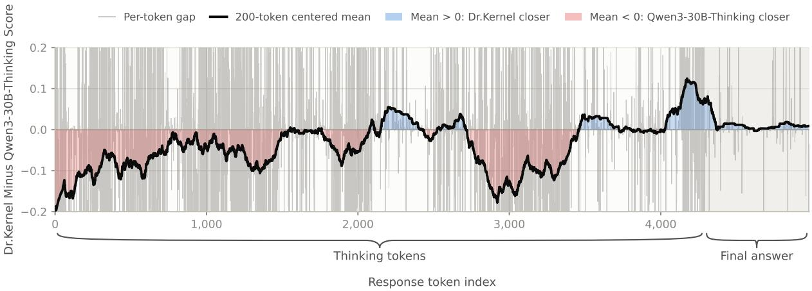
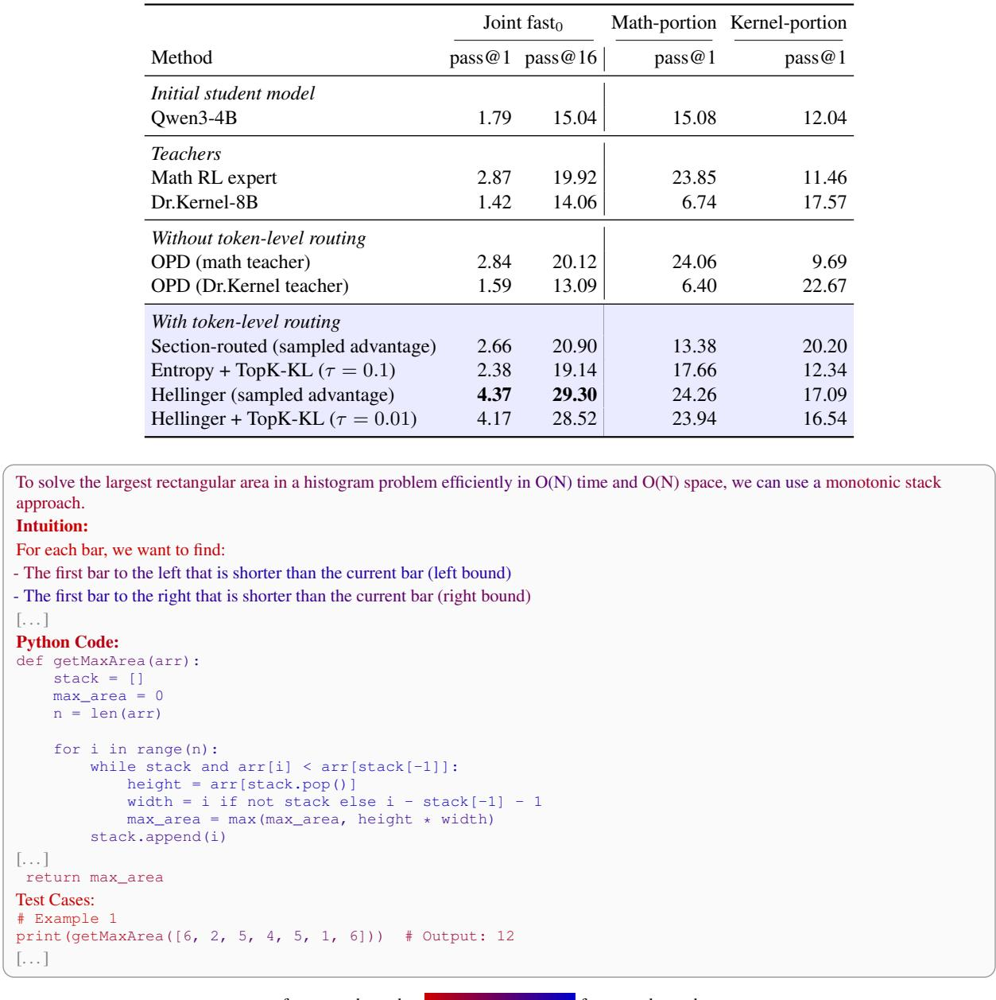
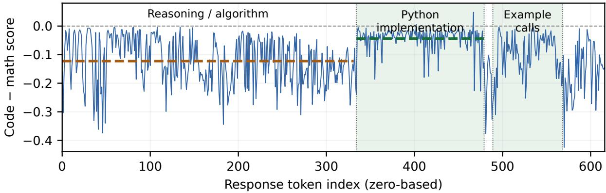

# Compatibility Matters: A Framework for Token-Level Teacher Selection in On-Policy Distillation

Stanley Wei<sup>\*1</sup>, Jiin Woo<sup>2</sup>, Kaan Ozkara<sup>2</sup>, and Youngsuk Park<sup>2</sup>

<sup>1</sup>Princeton University

<sup>2</sup>Amazon Annapurna Labs

stanley.wei@princeton.edu, {woojiin, kaanozka, pyoungsu}@amazon.com

## Abstract

On-policy distillation (OPD) has recently been introduced as a promising paradigm for continual learning, where a student policy can be supervised at the token-level. Typically, OPD is performed using a single teacher per prompt rollout (or even per training run). However, this ignores a whole other axis of flexibility that is available due to the on-policy nature — token-level teacher selection during rollouts. Building on this insight, we theoretically explore what makes a teacher and a student compatible for OPD, and leverage our findings to derive several empirical heuristics for teacher selection. In particular, our framework captures several desiderata for OPD: compatible teacher-student reasoning patterns, teacher competence, and induced student diversity. Theoretically, we categorize several types of teacher routing schemes, and we prove that under different scenarios, different routing schemes are likely to be beneficial for optimization and student diversity. We back up our findings with extensive experimental results in domains such as math, coding, kernel generation, and visual reasoning, where we find upwards of 10 percentage points of improvement on pass@k when compared to vanilla OPD and the teacher experts on certain tasks, indicating both capability improvement and diversity over high-quality responses.

## 1 Introduction

Modern LLM training generally follows the framework of a large-scale pretraining phase on corpora from the real world [Brown et al., 2020, Olmo et al., 2026], such as internet and human-curated data, followed by a post-training phase, in which a base pretrained LLM is fine-tuned to elicit domain-specific gains in capability, most notably in domains such as mathematical reasoning [Shao et al., 2024], instruction following [Ouyang et al., 2022], and software engineering [Wei et al., 2025]. In particular, reinforcement learning (RL) [Christiano et al., 2023, DeepSeek-AI et al., 2025] has recently emerged as a popular paradigm for improving LLM capabilities during post-training. This approach has been well-demonstrated to bring about scalable gains over the initial pre-training phase of LLMs, and has been widely adopted amongst both open- and closed-source models. On-policy distillation [Hinton et al., 2015, Agarwal et al., 2024] has been proposed as a promising alternative. The difference, however, is that the teacher provides dense, token-level feedback to the student rather than in RL where the single reward scalar signal guides the gradient updates. Recently, specialized versions of OPD such as on-policy self-distillation (OPSD) as well as other variants have been proposed [Zhao et al., 2026, Li et al., 2026c]. Separately, there have also been works inspired from classical RL literature which train a separate critic model to give an estimate of the process reward [Bai et al., 2022, Venkatraman et al., 2026].

In this paper, we aim to give a rigorous characterization of what makes a teacher and student compatible for OPD-style training. Informally speaking, the student and teacher should not have too much distributional mismatch [Fu et al., 2026a, Li et al., 2026b]; otherwise, as we prove, the optimization landscape will be very unfavorable. Moreover, the teacher should be somewhat competent, which we will quantify later. Finally, the teacher’s supervision should induce good diversity over good responses for the student. We formalize all of these concepts in a unified manner in Section 4.

Importantly, we make an additional observation that is unique to the on-policy setting: not only can we do teacher selection for a given prompt (i.e. as in MOPD [Ma et al., 2026] where prompts of a given domain are routed to the corresponding domain expert), we can actually also do teacher selection token-wise during a student rollout. The intuition for this is that different teachers may be more suitable for different parts of a student rollout (for instance, in algorithmic coding it may be useful to have a math teacher guide the mathematical reasoning prior to implementation).

Overall, we summarize our contributions as follows.

• First, we give a theoretical framework to ground the analysis of token-level teacher selection, in which we can decouple the contribution of teacher competence and of the teacher-student gap.

• Then, within this framework, we give a unified mathematical interpretation of the confidence-based routing scheme from Yin et al. [2026] and a newly proposed representation-based routing scheme. In particular, we show in different scenarios one or the other could prove more useful as a routing scheme. Importantly, we also prove that the representation-based routing has the potential to yield more diverse student generations.

• We back up our theoretical insights with experiments across many domains, including code, Triton kernel generation, math, and visual reasoning. These demonstrate the clear potential of token-level teacher selection over vanilla OPD via improvements across pass@k, indicating student learning of high quality and diverse responses. More importantly, we are able to have principled predictions of when a family of routing schemes is likely to be effective in practical setups.

We discuss related work in Appendix A.

## 2 Preliminaries

## 2.1 On-Policy Distillation Formulation

Consider the setup where we have a student policy $\pi _ { \theta }$ parameterized by $\theta \in \mathbb { R } ^ { d }$ . Let $x \sim \mathcal { D }$ , where D is some prompt distribution, $y = ( y _ { 1 } , \dots , y _ { | y | } ) \sim \pi _ { \theta } ( \cdot | x )$ be a generation of a student response, and $s _ { t } = ( x , y _ { < t } )$ be the state that predicts the next token $y _ { t }$ . Then, vanilla OPD minimizes the following loss:

$$
\begin{array} { r l } & { \mathcal { L } _ { \mathrm { O P D } } ( \theta ) : = \mathbb { E } _ { x \sim \mathcal { D } } [ \mathrm { K L } ( \pi _ { \theta } \| \pi _ { T } ) ] } \\ & { \quad \quad \quad = \mathbb { E } _ { x \sim \mathcal { D } , y \sim \pi _ { \theta } ( \cdot | x ) } \left[ \displaystyle \sum _ { t = 1 } ^ { | y | } \mathrm { K L } ( \pi _ { \theta } ( \cdot | s _ { t } ) \| \pi _ { T } ( \cdot | s _ { t } ) ) \right] , } \end{array}
$$

where $\pi _ { T }$ defines some teacher policy. In particular, one can calculate the gradient of this as:

$$
\begin{array} { r l } & { \nabla \mathcal { L } _ { \mathrm { O P D } } ( \boldsymbol { \theta } ) } \\ & { = \mathbb { E } _ { \boldsymbol { x } \sim \mathcal { D } , \boldsymbol { y } \sim \pi _ { \boldsymbol { \theta } } ( \cdot \vert \boldsymbol { x } ) } \left[ \displaystyle \sum _ { t = 1 } ^ { \vert \boldsymbol { y } \vert } \displaystyle \sum _ { t ^ { \prime } = t } ^ { \vert \boldsymbol { y } \vert } \log \frac { \pi _ { \boldsymbol { \theta } } \left( \boldsymbol { y } _ { t ^ { \prime } } \vert \boldsymbol { s } _ { t ^ { \prime } } \right) } { \pi _ { T } \left( \boldsymbol { y } _ { t ^ { \prime } } \vert \boldsymbol { s } _ { t ^ { \prime } } \right) } \nabla _ { \boldsymbol { \theta } } \log \pi _ { \boldsymbol { \theta } } ( \boldsymbol { y } _ { t } \vert \boldsymbol { s } _ { t } ) \right] . } \end{array}
$$

However, in practice, this gradient is approximated as:

$$
\mathbb { E } _ { \boldsymbol { x } \sim \mathcal { D } , \boldsymbol { y } \sim \pi _ { \boldsymbol { \theta } } ( \cdot | \boldsymbol { x } ) } \left[ \sum _ { t = 1 } ^ { | \boldsymbol { y } | } \log \frac { \pi _ { \boldsymbol { \theta } } ( \boldsymbol { y } _ { t } | \boldsymbol { s } _ { t } ) } { \pi _ { T } ( \boldsymbol { y } _ { t } | \boldsymbol { s } _ { t } ) } \boldsymbol { \nabla } _ { \boldsymbol { \theta } } \log \pi _ { \boldsymbol { \theta } } ( \boldsymbol { y } _ { t } | \boldsymbol { s } _ { t } ) \right] .\tag{1}
$$

Observe that this approximation is equivalent to moving the gradient inside of the expectation in the original loss (i.e. $\begin{array} { r } { \mathbb { E } _ { \boldsymbol { x } \sim \mathcal { D } , \boldsymbol { y } \sim \pi _ { \boldsymbol { \theta } } ( \cdot | \boldsymbol { x } ) } \left[ \sum _ { t = 1 } ^ { | \boldsymbol { y } | } \nabla \mathrm { K L } ( \pi _ { \boldsymbol { \theta } } ( \cdot | \boldsymbol { s } _ { t } ) \| \pi _ { T } ( \cdot | \boldsymbol { s } _ { t } ) ) \right] } \end{array}$ instead of $\begin{array} { r l } {  { \nabla \mathbb { E } _ { x \sim \mathcal { D } , y \sim \pi _ { \theta } ( \cdot | x ) } \Bigl [ \sum _ { t = 1 } ^ { | y | } \mathrm { K L } \bigl ( \pi _ { \theta } \bigl ( \cdot | s _ { t } \bigr ) \| \pi _ { T } \bigl ( \cdot | s _ { t } \bigr ) \bigr ) \Bigr ] ) } \quad } & { { } } \end{array}$ . Our token-level teacher routing acts directly on the teacher term in Equation (1). At each sampled prefix $s _ { t } .$ , we plug in our choice of $\pi _ { T } ( \cdot \mid s _ { t } )$ : either a single teacher selected by hard routing or an arithmetic mixture of teachers under soft routing, as defined in Section 3. This choice determines the sampled-token advantage; the teacher selection and mixture weights are held fixed during the update.

Note that this approximation is equivalent to using log $\pi _ { T } ( y _ { t } | s _ { t } )$ − log $\pi _ { \boldsymbol { \theta } } ( \boldsymbol { y } _ { t } | \boldsymbol { s } _ { t } )$ as the token-level advantage in OPD. In the rest of our exposition, we will refer to the vanilla OPD above as the sampled-token advantage OPD. This is because we will also consider a variant of the above, which is the Top-K KL loss version of OPD; we provide the precise formulation of this in Appendix E.1.

## 3 Token-Level Teacher Selection

Given C teachers $\pi _ { T _ { 1 } } , \ldots , \pi _ { T _ { C } } { } ^ { 1 }$ , we would like to understand which of these teachers best supervises the student rollout at each token. In our context, token-level supervision simply means choosing a teacher for each prefix state $s _ { t }$ for the gradient update in Equation (1). Regardless of the way we define success for our training run, we already know a priori that there exists a token-level teacher routing scheme that cannot do worse than vanilla OPD (i.e. fixing a teacher throughout training), as we now have combinatorially more options across the entire axis of rollout horizon; we formalize this fact in Section 4.1 and Appendix B.1, where the notion of success is suboptimality of reward with respect to some golden reference distribution.

We now describe the general framework used for routing, first introduced in Yin et al. [2026]. At iteration $j$ of training, generate responses from $\pi _ { \boldsymbol { \theta } _ { \mathcal { I } } }$ and compute scores $S _ { i } ( s _ { t } ; \theta _ { j } )$ for teacher i. For a temperature $\tau > 0 ^ { 2 }$ , define the weights

$$
w _ { i } ( s _ { t } ) = \frac { \exp ( S _ { i } ( s _ { t } ; \theta _ { j } ) / \tau ) } { \sum _ { h = 1 } ^ { C } \exp ( S _ { h } ( s _ { t } ; \theta _ { j } ) / \tau ) } .\tag{2}
$$

Then, we use the mixture teacher $\begin{array} { r } { \pi _ { T , w } = \sum _ { i } w _ { i } \pi _ { T _ { i } } } \end{array}$ as the supervision target of prefix $s _ { t }$ . Using this framework, we now give three classes of routing schemes.

Direct section routing. When the required skill is clear from the rollout section, we can directly assign its domain teacher. That is, for a student rollout $y = ( y _ { 1 } , \dots , y _ { H } )$ , if token t corresponds to the domain of teacher $i ,$ one can consider directly routing the teacher at token t to be teacher i by taking $\tau = 0$ and $S _ { i } ( s _ { t } ; \theta _ { j } ) > S _ { i ^ { \prime } } ( s _ { t } ; \theta _ { j } )$ for $i ^ { \prime } \neq i$ in Equation (2), from which the gradient in Equation (1) will be calculated. For example, in the setting of writing kernel code, a thinking teacher can supervise a reasoning section, while a kernel specialist can supervise the subsequent implementation.

Teacher confidence-based routing. This was first introduced in Yin et al. [2026] through their H-OPD algorithm. In this family of routing scores, $S _ { i } ( s _ { t } ; \theta _ { j } )$ is taken to be the negative entropy of the teacher at that prefix; that is, $S _ { i } ( s _ { t } ; \theta _ { j } ) = - H ( \pi _ { T _ { i } } ( \cdot | s _ { t } ) )$ . Note that this is independent of the student policy at $s _ { t }$ and is calculated purely from the teacher’s confidence. In some sense, this can be seen as a proxy estimating which teacher yields more successful rewards on its continuation from a student prefix; this proxy is more accurate of course when the teacher is correctly confident.

Teacher-student representation-based routing. We introduce a new, more general family of routing schemes that captures the state of the student policy at $s _ { t } ,$ by considering the teacher compatibility with the student in the sense of match in representation space or similarity of thinking patterns. Empirically, we implement the following scores<sup>3</sup>: 1) the negative Hellinger distance<sup>4</sup> between the student and teacher policy at $s _ { t } .$ , and $^ { 2 ) }$ the negative squared Euclidean distance between the teacher and student features at $s _ { t }$ (that is, the final layer before the unembedding layer, denoted as $\phi ( s _ { t } )$ on prefix $s _ { t }$ for the student, and $\psi _ { i } ( s _ { t } )$ for teacher i). We remark that feature matching is especially natural for shared architectures, such as a teacher post-trained from the student; otherwise, we resort to the Hellinger distance.

## 4 Theoretical Analysis of Teacher Routing Schemes

In this section, we provide a theoretical framework to unify the different families of routing schemes described in Section 3, in an aim to understand when these schemes may be useful.

## 4.1 Decoupling Teacher Competence and the Student-Teacher Gap

To begin, we introduce the performance difference lemma [Kakade and Langford, 2002, Schulman et al., 2015], which allows us to roughly decouple the teacher competence (as measured via the reward suboptimality to some target distribution) and the student optimization toward the teacher. Let $R ( x , y ) \in [ 0 , 1 ]$ be the relevant task reward, and define the performance of any autoregressive policy π by

$$
J ( \pi ) : = \mathbb { E } _ { x \sim \mathcal { D } , y \sim \pi ( \cdot | x ) } R ( x , y ) .
$$

Let $\pi ^ { \star }$ denote a fixed golden reference policy, $\pi _ { \theta }$ the student, and $\pi _ { T }$ a fixed teacher policy. For a policy $\pi$ and prefix $\boldsymbol { s } _ { t } = \left( x , y _ { < t } \right)$ , let $V _ { t } ^ { \pi } ( s _ { t } )$ be the expected terminal reward when all remaining tokens are drawn from $\pi ,$ and let $Q _ { t } ^ { \pi } ( s _ { t } , v )$ be the expected terminal reward when the next token is fixed to v and subsequent tokens follow $\pi .$ Observe that $\begin{array} { r } { V _ { t } ^ { \pi } ( s _ { t } ) = \sum _ { v } \pi ( v \mid s _ { t } ) Q _ { t } ^ { \pi } ( s _ { t } , v ) } \end{array}$ , and define the task-reward advantage $A _ { t } ^ { \pi } ( s _ { t } , v ) : = Q _ { t } ^ { \pi } ( s _ { t } , v ) - V _ { t } ^ { \pi } ( s _ { t } )$ . Finally, we denote $d _ { t } ^ { \pi _ { \theta } }$ as the distribution of $s _ { t }$ obtained by sampling $x \sim \mathcal { D }$ and the first t − 1 student tokens.

Performance difference lemma. Let the teacher’s gap to the golden reference policy $\pi ^ { \star }$ be $\Delta _ { T } : = J ( \pi ^ { \star } ) - J ( \pi _ { T } )$ Then, it holds that:

$$
\begin{array} { r l } & { J ( \pi ^ { \star } ) - J ( \pi _ { \theta } ) } \\ & { = \underbrace { \Delta _ { T } } _ { \mathrm { t e a c h e r c o m p e t e n c e \ : g a p } } + \underbrace { J ( \pi _ { T } ) - J ( \pi _ { \theta } ) } _ { \mathrm { s u d e n t \ : t e a c h e r \ : g a p } } } \\ & { = \displaystyle \Delta _ { T } - \sum _ { t = 1 } ^ { H } \mathbb { E } _ { s _ { t } \sim d _ { t } ^ { \pi _ { \theta } } , v \sim \pi _ { \theta } ( \cdot \vert s _ { t } ) } A _ { t } ^ { \pi _ { T } } ( s _ { t } , v ) . } \end{array}
$$

Under this setup, we now illustrate the potential of token-wise teacher selection, using the following intuitive result regarding the sum of the token-level advantages induced by the teacher on the right hand side of the above equality.

Lemma 1. Suppose we have access to two teachers $\pi _ { T _ { 1 } } , \pi _ { T _ { 2 } }$ , and we have a routing scheme $p ( \cdot )$ that maps prefix states $s _ { t } \ t o \ \{ T _ { 1 } , T _ { 2 } \}$ . Then, it holds that:

$$
\begin{array} { r l } & { \underset { p } { \operatorname* { m i n } } \left\{ - \underset { t = 1 } { \overset { H } { \sum } } \mathbb { E } _ { s _ { t } \sim d _ { t } ^ { \pi _ { \theta } } , v \sim \pi _ { \theta } ( \cdot \vert s _ { t } ) } A _ { t } ^ { \pi _ { p ( s _ { t } ) } } ( s _ { t } , v ) \right\} } \\ & { \leq - \underset { t = 1 } { \overset { H } { \sum } } \mathbb { E } _ { s _ { t } \sim d _ { t } ^ { \pi _ { \theta } } , v \sim \pi _ { \theta } ( \cdot \vert s _ { t } ) } A _ { t } ^ { \pi _ { T _ { i } } } ( s _ { t } , v ) \quad f o r i = 1 , 2 } \end{array}
$$

Proof. This follows from the fact that the right hand side is just the routing scheme $p ( \cdot ) = T _ { 1 } \mathrm { o r } p ( \cdot ) = T _ { 2 }$

This token-wise decomposition suggests an entire underexplored axis of teacher selection, and it is perfectly plausible that something as naive as section routing should yield better performance than a fixed teacher (nevertheless, we should generally hope for something more principled to exist). Henceforth, we will try to understand how we should perform this selection at the token-level. To begin, we will make the connection between the above student-teacher gap and the reverse KL loss through the following lemma, whose full proof is in Appendix B.1.

Lemma 2. For each prefix $s _ { t } ,$ define

$$
L _ { T , t } ( \theta ; s _ { t } ) : = \mathrm { K L } ( \pi _ { \theta } ( \cdot \mid s _ { t } ) \parallel \pi _ { T } ( \cdot \mid s _ { t } ) ) .
$$

Then, it holds that

$$
| J ( \pi _ { T } ) - J ( \pi _ { \theta } ) | \leq \sum _ { t = 1 } ^ { H } \mathbb { E } _ { s _ { t } \sim d _ { t } ^ { \pi _ { \theta } } } \sqrt { \frac { 1 } { 2 } L _ { T , t } ( \theta ; s _ { t } ) } .\tag{3}
$$

Lemma 2 upper bounds the teacher-student imitation gap in terms of a sum of the different token-level KL terms. While this is not the exact gap term, it is a meaningful surrogate that allows tractable theoretical analysis. Furthermore, this is exactly what OPD optimizes for: minimizing the token-level KL between a student and a given teacher. In the next few sections, we will be concerned with understanding how to choose a teacher that minimizes this student-teacher imitation gap from quantifying the student-teacher compatibility, and using that to demonstrate a separation from the optimization perspective.

## 4.2 Unifying Representation- and Entropy-Based Routing

Setup. Let X denote the set of prompts, V denote the vocabulary, and $\mathcal { V } ^ { \star }$ denote the set of finite sequences over $\nu .$ We work in the log-linear model family, which is defined by a fixed feature mapping $\phi : \mathcal { X } \times \mathcal { V } ^ { \star }  \mathbb { R } ^ { d }$ . Such a model family is parameterized by $\theta \in \mathbb { R } ^ { d }$ , and for a given rollout of length H, we define $( \pi _ { \theta } ) _ { t = 1 } ^ { H }$ by:

$$
\pi _ { \boldsymbol { \theta } } ( y _ { t } | s _ { t } ) \propto \exp { ( \langle \boldsymbol { \theta } , \boldsymbol { \phi } ( s _ { t } , y _ { t } ) \rangle ) } .
$$

Note that the log-linear setting is an abstraction of real-world autoregressive models such as transformers [Vaswani et al., 2023] with fixed hidden features. In our setting, we will assume that the student has fixed features $\phi ( \cdot )$ and trainable linear head $\theta \in \mathbb { R } ^ { d }$ , and teacher i has fixed features $\psi _ { i } ( \cdot )$ and linear head $\boldsymbol { \omega } _ { i } \in \mathbb { R } ^ { d }$ . That is, we have the following:

$$
\begin{array} { r l } & { ~ \pi _ { \theta } ( y _ { t } | s _ { t } ) \propto \exp \left( \langle \theta , \phi ( s _ { t } , y _ { t } ) \rangle \right) } \\ & { \pi _ { T _ { 1 } } ( y _ { t } | s _ { t } ) \propto \exp \left( \langle \omega _ { 1 } , \psi _ { 1 } ( s _ { t } , y _ { t } ) \rangle \right) } \\ & { \pi _ { T _ { 2 } } ( y _ { t } | s _ { t } ) \propto \exp \left( \langle \omega _ { 2 } , \psi _ { 2 } ( s _ { t } , y _ { t } ) \rangle \right) , } \end{array}
$$

where $\phi ( \cdot ) , \psi _ { 1 } ( \cdot ) , \psi _ { 2 } ( \cdot ) \in \mathbb { R } ^ { d }$ . Note that θ is the only trainable parameter here, as we will not be training the teacher. In the exposition that follows, we will hold $\boldsymbol { s } _ { t } = \left( x , y _ { < t } \right)$ fixed, so that we can localize our analysis to the contribution of a single prefix.<sup>5</sup> In addition, we will not consider the additive mixture models as we do in our empirical experiments; in other words, our theory analyzes only hard routing $( \tau = 0 )$ .

A unified framework. We briefly lay out some heuristic calculations on when we can expect different routing schemes to be beneficial. First, suppose that $\rho _ { i }$ is some scalar quantity that quantifies the alignment between the teacher and student features<sup>6</sup>, and let $\theta _ { 0 }$ denote the student head at initialization. Under our setup, the initial gradient can be written as:

$$
\begin{array} { r l } & { \quad - \nabla L _ { T _ { i } , t } ( \theta _ { 0 } ; s _ { t } ) = \underbrace { \rho _ { i } \omega _ { i } } _ { \mathrm { a c c e s s i b l e t e a c h e r ~ s i g n a l } } - \theta _ { 0 } , } \\ & { \implies \| \nabla L _ { T _ { i } , t } ( \theta _ { 0 } ; s _ { t } ) \| _ { 2 } ^ { 2 } = \rho _ { i } ^ { 2 } \| \omega _ { i } \| _ { 2 } ^ { 2 } + \| \theta _ { 0 } \| _ { 2 } ^ { 2 } - 2 \rho _ { i } \langle \omega _ { i } , \theta _ { 0 } \rangle } \\ & { \qquad \approx \rho _ { i } ^ { 2 } \| \omega _ { i } \| _ { 2 } ^ { 2 } } \end{array}\tag{4}
$$

In this simplification, we observe that the main (scalar) quantities affecting the accessible teacher signal are the studentteacher representation alignment coefficient $\rho _ { i }$ , as well as the magnitude of the teacher head $\lVert \omega _ { i } \rVert _ { 2 }$ . Together, these two factors explain the complementary roles of the routing schemes. For instance, assuming different teacher head magnitudes are equal, choosing the more aligned teacher roughly maximizes the initial gradient norm. On the other hand, assuming that the teacher-student feature alignments are of roughly similar scale, choosing the teacher that has higher norm roughly corresponds to choosing the more confident teacher (and also maximizes the initial gradient norm). In particular, our theoretical analysis demonstrates that the initial gradient norm determines how much movement in parameter space will happen, and hence regulates how low we can get in terms of the reverse KL loss in Equation (3). Of particular note is that as we have decoupled the contribution of teacher competence in the performance difference lemma, the teacher reward does not generally have an explicit contribution in this gradient. We defer a more detailed discussion of this to Appendix D.

## 4.3 Representation-Based Teacher Routing

In this section, we will show two results about representation-based routing: how it 1) yields more gradient movement, and 2) yields more diversity over the overlapping feature space, which is beneficial when good modes are distributed relatively uniformly.

Our main result here is Theorem 1, which states that under mild conditions on the teacher and student features, the teacher that is more aligned with the student induces a larger gradient norm. For any function $f$ of a candidate token, define the shorthand $\begin{array} { r } { \mathbb { E } _ { t } [ f ( v ) ] : = \sum _ { v \in \mathcal { V } } \pi _ { \theta _ { 0 } } ( v \mid s _ { t } ) f ( v ) } \end{array}$ where $\theta _ { 0 }$ is the student head’s parameter at initialization. Consider the contribution of the reverse KL loss at token t of teacher i,

$$
L _ { i , t } ( \theta ) : = \sum _ { v \in \mathcal { V } } \pi _ { \theta } ( v \mid s _ { t } ) \log \frac { \pi _ { \theta } ( v \mid s _ { t } ) } { \pi _ { T _ { i } } ( v \mid s _ { t } ) } .
$$

We now connect this initial update to the time needed to reduce the teacher–student $\mathrm { K L }$ . Define the mean squared feature discrepancy and the initial gradient norm by

$$
D _ { i } ( t ) : = \mathbb { E } _ { t } \Vert \phi ( s _ { t } , v ) - \psi _ { i } ( s _ { t } , v ) \Vert _ { 2 } ^ { 2 } , \qquad a _ { i } : = \Vert \nabla L _ { i , t } ( \theta _ { 0 } ) \Vert _ { 2 } .
$$

Starting from the same student head $\theta _ { 0 }$ , let $\theta _ { n } ^ { ( i ) }$ be the student head after n gradient updates using teacher i:

$$
\theta _ { 0 } ^ { ( i ) } = \theta _ { 0 } , \qquad \theta _ { n + 1 } ^ { ( i ) } = \theta _ { n } ^ { ( i ) } - \eta \nabla L _ { i , t } ( \theta _ { n } ^ { ( i ) } ) ,
$$

where $\eta > 0$ is the learning rate. For a target loss level $0 < \varepsilon <$ min<sub>i</sub> $L _ { i , t } ( \theta _ { 0 } )$ , define the learning time

$$
N _ { i } ( \varepsilon ) : = \operatorname* { i n f } \{ n \in \mathbb { Z } _ { \geq 0 } : L _ { i , t } ( \theta _ { n } ^ { ( i ) } ) \leq \varepsilon \} ,
$$

Then, we have the following separation in learning time.

Theorem 1 (Learning time guarantee for feature-based routing, abridged). Suppose that $\| \omega _ { 1 } \| _ { 2 } = \| \omega _ { 2 } \| _ { 2 }$ . Then, under suitable assumptions, we have that $i f D _ { 1 } ( t ) < D _ { 2 } ( t )$ , then $a _ { 1 } > a _ { 2 } .$ . For a sufficiently small learning rate $\eta ,$

$$
N _ { 1 } ( \varepsilon ) = O \left( \frac { 1 } { \eta a _ { 1 } ^ { 2 } } \right) \lesssim N _ { 2 } ( \varepsilon ) = \Omega \left( \frac { 1 } { \eta a _ { 2 } ^ { 2 } } \right) .
$$

Proof sketch. Under mild assumptions, we can directly compute the gradients at initialization, the magnitude of which scales with decreasing $D _ { i } ( t )$ . Using this, as well as smoothness of the loss landscape, we obtain an upper bound on $N _ { 1 } ( \epsilon )$ and a lower bound on $N _ { 2 } ( \epsilon )$ , which yields the separation. The full unabridged version of this theorem statement is in Appendix B.3.

## 4.4 Confidence-Based Routing

We now consider the complementary setting where the two teachers share a feature map ψ, but with heads of differing magnitudes. It turns out that in this case, teacher confidence is correlated with the magnitude of its head, which consequently controls the magnitude of the gradient signal to the student. Fix the prefix $s _ { t }$ and initial student head $\theta _ { 0 }$ as before, and define the teacher’s entropy by

$$
H _ { i } : = - \sum _ { v \in \mathcal { V } } \pi _ { T _ { i } } ( v  { \mid } s _ { t } ) \log \pi _ { T _ { i } } ( v  { \mid } s _ { t } ) .
$$

Theorem 2 (Learning time guarantee for entropy-based routing, abridged). Suppose $\psi ( s _ { t } , v ) : = \psi _ { 1 } ( s _ { t } , v ) = \psi _ { 2 } ( s _ { t } , v )$ for every token v; that is, the two teachers share thefixedfeatures. Then, under suitable assumptions, we have that $i f$ $H _ { 1 } < H _ { 2 }$ , then it holds that $a _ { 1 } > a _ { 2 } .$ . For a sufficiently small learning rate η, it holds that

$$
N _ { 1 } ( \varepsilon ) = O \left( \frac { 1 } { \eta a _ { 1 } ^ { 2 } } \right) \lesssim N _ { 2 } ( \varepsilon ) = \Omega \left( \frac { 1 } { \eta a _ { 2 } ^ { 2 } } \right) .
$$

Proof sketch. Roughly speaking, the scale of teacher logits increases with the magnitude of $\left\| \omega _ { i } \right\| _ { 2 }$ . Therefore, under mild assumptions, we show that increasing $\| \omega _ { i } \| _ { 2 }$ increases the logit gaps between different tokens, thus strictly lowering the entropy. As such, teacher 1 will have a stronger pull, in the sense of a large gradient, and from there, we can conclude the proof in a similar manner as Theorem 1 to obtain the separation. The full proof is deferred to Appendix C.

## 4.5 Overlap with Good Solutions and Coverage

There is an additional benefit of our representation-based routing scheme from Section 4.3 worth highlighting. Assuming high-quality modes are uniformly distributed, choosing a more aligned teacher gives a stronger guarantee on how many of these modes the optimized student retains. Put simply, we have stronger guarantees on the diversity over good responses learned by the student. We present the abridged theorem here.

Theorem 3 (Diversity guarantee, abridged). Let $G _ { 1 } , \ldots , G _ { M }$ be disjoint, nonempty next-token sets identifying $M \geq 1$ successful continuation modes. Assume afixed shared continuation mechanism: tokens in $G _ { j }$ lead to success in mode $j ,$ and tokens outside their unionfail; moreover, suppose that both teachers place probability $c / M$ on each mode,for some common success probability $c \in ( 0 , 1 )$ . Then, there exists a teacher-dependent error term $e _ { i } \in [ 0 , c / M )$ that increases as $D _ { i } ( t )$ increases, which satisfies that the expected number of distinct successful modes observed in k independent samplesfrom $\pi _ { \theta _ { i } ^ { \star } }$ is at least $M \big [ 1 - ( 1 - c / { M } + e _ { i } ) ^ { k } \big ]$ , where $\theta _ { i } ^ { \star } = \arg \operatorname* { m i n } _ { \theta } L _ { i , t } ( \theta )$

Proof sketch. The feature overlap provides the direction for learnable teacher signal. Under the uniform mode assumption, we can prove that the student, when optimized against teacher i, will retain at least $c / M - e _ { i }$ probability on every mode, yielding the desired result.

Furthermore, a related concept is the coverage profile perspective of Chen et al. [2025], which characterizes how well a distribution covers some target distribution (and is also predictive of pass@k performance). For our setting, let $\nu ( j ) : = 1 / M$ be the target distribution, uniform over the M good modes. For a threshold parameter $N > 1 / c$ , we adapt the framework in Chen et al. [2025] to define the undercoverage by

$$
C _ { N } ^ { \mathrm { m o d e } } ( \nu \| \pi _ { \theta _ { i } ^ { \star } } ) : = \frac { 1 } { M } \sum _ { j = 1 } ^ { M } \mathbf { 1 } \biggl \{ \pi _ { \theta _ { i } ^ { \star } } ( G _ { j } ) \leq \frac { 1 } { M N } \biggr \} .\tag{5}
$$

Corollary 1 (Undercoverage of successful modes). In the setting of Theorem 3, for every $N > 1 / c$

$$
C _ { N } ^ { \mathrm { m o d e } } ( \nu \| \pi _ { \theta _ { i } ^ { \star } } ) \leq \frac { e _ { i } } { c - 1 / N } .
$$

We remark that our analysis here provides a comparison of the lower bounds of expected number of distinct modes, rather than the value itself. Nevertheless, we believe it is still a reasonable surrogate to look at; our experiments demonstrate that our representation-matching method indeed yields higher pass@k even when pass@1 is not necessarily higher. We give the full proof of all results above in Appendix B.4.

## 5 Experimental Results

We study token-level teacher selection in settings that encompass the domains of math, coding, Triton kernel generation, and visual reasoning<sup>7</sup>. More specifically, we consider the following setups:

  
Figure 1: Triton-only entropy routing (τ = 0.1; iteration 300). Here, we plot the score gap of the kernel teacher minus the thinking teacher. The full trace is included in Appendix H.3, where we can observe that the blue (positive) regions on this plot correspond roughly to parts of the student rollout where Triton code is being generated, and the red parts correspond to general reasoning or thinking behavior to plan the kernel code.

• A synthetic math-triton task with access to respective math and Triton teachers where there is a clear way to perform teacher selection via section routing (Section 5.1)

• A Triton-only task with access to a thinking model and a domain expert (Section 5.2)

• Algorithmic coding tasks under a math and code teacher (Section 5.3)

Precise scoring functions used are defined in Appendix E.2, as they may differ in implementation from our theoretical formulations in Section 4. One concrete example of this is when we choose to use the Hellinger score instead of the feature distance score in some cases, due to the teacher and student having different architectures. Additional training details and evaluation protocols are given in Appendices F and G. Notably, for our score-based routing frameworks, we will generally sweep through several temperatures τ, as well as choices of policy gradient implementation (i.e. either sampled token advantage or the Top-K KL). For sampled token advantage, we use τ = 0 (i.e. hard routing) by default. In our tables, besides reporting results on token-level routing, we also report baselines of vanilla OPD (which uses sampled token advantage by default), as well as the teachers and initial student performance.

## 5.1 A Synthetic Math-Triton Task

We construct more than 8000 training prompts by pairing DeepMath problems [He et al., 2025] with KernelBook tasks [Paliskara and Saroufim, 2025]. Each prompt requests both solutions, with the task order assigned randomly and held fixed. The student model we use is a Qwen3-4B [Qwen Team, 2025a], using the non-base variant with thinking mode off. For the teachers, we use a Qwen3-4B that has gone through math RL training on DeepMath, as well as the Dr.Kernel-8B [Liu et al., 2026a]. We train the student for 300 updates on these composite prompts.

For evaluation, we use the size 3000 set of AIME 2025 × KernelBench Level 2 [OpenCompass Contributors, 2025, Ouyang et al., 2025] combinations (30 AIME problems and 100 KernelBench Level 2 problems). Joint success requires a correct math answer and a correct kernel in the same response, with kernel correctness measured by fast<sub>0</sub>, which gives a binary reward purely depending on correctness, without regard to speedup. Our results are shown in Table 1, in which we compare against the baselines of the initial student model, the teachers, and vanilla OPD. With token-level routing, our Hellinger routing metric performs the best on this joint fast score, for both pass@1 and pass@16, reaching 29.30% on pass@16, which is close to 10 percentage points over vanilla OPD on either teacher, the entropy-routing training, and even the naive section-routing variant.



Table 1: AIME 2025 × KernelBench L2 (%). Joint fast<sub>0</sub> requires correctness of both components in one response (higher is better); we also report the math-portion and kernel-portion breakdown for completeness. Note that for the sampled advantage Hellinger routing, the scores on each individual section recover roughly the teacher performance, and together yield the highest joint score.
<table><tr><td rowspan="2">Method</td><td colspan="2">Joint fasto</td><td></td><td>Math-portion Kernel-portion</td></tr><tr><td></td><td>pass@1 pass@16</td><td>pass@1</td><td>pass@1</td></tr><tr><td>Initial student model</td><td></td><td></td><td></td><td></td></tr><tr><td>Qwen3-4B</td><td>1.79</td><td>15.04</td><td>15.08</td><td>12.04</td></tr><tr><td>Teachers</td><td></td><td></td><td></td><td></td></tr><tr><td>Math RL expert</td><td>2.87</td><td>19.92</td><td>23.85</td><td>11.46</td></tr><tr><td>Dr.Kernel-8B</td><td>1.42</td><td>14.06</td><td>6.74</td><td>17.57</td></tr><tr><td>Without token-level routing</td><td></td><td></td><td></td><td></td></tr><tr><td>OPD (math teacher)</td><td>2.84</td><td>20.12</td><td>24.06</td><td>9.69</td></tr><tr><td>OPD (Dr.Kernel teacher)</td><td>1.59</td><td>13.09</td><td>6.40</td><td>22.67</td></tr><tr><td>With token-level routing</td><td></td><td></td><td></td><td></td></tr><tr><td>Section-routed (sampled advantage)</td><td>2.66</td><td>20.90</td><td>13.38</td><td>20.20</td></tr><tr><td>Entropy + TopK-KL (τ = 0.1)</td><td>2.38</td><td>19.14</td><td>17.66</td><td>12.34</td></tr><tr><td>Hellinger (sampled advantage)</td><td>4.37</td><td>29.30</td><td>24.26</td><td>17.09</td></tr><tr><td>Hellinger + TopK-KL (τ = 0.01)</td><td>4.17</td><td>28.52</td><td>23.94</td><td>16.54</td></tr></table>

Figure 2: Abridged rollout on algorithmic coding task by a student trained with feature routing, at step 300. Here, the text is colored by the code-minus-math routing score. Note that the coloring demonstrates that the reasoning part of the rollout leans more towards the math teacher, and the Python implementation is markedly closer to the code teacher. Omitted text is marked by [. . .], and the full per-token score gap and complete rollout are in Figure 3 and Appendix H.2.

## 5.2 Triton-only Task with Thinking Mode

In this setting, we consider a Qwen3-4B student with thinking mode turned on and train it to generate Triton kernels. For the teachers, we will use the Qwen3-30B-A3B-Thinking model and Dr.Kernel-8B, with the goal of combining general reasoning ability with specialized domain knowledge in Triton. We train the student for 300 steps on KernelBook tasks. For evaluation, we use the 100 KernelBench Level 2 benchmark problems. In Table 2, we compare our token-level routing schemes with the base model, the Triton expert, and vanilla OPD. In this thinking model setup, it turns out that entropy-based routing performs the best for fast score. In contrast to the previous settings, entropy-based is more effective than the Hellinger-based routing. We illustrate this using an example rollout in Figure 1.

Table 2: Triton-only evaluation on 100 KernelBench Level 2 tasks (%). Fast<sub>0</sub> measures kernel correctness.
<table><tr><td></td><td colspan="2">Fasto</td></tr><tr><td>Method Initial student model</td><td>pass@1 pass@16</td><td></td></tr><tr><td>Qwen3-4B</td><td>9.63</td><td>53.00</td></tr><tr><td>Teachers Dr.Kernel-8B</td><td>12.63</td><td>78.00</td></tr><tr><td>Without token-level routing OPD (Dr.Kernel teacher) OPD (thinking teacher)</td><td>4.50 6.12</td><td>49.00 42.00</td></tr><tr><td>With token-level routing Section-routed (sampled advantage) Entropy (sampled advantage) Entropy + TopK-KL (τ = 0.1) Hellinger (sampled advantage)</td><td>9.12 22.44 15.56</td><td>46.00 82.00 74.00</td></tr></table>

Table 3: Algorithmic coding correctness (%). Although our feature-matching selection does not achieve the highest pass@1, it shows improvements for pass@64, indicating the benefits of diversity of this router.
<table><tr><td>Method</td><td colspan="2">HumanEval+</td><td colspan="2">MBPP+</td></tr><tr><td></td><td>pass@1</td><td>pass@64</td><td>pass@1</td><td>pass@64</td></tr><tr><td>Initial student model</td><td></td><td></td><td></td><td></td></tr><tr><td>Qwen3-4B</td><td>76.28</td><td>92.42</td><td>58.98</td><td>76.78</td></tr><tr><td>Teachers</td><td></td><td></td><td></td><td></td></tr><tr><td>Code RL expert</td><td>81.15</td><td>93.59</td><td>58.38</td><td>77.29</td></tr><tr><td>Math RL expert</td><td>78.24</td><td>93.08</td><td>60.45</td><td>77.23</td></tr><tr><td>Without token-level routing</td><td></td><td></td><td></td><td></td></tr><tr><td>OPD (code teacher)</td><td>80.90</td><td>93.80</td><td>58.39</td><td>77.00</td></tr><tr><td>With token-level routing</td><td></td><td></td><td></td><td></td></tr><tr><td>Entropy + TopK-KL (τ = 0.5)</td><td>80.13</td><td>93.81</td><td>59.26</td><td>77.92</td></tr><tr><td>Feature + TopK-KL (τ = 1)</td><td>80.03</td><td>94.14</td><td>59.21</td><td>78.01</td></tr></table>

## 5.3 Algorithmic Coding

For algorithmic coding, we keep the Qwen3-4B non-base variant as the initial student. For the teachers, we first train a code RL expert using more than 25000 Eurus-2-RL code prompts [Cui et al., 2025]. We also use the teacher trained via math RL from the previous synthetic task, and these two teachers form the domain experts that we use in this algorithmic coding setting, where it is reasonable to expect mathematical ability may improve algorithmic thinking and coding ability. Then, we train the student for 300 updates on code-only problems from Eurus-2-RL.

For evaluation, we use HumanEval+ and MBPP+ benchmarks [Chen et al., 2021, Austin et al., 2021, Liu et al., 2023]. Our results are presented in Table 3, in which we compare against the baselines of the initial student model, the RL math and RL code teachers, as well as vanilla OPD. With token-level routing, the training with the feature-matching scheme shows improvements for pass@64 over all of the other baselines, despite not necessarily having higher pass@1. This pattern is consistent with our theory of preserving coverage of successful responses in Section 4.5. Finally, we also illustrate in Figure 2 an example of how the feature matching scheme routes the teacher across a single student rollout.

## 5.4 Interpreting Effective Routing Schemes

We note that in the above three settings, Hellinger- or feature-based routing performed better on the code-only task and the synthetic Triton-math task, whereas the entropy-based routing performed better on the Triton-thinking task. Looking back at Equation (4), we observe that when the LLM heads have similar magnitudes, the feature alignment $\rho$ is the useful router. Under the code-only and Triton-math task, we have access to teachers which are essentially fine-tuned versions of the base model. Empirically speaking, fine-tuning should not change head norms $\| \boldsymbol { \omega } \| _ { 2 }$ by much, and as such the feature alignment becomes the important term. Analogously, Equation (4) demonstrates that when the teacher features are equally (mis-)aligned with the student features, entropy becomes the useful router. Indeed, in the Triton-thinking task, neither teacher is from the same model family as the base model, so the student and the teachers naturally do not have much feature alignment. In that sense, we would expect the entropy-based routing to be more effective, which it indeed is.

## 6 Conclusion

In this work, we explore token-level teacher routing as an additional axis for OPD training. To that end, we propose a theoretical framework in the log-linear setting to unify existing classes of teacher selection methods (e.g. entropy-based) as well as a new class of representation-based routing that we propose. Together, these allow us to predict empirically when one scheme may be more beneficial than the other, in the context of the trained student’s ability and output diversity. We believe there is room for much more design and improvement on this axis, as well as understanding of its downstream benefits. For instance, an interesting open question would be to understand if the diversity improvements of our teacher selection scheme can be used to create a better warm start for RL post-OPD. In addition, it would also be worthwhile to derive teacher selection metrics that are more reward-aware, beyond simply choosing the strongest teacher.

## AI use statement

In this work, we used generative AI tools for literature search, writing code, and brainstorming ideas. We have reviewed all AI-assisted work. We take responsibility for the final content of this work, including text, claims or artifacts produced with the aid of generative AI.

## References

Rishabh Agarwal, Nino Vieillard, Yongchao Zhou, Piotr Stanczyk, Sabela Ramos, Matthieu Geist, and Olivier Bachem. On-policy distillation of language models: Learning from self-generated mistakes. In International Conference on Learning Representations, 2024. URL https://arxiv.org/abs/2306.13649.

Jacob Austin, Augustus Odena, Maxwell Nye, Maarten Bosma, Henryk Michalewski, David Dohan, Ellen Jiang, Carrie Cai, Michael Terry, Quoc Le, and Charles Sutton. Program synthesis with large language models, 2021. URL https://arxiv.org/abs/2108.07732.

Yuntao Bai, Andy Jones, Kamal Ndousse, Amanda Askell, Anna Chen, Nova DasSarma, Dawn Drain, Stanislav Fort, Deep Ganguli, Tom Henighan, Nicholas Joseph, Saurav Kadavath, Jackson Kernion, Tom Conerly, Sheer El-Showk, Nelson Elhage, Zac Hatfield-Dodds, Danny Hernandez, Tristan Hume, Scott Johnston, Shauna Kravec, Liane Lovitt, Neel Nanda, Catherine Olsson, Dario Amodei, Tom Brown, Jack Clark, Sam McCandlish, Chris Olah, Ben Mann,

and Jared Kaplan. Training a helpful and harmless assistant with reinforcement learning from human feedback, 2022. URL https://arxiv.org/abs/2204.05862.

Tom B. Brown, Benjamin Mann, Nick Ryder, Melanie Subbiah, Jared Kaplan, Prafulla Dhariwal, Arvind Neelakantan, Pranav Shyam, Girish Sastry, Amanda Askell, Sandhini Agarwal, Ariel Herbert-Voss, Gretchen Krueger, Tom Henighan, Rewon Child, Aditya Ramesh, Daniel M. Ziegler, Jeffrey Wu, Clemens Winter, Christopher Hesse, Mark Chen, Eric Sigler, Mateusz Litwin, Scott Gray, Benjamin Chess, Jack Clark, Christopher Berner, Sam McCandlish, Alec Radford, Ilya Sutskever, and Dario Amodei. Language models are few-shot learners, 2020. URL https://arxiv.org/abs/2005.14165.

Fan Chen, Audrey Huang, Noah Golowich, Sadhika Malladi, Adam Block, Jordan T. Ash, Akshay Krishnamurthy, and Dylan J. Foster. The coverage principle: How pre-training enables post-training, 2025. URL https://arxiv. org/abs/2510.15020.

Mark Chen, Jerry Tworek, Heewoo Jun, Qiming Yuan, Henrique Ponde de Oliveira Pinto, Jared Kaplan, Harri Edwards, Yuri Burda, Nicholas Joseph, Greg Brockman, Alex Ray, Raul Puri, Gretchen Krueger, Michael Petrov, Heidy Khlaaf, Girish Sastry, Pamela Mishkin, Brooke Chan, Scott Gray, Nick Ryder, Mikhail Pavlov, Alethea Power, Lukasz Kaiser, Mohammad Bavarian, Clemens Winter, Philippe Tillet, Felipe Petroski Such, Dave Cummings, Matthias Plappert, Fotios Chantzis, Elizabeth Barnes, Ariel Herbert-Voss, William Hebgen Guss, Alex Nichol, Alex Paino, Nikolas Tezak, Jie Tang, Igor Babuschkin, Suchir Balaji, Shantanu Jain, William Saunders, Christopher Hesse, Andrew N. Carr, Jan Leike, Josh Achiam, Vedant Misra, Evan Morikawa, Alec Radford, Matthew Knight, Miles Brundage, Mira Murati, Katie Mayer, Peter Welinder, Bob McGrew, Dario Amodei, Sam McCandlish, Ilya Sutskever, and Wojciech Zaremba. Evaluating large language models trained on code, 2021. URL https://arxiv.org/abs/2107.03374.

Ziheng Cheng, Yixiao Huang, Hanlin Zhu, and Somayeh Sojoudi. How RL reshapes LLM reasoning: Transferability, coverage, and scaling laws, 2026. URL https://arxiv.org/abs/2610.04158.

Paul Christiano, Jan Leike, Tom B. Brown, Miljan Martic, Shane Legg, and Dario Amodei. Deep reinforcement learning from human preferences, 2023. URL https://arxiv.org/abs/1706.03741.

Ganqu Cui, Lifan Yuan, Zefan Wang, Hanbin Wang, Yuchen Zhang, Jiacheng Chen, Wendi Li, Bingxiang He, Yuchen Fan, Tianyu Yu, Qixin Xu, Weize Chen, Jiarui Yuan, Huayu Chen, Kaiyan Zhang, Xingtai Lv, Shuo Wang, Yuan Yao, Xu Han, Hao Peng, Yu Cheng, Zhiyuan Liu, Maosong Sun, Bowen Zhou, and Ning Ding. Process reinforcement through implicit rewards, 2025. URL https://arxiv.org/abs/2502.01456.

DeepSeek-AI et al. DeepSeek-R1: Incentivizing reasoning capability in LLMs via reinforcement learning, 2025. URL https://arxiv.org/abs/2501.12948.

Yi Ding and Ruqi Zhang. Does on-policy distillation really distill? from noisy teacher to self-improvement, 2026. URL https://arxiv.org/abs/2608.31046.

Yuqian Fu, Haohuan Huang, Kaiwen Jiang, Jiacai Liu, Zhuo Jiang, Yuanheng Zhu, and Dongbin Zhao. Revisiting on-policy distillation: Empirical failure modes and simple fixes, 2026a. URL https://arxiv.org/abs/2603. 25562.

Zixuan Fu, Bingxiang He, Yuxin Zuo, Haohuan Huang, Jinqian Zhang, Ruhang Xiao, Cheng Qian, Qinyu Luo, Huan-ang Gao, Yudong Wang, Zhiyuan Liu, Ning Ding, and Chaojun Xiao. Rethinking on-policy distillation of large language models II: One training example, 2026b. URL https://arxiv.org/abs/2609.04172.

Zhiwei He, Tian Liang, Jiahao Xu, Qiuzhi Liu, Xingyu Chen, Yue Wang, Linfeng Song, Dian Yu, Zhenwen Liang, Wenxuan Wang, Zhuosheng Zhang, Rui Wang, Zhaopeng Tu, Haitao Mi, and Dong Yu. DeepMath-103K: A large-scale, challenging, decontaminated, and verifiable mathematical dataset for advancing reasoning, 2025. URL https://arxiv.org/abs/2504.11456.

Geoffrey Hinton, Oriol Vinyals, and Jeff Dean. Distilling the knowledge in a neural network, 2015. URL https: //arxiv.org/abs/1503.02531.

Yu Huang, Zixin Wen, Yuejie Chi, Yuting Wei, Aarti Singh, Yingbin Liang, and Yuxin Chen. On the emergence of implicit curriculum in rlvr learning dynamics, 2026. URL https://arxiv.org/abs/2602.14872.

Sham Kakade and John Langford. Approximately optimal approximate reinforcement learning. In Proceedings of the Nineteenth International Conference on Machine Learning, pages 267–274. Morgan Kaufmann, 2002. URL https://people.eecs.berkeley.edu/\~pabbeel/cs287-fa09/readings/ KakadeLangford-icml2002.pdf.

Boyan Li, Bingsen Chen, Chenghao Yang, Ping Nie, Chen Zhao, and Xi Ye. Sequential beats joint: On the interplay between on-policy distillation and RLVR, 2026a. URL https://arxiv.org/abs/2609.04108.

Yaxuan Li, Yuxin Zuo, Bingxiang He, Jinqian Zhang, Chaojun Xiao, Cheng Qian, Tianyu Yu, Huan-ang Gao, Wenkai Yang, Zhiyuan Liu, and Ning Ding. Rethinking on-policy distillation of large language models: Phenomenology, mechanism, and recipe, 2026b. URL https://arxiv.org/abs/2604.13016.

Yijiang Li, Bingyang Wang, Yijun Liang, Yunjie Tian, Di Fu, and Nuno Vasconcelos. On-policy self-distillation without any supervision, 2026c. URL https://arxiv.org/abs/2608.06296.

Jiawei Liu, Chunqiu Steven Xia, Yuyao Wang, and Lingming Zhang. Is your code generated by ChatGPT really correct? rigorous evaluation of large language models for code generation. In Advances in Neural Information Processing Systems, 2023. URL https://arxiv.org/abs/2305.01210.

Wei Liu, Jiawei Xu, Yingru Li, Longtao Zheng, Tianjian Li, Qian Liu, and Junxian He. Dr.kernel: Reinforcement learning done right for triton kernel generations, 2026a. URL https://arxiv.org/abs/2602.05885.

Yanjiang Liu, Jie Lou, Xinyan Guan, Yuqiu Ji, Hongyu Lin, Ben He, Xianpei Han, Le Sun, Xing Yu, and Yaojie Lu. Your teacher can’t help you here: Combating supervision fidelity decay in on-policy distillation, 2026b. URL https://arxiv.org/abs/2605.30833.

Zhishuai Liu, Xingzi Xu, Mehmet Saygin Seyfioglu, Pan Xu, and Karim Bouyarmane. Extremely sparse supervision incentivizes reasoning ability, 2026c. URL https://arxiv.org/abs/2609.04565.

Pan Lu, Hritik Bansal, Tony Xia, Jiacheng Liu, Chunyuan Li, Hannaneh Hajishirzi, Hao Cheng, Kai-Wei Chang, Michel Galley, and Jianfeng Gao. MathVista: Evaluating mathematical reasoning of foundation models in visual contexts. In International Conference on Learning Representations, 2024. URL https://arxiv.org/abs/2310.02255.

Wenhan Ma, Jianyu Wei, Liang Zhao, Hailin Zhang, Bangjun Xiao, Lei Li, Qibin Yang, Bofei Gao, Yudong Wang, Rang Li, Jinhao Dong, Zhifang Sui, and Fuli Luo. Mopd: Multi-teacher on-policy distillation for capability integration in llm post-training, 2026. URL https://arxiv.org/abs/2606.30406.

Sadhika Malladi, Samy Jelassi, Dylan Foster, Jordan T. Ash, and Akshay Krishnamurthy. TailSFT: Filtered fine-tuning improves post-training performance, 2026. URL https://arxiv.org/abs/2608.25756.

Kohsei Matsutani, Shota Takashiro, Gouki Minegishi, Takeshi Kojima, Yusuke Iwasawa, and Yutaka Matsuo. Rl squeezes, sft expands: A comparative study of reasoning llms, 2026. URL https://arxiv.org/abs/2509.21128.

Team Olmo, :, Allyson Ettinger, Amanda Bertsch, Bailey Kuehl, David Graham, David Heineman, Dirk Groeneveld, Faeze Brahman, Finbarr Timbers, Hamish Ivison, Jacob Morrison, Jake Poznanski, Kyle Lo, Luca Soldaini, Matt Jordan, Mayee Chen, Michael Noukhovitch, Nathan Lambert, Pete Walsh, Pradeep Dasigi, Robert Berry, Saumya Malik, Saurabh Shah, Scott Geng, Shane Arora, Shashank Gupta, Taira Anderson, Teng Xiao, Tyler Murray, Tyler Romero, Victoria Graf, Akari Asai, Akshita Bhagia, Alexander Wettig, Alisa Liu, Aman Rangapur, Chloe Anastasiades, Costa Huang, Dustin Schwenk, Harsh Trivedi, Ian Magnusson, Jaron Lochner, Jiacheng Liu, Lester James V. Miranda, Maarten Sap, Malia Morgan, Michael Schmitz, Michal Guerquin, Michael Wilson, Regan Huff, Ronan Le Bras, Rui Xin, Rulin Shao, Sam Skjonsberg, Shannon Zejiang Shen, Shuyue Stella Li, Tucker Wilde, Valentina Pyatkin, Will Merrill, Yapei Chang, Yuling Gu, Zhiyuan Zeng, Ashish Sabharwal, Luke Zettlemoyer, Pang Wei Koh, Ali Farhadi, Noah A. Smith, and Hannaneh Hajishirzi. Olmo 3, 2026. URL https://arxiv. org/abs/2512.13961.

OpenCompass Contributors. AIME 2025. Hugging Face dataset, 2 2025. URL https://huggingface.co/ datasets/opencompass/AIME2025.

Anne Ouyang, Simon Guo, Simran Arora, Alex L. Zhang, William Hu, Christopher Ré, and Azalia Mirhoseini. KernelBench: Can LLMs write efficient GPU kernels?, 2025. URL https://arxiv.org/abs/2502.10517.

Long Ouyang, Jeff Wu, Xu Jiang, Diogo Almeida, Carroll L. Wainwright, Pamela Mishkin, Chong Zhang, Sandhini Agarwal, Katarina Slama, Alex Ray, John Schulman, Jacob Hilton, Fraser Kelton, Luke Miller, Maddie Simens, Amanda Askell, Peter Welinder, Paul Christiano, Jan Leike, and Ryan Lowe. Training language models to follow instructions with human feedback, 2022. URL https://arxiv.org/abs/2203.02155.

Sahan Paliskara and Mark Saroufim. KernelBook. Hugging Face dataset, 5 2025. URL https://huggingface. co/datasets/GPUMODE/KernelBook.

Abhishek Panigrahi, Bingbin Liu, Sadhika Malladi, Sham Kakade, and Surbhi Goel. In good GRACEs: Principled teacher selection for knowledge distillation, 2025. URL https://arxiv.org/abs/2511.02833.

Simon Park, Simran Kaur, and Sanjeev Arora. How does rl post-training induce skill composition? a case study on countdown, 2025. URL https://arxiv.org/abs/2512.01775.

Runqi Qiao, Qiuna Tan, Guanting Dong, Minhui Wu, Chong Sun, Xiaoshuai Song, Zhuoma GongQue, Shanglin Lei, Zhe Wei, Miaoxuan Zhang, Runfeng Qiao, Yifan Zhang, Xiao Zong, Yida Xu, Muxi Diao, Zhimin Bao, Chen Li, and Honggang Zhang. We-Math: Does your large multimodal model achieve human-like mathematical reasoning?, 2024. URL https://arxiv.org/abs/2407.01284.

Qwen Team. Qwen3 technical report, 2025a. URL https://arxiv.org/abs/2505.09388.

Qwen Team. Qwen3-VL technical report, 2025b. URL https://arxiv.org/abs/2511.21631.

Noam Razin, Zixuan Wang, Hubert Strauss, Stanley Wei, Jason D. Lee, and Sanjeev Arora. What makes a reward model a good teacher? an optimization perspective, 2025. URL https://arxiv.org/abs/2503.15477. NeurIPS 2025.

John Schulman, Sergey Levine, Pieter Abbeel, Michael Jordan, and Philipp Moritz. Trust region policy optimization. In Proceedings of the 32nd International Conference on Machine Learning, volume 37 of Proceedings of Machine Learning Research, pages 1889–1897. PMLR, 2015. URL https://proceedings.mlr.press/ v37/schulman15.html.

John Schulman, Filip Wolski, Prafulla Dhariwal, Alec Radford, and Oleg Klimov. Proximal policy optimization algorithms, 2017. URL https://arxiv.org/abs/1707.06347.

Shuning Shang, Hubert Strauss, Stanley Wei, Sanjeev Arora, and Noam Razin. When errors can be beneficial: A categorization of imperfect rewards for policy gradient, 2026. URL https://arxiv.org/abs/2604.25872.

Zhihong Shao, Peiyi Wang, Qihao Zhu, Runxin Xu, Junxiao Song, Xiao Bi, Haowei Zhang, Mingchuan Zhang, Y. K. Li, Y. Wu, and Daya Guo. Deepseekmath: Pushing the limits of mathematical reasoning in open language models, 2024. URL https://arxiv.org/abs/2402.03300.

Zhanming Shen, Jintao Tong, Shaotian Yan, Chen Shen, Hao Chen, Wentao Ye, Xiaomeng Hu, Rui Miao, Haobo Wang, Junbo Zhao, Gang Chen, and Jieping Ye. Purified OPSD: On-policy self-distillation without losing how to think, 2026. URL https://arxiv.org/abs/2607.02234.

Idan Shenfeld, Jyothish Pari, and Pulkit Agrawal. Rl’s razor: Why online reinforcement learning forgets less, 2025. URL https://arxiv.org/abs/2509.04259.

Ved Sriraman, Peihan Liu, Daniel Hsu, and Adam Block. Behavior cloning is not all you need: The optimality of on-policy distillation for noisy expert feedback, 2026. URL https://arxiv.org/abs/2606.30923.

Richard S. Sutton, David McAllester, Satinder Singh, and Yishay Mansour. Policy gradient methods for reinforcement learning with function approximation. In Proceedings ofthe 13th International Conference on Neural Information Processing Systems, NIPS’99, page 1057–1063, Cambridge, MA, USA, 1999. MIT Press.

Jens Tuyls, Dylan J. Foster, Akshay Krishnamurthy, and Jordan T. Ash. Representation-based exploration for language models: From test-time to post-training, 2026. URL https://arxiv.org/abs/2510.11686.

Ashish Vaswani, Noam Shazeer, Niki Parmar, Jakob Uszkoreit, Llion Jones, Aidan N. Gomez, Lukasz Kaiser, and Illia Polosukhin. Attention is all you need, 2023. URL https://arxiv.org/abs/1706.03762.

Siddarth Venkatraman, Matthieu Dinot, and Laurence Aitchison. Le critique: Privileged value functions for llm reinforcement learning, 2026. URL https://arxiv.org/abs/2608.16739.

Rui Wang, Hongru Wang, Yi Chen, Boyang Xue, Tianqing Fang, Wenhao Yu, and Kam-Fai Wong. Demystifying onpolicy distillation: Roles, pathologies, and regulations, 2026. URL https://arxiv.org/abs/2607.13399.

Zirui Wang, Mengzhou Xia, Luxi He, Howard Chen, Yitao Liu, Richard Zhu, Kaiqu Liang, Xindi Wu, Haotian Liu, Sadhika Malladi, Alexis Chevalier, Sanjeev Arora, and Danqi Chen. CharXiv: Charting gaps in realistic chart understanding in multimodal LLMs, 2024. URL https://arxiv.org/abs/2406.18521.

Stanley Wei and Juno Kim. Provable benefits of RLVR over SFT for reasoning models: Learning to backtrack efficiently, 2026. URL https://arxiv.org/abs/2606.22938.

Yuxiang Wei, Olivier Duchenne, Jade Copet, Quentin Carbonneaux, Lingming Zhang, Daniel Fried, Gabriel Synnaeve, Rishabh Singh, and Sida I. Wang. Swe-rl: Advancing llm reasoning via reinforcement learning on open software evolution, 2025. URL https://arxiv.org/abs/2502.18449.

Ronald J. Williams. Simple statistical gradient-following algorithms for connectionist reinforcement learning. Mach. Learn., 8(3–4):229–256, May 1992. ISSN 0885-6125. doi: 10.1007/BF00992696. URL https://doi.org/10. 1007/BF00992696.

Yan Xie, Sijie Zhu, Tiansheng Wen, Bo Chen, and Yifei Wang. On the position bias of on-policy distillation, 2026. URL https://arxiv.org/abs/2606.22600.

Wenkai Yang, Weijie Liu, Ruobing Xie, Kai Yang, Saiyong Yang, and Yankai Lin. Learning beyond teacher: Generalized on-policy distillation with reward extrapolation, 2026a. URL https://arxiv.org/abs/2602.12125.

Yuming Yang, Mingyoung Lai, Wanxu Zhao, Xiaoran Fan, Zhiheng Xi, Mingqi Wu, Chiyue Huang, Jun Zhao, Haijun Lv, Jian Tong, Yunhua Zhou, Yicheng Zou, Qipeng Guo, Tao Gui, Qi Zhang, and Xuanjing Huang. Which reasoning trajectories teach students to reason better? a simple metric of informative alignment. In Proceedings of the 64th Annual Meeting of the Association for Computational Linguistics (Volume 1: Long Papers), pages 42123–42150. Association for Computational Linguistics, July 2026b. doi: 10.18653/v1/2026.acl-long.1950. URL https://aclanthology.org/2026.acl-long.1950/.

Qixiang Yin, Huanjin Yao, Yuchen Cai, Jianghao Chen, Ziyi Wang, Min Yang, Fei Su, and Zhicheng Zhao. H-opd: Confidence aware heterogeneous multi-teacher multimodal on-policy distillation, 2026. URL https://arxiv. org/abs/2607.02592.

Huaqing Zhang, Jingchu Gai, Juno Kim, Bingbin Liu, and Andrej Risteski. When does online imitation learning help in LLM post-training? the role of (non-)realizability beyond horizon, 2026. URL https://arxiv.org/abs/ 2606.30445.

Siyan Zhao, Zhihui Xie, Mengchen Liu, Jing Huang, Guan Pang, Feiyu Chen, and Aditya Grover. Self-distilled reasoner: On-policy self-distillation for large language models, 2026. URL https://arxiv.org/abs/2601.18734.

## A Related Work

LLM post-training. Post-training LLMs with RL has generally concerned optimizing for some reward, such as a learned preference reward in RLHF [Christiano et al., 2023, Ouyang et al., 2022] or a verifiable one in RLVR [DeepSeek-AI et al., 2025]. Beyond recent algorithmic innovations to the classic policy gradient algorithms [Williams, 1992, Sutton et al., 1999] such as TRPO and PPO [Schulman et al., 2015, 2017], a growing line of theoretical work has been aimed towards understanding what sorts of reward models yield favorable optimization guarantees [Razin et al., 2025, Shang et al., 2026]. In addition, there has also been an extensive line of work understanding the interplay between on- and off-policy data in training, most notably in contrasting the post-training phases of SFT and RL [Shenfeld et al., 2025, Wei and Kim, 2026, Park et al., 2025, Matsutani et al., 2026, Huang et al., 2026].

On-policy distillation. On-policy distillation (OPD) replaces the scalar reward in RL with dense token-level supervi sion from a teacher queried on the student’s own rollouts [Hinton et al., 2015, Agarwal et al., 2024]. G-OPD connects vanilla OPD to KL-regularized RL and separates the reward scale from the regularization strength [Yang et al., 2026a], and recent work by Li et al. [2026a] finds that OPD followed by RL outperforms RL alone. A related line of work in the direction of OPD is on-policy self-distillation (OPSD), which removes the separate teacher by conditioning the same model on privileged context such as a reference solution [Zhao et al., 2026], with unsupervised [Li et al., 2026c] and shortcut-purified [Shen et al., 2026] variants. In addition, MOPD is a way to distill from several independently trained domain experts [Ma et al., 2026].

OPD dynamics and prefix drift. Several recent works examine why dense teacher feedback can nonetheless be hard to learn from. For instance, Fu et al. [2026a] separate the token-local update from the sequence-level reverse KL gradient and identify imbalanced sampled-token signals and support mismatch as failure modes; Li et al. [2026b] find that compatible thinking patterns and genuinely new capabilities are distinct conditions for transfer; and Fu et al. [2026b] show that a single query already induces broad state visitation while the supervision itself is incorporated slowly. On the theory side, Zhang et al. [2026] show that the advantage of online over offline imitation in post-training hinges on non-realizability of the expert rather than on horizon-driven error accumulation, and Sriraman et al. [2026] show that with noisy expert feedback, OPD attains polynomial rather than exponential-in-horizon sample complexity. Additional analyses have suggested that prefixes are generally off-policy for the teacher: early-token supervision is more effective than late-token supervision [Xie et al., 2026], teacher confidence decays along student rollouts [Liu et al., 2026b], and student–teacher mismatch invites length-dependent exploitation of the objective [Wang et al., 2026]. Our work provides an additional theoretical perspective for understanding teachers that yield good optimization guarantees under OPD.

Teacher selection, student compatibility, and token-level supervision. A more general line of work that spans the knowledge distillation literature is understanding teacher suitability for the student. For example GRACE scores teachers by the distribution of student gradients on their outputs [Panigrahi et al., 2025], and the Rank–Surprisal Ratio proposed by Yang et al. [2026b] balances alignment with the student against informativeness. Indeed, both of these above works choose a teacher once for the entire training duration. H-OPD [Yin et al., 2026] suggests the use of confidence as a way to do token-level routing, but their analysis is limited to the setting of vision tasks. Some more recent works analyze the other end of the spectrum, which is to see how little supervision one can get away with in OPD while preserving its advantages. For instance, OPSA replaces the teacher advantage on low-probability tokens [Ding and Zhang, 2026], and Liu et al. [2026c] supervise only one or two tokens per rollout. Our insight then, is that if we specialize to the on-policy training case, then we can naturally extend teacher arbitration to the token level, using different routing schemes depending on the setting.

Interventions for better coverage. The coverage principle of Chen et al. [2025] argues that the probability a model already assigns to high-quality responses governs what post-training and test-time selection can achieve. This framework has guided several follow-up works in terms of better interventions for improving coverage. For instance, TailSFT filters already-fit sequences out of SFT so that learning concentrates on under-modeled regions, improving pass@k before RL [Malladi et al., 2026]. In addition, Cheng et al. [2026] trace the gap between pass@1 gains and pass@N losses after RL to a reshaping of strategy selection and connect it to coverage and transfer. The OPD-then-RL setup of Li et al. [2026a] can also be interpreted as first broadening the set of teacher-supported solutions and then concentrating probability on the successful ones. Moreover, Tuyls et al. [2026] also designs a representation-aware RL post-training scheme in order to induce better diversity of output responses. In our work, we prove that our representation-based teacher selection scheme in Section 4.3 is coverage-aware in a similar spirit; that is, our diversity analysis in Section 4.5 upper bounds the undercoverage quantity of high-quality continuations.

## B Proofs of the Feature-Matching Teacher Selection

We briefly describe the organization of this section below. First, in Appendix B.1, we describe how teacher competence (as measured in expected reward) and teacher-student compatibility complement each other in terms of the training outcome of OPD, via the performance difference lemma; notably, this also allows us to realize the potential of token-level teacher selection over using only a single teacher. Then, in Appendix B.2, we list out the properties of the gradient and optimization landscape at initialization to work towards a proof of Theorem 1. Afterwards, in Appendix B.3, we explicitly quantify the benefit of using our feature-matching selection scheme to give the full proof of Theorem 1. Finally in Appendix B.4, we provide the full proofs on how our selection scheme can improve the coverage of good response modes.

## B.1 Why Minimize Token-Level KL? A Performance-Difference View

Recall the performance difference lemma:

$$
\begin{array} { r l } { J ( \pi ^ { \star } ) - J ( \pi _ { \theta } ) = } & { \underset { \mathrm { t e a c h e r ~ c o n p e t e n c e ~ g a p } } { \underbrace { \Delta _ { T } } } + \underset { \mathrm { s u d e n t : e a c h e r ~ g a p } } { \underbrace { J ( \pi _ { T } ) - J ( \pi _ { \theta } ) } } } \\ & { = \Delta _ { T } - \displaystyle \sum _ { t = 1 } ^ { H } \mathbb { E } _ { s _ { t } \sim d _ { t } ^ { \pi _ { \theta } } , v \sim \pi _ { \theta } ( \cdot \vert s _ { t } ) } A _ { t } ^ { \pi _ { T } } ( s _ { t } , v ) } \\ & { = \Delta _ { T } + \displaystyle \sum _ { t = 1 } ^ { H } \mathbb { E } _ { s _ { t } \sim d _ { t } ^ { \pi _ { \theta } } } \sum _ { v \in \mathcal { V } } \bigl ( \pi _ { T } ( v \mid s _ { t } ) - \pi _ { \theta } ( v \mid s _ { t } ) \bigr ) Q _ { t } ^ { \pi _ { T } } ( s _ { t } , v ) . } \end{array}\tag{6}
$$

We now prove Lemma 2 from the main text.

ProofofLemma 2. Since the terminal reward lies in [0, 1], its conditional expectation $Q _ { t } ^ { \pi _ { T } } \left( s _ { t } , v \right)$ also lies in [0, 1] for every prefix $s _ { t }$ and token v. Moreover, the student and teacher probabilities each sum to one. Thus, for every fixed prefix,

$$
\begin{array} { r l } & { \displaystyle \left. \sum _ { v \in \mathcal { V } } \bigl ( \pi _ { T } ( v \mid s _ { t } ) - \pi _ { \theta } ( v \mid s _ { t } ) \bigr ) Q _ { t } ^ { \pi _ { T } } ( s _ { t } , v ) \right. } \\ & { \quad = \displaystyle \left. \sum _ { v \in \mathcal { V } } \bigl ( \pi _ { T } ( v \mid s _ { t } ) - \pi _ { \theta } ( v \mid s _ { t } ) \bigr ) \left( Q _ { t } ^ { \pi _ { T } } ( s _ { t } , v ) - \frac { 1 } { 2 } \right) \right. } \\ & { \quad \le \displaystyle \frac { 1 } { 2 } \sum _ { v \in \mathcal { V } } \bigl \lvert \pi _ { T } ( v \mid s _ { t } ) - \pi _ { \theta } ( v \mid s _ { t } ) \bigr \rvert } \\ & { \quad = \mathrm { T V } \bigl ( \pi _ { \theta } ( \cdot \mid s _ { t } ) , \pi _ { T } ( \cdot \mid s _ { t } ) \bigr ) , } \end{array}
$$

where TV denotes total variation distance. By Pinsker’s inequality,

$$
\mathrm { T V } ( \pi _ { \theta } ( \cdot \mid s _ { t } ) , \pi _ { T } ( \cdot \mid s _ { t } ) ) \leq \sqrt { \frac { 1 } { 2 } \mathrm { K L } ( \pi _ { \theta } ( \cdot \mid s _ { t } ) \parallel \pi _ { T } ( \cdot \mid s _ { t } ) ) } = \sqrt { \frac { 1 } { 2 } L _ { T , t } ( \theta ; s _ { t } ) } .
$$

Finally, apply the triangle inequality to the student-teacher gap in Equation (6) and use the pointwise bound:

$$
\begin{array} { r l } & { \displaystyle \left| J ( \pi _ { T } ) - J ( \pi _ { \theta } ) \right| \leq \sum _ { t = 1 } ^ { H } \mathbb { E } _ { s _ { t } \sim d _ { t } ^ { \pi _ { \theta } } } \left| \sum _ { v \in \mathcal { V } } \bigl ( \pi _ { T } ( v \mid s _ { t } ) - \pi _ { \theta } ( v \mid s _ { t } ) \bigr ) Q _ { t } ^ { \pi _ { T } } ( s _ { t } , v ) \right| } \\ & { \quad \quad \quad \leq \displaystyle \sum _ { t = 1 } ^ { H } \mathbb { E } _ { s _ { t } \sim d _ { t } ^ { \pi _ { \theta } } } \sqrt { \frac { 1 } { 2 } L _ { T , t } ( \theta ; s _ { t } ) } . } \end{array}
$$

This proves the claim.

## B.2 Proofs for Gradients at Initialization

For the rest of this section, we simply fix a prefix state $\boldsymbol { s } _ { t } = \left( x , y _ { < t } \right)$ and prompt x. Recall that we are working in the setting of log-linear model families, for both the student and teachers. For the student model, we have their frozen features to be $\phi ( s _ { t } , v ) \in \mathbb { R } ^ { d }$ , and similarly for the teachers i, which have features $\psi _ { i } ( s _ { t } , v ) \in \mathbb { R } ^ { d }$ for $i = 1 , 2$ . For the student, the only trainable parameter is its linear head $\theta \in \mathbb { R } ^ { d }$ , and let $\theta _ { 0 }$ be its initial value. Similarly, $\boldsymbol { \omega } _ { i } \in \mathbb { R } ^ { d }$ are the fixed heads of the teachers i, though those will be fixed as we do not train the teachers.

Then, we have the following policies conditioned on $s _ { t } \colon$

$$
\pi _ { \boldsymbol { \theta } } ( v \mid s _ { t } ) = \frac { e ^ { \boldsymbol { \theta } ^ { \top } { \phi } ( s _ { t } , v ) } } { Z _ { S } ( \boldsymbol { \theta } ; s _ { t } ) } , \qquad \pi _ { T _ { i } } ( v \mid s _ { t } ) = \frac { e ^ { \omega _ { i } ^ { \top } \psi _ { i } ( s _ { t } , v ) } } { Z _ { T _ { i } } ( s _ { t } ) } ,
$$

where $Z _ { S }$ and $Z _ { T _ { i } }$ are normalizing terms over V. For the teacher i that we choose, the loss is the reverse KL loss:

$$
L _ { i } ( \theta ) = L _ { i , t } ( \theta ) : = \sum _ { v \in \mathcal { V } } \pi _ { \theta } ( v  { \mid } s _ { t } ) \log \frac { \pi _ { \theta } ( v  { \mid } s _ { t } ) } { \pi _ { T _ { i } } ( v  { \mid } s _ { t } ) } .
$$

When it is clear from the exposition, we will sometimes omit $s _ { t }$ in our notations of the features or policies, or use alternative notation that will be defined when needed.

In the rest of the section, we will give a closed form expression for the gradient under our mild assumptions. Then, we will proceed to prove Theorem 1.

Additional notation. Recall that $\theta _ { 0 }$ is the student head at initialization, $\omega _ { i }$ is the fixed head of teacher $i ,$ and $\phi ( s _ { t } , v ) , \psi _ { i } ( s _ { t } , v )$ are the respective d-dimensional feature vectors at the same prefix $s _ { t }$ . In addition, we define the notation

$$
\mathbb { E } _ { t } [ f ] : = \sum _ { v } \pi _ { \theta _ { 0 } } ( v \mid s _ { t } ) f ( v )
$$

for the expectation of a function f over the student policy $\pi _ { \theta _ { 0 } }$ (i.e. the student at initialization). Using this notation, we define the following feature means and covariance matrices:

$$
\begin{array} { r l r l } & { \bar { \phi } _ { t } : = \mathbb { E } _ { t } [ \phi ( s _ { t } , v ) ] , } & { \qquad } & & { \bar { \psi } _ { i , t } : = \mathbb { E } _ { t } [ \psi _ { i } ( s _ { t } , v ) ] , } \\ & { F _ { t } : = \mathbb { E } _ { t } [ ( \phi - \bar { \phi } _ { t } ) ( \phi - \bar { \phi } _ { t } ) ^ { \top } ] , } & { \qquad } & & { C _ { i } ( t ) : = \mathbb { E } _ { t } [ ( \phi - \bar { \phi } _ { t } ) ( \psi _ { i } - \bar { \psi } _ { i , t } ) ^ { \top } ] . } \end{array}
$$

That is, $F _ { t }$ is the student feature covariance, and $C _ { i } ( t )$ is the student-teacher cross-covariance. Furthermore, we also define notation for gradient related terms:

$$
d _ { i } ( t ) : = - \nabla L _ { i } ( \theta _ { 0 } ) , \qquad a _ { i } : = \| d _ { i } ( t ) \| _ { 2 } ,
$$

as well as the mean squared feature discrepancy between the teacher and student:

$$
D _ { i } ( t ) : = \mathbb { E } _ { t } \Vert \phi ( s _ { t } , v ) - \psi _ { i } ( s _ { t } , v ) \Vert _ { 2 } ^ { 2 } .
$$

We make the following assumptions at initialization. Let $I _ { d }$ denote the $d \times d$ identity matrix, and abbreviate the features $\phi ( s _ { t } , v ) , \psi _ { i } ( s _ { t } , v )$ by ϕ, ψ<sub>i</sub> inside expectations.

Assumption 1 (Initialization whitening and teacher-student alignment). At initialization, thefeatures are centered and whitened under $\pi _ { \theta _ { 0 } } ( \cdot \mid s _ { t } )$

$$
\mathbb { E } _ { t } [ \phi ] = \mathbb { E } _ { t } [ \psi _ { i } ] = 0 , \qquad \mathbb { E } _ { t } [ \phi \phi ^ { \top } ] = \mathbb { E } _ { t } [ \psi _ { i } \psi _ { i } ^ { \top } ] = I _ { d } .
$$

Moreover,for each teacher $i \in \{ 1 , 2 \}$ , we have $\mathbb { E } _ { t } [ \phi \psi _ { i } ^ { \top } ] = \rho _ { i } I _ { d }$ with $\rho _ { i } \in [ 0 , 1 ]$

Assumption 2 (Comparable teacher head scales). The teacher heads satisf $\dot { \boldsymbol y } \| \omega _ { i } \| _ { 2 } = W > 0$ and $\langle \omega _ { i } , \theta _ { 0 } \rangle = b ,$ with the same scalars W and $b f o r$ both teachers.

The following lemma gives the initial gradient for using either teacher in the student loss function. We then use these identities to compare the two teachers.

Lemma 3 (Initial gradient). Under Assumptions 1 and 2, when the gradient is taken with respect to teacher $\pi _ { T _ { i } }$ , we have:

$$
\begin{array} { c } { { D _ { i } ( t ) = 2 d ( 1 - \rho _ { i } ) , \qquad d _ { i } ( t ) = \rho _ { i } \omega _ { i } - \theta _ { 0 } , } } \\ { { { } } } \\ { { a _ { i } ^ { 2 } = W ^ { 2 } \rho _ { i } ^ { 2 } + \| \theta _ { 0 } \| _ { 2 } ^ { 2 } - 2 b \rho _ { i } . } } \end{array}\tag{7}
$$

Proof. Recall that

$$
L _ { i } ( \theta ) = L _ { i , t } ( \theta ) : = \sum _ { v \in \mathcal { V } } \pi _ { \theta } ( v  { \mid } s _ { t } ) \log \frac { \pi _ { \theta } ( v  { \mid } s _ { t } ) } { \pi _ { T _ { i } } ( v  { \mid } s _ { t } ) } .
$$

Since $\begin{array} { r } { \sum _ { v } \nabla \pi _ { \theta } ( v \mid s _ { t } ) = 0 } \end{array}$ , it holds that

$$
\begin{array} { r } { \nabla L _ { i } ( \theta ) = \displaystyle \sum _ { v } \nabla \pi _ { \theta } ( v \mid s _ { t } ) \left[ \log \frac { \pi _ { \theta } ( v \mid s _ { t } ) } { \pi _ { T _ { i } } ( v \mid s _ { t } ) } + 1 \right] } \\ { = \mathbb { E } _ { \pi _ { \theta } } \left[ \nabla \log \pi _ { \theta } ( v \mid s _ { t } ) \log \frac { \pi _ { \theta } ( v \mid s _ { t } ) } { \pi _ { T _ { i } } ( v \mid s _ { t } ) } \right] . } \end{array}
$$

We now proceed to evaluate this gradient at initialization $\theta _ { 0 }$ . First, note that

$$
\nabla _ { \theta } \log \pi _ { \theta } ( v \mid s _ { t } ) \big \rvert _ { \theta = \theta _ { 0 } } = \phi ( s _ { t } , v ) - \bar { \phi } _ { t }
$$

and

$$
\begin{array} { r l } & { \log \frac { \pi _ { T _ { i } } ( v \mid s _ { t } ) } { \pi _ { \theta _ { 0 } } ( v \mid s _ { t } ) } = \omega _ { i } ^ { \top } \psi _ { i } ( s _ { t } , v ) - \theta _ { 0 } ^ { \top } \phi ( s _ { t } , v ) } \\ & { ~ + \log Z _ { S } ( \theta _ { 0 } ; s _ { t } ) - \log Z _ { T _ { i } } ( s _ { t } ) . } \end{array}
$$

Evaluating $\nabla L _ { i } ( \theta )$ at $\theta _ { 0 }$ using the above expressions, and combining with the fact that log $Z _ { S } ( \theta _ { 0 } ; s _ { t } ) - \log Z _ { T _ { i } } ( s _ { t } )$ does not depend on token v, we have that:

$$
d _ { i } ( t ) = \mathbb { E } _ { t } \bigg [ ( \phi - \bar { \phi } _ { t } ) \log \frac { \pi _ { T _ { i } } ( v \mid s _ { t } ) } { \pi _ { \theta _ { 0 } } ( v \mid s _ { t } ) } \bigg ] = C _ { i } ( t ) \omega _ { i } - F _ { t } \theta _ { 0 } .\tag{8}
$$

By assumption at initialization: $\bar { \phi } _ { t } = \bar { \psi } _ { i , t } = 0 , F _ { t } = \mathbb { E } _ { t } [ \phi \phi ^ { \top } ] = I _ { d }$ , and $C _ { i } ( t ) = \rho _ { i } I _ { d }$ , where $\rho _ { i } \in [ 0 , 1 ]$ is teacher i’s alignment coefficient. Then, we have that:

$$
D _ { i } ( t ) = \operatorname { t r } ( I _ { d } ) + \operatorname { t r } ( I _ { d } ) - 2 \operatorname { t r } ( C _ { i } ( t ) ) = 2 d ( 1 - \rho _ { i } ) ,
$$

where we recall that $W = \| \boldsymbol { \omega } _ { i } \| _ { 2 }$ and $b = \langle \omega _ { i } , \theta _ { 0 } \rangle$ . Substituting $F _ { t } = I _ { d }$ and $C _ { i } ( t ) = \rho _ { i } I _ { d }$ into Equation (8), we obtain $d _ { i } ( t ) = \rho _ { i } \omega _ { i } - \theta _ { 0 }$ , from which we see that

$$
a _ { i } ^ { 2 } = \| \rho _ { i } \omega _ { i } - \theta _ { 0 } \| _ { 2 } ^ { 2 } = W ^ { 2 } \rho _ { i } ^ { 2 } + \| \theta _ { 0 } \| _ { 2 } ^ { 2 } - 2 b \rho _ { i } ,
$$

as desired.

Given the expressions of the gradients with respect to each teacher, we now compare them, under the following assumption which essentially says teacher 1 is more aligned to the student than teacher 2, without loss of generality.

Assumption 3. Without loss of generality, $\rho _ { 1 } > \rho _ { 2 } .$ . In addition, assume that $b \le W ^ { 2 } \rho _ { 2 }$

We now give the formal statement that compares the magnitudes of the norms of the gradient losses corresponding to either teacher, which exactly corresponds to the student-teacher alignment $\rho _ { i }$ under our setup.

Lemma 4 (Comparison of initial gradients). Under the preceding assumptions, we have that $D _ { 1 } ( t ) < D _ { 2 } ( t )$ if and only $i f \rho _ { 1 } > \rho _ { 2 }$ . Moreover,

$$
a _ { 1 } ^ { 2 } - a _ { 2 } ^ { 2 } = \left( \rho _ { 1 } - \rho _ { 2 } \right) \left[ W ^ { 2 } ( \rho _ { 1 } + \rho _ { 2 } ) - 2 b \right] > 0 ,\tag{9}
$$

and hence $a _ { 1 } > a _ { 2 }$

Proof of Lemma 4. Since $D _ { i } ( t ) = 2 d ( 1 - \rho _ { i } )$ , smaller feature discrepancy means larger $\rho _ { i }$ and hence $D _ { 1 } ( t ) \ <$ $D _ { 2 } ( t ) \iff \rho _ { 1 } > \rho _ { 2 }$ . Furthermore,

$$
a _ { 1 } ^ { 2 } - a _ { 2 } ^ { 2 } = W ^ { 2 } ( \rho _ { 1 } ^ { 2 } - \rho _ { 2 } ^ { 2 } ) - 2 b ( \rho _ { 1 } - \rho _ { 2 } ) = ( \rho _ { 1 } - \rho _ { 2 } ) [ W ^ { 2 } ( \rho _ { 1 } + \rho _ { 2 } ) - 2 b ] .
$$

Indeed, both terms on the right hand side are positive, since $\rho _ { 1 } > \rho _ { 2 }$ and $W ^ { 2 } ( \rho _ { 1 } + \rho _ { 2 } ) > 2 W ^ { 2 } \rho _ { 2 } \geq 2 b .$

We remark that since $\langle d _ { i } ( t ) , \omega _ { i } \rangle = W ^ { 2 } \rho _ { i } - b$ , we are in the regime where this inner product is nonnegative, in which case increasing teacher-student alignment corresponds with this increasing gradient norm. Although this is a statement about initialization, we will show in the next section that under certain suitable assumptions, this yields a separation in the rate of optimization.

## B.3 Proofs for Learning-Time Separation

Fix a prefix $\boldsymbol { s } _ { t } = \left( x , y _ { < t } \right)$ . Recall the log-linear student and teachers from Section 4.2:

$$
\pi _ { \boldsymbol { \theta } } ( \boldsymbol { v } \mid s _ { t } ) = \frac { \exp \bigl ( \boldsymbol { \theta } ^ { \top } \boldsymbol { \phi } ( s _ { t } , \boldsymbol { v } ) \bigr ) } { Z _ { S } ( \boldsymbol { \theta } ; s _ { t } ) } , \qquad \pi _ { T _ { i } } ( \boldsymbol { v } \mid s _ { t } ) = \frac { \exp \bigl ( \omega _ { i } ^ { \top } \psi _ { i } ( s _ { t } , \boldsymbol { v } ) \bigr ) } { Z _ { T _ { i } } ( s _ { t } ) } , \qquad i \in \{ 1 , 2 \} ,
$$

as well as our loss functions:

$$
L _ { i } ( \theta ) : = \mathrm { K L } ( \pi _ { \theta } ( \cdot \mid s _ { t } ) \parallel \pi _ { T _ { i } } ( \cdot \mid s _ { t } ) ) .
$$

Starting from the same student head $\theta _ { 0 } .$ , gradient descent with a common learning rate $\eta > 0$ gives

$$
\theta _ { 0 } ^ { ( i ) } = \theta _ { 0 } , \qquad \theta _ { n + 1 } ^ { ( i ) } = \theta _ { n } ^ { ( i ) } - \eta \nabla L _ { i } ( \theta _ { n } ^ { ( i ) } ) .
$$

Recall our notation $a _ { i } : = \| \nabla L _ { i } ( \theta _ { 0 } ) \| _ { 2 }$ for the initial gradient norm. For a target loss level $0 < \varepsilon < \mathrm { m i n } _ { i } L _ { i } ( \theta _ { 0 } )$ , define

$$
\delta _ { i } : = L _ { i } ( \theta _ { 0 } ) - \varepsilon , \qquad N _ { i } ( \varepsilon ) : = \operatorname* { i n f } \{ n \in \mathbb { Z } _ { \ge 0 } : L _ { i } ( \theta _ { n } ^ { ( i ) } ) \le \varepsilon \} .
$$

We begin with the following bounded features assumption.

Assumption 4 (Bounded student and teacher features). For every candidate token v at the fixed prefix and each teacher $i \in \{ 1 , 2 \}$

$$
\| \phi ( s _ { t } , v ) \| _ { 2 } \leq B , \qquad \| \psi _ { i } ( s _ { t } , v ) \| _ { 2 } \leq B
$$

for some $B > 0 .$

In the rest of this section, we will work with learning rates η that satisfy $0 < \eta \Lambda < 1$ , and we denote $r : = \eta \Lambda$ . We first introduce the following additional notation: for teacher i, let $h _ { i , n } : = \| \nabla L _ { i } ( \theta _ { n } ^ { ( i ) } ) \| _ { 2 }$ be the gradient norm after n updates, and let $P _ { i } ( n ) : = L _ { i } ( \theta _ { 0 } ) - L _ { i } ( \theta _ { n } ^ { ( i ) } )$ be the total loss reduction after those updates.

Lemma 5 (Two-sided loss-reduction bounds). $I f \nabla L _ { i }$ is Λ-Lipschitz and $0 < r = \eta \Lambda < 1$ , then, for every integer $n \geq 0 ,$

$$
( 1 - r ) ^ { n } a _ { i } \leq h _ { i , n } \leq ( 1 + r ) ^ { n } a _ { i }
$$

and

$$
\frac { a _ { i } ^ { 2 } } { 2 \Lambda } \big [ 1 - ( 1 - r ) ^ { 2 n } \big ] \leq P _ { i } ( n ) \leq \frac { a _ { i } ^ { 2 } } { 2 \Lambda } \big [ ( 1 + r ) ^ { 2 n } - 1 \big ] .\tag{10}
$$

Proof. First, we have by Λ-smoothness that:

$$
\begin{array} { r } { | h _ { i , n + 1 } - h _ { i , n } | \leq \| \nabla L _ { i } ( \theta _ { n + 1 } ^ { ( i ) } ) - \nabla L _ { i } ( \theta _ { n } ^ { ( i ) } ) \| _ { 2 } \leq \Lambda \| \theta _ { n + 1 } ^ { ( i ) } - \theta _ { n } ^ { ( i ) } \| _ { 2 } = r h _ { i , n } . } \end{array}
$$

By triangle inequality, we have $( 1 - r ) h _ { i , n } \leq h _ { i , n + 1 } \leq ( 1 + r ) h _ { i , n } ,$ , from which induction yields $( 1 - r ) ^ { n } a _ { i } \leq h _ { i , n } \leq$ 1/1 $( 1 + r ) ^ { n } a _ { i }$

Furthermore, for a Λ-smooth loss, the error in its first-order Taylor expansion along an update is at most $\Lambda \eta ^ { 2 } h _ { i , n } ^ { 2 } / 2$ in absolute value. Consequently,

$$
\eta ( 1 - r / 2 ) h _ { i , n } ^ { 2 } \leq L _ { i } ( \theta _ { n } ^ { ( i ) } ) - L _ { i } ( \theta _ { n + 1 } ^ { ( i ) } ) \leq \eta ( 1 + r / 2 ) h _ { i , n } ^ { 2 } .
$$

Using the above gradient bound, we sum and telescope these inequalities over $j = 0 , \ldots , n - 1$ to obtain

$$
P _ { i } ( n ) \geq \eta ( 1 - r / 2 ) a _ { i } ^ { 2 } \sum _ { j = 0 } ^ { n - 1 } ( 1 - r ) ^ { 2 j } = \frac { a _ { i } ^ { 2 } } { 2 \Lambda } [ 1 - ( 1 - r ) ^ { 2 n } ] ,
$$

$$
P _ { i } ( n ) \leq \eta ( 1 + r / 2 ) a _ { i } ^ { 2 } \sum _ { j = 0 } ^ { n - 1 } ( 1 + r ) ^ { 2 j } = \frac { a _ { i } ^ { 2 } } { 2 \Lambda } [ ( 1 + r ) ^ { 2 n } - 1 ] ,
$$

as desired.

Proposition 1 (Learning time bounds from the initial gradient). For $a _ { i } > 0 , 0 < r = \eta \Lambda < 1$ , and $\delta _ { i } = L _ { i } ( \theta _ { 0 } ) - \varepsilon > 0 ,$

$$
N _ { i } ( \varepsilon ) \geq \left\lceil { \frac { \log \left( 1 + 2 \Lambda \delta _ { i } / a _ { i } ^ { 2 } \right) } { 2 \log ( 1 + r ) } } \right\rceil .\tag{11}
$$

If additionally $0 < 2 \Lambda \delta _ { i } / a _ { i } ^ { 2 } < 1$ , then

$$
N _ { i } ( \varepsilon ) \leq \left\lceil \frac { \log \left( 1 - 2 \Lambda \delta _ { i } / a _ { i } ^ { 2 } \right) } { 2 \log ( 1 - r ) } \right\rceil .\tag{12}
$$

Proof. We first analyze the lower bound. Note that reaching the target requires $P _ { i } ( n ) \geq \delta _ { i }$ . From the upper bound in Equation (10), we must have $( 1 + r ) ^ { 2 n } \geq 1 + 2 \Lambda \delta _ { i } / a _ { i } ^ { 2 }$ to achieve this. Taking logarithms and rounding up yields the lower bound on n to be the right hand side of Equation (11).

For the upper bound, it suffices that the lower bound on $P _ { i } ( n )$ is at least $\delta _ { i }$ . When $2 \Lambda \delta _ { i } / a _ { i } ^ { 2 } < 1$ , this holds as soon as

$$
( 1 - r ) ^ { 2 n } \leq 1 - \frac { 2 \Lambda \delta _ { i } } { a _ { i } ^ { 2 } } .
$$

By a similar manipulation, we obtain that n must be at least the bound in Equation (12).

We now proceed to the proof of the main theorem.

Theorem 4 (Full version of Theorem 1). Let $x _ { i } : = 2 \Lambda \delta _ { i } / a _ { i } ^ { 2 }$ , and suppose that for a fixed constant $\kappa \in ( 0 , 1 )$ , we have that η, ϵ satisfy:

$$
0 < r = \eta \Lambda \leq \kappa , \qquad 0 < x _ { i } = \frac { 2 \Lambda [ L _ { i } ( \theta _ { 0 } ) - \varepsilon ] } { a _ { i } ^ { 2 } } \leq \kappa , \quad i \in \{ 1 , 2 \} .
$$

Then,for each teacher i,

$$
\left\lceil \frac { \delta _ { i } } { ( 1 + \kappa ) \eta a _ { i } ^ { 2 } } \right\rceil \leq N _ { i } ( \varepsilon ) \leq \left\lceil \frac { \delta _ { i } } { ( 1 - \kappa ) \eta a _ { i } ^ { 2 } } \right\rceil .\tag{13}
$$

In particular,

$$
N _ { 1 } ( \varepsilon ) = O \left( 1 + \frac { \delta _ { 1 } } { \eta a _ { 1 } ^ { 2 } } \right) , \qquad N _ { 2 } ( \varepsilon ) = \Omega \left( \frac { \delta _ { 2 } } { \eta a _ { 2 } ^ { 2 } } \right) ,
$$

with constants depending only on $\kappa ,$ within the stated regime.

Proof. For $0 \leq z \leq \kappa < 1$ , integration of $1 / ( 1 - z )$ and $1 / ( 1 + z )$ gives

$$
z \le - \log ( 1 - z ) \le \frac { z } { 1 - \kappa } , \qquad \frac { z } { 1 + \kappa } \le \log ( 1 + z ) \le z .
$$

Apply the first pair to $x _ { i }$ and r in the upper bound:

$$
\frac { - \log ( 1 - x _ { i } ) } { 2 [ - \log ( 1 - r ) ] } \leq \frac { x _ { i } } { 2 ( 1 - \kappa ) r } = \frac { \delta _ { i } } { ( 1 - \kappa ) \eta a _ { i } ^ { 2 } } .
$$

Apply the second pair to the lower bound:

$$
\frac { \log ( 1 + x _ { i } ) } { 2 \log ( 1 + r ) } \geq \frac { x _ { i } } { 2 ( 1 + \kappa ) r } = \frac { \delta _ { i } } { ( 1 + \kappa ) \eta a _ { i } ^ { 2 } } .
$$

Taking ceilings and using Proposition 1 proves the result.

## B.4 Proofs for Diversity and Undercoverage

We first compute the part of the teacher’s logit signal that the student features cannot represent, in the following sense. Define the teacher–student logit gap and its variance under the initial student below:

$$
\begin{array} { r } { r _ { i , \theta } ( \boldsymbol { v } ) : = \omega _ { i } ^ { \top } \psi _ { i } ( \boldsymbol { v } ) - \theta ^ { \top } \phi ( \boldsymbol { v } ) , \qquad R _ { i } ( \theta ) : = \mathrm { V a r } _ { \pi _ { \theta _ { 0 } } } [ r _ { i , \theta } ( \boldsymbol { v } ) ] , } \end{array}
$$

Then, the following lemma quantifies this representational gap through the structure at initialization.

Lemma 6 (Residual logit variance from feature alignment). Let $\theta _ { i } : = \rho _ { i } \omega _ { i }$ and $E _ { i } : = R _ { i } ( \bar { \theta } _ { i } )$ . Under the preceding assumptions, it holds that

$$
R _ { i } ( \theta ) = \| \theta - \bar { \theta } _ { i } \| _ { 2 } ^ { 2 } + E _ { i } , \qquad E _ { i } = \operatorname* { m i n } _ { \theta \in \mathbb { R } ^ { d } } R _ { i } ( \theta ) = W ^ { 2 } ( 1 - \rho _ { i } ^ { 2 } ) .\tag{14}
$$

In particular,

$$
\begin{array} { r } { \operatorname { V a r } _ { \pi _ { \theta _ { 0 } } } [ \omega _ { i } ^ { \top } \psi _ { i } ] = W ^ { 2 } , \qquad \operatorname { V a r } _ { \pi _ { \theta _ { 0 } } } [ \bar { \theta } _ { i } ^ { \top } \phi ] = \rho _ { i } ^ { 2 } W ^ { 2 } , \qquad \mathbb { E } _ { \pi _ { \theta _ { 0 } } } [ \phi r _ { i , \bar { \theta } _ { i } } ] = 0 . } \end{array}
$$

Thus the candidate captures afraction $\rho _ { i } ^ { 2 }$ ofthe teacher’s logit variance, leaving afraction $1 - \rho _ { i } ^ { 2 }$ outside the student feature span.

Proof. Unless noted otherwise, all expectations in this section are taken over the initial student policy $\pi _ { \theta _ { 0 } }$ . We calculate as follows:

$$
\begin{array} { r l } & { R _ { i } ( \theta ) = \mathbb { E } [ ( \omega _ { i } ^ { \top } \psi _ { i } - \theta ^ { \top } \phi ) ^ { 2 } ] } \\ & { \qquad = \omega _ { i } ^ { \top } \mathbb { E } [ \psi _ { i } \psi _ { i } ^ { \top } ] \omega _ { i } - 2 \theta ^ { \top } \mathbb { E } [ \phi \psi _ { i } ^ { \top } ] \omega _ { i } + \theta ^ { \top } \mathbb { E } [ \phi \phi ^ { \top } ] \theta } \\ & { \qquad = W ^ { 2 } - 2 \rho _ { i } \theta ^ { \top } \omega _ { i } + \| \theta \| _ { 2 } ^ { 2 } } \\ & { \qquad = \| \theta - \rho _ { i } \omega _ { i } \| _ { 2 } ^ { 2 } + W ^ { 2 } ( 1 - \rho _ { i } ^ { 2 } ) . } \end{array}
$$

In particular, the first term is minimized at ${ \bar { \theta } } _ { i } = \rho _ { i } \omega _ { i } ,$ , which proves Equation (14). The teacher-logit and candidate-logit variances are respectively $\| \boldsymbol { \omega } _ { i } \| _ { 2 } ^ { 2 } = W ^ { 2 }$ and $\lVert \bar { \theta } _ { i } \rVert _ { 2 } ^ { 2 } = \rho _ { i } ^ { 2 } W ^ { 2 }$ . Finally,

$$
\mathbb { E } [ \phi \boldsymbol { r } _ { i , \bar { \theta } _ { i } } ] = \mathbb { E } [ \phi \boldsymbol { \psi } _ { i } ^ { \top } ] \boldsymbol { \omega } _ { i } - \mathbb { E } [ \phi \boldsymbol { \phi } ^ { \top } ] \bar { \theta } _ { i } = \rho _ { i } \boldsymbol { \omega } _ { i } - \bar { \theta } _ { i } = 0 .
$$

We next convert the residual variance into a bound on reverse KL. For a student head θ and an interpolation parameter $\lambda \in [ 0 , 1 ]$ , define

$$
\pi _ { i , \theta , \lambda } ( v ) : = \frac { \exp \{ ( 1 - \lambda ) \theta ^ { \top } \phi ( v ) + \lambda \omega _ { i } ^ { \top } \psi _ { i } ( v ) \} } { \sum _ { u \in \mathcal { V } } \exp \{ ( 1 - \lambda ) \theta ^ { \top } \phi ( u ) + \lambda \omega _ { i } ^ { \top } \psi _ { i } ( u ) \} } .
$$

Here, $\lambda = 0$ and $\lambda = 1$ correspond to policies $\pi _ { \theta }$ and $\pi _ { T _ { i } }$ , respectively. The following lemma allows us to use properties of this interpolation policy to bound the reverse KL.

Lemma 7 (Reverse KL is controlled by residual logit variance). For a student head θ, suppose $\Gamma \geq 1$ satisfies the following probability control condition:

$$
\pi _ { i , \theta , \lambda } ( v ) \leq \Gamma \pi _ { \theta _ { 0 } } ( v ) \quad f o r e { \nu } e r y v \in \mathcal { V } , \lambda \in [ 0 , 1 ] .\tag{15}
$$

Then

$$
L _ { i } ( \theta ) \leq \frac { \Gamma } { 2 } \operatorname { V a r } _ { \pi _ { \theta _ { 0 } } } [ \omega _ { i } ^ { \top } \psi _ { i } - \theta ^ { \top } \phi ] = \frac { \Gamma } { 2 } R _ { i } ( \theta ) .\tag{16}
$$

In particular, ifthe condition holds at ${ \bar { \theta } } _ { i } = \rho _ { i } \omega _ { i }$ , then

$$
L _ { i } ^ { \star } : = \operatorname* { i n f } _ { \theta } L _ { i } ( \theta ) \leq L _ { i } ( \bar { \theta } _ { i } ) \leq \frac { \Gamma } { 2 } E _ { i } = \frac { \Gamma W ^ { 2 } ( 1 - \rho _ { i } ^ { 2 } ) } { 2 } .\tag{17}
$$

Proof. Recall that $r _ { i , \theta } ( v ) = \omega _ { i } ^ { \top } \psi _ { i } ( v ) - \theta ^ { \top } \phi ( v )$ is the logit error. For the fixed head θ, define the scalar log-partition function

$$
A _ { i , \theta } ( \lambda ) : = \log \sum _ { v } \exp \{ \theta ^ { \top } \phi ( v ) + \lambda r _ { i , \theta } ( v ) \} .
$$

Differentiating yields

$$
A _ { i , \theta } ^ { \prime } ( \lambda ) = \mathbb { E } _ { \pi _ { i , \theta , \lambda } } [ r _ { i , \theta } ] , \qquad A _ { i , \theta } ^ { \prime \prime } ( \lambda ) = \operatorname { V a r } _ { \pi _ { i , \theta , \lambda } } [ r _ { i , \theta } ] .
$$

Substituting these quantities into the reverse KL loss and using Taylor expansion, we have that

$$
\begin{array} { r } { L _ { i } ( \theta ) = A _ { i , \theta } ( 1 ) - A _ { i , \theta } ( 0 ) - A _ { i , \theta } ^ { \prime } ( 0 ) } \\ { = \displaystyle \int _ { 0 } ^ { 1 } ( 1 - \lambda ) \operatorname { V a r } _ { \pi _ { i , \theta , \lambda } } [ r _ { i , \theta } ] d \lambda . } \end{array}\tag{18}
$$

To bound the path variance, note that:

$$
\begin{array} { r l } & { \operatorname { V a r } _ { \pi _ { i , \theta , \lambda } } [ r _ { i , \theta } ] \leq \mathbb { E } _ { \pi _ { i , \theta , \lambda } } \Big [ \big ( r _ { i , \theta } - \mathbb { E } _ { \pi _ { \theta _ { 0 } } } [ r _ { i , \theta } ] \big ) ^ { 2 } \Big ] } \\ & { \qquad \leq \Gamma \mathbb { E } _ { \pi _ { \theta _ { 0 } } } \Big [ \big ( r _ { i , \theta } - \mathbb { E } _ { \pi _ { \theta _ { 0 } } } [ r _ { i , \theta } ] \big ) ^ { 2 } \Big ] } \\ & { \qquad = \Gamma R _ { i } ( \theta ) , } \end{array}
$$

where the second inequality uses the pointwise probability bound from earlier. Substituting this back into Equation (18) yields

$$
L _ { i } ( \theta ) \leq \Gamma R _ { i } ( \theta ) \int _ { 0 } ^ { 1 } ( 1 - \lambda ) d \lambda = { \frac { \Gamma } { 2 } } R _ { i } ( \theta ) .
$$

In particular, at ${ \bar { \theta } } _ { i }$ , Lemma 6 gives $R _ { i } ( \bar { \theta } _ { i } ) = E _ { i } = W ^ { 2 } ( 1 - \rho _ { i } ^ { 2 } )$ . Since $L _ { i } ^ { \star } = \operatorname* { i n f } _ { \theta } L _ { i } ( \theta ) \leq L _ { i } ( { \bar { \theta } } _ { i } )$ , Equation (17) follows. □

In the next part, we will translate the above bound on the KL minimizer into a lower bound on the diversity of the high-quality modes that the student will learn. Recall that $G _ { 1 } , \dots , G _ { M } \subseteq \mathcal { V }$ are disjoint, nonempty next-token sets representing M successful continuation modes. We now make the following assumption about the distribution of the modes from the teacher policy.

Assumption 5 (Uniformity of high-quality modes). Assume that selecting a token in $G _ { j }$ leads to success in mode j, and selecting outside their union leads to failure. Each teacher has success probability $c \in ( 0 , 1 )$ (i.e. the probability of sampling a good mode) and

$$
\pi _ { T _ { i } } ( G _ { j } ) = c / M , \qquad j = 1 , \ldots , M .\tag{19}
$$

In addition, we make the following technical assumption that allows us to obtain non-vacuous guarantees in any of the diversity quantities in the main theorem.

Assumption 6 (Probability control and small teacher heads). Let Γ be defined as in Lemma 7. Then, the norm ofthe teacher head satisfies:

$$
0 < W < \frac { 2 c } { M \sqrt { \Gamma } } .\tag{20}
$$

For a policy π and an integer $k \geq 1$ counting independent samples, the expected number of distinct successful modes is

$$
\mathrm { D i s t i n c t } _ { k } ( \pi ) : = \sum _ { j = 1 } ^ { M } [ 1 - ( 1 - \pi ( G _ { j } ) ) ^ { k } ] .
$$

In the following theorem, we will analyze this quantity.

Theorem 5 (Diversity guarantee at a KL minimum, full statement). Under the preceding assumptions, let $\theta _ { i } ^ { \star }$ be a finite global minimizer of $L _ { i } ( \theta ) = \mathrm { K L } ( \pi _ { \theta } \| \pi _ { T _ { i } } )$ for each teacher $i \in \{ 1 , 2 \}$ . Define the teacher-dependent error bound

$$
e _ { i } : = \frac { W } { 2 } \sqrt { \Gamma ( 1 - \rho _ { i } ^ { 2 } ) } .\tag{21}
$$

Then $0 \leq e _ { i } < c / M$ , and for every $j \in \{ 1 , \dots , M \}$ and integer $k \geq 1$

$$
\begin{array} { r l } & { \mathrm { T V } ( \pi _ { \theta _ { i } ^ { \star } } , \pi _ { T _ { i } } ) \leq e _ { i } , } \\ & { \qquad \pi _ { \theta _ { i } ^ { \star } } ( G _ { j } ) \geq c / M - e _ { i } > 0 , } \\ & { \mathrm { D i s t i n c t } _ { k } ( \pi _ { \theta _ { i } ^ { \star } } ) \geq M \big [ 1 - ( 1 - c / M + e _ { i } ) ^ { k } \big ] . } \end{array}\tag{22}
$$

Proof of Theorem 5. Fix a teacher i and prefix state $s _ { t }$ . Then, we have from Lemmas 6 and 7 that

$$
\mathrm { K L } ( \pi _ { \theta _ { i } ^ { \star } } \| \pi _ { T _ { i } } ) = L _ { i } ^ { \star } \leq L _ { i } ( \bar { \theta } _ { i } ) \leq \frac { \Gamma E _ { i } } { 2 } = 2 e _ { i } ^ { 2 } .\tag{23}
$$

Pinsker’s inequality therefore implies

$$
\mathrm { T V } ( \pi _ { \theta _ { i } ^ { \star } } , \pi _ { T _ { i } } ) \leq \sqrt { \frac { L _ { i } ^ { \star } } { 2 } } \leq e _ { i } .
$$

Since total variation bounds the probability difference of any event, each good mode satisfies

$$
\pi _ { \theta _ { i } ^ { \star } } ( G _ { j } ) \geq \pi _ { T _ { i } } ( G _ { j } ) - \mathrm { T V } ( \pi _ { \theta _ { i } ^ { \star } } , \pi _ { T _ { i } } ) \geq c / M - e _ { i } > 0 .
$$

In k independent samples, mode $j$ is observed at least once with probability $1 - ( 1 - \pi _ { \theta _ { i } ^ { \star } } ( G _ { j } ) ) ^ { k }$ . Summing these probabilities gives the expected number of distinct good modes, so

$$
\begin{array} { r l r } & { } & { \mathrm { D i s t i n c t } _ { k } ( \pi _ { \theta _ { i } ^ { \star } } ) = \displaystyle \sum _ { j = 1 } ^ { M } \bigl [ 1 - ( 1 - \pi _ { \theta _ { i } ^ { \star } } ( G _ { j } ) ) ^ { k } \bigr ] } \\ & { } & { \geq M \bigl [ 1 - ( 1 - c / M + e _ { i } ) ^ { k } \bigr ] . } \end{array}\tag{24}
$$

We remark that the error $e _ { i }$ decreases monotonically with the alignment quantity $\rho _ { i } .$ . Hence, $D _ { 1 } ( t ) < D _ { 2 } ( t )$ gives teacher 1 a stronger lower bound in the diversity. As a corollary to this, we consider the following quantity, the undercoverage, as adapted from Chen et al. [2025].

Recall the target distribution $\nu ( j ) = 1 / M$ , uniform over the M good modes, and the threshold $N > 1 / c$ . The quantity $C _ { N } ^ { \mathrm { m o d e } }$ in Equation (5) is the fraction of these modes with student probability at most $\nu ( j ) / N = 1 / ( M N )$ .

Proof of Corollary 1. Fix $N > 1 / c$ and define

$$
A _ { N } : = \{ j : \pi _ { \theta _ { i } ^ { \star } } ( G _ { j } ) \leq 1 / ( M N ) \} , \qquad B _ { N } : = \bigcup _ { j \in { \cal { A } } _ { N } } G _ { j } .
$$

Let the golden reference distribution on the M good modes be uniform; that is, $\nu ( j ) = 1 / M$ . Hence the undercoverage probability is $C _ { N } ^ { \mathrm { m o d e } } ( \nu \| \pi _ { \theta _ { i } ^ { \star } } ) = | A _ { N } | / M$ , the fraction of modes in $\mathcal { A } _ { N }$ . The sets $G _ { j }$ are disjoint, so

$$
\pi _ { T _ { i } } ( B _ { N } ) = \frac { c | A _ { N } | } { M } , \qquad \pi _ { \theta _ { i } ^ { \star } } ( B _ { N } ) \leq \frac { | A _ { N } | } { M N } .
$$

From the proof of Theorem 5, we established $\mathrm { T V } ( \pi _ { \theta _ { i } ^ { \star } } , \pi _ { T _ { i } } ) \leq e _ { i }$ . Applying this bound to the single event $B _ { N }$ gives

$$
\left( c - \frac { 1 } { N } \right) \frac { | A _ { N } | } { M } \leq \pi _ { T _ { i } } ( B _ { N } ) - \pi _ { \theta _ { i } ^ { \star } } ( B _ { N } ) \leq e _ { i } ,
$$

and the result follows via straightforward manipulation.

## B.5 Helper Lemmas

In this section, we list out explicit instantiations of the problem-relevant parameters in our setting, such as Γ and Λ. As these are all proven to be finite values, the exact quantity of them is irrelevant for our main proofs.

Lemma 8 (Smoothness of the reverse KL loss). $\nabla L _ { i }$ is $\Lambda _ { i }$ -Lipschitz, where

$$
\Lambda _ { i } = \Lambda : = B ^ { 2 } \big [ 1 + 5 ( \log | \mathcal { V } | + W B ) \big ] .\tag{25}
$$

Proof. We will bound the operator norm $\| \nabla ^ { 2 } L _ { i } ( \theta ) \| _ { \mathrm { o p } }$ . First, note that $\lvert \omega _ { i } ^ { \top } \psi _ { i } ( s _ { t } , v ) \rvert \leq W B$ . For a student head θ, define

$$
z _ { \theta } ( v ) : = \phi ( s _ { t } , v ) - \mathbb { E } _ { \pi _ { \theta } } [ \phi ( s _ { t } , v ) ] , \qquad \ell _ { i , \theta } ( v ) : = \log \frac { \pi _ { \theta } ( v \mid s _ { t } ) } { \pi _ { T _ { i } } ( v \mid s _ { t } ) } .
$$

Denote the covariance matrix $F _ { t } ( \theta ) = \mathbb { E } _ { \pi _ { \theta } } [ z _ { \theta } z _ { \theta } ^ { \top } ]$ . Recall that $\nabla L _ { i } = \mathbb { E } _ { \pi _ { \theta } } [ z _ { \theta } \ell _ { i , \theta } ]$ . Then, we differentiate to obtain:

$$
\nabla ^ { 2 } L _ { i } ( \theta ) = F _ { t } ( \theta ) + \mathbb { E } _ { \pi _ { \theta } } \left[ \big ( z _ { \theta } z _ { \theta } ^ { \top } - F _ { t } ( \theta ) \big ) \ell _ { i , \theta } \right] ,\tag{26}
$$

Let $\| \cdot \| _ { \mathrm { o p } }$ denote the Euclidean operator norm. Since $\| \phi \| _ { 2 } \leq B$ , it holds that $\| F _ { t } ( \theta ) \| _ { \mathrm { o p } } \leq B ^ { 2 }$ and $\| z _ { \theta } ( v ) \| _ { 2 } \leq 2 B$ To bound the operator norm of $\mathbb { E } _ { \pi _ { \theta } } \big [ \big ( z _ { \theta } z _ { \theta } ^ { \top } - F _ { t } ( \theta ) \big ) \ell _ { i , \theta } \big ]$ , we calculate:

$$
\begin{array} { r l } & { \left| \mathbb { E } _ { \pi _ { \theta } } \left[ \left( z _ { \theta } z _ { \theta } ^ { \top } - F _ { t } ( \theta ) \right) \ell _ { i , \theta } \right] \right| _ { \mathrm { o p } } } \\ & { = \left\| \mathbb { E } _ { \pi _ { \theta } } \left[ \left( z _ { \theta } ( v ) z _ { \theta } ( v ) ^ { \top } - F _ { t } ( \theta ) \right) \left( \log { \pi _ { \theta } } ( v \mid s _ { t } ) - \omega _ { i } ^ { \top } \psi _ { i } ( s _ { t } , v ) \right) \right] \right\| _ { \mathrm { o p } } } \\ & { \leq \mathbb { E } _ { \pi _ { \theta } } \left[ \left\| \left( z _ { \theta } ( v ) z _ { \theta } ( v ) ^ { \top } - F _ { t } ( \theta ) \right) \left( \log { \pi _ { \theta } } ( v \mid s _ { t } ) - \omega _ { i } ^ { \top } \psi _ { i } ( s _ { t } , v ) \right) \right\| _ { \mathrm { o p } } \right] } \\ & { = \mathbb { E } _ { \pi _ { \theta } } \left[ | \log { \pi _ { \theta } } ( v \mid s _ { t } ) - \omega _ { i } ^ { \top } \psi _ { i } ( s _ { t } , v ) | \left\| z _ { \theta } ( v ) z _ { \theta } ( v ) ^ { \top } - F _ { t } ( \theta ) \right\| _ { \mathrm { o p } } \right] } \\ & { \leq 5 B ^ { 2 } \mathbb { E } _ { \pi _ { \theta } } | \log { \pi _ { \theta } } ( v \mid s _ { t } ) - \omega _ { i } ^ { \top } \psi _ { i } ( s _ { t } , v ) | } \\ & { \leq 5 B ^ { 2 } ( \log { | \gamma | } + W B ) , } \end{array}
$$

where the second to last inequality follows from $\| z _ { \theta } ( v ) z _ { \theta } ( v ) ^ { \top } - F _ { t } ( \theta ) \| _ { \mathrm { o p } } \leq 5 B ^ { 2 }$ , and the last inequality follows from the following bound on the scale factor:

$$
\begin{array} { r l } { \mathbb { E } _ { \pi _ { \theta } } | \log \pi _ { \theta } ( v \mid s _ { t } ) - \omega _ { i } ^ { \top } \psi _ { i } ( s _ { t } , v ) | = \displaystyle \sum _ { v \in \mathcal { V } } \pi _ { \theta } ( v \mid s _ { t } ) | \log \pi _ { \theta } ( v \mid s _ { t } ) - \omega _ { i } ^ { \top } \psi _ { i } ( s _ { t } , v ) | } & \\ & { \leq \displaystyle \sum _ { v \in \mathcal { V } } \pi _ { \theta } ( v \mid s _ { t } ) \big ( | \log \pi _ { \theta } ( v \mid s _ { t } ) | + | \omega _ { i } ^ { \top } \psi _ { i } ( s _ { t } , v ) | \big ) } \\ & { \leq \displaystyle \sum _ { v \in \mathcal { V } } \pi _ { \theta } ( v \mid s _ { t } ) \big ( - \log \pi _ { \theta } ( v \mid s _ { t } ) + W B \big ) } \\ & { = H \big ( \pi _ { \theta } ( \cdot \mid s _ { t } ) \big ) + W B } \\ & { \leq \log | \mathcal { V } | + W B . } \end{array}
$$

Finally, by triangle inequality, we have

$$
\begin{array} { r } { \| \nabla ^ { 2 } L _ { i } ( \theta ) \| _ { \mathrm { o p } } \leq \| F _ { t } ( \theta ) \| _ { \mathrm { o p } } + \| \mathbb { E } \big [ \big ( z _ { \theta } z _ { \theta } ^ { \top } - F _ { t } ( \theta ) \big ) \ell _ { i , \theta } \big ] \| _ { \mathrm { o p } } \leq B ^ { 2 } ( 1 + 5 ( \log | \mathcal { V } | + W B ) ) , } \end{array}
$$

as desired.

Lemma 9 (Explicit probability control constants). For a real function f on the vocabulary V, define $\operatorname { o s c } ( f ) : =$ ma $\mathrm { x } _ { v } f ( v ) - \mathrm { m i n } _ { v } f ( v )$ . Abbreviating the student and teacher features by $\phi ( v ) , \psi _ { i } ( v )$ respectively, let

$$
\begin{array} { r } { \begin{array} { r } { g _ { i , { \boldsymbol { \theta } } } ^ { S } ( { \boldsymbol { v } } ) : = ( { \boldsymbol { \theta } } - { \boldsymbol { \theta } _ { 0 } } ) ^ { \top } { \boldsymbol { \phi } } ( { \boldsymbol { v } } ) , \qquad g _ { i } ^ { T } ( { \boldsymbol { v } } ) : = \omega _ { i } ^ { \top } \psi _ { i } ( { \boldsymbol { v } } ) - { \boldsymbol { \theta } _ { 0 } ^ { \top } } { \boldsymbol { \phi } } ( { \boldsymbol { v } } ) , } \end{array} } \end{array}
$$

and

$$
\delta _ { i } ( \theta ) : = \operatorname* { m a x } \{ \sec ( g _ { i , \theta } ^ { S } ) , \sec ( g _ { i } ^ { T } ) \} .
$$

Then the interpolation $\pi _ { i , \theta , \lambda }$ satisfies

$$
e ^ { - \delta _ { i } ( \theta ) } \leq \frac { \pi _ { i , \theta , \lambda } ( v ) } { \pi _ { \theta _ { 0 } } ( v ) } \leq e ^ { \delta _ { i } ( \theta ) } \quad f o r e \nu e r y v \in \mathcal { V } , \lambda \in [ 0 , 1 ] ,\tag{27}
$$

where the oscillations are bounded by

$$
0 \leq \delta _ { i } ( \theta ) \leq 2 B \operatorname* { m a x } \{ \| \theta - \theta _ { 0 } \| _ { 2 } , W + \| \theta _ { 0 } \| _ { 2 } \} .\tag{28}
$$

In particular,for the candidate heads ${ \bar { \theta } } _ { i } = \rho _ { i } \omega _ { i }$ with $\rho _ { i } \in [ 0 , 1 ]$ , we can choose

$$
\Gamma _ { \mathrm { c a n d } } : = \exp \left( \operatorname* { m a x } _ { i \in \{ 1 , 2 \} } \delta _ { i } ( \bar { \theta } _ { i } ) \right) \leq \exp \{ 2 B ( W + \| \theta _ { 0 } \| _ { 2 } ) \} < \infty .\tag{29}
$$

to $\begin{array} { r } { \mathfrak { s } a t i s f y \Gamma _ { \mathrm { c a n d } } ^ { - 1 } \pi _ { \theta _ { 0 } } ( v ) \le \pi _ { i , \bar { \theta } _ { i } , \lambda } ( v ) \le \Gamma _ { \mathrm { c a n d } } \pi _ { \theta _ { 0 } } ( v ) } \end{array}$ for both teachers and all $v , \lambda$

Proof. Let $g _ { i , \theta , \lambda } ( v ) : = ( 1 - \lambda ) g _ { i . \theta } ^ { S } ( v ) + \lambda g _ { i } ^ { T } ( v )$ . Then, by normalization, we obtain

$$
\frac { \pi _ { i , \theta , \lambda } ( v ) } { \pi _ { \theta _ { 0 } } ( v ) } = \frac { \exp { g _ { i , \theta , \lambda } ( v ) } } { \mathbb { E } _ { \pi _ { \theta _ { 0 } } } \exp { g _ { i , \theta , \lambda } } } .\tag{30}
$$

For $\lambda \in [ 0 , 1 ]$ , the oscillation of this convex combination satisfies

$$
\begin{array} { r } { \mathrm { o s c } ( g _ { i , \theta , \lambda } ) \le ( 1 - \lambda ) \mathrm { o s c } ( g _ { i , \theta } ^ { S } ) + \lambda \mathrm { o s c } ( g _ { i } ^ { T } ) \le \delta _ { i } ( \theta ) . } \end{array}
$$

Also, because the denominator is an expectation,

$$
e ^ { \operatorname* { m i n } _ { u } { g _ { i , \theta , \lambda } ( u ) } } \le \mathbb { E } _ { \pi _ { \theta _ { 0 } } } e ^ { g _ { i , \theta , \lambda } } \le e ^ { \operatorname* { m a x } _ { u } { g _ { i , \theta , \lambda } ( u ) } } .
$$

Combining these inequalities with Equation (30) bounds the ratio between $e ^ { - \infty ( g _ { i , \theta , \lambda } ) }$ and $e ^ { \mathrm { o s c } ( g _ { i , \theta , \lambda } ) }$ , proving Equation (27). Finally, to show that $\Gamma _ { \mathrm { c a n d } }$ satisfies the condition, note that Cauchy–Schwarz and the feature bounds give, for every token,

$$
| g _ { i , \theta } ^ { S } ( v ) | \leq B \| \theta - \theta _ { 0 } \| _ { 2 } , \qquad | g _ { i } ^ { T } ( v ) | \leq B ( W + \| \theta _ { 0 } \| _ { 2 } ) ,
$$

and by triangle inequality we have

$$
\begin{array} { r } { \mathrm { o s c } ( g _ { i , \theta } ^ { S } ) \leq 2 B \| \theta - \theta _ { 0 } \| _ { 2 } , \qquad \mathrm { o s c } ( g _ { i } ^ { T } ) \leq 2 B ( W + \| \theta _ { 0 } \| _ { 2 } ) , } \end{array}
$$

which proves Equation (28). At the candidate heads,

$$
\| \bar { \theta } _ { i } - \theta _ { 0 } \| _ { 2 } \leq \rho _ { i } \| \omega _ { i } \| _ { 2 } + \| \theta _ { 0 } \| _ { 2 } \leq W + \| \theta _ { 0 } \| _ { 2 } .
$$

Substituting into the oscillation bound and taking the maximum over the two teachers proves Equation (29). □

## C Proofs of Confidence-Based Routing Selection

In this section, we give results for understanding when entropy-based teacher routing can lead to good learnability. In Appendix D, we will see how this selection method is actually complementary to the representation-based selection method from before. As before, we are not concerned with the reward, as the contribution of that is deferred to the corresponding term of the performance difference lemma in Appendix B.1.

We continue with similar notation from previous sections, fixing a prefix $\boldsymbol { s } _ { t } = \left( x , y _ { < t } \right)$ . One difference, however, is that for technical reasons, we will assume the two teachers share the same feature map. Let $\phi ( s _ { t } , v ) \in \mathbb { R } ^ { d }$ be the frozen student feature map, and let $\psi ( s _ { t } , v ) \in \mathbb { R } ^ { d }$ be a frozen feature map shared by the two teachers. We abbreviate these maps by $\phi ( v )$ and $\psi ( v )$ at the fixed prefix. Then, the policies are

$$
\pi _ { \theta } ( v ) = \frac { \exp \bigl ( \theta ^ { \top } \phi ( v ) \bigr ) } { \sum _ { z \in \mathcal { V } } \exp \bigl ( \theta ^ { \top } \phi ( z ) \bigr ) } , \qquad \pi _ { T _ { i } } ( v ) = \frac { \exp \bigl ( \omega _ { i } ^ { \top } \psi ( v ) \bigr ) } { \sum _ { z \in \mathcal { V } } \exp \bigl ( \omega _ { i } ^ { \top } \psi ( z ) \bigr ) } .
$$

As before, let $\theta _ { 0 }$ be the student head at initialization, and let $\omega _ { i }$ be the fixed head of teacher i. Define once again the following:

$$
L _ { i } ( \theta ) : = \mathrm { K L } ( \pi _ { \theta } \| \pi _ { T _ { i } } ) , \qquad d _ { i } : = - \nabla L _ { i } ( \theta _ { 0 } ) , \qquad a _ { i } : = \| d _ { i } \| _ { 2 } .
$$

In addition, we will write $\begin{array} { r } { H ( \pi ) : = - \sum _ { v } \pi ( v ) \log \pi ( v ) } \end{array}$ for entropy of π at this fixed prefix and $H _ { i } : = H ( \pi _ { T _ { i } } )$ for teacher i’s entropy.

Assumption 7 (Equal feature alignment and teacher head directions). In addition to Assumption 1from before, we will also assume that the teacher heads have a common unit direction $u \in \mathbb { R } ^ { d } .$

$$
\omega _ { i } = W _ { i } u , \qquad \| u \| _ { 2 } = 1 , \qquad W _ { i } > 0 , \quad i \in \{ 1 , 2 \} .
$$

We also denote the cross-covariance scalar multiple as $\rho \in ( 0 , 1 ]$ , where $\mathbb { E } _ { \pi _ { \theta _ { 0 } } } [ \phi \psi ^ { \top } ] = \rho I _ { d }$ , where we define $\rho : = \rho _ { 1 } =$ $\rho _ { 2 }$ and $\psi : = \psi _ { 1 } = \psi _ { 2 }$ from the setting ofAssumption 1.

As a technical assumption similar to the previous analysis, we will assume the following about the inner product between the teacher and student heads at initialization.

Assumption 8. Let $\beta : = \langle u , \theta _ { 0 } \rangle$ . Then, ρ min $\left\{ W _ { 1 } , W _ { 2 } \right\} \geq \beta .$

We now prove the following theorem.

Theorem 6 (Comparison of initial gradients). Under the preceding assumptions, we have that $H _ { 1 } < H _ { 2 }$ if and only if $W _ { 1 } > W _ { 2 }$ . Moreover,

$$
a _ { 1 } ^ { 2 } - a _ { 2 } ^ { 2 } = \rho ( W _ { 1 } - W _ { 2 } ) \big [ \rho ( W _ { 1 } + W _ { 2 } ) - 2 \beta \big ] ,\tag{31}
$$

which is positive ifand only $i f a _ { 1 } > a _ { 2 }$

Proof. Let the common scalar logit profile be $f ( v ) : = u ^ { \top } \psi ( v )$ . For a scalar head magnitude $w > 0 ,$ , write

$$
A ( w ) : = \log \sum _ { v } e ^ { w f ( v ) } , \qquad \pi _ { w } ^ { T } ( v ) : = e ^ { w f ( v ) - A ( w ) } .
$$

Using this notation, we have that the teachers are $\pi _ { T _ { i } } = \pi _ { W _ { i } } ^ { T }$ . Differentiating the above yields

$$
A ^ { \prime } ( w ) = \mathbb { E } _ { \pi _ { w } ^ { T } } [ f ] , \qquad A ^ { \prime \prime } ( w ) = \operatorname { V a r } _ { \pi _ { w } ^ { T } } ( f ) .
$$

Substituting log $\pi _ { w } ^ { T } = w f - A ( w )$ into entropy yields

$$
H ( \pi _ { w } ^ { T } ) = A ( w ) - w A ^ { \prime } ( w ) , \frac { d } { d w } H ( \pi _ { w } ^ { T } ) = - w A ^ { \prime \prime } ( w ) = - w \mathrm { V a r } _ { \pi _ { w } ^ { T } } ( f ) < 0 .
$$

Thus, $H _ { 1 } < H _ { 2 }$ if and only if $W _ { 1 } > W _ { 2 }$ , as all of the above steps are reversible. Next, we recall the gradient from Equation (8) as

$$
d _ { i } = C _ { i } ( t ) \omega _ { i } - F _ { t } \theta _ { 0 } = \rho W _ { i } u - \theta _ { 0 } .
$$

We therefore subtract the two squared norms to obtain

$$
\begin{array} { r } { a _ { 1 } ^ { 2 } - a _ { 2 } ^ { 2 } = \rho ^ { 2 } ( W _ { 1 } ^ { 2 } - W _ { 2 } ^ { 2 } ) - 2 \rho \beta ( W _ { 1 } - W _ { 2 } ) } \\ { = \rho ( W _ { 1 } - W _ { 2 } ) \big [ \rho ( W _ { 1 } + W _ { 2 } ) - 2 \beta \big ] . } \end{array}
$$

If $W _ { 1 } > W _ { 2 }$ , we have by Assumption 8 that

$$
\rho ( W _ { 1 } + W _ { 2 } ) - 2 \beta \ge \rho ( W _ { 1 } + W _ { 2 } ) - 2 \rho W _ { 2 } = \rho ( W _ { 1 } - W _ { 2 } ) > 0 ,
$$

which implies $a _ { 1 } > a _ { 2 }$ , as desired.

ProofofTheorem 2. From here, we can proceed with the argument the same way as Theorem 4 to finish the proof of the learning time separation. □

## D Unifying Compatibility- and Confidence-Based Teacher Selection

In this section, we detail the heuristic calculations we made in Section 4.2. As before, we fix a prefix $\boldsymbol { s } _ { t } = \left( x , y _ { < t } \right)$ Recall from the previous sections that, under our assumptions, the gradient $d _ { i }$ (and its corresponding norm $a _ { i } )$ with respect to teacher i can be simplified to

$$
\begin{array} { r l } & { d _ { i } ( t ) = \underbrace { \rho _ { i } W _ { i } u _ { i } } _ { \mathrm { a c c e s s i b l e ~ t e a c h e r ~ s i g n a l } } - \theta _ { 0 } , } \\ & { } \\ & { a _ { i } ^ { 2 } = \rho _ { i } ^ { 2 } W _ { i } ^ { 2 } + \| \theta _ { 0 } \| _ { 2 } ^ { 2 } - 2 \rho _ { i } W _ { i } \langle u _ { i } , \theta _ { 0 } \rangle , } \end{array}\tag{32}
$$

where $u _ { i }$ defines some unit direction in $\mathbb { R } ^ { d }$ , and $W _ { i }$ denotes the teacher head magnitudes. In particular, $\rho _ { i } W _ { i } u _ { i }$ is the part of the teacher’s logit signal represented in the student’s feature coordinates. Considering only that term in the gradient expression, we can make the following observations (which is also justified in our theory):

• Closer student-teacher feature gap increases the $\rho _ { i }$ towards 1, holding everything else fixed (e.g. the teacher head norms W<sub>i</sub>). Indeed, in this case, Appendix B shows that this leads to bigger gradient norm.

• Lower entropy increases the teacher head norm $\lVert \omega _ { i } \rVert _ { 2 }$ , holding all else fixed (e.g. the teacher features). Indeed, Appendix C proves that this does lead to bigger gradient norm.

Separating imitation from reward. The gradient comparison concerns how strongly a teacher moves the student toward minimizing its KL objective with a given teacher. In the performance-difference decomposition of Appendix B.1, this concerns imitation; the teacher’s competence remains in its separate reward-gap term. In general, it is an open question to quantify the trade-off between teacher competence and optimization pressures, but we would nonetheless like to include a brief discussion of success cases and failure modes of our two families of teacher selection.

To kick this discussion off, we remark that in most OPD settings, the teachers have some level of competence, and this is simply due to the fact that OPD in the recent literature generally distills from a model that was either 1) a post-trained version of the student, whether via RL or the likes, 2) a bigger (and hence more capable) model from the same model family as the student, or 3) both of the above. We will operate under this mental model for the rest of our exposition in this section.

On the confidence-based selection scheme. One obvious failure mode of this selection scheme is choosing a teacher that is confidently wrong. This may happen if, for instance the teacher was post-trained on bad data that perhaps caused model collapse. However, even barring this pathological case, another failure mode is simply the decrease in diversity of student responses due to imitation of a low-entropy distribution. This is a setting that we noticed in our experiments too by checking pass@k, in the sense that there were cases where although the entropy-routed model had better pass@1, it was worse on pass@k.

On the other hand, if the teacher is confidently right, then the teacher could potentially be a promising candidate for supervision. Nevertheless, if the thinking patterns do not match with the student, supervision can still remain difficult. The ideal case is where the teacher is confidently right, and the thinking patterns are compatible. In the context of our theory, this would correspond to $\psi = \phi ,$ , with very large teacher head.

On the representation-based selection scheme. As with the entropy-based selection scheme, one failure mode is where the teacher (assumed to be post-trained version of the student or a variant) has been tilted towards some undesirable reward distribution. In this case, the student has no choice but to follow the teacher. Indeed, this is the big open problem in post-training, of how to calibrate competence vs. magnitude learning signal.

## E Formulations of Various Objectives

## E.1 Implementation of OPD Objectives and Gradients

Recall that a commonly used approximation to the full reverse KL gradient is the expression in Equation (1), which ignores the terms of future time steps that a prefix may influence. For ease of exposition, we write the given gradient here once again:

$$
\mathbb { E } _ { \boldsymbol { x } \sim \mathcal { D } , \boldsymbol { y } \sim \pi _ { \boldsymbol { \theta } } ( \cdot | \boldsymbol { x } ) } \left[ \sum _ { t = 1 } ^ { | \boldsymbol { y } | } \log \frac { \pi _ { \boldsymbol { \theta } } ( \boldsymbol { y } _ { t } | \boldsymbol { s } _ { t } ) } { \pi _ { T } ( \boldsymbol { y } _ { t } | \boldsymbol { s } _ { t } ) } \boldsymbol { \nabla } _ { \boldsymbol { \theta } } \log \pi _ { \boldsymbol { \theta } } ( \boldsymbol { y } _ { t } | \boldsymbol { s } _ { t } ) \right] .\tag{33}
$$

Even in this semi-gradient approximation, we can implement it several ways. In our experiments from Section 5, we consider 1) sampled-token advantage, and 2) top-k KL formulation. Previous works in the literature have explored the differences between the two [Fu et al., 2026a, Li et al., 2026b], though in our setting, we are not concerned with the differences between the two implementations. We leave a more detailed analysis of these implementations to future work.

Sampled-token advantage. Let $\pi _ { T } ( \cdot | s _ { t } )$ denote the routed teacher at prefix $\mathit { s } _ { t } \mathbf { : }$ the selected teacher under hard routing, or the arithmetic mixture $\begin{array} { r } { \pi _ { T , w } \bigl ( \cdot | s _ { t } \bigr ) = \sum _ { i } w _ { i } \bigl ( s _ { t } \bigr ) \pi _ { T _ { i } } \bigl ( \cdot | s _ { t } \bigr ) } \end{array}$ under soft routing (in which case the log probability of the sampled token is log $\sum _ { i } w _ { i } ( s _ { t } ) \pi _ { T _ { i } } ( y _ { t } | s _ { t } ) \rangle$ ). Writing the token-level advantage from Section 2 as

$$
A _ { t } : = \log \pi _ { T } ( y _ { t } | s _ { t } ) - \log \pi _ { \theta } ( y _ { t } | s _ { t } ) ,\tag{34}
$$

the loss we implement is

$$
\mathcal { L } _ { \mathrm { s a m p l e d } } ( \theta ) : = - \mathbb { E } _ { x \sim \mathcal { D } , y \sim \pi _ { \theta } ( \cdot | x ) } \left[ \frac { 1 } { | y | } \sum _ { t = 1 } ^ { | y | } \mathrm { s g } [ A _ { t } ] \log \pi _ { \theta } ( y _ { t } | s _ { t } ) \right] ,\tag{35}
$$

where $\mathrm { s g } [ \cdot ]$ is the stop-gradient operator. That is, the advantage (including its student log probability) is treated as a constant, and only the trailing log $\pi _ { \boldsymbol { \theta } } ( \boldsymbol { y } _ { t } | \boldsymbol { s } _ { t } )$ is differentiated, so that

$$
\nabla _ { \theta } \mathcal { L } _ { \mathrm { s a m p l e d } } ( \theta ) = - \mathbb { E } _ { x \sim \mathcal { D } , y \sim \pi _ { \theta } ( \cdot | x ) } \left[ \frac { 1 } { | y | } \sum _ { t = 1 } ^ { | y | } A _ { t } \nabla _ { \theta } \log \pi _ { \theta } ( y _ { t } | s _ { t } ) \right] .\tag{36}
$$

This is exactly Equation (1) with the routed teacher plugged in, up to the $1 / | y |$ factor: each rollout contributes the average over its own length, and the outer expectation is estimated by averaging over the rollouts in the batch. Prompt and padding tokens are never included in either average. The routing weights and the teacher distribution are held fixed during the update, so the choice of teacher enters only through $A _ { t }$

Top-k KL. Let $\Omega _ { i } ( s _ { t } )$ be the set of top-K tokens of teacher i at prefix $s _ { t } ,$ , where we take $K = 8$ throughout, and let $\bar { \pi } _ { T _ { i } } ( \cdot | s _ { t } )$ be $\pi _ { T _ { i } } ( \cdot | s _ { t } )$ restricted to $\Omega _ { i } ( s _ { t } )$ and renormalized to sum to one. The teacher target is

$$
\bar { \pi } _ { T , w } ( v | s _ { t } ) : = \sum _ { i } w _ { i } \big ( s _ { t } \big ) \bar { \pi } _ { T _ { i } } \big ( v | s _ { t } \big ) , \qquad v \in \Omega \big ( s _ { t } \big ) : = \bigcup _ { i : \ : w _ { i } \big ( s _ { t } \big ) > 0 } \Omega _ { i } \big ( s _ { t } \big ) ,\tag{37}
$$

so each teacher is normalized on its own top-K support before mixing, and the support of the target is the union of the supports of the teachers with positive weight. Let $\pi _ { \theta } ^ { \Omega } ( \cdot | s _ { t } )$ denote the student’s softmax restricted to $\Omega ( s _ { t } )$ , i.e. renormalized over the same support. The loss is then the reverse KL between these two restricted distributions, averaged over the length of the rollout as before:

$$
\mathcal { L } _ { \mathrm { T o p K } } ( \theta ) : = \mathbb { E } _ { x \sim \mathcal { D } , y \sim \pi _ { \theta } ( \cdot | x ) } \left[ \frac { 1 } { | y | } \sum _ { t = 1 } ^ { | y | } \mathrm { K L } \big ( \pi _ { \theta } ^ { \Omega } ( \cdot | s _ { t } ) \| \bar { \pi } _ { T , w } ( \cdot | s _ { t } ) \big ) \right] .\tag{38}
$$

In the same spirit as Equation (1), we differentiate only through the per-token KL terms, with the sampled prefixes and the teacher target held fixed, which gives

$$
\nabla _ { \theta } \mathcal { L } _ { \mathrm { T o p K } } ( \theta ) = \mathbb { E } _ { x \sim \mathcal { D } , y \sim \pi _ { \theta } ( \cdot \vert x ) } \left[ \frac { 1 } { \vert y \vert } \sum _ { t = 1 } ^ { \vert y \vert } \sum _ { v \in \Omega ( s _ { t } ) } \pi _ { \theta } ^ { \Omega } ( v \vert s _ { t } ) \log \frac { \pi _ { \theta } ^ { \Omega } ( v \vert s _ { t } ) } { \bar { \pi } _ { T , w } ( v \vert s _ { t } ) } \nabla _ { \theta } \log \pi _ { \theta } ^ { \Omega } ( v \vert s _ { t } ) \right] .\tag{39}
$$

Unlike the sampled-token advantage, which only ever sees the sampled token $y _ { t }$ , this takes a full expectation over the restricted support at each position, so no sampling noise enters at the token level; on the other hand, the student’s probability mass outside of $\Omega ( s _ { t } )$ receives no direct signal. The same batch averaging conventions as above apply.

## E.2 Routing Scores and Teacher Targets

In this section, we give the precise score functions $S _ { i } ( s _ { t } ; \theta _ { j } )$ that enter the router in Equation (2), organized into the same three families as Section 3, followed by the temperatures we use. In every case, the score is computed from the same prefix $\boldsymbol { s } _ { t } = \left( x , y _ { < t } \right)$ whose next token $y _ { t }$ the loss supervises, so there is no lookahead into $y _ { t }$ , and the resulting weights $w _ { i } ( s _ { t } )$ are detached and held fixed during the update. Given the weights, the teacher target is the selected teacher under hard routing $( \tau = 0 )$ or the arithmetic mixture $\pi _ { T , w }$ under soft routing, which then enters either the sampled-token advantage or the top-K KL objective exactly as described in Appendix E.1.

Direct section routing. We use this in the two settings where the response has an explicit section structure. In the synthetic math–Triton task of Section 5.1, the composite prompt asks for both solutions in a specified order and asks that each be wrapped in its own tag (<math\_solution> and <triton\_solution>). Routing is then deterministic given the tags completed so far in the prefix: before any tag is opened, we route to the teacher of the task requested first; inside an opened tag, we route to that domain’s teacher, and once a tag is closed, we route to the teacher of the remaining task. Tags appearing inside fenced or inline code are ignored, and a token that completes a tag is still routed according to the state before it. In the Triton-only task of Section 5.2, the sections are the student’s thinking block and the answer that follows it: every token generated while the thinking block is open is routed to the thinking teacher, and every token after the closing thinking tag is routed to Dr.Kernel, again with the closing tag itself routed according to the state before it. In the notation of Equation (2), this is equivalent to taking $\tau = 0$ with $S _ { i } ( s _ { t } ; \theta _ { j } ) = 1$ for the assigned teacher and 0 otherwise.

Confidence-based routing. Following H-OPD [Yin et al., 2026], the score of teacher i is its negative entropy at the prefix,

$$
S _ { i } ^ { \mathrm { e n t } } ( s _ { t } ; \theta _ { j } ) = - H \big ( \bar { \pi } _ { T _ { i } } ( \cdot | s _ { t } ) \big ) ,\tag{40}
$$

where $\bar { \pi } _ { T _ { i } } ( \cdot | s _ { t } )$ is the teacher’s top-K distribution renormalized on its own support, with $K = 8 ,$ , as in Appendix E.1. In other words, this is the entropy of the teacher’s top-8 renormalized distribution rather than its full-vocabulary entropy. Note that the score does not depend on the student at all.

Representation-based routing. We implement two scores in this family, depending on whether or not the student and teachers share an architecture.

Feature matching. In the algorithmic coding setting of Section 5.3, the student and both teachers are Qwen3-4B models, so their hidden states live in the same space. Let $h _ { \theta } ( s _ { t } )$ and $h _ { i } ( s _ { t } )$ denote the student’s and teacher i’s hidden states at the last position of the prefix, taken after the residual addition of the final decoder block (block 36) and before the final RMSNorm. We normalize each to unit length and score teacher i by the negative squared Euclidean distance,

$$
S _ { i } ^ { \mathrm { f e a t } } ( s _ { t } ; \theta _ { j } ) = - \bigg \| \frac { h _ { \theta } ( s _ { t } ) } { \| h _ { \theta } ( s _ { t } ) \| _ { 2 } } - \frac { h _ { i } ( s _ { t } ) } { \| h _ { i } ( s _ { t } ) \| _ { 2 } } \bigg \| _ { 2 } ^ { 2 } ,\tag{41}
$$

so that teachers whose feature direction is closer to the student’s receive a higher score.

Hellinger distance. In the synthetic math–Triton, visual reasoning, and Triton-only settings, at least one teacher has a different hidden size from the student (Dr.Kernel-8B, the Qwen3-VL-4B and Qwen3-4B teachers of the 2B student, and Qwen3-30B-A3B-Thinking, respectively), so we instead compare next-token distributions. For scoring, let $\Omega ( s _ { t } )$ be the union of both teachers’ top-8 supports at $s _ { t } \ ( \mathbf { s o } \ | \Omega ( s _ { t } ) | \leq 1 6 )$ , regardless of whether the eventual loss uses a hard-selected teacher. We gather the student’s and each teacher’s logits at every token in $\Omega ( s _ { t } )$ and renormalize there, writing $\pi _ { \theta } ^ { \Omega }$ and $\pi _ { T _ { i } } ^ { \Omega }$ for the resulting distributions. The score is the negative Hellinger distance between the two,

$$
S _ { i } ^ { \mathrm { H e l } } ( { \boldsymbol s } _ { t } ; { \boldsymbol \theta } _ { j } ) = - H \bigl ( \pi _ { \boldsymbol \theta } ^ { \Omega } ( \cdot | { \boldsymbol s } _ { t } ) , \pi _ { T _ { i } } ^ { \Omega } ( \cdot | { \boldsymbol s } _ { t } ) \bigr ) , \qquad H ( { \boldsymbol \mu } , { \boldsymbol \nu } ) = \left[ \frac { 1 } { 2 } \sum _ { \boldsymbol \nu \in \Omega ( { \boldsymbol s } _ { t } ) } \left( \sqrt { \mu ( \boldsymbol \nu ) } - \sqrt { \nu ( \boldsymbol \nu ) } \right) ^ { 2 } \right] ^ { 1 / 2 } ,\tag{42}
$$

which is the same definition as in Section 3.

Routing temperatures. Soft weights are obtained by plugging the raw scores above into Equation $( 2 )$ . For entropy and feature matching, we sweep $\tau \in \{ 0 . 1 , 0 . 2 5 , 0 . 5 , 1 \}$ , and for Hellinger routing, we sweep $\bar { \tau ^ { \mathrm { ~ } } } \in \{ 1 0 ^ { - 4 } , 1 0 ^ { - 3 } , 1 0 ^ { - 2 } \}$ since Hellinger distances lie in [0, 1] and the gaps between two teachers are typically small. In each setting, we report the temperature with the best pass@1.

## F Training Details and Hyperparameters

Algorithmic coding. The distillation prompts are the 25,276 Eurus-2-RL code training prompts [Cui et al., 2025], with 1,024 code prompts held out for validation. These are the same prompts on which the code RL expert was trained. The math RL expert is trained on DeepMath [He et al., 2025] for 500 iterations, following the domain-specialization setup of Yang et al. [2026a].

Synthetic math–Triton task. The Triton side starts from 11,621 KernelBook programs [Paliskara and Saroufim, 2025], which deduplicate by exact source code to 8,884 distinct programs. Before any length filtering, 512 programs are reserved for validation and 256 for a future test split; every remaining program is paired with a distinct, shuffled DeepMath training problem, and the math problems used for validation are excluded from math training. Composite prompts longer than 4,096 tokens are dropped, leaving 8,077 training pairs and 509 validation pairs.

Visual reasoning. The visual reasoning runs use the training set released with H-OPD [Yin et al., 2026]: 54,840 image-based problems with verifiable answers drawn from MMFineReason-123K and filtered by the authors with a GPT-4.1-mini judge. Each problem comes with a Qwen3-VL-generated description of its image; the vision-language teacher receives the image, while the text-only teacher receives the question with the description appended in place of the image. The student is Qwen3-VL-2B-Instruct and the teachers are Qwen3-VL-4B-Instruct and the text-only Qwen3-4B-Instruct-2507 [Qwen Team, 2025b,a].

Optimization and sampling. All four settings share the same recipe. The student is trained for 300 updates (400 for visual reasoning) with a batch of 128 prompts and a single rollout per prompt, sampled at temperature 1 and top-p = 1 with no top-k restriction. We use AdamW with a constant learning rate of $1 0 ^ { - 6 }$ , no warmup, and gradient clipping at 1. The prompt and response token caps are 2,048 and 8,192 for algorithmic coding, 4,096 and 16,384 for the synthetic math–Triton and Triton-only tasks, and 16,384 for both in visual reasoning. Thinking mode is disabled everywhere except in the Triton-only task.

## G Evaluations

Computing pass@k. For every evaluation task, we draw n independent responses at temperature 1 and top-p = 1 with no top-k restriction, using seeds shared across all compared models, and count the number $c _ { i }$ of responses that are correct for task i. With N tasks, we report the unbiased estimator of Chen et al. [2021],

$$
{ \widehat { \operatorname { p a s s } \ @ } } k = { \frac { 1 } { N } } \sum _ { i = 1 } ^ { N } \left[ 1 - { \frac { \binom { n - c _ { i } } { k } } { \binom { n } { k } } } \right] ,\tag{43}
$$

so that every k for a given model is computed from the same pool of n samples. We report pass@1 and pass@16 for the synthetic math–Triton and Triton-only tasks, pass@1 and pass@64 for algorithmic coding, and pass@1 only for visual reasoning.

Synthetic math–Triton. The evaluation set pairs the 30 AIME 2025 problems released by OpenCompass [OpenCompass Contributors, 2025] with the 100 KernelBench Level 2 tasks [Ouyang et al., 2025], giving 3,000 composite prompts, each with a fixed and balanced requested order of the two parts. We evaluate on the 3,000 pairs with n = 16 responses per pair, a 16,384-token response cap, and thinking disabled. Let $M ( r )$ indicate that response r gives the correct math answer and $C ( r )$ that its kernel passes all configured correctness trials (the fast<sub>0</sub> criterion of KernelBench). The joint score is $J _ { 0 } ( r ) = M ( r ) C ( r )$ , so joint fast<sub>0</sub> requires both parts to be correct in the same response; the math-portion and kernel-portion columns of Table 1 report M and C separately.

Table 4: Visual reasoning question-level pass@1 (%).
<table><tr><td>Method WeMath MathVista-mini CharXiv RQ</td></tr><tr><td>Initial student model</td></tr><tr><td>Qwen3-VL-2B-Instruct 60.97 62.70 29.10 Teachers</td></tr><tr><td>Qwen3-VL-4B-Instruct 76.52 74.20 39.30</td></tr><tr><td>Without token-level routing</td></tr><tr><td>OPD (visual teacher) 66.31 66.40 32.00</td></tr><tr><td>With token-level routing</td></tr><tr><td>Entropy + TopK-KL (τ = 0.5) 68.02 66.70 33.20 Hellinger + TopK-KL (τ = 0.01) 68.69 67.40 33.20</td></tr></table>

Triton-only. We evaluate on the same 100 KernelBench Level 2 tasks with the same kernel prompt, drawing n = 16 responses per task with a 32,768-token response cap so that the thinking-mode student can complete its reasoning. Correctness is fast<sub>0</sub> as above, and Table 2 reports pass@1 and pass@16.

Algorithmic coding. We evaluate on the 164 HumanEval+ and 378 MBPP+ problems of EvalPlus [Chen et al., 2021, Austin et al., 2021, Liu et al., 2023], drawing n = 128 responses per problem. Table 3 reports pass@1 and pass@64 from this pool.

Visual reasoning. We report pass@1 only, on WeMath [Qiao et al., 2024], MathVista-mini [Lu et al., 2024], and the reasoning questions of the CharXiv validation split [Wang et al., 2024]. WeMath is scored as question-level accuracy averaged over 16 sampled responses per question; MathVista-mini and CharXiv use a single sampled response per question. Final answers are extracted and graded with an LLM judge following the VLMEvalKit protocol used by H-OPD [Yin et al., 2026]; we use GPT-5.6 as the judge in place of GPT-4o-mini from the original paper.

## H Additional Experiments and Analyses

## H.1 Visual Reasoning

We report our results for visual reasoning tasks in this section. In Table 4, Hellinger routing achieves the highest student pass@1 on WeMath [Qiao et al., 2024] and MathVista-mini [Lu et al., 2024]: 68.69% and 67.40%, improving over the entropy-based routing by 0.67 and 0.70 percentage points. It ties H-OPD on CharXiv RQ [Wang et al., 2024] at 33.20% and outperforms single-teacher OPD on all three benchmarks.

## H.2 Code-only feature routing trace

In this section, we present the example rollout from the algorithmic coding task that was referred to in Figures 2 and 3.

Prompt   
user   
Find the largest rectangular area possible in a given histogram where the largest rectangle can be   
made of a number of contiguous bars. For simplicity, assume that all bars have the same width   
and the width is 1 unit, there will be N bars height of each bar will be given by the array arr.   
Example 1:   
Input:   
N = 7   
arr[] = {6,2,5,4,5,1,6}   
Output: 12

  
Figure 3: Code-only final-layer feature routing (τ = 0.1; step 300). We plot the code-minus-math score gap here against <sup>n</sup>response token index. Here, the dashed colored segments show the mean gaps during explanation and implementation.

0.0<sup>g</sup>Explanation: In this example the largest area would be 12 of height 4 and width 3. We can achieve   
this   
narea by choosing 3rd, 4th and 5th bars.   
hExample 2:   
<sup>T</sup>Input:   
N = 8   
arr[] = {7 2 8 9 1 3 6 5}   
Output: 16   
Explanation: Maximum size of the histogram   
will be 8 and there will be 2 consecutive   
histogram. And hence the area of the   
histogram will be 8x2 = 16.   
Your Task:   
The task is to complete the function getMaxArea() which takes the array arr[] and its size N as   
inputs and finds the largest rectangular area possible and returns the answer.   
Expected Time Complxity : O(N)   
Expected Auxilliary Space : O(N)   
Constraints:   
1 <U+2264> N <U+2264> 10^{6}   
0 <U+2264> arr[i] <U+2264> 10^{12}   
Write Python code to solve the problem. Present the code in   
“‘python   
Your code   
“‘   
at the end.   
You need to think first then write the Python code.   
assistant   
<think>   
</think>

```markdown
Student response
To solve the largest rectangular area in a histogram problem efficiently in O(N) time and
O(N) space, we can use a monotonic stack approach.
### Intuition:
For each bar, we want to find:
- The first bar to the left that is shorter than the current bar (left bound)
- The first bar to the right that is shorter than the current bar (right bound)
Then, the maximum area for that bar is ‘height (right_bound - left_bound - 1)‘.
This is because:
- The bar can extend from ‘left_bound + 1‘ to ‘right_bound - 1‘.
- The width is ‘(right_bound - left_bound - 1)‘, and the height is the height of the current bar.
```

```markdown
### Steps:
1. Initialize an empty stack.
2. Iterate through the array:
- While the stack is not empty and the current bar’s height is less than the height of the bar
at the top of the stack:
- Pop the top of the stack and calculate the area.
- The popped bar’s height is the height of the rectangle.
- The width is determined by the current index and the new top of the stack (or 0 if stack
is empty).
- Push the current index into the stack.
3. After the iteration, process any remaining elements in the stack in a similar way.
### Edge Cases:
- If all bars are increasing, the stack will be processed at the end.
- If all bars are decreasing, we process each bar as we go.
### Python Code:
“‘python
def getMaxArea(arr):
stack = []
max_area = 0
n = len(arr)
for i in range(n):
while stack and arr[i] < arr[stack[-1]]:
height = arr[stack.pop()]
width = i if not stack else i - stack[-1] - 1
max_area = max(max_area, height <sub>*</sub> width)
stack.append(i)
# Process remaining bars in the stack
while stack:
height = arr[stack.pop()]
width = n if not stack else n - stack[-1] - 1
max_area = max(max_area, height width)
return max_area

### Example Test Cases:
“‘python
# Example 1
print(getMaxArea([6, 2, 5, 4, 5, 1, 6])) # Output: 12
# Example 2
print(getMaxArea([7, 2, 8, 9, 1, 3, 6, 5])) # Output: 16

### Complexity:
<sub>**</sub>Time Complexity:<sub>**</sub> O(N), as each bar is pushed and popped from the stack exactly once.
<sub>**</sub>Space Complexity:<sub>**</sub> O(N), for the stack.
This solution is efficient and meets the constraints given.
```

## H.3 Triton-only entropy routing trace

In this section, we present the example rollout from the Triton-thinking task for which we plotted the teacher score gaps in Figure 1.

Prompt   
user   
You write custom Triton kernels to replace the pytorch operators in the given architecture to get   
speedups.   
You have complete freedom to choose the set of operators you want to replace. You may make the

```python
decision to replace some operators with custom Triton kernels and leave others unchanged. You
may replace multiple operators with custom implementations, consider operator fusion
opportunities (combining multiple operators into a single kernel, for example, combining
matmul+relu), or algorithmic changes (such as online softmax). You are only limited by your
imagination.
Here’s an example to show you the syntax of inline embedding custom Triton kernels in
torch: The example given architecture is:
“‘
import torch
import torch.nn as nn
import torch.nn.functional as F
class Model(nn.Module):
def __init__(self) -> None:
super().__init__()
def forward(self, a, b):
return a + b
def get_inputs():
# randomly generate input tensors based on the model architecture
a = torch.randn(1, 128).cuda()
b = torch.randn(1, 128).cuda()
return [a, b]
def get_init_inputs():
# randomly generate tensors required for initialization based on the model architecture
return []

The example new arch with custom Triton kernels looks like this:
“‘
import torch
import torch.nn as nn
import torch.nn.functional as F
import triton
import triton.language as tl
@triton.jit
def add_kernel(
x_ptr, # Pointer to first input
y_ptr, # Pointer to second input
out_ptr, # Pointer to output
n_elements, # Total number of elements in input/output
BLOCK_SIZE: tl.constexpr,
):
# Each program handles a contiguous block of data of size BLOCK_SIZE
block_start = tl.program_id(0) <sub>*</sub> BLOCK_SIZE
# Create a range of offsets [0..BLOCK_SIZE-1]
offsets = block_start + tl.arange(0, BLOCK_SIZE)
# Mask to ensure we don’t go out of bounds
mask = offsets < n_elements
# Load input values
x = tl.load(x_ptr + offsets, mask=mask, other=0.0)
y = tl.load(y_ptr + offsets, mask=mask, other=0.0)
# Perform the elementwise addition
out = x + y
# Store the result
tl.store(out_ptr + offsets, out, mask=mask)
```

```python
def triton_add(x: torch.Tensor, y: torch.Tensor):
" Ⅱ"
This function wraps the Triton kernel call. It:
1. Ensures the inputs are contiguous on GPU.
2. Calculates the grid (blocks) needed.
3. Launches the Triton kernel.
" n" "
assert x.is_cuda and y.is_cuda, "Tensors must be on CUDA."
x = x.contiguous()
y = y.contiguous()
# Prepare output tensor
out = torch.empty_like(x)
# Number of elements in the tensor
n_elements = x.numel()
BLOCK_SIZE = 128 # Tunable parameter for block size
# Determine the number of blocks needed
grid = lambda meta: ((n_elements + meta["BLOCK_SIZE"] - 1) // meta["BLOCK_SIZE"],)
# Launch the Triton kernel
add_kernel[grid](x, y, out, n_elements, BLOCK_SIZE=BLOCK_SIZE)
return out
class ModelNew(nn.Module):
def __init__(self) -> None:
super().__init__()
def forward(self, a, b):
# Instead of "return a + b", call our Triton-based addition
return triton_add(a, b)

You are given the following architecture:
"1
import torch
import torch.nn as nn
class Model(nn.Module):
"""Model.
.. seealso::
Lin, Tsung-Yi, et al. "Focal loss for dense object detection."
Proceedings of the IEEE international conference on computer vision. 2017.
Args:
gamma (float): Value from 0 to 5, Control between easy background and hard ROI
training examples. If set to 0, equivalent to cross-entropy.
alpha (float): Value from 0 to 1, usually corresponding to the inverse of class frequency
to address class
imbalance.
eps (float): Epsilon to avoid division by zero.
Attributes:
gamma (float): Value from 0 to 5, Control between easy background and hard ROI
training examples. If set to 0, equivalent to cross-entropy.
alpha (float): Value from 0 to 1, usually corresponding to the inverse of class frequency
to address class
imbalance.
eps (float): Epsilon to avoid division by zero.
"""
def __init__(self, gamma=2, alpha=0.25, eps=1e-07):
super(Model, self).__init__()
self.gamma = gamma
self.alpha = alpha
```

```python
self.eps = eps
def forward(self, input, target):
input = input.clamp(self.eps, 1.0 - self.eps)
cross_entropy = -(target torch.log(input) + (1 - target) torch.
log(1 - input))
logpt = -cross_entropy
pt = torch.exp(logpt)
at = self.alpha target + (1 - self.alpha) (1 - target)
balanced_cross_entropy = -at logpt
focal_loss = balanced_cross_entropy (1 - pt) self.gamma
return focal_loss.sum()
def get_inputs():
return [torch.rand([4, 4, 4, 4]), torch.rand([4, 4, 4, 4])]
def get_init_inputs():
return []
11
Optimize the architecture named Model with custom Triton kernels! Name your optimized output
architecture ModelNew. Output the new code in codeblocks. Please generate real code, NOT
pseudocode, make sure the code compiles and is fully functional. Just output the new model
code, no other text, and NO testing code!
assistant
```

Student response   
<think>   
Okay, I need to optimize the given PyTorch model using Triton kernels. The model is a Focal Loss   
implementation. Let me understand what the model does and where Triton can help.   
The forward pass computes Focal Loss as follows:   
1. Clamp input to [eps, 1 - eps].   
2. Compute cross\_entropy = -(target log(input) + (1 - target) log(1 - input)).   
3. logpt = -cross\_entropy.   
4. pt = exp(logpt).   
5. at = alpha <sub>\*</sub> target + (1 - alpha) <sub>\*</sub> (1 - target).   
6. balanced\_cross\_entropy = -at <sub>\*</sub> logpt.   
7. focal\_loss = balanced\_cross\_entropy <sub>\*</sub> (1 - pt) <sub>\*\*</sub> gamma.   
8. Return the sum of the focal loss.   
The target and input are both 4D tensors with shape [4,4,4,4] in the example. The expectation is to   
replace the PyTorch operations with Triton kernels to speed up.   
First, I should identify which parts can be accelerated:   
- The element-wise operations (clamp, log, exp, etc.) are all element-wise and could be fused into   
a single kernel to reduce memory traffic and kernel launches.   
The gradient (hence the need for Triton) is not required here; we are just performing forward   
pass.   
Looking at the operations:   
clamp(input, eps, 1 - eps) is easy. Calculator can list output elements.   
log, log(1 - input), exp, (1 - pt) gamma, etc. are all element-wise. With Triton, we can write   
a single kernel that computes all these steps in one pass.   
But not all element-wise operations are compatible with Triton. Wait, we need to compute several   
steps. Let’s see.   
The main computation is:   
- input\_clamped = clamp(input, eps, 1 - eps)   
- logpt = - (target <sub>\*</sub> log(input\_clamped) + (1 - target) <sub>\*</sub> log(1 - input\_clamped))   
- pt = exp(logpt)   
at = alpha target + (1 - alpha) (1 - target)   
balanced\_cross\_entropy = -at logpt

focal\_loss = balanced\_cross\_entropy <sub>\*</sub> (1 - pt) <sub>\*\*</sub> gamma   
sum(focal\_loss)   
Most of these are element-wise. So a single Triton kernel could compute all these elements, then   
return the sum.   
However, Triton kernels specify the output. The extreme case is that the kernel should compute all   
the elements and then the GPU sum can be done via a reduction in PyTorch. But Tripit can only   
compute per-element outputs, so data will be on the GPU. The sum can be done in PyTorch with   
.sum(). But the computational steps can be fused.   
Wait, the return is focal\_loss.sum(). So the offset is sum over all elements. The process is   
element-wise on the tensor.   
So the approach is to create a Triton kernel that computes each element of focal\_loss, writes it to   
the output tensor, and then return the sum of that output tensor.   
But the meet selection point is passing the target and input as inputs to the kernel. The buffer   
size is the number of elements in the input.   
Let’s outline the steps in the kernel:   
Compute N = input\_numel.   
For each index i, compute:   
- input\_clamped = clamp(input[i], eps, 1 - eps)   
- log\_i = log(input\_clamped)   
- log\_1\_minus = log(1 - input\_clamped)   
cross\_entropy\_i = -(target[i] log\_i + (1 - target[i]) log\_1\_minus)   
logpt\_i = -cross\_entropy\_i   
- pt\_i = exp(logpt\_i)   
- at\_i = alpha <sub>\*</sub> target[i] + (1 - alpha) <sub>\*</sub> (1 - target[i])   
balanced\_cross\_entropy\_i = -at\_i <sub>\*</sub> logpt\_i   
- focal\_loss\_i = balanced\_cross\_entropy\_i <sub>\*</sub> (1 - pt\_i) <sub>\*\*</sub> gamma   
Store focal\_loss\_i into output[i].   
Then in Python, we: compute output = triton\_focal\_loss(input, target, alpha, gamma, eps), then   
return output.sum().   
This way, we reduce the number of kernel launches and memory reads/writes.   
Now, let’s design the Triton kernel.   
First, need to handle:   
- input and target are 4D tensors, but we can treat them as 1D for the kernel (since the scalar   
operations are element-wise).   
eps, alpha, gamma are scalars.   
In the kernel, we need to:   
warps = 1D grid. Each program handles a block of elements.   
Signatures for the Triton kernel.   
Let me write the kernel.   
Constants for the kernel:   
The number of elements per block (BLOCK\_SIZE) can be 1024 or 2048. We’ll pick 1024 as a common   
choice.   
Given that user cloakares must run on<U+749E> half the ext<U+961C><U+4FEF> regulable. Wait, no   
squeeze. Let me think.   
Wait, the<U+9A71><U+52A8> is size ’n\_elements’. For the grid, we’ll use ((n\_elements + BLOCK\_SIZE -   
1) // BLOCK\_SIZE,).   
Now, code for the kernel.   
But how to handle differentiate sections (target and input) in the kernel.   
Martins recommendation: use the pointers to input, target, output.   
So kernel signature:   
def focal\_loss\_kernel(input\_ptr, target\_ptr, output\_ptr, n\_elements, eps, alpha, gamma, BLOCK\_SIZE:   
tl.constexpr):

Wait, Triton allows dynamic arguments (like eps, alpha, gamma) but they need to be PL\_DIST because   
they are scalars. Wait, to pass floats, we can pass them as scalars. Triton kernal sizes can be   
precomputed.   
Wait, in Triton, the kernel can take scalar parameters as constants, but they need to be specified   
in the compile-time (tl.constexpr). But in the example, they are not. Wait, no, Triton supports   
passing floats as arguments to the kernel. Wait, the @triton.jit function accepts arguments.   
For scalar arguments, they can be passed as python floats. So:   
def focal\_loss\_kernel(input\_ptr, target\_ptr, output\_ptr, n\_elements, eps, alpha, gamma, BLOCK\_SIZE:   
tl.constexpr)   
We can set eps, alpha, gamma as constants. Wait, but they are varies per instance. But DAO router   
blue. Wait, like gamma is part of the model. So we need to make them available to the kernel.   
Parameters to the kernel should be the first few arguments. Thertype method. Or we can define   
them as a pointer? No, they are scalars.   
Wait, Triton supports passing scalar arguments without. We can pass them as floats. So kernel can   
take eps (float), alpha (float), gamma (float) as arguments.   
But in thekernel, they need to be embedded as constants. Wait, Triton has a lesser IsNot(of known   
type). Allow\Events.Parameters are real.   
Wait, trial:   
@triton.jit   
def focal\_loss\_kernel(input\_ptr, target\_ptr, output\_ptr, n\_elements, eps, alpha, gamma, BLOCK\_SIZE:   
tl.constexpr):   
pid = tl.program\_id(0)   
offsets = pid <sub>\*</sub> BLOCK\_SIZE + tl.arange(0, BLOCK\_SIZE)   
mask = offsets < n\_elements   
# Load input and target   
input\_values = tl.load(input\_ptr + offsets, mask=mask, other=0.0)   
target\_values = tl.load(target\_ptr + offsets, mask=mask, other=0.0)   
# Clamp input   
clamped = tl.maximum(tl.minimum(input\_values, 1.0 - eps), eps)   
# Compute log(input) and log(1 - input)   
log\_input = tl.log(clamped)   
log\_1\_minus = tl.log(1.0 - clamped)   
# Compute cross\_entropy\_l = -(target <sub>\*</sub> log(input) + (1 - target) <sub>\*</sub> log(1 - input))   
cross\_entropy\_l = -(target\_values <sub>\*</sub> log\_input + (1.0 - target\_values) <sub>\*</sub> log\_1\_minus)   
# logpt = -cross\_entropy\_l   
logpt = -cross\_entropy\_l   
# pt = exp(logpt)   
pt = tl.exp(logpt)   
# at = alpha <sub>\*</sub> target + (1 - alpha) <sub>\*</sub> (1 - target)   
at = alpha target\_values + (1.0 - alpha) (1.0 - target\_values)   
# balanced\_cross\_entropy = -at <sub>\*</sub> logpt   
balanced\_cross\_entropy = -at <sub>\*</sub> logpt   
# focal\_loss = balanced\_cross\_entropy <sub>\*</sub> (1 - pt) <sub>\*\*</sub> gamma   
# Note: (1 - pt) and gamma are scalars per element. Use tl.pow for exponentiation.   
# Ensure (1 - pt) is positive? If not, use tl.maximum(0, ...), but standard\_CTL uses log slips.   
focal\_loss = balanced\_cross\_entropy <sub>\*</sub> tl.pow(1.0 - pt, gamma)   
# Store output   
tl.store(output\_ptr + offsets, focal\_loss, mask=mask)   
Wait, But tl.pow is [IBZ], yes.valuable. Work for general.   
Alternatively, since gamma is an exponent, TL direct defines struct Keml as main long.   
But alpha and gamma are scalars for each element, so it’s fine.

```python
Now, the instantiation:
In the Python function,<U+65F6><U+95F4><U+8282><U+70B9><U+05DE><U+05E0><U+05D8>:
Ensure input and target are contiguous on CUDA.
Calculate n_elements = input.numel().
Create output tensor of dtype float32 (autograd by PyTorch).
Launch the kernel with grid size = (ceil(n_elements / BLOCK_SIZE),).
Return output.sum().
Wait, but World War III: the model returns sum of focal_loss. So after consuming the input, we can
just return output.sum().
Now, let’s check if the kernel is correct.
<U+86E9>_CODE:
import torch
import torch.nn as nn
import triton
import triton.language as tl
@triton.jit
def focal_loss_kernel(input_ptr, target_ptr, output_ptr, n_elements, eps, alpha, gamma, BLOCK_SIZE:
tl.constexpr):
pid = tl.program_id(0)
block_start = pid BLOCK_SIZE
offsets = block_start + tl.arange(0, BLOCK_SIZE)
mask = offsets < n_elements
# Load input and target
input_values = tl.load(input_ptr + offsets, mask=mask, other=0.0)
target_values = tl.load(target_ptr + offsets, mask=mask, other=0.0)
# Clamp input
clamped = tl.maximum(tl.minimum(input_values, 1.0 - eps), eps)
# Compute log(input) and log(1 - input)
log_input = tl.log(clamped)
log_1_minus = tl.log(1.0 - clamped)
# Compute cross_entropy_l = -(target <sub>*</sub> log(input) + (1 - target) <sub>*</sub> log(1 - input))
cross_entropy_l = -(target_values <sub>*</sub> log_input + (1.0 - target_values) <sub>*</sub> log_1_minus)
# logpt = -cross_entropy_l
logpt = -cross_entropy_l
# pt = exp(logpt)
pt = tl.exp(logpt)
# at = alpha <sub>*</sub> target + (1 - alpha) <sub>*</sub> (1 - target)
at = alpha <sub>*</sub> target_values + (1.0 - alpha) <sub>*</sub> (1.0 - target_values)
# balanced_cross_entropy = -at logpt
balanced_cross_entropy = -at <sub>*</sub> logpt
# focal_loss = balanced_cross_entropy <sub>*</sub> (1 - pt) <sub>**</sub> gamma
focal_loss = balanced_cross_entropy <sub>*</sub> tl.pow(1.0 - pt, gamma)
# Store result
tl.store(output_ptr + offsets, focal_loss, mask=mask)
def triton_focal_loss(input, target, alpha=0.25, gamma=2., eps=1e-7):
"n "
Compute Focal Loss using Triton kernel.
Assumes input and target are CUDA tensors.
" n n
assert input.is_cuda and target.is_cuda, "Tensors must be on CUDA."
```

```python
input = input.contiguous()
target = target.contiguous()
n_elements = input.numel()
# Output tensor for focal loss per element
output = torch.empty(n_elements, dtype=torch.float32, device=input.device)
# Kernel launch
BLOCK_SIZE = 1024 # Can be tuned
grid = lambda meta: (triton.cdiv(n_elements, meta[’BLOCK_SIZE’]),)
focal_loss_kernel[grid](input, target, output, n_elements, eps, alpha, gamma,
BLOCK_SIZE=BLOCK_SIZE)
# Return sum of the focal loss
return output.sum()
class ModelNew(nn.Module):
def __init__(self, gamma=2, alpha=0.25, eps=1e-07):
super(ModelNew, self).__init__()
self.gamma = gamma
self.alpha = alpha
self.eps = eps
def forward(self, input, target):
# Use Triton kernel to compute focal loss
return triton_focal_loss(input, target, self.alpha, self.gamma, self.eps)
Wait, but in the original code, the intput and target regeneration lot parametrised as something.
Make sure the kernel parameters are passed correctly.
Wait, in the original model, during the forward, they do input.clamp(self.eps, 1.0 - self.eps), but
in the determination flair<U+52A8><U+529B><U+7535><U+6C60><U+4E00><U+81F4>. However, thelose
kernel expresses the clamping in the Triton kernel. So it’s correct.
The math is:
balanced_cross_entropy = -at <sub>*</sub> logpt
focal_loss = balanced_cross_entropy <sub>*</sub> (1 - pt) <sub>**</sub> gamma
But root_YUV and/or thoughts:
-deps = sum of all elements, so cherry in Exodus VT.
But let’s check if note: (1 - pt) can be zero or negative. PT since logpt is - cross_entropy. But
pt = exp(-cross_entropy) always positive. So (1 - pt) could be negative. However, in Focal
Loss, gamma is positive, even if (1 - pt) is negative, the exponential becomes relaxing taken
care of by the kernel.
Regarding clamping: the original code clamp(input, eps, 1 - eps). But log(1 - input) requires 1 -
input > 0, so input < 1. So clamping to [eps, 1 - eps] ensures 1 - input > 0, so log is
defined. Good.
Now, check if heat pool alot < flotation current bit. Worksheet.
What’s the Guard(eps) here? Let’s see. PlattonHttps: current batch submit then host port.util
may<U+0434><U+043E><U+0440><U+043E><U+0436> the user, but this is quantity in micro dt.
So expanding the code.
Wait, but in the original architecture, the inputs are torch.rand([4,4,4,4]) so shape (4,4,4,4).
The forward pass does input.clamp(Self.eps, 1.0 - self.eps) which is include 4D tensor. The
Triton kernel of lockdown.
But the tensor descriptor SSD direction SUM<U+0E40><U+0E09><U+0E1E><U+0E32><U+0E30>ICS iOS agent
s<U+00E1>ng<U+4E2A><U+591A><U+5C0F><U+65F6>. The dimensions aren’t immediately important as the
kernel treats them as 1D. So we can pass the tensors as 1D.
But what productions? performance-wise: the block size makes sense. 1024 per block, logarithmic
protocol. I can<U+3019> accumulation positions. But when scratched there is minor
swellness benchmark.
Now, SAREN in each browser NFS directory. Let’s check if the code is correct.
```

```python
Primary family structure:
The kernel computes each focal_loss element.
The Python function returns sum of the array.
Consider to NaN if log(1 - clamped) is incorrectly. Alternatively, fixing small eps, op/judgment
harness.
Less likely with HD venom; the math is safe.
Now, refactor the code, delete the previouschemical$mail. Let’s output a new ModelNew class with
Triton kernel.
Here’s the code:
“‘python
import torch
import torch.nn as nn
import triton
import triton.language as tl
@triton.jit
def focal_loss_kernel(input_ptr, target_ptr, output_ptr, n_elements, eps, alpha, gamma, BLOCK_SIZE:
tl.constexpr):
pid = tl.program_id(0)
block_start = pid BLOCK_SIZE
offsets = block_start + tl.arange(0, BLOCK_SIZE)
mask = offsets < n_elements
# Load input and target
input_values = tl.load(input_ptr + offsets, mask=mask, other=0.0)
target_values = tl.load(target_ptr + offsets, mask=mask, other=0.0)
# Clamp input to [eps, 1 - eps]
clamped = tl.maximum(tl.minimum(input_values, 1.0 - eps), eps)
# Compute log(input) and log(1 - input)
log_input = tl.log(clamped)
log_1_minus = tl.log(1.0 - clamped)
# Compute cross_entropy_l = -(target <sub>*</sub> log(input) + (1 - target) <sub>*</sub> log(1 - input))
cross_entropy_l = -(target_values <sub>*</sub> log_input + (1.0 - target_values) <sub>*</sub> log_1_minus)
# logpt = -cross_entropy_l
logpt = -cross_entropy_l
# pt = exp(logpt)
pt = tl.exp(logpt)
# at = alpha <sub>*</sub> target + (1 - alpha) <sub>*</sub> (1 - target)
at = alpha <sub>*</sub> target_values + (1.0 - alpha) <sub>*</sub> (1.0 - target_values)
# balanced_cross_entropy = -at <sub>*</sub> logpt
balanced_cross_entropy = -at <sub>*</sub> logpt
# focal_loss = balanced_cross_entropy <sub>*</sub> (1 - pt) <sub>**</sub> gamma
focal_loss = balanced_cross_entropy <sub>*</sub> tl.pow(1.0 - pt, gamma)
# Store result
tl.store(output_ptr + offsets, focal_loss, mask=mask)
def triton_focal_loss(input, target, alpha=0.25, gamma=2., eps=1e-7):
"""
Compute Focal Loss using Triton kernel.
Assumes input and target are CUDA tensors.
" n "
assert input.is_cuda and target.is_cuda, "Tensors must be on CUDA."
input = input.contiguous()
target = target.contiguous()
```

```python
n_elements = input.numel()
# Output tensor for focal loss per element
output = torch.empty(n_elements, dtype=torch.float32, device=input.device)
# Kernel launch
BLOCK_SIZE = 1024 # Can be tuned
grid = lambda meta: (triton.cdiv(n_elements, meta[’BLOCK_SIZE’]),)
focal_loss_kernel[grid](input, target, output, n_elements, eps, alpha, gamma,
BLOCK_SIZE=BLOCK_SIZE)
# Return sum of the focal loss
return output.sum()
class ModelNew(nn.Module):
def __init__(self, gamma=2, alpha=0.25, eps=1e-07):
super(ModelNew, self).__init__()
self.gamma = gamma
self.alpha = alpha
self.eps = eps
def forward(self, input, target):
# Use Triton kernel to compute focal loss
return triton_focal_loss(input, target, self.alpha, self.gamma, self.eps)
“‘
Notes:
The Triton kernel computes the full element-wise Focal Loss and stores it in an output tensor,
then the Python function returns the sum, which matches the original code.
The clamp, log, exp, and reduction steps are all fused into a single kernel, reducing the number
of memory reads/writes and kernel launches.
Normal device check is done on the frontend.
The kernel uses a 1D grid with a BLOCK_SIZE of 1024. This is a common choice for element-wise
operations; you can tune it for your hardware.
This should compile and run on CUDA-equipped systems. If you need more optimization, you could
consider further multithreading or block size tuning, but this is a solid first step toward
Triton-powered Focal Loss implementation.
</think>
“‘python
import torch
import torch.nn as nn
import triton
import triton.language as tl
@triton.jit
def focal_loss_kernel(input_ptr, target_ptr, output_ptr, n_elements, eps, alpha, gamma, BLOCK_SIZE:
tl.constexpr):
pid = tl.program_id(0)
block_start = pid BLOCK_SIZE
offsets = block_start + tl.arange(0, BLOCK_SIZE)
mask = offsets < n_elements
# Load input and target
input_values = tl.load(input_ptr + offsets, mask=mask, other=0.0)
target_values = tl.load(target_ptr + offsets, mask=mask, other=0.0)
# Clamp input to [eps, 1 - eps]
clamped = tl.maximum(tl.minimum(input_values, 1.0 - eps), eps)
# Compute log(input) and log(1 - input)
log_input = tl.log(clamped)
log_1_minus = tl.log(1.0 - clamped)
# Compute cross_entropy_l = -(target <sub>*</sub> log(input) + (1 - target) <sub>*</sub> log(1 - input))
cross_entropy_l = -(target_values <sub>*</sub> log_input + (1.0 - target_values) <sub>*</sub> log_1_minus)
# logpt = -cross_entropy_l
logpt = -cross_entropy_l
```

```python
# pt = exp(logpt)
pt = tl.exp(logpt)
# at = alpha <sub>*</sub> target + (1 - alpha) <sub>*</sub> (1 - target)
at = alpha <sub>*</sub> target_values + (1.0 - alpha) <sub>*</sub> (1.0 - target_values)
# balanced_cross_entropy = -at <sub>*</sub> logpt
balanced_cross_entropy = -at <sub>*</sub> logpt
# focal_loss = balanced_cross_entropy <sub>*</sub> (1 - pt) <sub>**</sub> gamma
focal_loss = balanced_cross_entropy <sub>*</sub> tl.pow(1.0 - pt, gamma)
# Store result
tl.store(output_ptr + offsets, focal_loss, mask=mask)
def triton_focal_loss(input, target, alpha=0.25, gamma=2., eps=1e-7):

Compute Focal Loss using Triton kernel.
Assumes input and target are CUDA tensors.
"""
assert input.is_cuda and target.is_cuda, "Tensors must be on CUDA."
input = input.contiguous()
target = target.contiguous()
n_elements = input.numel()
output = torch.empty(n_elements, dtype=torch.float32, device=input.device)
BLOCK_SIZE = 1024
grid = lambda meta: (triton.cdiv(n_elements, meta[’BLOCK_SIZE’]),)
focal_loss_kernel[grid](input, target, output, n_elements, eps, alpha, gamma,
BLOCK_SIZE=BLOCK_SIZE)
return output.sum()
class ModelNew(nn.Module):
def __init__(self, gamma=2, alpha=0.25, eps=1e-07):
super(ModelNew, self).__init__()
self.gamma = gamma
self.alpha = alpha
self.eps = eps
def forward(self, input, target):
return triton_focal_loss(input, target, self.alpha, self.gamma, self.eps)
```