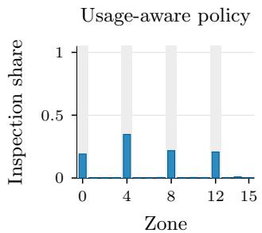
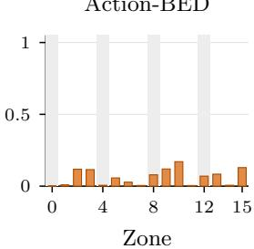
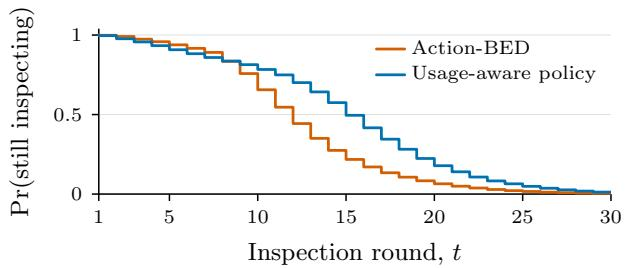
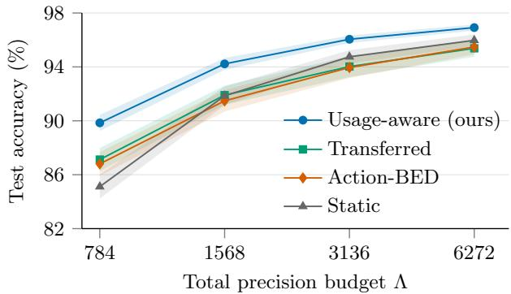
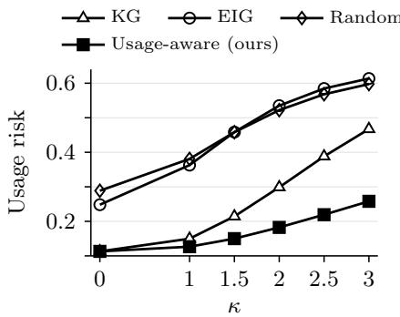
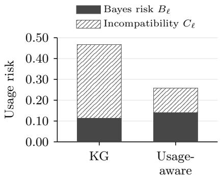
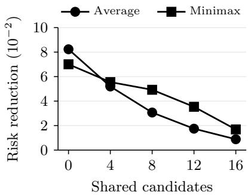

# Designing Experiments for External Decision Makers

Sahel Iqbal University of Oxford

## Abstract

Standard Bayesian experimental design (BED) methods assume the experimenter alone will act on the data, choosing the best action given their own beliefs and goals. In practice, data are often acted on by external parties whose procedures the experimenter cannot change and may not know, particularly when the data are released publicly. To extend BED to such settings, we introduce usage-aware experimental design, a framework in which an adaptive design policy is trained to minimise the usage risk: the experimenter’s expected loss when one or more external rules act on the collected data. These rules may be non-Bayesian or black-box, and when several may apply, we either average over them or take the worst case. We show that, unlike in standard BED, more informative data can be harmful under such rules, so the usage risk cannot in general be expressed as an expected uncertainty reduction; our framework thus strictly generalises standard BED. We then use it to tackle a range of problems that are dificult to address with existing approaches.

## 1 INTRODUCTION

Which data to collect to aid in decision making is a question that arises throughout science, engineering, policy, and many other domains, and has motivated the formal study of the optimal design of experiments for over a century (Smith, 1918; Fisher, 1935). Bayesian experimental design (BED) ofers a principled framework to answer this question: it models the experiment probabilistically and chooses designs that minimise expected loss over the possible outcomes (Lindley, 1956; Chaloner and Verdinelli, 1995).

In the foundational decision-theoretic formulation of BED (Wald, 1950; Savage, 1951; Raifa and Schlaifer, 1961; Lindley, 1972), there are two decisions: first,

Tom Rainforth University of Oxford

which experiments to perform, as chosen by our design policy, and second, after observing the data, which downstream action to take (e.g., whether to approve a drug after a trial). Here our design policy must plan ahead and try to maximise our ability to choose efective downstream actions. Much of the BED literature has abstracted away the second decision and instead sought experiments that maximally reduce uncertainty about some variables of interest z (Ryan et al., 2016; Foster et al., 2021; Rainforth et al., 2024; Huan et al., 2024). More recently, a growing body of work has made the second decision explicit, designing experiments with reference to the expected future loss of optimal downstream actions rather than generic uncertainties (Filstrof et al., 2024; Huang et al., 2024, 2026; Rossa et al., 2026; Go et al., 2026).

Both lines of work assume that the experimenter chooses the downstream action. For loss-driven approaches this is explicit; for uncertainty-based ones it is implicit in the equivalence between the expected loss of the Bayes-optimal action and generalised entropies (DeGroot, 1962; Dawid, 1998; Gr¨unwald and Dawid, 2004; Bickford Smith et al., 2025). Either way, experiments are evaluated as if the action will be Bayes-optimal under the experimenter’s own beliefs and loss, which gives almost all existing BED objectives their defining property: more information never hurts in expectation (Blackwell, 1953).

However, in many applications, the data are instead acted on by external decision makers, who apply their own rules mapping data to actions. Sometimes a sin gle rule is known in advance, such as when a regulator applies a prespecified test to a trial run by a pharmaceutical company, or a trained and frozen prediction model receives newly acquired measurements. In other cases, the rule is not known in advance, such as when it is unclear which of several decision makers will act, or when data are released for public use and analysed by many parties, each with their own procedure.

How, then, should the experimenter choose experiments when they are not the one who will act on the data? Existing work answers this only for narrowly specified rules, such as the Bayes act of a second analyst (Jackson et al., 1980; Lindley and Singpurwalla, 1991; Etzioni and Kadane, 1993; Wolfson et al., 1997) or a prespecified test (O’Hagan et al., 2005; Ondra et al., 2019; Rossell and M¨uller, 2013), and then only for static designs or via bespoke derivations.

To address this problem in the general case, we introduce a framework called usage-aware experimental design, in which experiments are designed to account for how their data will subsequently be used, allowing for uncertainty about who will act and which decision rules they will apply. The experimenter still has preferences over the actions taken, expressed as a loss function (Savage, 1972), so we judge each design by its usage risk: the experimenter’s expected loss when the downstream decision rule, rather than their own Bayes act, chooses the action. The rule need only map data to actions, so it may be another analyst’s Bayes act, a non-Bayesian procedure such as a significance test, or a black box such as a frozen prediction model. When the rule is uncertain, we minimise either the average usage risk over the plausible rules or its worst case. In each case, an amortised design policy can be learned by simulation, which needs only evaluations of the rule.

We prove that usage-aware design strictly generalises standard BED. We decompose the usage risk into the risk under the Bayes act plus an incompatibility cost, which bounds the price of ignoring the rule and vanishes when the rule is the experimenter’s own Bayes act, recovering standard BED. Building on Blackwell’s characterisation, we then show that, for posteriorbased rules, more information never hurts if and only if the rule’s posterior risk, its expected loss as a function of the posterior, is concave: that is, if it is itself a measure of uncertainty in the sense of DeGroot (1962). Standard BED thus corresponds exactly to rules whose posterior risk is an uncertainty. For other rules, evidence that is informative about z need not be evidence the rule can exploit, and can even steer it towards worse decisions; preferring less informative data is then not irrational, since the experimenter’s beliefs and loss are unchanged and only the actor difers, yet no uncertainty-based criterion can capture it.

Empirically, on clinical trials, consumer persuasion, image acquisition, and ranking and selection, usage-aware designs often substantially outperform designs that ignore the rule, and collect qualitatively diferent data. Code to reproduce our experiments is available at https://codeberg.org/ Sahel13/usage-aware-experimental-design.

## 2 BACKGROUND

Let $z \in { \mathcal { Z } }$ denote an unknown state of the world. In the decision-theoretic formulation of BED (Raifa and Schlaifer, 1961; Lindley, 1972), an experimenter gathers data to support a downstream action $a \in { \mathcal { A } } ,$ whose consequences under z are measured by a loss $\ell ( a , z )$ and aims to minimise the expected value of this loss. The experimenter encodes their initial beliefs about z in a prior $p ( z )$ , chooses a design $x \in { \mathcal { X } } .$ observes an outcome $y \sim p ( y \mid z , x )$ , and updates their beliefs to the posterior $p ( z \mid x , y )$ . They then take the action minimising the posterior expected loss, known as the Bayes-optimal action or simply the Bayes act. Since the outcome is unknown when the design is chosen, a design is judged by the expected loss of the Bayes act under the predictive distribution $p ( y \mid x )$

$$
B _ { \ell } ( x ) : = \mathbb { E } _ { p ( y | x ) } \left[ \operatorname* { i n f } _ { a \in \mathcal { A } } \mathbb { E } _ { p ( z | x , y ) } [ \ell ( a , z ) ] \right] .
$$

This is the Bayes risk of the design $x ,$ and minimising it is the classical BED objective.

Much of BED instead minimises the expected posterior uncertainty $( \mathrm { E P U } )$ , without reference to a downstream action (Rainforth et al., 2024; Huan et al., 2024),

$$
\mathrm { E P U } _ { \mathbb { H } } ( \boldsymbol { x } ) : = \mathbb { E } _ { p ( \boldsymbol { y } | \boldsymbol { x } ) } \Big [ \mathbb { H } \big [ p ( \boldsymbol { z } \mid \boldsymbol { x } , \boldsymbol { y } ) \big ] \Big ] ,
$$

where H denotes some uncertainty measure. The two views are equivalent whenever H is a generalised entropy (DeGroot, 1962; Dawid, 1998; Gr¨unwald and Dawid, 2004), defined for a distribution $q \in { \mathcal { P } } _ { z }$ as

$$
\mathbb { H } \left[ { q } \right] : = \mathbb { E } _ { Z \sim q } \left[ s ( { q } , Z ) \right] ,
$$

where $s$ is a proper scoring rule on $\mathcal { P } _ { z }$ , the set of probability distributions on Z. The equivalence holds because the loss of the Bayes act under $q ,$ $a ^ { \ast } ( q ) \in$ arg min $_ { a \in \mathcal { A } } \mathbb { E } _ { Z \sim q } [ \ell ( a , Z ) ]$ , assumed through out to exist, is itself a proper scoring rule: for any $\ell ,$ setting $s ( q , Z ) = \ell ( a ^ { * } ( q ) , Z )$ gives

$$
\mathbb { H } _ { \ell } \left[ \boldsymbol { q } \right] = \operatorname* { i n f } _ { a \in \mathcal { A } } \mathbb { E } _ { Z \sim \boldsymbol { q } } [ \ell ( a , Z ) ] = \mathbb { E } _ { Z \sim \boldsymbol { q } } \left[ \ell ( a ^ { * } ( \boldsymbol { q } ) , Z ) \right] .
$$

The Bayes risk is thus the uncertainty, as measured by $\mathbb { H } _ { \ell } ,$ that is expected to remain after the experiment. Following DeGroot (1962), the defining property of a measure of uncertainty is that no experiment can increase it in expectation. Every generalised entropy has this property, and for finite $\mathcal { Z }$ the converse also holds (Gr¨unwald and Dawid, 2004; Bect and Zhu, 2026). Specifying an uncertainty measure directly, as is common in practice, therefore implicitly specifies a set of compatible downstream decision problems, and assumes that the action eventually taken is the Bayes act for one of them. When H is the Shannon (or diferential) entropy (Shannon, 1948), minimising the EPU is equivalent to maximising the popular expected information gain (EIG, Lindley, 1956).

The Bayes risk extends naturally to sequential experiments, in which later designs can depend on earlier observations. Over $T$ steps, let $D _ { t } : = ( x _ { s } , y _ { s } ) _ { s = 1 } ^ { t } \in \mathcal { D } _ { t }$ denote the collected data, or history, with $D _ { 0 } = \varnothing$ . A design policy $\pi _ { d } \in \Pi _ { d }$ selects each $x _ { t }$ given $D _ { t - 1 }$ , possibly at random, and induces a distribution $p ( D _ { T } \mid z ; \pi _ { d } )$ over histories for each state z. The Bayes risk is now a function of the design policy:

$$
B _ { \ell } ( \pi _ { d } ) : = \mathbb { E } _ { p ( D _ { T } ; \pi _ { d } ) } \left[ \mathbb { H } _ { \ell } [ p _ { z } ( \cdot \mid D _ { T } ) ] \right] ,\tag{1}
$$

where $\mathbb { H } _ { \ell } [ p _ { z } ( \cdot ~ \vert ~ D _ { T } ) ]$ is the minimal achievable $\mathrm { { e x - } }$ pected loss under the posterior $p _ { z } ( \cdot \mid D _ { T } )$ . Given $D _ { T } .$ the posterior does not depend on the design policy, which thus afects $B _ { \ell }$ only through the distribution of histories (Phillips et al., 2026).

## 3 EXPERIMENTAL DESIGN FOR EXTERNAL DECISION MAKERS

The standard BED formulations in Section 2 assume that the experimenter both chooses the design and acts on the outcome, in each case according to their own beliefs and loss. Kadane and MacEachern (2014) accordingly describe classical BED as a “single-party, two-stage” decision problem.

We now generalise this to settings in which the action is chosen by a fixed rule rather than by the experi menter’s Bayes act. Most often, the data are acted on by someone else, possibly someone the experimenter cannot identify in advance, as when a regulator assesses a trial or data are released publicly. But the experimenter can also be bound to a rule when acting themselves, for example by a legal obligation on how to act on the results of a safety inspection, or by a frequentist analysis plan fixed before the data are seen. Either way, the experimenter cannot replace the rule with their own Bayes act.

To formalise such settings, we introduce the notion of a downstream decision maker (DM) that is either external to the experimenter or represents the fixed rule the experimenter will later follow. The experimenter still has preferences over the actual actions taken, represented as in Section 2 by their own prior $p ( z )$ and loss $\ell ( a , z )$ . What they no longer freely control is the action itself. Instead, the DM will follow some action policy $\pi _ { a } \in \Pi _ { a } ,$ a measurable rule mapping the completed history $D _ { T }$ to an action in A. The loss incurred by $\pi _ { d } ,$ from the perspective of the experimenter, is then $\ell ( \pi _ { a } ( D _ { T } ) , z )$ , in place of the loss of the Bayes act in (1).

Averaging this loss under the experimenter’s beliefs gives the usage risk of $\pi _ { d }$ under $\pi _ { a }$

$$
R _ { \ell } ( \pi _ { d } , \pi _ { a } ) : = \mathbb { E } _ { p ( z , D _ { T } ; \pi _ { d } ) } \big [ \ell ( \pi _ { a } ( D _ { T } ) , z ) \big ] ,\tag{2}
$$

where we assume throughout that the losses are inte grable and the Bayes risk is finite.1 For a fixed $\pi _ { a } .$ , the experimenter’s design problem is then to find

$$
\pi _ { d } ^ { * } \in \arg \operatorname* { m i n } _ { \pi _ { d } \in \Pi _ { d } } R _ { \ell } ( \pi _ { d } , \pi _ { a } ) .\tag{3}
$$

Standard BED is the special case in which the DM applies the experimenter’s own Bayes act. Indeed, Rossa et al. (2026) showed that, under mild assumptions, optimising the design policy jointly with an unrestricted action policy recovers the Bayes-risk minimiser:

$$
\operatorname * { a r g m i n } _ { \pi _ { d } \in \Pi _ { d } } \operatorname* { i n f } _ { \pi _ { a } } R _ { \ell } ( \pi _ { d } , \pi _ { a } ) = \arg \operatorname* { m i n } _ { \pi _ { d } \in \Pi _ { d } } B _ { \ell } ( \pi _ { d } ) .\tag{4}
$$

By contrast, (3) fixes $\pi _ { a }$ to the rule the DM will actually apply. Each $\pi _ { d } ^ { * }$ is still Bayes-optimal from the experimenter’s perspective, given that this rule will be applied, as it is chosen under their own beliefs and loss. But since $\pi _ { a }$ need not be Bayesian, $\pi _ { d } ^ { * }$ is conditionally Bayes-optimal given the DM, rather than jointly Bayes-optimal with the action.

Uncertainty over the downstream rule. The experimenter may also be uncertain about the DM’s rule, such as how the DM will model the data, which cri terion they will optimise, or simply which procedure they will follow. We parameterise these uncertain aspects by $\psi \in \Psi$ , writing the action policy as $\pi _ { a } ^ { \psi }$ , and extend the prior to $p ( z , \psi ) . ^ { 2 }$ The parameters may include discrete components, such as which of several procedures is applied. We assume that ψ is unobserved during data collection, so that $p ( z , \psi , D _ { T } ; \pi _ { d } ) =$ $p ( z , \psi ) p ( D _ { T } \mid z ; \pi _ { d } )$ , and that $( \psi , D _ { T } ) \mapsto \pi _ { a } ^ { \psi } ( D _ { T } )$ is jointly measurable. The loss is now $\ell ( \pi _ { a } ^ { \psi } ( D _ { T } ) , z )$ , so the expected loss of $\pi _ { d }$ is

$$
\begin{array} { r } { \bar { R } _ { \ell } ( \pi _ { d } ) : = \mathbb { E } _ { p ( z , \psi , D _ { T } ; \pi _ { d } ) } \big [ \ell ( \pi _ { a } ^ { \psi } ( D _ { T } ) , z ) \big ] , } \end{array}\tag{5}
$$

and the optimal design policy is again its minimiser.   
This recovers (3) when ψ is known in advance.

The same objective covers data used by many DMs, when the experimenter wants to minimise the average loss of the DMs’ actions. Here $p ( \psi )$ is the proportion of DMs applying each rule, weighted, if desired, by how much the experimenter cares about each DM’s actions.

Robustness to downstream-rule uncertainty. A prior $p ( \psi )$ may be dificult to justify, or the experimenter may want protection against every plausible value of $\psi .$ . In such cases, a more suitable objective may be the largest usage risk over $\Psi$

$$
R _ { \ell } ^ { \mathrm { m m } } ( \pi _ { d } ) : = \operatorname* { s u p } _ { \psi \in \Psi } \mathbb { E } _ { p ( z , D _ { T } | \psi ; \pi _ { d } ) } \big [ \ell ( \pi _ { a } ^ { \psi } ( D _ { T } ) , z ) \big ] ,\tag{6}
$$

which we minimise. Unlike (5), this criterion is not an expected loss, but it is a standard alternative for robust decision making. It is also where randomised design policies matter. Randomisation cannot improve (3) or (5), which are linear in the distribution over histories, but it can strictly reduce the supremum in (6) (Berger, 1985, Ch. 5).

Policy learning. Each objective above is built from expectations of a loss over simulated trajectories: the state and, where relevant, the rule parameters are drawn from their priors, the design policy generates the history, and the loss is read of by applying the rule to it. We therefore typically parameterise $\pi _ { d }$ by a neural network and train it by stochastic gradient descent on Monte Carlo estimates of the objective. The rule enters only through its evaluations on simulated data, so we can use pathwise gradient estimators when the policy and simulator are reparameterisable and the rule is diferentiable, and score-function estimators otherwise, including for black-box rules (Mohamed et al., 2020). Details are given in Appendix C.

## 4 THEORETICAL INSIGHTS

Fixing the downstream rule changes both the structure of the objective and the value of information, and we now examine these in turn.

## 4.1 Design-Dependent Incompatibility

From the experimenter’s perspective, the natural benchmark for how well a rule uses the data is the minimal posterior expected loss, $\mathbb { H } _ { \ell } [ p _ { z } ( \cdot \mid D _ { T } ) ]$ , which is the loss they would expect from the same data if they chose the action themselves. The posterior regret of an action policy $\pi _ { a }$ is

$$
\Delta _ { \pi _ { a } } ( D _ { T } ) : = \mathbb { E } _ { p _ { z } ( \cdot \vert D _ { T } ) } [ \ell ( \pi _ { a } ( D _ { T } ) , z ) ] - \mathbb { H } _ { \ell } [ p _ { z } ( \cdot \vert D _ { T } ) ] ,
$$

which is non-negative, and zero for every $D _ { T }$ when $\pi _ { a }$ is a Bayes-optimal action policy, $\pi _ { a } ^ { \mathrm { B } }$ . The usage risk can then be expressed as

$$
\begin{array} { r l } & { R _ { \ell } ( \pi _ { d } , \pi _ { a } ) = { \cal B } _ { \ell } ( \pi _ { d } ) + { \cal C } _ { \ell } ( \pi _ { d } , \pi _ { a } ) , } \\ & { { \cal C } _ { \ell } ( \pi _ { d } , \pi _ { a } ) : = \mathbb { E } _ { p ( { \cal D } _ { T } ; \pi _ { d } ) } [ \Delta _ { \pi _ { a } } ( { \cal D } _ { T } ) ] . } \end{array}\tag{7}
$$

The incompatibility cost $C _ { \ell }$ is the expected excess loss the experimenter incurs because the fixed rule, rather than the Bayes act, chooses the action. It depends on the design policy, which controls the distribution of datasets to which the rule is applied.

$C _ { \ell }$ takes familiar forms for some common losses. Under squared error, with $\mathcal { A } = \mathcal { Z } = \mathbb { R } ^ { d }$ and $\ell ( a , z ) =$ $\| a - z \| ^ { 2 }$ , the Bayes act is the posterior mean $\begin{array} { l l } { { m _ { T } = } } \end{array}$ $\mathbb { E } [ z \mid D _ { T } ]$ , and expanding the square gives $\Delta _ { \pi _ { a } } ( D _ { T } ) =$ $\| \pi _ { a } ( D _ { T } ) - m _ { T } \| ^ { 2 }$ . Hence $C _ { \ell }$ is the expected squared distance between the rule’s estimate and the posterior mean. Under log loss, the action is a distribution on $\mathcal { Z }$ and $\ell ( a , z ) = - \log { a ( z ) }$ . The Bayes act is the posterior itself, H $\it { \Omega } _ { \ell } [ p _ { z } ( \cdot \cdot \ : | \ : D _ { T } ) ]$ ] is the Shannon entropy of the posterior, and $\Delta _ { \pi _ { a } } ( D _ { T } ) = \mathrm { K L } [ p _ { z } ( \cdot \mid D _ { T } ) \mid \mid \pi _ { a } ( D _ { T } ) ]$ so that $C _ { \ell }$ is the expected KL divergence from the experimenter’s posterior to the distribution the rule reports. In both cases, $C _ { \ell }$ measures the expected discrepancy between what the rule does with the data and what a Bayes-optimal DM would do.

The incompatibility cost also bounds the price of designing as though the downstream rule were Bayesoptimal.

Proposition 1 (Cost of ignoring the downstream rule). Let $\pi _ { d } ^ { \mathrm { B } } \in$ arg min $_ { \pi _ { d } \in \Pi _ { d } } B _ { \ell } ( \pi _ { d } )$ and $\pi _ { d } ^ { * } ~ \in$ arg min $_ { \pi _ { d } \in \Pi _ { d } } R _ { \ell } ( \pi _ { d } , \pi _ { a } )$ . If these minimisers exist,

$$
0 \leq R _ { \ell } ( { \pi } _ { d } ^ { \mathrm { B } } , { \pi } _ { a } ) - R _ { \ell } ( { \pi } _ { d } ^ { \ast } , { \pi } _ { a } ) \leq C _ { \ell } ( { \pi } _ { d } ^ { \mathrm { B } } , { \pi } _ { a } ) .
$$

The first inequality holds because $\pi _ { d } ^ { * }$ minimises the usage risk under $\pi _ { a } .$ . The second follows from (7) applied to $\pi _ { d } ^ { \mathrm { B } } .$ , since $B _ { \ell } ( { \boldsymbol \pi } _ { d } ^ { \mathrm { B } } ) \leq B _ { \ell } ( { \boldsymbol \pi } _ { d } ^ { * } ) \leq R _ { \ell } ( { \boldsymbol \pi } _ { d } ^ { * } , { \boldsymbol \pi } _ { a } )$ and $C _ { \ell } \geq 0$ . Thus, the price of ignoring the rule is at most the incompatibility cost of the design that ignores it. Conversely, a rule may have large regret but leave the optimal design unchanged if $C _ { \ell } ( \pi _ { d } , \pi _ { a } )$ is constant across designs.

## 4.2 When Does More Information Help?

We now ask how the usage risk changes when the data become more informative. We measure informativeness in the sense of Blackwell (1951, 1953), which does not depend on a particular loss or prior.

Definition 1 (Blackwell-more-informative). For $j \in$ {0, 1}, let $D _ { T } ^ { j }$ denote the dataset generated by the policy $\pi _ { d } ^ { j }$ . We say that $\pi _ { d } ^ { 1 }$ is Blackwell-more-informative than $\pi _ { d } ^ { 0 } .$ , denoted $\pi _ { d } ^ { 1 } \succeq _ { \mathrm { B } } \pi _ { d } ^ { 0 } .$ if there exists a Markov kernel $\ { \bf \tilde { G } } ( \mathrm { d } D _ { T } ^ { 0 } \mid D _ { T } ^ { 1 } )$ , independent of $z ,$ such that

$$
p ( \mathrm { d } D _ { T } ^ { 0 } \mid z ; \pi _ { d } ^ { 0 } ) = \int G ( \mathrm { d } D _ { T } ^ { 0 } \mid D _ { T } ^ { 1 } ) p ( \mathrm { d } D _ { T } ^ { 1 } \mid z ; \pi _ { d } ^ { 1 } ) ,
$$

for every $z \in { \mathcal { Z } }$ . Thus, the dataset produced by $\pi _ { d } ^ { 0 }$ can be simulated by stochastically post-processing the dataset produced by $\pi _ { d } ^ { 1 }$ , without access to the unknown state. Such post-processing is called a garbling; informally, it adds noise to the original data.

Blackwell’s theorem (Blackwell, 1953) shows that, for finite Z and bounded losses, this is precisely the condition under which $\pi _ { d } ^ { 1 }$ attains no larger Bayes risk than $\pi _ { d } ^ { 0 }$ in every decision problem, that is, for every prior and every loss that does not depend on the data. In particular, $\pi _ { d } ^ { 1 } \succeq _ { \mathrm { B } } \pi _ { d } ^ { 0 }$ implies $B _ { \ell } ( { \boldsymbol \pi } _ { d } ^ { 1 } ) ~ \le ~ B _ { \ell } ( { \boldsymbol \pi } _ { d } ^ { 0 } )$ The guarantee relies on the action being reoptimised at every posterior. A non-Bayes-optimal rule does not do this, so for such rules the theorem gives no assurance that more informative data will not hurt.

When, then, do more informative data help under a given rule, and when can they hurt? We show that they can hurt if and only if the rule’s posterior expected loss is not concave in the posterior.

Suppose that Z is finite, that $p ( z )$ has full support, and that $\pi _ { a } ( D _ { T } ) = f ( b _ { T } )$ for some function f of the posterior $b _ { T } : = p _ { z } ( \cdot \mid D _ { T } ) \in \mathcal { P } _ { z }$ . This covers any rule that acts on a statistic that the posterior determines. The usage risk is then the expectation over $D _ { T }$ of the rule’s posterior risk

$$
r _ { \pi _ { a } } ( b ) : = \mathbb { E } _ { b ( z ) } [ \ell ( f ( b ) , z ) ] .\tag{8}
$$

Proposition 2 (Blackwell monotonicity for fixed rules). Fix f and let $\pi _ { a } = f ( b _ { T } )$ . Then

$$
R _ { \ell } ( { \pi } _ { d } ^ { 1 } , { \pi } _ { a } ) \le R _ { \ell } ( { \pi } _ { d } ^ { 0 } , { \pi } _ { a } )
$$

for all statistical experiments with $\pi _ { d } ^ { 1 } \succeq _ { \mathrm { B } } \pi _ { d } ^ { 0 }$ if and only $\textit { i f r } _ { \pi _ { a } }$ is concave on $\mathcal { P } _ { z }$ . Here, statistical experiments are all Markov kernels from Z to a data space, for which we keep the notation $\pi _ { d }$

The proof, in Appendix A, adapts two classical results to $r _ { \pi _ { a } }$ : the convex-order characterisation of Blackwell (1953) for suficiency, and the splitting construction of Kamenica and Gentzkow (2011) for necessity.

If f returns the Bayes act under $b ,$ then $r _ { \pi _ { a } } = \mathbb { H } _ { \ell } .$ which is concave as an infimum of functions that are afine in $b ,$ and Blackwell’s theorem is recovered. Other rules need not choose the best action at every belief, so their posterior risk can fail to be concave, and more informative data can then push the posterior towards beliefs where they err. Callahan and Catanach (2026) encounter the same failure when the experimenter’s own inference is misspecified, a special case of (7); where they replace monotonicity with an axiom, Proposition 2 gives the exact condition under which it holds.

A key consequence is that some problems expressible in our framework cannot be expressed as standard BED problems, under any loss.

Corollary 1 (Usage risk is not a Bayes risk in general). Under the assumptions of Proposition 2, let $\pi _ { a }$ be an action policy for which $r _ { \pi _ { a } }$ is not concave. Then there exist experiments $\pi _ { d } ^ { 0 }$ and $\pi _ { d } ^ { 1 }$ with $\pi _ { d } ^ { 1 } \succeq _ { \mathrm { B } } \pi _ { d } ^ { 0 }$ such that, for every action space $\mathbf { \mathcal { A } ^ { \prime } }$ and loss $\ell ^ { \prime } \colon \mathcal { A } ^ { \prime } \times \mathcal { Z } $ $( - \infty , + \infty ]$ , including ℓ itself,

$$
R _ { \ell } ( { \pi } _ { d } ^ { 1 } , { \pi } _ { a } ) > R _ { \ell } ( { \pi } _ { d } ^ { 0 } , { \pi } _ { a } ) ~ b u t ~ B _ { \ell ^ { \prime } } ( { \pi } _ { d } ^ { 1 } ) \leq B _ { \ell ^ { \prime } } ( { \pi } _ { d } ^ { 0 } ) ,
$$

where $B _ { \ell ^ { \prime } }$ is the Bayes risk (1) with $\ell ^ { \prime }$ and A′ in place of ℓ and A. Consequently, no standard BED criterion of the form of (1), for any loss, induces the same ordering as the usage risk under ℓ, over the class of all statistical experiments or over any class containing $\pi _ { d } ^ { 0 }$ and $\pi _ { d } ^ { 1 }$

Its proof (Appendix A) uses only the concavity of $\mathbb { H } _ { \ell ^ { \prime } }$ , so it extends to the EPU under every measure of uncertainty in the sense of DeGroot (1962), as all are concave (Bect and Zhu, 2026); this covers the EIG. Conversely, a concave $r _ { \pi _ { a } }$ makes $R _ { \ell } ~ = ~ \mathbb { E } [ r _ { \pi _ { a } } ( b _ { T } ) ]$ an EPU. Usage-aware design thus strictly generalises BED, departing from it exactly when the rule’s posterior risk is not a measure of uncertainty.

The concavity condition also applies when the rule is uncertain, and in one special case it has a more encouraging consequence. Suppose that ψ is independent of $z ,$ so that, by the factorisation in Section 3, the data carry no information about the rule, and that each $\pi _ { a } ^ { \psi }$ acts on the posterior $b _ { T }$ . Then $\bar { R } _ { \ell } ( \pi _ { d } ) = \mathbb { E } [ \bar { r } ( b _ { T } ) ]$ where $\bar { r } : = \mathbb { E } _ { p ( \psi ) } [ r _ { \pi _ { a } ^ { \psi } } ]$ is the mixture of the rules’ posterior risks. Since the proof of Proposition 2 uses only the identity $R _ { \ell } ( \pi _ { d } , \pi _ { a } ) = \mathbb { E } [ r _ { \pi _ { a } } ( b _ { T } ) ]$ , which $\bar { R } _ { \ell }$ and $\bar { r }$ also satisfy, $\bar { R } _ { \ell }$ is Blackwell-monotone if and only if ¯r is concave. Averaging over rules smooths the posterior risk, so $\bar { r }$ can be concave even when no $r _ { \pi _ { a } ^ { \psi } }$ is: when the data carry no information about which rule will be applied, uncertainty about who will act on them can sometimes restore the guarantee that more information does not hurt, at least on average.

## 5 RELATED WORK

To our knowledge, designing experiments for a downstream rule that the experimenter neither chooses nor necessarily knows has not been studied in this generality. Some works, however, study the special case in which the rule is the Bayes act of a second Bayesian agent who difers from the experimenter in prior or loss (Jackson et al., 1980; Lindley and Singpurwalla, 1991; Etzioni and Kadane, 1993; De Santis and Gubbiotti, 2017, 2021). Overstall and McGree (2022) consider the analogous case in which the second Bayesian fits a diferent model. When several Bayesians may act on the data, Lodh (1993) and Wolfson et al. (1997) minimise a weighted average of their risks, which gives static instances of (5). These works derive a static design for a specified second Bayesian; our rules need not be Bayes acts at all, and our policies are adaptive.

The problem of designing for a second Bayesian has also been studied independently in economics as Bayesian persuasion: a sender commits to a signal structure, and a receiver observes its realisation and takes the Bayes act under their own prior and loss (Kamenica and Gentzkow, 2011). Later work admits receivers who hold a diferent worldview (Galperti, 2019), update by a non-Bayesian rule (de Clippel and Zhang, 2022), or apply a frequentist test to an experiment drawn from a restricted feasible set (Ball and Esp´ın-S´anchez, 2021). These works characterise a single, static optimal signal analytically, for one known receiver and for models simple enough that the sender’s objective is available in closed form. Our framework needs none of this: the rule may be uncertain and enters only through its evaluations, and an adaptive design policy is learned by simulation for any prior and likelihood that can be sampled.

In clinical trial design, a Bayesian experimenter designing for a prescribed frequentist test is a longstanding theme. Assurance, or Bayesian predictive power, chooses a sample size by averaging the power of the test over a prior (Spiegelhalter and Freedman, 1986; O’Hagan et al., 2005; De Santis et al., 2025), which is a static instance of (3). Ondra et al. (2019) de sign adaptive trials for a prescribed test by optimising an interim enrichment decision, and Rossell and M¨uller (2013) optimise when to stop a high-throughput genomics experiment whose results are reported under a fixed false discovery rate rule. The latter two are bespoke solutions for one experiment and one rule, whereas our method applies to all of them unchanged.

## 6 NUMERICAL EVALUATION

## 6.1 Adaptive Clinical Trials

We first consider the two-stage trials of Ondra et al. (2019), for a targeted therapy that may benefit the whole population F or only a biomarker-positive sub group S. The design has two parts. Before any data are observed, the experimenter chooses how many patients to recruit from S and from its complement S¯, each randomised equally to treatment and control. After this first stage, an interim policy maps the observed test statistics to an action (stop for futility, continue in S only, or continue in both subgroups) and, if the trial continues, to the second-stage sample sizes. A regulator then applies a prespecified test of no efect in S and no average efect in F. Because the test controls the family-wise error rate under any interim policy (Bauer and K¨ohne, 1994), the regulator can fix it in advance. The experimenter’s utility, or negative loss, rewards approval in a population in proportion to its true benefit, minus trial costs.

Table 1: Expected utility (millions of euros; higher is better) of designs optimised for one test (rows) and evaluated under each test (columns). Adaptive entries average 5 training seeds. Standard errors of paired pertrial diferences between adaptive entries and the DP or single-stage entries are below 0.05. The Bayes-act design, the best single-stage design under a Bayes-act regulator, runs no trial.
<table><tr><td rowspan="2"></td><td rowspan="2">Designed for</td><td colspan="2">Test applied</td></tr><tr><td>Bonferroni</td><td>Simes</td></tr><tr><td>Bayes-act design</td><td>Bayes act</td><td>0.00</td><td>0.00</td></tr><tr><td>Single stage</td><td>Bonferroni</td><td>52.27</td><td>53.23</td></tr><tr><td></td><td>Simes</td><td>52.22</td><td>53.29</td></tr><tr><td>Adaptive (ours)</td><td>Bonferroni</td><td>57.79</td><td>57.57</td></tr><tr><td></td><td>Simes</td><td>57.59</td><td>57.76</td></tr><tr><td>Oracle DP</td><td>Bonferroni</td><td>57.97</td><td>57.63</td></tr></table>

Ondra et al. (2019) find the optimal designs by dy namic programming (DP, Bellman, 1957), which needs the test’s rejection probabilities in closed form. For this reason, while they note that more powerful tests could be used, they restrict the regulator to a conservative Bonferroni-adjusted test. Our method only needs to simulate the rule, so it is free of this restric tion. To show this, we also apply it to a Simes-based closed testing procedure (Marcus et al., 1976; Simes, 1986). For each test, we train a neural interim policy with REINFORCE (Williams, 1992) and, as with DP, choose among 100 candidate first stages by simulating the trial each one leads to (Appendix B.1). Like Ondra et al. (2019), we also compare with the optimal singlestage design, which fixes the sample sizes in advance and makes no interim decision.

Under Bonferroni, the learned policy recovers 99.7% of the oracle DP solution’s expected utility and improves on the best single-stage design by 10% (Table 1). It is also cheaper to obtain: training and first-stage selection take under four minutes on a CPU, whereas DP takes 54 minutes on the same machine. Under Simes, for which no DP solution is available, the policy trained for that test matches or exceeds every other design in the table. Designing for the wrong test costs little here, but designing for a Bayes-act regulator is costly: the best such single-stage design runs no trial, and it is worth nothing under either test.

## 6.2 Persuading a Sceptical Consumer

Our second experiment is a sequential extension of a problem proposed by Lindley and Singpurwalla (1991). A manufacturer inspects a lot before a consumer decides whether to accept it. The lot is divided into 16 zones, and each inspection tests a batch of units from one zone, destroying them in the process. The manufacturer may stop at any point before a budget of 30 inspections runs out, and their loss counts wrong decisions as well as destroyed units. The manufacturer and consumer share the same model of how defects arise, but not the same prior or loss: the consumer believes good lots are rarer, suspects four particular zones, and accepts only if they are at least 80% sure the lot is good. The manufacturer must therefore decide where to inspect and when to stop while anticipating how the consumer’s posterior will respond.

Action-BED  

(a) Early inspection allocation.  
  
(b) Optional stopping.

Figure 1: Accounting for the consumer’s rule changes both sampling and stopping. (a) Share of the first 5 inspections sent to each zone; shaded bands mark the zones emphasised by the consumer’s prior. (b) Fraction of lots still being inspected: the usage-aware policy inspects for longer because the consumer requires more evidence. Both panels pool 5 training seeds with $1 0 ^ { 4 }$ evaluation lots each.  
  
Figure 2: Image acquisition for frozen classifiers. Results average over three independently trained classi fier pairs, both classifiers within each pair, and three policy-training seeds; bands show one standard deviation across the three per-pair averages.

Table 2: Mean total loss under the sceptical consumer, averaged over five training seeds and 10,000 evaluation lots each, with the standard deviation across seeds. The loss includes decision error and the cost of destroyed units.
<table><tr><td>Policy</td><td>Loss (↓)</td></tr><tr><td>Random (full budget)</td><td> $0 . 5 2 4 \pm 0 . 0 0 6$ </td></tr><tr><td>RL-BOED (full budget)</td><td> $0 . 4 3 2 \pm 0 . 0 1 5$ </td></tr><tr><td>Action-BED (optional stopping)</td><td> $0 . 6 4 8 \pm 0 . 0 0 8$ </td></tr><tr><td>Action-BED (forced full budget)</td><td> $0 . 4 1 4 \pm 0 . 0 2 2$ </td></tr><tr><td>Usage-aware policy (ours)</td><td> $\mathbf { 0 . 2 6 5 \pm 0 . 0 0 6 }$ </td></tr></table>

The usage-aware policy is a neural network that picks the next zone at each round. We train it with proximal policy optimisation (PPO, Schulman et al., 2017) directly against the usage risk, and it stops as soon as the loss of deciding now is no larger than its critic’s estimate of the loss from continuing to inspect. We compare it with three baselines: Action-BED (Rossa et al., 2026), which trains a design policy against the manufacturer’s own Bayes risk and stops by the same rule or uses the full budget; RL-BOED (Blau et al., 2022), which maximises a lower bound on the EIG; and random inspection. Full details are in Appendix B.2.

Knowing the consumer’s rule changes both where and when the manufacturer inspects (Figure 1). The usage-aware policy sends 96% of its first five inspections to the four zones the consumer suspects, where evidence moves the consumer’s beliefs the most; Action-BED, whose own prior favours no zone, sends only 15% there. Action-BED also stops as soon as its own decision is settled, before the fifteenth inspection on 73% of the lots. This rarely convinces the consumer, who accepts fewer than 1% of the lots, so Action-BED does worse than random inspection. The usage-aware policy instead inspects until the consumer’s decision is settled, and stops that early on only 43% of the lots. Averaged over five training seeds, its usage risk is 36% below the best baseline (Action-BED forced to use the full budget) and about half that of random inspection (Table 2).

## 6.3 High-Dimensional Image Acquisition

We now turn to a learned downstream rule: a classifier trained in advance and frozen, as in active feature acquisition (Ma et al., 2019; Kobayashi et al., 2026). The experimenter sees a handwritten MNIST digit only through a noisy sensor and must decide where to look by splitting a fixed precision budget Λ across the image. The budget is spent in four equal rounds over 196 image blocks, so each round’s design has 195 continuous dimensions. The measurements are passed to a frozen convolutional classifier (LeCun et al., 1989), and the downstream loss is its cross-entropy on the true label. To test how closely the design must be tailored to the rule, we train two classifiers that difer only in how their training images were measured: one mostly saw precise measurements of the top of the digit, the other of the bottom. For each classifier, we train an adaptive usage-aware policy and compare it with three baselines (details in Appendix B.3): the policy trained for the other classifier (transferred); a static policy trained for the downstream classifier but with fixed allocations; and Action-BED, which trains the same adaptive network jointly with its own classifier via (4). Since the downstream loss is the log loss, Action-BED maximises a lower bound on the EIG about the label.

  
(a) Usage risk against κ

  
(b) Risk decomposition at $\kappa = 3$

  
(c) Two DMs  
Figure 3: Bayesian ranking and selection. (a) Usage risk against the DM’s caution κ. (b) Usage risk split into Bayes risk $B _ { \ell }$ and incompatibility $C _ { \ell }$ at $\kappa = 3 .$ (c) Risk reduction against the number of shared candidates for the DMs. Average: the average policy vs. the better specialist on the average risk (5). Minimax: the minimax policy vs. the best randomisation of specialists on the worst-case risk (6). All panels average $1 0 ^ { 5 }$ simulated episodes; standard errors are below 0.002 in (a, b), and 95% paired confidence intervals extend at most 0.003 from the estimates in (c).

The usage-aware policy is the most accurate at every budget, with the largest advantage when precision is scarce (Figure 2). The transferred policy and Action-BED perform worse, and once precision is less scarce, even the static policy overtakes them. As the budget grows, all policies measure most of the image well and the gaps narrow.

## 6.4 Bayesian Ranking and Selection

For our final experiment, we perform a controlled study of downstream-rule mismatch. We use the Bayesian ranking and selection setting of Frazier et al. (2008): an experimenter spreads $T = 2 4$ noisy measurements over 16 candidates (e.g., drug compounds) with unknown utilities, after which a DM deploys one candidate or keeps a default of zero utility. The experimenter’s loss is the utility forgone relative to the best option, so the Bayes act deploys the candidate with the largest positive posterior mean. Our DM is more cautious: they consider only candidates whose posterior mean exceeds zero by more than κ posterior standard deviations, so raising κ moves the rule continuously away from the Bayes act at $\kappa = 0$

Instead of training a neural policy, we adapt the knowledge gradient (KG, Frazier et al., 2008; Frazier and Powell, 2010), a strong existing policy for the Bayes act.3 KG scores a measurement by the value of the decision that follows it, so scoring the DM’s decision instead makes it usage-aware. The two policies then difer only in the decision they anticipate, so any gap between them is due to the rule alone.

The two coincide at $\kappa ~ = ~ 0$ , but as the DM grows more cautious, the usage risk of KG rises much faster; EIG maximisation and random sampling do worse still (Figure 3a). The usage-aware policy accepts a somewhat higher Bayes risk to cut the incompatibility cost by two thirds (Figure 3b).

Released data are often used by several DMs, and data that serve one may be useless to another. To study this, we keep the cautious DM above with $\kappa = 3 .$ and add a second DM who difers in both rule and options. The second DM instead requires a large estimated util ity, deploying their best candidate with posterior mean above 0.7. Their action spaces also difer: each DM may choose from a subset of the 16 candidates, and we vary how many candidates they share. A policy tailored to one DM, which we call a specialist, ignores candidates that only the other can choose. To serve both, we apply KG to a weighted sum of the values of the two DMs’ decisions. Equal weights target the average objective (5), and the weight that minimises the larger of the two DMs’ risks targets the minimax objective (6). The average policy beats the better specialist, and the minimax policy beats the best randomisation between the specialists, by the widest margins when the DMs share few candidates and each specialist neglects the other DM’s candidates the most (Figure 3c). Complete details are in Appendix B.4.

## 7 DISCUSSION

We introduced usage-aware experimental design, a framework for choosing experiments when the data are acted on by external decision makers whose rules the experimenter cannot change and may not know. These rules may be non-Bayesian or black-box, several may apply, and the decision makers’ interests may conflict with the experimenter’s. We learn amortised, adaptive design policies by simulation, which needs only evaluations of the rule and so applies to any rule that can be simulated. The framework recovers standard BED when the rule is the experimenter’s Bayes act, but strictly generalises it: under some rules, more informative data can hurt, so no standard BED criterion ranks experiments as the usage risk does. The value of an experiment thus depends on who acts on its data, and how. We discuss the limitations of this work and its broader impact in Appendix D.

## References

Karun Adusumilli and Abhi Vemulapati. Designing persuasive experiments. arXiv preprint arXiv:2605.16703, 2026.

Ian Ball and Jos´e-Antonio Esp´ın-S´anchez. Experimental persuasion. Discussion Paper 2298, Cowles Foundation, Yale University, 2021.

David Barber and Felix Agakov. The IM algorithm: A variational approach to information maximization. In Advances in Neural Information Processing Systems, 2003.

Peter Bauer and Kornelia K¨ohne. Evaluation of experiments with adaptive interim analyses. Biometrics, 50(4):1029–1041, 1994.

Julien Bect and Xujia Zhu. Uncertainty functionals revisited: Concavity and Jensen’s inequality. arXiv preprint arXiv:2605.18100, 2026.

Richard E. Bellman. Dynamic Programming. Princeton University Press, 1957.

James O. Berger. Statistical Decision Theory and Bayesian Analysis. Springer New York, 2nd edition, 1985.

Freddie Bickford Smith, Jannik Kossen, Eleanor Trollope, Mark van der Wilk, Adam Foster, and Tom

Rainforth. Rethinking aleatoric and epistemic uncertainty. In International Conference on Machine Learning, 2025.

David Blackwell. Comparison of experiments. In Proceedings of the Second Berkeley Symposium on Mathematical Statistics and Probability, volume 2, pages 93–102. University of California Press, 1951.

David Blackwell. Equivalent comparisons of experiments. The Annals of Mathematical Statistics, 24 (2):265–272, 1953.

Tom Blau, Edwin V. Bonilla, Iadine Chades, and Amir Dezfouli. Optimizing sequential experimental design with deep reinforcement learning. In International Conference on Machine Learning, 2022.

James Bradbury, Roy Frostig, Peter Hawkins, Matthew James Johnson, Chris Leary, Dougal Maclaurin, George Necula, Adam Paszke, Jake VanderPlas, Skye Wanderman-Milne, and Qiao Zhang. JAX: Composable transformations of Python+NumPy programs. https://github.com/ jax-ml/jax, 2018.

Jake Callahan and Tommie Catanach. On the misinformation in a statistical experiment. In International Conference on Artificial Intelligence and Statistics, 2026.

Kathryn Chaloner and Isabella Verdinelli. Bayesian experimental design: A review. Statistical Science, 10(3):273–304, 1995.

A. Philip Dawid. Coherent measures of discrepancy, uncertainty and dependence, with applications to Bayesian predictive experimental design. Research Report 139, Department of Statistical Science, University College London, 1998. Also available as arXiv:2607.26077.

Geofroy de Clippel and Xu Zhang. Non-Bayesian persuasion. Journal of Political Economy, 130(10): 2594–2642, 2022.

Fulvio De Santis and Stefania Gubbiotti. A decisiontheoretic approach to sample size determination under several priors. Applied Stochastic Models in Business and Industry, 33(3):282–295, 2017.

Fulvio De Santis and Stefania Gubbiotti. On the predictive performance of a non-optimal action in hypothesis testing. Statistical Methods & Applications, 30(2):689–709, 2021.

Fulvio De Santis, Stefania Gubbiotti, and Francesco Mariani. Rethinking probability of success as Bayes utility. Biometrical Journal, 67(4):e70067, 2025.

Morris H. DeGroot. Uncertainty, information, and sequential experiments. The Annals of Mathematical Statistics, 33(2):404–419, 1962.

Ruth Etzioni and Joseph B. Kadane. Optimal experimental design for another’s analysis. Journal of the American Statistical Association, 88(424):1404– 1411, 1993.

Louis Filstrof, Iiris Sundin, Petrus Mikkola, Aleksei Tiulpin, Juuso Kylm¨aoja, and Samuel Kaski. Targeted active learning for Bayesian decision-making. Transactions on Machine Learning Research, 2024. ISSN 2835-8856.

Ronald A. Fisher. The Design of Experiments. Oliver and Boyd, 1935.

Adam Foster, Martin Jankowiak, Matthew O’Meara, Yee Whye Teh, and Tom Rainforth. A unified stochastic gradient approach to designing Bayesianoptimal experiments. In International Conference on Artificial Intelligence and Statistics, 2020.

Adam Foster, Desi R. Ivanova, Ilyas Malik, and Tom Rainforth. Deep adaptive design: Amortizing sequential Bayesian experimental design. In International Conference on Machine Learning, 2021.

Peter I. Frazier and Warren B. Powell. Paradoxes in learning and the marginal value of information. Decision Analysis, 7(4):378–403, 2010.

Peter I. Frazier, Warren B. Powell, and Savas Dayanik. A knowledge-gradient policy for sequential information collection. SIAM Journal on Control and Optimization, 47(5):2410–2439, 2008.

Simone Galperti. Persuasion: The art of changing worldviews. American Economic Review, 109(3): 996–1031, 2019.

Jinwoo Go, Xiaoning Qian, and Byung-Jun Yoon. Goal-driven Bayesian optimal experimental design for robust decision-making under model uncertainty. arXiv preprint arXiv:2605.26093, 2026.

Peter D. Gr¨unwald and A. Philip Dawid. Game theory, maximum entropy, minimum discrepancy and robust Bayesian decision theory. The Annals of Statistics, 32(4):1367–1433, 2004.

Conor F. Hayes, Roxana R˘adulescu, Eugenio Bargiacchi, Johan K¨allstr¨om, Matthew Macfarlane, Mathieu Reymond, Timothy Verstraeten, Luisa M. Zintgraf, Richard Dazeley, Fredrik Heintz, Enda Howley, Athirai A. Irissappane, Patrick Mannion, Ann Now´e, Gabriel Ramos, Marcello Restelli, Peter Vamplew, and Diederik M. Roijers. A practical guide to multi-objective reinforcement learning and planning. Autonomous Agents and Multi-Agent Systems, 36(1):26, 2022.

Xun Huan, Jayanth Jagalur, and Youssef Marzouk. Optimal experimental design: Formulations and computations. Acta Numerica, 33:715–840, 2024.

Daolang Huang, Yujia Guo, Luigi Acerbi, and Samuel Kaski. Amortized Bayesian experimental design for decision-making. In Advances in Neural Information Processing Systems, 2024.

Zhuoyue Huang, Freddie Bickford Smith, and Tom Rainforth. Loss-driven Bayesian active learning. In International Conference on Artificial Intelligence and Statistics, 2026.

Paul H. Jackson, Melvyn R. Novick, and Dennis F. DeKeyrel. Adversary preposterior analysis for simple parametric models. In Arnold Zellner, editor, Bayesian Analysis in Econometrics and Statistics: Essays in Honor of Harold Jefreys, pages 113–132. North-Holland, Amsterdam, 1980.

Joseph B. Kadane and Steven N. MacEachern. Toward rational social decisions: A review and some results. Bayesian Analysis, 9(3):685–698, 2014.

Emir Kamenica and Matthew Gentzkow. Bayesian persuasion. American Economic Review, 101(6): 2590–2615, 2011.

Yuta Kobayashi, Zilin Jing, Jiayu Yao, Hongseok Namkoong, and Shalmali Joshi. Learning-tomeasure: In-context active feature acquisition. In International Conference on Machine Learning, 2026.

Yann LeCun, Bernhard E. Boser, John S. Denker, Donnie Henderson, R. E. Howard, Wayne E. Hubbard, and Lawrence D. Jackel. Handwritten digit recognition with a back-propagation network. In Advances in Neural Information Processing Systems, 1989.

Yann LeCun, L´eon Bottou, Yoshua Bengio, and Patrick Hafner. Gradient-based learning applied to document recognition. Proceedings of the IEEE, 86 (11):2278–2324, 1998.

Dennis Victor Lindley. On a measure of the information provided by an experiment. The Annals of Mathematical Statistics, 27(4):986–1005, 1956.

Dennis Victor Lindley. Bayesian statistics: A review. SIAM, 1972.

Dennis Victor Lindley and Nozer D. Singpurwalla. On the evidence needed to reach agreed action between adversaries, with application to acceptance sampling. Journal of the American Statistical Association, 86(416):933–937, 1991.

Madhumita N. Lodh. Experimental studies by distinct designer and estimators. PhD thesis, Carnegie Mellon University, 1993.

Chao Ma, Sebastian Tschiatschek, Konstantina Palla, Jos´e Miguel Hern´andez-Lobato, Sebastian Nowozin, and Cheng Zhang. EDDI: Eficient dynamic discovery of high-value information with partial VAE.

In International Conference on Machine Learning, 2019.

Ruth Marcus, Eric Peritz, and K. Ruben Gabriel. On closed testing procedures with special reference to ordered analysis of variance. Biometrika, 63(3):655– 660, 1976.

Shakir Mohamed, Mihaela Rosca, Michael Figurnov, and Andriy Mnih. Monte Carlo gradient estimation in machine learning. Journal of Machine Learning Research, 21(132):1–62, 2020.

Anthony O’Hagan, John W. Stevens, and Michael J. Campbell. Assurance in clinical trial design. Pharmaceutical Statistics, 4(3):187–201, 2005.

Thomas Ondra, Sebastian Jobj¨ornsson, Robert A. Beckman, Carl-Fredrik Burman, Franz K¨onig, Nigel Stallard, and Martin Posch. Optimized adaptive enrichment designs. Statistical Methods in Medical Research, 28(7):2096–2111, 2019.

Antony Overstall and James McGree. Bayesian decision-theoretic design of experiments under an alternative model. Bayesian Analysis, 17(4):1021– 1041, 2022.

Angus Phillips, Gavin Kerrigan, and Tom Rainforth. Bayesian experimental design via score matching. In Conference on Uncertainty in Artificial Intelligence, 2026.

Howard Raifa and Robert Schlaifer. Applied Statistical Decision Theory. Division of Research, Graduate School of Business Administration, Harvard University, Boston, 1961.

Tom Rainforth, Adam Foster, Desi R. Ivanova, and Freddie Bickford Smith. Modern Bayesian experimental design. Statistical Science, 39(1):100–114, 2024.

Diederik M. Roijers, Peter Vamplew, Shimon Whiteson, and Richard Dazeley. A survey of multiobjective sequential decision-making. Journal of Artificial Intelligence Research, 48:67–113, 2013.

Tom Rossa, Angus Phillips, and Tom Rainforth. Action-BED: Task-driven Bayesian experimental design with singly intractable objectives. arXiv preprint arXiv:2606.23662, 2026.

David Rossell and Peter M¨uller. Sequential stopping for high-throughput experiments. Biostatistics, 14 (1):75–86, 2013.

Elizabeth G. Ryan, Christopher C. Drovandi, James M. McGree, and Anthony N. Pettitt. A review of modern computational algorithms for Bayesian optimal design. International Statistical Review, 84(1):128–154, 2016.

Leonard J. Savage. The theory of statistical decision. Journal of the American Statistical Association, 46 (253):55–67, 1951.

Leonard J. Savage. The Foundations of Statistics. Dover Publications, New York, 2nd edition, 1972.

John Schulman, Filip Wolski, Prafulla Dhariwal, Alec Radford, and Oleg Klimov. Proximal policy optimization algorithms. arXiv preprint arXiv:1707.06347, 2017.

Claude E. Shannon. A mathematical theory of communication. The Bell System Technical Journal, 27 (3):379–423, 1948.

R. John Simes. An improved Bonferroni procedure for multiple tests of significance. Biometrika, 73(3): 751–754, 1986.

Kirstine Smith. On the standard deviations of adjusted and interpolated values of an observed polynomial function and its constants and the guidance they give towards a proper choice of the distribution of observations. Biometrika, 12(1–2):1–85, 1918.

David J. Spiegelhalter and Lawrence S. Freedman. A predictive approach to selecting the size of a clinical trial, based on subjective clinical opinion. Statistics in Medicine, 5(1):1–13, 1986.

Abraham Wald. Statistical Decision Functions. Wiley, 1950.

Ronald J. Williams. Simple statistical gradientfollowing algorithms for connectionist reinforcement learning. Machine Learning, 8(3–4):229–256, 1992.

Lara J. Wolfson, Joseph B. Kadane, and Mitchell J. Small. A subjective Bayesian approach to environmental sampling. In Case Studies in Bayesian Statistics, Volume III, volume 121 of Lecture Notes in Statistics, pages 457–468. Springer, New York, 1997.

# Supplementary Material for “Designing Experiments for External Decision Makers”

## A PROOFS

## A.1 Proof of Proposition 2

Throughout, a (statistical) experiment is a Markov kernel from $\mathcal { Z }$ to a data space (Blackwell, 1953). A design policy $\pi _ { d }$ induces the experiment $p ( \mathrm { d } D _ { T } \mid z ; \pi _ { d } )$ , and the usage risk, the Bayes risk, and the Blackwell order depend on the policy only through this kernel. The proposition is stated over all experiments, and we keep the notation $\pi _ { d } ^ { j }$ and $D _ { T } ^ { j }$ for a generic experiment and its data. For any experiment and any prior, the posterior $b _ { T } ^ { j } : = p _ { z } ( \cdot \bar { | } D _ { T } ^ { j } )$ is a random element of $\mathcal { P } _ { z }$ , and by (2) and (8),

$$
R _ { \ell } ( \pi _ { d } ^ { j } , \pi _ { a } ) = \mathbb { E } \big [ r _ { \pi _ { a } } ( b _ { T } ^ { j } ) \big ] .\tag{9}
$$

Suficiency. Suppose that $r _ { \pi _ { a } }$ is concave and that $\pi _ { d } ^ { 1 } \succeq _ { \mathrm { B } } \pi _ { d } ^ { 0 }$ with garbling G. Couple the two experiments by drawing z from the prior, then $\bar { D } _ { T } ^ { 1 } \sim p ( \cdot \mid z ; \pi _ { d } ^ { 1 } )$ , and finally $\tilde { D _ { T } ^ { 0 } } \sim G ( \cdot \mid D _ { T } ^ { 1 } )$ . Since G does not depend on z, the variables $z  D _ { T } ^ { 1 }  D _ { T } ^ { 0 }$ form a Markov chain, and by Definition 1 the joint law of $( z , D _ { T } ^ { 0 } )$ under this coupling is the one induced by $\pi _ { d } ^ { \mathrm { 0 } } .$ . For each $z \in { \mathcal { Z } }$ , the tower property and the Markov property give

$$
b _ { T } ^ { 0 } ( z ) = { \mathbb { P } } ( z \mid D _ { T } ^ { 0 } ) = { \mathbb { E } } \big [ { \mathbb { P } } ( z \mid D _ { T } ^ { 1 } , D _ { T } ^ { 0 } ) \mid D _ { T } ^ { 0 } \big ] = { \mathbb { E } } \big [ { \mathbb { P } } ( z \mid D _ { T } ^ { 1 } ) \big \mid D _ { T } ^ { 0 } \big ] = { \mathbb { E } } \big [ b _ { T } ^ { 1 } ( z ) \big \mid D _ { T } ^ { 0 } \big ] ,
$$

that is, $b _ { T } ^ { 0 } = \mathbb { E } [ b _ { T } ^ { 1 } \ | \ D _ { T } ^ { 0 } ]$ . Because $\mathcal { Z }$ is finite, $b _ { T } ^ { 1 }$ is a bounded random vector in the simplex $\mathcal { P } _ { z }$ , on which $r _ { \pi _ { a } }$ is concave, so the conditional Jensen inequality gives $r _ { \pi _ { a } } ( b _ { T } ^ { 0 } ) \geq \mathbb { E } [ r _ { \pi _ { a } } ( b _ { T } ^ { 1 } ) \mid D _ { T } ^ { 0 } ]$ . Taking expectations and using (9),

$$
\begin{array} { r } { R _ { \ell } ( { \boldsymbol \pi } _ { d } ^ { 0 } , { \boldsymbol \pi } _ { a } ) = \mathbb { E } \big [ r _ { { \boldsymbol \pi } _ { a } } ( b _ { T } ^ { 0 } ) \big ] \geq \mathbb { E } \big [ r _ { { \boldsymbol \pi } _ { a } } ( b _ { T } ^ { 1 } ) \big ] = R _ { \ell } ( { \boldsymbol \pi } _ { d } ^ { 1 } , { \boldsymbol \pi } _ { a } ) . } \end{array}
$$

This proves suficiency; note that full support was not used.

Necessity. Suppose that $r _ { \pi _ { a } }$ is not concave. Then there exist beliefs $b _ { 1 } , b _ { 2 } \in \mathcal { P } _ { z }$ and $\lambda \in ( 0 , 1 )$ such that, with $\bar { b } : = \lambda b _ { 1 } + ( 1 - \lambda ) b _ { 2 }$

$$
r _ { \pi _ { a } } ( \bar { b } ) < \lambda r _ { \pi _ { a } } ( b _ { 1 } ) + ( 1 - \lambda ) r _ { \pi _ { a } } ( b _ { 2 } ) .\tag{10}
$$

We exhibit a pair of Blackwell-ordered experiments for which the inequality of the proposition fails under the prior $p ( z )$ . We follow the splitting construction of Kamenica and Gentzkow (2011, Proposition 1), which shows that every distribution of posteriors with mean $p$ is induced by some experiment; we need only a distribution with three atoms and verify it directly.

The prior need not equal ${ \bar { b } } ,$ so we first write it as a mixture that places mass on ${ \bar { b } } .$ Let $q : = \mathrm { m i n } _ { z } p ( z )$ and

$$
b ^ { \prime } : = \frac { p - q \bar { b } } { 1 - q } , \qquad \mathrm { s o ~ t h a t } \qquad p = q \bar { b } + ( 1 - q ) b ^ { \prime } .
$$

Here $q > 0$ because $p$ has full support, and $q < 1$ because Z has at least two states, as otherwise $\mathcal { P } _ { z }$ is a single point and $r _ { \pi _ { a } }$ is trivially concave. Moreover $b ^ { \prime } \in \mathcal { P } _ { z } ;$ : its entries sum to one, and they are non-negative because $p ( z ) \geq q \geq q \bar { b } ( z )$ for every $z .$

Let $\pi _ { d } ^ { 1 }$ be the experiment with data space {1, 2, 3} and kernel

$$
p ( y = 1 ~ | ~ z ) = \frac { q \lambda b _ { 1 } ( z ) } { p ( z ) } , \qquad p ( y = 2 ~ | ~ z ) = \frac { q ( 1 - \lambda ) b _ { 2 } ( z ) } { p ( z ) } , \qquad p ( y = 3 ~ | ~ z ) = \frac { ( 1 - q ) b ^ { \prime } ( z ) } { p ( z ) } ,
$$

which is a valid kernel because the numerators are non-negative and sum to $q \bar { b } ( z ) + ( 1 - q ) b ^ { \prime } ( z ) = p ( z )$ . By Bayes’ rule,

$$
p ( y = 1 ) = \sum _ { z } p ( z ) p ( y = 1 \mid z ) = q \lambda \sum _ { z } b _ { 1 } ( z ) = q \lambda , \qquad p ( z \mid y = 1 ) = { \frac { p ( z ) p ( y = 1 \mid z ) } { p ( y = 1 ) } } = b _ { 1 } ( z ) ,
$$

and likewise $p ( y = 2 ) = q ( 1 - \lambda )$ with $p ( \cdot \mid y = 2 ) = b _ { 2 }$ and $p ( y = 3 ) = 1 - q$ with $p ( \cdot \mid y = 3 ) = b ^ { \prime }$ . Let $\pi _ { d } ^ { 0 }$ be the experiment that reports only whether $y = 3 .$ , that is, the garbling of $\pi _ { d } ^ { 1 }$ that merges outcomes 1 and 2. This merge is a Markov kernel that does not depend on z, so $\pi _ { d } ^ { 1 } \succeq _ { \mathrm { B } } \pi _ { d } ^ { 0 }$ by Definition 1. Under $\pi _ { d } ^ { 0 }$ , the merged outcome has probability $q \lambda + q ( 1 - \lambda ) = q$ and posterior

$$
p ( z \mid y \in \{ 1 , 2 \} ) = \frac { p ( z ) \big [ p ( y = 1 \mid z ) + p ( y = 2 \mid z ) \big ] } { q } = \lambda b _ { 1 } ( z ) + ( 1 - \lambda ) b _ { 2 } ( z ) = \bar { b } ( z ) ,
$$

while the outcome $y = 3$ has probability $1 - q$ and posterior $b ^ { \prime }$ as before. By (9), the two usage risks are therefore

$$
\begin{array} { r l } & { R _ { \ell } ( \pi _ { d } ^ { 1 } , \pi _ { a } ) = q \lambda r _ { \pi _ { a } } ( b _ { 1 } ) + q ( 1 - \lambda ) r _ { \pi _ { a } } ( b _ { 2 } ) + ( 1 - q ) r _ { \pi _ { a } } ( b ^ { \prime } ) , } \\ & { R _ { \ell } ( \pi _ { d } ^ { 0 } , \pi _ { a } ) = q r _ { \pi _ { a } } ( \bar { b } ) + ( 1 - q ) r _ { \pi _ { a } } ( b ^ { \prime } ) , } \end{array}
$$

and subtracting, the contribution of $b ^ { \prime }$ cancels, so by (10),

$$
R _ { \ell } ( { \pi _ { d } ^ { 1 } } , \pi _ { a } ) - R _ { \ell } ( \pi _ { d } ^ { 0 } , \pi _ { a } ) = q \big [ \lambda r _ { \pi _ { a } } ( b _ { 1 } ) + ( 1 - \lambda ) r _ { \pi _ { a } } ( b _ { 2 } ) - r _ { \pi _ { a } } ( \bar { b } ) \big ] > 0 .
$$

Hence the inequality of the proposition fails under the prior $p ( z )$ , which proves necessity.

Full support is used only for necessity. Without it, the proposition holds with $\mathcal { P } _ { z }$ replaced by the simplex over the support of the prior, which the posterior never leaves: suficiency applies Jensen’s inequality on that simplex, and necessity runs the construction above with Z replaced by the support of the prior

## A.2 Proof of Corollary 1

Take the experiments $\pi _ { d } ^ { 0 }$ and $\pi _ { d } ^ { 1 }$ constructed in the second half of the proof of Proposition $2 ,$ , so that $\pi _ { d } ^ { 1 } \succeq _ { B } \pi _ { d } ^ { 0 }$ and $R _ { \ell } ( \pi _ { d } ^ { 1 } , \pi _ { a } ) > R _ { \ell } ( \pi _ { d } ^ { 0 } , \pi _ { a } )$ . Now fix an action space $\mathbf { \mathcal { A } ^ { \prime } }$ and a loss $\ell ^ { \prime } \colon A ^ { \prime } \times \mathcal { Z } \to ( - \infty , + \infty ] ;$ the value +∞ is allowed so that the log score is covered, and every expectation below is then well defined in $( - \infty , + \infty ]$ . For every $a \in { \mathcal { A } } ^ { \prime }$

$$
\begin{array} { r } { \mathbb { E } _ { \bar { b } ( z ) } [ \ell ^ { \prime } ( a , z ) ] = \lambda \mathbb { E } _ { b _ { 1 } ( z ) } [ \ell ^ { \prime } ( a , z ) ] + ( 1 - \lambda ) \mathbb { E } _ { b _ { 2 } ( z ) } [ \ell ^ { \prime } ( a , z ) ] \geq \lambda \mathbb { H } _ { \ell ^ { \prime } } [ b _ { 1 } ] + ( 1 - \lambda ) \mathbb { H } _ { \ell ^ { \prime } } [ b _ { 2 } ] , } \end{array}
$$

and taking the infimum over $a \in { \mathcal { A } } ^ { \prime }$ gives $\mathbb { H } _ { \ell ^ { \prime } } [ \bar { b } ] \geq \lambda \mathbb { H } _ { \ell ^ { \prime } } [ b _ { 1 } ] + ( 1 - \lambda ) \mathbb { H } _ { \ell ^ { \prime } } [ b _ { 2 } ]$ . Since the posterior under $\pi _ { d } ^ { 0 }$ is $\bar { b }$ with probability q and $b ^ { \prime }$ with probability $1 - q$ , and the posterior under $\pi _ { d } ^ { 1 }$ is $b _ { 1 } , b _ { 2 }$ and $b ^ { \prime }$ with probabilities $q \lambda$ $q ( 1 - \lambda )$ and $1 - q$

$$
B _ { \ell ^ { \prime } } ( \pi _ { d } ^ { 1 } ) = q \lambda { \mathbb H } _ { \ell ^ { \prime } } [ b _ { 1 } ] + q ( 1 - \lambda ) { \mathbb H } _ { \ell ^ { \prime } } [ b _ { 2 } ] + ( 1 - q ) { \mathbb H } _ { \ell ^ { \prime } } [ b ^ { \prime } ] \le q { \mathbb H } _ { \ell ^ { \prime } } [ \bar { b } ] + ( 1 - q ) { \mathbb H } _ { \ell ^ { \prime } } [ b ^ { \prime } ] = B _ { \ell ^ { \prime } } ( \pi _ { d } ^ { 0 } ) .
$$

Thus the usage risk under ℓ strictly prefers $\pi _ { d } ^ { 0 } .$ , whereas the Bayes risk under every loss $\ell ^ { \prime }$ weakly prefers $\pi _ { d } ^ { 1 }$ , so no Bayes risk induces the same ordering as the usage risk on any class of experiments containing both. □

## B EXPERIMENTAL DETAILS

This appendix gives the details of the experiments in Section 6. All experiments are implemented in JAX (Bradbury et al., 2018), and all random seeds, together with any implementation details not stated here, can be found in the code at https://codeberg.org/Sahel13/usage-aware-experimental-design. In every experiment, the methods are compared on the same held-out test data, which are used neither for training nor for any selection, such as of checkpoints or weights, so all comparisons are paired.

## B.1 Adaptive Clinical Trials

Confirmatory clinical trials are a natural setting in which the experimenter does not make the final decision. A sponsor designs the trial, but whether a therapy is approved, and for whom, is decided by a regulator who applies a hypothesis test fixed before the trial begins. The test is chosen to control the family-wise error rate, not to maximise the sponsor’s utility, so it need not resemble the Bayes act under the sponsor’s beliefs. We use the two-stage adaptive trials of Ondra et al. (2019), who optimise two-stage designs for a targeted therapy that may benefit the whole population or only a biomarker-positive subgroup, under a prespecified test. They solve the design problem exactly by dynamic programming, which gives us an optimal adaptive design against which to measure our method. The DP, however, needs the test’s rejection probabilities in closed form, so they restric the regulator to a conservative Bonferroni test. Since our method only simulates the test, we can also design for a Simes-based test, for which no exact solution is available. We use their societal utility, weak biomarker prior, subgroup prevalence $\lambda = 1 / 2$ and first cost scenario, in which the biomarker is costly. Below we describe the model, the designs, the regulator’s tests and the utility, then the learned design, the reference designs and the evaluation. All sample sizes are per treatment arm.

Patient outcomes are normal with known variance $\sigma ^ { 2 } = 1$ , and the state is the pair of treatment efects $z =$ $( \delta _ { S } , \delta _ { \bar { S } } )$ in the biomarker-positive subgroup S and its complement S¯, with average efect $\delta _ { F } = \lambda \delta _ { S } + ( 1 - \lambda ) \delta _ { \bar { S } }$ in the full population $F .$ . The prior puts mass 0.2, 0.2, 0.3 and 0.3 on (0, 0), (0.3, 0), (0.3, 0.15) and (0.3, 0.3), so the therapy is inefective, benefits only S, or benefits both subgroups with probabilities 0.2, 0.2 and 0.6. Stage $k \in \{ 1 , 2 \}$ recruits $n _ { i } ^ { ( k ) }$ patients from subgroup $i \in \{ S , \bar { S } \}$ , with $\hat { n } ^ { ( k ) } = n _ { S } ^ { ( k ) } + n _ { \bar { S } } ^ { ( k ) }$ and trial prevalence $\psi ^ { ( k ) } = n _ { s } ^ { ( k ) } / n ^ { ( k ) }$ , and patients are randomised equally to treatment and control. The stage-wise statistic $Z _ { i } ^ { ( k ) }$ is the diference in mean outcome between treatment and control among the stage-k patients of subgroup i, divided by its standard error $\sqrt { 2 \sigma ^ { 2 } / n _ { i } ^ { ( k ) } }$ . Conditional on $z ,$ the data from earlier stages, and the stage-k sample sizes, the statistics for the recruited subgroups are independent with

$$
Z _ { i } ^ { ( k ) } \sim { \mathcal { N } } \big ( \delta _ { i } \sqrt { n _ { i } ^ { ( k ) } / 2 } , 1 \big ) , \qquad i \in \{ S , \bar { S } \} , \quad n _ { i } ^ { ( k ) } > 0 ,
$$

and, when both subgroups are recruited, the full-population statistic reweights them by the population prevalence (Ondra et al., 2019, Eq. 2),

$$
Z _ { F } ^ { ( k ) } = \kappa ^ { ( k ) } \bigg ( \frac { \lambda Z _ { S } ^ { ( k ) } } { \sqrt { \psi ^ { ( k ) } } } + \frac { ( 1 - \lambda ) Z _ { \bar { S } } ^ { ( k ) } } { \sqrt { 1 - \psi ^ { ( k ) } } } \bigg ) ,
$$

where $\kappa ^ { ( k ) } = \{ \lambda ^ { 2 } / \psi ^ { ( k ) } + ( 1 - \lambda ) ^ { 2 } / ( 1 - \psi ^ { ( k ) } ) \} ^ { - 1 / 2 }$ , so that $Z _ { F } ^ { ( k ) }$ has unit variance and zero mean exactly when $\delta _ { F } = 0$

Before any data are observed, the first stage recruits from both subgroups, with $n _ { S } ^ { ( 1 ) }$ and $n _ { \bar { S } } ^ { ( 1 ) }$ each taken from the grid $\{ 2 5 \times 1 . 3 ^ { j } \colon j = 0 , \ldots , 9 \}$ , which runs from 25 to 265.1. After the first stage, an interim policy maps the observed statistics to one of three actions: stop for futility, with $n _ { S } ^ { ( 2 ) } = n _ { \bar { S } } ^ { ( 2 ) } = \bar { 0 } ;$ ; continue in S only, with $n _ { S } ^ { ( 2 ) } \in [ 2 5 , 5 0 0 ]$ and $n _ { \bar { S } } ^ { ( 2 ) } = 0 ;$ or continue in both subgroups, with $n _ { S } ^ { ( 2 ) } , n _ { \bar { S } } ^ { ( 2 ) } \in \left[ 2 5 , 5 0 0 \right]$ . Following Ondra et al. $( 2 0 1 9 )$ , sample sizes are treated as continuous. We also consider single-stage designs, which fix their sample sizes before any data are observed, recruit them in one stage with no interim decision, and are tested once; they recruit $n _ { S } \in [ 5 0 , 7 6 5 ]$ and either $n _ { \bar { S } } \in [ 5 0 , 7 6 5 ]$ or $n _ { \bar { S } } = 0$ . Running no trial is always possible.

The regulator tests $H _ { S } \colon \delta _ { S } \leq 0$ and $H _ { F } \colon \delta _ { F } \leq 0$ with one of two prespecified tests, both of which control the family-wise error rate at one-sided level $\alpha = 0 . 0 2 5$ under any interim policy (Bauer and K¨ohne, 1994). Write $b _ { q } = \Phi ^ { - 1 } ( 1 - q )$ and $\gamma = 0 . 3$ . Both tests combine the stages with equal weights, $Z _ { i } ^ { ( c ) } = ( Z _ { i } ^ { ( 1 ) } + Z _ { i } ^ { ( 2 ) } ) / \sqrt { 2 }$ for $i \in \{ S , { \bar { S } } , F \}$ , and reject $H _ { F }$ only if the consistency condition $Z _ { S } ^ { ( c ) } \geq b _ { \gamma }$ and $Z _ { \bar { S } } ^ { ( c ) } \geq b _ { \gamma }$ holds. After a futility stop nothing is rejected, and after continuing in S only $H _ { F }$ is not rejected. The Bonferroni test of Ondra et al. (2019) rejects $H _ { S }$ if $Z _ { S } ^ { ( c ) } \geq b _ { \alpha / 2 }$ , and $H _ { F }$ if $Z _ { F } ^ { ( c ) } \geq b _ { \alpha / 2 }$ . The second test is a closed testing procedure (Marcus et al., 1976) that tests the intersection $H _ { S } \cap H _ { F }$ with Simes’ test (Simes, 1986). With stage-wise p-values $p _ { i } ^ { ( k ) } = 1 - \Phi ( Z _ { i } ^ { ( k ) } )$ for $i \in \{ S , F \}$ , the stage-wise Simes p-value of this intersection is

$$
p _ { S F } ^ { ( k ) } = \operatorname* { m i n } \big \{ 2 \operatorname* { m i n } ( p _ { S } ^ { ( k ) } , p _ { F } ^ { ( k ) } ) , \operatorname* { m a x } ( p _ { S } ^ { ( k ) } , p _ { F } ^ { ( k ) } ) \big \} ,
$$

except that $p _ { S F } ^ { ( 2 ) } = p _ { S } ^ { ( 2 ) }$ after continuing in $S$ only. With $C _ { S F } = \{ \Phi ^ { - 1 } ( 1 - p _ { S F } ^ { ( 1 ) } ) + \Phi ^ { - 1 } ( 1 - p _ { S F } ^ { ( 2 ) } ) \} / \sqrt { 2 } .$ , the test rejects $H _ { S }$ if $C _ { S F } \geq b _ { \alpha }$ and $Z _ { S } ^ { ( c ) } \geq b _ { \alpha }$ , and $H _ { F }$ if $C _ { S F } \geq b _ { \alpha }$ and $Z _ { F } ^ { ( c ) } \geq b _ { \alpha }$ . Single-stage designs use the same tests with the single-stage statistics in place of $Z ^ { ( c ) }$ and the single-stage Simes p-value compared directly with $\alpha ,$ and a single-stage design with $n _ { \bar { S } } = 0$ tests $H _ { S }$ alone at level α.

The experimenter’s utility is that of Ondra et al. (2019), which rewards approval in a population in proportion to its benefit to future patients. With rejection indicators $\phi _ { S } , \phi _ { F } \in \{ 0 , 1 \}$ , approval yields

$$
G = \left\{ { \begin{array} { l l } { r N ( \delta _ { F } - 0 . 1 ) , } & { \phi _ { F } = 1 , } \\ { r N \lambda ( \delta _ { S } - 0 . 1 ) , } & { \phi _ { S } = 1 , \phi _ { F } = 0 , } \\ { 0 , } & { \mathrm { o t h e r w i s e } , } \end{array} } \right.
$$

where $r N = 1 0 ^ { 9 }$ euros (Ondra et $\mathrm { a l . }$ , 2019, Eq. 5), so approving a population whose efect is below 0.1 has negative value. The trial costs

$$
\begin{array} { l } { \displaystyle { C = c _ { \mathrm { s e t } } + c _ { \mathrm { b i o } } } } \\ { \displaystyle { \phantom { \frac { C } { b } = c _ { \mathrm { s e t } } + c _ { \mathrm { b i o } } } } } \\ { \displaystyle { \phantom { \frac { C } { b } = c _ { \mathrm { s e t } } + c _ { \mathrm { s c r } } m a x \Big \{ \frac { \psi ^ { ( k ) } } { \lambda } , \frac { 1 - \psi ^ { ( k ) } } { 1 - \lambda } \Big \} \Big ) } , } } \end{array}
$$

with $c _ { \mathrm { s e t } } = 1 0 ^ { 6 } , c _ { \mathrm { b i o } } = 1 0 ^ { 7 } , c _ { \mathrm { p a t } } = 5 \times 1 0 ^ { 4 }$ and $c _ { \mathrm { s c r } } = 5 \times 1 0 ^ { 3 }$ euros (Ondra et al., 2019, Eqs. 7–8). The factor 2 counts both arms, the maximum counts the patients who must be screened to enrol a subgroup in a proportion other than its prevalence, and a stage with $n ^ { ( k ) } = 0$ costs nothing. The utility is $U = G - C$ . If no trial is run, $C = 0$ and neither test rejects, so $U = 0$ . In the notation of Section 3, the loss is $\ell ( a , z ) = - G$ and the data cost is $c ( D _ { T } ) = C$

We now turn to our design. In the notation of Section 3, the design policy has two parts: the first-stage sizes $n ^ { ( 1 ) } = ( n _ { S } ^ { ( 1 ) } , n _ { \bar { S } } ^ { ( 1 ) } )$ , and an interim policy $\pi _ { \phi }$ that maps ${ \boldsymbol n } ^ { ( 1 ) }$ and the first-stage statistics ${ \cal Z } ^ { ( 1 ) } = ( Z _ { S } ^ { ( 1 ) } , \bar { Z } _ { \bar { S } } ^ { ( 1 ) } )$ to the interim action and the second-stage sizes. Let $V ( n ^ { ( 1 ) } , \pi _ { \phi } )$ be the expected utility of running the first stage $\mathbf { \Omega } _ { n } ( 1 )$ and then following $\pi _ { \phi }$ . We choose the two parts in turn. First, we train a single network for all first stages: each training trial draws $\mathbf { \Sigma } _ { n } ^ { ( 1 ) }$ uniformly from the grid, so training maximises the average of $V ( n ^ { ( 1 ) } , \pi _ { \phi } )$ over the 100 first stages. Second, with $\pi _ { \phi }$ fixed and used deterministically (most probable action, sizes at the Gaussian means), we estimate $V ( n ^ { ( 1 ) } , \pi _ { \phi } )$ for every first stage on $4 \times 1 0 ^ { 5 }$ simulated trials and select the best, or no trial if none has positive value. Each first stage is thus judged by the trial it leads $^ { \mathrm { t o , } }$ as in the backward induction of the DP, and both methods choose from the same 100 first stages. Every trained policy selects the $\mathrm { D P s }$ first stage, (92.8, 54.9).

The network is a multilayer perceptron with two hidden layers of 64 SiLU units, whose inputs are $Z ^ { ( 1 ) }$ , the standardised logarithms of $n ^ { ( 1 ) }$ , and the posterior probabilities of the four prior atoms. Its outputs are logits for the three interim actions and the means of Gaussian distributions over unconstrained second-stage sizes $u ,$ one for continuing in $S$ only and two for continuing in both subgroups, which are mapped to sample sizes by $n = 2 5 + 4 7 5 \sigma ( u )$ with σ the logistic function. The output layer is initialised at zero, so training starts from a uniform choice of action. The log standard deviations of the Gaussians are learned parameters, independent o the input, initialised at log 0.5 and clipped to $[ - 4 , 0 . 7 ]$ . In each training trial, z is drawn from the prior and $Z ^ { ( 1 ) }$ is simulated under it; to reduce variance, the second stage is then simulated under every prior atom with shared noise, and its utility is averaged under the posterior given $Z ^ { ( 1 ) }$ . This uses only the experimenter’s model, and the regulator’s test is called as a black box. Since the interim action is discrete and the test’s decision is a step function of the statistics, we train with score-function gradients (Williams, 1992), using the mean reward of the other trials in the batch that share the same first stage as a baseline, standardising the advantages, and adding an entropy bonus of 0.01 on the interim action. We use AdamW with weight decay $1 0 ^ { - 5 }$ , batches of 8192 trials and gradient clipping at norm 1, for up to 16,000 updates. The learning rate rises linearly to $1 0 ^ { - 3 }$ over 400 updates and then follows a cosine decay to $1 0 ^ { - 5 }$ . Every 200 updates, the deterministic policy is scored on $5 0 { , } 0 0 0$ fixed validation trials; we keep the best checkpoint and stop once 4,000 updates pass without an improvement of 0.1 million euros. We set these hyperparameters by light manual tuning. We train five policies per test, with diferent seeds.

We compare with three reference designs. The single-stage designs maximise the exact expected utility, which under Bonferroni is computed by one-dimensional quadrature; under Simes, a two-dimensional integrator calls the test as a black box and locates its rejection boundary by bisection. The search uses a grid of step 1 (Bonferroni) or 5 (Simes), refined locally to step 0.05, and takes the best of recruiting from both subgroups, recruiting from S only, and running no trial. This gives $( n _ { S } , n _ { \bar { S } } ) = ( 2 0 3 . 8 , 1 1 3 . 0 )$ under Bonferroni and (203.8, 104.6) under Simes. The oracle DP follows Ondra et al. (2019), for the Bonferroni test. For each of the 100 first stages and each cell of a grid of step 0.1 on $( Z _ { S } ^ { ( 1 ) } , Z _ { \bar { S } } ^ { ( 1 ) } ) \in [ - 6 , 9 . 5 ] ^ { 2 }$ , it maximises the expected utility of the remaining trial over the interim action and the second-stage sizes, using the posterior of z given that the first-stage statistics fall in that cell and evaluating the test at the cell centre. The interim action and second-stage sizes are searched on a grid of step 12.5, refined by golden-section search after continuing in $S$ only and by local grids of steps 3 and 0.6 after continuing in both subgroups. Rejection probabilities are one-dimensional integrals of closed-form conditiona probabilities, computed by Gauss–Legendre quadrature with 48 nodes on each side of the integrand’s kink. The DP then selects the first stage with the highest expected utility, $( n _ { S } ^ { ( 1 ) } , n _ { \bar { S } } ^ { ( 1 ) } ) = ( 9 2 . 8 , 5 4 . 9 )$ . Finally, the Bayes-act design is the single-stage design, or no trial, that would be optimal if the regulator took the Bayes act under the experimenter’s posterior, that is, the one maximising $\mathbb { E } [ \operatorname* { m a x } _ { a } \mathbb { E } ( G | { \mathrm { ~ d a t a } } ) ] - C$ . Under that assumption no trial is optimal: the prior already favours approval in $F ,$ worth 87.5 million euros, against 75.5 million for the best trial. Under either actual test, however, no trial means no approval. We did not search two-stage designs under this assumption, so this comparison is relative to single-stage designs.

Every design in Table 1 is evaluated under both tests on the same $1 0 ^ { 6 }$ test trials, which share the efect pair and the stage-wise noise across designs and tests; in particular, the DP design, solved for Bonferroni, is also evaluated under Simes. Learned entries average the five policies’ utilities within each trial. Standard errors o the paired per-trial diferences between our design for each test and the DP and single-stage designs are below 0.05 million euros, and the standard deviation across seeds is at most 0.12 million euros. All computations run on a single Apple M5 Pro CPU. The DP takes 54 minutes in double precision, each policy trains in 16 to 26 seconds in single precision, and first-stage selection and evaluation of all designs take under three minutes.

## B.2 Persuading a Sceptical Consumer

In this experiment the DM is Bayesian, but does not share the experimenter’s beliefs or loss. The setting comes from Lindley and Singpurwalla (1991), who study acceptance sampling between two adversaries: a manufacturer decides how many units of a lot to test, after which a consumer, with their own prior and utility, decides whether to accept the lot. The manufacturer must therefore collect enough evidence to persuade the consumer, not themselves. We turn their single sample-size decision into a sequential inspection problem with optional stopping: the lot is divided into zones, defects cluster around an unknown weak region, each inspection destroys the units it tests, and the manufacturer chooses both where to inspect next and when to stop. This lets us test whether accounting for the DM’s rule changes not only which data are collected but also how much. Below we describe the lot model, the two parties’ priors and losses, the learned policies and baselines, and the evaluation.

A lot consists of 16 zones arranged on a ring, and its latent state is $z = ( G , J , \rho )$ , where $G \in \{ 0 , 1 \}$ indicates whether the lot is good, $J \in \{ 0 , \ldots , 1 5 \}$ is the centre of the weak region, and $\rho$ is the peak defect probability there. Inspecting zone $x _ { t }$ destroys a batch of $b = 8$ units, of which

$$
Y _ { t } \mid z , x _ { t } \sim \operatorname { B i n o m i a l } ( b , p _ { x _ { t } } ( z ) ) , \qquad p _ { x } ( z ) = p _ { 0 } + ( \rho - p _ { 0 } ) \exp \Biggl \{ - { \frac { d ( x , J ) ^ { 2 } } { 2 \lambda ^ { 2 } } } \Biggr \} ,
$$

are defective, where $d ( x , J ) = \operatorname* { m i n } \{ | x - J | , 1 6 - | x - J | \}$ is the distance around the ring, $p _ { 0 } = 0 . 0 2$ is the defect rate far from the weak region, and $\lambda = 1 . 5 . \mathrm { ~ A ~ }$ lot is good when $\rho \le \tau = 0 . 1 2 \colon$ given $G = 1 , \rho$ follows $\mathcal { N } ( 0 . 0 8 , 0 . 0 2 ^ { 2 } )$ truncated to $[ p _ { 0 } , \tau ]$ , and given $G = 0 , \mathcal { N } ( 0 . 1 6 , 0 . 0 2 5 ^ { 2 } )$ truncated to $( \tau , 1 ]$ . The manufacturer’s prior sets $\mathbb { P } ( G = 1 ) = 0 . 6$ and makes J uniform. The manufacturer may inspect at most $T = 3 0$ times, and if they stop after $N \leq T$ inspections and the consumer takes action $a \in \{ 0 , 1 \}$ , with $a = 1$ for acceptance, their loss is the decision error plus the cost of the destroyed units,

$$
\ell ( a , z ) + c ( D _ { N } ) = 1 \{ a \neq G \} + c b N , \qquad c = 5 \times 1 0 ^ { - 4 } ,
$$

so each inspection costs $c b = 0 . 0 0 4$

The consumer shares the likelihood and the distributions of $\rho$ given $G ,$ but is more sceptical. Their prior sets $\mathbb { P } _ { \mathrm { D M } } ( G = 1 ) = 0 . 4$ and puts 90% of the mass on J equally across the zones {0, 4, 8, 12}, spreading the remaining 10% uniformly over all 16 zones. A false acceptance costs them four times as much as a false rejection, so their

Bayes act, and hence the rule $\pi _ { a } ,$ accepts exactly when

$$
\mathbb { P } _ { \mathrm { D M } } ( G = 1 \mid D _ { N } ) \ge \frac { 4 } { 4 + 1 } = 0 . 8 .
$$

The per-zone inspection and defect counts are suficient statistics of the binomial likelihood, so both parties posteriors are functions of these two 16-vectors. We evaluate them on a common grid of 2,048 particles, one for each quality class, location, and 64 midpoint quantiles of the class-conditional distribution of $\rho ,$ weighted by the respective prior.

The usage-aware policy chooses the next zone with an actor network and decides when to stop with a critic. Both are fully connected networks with two hidden ReLU layers of width 128, and both take as input, for each zone, the number of inspections divided by T, the empirical defect rate and the number of defects divided by bT, together with the fraction of the budget used. The actor outputs logits over the 16 zones, with its output layer initialised at zero so that the initial policy is uniform, and the critic outputs a scalar estimate of the return from continuing to inspect. We train both with PPO (Schulman et al., 2017) against the usage risk (Appendix C). Rewards are terminal and undiscounted, so the advantage of a zone is the episode’s reward minus the critic’s value of the state before it. Each of 2,000 updates simulates one episode for each of 256 lots drawn from the manufacturer’s prior and then takes four epochs over four minibatches of 64 episodes, using Adam with learning rate $2 . 5 \times 1 0 ^ { - 4 }$ , gradients clipped to global norm 0.5, clipping parameter 0.2 for both the policy ratio and the value update, value coeficient 0.5, advantages standardised within each minibatch, and no entropy bonus. We keep the final parameters. Some of these hyperparameters were set by light manual tuning, without a systematic search, and the rest are common PPO defaults.

Stopping is not a learned action. The reward of stopping after t inspections is known in closed form: it is minus the manufacturer’s posterior expected loss when the consumer decides on the current data, $- \mathbb { P } ( G \neq \pi _ { a } ( D _ { t } ) \mid D _ { t } ) - c b t$ The policy stops as soon as this reward is at least the critic’s value. During training it continues to inspect anyway with probability 0.05, so that the critic keeps learning the value of continuing in states where the rule stops. A fresh critic predicts zero, which exceeds every stop reward, so early training uses the full budget. We also tried learning stopping as a seventeenth action with PPO, but because stopping is wrong in almost every state early in training, its probability collapsed within a few hundred updates and never recovered.

Action-BED (Rossa et al., 2026) is trained identically but against the manufacturer’s own Bayes risk. Its action is the manufacturer’s Bayes act, which accepts exactly when $\mathbb { P } ( G = 1 \mid D _ { t } ) > 1 / 2$ and is computed on the grid, so no action network is needed, and its stop reward is − min $\{ \mathbb { P } ( G = 1 \mid D _ { t } ) , \mathbb { P } ( G = 0 \mid D _ { t } ) \} - c b t$ . We also report an ablation that forces Action-BED to use the full budget. RL-BOED (Blau et al., 2022) is trained identically with terminal reward given by the sPCE lower bound on the information gain about z, with 1,023 contrastive draws from the manufacturer’s prior, minus the cost of the destroyed units. RL-BOED and random inspection always use all 30 inspections

Each learned policy is trained with five seeds, and each seed is evaluated on 10,000 new lots drawn from the manufacturer’s prior. Zones are sampled from the policy, the stopping rule is applied without exploration, and the consumer then decides by their rule. Table 2 reports the mean and standard deviation across seeds of each seed’s mean realised loss, and the zone frequencies and stopping curves in Figure 1 pool the evaluation episodes of all five seeds.

Each training run takes about three minutes on a single NVIDIA H100 GPU, so the 20 runs take about an hour, and evaluating all policies takes under a minute.

## B.3 High-Dimensional Image Acquisition

In this experiment the downstream decision maker is not a person or a hand-specified rule but a learned model: a classifier trained in advance on historical data and frozen before the experiment. The experimenter cannot change the classifier and can only decide which data to collect for it. Concretely, the experimenter observes a handwritten digit from MNIST (LeCun et al., 1998) through a noisy sensor and must decide how to distribute a fixed precision budget across the image, after which the measurements are passed to a frozen convolutional neural network (LeCun et al., 1989) that predicts the digit’s label. To test how closely the experiment must be tailored to the downstream rule, we train two versions of this classifier that are identical except for how their training images were measured: one mostly saw precise measurements of the top of the digit, the other of the bottom. Below we describe, in turn, the sensing environment, the two classifiers, the acquisition policies and baselines, and the evaluation protocol.

Each episode starts from a digit label $c \in \{ 0 , \ldots , 9 \}$ and its image, which we randomly reposition so that the digit does not always occupy the same pixels. The canvas is shrunk by a scale drawn uniformly from [0.75, 0.9] and shifted, with bilinear interpolation, by a uniformly drawn translation that keeps the shrunken canvas inside the frame with a one-pixel margin, so the digit is never clipped. Writing $\theta \in [ 0 , 1 ] ^ { 2 8 \times 2 8 }$ for the repositioned image, the latent state is $z = ( \theta , c )$ . The placement is independent of the label, and neither the image, its label nor the placement is an input to the acquisition policy; labels are used only as training targets and for evaluation.

The experimenter measures this image with a total precision budget $\Lambda \in \{ 7 8 4 , 1 5 6 8 , 3 1 3 6 , 6 2 7 2 \}$ , spent in $T = 4$ rounds of $\Lambda _ { t } = \Lambda / 4$ each. Since the round budgets are fixed, the policy decides only where to spend each round’s budget, not how much to spend or when to stop. We partition the $P = 7 8 4$ pixels into $K = 1 9 6$ non-overlapping $2 \times 2$ blocks $\{ \mathcal { P } _ { j } \} _ { j = 1 } ^ { K }$ , and the design at round t is an allocation of the round’s precision over these blocks,

$$
x _ { t } \in \mathcal { X } _ { t } ( \Lambda ) : = \Big \{ x \in [ 0 , \infty ) ^ { K } : \sum _ { j = 1 } ^ { K } x _ { j } = \Lambda _ { t } \Big \} ,
$$

where $x _ { t , j }$ is the precision assigned to block $j .$ Each round therefore has $K - 1 = 1 9 5$ free continuous dimensions. Within a block, the precision is split equally among the four pixels, $w _ { t , p } = x _ { t , j } / 4$ for $p \in { \mathcal { P } } _ { j } .$ , and pixel p is measured as

$$
Y _ { t , p } = \sqrt { w _ { t , p } } \theta _ { p } + \sigma \varepsilon _ { t , p } ,
$$

with $\sigma = 1$ and $\varepsilon _ { t , p }$ independent standard Gaussians across pixels and rounds. For $w _ { t , p } > 0 , Y _ { t , p } / \sqrt { w _ { t , p } }$ is $\theta _ { p }$ plus noise of variance $\sigma ^ { 2 } / w _ { t , p }$ , while zero precision supplies no information, so the budget controls the quality of the measurements rather than the number of rounds or images. The precision spent on one image totals $\begin{array} { r } { \sum _ { t } \sum _ { p } w _ { t , p } = \Lambda } \end{array}$ , so under uniform sensing each pixel receives a cumulative precision of $\Lambda / P \in \{ 1 , 2 , 4 , 8 \}$

Rather than working with the raw measurements, both the classifiers and the acquisition policy summarise the history after round t through the per-pixel statistics

$$
W _ { t , p } = \sum _ { s = 1 } ^ { t } w _ { s , p } , \qquad S _ { t , p } = \sum _ { s = 1 } ^ { t } \sqrt { w _ { s , p } } Y _ { s , p } , \qquad R _ { t , p } = \frac { S _ { t , p } } { W _ { t , p } + \sigma ^ { 2 } } , \qquad C _ { t , p } = \log \Bigl ( 1 + \frac { W _ { t , p } } { \sigma ^ { 2 } } \Bigr ) ,
$$

with $W _ { 0 , p } = S _ { 0 , p } = 0$ , and take as input the two-channel image $( R _ { t } , C _ { t } )$ . Here $R _ { t }$ is a stabilised noisy image and $C _ { t }$ records how reliably each pixel has been measured. Both channels are computed from the observations and the known allocations alone; in particular, $R _ { t }$ is not assumed to be a posterior mean under the MNIST image distribution.

MNIST is released under the Creative Commons Attribution-ShareAlike 3.0 licence. We partition its 60,000 training images once, by a fixed seed, into 40,000 images for training the classifiers, 10,000 for training the acquisition policies and 10,000 for validation, and reserve the 10,000 oficial test images for the results in Figure 2. Placements and sensor noise are drawn afresh for every training batch, whereas the validation and test images use fixed placements and noise, shared by every model.

We now describe the frozen classifiers that act as downstream decision makers. We train two ten-class CNNs, indexed by $u \in$ {upper, lower}, with the architecture in Table 3. The two classifiers of a pair share their initialisation, training images, placements, sensor noise and budgets, and difer only in the historical sensing distribution that produced their training inputs. In each round of a training history, the precision follows a smooth Gaussian bump in the digit’s canonical coordinate frame (normalised to $[ - 1 , 1 ] ^ { 2 }$ and mapped through the sampled placement), with centre $\left( c _ { x } , c _ { y } \right)$ and widths $s _ { x } \sim \mathcal { U } ( 0 . 4 , 0 . 7 )$ and $s _ { y } \sim \mathcal { U } ( 0 . 2 5 , 0 . 4 5 )$ , normalised over the blocks and mixed with a 15% uniform component. The horizontal centre is always drawn as $c _ { x } \sim \mathcal { U } ( - 0 . 5 , 0 . 5 )$ the two classifiers difer in the vertical centre. With probability 0.8, drawn once per image, the history is biased: the upper classifier draws $c _ { y } \sim \mathcal { U } ( - 0 . 6 , - 0 . 3 )$ , which places the bump over the top of the digit, and the lower classifier draws from its reflection, $c _ { y } \sim \mathcal { U } ( 0 . 3 , 0 . 6 )$ . Otherwise, both draw $c _ { y } \sim \mathcal { U } ( - 0 . 7 , 0 . 7 )$ . The two histories are thus exact vertical reflections of each other, and labels play no role in them. Because each training batch contains equally many images at each of the four budgets, a single classifier serves every budget. Each classifier minimises the terminal cross-entropy of $( R _ { 4 } , C _ { 4 } )$ under its history, with the hyperparameters in Table 4; we keep the parameters with the lowest validation cross-entropy, averaged over the four budgets, after any epoch, and then freeze the weights for all policy training and evaluation.

Table 3: Network architectures. Convolutions are $3 \times 3$ with unit stride and same padding, followed by $2 \times 2$ pooling of stride 2. Weights use LeCun-normal initialisation and zero biases, except the policy’s output layer, which is initialised at zero so that every policy starts from the uniform allocation.
<table><tr><td></td><td>Classifier  $F _ { u } , q _ { \omega }$ </td><td>Adaptive policy  $f _ { \phi }$ </td><td>Static policy</td></tr><tr><td>Input</td><td> $( R _ { 4 } , C _ { 4 } ) , 2 \times 2 8 \times 2 8$ </td><td> $( R _ { t - 1 } , C _ { t - 1 } ) , 2 \times 2 8 \times 2 8$ </td><td>none</td></tr><tr><td>Conv 1</td><td>32 channels, ReLU, max-pool</td><td>24 channels, SiLU, average-pool</td><td></td></tr><tr><td>Conv 2</td><td>64 channels, ReLU, max-pool</td><td>32 channels, SiLU, average-pool</td><td></td></tr><tr><td>Context</td><td></td><td> $( t / T , b _ { t } / \Lambda )$  appended to the flattened features</td><td></td></tr><tr><td>Dense 1</td><td>128 units, ReLU</td><td>128 units, SiLU</td><td></td></tr><tr><td>Output</td><td>10 class logits</td><td>196 block logits</td><td>4 × 196 logits ηt</td></tr><tr><td>Parameters</td><td>421,930</td><td>233,772</td><td>784</td></tr></table>

Table 4: Training hyperparameters. All values are shared across budgets, classifiers and seeds. They were set to common defaults without tuning, except the policy epoch count, which we raised to 120 after training curves of preliminary runs showed that all policies had converged by then. The learning rate follows a cosine decay to zero over training. After every epoch the model is scored on the validation images and the parameters with the lowest validation cross-entropy are kept.
<table><tr><td></td><td>Classifiers</td><td>Adaptive policies, Action-BED</td><td>Static policies</td></tr><tr><td>Training images</td><td>40,000</td><td>10,000</td><td>10,000</td></tr><tr><td>Optimiser</td><td>AdamW</td><td>AdamW</td><td>AdamW</td></tr><tr><td>Peak learning rate</td><td> $1 0 ^ { - 3 }$ </td><td> $1 0 ^ { - 3 }$ </td><td>0.03</td></tr><tr><td>Weight decay</td><td> $1 0 ^ { - 4 }$ </td><td> $1 0 ^ { - 4 }$ </td><td>0</td></tr><tr><td>Batch size</td><td>256</td><td>256</td><td>256</td></tr><tr><td>Epochs</td><td>30</td><td>120</td><td>120</td></tr><tr><td>Gradient clipping (global norm)</td><td>none</td><td>5</td><td>5</td></tr><tr><td>Budgets per model</td><td>all four</td><td>one</td><td>one</td></tr></table>

In the notation of Section 3, write $F _ { u } ( k \mid R _ { 4 } , C _ { 4 } )$ for the frozen probability of class k and $D _ { t } = ( x _ { s } , Y _ { s } ) _ { s = 1 } ^ { t }$ for the history. The downstream action is the class-probability vector and the loss is the log loss,

$$
\pi _ { a } ^ { u } ( D _ { 4 } ) = \left( F _ { u } ( k \mid R _ { 4 } , C _ { 4 } ) \right) _ { k = 0 } ^ { 9 } , \qquad \ell ( a , z ) = - \log a _ { c } .\tag{11}
$$

These rules are fixed learned classifiers, not Bayes-optimal responses to the acquired data.

With the downstream rule fixed, we turn to the experimenter’s acquisition policy. Before round t, let $b _ { t } \ =$ $\textstyle \sum _ { s = t } ^ { 4 } \Lambda _ { s }$ be the remaining budget. A CNN $f _ { \phi }$ (Table 3) maps the current representation $( R _ { t - 1 } , C _ { t - 1 } )$ and the context $( t / T , b _ { t } / \Lambda )$ to K logits, and the round’s budget is allocated in proportion to their softmax,

$$
h _ { t } = f _ { \phi } ( R _ { t - 1 } , C _ { t - 1 } , t , b _ { t } ) , \qquad x _ { t , j } = \Lambda _ { t } \frac { \exp ( h _ { t , j } ) } { \sum _ { k = 1 } ^ { K } \exp ( h _ { t , k } ) } ,
$$

with each block’s share floored at $1 0 ^ { - 3 0 }$ so that the gradient of the $\sqrt { w }$ weighting stays finite. Since the input before the first round is all zeros, the first allocation is the same for every image. We train a separate policy for each frozen classifier and total budget by minimising its usage risk,

$$
\mathcal { L } _ { u , \Lambda } ( \pi _ { d } ) : = \mathbb { E } \big [ - \log F _ { u } ( c \mid R _ { 4 } ^ { \pi _ { d } } , C _ { 4 } ^ { \pi _ { d } } ) \big ] ,\tag{12}
$$

over $\phi ,$ where the expectation is over the image and label, the placement and the measurement noise. Gradients propagate through all four sensing rounds and through the frozen classifier’s input, so no reinforcement-learning optimiser is needed; only the acquisition parameters are updated. The hyperparameters are again listed in Table 4.

We compare this usage-aware policy with three baselines, all of which use the same round budgets, observation model and final classifier input. The static policy learns one observation-independent logit vector $\eta _ { t }$ per round, $x _ { t } = \Lambda _ { t } \operatorname { s o f t m a x } ( \eta _ { t } )$ , by the same objective, so the observations still enter the terminal classification but never the allocation. The transferred policy is the adaptive policy trained for the other classifier, $\widehat { \pi } _ { v , \Lambda } ^ { \mathrm { a d } }$ with v $\neq u ,$ evaluated under $F _ { u } ;$ it changes the acquisition without changing the downstream classifier, and so compares matched and transferred acquisition directly.

The third baseline, Action-BED (Rossa et al., 2026), is adaptive and information-maximising but agnostic to the downstream classifier. It replaces the frozen classifier in (12) by a classifier $q _ { \omega }$ of the same architecture and trains both jointly,

$$
\operatorname* { m i n } _ { \phi , \omega } \mathbb { E } \big [ - \log q _ { \omega } ( c \mid R _ { 4 } ^ { \pi _ { d } ^ { \phi } } , C _ { 4 } ^ { \pi _ { d } ^ { \phi } } ) \big ] ,
$$

which is (4) for the log loss (11). This objective equals the entropy of the label, approximately log 10 for MNIST, minus the Barber–Agakov lower bound on the mutual information between the label and the history (Barber and Agakov, 2003; Foster et al., 2020), so minimising it maximises a lower bound on the EIG about the label. The downstream classifiers play no part in training: $q _ { \omega }$ is initialised from an additional classifier trained alongside the pair, trained like $F _ { \mathrm { u p p e r } }$ and $F _ { \mathrm { l o w e r } }$ but under uniform sensing, and checkpoints are selected on the validation cross-entropy of $q _ { \omega }$ itself. To make the comparison as close as possible, for a given seed the Action-BED design network has the same initialisation, training images, mini-batches, placements, noise, optimiser and number of epochs as the usage-aware policy, while $q _ { \omega }$ has its own AdamW optimiser with the same settings, so that clipping one network’s gradient does not afect the other’s. The two methods therefore difer only in whether the classifier behind the policy is frozen or learned. We train one Action-BED policy per classifier pair, budget and seed, and evaluate it under both downstream classifiers. When scored by its own classifier $q _ { \omega }$ instead, Action-BED reaches 92.6%, 96.0%, 97.3% and 97.8% accuracy at the four budgets, above every policy under the downstream classifiers in Figure 2. Its weaker downstream accuracy therefore reflects the mismatch with the downstream rule rather than an uninformative design policy.

Finally, we evaluate every policy by its terminal classification accuracy under the downstream classifier,

$$
\operatorname { A c c } _ { u , \Lambda } ( \pi _ { d } ) = \mathbb { P } \Big ( \arg \operatorname* { m a x } _ { k } F _ { u } ( k \mid R _ { 4 } ^ { \pi _ { d } } , C _ { 4 } ^ { \pi _ { d } } ) = c \Big ) ,
$$

on the 10,000 test images with three paired placement and noise replicates. The whole experiment is repeated for three independently trained classifier pairs, and within each pair we train three policy seeds per method and, where applicable, target classifier. Accuracy is averaged within each pair over the two downstream classifiers and the three seeds; Figure 2 reports the mean of these three per-pair values, and its bands their standard deviation.

Each training or evaluation run uses a single GPU, an NVIDIA RTX 6000 Ada or A40. Training the two downstream classifiers and the additional uniform-sensing classifier takes a few minutes, training the pair’s 60 policies (two adaptive and two static targets and Action-BED, at four budgets and three seeds) takes about 40 minutes on the RTX 6000 Ada, and evaluating all 180 policies takes about 4 minutes, so the whole experiment runs in roughly two and a half GPU hours.

## B.4 Bayesian Ranking and Selection

This experiment is a controlled study of how a mismatch between the downstream rule and the Bayes act changes the experiment one should run, and of designing a single experiment for several DMs. We use the Bayesian ranking and selection problem of Frazier et al. (2008): an experimenter spreads a fixed number of noisy measurements over candidates with unknown utilities, such as drug compounds in a screening campaign, after which a DM deploys one candidate or keeps a default. Two features make this setting suitable for a controlled study. First, the posterior is available in closed form, so a single caution parameter can move the DM’s rule continuously away from the Bayes act. Second, the knowledge gradient (KG, Frazier et al., 2008; Frazier and Powell, 2010) is a strong, well-studied policy for the Bayes act in this model, and it only needs to evaluate the final decision. Valuing the DM’s decision in place of the Bayes act therefore makes it usage-aware, and the two KG policies difer only in the decision they anticipate, so any gap between them is due to the rule alone. Below we describe the model, the DMs’ rules and the usage risk, the policies, and their evaluation, first for one DM and then for two.

Candidate $i \in \{ 1 , \ldots , d \}$ has unknown utility $Z _ { i } \stackrel { \mathrm { i i d } } { \sim } \mathcal { N } ( \mu , \tau ^ { 2 } )$ , and the default, indexed 0, has known utility $Z _ { 0 } = 0$ . We use $d = 1 6 , \tau = 1$ and $\mu = \Phi ^ { - 1 } ( 2 / 1 6 )$ , where Φ is the standard normal distribution function, so that in expectation two candidates beat the default. In each of $T = 2 4$ rounds the policy measures one candidate $x _ { t }$ and observes $y _ { t } = Z _ { x _ { t } } + \epsilon _ { t }$ , with $\epsilon _ { t } \stackrel { \mathrm { i i d } } { \sim } \mathcal { N } ( 0 , \sigma ^ { 2 } )$ and $\sigma = 0 . 7 5$ . If candidate i has been measured $n _ { t , i }$ times after round t, with observations summing to $q _ { t , i }$ , its posterior is $\mathcal { N } ( \boldsymbol { m } _ { t , i } , \boldsymbol { s } _ { t , i } ^ { 2 } )$ with $s _ { t , i } ^ { 2 } = ( \tau ^ { - 2 } + n _ { t , i } \sigma ^ { - 2 } ) ^ { - 1 }$ and $m _ { t , i } = s _ { t , i } ^ { 2 } ( \tau ^ { - 2 } \mu + \sigma ^ { - 2 } q _ { t , i } )$

The experimenter’s loss is the simple regret, $\ell ( a , Z ) = \operatorname* { m a x } \{ 0 , Z _ { 1 } , \ldots , Z _ { d } \} - Z _ { a } ,$ so the Bayes act deploys the candidate with the largest positive posterior mean. The DMs we consider instead first screen the candidates, keeping those in

$$
\mathcal { E } _ { \kappa , \delta } ( D _ { t } ) = \{ i : m _ { t , i } - \kappa s _ { t , i } > \delta \} ,
$$

and then deploy the eligible candidate with the largest posterior mean, keeping the default if none is eligible. In the single-DM study of Figure $3 ( \mathrm { a } , \mathrm { b } ) , \delta = 0$ and $\kappa \in \{ 0 , 1 , 1 . 5 , 2 , 2 . 5 , 3 \}$ . Such a DM deploys only candidates with $\mathbb { P } ( Z _ { i } > 0 \mid D _ { T } ) > \Phi ( \kappa )$ . This eligibility threshold is the Bayes rule for a binary certification loss that charges $\Phi ( \kappa )$ for certifying a harmful candidate and $1 - \Phi ( \kappa )$ for rejecting a beneficial one. ${ \mathrm { A t ~ } } \kappa = 0 ,$ , the complete deployment rule is the Bayes act for ℓ. Writing $a _ { \kappa } ( D _ { T } )$ for the DM’s action, the deployed utility has conditional expectation $m _ { T , a _ { \kappa } ( D _ { T } ) }$ , with $m _ { T , 0 } = 0$ , so the usage risk is $R _ { \ell } ^ { \kappa } = \mathbb { E } [ \operatorname* { m a x } \{ 0 , Z _ { 1 } , \dots , Z _ { d } \} ] - \mathbb { E } [ m _ { T , a _ { \kappa } ( D _ { T } ) } ]$ . The first term, 0.6402, is the same for every policy and is computed by quadrature. In the decomposition (7), the Bayes risk $B _ { \ell }$ replaces $m _ { T , a _ { \kappa } ( D _ { T } ) }$ by the Bayes value max{0, maxi mT,i}, and the incompatibility is $C _ { \ell } ^ { \kappa } = R _ { \ell } ^ { \kappa } - B _ { \ell }$

Both KG policies value a measurement by its expected efect on a terminal value of the posterior. The usageaware policy uses the deployed utility $V _ { \kappa , \delta } ( D _ { t } ) = m _ { t , a _ { \kappa } ( D _ { t } ) }$ , and the KG baseline uses the Bayes value $V _ { 0 , 0 } ( D _ { t } ) =$ $\operatorname* { m a x } \{ 0 , \operatorname* { m a x } _ { i } m _ { t , i } \}$ . Measuring candidate i a further n times leaves the other posteriors unchanged, sets its posterior standard deviation to $s _ { i } ^ { \prime } = ( s _ { t , i } ^ { - 2 } + n \sigma ^ { - 2 } ) ^ { - 1 / 2 }$ , and moves its posterior mean to $m _ { t , i } + \eta _ { i } \xi _ { ; }$ , where $\eta _ { i } = ( s _ { t , i } ^ { 2 } - { s _ { i } ^ { \prime } } ^ { 2 } ) ^ { 1 / 2 }$ and $\xi \sim \mathcal { N } ( 0 , 1 )$ . Let $b _ { i }$ be the largest posterior mean among the other candidates in $\mathcal { E } _ { \kappa , \delta } ( D _ { t } )$ or zero if there is none. Candidate i is then deployed exactly when its new mean exceeds $c _ { i } = \operatorname* { m a x } \{ b _ { i } , \delta + \kappa s _ { i } ^ { \prime } \}$ 2 so the expected terminal value is

$$
Q _ { i } ( n ) = b _ { i } + ( m _ { t , i } - b _ { i } ) \Phi ( u _ { i } ) + \eta _ { i } \varphi ( u _ { i } ) , \qquad u _ { i } = { \frac { m _ { t , i } - c _ { i } } { \eta _ { i } } } ,
$$

with $\varphi$ the standard normal density. For a cautious DM a single measurement rarely lifts a candidate over the hurdle $\kappa s _ { i } ^ { \prime } ,$ so one-step scores are nearly flat. We therefore follow the multi-step variant $\mathrm { K G } ( * )$ of Frazier and Powell (2010), which we call KG in the main text: each policy measures the candidate with the largest value per measurement, $\mathrm { n a x } _ { 1 \leq n \leq T - t } \{ ( Q _ { i } ( n ) - V _ { \kappa , \delta } ( D _ { t } ) ) / n \}$ , and recomputes the scores after every observation. For $n = 1 , \kappa = 0$ and $\delta = 0$ this is the knowledge gradient of Frazier et al. (2008), with the default among the alternatives. We also compare with two rule-agnostic baselines. For a fixed allocation of measurement counts, the EIG about Z is $\begin{array} { r } { \frac { 1 } { 2 } \sum _ { i } \tilde { \log } ( 1 + n _ { T , i } \tau ^ { 2 } / \sigma ^ { 2 } ) } \end{array}$ , which does not depend on the observations and is maximised by spreading the measurements as equally as possible, so the EIG policy measures the candidates in turn, in a random order. Random sampling measures a uniformly random candidate in each round.

We also tried learning neural design policies directly on the usage risk (3), as in the other experiments, with both REINFORCE (Williams, 1992) and PPO (Schulman et al., 2017). None of them matched the usage-aware KG(∗) policy, so we use $\mathrm { K G } ( * )$ instead. This does not weaken the comparison: KG(∗) is a strong policy for this conjugate Gaussian model, and making it usage-aware requires only evaluations of the DM’s rule, so it plays the same role as a learned policy while holding the design method fixed across rules.

We run every policy on the same 100,000 simulated episodes. Each episode fixes the utilities and every potential observation in advance, the nth measurement of a candidate using its nth noise draw, so that policies are compared on common random numbers even when their measurements difer. The usage-aware policy is run once per $\kappa ,$ whereas the other policies do not depend on the rule and are run once and scored under every κ. Figure 3(a) reports the episode averages of $R _ { \ell } ^ { \kappa }$ , and Figure 3(b) those of $B _ { \ell }$ and $C _ { \ell } ^ { 3 }$

In the second study we keep the cautious DM above with $\kappa = 3$ and $\delta = 0$ , now called DM1, and add a DM2 with $\kappa = 0$ and $\delta = 0 . 7$ , which deploys its best candidate with posterior mean above 0.7. The two DMs also difer in their options: each may deploy $( 1 6 + k ) / 2$ of the candidates, k of which are shared, so their options are disjoint at $k = 0$ and identical at $k = 1 6 ,$ , and we vary $k \in \{ 0 , 4 , 8 , 1 2 , 1 6 \}$ . For a weight $w \in [ 0 , 1 ]$ , the policy applies $\mathrm { K G } ( * )$ to the terminal value $w V _ { 1 } + ( 1 - w ) V _ { 2 }$ , where $V _ { j }$ is DM $j ^ { \cdot } \mathrm { s }$ deployed utility under its own rule and options. By linearity, its score for n further measurements is the weighted sum of the two DMs’ scores, with each DM’s score set to zero for a candidate it may not deploy. Otherwise, the score is computed as above with $b _ { i }$ taken over the other eligible candidates that DM may deploy. The maximum over n is taken after summing. The specialists are $w = 1$ and $w = 0$ , and the average policy, for the objective (5) with equal weight on the two

DMs, is $w = 1 / 2$ . The minimax objective (6) does not decompose over measurements, so the minimax policy instead selects its weight by validation: the $w \in \{ 0 , 0 . 0 5 , \ldots , 1 \}$ that maximises min $\{ J _ { 1 } , J _ { 2 } \}$ on 20,000 validation episodes, where $J _ { j }$ is DM $j ^ { \circ } \mathrm { s }$ expected deployed utility, with near-ties within $1 0 ^ { - 4 }$ resolved towards $w = 1 / 2$ . We compare it with the best randomisation between the specialists, which follows one of them for a whole episode with the probability that maximises min $\{ J _ { 1 } , J _ { 2 } \}$ on the same episodes. The 100,000 test episodes are drawn as two independent sets of 50,000. Since each $\mathrm { D M } \mathrm { s }$ maximal attainable utility is the same for every policy, gains in $J _ { j }$ equal reductions in DM $j ^ { \cdot } \mathrm { s }$ usage risk, and maximising min $\{ J _ { 1 } , J _ { 2 } \}$ minimises the larger of the two usage risks. Figure $3 ( \mathrm { c } )$ reports the gain of the average policy in $( J _ { 1 } + J _ { 2 } ) / 2$ over the specialist that is better on the validation episodes, with a paired normal 95% interval, and the gain of the minimax policy in min $\{ J _ { 1 } , J _ { 2 } \}$ over the best randomisation, with a 95% interval from 2,000 paired bootstrap resamples stratified by test set.

The experiment runs on a single Apple M5 Pro CPU: the single-DM study takes about 30 seconds and the two-DM study about 10 minutes.

## C DETAILS ON POLICY LEARNING

Here we describe how we learn amortised design policies for the objectives introduced in Section 3. That section gave a brief outline; here we set out the Monte Carlo objective, the gradient estimators we use and when each applies, and how the same recipe extends to the average and minimax objectives.

We parameterise the design policy by a neural network with parameters $\phi ,$ , writing $\pi _ { d } ^ { \phi } ( x _ { t } \mid D _ { t - 1 } )$ for its distri bution over the next design given the history. For a fixed downstream rule, the objective is the usage risk (2),

$$
\begin{array} { r } { R _ { \ell } ( \phi ) : = R _ { \ell } ( \pi _ { d } ^ { \phi } , \pi _ { a } ) = \mathbb { E } _ { p ( z , D _ { T } ; \pi _ { d } ^ { \phi } ) } \big [ \ell ( \pi _ { a } ( D _ { T } ) , z ) \big ] . } \end{array}
$$

We assume only that the prior $p ( z )$ and the likelihood $p ( y \mid z , x )$ can be sampled from, and that the rule $\pi _ { a }$ can be evaluated on any history. Simulating N independent experiments under the current policy, $( z ^ { ( i ) } , D _ { T } ^ { ( i ) } )$ ∼ $p ( z , D _ { T } ; \pi _ { d } ^ { \phi } )$ , gives the Monte Carlo estimate

$$
\hat { R } _ { \ell } ( \phi ) = \frac { 1 } { N } \sum _ { i = 1 } ^ { N } \ell \big ( \pi _ { a } ( D _ { T } ^ { ( i ) } ) , z ^ { ( i ) } \big ) ,
$$

and we minimise $R _ { \ell }$ by stochastic gradient descent on $\phi .$ Since the sampling distribution itself depends on $\phi ,$ the remaining question is how to estimate $\nabla _ { \phi } R _ { \ell } ( \phi )$ . We use the two standard estimators (Mohamed et al., 2020).

The first is the pathwise estimator. Suppose the designs are continuous, the policy is deterministic or reparameterisable, the likelihood $p ( y \mid z , x )$ is reparameterisable, and $D _ { T } \mapsto \ell ( \pi _ { a } ( D _ { T } ) , z )$ is diferentiable. Then, for fixed state and noise variables, the loss is a composition of diferentiable maps and hence a diferentiable function of $\phi , \mathrm { s o } ,$ under the usual regularity conditions that permit exchanging gradient and expectation (Mohamed et al., 2020), $\nabla _ { \phi } R _ { \ell } ( \phi ) = \mathbb { E } [ \nabla _ { \phi } \ell ( \pi _ { a } ( D _ { T } ) , z ) ]$ ], and $\nabla _ { \phi } \hat { R } _ { \ell } ( \phi )$ is an unbiased estimate obtained by backpropagating through the loss, the rule, and all $T$ rounds of the simulator, as in deep adaptive design (Foster et al., 2021). This estimator typically has lower variance than the alternative below, but requires the DM’s rule to be diferentiable in the data. We use it in Section 6.3, where the rule is a fixed classifier applied to continuous, noisy measurements.

When instead the designs are discrete, or the loss or rule is non-diferentiable or only available as a black box, we use a stochastic policy and the score-function, or REINFORCE, estimator (Williams, 1992). Since $\phi$ enters $\begin{array} { r } { p ( z , D _ { T } ; \pi _ { d } ^ { \phi } ) = p ( z ) \prod _ { t = 1 } ^ { T } \pi _ { d } ^ { \phi } ( x _ { t } \mid D _ { t - 1 } ) p ( y _ { t } \mid z , x _ { t } ) } \end{array}$ only through the policy factors,

$$
\nabla _ { \phi } R _ { \ell } ( \phi ) = \mathbb { E } _ { p ( z , D _ { T } ; \pi _ { d } ^ { \phi } ) } \Big [ \ell ( \pi _ { a } ( D _ { T } ) , z ) \sum _ { t = 1 } ^ { T } \nabla _ { \phi } \log \pi _ { d } ^ { \phi } ( x _ { t } \mid D _ { t - 1 } ) \Big ] ,
$$

which is estimated from the same N simulated trajectories. The rule and the loss now only need to be evaluated, never diferentiated. The price is variance, which we reduce in the usual ways: replacing the loss in the t-th term of the sum by $\ell ( \pi _ { a } ( D _ { T } ) , z ) - b ( D _ { t - 1 } )$ for a baseline b that depends only on the history $D _ { t - 1 }$ , which leaves the expectation unchanged; standardising the resulting advantages within each batch; and adding an entropy bonus to prevent premature collapse to a deterministic policy. This was suficient in Section 6.1, where the regulator’s test is treated as a black box (Appendix B.1).

More generally, minimising $R _ { \ell }$ is a finite-horizon reinforcement learning problem: the state is the history $D _ { t - 1 }$ the action is the design $x _ { t } ,$ , transitions are given by simulating the experiment, and the only reward is the terminal $- \ell ( \pi _ { a } ( D _ { T } ) , z )$ , so any policy-gradient method applies. In Section 6.2 we use proximal policy optimisation (PPO, Schulman et al., 2017), which adds two stabilising ingredients to REINFORCE: a learned critic $V _ { w } ( D _ { t - 1 } )$ which estimates the expected terminal reward from a state and serves as the baseline, and a clipped surrogate objective, which lets each batch of trajectories be reused for several minibatch updates while keeping the policy close to the one that generated the data. Hyperparameters are given in Appendix B.2. Learned policies are not always the best option, however: in Section 6.4, neither REINFORCE nor PPO matched the usage-aware knowledge-gradient policy (Appendix B.4).

## C.1 Uncertain Downstream Rules

While we do not learn neural policies for the average or minimax objectives in this paper, both fit the same recipe. The average objective (5) difers from (2) only in that each simulated trajectory draws the pair $( z , \psi )$ jointly from $p ( z , \psi )$ , rather than z from $p ( z )$ , and reads of the loss with $\pi _ { a } ^ { \psi }$ . Because $\psi$ is not observed during data collection, the policy factors of the trajectory distribution are unchanged, and both gradient estimators above carry over verbatim, the pathwise one provided $\pi _ { a } ^ { \psi }$ is diferentiable for almost every $\psi .$

The minimax objective (6) replaces the expectation over $\psi$ by a supremum, which is not an expectation over trajectories. Writing $R _ { \psi } ( \phi )$ for the inner expectation, when Ψ is finite or discretised we can relax the supremum to the smooth upper bound $\begin{array} { r } { \tau ^ { - 1 } \log \sum _ { \psi } \exp ( \tau R _ { \psi } ( \phi ) ) } \end{array}$ ), whose gradient is $\begin{array} { r } { \sum _ { \psi } w _ { \psi } \nabla _ { \phi } R _ { \psi } ( \phi ) } \end{array}$ with $w = \mathrm { s o f t m a x } ( \tau R ( \phi ) )$ . Each step is then an average-objective step whose weights concentrate on the rules the policy currently serves worst, and $\tau  \infty$ recovers the supremum. In practice the weights are computed from Monte Carlo estimates of the $R _ { \psi } ( \phi )$ , through which they enter nonlinearly, so the resulting gradient estimate is biased, though consistent as $N \to \infty$ . For continuous $\Psi$ , one instead alternates descent steps on $\phi$ with ascent steps for an adversary over $\psi .$ More generally, fixing $\phi ,$ each rule $\psi$ yields a usage risk $R _ { \psi } ( \phi )$ . The average objective minimises a weighted sum of these risks and the minimax objective their maximum, which are the two standard scalarisations in multiobjective reinforcement learning, so methods from that literature apply directly (Roijers et al., 2013; Hayes et al., 2022).

## D LIMITATIONS AND BROADER IMPACT

## D.1 Limitations

Access to the downstream rule. Usage-aware design requires access to the downstream rule or to a collection of plausible rules that can be evaluated on simulated data. When the rule is uncertain, the experimenter must specify a prior over these rules or a set against which to optimise robustly (Section 3). The resulting design is only as good as this description. A design tailored to one rule can perform poorly under another, as the transferred policies in Section 6.3 show, and the minimax objective (6) protects only against rules in the chosen set Ψ.

Scope of the theory. Proposition 2 and Corollary 1 assume a finite state space ${ \mathcal { Z } } ,$ , a prior with full support, and a rule that acts on the data only through the experimenter’s posterior. They do not cover rules that use information the posterior discards, such as a classifier applied directly to raw measurements, although the objectives of Section 3 and the decomposition of Section 4.1 hold for any rule. Extending the characterisation to infinite $\mathcal { Z }$ is not straightforward, since there concavity no longer implies Jensen’s inequality (Bect and Zhu, 2026).

Optimisation. Downstream rules are often discontinuous, as with tests and thresholds, so pathwise gradients are frequently unavailable and policies must be trained with higher-variance score-function estimators $( \mathrm { A p - }$ pendix C). Training also requires many simulated episodes, which can be expensive when the rule itself is costly to evaluate. In Section 6.4, neural policies trained directly on the usage risk did not match an adapted knowledge-gradient policy.

## D.2 Broader Impact

Our framework puts no restriction on the downstream rule. In many cases, the DM has preferences of their own, encoded in their own prior $q ( z )$ and loss $\ell _ { \mathrm { D M } }$ , as in Section 6.2, while the experimenter’s loss may reward actions the DM would regret. Can the experimenter then persuade the DM to act against their own interests, and if so, by how much?

This is the question studied in Bayesian persuasion (Kamenica and Gentzkow, 2011), and in our framework the answer hinges on one feature. The experimenter chooses the designs, but the outcomes come from a likelihood $p ( y \mid z , x )$ that they cannot alter, and the DM sees all of the data, with nothing withheld or cherry-picked. Suppose the DM shares this likelihood.4 Since each design depends only on earlier data, the policy terms in

$$
p ( D _ { T } \mid z ; \pi _ { d } ) = \prod _ { t = 1 } ^ { T } \pi _ { d } ( x _ { t } \mid D _ { t - 1 } ) p ( y _ { t } \mid z , x _ { t } )
$$

do not involve z and cancel in Bayes’ rule. The same holds for a stopping rule that depends only on the data, like the manufacturer’s in Section 6.2, since the probability of stopping at each round then does not involve z either and also cancels. The DM’s posterior $q _ { z } ( \cdot \mid D _ { T } )$ is therefore correct whichever policy produced the data, and the DM need not even know the policy. The DM’s posterior averages back to their prior, so a DM who takes the Bayes act $a _ { \mathrm { D M } } ^ { * } ( D _ { T } )$ under their own beliefs cannot, in expectation, be harmed by the data (Kamenica and Gentzkow, 2011):

$$
\begin{array} { r } { \mathbb { E } _ { q ( z , D _ { T } ; \pi _ { d } ) } \left[ \ell _ { \mathrm { D M } } ( a _ { \mathrm { D M } } ^ { * } ( D _ { T } ) , z ) \right] = \mathbb { E } _ { q ( D _ { T } ; \pi _ { d } ) } \left[ \mathbb { H } _ { \ell _ { \mathrm { D M } } } \left[ q _ { z } ( \cdot \mid D _ { T } ) \right] \right] \leq \mathbb { H } _ { \ell _ { \mathrm { D M } } } [ q ] , } \end{array}\tag{13}
$$

where $q ( z , D _ { T } ; \pi _ { d } ) : = q ( z ) p ( D _ { T } \mid z ; \pi _ { d } )$ and the inequality is Jensen’s, as $\mathbb { H } _ { \ell _ { \mathrm { D M } } }$ is concave. Whatever the experimenter wants, the DM expects to do at least as well as without the experiment. Withholding data breaks this. If the experimenter reports only part of what they collected, the probability of the report depends on how that part was chosen, so a DM who takes it at face value has the wrong posterior and loses the guarantee. Bayesian persuasion avoids this by assuming that the receiver knows exactly how the sender’s signal is generated. Our framework needs no such assumption, because the only choices the experimenter makes are the designs, and the DM sees them.

The guarantee still leaves room for influence in two ways. First, it only compares with having no data: among informative experiments, the experimenter may pick those that suit them rather than the DM, which Adusumill and Vemulapati (2026) suggest a regulator could curb with a floor on the DM’s expected welfare. Second, it requires the DM to take the Bayes act. Under other rules, more data can hurt the DM too: applying Proposition 2 with the DM’s loss, no experiment can harm the DM, whatever their prior, if and only if $r _ { \pi _ { a } }$ is concave. Persuading a DM into harm thus requires a rule that departs from the Bayes act, as with the non-Bayesian receivers of de Clippel and Zhang (2022), and Proposition 2 tells us which rules are vulnerable.