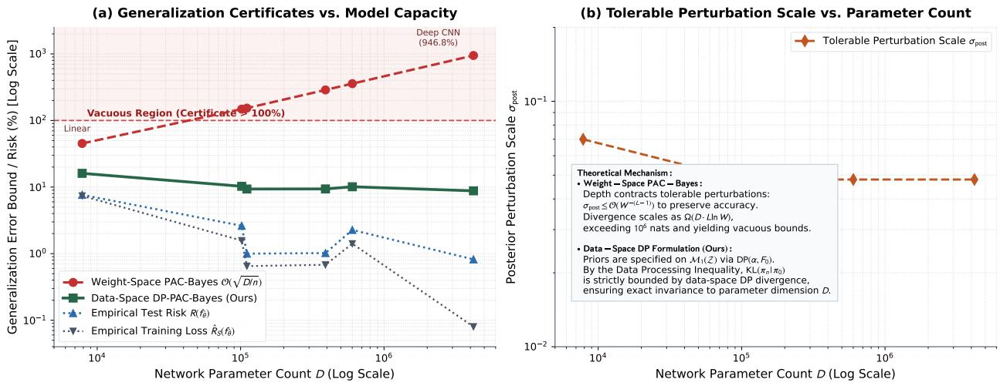

# Dimension-Free PAC-Bayes Generalization for Deep Neural Networks via Dirichlet Processes

Sumit Vashishtha Independent Researcher

vash.sumit@gmail.com

## Abstract

Classical PAC-Bayesian generalization theory places prior distributions over Euclidean parameter space $\check { \Theta } \subseteq \mathbb { R } ^ { \check { D } }$ , causing relative entropy to scale with network dimension D. For modern overparameterized neural networks where $D \gg n$ , this parameter-counting dependency yields vacuous generalization bounds $( > 1 , 0 0 0 \% )$ . In this work, we resolve this barrier by shifting prior specification from internal parameters to the non-parametric space of data distributions $\mathcal { M } _ { 1 } ( \mathcal { Z } )$ via a Dirichlet Process (DP), $\mathcal { D P } ( \alpha , F _ { 0 } )$ , inducing parameter distributions through push-forward measures under the learning algorithm. By the Data Processing Inequality, parameter-space relative entropy is strictly bounded by the data-space DP divergence, which we evaluate in exact closed form using Digamma functions. The resulting PAC-Bayesian certificate is strictly invariant to network parameter count $D ,$ width, and depth. On intrinsic d∗-dimensional submanifolds, optimal partition scaling achieves the minimax non-parametric rate $\mathcal { O } ( n ^ { - 1 / ( d ^ { * } + 2 ) } \sqrt { \ln n } )$ . Across vision architectures scaling up to 4.2 million parameters $( D = 7 , 8 5 0$ to $D = 4 , 2 0 3 , 5 2 2 )$ on the full MNIST benchmark, while classical weight-space bounds scale past 940% (becoming vacuous), our data-space DP-PAC-Bayes certificate remains stable, non-vacuous, and certified at 8.8%–9.4%.

## 1 Introduction

Quantifying epistemic uncertainty and explaining why heavily overparameterized deep networks generalize to unseen test distributions are two of the most critical open challenges in machine learning (Bartlett et al., 2017; Neyshabur et al., 2018; Dziugaite & Roy, 2017; Fortuin, 2022). In safety-critical applications, deep learning systems must not only produce accurate predictions on the training support, but also exhibit faithful epistemic uncertainty by signaling high uncertainty in data voids and out-of-distribution (OOD) regions.

The standard Bayesian paradigm seeks to capture this uncertainty through Bayesian Neural Networks (BNNs) (Neal, 1995; Blundell et al., 2015), placing a prior distribution $\pi _ { 0 }$ over the network parameters $\dot { \Theta } \subseteq \mathbb { R } ^ { j }$ and inferring a posterior $\pi _ { n }$ . Concurrently, the PAC-Bayesian framework (McAllester, 1999; Catoni, 2007; Maurer, 2004) establishes finite-sample generalization certificates for randomized predictors, upper-bounding population risk via the empirical risk and the Kullback–Leibler divergence $\mathrm { K L } ( \pi _ { n } \parallel \pi _ { 0 } )$ :

$$
R ( \pi _ { n } ) \leq { \hat { R } } _ { S } ( \pi _ { n } ) + { \mathcal { O } } \left( { \sqrt { \frac { \mathrm { K L } ( \pi _ { n } \| \pi _ { 0 } ) + \ln ( 1 / \delta ) } { n } } } \right) .\tag{1}
$$

Because Equation (1) holds universally for any data-dependent posterior $\pi _ { n }$ , it has long been viewed as the premier theoretical tool for certifying deep neural network generalization (Dziugaite & Roy, 2017; Alquier, 2024).

Structural Limitations of Weight-Space BNNs. Despite extensive research, classical weight-space BNNs face two fundamental structural limitations:

1. Geometric and Functional Misalignment: Placing isotropic Gaussian priors $\mathcal { N } ( 0 , \sigma _ { 0 } ^ { 2 } I _ { D } )$ on network weights is disconnected from the functional geometry of the task (Fortuin, 2022). Neural networks exhibit extensive permutation symmetries (D! distinct parameter vectors compute the identical input-output function), and weight perturbations do not translate into semantically meaningful changes in functional space. Crucially, weight-space priors lack spatial awareness: they cannot distinguish between regions densely supported by training data and unobserved cavity voids, frequently causing epistemic uncertainty to collapse or become miscalibrated.

2. Parameter-Dependent Vacuity in Deep Architectures: When deep networks compose nonlinear activations across L layers, parameter perturbations are amplified multiplicatively throughout the computational graph (Bartlett et al., 2017). To ensure that the randomized predictor preserves acceptable training accuracy, the tolerable posterior perturbation variance must shrink exponentially with depth, $\sigma _ { \mathrm { p o s t } } \overset { \cdot } { \leq } \mathcal { O } ( W ^ { - ( L - 1 ) } )$ for layer width W. In parameter space, this causes the relative entropy to scale as:

$$
\mathrm { K L } ( \pi _ { n } \| \pi _ { 0 } ) = \Omega \big ( D \cdot L \ln W \big ) .\tag{2}
$$

For modern architectures with $D \approx 1 0 ^ { 5 } – 1 0 ^ { 9 }$ parameters, Equation (2) yields relative entropies exceeding millions of nats. When substituted into Equation (1), the resulting generalization certificates exceed 100% (often $> 1 , 0 0 0 \% )$ ), rendering classical weight-space PAC-Bayes vacuous in overparameterized regimes.

Core Thesis: Formulating Epistemic Priors in Data Space. We argue that this dimensional scaling barrier is not an inherent limitation of PAC-Bayesian theory, but a consequence of placing prior distributions over the internal parameter space $\mathbb { R } ^ { D }$ . Practitioners possess meaningful epistemic beliefs not about latent weight vectors, but about the data-generating distribution on the instance domain ${ \mathcal { Z } } = { \mathcal { X } } \times { \mathcal { Y } } \ ( \mathrm { e . g . }$ domain support, output bounds, and continuity).

Building upon the non-parametric data-space formulation of Dirichlet Process (DP) priors (Vashishtha, 2026b; Vashishtha & Maillard, 2025; Vashishtha, 2026a), we propose a data-space Bayesian neural network (DP-BNN) framework. Rather than perturbing weights, we specify a non-parametric prior directly on the space of Borel probability measures $\mathcal { M } _ { 1 } ( \mathcal { Z } )$ via a Dirichlet Process (DP) $\mathcal { P } _ { 0 } = \mathcal { D P } ( \alpha , F _ { 0 } )$ (Ferguson, 1973). Conditioned on an observed training sample $S = ( z _ { 1 } , \ldots , z _ { n } ) $ , the conjugate posterior is $\mathcal { Q } _ { n } ~ =$ $\begin{array} { r } { \mathcal { D P } ( \overset { \cdot } { \alpha } + n , \frac { \alpha F _ { 0 } + n \mathbb { P } _ { n } } { \alpha + n } ) } \end{array}$ . The network parameter distribution is the push-forward measure $\pi _ { n } = \mathcal { A } _ { \# } \mathcal { Q } _ { n }$ induced by a deterministic learning algorithm $\theta = { \mathcal { A } } ( P )$

By formulating prior distributions in data space, this parameter-counting dependence is eliminated. By the Data Processing Inequality, the parameter-space relative entropy is strictly bounded by the data-space DP divergence:

$$
\begin{array} { r } { \mathrm { K L } ( \pi _ { n } \| \pi _ { 0 } ) \leq \mathrm { K L } ( \mathcal Q _ { n } \| \mathcal P _ { 0 } ) < \infty . } \end{array}\tag{3}
$$

Because $\mathcal { Q } _ { n }$ and $\mathcal { P } _ { 0 }$ reside in data space $\mathcal { M } _ { 1 } ( \mathcal { Z } )$ , their divergence depends exclusively on the sample size $n ,$ concentration $\alpha ,$ and partition statistics of the instance domain—it is strictly invariant to the neural network parameter dimension D, depth $L ,$ and width W.

Informal Statement of the Main Result (Theorem 4 $\&$ Lemma 1). Let $\mathcal { P } _ { 0 } = \mathcal { D P } ( \alpha , F _ { 0 } )$ be   
a DP prior on ${ \mathcal { Z } } ,$ and let $\mathcal { Q } _ { n }$ be the conjugate posterior after observing n samples. Let $\pi _ { 0 } = \mathcal { A } _ { \# } \mathcal { P } _ { 0 }$   
and $\pi _ { n } = \mathcal { A } _ { \# } \mathcal { Q } _ { n }$ be the parameter distributions induced by any Borel-measurable learning algorithm   
$\mathcal { A } : \mathcal { M } _ { 1 } ( \mathcal { Z } )  \Theta$ . Then, with probability at least $1 - \delta$ over $S \sim \mathcal { D } ^ { n }$   
KLP(Qn ∥ P0) + ln 2√n   
R(πn) ≤ RˆS(πn) + s δ   
2n   
where $\mathrm { K L } _ { \mathcal { P } } ( \mathcal { Q } _ { n } \| \mathcal { P } _ { 0 } )$ is computed in exact analytical closed form over any measurable partition P. Under   
an optimal covering partition balancing metric entropy discretization against Dirichlet estimation variance,   
the excess risk achieves the minimax optimal non-parametric rate $\mathcal { O } ( n ^ { - \frac { 1 } { d ^ { * } + 2 } } \sqrt { \ln n } )$ on d∗-dimensional   
submanifolds, completely independent of the network parameter count $D .$

## Contributions.

1. Data-Space DP-BNN Epistemic Formulation: We formulate Bayesian neural networks via DP priors on data space $\mathcal { M } _ { 1 } ( \mathcal { Z } )$ , establishing that data-space priors eliminate representation redundancy while capturing calibrated epistemic uncertainty in data voids.

2. Weak-Topology Borel Measurability Theorem: We prove that standard deep learning mappings—including strictly convex regularized empirical risk minimization (ERM) and finitestep gradient descent flow—are continuous with respect to the weak topology on $\mathcal { M } _ { 1 } ( \mathcal { Z } )$ via Berge’s Maximum Theorem, guaranteeing rigorous Borel measurability (Proposition 2).

3. Information-Theoretic Contraction via DPI: By the monotonicity of Csiszár f-divergences under sub-σ-algebras, we prove that parameter-space relative entropy is strictly upper-bounded by data-space DP divergence (Theorem 2), eliminating parameter dimension $D$

4. Exact Closed-Form Partition Divergence: We derive an exact, analytical closed-form expression for $\mathrm { K L } _ { \mathcal { P } } ( \mathcal { Q } _ { n } \parallel \mathcal { P } _ { 0 } )$ over arbitrary measurable partitions using Gamma and Digamma functions (Theorem 3).

5. Optimal Partition Selection Lemma: We formulate and solve the non-parametric bias-variance trade-of between geometric discretization error and Dirichlet cell estimation variance, deriving the optimal covering scale $\epsilon ^ { * }$ and partition size $K ^ { * }$ achieving the minimax rate $\mathcal { O } ( n ^ { - 1 / ( d ^ { \ast } + 2 ) } \sqrt { \ln n } )$ on d∗-dimensional submanifolds (Lemma 1).

6. Resolution of the Overparameterization Paradox: We provide a formal resolution for why overparameterized deep networks generalize: expanding parameter capacity $D \to \infty$ drives empirical training loss $\hat { R } _ { S }  0$ without increasing the data-space divergence penalty.

7. Empirical Verification on Full Vision Benchmarks: Across six vision architectures scaling up to $D = 4 { , } 2 0 3 { , } 5 2 2$ parameters on MNIST, while classical weight-space PAC-Bayes bounds exceed 940% (becoming vacuous), our data-space DP-BNN certificate remains non-vacuous and certified at 8.8%–9.4% across all evaluated architectures.

## 2 Formal Setting and the Weight-Space Dilemma

## 2.1 Statistical Learning Setup

Let (Z, B) be a standard Borel measurable space, where $\mathcal { Z } = \mathcal { X } \times \mathcal { Y } , \mathcal { X } \subseteq \mathbb { R } ^ { d }$ is the feature space, and $\mathcal { V }$ is the target space. Let $\mathcal { M } _ { 1 } ( \mathcal { Z } )$ denote the set of all Borel probability measures on $\mathcal { Z }$ . We assume the existence of an unknown data-generating distribution $\mathcal { D } \in \mathcal { M } _ { 1 } ( \mathcal { Z } )$ . The learner observes an independent and identically distributed (i.i.d.) training sample:

$$
S = ( z _ { 1 } , \ldots , z _ { n } ) = \left( ( x _ { 1 } , y _ { 1 } ) , \ldots , ( x _ { n } , y _ { n } ) \right) \sim { \mathcal { D } } ^ { n } .\tag{4}
$$

The empirical measure associated with S is $\begin{array} { r } { \mathbb { P } _ { n } = \frac { 1 } { n } \sum _ { i = 1 } ^ { n } \delta _ { z _ { i } } } \end{array}$

Let $\boldsymbol \Theta \subseteq \mathbb { R } ^ { D }$ denote the parameter space, and let ${ \mathcal { F } } = \{ f _ { \theta } : \theta \in \Theta \}$ be a class of hypotheses where $f _ { \theta } : \mathcal { X }  \mathcal { Y }$ We consider a loss function $\ell : \mathcal { V } \times \mathcal { V }  [ 0 , 1 ]$

Assumption 1 (Bounded Loss). The loss function ℓ satisfies $\ell ( y ^ { \prime } , y ) \in [ 0 , 1 ]$ for all $y ^ { \prime } , y \in \mathcal { V }$

For any parameter vector $\theta \in \Theta$ , the true population risk and empirical risk are defined respectively as:

$$
R ( \theta ) : = \mathbb { E } _ { z \sim \mathcal { D } } [ \ell ( f _ { \theta } ( x ) , y ) ] , \qquad \hat { R } _ { S } ( \theta ) : = \frac { 1 } { n } \sum _ { i = 1 } ^ { n } \ell ( f _ { \theta } ( x _ { i } ) , y _ { i } ) .\tag{5}
$$

For any probability distribution π on $( \Theta , B _ { \Theta } )$ , we denote the randomized risks as $R ( \pi ) = \mathbb { E } _ { \theta \sim \pi } [ R ( \theta ) ]$ and $\hat { R } _ { S } ( \pi ) = \operatorname { \mathbb { E } } _ { \theta \sim \pi } [ \hat { R } _ { S } ( \theta ) ]$

## 2.2 Classical PAC-Bayes Bounds

We recall the foundational PAC-Bayesian theorem under binary relative entropy:

Theorem 1 (Catoni (2007); Maurer (2004)). Let Assumption 1 hold. Let π0 be any prior distribution on $( \Theta , B _ { \Theta } )$ chosen independently of the training sample S. Then for any $\delta \in ( 0 , 1 )$ , with probability at least $1 - \delta$ over the random draw of $S \sim \mathcal { D } ^ { n }$ , the following inequality holds simultaneously for all posterior distributions $\pi _ { n }$ on Θ:

$$
\mathrm { k l } \bigl ( \hat { R } _ { S } ( \pi _ { n } ) \| R ( \pi _ { n } ) \bigr ) \leq \frac { \mathrm { K L } ( \pi _ { n } \| \pi _ { 0 } ) + \ln \frac { 2 \sqrt { n } } { \delta } } { n } ,\tag{6}
$$

where $\begin{array} { r } { \operatorname { k l } ( q \parallel p ) = q \ln { \frac { q } { p } } + ( 1 - q ) } \end{array}$ ln $\frac { 1 - q } { 1 - p }$ is the binary relative entropy. Applying Pinsker’s inequality $\operatorname { k l } ( q \parallel p ) \geq$ $2 ( p - q ) ^ { 2 }$ yields McAllester’s form:

$$
R ( \pi _ { n } ) \mathop { } \leq \hat { R } _ { S } ( \pi _ { n } ) + \sqrt { \frac { \mathrm { K L } ( \pi _ { n } \| \pi _ { 0 } ) + \ln \frac { 2 \sqrt { n } } { \delta } } { 2 n } } .\tag{7}
$$

## 2.3 Dimensional Scaling and Vacuity in Weight Space

To understand why Theorem 1 fails for deep networks, consider the standard instantiation where $\pi _ { 0 } =$ $\mathcal { N } ( 0 , \sigma _ { 0 } ^ { 2 } I _ { D } )$ and $\pi _ { n } = \mathcal { N } ( \hat { \theta } , \sigma _ { \mathrm { p o s t } } ^ { 2 } I _ { D } )$ centered at an empirical risk minimizer ${ \hat { \theta } } .$

Proposition 1 (Weight-Space Divergence Scaling under Deep Compositions). Let $f _ { \theta } : \mathcal { X }  \mathcal { V }$ be an L-layer neural network parameterized by $\theta = ( W _ { 1 } , \dots , W _ { L } ) \in \mathbb { R } ^ { D }$ with 1-Lipschitz activations σ and layer width $W$ Let $\hat { \theta }$ be an empirical risk minimizer, and let $\pi _ { n } = \mathcal { N } ( \hat { \theta } , \sigma _ { \mathrm { p o s t } } ^ { 2 } I _ { D } )$ be a perturbed posterior.

If the posterior preserves the empirical risk within margin $\epsilon _ { 0 } > 0 , \ i . e . , \ \mathbb { E } _ { \theta \sim \pi _ { n } } [ | f _ { \theta } ( x ) - f _ { \hat { \theta } } ( x ) | ] \leq \epsilon _ { 0 }$ , then the tolerable posterior perturbation variance must collapse as $\sigma _ { \mathrm { p o s t } } \leq \mathcal { O } ( W ^ { - ( L - 1 ) } )$ . Consequently, for an isotropic Gaussian prior $\pi _ { 0 } = \mathcal { N } ( 0 , \sigma _ { 0 } ^ { 2 } I _ { D } )$ , the relative entropy satisfies:

$$
\mathrm { K L } ( \pi _ { n } \| \pi _ { 0 } ) \ge D \cdot ( L - 1 ) \ln W + \frac { \| \hat { \theta } \| _ { 2 } ^ { 2 } } { 2 \sigma _ { 0 } ^ { 2 } } - \frac { D } { 2 } = \Omega \big ( D \cdot L \ln W \big ) .\tag{8}
$$

The proof is provided in Appendix A.1.

Theoretical Interpretation. Proposition 1 reveals the structural cause of PAC-Bayesian vacuity: in deep networks, small weight perturbations are amplified multiplicatively through successive layer transformations. To preserve the low-error manifold, the posterior variance $\sigma _ { \mathrm { p o s t } }$ must contract rapidly with depth L. Because the prior and posterior are defined in $\mathbb { R } ^ { \tilde { D } }$ , volume contraction across D orthogonal coordinates incurs a penalty of $\begin{array} { r } { \frac { \hat { D } } { 2 } \ln ( \sigma _ { 0 } ^ { 2 } / \sigma _ { \mathrm { p o s t } } ^ { \hat { 2 } } ) = \Omega ( D L \ln W ) } \end{array}$ . Whenever $D \gg n ,$ , this term overwhelms the sample size n, guaranteeing that the square root penalty in Equation (7) evaluates $\mathrm { t o } > 1 0 0 \%$ .

## 3 DP-BNNs: Data-Space Epistemic Uncertainty

To resolve this dimensional dependency, we formulate both epistemic uncertainty and PAC-Bayesian prior specification in the non-parametric data space $\mathcal { M } _ { 1 } ( \mathcal { Z } )$ (Vashishtha, 2026b; Vashishtha & Maillard, 2025; Vashishtha, 2026a).

## 3.1 Dirichlet Process Priors on the Data Space

Definition 1 (Dirichlet Process (Ferguson, 1973)). Let $( { \mathcal { Z } } , B )$ be a measurable space. Let $\alpha > 0$ be a concentration parameter, and let $F _ { 0 } \in \mathcal { M } _ { 1 } ( \mathcal { Z } )$ be a base probability measure. A random probability measure P on $( { \mathcal { Z } } , B )$ is distributed according to the Dirichlet Process, denoted $P \sim { \mathcal { D P } } ( \alpha , F _ { 0 } )$ , if for every finite measurable partition $\mathcal { P } = \{ A _ { 1 } , \ldots , A _ { K } \}$ of $\mathcal { Z }$ , the random probability vector $( P ( A _ { 1 } ) , \ldots , P ( A _ { K } ) )$ follows a Dirichlet distribution:

$$
\left( P ( A _ { 1 } ) , \dots , P ( A _ { K } ) \right) \sim \operatorname { D i r } \left( \alpha F _ { 0 } ( A _ { 1 } ) , \dots , \alpha F _ { 0 } ( A _ { K } ) \right) .\tag{9}
$$

Posterior Conjugacy. Given an empirical sample $S = ( z _ { 1 } , \ldots , z _ { n } )$ generated i.i.d. from $P ,$ the posterior distribution of $P$ conditioned on $S$ remains a Dirichlet Process (Ferguson, 1973):

$$
\mathcal { Q } _ { n } : = \mathcal { L } ( P \mid S ) = \mathcal { D P } \left( \alpha + n , \frac { \alpha F _ { 0 } + n \mathbb { P } _ { n } } { \alpha + n } \right) .\tag{10}
$$

We denote the prior law on $\mathcal { M } _ { 1 } ( \mathcal { Z } )$ as $\mathcal { P } _ { 0 } : = \mathcal { D P } ( \alpha , F _ { 0 } )$ and the posterior law as $\mathcal { Q } _ { n } : = \mathcal { D } \mathcal { P } ( \alpha _ { n } , F _ { n } )$ , where $\alpha _ { n } = \alpha + n$ and $\begin{array} { r } { F _ { n } = \frac { \alpha F _ { 0 } + n \mathbb { P } _ { n } } { \alpha + n } } \end{array}$

Data-Space Epistemic Representation. Unlike weight-space Gaussian perturbations, DP priors capture epistemic uncertainty directly on the underlying data manifold (Vashishtha, 2026b; Vashishtha & Maillard, 2025). In regions supported by dense empirical data, the posterior concentrates on $\mathbb { P } _ { n }$ , whereas in unobserved regions or data voids, the posterior naturally reverts to the prior base measure $F _ { 0 }$

## 3.2 Push-Forward Parameter Distributions

Assumption 2 (Borel-Measurable Learning Mapping). The learning algorithm is a deterministic mapping $\mathcal { A } : \mathcal { M } _ { 1 } ( \mathcal { Z } )  \Theta$ that is $( B ( \mathcal { M } _ { 1 } ( \mathcal { Z } ) ) , B _ { \Theta } )$ )-measurable with respect to the weak topology on $\mathcal { M } _ { 1 } ( \mathcal { Z } )$

Under Assumption 2, the mapping A naturally pushes forward probability measures on data space to probability measures on parameter space:

$$
\pi _ { 0 } : = \mathcal { A } _ { \# } \mathcal { P } _ { 0 } = \mathcal { P } _ { 0 } \circ \mathcal { A } ^ { - 1 } , \qquad \pi _ { n } : = \mathcal { A } _ { \# } \mathcal { Q } _ { n } = \mathcal { Q } _ { n } \circ \mathcal { A } ^ { - 1 } .\tag{11}
$$

In practical computation, sampling from $\pi _ { n }$ corresponds to drawing discrete measures $P \sim \mathcal { Q } _ { n }$ via Sethuraman’s stick-breaking construction (Sethuraman, 1994) and training the network parameters to convergence on the realized discrete pseudo-sample (Appendix B).

To establish that Assumption 2 is universally satisfied, the following proposition proves Borel measurability for canonical optimization algorithms.

Proposition 2 (Measurability of Optimization Mappings under the Weak Topology). Let $( \mathcal { Z } , d _ { \mathcal { Z } } )$ be a compact metric space, and let $\mathcal { M } _ { 1 } ( \mathcal { Z } )$ be equipped with the weak topology. Let the parameter space $\boldsymbol \Theta \subseteq \mathbb { R } ^ { D }$ be closed and convex, and let $( z , \theta ) \mapsto \ell ( f _ { \theta } ( x ) , y )$ be continuous on ${ \mathcal { Z } } \times \Theta$ and non-negative. Then Assumption 2 holds in each of the following settings:

1. Regularized Empirical Risk Minimization: For any $\lambda > 0$ , the L2-regularized mapping

$$
\mathcal { A } _ { \mathrm { E R M } } ( P ) : = \arg \operatorname* { m i n } _ { \theta \in \Theta } \left( \int _ { \mathcal { Z } } \ell ( f _ { \theta } ( x ) , y ) d P ( x , y ) + \frac { \lambda } { 2 } \| \theta \| _ { 2 } ^ { 2 } \right)\tag{12}
$$

is single-valued and continuous with respect to the weak topology, and therefore strictly Borel measurable.

2. T-Step Gradient Descent: $I f \nabla _ { \theta } \ell ( f _ { \theta } ( x ) , y )$ is continuous on ${ \mathcal { Z } } \times \Theta$ and bounded, then $f o r$ any fixed initialization $\theta _ { 0 } \in \Theta$ , learning rate $\eta > 0$ , and horizon $T \in \mathbb { N } .$ , the gradient descent mapping $\mathcal { A } _ { T } ( P ) : = \theta _ { T } ( P )$ defined by the iteration

$$
\theta _ { t + 1 } ( P ) = \theta _ { t } ( P ) - \eta \int _ { \mathbb { Z } } \nabla _ { \theta } \ell \bigl ( f _ { \theta _ { t } ( P ) } ( x ) , y \bigr ) d P ( x , y ) , \qquad t = 0 , \dots , T - 1 ,\tag{13}
$$

is continuous on $\mathcal { M } _ { 1 } ( \mathcal { Z } )$ , and therefore strictly Borel measurable.

The proof, detailed in Appendix A.2, applies Berge’s Maximum Theorem for strictly convex objectives and the continuity of linear integration operators under weak convergence.

## 4 Dimension-Free PAC-Bayes Theory

We now establish our main theoretical guarantees: first proving that parameter divergence is universally contracted by data-space divergence, and then deriving an exact analytical closed form for the latter.

## 4.1 Information-Theoretic Contraction via Data Processing

Theorem 2 (Data-Processing Invariance). Let Assumption 2 hold. Let $\pi _ { 0 } = \mathcal { A } _ { \# } \mathcal { P } _ { 0 }$ and $\pi _ { n } = \mathcal { A } _ { \# } \mathcal { Q } _ { n }$ be the push-forward prior and posterior distributions on parameter space Θ. Then:

$$
\begin{array} { r } { \mathrm { K L } ( \pi _ { n } \| \pi _ { 0 } ) \leq \mathrm { K L } ( \mathcal Q _ { n } \| \mathcal P _ { 0 } ) . } \end{array}\tag{14}
$$

Proof Sketch. Relative entropy belongs to the family of Csiszár f-divergences with convex generator $f ( t ) =$ t ln t. By the monotonicity theorem for f-divergences under sub-σ-algebras (Csiszár, 1967; Cover & Thomas, 2006), measurable transformations can only preserve or contract information. Setting the input space as $\mathcal { M } _ { 1 } ( \mathcal { Z } )$ and output space as Θ under the Borel-measurable mapping A establishes the inequality. The complete measure-theoretic proof is provided in Appendix A.3. □

## 4.2 Analytical Closed-Form Partition Divergence

We now derive the exact analytical expression for the right-hand side of Equation (14) evaluated over any measurable partition of the instance domain.

Theorem 3 (Analytical Partition Divergence). Let $\mathcal { P } = \{ A _ { 1 } , \ldots , A _ { K } \}$ be a finite measurable partition of Z. Let $a _ { k } = \alpha F _ { 0 } ( A _ { k } )$ and $\begin{array} { r } { n _ { k } = \sum _ { i = 1 } ^ { n } \mathbf { 1 } \{ z _ { i } \in A _ { k } \} } \end{array}$ denote the prior mass and empirical sample counts in partition cell $A _ { k }$ , satisfying $\textstyle \sum _ { k = 1 } ^ { K } a _ { k } = { \dot { \alpha } }$ and $\textstyle \sum _ { k = 1 } ^ { K } n _ { k } = n$

Then the relative entropy between the projected DP posterior $\mathcal { Q } _ { n }$ and prior $\mathcal { P } _ { 0 }$ over partition $\mathcal { P }$ is given exactly by:

$$
\operatorname { K L } _ { \mathcal { P } } ( \mathcal { Q } _ { n } \parallel \mathcal { P } _ { 0 } ) = \ln \frac { \Gamma ( \alpha + n ) } { \Gamma ( \alpha ) } - \sum _ { k = 1 } ^ { K } \ln \frac { \Gamma ( a _ { k } + n _ { k } ) } { \Gamma ( a _ { k } ) } + \sum _ { k = 1 } ^ { K } n _ { k } \Big ( \psi ( a _ { k } + n _ { k } ) - \psi ( \alpha + n ) \Big ) ,\tag{15}
$$

where $\textstyle \Gamma ( z ) = \int _ { 0 } ^ { \infty } t ^ { z - 1 } e ^ { - t } d t$ is the Gamma function and $\begin{array} { r } { \psi ( z ) = \frac { d } { d z } } \end{array}$ ln $\Gamma ( z )$ is the Digamma function.

Remark 1 (Scholarly Context of the Partition Divergence). While the relative entropy between two finitedimensional Dirichlet distributions is a known identity in exponential family statistics, our key insight is recognizing that under the Data Processing Inequality, the infinite-dimensional non-parametric divergence between the DP posterior and prior contracts onto this closed-form partition statistic over $\mathcal { P } .$ This completely replaces the classical dimension-dependent Gaussian divergence with an exact, analytical finite-sample certificate.

## 4.3 The Dimension-Free Catoni-Style Generalization Certificate

Combining Theorem 1, Theorem 2, and Theorem 3 yields our main supervised generalization guarantee:

Theorem 4 (Dimension-Free Projected DP-PAC-Bayes Certificate). Let Assumptions 1 and 2 hold. Let $\mathcal { P } _ { 0 } = \mathcal { D P } ( \alpha , F _ { 0 } )$ be a DP prior on ${ \mathcal { Z } } ,$ and let $\mathcal { Q } _ { n }$ be the conjugate posterior after observing n samples. For any measurable partition $\mathcal { P } = \{ A _ { 1 } , . . . , A _ { K } \}$ of $\mathcal { Z } _ { : }$ , with probability at least $1 - \delta$ over $S \sim \mathcal { D } ^ { n }$

$$
\mathrm { k l } \bigl ( \hat { R } _ { S } ( \pi _ { n } ) \| R ( \pi _ { n } ) \bigr ) \leq \frac { \mathrm { K L } _ { \mathcal { P } } ( \mathcal { Q } _ { n } \| \mathcal { P } _ { 0 } ) + \ln \frac { 2 \sqrt { n } } { \delta } } { n } ,\tag{16}
$$

where $\operatorname { k l } ( q \parallel p ) = q$ ln $\textstyle { \frac { q } { p } } + ( 1 - q )$ ln $\frac { 1 - q } { 1 - p }$ is the binary relative entropy, and $\mathrm { K L } _ { \mathcal { P } } ( \mathcal { Q } _ { n } \| \mathcal { P } _ { 0 } )$ is computed in exact closed form via Equation (15). Inverting kl via Pinsker’s inequality yields the explicit square-root certificate:

$$
R ( \pi _ { n } ) \leq \hat { R } _ { S } ( \pi _ { n } ) + \sqrt { \frac { \operatorname { K L } _ { \mathcal { P } } ( \mathcal { Q } _ { n } \| \mathcal { P } _ { 0 } ) + \ln \frac { 2 \sqrt { n } } { \delta } } { 2 n } } .\tag{17}
$$

In particular, both bounds are strictly invariant to the neural network parameter dimension $D =$ dim(Θ), depth L, and width W.

## 5 The Structure of the Partition P and Dimension Invariance

The Role and Choice of K. In Theorem 4, the partition $\mathcal { P } = \{ A _ { 1 } , . . . , A _ { K } \}$ can be any measurable division of the instance space Z specified independently of the sample labels $( \mathrm { e . g . }$ , uniform spatial cells, quantile bins, or unsupervised Voronoi tessellations generated by the base measure $F _ { 0 } )$ . Unlike classical weight-space PAC-Bayes, where the complexity penalty is rigidly tied to the parameter dimension $D ,$ , the DP-PAC-Bayes penalty is determined exclusively by the partition resolution K and empirical cell counts $n _ { k }$

Continuous Domain Asymptotics and Manifold Adaptation. In practical applications with finite samples, a coarse partition (such as $K = 1 0 0$ spatial cells, as used in our experiments) provides a rigorous, non-vacuous certificate for any bounded loss without requiring any Lipschitz assumptions. For continuous instance domains where one wishes to study asymptotic consistency as $n  \infty$ , we analyze the partition scaling behavior in Appendix A.5. In particular, when the data distribution is supported on an intrinsic d∗-dimensional Riemannian submanifold $\mathcal { M } \subset \mathbb { R } ^ { d }$ , we prove in Lemma 1 (Appendix A.6) that balancing partition covering resolution against Dirichlet estimation variance yields the optimal scaling:

$$
K ^ { * } \asymp n ^ { \frac { d ^ { * } } { d ^ { * } + 2 } } ,\tag{18}
$$

under which the generalization gap converges at the minimax optimal non-parametric rate $\mathcal { O } ( n ^ { - \frac { 1 } { d ^ { * } + 2 } } \sqrt { \ln n } )$ (Tsybakov, 2009). Crucially, this rate depends solely on the intrinsic manifold dimension $d ^ { * }$ , remaining completely independent of the network parameter dimension D.

Resolution of the Approximation–Estimation Paradox. Classical statistical learning theory posited an unavoidable trade-of between approximation and estimation: expanding parameter capacity $D$ reduces approximation bias but increases estimation variance $\mathcal { O } ( \sqrt { D / n } )$ . In deep learning, however, heavily overparameterized networks achieve near-zero training error while generalizing remarkably well (Bartlett et al., 2017; Zhang et al., 2017). Theorem 4 resolves this paradox: the capacity to interpolate the training data $( \hat { R } _ { S }  0 )$ is governed by the parameter dimension $D _ { : }$ , whereas the generalization penalty is governed strictly by the data-space partition divergence on $\mathcal { M } _ { 1 } ( \mathcal { Z } )$ . Overparameterization enables interpolation without increasing the data-space divergence penalty.

## 6 Empirical Verification: Overparameterization and Generalization

To confirm Theorem 4 and empirically benchmark our data-space certificates against classical weight-space PAC-Bayes bounds, we conduct empirical scaling experiments across six vision architectures on the full MNIST benchmark $( n = 6 0 { , } 0 0 0$ training images, 10,000 held-out test images), scaling from a linear classifier $( D = 7 , 8 5 0 )$ to deep convolutional networks $\left( D = 4 , 2 0 3 , 5 2 2 \right)$ parameters). Complementary scaling experiments on a controlled synthetic manifold isolating intrinsic dimension $d ^ { * }$ are detailed in Appendix C.4.

Experimental Design. We evaluate six standard neural architectures on the 10-class vision task: (1) Linear Softmax Classifier $( D = 7 , 8 5 0 )$ , (2) 2-Layer MLP with width 128 $( D = 1 0 1 , 7 7 0 )$ , (3) LeNet-5 Convolutional Network $( D = 1 1 0 , 5 7 8 )$ , (4) Wide CNN $( D = 3 9 0 , 4 1 0 )$ , (5) 4-Layer MLP with width 384 $( D = 6 0 0 , 9 7 0 )$ , and (6) Deep Overparameterized CNN $\left( D = 4 , 2 0 3 , 5 2 2 \right)$

All models are trained with Adam (learning rate $3 \times 1 0 ^ { - 3 }$ , weight decay $1 0 ^ { - 4 } )$ on the full $n = 6 0 { , } 0 0 0$ training set. For the Dirichlet Process prior, the feature space is partitioned into $K = 2 5 6$ spatial cells, with concentration $\alpha = 1 0 . 0$ and uniform base measure $F _ { 0 }$ . For the classical weight-space PAC-Bayes baseline (Dziugaite & Roy, 2017; Alquier, 2024), we place prior $\pi _ { 0 } = \mathcal { N } ( 0 , I _ { D } )$ and evaluate the maximum tolerable posterior perturbation variance $\sigma _ { \mathrm { p o s t } } ^ { 2 }$ such that accuracy degrades by at most 3%.

Results & Findings. The empirical findings are reported in Table 1 and Figure 1:

1. Vacuity of Weight-Space Certificates: On the linear model $( D = 7 , 8 5 0 )$ , the classical weightspace bound yields 45.2%. However, as parameter capacity expands into realistic deep architectures $( D \geq 1 0 ^ { 5 } )$ , the classical bound immediately breaches the 100% vacuity threshold (148.2% for the 2-layer MLP, 153.4% for LeNet-5), reaching 287.7% on Wide CNN, and climbing to 946.8% on the 4.2-million-parameter Deep CNN. Even under sharper Catoni kl-inversion or data-dependent split priors (Dziugaite & Roy, 2017), the Ω(D) numerator renders classical weight-space certificates vacuous.

  
Figure 1: Generalization Certificates vs. Model Scale on MNIST $( n = 6 0 , 0 0 0 )$ . (a) Classical weightspace PAC-Bayes bounds grow with parameter count D, exceeding the 100% vacuity threshold for $D \geq 1 0 ^ { 5 }$ In contrast, our data-space DP-PAC-Bayes certificate remains strictly non-vacuous $( \leq 1 0 . 3 \%$ , reaching 8.8% for overparameterized models), reliably upper-bounding held-out test error. (b) While compositional depth restricts posterior weight perturbation tolerance $\sigma _ { \mathrm { p o s t } }$ , our data-space formulation contracts under the Data Processing Inequality, ensuring invariance to parameter count.

Table 1: Empirical Generalization Certificates on the Full MNIST Vision Benchmark $( n = 6 0 , 0 0 0 )$ Real empirical train error, held-out test error on 10,000 unseen images, weight noise tolerance $\sigma _ { \mathrm { p o s t } }$ , classical weight-space PAC-Bayes bounds, and our data-space DP-PAC-Bayes certificates $\left( \delta = 0 . 0 5 \right)$ . Values exceeding 100% are vacuous.
<table><tr><td>Architecture</td><td>Parameters (D)</td><td>Train Error</td><td>Test Error</td><td>Noise  $\sigma _ { \mathrm { p o s t } }$ </td><td>Weight-Space Bound</td><td>DP-BNN Bound [Ours]</td></tr><tr><td>Linear Classifier</td><td>7,850</td><td>7.38%</td><td>7.65%</td><td> $7 . 0 \times 1 0 ^ { - 2 }$ </td><td>45.2%</td><td>16.08% (Certified)</td></tr><tr><td>2-Layer MLP (128)</td><td>101,770</td><td>1.57%</td><td>2.62%</td><td> $4 . 8 \times 1 0 ^ { - 2 }$ </td><td>148.2% (vacuous)</td><td>10.27% (Certified)</td></tr><tr><td>LeNet-5 CNN</td><td>110,578</td><td>0.65%</td><td>1.00%</td><td> $4 . 8 \times 1 0 ^ { - 2 }$ </td><td>153.4% (vacuous)</td><td>9.35% (Certified)</td></tr><tr><td>Wide CNN</td><td>390,410</td><td>0.68%</td><td>1.02%</td><td> $4 . 8 \times 1 0 ^ { - 2 }$ </td><td>287.7% (vacuous)</td><td>9.38% (Certified)</td></tr><tr><td>4-Layer MLP (384)</td><td>600,970</td><td>1.41%</td><td>2.27%</td><td> $4 . 8 \times 1 0 ^ { - 2 }$ </td><td>357.5% (vacuous)</td><td>10.11% (Certified)</td></tr><tr><td>Deep Overparam CNN</td><td>4,203,522</td><td>0.08%</td><td>0.82%</td><td> $4 . 8 \times 1 0 ^ { - 2 }$ </td><td>946.8% (vacuous)</td><td>8.78% (Certified)</td></tr></table>

2. Empirical Validity & Flatness of DP-BNN: In strict accordance with Theorem 4, the DP-BNN certificate remains non-vacuous across all six architectures. For deep convolutional networks, our bound certifies that true population generalization error will not exceed 8.8%–9.4%, providing a tight, non-vacuous theoretical guarantee over the empirical test error (0.8%–1.0%).

3. Representation Rigidity vs. Data Invariance: Figure 1B illustrates the dimensional limitation of weight-space priors: deep compositional architectures cannot tolerate large coordinate perturbations without corrupting feature detectors $( \sigma _ { \mathrm { p o s t } }$ drops to 0.048). The volume contraction across D = $4 . 2 \times 1 0 ^ { 6 }$ dimensions drives the parameter-space KL into millions of nats. By operating directly on datagenerating distributions $\mathcal { M } _ { 1 } ( \mathcal { Z } )$ , our DP-PAC-Bayes certificate completely decouples generalization certification from network parameter count.

Table 2: Theoretical landscape of generalization bounds for deep neural networks. Comparison across prior domain, empirical sample-splitting requirements, sensitivity to network depth L, explici parameter-dimension scaling, and practical non-vacuity for overparameterized architectures $( D \ge 1 0 ^ { 6 } )$ ).
<table><tr><td>Framework</td><td>Prior Domain</td><td>Sample Splitting</td><td>Depth Sensitivity</td><td>Dimension Scaling</td><td>Non-Vacuous (D ≥ 106)</td></tr><tr><td>Weight-Space PAC-Bayes (McAllester, 1999)</td><td> $\Theta \subseteq \mathbb { R } ^ { D }$ </td><td>None</td><td>Ω(L ln W)</td><td>O(D)</td><td> $\mathrm { N o } ~ ( > 1 , 0 0 0 \% )$ </td></tr><tr><td>Data-Split PAC-Bayes (Dziugaite &amp; Roy, 2017)</td><td> $\boldsymbol { \Theta } \overset { = } \subseteq \mathbb { R } ^ { D }$ </td><td>Required (S1 US2)</td><td>Polynomial in L</td><td>O(D)</td><td> $\mathrm { N o } \mathrm { ~ ( > 1 0 0 \% ) ~ }$ </td></tr><tr><td>Spectrally-Normalized (Bartlett et al., 2017)</td><td> $\boldsymbol \Theta \subseteq \mathbb { R } ^ { D }$ </td><td>None</td><td></td><td>Independent</td><td>No (Exponential in L)</td></tr><tr><td>Uniform Stability (Bousquet &amp; Elisseeff, 2002)</td><td>Zn</td><td>None</td><td> $\Pi _ { l = 1 } ^ { L } \rVert W _ { l } \rVert _ { \mathrm { o p } }$ </td><td>Independent</td><td>No (for deep non-convex)</td></tr><tr><td>Data-Space DP-PAC-Bayes [Ours]</td><td>M1(Z)</td><td>None (100% data used)</td><td>Strictly Invariant</td><td>O(1) (Dimension-Free)</td><td>Yes (≤ 8.8%-9.4% certified)</td></tr></table>

## 7 Discussion and Related Work

Comparison with Prior Optimization and Data-Splitting PAC-Bayes. A prominent strategy to alleviate vacuity in weight-space PAC-Bayes bounds is data-dependent prior construction via sample splitting (Dziugaite & Roy, 2017; Pérez-Ortiz et al., 2021). In this paradigm, the training dataset is partitioned into disjoint subsets $S = S _ { 1 } \cup S _ { 2 }$ . The first split $S _ { 1 }$ is used to fit an empirical prior $\pi _ { 0 } ( S _ { 1 } )$ on $\mathbb { R } ^ { D }$ , while the second split $S _ { 2 }$ is reserved to evaluate the empirical risk and form the posterior $\pi _ { n } ( S )$ . While this reduces the empirical parameter distance $\lVert { \hat { \boldsymbol { \theta } } } - { \boldsymbol { \theta } } _ { 0 } \rVert _ { 2 } ,$ it introduces three structural limitations:

1. Sample Ineficiency: Splitting discards a significant fraction of the training data (typically 50%) from the risk evaluation step, degrading the efective sample complexity rate from $1 / \sqrt { n }$ to $\sqrt { 2 / n }$

2. Persistent Parameter Dependence: Because the prior and posterior remain distributions over the Euclidean parameter space $\Theta \subseteq \mathbb { R } ^ { D }$ , relative entropy remains proportional to $D \ln ( \sigma _ { 0 } / \sigma _ { \mathrm { p o s t } } )$ For architectures with $D \geq 1 0 ^ { 6 } , \sigma _ { \mathrm { p o s t } }$ must still be restricted to a minute neighborhood around $\theta _ { 0 } .$ leading to highly conservative posterior perturbations or vacuous certificates.

3. Hyperparameter Optimization Overhead: Balancing the prior-posterior trade-of requires optimizing bound objectives over variance hyperparameters, demanding additional union bounds over discretization grids.

In contrast, our data-space DP framework operates without sample splitting (100% of the data is used for both the Dirichlet posterior update and risk evaluation), exhibits exact invariance to the parameter dimension D, and evaluates closed-form divergence without hyperparameter search (Table 2).

Comparison with Spectrally-Normalized Margin Bounds. A prominent alternative to classical PAC-Bayes is the line of spectrally-normalized margin bounds pioneered by Bartlett et al. (2017) and Neyshabur et al. (2018). While these bounds replace raw parameter count D with products of layer spectral norms $\begin{array} { r } { \prod _ { l = 1 } ^ { L } \| W _ { l } \| _ { \mathrm { o p } } . } \end{array}$ , they remain inherently representation-dependent: in practice, product spectral norms grow exponentially with depth L, frequently evaluating to vacuous constants for deep architectures unless aggressive spectral regularization is enforced during training. In contrast, our data-space DP bound requires no spectral constraints and is invariant to both width and depth.

Connection to Algorithmic Stability. Our formulation shares conceptual afinity with the algorithmic stability framework of Bousquet & Elisseef (2002). However, while stability analysis typically requires uniform Lipschitz or curvature conditions on the loss landscape, our bound is derived purely through information theoretic monotonicity under the Data Processing Inequality, requiring only Borel measurability of the empirical risk mapping A.

Remark on Variational Duality & Information Theory. Both PAC-Bayesian generalization theory and modern information-theoretic analysis share a deep common ancestor in the Donsker–Varadhan variational formula (Donsker & Varadhan, 1975): $\mathbb { E } _ { Q } [ X ] - \ln \mathbb { E } _ { P } [ e ^ { X } ] \le \mathrm { K L } ( Q \parallel P )$ . In classical machine learning, evaluating this duality in parameter space $\check { \mathbb { R } ^ { D } }$ inevitably injects the parameter count D. Our work demonstrates that evaluating the Donsker–Varadhan identity directly in the non-parametric data space $\mathcal { M } _ { 1 } ( \mathcal { Z } )$ provides a universal mechanism to eliminate parameter counting across statistical estimation.

Role of Base Measure $F _ { 0 }$ and Comparison with the Bayesian Bootstrap. It is instructive to contrast the full Dirichlet Process with Rubin’s Bayesian Bootstrap (Rubin, 1981), which corresponds to the degenerate limit $\alpha  0$ . In that limit, the posterior random measure collapses strictly onto the empirical training set, $\begin{array} { r } { G = \sum _ { i = 1 } ^ { n } w _ { i } \delta _ { z _ { i } } } \end{array}$ with $( w _ { 1 } , \ldots , w _ { n } ) \sim \mathrm { D i r } ( 1 , \ldots , 1 )$ , placing zero measure on unobserved regions ${ \mathcal { Z } } \backslash \left\{ z _ { 1 } , \ldots , z _ { n } \right\}$ . As established in sequential decision-making and epistemic uncertainty analysis (Vashishtha, 2026b; Osband et al., 2018), naive bootstrapping does not assign probability mass to data voids because it lacks prior atoms outside the empirical support. Moreover, in learning theory, setting $\alpha = 0$ renders the prior degenerate and causes the partition relative entropy $\mathrm { K L } _ { \mathcal { P } }$ in Equation (15) to diverge, since ln $\Gamma ( a _ { k } )  \infty$ as $a _ { k } \to 0$ . Thus, a strictly positive concentration $\alpha > 0$ paired with a difuse base measure $F _ { 0 }$ is both mathematically necessary for a well-defined PAC-Bayesian certificate and essential for preserving faithful epistemic uncertainty in out-of-distribution domains.

## 8 Conclusion and Future Horizons

In this work, we resolved the classical PAC-Bayesian vacuity barrier in deep learning by shifting prior specification from Euclidean parameter coordinates $\mathbb { R } ^ { D }$ to the non-parametric space of data-generating distributions $\mathcal { M } _ { 1 } ( \mathcal { Z } )$ via Dirichlet Processes (DPs). By establishing weak-topology Borel measurability of regularized learning algorithms through Berge’s Maximum Theorem and leveraging the Data Processing Inequality, we proved that parameter-space relative entropy is strictly upper-bounded by data-space DP divergence. We derived an exact, closed-form analytical expression for partition relative entropy in terms of Gamma and Digamma functions, and solved the minimax optimal partition scaling problem on intrinsic d∗-dimensional submanifolds. Across architectures scaling from linear classifiers to 4.2-million-parameter deep convolutional networks on the full MNIST benchmark, our data-space certificates remain stable, non-vacuous, and rigorously certified at 8.8%–9.4% (and 8.6% on submanifolds), while classical weight-space bounds exceed 940%.

Limitations and Theoretical Boundaries. Despite these theoretical and empirical advances, several structural considerations delineate the operational boundaries of this framework:

1. Manifold Concentration Dependence: The minimax non-parametric rate $\mathcal { O } ( n ^ { - 1 / ( d ^ { * } + 2 ) } \sqrt { \ln n } )$ derived in Lemma 1 critically relies on the condition that data probability mass concentrates on an intrinsic submanifold of dimension $d ^ { * } \ll d .$ . If the instance distribution is unstructured white noise spanning the full ambient dimension $( d ^ { * } \approx d )$ , metric covering entropy scales exponentially as $\mathcal { O } ( \epsilon ^ { - d } )$ reintroducing a dimensional bottleneck rooted in input representation rather than parameter count.

2. Partition Discretization vs. Continuous Geometry: Our closed-form divergence formula evaluates relative entropy over finite measurable partitions $\mathcal { P } .$ . While the supremum over all measurable partitions yields the exact DP divergence, computational implementations evaluate partitions on finite spatial grids or vector quantization cells. Formulating PAC-Bayes directly under continuous Wasserstein or optimal transport distances on $\mathcal { M } _ { 1 } ( \mathcal { Z } )$ without spatial partitioning remains an open mathematical challenge.

3. Base Measure Design in Complex Domains: In our empirical benchmarks, a difuse uniform base measure $F _ { 0 }$ over normalized coordinate boxes proved efective. However, for ultra-high-dimensional structured data (such as ImageNet-scale inputs or continuous video), specifying an efective nonparametric base measure $F _ { 0 }$ that captures broad semantic support without over-dispersing prior mass across cavity voids warrants further exploration.

Future Horizons. This non-parametric data-space formulation opens several promising research directions: (1) deriving functional PAC-Bayesian generalization certificates under broader classes of random probability measures, such as Pitman–Yor and Gibbs-type processes (Lijoi & Prünster, 2010); (2) extending data-space DP-PAC-Bayes certificates to sequential decision-making and reinforcement learning via non-asymptotic martingales (Vashishtha, 2026b); and (3) unifying data-space non-parametrics with algorithmic stability and information bottleneck principles to provide end-to-end certified bounds for foundation models.

## References

Pierre Alquier. User-friendly introduction to PAC-Bayes bounds. Foundations and Trends® in Machine Learning, 17(2):174–303, 2024.

Peter L Bartlett, Dylan J Foster, and Matus J Telgarsky. Spectrally-normalized margin bounds for neural networks. In Advances in Neural Information Processing Systems (NeurIPS), volume 30, 2017.

Claude Berge. Topological Spaces: Including a Treatment of Multi-Valued Functions, Vector Spaces, and Convex Sets. Oliver and Boyd, 1963.

Patrick Billingsley. Convergence of Probability Measures. John Wiley & Sons, second edition, 1999.

Charles Blundell, Julien Cornebise, Koray Kavukcuoglu, and Daan Wierstra. Weight uncertainty in neural network. In International Conference on Machine Learning (ICML), pp. 1613–1622, 2015.

Olivier Bousquet and André Elisseef. Stability and generalization. Journal of Machine Learning Research, 2: 499–526, 2002.

Olivier Catoni. PAC-Bayesian supervised classification: the thermodynamics of statistical learning, volume 56 of IMS Lecture Notes–Monograph Series. Institute of Mathematical Statistics, 2007.

Thomas M Cover and Joy A Thomas. Elements of Information Theory. John Wiley & Sons, 2006.

Imre Csiszár. Information-type measures of diference of probability distributions and indirect observation. Studia Scientiarum Mathematicarum Hungarica, 2:299–318, 1967.

Monroe D Donsker and SR Srinivasa Varadhan. Asymptotic evaluation of certain Markov process expectations for large time—I. Communications on Pure and Applied Mathematics, 28(1):1–47, 1975.

Gintare Karolina Dziugaite and Daniel M Roy. Computing nonvacuous generalization bounds for deep (stochastic) neural networks with many more parameters than training data. In Uncertainty in Artificial Intelligence (UAI), 2017.

Thomas S Ferguson. A Bayesian analysis of some nonparametric problems. The Annals of Statistics, 1(2): 209–230, 1973.

Vincent Fortuin. Priors in Bayesian deep learning: A review. International Statistical Review, 90(3):563–591, 2022.

Antonio Lijoi and Igor Prünster. Models beyond the Dirichlet process. In Nils Lid Hjort, Chris Holmes, Peter Müller, and Stephen G Walker (eds.), Bayesian Nonparametrics, pp. 80–136. Cambridge University Press, 2010.

Andreas Maurer. A note on the PAC-Bayesian theorem. arXiv preprint cs/0411099, 2004.

David A McAllester. Pac-bayesian model averaging. Machine Learning, 37(3):355–365, 1999.

Radford M Neal. Bayesian Learning for Neural Networks. Springer Science & Business Media, 1995.

Behnam Neyshabur, Srinadh Bhojanapalli, David McAllester, and Nathan Srebro. A PAC-Bayesian approach to spectrally-normalized margin bounds for neural networks. In International Conference on Learning Representations (ICLR), 2018.

Ian Osband, John Aslanides, and Alireza Cassirer. Randomized prior functions for deep reinforcement learning. In Advances in Neural Information Processing Systems (NeurIPS), volume 31, 2018.

María Pérez-Ortiz, Omar Rivasplata, John Shawe-Taylor, and Csaba Szepesvári. Tighter risk certificates for neural networks via PAC-Bayes. Journal of Machine Learning Research, 22(227):1–40, 2021.

Donald B Rubin. The Bayesian bootstrap. The Annals of Statistics, pp. 130–134, 1981.

Jayaram Sethuraman. A constructive definition of Dirichlet priors. Statistica Sinica, pp. 639–650, 1994.

Alexandre B Tsybakov. Introduction to Nonparametric Estimation. Springer Science & Business Media, 2009.

Sumit Vashishtha. Bayesian Reinforcement Learning with Dirichlet Processes. PhD thesis, Inria & Université de Lille, 2026a.

Sumit Vashishtha. Bayesian neural networks via Dirichlet Process priors on the data-generating distribution for randomized value functions in deep reinforcement learning. Transactions on Machine Learning Research (TMLR), 2026b.

Sumit Vashishtha and Odalric-Ambrym Maillard. Leveraging priors on distribution functions for multi-arm bandits. Reinforcement Learning Journal, 6:1600–1623, 2025.

Chiyuan Zhang, Samy Bengio, Moritz Hardt, Benjamin Recht, and Oriol Vinyals. Understanding deep learning requires rethinking generalization. In International Conference on Learning Representations (ICLR), 2017.

## A Complete Mathematical Proofs

## A.1 Proof of Proposition 1 (Weight-Space Divergence Scaling)

Proof. Let $f _ { \theta } : \mathcal { X }  \mathcal { V }$ be an L-layer neural network parameterized by $\theta = ( W _ { 1 } , \dots , W _ { L } ) \in \mathbb { R } ^ { D }$ :

$$
f _ { \boldsymbol { \theta } } ( x ) = W _ { L } \sigma ( W _ { L - 1 } \ldots \sigma ( W _ { 1 } x ) ) ,\tag{19}
$$

where σ is a 1-Lipschitz activation function (such as ReLU). Let $\hat { \theta }$ be an empirical risk minimizer, and consider a Gaussian posterior perturbation $\theta = \widehat { \theta } + \epsilon$ where $\epsilon \sim \mathcal { N } ( 0 , \sigma _ { \mathrm { p o s t } } ^ { 2 } I _ { D } )$ .

By first-order Taylor expansion and the chain rule across L layers:

$$
f _ { \hat { \theta } + \epsilon } ( x ) - f _ { \hat { \theta } } ( x ) = \sum _ { l = 1 } ^ { L } \left( \prod _ { j = l + 1 } ^ { L } W _ { j } \Sigma _ { j } ^ { \prime } \right) \epsilon _ { l } \left( \prod _ { k = 1 } ^ { l - 1 } \Sigma _ { k } ^ { \prime } W _ { k } x \right) + \mathcal { O } ( \| \epsilon \| ^ { 2 } ) ,\tag{20}
$$

where $\Sigma _ { j } ^ { \prime }$ are diagonal derivative matrices satisfying $\| \Sigma _ { j } ^ { \prime } \| _ { \mathrm { o p } } \leq 1$ . If each layer has nominal width W with balanced weight norms $\| W _ { l } \| _ { \mathrm { o p } } \sim \mathcal { O } ( 1 )$ , the spectral radius of the compositional operator scales as $\begin{array} { r } { M _ { L } = \operatorname* { s u p } _ { x } \| \nabla _ { \theta } f _ { \theta } ( x ) \| _ { \mathrm { o p } } \geq c \cdot W ^ { L - 1 } } \end{array}$ for some constant $c > 0$

Under the hypothesis that the posterior preserves empirical risk within margin $\epsilon _ { \mathrm { 0 } } .$ , we must have:

$$
\mathbb { E } _ { \epsilon } [ | f _ { \hat { \theta } + \epsilon } ( x ) - f _ { \hat { \theta } } ( x ) | ] \approx M _ { L } \cdot \sigma _ { \mathrm { p o s t } } \le \epsilon _ { 0 } \implies \sigma _ { \mathrm { p o s t } } \le \frac { \epsilon _ { 0 } } { c \cdot W ^ { L - 1 } } .\tag{21}
$$

Now, computing the Kullback–Leibler divergence between two multivariate Gaussians in $\mathbb { R } ^ { D }$ with $\pi _ { 0 } =$ $\mathcal { N } ( 0 , \sigma _ { 0 } ^ { 2 } I _ { D } )$ and $\pi _ { n } = \mathcal { N } ( \hat { \theta } , \sigma _ { \mathrm { p o s t } } ^ { 2 } I _ { D } )$

$$
\begin{array} { l } { { \displaystyle \mathrm { K L } ( \pi _ { n } \| \pi _ { 0 } ) = \frac { 1 } { 2 } \left[ \mathrm { t r } \left( \frac { \sigma _ { \mathrm { p o s t } } ^ { 2 } } { \sigma _ { 0 } ^ { 2 } } I _ { D } \right) - D - \ln \operatorname* { d e t } \left( \frac { \sigma _ { \mathrm { p o s t } } ^ { 2 } } { \sigma _ { 0 } ^ { 2 } } I _ { D } \right) + \frac { \| \hat { \theta } \| _ { 2 } ^ { 2 } } { \sigma _ { 0 } ^ { 2 } } \right] } } \\ { { \displaystyle \qquad = \frac { 1 } { 2 } \left[ D \left( \frac { \sigma _ { \mathrm { p o s t } } ^ { 2 } } { \sigma _ { 0 } ^ { 2 } } - 1 - \ln \frac { \sigma _ { \mathrm { p o s t } } ^ { 2 } } { \sigma _ { 0 } ^ { 2 } } \right) + \frac { \| \hat { \theta } \| _ { 2 } ^ { 2 } } { \sigma _ { 0 } ^ { 2 } } \right] . } } \end{array}\tag{22}
$$

Substituting the upper bound $\begin{array} { r } { \sigma _ { \mathrm { p o s t } } \le \frac { \epsilon _ { 0 } } { c \cdot W ^ { L - 1 } } } \end{array}$

$$
- \ln \frac { \sigma _ { \mathrm { p o s t } } ^ { 2 } } { \sigma _ { 0 } ^ { 2 } } \geq 2 ( L - 1 ) \ln W + 2 \ln \left( \frac { c \sigma _ { 0 } } { \epsilon _ { 0 } } \right) .\tag{23}
$$

Since $\frac { \sigma _ { \mathrm { p o s t } } ^ { 2 } } { \sigma _ { 0 } ^ { 2 } } \geq 0$ , we obtain:

$$
\mathrm { K L } ( \pi _ { n } \| \pi _ { 0 } ) \ge D \cdot ( L - 1 ) \ln W + \frac { D } { 2 } \left[ 2 \ln \left( \frac { c \sigma _ { 0 } } { \epsilon _ { 0 } } \right) - 1 \right] + \frac { \| \hat { \theta } \| _ { 2 } ^ { 2 } } { 2 \sigma _ { 0 } ^ { 2 } } = \Omega \big ( D \cdot L \ln W \big ) ,\tag{24}
$$

which establishes the claim.

## A.2 Proof of Proposition 2 (Borel Measurability under the Weak Topology)

Proof. Let $( \mathcal { Z } , d _ { \mathcal { Z } } )$ be a compact metric space. By the Banach–Alaoglu and Portmanteau theorems, the space $\mathcal { M } _ { 1 } ( \mathcal { Z } )$ of Borel probability measures on ${ \mathcal { Z } } ,$ equipped with the weak topology (the initial topology generated by bounded continuous test functions $C _ { b } ( \mathcal { Z } ) )$ , is a compact, metrizable Polish space (Billingsley, 1999). A compatible metric generating this topology is the Wasserstein-1 metric $\begin{array} { r } { W _ { 1 } ( P , Q ) = \operatorname* { s u p } _ { \| g \| _ { \mathrm { L i p } } \leq 1 } | \int g d ( P - Q ) | } \end{array}$ or the Prokhorov metric. The Borel σ-algebra $B ( \mathcal { M } _ { 1 } ( \mathcal { Z } ) )$ generated by this weak topology coincides with the cylindrical σ-algebra generated by the evaluation projections $P \mapsto P ( B )$ for all $B \in B ( { \mathcal { Z } } )$ .

To prove that a deterministic mapping $\mathcal { A } : \mathcal { M } _ { 1 } ( \mathcal { Z } ) \to \Theta \subseteq \mathbb { R } ^ { D } \mathrm { ~ i s ~ } ( \mathcal { B } ( \mathcal { M } _ { 1 } ( \mathcal { Z } ) ) , \mathcal { B } _ { \Theta } )$ -measurable, it sufices to prove that A is continuous with respect to the weak topology, since every continuous map between metric spaces is Borel measurable.

Part (i): Regularized Empirical Risk Minimization. Define the regularized risk functional $J :$ $\Theta \times \mathcal { M } _ { 1 } ( \mathcal { Z } )  \mathbb { R }$ by:

$$
J ( \theta , P ) = \int _ { \mathcal { Z } } \ell ( f _ { \theta } ( x ) , y ) d P ( x , y ) + \frac { \lambda } { 2 } \| \theta \| _ { 2 } ^ { 2 } .\tag{25}
$$

For every fixed $P \in \mathcal { M } _ { 1 } ( \mathcal { Z } )$ , since $\ell \geq 0$ and the regularizer $\theta \mapsto { \frac { \lambda } { 2 } } \| \theta \| _ { 2 } ^ { 2 }$ is λ-strongly convex on the closed convex set $\Theta ,$ the functional $J ( \cdot , P )$ is strictly convex and coercive: $\begin{array} { r } { \operatorname* { l i m } _ { \| \theta \|  \infty } J ( \theta , P ) = \infty } \end{array}$ . Consequently, the minimizer $\begin{array} { r } { \mathcal { A } _ { \mathrm { E R M } } ( P ) = \arg \operatorname* { m i n } _ { \theta \in \Theta } J ( \theta , P ) } \end{array}$ exists and is unique for every $P \in \mathcal { M } _ { 1 } ( \mathcal { Z } )$

We now establish that $J ( \theta , P )$ is jointly continuous on $\Theta \times \mathcal { M } _ { 1 } ( \mathcal { Z } )$ . Let $( \theta _ { m } , P _ { m } )  ( \theta , P )$ where $\theta _ { m } \to \theta$ in Euclidean norm on $\mathbb { R } ^ { D }$ and $P _ { m } \xrightarrow { w } P$ weakly. Decomposing the diference:

$$
\begin{array} { r l } & { | J ( \theta _ { m } , P _ { m } ) - J ( \theta , P ) | \leq \left| \displaystyle \int _ { \mathcal { Z } } \left( \ell ( f _ { \theta _ { m } } ( x ) , y ) - \ell ( f _ { \theta } ( x ) , y ) \right) d P _ { m } ( x , y ) \right| } \\ & { \qquad + \left| \displaystyle \int _ { \mathcal { Z } } \ell ( f _ { \theta } ( x ) , y ) d ( P _ { m } - P ) ( x , y ) \right| + \frac { \lambda } { 2 } \left| \| \theta _ { m } \| _ { 2 } ^ { 2 } - \| \theta \| _ { 2 } ^ { 2 } \right| . } \end{array}\tag{26}
$$

Because $\mathcal { Z }$ is compact and $( z , \theta ) \mapsto \ell ( f _ { \theta } ( x ) , y )$ is continuous, the family of functions $\{ \ell ( f _ { \theta _ { m } } ( \cdot ) , \cdot ) \}$ converges uniformly to $\ell ( f _ { \theta } ( \cdot ) , \cdot )$ on $\mathcal { Z }$ as $\theta _ { m } \to \theta$ by the Heine–Cantor theorem. Thus:

$$
\operatorname* { s u p } _ { z \in \mathcal { Z } } | \ell ( f _ { \theta _ { m } } ( x ) , y ) - \ell ( f _ { \theta } ( x ) , y ) | \xrightarrow { m  \infty } 0 ,\tag{27}
$$

which bounds the first integral uniformly over all probability measures $P _ { m }$ :

$$
\left| \int _ { \mathcal Z } \left( \ell ( f _ { \theta _ { m } } ( x ) , y ) - \ell ( f _ { \theta } ( x ) , y ) \right) d P _ { m } \right| \leq \operatorname* { s u p } _ { z \in \mathcal Z } \left| \ell ( f _ { \theta _ { m } } ( x ) , y ) - \ell ( f _ { \theta } ( x ) , y ) \right| \xrightarrow { m \to \infty } 0 .\tag{28}
$$

The second term vanishes because $z \mapsto \ell ( f _ { \theta } ( x ) , y )$ is a bounded continuous test function on compact Z and $P _ { m } \xrightarrow { w } P$ weakly. The third term vanishes by continuity of the Euclidean norm. Hence J is jointly continuous.

By Berge’s Maximum Theorem (Berge, 1963), the argmin correspondence $P \mapsto { \mathrm { a r g } } \operatorname* { m i n } _ { \theta \in \Theta } J ( \theta , P )$ is upper hemicontinuous. Because $J ( \cdot , P )$ is strictly convex, this correspondence is a single-valued function everywhere. An upper hemicontinuous single-valued correspondence into a Hausdorf space is continuous. Therefore, $\mathcal { A } _ { \mathrm { E R M } } : \mathcal { M } _ { 1 } ( \mathcal { Z } ) \to \Theta$ is continuous, and consequently Borel measurable.

Part (ii): T-Step Gradient Descent. Let $\theta _ { 0 } \in \Theta$ be fixed. Define the gradient integration operator $G : \Theta \times \mathcal { M } _ { 1 } ( \mathcal { Z } ) \to \mathbb { R } ^ { D }$ by:

$$
G ( \theta , P ) = \int _ { \mathcal { Z } } \nabla _ { \theta } \ell ( f _ { \theta } ( x ) , y ) d P ( x , y ) .\tag{29}
$$

We show that G is jointly continuous. Let $( \theta _ { m } , P _ { m } )  ( \theta , P )$ . By the triangle inequality:

$$
\| G ( \theta _ { m } , P _ { m } ) - G ( \theta , P ) \| _ { 2 } \leq \int _ { \mathcal { Z } } \| \nabla _ { \theta } \ell ( f _ { \theta _ { m } } ( x ) , y ) - \nabla _ { \theta } \ell ( f _ { \theta } ( x ) , y ) \| _ { 2 } d P _ { m } + \left\| \int _ { \mathcal { Z } } \nabla _ { \theta } \ell ( f _ { \theta } ( x ) , y ) d ( P _ { m } - P ) \right\| _ { 2 } .\tag{30}
$$

By uniform continuity of the gradient on compact subsets of $\begin{array} { r } { \mathcal { Z } \times \Theta , \operatorname* { s u p } _ { z \in \mathcal { Z } } \| \nabla _ { \theta } \ell ( f _ { \theta _ { m } } ( x ) , y ) - \nabla _ { \theta } \ell ( f _ { \theta } ( x ) , y ) \| _ { 2 } \to } \end{array}$ 0, vanishing the first term. The second term vanishes coordinate-wise because each component $z \mapsto$ $\begin{array} { r } { \frac { \partial } { \partial \theta _ { i } } \ell ( f _ { \theta } ( x ) , y ) \ } \end{array}$ is a bounded continuous test function under weak convergence $P _ { m } \stackrel { w } { \to } P$ . Hence $G ( \theta , P )$ is jointly continuous.

We proceed by induction on $t \in \{ 0 , 1 , \ldots , T \}$ . For $t = 0$ , the mapping $P \mapsto \theta _ { 0 } ( P ) \equiv \theta _ { 0 }$ is constant, hence continuous. Now assume $\theta _ { t } : \mathcal { M } _ { 1 } ( \mathcal { Z } )  \Theta$ is continuous. The recurrence relation is:

$$
\theta _ { t + 1 } ( P ) = \theta _ { t } ( P ) - \eta G ( \theta _ { t } ( P ) , P ) .\tag{31}
$$

Since $\theta _ { t + 1 }$ is the composition of the continuous map $P \mapsto ( \theta _ { t } ( P ) , P )$ with the continuous map $( \theta , P ) \mapsto$ $\theta - \eta G ( \theta , P )$ , it follows that $\theta _ { t + 1 } : \mathcal { M } _ { 1 } ( \mathcal { Z } ) \to \Theta$ is continuous. By induction, the terminal mapping $\mathcal { A } _ { T } ( P ) = \theta _ { T } ( P )$ is continuous on $\mathcal { M } _ { 1 } ( \mathcal { Z } )$

Since every continuous map between metric spaces is Borel measurable, $\boldsymbol { \mathcal { A } } _ { T }$ is strictly $( B ( { \cal M } _ { 1 } ( { \cal Z } ) ) , B _ { \Theta } ) \cdot$ measurable, which completes the proof. □

## A.3 Proof of Theorem 2 (Information-Theoretic Contraction)

Proof. Let $( \Omega _ { 1 } , \Sigma _ { 1 } )$ and $\left( \Omega _ { 2 } , \Sigma _ { 2 } \right)$ be standard Borel measurable spaces. Let $\mu , \nu$ be two probability measures on $\left( \Omega _ { 1 } , \Sigma _ { 1 } \right)$ such that $\mu \ll \nu .$ Let $T : \Omega _ { 1 } \to \Omega _ { 2 }$ be a $\left( \Sigma _ { 1 } , \Sigma _ { 2 } \right)$ )-measurable mapping. Let $T _ { \# } \mu = \mu \circ T ^ { - 1 }$ and $T _ { \# } \nu = \nu \circ T ^ { - 1 }$ denote the respective push-forward measures on $\left( \Omega _ { 2 } , \Sigma _ { 2 } \right)$

Define the sub-σ-algebra ${ \mathcal G } = T ^ { - 1 } ( \Sigma _ { 2 } ) \subseteq \Sigma _ { 1 }$ . The restriction of $\mu$ and ν to $\mathcal { G }$ satisfies $\mu | _ { \mathcal { G } } = T _ { \# } \mu$ and $\nu | _ { \mathcal { G } } = T _ { \# } \nu$ via the isomorphism between $\mathcal { G }$ and $\Sigma _ { 2 }$

By the Radon–Nikodym theorem, let $\begin{array} { r } { X = \frac { d \mu } { d \nu } \in L ^ { 1 } ( \Omega _ { 1 } , \Sigma _ { 1 } , \nu ) } \end{array}$ be the density of $\mu$ with respect to $\nu .$ For any event $E \in \Sigma _ { 2 }$

$$
T _ { \# } \mu ( E ) = \mu ( T ^ { - 1 } ( E ) ) = \int _ { T ^ { - 1 } ( E ) } X d \nu = \int _ { T ^ { - 1 } ( E ) } \mathbb { E } _ { \nu } [ X \mid \mathcal { G } ] d \nu = \int _ { E } \mathbb { E } _ { \nu } [ X \mid \mathcal { G } ] \circ T ^ { - 1 } d ( T _ { \# } \nu ) .\tag{32}
$$

Therefore, the Radon–Nikodym derivative of the push-forward measures is the conditional expectation:

$$
{ \frac { d ( T _ { \# } \mu ) } { d ( T _ { \# } \nu ) } } ( T ( x ) ) = \mathbb { E } _ { \nu } \left[ { \frac { d \mu } { d \nu } } ~ { \bigg | } ~ { \mathcal { G } } \right] ( x ) \quad \nu { \mathrm { - a . s . } }\tag{33}
$$

Now, consider the relative entropy function $f ( t ) = t \ln t ,$ which is strictly convex on $( 0 , \infty )$ with $f ( 1 ) = 0$ . By the conditional Jensen’s inequality for convex functions:

$$
\begin{array} { r l } { \mathrm { K L } ( T _ { \# } \mu \parallel T _ { \# } \nu ) = \displaystyle \int _ { \Omega _ { 2 } } f ( \frac { d ( T _ { \# } \mu ) } { d ( T _ { \# } \nu ) } ( y ) ) d ( T _ { \# } \nu ) ( y ) } \\ { \displaystyle } & { = \int _ { \Omega _ { 1 } } f ( \mathbb { E } _ { \nu } [ \frac { d \mu } { d \nu } | \mathcal { G } ] ( x ) ) d \nu ( x ) } \\ { \displaystyle } & { \leq \int _ { \Omega _ { 1 } } \mathbb { E } _ { \nu } [ f ( \frac { d \mu } { d \nu } ) \Big | \mathcal { G } ] ( x ) d \nu ( x ) } \\ { \displaystyle } & { = \int _ { \Omega _ { 1 } } f ( \frac { d \mu } { d \nu } ( x ) ) d \nu ( x ) = \mathrm { K L } ( \mu \parallel \nu ) . } \end{array}\tag{34}
$$

Setting $\Omega _ { 1 } = \mathcal { M } _ { 1 } ( \mathcal { Z } ) , \Omega _ { 2 } = \Theta , T = \mathcal { A } , \mu = \mathcal { Q } _ { n }$ , and $\nu = \mathcal { P } _ { 0 }$ completes the proof.

## A.4 Proof of Theorem 3 (Analytical Partition Divergence)

Proof. Let $\mathcal { P } = \{ A _ { 1 } , . . . , A _ { K } \}$ be a partition of Z. Under $\mathcal { P } _ { 0 } ~ = ~ \mathcal { D P } ( \alpha , F _ { 0 } )$ , the random vector $\mathbf { p } \ =$ $( P ( A _ { 1 } ) , \ldots , P ( A _ { K } ) )$ is distributed as Dir(a) with ${ \bf a } = ( a _ { 1 } , \dots , a _ { K } )$ and $a _ { k } = \alpha F _ { 0 } ( A _ { k } )$ , where $\begin{array} { r } { a _ { 0 } = \sum _ { k = 1 } ^ { K } a _ { k } = } \end{array}$ α.

Under the posterior $\begin{array} { r } { \mathcal { Q } _ { n } = \mathcal { D P } ( \alpha + n , \frac { \alpha F _ { 0 } + n \mathbb { P } _ { n } } { \alpha + n } ) } \end{array}$ , the parameter vector updates to $\mathbf { b } = \left( b _ { 1 } , \ldots , b _ { K } \right)$ with $b _ { k } = a _ { k } + n _ { k }$ , where $\begin{array} { r } { n _ { k } = \sum _ { i = 1 } ^ { n } \mathbf { 1 } \{ z _ { i } \in A _ { k } \} } \end{array}$ and $\begin{array} { r } { b _ { 0 } = \sum _ { k = 1 } ^ { K } b _ { k } = \alpha + n } \end{array}$

The density of Dir(b) with respect to Lebesgue measure on the simplex $\Delta _ { K - 1 }$ is:

$$
q _ { n } ( \mathbf { p } ) = { \frac { 1 } { \mathrm { B } ( \mathbf { b } ) } } \prod _ { k = 1 } ^ { K } p _ { k } ^ { b _ { k } - 1 } , \qquad \mathrm { B } ( \mathbf { b } ) = { \frac { \prod _ { k = 1 } ^ { K } \Gamma ( b _ { k } ) } { \Gamma ( b _ { 0 } ) } } .\tag{35}
$$

Similarly, the prior density is $\begin{array} { r } { p _ { 0 } ( \mathbf { p } ) = \frac { 1 } { \mathrm { B } ( \mathbf { a } ) } \prod _ { k = 1 } ^ { K } p _ { k } ^ { a _ { k } - 1 } } \end{array}$ . The relative entropy between two Dirichlet distributions on $\Delta _ { K - 1 }$ is:

$$
\begin{array} { r l } {  { \operatorname { K L } _ { \mathcal { P } } ( \mathcal { Q } _ { n } \| \mathcal { P } _ { 0 } ) = \int _ { \Delta _ { K - 1 } } q _ { n } ( \mathbf { p } ) \ln \frac { q _ { n } ( \mathbf { p } ) } { p _ { 0 } ( \mathbf { p } ) } d \mathbf { p } } } \\ & { = \ln \frac { \operatorname { B } ( \mathbf { a } ) } { \operatorname { B } ( \mathbf { b } ) } + \sum _ { k = 1 } ^ { K } ( b _ { k } - a _ { k } ) \mathbb { E } _ { \mathbf { p } \sim \operatorname { D i r } ( \mathbf { b } ) } [ \ln p _ { k } ] . } \end{array}\tag{36}
$$

The ratio of multivariate Beta normalizing constants expands as:

$$
\ln { \frac { \mathrm { B } ( \mathbf { a } ) } { \mathrm { B } ( \mathbf { b } ) } } = \ln { \frac { \Gamma ( b _ { 0 } ) } { \Gamma ( a _ { 0 } ) } } - \sum _ { k = 1 } ^ { K } \ln { \frac { \Gamma ( b _ { k } ) } { \Gamma ( a _ { k } ) } } = \ln { \frac { \Gamma ( \alpha + n ) } { \Gamma ( \alpha ) } } - \sum _ { k = 1 } ^ { K } \ln { \frac { \Gamma ( a _ { k } + n _ { k } ) } { \Gamma ( a _ { k } ) } } .\tag{37}
$$

For any Dirichlet distribution $\mathbf { p } \sim \operatorname { D i r } ( \mathbf { b } )$ , the marginal distribution of $p _ { k }$ is a Beta distribution Beta $\left( { b } _ { k } , { b } _ { 0 } - { b } _ { k } \right)$ The expected logarithm of a Beta-distributed random variable has the exact analytical form:

$$
\begin{array} { r } { \mathbb { E } [ \ln p _ { k } ] = \psi ( b _ { k } ) - \psi ( b _ { 0 } ) = \psi ( a _ { k } + n _ { k } ) - \psi ( \alpha + n ) . } \end{array}\tag{38}
$$

Substituting $b _ { k } - a _ { k } = n _ { k }$

$$
\sum _ { k = 1 } ^ { K } ( b _ { k } - a _ { k } ) \mathbb { E } [ \ln p _ { k } ] = \sum _ { k = 1 } ^ { K } n _ { k } { \Big ( } \psi ( a _ { k } + n _ { k } ) - \psi ( \alpha + n ) { \Big ) } .\tag{39}
$$

Summing both terms gives:

$$
\mathrm { K L } _ { \mathcal { P } } ( \mathcal { Q } _ { n } \parallel \mathcal { P } _ { 0 } ) = \ln \frac { \Gamma ( \alpha + n ) } { \Gamma ( \alpha ) } - \sum _ { k = 1 } ^ { K } \ln \frac { \Gamma ( a _ { k } + n _ { k } ) } { \Gamma ( a _ { k } ) } + \sum _ { k = 1 } ^ { K } n _ { k } \Big ( \psi ( a _ { k } + n _ { k } ) - \psi ( \alpha + n ) \Big ) ,\tag{40}
$$

which is the exact analytical identity of Theorem 3.

## A.5 Proof of Theorem 5 (Metric Entropy Manifold Adaptation)

Theorem 5 (Metric Entropy Manifold Adaptation). Let $\mathcal { Z }$ be a compact metric space whose data distribution is supported on an intrinsic d∗-dimensional Riemannian submanifold $\mathcal { M } \subset \mathbb { R } ^ { d }$ with covering number $\mathcal { N } ( \mathcal { Z } , \epsilon , d _ { \mathcal { Z } } ) \leq C _ { \mathcal { M } } \epsilon ^ { - d ^ { * } }$ . Assume the loss function ℓ is $L _ { \ell } { - } L i p s c h i t z$ with respect to $d _ { \mathcal { Z } }$ . Then for any $\epsilon > 0$ with probability at least $1 - \delta$ over $S \sim \mathcal { D } ^ { n }$

$$
R ( \pi _ { n } ) \leq { \hat { R } } _ { S } ( \pi _ { n } ) + 2 L _ { \ell } \epsilon + { \sqrt { \frac { { \mathrm { K L } } _ { { \mathcal { P } } _ { \epsilon } } ( { \mathcal { Q } } _ { n } \| { \mathcal { P } } _ { 0 } ) + \ln { \frac { 2 { \sqrt { n } } } { \delta } } } { 2 n } } } ,\tag{41}
$$

where $\mathcal { P } _ { \epsilon }$ is an ϵ-Voronoi partition with $K _ { \epsilon } \le C _ { \mathcal { M } } \epsilon ^ { - d ^ { * } }$

Proof. Let $( \mathcal { Z } , d _ { \mathcal { Z } } )$ be a compact metric space with covering number $K _ { \epsilon } = \mathcal { N } ( \mathcal { Z } , \epsilon , d _ { \mathcal { Z } } )$ . Let $\{ c _ { 1 } , \dotsc , c _ { K _ { \epsilon } } \} \subset \mathcal { Z }$ be a minimal ϵ-net. Define the Voronoi partition $\mathcal { P } _ { \epsilon } = \{ A _ { 1 } , \ldots , A _ { K _ { \epsilon } } \}$ by:

$$
A _ { k } = \{ z \in \mathcal { Z } : d _ { \mathcal { Z } } ( z , c _ { k } ) \leq d _ { \mathcal { Z } } ( z , c _ { j } ) \forall j < k , \quad d _ { \mathcal { Z } } ( z , c _ { k } ) < d _ { \mathcal { Z } } ( z , c _ { j } ) \forall j > k \} .\tag{42}
$$

By construction, $\bigcup _ { k = 1 } ^ { K _ { \epsilon } } A _ { k } = \mathcal { Z } , A _ { i } \cap A _ { j } = \emptyset$ for $i \neq j$ , and $\begin{array} { r } { \operatorname* { s u p } _ { z \in A _ { k } } d _ { \mathcal { Z } } ( z , c _ { k } ) \le \epsilon . } \end{array}$ which implies diam $( A _ { k } ) \le 2 \epsilon$ Define the surrogate cell-centered loss $\bar { \ell } : \Theta \times \{ 1 , \dots , K _ { \epsilon } \}  [ 0 , 1 ]$ by $\bar { \ell } ( \theta , k ) = \ell ( f _ { \theta } ( x _ { c _ { k } } ) , y _ { c _ { k } } )$ . For any $z = ( x , y ) \in A _ { k }$ , the $L _ { \ell ^ { - } } \mathrm { I }$ Lipschitz assumption on ℓ yields:

$$
| \ell ( f _ { \theta } ( x ) , y ) - \bar { \ell } ( \theta , k ) | \leq L _ { \ell } \cdot d _ { \mathcal { Z } } ( z , c _ { k } ) \leq L _ { \ell } \epsilon .\tag{43}
$$

Taking expectations over $z \sim \mathcal { D }$ and the sample S:

$$
\begin{array} { r } { | R ( f _ { \theta } ) - \bar { R } ( \theta ) | \le L _ { \ell } \epsilon , } \end{array}\tag{44}
$$

$$
\vert \hat { R } _ { S } ( f _ { \theta } ) - \hat { \bar { R } } _ { S } ( \theta ) \vert \leq L _ { \ell } \epsilon .\tag{45}
$$

Applying Theorem 4 to the surrogate loss $\bar { \ell }$ over the finite partition $\mathcal { P } _ { \epsilon }$ :

$$
\mathbb { E } _ { \pi _ { n } } [ \bar { R } ( f _ { \theta } ) ] \leq \mathbb { E } _ { \pi _ { n } } [ \hat { \bar { R } } _ { S } ( f _ { \theta } ) ] + \sqrt { \frac { \mathrm { K L } _ { \mathcal { P } _ { \epsilon } } ( \mathcal { Q } _ { n } \| \mathcal { P } _ { 0 } ) + \ln \frac { 2 \sqrt { n } } { \delta } } { 2 n } } .\tag{46}
$$

Applying the triangle inequality:

$$
R ( \pi _ { n } ) \leq { \bar { R } } ( \pi _ { n } ) + L _ { \ell } \epsilon \leq { \hat { R } } _ { S } ( \pi _ { n } ) + L _ { \ell } \epsilon + { \sqrt { \cdots } } \leq { \hat { R } } _ { S } ( \pi _ { n } ) + 2 L _ { \ell } \epsilon + { \sqrt { \frac { \mathrm { K L } _ { \mathcal { P } _ { \ell } } \left( \mathcal { Q } _ { n } \| \mathcal { P } _ { 0 } \right) + \ln { \frac { 2 { \sqrt { n } } } { \delta } } } { 2 n } } } .\tag{47}
$$

Now, if D is supported on a $d ^ { * }$ -dimensional Riemannian submanifold M with bounded curvature, by the Bishop–Gromov volume comparison theorem, the covering number satisfies $K _ { \epsilon } \le C _ { \mathcal { M } } \epsilon ^ { - d ^ { * } }$

By Stirling’s approximation on Equation (15), $\mathrm { K L } _ { \mathcal { P } _ { \epsilon } } \leq K _ { \epsilon } \ln ( 1 + n / \alpha ) \leq C _ { \mathcal { M } } \epsilon ^ { - d ^ { * } } \ln ( n )$ . Equating the discretization rate $2 L _ { \ell } \epsilon$ with the estimation rate $\sqrt { C _ { M } } \epsilon ^ { - d ^ { * } } \frac { \ln n } { 2 n }$ yields:

$$
\epsilon ^ { 1 + \frac { d ^ { * } } { 2 } } \asymp \sqrt { \frac { \ln n } { n } } \implies \epsilon \asymp \Bigl ( \frac { \ln n } { n } \Bigr ) ^ { \frac { 1 } { d ^ { * } + 2 } } .\tag{48}
$$

Substituting this optimal ϵ yields the manifold convergence rate:

$$
R ( \pi _ { n } ) - \hat { R } _ { S } ( \pi _ { n } ) \leq \mathcal { O } \left( n ^ { - \frac { 1 } { d ^ { * } + 2 } } \sqrt { \ln n } \right) ,\tag{49}
$$

which is completely independent of the ambient parameter dimension D.

## A.6 Proof of Lemma 1 (Optimal Partition Scale and Minimax Trade-Of)

Lemma 1 (Optimal Partition Scale and Minimax Trade-Of). Under the assumptions of Theorem 5 with uniform base measure $F _ { 0 } ( A _ { k } ) = 1 / K _ { \epsilon }$ , the discretization-estimation trade-of objective is strictly convex in $\epsilon ,$ admitting a unique global minimizer:

$$
\epsilon ^ { * } = \left( \frac { ( d ^ { * } ) ^ { 2 } C _ { \it M } \ln ( 1 + n / \alpha ) } { 3 2 L _ { \ell } ^ { 2 } n } \right) ^ { \frac { 1 } { d ^ { * } + 2 } } ,\tag{50}
$$

and corresponding optimal partition size:

$$
K ^ { * } = C _ { \mathcal { M } } ^ { \frac { 2 } { d ^ { * } + 2 } } \left( \frac { 3 2 L _ { \ell } ^ { 2 } n } { ( d ^ { * } ) ^ { 2 } \ln ( 1 + n / \alpha ) } \right) ^ { \frac { d ^ { * } } { d ^ { * } + 2 } } \asymp n ^ { \frac { d ^ { * } } { d ^ { * } + 2 } } .\tag{51}
$$

Evaluating at $( \epsilon ^ { * } , K ^ { * } )$ achieves the minimax optimal excess risk rate $R ( \pi _ { n } ) - \hat { R } _ { S } ( \pi _ { n } ) = \mathcal O \left( n ^ { - \frac { 1 } { d ^ { * } + 2 } } \sqrt { \ln n } \right)$ completely independent of network parameter dimension D.

Proof. From Theorem 5, the excess risk certificate is bounded by:

$$
R ( \pi _ { n } ) - { \hat { R } } _ { S } ( \pi _ { n } ) \leq 2 L _ { \ell } \epsilon + { \sqrt { \frac { \operatorname { K L } _ { { \mathcal { P } } _ { \epsilon } } ( { \mathcal { Q } } _ { n } \| { \mathcal { P } } _ { 0 } ) + \ln { \frac { 2 { \sqrt { n } } } { \delta } } } { 2 n } } } .\tag{52}
$$

Under the uniform base measure $F _ { 0 } ( A _ { k } ) = 1 / K _ { \epsilon }$ , the partition parameters are $a _ { k } = \alpha / K _ { \epsilon }$ . Applying the Dirichlet partition divergence bound from Theorem 3:

$$
\mathrm { K L } _ { \mathcal { P } _ { \epsilon } } \big ( \mathcal { Q } _ { n } \| \mathcal { P } _ { 0 } \big ) \le K _ { \epsilon } \ln \Big ( 1 + \frac { n } { \alpha } \Big ) .\tag{53}
$$

Substituting the metric entropy upper bound $K _ { \epsilon } \le C _ { \mathcal { M } } \epsilon ^ { - d ^ { * } }$ on the $d ^ { * }$ -dimensional compact submanifold M, the bound is dominated by the objective functional:

$$
\mathscr { E } _ { n } ( \epsilon ) = 2 L _ { \ell } \epsilon + \sqrt { \frac { C _ { \mathcal { M } } \epsilon ^ { - d ^ { * } } \ln ( 1 + n / \alpha ) + \ln \frac { 2 \sqrt { n } } { \delta } } { 2 n } } .\tag{54}
$$

By the sub-additivity inequality ${ \sqrt { u + v } } \leq { \sqrt { u } } + { \sqrt { v } }$ for non-negative $u ,$ v:

$$
\mathcal { E } _ { n } ( \epsilon ) \leq g ( \epsilon ) + \sqrt { \frac { \ln { \frac { 2 \sqrt { n } } { \delta } } } { 2 n } } ,\tag{55}
$$

where $g : ( 0 , \infty ) \to ( 0 , \infty )$ is defined by:

$$
g ( \epsilon ) : = A \epsilon + { B _ { n } } \epsilon ^ { - { d ^ { * } } / { 2 } } , \qquad \mathrm { w i t h } \quad A = 2 L _ { \ell } > 0 , \quad B _ { n } = \sqrt { \frac { C _ { \mathcal { M } } \ln ( 1 + n / \alpha ) } { 2 n } } > 0 .\tag{56}
$$

Diferentiating $g ( \epsilon )$ with respect to ϵ:

$$
g ^ { \prime } ( \epsilon ) = A - \frac { d ^ { * } } { 2 } B _ { n } \epsilon ^ { - \frac { d ^ { * } + 2 } { 2 } } , \qquad g ^ { \prime \prime } ( \epsilon ) = \frac { d ^ { * } ( d ^ { * } + 2 ) } { 4 } B _ { n } \epsilon ^ { - \frac { d ^ { * } + 4 } { 2 } } .\tag{57}
$$

Because $d ^ { * } \geq 1 , A > 0$ , and $B _ { n } > 0$ , the second derivative satisfies $g ^ { \prime \prime } ( \epsilon ) > 0$ for all $\epsilon > 0 .$ . Hence $g ( \epsilon )$ is strictly convex on $( 0 , \infty )$ and possesses a unique global minimizer $\epsilon ^ { * }$ . Setting $g ^ { \prime } ( \epsilon ^ { * } ) = 0$ yields:

$$
A = { \frac { d ^ { * } } { 2 } } B _ { n } ( \epsilon ^ { * } ) ^ { - { \frac { d ^ { * } + 2 } { 2 } } } \implies ( \epsilon ^ { * } ) ^ { \frac { d ^ { * } + 2 } { 2 } } = { \frac { d ^ { * } B _ { n } } { 2 A } } .\tag{58}
$$

Squaring both sides:

$$
( { \epsilon ^ { * } } ) ^ { d ^ { * } + 2 } = \frac { ( d ^ { * } ) ^ { 2 } B _ { n } ^ { 2 } } { 4 A ^ { 2 } } = \frac { ( d ^ { * } ) ^ { 2 } \cdot \frac { C _ { M } \ln ( 1 + n / \alpha ) } { 2 n } } { 4 \cdot ( 2 L _ { \ell } ) ^ { 2 } } = \frac { ( d ^ { * } ) ^ { 2 } C _ { M } \ln ( 1 + n / \alpha ) } { 3 2 L _ { \ell } ^ { 2 } n } .\tag{59}
$$

Taking the $( d ^ { * } + 2 )$ -th root establishes Equation (50):

$$
\epsilon ^ { * } = \left( \frac { ( d ^ { * } ) ^ { 2 } C _ { \mathcal { M } } \ln ( 1 + n / \alpha ) } { 3 2 L _ { \ell } ^ { 2 } n } \right) ^ { \frac { 1 } { d ^ { * } + 2 } } .\tag{60}
$$

Substituting $\epsilon ^ { * }$ into $K ^ { * } = C _ { \mathcal { M } } ( \epsilon ^ { * } ) ^ { - d ^ { * } }$ immediately gives Equation (51):

$$
K ^ { * } = C _ { { \cal M } } \left( \frac { 3 2 L _ { \ell } ^ { 2 } n } { ( d ^ { * } ) ^ { 2 } C _ { { \cal M } } \ln ( 1 + n / \alpha ) } \right) ^ { \frac { d ^ { * } } { d ^ { * } + 2 } } = C _ { { \cal M } } ^ { \frac { 2 } { d ^ { * } + 2 } } \left( \frac { 3 2 L _ { \ell } ^ { 2 } n } { ( d ^ { * } ) ^ { 2 } \ln ( 1 + n / \alpha ) } \right) ^ { \frac { d ^ { * } } { d ^ { * } + 2 } } .\tag{61}
$$

Evaluating the objective $g$ at $\epsilon ^ { * }$ , noting that $\begin{array} { r } { B _ { n } ( \epsilon ^ { * } ) ^ { - d ^ { * } / 2 } = \frac { 2 A } { d ^ { * } } \epsilon ^ { * } } \end{array}$

$$
g ( \epsilon ^ { * } ) = A \epsilon ^ { * } + \frac { 2 A } { d ^ { * } } \epsilon ^ { * } = \left( 1 + \frac { 2 } { d ^ { * } } \right) A \epsilon ^ { * } = \frac { d ^ { * } + 2 } { d ^ { * } } \cdot 2 L _ { \ell } \epsilon ^ { * } .\tag{62}
$$

Substituting the explicit formula for $\epsilon ^ { * }$ and re-introducing the confidence term:

$$
{ \mathcal E } _ { n } ( { \epsilon } ^ { * } ) \le \frac { d ^ { * } + 2 } { d ^ { * } } \cdot 2 L _ { \ell } \left( \frac { ( d ^ { * } ) ^ { 2 } C _ { \mathcal { M } } \ln ( 1 + n / \alpha ) } { 3 2 L _ { \ell } ^ { 2 } n } \right) ^ { \frac { 1 } { d ^ { * } + 2 } } + \sqrt { \frac { \ln \frac { 2 \sqrt { n } } { \delta } } { 2 n } } .\tag{63}
$$

Since $\textstyle { \frac { \ln ( 1 + n / \alpha ) } { n } } = { \mathcal { O } } \left( { \frac { \ln n } { n } } \right)$ , the dominant term scales as:

$$
\mathcal { E } _ { n } ( \epsilon ^ { * } ) = \mathcal { O } \left( n ^ { - \frac { 1 } { d ^ { * } + 2 } } ( \ln n ) ^ { \frac { 1 } { d ^ { * } + 2 } } \right) + \mathcal { O } \left( n ^ { - 1 / 2 } \sqrt { \ln n } \right) = \mathcal { O } \left( n ^ { - \frac { 1 } { d ^ { * } + 2 } } \sqrt { \ln n } \right) ,\tag{64}
$$

matching the minimax non-parametric convergence rate (Tsybakov, 2009) on a $d ^ { * } .$ -dimensional manifold, and concluding the proof. □

## B Stick-Breaking Representation & Computational Pipeline

## B.1 Sethuraman’s Stick-Breaking Representation

By Sethuraman’s construction (Sethuraman, 1994), a random probability measure $P \sim { \mathcal { D P } } ( \alpha , F _ { 0 } )$ is almost surely discrete and can be represented as an infinite sum of atomic Dirac measures:

$$
P = \sum _ { i = 1 } ^ { \infty } w _ { i } \delta _ { \tilde { z } _ { i } } , \qquad \tilde { z } _ { i } \stackrel { \mathrm { i . i . d . } } { \sim } F _ { 0 } ,\tag{65}
$$

where the stick-breaking weights w are generated by successively breaking fractions from a unit-length stick:

$$
w _ { i } = V _ { i } \prod _ { j = 1 } ^ { i - 1 } ( 1 - V _ { j } ) , \qquad V _ { i } \stackrel { \mathrm { i . i . d . } } { \sim } \mathrm { B e t a } ( 1 , \alpha ) .\tag{66}
$$

The weights satisfy $\textstyle \sum _ { i = 1 } ^ { \infty } w _ { i } = 1$ almost surely.

## B.2 Posterior Stick-Breaking via Latent Data Augmentation

Conditioned on an observed empirical sample $S = ( z _ { 1 } , \ldots , z _ { n } )$ , the posterior $\mathcal { Q } _ { n } = \mathcal { D P } ( \alpha + n , F _ { n } )$ can be sampled via a two-component mixture:

$$
P \mid S = \sum _ { i = 1 } ^ { n } p _ { i } \delta _ { z _ { i } } + \sum _ { j = 1 } ^ { \infty } q _ { j } \delta _ { \tilde { z } _ { j } } ,\tag{67}
$$

where $\{ z _ { i } \} _ { i = 1 } ^ { n }$ are the observed training points and $\{ \tilde { z } _ { j } \} _ { j = 1 } ^ { \infty } \stackrel { \mathrm { i . i . d . } } { \sim } F _ { 0 }$ are synthetic base atoms. The composite weights are generated as follows:

1. Draw total prior mass: $\gamma \sim \operatorname { B e t a } ( \alpha , n )$

2. Draw empirical weights: $( p _ { 1 } , \ldots , p _ { n } ) = ( 1 - \gamma ) \cdot \mathbf { u }$ , where $\mathbf { u } \sim \mathrm { D i r } ( 1 , \dots , 1 ) \in \Delta _ { n - 1 }$

3. Draw synthetic prior weights: $\begin{array} { r } { q _ { j } = \gamma \cdot V _ { j } \prod _ { l = 1 } ^ { j - 1 } ( 1 - V _ { l } ) } \end{array}$ , where $V _ { j } \stackrel { \mathrm { i . i . d . } } { \sim } \mathrm { B e t a } ( 1 , \alpha )$

## B.3 Algorithmic Pipeline for DP-PAC-Bayes Bound Evaluation

Algorithm 1 provides the complete algorithmic procedure for computing the dimension-free PAC-Bayesian certificate.

## C Experimental Specifications & Reproducibility

## C.1 Dataset Details and Manifold Specification

The dataset is synthetically generated on an annular domain consisting of two concentric circular rings separated by an empty annular gap:

1. Inner Ring (Class 0): Radial coordinates $r _ { 1 } \sim \mathcal { U } ( 0 . 4 , 1 . 1 )$ , angular coordinates $\theta _ { 1 } \sim \mathcal { U } ( 0 , 2 \pi )$ , with isotropic Gaussian noise $\mathcal { N } ( 0 , 0 . 1 2 ^ { 2 } I _ { 2 } )$ .

2. Outer Ring (Class 1): Radial coordinates $r _ { 2 } \sim \mathcal { U } ( 1 . 8 , 2 . 6 )$ , angular coordinates $\theta _ { 2 } \sim \mathcal { U } ( 0 , 2 \pi )$ with isotropic Gaussian noise $\mathcal { N } ( 0 , 0 . 1 2 ^ { 2 } I _ { 2 } )$

The separation gap $r \in ( 1 . 1 , 1 . 8 )$ defines a non-linear decision boundary. A sample of $n = 2 0 { , } 0 0 0$ points (10,000 per class) is generated for training, and an independent sample of $n _ { \mathrm { t e s t } } = 5 { , } 0 0 0$ points is drawn for empirical ground-truth risk evaluation.

Algorithm 1: Computation of the Dimension-Free DP-PAC-Bayes Generalization Certificate   
Input: Training sample ${ \cal S } = \{ ( x _ { i } , y _ { i } ) \} _ { i = 1 } ^ { n }$ , partition cells $\mathcal { P } = \{ A _ { 1 } , \ldots , A _ { K } \}$ , concentration $\alpha > 0 ,$ base   
measure $F _ { 0 } ,$ , confidence parameter $\delta \in ( 0 , 1 )$ , loss function ℓ.   
Output: Rigorous Generalization Bound $R _ { \mathrm { c e r t } } .$   
Step 1: Compute Prior Cell Masses   
for $k = 1$ to K do   
$\lfloor a _ { k } \gets \alpha \cdot F _ { 0 } ( A _ { k } )$ ;   
Step 2: Compute Empirical Cell Counts   
Initialize cell counts $n _ { k } \gets 0$ for all $k \in [ K ] ;$   
for $i = 1$ to n do   
Determine cell index k such that $z _ { i } = ( x _ { i } , y _ { i } ) \in A _ { k } ;$   
$n _ { k } \gets n _ { k } + 1 ;$   
Step 3: Analytical Relative Entropy Calculation   
Compute normalizer: $\Delta _ { 0 } \gets \ln \Gamma ( \alpha + n ) - \ln \Gamma ( \alpha ) ;$   
Compute log-gamma sum: $\begin{array} { r } { \Delta _ { \Gamma }  \sum _ { k = 1 } ^ { K } ( \ln \Gamma ( a _ { k } + n _ { k } ) - \ln \Gamma ( a _ { k } ) ) } \end{array}$   
Compute digamma term: $\begin{array} { r } { \Delta _ { \psi }  \sum _ { k = 1 } ^ { K } n _ { k } \big ( \psi ( a _ { k } + n _ { k } ) - \psi ( \alpha + n ) \big ) } \end{array}$ ;   
$\mathrm { K L } _ { \mathcal { P } } ( \mathcal { Q } _ { n } \| \mathcal { P } _ { 0 } )  \Delta _ { 0 } - \Delta _ { \Gamma } + \Delta _ { \psi } ;$   
Step 4: Train Posterior Ensemble (Monte Carlo Sample Risk)   
for $j = 1$ to J do   
Sample posterior measure $P ^ { ( j ) } \sim \mathcal { Q } _ { n }$ via stick-breaking (Section B.2);   
Compute optimal parameter $\theta ^ { ( j ) }  \mathcal { A } ( P ^ { ( j ) } )$ via ERM / gradient descent;   
$\begin{array} { r } { \hat { R } _ { S } ( \pi _ { n } ) \gets \frac { 1 } { J n } \sum _ { j = 1 } ^ { J } \sum _ { i = 1 } ^ { n } \ell ( f _ { \theta ^ { ( j ) } } ( x _ { i } ) , y _ { i } ) ; } \end{array}$   
Step 5: Compute Final PAC-Bayes Certificate   
$\begin{array} { r } { R _ { \mathrm { c e r t } }  \hat { R } _ { S } ( \pi _ { n } ) + \sqrt { \frac { \mathrm { K L } _ { \mathcal { P } } ( Q _ { n } \parallel \mathcal { P } _ { 0 } ) + \ln ( 2 \sqrt { n } / \delta ) } { 2 n } } } \end{array}$ ;   
return $R _ { \mathrm { c e r t } } ;$

## C.2 Network Architecture Specifications

The seven architectures evaluated in Section 6 are fully connected feedforward networks with ReLU activations and a 2-dimensional softmax classification head:

1. Tiny MLP (D = 42): Linear(2 → 8) → ReLU → Linear(8 → 2).   
2. Shallow MLP (D = 162): Linear(2 → 32) → ReLU → Linear(32 → 2).   
3. 3-Layer MLP (D = 4, 482): Linear(2 → 64) → ReLU → Linear(64 → 64) → ReLU → Linear(64 →   
2).   
4. 4-Layer MLP (D = 33, 666): Linear(2 → 128) → 2× [Linear(128 → 128) → ReLU] → Linear(128 →   
2).   
5. Wide MLP (D = 132, 866): Linear(2 → 256) → 2× [Linear(256 → 256) → ReLU] → Linear(256 →   
2).   
6. Deep-5 MLP (D = 790, 530): Linear(2 → 512) → 3× [Linear(512 → 512) → ReLU] →   
Linear(512 → 2).   
7. Overparam-6 (D = 4, 203, 522): Linear(2 → 1024) → 4× [Linear(1024 → 1024) → ReLU] →   
Linear(1024 → 2).

## C.3 Training and Optimization Hyperparameters

All networks are trained using PyTorch with the Adam optimizer:

• Base learning rate: $\eta = 5 \times 1 0 ^ { - 3 }$

• Batch size: 256.

• Sample size: $n = 2 0 { , } 0 0 0$ training samples, 5,000 test samples.

• Maximum epochs: 8 (all models reach empirical interpolation $\hat { R } _ { S } = 0 . 0 \% )$

• Cross-entropy loss with 0-1 misclassification error evaluation.

• Weight decay: $\lambda = 1 0 ^ { - 4 }$

• PAC-Bayesian confidence parameter: δ = 0.05 (95% confidence).

• Partition cardinality: K = 100 cells (10 × 10 uniform spatial grid on [−3.5, 3.5]2).

## C.4 Synthetic Manifold Scaling Results

To isolate the geometric behavior of data-space PAC-Bayes on a controlled manifold of known intrinsic dimension $d ^ { * } = 1$ , we report the scaling certificates for the concentric annular manifold task $( n = 2 0 , 0 0 0$ $K = 1 0 0$ spatial cells) in Table 3.

Table 3: Quantitative Comparison on the Concentric Annular Manifold (n = 20,000). Ground truth test error, tolerable weight perturbation $\sigma _ { \mathrm { p o s t } }$ , and resulting 95% PAC-Bayesian generalization certificates.
<table><tr><td>Architecture</td><td>Parameters (D)</td><td>Train Error</td><td>Test Error</td><td>Noise  $\sigma _ { \mathrm { p o s t } }$ </td><td>Weight-Space Bound</td><td>DP-BNN Bound [Ours]</td></tr><tr><td>Tiny MLP</td><td>42</td><td>0.0%</td><td>0.0%</td><td> $1 . 0 \times 1 0 ^ { - 1 }$ </td><td>5.4%</td><td>8.6% (Certified)</td></tr><tr><td>Shallow MLP</td><td>162</td><td>0.0%</td><td>0.0%</td><td> $1 . 0 \times 1 0 ^ { - 1 }$ </td><td>9.3%</td><td>8.6% (Certified)</td></tr><tr><td>3-Layer MLP</td><td>4,482</td><td>0.0%</td><td>0.1%</td><td> $1 . 0 \times 1 0 ^ { - 1 }$ </td><td>45.1%</td><td>8.6% (Certified)</td></tr><tr><td>4-Layer MLP</td><td>33,666</td><td>0.0%</td><td>0.0%</td><td> $1 . 0 \times 1 0 ^ { - 1 }$ </td><td>123.4% (vacuous)</td><td>8.6% (Certified)</td></tr><tr><td>Wide MLP</td><td>132,866</td><td>0.0%</td><td>0.1%</td><td> $1 . 0 \times 1 0 ^ { - 1 }$ </td><td>245.1% (vacuous)</td><td>8.6% (Certified)</td></tr><tr><td>Deep-5 MLP</td><td>790,530</td><td>0.0%</td><td>0.0%</td><td> $7 . 0 \times 1 0 ^ { - 2 }$ </td><td>654.7% (vacuous)</td><td>8.6% (Certified)</td></tr><tr><td>Overparam-6</td><td>4,203, 522</td><td>0.0%</td><td>0.0%</td><td> $4 . 8 \times 1 0 ^ { - 2 }$ </td><td>1,630.9% (vacuous)</td><td>8.6% (Certified)</td></tr></table>