# Does On-Policy Distillation Need to Complete Every Rollout?

Zhengxin Zhang<sup>1,\*</sup>, Maosen Tang<sup>1,\*</sup>, Ning Wang<sup>1,\*</sup>, Changhao Li<sup>2,\*</sup>, Jingren Zhou<sup>3</sup>, Bo Dai<sup>2</sup>, Sainyam Galhotra<sup>1</sup>, Alex Townsend<sup>1</sup>, Claire Cardie<sup>1</sup>

<sup>1</sup>Cornell University <sup>2</sup>Georgia Tech <sup>3</sup>Alibaba Group

<sup>#</sup> {zz865, mt872, nw366}@cornell.edu

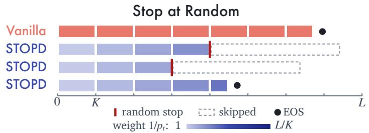

## Unbiased by Reweighting

$G = \Sigma _ { t = 1 } ^ { T } h _ { t }$ sums the gradients h<sub>t</sub> of all T tokens

$\widehat { G } = \Sigma _ { t = 1 } ^ { M } h _ { t } / p _ { t }$ cut at the random stop S: M= min(S, T); token t is kept with prob. Pr(S ≥ t)

$$
\mathbb { E } _ { S } [ \widehat { G } ] = \Sigma _ { t = 1 } ^ { T } \underbrace { \operatorname* { P r } ( S \geq t ) } _ { = 1 } h _ { t } = G
$$

Unbiased gradient sum

Matched Accuracy  
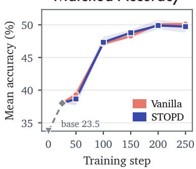

Faster Training  
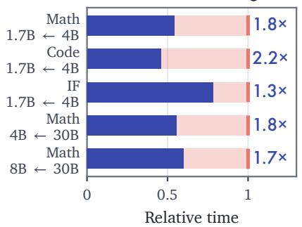

## Similar Training Dynamics

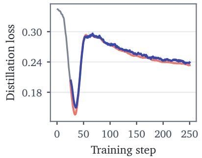  
Figure 1 | Overview of STOPD: random truncation with blockwise inverse-probability weighting (top) matches Vanilla OPD’s accuracy and distillation loss for an 8B student in mathematics (bottom left and right) while reducing total training time across tasks and model scales (bottom center).

Abstract | On-policy distillation (OPD) efectively transfers capabilities from a teacher to a student through feedback on student-generated rollouts. However, generating complete student rollouts and computing teacher feedback for every token make OPD computationally expensive. We introduce Stochastic Truncated On-Policy Distillation (STOPD), which accelerates OPD by randomly truncating student rollouts and correcting the resulting sampling bias with blockwise inverse-probability weighting (IPW). At each training step, we sample a stopping position for each rollout before generation and let the student generate until that position or natural termination. We obtain teacher feedback on every generated token and use blockwise IPW to compensate for the lower probability of retaining later tokens while controlling the weights. We prove that this weighting preserves Vanilla OPD’s gradient sum in expectation and derive one-step update-error bounds for SGD, Adam, and Muon. We evaluate STOPD across multiple teacher–student model pairs, task domains, and optimizers. STOPD reduces generated tokens by 25–48% while maintaining accuracy comparable to Vanilla OPD, achieving 1.3–2.2× training speedups.

## 1. Introduction

On-policy distillation (OPD) efectively transfers capabilities from a teacher to a student through feedback on student-generated rollouts [Gu et al., 2024; Agarwal et al., 2024; Lu & Thinking Machines Lab, 2025]. The teacher provides guidance on the student’s own rollouts. However, each Vanilla OPD update generates complete student rollouts, scores every token with the teacher, and trains the student on all generated tokens [Wu et al., 2026]. As rollouts grow longer during training, both autoregressive generation and the student’s forward and backward passes become more expensive. Scaling up the teacher and student further increases the cost of scoring, generation, and updates. These growing costs make generation and student updates major computational bottlenecks, which motivates the following question: does OPD need to complete every rollout to obtain an efective student update?

Existing approaches reduce diferent parts of this computation. Sparse supervision selects which generated positions contribute to the loss [Xu et al., 2026; Wang et al., 2026; Sheng et al., 2026]. These methods reduce student-update time but still require complete rollout generation, which remains the dominant cost. Motivated by declining teacher guidance at later positions, Early Stopping Rollout [Zhou et al., 2026] truncates generation to a fixed prefix. Although a fixed prefix cutof reduces generation, it omits later-token gradients, biasing the estimate of Vanilla OPD’s gradient sum and changing the directions of student updates.

We introduce Stochastic Truncated On-Policy Distillation (STOPD), which accelerates OPD by randomly truncating student rollouts and correcting the resulting sampling bias with blockwise inverseprobability weighting (IPW) [McLeish, 2011]. At each training step, we sample a stopping position for each rollout before generation and let the student generate until that position or natural termination. Every generated token receives teacher feedback, and its loss is weighted by the inverse of the probability that it is included. However, uniformly sampled stopping positions can give late tokens extreme weights, which can destabilize training. We therefore combine IPW with blockwise truncation. We first divide the maximum training length into fixed-width token blocks. We then uniformly sample a position before generation and stop at the end of the block containing it. This increases the inclusion probabilities of late tokens, thereby limiting their weights.

We show that STOPD preserves the full-generation gradient and token-count sums in expectation. We then analyze its normalized gradient, and show how batch averaging reduces the stochastic discrepancy. Finally, we bound how this gradient discrepancy afects the one-step parameter update under common optimizers such as SGD, Adam, and Muon. We further analyze how STOPD saves tokens and time. STOPD saves more tokens in expectation as rollout length increases. These token savings can translate into greater training-time savings when STOPD also improves generation throughput by reducing long-context computation or freeing cache space for more concurrent rollouts.

We evaluate STOPD in multiple domains (e.g., mathematics, code, and instruction following) with students from 1.7B to 8B and teachers from 4B to 30B. STOPD generates 25–48% fewer tokens and achieves 1.3–2.2× training speedups while closely matching Vanilla OPD in accuracy. The gains also persist when replacing the main AdamW optimizer with SGD or Muon. STOPD remains robust across block widths, maintaining similar accuracy and computational savings. Increasing the batch size from 128 to 512 further reduces truncation-induced training fluctuations without reducing the speedup. Together, these results show that OPD need not complete every rollout to learn efectively. STOPD preserves the expected gradient sums of complete rollouts using only partial generation, achieving comparable accuracy at lower training cost. This principle could extend to other autoregressive training settings, including ofline and online knowledge distillation, supervised fine-tuning, and on-policy self-distillation.

## 2. Related Work

On-policy distillation. OPD trains a student on its own generated rollouts using token-level teacher feedback, placing supervision on the prefixes the student encounters during generation. MiniLLM studies reverse-KL optimization [Gu et al., 2024], while Generalized Knowledge Distillation (GKD) supports flexible distribution-matching losses on student-generated sequences [Agarwal et al., 2024]. Thinking Machines Lab demonstrates OPD for mathematical reasoning and for recovering instructionfollowing behavior after mid-training [Lu & Thinking Machines Lab, 2025]. Subsequent variants refine the objective and the allocation of teacher feedback. DistiLLM combines skew KL with adaptive reuse of student-generated rollouts [Ko et al., 2024], and EOPD adds forward-KL supervision where teacher entropy is high [Jin et al., 2026]. FiRe filters rollouts and softly reweights their tokens [Li et al., 2026], while RG-OPD uses verifier feedback to gate distillation [Akhondzadeh et al., 2026]. OPD also extends beyond a single external teacher: MOPD integrates domain-specialized teachers [Ma et al., 2026], while OPSD uses the same model under a privileged context containing reference solutions to supervise its own rollouts [Zhao et al., 2026]. To reduce repeated computation, Lightning OPD precomputes teacher feedback on rollouts from an SFT-initialized student and reuses it during ofline training [Wu et al., 2026].

Sparse supervision and rollout truncation. Sparse supervision studies which token positions should contribute to distillation. TIP uses student uncertainty and teacher-student disagreement to guide token selection [Xu et al., 2026], while TA-OPD prioritizes learnable teacher signals [Wang et al., 2026]. SelecTKD weights token losses according to whether the teacher accepts the student’s proposals [Huang et al., 2025]. IER further accounts for the reliability of sampled-token gradient estimates when selecting supervision positions [Sheng et al., 2026]. Selecting loss positions alone, however, does not shorten rollout generation. ESR reduces generation by stopping at a fixed rollout prefix and distilling only that prefix [Zhou et al., 2026]. Positions beyond the cutof have zero probability of supervision, and their missing gradient contributions are not compensated. Its prefix gradient is therefore generally biased as an estimator of the full-generation local gradient sum.

Rather than computing on complete rollouts or imposing a fixed cutof, we apply random truncation to student rollouts and correct unequal token coverage with inverse-probability weighting [McLeish, 2011; Beatson & Adams, 2019]. We use blockwise truncation to control extreme token weights and characterize its trade-of between generation cost and estimator variance. We preserve the expected full-generation local gradient sum while reducing generation, teacher scoring, and student-update computation.

## 3. Stochastic Truncated On-Policy Distillation

In this section, we present the training procedure in Section 3.1, study gradient preservation and update error in Section 3.2, and analyze token and time savings in Section 3.3.

## 3.1. Training Procedure

At training step �, consider a batch of � prompts $x _ { 1 } , \ldots , x _ { B }$ and the student $\pi _ { \theta _ { k } }$ . Let � be the max length and $1 \leq T _ { i } \leq L$ the length that rollout � would have under full generation, including a naturally generated end-of-sequence token when reached. Before generating each student rollout, we randomly sample a stopping position. The student then generates until that position or natural termination. We then apply inverse-probability weighting (IPW) to the observed token losses to compensate for omitted tokens. A naive IPW implementation samples the stopping position uniformly from $\{ 1 , \ldots , L \}$ However, long OPD rollouts can extend close to the max length, where tokens have very small probabilities of being retained. A token at position $L ,$ for example, is observed with probability $1 / L$ and therefore receives weight �. When � is large, observing such a token can produce an unusually large gradient contribution.

To limit these extreme weights, we introduce blockwise truncation. We group rollout positions into consecutive blocks and round each sampled stopping position up to the end of its block. Let $K \geq 1$ denote the block width. When � divides �, the last block is retained with probability $K / L ,$ reducing the largest weight from � to $L / K$ . Larger blocks thus trade additional generation for less extreme weighting. Before generating each rollout, we sample the anchor $A _ { i }$ to select the stopping block and

```latex
Algorithm 1 STOPD, with changes from Vanilla OPD in red.
Require: Student $\pi _ { \theta } ,$ , teacher $q ,$ max length $L ,$ block width $K ,$ batch size $B ,$ warmup steps $W$
1: Run � Vanilla OPD updates and retain the student and optimizer states.
2: Set $C \gets N _ { W }$
3: for each subsequent training step do
4: Sample a batch of � prompts.
5: for each prompt $x _ { i }$ do
6: Draw $A _ { i }$ independently and compute $S _ { i }$ using $\operatorname { E q . }$ (1).
7: Generate until natural termination or $S _ { i }$
8: Obtain local teacher feedback on every generated token.
9: Assign $w _ { t } = 1 / p _ { t }$ using Eq. (2).
10: end for
11: Compute $\widehat { \mathcal { L } }$ using the current denominator $C .$
12: Apply the baseline optimizer to $\nabla _ { \boldsymbol { \theta } } \hat { \mathcal { L } } .$
13: Set $\begin{array} { r } { \dot { C } \gets \sum _ { i } \sum _ { t = 1 } ^ { M _ { i } } } \end{array}$ �<sub>�</sub> for the next step.
14: end for
```

set the cutof to that block’s end:

$$
A _ { i } \sim \mathrm { U n i f o r m } \{ 0 , \ldots , L - 1 \} , \qquad S _ { i } = \operatorname* { m i n } \{ K \left( \lfloor A _ { i } / K \rfloor + 1 \right) , L \} .\tag{1}
$$

The student generates until natural termination or the sampled cutof $S _ { i } ,$ retaining $M _ { i } = \operatorname* { m i n } ( T _ { i } , S _ { i } )$ tokens. We obtain teacher feedback on all retained tokens and weight each token’s loss by the inverse probability that generation reaches its position. For $1 \leq t \leq T _ { i }$ , this probability is

$$
p _ { t } = \mathbb { P } ( S _ { i } \geq t ) = \frac { L - K \lfloor ( t - 1 ) / K \rfloor } { L } > 0 .\tag{2}
$$

We can compute each token’s inclusion probability and blockwise inverse-probability weight $\boldsymbol { w } _ { t } = 1 / p _ { t }$ without knowing the complete rollout length. Later positions are retained less often and receive correspondingly larger weights. Let $h _ { i , t }$ denote the gradient contributed by token � in rollout �. The full gradient sum and our blockwise IPW estimate are

$$
G _ { k } = \sum _ { i = 1 } ^ { B } \sum _ { t = 1 } ^ { T _ { i } } h _ { i , t } , \qquad \widehat { G } _ { k } = \sum _ { i = 1 } ^ { B } \sum _ { t = 1 } ^ { M _ { i } } w _ { t } h _ { i , t } .\tag{3}
$$

Vanilla computes its training loss by averaging token losses over the complete batch of $\begin{array} { r } { N _ { k } = \sum _ { i = 1 } ^ { B } T _ { i } } \end{array}$ tokens, giving the gradient $g _ { k } ^ { \mathrm { V } } = G _ { k } / N _ { k }$ . Since random truncation leaves $N _ { k }$ unknown, we normalize our weighted token losses using an estimate $C _ { k }$ from the preceding batch:

$$
\widehat { \mathcal { L } } _ { k } ( \theta ) = \frac { 1 } { C _ { k } } \sum _ { i = 1 } ^ { B } \sum _ { t = 1 } ^ { M _ { i } } w _ { t } \ell _ { i , t } ( \theta ) , \qquad \widehat { g } _ { k } = \widehat { G } _ { k } / C _ { k } .\tag{4}
$$

Here, $\ell _ { i , t } ( \theta )$ is the distillation loss for token � in rollout $i ,$ with $h _ { i , t } = \nabla _ { \theta } \ell _ { i , t } ( \theta _ { k } )$ . The weights and $C _ { k }$ are held constant during diferentiation. Initial rollouts of base models are usually short relative to the max length, so random truncation ofers limited savings. We therefore use $W \geq 1$ Vanilla OPD warmup steps to avoid truncation noise during this phase and initialize $C _ { W + 1 }$ with the last warmup batch’s exact token count $N _ { W }$ . After switching to random truncation, each batch estimates its complete token count using the same inclusion weights:

$$
\widehat { N } _ { k } = \sum _ { i = 1 } ^ { B } \sum _ { t = 1 } ^ { M _ { i } } w _ { t } , \qquad C _ { k } = \left\{ { N _ { W } , \qquad k = W + 1 , } \atop { \widehat { N } _ { k - 1 } , } \quad k > W + 1 .  \right.\tag{5}
$$

Algorithm 1 summarizes the training procedure of our method. Next, we analyze gradient preservation and update error in Section 3.2 and how our method saves tokens and time in Section 3.3.

## 3.2. Gradient Preservation and Update Error

We first establish gradient preservation by showing that STOPD preserves the full-generation gradient and token-count sums in expectation. We then analyze the normalized gradient, separating the variation introduced by random truncation from the remaining scale diference, and show how batch averaging reduces the stochastic discrepancy. Finally, we bound how this gradient discrepancy afects the one-step parameter update under SGD, Adam, and Muon.

We compare STOPD with full-generation Vanilla OPD at a fixed training step. We condition on the complete rollouts and their local teacher feedback, leaving only the sampled stopping positions random, and write $\mathbb { E } _ { S }$ for expectation over this randomness. The comparison uses three conditions. (1) Given the same prompt and previously generated tokens, the next-token distribution does not depend on the remaining generation budget. (2) The local loss at a retained position depends only on the prompt, the generated tokens through that position, and its local teacher feedback, so removing the later tokens leaves the retained token’s loss unchanged. (3) Conditional on the training history, stopping positions are mutually independent across rollouts and are sampled independently of the complete rollout and teacher-feedback randomness. Each retained position is weighted by its exact inverse inclusion probability $1 / p _ { t }$ . Appendix A.1 states these conditions formally.

Preservation. Let $I _ { i , t } = \mathbf { 1 } \{ S _ { i } \geq t \}$ indicate whether position � is retained. Since $\mathbb { E } _ { S } [ I _ { i , t } ] = p _ { t }$ , the weighted contribution of each position satisfies

$$
\mathbb { E } _ { S } \left[ \frac { I _ { i , t } } { p _ { t } } h _ { i , t } \right] = h _ { i , t } , \qquad \mathbb { E } _ { S } \left[ \frac { I _ { i , t } } { p _ { t } } \right] = 1 .\tag{6}
$$

Thus blockwise inverse-probability weighting restores both the gradient contribution and the tokencount contribution of every position in expectation. Equivalently, the estimators in Section 3.1 can be written as

$$
\widehat { G } _ { k } = \sum _ { i = 1 } ^ { B } \sum _ { t = 1 } ^ { T _ { i } } \frac { I _ { i , t } } { p _ { t } } h _ { i , t } , \qquad \widehat { N } _ { k } = \sum _ { i = 1 } ^ { B } \sum _ { t = 1 } ^ { T _ { i } } \frac { I _ { i , t } } { p _ { t } } ,\tag{7}
$$

and summing Eq. (6) gives

$$
\mathbb { E } _ { S } \big [ \widehat { G } _ { k } \big ] = G _ { k } , \qquad \mathbb { E } _ { S } \big [ \widehat { N } _ { k } \big ] = N _ { k } .\tag{8}
$$

Equation (8) establishes preservation at the level directly afected by truncation. The training gradient also contains the normalization in Eq. (4). Vanilla uses $g _ { k } ^ { \mathrm { V } } = G _ { k } / N _ { k }$ , whereas STOPD uses $\widehat { g } _ { k } = \widehat { G } _ { k } / C _ { k } .$ with $C _ { k }$ fixed before the current stopping positions are sampled. Therefore

$$
\mathbb { E } _ { S } [ \widehat { g } _ { k } ] = \frac { G _ { k } } { C _ { k } } = \frac { N _ { k } } { C _ { k } } g _ { k } ^ { \vee } .\tag{9}
$$

Blockwise IPW therefore removes the bias introduced by truncating the gradient sum.

Error after normalization. Define $\rho _ { k } = { \left( N _ { k } - C _ { k } \right) } / { C _ { k } }$ . Then we have

$$
\underbrace { \widehat { g } _ { k } - g _ { k } ^ { \mathrm { V } } } _ { \mathrm { g r a d i e n t \ : d i s c r e p a n c y } } = \underbrace { \frac { \widehat { G } _ { k } - G _ { k } } { C _ { k } } } _ { \mathrm { v a r i a t i o n \ : f r o m \ : r a n d o m \ : t r u n c a t i o n } } + \underbrace { \rho _ { k } g _ { k } ^ { \mathrm { V } } } _ { \mathrm { s c a l e \ : d i f f e r e n c e } } .\tag{10}
$$

To quantify the variation from random truncation, let $V _ { k } = \mathbb { E } _ { S } [ \| \widehat { G } _ { k } - G _ { k } \| ^ { 2 } ]$ . Since Eq. (8) gives $\mathbb { E } _ { S } [ \widehat { G } _ { k } - G _ { k } ] = 0 .$ , taking the expected squared norm of Eq. (10) gives

$$
\mathbb { E } _ { S } \left[ \lVert \widehat { g } _ { k } - g _ { k } ^ { \mathrm { V } } \rVert ^ { 2 } \right] = \frac { V _ { k } } { C _ { k } ^ { 2 } } + \rho _ { k } ^ { 2 } \lVert g _ { k } ^ { \mathrm { V } } \rVert ^ { 2 } .\tag{11}
$$

Appendices A.1 and A.3 derive this variation using

$$
\nu ( T ) = \sum _ { t = 1 } ^ { T } \left( p _ { t } ^ { - 1 } - 1 \right) \{ 2 ( T - t ) + 1 \} .\tag{12}
$$

If $\| h _ { i , t } \| \leq H$ for every token, then

$$
V _ { k } \leq H ^ { 2 } \sum _ { i = 1 } ^ { B } \nu ( T _ { i } ) , \qquad { \mathbb { E } } _ { S } \big [ \| \widehat { g } _ { k } - g _ { k } ^ { \mathrm { v } } \| ^ { 2 } \big ] \leq \frac { H ^ { 2 } \sum _ { i = 1 } ^ { B } \nu ( T _ { i } ) } { C _ { k } ^ { 2 } } + \rho _ { k } ^ { 2 } \| g _ { k } ^ { \mathrm { v } } \| ^ { 2 } .\tag{13}
$$

Batch averaging reduces the variation from random truncation. Since $C _ { k } \ge B$ and $\nu ( T _ { i } ) \leq \nu ( L )$

$$
\frac { V _ { k } } { C _ { k } ^ { 2 } } \leq \frac { H ^ { 2 } \nu ( L ) } { B } .\tag{14}
$$

Large-batch agreement. We next analyze how the scale diference behaves as the batch size grows. For $k > W + 1$ , Eq. (5) gives $C _ { k } = \widehat { N } _ { k - 1 }$ . By Eq. (8), $\widehat { N } _ { k - 1 }$ estimates the preceding complete token count. Complete rollouts are conditionally independent and identically distributed within each batch, with token gradients bounded by �. Appendices A.4 and A.5 state the formal conditions.

Let $\mu _ { j }$ denote the conditional mean complete rollout length at step �. Then

$$
\frac { N _ { k } } { B } = \mu _ { k } + O _ { \mathbb { P } } \bigl ( B ^ { - 1 / 2 } \bigr ) , \qquad \frac { C _ { k } } { B } = \mu _ { k - 1 } + O _ { \mathbb { P } } \bigl ( B ^ { - 1 / 2 } \bigr ) ,\tag{15}
$$

and therefore

$$
\frac { N _ { k } } { C _ { k } } = \frac { \mu _ { k } } { \mu _ { k - 1 } } + O _ { \mathbb { P } } \big ( \boldsymbol { B } ^ { - 1 / 2 } \big ) .\tag{16}
$$

Combining Eq. (16) with Eq. (10) gives

$$
\widehat { g } _ { k } - g _ { k } ^ { \mathrm { V } } = \left( \frac { \mu _ { k } } { \mu _ { k - 1 } } - 1 \right) g _ { k } ^ { \mathrm { V } } + O _ { \mathbb { P } } \bigl ( B ^ { - 1 / 2 } \bigr ) .\tag{17}
$$

Thus batch averaging reduces the stochastic discrepancy at rate $B ^ { - 1 / 2 }$ . When the adjacent conditional mean lengths agree, $\widehat { g } _ { k } - g _ { k } ^ { \mathrm { V } } = O _ { \mathbb { P } } \bigl ( B ^ { - 1 / 2 } \bigr )$

Optimizer updates. We next translate the gradient discrepancy into a bound on the one-step update error. We compare STOPD and Vanilla under the same optimizer, from the same parameters and previous optimizer state, as formalized in Appendix B.

Let $\Phi ( x )$ denote the parameter increment produced from gradient input $x ,$ with the current parameters, previous optimizer state, and hyperparameters fixed. Let Q be the global norm-clipping map in Eq. (49), and write

$$
\Delta \theta ^ { \mathrm { S } } = \Phi ( \boldsymbol { Q } ( \widehat { \boldsymbol { g } } _ { k } ) ) , \qquad \Delta \theta ^ { \mathrm { V } } = \Phi ( \boldsymbol { Q } ( \boldsymbol { g } _ { k } ^ { \mathrm { V } } ) ) .\tag{18}
$$

Let $\Lambda _ { \mathrm { o p t } }$ denote the optimizer-specific coeficient evaluated at the Vanilla reference $Q ( g _ { k } ^ { \mathrm { V } } )$ , using the largest coeficient across disjoint parameter blocks. Since $\boldsymbol { Q }$ is nonexpansive, Eq. (50) gives

$$
\begin{array} { r } { \| \Delta \theta ^ { \mathrm { S } } - \Delta \theta ^ { \mathrm { V } } \| \leq \Lambda _ { \mathrm { o p t } } \| \widehat { g } _ { k } - g _ { k } ^ { \mathrm { V } } \| . } \end{array}\tag{19}
$$

Combining Eq. (19) with Eq. (11) gives

$$
\mathbb { E } _ { S } \left[ \| \Delta \theta ^ { \mathrm { S } } - \Delta \theta ^ { \mathrm { V } } \| ^ { 2 } \right] \leq \Lambda _ { \mathrm { o p t } } ^ { 2 } \left\{ \frac { V _ { k } } { C _ { k } ^ { 2 } } + \rho _ { k } ^ { 2 } \| g _ { k } ^ { \mathrm { V } } \| ^ { 2 } \right\} .\tag{20}
$$

For SGD, Eq. (51) gives $\Lambda _ { \mathrm { S G D } } = \eta$ . Proposition B.1 gives the Adam coeficient $\Lambda _ { \mathrm { A } }$ , and Proposition B.2 gives the Muon coeficient $\Lambda _ { \mathrm { M } }$

Together, blockwise IPW preserves the complete gradient and token-count sums in expectation, while normalization separates the gradient discrepancy into variation from random truncation and the scale diference. Batch averaging reduces the stochastic discrepancy, and changes in conditional mean rollout length between adjacent steps determine the remaining scale diference. The optimizer-specific coeficient then bounds the corresponding one-step update error.

## 3.3. Token and Time Savings

We first quantify token savings, then analyze how they translate into reduced generation time.

Token savings. For a complete rollout of length �, random truncation skips the token at position � with probability $1 - p _ { t }$ . Therefore, the expected number of tokens saved is $\begin{array} { r } { D ( T ) = \sum _ { t = 1 } ^ { T } ( 1 - p _ { t } ) } \end{array}$ For $K \ll T , D ( T ) \approx T ^ { 2 } / ( 2 L )$ , so the expected fraction of tokens saved is approximately $T / ( 2 L )$ . This corresponds to about 25% expected token savings for $T = L / 2$ and nearly 50% for $T = L$

Time savings. We further show why random truncation can yield greater speedups than token savings alone would predict. During decoding, attention reads keys and values for the prompt and previously generated tokens from the key–value (KV) cache. Later tokens attend to longer cached contexts, and random truncation is more likely to skip these positions. Truncation therefore avoids forward-pass computation for skipped tokens, reduces KV-cache reads, and limits cache growth. To relate these savings to generation time, we model decoding time as a fixed cost per round plus a cost proportional to the cached context processed. We measure this cumulative context by the KV area $\begin{array} { r } { \dot { \mathcal { A } } _ { i } = \sum _ { t = 1 } ^ { M _ { i } } ( T _ { i } ^ { \mathrm { p } } + t - 1 ) } \end{array}$ , where $T _ { i } ^ { \mathrm { p } }$ is the prompt length of rollout �. Since position � is generated with probability $p _ { t }$ , the expected KV area is

$$
\mathbb { E } _ { S } \mathcal { A } _ { i } = \sum _ { t = 1 } ^ { T _ { i } } p _ { t } \left( T _ { i } ^ { \mathrm { p } } + t - 1 \right) \approx T _ { i } ^ { \mathrm { p } } T _ { i } \Big ( 1 - \frac { T _ { i } } { 2 L } \Big ) + \frac { T _ { i } ^ { 2 } } { 2 } - \frac { T _ { i } ^ { 3 } } { 3 L } ,\tag{21}
$$

The approximation neglects discrete and block-rounding corrections for $K \ll T _ { i } ;$ Appendix C.2 derives the expression and the time model. When rollouts are much longer than their prompts, the prompt term contributes little to the KV area. A rollout reaching half the max length then saves about 25% of its tokens and 33% of its KV area in expectation. At the max length, these savings increase to about 50% and 67%, respectively. Thus, random truncation reduces the cumulative cached context by a larger fraction than the token count.

The per-rollout reductions above accumulate across the batch. Let

$$
\mathcal { A } = \sum _ { i = 1 } ^ { B } \mathcal { A } _ { i } , \qquad \mathcal { A } ^ { \vee } = \sum _ { i = 1 } ^ { B } \mathcal { A } _ { i } ^ { \vee } ,
$$

where $\mathcal { A } _ { i } ^ { \mathrm { V } }$ is the full-generation KV area of rollout $i ,$ and let $N = \textstyle \sum _ { i } T _ { i }$ and $\begin{array} { r } { N ^ { \mathrm { S } } = \sum _ { i } M _ { i } } \end{array}$ denote the generated-token counts of Vanilla and STOPD, respectively. The batch-level KV-area ratio decomposes as

$$
\frac { \mathcal { A } ^ { \vee } } { \mathbb { E } _ { s } [ \mathcal { A } ] } = \underbrace { \vphantom { \mathbb { E } _ { s } [ \mathcal { N } ^ { S } ] } \frac { N } { \mathbb { E } _ { s } [ \mathcal { N } ^ { S } ] } } _ { \mathbb { E } _ { s } [ \mathcal { N } ^ { \Omega } ] } \qquad \underbrace { \frac { \mathcal { A } ^ { \vee } / N } { \mathbb { E } _ { s } [ \mathcal { A } ] / \mathbb { E } _ { s } [ N ^ { S } ] } } _ { \mathbb { E } _ { s } [ \mathcal { A } ] / \mathbb { E } _ { s } [ N ^ { S } ] }\tag{22}
$$

token-count ratio mean-context-per-token ratio

The first factor captures the reduction in generated tokens, while the second captures the reduction in cached context processed per generated token. When the prompt contribution is neglected, both factors are at least one.

These reductions translate into generation-time savings according to the decoding costs and scheduling. Consider the setting where prefill time is negligible compared with decoding time. When attention over long contexts dominates decoding, the model predicts that time savings track the reduction in KV area. The same relation holds when queued rollouts replace completed ones and maintain roughly constant cache occupancy at a similar level in both methods: shorter contexts allow more rollouts to generate concurrently, improving throughput. Larger training batches can help sustain this scheduling regime. In our 1.7B mathematics experiments, generating 34% fewer tokens yields a 2.0× generation speedup, exceeding the 1.5× ratio implied by token savings alone (Table 1).

If all rollouts start together, a long surviving rollout can keep the number of decoding rounds nearly unchanged. Truncation can still accelerate generation by reducing the context processed in those rounds, but the gain is smaller when fixed costs per round dominate. Random truncation also reduces teacher scoring and student loss computation, further contributing to total training-time savings. We evaluate token and time savings in Section 5.1.

## 4. Experimental Setup

We use the same experimental settings for Vanilla OPD and STOPD.

Models. The main setting distills Qwen3-4B-Instruct-2507 into Qwen3-1.7B-Base [Yang et al., 2025]. For scaling, we distill Qwen3-30B-A3B-Instruct-2507 into Qwen3-4B-Base and Qwen3-8B-Base in mathematics. All models run in non-thinking mode.

Data. We use Nemotron-Cascade-RL-Math [Wang et al., 2025] for mathematics, DeepCoder-Preview [Agentica, 2025] for code, and Nemotron-RL instruction following [NVIDIA, 2025] for instruction following (IF).

Training. Our main runs use AdamW [Loshchilov & Hutter, 2019] with learning rate 10<sup>−6</sup>, batch size 256, and gradient clipping at 1, for 250 steps with three seeds. Rollouts use temperature 1 and max lengths of 16,384, 8,192, and 4,096 for mathematics, code, and instruction following, respectively. STOPD uses block width � = 128 after 25 Vanilla warmup steps. Each run uses two GPUs: H100 for all 1.7B experiments, H200 for the 4B student, and GB200 for the 8B student.

Evaluation. We report the average score over � sampled responses per problem (avg@�). For mathematics, we report AIME24, AIME25, and AMC23 at avg@8, and MATH500 [Hendrycks et al., 2021] and Minerva [Lewkowycz et al., 2022] at avg@3, allowing up to 32,768 tokens. For code we report HumanEval+ and MBPP+ [Liu et al., 2023] at avg@4, two LiveCodeBench windows (2024-08 to 2025-02 and 2025-02 to 2025-05; Jain et al., 2025) at avg@8, and 200 held-out trainingdistribution problems at avg@4, allowing up to 16,384 tokens. For instruction following, we report IFEval prompt-level strict accuracy [Zhou et al., 2023] at avg@4, allowing up to 8,192 tokens. All evaluations sample at temperature 0.7 and top-� = 0.95. Main results are averaged over three training seeds.

Timing. We measure wall-clock time per training step, including generation, teacher scoring, the student update, and other overhead.

## 5. Experiments

We evaluate whether STOPD reduces training time while retaining the accuracy of Vanilla OPD. Section 5.1 compares accuracy, training speed, and training dynamics over 250 steps in three domains,

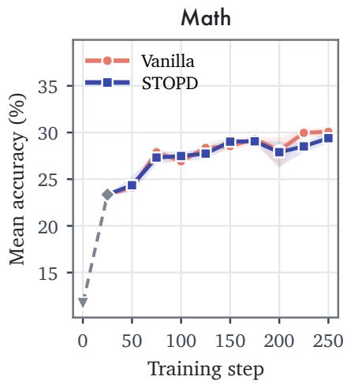

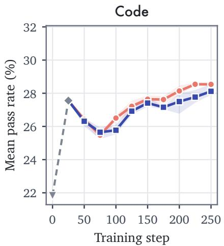

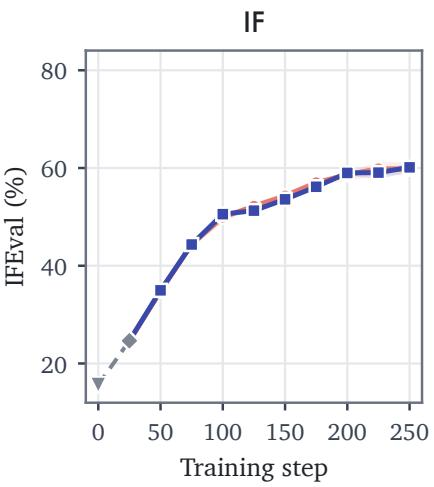  
Figure 2 | Accuracy of the 1.7B student against training step, mean and range, with the base model and the shared warmup in gray.

Table 1 | Cost of a training step in the main setting.
<table><tr><td colspan="4">Qwen3-1.7B-Base ← Qwen3-4B-Instruct-2507</td><td colspan="4">Time per step (s)</td></tr><tr><td>Domain</td><td>Method</td><td>Tokens</td><td>k tok/s</td><td>Generation</td><td>Update</td><td>Other</td><td>Total</td></tr><tr><td rowspan="3">Math</td><td>Vanilla</td><td>9,516</td><td>3.5</td><td>697</td><td>189</td><td>56</td><td>941</td></tr><tr><td>STOPD</td><td>6,255</td><td>4.5</td><td>358</td><td>119</td><td>36</td><td>513</td></tr><tr><td>Speedup</td><td>1.5x</td><td>1.3×</td><td>2.0x</td><td>1.6x</td><td>1.5×</td><td>1.8x</td></tr><tr><td rowspan="3">Code</td><td>Vanilla</td><td>6,587</td><td>4.4</td><td>383</td><td>142</td><td>41</td><td>566</td></tr><tr><td>STOPD</td><td>3,444</td><td>5.6</td><td>158</td><td>78</td><td>24</td><td>260</td></tr><tr><td>Speedup</td><td>1.9×</td><td>1.3×</td><td>2.4×</td><td>1.8x</td><td>1.7×</td><td>2.2×</td></tr><tr><td rowspan="3">IF</td><td>Vanilla</td><td>710</td><td>3.8</td><td>54</td><td>36</td><td>14</td><td>104</td></tr><tr><td>STOPD</td><td>533</td><td>3.8</td><td>39</td><td>29</td><td>12</td><td>80</td></tr><tr><td>Speedup</td><td>1.3×</td><td>1.0x</td><td>1.4x</td><td>1.2x</td><td>1.1×</td><td>1.3×</td></tr></table>

Section 5.2 turns to larger students, Section 5.3 repeats mathematics with SGD and Muon, Section 5.4 varies the block width, and Section 5.5 analyzes the batch size. Table 1 summarizes training speed for the main setting.

## 5.1. Main Results

Figure 2 shows that STOPD and Vanilla both increase the accuracy across all three domains. Accuracy every 25 steps is shown in Table 2 in Appendix D. For example, student accuracy in mathematics increases from 11.7 to 30.1 with Vanilla and 29.4 with STOPD; in code, from 21.8 to 28.5 and 28.1; and in instruction following, from 15.6 to 59.8 and 60.1, respectively. Besides following similar increasing trends, STOPD and Vanilla OPD remain closely matched in accuracy across the three domains. The relative STOPD–Vanilla diference is $- 0 . 9 0 \% \pm 2 . 3 6 \%$ in mathematics, −1.28% ± 1.09% in code, and −0.31% ± 1.15% in instruction following. Across all comparisons, the mean relative diference is $- 0 . 8 3 \% \pm 1 . 6 2 \%$ , and the largest absolute diference is 5.00%.

We then compare the training time of the two methods in Table 1. Overall, STOPD speeds up training by 1.8× in mathematics, 2.2× in code, and 1.3× in instruction following. STOPD generates 34%, 48%, and 25% fewer tokens in mathematics, code, and instruction following, corresponding to token-count ratios of 1.5×, 1.9×, and 1.3×. Generation is 2.0×, 2.4×, and 1.4× faster, respectively, with throughput increasing from 3.5k to 4.5k tokens/s in mathematics and from 4.4k to 5.6k tokens/s in code. The larger generation gains in mathematics and code reflect their longer rollouts: truncation reduces not only the number of generated tokens but also the cached context processed. Skipped later positions would otherwise attend to larger KV caches, so removing them reduces KV area per generated token. In instruction following, rollouts are much shorter, so the additional KV-area reduction is smaller, leaving the generation speedup close to the token-count ratio. Student updates are also 1.2–1.8× faster, as the student’s forward and backward passes process fewer tokens, and the remaining time (Other column in Table 1), mostly the forward pass that recomputes old log-probabilities, falls by 1.1–1.7× for the same reason.

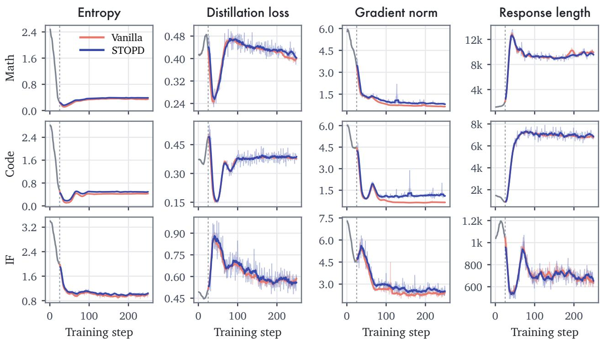  
Figure 3 | Training dynamics of the 1.7B student with the shared warmup in gray.

Figure 3 shows that STOPD and Vanilla follow similar overall training dynamics across all three domains: the entropy, distillation-loss, gradient-norm, and response-length curves have similar shapes over training (since STOPD truncates its rollouts, its response length is the estimated complete length per rollout, $\widehat { N } _ { k } / B$ from Eq. (5)), while STOPD exhibits larger local fluctuations. These fluctuations come from the variation introduced by random truncation. Blockwise inverse-probability weighting preserves the expected contribution of truncated tokens, but positions retained with lower probability receive larger weights, so the weighted gradient varies across batches depending on which positions are retained. We provide more discussion of these fluctuations in Section 5.5. The estimated complete rollout lengths under STOPD remains close to vanilla.

## 5.2. Scaling

We then evaluate STOPD at larger model scales. Figure 4 shows that both methods improve accuracy when scaling to a larger teacher and larger students, distilling Qwen3-30B-A3B-Instruct-2507 into Qwen3-4B-Base and Qwen3-8B-Base. Accuracy every 25 steps is shown in Table 2 in Appendix D, and additional time decomposition in Table 8 in Appendix E. For the 4B and 8B students, accuracy increases from 15.2 and 23.5 to 46.2 and 50.1 with Vanilla, and to 45.3 and 49.7 with STOPD, respectively. STOPD matches Vanilla more closely at larger scales. With the 30B teacher, the relative STOPD–Vanilla diferences are $- 0 . 9 6 \% \pm 0 . 9 0 \%$ for the 4B student and −1.09% ± 1.26% for the 8B student, with the largest absolute diferences of 2.43% and 2.62%, respectively, compared with $- 0 . 8 3 \% \pm 1 . 6 2 \%$ and 5.00% in the main 4B-teacher/1.7B-student setting (Section 5.1). Thus, scaling the teacher and student reduces both the spread and the largest observed diference from Vanilla, suggesting that STOPD is more robust and may benefit from scaling to larger models. In terms of speed, STOPD also retains its gains at larger model scales, accelerating the full training step by 1.8× for the 4B student and 1.7× for the 8B student, while generating 35% and 33% fewer tokens, respectively (Figure 4). Figure 5 further shows that the training dynamics of the larger students follow those of Vanilla.

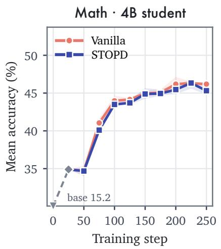

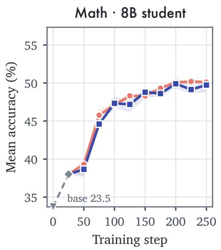

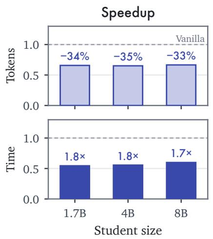

Figure 4 | Scaling in mathematics: accuracy for 4B and 8B students distilled from Qwen3-30B-A3B-Instruct-2507 (left, middle), and token and training-time speedups across student sizes, including the 1.7B main setting of Section 5.1 (right).  
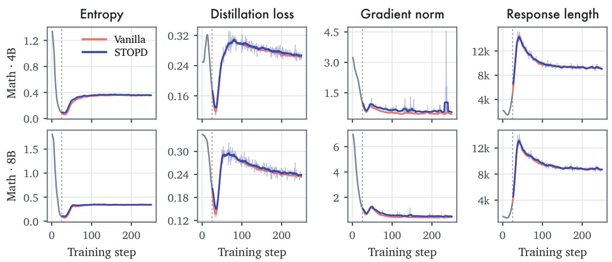  
Figure 5 | Training dynamics of the 4B and 8B students in mathematics with the shared warmup in gray.

## 5.3. Optimizer

Along with the main AdamW setting (Section 4), we further evaluate whether STOPD generalizes across common optimizers by testing it with SGD and Muon (Figure 6). Accuracy every 25 steps is shown in Table 3 in Appendix D, and additional time decomposition in Table 9 in Appendix E. Under SGD, accuracy increases from 11.7 to 25.2 with Vanilla and 25.1 with STOPD, with a largest absolute relative diference of 3.2%. Under Muon, it increases from 11.7 to 29.5 and 29.8, respectively, with a largest absolute relative diference of 3.6%. The computational gains also hold under both optimizers. Under SGD, STOPD generates 41% fewer tokens and accelerates the full training step by 2.2×. Under Muon, it generates 37% fewer tokens and achieves a 1.9× speedup. The training dynamics also remain similar to Vanilla under both SGD and Muon (Figure 7).

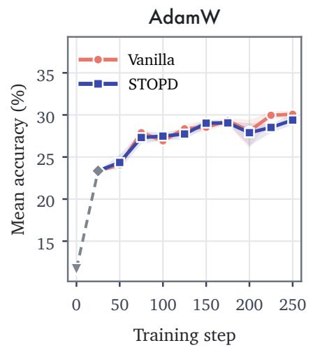

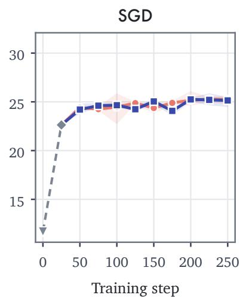

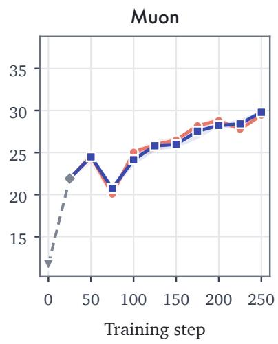

Figure 6 | Accuracy against training step in mathematics under AdamW in the main setting of Section 5.1 and under SGD and Muon, with the base model and each optimizer’s warmup in gray.  
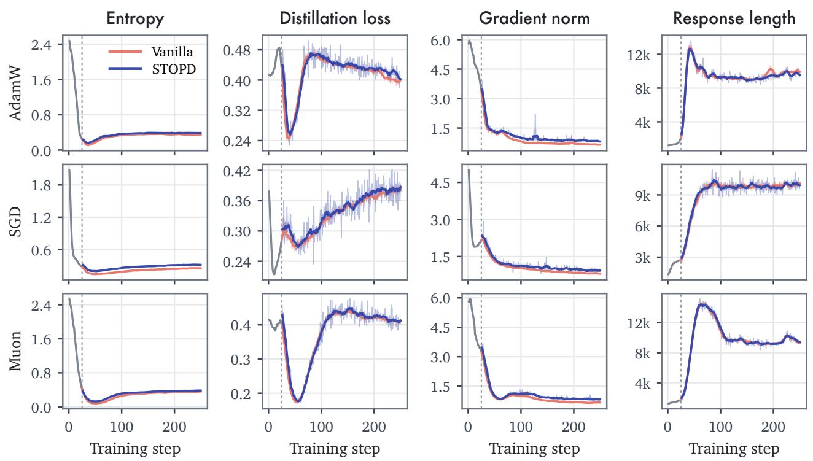  
Figure 7 | Training dynamics in mathematics (1.7B ← 4B) under AdamW and under SGD and Muon, with each optimizer’s warmup in gray.

## 5.4. Block Width

We next study how the block width � afects the trade-of between weight magnitude and computational savings. We evaluate $K \in \{ 3 2 , 1 2 8 , 5 1 2 , 2 0 4 8 \}$ over three seeds in Figure 8. Accuracy every 25 steps is shown in Table 4 in Appendix D, and additional time decomposition in Table 10 in Appendix E. For � = 32, 128, and 512, STOPD generates 34.6%, 34.3%, and 33.1% fewer tokens, respectively, and remains 1.8× faster than Vanilla. At � = 2048, the saving decreases to 28.6% and the speedup to 1.7×. Accuracy is consistent across block widths. Across all pairwise comparisons among �, the mean absolute relative diference is 1.29% ± 0.97%, and the largest absolute relative diference is 4.55%.

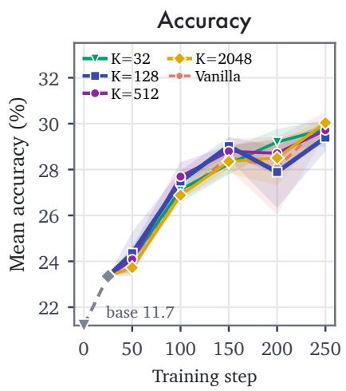

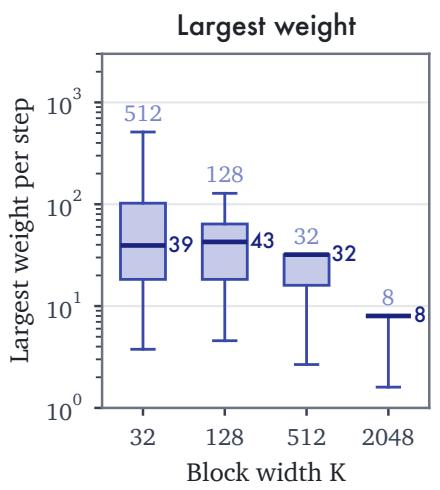

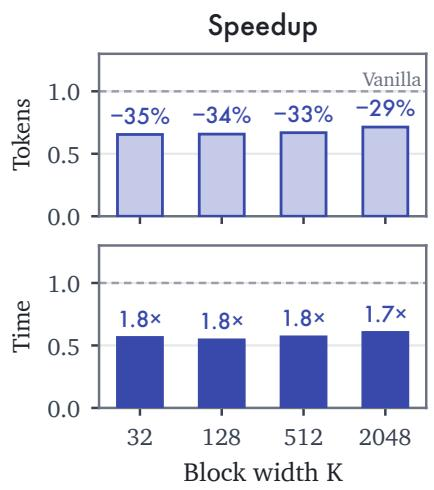  
Figure 8 | Block width in mathematics (1.7B ← 4B): accuracy against training step with the base model and the shared warmup in gray (left), the largest weight in each training step as a box plot with its bound �/� above and its median beside each box (middle), and tokens and training time relative to Vanilla (right).

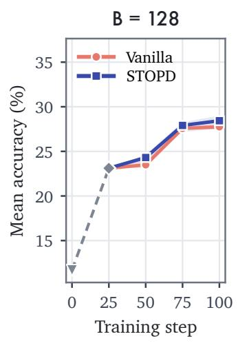

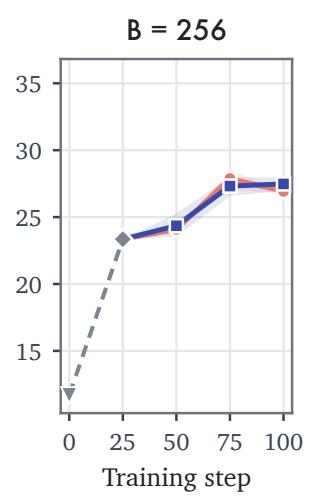

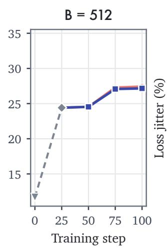

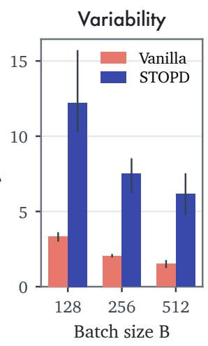  
Figure 9 | Accuracy against training step in mathematics (1.7B ← 4B) at � = 128, 256, and 512 (left), and loss jitter (right).

We then show the largest weight per step across � and use � = 128 as the default. This is because it balances weight control and speedup. Reducing � to 32 raises the largest weight from 128 to 512, while the median largest weight remains similar (43 versus 39). Increasing � to 512 or 2048 lowers the weight bound further, but also reduces token savings. Thus, � = 128 avoids a large worst-case weight without sacrificing the savings of smaller blocks.

## 5.5. Batch Size

We vary the training batch size in mathematics with the Qwen3-4B teacher and Qwen3-1.7B student, training at � = 128 and � = 512 for 100 steps alongside the main setting of � = 256 (Figure 9). Accuracy every 25 steps is shown in Table 5 in Appendix D, and additional time decomposition in Table 11 in Appendix E. Accuracy remains closely matched to Vanilla at every batch size, and the match tightens as the batch size grows. The relative STOPD–Vanilla diferences are 2.22% ± 1.16%, 0.44% ± 2.30%, and −0.49% ± 0.42%, and the largest absolute diference falls from 3.40% to 2.23% and 0.73%. Over the first 100 steps, the speedup holds across all batch sizes, with STOPD accelerating the full training step by 2.0× at batch size 128 and 2.1× at batch sizes 256 and 512 (Table 11 in Appendix E). This is because larger batches can help sustain high generation concurrency and

KV-cache occupancy, potentially enabling greater speedups. Increasing the batch size also reduces the fluctuations introduced by random truncation. We measure them by the loss jitter, the median over training steps of the relative deviation $| { \mathcal { L } } _ { k } - ( { \mathcal { L } } _ { k - 1 } + { \mathcal { L } } _ { k + 1 } ) / 2 | / | { \mathcal { L } } _ { k } |$ of the distillation loss $\mathcal { L } _ { k }$ from the average of its two neighbors, averaged over seeds. The loss jitter of STOPD decreases from 12.2% at � = 128 to 7.5% at $B = 2 5 6$ and 6.1% at $B = 5 1 2$ , close to the 8.6% and 6.1% that the $B ^ { - 1 / 2 }$ rate predicts from $B = 1 2 8$ , while Vanilla’s decreases from 3.4% to 2.1% and 1.5%. Because truncations are sampled independently across rollouts, larger batches average over more realizations, reducing truncation-induced gradient fluctuations at a rate of $O _ { \mathbb { P } } \big ( B ^ { - 1 / 2 } \big )$ .

## 6. Discussion

The principle behind STOPD could accelerate a broader range of autoregressive training workflows, including ofline and online knowledge distillation, supervised fine-tuning, on-policy self-distillation, and multi-teacher on-policy distillation.

Knowledge Distillation (KD). In ofline KD [Kim & Rush, 2016], we store the truncated sequences and their inclusion probabilities during dataset construction, then use them for subsequent student training with blockwise IPW. In online KD [Agarwal et al., 2024], we apply blockwise IPW within each training batch using the current teacher. Both settings could reduce generation and student-update computation to speed up training.

Supervised fine-tuning. The same approach applies to SFT by randomly truncating reference responses and applying blockwise IPW to the retained next-token cross-entropy losses.

On-policy self-distillation. OPSD uses the same model for both student and teacher, with the teacher additionally conditioned on a reference solution [Zhao et al., 2026]. We can retain the complete reference solution, randomly truncate the student rollout, and apply blockwise IPW to the distillation losses computed on its retained tokens. This could also reduce computation cost.

Multi-teacher on-policy distillation. MOPD assigns each student rollout to a teacher according to its task domain [Ma et al., 2026]. We can keep this assignment, independently truncate each student rollout, and have its assigned teacher score only the retained prefix. Applying blockwise IPW preserves the expected local gradient sum within each domain and could reduce the computation needed to integrate the specialist teachers’ capabilities into a shared student.

## 7. Conclusion

STOPD accelerates OPD by combining random rollout truncation with blockwise IPW. It preserves Vanilla OPD’s gradient sum in expectation while controlling extreme token weights. We derive onestep update-error bounds for SGD, Adam, and Muon and analyze how token savings translate into training-time gains. Random truncation reduces both generated tokens and long-context computation, with additional throughput gains when long-context processing is costly or cache capacity limits concurrency. Across mathematics, code, and instruction following with 1.7B–8B students, STOPD generates 25–48% fewer tokens and achieves 1.3–2.2× training speedups while maintaining accuracy comparable to Vanilla OPD. These results show that OPD does not really need to complete every rollout to learn efectively.

## References

Agarwal, R., Vieillard, N., Zhou, Y., Stanczyk, P., Ramos Garea, S., Geist, M., and Bachem, O. On-policy distillation of language models: Learning from self-generated mistakes. In The Twelfth International Conference on Learning Representations, pp.

21246–21263, 2024. URL https://proceedings.iclr.cc/paper\_files/paper/2024/hash/   
5be69a584901a26c521c2b51e40a4c20-Abstract-Conference.html.

Agentica. DeepCoder-Preview-Dataset. https://huggingface.co/datasets/agentica-org/ DeepCoder-Preview-Dataset, 2025.

Akhondzadeh, M. S., Lingam, V., Tejaswi, A., Ekbote, C., Sanghavi, S., and Bojchevski, A. Reward-Gated On-Policy Distillation, 2026. URL https://arxiv.org/abs/2607.04037.

Andersson, F., Carlsson, M., and Perfekt, K.-M. Operator-Lipschitz estimates for the singular value functional calculus. Proceedings of the American Mathematical Society, 144(5):1867–1875, 2016. doi: 10.1090/proc/12843.

Beatson, A. and Adams, R. P. Eficient optimization of loops and limits with randomized telescoping sums. In Chaudhuri, K. and Salakhutdinov, R. (eds.), Proceedings ofthe 36th International Conference on Machine Learning, volume 97 of Proceedings of Machine Learning Research, pp. 534–543. PMLR, 09–15 Jun 2019. URL https://proceedings.mlr.press/v97/beatson19a.html.

Boucheron, S., Lugosi, G., and Massart, P. Concentration Inequalities: A Nonasymptotic Theory of Independence. Oxford University Press, 2013. doi: 10.1093/acprof:oso/9780199535255.001.0001.

Gu, Y., Dong, L., Wei, F., and Huang, M. MiniLLM: Knowledge distillation of large language models. In The Twelfth International Conference on Learning Representations, 2024. URL https://openreview. net/forum?id=5h0qf7IBZZ.

Hendrycks, D., Burns, C., Kadavath, S., Arora, A., Basart, S., Tang, E., Song, D., and Steinhardt, J. Measuring mathematical problem solving with the MATH dataset. In Proceedings of the Neural Information Processing Systems Track on Datasets and Benchmarks, volume 1, 2021. URL https: //arxiv.org/abs/2103.03874.

Huang, H., Song, J., Zhang, Y., and Ren, P. SelecTKD: Selective Token-Weighted Knowledge Distillation for LLMs, 2025. URL https://arxiv.org/abs/2510.24021.

Jain, N., Han, K., Gu, A., Li, W.-D., Yan, F., Zhang, T., Wang, S., Solar-Lezama, A., Sen, K., and Stoica, I. LiveCodeBench: Holistic and contamination free evaluation of large language models for code. In The Thirteenth International Conference on Learning Representations, pp. 58791–58831, 2025. URL https://proceedings.iclr.cc/paper\_files/paper/2025/hash/ 94074dd5a072d28ff75a76dabed43767-Abstract-Conference.html.

Jin, W., Min, T., Yang, Y., Wei, D., Zhou, Y., Kadhe, S. R., Baracaldo, N., and Lee, K. Entropy-Aware On-Policy Distillation of Language Models, 2026. URL https://arxiv.org/abs/2603.07079.

Jordan, K., Jin, Y., Boza, V., You, J., Cesista, F., Newhouse, L., and Bernstein, J. Muon: An optimizer for hidden layers in neural networks, 2024. URL https://kellerjordan.github.io/posts/muon/. Reference implementation, revision 6456082.

Kim, Y. and Rush, A. M. Sequence-level knowledge distillation. In Su, J., Duh, K., and Carreras, X. (eds.), Proceedings of the 2016 Conference on Empirical Methods in Natural Language Processing, pp. 1317–1327, Austin, Texas, November 2016. Association for Computational Linguistics. doi: 10.18653/v1/D16-1139. URL https://aclanthology.org/D16-1139/.

Kingma, D. P. and Ba, J. Adam: A method for stochastic optimization. In International Conference on Learning Representations, 2015. URL https://arxiv.org/abs/1412.6980.

Ko, J., Kim, S., Chen, T., and Yun, S.-Y. DistiLLM: Towards Streamlined Distillation for Large Language Models. In Proceedings of the 41st International Conference on Machine Learning, volume 235 of Proceedings of Machine Learning Research, pp. 24872–24895. PMLR, 2024. URL https: //proceedings.mlr.press/v235/ko24c.html.

Lewkowycz, A., Andreassen, A., Dohan, D., Dyer, E., Michalewski, H., Ramasesh, V., Slone, A., Anil, C., Schlag, I., Gutman-Solo, T., Wu, Y., Neyshabur, B., Gur-Ari, G., and Misra, V. Solving quantitative reasoning problems with language models. In Advances in Neural Information Processing Systems, volume 35, pp. 3843–3857, 2022. doi: 10.52202/068431-0278. URL https://arxiv.org/abs/ 2206.14858.

Li, Y., Zheng, L., Yu, Y., Zhou, W., Zhong, X., Hu, X., Jin, J., Yuan, H., and Feng, T. Filter, Then Reweight: Rethinking Optimization Granularity in On-Policy Distillation, 2026. URL https: //arxiv.org/abs/2606.02684.

Liu, J., Xia, C. S., Wang, Y., and Zhang, L. Is your code generated by ChatGPT really correct? Rigorous evaluation of large language models for code generation. In Advances in Neural Information Processing Systems, 2023. URL https://arxiv.org/abs/2305.01210.

Loshchilov, I. and Hutter, F. Decoupled weight decay regularization. In International Conference on Learning Representations (ICLR), 2019. URL https://arxiv.org/abs/1711.05101.

Lu, K. and Thinking Machines Lab. On-Policy Distillation. Thinking Machines Lab: Connectionism, 2025. doi: 10.64434/tml.20251026. URL https://thinkingmachines.ai/blog/ on-policy-distillation/.

Ma, W., Wei, J., Zhao, L., Zhang, H., Xiao, B., Li, L., Yang, Q., Gao, B., Wang, Y., Li, R., Dong, J., Sui, Z., and Luo, F. MOPD: Multi-Teacher On-Policy Distillation for Capability Integration in LLM Post-Training, 2026. URL https://arxiv.org/abs/2606.30406.

McLeish, D. A general method for debiasing a Monte Carlo estimator. Monte Carlo Methods and Applications, 17(4), January 2011. ISSN 0929-9629. doi: 10.1515/mcma.2011.013. URL http: //dx.doi.org/10.1515/mcma.2011.013.

NVIDIA. Nemotron-RL-instruction\_following. https://huggingface.co/datasets/nvidia/ Nemotron-RL-instruction\_following, 2025.

Sheng, H., Ye, Z., Wang, H., Wang, J., Gu, J., and Kang, J. 1% of tokens can be enough: On gradient estimation in on-policy distillation, 2026. URL https://arxiv.org/abs/2609.24432.

Tallec, C. and Ollivier, Y. Unbiasing truncated backpropagation through time, 2017. URL https: //arxiv.org/abs/1705.08209.

Wang, B., Lee, C., Lee, N., Lin, S.-C., Dai, W., Chen, Y., Chen, Y., Yang, Z., Liu, Z., Shoeybi, M., Catanzaro, B., and Ping, W. Nemotron-Cascade: Scaling cascaded reinforcement learning for general-purpose reasoning models. arXiv preprint arXiv:2512.13607, 2025. URL https://arxiv. org/abs/2512.13607.

Wang, Y., Lu, S., Gu, Y., Wang, P., Yang, Y., Yan, Z., Xie, C., Wu, J., and Yang, H. Not All Disagreement Is Learnable: Token Teachability in On-Policy Distillation, 2026. URL https://arxiv.org/abs/ 2605.26844.

Wu, Y., Han, S., and Cai, H. Lightning OPD: Eficient Post-Training for Large Reasoning Models with Ofline On-Policy Distillation, 2026. URL https://arxiv.org/abs/2604.13010.

Xu, Y., Sang, H., Zhou, Z., He, R., Wang, Z., and Geramifard, A. TIP: Token Importance in On-Policy Distillation, 2026. URL https://arxiv.org/abs/2604.14084.

Yang, A., Li, A., Yang, B., Zhang, B., Hui, B., Zheng, B., Yu, B., Gao, C., Huang, C., Lv, C., Zheng, C., Liu, D., Zhou, F., Huang, F., Hu, F., Ge, H., Wei, H., Lin, H., Tang, J., Yang, J., Tu, J., Zhang, J., Yang, J., Yang, J., Zhou, J., Zhou, J., Lin, J., Dang, K., Bao, K., Yang, K., Yu, L., Deng, L., Li, M., Xue, M., Li, M., Zhang, P., Wang, P., Zhu, Q., Men, R., Gao, R., Liu, S., Luo, S., Li, T., Tang, T., Yin, W., Ren, X., Wang, X., Zhang, X., Ren, X., Fan, Y., Su, Y., Zhang, Y., Zhang, Y., Wan, Y., Liu, Y., Wang, Z., Cui, Z., Zhang, Z., Zhou, Z., and Qiu, Z. Qwen3 technical report. arXiv preprint arXiv:2505.09388, 2025. URL https://arxiv.org/abs/2505.09388.

Zhao, S., Xie, Z., Liu, M., Huang, J., Pang, G., Chen, F., and Grover, A. Self-Distilled Reasoner: On-Policy Self-Distillation for Large Language Models, 2026. URL https://arxiv.org/abs/2601.18734.

Zhou, J., Lu, T., Mishra, S., Brahma, S., Basu, S., Luan, Y., Zhou, D., and Hou, L. Instructionfollowing evaluation for large language models. arXiv preprint arXiv:2311.07911, 2023. URL https://arxiv.org/abs/2311.07911.

Zhou, Z., Li, J., Tang, H., Wu, Y. N., and Terzopoulos, D. Less is more: Early stopping rollout for on-policy distillation, 2026. URL https://arxiv.org/abs/2605.27028.

## A. Gradient Preservation and Normalization

We prove that random truncation preserves the expected gradient sum and bound its gradient error relative to Vanilla OPD, including the efect of lagged normalization. We also analyze position weights, the relationship between token savings and variance, and the efect of batch size. The proofs specialize survival-weighted estimation [McLeish, 2011, Section 2] and randomized telescoping [Beatson & Adams, 2019, Section 2.1 and supplementary Proposition 2.1] to finite, naturally terminating rollouts.

## A.1. Conditional preservation and estimation error

Fix a training step �, batch size �, max rollout length �, and block width �. Its history $\mathcal { H } _ { k }$ contains the current student parameters $\theta _ { k }$ and the positive denominator $C _ { k }$ chosen before the current cutofs. For each prompt, consider the hypothetical complete rollout generated until its first natural end-ofsequence token or the max length $L ,$ with length $1 \leq T _ { i } \leq L$ . The natural end-of-sequence token is included in this length and receives its ordinary local supervision. Let $y _ { k }$ contain these complete rollouts and any randomness used for their teacher feedback. Throughout the fixed-step analysis, $\mathbb { E } _ { S }$ and $\mathbb { P } _ { S }$ denote expectation and probability conditional on $( \mathcal { H } _ { k } , y _ { k } )$ ; only the independent anchors remain random. We suppress � until the lagged-denominator analysis.

The following conditions formalize the setting in Section 3.

1. Changing the remaining generation budget does not afect the next-token distribution when the prompt and previously generated tokens are fixed.

2. We use Vanilla OPD’s diferentiation rule for sampled tokens and teacher targets. The diferentiable local loss $\ell _ { i , t } ( \theta )$ depends only on the prompt, tokens up to position $t ,$ and local feedback. Random truncation leaves this loss unchanged at retained positions. Full and truncated rollouts share any randomness used for local feedback.

3. Conditional on history, the anchors are mutually independent, uniform on $\{ 0 , \ldots , L - 1 \}$ , and independent of the complete token and feedback randomness. The method uses the exact weights $1 / p _ { t }$ and treats them and � as constants in diferentiation.

We compare each observed rollout with its corresponding complete rollout. The local gradients $h _ { i , t } = \nabla _ { \theta } \ell _ { i , t } ( \theta _ { k } ) \in \mathbb { R } ^ { d }$ are finite. Norms below are Euclidean.

For the estimators in Eqs. (3) and (4), write

$$
G = \sum _ { i = 1 } ^ { B } \sum _ { t = 1 } ^ { T _ { i } } h _ { i , t } , \qquad N = \sum _ { i = 1 } ^ { B } T _ { i } , \qquad g ^ { \mathrm { V } } = G / N , \qquad { \widehat { g } } = { \widehat { G } } / C .
$$

Use the stopping rule in Eq. (1) and let $I _ { i , t } = \mathbf { 1 } \{ S _ { i } \geq t \}$ indicate whether position � is retained. Then $\mathbb { E } _ { S } I _ { i , t } = p _ { t }$ , with $p _ { t }$ given in Eq. (2). To express the variance, define

$$
\alpha _ { b } = \frac { L K } { ( L - b K ) ( L - ( b - 1 ) K ) } \quad ( 1 \leq b K < L ) , \qquad \nu ( T ) = \sum _ { b = 1 } ^ { \lfloor ( T - 1 ) / K \rfloor } \alpha _ { b } ( T - b K ) ^ { 2 } .\tag{23}
$$

Empty sums equal zero, so $\nu ( T ) = 0$ when $T \leq K$

Theorem A.1 (Gradient preservation and error). Under the stated conditions, full and truncated generation can be coupled so that every observed local gradient equals its full-generation contribution. Consequently,

$$
\mathbb { E } _ { S } \widehat { G } = G , \qquad \mathbb { E } _ { S } \widehat { N } = N , \qquad \mathbb { E } _ { S } \widehat { g } = \frac { N } { C } g ^ { \vee } .\tag{24}
$$

For $\mathcal { V } : = \mathbb { E } _ { S } \Vert \widehat { G } - G \Vert ^ { 2 }$ and every $C > 0 ,$ , the implemented estimator satisfies

$$
\boxed { \mathbb { E } _ { S } \lVert \widehat { g } - g ^ { \mathrm { V } } \rVert ^ { 2 } = \frac { \mathcal { V } } { C ^ { 2 } } + \left( \frac { N - C } { C } \right) ^ { 2 } \lVert g ^ { \mathrm { V } } \rVert ^ { 2 } . }\tag{25}
$$

$I f \| h _ { i , t } \| \leq H$ for every token in the batch, then

$$
\mathbb { E } _ { S } \Vert \widehat { g } - g ^ { \mathrm { V } } \Vert ^ { 2 } \leq \frac { H ^ { 2 } \sum _ { i } \nu ( T _ { i } ) } { C ^ { 2 } } + \left( \frac { N - C } { C } \right) ^ { 2 } \Vert g ^ { \mathrm { V } } \Vert ^ { 2 } .\tag{26}
$$

The variance bound $\begin{array} { r } { \mathcal { V } \le H ^ { 2 } \sum _ { i } \nu ( T _ { i } ) } \end{array}$ is attained when, within each rollout, all local gradients equal a fixed vector of norm �.

Proof. Couple full and truncated generation from the same prompt using the same randomness for token sampling and local feedback. While the truncated run continues, identical tokens generated so far imply the same next-token distribution by budget independence, and the shared draw produces the same next token. By induction, the two runs generate identical tokens through position $M _ { i } ,$ including a natural end-of-sequence token when reached. At each retained position, removing later tokens leaves the diferentiable local loss function unchanged, so Vanilla OPD’s diferentiation rule gives the same gradient $h _ { i , t }$ in both runs. Conditional on $( \mathcal { H } _ { k } , y _ { k } )$ , these gradients are fixed; only their inclusion depends on the random cutofs, as in the conditioning argument of Tallec & Ollivier [2017, Proposition 1 and Section 8]. For $t \leq T _ { i }$ , Eq. (2) gives $\mathbb { E } _ { S } I _ { i , t } = p _ { t }$ , including when the final block is shorter than �. Therefore

$$
\widehat { G } = \sum _ { i = 1 } ^ { B } \sum _ { t = 1 } ^ { T _ { i } } \frac { I _ { i , t } } { p _ { t } } h _ { i , t } , \qquad \mathbb { E } _ { S } \widehat { G } = \sum _ { i = 1 } ^ { B } \sum _ { t = 1 } ^ { T _ { i } } \frac { \mathbb { E } _ { S } I _ { i , t } } { p _ { t } } h _ { i , t } = G .
$$

Taking scalar contributions equal to 1 gives $\mathbb { E } _ { S } \widehat { N } = N$ , and dividing by the fixed � gives $\mathbb { E } _ { S } \widehat { g } = G / C =$ $( N / C ) g ^ { \mathrm { V } }$ , proving Eq. (24). Natural termination fixes which positions exist, while their inclusion probabilities depend only on �, �, �; the weights therefore do not require the complete lengths.

To quantify STOPD’s gradient error relative to Vanilla, center $\widehat g$ at its conditional mean $G / C \colon$ :

$$
{ \widehat { g } } - g ^ { \mathrm { V } } = { \frac { { \widehat { G } } - G } { C } } + \left( { \frac { G } { C } } - { \frac { G } { N } } \right) = { \frac { { \widehat { G } } - G } { C } } + { \frac { N - C } { C } } g ^ { \mathrm { V } } .\tag{27}
$$

Here $N , C , g ^ { \mathrm { V } }$ are fixed under $\mathbb { E } _ { S }$ and $\mathbb { E } _ { S } ( \widehat { G } - G ) = 0$ . Expanding the squared norm therefore gives

$$
\begin{array} { l } { \displaystyle \mathbb { E } _ { S } \| \widehat { g } - g ^ { \nabla } \| ^ { 2 } = \frac { \mathbb { E } _ { S } \| \widehat { G } - G \| ^ { 2 } } { C ^ { 2 } } + \left( \frac { N - C } { C } \right) ^ { 2 } \| g ^ { \nabla } \| ^ { 2 } } \\ { \displaystyle \qquad + \frac { 2 ( N - C ) } { C ^ { 2 } } \left. \mathbb { E } _ { S } ( \widehat { G } - G ) , g ^ { \nabla } \right. } \\ { \displaystyle \qquad = \frac { \mathcal { V } } { C ^ { 2 } } + \left( \frac { N - C } { C } \right) ^ { 2 } \| g ^ { \nabla } \| ^ { 2 } , } \end{array}
$$

proving Eq. (25). It remains to evaluate and bound V.

Write the centered error of rollout � as

$$
e _ { i } = \sum _ { t = 1 } ^ { T _ { i } } \left( \frac { I _ { i , t } } { p _ { t } } - 1 \right) h _ { i , t } , \qquad \widehat { G } - G = \sum _ { i = 1 } ^ { B } e _ { i } , \qquad \mathbb { E } _ { S } e _ { i } = 0 .
$$

Each $e _ { i }$ depends only on its own anchor under the fixed conditioning. Thus, for $i \neq j , \mathbb { E } _ { S } \langle e _ { i } , e _ { j } \rangle =$ $\langle \mathbb { E } _ { S } e _ { i } , \mathbb { E } _ { S } e _ { j } \rangle = 0$ by anchor independence. This reduces the batch variance to $\begin{array} { r } { \mathcal { V } = \sum _ { i } \mathbb { E } _ { S } \lVert e _ { i } \rVert ^ { 2 } } \end{array}$

The indicators within a rollout share a cutof: $I _ { i , s } I _ { i , t } = \mathbf { 1 } \{ S _ { i } \geq \operatorname* { m a x } ( s , t ) \}$ . Hence

$$
\mathbb { E } _ { S } \left[ \left( \frac { I _ { i , s } } { p _ { s } } - 1 \right) \left( \frac { I _ { i , t } } { p _ { t } } - 1 \right) \right] = \frac { p _ { \operatorname* { m a x } ( s , t ) } } { p _ { s } p _ { t } } - 1 = \frac { 1 } { p _ { \operatorname* { m i n } ( s , t ) } } - 1 .\tag{28}
$$

To express $\mathbb { E } _ { S } \Vert e _ { i } \Vert ^ { 2 }$ in terms of gradient tails, group token pairs by the block boundaries they both cross. The reciprocal survival probability changes at $b K + 1$ by

$$
\frac { 1 } { p _ { b K + 1 } } - \frac { 1 } { p _ { b K } } = \frac { L } { L - b K } - \frac { L } { L - ( b - 1 ) K } = \alpha _ { b } , \qquad 1 \le b K < L .
$$

Since $p _ { t } ^ { - 1 } = 1$ on the first block and is constant within each block, telescoping gives

$$
{ \frac { 1 } { p _ { \operatorname* { m i n } ( s , t ) } } } - 1 = \sum _ { b \geq 1 \atop b K < \operatorname* { m i n } ( s , t ) } \alpha _ { b } .
$$

The coeficient $\alpha _ { b }$ contributes exactly to pairs with both positions beyond ��. Expanding $\mathbb { E } _ { S } \Vert e _ { i } \Vert ^ { 2 }$ and regrouping these pairs yields

$$
\begin{array} { l } { \displaystyle \mathbb { E } _ { S } \| e _ { i } \| ^ { 2 } = \sum _ { s , t = 1 } ^ { T _ { i } } \left( \frac { 1 } { p _ { \operatorname* { m i n } ( s , t ) } } - 1 \right) \langle h _ { i , s } , h _ { i , t } \rangle } \\ { = \sum _ { b = 1 } ^ { \lfloor ( T _ { i } - 1 ) / K \rfloor } \alpha _ { b } \sum _ { s , t = b K + 1 } ^ { T _ { i } } \langle h _ { i , s } , h _ { i , t } \rangle } \\ { = \sum _ { b = 1 } ^ { \lfloor ( T _ { i } - 1 ) / K \rfloor } \alpha _ { b } \left\| \sum _ { t = b \mathbb { E } + 1 } ^ { T _ { i } } h _ { i , t } \right\| ^ { 2 } . } \end{array}\tag{29}
$$

Summing over rollouts gives the exact batch variance. For the weighted count, each token contributes the scalar 1, so its tail sum is $T _ { i } - b K$ and the same identity gives

$$
\begin{array} { r l } & { \displaystyle \mathcal { V } = \sum _ { i = 1 } ^ { B } \mathbb { E } _ { S } \| e _ { i } \| ^ { 2 } = \sum _ { i = 1 } ^ { B } \sum _ { b = 1 } ^ { \lfloor ( T _ { i } - 1 ) / K \rfloor } \alpha _ { b } \left\| \sum _ { t = b K + 1 } ^ { T _ { i } } h _ { i , t } \right\| ^ { 2 } , } \\ & { \displaystyle \operatorname { V a r } _ { S } ( \widehat { N } ) = \sum _ { i = 1 } ^ { B } \sum _ { b = 1 } ^ { \lfloor ( T _ { i } - 1 ) / K \rfloor } \alpha _ { b } ( T _ { i } - b K ) ^ { 2 } = \sum _ { i = 1 } ^ { B } \nu ( T _ { i } ) . } \end{array}\tag{30}
$$

Under $\| h _ { i , t } \| \leq H$ , each tail satisfies $\begin{array} { r } { \| \sum _ { t = b K + 1 } ^ { T _ { i } } h _ { i , t } \| \le \sum _ { t = b K + 1 } ^ { T _ { i } } \| h _ { i , t } \| \le H ( T _ { i } - b K ) } \end{array}$ . Since $\alpha _ { b } > 0$ , Eq. (30) gives

$$
\mathcal { V } \leq H ^ { 2 } \sum _ { i = 1 } ^ { B } \sum _ { b = 1 } ^ { \lfloor ( T _ { i } - 1 ) / K \rfloor } \alpha _ { b } ( T _ { i } - b K ) ^ { 2 } = H ^ { 2 } \sum _ { i = 1 } ^ { B } \nu ( T _ { i } ) .\tag{31}
$$

Substitution into the normalized-error decomposition yields

$$
\mathbb { E } _ { S } \Vert \widehat { g } - g ^ { \mathrm { V } } \Vert ^ { 2 } \leq \frac { H ^ { 2 } \sum _ { i } \nu ( T _ { i } ) } { C ^ { 2 } } + \left( \frac { N - C } { C } \right) ^ { 2 } \Vert g ^ { \mathrm { V } } \Vert ^ { 2 } ,
$$

which is Eq. (26). When all gradients within each rollout equal a fixed vector of norm �, every tail has norm $H ( T _ { i } - b K )$ , attaining the variance bound. □

## A.2. Position weights and token coverage

Blockwise inverse-probability weighting compensates for how often each position is retained. A token at position � is retained with probability $p _ { t }$ , so assigning it a deterministic weight $c _ { t }$ gives an expected gradient contribution of $p _ { t } c _ { t } h _ { i , t }$ . Matching Vanilla OPD for arbitrary token gradients requires $p _ { t } c _ { t } = 1$ . This condition is necessary by considering a single nonzero token gradient and suficient by linearity. Thus $c _ { t } = 1 / p _ { t }$ is the only deterministic position weight that preserves every token’s expected contribution. Since $p _ { t } > 0$ in Eq. (2), all these weights are finite.

We next calculate how often a position receives supervision in a batch. Among $n \geq 1$ fixed complete rollouts that reach position �, independent random truncation retains that position with probability $p _ { t }$ in each rollout. The number retained is therefore $Q _ { t } \sim \mathrm { B i n o m i a l } ( n , p _ { t } )$ , giving

$$
\mathbb { P } _ { S } ( Q _ { t } \geq 1 ) = 1 - ( 1 - p _ { t } ) ^ { n } .\tag{32}
$$

To retain position � at least once with probability at least $1 - \delta _ { z }$ solve $( 1 - p _ { t } ) ^ { n } \leq \delta$ . For $0 < p _ { t } < 1$ and $\delta \in ( 0 , 1 )$ , this requires

$$
\mathbb { P } _ { S } \left( Q _ { t } \ge 1 \right) \ge 1 - \delta \quad \Longleftrightarrow \quad n \ge \left\lceil \frac { \log ( 1 / \delta ) } { - \log ( 1 - p _ { t } ) } \right\rceil .\tag{33}
$$

Here � counts rollouts that contain the position under full generation. Positions in the first block have $p _ { t } = 1$ and are retained in all such rollouts.

## A.3. Truncation variance and block width

Random truncation introduces variation into the weighted gradient sum. For a fixed rollout of length $T , \upsilon ( T )$ from Eq. (23) is the variance of its weighted token-count estimate, and $D ( T )$ is the expected token saving derived in Appendix C.1. For every $1 \le T \le L$ , these quantities satisfy

$$
\nu ( T ) \leq 2 T D ( T ) , \qquad \mathcal { V } \leq 2 H ^ { 2 } \sum _ { i } T _ { i } D ( T _ { i } ) \quad \mathrm { i f ~ } \Vert h _ { i , t } \Vert \leq H .\tag{34}
$$

The bound connects expected token savings to gradient-sum variance through the rollout lengths.

To derive the bound, note that all tokens in a rollout share one stopping position, so their inclusion events are correlated. Applying the covariance formula in Eq. (28) to the weighted token count and grouping pairs by their smaller position gives

$$
\nu ( T ) = \sum _ { t = 1 } ^ { T } \frac { 1 - p _ { t } } { p _ { t } } \{ 2 ( T - t ) + 1 \} .
$$

Here, $2 ( T - t ) + 1$ counts the ordered pairs whose smaller position is �. Since $K \lfloor ( t - 1 ) / K \rfloor \leq t - 1$ and $T \leq L$ , the inclusion probability satisfies

$$
p _ { t } \geq \frac { L - t + 1 } { L } \geq \frac { T - t + 1 } { T } , \qquad \frac { 2 ( T - t ) + 1 } { p _ { t } } \leq T \frac { 2 ( T - t ) + 1 } { T - t + 1 } \leq 2 T .
$$

Multiplying by $1 - p _ { t }$ and summing proves $\nu ( T ) \leq 2 T \sum _ { t } ( 1 - p _ { t } ) = 2 T D ( T )$ . Substituting this result into the gradient-variance bound in Eq. (31) gives the second inequality in Eq. (34).

For rollouts reaching the max length, the efect of block width can be computed explicitly. Let $L = m K$ so there are � equal blocks, and write $\mathsf { H } _ { m } = \sum _ { j = 1 } ^ { m } 1 / j$ . The variance of the weighted count relative to $L ^ { 2 }$ is

$$
\frac { \nu ( L ) } { L ^ { 2 } } = 1 - \frac { \mathsf { H } _ { m } } { m } .\tag{35}
$$

Setting $L = m K$ in Eq. (23) gives $\alpha _ { b } ( L - b K ) ^ { 2 } / L ^ { 2 } = ( m - b ) / [ m ( m - b + 1 ) ]$ , hence

$$
{ \frac { \nu ( L ) } { L ^ { 2 } } } = { \frac { 1 } { m } } \sum _ { b = 1 } ^ { m - 1 } { \frac { m - b } { m - b + 1 } } = { \frac { 1 } { m } } \sum _ { j = 2 } ^ { m } \left( 1 - { \frac { 1 } { j } } \right) = 1 - { \frac { \mathsf { H } _ { m } } { m } } .
$$

For these max-length rollouts, larger blocks reduce the variance of the weighted count at the cost of more generation (Appendix C.1). With one block, this variance is zero; as the number of blocks grows, $\nu \bar { ( L ) } / L ^ { 2 }$ approaches 1. The corresponding relative standard deviation is $\sqrt { 1 - \mathsf { H } _ { m } / m }$ , which is 0.99, 0.98, 0.93, and 0.81 for the block widths � = 32, 128, 512, and 2048 of Section 5.4.

## A.4. Error under lagged normalization

The normalization contribution in Theorem A.1 is $\rho _ { k } g _ { k } ^ { \mathrm { V } }$ , where $\rho _ { k } = { \left( N _ { k } - C _ { k } \right) } / { C _ { k } }$ . For STOPD’s lagged denominator, $C _ { W + 1 } = N _ { W }$ after $W \geq 1$ Vanilla OPD updates, and $C _ { k } = \widehat { N } _ { k - 1 }$ for $k > W + 1$ . We bound $\rho _ { k }$ by comparing $N _ { k } / B$ and $C _ { k } / B$ with the conditional mean rollout lengths of their respective batches. This separates fluctuations due to rollout sampling and cutofs from changes in the mean rollout length between updates.

For $j \in \{ k { - } 1 , k \}$ , let $\mathcal { H } _ { j }$ be the history before sampling batch �, including its current student parameters. Assume additionally that, conditional on $\mathcal { H } _ { j ; \dag }$ , the complete rollouts within batch � are independent and identically distributed. The anchors have the independence specified in Theorem A.1. The current count $N _ { k }$ sums complete lengths $T _ { k , i } \in [ 1 , L ]$ . To express the lagged count as a sum of rollout-level quantities, define the weighted rollout count and its upper bound by

$$
\widehat { T } _ { j , i } = \sum _ { t = 1 } ^ { T _ { j , i } } \frac { I _ { j , i , t } } { p _ { t } } , \qquad U _ { L , K } = \sum _ { t = 1 } ^ { L } \frac { 1 } { p _ { t } } .\tag{36}
$$

For a truncated batch, $\widehat { N } _ { j } / B = B ^ { - 1 } \sum _ { i } \widehat { T } _ { j , i }$ is an average of independent and identically distributed counts conditional on $\mathcal { H } _ { j } .$ The first token is retained with weight one, giving $\widehat { T } _ { j , i } \geq 1 \big ;$ the bounds $I _ { j , i , t } \leq 1$ and $T _ { j , i } \leq L$ give $\widehat { T } _ { j , i } \leq U _ { L , K }$ . Summing the lower bounds gives $C _ { k } \ge B$ , also for the complete lengths used at initialization.

The concentration of these averages depends on the means and variances of their rollout-level counts. For complete lengths, write

$$
\mu _ { j } = \mathbb { E } [ T _ { j , i } \mid \mathcal { H } _ { j } ] , \qquad \sigma _ { j } ^ { 2 } = \mathrm { V a r } ( T _ { j , i } \mid \mathcal { H } _ { j } ) .\tag{37}
$$

Conditional on $( \mathcal { H } _ { j } , T _ { j , i } )$ , the weighted count depends only on its independent anchor. Equations (24) and (30), applied to one rollout, therefore give conditional mean $T _ { j , i }$ and variance $\upsilon ( T _ { j , i } )$ . Averaging over the rollout length, the laws of total expectation and total variance give

$$
\begin{array} { r l } & { \mathbb { E } [ \widehat { T } _ { j , i } \mid \mathcal { H } _ { j } ] = \mathbb { E } [ T _ { j , i } \mid \mathcal { H } _ { j } ] = \mu _ { j } , } \\ & { \operatorname { V a r } ( \widehat { T } _ { j , i } \mid \mathcal { H } _ { j } ) = \sigma _ { j } ^ { 2 } + \mathbb { E } [ \nu ( T _ { j , i } ) \mid \mathcal { H } _ { j } ] = : \tau _ { j } ^ { 2 } . } \end{array}\tag{38}
$$

Thus weighting preserves the conditional mean count and adds the expected cutof variance to the rollout-length variance. The corresponding conditional centers are �<sub>�</sub> for $N _ { k } / B$ and $\mu _ { k - 1 }$ for $C _ { k } / B$ These centers may difer under adaptively chosen policies; write $\Delta _ { \mu , k } = \left| \mu _ { k } - \mu _ { k - 1 } \right|$ for this mean-length drift.

The centered counts $N _ { k } \mathrm { ~ - ~ } B \mu _ { k }$ and $C _ { k } - B \mu _ { k - 1 }$ are sums of independent centered contributions conditional on their respective histories. The following form of Bernstein’s inequality controls their deviations using the variance and range width of each summand.

Lemma A.2 (Bernstein concentration). Let $F _ { 1 } , \ldots , F _ { B }$ be independent real random variables, each supported on an interval of length at most $u \geq 0 ,$ , and let $s ^ { 2 } = B ^ { - 1 } \textstyle \sum _ { i }$ Var(�<sub>�</sub>). For every $x > 0 _ { z }$

$$
\mathbb { P } \left( \left| { \frac { 1 } { B } } \sum _ { i } ( F _ { i } - \mathbb { E } F _ { i } ) \right| > { \sqrt { \frac { 2 s ^ { 2 } x } { B } } } + { \frac { u x } { 3 B } } \right) \leq 2 e ^ { - x } .\tag{39}
$$

The statement also holds conditional on a history under which its assumptions hold.

Proof. Write $F _ { i } ^ { \circ } = F _ { i } - \mathbb { E } F _ { i }$ , so $\begin{array} { r } { \sum _ { i } \mathbb { E } ( F _ { i } ^ { \circ } ) ^ { 2 } = B s ^ { 2 } . \ \mathrm { I f } \ s ^ { 2 } = 0 . } \end{array}$ , every centered summand is zero almost surely and the result follows. Otherwise $u > 0$ . The moment form of Bernstein’s inequality [Boucheron et al., 2013, Theorem 2.10] gives the one-sided threshold $\sqrt { 2 B s ^ { 2 } x } + c x$ with failure probability $e ^ { - x }$ whenever, for some scale $c > 0 _ { \mathrm { { i } } }$

$$
\sum _ { i = 1 } ^ { B } \mathbb { E } | F _ { i } ^ { \circ } | ^ { m } \leq \frac { m ! } { 2 } B s ^ { 2 } c ^ { m - 2 } , \qquad m = 3 , 4 , \ldots .
$$

This absolute-moment condition sufices for both signs, since it bounds the positive-part moments in the cited theorem. To verify it here, each mean lies in its supporting interval, so $| F _ { i } ^ { \circ } | \le u$ . Consequently,

$$
\sum _ { i = 1 } ^ { B } \mathbb { E } | F _ { i } ^ { \circ } | ^ { m } \leq u ^ { m - 2 } \sum _ { i = 1 } ^ { B } \mathbb { E } ( F _ { i } ^ { \circ } ) ^ { 2 } = u ^ { m - 2 } B s ^ { 2 } \leq \frac { m ! } { 2 } { B s ^ { 2 } } \left( \frac { u } { 3 } \right) ^ { m - 2 } ,
$$

where �! $: \geq 2 \cdot 3 ^ { m - 2 }$ gives the last inequality. Thus the scale $c = u / 3$ satisfies the required condition. Applying the one-sided bound to both signs and taking a union bound gives

$$
\mathbb { P } \left( \left| \sum _ { i } F _ { i } ^ { \circ } \right| > { \sqrt { 2 B s ^ { 2 } x } } + { \frac { u x } { 3 } } \right) \leq 2 e ^ { - x } .
$$

Dividing the sum and its threshold by � yields the average-deviation bound in Eq. (39), since

$$
\frac { \sqrt { 2 B s ^ { 2 } x } + u x / 3 } { B } = \sqrt { \frac { 2 s ^ { 2 } x } { B } } + \frac { u x } { 3 B } .
$$

Conditional on a history satisfying the lemma’s assumptions, the same argument applies with its conditional means and variances. □

To apply Lemma A.2 to the two counts, denote its deviation threshold by

$$
\mathfrak { r } _ { B } ( s ^ { 2 } , u , x ) : = \sqrt { \frac { 2 s ^ { 2 } x } { B } } + \frac { u x } { 3 B } , \qquad s ^ { 2 } , u \geq 0 , \quad x > 0 .\tag{40}
$$

Choosing $x = \log ( 4 / \delta )$ gives $2 e ^ { - x } = \delta / 2$ for any $\delta \in ( 0 , 1 )$ , assigning failure probability at most $\delta / 2$ to each count bound. The next theorem substitutes the two counts’ respective variances and range widths into this threshold and combines their deviations with the mean-length drift.

Theorem A.3 (Finite-batch error with lagged normalization). Under these additional sampling assumptions, fix a step $k \geq W + 1$ and $\delta \in ( 0 , 1 )$ , and set $x = \log ( 4 / \delta )$ . Define the deviation radii for $N _ { k } / B$ and $C _ { k } / B$ by

$$
\begin{array} { r l r l } & { r _ { N , k } = \mathtt { r } _ { B } ( \sigma _ { k } ^ { 2 } , L - 1 , x ) , } & & { \quad \quad k \ge W + 1 , } \\ & { r _ { C , k } = \mathtt { r } _ { B } ( \tau _ { k - 1 } ^ { 2 } , U _ { L , K } - 1 , x ) , } & & { \quad \quad k > W + 1 . } \end{array}\tag{41}
$$

At the first truncated step, ${ \cal C } _ { W + 1 } = N _ { W } .$ , so use $r _ { C , W + 1 } = \mathfrak { r } _ { B } ( \sigma _ { W } ^ { 2 } , L - 1 , x )$ . With probability at least $1 - \delta ,$ both

$$
\left| \frac { N _ { k } } { B } - \mu _ { k } \right| \leq r _ { N , k } , \qquad \left| \frac { C _ { k } } { B } - \mu _ { k - 1 } \right| \leq r _ { C , k }\tag{42}
$$

hold. These deviations and the mean-length drift bound the relative normalization error on the same event:

$$
| \rho _ { k } | = \frac { | N _ { k } - C _ { k } | } { C _ { k } } \leq \frac { \Delta _ { \mu , k } + r _ { N , k } + r _ { C , k } } { C _ { k } / B } .\tag{43}
$$

Combining this normalization control with the current cutof error gives a bound on the gradient discrepancy. $I f \| h _ { k , i , t } \| \leq H$ almost surely for the current batch, then for any $\zeta > 0$ satisfying $\delta + \zeta < 1$ the following holds with probability at least $1 - \delta - \zeta$

$$
\| \widehat { g } _ { k } - g _ { k } ^ { \mathrm { V } } \| \leq \frac { \displaystyle \frac { H } { B } \sqrt { \frac { \sum _ { i } \upsilon \left( T _ { k , i } \right) } { \zeta } } + \left( \Delta _ { \mu , k } + r _ { N , k } + r _ { C , k } \right) \| g _ { k } ^ { \mathrm { V } } \| } { C _ { k } / B } .\tag{44}
$$

Proof of Theorem A.3. We first apply Lemma A.2 to the two batch averages using their rollout-level moments. For $\begin{array} { r } { N _ { k } = \sum _ { i } T _ { k , i } , } \end{array}$ condition on $\mathcal { H } _ { k }$ : its summands have mean $\mu _ { k } .$ , variance $\sigma _ { k } ^ { 2 } .$ , and range [1, �]. For $k > W + 1$ , the denominator is $\begin{array} { r } { C _ { k } = \sum _ { i } \widehat { T } _ { k - 1 , i } ; } \end{array}$ conditional on $\mathcal { H } _ { k - 1 }$ , Eq. (38) gives summand mean $\mu _ { k - 1 }$ and variance $\tau _ { k - 1 } ^ { 2 }$ , with range $[ 1 , U _ { L , K } ]$ . At the first truncated step, $C _ { W + 1 } = N _ { W }$ , whose summands are complete lengths with variance $\sigma _ { W } ^ { 2 }$ and range [1, �]. These choices give $r _ { N , k }$ and the two cases of $r _ { C , k }$ . Taking $x = \log ( 4 / \delta )$ assigns failure probability $\delta / 2$ to each count bound:

$$
\begin{array} { r } { \mathbb { P } ( | \displaystyle \frac { N _ { k } } { B } - \mu _ { k } | > r _ { N , k } | \displaystyle \mathcal { H } _ { k } ) \leq \frac { \delta } { 2 } , } \\ { \mathbb { P } ( | \displaystyle \frac { C _ { k } } { B } - \mu _ { k - 1 } | > r _ { C , k } | \displaystyle \mathcal { H } _ { k - 1 } ) \leq \frac { \delta } { 2 } . } \end{array}
$$

Averaging over each respective history gives an unconditional failure probability at most $\delta / 2$ for each event. A union bound then proves Eq. (42).

On this joint count event, the diference between the two averages is bounded by their deviations from their own means and the gap between those means:

$$
\begin{array} { c } { \displaystyle \frac { \left| N _ { k } - C _ { k } \right| } { B } \leq \left| \frac { N _ { k } } { B } - \mu _ { k } \right| + \left| \mu _ { k } - \mu _ { k - 1 } \right| + \left| \mu _ { k - 1 } - \frac { C _ { k } } { B } \right| } \\ { \leq r _ { N , k } + \Delta _ { \mu , k } + r _ { C , k } . } \end{array}
$$

Dividing by $C _ { k } / B \geq 1$ gives Eq. (43), which controls the normalization contribution to the gradient error.

For the remaining cutof contribution, condition on $( \mathcal { H } _ { k } , y _ { k } )$ so that the current complete rollouts and their local gradients are fixed. Equation (31) bounds the conditional second moment of ${ \widehat { G } } _ { k } - G _ { k }$ by $\begin{array} { r } { H ^ { 2 } \sum _ { i } \nu ( T _ { k , i } ) } \end{array}$ . When this bound is positive, Markov’s inequality at the squared-norm threshold $\begin{array} { r } { H ^ { 2 } \sum _ { i } \nu ( T _ { k , i } ) / \dot { \zeta } } \end{array}$ gives

$$
\mathbb { P } \Bigg ( \| \widehat { G } _ { k } - G _ { k } \| ^ { 2 } > \frac { H ^ { 2 } \sum _ { i } \upsilon ( T _ { k , i } ) } { \zeta } \Bigg | \mathcal { H } _ { k } , y _ { k } \Bigg ) \leq \frac { \mathbb { E } [ \| \widehat { G } _ { k } - G _ { k } \| ^ { 2 } \ | \ \mathcal { H } _ { k } , y _ { k } ] } { H ^ { 2 } \sum _ { i } \upsilon ( T _ { k , i } ) / \zeta } \leq \zeta .
$$

Taking square roots on the complementary event yields, with conditional probability at least $1 - \zeta _ { : }$

$$
\Vert \widehat { G } _ { k } - G _ { k } \Vert \leq H \sqrt { \frac { \sum _ { i } \nu ( T _ { k , i } ) } { \zeta } } .
$$

This also holds when the second-moment bound is zero, since the error is then zero almost surely.

Averaging this conditional failure probability and intersecting with the count event gives probability at least $1 - \delta - \zeta$ . On this intersection, the normalized-error identity in Eq. (27) combines the two contributions:

$$
\begin{array} { r l } & { \| \widehat { g } _ { k } - g _ { k } ^ { \mathsf { V } } \| \leq \frac { \| \widehat { G } _ { k } - G _ { k } \| + | N _ { k } - C _ { k } | \| g _ { k } ^ { \mathsf { V } } \| } { C _ { k } } } \\ & { \qquad \leq \frac { H \sqrt { \sum _ { i } \nu ( T _ { k , i } ) / \zeta } + B ( \Delta _ { \mu , k } + r _ { N , k } + r _ { C , k } ) \| g _ { k } ^ { \mathsf { V } } \| } { C _ { k } } . } \end{array}
$$

Dividing the numerator and denominator by � proves Eq. (44).

## A.5. Batch size and gradient error

Larger batches reduce the variation from random truncation and the relative sampling error in the token-count estimate. Since $C _ { k }$ comes from the preceding batch, changes in mean rollout length can still introduce a scale diference. The following corollary separates these efects and shows when our gradient approaches Vanilla OPD’s gradient.

Corollary A.4 (Large-batch local agreement). Keep $L , K ,$ � fixed and increase the batch size � in both the current batch and its preceding normalization batch. Assume the sampling conditions of Theorem A.3 and $\| h _ { k , i , t } \| \leq H$ almost surely for the current gradients. The histories and conditional means may depend on �. Then

$$
\widehat { g } _ { k } - g _ { k } ^ { \mathrm { V } } = \left( \frac { \mu _ { k } } { \mu _ { k - 1 } } - 1 \right) g _ { k } ^ { \mathrm { V } } + O _ { \mathbb { P } } \bigl ( B ^ { - 1 / 2 } \bigr ) .\tag{45}
$$

Here the stochastic order concerns the Euclidean norm over the joint training and sampling randomness, with constants depending only on the fixed bounds. $I f \mu _ { k } / \mu _ { k - 1 }  1$ in probability, the local discrepancy converges to zero in probability. When the adjacent conditional mean lengths agree, its order is $B ^ { - 1 / 2 }$

Proof. We first bound the variation in the current token count and the preceding batch’s token-count estimate. For fixed �, �, each rollout’s complete and weighted counts are bounded independently of �, so their conditional variances are uniformly bounded over training histories. At any fixed failure probability, Theorem A.3 then gives

$$
N _ { k } / B = \mu _ { k } + { \cal O } _ { \mathbb { P } } \big ( B ^ { - 1 / 2 } \big ) , \qquad C _ { k } / B = \mu _ { k - 1 } + { \cal O } _ { \mathbb { P } } \big ( B ^ { - 1 / 2 } \big ) .
$$

Thus $N _ { k } / B$ estimates the current mean length $\mu _ { k }$ , while $C _ { k } / B$ estimates the preceding mean length $\mu _ { k - 1 }$ . To compare the normalization ratio with the ratio of these means, write

$$
\frac { N _ { k } } { C _ { k } } - \frac { \mu _ { k } } { \mu _ { k - 1 } } = \frac { N _ { k } / B - \mu _ { k } } { C _ { k } / B } + \frac { \mu _ { k } ( \mu _ { k - 1 } - C _ { k } / B ) } { ( C _ { k } / B ) \mu _ { k - 1 } } .
$$

Since $C _ { k } / B \geq 1$ and $1 \leq \mu _ { j } \leq L _ { : }$ , the two terms on the right are $O _ { \mathbb { P } } \big ( B ^ { - 1 / 2 } \big )$

We next bound the variation from random truncation. Equation (31) gives

$$
\mathbb { E } _ { S _ { k } } \left. \frac { \widehat { G } _ { k } - G _ { k } } { C _ { k } } \right. ^ { 2 } \leq \frac { H ^ { 2 } \sum _ { i } \nu ( T _ { k , i } ) } { C _ { k } ^ { 2 } } \leq \frac { H ^ { 2 } \nu ( L ) } { B } ,
$$

where $C _ { k } \ \ge \ B$ and $\nu ( T _ { k , i } ) \ \leq \ \nu ( L ) ;$ ; the latter follows because each tail-length term in $\operatorname { E q } .$ . (23) is nondecreasing in the complete length. Averaging this conditional bound and applying Markov’s inequality gives, for every $a > 0$

$$
\mathbb { P } \left( \left\| \frac { \widehat { G } _ { k } - G _ { k } } { C _ { k } } \right\| > \frac { a } { \sqrt { B } } \right) \leq \frac { H ^ { 2 } \nu ( L ) } { a ^ { 2 } } .
$$

The truncation term is therefore $O _ { \mathbb { P } } \big ( B ^ { - 1 / 2 } \big )$ . Combining it with the normalization error using Eq. (27) gives

$$
\widehat { g } _ { k } - g _ { k } ^ { \mathrm { V } } - \left( \frac { \mu _ { k } } { \mu _ { k - 1 } } - 1 \right) g _ { k } ^ { \mathrm { V } } = \frac { \widehat { G } _ { k } - G _ { k } } { C _ { k } } + \left( \frac { N _ { k } } { C _ { k } } - \frac { \mu _ { k } } { \mu _ { k - 1 } } \right) g _ { k } ^ { \mathrm { V } } .
$$

Both terms on the right have order $B ^ { - 1 / 2 }$ in probability, using $\| g _ { k } ^ { \mathrm { V } } \| \leq H$ . This proves Eq. (45) and its stated consequences. □

We can also bound the normalization error for a finite batch. The estimate $C _ { k }$ first approximates the preceding count $N _ { k - 1 }$ , which can difer from the current count $N _ { k }$ . To bound the first diference, fix $k > W + 1$ and $\delta \in ( 0 , 1 )$ , and condition on $( \mathcal { H } _ { k - 1 } , \boldsymbol { y } _ { k - 1 } )$ . The preceding rollout counts $\widehat { T } _ { k - 1 , i }$ are independent over the sampled stopping positions, with means $T _ { k - 1 , i } ,$ variances $\nu ( T _ { k - 1 , i } )$ , and range width at most $U _ { L , K } - 1$ . Applying Lemma $\mathtt { A . 2 }$ with average variance $\begin{array} { r } { B ^ { - 1 } \sum _ { i } \nu ( T _ { k - 1 , i } ) } \end{array}$ and $x = \log ( 2 / \delta )$ 2 then multiplying by �, gives

$$
\left| C _ { k } - N _ { k - 1 } \right| \le q _ { k - 1 , \delta } , \qquad q _ { k - 1 , \delta } : = \sqrt { 2 \log ( 2 / \delta ) \sum _ { i } \nu ( T _ { k - 1 , i } ) } + { \frac { U _ { L , K } - 1 } { 3 } } \log { \frac { 2 } { \delta } }\tag{46}
$$

with conditional probability at least 1 − �. On this event,

$$
\begin{array} { r } { \left| C _ { k } - N _ { k } \right| \le q _ { k - 1 , \delta } + \left| N _ { k } - N _ { k - 1 } \right| , } \end{array}\tag{47}
$$

by the triangle inequality. The first term bounds the error in estimating the preceding count; the second is the diference between the two complete counts. Since the probability bound holds for each fixed training history, it also holds after averaging over histories. At the first step with random truncation, $C _ { W + 1 } = N _ { W }$ , so the preceding count is known exactly and its estimation error is zero.

At a fixed student policy, we can also average over the rollouts and teacher feedback. Let � be the complete rollout length and $h _ { t }$ its token gradients, with $\| h _ { t } \| \leq H$ . Here, � averages over the rollout, teacher feedback, and independent stopping position. The unbiased gradient-sum and token-count estimates in Eq. (24) give

$$
g _ { \star } : = \frac { \mathbb { E } [ \sum _ { t = 1 } ^ { T } h _ { t } ] } { \mathbb { E } T } = \frac { \mathbb { E } [ \sum _ { t = 1 } ^ { T } I _ { t } h _ { t } / p _ { t } ] } { \mathbb { E } [ \sum _ { t = 1 } ^ { T } I _ { t } / p _ { t } ] } .\tag{48}
$$

Both methods therefore have the same population token-mean gradient, defined as the expected gradient sum divided by the expected token count.

## B. Optimizer Update Error

At a fixed training step, we compare the parameter updates of STOPD and Vanilla under the same optimizer. Their gradients are ${ \widehat { g } } = { \widehat { G } } / C$ and $g ^ { \mathrm { V } } = G / N$ , respectively. Both updates start from the same parameters and previous optimizer state. We use the gradient-error decomposition from Theorem A.1 to bound the update error of STOPD relative to Vanilla for SGD, Adam, and Muon.

Condition on the training history $\mathcal { H } _ { k }$ and hypothetical complete batch $y _ { k }$ , so only the current cutofs remain random. For a fixed step size $\eta > 0$ , let $\Phi ( x )$ be the parameter increment produced from gradient input � in real arithmetic. A common decoupled weight-decay increment cancels because the two updates start from the same parameters. With $\rho = ( N - C ) / C _ { : }$ , Theorem A.1 gives

$$
\mathbb { E } _ { S } \Vert \widehat { g } - g ^ { \mathrm { V } } \Vert ^ { 2 } = \frac { \mathcal { V } } { C ^ { 2 } } + \rho ^ { 2 } \Vert g ^ { \mathrm { V } } \Vert ^ { 2 } .
$$

The two terms measure cutof noise and the mismatch between the lagged denominator and the current complete token count.

Global norm clipping fits the same comparison. For a threshold $a _ { \mathrm { c l i p } } > 0$ and denominator stabilizer $\delta _ { \mathrm { c l i p } } \geq 0$ , define the map on the full gradient vector by

$$
Q ( x ) = \frac { x } { \operatorname* { m a x } \{ 1 , ( \| x \| + \delta _ { \mathrm { c l i p } } ) / a _ { \mathrm { c l i p } } \} } .\tag{49}
$$

This map is nonexpansive.

For an optimizer below, evaluate its coeficient at the clipped Vanilla reference ${ \cal Q } ( g ^ { \vee } )$ and denote the result by $\Lambda _ { \mathrm { o p t } }$ . For disjoint parameter blocks, use the largest block coeficient; the full squared norm is the sum of the blockwise squared norms. The resulting update satisfies

$$
\begin{array} { r l } & { \| \Phi ( \boldsymbol { Q } ( \boldsymbol { \widehat { g } } ) ) - \Phi ( \boldsymbol { Q } ( \boldsymbol { g } ^ { \vee } ) ) \| \leq \Lambda _ { \mathrm { o p t } } \| \boldsymbol { Q } ( \boldsymbol { \widehat { g } } ) - \boldsymbol { Q } ( \boldsymbol { g } ^ { \vee } ) \| } \\ & { \qquad \leq \Lambda _ { \mathrm { o p t } } \| \widehat { \boldsymbol { g } } - \boldsymbol { g } ^ { \vee } \| . } \end{array}\tag{50}
$$

The reference and coeficients remain fixed under the conditioning on $( \mathcal { H } _ { k } , y _ { k } )$ . Squaring Eq. (50), taking conditional expectations, and applying Eq. (25) bounds the mean-square update error by $\Lambda _ { \mathrm { o p t } } ^ { 2 } \{ \bar { \mathcal { V } } / C ^ { 2 } + \rho ^ { 2 } \| g ^ { \vee } \| ^ { 2 } \}$

To verify nonexpansiveness, consider the Jacobian of Q. It is the identity in the interior of the unscaled region. In the interior of the scaled region, with $s = \| x \| > 0$ , its tangential and radial eigenvalues are $a _ { \mathrm { c l i p } } / ( s + \delta _ { \mathrm { c l i p } } )$ and $a _ { \mathrm { c l i p } } \delta _ { \mathrm { c l i p } } / ( s + \delta _ { \mathrm { c l i p } } ) ^ { 2 }$ , respectively. Both lie in [0, 1] because $s + \delta _ { \mathrm { c l i p } } \geq a _ { \mathrm { c l i p } }$ . The map is continuous at zero and at the branch boundary. Integrating its derivative along the smooth pieces of a line segment therefore gives $\| Q ( x ) - Q ( y ) \| \leq \| x - y \|$

## B.1. Stochastic gradient descent

For SGD, $\Phi ( x ) = - \eta x _ { \dag }$ , so the update error of STOPD relative to Vanilla is the gradient error multiplied by $\Lambda _ { \mathrm { S G D } } = \eta \colon$

$$
\| \Phi ( \widehat { g } ) - \Phi ( g ^ { \vee } ) \| = \eta \| \widehat { g } - g ^ { \vee } \| .\tag{51}
$$

The same equality holds for any input � in place of ${ \widehat { g } } .$ . Taking the expected squared diference over the current cutofs gives

$$
{ \mathbb E } _ { s } \| \Phi ( \widehat { g } ) - \Phi ( g ^ { \vee } ) \| ^ { 2 } = \eta ^ { 2 } \left\{ \frac { \mathcal V } { C ^ { 2 } } + \rho ^ { 2 } \| g ^ { \vee } \| ^ { 2 } \right\} .\tag{52}
$$

Our SGD runs (Section 5.3) use neither momentum nor clipping, so their coeficient is $\Lambda _ { \mathrm { S G D } } = \eta =$ $5 \times 1 0 ^ { - 4 }$ at every step.

The momentum update is also afine in the current gradient. With fixed previous momentum $m ,$ its update is ${ \pmb m } ^ { + } ( x ) = \beta { \pmb m } + ( 1 - \beta ) x$ and $\Phi ( x ) = - \eta \pmb { m } ^ { + } ( x )$ . The previous-momentum term cancels between the two inputs, leaving $\Phi ( x ) - \Phi ( g ^ { \vee } ) = - \eta ( 1 - \beta ) ( x - g ^ { \vee } )$ . Its coeficient is therefore $\eta | 1 - \beta |$ , and the squared-error equality above has multiplier $\eta ^ { 2 } ( 1 - \beta ) ^ { 2 }$ . For any afine update, $\mathbb { E } _ { S } \Phi ( { \widehat { \boldsymbol { g } } } ) = \Phi ( { \boldsymbol { G } } / { \boldsymbol { C } } )$ because $\mathbb { E } _ { S } { \widehat { g } } = G / C$ . The Adam and Muon maps below are nonlinear in the current input; their bounds account for the full input dependence.

## B.2. Adam

Adam incorporates the current gradient into both its first moment and the second moment in its denominator. We account for this coupled dependence when bounding the update error of STOPD relative to Vanilla.

At step $k \geq 1$ , let � and $q \geq 0$ be Adam’s previous first and second moments. Fix $\eta > 0 , \beta _ { 1 } , \beta _ { 2 } \in [ 0 , 1 )$ , and a stabilization parameter $\epsilon _ { \mathrm { A } } > 0$ . For a gradient input $x \in \mathbb { R } ^ { d }$ , Adam’s parameter increment [Kingma & Ba, 2015, Algorithm 1] is

$$
\Phi _ { \mathrm { A } } ( x ) = - \frac { \eta } { 1 - \beta _ { 1 } ^ { k } } \frac { \beta _ { 1 } m + ( 1 - \beta _ { 1 } ) x } { \sqrt { \{ \beta _ { 2 } q + ( 1 - \beta _ { 2 } ) x ^ { \odot 2 } \} / ( 1 - \beta _ { 2 } ^ { k } ) } + \epsilon _ { \mathrm { A } } } ,\tag{53}
$$

where the square, square root, and division are coordinatewise. The factors $1 - \beta _ { 1 } ^ { k }$ and $1 - \beta _ { 2 } ^ { k }$ provide Adam’s moment bias correction. Each output coordinate depends on only one input coordinate, but that input changes both the numerator and denominator.

We evaluate this dependence through the scalar function

$$
F ( z ) = { \frac { a + b z } { \sqrt { c + \nu z ^ { 2 } } + \epsilon } } , \qquad \mathfrak { L } ( a , b , c , \nu , \epsilon ; y ) = \operatorname* { s u p } _ { z \neq y } \left| { \frac { F ( z ) - F ( y ) } { z - y } } \right| ,\tag{54}
$$

with $a , y \in \mathbb { R } , b , \nu , \epsilon > 0$ , and $c \geq 0$ . The reference $y$ is fixed. The coeficient � is the largest absolute change in � per unit change from $y$ to any other input �. For Adam’s coordinate $j ,$ use

$$
a = \beta _ { 1 } m _ { j } , \quad b = 1 - \beta _ { 1 } , \quad c = c _ { j } : = \frac { \beta _ { 2 } q _ { j } } { 1 - \beta _ { 2 } ^ { k } } , \quad \nu = \frac { 1 - \beta _ { 2 } } { 1 - \beta _ { 2 } ^ { k } } , \quad \epsilon = \epsilon _ { \mathrm { A } } , \quad y = g _ { j } ^ { \mathrm { V } } .
$$

Here � and � contain the previous moments; � and � weight the current gradient and its square. These values satisfy the scalar domain conditions and give

$$
\Phi _ { \mathrm { A } } ( x ) _ { j } = - \frac { \eta } { 1 - \beta _ { 1 } ^ { k } } F ( x _ { j } ) .
$$

The scalar coeficient can be computed exactly from a closed formula or a finite set of polynomial roots, as established in the proof.

Proposition B.1 (Update error with Adam). For the current batch, let $\widehat g$ and $g ^ { \mathrm { V } }$ denote the gradients of STOPD and Vanilla, respectively. The Adam updates in $E q .$ . (53), from the same parameter vector and previous moments $m , q ,$ , satisfy

$$
\begin{array} { r } { \boxed { \| \Phi _ { \mathrm { A } } ( \widehat { g } ) - \Phi _ { \mathrm { A } } ( g ^ { \mathrm { V } } ) \| \le \Lambda _ { \mathrm { A } } \| \widehat { g } - g ^ { \mathrm { V } } \| } . } \end{array}\tag{55}
$$

Here the coordinate coeficients and their maximum are

$$
\lambda _ { \mathrm { A } , j } = \frac { \eta } { 1 - \beta _ { 1 } ^ { k } } \mathfrak { L } ( \beta _ { 1 } m _ { j } , 1 - \beta _ { 1 } , c _ { j } , \nu , \epsilon _ { \mathrm { A } } ; g _ { j } ^ { \mathrm { V } } ) , \qquad \Lambda _ { \mathrm { A } } = \operatorname* { m a x } _ { 1 \leq j \leq d } \lambda _ { \mathrm { A } , j } .\tag{56}
$$

These coeficients are finite and fixed conditional on the training history $\mathcal { H } _ { k }$ and complete batch $y _ { k } .$ . The same pointwise bound holds with $\widehat g$ replaced by any gradient input $x \in \mathbb { R } ^ { d }$

To state the conditional mean-square bound, let $\mathcal { V } _ { j } = \operatorname { V a r } _ { S } ( \widehat { G } _ { j } )$ and $\rho = ( N - C ) / C$ . The coordinate form of Eq. (25) is

$$
\mathcal { E } _ { j } : = \mathbb { E } _ { S } ( \widehat { g } _ { j } - g _ { j } ^ { \vee } ) ^ { 2 } = \frac { \mathcal { V } _ { j } } { C ^ { 2 } } + \rho ^ { 2 } ( g _ { j } ^ { \vee } ) ^ { 2 } .\tag{57}
$$

The variance $\mathcal { V } _ { j }$ is obtained from Eq. (30) by replacing each token gradient with its �th component, and $\begin{array} { r } { \sum _ { j } \mathcal { V } _ { j } = \mathcal { V } . } \end{array}$ . Averaging over the current cutofs then gives

$$
{ \mathbb E } _ { S } \| \Phi _ { \mathrm { A } } ( \widehat { g } ) - \Phi _ { \mathrm { A } } ( g ^ { \mathrm { V } } ) \| ^ { 2 } \leq \sum _ { j } \lambda _ { \mathrm { A } , j } ^ { 2 } \mathscr E _ { j } \leq \Lambda _ { \mathrm { A } } ^ { 2 } \left\{ \frac { \mathcal V } { C ^ { 2 } } + \rho ^ { 2 } \| g ^ { \mathrm { V } } \| ^ { 2 } \right\} .\tag{58}
$$

For the globally clipped update in Eq. (50), evaluate the coeficient in Eq. (56) using $\boldsymbol { y } = \boldsymbol { Q } ( \boldsymbol { g } ^ { \mathrm { V } } ) _ { j }$ in each coordinate.

Proof. We first compute the largest absolute secant from the fixed reference � of $F ( z ) ~ = ~ ( a +$ $b z ) / ( \sqrt { c + \nu z ^ { 2 } } + \epsilon )$ , namely $\mathfrak { L } ( a , b , c , \nu , \epsilon ; y )$ . Only � varies in this calculation; the scalar parameters and reference are fixed. The value of � determines the form of the denominator: for $c > 0$ the square root stays positive, whereas for $c = 0$ it becomes $\sqrt { \nu } \left| z \right|$ . We compute the secant maximum in these two cases before inserting the Adam state and combining coordinates.

Suppose $c > 0$ . To maximize the secant over the whole real line, introduce a coordinate that both bounds the search interval and makes the square root rational:

$$
t = { \frac { { \sqrt { \nu } } z } { { \sqrt { c } } + { \sqrt { c + \nu z ^ { 2 } } } } } , \qquad t _ { y } = { \frac { { \sqrt { \nu } } y } { { \sqrt { c } } + { \sqrt { c + \nu y ^ { 2 } } } } } .
$$

The first transformation is a bijection from ℝ to (−1, 1); $t _ { y }$ is the image of the fixed reference. Its inverse and the resulting square root are

$$
z ( t ) = \frac { 2 \sqrt { c } t } { \sqrt { \nu } ( 1 - t ^ { 2 } ) } , \qquad \sqrt { c + \nu z ( t ) ^ { 2 } } = \frac { \sqrt { c } ( 1 + t ^ { 2 } ) } { 1 - t ^ { 2 } } .
$$

Substitution gives rational expressions for both quantities needed in the secant:

$$
\begin{array} { l } { \displaystyle { F ( z ( t ) ) = \frac { a ( 1 - t ^ { 2 } ) + 2 b \sqrt { c } t / \sqrt { \nu } } { \sqrt { c } ( 1 + t ^ { 2 } ) + \epsilon ( 1 - t ^ { 2 } ) } , } } \\ { \displaystyle { z ( t ) - y = \frac { 2 \sqrt { c } ( t - t _ { y } ) ( 1 + t t _ { y } ) } { \sqrt { \nu } ( 1 - t ^ { 2 } ) ( 1 - t _ { y } ^ { 2 } ) } . } } \end{array}
$$

Subtract $F ( y ) = F ( z ( t _ { y } ) )$ in the first expression and divide by the second. Cancelling the common factor $t - t _ { y }$ gives the exact secant

$$
\frac { F ( z ) - F ( y ) } { z - y } = \frac { \mathsf { n } ( t ) } { \mathsf { d } ( t ) } ,\tag{59}
$$

where the numerator and denominator polynomials are

$$
\begin{array} { l } { { \mathsf { n } ( t ) = ( 1 - t ^ { 2 } ) ( 1 - t _ { y } ^ { 2 } ) \left\{ b \left[ \sqrt { c } ( 1 - t t _ { y } ) + \epsilon ( 1 + t t _ { y } ) \right] - a \sqrt { \nu } ( t + t _ { y } ) \right\} , } } \\ { { \mathsf { d } ( t ) = ( 1 + t t _ { y } ) \left[ \sqrt { c } ( 1 + t ^ { 2 } ) + \epsilon ( 1 - t ^ { 2 } ) \right] \left[ \sqrt { c } ( 1 + t _ { y } ^ { 2 } ) + \epsilon ( 1 - t _ { y } ^ { 2 } ) \right] . } } \end{array}
$$

The denominator has no zero on $[ - 1 , 1 ] \colon 1 + t t _ { y } \geq 1 - | t _ { y } | > 0 ,$ and each bracket in d is positive. Consequently $\mathsf { n } / \mathsf { d }$ is continuous on the closed interval. At the omitted reference point $t = t _ { y } ,$ its value is the limiting secant $F ^ { \prime } ( y ) . \mathrm { A t } \ t = \pm 1$ , which correspond to $z  \pm \infty _ { _ { \perp } }$ , its value is zero. Including the reference and endpoint values therefore leaves the supremum unchanged and makes it a maximum on [−1, 1].

The limits of � at ±∞ are $\pm b / \sqrt \nu _ { z }$ so the secant quotient is not identically zero. Its positive absolute maximum therefore occurs inside $( - 1 , 1 )$ , where the quotient is nonzero and its derivative vanishes. The stationary equation is $\mathsf { n } ^ { \prime } \mathsf { d } - \mathsf { n } \mathsf { d } ^ { \prime } = 0$ . Since both polynomials have degree at most three, their degree-five terms cancel in this equation, leaving degree at most four. The stationary polynomial is nonzero because the quotient is nonconstant. Its roots in $( - 1 , 1 )$ therefore form a finite nonempty set that contains a maximizer:

$$
\begin{array} { c } { \displaystyle \mathcal { Z } _ { c } = \{ t \in ( - 1 , 1 ) : \mathsf { n } ^ { \prime } ( t ) \mathsf { d } ( t ) - \mathsf { n } ( t ) \mathsf { d } ^ { \prime } ( t ) = 0 \} , } \\ { \displaystyle \mathfrak { L } ( a , b , c , \nu , \epsilon ; y ) = \operatorname* { m a x } _ { t \in \mathcal { Z } _ { c } } \frac { | \mathsf { n } ( t ) | } { \mathsf { d } ( t ) } . } \end{array}\tag{60}
$$

To evaluate this coeficient, solve the displayed stationary polynomial, retain its real roots in $( - 1 , 1 )$ and compare $| { \boldsymbol { \mathsf { n } } } | / { \mathsf { d } }$ at those roots. A root equal to $t _ { y }$ is retained: cancellation has already removed the apparent division by zero in the original secant.

It remains to compute the scalar coeficient when $c = 0$ . The absolute value in $F ( z ) = ( a + b z ) / ( \sqrt { \nu } | z | + \epsilon )$ makes it useful to consider the two half-lines separately. If the reference is $y = 0$ , then

$$
\frac { F ( z ) - F ( 0 ) } { z } = \frac { b \epsilon - a \sqrt { \nu } \ : s \mathrm { g n } ( z ) } { \epsilon ( \sqrt { \nu } \ : | z | + \epsilon ) } , \qquad z \neq 0 .
$$

On each half-line the numerator is constant and the positive denominator increases with |�|. The supremum on that half-line is therefore the limiting absolute slope at zero. Taking the larger of the two limits gives

$$
\mathfrak { L } ( a , b , 0 , \nu , \epsilon ; 0 ) = \frac { b \epsilon + | a | \sqrt { \nu } } { \epsilon ^ { 2 } } .\tag{61}
$$

Now suppose $c = 0$ and $y \neq 0$ . On the same side of zero as the reference, the secant reduces to

$$
\frac { F ( z ) - F ( y ) } { z - y } = \frac { b \epsilon - a \sqrt { \nu } \mathrm { s g n } ( y ) } { ( \sqrt { \nu } | z | + \epsilon ) ( \sqrt { \nu } | y | + \epsilon ) } , \qquad z y \ge 0 , \quad z \ne y .
$$

The absolute value is largest at $z = 0$ , since the numerator is constant and the denominator increases with $| z | .$ . For inputs on the opposite side, write $z = - s \mathrm { g n } ( y ) u$ , where $u \geq 0$ is the input’s distance from zero. Subtracting $F ( y )$ and dividing by $z - y = - \operatorname { s g n } ( y ) ( u + | y | )$ gives the rational secant $\boldsymbol { \mathrm { n } } _ { 0 } ( u ) / \mathsf { d } _ { 0 } ( u )$ with

$$
\begin{array} { r l } & { \mathsf { n } _ { 0 } ( u ) = b \bigl \{ \epsilon ( u + | y | ) + 2 \sqrt { \nu } | y | u \bigr \} + a \sqrt { \nu } \mathsf { s g n } ( y ) ( u - | y | ) , } \\ & { \mathsf { d } _ { 0 } ( u ) = ( u + | y | ) ( \sqrt { \nu } u + \epsilon ) ( \sqrt { \nu } | y | + \epsilon ) . } \end{array}
$$

Its value at $u = 0$ is the secant to $z = 0$ , which already captures the maximum on the reference’s half-line. It therefore sufices to maximize $| \boldsymbol { \mathsf { n } } _ { 0 } | / \boldsymbol { \mathsf { d } } _ { 0 }$ over $u \geq 0$

The denominator ${ \mathsf { d } } _ { 0 }$ is positive on this domain, so the quotient is continuous. The quotient tends to zero as $u \to \infty$ and is not identically zero: if ${ \mathfrak { n } } _ { 0 } ( 0 ) = 0 .$ , the coeficient of � in n<sub>0</sub> is $2 b ( \epsilon + \sqrt { \nu } | y | ) > 0$ Thus its absolute value has a positive maximum on a finite interval and hence on $[ 0 , \infty )$ . The maximum occurs at $u = 0$ or at a positive stationary point. Since $\mathsf { n o }$ and ${ \mathsf { d } } _ { 0 }$ have degrees at most one and two, respectively, the stationary polynomial has degree at most two. It is nonzero because the quotient is nonconstant. Consequently

$$
\begin{array} { c } { \mathcal { Z } _ { 0 } = \{ 0 \} \cup \{ u > 0 : \mathsf { n } _ { 0 } ^ { \prime } ( u ) \mathsf { d } _ { 0 } ( u ) - \mathsf { n } _ { 0 } ( u ) \mathsf { d } _ { 0 } ^ { \prime } ( u ) = 0 \} , } \\ { \displaystyle \mathfrak { L } ( a , b , 0 , \nu , \epsilon ; y ) = \displaystyle \operatorname* { m a x } _ { u \in \mathcal { Z } _ { 0 } } \frac { | \mathsf { n } _ { 0 } ( u ) | } { \mathsf { d } _ { 0 } ( u ) } . } \end{array}\tag{62}
$$

For this case, solve the displayed polynomial, retain its positive real roots, and compare the absolute quotient at those roots and at $u = 0$ . Together with Eqs. (60) and (61), this gives a finite value of � for every admissible scalar parameter choice.

Return to Adam’s coordinate $j ,$ whose scalar reference is $\boldsymbol { y } ^ { \mathrm { ~ } } = \boldsymbol { g } _ { j } ^ { \mathrm { V } }$ and previous second-moment contribution is $c = c _ { j } = \beta _ { 2 } q _ { j } / ( 1 - \beta _ { 2 } ^ { k } )$ . Insert these and the remaining state parameters from the substitution following Eq. (54) into the applicable case of Eqs. (60)–(62). Scaling its finite value by $\eta / ( 1 - \beta _ { 1 } ^ { k } )$ gives $\lambda _ { \mathrm { A } , j } ;$ the largest coordinate value gives $\Lambda _ { \mathrm { A } }$ . Both are determined by the fixed state, hyperparameters, and reference gradient.

For any input �, the scalar secant bound and the identity $\Phi _ { \mathrm { { A } } } ( x ) _ { j } = - \eta F ( x _ { j } ) / ( 1 - \beta _ { 1 } ^ { k } )$ now give

$$
| \Phi _ { \mathsf { A } } ( x ) _ { j } - \Phi _ { \mathsf { A } } ( g ^ { \mathsf { V } } ) _ { j } | \leq \lambda _ { \mathsf { A } , j } | x _ { j } - g _ { j } ^ { \mathsf { V } } | .
$$

We examine the size of Adam’s coeficient bounds during training (Figure 10) and find that they remain moderate, so small gradient errors also give small update-error bounds.

This also holds when $x _ { j } = g _ { j } ^ { \vee }$ , since both sides are zero. Squaring each coordinate inequality and summing yields

$$
\| \Phi _ { \mathrm { A } } ( x ) - \Phi _ { \mathrm { A } } ( g ^ { \mathrm { V } } ) \| ^ { 2 } \leq \sum _ { j } \lambda _ { \mathrm { A } , j } ^ { 2 } ( x _ { j } - g _ { j } ^ { \mathrm { V } } ) ^ { 2 } \leq \Lambda _ { \mathrm { A } } ^ { 2 } \| x - g ^ { \mathrm { V } } \| ^ { 2 } .
$$

Taking square roots gives the bound for every input $x ;$ setting $x = { \widehat { g } } ,$ the gradient of STOPD, proves Eq. (55). For the mean-square bound, take conditional expectations in the coordinate-weighted inequality at this input. The coeficients are fixed under the conditioning on $( \mathcal { H } _ { k } , y _ { k } )$ , so its right-hand side becomes $\sum _ { j } \lambda _ { \mathrm { A } , j } ^ { 2 } \mathcal { E } _ { j }$ . Equation (57) and $\begin{array} { r } { \sum _ { j } \mathcal { V } _ { j } = \mathcal { V } } \end{array}$ give

$$
\sum _ { j } \mathcal { E } _ { j } = \frac { \mathcal { V } } { C ^ { 2 } } + \rho ^ { 2 } \| g ^ { \vee } \| ^ { 2 } .
$$

Bounding each $\lambda _ { \mathrm { A } , j } ^ { 2 }$ by $\Lambda _ { \mathrm { A } } ^ { 2 }$ proves Eq. (58).

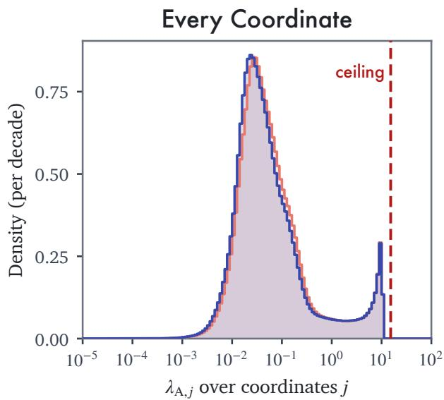

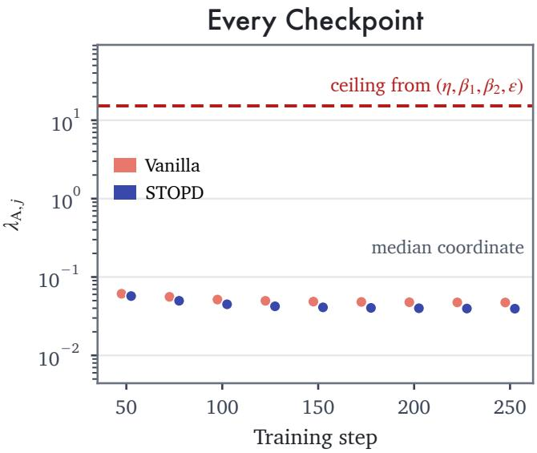  
Figure 10 | Upper bounds on Adam’s coeficients $\lambda _ { \mathrm { A } , j } \colon$ distribution across coordinates and checkpoints (left), the median coordinate at each step averaged over the five settings and three seeds (right), and the theoretical ceiling (dashed).

## B.3. Muon

Let $\boldsymbol { x } \in \mathbb { R } ^ { d _ { \mathrm { o u t } } \times d _ { \mathrm { i n } } }$ be a matrix gradient input. Fix the previous momentum $M ,$ the momentum parameter $\beta \in [ 0 , 1 )$ , and the stabilization parameter $\epsilon _ { \mathrm { M } } > 0$ . We use Frobenius norms except for the operator norm $\| \cdot \| _ { \mathsf { o p } } .$ , and restrict $g ^ { \vee } , \widehat { g } .$ , and $_ \textmd { ‰}$ to this block. Muon forms the new momentum $M ^ { + } ( x ) =$ $\beta M + ( 1 - \beta ) x$ and then the Nesterov input

$$
R ( x ) = ( 1 - \beta ) x + \beta M ^ { + } ( x ) = \beta ^ { 2 } M + ( 1 - \beta ^ { 2 } ) x .
$$

We normalize the Nesterov input by clamping its Frobenius norm below at $\epsilon _ { \mathrm { M } } \mathbf { \hat { \Omega } }$

$$
X _ { 0 } ( x ) = \frac { R ( x ) } { \operatorname* { m a x } \{ \| R ( x ) \| _ { F } , \epsilon _ { \mathrm { M } } \} } .
$$

Muon then applies $J \ge 0$ polynomial iterations, with � an integer [Jordan et al., 2024]:

$$
\begin{array} { r } { X _ { j + 1 } = \omega _ { 1 } X _ { j } + \omega _ { 3 } X _ { j } X _ { j } ^ { \top } X _ { j } + \omega _ { 5 } ( X _ { j } X _ { j } ^ { \top } ) ^ { 2 } X _ { j } . } \end{array}\tag{63}
$$

Here $\omega _ { 1 } , \omega _ { 3 } , \omega _ { 5 } \in \mathbb { R }$ are the optimizer’s fixed polynomial coeficients. Let $\mathcal { P } _ { J }$ denote the composition of these matrix iterations, with $\mathcal { P } _ { 0 } ( X ) = X$ . Let $\gamma _ { \mathrm { s h a p e } } > 0$ be the optimizer’s fixed scaling factor for this block, determined by its original dimensions and the chosen scaling convention. Its parameter increment is

$$
\Phi _ { \mathrm { M } } ( x ) = - \eta \gamma _ { \mathrm { s h a p e } } \mathcal { P } _ { J } ( X _ { 0 } ( x ) ) .
$$

The update comparison uses the reference Nesterov matrix and its normalization,

$$
B = R ( g ^ { \vee } ) , \qquad b = \| B \| _ { F } , \qquad Y = X _ { 0 } ( g ^ { \vee } ) = \frac { B } { \operatorname* { m a x } \{ b , \epsilon _ { \mathrm { M } } \} } .
$$

The efect of normalization on the distance from this reference is controlled by

$$
\kappa _ { b } = \frac { 2 } { \operatorname* { m a x } \{ b , \epsilon _ { \mathrm { M } } \} + \epsilon _ { \mathrm { M } } } .\tag{64}
$$

For the polynomial iterations, write the scalar one-step polynomial as $\varphi ( s ) = \omega _ { 1 } s + \omega _ { 3 } s ^ { 3 } + \omega _ { 5 } s ^ { 5 }$ and its compositions as $f _ { 0 } ( s ) = s , f _ { j + 1 } = \varphi \circ f _ { j }$ . Their scalar sensitivity is the divided diference

$$
\mathsf { D } _ { J } ( s , t ) = \left\{ { \begin{array} { l l } { \displaystyle { \frac { f _ { J } ( s ) - f _ { J } ( t ) } { s - t } } , } & { s \neq t , } \\ { \displaystyle f _ { J } ^ { \prime } ( t ) , } & { s = t . } \end{array} } \right.\tag{65}
$$

Since $f _ { J }$ is a polynomial, $\mathsf { D } _ { J }$ is a polynomial in $( s , t )$ including on the diagonal, and $\mathsf { D } _ { 0 } = 1$ . To relate these scalar polynomials to the rectangular matrix iterations [Andersson et al., 2016], use the symmetric dilation

$$
\begin{array} { r l r } { \mathcal { D } ( Z ) = \left( \begin{array} { l l } { 0 } & { Z } \\ { Z ^ { \top } } & { 0 } \end{array} \right) , } & { { } } & { \mathcal { T } _ { Y } = \mathrm { s p e c } ( \mathcal { D } ( Y ) ) . } \end{array}
$$

The dilation eigenvalues are the signed nonzero singular values, together with the remaining zeros. Since normalized inputs have Frobenius norm at most one, their dilation spectra lie in $[ - 1 , 1 ]$ . We combine $\kappa _ { b }$ with divided diferences over this interval and the fixed reference spectrum $\mathcal { T } _ { Y }$

Proposition B.2 (Update error with Muon). For the current batch, let $\widehat g$ and $g ^ { \mathrm { V } }$ denote the gradients of STOPD and Vanilla, respectively, restricted to a matrix parameter block. The Muon updates defined by $\Phi _ { \mathrm { { M } } }$ above, from the same parameter values and previous momentum $M ,$ satisfy

$$
\begin{array} { r } { \boxed { \| \Phi _ { \mathrm { M } } ( \widehat { g } ) - \Phi _ { \mathrm { M } } ( g ^ { \mathrm { V } } ) \| _ { F } \le \Lambda _ { \mathrm { M } } \| \widehat { g } - g ^ { \mathrm { V } } \| _ { F } } . } \end{array}\tag{66}
$$

Here the coeficient is

$$
\Lambda _ { \mathrm { M } } = \eta \gamma _ { \mathrm { s h a p e } } ( 1 - \beta ^ { 2 } ) \kappa _ { b } \operatorname* { m a x } _ { | s | \leq 1 \atop t \in \mathcal { T } _ { Y } } | \mathsf { D } _ { J } ( s , t ) | .\tag{67}
$$

This coeficient is finite and fixed conditional on the training history and complete batch. The same pointwise bound holds with $\widehat g$ replaced by any matrix gradient input � of the same shape. Averaging over the current cutofs of STOPD bounds the conditional mean-square update error:

$$
{ \mathbb E } _ { S } \| \Phi _ { \mathrm { M } } ( \widehat { g } ) - \Phi _ { \mathrm { M } } ( g ^ { \mathrm { V } } ) \| _ { F } ^ { 2 } \le \Lambda _ { \mathrm { M } } ^ { 2 } \left\{ \frac { \gamma } { C ^ { 2 } } + \rho ^ { 2 } \| g ^ { \mathrm { V } } \| _ { F } ^ { 2 } \right\} .\tag{68}
$$

For a block of the globally clipped update in $\operatorname { E q } .$ . (50), evaluate Eq. (67) with $B = R ( y )$ , where � is the corresponding block of the globally clipped full Vanilla gradient.

Proof. We track the gradient diference through the Nesterov input, normalization, and polynomial iterations, then combine their factors to obtain the update-error coeficient. Fix a matrix gradient input �. The shared previous momentum cancels between $\pmb { R } ( x )$ and $\pmb { { \cal B } } = \pmb { { \cal R } } ( g ^ { \vee } )$

$$
R ( x ) - B = ( 1 - \beta ^ { 2 } ) ( x - g ^ { \vee } ) .
$$

Write $r = \| R ( x ) \| _ { F }$ and $b = \| B \| _ { F }$ for their Frobenius norms. Normalization maps them to $X _ { 0 } ( x )$ and $Y = X _ { 0 } ( g ^ { \mathrm { V } } )$ , with respective Frobenius norms $a = r / \mathrm { m a x } \{ r , \epsilon _ { \mathrm { M } } \}$ and $c = b / \operatorname* { m a x } \{ b , \epsilon _ { \mathrm { M } } \}$ . Suppose first that $r , b > 0$ and $r \neq b _ { \mathrm { : } }$ , and let cos $\vartheta = \langle R ( x ) , B \rangle _ { F } / ( r b )$ . Expanding the squared normalization-distance ratio $\| \boldsymbol { X } _ { 0 } ( \boldsymbol { x } ) - \boldsymbol { Y } \| _ { F } ^ { 2 } / \| \boldsymbol { R } ( \boldsymbol { x } ) - \boldsymbol { B } \| _ { F } ^ { 2 }$ gives

$$
\frac { a ^ { 2 } + c ^ { 2 } - 2 a c \cos \vartheta } { r ^ { 2 } + b ^ { 2 } - 2 r b \cos \vartheta } .
$$

Its denominator is at least $( r - b ) ^ { 2 } > 0$ . Both numerator and denominator are afine in cos $\vartheta \in [ - 1 , 1 ]$ 2 so diferentiation gives a constant sign and the maximum occurs at an endpoint. For cos $\vartheta = - 1$ and cos $\vartheta = 1$ , the square roots of the ratio are, respectively,

$$
{ \frac { a + c } { r + b } } \quad { \mathrm { a n d } } \quad { \frac { | a - c | } { | r - b | } } .
$$

The first is at least the second. Indeed, when $r > b$ , we have $a \geq c$ and $a / r \leq c / b$ , hence $( a - c ) ( r + b ) \leq$ $( a + c ) ( r - b )$ . Interchanging the radii proves the same comparison when $r < b$

The cases excluded from this ratio calculation give the same factor. When $r = b > 0$ , both matrices are scaled by $1 / \mathrm { m a x } \{ r , \epsilon _ { \mathrm { M } } \} = ( a + c ) / ( r + b )$ , including when the matrices coincide. If exactly one radius is zero, the distance ratio is again $( a + c ) / ( r + b )$ . If both vanish, both distances vanish. Define $q _ { b } ( r ) = ( a + c ) / ( r + b )$ when $r + b > 0$ , and $q _ { 0 } ( 0 ) = 1 / \epsilon _ { \mathrm { M } }$ . Then every input satisfies

$$
\begin{array} { r } { \| \boldsymbol { X } _ { 0 } ( \boldsymbol { x } ) - \boldsymbol { Y } \| _ { F } \le q _ { b } ( r ) \| \boldsymbol { R } ( \boldsymbol { x } ) - \boldsymbol { B } \| _ { F } \le \kappa _ { b } \| \boldsymbol { R } ( \boldsymbol { x } ) - \boldsymbol { B } \| _ { F } . } \end{array}\tag{69}
$$

To obtain the second inequality, first take $b \leq \epsilon _ { \mathrm { M } }$ . Each normalized radius is at most its original radius divided by $\epsilon _ { \mathrm { M } }$ , so $q _ { b } ( r ) \le 1 / \epsilon _ { \mathrm { M } } = \kappa _ { b }$ . For $b > \epsilon _ { \mathrm { M } }$

$$
q _ { b } ( r ) = \left\{ \begin{array} { l l } { \displaystyle r / \epsilon _ { \mathrm { M } } + 1 } & { 0 \leq r \leq \epsilon _ { \mathrm { M } } , } \\ { \displaystyle r + b } & { } \\ { \displaystyle \frac { 2 } { r + b } , } & { r \geq \epsilon _ { \mathrm { M } } . } \end{array} \right.
$$

The first expression has derivative $( b / \epsilon _ { \mathrm { M } } - 1 ) / ( r + b ) ^ { 2 } > 0 ;$ the second decreases with �. Their common maximum at $r = \epsilon _ { \mathrm { M } } \mathrm { i } s 2 / ( b + \epsilon _ { \mathrm { M } } ) = \kappa _ { b }$ . For every $b > 0 _ { : }$ , choosing $R ( x ) = - \epsilon _ { \mathrm { M } } B / b$ attains the factor $\kappa _ { b }$

When $b = 0$ , any input with $\| \pmb { R } ( x ) \| _ { F } = \epsilon _ { \mathrm { M } }$ attains it. Thus $\kappa _ { b }$ is the exact distance-amplification factor of normalization about �.

For a matrix � of the same shape as the normalized reference $Y = X _ { 0 } ( g ^ { \mathrm { V } } )$ , the symmetric dilation D relates the scalar polynomial $\varphi$ and its compositions $f _ { J }$ to the matrix iterations. Block multiplication and iteration give

$$
\varphi ( \mathcal { D } ( \boldsymbol { X } ) ) = \mathcal { D } ( \mathcal { P } _ { 1 } ( \boldsymbol { X } ) ) , \qquad f _ { J } ( \mathcal { D } ( \boldsymbol { X } ) ) = \mathcal { D } ( \mathcal { P } _ { J } ( \boldsymbol { X } ) ) .
$$

The second identity includes $J = 0 _ { : }$ , since both compositions are then the identity map.

For $\| X \| _ { \mathsf { o p } } \leq 1$ , choose eigenvalue–eigenvector pairs $( s _ { u } , p _ { u } )$ of ${ \mathcal { D } } ( X )$ and $\left( t _ { \nu } , q _ { \nu } \right)$ of ${ \mathcal { D } } ( Y )$ , with both eigenvector bases orthonormal. The dilation eigenvalues are signed singular values (and zeros), so the input eigenvalues satisfy $\left. s _ { u } \right. \leq 1$ , and the reference eigenvalues lie in $\mathcal { T } _ { Y } = \mathop { \mathrm { s p e c } } ( \mathcal { D } ( Y ) )$ . The divided diference $\mathsf { D } _ { J }$ of $f _ { J }$ relates the corresponding entries in these two bases:

$$
\begin{array} { r l } & { p _ { u } ^ { \top } \{ f _ { J } ( \mathcal { D } ( X ) ) - f _ { J } ( \mathcal { D } ( Y ) ) \} q _ { \nu } = \{ f _ { J } ( s _ { u } ) - f _ { J } ( t _ { \nu } ) \} p _ { u } ^ { \top } q _ { \nu } } \\ & { \qquad = \mathsf { D } _ { J } ( s _ { u } , t _ { \nu } ) p _ { u } ^ { \top } \{ \mathcal { D } ( X ) - \mathcal { D } ( Y ) \} q _ { \nu } . } \end{array}
$$

When $s _ { u } = t _ { \upsilon } .$ , both sides of the second equality are zero. The sum of squared entries in these orthonormal bases is the squared Frobenius norm. Bound every divided diference by $\begin{array} { r } { \operatorname* { m a x } _ { | s | \leq 1 , t \in \mathcal { T } _ { Y } } | \mathrm { D } _ { J } ( s , t ) | } \end{array}$ sum the squares, and take square roots. The dilation identity above and $\| \mathcal { D } ( Z ) \| _ { F } = \sqrt { 2 } \| Z \| _ { F }$ then give

$$
\| \mathcal { P } _ { J } ( X ) - \mathcal { P } _ { J } ( Y ) \| _ { F } \leq \operatorname* { m a x } _ { | s | \leq 1 \atop t \in \mathcal { T } _ { Y } } | \mathsf { D } _ { J } ( s , t ) | \| X - Y \| _ { F } .
$$

For the actual normalized input $X = X _ { 0 } ( x ) , \| X \| _ { \mathrm { o p } } \leq \| X \| _ { F } \leq 1$ , so this polynomial bound applies. Its coeficient is finite: $\mathcal { T } _ { Y }$ is finite, and each $\mathsf { D } _ { J } ( \cdot , t )$ is a polynomial on the compact interval $[ - 1 , 1 ]$ . To compute $\Lambda _ { \mathrm { M } }$ from the fixed state, form $B , b , Y .$ and $f _ { J }$ . For each reference eigenvalue $t \in \mathcal { T } _ { Y }$ , maximize $| \mathsf { D } _ { J } ( s , t ) |$ over $s \in \left[ - 1 , 1 \right]$ by evaluating the endpoints and the stationary points of $\mathsf { D } _ { J } ( \cdot , t ) ;$ a constant polynomial needs only an endpoint. Take the largest value over � and multiply by the displayed factors.

The parameter increments are $- \eta \gamma _ { \mathrm { s h a p e } }$ times the polynomial outputs, so the two bounds give

$$
\begin{array} { r l } & { \| \Phi _ { \mathrm { M } } ( x ) - \Phi _ { \mathrm { M } } ( g ^ { \mathrm { V } } ) \| _ { F } \leq \eta \gamma _ { \mathrm { s h a p e } } \kappa _ { b } \underset { | s | \leq 1 } { \operatorname* { m a x } } | \mathsf { D } _ { J } ( s , t ) | \| R ( x ) - B \| _ { F } } \\ & { \qquad = \Lambda _ { \mathrm { M } } \| x - g ^ { \mathrm { V } } \| _ { F } . } \end{array}
$$

The last step uses the Nesterov-input diference established at the start of the proof and the maximum defining $\Lambda _ { \mathrm { M } }$ . This gives the bound for every matrix input $x ;$ setting $x = { \widehat { g } } ,$ the gradient of STOPD, proves Eq. (66).

The coeficient is fixed under conditioning on history and the complete batch. Squaring at $x = { \widehat { g } }$ and averaging over the current cutofs gives

$$
\begin{array} { r } { \mathbb { E } _ { S } \| \Phi _ { \mathrm { M } } ( \widehat { \boldsymbol { g } } ) - \Phi _ { \mathrm { M } } ( \boldsymbol { g } ^ { \mathrm { V } } ) \| _ { F } ^ { 2 } \leq \Lambda _ { \mathrm { M } } ^ { 2 } \mathbb { E } _ { S } \| \widehat { \boldsymbol { g } } - \boldsymbol { g } ^ { \mathrm { V } } \| _ { F } ^ { 2 } . } \end{array}
$$

Substituting the conditional gradient-error decomposition Eq. (25) for this block proves Eq. (68). □

We examine the size of Muon’s coeficient bounds during training (Figure 11) and find that they remain moderate, so small gradient errors also give small update-error bounds.

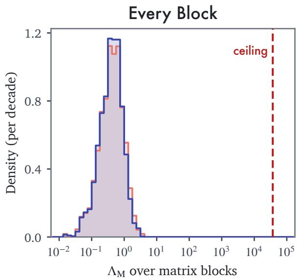

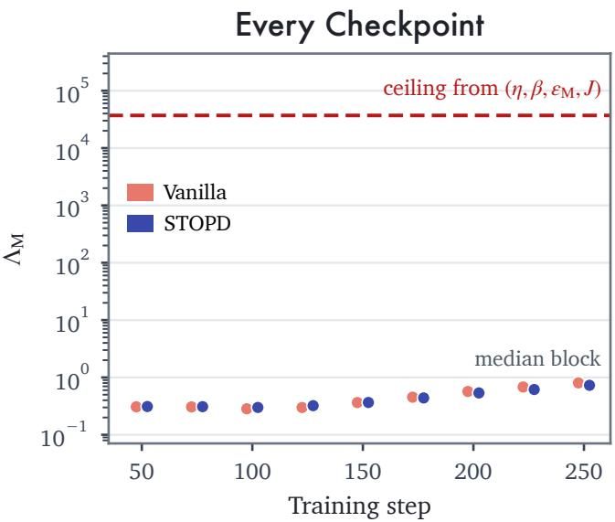  
Figure 11 | Muon’s coeficients $\Lambda _ { \mathrm { M } } \mathbf { : }$ distribution across blocks and checkpoints (left), the median block (right), and the theoretical ceiling (dashed)

## C. Token and Time Savings

We first derive the expected token savings, then analyze how these savings translate into reduced generation time.

## C.1. Token savings

For a complete rollout of length �, random truncation skips token � with probability $1 - p _ { t }$ . The expected number of tokens saved is therefore

$$
D ( T ) = \sum _ { t = 1 } ^ { T } ( 1 - p _ { t } ) .
$$

Tokens within the same block have the same inclusion probability. Position � belongs to block $b = \lfloor ( t - 1 ) / K \rfloor$ , where $b = 0$ denotes the first block. Under the stopping rule in Eq. (1), its inclusion probability is

$$
p _ { t } = \frac { L - K \lfloor ( t - 1 ) / K \rfloor } { L } = 1 - \frac { b K } { L } > 0 .\tag{70}
$$

Every token in block � is therefore skipped with probability $b K / L$ . Write $T = m K + r ,$ where � is the number of complete blocks and $0 \leq r < K$ is the number of tokens in the next block. Each complete block contributes $K \cdot b K / L$ expected saved tokens, while the remaining � tokens contribute $r \cdot m K / L$ Adding these contributions gives

$$
D ( T ) = \frac { K } { L } \left( K \sum _ { b = 0 } ^ { m - 1 } b + m r \right) = \frac { K } { L } \left\{ \frac { K m ( m - 1 ) } { 2 } + m r \right\} .\tag{71}
$$

Substituting $m = ( T - r ) / K$ makes the dependence on rollout length explicit:

$$
D ( T ) = { \frac { T ^ { 2 } - K T + r ( K - r ) } { 2 L } } .
$$

For $K \ll T$ , the terms involving � are small compared with $T ^ { 2 }$ , giving

$$
D ( T ) \approx { \frac { T ^ { 2 } } { 2 L } } , \qquad { \frac { D ( T ) } { T } } \approx { \frac { T } { 2 L } } .
$$

Thus longer rollouts save a larger fraction of tokens: about 25% for $T = L / 2$ and nearly 50% for $T = L$ At the max length, when � divides $L ,$ the exact saving is $D ( L ) = ( L - K ) / 2$ . Rollouts ending within the first block $( T \leq K )$ save no tokens.

Subtracting the expected saving from the complete length gives the expected generated length of rollout �:

$$
\mathbb { E } _ { S } M _ { i } = T _ { i } - D ( T _ { i } ) .
$$

Here, $\mathbb { E } _ { S }$ averages over the sampled stopping positions for a given complete rollout length $T _ { i } .$ In particular, a rollout reaching the max length retains $( L + K ) / 2$ tokens on average when � divides �.

For a batch of � rollouts, Vanilla OPD generates $\begin{array} { r } { N \ = \ \sum _ { i = 1 } ^ { B } T _ { i } } \end{array}$ tokens. Random truncation never generates more tokens than this. Summing the per-rollout expectations gives

$$
\sum _ { i } M _ { i } \leq N \quad { \mathrm { f o r ~ e v e r y ~ s e t ~ o f ~ s t o p p i n g ~ p o s i t i o n s , } }
$$

$$
\mathbb { E } _ { S } \sum _ { i } M _ { i } = N - \sum _ { i } D ( T _ { i } ) .\tag{72}
$$

## C.2. Time savings

We model generation time using the number of decoding rounds and the context lengths processed in those rounds. During autoregressive decoding, the key–value (KV) cache stores attention keys and values for the prompt and previously generated tokens. Generating each new token requires a forward pass, whose attention reads this growing cached context. Random truncation avoids forward-pass computation for skipped tokens, reduces KV-cache reads, and limits the growth of each rollout’s cache. This model explains when random truncation can save more time than token savings alone would predict. Let $\textstyle { \mathcal { R } } _ { r }$ be the set of active rollouts in decoding round $r ,$ each generating one token. Over � rounds, we approximate the time per round and the total decoding time as

$$
\tau _ { r } \approx \alpha + \beta \sum _ { j \in \mathcal { R } _ { r } } c _ { j , r } , \qquad t _ { \mathrm { d e c o d e } } \approx \alpha R + \beta \mathcal { A } , \qquad \mathcal { A } = \sum _ { r = 1 } ^ { R } \sum _ { j \in \mathcal { R } _ { r } } c _ { j , r } ,\tag{73}
$$

where $c _ { j , r }$ is the context length of rollout � in round � and $\alpha \ge 0$ is the fixed time cost of each round. The coeficient $\beta \geq 0$ models the additional time per context token processed. We call the cumulative sum $\mathcal { A }$ the KV area: it measures the total cached context processed across decoding rounds. For a fixed model, it serves as a proxy for attention work and KV-cache reads.

KV area. For rollout � with prompt length $T _ { i } ^ { \mathrm { p } }$ , the context before generating token $t \geq 1$ contains $T _ { i } ^ { \mathrm { p } }$ prompt tokens and $t - 1$ earlier rollout tokens. Adding these context lengths over the generated tokens gives

$$
\mathcal { A } _ { i } = \sum _ { t = 1 } ^ { M _ { i } } ( T _ { i } ^ { \mathrm { p } } + t - 1 ) = \sum _ { t = 1 } ^ { T _ { i } } \mathbf { 1 } \{ S _ { i } \geq t \} ( T _ { i } ^ { \mathrm { p } } + t - 1 ) , \qquad \mathcal { A } = \sum _ { i = 1 } ^ { B } \mathcal { A } _ { i } .\tag{74}
$$

Using $\mathbb { E } _ { S } [ { \bf 1 } \{ S _ { i } \ge t \} ] = p _ { t }$ and $\begin{array} { r } { \sum _ { t = 1 } ^ { T _ { i } } p _ { t } = T _ { i } - D ( T _ { i } ) } \end{array}$ gives

$$
\mathbb E _ { S } [ \mathcal { A } _ { i } ] = \sum _ { t = 1 } ^ { T _ { i } } p _ { t } ( T _ { i } ^ { \mathrm { p } } + t - 1 ) = T _ { i } ^ { \mathrm { p } } \{ T _ { i } - D ( T _ { i } ) \} + \sum _ { t = 1 } ^ { T _ { i } } ( t - 1 ) p _ { t } ,\tag{75}
$$

$$
\mathcal { A } _ { i } ^ { \mathrm { V } } = \sum _ { t = 1 } ^ { T _ { i } } ( T _ { i } ^ { \mathrm { p } } + t - 1 ) = T _ { i } ^ { \mathrm { p } } T _ { i } + \frac { T _ { i } ( T _ { i } - 1 ) } { 2 } , \qquad \mathcal { A } _ { i } ^ { \mathrm { V } } - \mathbb { E } _ { S } [ \mathcal { R } _ { i } ] = \sum _ { t = 1 } ^ { T _ { i } } ( 1 - p _ { t } ) ( T _ { i } ^ { \mathrm { p } } + t - 1 ) .\tag{76}
$$

Truncation is more likely to skip later tokens, each of which would require processing a longer context. To account for block boundaries, let $r _ { t }$ count the positions before token � within its block. Eq. (2) then gives

$$
p _ { t } = 1 - \frac { t - 1 - r _ { t } } { L } , \qquad r _ { t } = ( t - 1 ) - K \left\lfloor \frac { t - 1 } { K } \right\rfloor , \qquad 0 \le r _ { t } < K .\tag{77}
$$

For $K \ll T _ { i : }$ , summing over positions yields

$$
\begin{array} { l } { { \displaystyle \mathbb { E } _ { S } [ M _ { i } ] = \sum _ { t = 1 } ^ { T _ { i } } p _ { t } = T _ { i } - \frac { T _ { i } ( T _ { i } - 1 ) } { 2 L } + \frac { 1 } { L } \sum _ { t = 1 } ^ { T _ { i } } r _ { t } } } \\ { { \displaystyle \quad \quad = T _ { i } - \frac { T _ { i } ^ { 2 } } { 2 L } + O \Bigg ( \frac { K T _ { i } } { L } \Bigg ) , } } \\ { { \displaystyle \sum _ { t = 1 } ^ { T _ { i } } ( t - 1 ) p _ { t } = \frac { T _ { i } ( T _ { i } - 1 ) } { 2 } - \frac { T _ { i } ( T _ { i } - 1 ) ( 2 T _ { i } - 1 ) } { 6 L } + \frac { 1 } { L } \sum _ { t = 1 } ^ { T _ { i } } ( t - 1 ) r _ { t } } } \\ { { \displaystyle \quad \quad = \frac { T _ { i } ^ { 2 } } { 2 } - \frac { T _ { i } ^ { 3 } } { 3 L } + O \Bigg ( T _ { i } + \frac { K T _ { i } ^ { 2 } } { L } \Bigg ) . } } \end{array}\tag{78}
$$

Random truncation therefore saves the following amounts of tokens and KV area from the generated rollout context:

$$
T _ { i } - \mathbb { E } _ { S } [ M _ { i } ] \approx \frac { T _ { i } ^ { 2 } } { 2 L } , \qquad \frac { T _ { i } ( T _ { i } - 1 ) } { 2 } - \sum _ { t = 1 } ^ { T _ { i } } ( t - 1 ) p _ { t } \approx \frac { T _ { i } ^ { 3 } } { 3 L } .\tag{79}
$$

The token saving counts positions whose forward-pass computation is avoided. The KV-area saving measures the cached rollout context that attention no longer needs to read at those positions.

Each generated token also uses the $T _ { i } ^ { \mathrm { p } }$ prompt tokens. Adding this contribution gives

$$
\mathbb { E } _ { S } [ \mathcal { A } _ { i } ] \approx T _ { i } ^ { \mathrm { p } } \left( T _ { i } - \frac { T _ { i } ^ { 2 } } { 2 L } \right) + \frac { T _ { i } ^ { 2 } } { 2 } - \frac { T _ { i } ^ { 3 } } { 3 L } , \qquad \mathcal { A } _ { i } ^ { \mathrm { V } } - \mathbb { E } _ { S } [ \mathcal { A } _ { i } ] \approx \frac { T _ { i } ^ { \mathrm { p } } T _ { i } ^ { 2 } } { 2 L } + \frac { T _ { i } ^ { 3 } } { 3 L } .\tag{80}
$$

When prompts are much shorter than rollouts, we can neglect their contribution to the KV area. Writing $u _ { i } = T _ { i } / L$ for the rollout length as a fraction of the max length gives

$$
\mathbb { E } _ { S } [ M _ { i } ] \approx T _ { i } \left( 1 - \frac { u _ { i } } { 2 } \right) , \qquad \mathbb { E } _ { S } [ \mathcal { A } _ { i } ] \approx \frac { T _ { i } ^ { 2 } } { 2 } \left( 1 - \frac { 2 u _ { i } } { 3 } \right) .\tag{81}
$$

Dividing Vanilla OPD’s token count and KV area by the corresponding expectations under random truncation gives

$$
\frac { T _ { i } } { \mathbb { E } _ { S } [ M _ { i } ] } \approx \frac { 1 } { 1 - u _ { i } / 2 } , \qquad \frac { \mathcal { A } _ { i } ^ { \vee } } { \mathbb { E } _ { S } [ \mathcal { A } _ { i } ] } \approx \frac { 1 } { 1 - 2 u _ { i } / 3 } .\tag{82}
$$

Dividing the area ratio by the token-count ratio shows how much the average context per generated token decreases:

$$
\frac { \mathcal { A } _ { i } ^ { \mathrm { V } } / T _ { i } } { \mathbb { E } _ { S } [ \mathcal { A } _ { i } ] / \mathbb { E } _ { S } [ M _ { i } ] } \approx \frac { 1 - u _ { i } / 2 } { 1 - 2 u _ { i } / 3 } .\tag{83}
$$

For $T _ { i } = L ,$ , the expected generated length is

$$
\mathbb { E } _ { S } [ M _ { i } ] = \frac { L + K } { 2 }\tag{84}
$$

when � divides �. Under the same small-block and short-prompt approximations, a rollout of length $T _ { i } = L / 2$ saves about 25% of its tokens and 33% of its KV area in expectation. At $T _ { i } = L _ { : }$ , these savings increase to about 50% and 67%, respectively. Random truncation thus reduces the context processed by a larger fraction than the token count.

Efect of scheduling. When processing long contexts dominates the cost in Eq. (73), decoding time is approximately proportional to KV area, so time savings can exceed the fraction of tokens saved.

Scheduling also afects the speedup by determining the number of decoding rounds �. We examine two cases, with batch areas $\begin{array} { r } { \mathcal { A } = \sum _ { i } \mathcal { A } _ { i } } \end{array}$ and $\begin{array} { r } { \mathcal { A } ^ { \vee } = \sum _ { i } \mathcal { A } _ { i } ^ { \vee } } \end{array}$

First, suppose new rollouts can start as others finish, keeping about $Q$ context tokens active in the KV cache of both methods during most rounds. We ignore the brief periods at the beginning and end when fewer rollouts are active:

$$
\sum _ { j \in \mathcal { R } _ { r } } c _ { j , r } \approx Q .\tag{85}
$$

Each round contributes about � to the KV area, so

$$
\mathcal { A } \approx Q R , \qquad R \approx \frac { \mathcal { A } } { Q } , \qquad t _ { \mathrm { d e c o d e } } \approx \left( \frac { \alpha } { Q } + \beta \right) \mathcal { A } .\tag{86}
$$

Dividing the generated-token count $N ^ { S } = \textstyle \sum _ { i }$ �<sub>�</sub> by decoding time gives the throughput:

$$
\frac { N ^ { S } } { t _ { \mathrm { d e c o d e } } } \approx \frac { 1 } { \alpha / Q + \beta } \frac { N ^ { S } } { \mathcal { R } } .\tag{87}
$$

Let $t _ { \mathrm { V } }$ denote Vanilla OPD’s decoding time. The predicted speedup under this scheduling regime is

$$
\frac { t _ { \mathrm { V } } } { \mathbb { E } _ { S } [ t _ { \mathrm { d e c o d e } } ] } \approx \frac { \mathcal { R } ^ { \vee } } { \mathbb { E } _ { S } [ \mathcal { A } ] } = \frac { N } { \mathbb { E } _ { S } [ N ^ { S } ] } \frac { \mathcal { R } ^ { \vee } / N } { \mathbb { E } _ { S } [ \mathcal { A } ] / \mathbb { E } _ { S } [ N ^ { S } ] } .\tag{88}
$$

Equation (88) separates the predicted speedup into the reduction in token count and the reduction in mean context per token. The first factor reflects fewer tokens and hence less forward-pass computation. The second captures the throughput gain from shorter cached contexts: at the same active cache occupancy, more rollouts can generate concurrently. When the prompt contribution is neglected, both factors are at least one.

Second, suppose all rollouts start together and generate one token per round without pauses. No new rollouts enter the batch, so generation ends when the longest rollout finishes:

$$
R = \operatorname* { m a x } _ { i } M _ { i } , \qquad t _ { \mathrm { d e c o d e } } \approx \alpha \operatorname* { m a x } _ { i } M _ { i } + \beta \mathcal { A } .\tag{89}
$$

Consider � rollouts whose complete lengths equal �. Ignoring block rounding, let

$$
U _ { 1 } , \dots , U _ { n } \overset { \mathrm { i i d } } { \sim } \operatorname { U n i f o r m } ( 0 , L ) , \qquad Z = \operatorname* { m a x } _ { i } U _ { i } .\tag{90}
$$

For $0 \leq z \leq L ,$ , the largest stopping position is at most � only when all � stopping positions are at most �. Each has probability $z / L$ of doing so. Independence lets us multiply these probabilities; integrating the resulting tail probability gives the mean:

$$
\operatorname* { P r } ( Z \leq z ) = \left( { \frac { z } { L } } \right) ^ { n } , \qquad \operatorname { \mathbb { E } } [ Z ] = \int _ { 0 } ^ { L } \left[ 1 - \left( { \frac { z } { L } } \right) ^ { n } \right] \mathrm { d } z = { \frac { n L } { n + 1 } } .\tag{91}
$$

The expected gap between the max length and the largest stopping position is therefore

$$
L - \mathbb { E } [ Z ] = { \frac { L } { n + 1 } } .\tag{92}
$$

Rounding �<sub>�</sub> up to a block boundary without exceeding the max length � gives

$$
U _ { i } \leq S _ { i } \leq \operatorname* { m i n } \{ U _ { i } + K , L \} .\tag{93}
$$

Taking the maximum over rollouts and then the expectation gives

$$
\frac { n L } { n + 1 } \leq \mathbb { E } _ { S } \left[ \operatorname* { m a x } _ { i } S _ { i } \right] \leq \operatorname* { m i n } \left\{ L , \frac { n L } { n + 1 } + K \right\} .\tag{94}
$$

Random truncation can accelerate generation even when the longest retained rollout remains close to �. It still removes many tokens across the batch, avoiding their forward-pass computation and KV-cache reads. In the time model, this reduces $\beta \mathcal { A }$ even when �� changes little. The greater the share of decoding time spent processing cached contexts, the larger the resulting speedup.

Practical implications. A larger batch can improve generation throughput while reducing truncation noise. When the scheduler admits waiting rollouts as others finish, it can reuse the KV-cache space freed by random truncation. A larger batch supplies more waiting rollouts, helping sustain concurrency and cache occupancy. The student update then combines gradient contributions from these same rollouts, averaging over more independent stopping positions and reducing the gradient variance caused by random truncation (Appendix A.5).

## D. Accuracy by Step

Table 2 lists the accuracy behind Figures 2 and 4 at every evaluated checkpoint, and Tables $3 \mathrm { - } 7$ the accuracy behind Figures 6, 8, 9, 12, and 13.

Table 2 | Accuracy (%) every 25 steps, mean ± standard deviation, from the base model and the shared step-25 Vanilla warmup to 250 steps.
<table><tr><td rowspan="2">Setting</td><td rowspan="2">Method Base</td><td rowspan="2">25</td><td colspan="9">Accuracy (%) at step</td></tr><tr><td>50</td><td>75</td><td>100</td><td>125</td><td>150</td><td>175</td><td>200</td><td>225</td><td>250</td></tr><tr><td>Main results: Qwen3-1.7B-Base ← Qwen3-4B-Instruct-2507</td><td></td><td></td><td></td><td></td><td></td><td></td><td></td><td></td><td></td><td></td><td></td></tr><tr><td rowspan="2">Math</td><td>Vanilla</td><td>11.7</td><td> $2 3 . 4 _ { \pm 0 . 8 }$ </td><td> $2 4 . 1 _ { \pm 0 . 0 }$ </td><td> $2 7 . 9 _ { \pm 0 . 7 }$   $2 6 . 9 _ { \pm 0 . 2 }$ </td><td> $2 8 . 4 _ { \pm 0 . 6 }$ </td><td>28.5±0.7</td><td> $2 9 . 3 _ { \pm 0 . 4 }$ </td><td> $2 8 . 1 _ { \pm 1 . 8 }$ </td><td> $3 0 . 0 _ { \pm 0 . 4 }$ </td><td> $3 0 . 1 _ { \pm 0 . 5 }$ </td></tr><tr><td>STOPD</td><td></td><td></td><td> $2 4 . 4 _ { \pm 0 . 9 }$ </td><td>27.3±0.7 27.5±0.5</td><td> $2 7 . 7 _ { \pm 0 . 6 }$ </td><td> $2 9 . 0 _ { \pm 0 . 5 }$ </td><td> $2 9 . 1 _ { \pm 0 . 1 }$ </td><td> $2 7 . 9 _ { \pm 1 . 4 }$ </td><td> $2 8 . 5 _ { \pm 0 . 6 }$ </td><td> $2 9 . 4 _ { \pm 0 . 6 }$ </td></tr><tr><td rowspan="2">Code</td><td>Vanilla STOPD</td><td rowspan="2">21.8</td><td> $2 7 . 6 _ { \pm 0 . 2 }$ </td><td> $2 6 . 4 _ { \pm 0 . 2 }$ </td><td> $2 5 . 5 _ { \pm 0 . 3 }$ </td><td> $2 6 . 5 _ { \pm 0 . 2 }$   $2 7 . 2 _ { \pm 0 . 3 }$ </td><td> $2 7 . 6 _ { \pm 0 . 2 }$ </td><td> $2 7 . 6 _ { \pm 0 . 3 }$ </td><td> $2 8 . 1 _ { \pm 0 . 3 }$ </td><td> $2 8 . 5 _ { \pm 0 . 1 }$ </td><td> $2 8 . 5 _ { \pm 0 . 1 }$ </td></tr><tr><td></td><td> $2 6 . 3 _ { \pm 0 . 3 }$ </td><td> $2 5 . 7 _ { \pm 0 . 4 }$ </td><td> $2 5 . 8 _ { \pm 0 . 3 }$ </td><td> $2 6 . 9 _ { \pm 0 . 3 }$ </td><td> $2 7 . 4 _ { \pm 0 . 3 }$ </td><td> $2 7 . 2 _ { \pm 0 . 1 }$ </td><td> $2 7 . 5 _ { \pm 0 . 6 }$ </td><td> $2 7 . 8 _ { \pm 0 . 4 }$ </td><td> $2 8 . 1 _ { \pm 0 . 4 }$ </td></tr><tr><td>Instruction Vanilla</td><td></td><td>15.6</td><td></td><td> $3 4 . 8 _ { \pm 0 . 5 }$ </td><td> $4 4 . 4 _ { \pm 0 . 7 }$ </td><td> $4 9 . 9 _ { \pm 1 . 0 }$ </td><td> $5 2 . 2 _ { \pm 0 . 2 }$ </td><td> $5 4 . 3 _ { \pm 0 . 2 }$ </td><td> $5 7 . 0 _ { \pm 0 . 5 }$ </td><td> $5 8 . 6 _ { \pm 1 . 1 }$   $5 9 . 9 _ { \pm 1 . 4 }$ </td><td> $5 9 . 8 _ { \pm 1 . 3 }$ </td></tr><tr><td>following STOPD</td><td></td><td></td><td> $2 4 . 6 _ { \pm 0 . 1 }$ </td><td> $3 5 . 0 _ { \pm 0 . 7 }$ </td><td> $4 4 . 3 _ { \pm 0 . 5 }$ </td><td> $5 0 . 6 _ { \pm 0 . 2 }$ </td><td> $5 1 . 3 _ { \pm 0 . 5 }$ </td><td> $5 3 . 6 _ { \pm 0 . 3 }$ </td><td> $5 6 . 2 _ { \pm 0 . 3 }$ </td><td> $5 9 . 0 _ { \pm 0 . 5 }$   $5 9 . 1 _ { \pm 1 . 2 }$ </td><td> $6 0 . 1 _ { \pm 0 . 9 }$ </td></tr><tr><td colspan="2">Scaling: mathematics, Qwen3-30B-A3B-Instruct-2507 teacher</td><td></td><td></td><td></td><td></td><td></td><td></td><td></td><td></td><td></td><td></td></tr><tr><td rowspan="2">4B</td><td>Vanilla</td><td>15.2</td><td> $3 4 . 9 _ { \pm 0 . 8 }$ </td><td>34.7±0.7 41.1±0.7 44.0±0.6 44.2±0.2 45.0±0.5 45.0±0.4</td><td></td><td></td><td></td><td></td><td> $4 6 . 2 _ { \pm 0 . 9 }$ </td><td> $4 6 . 3 _ { \pm 0 . 3 }$ </td><td> $4 6 . 2 _ { \pm 0 . 2 }$ </td></tr><tr><td>STOPD</td><td></td><td></td><td>34.7±0.6 40.1±0.6 43.5±0.2 43.7±0.3 44.9±0.7</td><td></td><td></td><td></td><td></td><td> $4 4 . 9 _ { \pm 0 . 5 }$   $4 5 . 5 _ { \pm 0 . 6 }$ </td><td> $4 6 . 3 _ { \pm 0 . 7 }$ </td><td> $4 5 . 3 _ { \pm 0 . 4 }$ </td></tr><tr><td rowspan="2">8B</td><td rowspan="2">Vanilla STOPD</td><td rowspan="2">23.5</td><td rowspan="2"> $3 8 . 0 _ { \pm 0 . 3 }$ </td><td></td><td> $3 9 . 3 _ { \pm 1 . 3 } ~ 4 5 . 8 _ { \pm 0 . 8 }$ </td><td>47.1±0.2 48.3±0.4</td><td></td><td> $4 8 . 3 _ { \pm 0 . 2 }$ </td><td></td><td></td><td></td></tr><tr><td> $3 8 . 7 _ { \pm 0 . 9 }$ </td><td>44.6±0.1</td><td> $4 7 . 3 _ { \pm 0 . 8 }$ </td><td> $4 7 . 2 _ { \pm 0 . 9 }$   $4 8 . 8 _ { \pm 0 . 7 }$ </td><td> $4 9 . 3 _ { \pm 0 . 4 }$   $4 8 . 6 _ { \pm 0 . 4 }$ </td><td> $5 0 . 1 _ { \pm 0 . 1 }$   $4 9 . 9 _ { \pm 0 . 8 }$ </td><td> $5 0 . 2 _ { \pm 0 . 3 }$   $4 9 . 1 _ { \pm 0 . 6 }$ </td><td> $5 0 . 1 _ { \pm 0 . 1 }$   $4 9 . 7 _ { \pm 0 . 8 }$ </td></tr></table>

Table 3 | Accuracy (%) every 25 steps under each optimizer in mathematics, mean ± standard deviation.
<table><tr><td colspan="3"></td><td colspan="9">Accuracy (%) at step</td></tr><tr><td>Optimizer Method Base</td><td></td><td>25</td><td>50</td><td>75</td><td>100</td><td>125</td><td>150</td><td>175</td><td>200</td><td>225</td><td>250</td></tr><tr><td rowspan="2">Mathematics: Qwen3-1.7B-Base ← Qwen3-4B-Instruct-2507</td><td></td><td></td><td></td><td></td><td></td><td></td><td></td><td></td><td></td><td></td><td></td></tr><tr><td>Vanilla</td><td> $1 1 . 7 2 3 . 4 _ { \pm 0 . 8 }$ </td><td></td><td></td><td></td><td>24.1±0.0 27.9±0.7 26.9±0.2 28.4±0.628.5±0.7</td><td></td><td> $2 9 . 3 _ { \pm 0 . 4 }$ </td><td> $2 8 . 1 _ { \pm 1 . 8 }$ </td><td> $3 0 . 0 _ { \pm 0 . 4 }$ </td><td> $3 0 . 1 _ { \pm 0 . 5 }$ </td></tr><tr><td rowspan="2">AdamW SGD</td><td>STOPD</td><td></td><td></td><td></td><td></td><td></td><td>24.4±0.9 27.3±0.7 27.5±0.5 27.7±0.6 29.0±0.5 29.1±0.1</td><td></td><td></td><td> $2 7 . 9 _ { \pm 1 . 4 }$ </td><td> $2 8 . 5 _ { \pm 0 . 6 }$ </td><td> $2 9 . 4 _ { \pm 0 . 6 }$ </td></tr><tr><td>Vanilla</td><td></td><td></td><td></td><td></td><td></td><td>24.4±0.324.3±0.324.5±1.624.9±0.124.4±0.624.9±0.2</td><td></td><td></td><td> $2 5 . 2 _ { \pm 0 . 8 }$ </td><td> $2 5 . 3 _ { \pm 0 . 3 }$ </td><td> $2 5 . 2 _ { \pm 0 . 5 }$ </td></tr><tr><td rowspan="2"></td><td>STOPD</td><td> $1 1 . 7 ~ 2 2 . 6 _ { \pm 0 . 5 }$ </td><td></td><td> $2 4 . 2 _ { \pm 0 . 5 }$ </td><td></td><td></td><td>24.6±0.2 24.7±0.3 24.2±0.2 25.0±0.3 24.1±0.4</td><td></td><td></td><td> $2 5 . 2 _ { \pm 0 . 2 }$ </td><td>25.2±0.6 25.1±0.6</td><td></td></tr><tr><td>Vanilla</td><td></td><td></td><td> $2 4 . 6 _ { \pm 0 . 9 }$ </td><td></td><td></td><td>20.1±0.5 25.0±0.425.9±0.926.5±0.4 28.2±0.1</td><td></td><td></td><td> $2 8 . 8 _ { \pm 0 . 5 }$ </td><td> $2 7 . 8 _ { \pm 0 . 1 }$ </td><td> $2 9 . 5 _ { \pm 0 . 2 }$ </td></tr><tr><td>Muon</td><td>STOPD</td><td>11.7</td><td> $2 1 . 9 _ { \pm 0 . 3 }$ </td><td> $2 4 . 5 _ { \pm 0 . 2 }$ </td><td> $2 0 . 7 _ { \pm 0 . 2 }$ </td><td> $2 4 . 1 _ { \pm 0 . 9 }$ </td><td>25.8±0.5</td><td> $2 6 . 0 _ { \pm 0 . 4 }$ </td><td>27.6±0.8</td><td> $2 8 . 2 _ { \pm 0 . 2 }$ </td><td> $2 8 . 4 _ { \pm 0 . 6 }$ </td><td> $2 9 . 8 _ { \pm 0 . 2 }$ </td></tr></table>

Table 4 | Accuracy (%) every 25 steps for each block width � in mathematics, mean ± standard deviation.
<table><tr><td colspan="9">Accuracy (%) at step</td></tr><tr><td>Method Base</td><td></td><td>25</td><td>50</td><td>75</td><td>100</td><td>125</td><td>150</td><td>175</td><td>200</td><td>225</td><td>250</td></tr><tr><td colspan="10">Mathematics: Qwen3-1.7B-Base ← Qwen3-4B-Instruct-2507</td></tr><tr><td></td><td></td><td></td><td> $2 4 . 1 _ { \pm 0 . 0 }$ </td><td> $2 7 . 9 _ { \pm 0 . 7 }$ </td><td> $2 6 . 9 _ { \pm 0 . 2 }$ </td><td> $2 8 . 4 _ { \pm 0 . 6 }$ </td><td> $2 8 . 5 _ { \pm 0 . 7 }$ </td><td> $2 9 . 3 _ { \pm 0 . 4 }$ </td><td> $2 8 . 1 _ { \pm 1 . 8 }$ </td><td> $3 0 . 0 _ { \pm 0 . 4 }$ </td></tr><tr><td>Vanilla 32</td><td>STOPD</td><td></td><td> $2 4 . 1 _ { \pm 0 . 2 }$ </td><td> $2 7 . 3 _ { \pm 0 . 4 }$ </td><td> $2 7 . 1 _ { \pm 0 . 5 }$ </td><td> $2 7 . 6 _ { \pm 0 . 1 }$ </td><td> $2 8 . 2 _ { \pm 0 . 6 }$ </td><td> $2 9 . 2 _ { \pm 0 . 4 }$ </td><td> $2 9 . 2 _ { \pm 0 . 5 }$   $2 8 . 8 _ { \pm 0 . 3 }$ </td><td> $3 0 . 1 _ { \pm 0 . 5 }$   $2 9 . 8 _ { \pm 0 . 7 }$ </td></tr><tr><td>128</td><td>STOPD</td><td>11.7 23.4±0.8</td><td> $2 4 . 4 _ { \pm 0 . 9 }$ </td><td> $2 7 . 3 _ { \pm 0 . 7 }$ </td><td> $2 7 . 5 _ { \pm 0 . 5 }$ </td><td> $2 7 . 7 _ { \pm 0 . 6 }$ </td><td> $2 9 . 0 _ { \pm 0 . 5 }$ </td><td> $2 9 . 1 _ { \pm 0 . 1 }$  27.9±1.4</td><td> $2 8 . 5 _ { \pm 0 . 6 }$ </td><td> $2 9 . 4 _ { \pm 0 . 6 }$ </td></tr><tr><td>512 STOPD</td><td></td><td></td><td> $2 4 . 1 _ { \pm 0 . 7 }$ </td><td> $2 7 . 7 _ { \pm 0 . 5 }$ </td><td> $2 7 . 7 _ { \pm 0 . 5 }$ </td><td> $2 7 . 5 _ { \pm 0 . 8 }$ </td><td> $2 8 . 8 _ { \pm 0 . 2 }$ </td><td> $2 8 . 9 _ { \pm 0 . 7 }$ </td><td> $2 8 . 7 _ { \pm 0 . 8 }$   $2 8 . 8 _ { \pm 1 . 1 }$ </td><td> $2 9 . 7 _ { \pm 0 . 2 }$ </td></tr><tr><td>2048 STOPD</td><td></td><td></td><td> $2 3 . 7 _ { \pm 0 . 2 }$ </td><td> $2 7 . 5 _ { \pm 0 . 2 }$ </td><td> $2 6 . 9 _ { \pm 0 . 3 }$ </td><td> $2 7 . 7 _ { \pm 0 . 5 }$ </td><td> $2 8 . 4 _ { \pm 0 . 6 }$ </td><td> $2 9 . 1 _ { \pm 0 . 6 }$ </td><td> $2 8 . 5 _ { \pm 1 . 0 }$   $2 9 . 4 _ { \pm 0 . 6 }$ </td><td> $3 0 . 0 _ { \pm 0 . 2 }$ </td></tr></table>

Table 5 | Accuracy (%) every 25 steps for each batch size � in mathematics, mean ± standard deviation.
<table><tr><td colspan="3"></td><td colspan="4">Accuracy (%) at step</td></tr><tr><td>B</td><td>Method</td><td>Base</td><td>25</td><td>50</td><td>75</td><td>100</td></tr><tr><td colspan="7">Mathematics: Qwen3-1.7B-Base ← Qwen3-4B-Instruct-2507</td></tr><tr><td>128</td><td>Vanilla</td><td>11.7</td><td> $2 3 . 1 _ { \pm 0 . 3 }$ </td><td> $2 3 . 5 _ { \pm 0 . 6 }$ </td><td> $2 7 . 6 _ { \pm 0 . 1 }$ </td><td> $2 7 . 8 _ { \pm 0 . 3 }$ </td></tr><tr><td></td><td>STOPD Vanilla</td><td></td><td></td><td> $2 4 . 3 _ { \pm 0 . 4 }$   $2 4 . 1 _ { \pm 0 . 0 }$ </td><td> $2 7 . 9 _ { \pm 0 . 6 }$   $2 7 . 9 _ { \pm 0 . 7 }$ </td><td> $2 8 . 4 _ { \pm 0 . 8 }$ </td></tr><tr><td rowspan="2">256</td><td>STOPD</td><td>11.7</td><td> $2 3 . 4 _ { \pm 0 . 8 }$ </td><td> $2 4 . 4 _ { \pm 0 . 9 }$ </td><td> $2 7 . 3 _ { \pm 0 . 7 }$ </td><td> $2 6 . 9 _ { \pm 0 . 2 }$ </td></tr><tr><td>Vanilla</td><td></td><td></td><td> $2 4 . 5 _ { \pm 0 . 1 }$ </td><td></td><td> $2 7 . 5 _ { \pm 0 . 5 }$ </td></tr><tr><td rowspan="2">512</td><td>STOPD</td><td>11.7</td><td> $2 4 . 4 _ { \pm 0 . 5 }$ </td><td></td><td> $2 7 . 3 _ { \pm 0 . 2 }$ </td><td> $2 7 . 4 _ { \pm 0 . 2 }$ </td></tr><tr><td></td><td></td><td></td><td> $2 4 . 5 _ { \pm 0 . 3 }$ </td><td> $2 7 . 1 _ { \pm 0 . 3 }$ </td><td> $2 7 . 2 _ { \pm 0 . 4 }$ </td></tr></table>

Table 6 | Accuracy (%) every 25 steps for ESR in mathematics, mean ± standard deviation.
<table><tr><td></td><td colspan="10">Accuracy (%) at step</td></tr><tr><td>Method Base</td><td>25</td><td>50</td><td>75</td><td>100</td><td>125</td><td>150</td><td>175</td><td>200</td><td>225</td><td>250</td></tr><tr><td>Mathematics: Qwen3-1.7B-Base ← Qwen3-4B-Instruct-2507</td><td></td><td></td><td></td><td></td><td></td><td></td><td></td><td></td><td></td><td></td></tr><tr><td>Vanilla</td><td></td><td></td><td></td><td> $2 4 . 1 _ { \pm 0 . 0 } \ 2 7 . 9 _ { \pm 0 . 7 } \ 2 6 . 9 _ { \pm 0 . 2 } \ 2 8 . 4 _ { \pm 0 . 6 } \ 2 8 . 5 _ { \pm 0 . 7 } \ 2 9 . 3 _ { \pm 0 . 4 }$ </td><td></td><td></td><td></td><td> $2 8 . 1 _ { \pm 1 . 8 }$ </td><td> $3 0 . 0 _ { \pm 0 . 4 }$ </td><td> $3 0 . 1 _ { \pm 0 . 5 }$ </td></tr><tr><td>STOPD 11.7</td><td> $2 3 . 4 _ { \pm 0 . 8 }$ </td><td> $2 4 . 4 _ { \pm 0 . 9 }$ </td><td> $2 7 . 3 _ { \pm 0 . 7 }$ </td><td>27.5±0.5</td><td> $2 7 . 7 _ { \pm 0 . 6 }$ </td><td> $2 9 . 0 _ { \pm 0 . 5 }$ </td><td> $2 9 . 1 _ { \pm 0 . 1 }$ </td><td> $2 7 . 9 _ { \pm 1 . 4 }$ </td><td> $2 8 . 5 _ { \pm 0 . 6 }$ </td><td> $2 9 . 4 _ { \pm 0 . 6 }$ </td></tr><tr><td>ESR</td><td></td><td> $2 4 . 5 _ { \pm 0 . 1 }$ </td><td> $2 3 . 7 _ { \pm 1 . 2 }$ </td><td> $2 3 . 4 _ { \pm 0 . 4 }$ </td><td> $2 4 . 0 _ { \pm 0 . 4 }$ </td><td> $2 3 . 4 _ { \pm 0 . 1 }$ </td><td>23.2±0.4</td><td> $2 3 . 0 _ { \pm 0 . 4 }$ </td><td> $2 3 . 2 _ { \pm 0 . 5 }$ </td><td> $2 3 . 5 _ { \pm 0 . 6 }$ </td></tr></table>

Table 7 | Accuracy (%) every 25 steps for STOPD with $w _ { t } = 1$ in mathematics, mean ± standard deviation.
<table><tr><td colspan="8">Accuracy (%) at step</td></tr><tr><td>Method</td><td>Base</td><td>25</td><td>50</td><td>75</td><td>100</td><td>125</td><td>150</td><td>175</td><td>200</td><td>225</td><td>250</td></tr><tr><td colspan="10">Mathematics: Qwen3-1.7B-Base ← Qwen3-4B-Instruct-2507</td></tr><tr><td></td><td></td><td></td><td></td><td></td><td></td><td></td><td></td><td></td><td></td><td></td><td></td></tr><tr><td>Vanilla</td><td>11.7</td><td></td><td>24.1±0.0 27.9±0.7 26.9±0.2 28.4±0.6 28.5±0.7 29.3±0.4</td><td></td><td></td><td></td><td></td><td></td><td> $2 8 . 1 _ { \pm 1 . 8 }$ </td><td> $3 0 . 0 _ { \pm 0 . 4 }$ </td><td> $3 0 . 1 _ { \pm 0 . 5 }$ </td></tr><tr><td>STOPD STOPD,  $w _ { t } = 1$ </td><td></td><td> $2 3 . 4 _ { \pm 0 . 8 }$ </td><td>24.4±0.9 27.3±0.7 27.5±0.5 27.7±0.6  $2 3 . 8 _ { \pm 0 . 2 }$ </td><td></td><td>27.4±0.1 26.9±0.4</td><td> $2 7 . 7 _ { \pm 0 . 4 }$ </td><td> $2 9 . 0 _ { \pm 0 . 5 }$   $2 7 . 9 _ { \pm 0 . 5 }$ </td><td>29.1±0.1  $2 9 . 2 _ { \pm 0 . 6 }$ </td><td> $2 7 . 9 _ { \pm 1 . 4 }$   $2 9 . 0 _ { \pm 0 . 5 }$ </td><td> $2 8 . 5 _ { \pm 0 . 6 }$   $2 9 . 6 _ { \pm 0 . 3 }$ </td><td> $2 9 . 4 _ { \pm 0 . 6 }$   $2 9 . 1 _ { \pm 0 . 3 }$ </td></tr><tr><td colspan="10"></td></tr><tr><td>Mathematics: Qwen3-4B-Base ← Qwen3-30B-A3B-Instruct-2507</td><td></td><td></td><td></td><td></td><td></td><td></td><td></td><td></td><td></td><td></td><td></td></tr><tr><td>Vanilla</td><td></td><td></td><td>34.7±0.7 41.1±0.7 44.0±0.6 44.2±0.2 45.0±0.5 45.0±0.4 46.2±0.9</td><td></td><td></td><td></td><td></td><td></td><td></td><td> $4 6 . 3 _ { \pm 0 . 3 }$ </td><td> $4 6 . 2 _ { \pm 0 . 2 }$ </td></tr><tr><td>STOPD</td><td>15.2</td><td> $3 4 . 9 _ { \pm 0 . 8 }$ </td><td>34.7±0.6 40.1±0.6 43.5±0.2 43.7±0.3 44.9±0.7 44.9±0.5 45.5±0.6</td><td></td><td></td><td></td><td></td><td></td><td></td><td> $4 6 . 3 _ { \pm 0 . 7 }$ </td><td> $4 5 . 3 _ { \pm 0 . 4 }$ </td></tr><tr><td>STOPD,  $w _ { t } = 1$ </td><td></td><td></td><td>33.9±0.7 38.8±0.2 41.8±0.9 43.7±1.0 44.7±0.8</td><td></td><td></td><td></td><td></td><td> $4 5 . 1 _ { \pm 1 . 1 }$ </td><td> $4 5 . 3 _ { \pm 0 . 3 }$ </td><td> $4 5 . 7 _ { \pm 0 . 7 }$ </td><td> $4 5 . 9 _ { \pm 0 . 2 }$ </td></tr></table>

## E. Additional Time Decomposition

Tables 8, 9, 10, and 11 break down the training step for the 4B and 8B students (Section 5.2), the optimizers (Section 5.3), the block widths (Section 5.4), and the batch sizes (Section 5.5), respectively.

Table 8 | Cost of a training step for the 4B and 8B students in mathematics.
<table><tr><td colspan="5"></td><td colspan="4">Time per step (s)</td></tr><tr><td>Student</td><td>Method</td><td>Tokens</td><td>k tok/s</td><td>Generation</td><td>Update</td><td></td><td>Other</td><td>Total</td></tr><tr><td rowspan="3">4B</td><td>Vanilla</td><td>10,005</td><td>3.4</td><td>753</td><td>360</td><td></td><td>95</td><td>1209</td></tr><tr><td>STOPD</td><td>6,511</td><td>4.3</td><td>392</td><td>219</td><td></td><td>61</td><td>672</td></tr><tr><td>Speedup</td><td>1.5x</td><td>1.3x</td><td>1.9x</td><td></td><td>1.6x</td><td>1.6x</td><td>1.8×</td></tr><tr><td rowspan="3">8B</td><td>Vanilla</td><td>9,432</td><td>5.6</td><td></td><td>434</td><td>303</td><td>81</td><td>818</td></tr><tr><td>STOPD</td><td>6,276</td><td>6.5</td><td></td><td>246</td><td>190</td><td>54</td><td>490</td></tr><tr><td>Speedup</td><td>1.5×</td><td>1.2x</td><td></td><td>1.8x</td><td>1.6x</td><td>1.5x</td><td>1.7×</td></tr></table>

Table 9 | Cost of a training step under each optimizer in mathematics.
<table><tr><td colspan="4">Qwen3-1.7B-Base ← Qwen3-4B-Instruct-2507</td><td colspan="4">Time per step (s)</td></tr><tr><td>Optimizer</td><td>Method</td><td>Tokens</td><td>k tok/s</td><td>Generation</td><td>Update</td><td>Other</td><td>Total</td></tr><tr><td rowspan="3">AdamW</td><td>Vanilla</td><td>9,516</td><td>3.5</td><td>697</td><td>189</td><td>56</td><td>941</td></tr><tr><td>STOPD</td><td>6,255</td><td>4.5</td><td>358</td><td>119</td><td>36</td><td>513</td></tr><tr><td>Speedup</td><td>1.5×</td><td>1.3×</td><td>2.0x</td><td>1.6x</td><td>1.5×</td><td>1.8×</td></tr><tr><td rowspan="3">SGD</td><td>Vanilla</td><td>9,278</td><td>2.9</td><td>810</td><td>185</td><td>50</td><td>1045</td></tr><tr><td>STOPD</td><td>5,474</td><td>4.1</td><td>342</td><td>109</td><td>34</td><td>485</td></tr><tr><td>Speedup</td><td>1.7×</td><td>1.4×</td><td>2.4x</td><td>1.7×</td><td>1.5×</td><td>2.2x</td></tr><tr><td rowspan="3">Muon</td><td>Vanilla</td><td>9,991</td><td>3.3</td><td>784</td><td>192</td><td>52</td><td>1029</td></tr><tr><td>STOPD</td><td>6,247</td><td>4.2</td><td>379</td><td>124</td><td>39</td><td>542</td></tr><tr><td>Speedup</td><td>1.6x</td><td>1.3x</td><td>2.1×</td><td>1.6x</td><td>1.3x</td><td>1.9x</td></tr></table>

Table 10 | Cost of a training step for each block width � in mathematics.
<table><tr><td colspan="4">Qwen3-1.7B-Base ← Qwen3-4B-Instruct-2507</td><td colspan="4">Time per step (s)</td></tr><tr><td>K</td><td>Method</td><td>Tokens</td><td>k tok/s</td><td>Generation</td><td>Update</td><td>Other</td><td>Total</td></tr><tr><td></td><td>Vanilla</td><td>9,516</td><td>3.5</td><td>697</td><td>189</td><td>56</td><td>941</td></tr><tr><td rowspan="2">32</td><td>STOPD</td><td>6,227</td><td>4.4</td><td>366</td><td>124</td><td>41</td><td>531</td></tr><tr><td>Speedup</td><td>1.5×</td><td>1.2x</td><td>1.9×</td><td>1.5x</td><td>1.4x</td><td>1.8x</td></tr><tr><td>128</td><td>STOPD Speedup</td><td>6,255 1.5×</td><td>4.5 1.3x</td><td>358 2.0×</td><td>119 1.6x</td><td>36 1.5x</td><td>513 1.8x</td></tr><tr><td rowspan="2">512</td><td>STOPD</td><td>6,365</td><td>4.4</td><td>372</td><td>124</td><td>39</td><td>535</td></tr><tr><td>Speedup</td><td>1.5×</td><td>1.3x</td><td>1.9x</td><td>1.5×</td><td>1.4x</td><td>1.8x</td></tr><tr><td rowspan="2">2048</td><td>STOPD</td><td>6,792</td><td>4.4</td><td>397</td><td>131</td><td>41</td><td>569</td></tr><tr><td>Speedup</td><td>1.4×</td><td>1.3x</td><td>1.8×</td><td>1.4×</td><td>1.4x</td><td>1.7×</td></tr></table>

Table 11 | Cost of a training step for each batch size in mathematics over the first 100 steps.
<table><tr><td colspan="4">Qwen3-1.7B-Base ← Qwen3-4B-Instruct-2507</td><td colspan="4">Time per step (s)</td></tr><tr><td>Batch size</td><td>Method</td><td>Tokens</td><td>k tok/s</td><td>Generation</td><td>Update</td><td>Other</td><td>Total</td></tr><tr><td rowspan="3">128</td><td>Vanilla</td><td>9,403</td><td>3.0</td><td>399</td><td>91</td><td>26</td><td>516</td></tr><tr><td>STOPD</td><td>5,781</td><td>4.0</td><td>185</td><td>53</td><td>17</td><td>256</td></tr><tr><td>Speedup</td><td>1.6x</td><td>1.3×</td><td>2.2x</td><td>1.7x</td><td>1.5x</td><td>2.0x</td></tr><tr><td rowspan="3">256</td><td>Vanilla</td><td>9,650</td><td>3.1</td><td>793</td><td>195</td><td>57</td><td>1045</td></tr><tr><td>STOPD</td><td>5,940</td><td>4.3</td><td>356</td><td>112</td><td>33</td><td>501</td></tr><tr><td>Speedup</td><td>1.6x</td><td>1.4x</td><td>2.2x</td><td>1.7×</td><td>1.7×</td><td>2.1×</td></tr><tr><td rowspan="3">512</td><td>Vanilla</td><td>9,771</td><td>3.3</td><td>1529</td><td>385</td><td>107</td><td>2021</td></tr><tr><td>STOPD</td><td>6,039</td><td>4.5</td><td>684</td><td>230</td><td>67</td><td>980</td></tr><tr><td>Speedup</td><td>1.6x</td><td>1.4x</td><td>2.2x</td><td>1.7x</td><td>1.6x</td><td>2.1×</td></tr></table>

## F. Comparison with Early Stopping Rollout

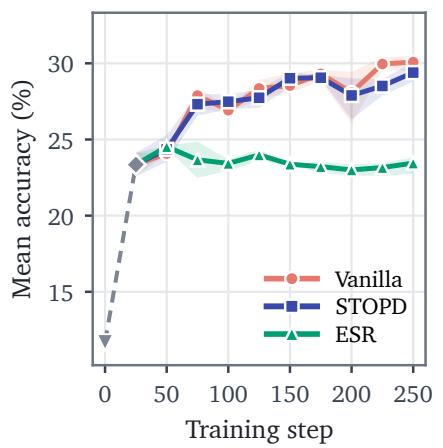

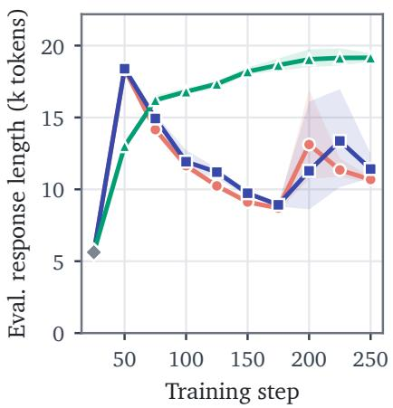

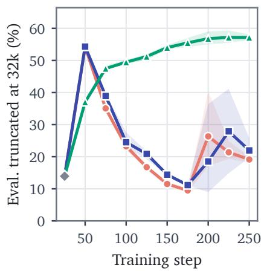  
Figure 12 | ESR in mathematics: accuracy (left), response length at evaluation (middle), and truncated share (right).

Early Stopping Rollout (ESR) [Zhou et al., 2026] truncates each rollout after its first 100 tokens, or at natural termination, and distills only that prefix. We evaluate ESR in the same mathematics setting as our main experiments (Figure 12). Accuracy every 25 steps is shown in Table 6 in Appendix D. The performance of ESR saturates after approximately 50 training steps, while STOPD and Vanilla continue increasing and outperform ESR by 5.9 and 6.6 points at step 250. ESR’s response length and truncation rate continue to increase throughout training, reaching approximately 20k tokens and 57% at step 250, while Vanilla and STOPD peak around step 50 before declining to approximately 10k tokens and 20%. This divergence arises from fixed-prefix distillation, which excludes end-of-sequence supervision whenever a response extends beyond the truncation boundary, weakening the student’s ability to terminate generation. In contrast, STOPD preserves termination supervision by including every token position with positive probability, closely matching Vanilla’s accuracy.

## G. Removing the Blockwise Inverse-Probability Weights

To isolate the efect of blockwise inverse-probability weighting, we set $w _ { t } = 1$ in STOPD and evaluate it in two mathematics settings: 1.7B and 4B students with Qwen3-4B-Instruct-2507 and Qwen3-30B-A3B-Instruct-2507 teachers, respectively (Figure 13). Accuracy every 25 steps is shown in Table 7 in Appendix D. The $w _ { t } = 1$ variant maintains accuracy close to Vanilla and STOPD throughout training for both students. Its evaluation responses are initially longer and more frequently truncated than

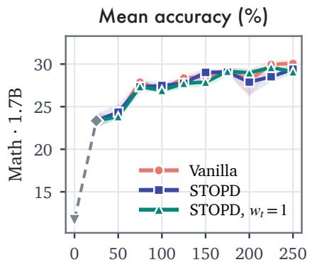

Eval. response length (k tokens)  
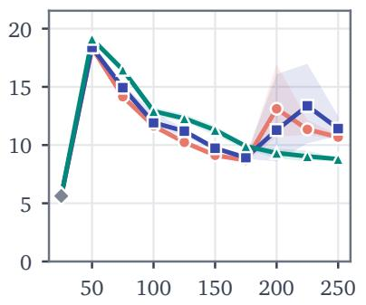

Eval. truncated at 32k (%)  
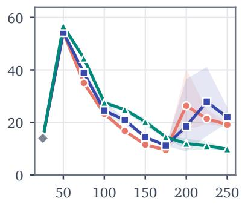

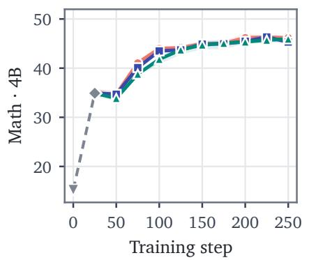

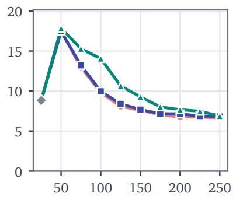

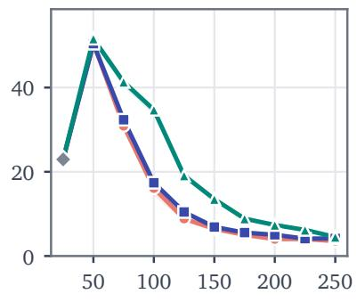  
Figure 13 | STOPD with every weight set to $w _ { t } = 1 _ { : }$ , in mathematics with the 1.7B student (top) and the 4B student (bottom): accuracy (left), response length at evaluation (middle), and truncated share (right).

Vanilla’s, but both diferences decrease over training. For the 4B student, responses are 43% longer at step 100, with a truncation rate of 34.7% compared with 16.1% for Vanilla. By step 250, the response-length gap narrows to 3.6%. For the 1.7B student, responses are 4%–24% longer over steps 50–175. In comparison, STOPD stays closer to Vanilla’s response length, within 6% for the 4B student and 10% for the 1.7B student over steps 50–175. Compared with ESR, whose response length and truncation rate continue to increase, random block-end truncation with $w _ { t } = 1$ maintains accuracy close to Vanilla, while blockwise weighting further aligns response length and truncation behavior with Vanilla.

## H. Per-Benchmark Accuracy

Figures 14–26 break the average accuracy of Sections 5.1–5.5 and Appendices F and G into their benchmarks, against training step: the base model sits at step 0 and the shared warmup checkpoint at step 25, and each point averages the three seeds with the range across seeds shaded.

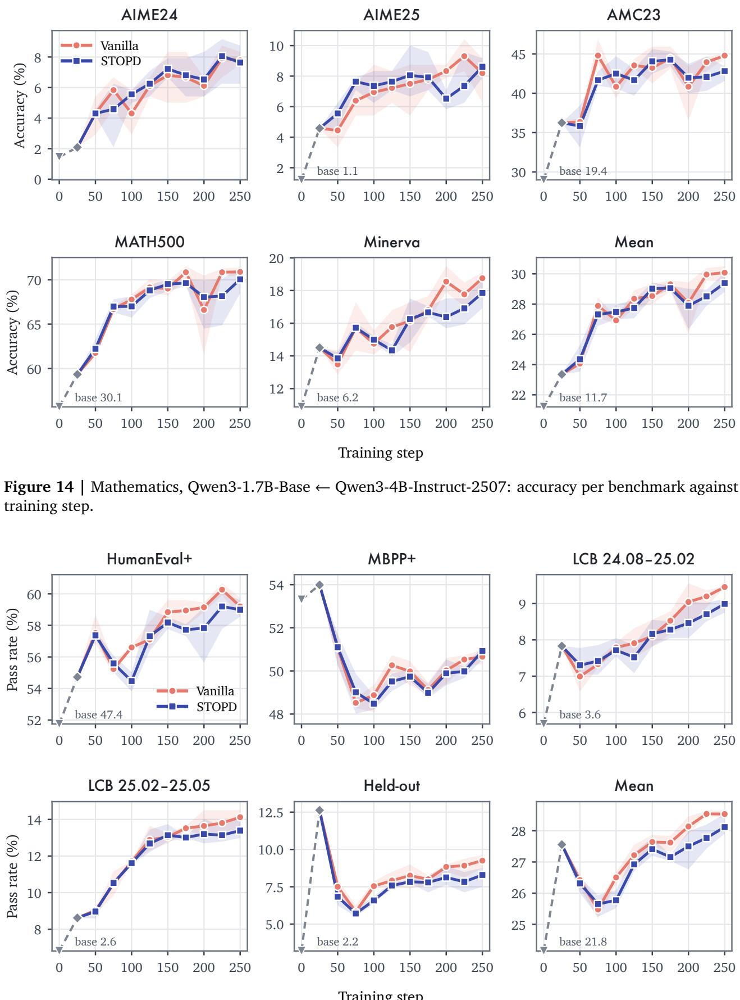  
Figure 15 | Code, Qwen3-1.7B-Base ← Qwen3-4B-Instruct-2507: pass rate per benchmark against training step.

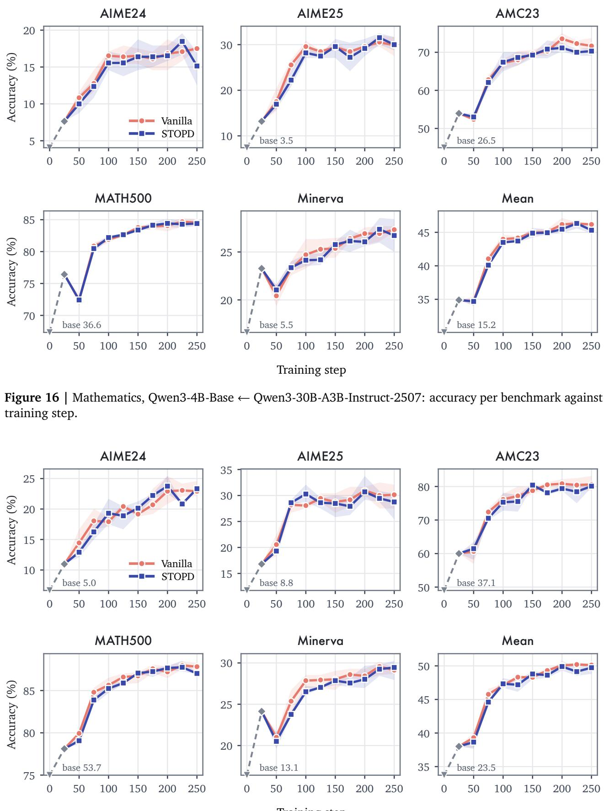  
Figure 17 | Mathematics, Qwen3-8B-Base ← Qwen3-30B-A3B-Instruct-2507: accuracy per benchmark against training step.

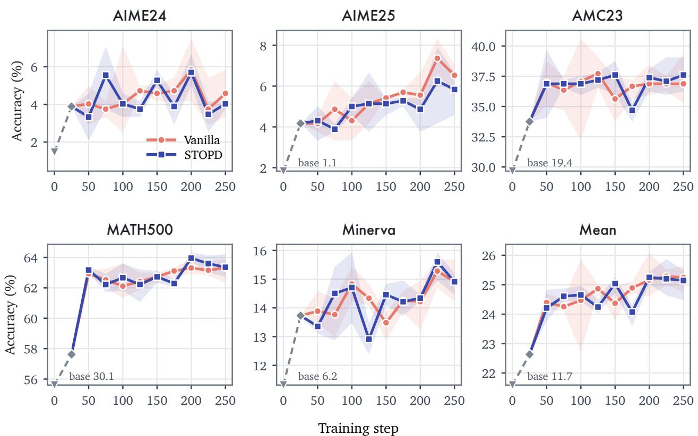  
Figure 18 | Mathematics under SGD, Qwen3-1.7B-Base ← Qwen3-4B-Instruct-2507: accuracy per benchmark against training step.

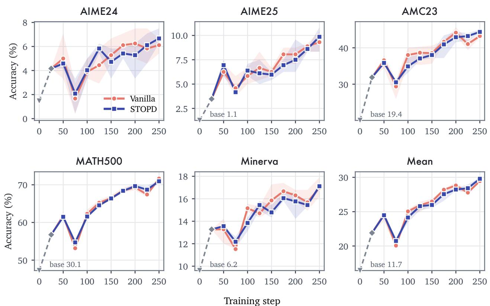  
Figure 19 | Mathematics under Muon, Qwen3-1.7B-Base ← Qwen3-4B-Instruct-2507: accuracy per benchmark against training step.

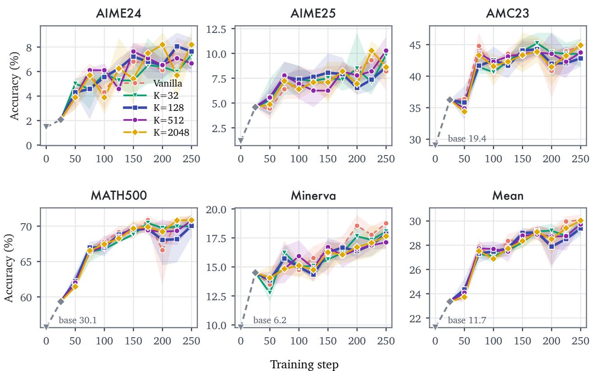  
Figure 20 | Block width in mathematics, Qwen3-1.7B-Base ← Qwen3-4B-Instruct-2507: accuracy per benchmark against training step.

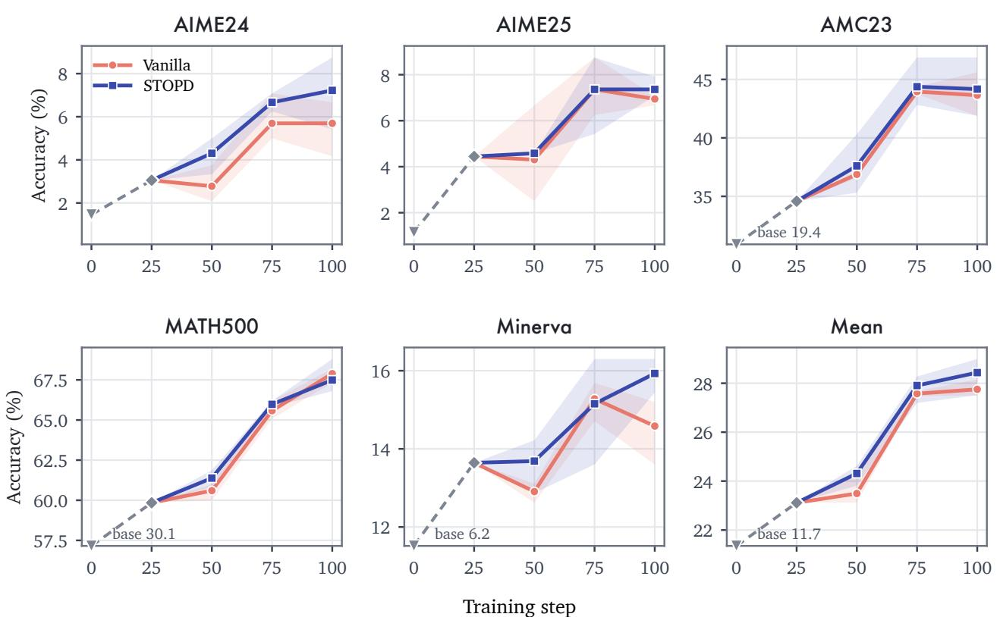  
Figure 21 | Mathematics at � = 128, Qwen3-1.7B-Base ← Qwen3-4B-Instruct-2507: accuracy per benchmark against training step.

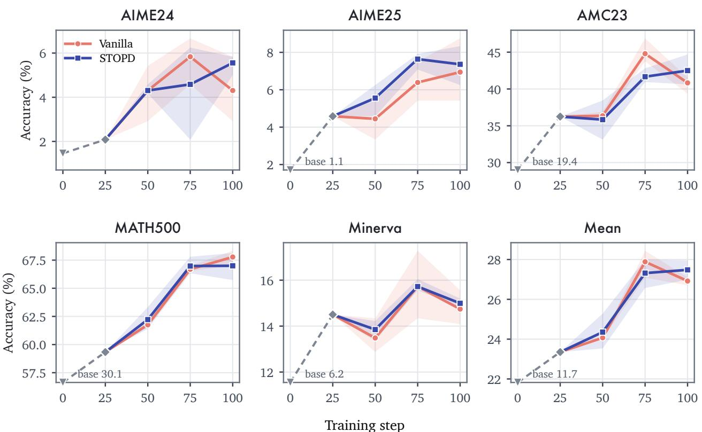  
Figure 22 | Mathematics at � = 256, Qwen3-1.7B-Base ← Qwen3-4B-Instruct-2507: accuracy per benchmark against training step.

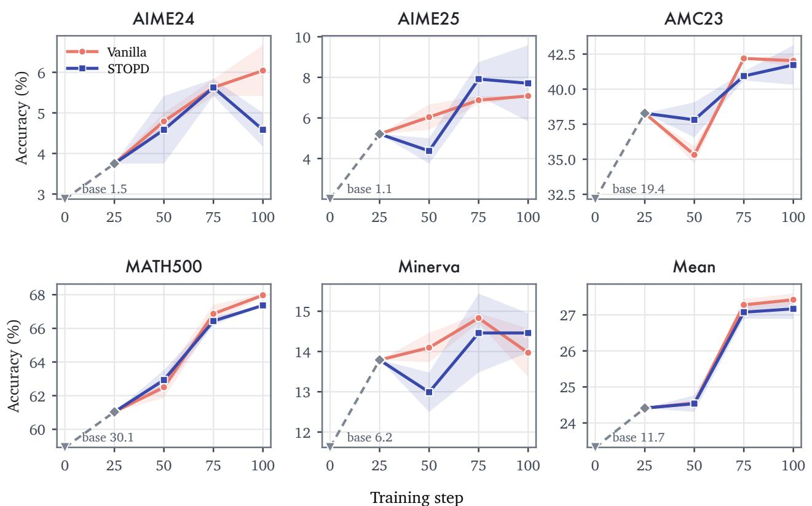  
Figure 23 | Mathematics at � = 512, Qwen3-1.7B-Base ← Qwen3-4B-Instruct-2507: accuracy per benchmark against training step.

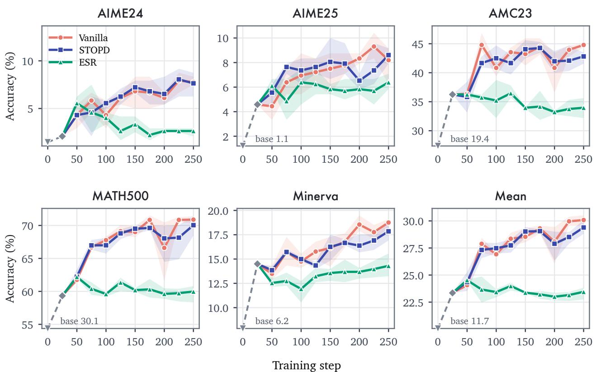  
Figure 24 | ESR in mathematics, Qwen3-1.7B-Base ← Qwen3-4B-Instruct-2507: accuracy per benchmark against training step.

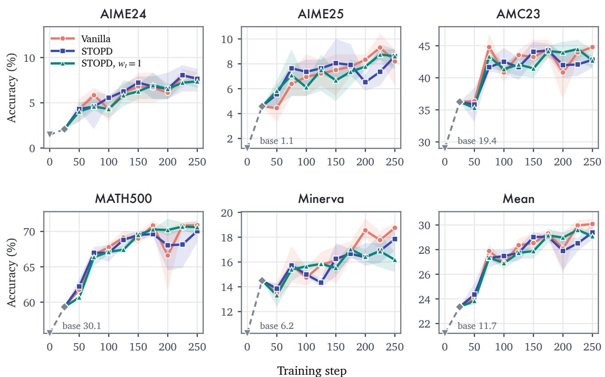  
Figure 25 | STOPD with $w _ { t } = 1$ in mathematics, Qwen3-1.7B-Base ← Qwen3-4B-Instruct-2507: accuracy per benchmark against training step.

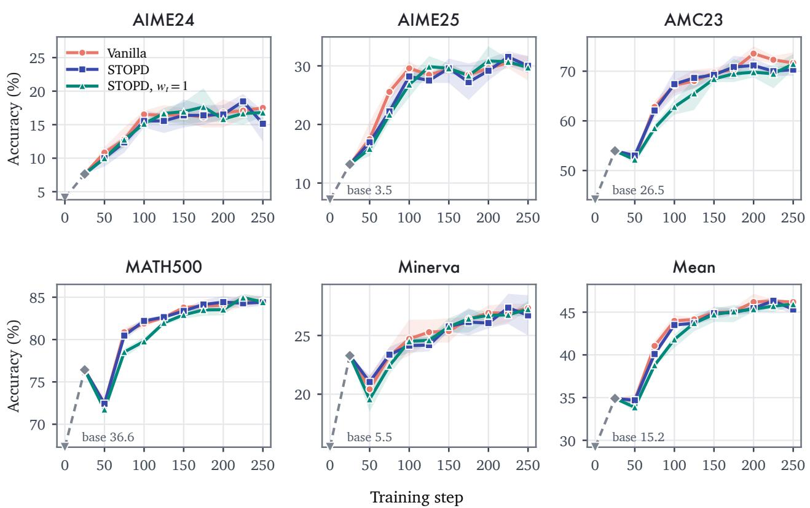  
Figure 26 | STOPD with $w _ { t } = 1$ in mathematics, Qwen3-4B-Base ← Qwen3-30B-A3B-Instruct-2507: accuracy per benchmark against training step.