# ETH: Data-Balanced Heterogeneous Pipeline Parallelism for Training Large Models

Mianjie Yu1, Zhongmin Zhao1, Zizhao Mo1,2,\*, Jianxiong Liao3, Wenxuan Li1, Yulin Qiao1 Huanle Xu1,†, Wenquan Yang4, Yongqiang Yang4, Zeren Li4, Ruifeng Tang4, Chengzhong Xu1,†

1University of Macau 2Great Bay University 3Sun Yat-sen University 4Independent Researchers

## Abstract

Current heterogeneity-aware training systems for large models balance workloads by assigning unequal numbers of layers across pipeline stages—a strategy aimed at equalizing execution time through a unique pipeline configuration. However, this approach fails to address critical memory constraints and suffers from inherently coarse balancing granularity.

In this paper, we propose Heterogeneous Pipeline Parallelism (HPP), a novel approach enabling efficient and finegrained data balance across heterogeneous pipelines. To address HPP’s key challenges—prohibitive search overhead for optimal configurations and high communication overhead from asymmetric All-Reduce—we design the ETH training system. ETH employs a hierarchical workload balance frame work that jointly optimizes balance across heterogeneous pipelines and within individual pipeline stages. To mitigate asymmetric communication costs, ETH implements blockwise gradient aggregation. Furthermore, it integrates specialized optimizations that dramatically reduce HPP configuration search overhead. Evaluations demonstrate ETH achieves up to 2× training speedup while reducing configuration generation overhead by up to 56× compared to state-of-the-art systems. The code is available at https://github.com/YuMJie/ETH.

## 1 Introduction

Training large-scale models [1–3, 12, 14, 40, 58] on massive datasets requires extensive parallelism across numerous accelerators. Selecting optimal parallelism configurations is critical, as distribution strategies significantly impact training efficiency. Meanwhile, accelerator hardware advances rapidly but at increasing cost [44], creating economic and practical challenges: the exclusive use of cutting-edge accelerators leaves older hardware underutilized, inflating costs and reducing resource efficiency. Supply constraints further limit the availability of the latest accelerators for large-scale training [49]. Consequently, effectively leveraging heterogeneous accelerators has become essential for scalable and cost-efficient large model training.

Several heterogeneity-aware training systems have been proposed, including SDPipe [29], AMP [25], Asteroid [59], HexiScale [57], and Metis [51]. These systems primarily balance workloads through pipeline parallelism (PP) by assigning different numbers of layers to stages while maintaining unique pipeline configurations as demonstrated in Fig. 1(a). Although this approach permits stages to employ distinct parallelization strategies such as tensor parallelism (TP) or data parallelism (DP), our analysis reveals significant device underutilization in heterogeneous clusters. Specifically, computation latency varies substantially across devices—with the slowest device taking up to 1.92× longer than others (detailed in § 2.2). This imbalance severely degrades training efficiency, as the synchronized nature of distributed training forces all devices to wait for the slowest one to complete computation.

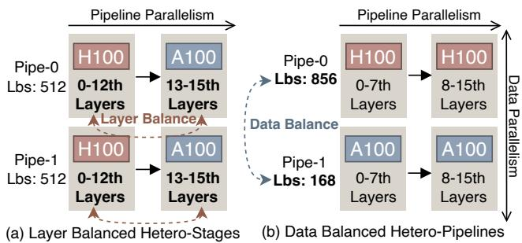  
Figure 1: Layer-balancing versus data-balancing.

Our analysis identifies the root cause of device underutilization: workload balancing via layer partitioning inherently struggles with memory and granularity constraints, making an optimal balance across heterogeneous devices difficult to achieve. First, implementing layer balancing—where in more computational layers are allocated to high-power devices to optimize throughput—inevitably increases memory overhead. Ideally, layer balancing achieves optimal resource utilization when the disparity in computational capability across heterogeneous devices aligns with the disparity in their memory capacities. However, recent hardware trends exhibit a pronounced imbalance between the growth of compute and memory: over the past five years, computation power has increased by approximately 16×, whereas memory capacity has grown by less than 5×. This divergence results in a fundamental mismatch between compute capability and memory capacity in modern accelerators. For instance, Ascend 910B2 roughly 1.2× higher computational throughput than 910B3 while offering the same memory capacity. As a consequence, conventional layer-balancing strategies fail to fully utilize the computational potential of high-performed but memoryconstrained devices, leaving up to 32% of their computation power idle, as demonstrated in § 2.2. Second, the limited number of model layers leads to inherently coarse-grained workload distribution across devices. For example, training GPT3-13B model requires approximately 64 devices using 8-way pipeline parallelism (PP), where each pipeline stage is assigned only 5 layers. Under such a configuration, adding or removing a single layer changes the per-device workload by 20%. As a result, this coarse-grained layer assignment makes it difficult to achieve fine-grained workload balance, introducing an additional 16% pipeline bubbles in PP (§ 2.2).

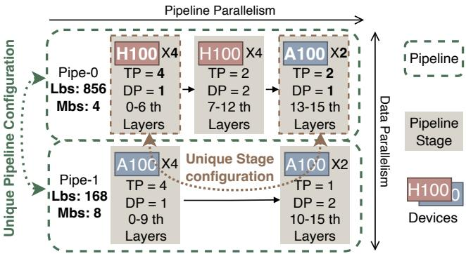  
Figure 2: An example of HPP configuration. HPP not only supports the training configuration with independent pipelines that have different local batch size, micro-batch size, but also supports the unique stage configurations that have different devices, layers and parallelism strategies.

Fortunately, we observe that data balancing is more effective than layer balancing for harnessing heterogeneous devices. As illustrated in Fig. 1, by exploiting the large global batch size commonly used in training, data balancing partitions the global batch into uneven local batches across pipelines to achieve finer-grained workload assignment, thereby effectively improving the resource utilization. This approach eliminates the need to align memory capacity with computational throughput across heterogeneous devices, since memory consumption is determined solely by the micro-batch size within each pipeline. To realize this idea, we propose a novel heterogeneous training paradigm—databalanced heterogeneous pipeline parallelism (HPP), which exposes a broader space of independently configured heterogeneous pipelines and local-batch allocations. This paradigm employs multiple independent, heterogeneous pipelines for data parallel training, with each pipeline assigned distinct local batch sizes to balance workloads and equalize the ending time, as shown in Fig. 2. Within each pipeline, different stages may adopt distinct DP/TP configurations, while workload balance is achieved through appropriate layer assignment.

However, efficiently training large-scale models using HPP presents significant challenges. First, HPP enables independent pipelines to adopt distinct parallelization strategies, introducing a new optimization dimension beyond existing training systems. The combinatorial explosion of heterogeneouspipeline configurations, coupled with the complexity of balancing stages within each pipeline, yields a extremely huge search space. Exploring this space for optimal configurations incurs prohibitively long optimization times, even exceeding model training duration. Second, HPP introduces asymmetric All-Reduce requirements, which increase communication overhead. Specifically, devices sharing the same model parameters must perform gradient All-Reduce to ensure correct parameter updates. However, these gradients may reside at different memory addresses and have mismatched tensor sizes across devices due to heterogeneous pipeline configurations. Resolving these discrepancies requires additional padding and multi-stream synchronization to ensure address and size consistency, creating a bottleneck that significantly degrades communication performance as illustrated in § 3.

This paper proposes ETH, a heterogeneity-aware system built upon HPP with high efficiency on heterogeneous clusters. ETH incorporates a joint workload balancing framework that optimizes configurations at two levels: dynamically adjusting local batch sizes across pipelines while rebalancing stage workloads within each pipeline using these updated batch sizes to derive optimal configurations. To minimize communication overhead, ETH implements block-wise gradient aggregation, eliminating address/size inconsistencies through gradient partitioning and combining, while merging gradients within communication groups for optimized stream scheduling. For configuration search acceleration, ETH employs pipeline caching to avoid redundant computations, throughput prediction to early skip searching lowperformance device groups, priority-based search ordering to evaluate high-throughput candidate device groups first, and dynamic programming to reduce device group combinations.

We implement ETH by extending Megatron-LM [45]—and conduct comprehensive experiments across diverse accelerators and scales. Our evaluation shows that ETH achieves up to 2× faster training and reduces the configuration generation time by up to 56× compared to exisiting training systems.

## 2 Background and Motivation

## 2.1 Distributing Training Parallelism

Pipeline parallelism (PP). PP partitions model layers into sequential stages—each comprising consecutive layers—and assigns these stages to accelerator groups. Existing PP methods optimize accelerator utilization by processing micro-batches in pipeline [16, 36, 37]. This approach splits minibatches into multiple micro-batches whose execution is orchestrated through the pipeline stages. Larger micro-batch size brings higher throughput but incurs higher memory overhead.

Data parallelism (DP). DP allows each accelerator to execute identical model layers on disjoint subsets of the input data [6, 65]. The size of each subset, referred to as the local batch size, influences execution time but not memory consumption, as it determines the number of micro-batches, whereas memory usage is mainly governed by the micro-batch size.

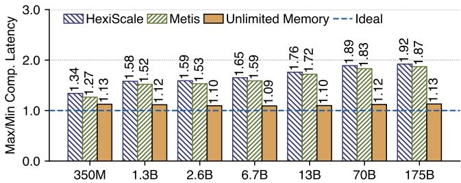  
Figure 3: The latency gap under different layer balancing methods across various models. We compare maximum-tominimum device execution latency ratios for four approaches: a) HexiScale’s layer-balancing (HexiScale), b) Metis’ layerbalancing (Metis), c) Metis without memory constraints (Unlimited Memory), and d) ideal balance (Ideal).

Tensor parallelism (TP). TP provides a complementary strategy for computational scaling within accelerator groups. Unlike DP’s data-level partitioning, TP splits layer weights and computations into non-overlapping tensors [39, 45], distributing these across a TP group. Each accelerator processes assigned tensors for every split layer while performing synchronous communication with other group members.

## 2.2 Limitations of Existing Works

While several systems [25, 29, 51, 57, 59] address heterogeneous training, their workload balancing strategy primarily relies on varying the number of layers assigned to pipeline stages to equalize stage execution times. Notably, Metis [51] supports distinct stage parallelization strategies—DP, TP, or hybrids—but still balances execution time by assigning dif ferent layer counts across stages. Although HexiScale [57] can search over multiple pipelines, it focuses solely on balancing workload within each pipeline by adjusting layer assignments. Consequently, the balancing mechanism across these approaches relies on layer balancing: distributing layers unevenly across pipeline stages to balanced execution times.

However, this balancing mechanism faces fundamental limitations in both granularity and memory impact: (1) The inherently limited number of layers constrains balancing precision due to coarse granularity; (2) more critically, layer allocation dictates device memory consumption (parameters, gradients, optimizer states), which can trigger recomputation when exceeding hardware limits—paradoxically exacerbating imbalance. Our experiments on Ascend 910B2/910B3 heterogeneous clusters (model configurations in Tab. 2) illustrate these constraints through Fig. 3, which compares maximum-to-minimum device execution latency ratios for four approaches: (a) HexiScale’s layer-balancing (HexiScale), (b) Metis’ layer-balancing (Metis), and to demonstrate the impact of memory on layer balance, we add (c) Metis without memory constraints (Unlimited Memory) and add (d) ideal balance (Ideal) to demonstrate the coarse granularity of layer balance. Two key trends emerge. First, latency ratios for HexiScale and Metis layer-balancing increase significantly with model size—rising from 1.34 and 1.27 at 350M to 1.92 and 1.87 at 175B, respectively, causing in up to 32% computation power idle—while the unlimited-memory ratio remains stable between 1.09 and 1.13. This shows that memory bottlenecks progressively undermine balance efficacy as models scale. Second, even without memory constraints, a persistent gap from ideal balance remains: unlimited-memory latency ratios exceed the ideal ratio by 9–13%, resulting in 16% additional pipeline bubbles. This gap is attributed to the coarse granularity of layer-based strategies, which cannot eliminate inherent latency disparities across pipeline stages.

## 2.3 Opportunities

Data balancing across heterogeneous pipelines significantly outperforms existing layer-balancing methods. This presents a strong opportunity to accelerate LLM training.

Data balancing improves workload balance in heterogeneous training. To illustrate this advantage, we conduct a controlled study on heterogeneous B2/B3 devices by varying the memory-compute mismatch rate through the available memory of B2, defined as the memory ratio divided by the compute ratio between heterogeneous devices. In this study, the global batch size is set equal to the number of layers. We compare data balancing with Metis’ layer-balancing strategy using the maximum-to-minimum computation latency ratio in GPT3-13B, where a value closer to 1 indicates better balance. As shown in Fig. 4a, layer balancing degrades markedly as the mismatch rate increases, with the latency ratio rising from 1.11 to 1.87 as the mismatch rate grows from 1.0 to 1.9. In contrast, data balancing remains stable (1.09 to 1.17) across all settings. These results show that data balancing remains effective even under severe memory-compute mismatch and largely removes the need to align memory capacity with computational throughput across heterogeneous devices.

Moreover, the effectiveness of data balancing scales with global batch size, as larger values enable finer workload granularity. To demonstrate data balancing’s applicability in practical training scenarios, we analyze global batch configurations from DeepSeek [7–9]. As shown in Fig. 4b, global batch sizes substantially exceed layer counts. In the most extreme case (DeepSeekV3), the batch size exceeds layer count by ≥251×. Even the smallest disparity (V1-67B) maintains a ≥48× ratio. This exceptionally fine granularity enables data balancing to achieve higher load distribution efficiency than layer balancing. Consequently, by configuring different local and micro-batch sizes across pipelines, data balancing supports more flexible workload balancing.

## 3 Data-Balanced Heterogeneous Pipeline Parallelism and Challenges

Motivated by this observation, we propose a novel heterogeneous training paradigm—data-balanced heterogeneous pipeline parallelism (HPP). Our paradigm employs multiple independent heterogeneous pipelines for data parallel training and supports flexible training strategies. As in the HPP example shown in Fig. 2, within each pipeline, different stages can use different DP/TP while balancing workloads through layer counts. For each pipeline, HPP uses distinct local batch sizes to balance workloads between pipelines by equaling ending time. HPP enables effective data balancing across heterogeneous pipelines, significantly outperforming existing layerbalancing methods. This presents a strong opportunity to accelerate LLM training, but requires solving new challenges in pipeline generation and communication mechanisms:

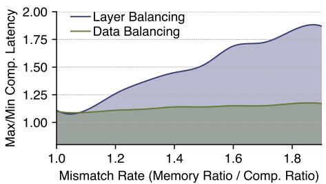

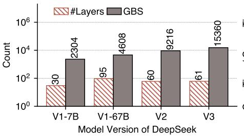

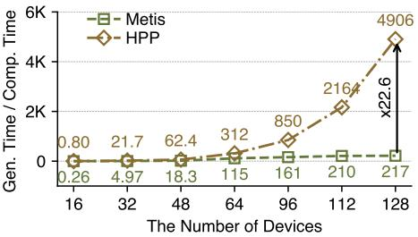  
(a) The latency gap of layer balancing and data (b) The number of layers and global batch size (c) Configuration generation overhead across balancing parallelism approaches settings across different models different scales (GPT3-13B)  
Figure 4: The advantage of data balance and the high search overhead for HPP.

Challenge 1: The vast search space for an optimal databalanced HPP. Exhaustive search over the HPP configuration space is prohibitively expensive. Unlike conventional heterogeneous parallelism—which optimizes layer balancing within a unique pipeline—HPP requires configuring heterogeneous independent pipelines with distinct parallelization strategies, drastically expanding the search space. We quantify search overhead relative to iteration time for both Metis’s layer balancing and data-balanced HPP running GPT3-13B training on 910B2/B4 heterogeneous clusters. As Fig. 4c demonstrates, the search costs of the optimal HPP configu ration substantially exceed the training overhead reduction achieved through HPP. Moreover, this imbalance escalates with scale: as the number of devices increases, configuration generation time grows superlinearly relative to training time. For data-balanced HPP, the generation-to-computation ratio ranges from 0.8 to 4905—representing a 3-22× increase over layer-balancing schemes. Overall, this prohibitive overhead critically undermines HPP’s scalability in practice.

Challenge 2: High communication overhead of asymmetric All-Reduce. In data parallelism, devices replicate a portion of the model parameters. We refer to devices sharing duplicated parameters as a DP group. Before updating model parameters, the devices of each DP group synchronizes gradients via All-Reduce collective operation. In layerbalanced configurations, this All-Reduce is straightforward because all devices in the DP group hold identical parameters. However, in data-balanced HPP systems—where devices use different parallelism strategies across heterogeneous pipelines—devices of the same DP group may store non identical parameters. Consequently, the address and size of the gradients requiring synchronization become inconsistent.

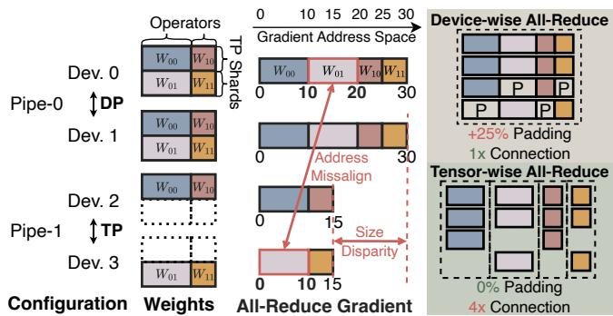  
Figure 5: Asymmetric All-Reduce across four devices. Device-wise All-Reduce pads the missing gradient to ensure consistency, but brings the padding overhead. Tensor-wise All-Reduce splits the gradient by operator tensor.

As shown in Fig. 5, we demonstrate a two-pipeline configuration. The first pipeline (Devices 0 and 1) employs DP, while the second pipeline (Devices 2 and 3) uses TP. Despite sharing duplicated weights requiring gradient synchronization via All-Reduce, direct synchronization is prevented by two inconsistencies: 1) Address misalignment: TP partitioning in Devices 2 and 3 results in partial weight maintenance. This causes gradient addressing mismatches—for example, layer 0’s first operator gradients (Light purple) occupy addresses 0-10 on Device 3 versus 10-20 on Device 0’s memory space. 2) Size disparity: All-Reduce operations require uniform gradient dimensions, yet DP devices (Devices 0 and 1) produce 30-element gradients while TP devices (Devices 2 and 3) generate 15-element gradients. The device-wise padding approach is the simplest solution for gradient inconsistencies, ensuring alignment and size uniformity through missing gradient padding. However, this introduces significant communication and memory overhead from redundant data. While tensor-wise All-Reduce reduces memory overhead by splitting gradients at smallest tensor granularity, it incurs excessive communication overhead by establishing separate All-Reduce connections per tensor—creating inefficient multi-stream bottlenecks. This trade-off necessitates a coarse-grained synchronization approach that optimizes asymmetric communication to reduce HPP overhead while enabling large-scale training.

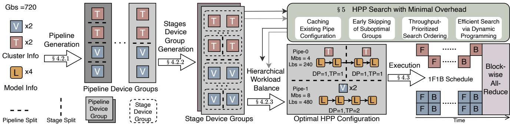  
Figure 6: Overview of ETH system.

## 4 System Design

This section presents the system architecture of ETH, a framework specifically designed to address the critical challenges of HPP in both of generation and communication.

## 4.1 System Overview

Fig. 6 illustrates ETH’s complete architecture and workflow. The process involves generating heterogeneous pipelines (§ 4.2.1), creating stage-device groups (§ 4.2.2), and hierarchical workload balancing (§ 4.2.3). After selecting configurations, ETH executes pipelines independently. Upon backward pass completion, ETH performs gradient synchronization via block-wise All-Reduce (§ 4.3). ETH addresses high generation costs through several optimizations that reduce search overhead (§ 5), including: configuration caching, early skipping of suboptimal groups, throughput-prioritized search ordering, and dynamic programming.

## 4.2 Configuration of Heterogeneous Pipelines

## 4.2.1 Pipeline generation

ETH generates all possible pipeline device group configurations for heterogeneous accelerators, ensuring each configuration is unique in terms of execution time. The process works as follows: ETH first iterates over the possible number of pipelines, ranging from 1 (all devices in one pipeline) to N (each device in its own separate pipeline). For each pipeline count, ETH generates distinct groupings of devices. Crucially, pipelines are considered unordered sets; only the composition matters, not their sequence. Therefore, config urations like [⟨V,V⟩, ⟨T, T⟩] and [⟨T, T⟩, ⟨V,V⟩] represent the same pipeline device group. Example: Given two V-type and two T-type accelerators, ETH generates configurations ranging from a single pipeline $[ \langle V , V , T , T \rangle ]$ to the maximum split [⟨V⟩, ⟨V⟩, ⟨T⟩, ⟨T⟩], along with intermediate groupings like $[ \langle V , V \rangle , \langle T , T \rangle ]$ (but only once, due to unordered pipelines).

## 4.2.2 Stage device groups

After generating pipeline device groups, ETH creates stage device groups for each pipeline within a pipeline device group.

For a pipeline represented as ⟨V,V, T, T⟩, ETH generates stage device groups ranging from one stage[{V,V,T,T}] to four stages $[ \{ V \} , \{ V \} , \{ T \} , \{ T \} ]$ , with [, ] denoting a stage device group and $\{ , \}$ denoting an individual stage; crucially, stage ordering matters as $[ \{ V , V \} , \{ T , T \} ]$ and $[ \{ T , T \} , \{ V , V \} ]$ represent distinct partitions: the former places both V-type accelerators in the first stage and T-types in the second, while the latter reverses this arrangement. Since activation overhead is higher in earlier stages under the 1F1B pipeline schedule [11, 36], ETH distinguishes these ordered configurations.

## 4.2.3 Hierarchical workload balance

After generating stage device groups, ETH searches for efficient pipeline configurations and balances workloads across pipelines. The search selects each stage’s TP/DP degrees, layer count, and recomputation operations, together with each pipeline’s micro-batch and local batch sizes. These choices are interdependent: changing a pipeline’s local batch size can change its preferred stage configuration and execution time.

ETH uses a three-phase heuristic to address this dependency. It first optimizes stage configurations with each pipeline’s local batch size initialized to the global batch size, then allocates local batches across pipelines, and finally refines stage configurations using the assigned local batches. This procedure seeks low predicted iteration time; it does not guarantee a globally optimal joint configuration.

Stage configuration search. During stage workload balancing, ETH seeks to reduce pipeline latency for a given global batch size (Gbs) by determining the degree of TP (t p), DP (d p), the number of layers (l), recomputation operators (ro) for each stage and micro-batch size (MBS). ETH’s stagespecific recomputation reduces memory overhead through finer granularity. The total latency combines: 1) the summed stage execution times $\Sigma _ { j } T _ { j }$ for the first micro-batch, and 2) the slowest stage’s latency maxj Tj multiplied by remaining micro-batches (Gbs/Mbs − 1). The stage-level optimization objective is:

$$
\operatorname* { m i n } _ { \{ t p , d p , r o , l , \mathrm { M b s } \} } \left[ \sum _ { j } T _ { j } + \operatorname* { m a x } _ { j } T _ { j } \cdot \left( \frac { \mathrm { G b s } } { \mathrm { M b s } } - 1 \right) \right] ,\tag{1}
$$

where $T _ { j }$ denotes the latency of $j \cdot$ th stage . ETH builds on the stage-optimization primitives of Aceso [26], which searches parallel configurations for homogeneous clusters. Aceso uses latency and memory estimates to identify stage bottlenecks, then iteratively adjusts operator placement, devices count, micro-batch size, and stage-specific recomputation to alleviate these bottlenecks until performance no longer improve.

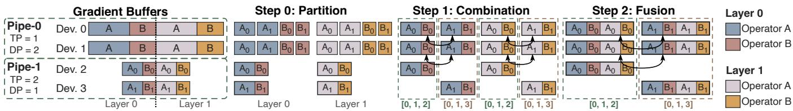  
Figure 7: The workflow of Block-wise All-Reduce. ETH ensures address consistency and size consistency through partition and combination, then reduce the connections by merging the gradient block which belong to the same communication group.

ETH adapts these operations to heterogeneous stage device groups. For a latency bottleneck, it moves operators to a lessloaded stage, increases DP while decreasing TP, or increases the micro-batch size. For a memory bottleneck, it moves operators to a lower-memory stage, increases TP while decreasing DP, reduces the micro-batch size, or enables recomputation.

Local batch allocation. With stage configurations initialized, ETH assigns distinct local batch sizes to balance workloads across pipelines. Consider a device group comprising P pipelines, where the i-th pipeline employs micro-batch size Mbs . The objective is to choose local batch sizes Lbs that minimize the maximum completion time across all stages and pipelines. The optimization problem is formulated as follows:

$$
\operatorname* { m i n } _ { \{ \mathrm { L b s } _ { i } \} } \left[ \operatorname* { m a x } _ { i \in [ 1 , P ] } \left( \operatorname* { m a x } _ { j \in [ 1 , S _ { i } ] } T e _ { i } ^ { j } \right) \right]\tag{2}
$$

$$
{ \mathrm { s u b j e c t ~ t o ~ } } \sum _ { i = 1 } ^ { P } { \mathrm { L b s } } _ { i } \geq { \mathrm { G b s } } ,\tag{3}
$$

$$
\operatorname { L b s } _ { i } { \mathrm { ~ m o d ~ M b s } } _ { i } = 0 , \quad \forall i \in [ 1 , P ] .\tag{4}
$$

Here $S _ { i }$ denotes the number of stages in the i-th pipeline. The time $T e _ { i } ^ { j }$ for stage j in pipeline i combines four components: the summed forward times for the first micro-batch $\textstyle ( \sum _ { k = 1 } ^ { S _ { i } } T f _ { i } ^ { k } )$ , the slowest stage latency scaled by remaining micro-batches (maxk $T _ { i } ^ { k } \cdot ( \mathrm { L b s } _ { i } / \mathrm { M b s } _ { i } - 1 ) )$ ), the summed backward times from stage j to the final stage for the last microbatch $( \sum _ { k = j } ^ { S _ { i } } T b _ { i } ^ { k } )$ , and the All-Reduce overhead $( A R _ { i } ^ { j } )$

$$
T e _ { i } ^ { j } = \sum _ { k = 1 } ^ { S _ { i } } T f _ { i } ^ { k } + \operatorname* { m a x } _ { k \in \left[ 1 , S _ { i } \right] } T _ { i } ^ { k } \cdot \left( { \frac { { \mathrm { L b s } } _ { i } } { { \mathrm { M b s } } _ { i } } } - 1 \right) + \sum _ { k = j } ^ { S _ { i } } T b _ { i } ^ { k } + A R _ { i } ^ { j } .\tag{5}
$$

The per-micro-batch timings $T _ { j _ { i } } { \mathrm { { ^ { k } } } }$ (forward), $T b _ { i } ^ { k }$ (backward), and $\bar { T } _ { i } ^ { k }$ (combined forward-backward) for stage k in pipeline i are obtained through system profiling. The All-Reduce overhead $A R _ { i } ^ { j }$ depends on gradient size $\mathrm { G r a } _ { i } ^ { j } .$ , number of communicating devices $N _ { i } ^ { j }$ , and available bandwidth $B W _ { i } ^ { j }$

$$
A R _ { i } ^ { j } = \frac { 2 \cdot \mathbf { G r a } _ { i } ^ { j } \cdot ( N _ { i } ^ { j } - 1 ) } { N _ { i } ^ { j } \cdot B W _ { i } ^ { j } } .\tag{6}
$$

This formulation captures communication costs during gradient synchronization between pipeline stages.

ETH uses a greedy allocation procedure for the objective in Eq. (2). The algorithm initializes $\mathrm { L b s } _ { i } = 0$ for all pipelines. It then proceeds iteratively: In each iteration, ETH identifies the pipeline where incrementing Lbsi by Mbsi (satisfying Constraint (4)) would yield the smallest increase in the maximum end time across all pipelines. The selected pipeline’s local batch size is increased by its micro-batch size, while other pipelines’ batch sizes remain unchanged. This process repeats until the aggregate local batch size satisfies Constraint (3).

Stage configuration refinement. Changing local batch sizes also changes the stage-level optimization objective. The initial stage configurations derived in Eq. (1) were optimized for the global batch size rather than the newly assigned local batch sizes. To address this dependency, ETH refines each pipeline’s stage configuration by substituting the global batch size in Eq. (1) with its corresponding local batch size Lbsi.

## 4.3 Execution of Heterogeneous Pipelines

As highlighted in § 3, the HPP mechanism of ETH introduces two inconsistencies during gradient synchronization, which poses significant challenges for All-Reduce. Device-wise solutions incur extra memory and communication overhead due to additional padding, whereas tensor-wise All-Reduce requires a separate connection for each tensor shard on each device. This design creates inefficient multi-stream bottlenecks, especially because each GPT-3 layer contains 13 operators.

To address this challenge, ETH introduces block-wise All-Reduce, a method that reduces memory and communication overhead by operating at the block granularity. As illustrated in Fig. 7, ETH resolves the two inconsistencies through gradient partitioning and combination, ensuring all devices maintain block consistency with the device possessing the maximum TP degree (e.g., Devices 2 and 3 with TP = 2). ETH further employs block fusion to reduce the total number of blocks. During the initialization phase, each device establishes DP communication groups with devices sharing duplicated parameters across pipeline stages. Within each DP group, devices subsequently exchange information about their layer index range, rank in TP group and TP degree (t p). Utilizing the above information, each device identifies both the layer/TP block assignments of peer devices and the maxi mum TP degree $( t p _ { \operatorname* { m a x } } )$ within its DP communication group. ETH then executes gradient partitioning and combination to enforce block-wise consistency.

Partitioning: All devices first partition gradients layer by layer. Devices with a TP degree lower than $t p _ { \mathrm { m a x } }$ further partition their gradients along the operator and TP-shard dimensions, producing $t p _ { \mathrm { m a x } } .$ /(local TP degree) partitions for each operator. For example, Devices 0 & 1 with lower TP degrees, split their contiguous blue operator blocks into finer-grained partitions, yielding behavior equivalent to tensor-wise All-Reduce. In contrast, Devices 2 and 3, which operate at t pmax, partition gradients only once along the layer dimension.

Combination: During combination, blocks with lower TP degrees are aligned with those at the highest TP degree, while blocks already at the highest TP degree require no further operation. For example, on Devices 0 and 1, which have lower TP degrees, ETH first exchanges the $A _ { 1 }$ and $B _ { 0 }$ gradient blocks. It then merges the $A _ { 0 }$ and $B _ { 0 }$ gradients to match the state of Device 2, which has the highest TP degree. The combination stage ensures uniform All-Reduce block sizes and consistent memory addressing across all devices. Moreover, based on the layer assignments and TP blocks of each device, ETH ap pends DP communication group information to the combined gradient blocks for subsequent All-Reduce communication.

Fusion: Although partitioning and combination guarantee gradient consistency, we observe redundant DP communication groups in certain blocks (e.g., blocks 0 and 2 share identical DP group: Devices 0, 1, 2). To optimize, each device detects blocks that share the same DP group and merges them in layer order, further reducing All-Reduce operations.

## 5 HPP Search with Minimal Overhead

Searching the HPP configuration space is expensive for two reasons: stage optimization repeatedly solves identical pipeline subproblems, and the number of candidate pipeline combinations grows rapidly with cluster size. ETH addresses these costs through four complementary optimizations. Caching avoids repeated optimization of identical pipeline subproblems. Early skipping avoids fully evaluating device groups whose estimated throughput bounds fall below the best configuration found so far. Search ordering evaluates promising groups first, improving the effectiveness of early skipping. Finally, dynamic programming reuses overlapping partition results to reduce the cost of exploring pipeline combinations.

## 5.1 Caching Existing Pipeline Configurations

We observe that identical pipeline segments recur across generated device groups. For example, with two V-type and two T-type accelerators, ETH generates configurations like $[ \langle V , V \rangle , \langle T , T \rangle ]$ and $[ \langle V , V \rangle , \langle T \rangle , \langle T \rangle ]$ ]—both containing the $\langle V , V \rangle$ pipeline. ETH caches the best configurations found (including TP/DP degrees, layer count, recomputation operations per stage, and micro-batch size) during a pipeline’s first optimization. Subsequent occurrences of $\langle V , V \rangle$ in any device group then reuse this cached configuration directly.

## 5.2 Search via Early Skipping

Building on pipeline caching, ETH implements efficient pruning to eliminate unpromising configurations early in the search process. For each candidate pipeline device group, ETH computes a throughput upper bound for each pipeline using both deterministic and approximate methods, using the smaller value as the pruning estimate. If this total bound of all pipelines falls below the throughput of the best configuration found so far, ETH immediately skips further evaluation of the candidate pipeline device group.

The deterministic upper bound is derived as follows: if every device in pipeline $P _ { 1 }$ has a unique corresponding device in pipeline $P _ { 2 }$ with strictly greater memory capacity and computation power, then throughput $( P _ { 2 } )$ constitutes an upper bound for throughput $\left( P _ { 1 } \right)$ . To efficiently verify this relationship, ETH employs a bipartite graph algorithm. Given device sets $\mathcal { D } _ { 1 }$ for $P _ { 1 }$ and $\mathcal { D } _ { 2 }$ for $P _ { 2 }$ where $| \mathcal { D } _ { 1 } | \leq | \mathcal { D } _ { 2 } |$ |, we construct edges between $d _ { i } \in \mathcal { D } _ { 1 }$ and $d _ { j } \in \mathcal { D } _ { 2 }$ if and only if:

$$
\mathrm { m e m } ( d _ { j } ) > \mathrm { m e m } ( d _ { i } ) \land \mathrm { c o m p } ( d _ { j } ) > \mathrm { c o m p } ( d _ { i } ) .
$$

After building this bipartite graph, ETH applies the Hungarian algorithm to find the maximum matching. When the matching size equals $| \mathcal { D } _ { 1 } |$ , throughput $\left( P _ { 2 } \right)$ is confirmed as an upper bound for throughput $\left( P _ { 1 } \right)$

ETH estimates the approximate throughput upper bound for the candidate pipeline by benchmarking against similar pipelines stored in its cache. This approach leverages two critical hardware characteristics that impact pipeline performance: Higher computational capacity reduces computation time and directly increases throughput, while greater memory capacity enables both larger micro-batch sizes and reduced operator recomputation requirements, collectively improving pipeline efficiency. ETH estimates current pipeline’s throughput by multiplicative scaling: The cached pipeline’s throughput is scaled by both the computation power ratio (current to cached) and memory capacity ratio (current to cached), yielding what we term the approximate throughput. To accommodate potential estimation errors, this value is then multiplied by a configurable fault tolerance factor $\alpha \geq 1$ , producing the final approximate upper bound metric.

## 5.3 Optimization for the Search Order

Early identification of high-throughput configurations is essential for ETH’s efficiency, enabling aggressive skipping of suboptimal candidates during the search process. Our analysis reveals a key correlation: Pipeline device groups exhibiting lower computation power variance—both between pipelines $( V _ { i n t e r } )$ and within pipelines $( V _ { i n t r a } )$ —demonstrate higher probability of achieving superior throughput.

Formally, let $C o m _ { i } ^ { j }$ denote the computation power of the $j -$ th device in the i-th pipeline. ETH computes the inter-pipeline variance $V _ { i n t e r }$ as:

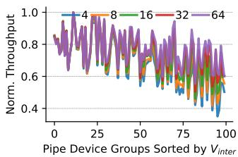

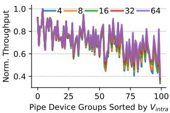  
(a) Throughput of optimal config-(b) Throughput of optimal configuration across $V _ { i n t e r }$ values at dif- uration across $V _ { i n t r a }$ values at different global batch sizes ferent layer counts

Figure 8: Throughput sensitivity of heterogeneous pipeline configurations to $V _ { i n t e r }$ and $V _ { i n t r a }$

$$
V _ { i n t e r } = \operatorname * { V a r } _ { i \in [ 1 , P ] } \left( \sum _ { j = 1 } ^ { N _ { i } } C o m _ { i } ^ { j } \right) ,\tag{7}
$$

where $N _ { i }$ represents the device count in pipeline i and P is the total pipeline count. The intra-pipeline variance $V _ { i n t r a }$ aggregates per-pipeline device variances:

$$
V _ { i n t r a } = \sum _ { i = 1 } ^ { P } \mathrm { V a r } _ { i } \left( C o m _ { i } ^ { j } \right) .\tag{8}
$$

To validate this relationship, we sampled the best configurations found for 100 randomly generated pipeline device groups across varying global batch sizes. Experiments are conducted on 910B2/B4 devices running GPT3-13B. Con figurations are sorted by ascending variance values, with corresponding throughput measurements plotted in Fig. 8a. The results confirm an inverse correlation: Throughput decreases as $V _ { i n t e r }$ increases. Furthermore, increasing the global batch size (Gbs) enhances configuration throughput, an effect particularly pronounced in configurations with high interpipeline variance $( V _ { i n t e r } )$ . Similarly, lower intra-pipeline variance $( V _ { i n t r a } )$ correlates strongly with improved throughput, as evidenced in Fig. 8b. However, this relationship exhibits layer-dependent attenuation: As model depth (L) increases, the impact of $V _ { i n t r a }$ on throughput progressively diminishes.

Motivated by these insights, we design a heuristic cost function to prioritize high-throughput pipeline device groups during configuration search. The function incorporates two normalized variance components:

$$
\mathrm { C o s t } = \frac { V _ { i n t e r } } { \mathrm { G b s } } + \frac { V _ { i n t r a } } { L } ,\tag{9}
$$

where Gbs denotes global batch size and L denotes the number of model layers. This formulation inherently favors configurations with: (1) balanced computation across pipelines and (2) homogeneous devices within pipelines. Finally, we can obtain the cost value of each pipeline device group, giving priority to the group with the lowest cost value among groups with same pipeline count to generate and evaluate.

## 5.4 Search via Dynamic Programming

In large-scale clusters with thousands of devices, techniques like pipeline caching and early skipping remain ineffective at substantially reducing search overhead. This limitation stems from the initial search overhead being primarily dominated by hierarchical workload balancing. Although pipeline caching and early skipping can optimize this balancing phase, they become insufficient as the search progresses. Once most viable pipeline configurations are cached, the fundamental bottleneck shifts to an exponential explosion in possible pipeline combinations. To address this combinatorial complexity at scale, ETH also incorporates a dynamic programming approach to search for efficient HPP configurations.

ETH initiates the search for efficient HPP configurations by processing the number of pipelines within each pipeline device group in ascending order. Given a cluster of n devices and a predetermined pipeline device group order (detailed in § 5.3), the configuration $R _ { p } ^ { n }$ with the highest estimated throughput for a candidate group with $p$ pipelines is determined by identifying a split point $i \in [ 1 , n - 1 ]$ that maximizes throughput. This optimization partitions the cluster so that the first i devices are distributed across $p - 1$ pipelines $( R _ { p - 1 } ^ { i } )$ while devices i + 1 through n form a single pipeline $( \mathrm { p i p e } _ { i + 1 } ^ { n } )$ The throughput transition equation of the dynamic programming formulation is:

$$
\mathrm { T p } ( R _ { p } ^ { n } ) = \operatorname* { m a x } _ { i \in [ 1 , n - 1 ] } \left[ \mathrm { T p } ( R _ { p - 1 } ^ { i } ) + \mathrm { T p } ( \mathrm { p i p e } _ { i + 1 } ^ { n } ) \right] ,\tag{10}
$$

where Tp(·) denotes throughput of a pipeline configuration.

After obtaining the HPP configuration via dynamic programming, ETH balances pipelines in configuration using data-balancing and refines each pipeline stage’s configuration for this HPP setup (§ 4.2.3). Notably, ETH continuously adjusts device arrangements across pipelines and triggers the dynamic programming search whenever early skipping efficiency becomes too low, continuing until all pipeline device groups are covered. For each fixed device ordering, the dynamic programming recurrence has a complexity of $O ( P N ^ { 2 } )$ , where P is the maximum number of pipelines and N is the total number of devices. As P is typically equal to N, the complexity is $O ( N ^ { 3 } )$ . Thus, ETH reduces the problem’s complexity from exponential to polynomial time.

## 6 System Implementation

We implemented ETH by adding approximately 9,000 lines of Python code to Megatron-LM [45]. Our modifications include rewriting the generator to leverage Aceso’s stage-specific operation recomputation to expand the search space, dynamically allocating different balancing times to stage device groups to control per-stage search cost, and enabling ZeRO-1 and ZeRO-2 for optimizer-state and gradient sharding [43].

Runtime and memory profiling. Before configuration search, ETH profiles the target model once on each accelerator type. For every candidate micro-batch size and TP degree, the profiler executes each operator type in the target model and records its forward and backward latency. It also benchmarks the collective and point-to-point communication operations over the message sizes and device links considered by the search. Under the same settings, the profiler records the parameter and activation sizes of each operator and the memory reserved by PyTorch.

Table 1: The configurations for heterogeneous accelerators
<table><tr><td>Clusters</td><td>Comp. Power</td><td>Memory</td><td>Bandwidth</td></tr><tr><td>Ascend 910B2 Ascend 910B3</td><td>376 TFLOPS 313 TFLOPS</td><td>64 GB 64 GB</td><td>1536 Gbps 1536 Gbps</td></tr><tr><td>Ascend 910B4</td><td>280 TFLOPS</td><td>32 GB</td><td>736 Gbps</td></tr><tr><td>NVIDIA A100</td><td>312 TFLOPS</td><td>80 GB</td><td>1536 Gbps</td></tr><tr><td>NVIDIA RTX3090</td><td>80 TFLOPS</td><td>24 GB</td><td>1408 Gbps</td></tr></table>

Adaptive balance time allocation. Unlike Aceso, which limits convergence time in stage workload balancing with a fixed time budget and returns the best configuration found once the budget is exhausted, ETH adopts an adaptive strategy. ETH allocates balancing time per stage device group based on the group’s inter-stage memory and computation variances and those of peer groups (with identical stage counts). The rationale is that higher variance leads to suboptimal performance, thus deserving less time budget. Specifically, ETH normalizes each group’s variances against peer groups and adjusts its time budget to be divided by the product of the normalized memory and computation variances.

Stage-specific operation recomputation. Recomputation saves device memory by discarding activations after forward passes and recalculating them during backward passes. Megatron-LM supports only coarse-grained strategies: full recomputation, which deletes all activations, or selective recomputation [23], which excludes operations such as dropout. By contrast, ETH decomposes the LLM into operators (e.g., QKV projections and matrix multiplications) for fine-grained, stage-specific recomputation. If a stage’s estimated memory exceeds device capacity during planning, ETH prioritizes recomputing high-memory, low-recompute-cost operations until the stage fits. The HPP configuration records this plan; during training, ETH discards only the selected activations after the forward pass and recomputes them just in time for gradient calculations, enabling precise memory control.

## 7 System Evaluation

## 7.1 Experimental Setup

Cluster environments. We conduct experiments on two hardware platforms: Atlas cluster with Ascend 910B2, 910B3, and 910B4 NPUs, and an NVIDIA GPU cluster with A100 and RTX 3090. These devices differ in compute capability, memory capacity, and communication performance, with detailed specifications summarized in Tab. 1. Each node hosts up to 8 devices, providing 200 Gbps intra-node bandwidth for homogeneous configurations and 100 Gbps inter-node bandwidth for heterogeneous configurations.

Workloads. To demonstrate ETH’s capability in rapidly finding optimized configurations across model scales, we evaluate it on GPT-3 [3] (350M to 175B parameters) and LLaMA-2 70B [50] trained across heterogeneous clusters of varying sizes. Referring to Metis, model configurations and corresponding device scales are detailed in Tab. 2. For main evaluations, we vary accelerators per node (2–8) and nodes per cluster (2–128) across different model sizes, using a sequence length of 2048 and global batch size of 1024.

Table 2: The various models and corresponding cluster scale. $N \times M$ represents N nodes with M devices for each node, $A _ { i }$ and $A _ { j }$ present different accelerators
<table><tr><td rowspan=1 colspan=1>Model</td><td rowspan=1 colspan=1>#Layer</td><td rowspan=1 colspan=1>Hidden Dim</td><td rowspan=1 colspan=1>Clusters Scales</td></tr><tr><td rowspan=1 colspan=1>350M</td><td rowspan=1 colspan=1>24</td><td rowspan=1 colspan=1>1024</td><td rowspan=7 colspan=1> $\overline { { 1 \times 2 \times A _ { i } + 1 \times 2 \times A _ { j } } }$  $2 { \times } 2 { \times } A _ { i } + 2 { \times } 2 { \times } A _ { j }$  $2 { \times } 4 { \times } A _ { i } + 2 { \times } 4 { \times } A _ { j }$  $4 { \times } 4 { \times } A _ { i } + 4 { \times } 4 { \times } A _ { j }$  $4 { \times } 8 { \times } A _ { i } + 4 { \times } 8 { \times } A _ { j }$  $3 2 \times 8 \times A _ { i } + 3 2 \times 8 \times A _ { j }$  $6 4 \times 8 \times A _ { i } + 6 4 \times 8 \times A _ { j }$ </td></tr><tr><td rowspan=1 colspan=1>1.3B</td><td rowspan=1 colspan=1>24</td><td rowspan=1 colspan=1>2048</td></tr><tr><td rowspan=1 colspan=1>2.6B</td><td rowspan=1 colspan=1>32</td><td rowspan=1 colspan=1>2560</td></tr><tr><td rowspan=1 colspan=1>6.7B</td><td rowspan=1 colspan=1>32</td><td rowspan=1 colspan=1>4096</td></tr><tr><td rowspan=1 colspan=1>13B</td><td rowspan=1 colspan=1>40</td><td rowspan=1 colspan=1>5120</td></tr><tr><td rowspan=1 colspan=1>70B</td><td rowspan=1 colspan=1>80</td><td rowspan=1 colspan=1>8192</td></tr><tr><td rowspan=1 colspan=1>175B</td><td rowspan=1 colspan=1>96</td><td rowspan=1 colspan=1>12288</td></tr></table>

Baselines. We compare ETH wtih the SOTA heterogeneityaware training systems HexiScale [57] and Metis [51].

## 7.2 End-to-End Performance

Training performance. Fig. 9 (Left) shows per-iteration training times. ETH consistently outperforms prior systems across varying model sizes. Compared to HexiScale, ETH achieves speedups of 1.36-1.55×, 1.42-2.00×, and 1.63-1.82× on the B2/B3, B2/B4, and B3/B4 heterogeneous clusters, respectively. This stems from ETH’s heterogeneous pipeline configurations and enlarged search space enabling better workload distribution. ETH also achieves 1.20-1.84× speedups over Metis, which struggles with effective data balance, whereas ETH leverages large global batch sizes. As device computational gaps grow, ETH’s advantage over Metis increases because wider gaps worsen load imbalances. For example, ETH achieves 1.32-1.84× speedups on B2/B4 and 1.22-1.64× on B3/B4, compared to 1.20-1.40× on B2/B3. This is because B2 and B3 have smaller compute power and memory capacity gaps than either has with B4.

Search overhead. Since configuration search time impacts system availability, we compare search times for all systems across models and heterogeneous clusters. As shown in Fig. 9 (Right), ETH reduces search time by 1.35-17.74× (B2/B3), 1.52-17.34× (B2/B4), and 1.45-11.95× (B3/B4) versus HexiScale. This stems from ETH’s pipeline cache optimization that eliminates redundant searches—unlike HexiScale’s twophase approach. ETH reduces configuration generation time by 38.22–42.99× over Metis for 175B models through its search optimizations. ETH thus demonstrates superior search efficiency compared to baselines in most scenarios.

Visualization of Configuration. We visualize the parallelization strategies for GPT-3 13B on B2/B4 clusters. Due to space constraints, the detailed results are deferred to Appendix A.

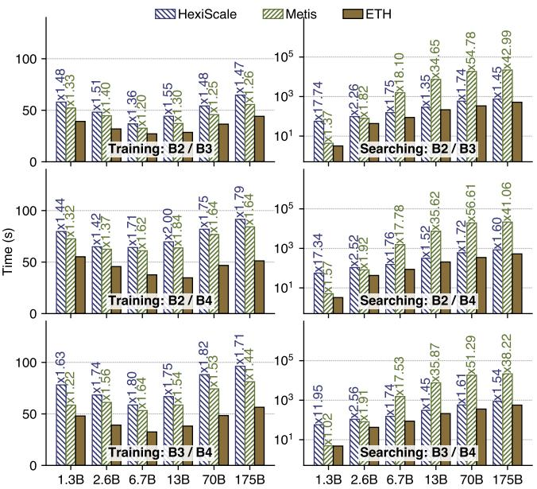  
Figure 9: Average training time per iteration and generation time in different models and heterogeneous clusters.

## 7.3 Computation and Communication Time

We experiment on B2/B4 clusters to analyze the breakdown of iteration time across different methods and evaluate the communication time of various All-Reduce mechanisms.

Computation time. We compare slowest-stage training times across model sizes for ETH, HexiScale, and Metis. As shown in Fig. 10a, we analyze computation time, pipeline bubbles, and communication time. ETH outperforms both baselines in computation. For 13B, ETH computes 30% faster than Metis and 40% faster than HexiScale. ETH uses DP between and within pipelines, accelerating computation relative to TP. Regarding pipeline bubbles, ETH reduces the 13B model’s bubble size to 60% of HexiScale’s and 75% of Metis’s. The baselines’ layer balancing causes significant stage imbalances, whereas ETH reduces bubbles by evenly distributing workloads across pipelines through data balancing. ETH incurs slightly higher communication overhead because HPP employs more DP, requiring All-Reduce communication across heterogeneous devices at the end of each iteration.

Block-wise All-Reduce. To evaluate ETH’s block-wise All-Reduce, we compare it with device-wise and tensor-wise All-Reduce across models. As shown in Fig. 10b, block-wise All-Reduce achieves 1.38-1.71× and 1.56-2.74× communication speedups over tensor-wise and device-wise All-Reduce, respectively. Its advantage over device-wise All-Reduce grows with model size because the latter pads missing tensors, causing significant padding overhead. Block-wise All-Reduce also outperforms tensor-wise All-Reduce, whose finer granularity creates dozens or hundreds of communication streams per device, severely hurting bandwidth utilization. In contrast, block-wise All-Reduce transmits data in larger blocks, signif icantly reducing the number of communication streams.

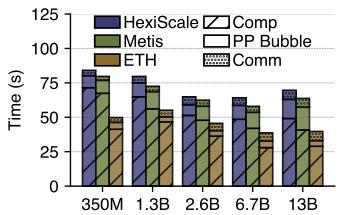  
(a) Breakdown of iteration time

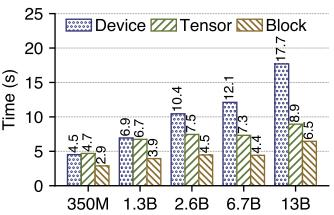  
(b) Latency of All-Reduce  
Figure 10: The performance of three All-Reduce mechanisms and the breakdown of iteration time of different methods in various models on B2/B4 heterogeneous clusters.

## 7.4 System Scalability

To evaluate the scalability of each system, we conduct experiments in 13B on B2/B4 heterogeneous clusters, varying cluster size, global batch size, and sequence length. Moreover, we also evaluat ETH on NVIDIA heterogeneous clusters.

Scalability w.r.t. #devices. We evaluate ETH on clusters using 8 devices per node. As show in Fig. 11a, ETH achieves up to 1.86× and 1.83× speedups over HexiScale and Metis, respectively. ETH’s advantage over Metis scales efficiently, growing from a 1.25× speedup at 16 devices to 1.77× at 128 devices. While HexiScale encounters OOM at 16, 32, and 48 devices, ETH trains successfully across all scales. For searching time, ETH is 1.47× to 2.48× faster than HexiScale, and 1.59× to 35.61× faster than Metis. Specifically, ETH accelerates generation times in large clusters, outperforming Metis by 1.59× at 16 devices and up to 14× at 128 devices. Scalability w.r.t. global batch size. To evaluate performance across global batch sizes, we experiment with sizes from 22 to $2 ^ { 1 2 }$ . As shown in Fig. 11b, ETH achieves 1.10× to 2.00× and 1.02× to 1.83× execution-time speedups over HexiScale and Metis. ETH’s performance advantage grows with global batch size. When the global batch size is 4, ETH speeds up 1.02× to 1.10× compared to baselines. As the global batch size increases to the largest, ETH achieves speedups of 1.64× and 1.44×. This is because ETH uses heterogeneous pipelines with data balance; large global batch sizes bring finer granularity for workload balancing. Although ETH uses global batch size for load balancing, search time remains stable (204.62–217.49 s) and consistently below the baselines. Scalability w.r.t. sequence length. To evaluate performance, we conduct experiments with sequence lengths ranging from $2 ^ { 5 } ~ \mathrm { t o } ~ 2 ^ { 1 3 }$ . As shown in Fig. 11c, ETH achieves maximum speedups of 2.08× and 1.83× over HexiScale and Metis, respectively. As sequence length increases, ETH’s speedup grows because larger per-layer activation sizes make baselines prone to memory insufficiency during layer balancing. Furthermore, HexiScale and Metis support maximum sequence lengths of 2048 and 4096, respectively, while ETH reaches 8192. The same panel shows that sequence length minimally impacts ETH’s and HexiScale’s search costs, whereas Metis’s overhead varies. For example, search costs for ETH, HexiScale, and Metis range from 200.49 s to 214.34 s, 307.28 s to

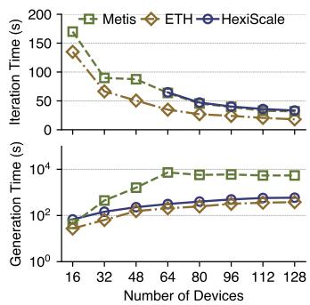  
(a) Number of devices

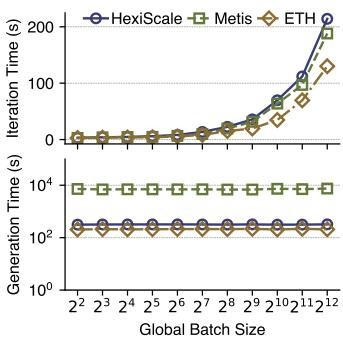  
(b) Global batch size

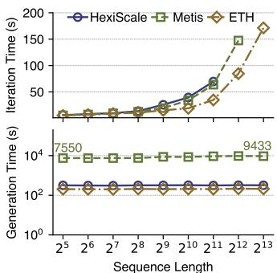  
(c) Sequence length

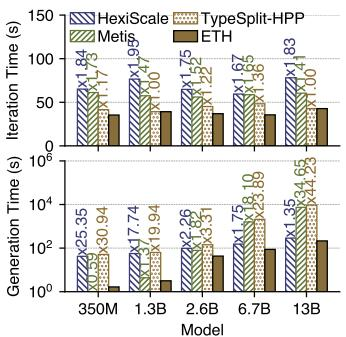  
(d) NVIDIA GPU evaluation  
Figure 11: Scalability and global-search evaluation. (a)-(c) Performance comparison on GPT-3 13B when varying device count, GBS, and sequence length on B2/B4 clusters. (d) TypeSplit-HPP comparison across GPT-3 models on A100/RTX 3090 clusters.

323.23 s, and 7550.25 s to 9612.77 s, respectively.

Scalability on NVIDIA GPUs. We further demonstrate the scalability of ETH on NVIDIA GPUs, consisting of A100 and RTX 3090 GPUs (100 Gbps interconnect, matching the setup in Tab. 2). As shown in Fig. 11d, ETH delivers excellent performance across GPT-3 models ranging from 350M to 13B parameters. In terms of training time, ETH reduces iteration times by 1.41–1.73× compared to Metis and by 1.67–1.95× compared to HexiScale. The improvements in generation time are even more significant, with speedups of up to 34.65× and 25.35× over Metis and HexiScale, respectively.

## 7.5 Evaluation of Key Components

Global configuration search. To test whether global search is necessary, we design TypeSplit-HPP strategy. It partitions devices by type and independently optimizes each homogeneous pipeline with ETH’s stage optimizer. As shown in Fig. 11d, ETH matches TypeSplit-HPP on two models and achieves 1.17–1.36× speedups on the other three. Type splitting is therefore sufficient for two models but misses faster configurations for the other three. Despite its larger search space, ETH reduces search cost by 3.31–44.23×, making full HPP practical when it improves configuration quality.

Memory-saving strategies. To isolate the direct effect of ETH’s memory-saving strategy (stage-specific recomputation), we disable it while keeping device assignment, parallelism degrees, batch sizes, and workload unchanged. As shown in Fig. 12a. peak memory only increases by 1.8%– 5.7% across the evaluated model configurations.

Predictor accuracy. As shown in Fig. 12b, runtime and memory prediction errors range from −6.7% to +6.6% and from +4.9% to +7.4%, respectively. Both remain within 7.4%, supporting candidate evaluation, while consistent memory overestimation avoids understating memory requirements.

## 7.6 The Effectiveness of Search Optimization

Ablation study on search optimization. To demonstrate the impact of our various search optimizations on search cost,

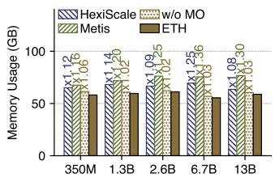  
(a) Peak memory

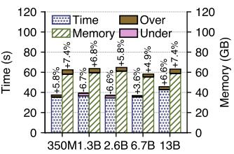  
(b) Predictor accuracy  
Figure 12: Memory efficiency and predictor accuracy across GPT-3 models on A100/RTX 3090 clusters. w/o MO disables ETH’s memory-saving strategies; positive and negative errors denote overestimation and underestimation, respectively.

Fig. 13a illustrates the results of ETH from no optimizations up to all optimizations, by adding a new optimization each time based on the previous experiment. For search cost, unoptimized ETH is 9844 s, exceeding HexiScale and Metis by over 20× and 1.3×, respectively. Moreover, SES shows a 1.16× speedup over the previous experiment. When combined with OSO, ETH facilitates earlier searches for better configurations, thereby assisting SES enhance by 2.09×. In this ablation, the optimizations preserve the iteration time of the generated configuration while reducing search cost. This is an empirical result for the evaluated workload, rather than a general guarantee that pruning preserves the global optimum. Parameter sensitivity. α is a hyperparameter that controls the size of the approximate upper bound for early skipping. We vary α from 0.5 to 4 to evaluate its impact on configuration-generation time and configuration quality. As shown in Fig. 13b, when α is 0.5, the search cost is the smallest at 127.64 s, but the iteration time of the generated configuration is the largest at 38.14 s. That is because early skipping depends on a smaller approximate upper bound, which can prune higher-throughput configurations. When α reaches more than 1.5, its impact on upper-bound pruning weakens because early skipping depends on a smaller deterministic upper bound, leading to near-constant search cost and training time. Additionally, the results indicate that α only needs to be greater than 1. For instance, at α equal to 4, the search time is about 238 s, only 10% longer than when α equals 1.5.

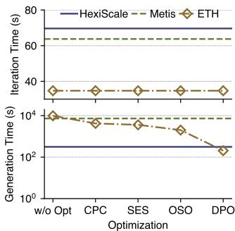

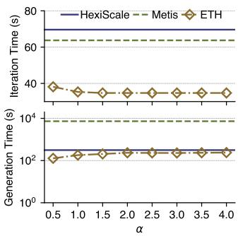  
(a) Search-optimization ablation  
(b) α sensitivity  
Figure 13: Search-optimization evaluation for GPT-3 13B on B2/B4 clusters: (a) cumulative ablation and (b) sensitivity to tolerance factor α. CPC: Caching Pipeline Configuration; SES: Search via Early Skipping; OSO: Optimization for Search Order; DPO: Dynamic Programming Optimization.

## 7.7 Model Convergence Performance

We evaluate the convergence of ETH against baselines using the LLaMA-2 70B model trained on the Enwiki dataset for 2,000 iterations. Experiments are conducted on B2 and B3 heterogeneous clusters, and to assess robustness, we evaluate ETH on a B3 homogeneous cluster. As detailed in Appendix B, all methods exhibit nearly identical loss curves, with differences of approximately 0.1%. Such minor discrepancies can be attributed to hardware precision and lie well within an acceptable margin of error. This variance arises because ETH balances data distribution across pipelines without altering the data content, resulting in convergence behavior comparable to the baseline. Moreover, ETH produces consistent loss curves across all clusters, demonstrating its robustness.

## 8 Discussion

Search quality for HPP. ETH uses Aceso’s [26] fast bottleneck-driven method to optimize stages within each pipeline. Like gradient descent on a nonconvex objective, Aceso’s local adjustments target current bottlenecks but may lead to local optima, so global optimality of the resulting HPP configuration is not guaranteed in ETH.

Additional parallelism dimensions. ETH currently searches over PP, TP, DP. Incorporating context parallelism (CP) [17, 27] or expert parallelism (EP) [24] would introduce additional configuration variables and require models for contextpartitioning communication or routing-dependent expert workloads. These extensions would also affect memory requirements and parameter placement, requiring corresponding changes to configuration search and gradient synchronization. Other pipeline schedules. ETH’s latency and memory models currently assume 1F1B [36] scheduling. Other PP schedules [39, 41, 55] may change pipeline bubbles and activation lifetimes, affecting both configuration feasibility and workload balance. Supporting them would require new cost models and validation of execution and synchronization order.

## 9 Related Works

Homogeneous Training Systems. Exisiting homogeneous training systems [10, 20, 20, 21, 30, 48, 53, 61, 63, 64] explore parallelism and training techniques. For PP, Mirhoseini et al. [30] use machine learning for device placement. For TP, FlexFlow [20] and Tofu [53] use cost models and dynamic programming to identify optimal intra-operator parallelism strategies. FTPipe [10] combines DP and PP for fine-tuning on commodity hardware. Piper [47] and Alpa [63] propose hierarchical parallelism that incorporates DP and TP at the lower level while applying PP at the upper level. Unity [52] integrates algebraic transformations with parallelization techniques. For recomputation, Adapipe [46] adopts adaptive recomputation to determine optimal strategies, whereas DTR [22] introduces a greedy online algorithm for operator-level recomputation. Heterogeneity-aware Systems. Several works [5, 31, 32, 38] address the execution of distributed DL on heterogeneous cluster. Whale [19] balances computation and memory through device assignment, while Metis [51] and HexiScale [57] balance layers across PP stages. SDPipe [29] targets dynamic GPU performance heterogeneity. HAP [60] introduces uneven workload distribution across both data and tensor dimensions. Cephalo [15] assigns unequal batches under fixed FSDP [62], whereas ETH jointly optimizes local batch size and stage configurations. NeutronHeter [4] addresses compute, memory, and network heterogeneity through multi-level workload map ping. Cluster-level schedulers [13, 18, 28, 33–35, 42, 54, 56] instead optimize jobs allocations in heterogeneous clusters.

## 10 Conclusion

This paper proposes HPP, a new training paradigm for large models in heterogeneous clusters. Building upon HPP, we design ETH, a training system that generates efficient HPP configurations with small overhead. ETH incorporates a joint workload balancing framework operating at two levels: It dynamically adjusts local batch sizes across pipelines and simultaneously rebalances stage workloads within each pipeline using these updated batch sizes. Furthermore, ETH implements a block-wise All-Reduce method to reduce communication overhead. The key contribution of ETH is its ability to significantly expand the available configuration space for parallel training in heterogeneous environments with high scalability.

## 11 Acknowledgment

We thank our shepherd Dr. Stephanie Wang and the anonymous NSDI reviewers for their valuable feedback. This work was supported in part by the Science and Technology Development Fund of Macau (0041/2025/RIA1, 0074/2025/AMJ), the Multi-Year Research Grant of University of Macau (MYRG-GRG2024-00255-FST-UMDF, MYRG-GRG2025- 00119-FST), and Alibaba Group through Alibaba Innovative Research Program.

## References

[1] Introducing claude 4. https://www.anthropic.com/ news/claude-4, 2025.

[2] The llama 4 herd: The beginning of a new era of natively multimodal ai innovation. https://ai.meta.com/ blog/llama-4-multimodal-intelligence/, 2025.

[3] Tom B. Brown, Benjamin Mann, Nick Ryder, Melanie Subbiah, Jared Kaplan, Prafulla Dhariwal, Arvind Neelakantan, Pranav Shyam, Girish Sastry, Amanda Askell, Sandhini Agarwal, Ariel Herbert-Voss, Gretchen Krueger, Tom Henighan, Rewon Child, Aditya Ramesh, Daniel M. Ziegler, Jeffrey Wu, Clemens Winter, Christopher Hesse, Mark Chen, Eric Sigler, Mateusz Litwin, Scott Gray, Benjamin Chess, Jack Clark, Christopher Berner, Sam McCandlish, Alec Radford, Ilya Sutskever, and Dario Amodei. Language models are few-shot learners. Advances in neural information processing systems, 33:1877–1901, 2020.

[4] Chunyu Cao, Xin Ai, Qiange Wang, Yanfeng Zhang, Zhenbo Fu, Hao Yuan, Mingyi Cao, Chaoyi Chen, Yingyou Wen, Yu Gu, and Ge Yu. Neutronheter: Optimizing distributed graph neural network training for heterogeneous clusters. Proc. ACM Manag. Data, 3(4), September 2025.

[5] Shubham Chaudhary, Ramachandran Ramjee, Muthian Sivathanu, Nipun Kwatra, and Srinidhi Viswanatha. Balancing efficiency and fairness in heterogeneous gpu clusters for deep learning. In Proceedings ofthe Fifteenth European Conference on Computer Systems, pages 1– 16, 2020.

[6] Jeffrey Dean, Greg S. Corrado, Rajat Monga, Kai Chen, Matthieu Devin, Quoc V. Le, Mark Z. Mao, Marc’Aurelio Ranzato, Andrew Senior, Paul Tucker, Ke Yang, and Andrew Y. Ng. Large scale distributed deep networks. Advances in neural information processing systems, 25, 2012.

[7] DeepSeek-AI, :, Xiao Bi, Deli Chen, Guanting Chen, Shanhuang Chen, Damai Dai, Chengqi Deng, Honghui Ding, Kai Dong, Qiushi Du, Zhe Fu, Huazuo Gao, Kaige Gao, Wenjun Gao, Ruiqi Ge, Kang Guan, Daya Guo, Jianzhong Guo, Guangbo Hao, Zhewen Hao, Ying He, Wenjie Hu, Panpan Huang, Erhang Li, Guowei Li, Jiashi Li, Yao Li, Y. K. Li, Wenfeng Liang, Fangyun Lin, A. X. Liu, Bo Liu, Wen Liu, Xiaodong Liu, Xin Liu, Yiyuan Liu, Haoyu Lu, Shanghao Lu, Fuli Luo, Shirong Ma, Xiaotao Nie, Tian Pei, Yishi Piao, Junjie Qiu, Hui Qu, Tongzheng Ren, Zehui Ren, Chong Ruan, Zhangli Sha, Zhihong Shao, Junxiao Song, Xuecheng Su, Jingxiang Sun, Yaofeng Sun, Minghui Tang, Bingxuan Wang,

Peiyi Wang, Shiyu Wang, Yaohui Wang, Yongji Wang, Tong Wu, Y. Wu, Xin Xie, Zhenda Xie, Ziwei Xie, Yiliang Xiong, Hanwei Xu, R. X. Xu, Yanhong Xu, Dejian Yang, Yuxiang You, Shuiping Yu, Xingkai Yu, B. Zhang, Haowei Zhang, Lecong Zhang, Liyue Zhang, Mingchuan Zhang, Minghua Zhang, Wentao Zhang, Yichao Zhang, Chenggang Zhao, Yao Zhao, Shangyan Zhou, Shunfeng Zhou, Qihao Zhu, and Yuheng Zou. Deepseek llm: Scaling open-source language models with longtermism, 2024.

[8] DeepSeek-AI, Aixin Liu, Bei Feng, Bin Wang, Bingxuan Wang, Bo Liu, Chenggang Zhao, Chengqi Dengr, Chong Ruan, Damai Dai, Daya Guo, Dejian Yang, Deli Chen, Dongjie Ji, Erhang Li, Fangyun Lin, Fuli Luo, Guangbo Hao, Guanting Chen, Guowei Li, H. Zhang, Hanwei Xu, Hao Yang, Haowei Zhang, Honghui Ding, Huajian Xin, Huazuo Gao, Hui Li, Hui Qu, J. L. Cai, Jian Liang, Jianzhong Guo, Jiaqi Ni, Jiashi Li, Jin Chen, Jingyang Yuan, Junjie Qiu, Junxiao Song, Kai Dong, Kaige Gao, Kang Guan, Lean Wang, Lecong Zhang, Lei Xu, Leyi Xia, Liang Zhao, Liyue Zhang, Meng Li, Miao jun Wang, Mingchuan Zhang, Minghua Zhang, Minghui Tang, Mingming Li, Ning Tian, Panpan Huang, Peiyi Wang, Peng Zhang, Qihao Zhu, Qinyu Chen, Qiushi Du, R. J. Chen, R. L. Jin, Ruiqi Ge, Ruizhe Pan, Runxin Xu, Ruyi Chen, S. S. Li, Shanghao Lu, Shangyan Zhou, Shanhuang Chen, Shaoqing Wu, Shengfeng Ye, Shirong Ma, Shiyu Wang, Shuang Zhou, Shuiping Yu, Shunfeng Zhou, Size Zheng, T. Wang, Tian Pei, Tian Yuan, Tianyu Sun, W. L. Xiao, Wangding Zeng, Wei An, Wen Liu, Wenfeng Liang, Wenjun Gao, Wentao Zhang, X. Q. Li, Xiangyue Jin, Xianzu Wang, Xiao Bi, Xiaodong Liu, Xiaohan Wang, Xiaojin Shen, Xiaokang Chen, Xiaosha Chen, Xiaotao Nie, Xiaowen Sun, Xiaoxiang Wang, Xin Liu, Xin Xie, Xingkai Yu, Xinnan Song, Xinyi Zhou, Xinyu Yang, Xuan Lu, Xuecheng Su, Y. Wu, Y. K. Li, Y. X. Wei, Y. X. Zhu, Yanhong Xu, Yanping Huang, Yao Li, Yao Zhao, Yaofeng Sun, Yaohui Li, Yaohui Wang, Yi Zheng, Yichao Zhang, Yiliang Xiong, Yilong Zhao, Ying He, Ying Tang, Yishi Piao, Yixin Dong, Yixuan Tan, Yiyuan Liu, Yongji Wang, Yongqiang Guo, Yuchen Zhu, Yuduan Wang, Yuheng Zou, Yukun Zha, Yunxian Ma, Yuting Yan, Yuxiang You, Yuxuan Liu, Z. Z. Ren, Zehui Ren, Zhangli Sha, Zhe Fu, Zhen Huang, Zhen Zhang, Zhenda Xie, Zhewen Hao, Zhihong Shao, Zhiniu Wen, Zhipeng Xu, Zhongyu Zhang, Zhuoshu Li, Zihan Wang, Zihui Gu, Zilin Li, and Ziwei Xie. Deepseek-v2: A strong, economical, and efficient mixture-of-experts language model, 2024.

[9] DeepSeek-AI, Aixin Liu, Bei Feng, Bing Xue, Bingxuan Wang, Bochao Wu, Chengda Lu, Chenggang Zhao, Chengqi Deng, Chenyu Zhang, Chong Ruan, Damai Dai, Daya Guo, Dejian Yang, Deli Chen, Dongjie Ji, Erhang

Li, Fangyun Lin, Fucong Dai, Fuli Luo, Guangbo Hao, Guanting Chen, Guowei Li, H. Zhang, Han Bao, Hanwei Xu, Haocheng Wang, Haowei Zhang, Honghui Ding, Huajian Xin, Huazuo Gao, Hui Li, Hui Qu, J. L. Cai, Jian Liang, Jianzhong Guo, Jiaqi Ni, Jiashi Li, Jiawei Wang, Jin Chen, Jingchang Chen, Jingyang Yuan, Junjie Qiu, Junlong Li, Junxiao Song, Kai Dong, Kai Hu, Kaige Gao, Kang Guan, Kexin Huang, Kuai Yu, Lean Wang, Lecong Zhang, Lei Xu, Leyi Xia, Liang Zhao, Litong Wang, Liyue Zhang, Meng Li, Miaojun Wang, Mingchuan Zhang, Minghua Zhang, Minghui Tang, Mingming Li, Ning Tian, Panpan Huang, Peiyi Wang, Peng Zhang, Qiancheng Wang, Qihao Zhu, Qinyu Chen, Qiushi Du, R. J. Chen, R. L. Jin, Ruiqi Ge, Ruisong Zhang, Ruizhe Pan, Runji Wang, Runxin Xu, Ruoyu Zhang, Ruyi Chen, S. S. Li, Shanghao Lu, Shangyan Zhou, Shanhuang Chen, Shaoqing Wu, Shengfeng Ye, Shengfeng Ye, Shi rong Ma, Shiyu Wang, Shuang Zhou, Shuiping Yu, Shun feng Zhou, Shuting Pan, T. Wang, Tao Yun, Tian Pei, Tianyu Sun, W. L. Xiao, Wangding Zeng, Wanjia Zhao, Wei An, Wen Liu, Wenfeng Liang, Wenjun Gao, Wen qin Yu, Wentao Zhang, X. Q. Li, Xiangyue Jin, Xianzu Wang, Xiao Bi, Xiaodong Liu, Xiaohan Wang, Xiao jin Shen, Xiaokang Chen, Xiaokang Zhang, Xiaosha Chen, Xiaotao Nie, Xiaowen Sun, Xiaoxiang Wang, Xin Cheng, Xin Liu, Xin Xie, Xingchao Liu, Xingkai Yu, Xinnan Song, Xinxia Shan, Xinyi Zhou, Xinyu Yang, Xinyuan Li, Xuecheng Su, Xuheng Lin, Y. K. Li, Y. Q. Wang, Y. X. Wei, Y. X. Zhu, Yang Zhang, Yanhong Xu, Yanhong Xu, Yanping Huang, Yao Li, Yao Zhao, Yaofeng Sun, Yaohui Li, Yaohui Wang, Yi Yu, Yi Zheng, Yichao Zhang, Yifan Shi, Yiliang Xiong, Ying He, Ying Tang, Yishi Piao, Yisong Wang, Yixuan Tan, Yiyang Ma, Yiyuan Liu, Yongqiang Guo, Yu Wu, Yuan Ou, Yuchen Zhu, Yuduan Wang, Yue Gong, Yuheng Zou, Yu jia He, Yukun Zha, Yunfan Xiong, Yunxian Ma, Yuting Yan, Yuxiang Luo, Yuxiang You, Yuxuan Liu, Yuyang Zhou, Z. F. Wu, Z. Z. Ren, Zehui Ren, Zhangli Sha, Zhe Fu, Zhean Xu, Zhen Huang, Zhen Zhang, Zhenda Xie, Zhengyan Zhang, Zhewen Hao, Zhibin Gou, Zhicheng Ma, Zhigang Yan, Zhihong Shao, Zhipeng Xu, Zhiyu Wu, Zhongyu Zhang, Zhuoshu Li, Zihui Gu, Zijia Zhu, Zijun Liu, Zilin Li, Ziwei Xie, Ziyang Song, Ziyi Gao, and Zizheng Pan. Deepseek-v3 technical report, 2025.

[10] Saar Eliad, Ido Hakimi, Alon De Jagger, Mark Silberstein, and Assaf Schuster. Fine-tuning giant neural networks on commodity hardware with automatic pipeline model parallelism. In 2021 USENIX Annual Technical Conference (USENIX ATC 21), pages 381–396, 2021.

[11] Shiqing Fan, Yi Rong, Chen Meng, Zongyan Cao, Siyu Wang, Zhen Zheng, Chuan Wu, Guoping Long, Jun Yang, Lixue Xia, Lansong Diao, Xiaoyong Liu, and Wei Lin. Dapple: A pipelined data parallel approach for

training large models. In Proceedings ofthe 26th ACM SIGPLAN Symposium on Principles and Practice of Parallel Programming, pages 431–445, 2021.

[12] Gemini Team, Google. Gemini 2.5: Pushing the frontier with advanced reasoning, multimodality, long context, and next generation agentic capabilities. arXiv preprint arXiv:2507.06261, 2025.

[13] Juncheng Gu, Mosharaf Chowdhury, Kang G Shin, Yibo Zhu, Myeongjae Jeon, Junjie Qian, Hongqiang Liu, and Chuanxiong Guo. Tiresias: A {GPU} cluster manager for distributed deep learning. In 16th USENIX Symposium on Networked Systems Design and Implementation (NSDI 19), pages 485–500, 2019.

[14] Daya Guo, Dejian Yang, Haowei Zhang, Junxiao Song, Peiyi Wang, Qihao Zhu, Runxin Xu, Ruoyu Zhang, Shirong Ma, Xiao Bi, Xiaokang Zhang, Xingkai Yu, Yu Wu, Z. F. Wu, Zhibin Gou, Zhihong Shao, Zhuoshu Li, Ziyi Gao, Aixin Liu, Bing Xue, Bingxuan Wang, Bochao Wu, Bei Feng, Chengda Lu, Chenggang Zhao, Chengqi Deng, Chong Ruan, Damai Dai, Deli Chen, Dongjie Ji, Erhang Li, Fangyun Lin, Fucong Dai, Fuli Luo, Guangbo Hao, Guanting Chen, Guowei Li, H. Zhang, Hanwei Xu, Honghui Ding, Huazuo Gao, Hui Qu, Hui Li, Jianzhong Guo, Jiashi Li, Jingchang Chen, Jingyang Yuan, Jinhao Tu, Junjie Qiu, Junlong Li, J. L. Cai, Jiaqi Ni, Jian Liang, Jin Chen, Kai Dong, Kai Hu, Kaichao You, Kaige Gao, Kang Guan, Kexin Huang, Kuai Yu, Lean Wang, Lecong Zhang, Liang Zhao, Litong Wang, Liyue Zhang, Lei Xu, Leyi Xia, Mingchuan Zhang, Minghua Zhang, Minghui Tang, Mingxu Zhou, Meng Li, Miaojun Wang, Mingming Li, Ning Tian, Panpan Huang, Peng Zhang, Qiancheng Wang, Qinyu Chen, Qiushi Du, Ruiqi Ge, Ruisong Zhang, Ruizhe Pan, Runji Wang, R. J. Chen, R. L. Jin, Ruyi Chen, Shanghao Lu, Shangyan Zhou, Shanhuang Chen, Shengfeng Ye, Shiyu Wang, Shuiping Yu, Shunfeng Zhou, Shuting Pan, S. S. Li, Shuang Zhou, Shaoqing Wu, Tao Yun, Tian Pei, Tianyu Sun, T. Wang, Wangding Zeng, Wen Liu, Wenfeng Liang, Wenjun Gao, Wenqin Yu, Wentao Zhang, W. L. Xiao, Wei An, Xiaodong Liu, Xiaohan Wang, Xiaokang Chen, Xiaotao Nie, Xin Cheng, Xin Liu, Xin Xie, Xingchao Liu, Xinyu Yang, Xinyuan Li, Xuecheng Su, Xuheng Lin, X. Q. Li, Xiangyue Jin, Xiaojin Shen, Xiaosha Chen, Xiaowen Sun, Xiaoxiang Wang, Xinnan Song, Xinyi Zhou, Xianzu Wang, Xinxia Shan, Y. K. Li, Y. Q. Wang, Y. X. Wei, Yang Zhang, Yanhong Xu, Yao Li, Yao Zhao, Yaofeng Sun, Yaohui Wang, Yi Yu, Yichao Zhang, Yifan Shi, Yiliang Xiong, Ying He, Yishi Piao, Yisong Wang, Yixuan Tan, Yiyang Ma, Yiyuan Liu, Yongqiang Guo, Yuan Ou, Yuduan Wang, Yue Gong, Yuheng Zou, Yujia He, Yunfan Xiong, Yuxiang Luo, Yuxiang You, Yuxuan Liu, Yuyang Zhou, Y. X. Zhu, Yanping Huang,

Yaohui Li, Yi Zheng, Yuchen Zhu, Yunxian Ma, Ying Tang, Yukun Zha, Yuting Yan, Z. Z. Ren, Zehui Ren, Zhangli Sha, Zhe Fu, Zhean Xu, Zhenda Xie, Zhengyan Zhang, Zhewen Hao, Zhicheng Ma, Zhigang Yan, Zhiyu Wu, Zihui Gu, Zijia Zhu, Zijun Liu, Zilin Li, Ziwei Xie, Ziyang Song, Zizheng Pan, Zhen Huang, Zhipeng Xu, Zhongyu Zhang, and Zhen Zhang. DeepSeek-R1 incentivizes reasoning in LLMs through reinforcement learning. Nature, 645(8081):633–638, 2025.

[15] Runsheng Benson Guo, Utkarsh Anand, Arthur Chen, and Khuzaima Daudjee. Cephalo: Harnessing heterogeneous gpu clusters for training transformer models. In Proceedings ofthe 39th ACM International Conference on Supercomputing, ICS ’25, pages 368–383. ACM, 2025.

[16] Yanping Huang, Youlong Cheng, Ankur Bapna, Orhan Firat, Dehao Chen, Mia Chen, HyoukJoong Lee, Jiquan Ngiam, Quoc V. Le, Yonghui Wu, and Zhifeng Chen. Gpipe: Efficient training of giant neural networks using pipeline parallelism. Advances in neural information processing systems, 32, 2019.

[17] Sam Ade Jacobs, Masahiro Tanaka, Chengming Zhang, Minjia Zhang, Reza Yazdani Aminadabi, Shuaiwen Leon Song, Samyam Rajbhandari, and Yuxiong He. System optimizations for enabling training of extreme long sequence transformer models. In Proceedings of the 43rd ACM Symposium on Principles of Distributed Computing, PODC ’24, page 121–130, New York, NY, USA, 2024. Association for Computing Machinery.

[18] Suhas Jayaram Subramanya, Daiyaan Arfeen, Shouxu Lin, Aurick Qiao, Zhihao Jia, and Gregory R Ganger. Sia: Heterogeneity-aware, goodput-optimized ml-cluster scheduling. In Proceedings ofthe 29th Symposium on Operating Systems Principles, pages 642–657, 2023.

[19] Xianyan Jia, Le Jiang, Ang Wang, Wencong Xiao, Ziji Shi, Jie Zhang, Xinyuan Li, Langshi Chen, Yong Li, Zhen Zheng, Xiaoyong Liu, and Wei Lin. Whale: Efficient giant model training over heterogeneous {GPUs}. In 2022 USENIX Annual Technical Conference (USENIX ATC 22), pages 673–688, 2022.

[20] Zhihao Jia, Matei Zaharia, and Alex Aiken. Beyond data and model parallelism for deep neural networks. Proceedings ofMachine Learning and Systems, 1:1–13, 2019.

[21] Ziheng Jiang, Haibin Lin, Yinmin Zhong, Qi Huang, Yangrui Chen, Zhi Zhang, Yanghua Peng, Xiang Li, Cong Xie, Shibiao Nong, Yulu Jia, Sun He, Hongmin Chen, Zhihao Bai, Qi Hou, Shipeng Yan, Ding Zhou, Yiyao Sheng, Zhuo Jiang, Haohan Xu, Haoran Wei, Zhang Zhang, Pengfei Nie, Leqi Zou, Sida Zhao, Liang

Xiang, Zherui Liu, Zhe Li, Xiaoying Jia, Jianxi Ye, Xin Jin, and Xin Liu. {MegaScale}: Scaling large language model training to more than 10,000 {GPUs}. In 21st USENIX Symposium on Networked Systems Design and Implementation (NSDI 24), pages 745–760, 2024.

[22] Marisa Kirisame, Steven Lyubomirsky, Altan Haan, Jen nifer Brennan, Mike He, Jared Roesch, Tianqi Chen, and Zachary Tatlock. Dynamic tensor rematerialization. In 9th International Conference on Learning Representations (ICLR 2021). OpenReview.net, 2021.

[23] Vijay Anand Korthikanti, Jared Casper, Sangkug Lym, Lawrence McAfee, Michael Andersch, Mohammad Shoeybi, and Bryan Catanzaro. Reducing activation recomputation in large transformer models. Proceedings ofMachine Learning and Systems, 5:341–353, 2023.

[24] Dmitry Lepikhin, HyoukJoong Lee, Yuanzhong Xu, Dehao Chen, Orhan Firat, Yanping Huang, Maxim Krikun, Noam Shazeer, and Zhifeng Chen. {GS}hard: Scaling giant models with conditional computation and automatic sharding. In International Conference on Learning Representations, 2021.

[25] Dacheng Li, Hongyi Wang, Eric Xing, and Hao Zhang. Amp: Automatically finding model parallel strategies with heterogeneity awareness. Advances in Neural Information Processing Systems, 35:6630–6639, 2022.

[26] Guodong Liu, Youshan Miao, Zhiqi Lin, Xiaoxiang Shi, Saeed Maleki, Fan Yang, Yungang Bao, and Sa Wang. Aceso: Efficient parallel dnn training through iterative bottleneck alleviation. In Proceedings of the Nineteenth European Conference on Computer Systems, pages 163– 181, 2024.

[27] Hao Liu, Matei Zaharia, and Pieter Abbeel. Ringattention with blockwise transformers for near-infinite context. In The Twelfth International Conference on Learning Representations, 2024.

[28] Kshiteej Mahajan, Arjun Balasubramanian, Arjun Singhvi, Shivaram Venkataraman, Aditya Akella, Amar Phanishayee, and Shuchi Chawla. Themis: Fair and efficient {GPU} cluster scheduling. In 17th USENIX Symposium on Networked Systems Design and Implementation (NSDI 20), pages 289–304, 2020.

[29] Xupeng Miao, Yining Shi, Zhi Yang, Bin Cui, and Zhihao Jia. Sdpipe: A semi-decentralized framework for heterogeneity-aware pipeline-parallel training. Proceedings ofthe VLDB Endowment, 16(9):2354–2363, 2023.

[30] Azalia Mirhoseini, Hieu Pham, Quoc V Le, Benoit Steiner, Rasmus Larsen, Yuefeng Zhou, Naveen Kumar,

Mohammad Norouzi, Samy Bengio, and Jeff Dean. Device placement optimization with reinforcement learning. In International conference on machine learning, pages 2430–2439. PMLR, 2017.

[31] Zizhao Mo, Junlin Chen, Huanle Xu, and Chengzhong Xu. Serving hybrid llm loads with slo guarantees using cpu-gpu attention piggybacking. Proceedings of the ACM on Management of Data, 4(3 (SIGMOD):1–26, 2026.

[32] Zizhao Mo, Jianxiong Liao, Huanle Xu, Zhi Zhou, and Chengzhong Xu. Hetis: Serving llms in heterogeneous gpu clusters with fine-grained and dynamic parallelism. In Proceedings ofthe International Conferencefor High Performance Computing, Networking, Storage and Analysis, pages 1710–1724, 2025.

[33] Zizhao Mo, Huanle Xu, and Wing Cheong Lau. Opti mal resource efficiency with fairness in heterogeneous gpu clusters. In Proceedings ofthe 25th International Middleware Conference, pages 36–48, 2024.

[34] Zizhao Mo, Huanle Xu, and Wing Cheong Lau. Fast and fair training for deep learning in heterogeneous gpu clusters. In Proceedings ofthe 39th ACM International Conference on Supercomputing, pages 324–338, 2025.

[35] Zizhao Mo, Huanle Xu, and Chengzhong Xu. Heet: Accelerating elastic training in heterogeneous deep learning clusters. In Proceedings of the 29th ACM International Conference on Architectural Support for Programming Languages and Operating Systems, Volume 2, pages 499–513, 2024.

[36] Deepak Narayanan, Aaron Harlap, Amar Phanishayee, Vivek Seshadri, Nikhil R Devanur, Gregory R Ganger, Phillip B Gibbons, and Matei Zaharia. Pipedream: Gen eralized pipeline parallelism for dnn training. In Proceedings of the 27th ACM symposium on operating systems principles, pages 1–15, 2019.

[37] Deepak Narayanan, Amar Phanishayee, Kaiyu Shi, Xie Chen, and Matei Zaharia. Memory-efficient pipelineparallel dnn training. In International Conference on Machine Learning, pages 7937–7947. PMLR, 2021.

[38] Deepak Narayanan, Keshav Santhanam, Fiodar Kazhamiaka, Amar Phanishayee, and Matei Zaharia. {Heterogeneity-Aware} cluster scheduling policies for deep learning workloads. In 14th USENIX Symposium on Operating Systems Design and Implementation (OSDI 20), pages 481–498, 2020.

[39] Deepak Narayanan, Mohammad Shoeybi, Jared Casper, Patrick LeGresley, Mostofa Patwary, Vijay Anand Korthikanti, Dmitri Vainbrand, Prethvi Kashinkunti, Julie

Bernauer, Bryan Catanzaro, Amar Phanishayee, and Matei Zaharia. Efficient large-scale language model training on gpu clusters using megatron-lm. In Proceedings of the international conference for high performance computing, networking, storage and analysis, pages 1–15, 2021.

[40] NVIDIA. Nvidia ethernet networking accelerates world’s largest ai supercomputer, built by xai, 2024.

[41] Penghui Qi, Xinyi Wan, Guangxing Huang, and Min Lin. Zero bubble (almost) pipeline parallelism. In The Twelfth International Conference on Learning Representations, 2024.

[42] Aurick Qiao, Sang Keun Choe, Suhas Jayaram Subramanya, Willie Neiswanger, Qirong Ho, Hao Zhang, Gregory R Ganger, and Eric P Xing. Pollux: Co-adaptive cluster scheduling for goodput-optimized deep learning. In 15th {USENIX} Symposium on Operating Systems Design and Implementation ({OSDI} 21), 2021.

[43] Samyam Rajbhandari, Jeff Rasley, Olatunji Ruwase, and Yuxiong He. Zero: Memory optimizations toward training trillion parameter models. In SC20: international conference for high performance computing, networking, storage and analysis, pages 1–16. IEEE, 2020.

[44] SemiAnalysis. 100,000 h100 clusters: Power, network topology, ethernet vs infiniband, reliability, failures, checkpointing, 2024.

[45] Mohammad Shoeybi, Mostofa Patwary, Raul Puri, Patrick LeGresley, Jared Casper, and Bryan Catanzaro. Megatron-lm: Training multi-billion parameter language models using model parallelism. arXiv preprint arXiv:1909.08053, 2019.

[46] Zhenbo Sun, Huanqi Cao, Yuanwei Wang, Guanyu Feng, Shengqi Chen, Haojie Wang, and Wenguang Chen. Adapipe: Optimizing pipeline parallelism with adaptive recomputation and partitioning. In Proceedings of the 29th ACM International Conference on Architectural Support for Programming Languages and Operating Systems, Volume 3, pages 86–100, 2024.

[47] Jakub M Tarnawski, Deepak Narayanan, and Amar Phanishayee. Piper: Multidimensional planner for dnn parallelization. Advances in Neural Information Processing Systems, 34:24829–24840, 2021.

[48] Jakub M Tarnawski, Amar Phanishayee, Nikhil Devanur, Divya Mahajan, and Fanny Nina Paravecino. Efficient algorithms for device placement of dnn graph operators. Advances in Neural Information Processing Systems, 33:15451–15463, 2020.

[49] TechPowerUp. Nvidia "blackwell" gpus are sold out for 12 months, customers ordering in 100k gpu quantities, 2024.

[50] Hugo Touvron, Louis Martin, Kevin Stone, Peter Albert, Amjad Almahairi, Yasmine Babaei, Nikolay Bashlykov, Soumya Batra, Prajjwal Bhargava, Shruti Bhosale, Dan Bikel, Lukas Blecher, Cristian Canton Ferrer, Moya Chen, Guillem Cucurull, David Esiobu, Jude Fernandes, Jeremy Fu, Wenyin Fu, Brian Fuller, Cynthia Gao, Vedanuj Goswami, Naman Goyal, Anthony Hartshorn, Saghar Hosseini, Rui Hou, Hakan Inan, Marcin Kardas, Viktor Kerkez, Madian Khabsa, Isabel Kloumann, Artem Korenev, Punit Singh Koura, Marie-Anne Lachaux, Thibaut Lavril, Jenya Lee, Diana Liskovich, Yinghai Lu, Yuning Mao, Xavier Martinet, Todor Mihaylov, Pushkar Mishra, Igor Molybog, Yixin Nie, Andrew Poulton, Jeremy Reizenstein, Rashi Rungta, Kalyan Saladi, Alan Schelten, Ruan Silva, Eric Michael Smith, Ranjan Subramanian, Xiaoqing Ellen Tan, Binh Tang, Ross Taylor, Adina Williams, Jian Xiang Kuan, Puxin Xu, Zheng Yan, Iliyan Zarov, Yuchen Zhang, Angela Fan, Melanie Kambadur, Sharan Narang, Aurelien Rodriguez, Robert Stojnic, Sergey Edunov, and Thomas Scialom. Llama 2: Open foundation and fine-tuned chat models. arXiv preprint arXiv:2307.09288, 2023.

[51] Taegeon Um, Byungsoo Oh, Minyoung Kang, Woo-Yeon Lee, Goeun Kim, Dongseob Kim, Youngtaek Kim, Mohd Muzzammil, and Myeongjae Jeon. Metis: Fast automatic distributed training on heterogeneous {GPUs}. In 2024 USENIX Annual Technical Conference (USENIX ATC 24), pages 563–578, 2024.

[52] Colin Unger, Zhihao Jia, Wei Wu, Sina Lin, Mandeep Baines, Carlos Efrain Quintero Narvaez, Vinay Ramakrishnaiah, Nirmal Prajapati, Pat McCormick, Jamaludin Mohd-Yusof, Xi Luo, Dheevatsa Mudigere, Jongsoo Park, Misha Smelyanskiy, and Alex Aiken. Unity: Accelerating {DNN} training through joint optimization of algebraic transformations and parallelization. In 16th USENIX Symposium on Operating Systems Design and Implementation (OSDI 22), pages 267–284, 2022.

[53] Minjie Wang, Chien-chin Huang, and Jinyang Li. Supporting very large models using automatic dataflow graph partitioning. In Proceedings of the Fourteenth EuroSys Conference 2019, pages 1–17, 2019.

[54] Qizhen Weng, Wencong Xiao, Yinghao Yu, Wei Wang, Cheng Wang, Jian He, Yong Li, Liping Zhang, Wei Lin, and Yu Ding. {MLaaS} in the wild: Workload analysis and scheduling in {Large-Scale} heterogeneous {GPU} clusters. In 19th USENIX symposium on networked systems design and implementation (NSDI 22), pages 945–960, 2022.

[55] Houming Wu, Ling Chen, and Wenjie Yu. Bitpipe: Bidirectional interleaved pipeline parallelism for accelerating large models training, 2024.

[56] Wencong Xiao, Romil Bhardwaj, Ramachandran Ramjee, Muthian Sivathanu, Nipun Kwatra, Zhenhua Han, Pratyush Patel, Xuan Peng, Hanyu Zhao, Quanlu Zhang, Fan Yang, and Lidong Zhou. Gandiva: Introspective cluster scheduling for deep learning. In 13th USENIX Symposium on Operating Systems Design and Implementation (OSDI 18), pages 595–610, 2018.

[57] Ran Yan, Youhe Jiang, Xiaonan Nie, Fangcheng Fu, Bin Cui, and Binhang Yuan. Hexiscale: Facilitating large language model training over heterogeneous hardware. In Ninth Conference on Machine Learning and Systems, 2026.

[58] An Yang, Anfeng Li, Baosong Yang, Beichen Zhang, Binyuan Hui, Bo Zheng, Bowen Yu, Chang Gao, Chengen Huang, Chenxu Lv, Chujie Zheng, Dayiheng Liu, Fan Zhou, Fei Huang, Feng Hu, Hao Ge, Haoran Wei, Huan Lin, Jialong Tang, Jian Yang, Jianhong Tu, Jianwei Zhang, Jianxin Yang, Jiaxi Yang, Jing Zhou, Jingren Zhou, Junyang Lin, Kai Dang, Keqin Bao, Kexin Yang, Le Yu, Lianghao Deng, Mei Li, Mingfeng Xue, Mingze Li, Pei Zhang, Peng Wang, Qin Zhu, Rui Men, Ruize Gao, Shixuan Liu, Shuang Luo, Tianhao Li, Tianyi Tang, Wenbiao Yin, Xingzhang Ren, Xinyu Wang, Xinyu Zhang, Xuancheng Ren, Yang Fan, Yang Su, Yichang Zhang, Yinger Zhang, Yu Wan, Yuqiong Liu, Zekun Wang, Zeyu Cui, Zhenru Zhang, Zhipeng Zhou, and Zihan Qiu. Qwen3 technical report. arXiv preprint arXiv:2505.09388, 2025.

[59] Shengyuan Ye, Liekang Zeng, Xiaowen Chu, Guoliang Xing, and Xu Chen. Asteroid: Resource-efficient hybrid pipeline parallelism for collaborative dnn training on heterogeneous edge devices. In Proceedings of the 30th Annual International Conference on Mobile Computing and Networking, pages 312–326, 2024.

[60] Shiwei Zhang, Lansong Diao, Chuan Wu, Zongyan Cao, Siyu Wang, and Wei Lin. Hap: Spmd dnn training on heterogeneous gpu clusters with automated program synthesis. In Proceedings ofthe Nineteenth European Conference on Computer Systems, pages 524–541, 2024.

[61] Zili Zhang, Yinmin Zhong, Yimin Jiang, Hanpeng Hu, Jianjian Sun, Zheng Ge, Yibo Zhu, Daxin Jiang, and Xin Jin. Disttrain: Addressing model and data heterogeneity with disaggregated training for multimodal large language models. In Proceedings ofthe ACM SIGCOMM 2025 Conference, pages 24–38, 2025.

[62] Yanli Zhao, Andrew Gu, Rohan Varma, Liang Luo, Chien-Chin Huang, Min Xu, Less Wright, Hamid Sho-

janazeri, Myle Ott, Sam Shleifer, Alban Desmaison, Can Balioglu, Pritam Damania, Bernard Nguyen, Geeta Chauhan, Yuchen Hao, Ajit Mathews, and Shen Li. Pytorch fsdp: experiences on scaling fully sharded data parallel. arXiv preprint arXiv:2304.11277, 2023.

[63] Lianmin Zheng, Zhuohan Li, Hao Zhang, Yonghao Zhuang, Zhifeng Chen, Yanping Huang, Yida Wang, Yuanzhong Xu, Danyang Zhuo, Eric P. Xing, Joseph E. Gonzalez, and Ion Stoica. Alpa: Automating inter-and {Intra-Operator} parallelism for distributed deep learn ing. In 16th USENIX Symposium on Operating Systems Design and Implementation (OSDI 22), pages 559–578, 2022.

[64] Yinmin Zhong, Zili Zhang, Bingyang Wu, Shengyu Liu, Yukun Chen, Changyi Wan, Hanpeng Hu, Lei Xia, Ranchen Ming, Yibo Zhu, and Xin Jin. Optimizing {RLHF} training for large language models with stage fusion. In 22nd USENIX Symposium on Networked Systems Design and Implementation (NSDI 25), pages 489–503, 2025.

[65] Martin Zinkevich, Markus Weimer, Lihong Li, and Alex Smola. Parallelized stochastic gradient descent. Advances in neural information processing systems, 23, 2010.

## A Visualization of Training Configuration

Table 3: Visualization of parallelization strategy generated by Metis, HexiScale and ETH. #L: number of layers in each stage. Qkv: Query, key and value. Sco: QK Score. AS: Attention Softmax. AD: Attention Dropout
<table><tr><td rowspan=1 colspan=6>Metis</td></tr><tr><td rowspan=1 colspan=1>Pipeline</td><td rowspan=1 colspan=1>Stage</td><td rowspan=1 colspan=1>Dev.</td><td rowspan=1 colspan=1>TP/DP</td><td rowspan=1 colspan=1>#L</td><td rowspan=1 colspan=1>Recomp. Operator</td></tr><tr><td rowspan=8 colspan=1>Mbs=4Gbs=1024</td><td rowspan=1 colspan=1>0</td><td rowspan=1 colspan=1> $\overline { { B 2 \times 8 } }$ </td><td rowspan=1 colspan=1>2/4</td><td rowspan=1 colspan=1>5</td><td rowspan=1 colspan=1>None</td></tr><tr><td rowspan=1 colspan=1>1</td><td rowspan=1 colspan=1> $\overline { { B 2 \times 8 } }$ </td><td rowspan=1 colspan=1>2/4</td><td rowspan=1 colspan=1>6</td><td rowspan=1 colspan=1>None</td></tr><tr><td rowspan=1 colspan=1>2</td><td rowspan=1 colspan=1> $\overline { { B 2 \times 8 } }$ </td><td rowspan=1 colspan=1>4/2</td><td rowspan=1 colspan=1>7</td><td rowspan=1 colspan=1>None</td></tr><tr><td rowspan=1 colspan=1>3</td><td rowspan=1 colspan=1> $\overline { { B 2 \times 8 } }$ </td><td rowspan=1 colspan=1>2/4</td><td rowspan=1 colspan=1>6</td><td rowspan=1 colspan=1>None</td></tr><tr><td rowspan=1 colspan=1>4</td><td rowspan=1 colspan=1> $\overline { { B 4 \times 8 } }$ </td><td rowspan=1 colspan=1>8/1</td><td rowspan=1 colspan=1>3</td><td rowspan=1 colspan=1>None</td></tr><tr><td rowspan=1 colspan=1>5</td><td rowspan=1 colspan=1> $\overline { { B 4 \times 8 } }$ </td><td rowspan=1 colspan=1>8/1</td><td rowspan=1 colspan=1>4</td><td rowspan=1 colspan=1>None</td></tr><tr><td rowspan=1 colspan=1>6</td><td rowspan=1 colspan=1> $\overline { { B 4 \times 8 } }$ </td><td rowspan=1 colspan=1>4/2</td><td rowspan=1 colspan=1>4</td><td rowspan=1 colspan=1>None</td></tr><tr><td rowspan=1 colspan=1>7</td><td rowspan=1 colspan=1> $\overline { { B 4 \times 8 } }$ </td><td rowspan=1 colspan=1>4/2</td><td rowspan=1 colspan=1>5</td><td rowspan=1 colspan=1>None</td></tr><tr><td rowspan=1 colspan=1></td><td rowspan=1 colspan=1></td><td rowspan=1 colspan=1>He</td><td rowspan=1 colspan=1>xiScale</td><td rowspan=1 colspan=1></td><td rowspan=1 colspan=1></td></tr><tr><td rowspan=5 colspan=1>Pipe-0Mbs=4Lbs=512</td><td rowspan=1 colspan=1>0,1,2</td><td rowspan=1 colspan=1>B4×4</td><td rowspan=1 colspan=1>4/1</td><td rowspan=1 colspan=1>3</td><td rowspan=1 colspan=1>None</td></tr><tr><td rowspan=1 colspan=1>3</td><td rowspan=1 colspan=1>B4×4</td><td rowspan=1 colspan=1>4/1</td><td rowspan=1 colspan=1>4</td><td rowspan=1 colspan=1>None</td></tr><tr><td rowspan=1 colspan=1>4</td><td rowspan=1 colspan=1>B2× 4</td><td rowspan=1 colspan=1>4/1</td><td rowspan=1 colspan=1>5</td><td rowspan=1 colspan=1>None</td></tr><tr><td rowspan=1 colspan=1>5,6</td><td rowspan=1 colspan=1> $\overline { { B 2 \times 4 } }$ </td><td rowspan=1 colspan=1>4/1</td><td rowspan=1 colspan=1>7</td><td rowspan=1 colspan=1>None</td></tr><tr><td rowspan=1 colspan=1>7</td><td rowspan=1 colspan=1> $\overline { { B 2 \times 4 } }$ </td><td rowspan=1 colspan=1>4/1</td><td rowspan=1 colspan=1>8</td><td rowspan=1 colspan=1>None</td></tr><tr><td rowspan=1 colspan=1> $\overline { { \mathrm { P i p e } \cdot 1 } }$ </td><td rowspan=1 colspan=5>Identical to $\mathrm { P i p e - } 0$ </td></tr><tr><td rowspan=1 colspan=1></td><td rowspan=1 colspan=5>ETH</td></tr><tr><td rowspan=5 colspan=1>Pipe-0Mbs=4 ${ \mathrm { L b s } } = 3 4 4$ </td><td rowspan=1 colspan=1>0</td><td rowspan=1 colspan=1> $\overline { { B 4 \times 4 } }$ </td><td rowspan=1 colspan=1>4/1</td><td rowspan=1 colspan=1>4</td><td rowspan=1 colspan=1>Qkv, Sco, 4AS, 4AD</td></tr><tr><td rowspan=1 colspan=1>1</td><td rowspan=1 colspan=1> $\overline { { B 4 \times 4 } }$ </td><td rowspan=1 colspan=1>4/1</td><td rowspan=1 colspan=1>4</td><td rowspan=1 colspan=1>4AS, 4AD</td></tr><tr><td rowspan=1 colspan=1>2</td><td rowspan=1 colspan=1> $\overline { { B 4 \times 4 } }$ </td><td rowspan=1 colspan=1>4/1</td><td rowspan=1 colspan=1>5</td><td rowspan=1 colspan=1>4AS, 4AD</td></tr><tr><td rowspan=1 colspan=1> $\overline { { 3 , 4 , 5 } }$ </td><td rowspan=1 colspan=1> $\overline { { B 4 \times 4 } }$ </td><td rowspan=1 colspan=1>2/2</td><td rowspan=1 colspan=1>5</td><td rowspan=1 colspan=1>None</td></tr><tr><td rowspan=1 colspan=1>6,7</td><td rowspan=1 colspan=1> $\overline { { B 4 \times 4 } }$ </td><td rowspan=1 colspan=1>1/4</td><td rowspan=1 colspan=1>6</td><td rowspan=1 colspan=1>None</td></tr><tr><td rowspan=4 colspan=1> $\mathrm { P i p e } { \cdot } 1$  $\mathbf { M b s { = } } 8$  $\mathrm { L b s } { = } 6 8 0$ </td><td rowspan=1 colspan=1>0</td><td rowspan=1 colspan=1> $\overline { { B 2 \times 8 } }$ </td><td rowspan=1 colspan=1>8/1</td><td rowspan=1 colspan=1>8</td><td rowspan=1 colspan=1>6AS, 6AD</td></tr><tr><td rowspan=1 colspan=1>1</td><td rowspan=1 colspan=1> $\overline { { B 2 \times 8 } }$ </td><td rowspan=1 colspan=1>8/1</td><td rowspan=1 colspan=1>9</td><td rowspan=1 colspan=1>4AS, 4AD</td></tr><tr><td rowspan=1 colspan=1>2</td><td rowspan=1 colspan=1> $\overline { { B 2 \times 8 } }$ </td><td rowspan=1 colspan=1>4/2</td><td rowspan=1 colspan=1>11</td><td rowspan=1 colspan=1>None</td></tr><tr><td rowspan=1 colspan=1>3</td><td rowspan=1 colspan=1> $\overline { { B 2 \times 8 } }$ </td><td rowspan=1 colspan=1>4/2</td><td rowspan=1 colspan=1>12</td><td rowspan=1 colspan=1>None</td></tr></table>

Table 3 visualizes the parallelization strategies for GPT-3 13B on B2/B4 heterogeneous clusters. Metis uses a single pipeline and employs layer balancing to distribute workloads across stages, without utilizing data for load balancing. Consequently, Metis cannot fully exploit the global batch size. While HexiScale supports searching over multiple pipelines, it has two limitations: devices within a stage cannot perform data parallelism (DP), fixing the DP degree at 1, and pipelines are always identical since HexiScale cannot use data to balance workloads. Thus, HexiScale’s configuration reduces to a single pipeline with a DP degree of 2 per stage. In contrast, ETH supports multiple heterogeneous pipelines and uses different local batch sizes to optimize workload distribution. In the example shown, ETH utilizes two pipelines performing DP. The first pipeline (B4) processes 344 samples with 4 samples per micro-batch, while the second pipeline (B2) processes 680 samples with 8 samples per micro-batch. Furthermore, ETH allows different stages to have unique configurations for DP/TP, layers, and recomputation. This demonstrates that ETH possesses a significantly larger search space to identify efficient configurations, offering greater potential than state-of-the-art systems.

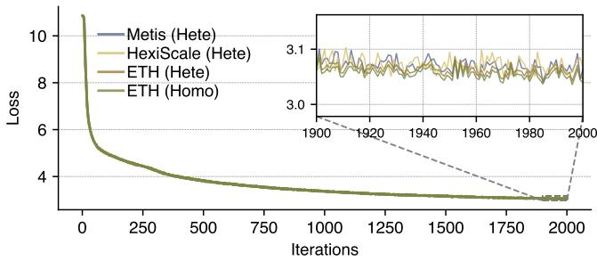  
Figure 14: Loss curves of ETH, HexiScale, and Metis on heterogeneous clusters, together with ETH on a homogeneous cluster. The right panel zooms in on the final iterations.

## B Model Convergence Performance

Figure 14 presents the loss curves of ETH and the baselines on the LLaMA-2 70B model trained on the Enwiki dataset for 2,000 iterations. The experiments include B2/B3 heterogeneous clusters and a B3 homogeneous cluster for robustness evaluation. Across all settings, the loss curves are nearly identical, with differences of approximately 0.1%. We also provide a zoomed-in view of the final iterations to highlight the small gap among different methods. These results further confirm that ETH improves system efficiency without affecting model convergence.