# Each Reward to Its Relevant Tokens: Reward-Specific Token-Level Credit Assignment for Multi-Reward RL

Skylar Zhai<sup>α</sup>, Haonan Wang<sup>β</sup>, Zhining Liu<sup>γ</sup>, Linxin Song<sup>δ</sup>,

Xuwei Ding<sup>ε</sup>, Jingcheng Liang<sup>α</sup>, Jian Kang<sup>ζ</sup>

<sup>α</sup>University of Minnesota <sup>β</sup>National University of Singapore <sup>γ</sup>University of Illinois Urbana-Champaign <sup>δ</sup>University of Southern California <sup>ε</sup>University of Pennsylvania <sup>ζ</sup>MBZUAI Code: https://github.com/zhaihaotian/MRTPO Project page: https://zhaihaotian.github.io/MRTPO

## Abstract

Language models are increasingly trained against several verifiable rewards at once, such as the correctness and the format of a tool call, or the individual constraints of a complex instruction. Reward-decoupled normalization (GDPO) normalizes each reward separately so that different reward combinations keep distinct advantages, but it still spreads every reward’s advantage evenly over the whole response, although each verifier checks only a few positions. We propose MRTPO, which assigns the advantage of each reward to the tokens relevant to it, using the information its verifier checks, without auxiliary models or token-level annotations. For each reward, the policy replays its own response with and without that reward’s verifier information, and the per-token Jensen– Shannon distance between the two next-token distributions measures each token’s relevance and reassigns the advantage. On text-to-SQL, multi-constraint instruction following and tool calling, MRTPO converges faster and achieves better performance than the compared methods.

## 1 Introduction

Reinforcement learning with verifiable rewards (RLVR) has become a standard component of large language model (LLM) post-training, with Group Relative Policy Optimization (GRPO) and its variants among the most widely adopted algorithms (Shao et al., 2024; Guo et al., 2025). Many practical objectives, however, involve multiple criteria. A tool-using agent must emit a well-formed call and also select the correct function and arguments (Qian et al., 2025); a text-to-SQL model must produce a query that both executes and returns the intended result (Ma et al., 2025); an instruction-following model must satisfy every constraint stated in the prompt (Zhou et al., 2023); and an aligned assistant must be both helpful and harmless (Dai et al., 2024). Each criterion is typically evaluated by a separate verifier that produces its own reward, which gives rise to multi-reward reinforcement learning (Liu et al., 2026b).

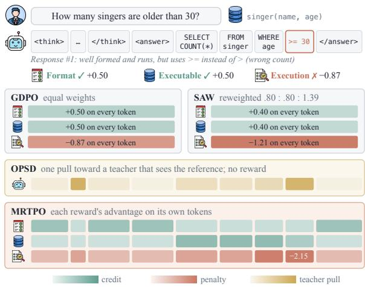  
Figure 1: Advantages assigned to the tokens of one SQL response that is well formed and executable but uses >= for >. MRTPO places format credit on the tags, executability credit on the query, and the execution penalty mostly on >= 30.

Applying GRPO to the sum of these rewards collapses distinct reward combinations into identical advantage values (Liu et al., 2026b). To address this reward collapse, GDPO normalizes each reward within its rollout group before aggregation (Liu et al., 2026b), and a line of concurrent work further adapts the weight of each reward during aggregation (Jiang et al., 2026; He et al., 2026; Wang et al., 2026b; Liu et al., 2026a; Montero et al., 2026). These methods determine how much each reward contributes to the response-level advantage, yet the resulting advantage is still assigned uniformly to every token of the response. This implicitly treats every token as equally responsible for every reward, whereas a verifier typically evaluates only a small portion of the response. For instance, if a tool call specifies all arguments correctly but omits the required <think> tag, the format penalty is imposed equally on the correctly generated arguments. This motivates the following question: Can we identify the tokens relevant to each reward and assign the reward’s advantage mainly to them?

Recent work on on-policy self-distillation suggests an answer. Conditioning a model on privileged information, such as a reference solution or environment feedback, alters its next-token predictions on a response it has already generated; selfdistillation methods train the policy to match these privileged predictions, thereby replacing reward maximization with distillation toward a teacher distribution (Zhao et al., 2026; Hübotter et al., 2026). In multi-reward RL, such information is available separately for each reward, because every verifier holds the information it relies on for evaluation, such as a reference tool call, the execution error of a generated query, or an individual constraint of the instruction. Since this information decides the reward, we call a token relevant to it when the information changes its prediction, and distribute the reward’s advantage by this relevance.

Building on this insight, we propose MRTPO (Multi-Reward-to-Token Policy Optimization), a token-level credit assignment method for multireward RL. For each reward, MRTPO replays the sampled response under two contexts that differ only in the information of that reward’s verifier, computes the token-wise Jensen–Shannon distance between the resulting next-token distributions, and redistributes the group-normalized advantage of the reward across tokens according to this distance. This redistribution is what separates MRTPO from prior methods. GDPO (Liu et al., 2026b) and SAW (He et al., 2026) decide how much each reward contributes to a response but give every token the same share, whereas MRTPO decides which tokens receive each reward’s advantage. OPSD (Zhao et al., 2026) also uses privileged information and trains the policy to fit a teacher that sees it. We highlight these differences in Figure 1. Our main contributions are as follows:

• A credit-assignment perspective on multireward RL. We show that existing multi-reward methods determine the weight of each reward only at the response level and assign the advantage of every reward uniformly to all tokens, although only part of the response is relevant to each reward.

• Reward-specific token-level credit assignment. We propose MRTPO, which constructs context pairs from each verifier’s own information and derives token weights for each reward separately through self-replay, requiring no auxiliary model, token-level annotation or additional generation.

• Experiments. Experiments on text-to-SQL, multi-constraint instruction following and tool calling show that MRTPO achieves higher performance than GDPO with faster convergence.

## 2 Related Work

Multi-reward reinforcement learning. Early work on multi-objective alignment balances several objectives by training separate reward models or by interpolating policies trained on different rewards (Dai et al., 2024; Ramé et al., 2023; Wu et al., 2023). Within the GRPO framework (Shao et al., 2024), the question becomes how to turn a reward vector into group-relative advantages. GDPO normalizes each reward within its group before summation so that different reward combinations remain distinguishable (Liu et al., 2026b). Concurrent work builds on GDPO and adjusts the weight of each reward dynamically according to withingroup variance, training progress or conflicts between rewards (Jiang et al., 2026; He et al., 2026; Wang et al., 2026b; Liu et al., 2026a; Montero et al., 2026; Zheng et al., 2026). All of these methods operate at the response level. Different from these approaches, MRTPO keeps the reward-wise group advantages of GDPO and further decides which tokens receive each reward’s advantage, so it can be combined with any of these reweighting methods, as we do with SAW in Section 5.1.

Token-level credit assignment and privileged information. To obtain credit finer than a responselevel advantage, prior work relies on process reward models (Lightman et al., 2024), Monte-Carlo value estimates (Kazemnejad et al., 2025) or tokenlevel discriminators trained for each rubric item (Xu et al., 2026), which require step-level annotations, additional sampling or an additional model. Other methods derive token weights from token entropy (Wang et al., 2025; Cheng et al., 2026; Wang et al., 2026a) or from replaying the response without the entire rubric (Zhang et al., 2026a), but they reweight the aggregated advantage rather than each reward separately. Another line of work uses privileged information for on-policy self-distillation. Given a reference solution or environment feedback, the same model acts as the teacher, and the student fits the distribution of the teacher (Agarwal et al., 2024; Zhao et al., 2026; Hübotter et al., 2026). MRTPO also builds on privileged information and self-replay, and uses the distributional difference under each reward’s information to allocate that reward’s advantage over tokens. The rewards thus remain the training objective, and the replay only decides where each advantage goes.

## 3 Preliminaries

Multi-reward group optimization. For each prompt x in a training batch B, the behavior policy $\pi _ { \theta _ { \mathrm { o l d } } }$ samples a group of G responses $\bar { y } ^ { ( 1 ) } , \ldots , \bar { y } ^ { ( G ) }$ , where $y ^ { ( j ) }$ has $T _ { j }$ tokens. Each response is scored by K verifiers, giving rewards $r _ { 1 } ^ { ( j ) } , \ldots , r _ { K } ^ { ( j ) }$ ; the index k always refers to a reward. K may vary across prompts; in instruction following, for example, every constraint in the prompt is a reward. We write group standardization as

$$
\mathcal { G } \big ( r _ { k } ^ { ( j ) } \big ) = \frac { r _ { k } ^ { ( j ) } - \mu _ { k } } { \sigma _ { k } + \epsilon } ,\tag{1}
$$

where $\mu _ { k }$ and $\sigma _ { k }$ are the mean and sample standard deviation of reward k over the G responses.

GRPO and GDPO. GRPO aggregates the rewards before standardizing them, $\begin{array} { r } { \bar { A } ^ { ( j ) } = \mathcal { G } ( \sum _ { k } r _ { k } ^ { ( j ) } ) } \end{array}$ (Shao et al., 2024), so responses with different reward combinations but equal sums receive the same advantage. GDPO standardizes each reward and takes a weighted sum (Liu et al., 2026b):

$$
A _ { k } ^ { ( j ) } = \mathcal { G } \big ( r _ { k } ^ { ( j ) } \big ) , \qquad S ^ { ( j ) } = \sum _ { k = 1 } ^ { K } c _ { k } A _ { k } ^ { ( j ) } ,\tag{2}
$$

followed by a batch-level rescaling $A _ { \mathrm { G D P O } } ^ { ( j ) } ~ =$ $S ^ { ( j ) } / { \mathrm { s t d } _ { B } ( S ) }$ . GDPO uses $c _ { k } \ = \ 1$ . Most concurrent work keeps this form and sets or adapts the reward weights $c _ { k }$ according to within-group variance, training progress or conflicts between rewards (Jiang et al., 2026; He et al., 2026; Wang et al., 2026b; Liu et al., 2026a; Montero et al., 2026). We use $c _ { k } = 1$ and omit it below.

Token-level objective. In existing methods, whatever $c _ { k }$ is, all tokens of response j share one advantage, $A _ { t } ^ { ( j ) } = A ^ { ( j ) }$ for every t. It enters the clipped surrogate objective

$$
\begin{array} { l } { \displaystyle \mathcal { L } ( \theta ) = - \frac { 1 } { \sum _ { j } T _ { j } } \sum _ { j } \sum _ { t = 1 } ^ { T _ { j } } \ell _ { t } ^ { ( j ) } , } \\ { \ell _ { t } ^ { ( j ) } = \operatorname* { m i n } \bigl ( \rho _ { t } ^ { ( j ) } A _ { t } ^ { ( j ) } , ~ \bar { \rho } _ { t } ^ { ( j ) } A _ { t } ^ { ( j ) } \bigr ) , } \end{array}\tag{3}
$$

where $\rho _ { t } ^ { ( j ) }$ is the probability ratio between the current and the behavior policy at token t and

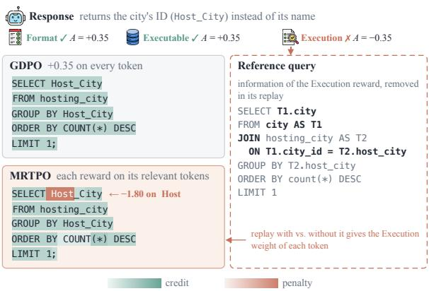  
Figure 2: Per-token advantage of a training response under GDPO and MRTPO. Both panels use the same per-reward advantages.

$\bar { \rho } _ { t } ^ { ( j ) } = \mathrm { c l i p } ( \rho _ { t } ^ { ( j ) } , 1 - \varepsilon _ { l } , 1 + \varepsilon _ { h } )$ . MRTPO changes only $A _ { t } ^ { ( j ) }$ and leaves the rest of the objective intact.

## 4 MRTPO: Assigning Credit of Each Reward to Relevant Tokens

## 4.1 Motivation

Because every token shares one advantage (Eq. 3), the penalty for an error is spread over the whole response and can be outweighed by the credit of other rewards. In Figure 2, only the selected column is wrong, yet GDPO credits the entire query, the wrong column included. Each reward is decided by a few tokens, here the execution reward by the selected column. MRTPO finds the tokens relevant to each reward (Section 4.2) and places the reward’s advantage mainly on them (Section 4.3).

## 4.2 How Do We Find Relevant Tokens?

By self-replay. For each reward, MRTPO builds two contexts that differ only in the information of the reward’s verifier, replays the response under both, and scores each token by how much the two predictions differ. The score serves as the token relevance to the reward.

Verifier information. Each verifier scores a response against some information, such as a reference answer or the requirement it checks. We write this information for reward k as a text block $Z _ { k }$ . In Figure 3 (left), $Z _ { 1 }$ states the required format, $Z _ { 2 }$ reports the SQLite error of the query, and $Z _ { 3 }$ gives the reference query. The blocks of each task are listed in Appendix C.

Leave-one-out contexts. Let $P _ { 0 }$ be the prompt that sampled y. Both contexts are built from $P _ { 0 }$ and the blocks, so sampling stays as in GDPO. Let $\kappa _ { x }$ be the rewards with a block for sample x, $Z _ { S }$ the blocks in S concatenated in a fixed order, and ⊕ appending text to the user message. For each reward k,

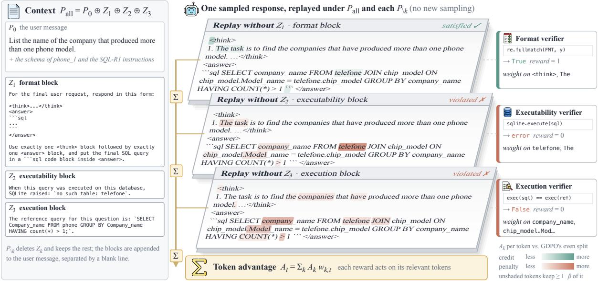  
Figure 3: Leave-one-out replay on a text-to-SQL response. The response reads table telefone, which does not exist; the reference uses phone. Replay places the penalties of the executability and execution rewards mainly on telefone and the selected columns, and the format credit on the tags.

$$
P _ { \mathrm { a l l } } = P _ { 0 } \oplus Z _ { { \mathcal K } _ { x } } , \qquad P _ { \setminus k } = P _ { 0 } \oplus Z _ { { \mathcal K } _ { x } \backslash \{ k \} } .\tag{4}
$$

$P _ { \mathrm { a l l } }$ appends the blocks of all rewards to the prompt, and $P _ { \backslash k }$ appends all of them except $Z _ { k }$ . The two contexts differ only in $Z _ { k }$ , so a change in prediction between them comes from what $Z _ { k }$ says. Comparing $P _ { 0 }$ with $P _ { 0 } \oplus Z _ { k }$ would also capture the effect of extra text. $P _ { \mathrm { a l l } }$ is replayed once for all rewards. When the information is in the prompt, as for instruction constraints, $P _ { \mathrm { a l l } }$ is the prompt itself and $P _ { \backslash k }$ removes one constraint (Figure 8).

Self-replay. With the parameters $\theta _ { \mathrm { o l d } }$ that sampled $y ,$ we feed $y$ after each context and read the nexttoken distributions $p _ { t } ^ { \mathrm { a l l } }$ under $P _ { \mathrm { a l l } }$ and $p _ { t } ^ { \backslash k }$ under $P _ { \backslash k }$ at every position t. Each replay is one forward pass over the sampled response.

Relevance score. The more the two distributions differ at position t, the more the prediction there depends on $Z _ { k }$ . We score token t for reward k by the Jensen–Shannon distance between them, normalized by ln 2,

$$
q _ { k , t } = { \sqrt { \operatorname { J S } \bigl ( p _ { t } ^ { \mathrm { a l l } } \bigr | \bigr | p _ { t } ^ { \backslash k } \bigr ) / \ln 2 } } \in [ 0 , 1 ] ,\tag{5}
$$

which is 0 when removing $Z _ { k }$ leaves the prediction at t unchanged (Appendix D). In Figure 3, removing the SQLite error changes the prediction

mostly at telefone, the table that does not exist, and removing the reference query changes it at the selected column and the join condition.

## 4.3 Redistributing Advantage by Relevance

With the relevance scores, each reward’s advantage is redistributed over the tokens according to their relevance relative to the response average $\bar { q } _ { k } ~ =$ $\begin{array} { r } { \frac { 1 } { T } \sum _ { u } q _ { k , u } \colon } \end{array}$

$$
\begin{array} { r } { w _ { k , t } = ( 1 - \beta ) + \beta \frac { q _ { k , t } } { \bar { q } _ { k } } , } \end{array}\tag{6}
$$

where $\beta \in [ 0 , 1 )$ is the share of the advantage that follows relevance. A token of average relevance keeps weight 1, a more relevant token receives more, and every token keeps at least $1 - \beta$ . The rewards are then summed per token,

$$
S _ { t } ^ { ( j ) } = \sum _ { k = 1 } ^ { K } A _ { k } ^ { ( j ) } w _ { k , t } ^ { ( j ) } , \qquad A _ { t } ^ { ( j ) } = \frac { S _ { t } ^ { ( j ) } } { \mathrm { s t d } _ { B } ( S ) } ,\tag{7}
$$

and $A _ { t } ^ { ( j ) }$ enters Eq. 3. The weights average to one over each response, so a response keeps its total credit under GDPO and only its placement changes. Positive and negative advantages use the same weights. During training, $\beta$ is raised from 0 over the first N steps, and when several rewards concentrate on the same tokens, the reallocated part of a token’s advantage is capped at the magnitude of its uniform advantage (Appendix D). The bottom of Figure 3 sums the weighted advantages of the three rewards on each token.

<table><tr><td></td><td colspan="5">Spider</td><td colspan="3">BIRD</td></tr><tr><td>Method</td><td>Dev</td><td>Test</td><td>Syn</td><td>Realistic</td><td>DK</td><td></td><td>Dev</td><td>Average</td></tr><tr><td colspan="9">Qwen2.5-Coder-3B-Instruct</td></tr><tr><td>Base</td><td>62.38</td><td>64.46</td><td>53.00</td><td>54.72</td><td>51.87</td><td>36.88</td><td></td><td>53.88</td></tr><tr><td>GRPO</td><td> $7 4 . 2 4 _ { \pm 1 . 2 6 }$ </td><td> $7 5 . 0 0 { \scriptstyle \pm 0 . 3 1 }$ </td><td> $6 5 . 9 2 _ { \pm 1 . 5 0 }$ </td><td></td><td> $6 9 . 4 9 _ { \pm 1 . 9 4 }$ </td><td> $6 4 . 0 4 _ { \pm 1 . 6 9 }$ </td><td> $4 3 . 5 4 _ { \pm 1 . 0 3 }$ </td><td> $6 5 . 3 7 _ { \pm 1 . 1 8 }$ </td></tr><tr><td>GDPO</td><td> $7 6 . 6 6 { \scriptstyle \pm 2 . 2 1 }$ </td><td> $7 6 . 4 0 _ { \pm 1 . 1 7 }$ </td><td> $6 7 . 3 4 _ { \pm 1 . 8 2 }$ </td><td></td><td> $7 0 . 8 0 { \scriptstyle \pm 1 . 9 4 }$ </td><td> $6 5 . 6 1 _ { \pm 0 . 9 3 }$ </td><td> ${ \bf 4 7 . 1 3 _ { \pm 1 . 9 4 } }$ </td><td> $6 7 . 3 2 _ { \pm 1 . 6 6 }$ </td></tr><tr><td>OPSD</td><td> $6 8 . 1 8 _ { \pm 0 . 6 1 }$ </td><td> $6 9 . 3 4 _ { \pm 0 . 4 5 }$ </td><td> $5 9 . 1 5 _ { \pm 0 . 3 9 }$ </td><td></td><td> $6 2 . 1 4 _ { \pm 1 . 3 8 }$ </td><td> $5 6 . 1 2 _ { \pm 0 . 9 6 }$ </td><td> $3 9 . 2 1 _ { \pm 0 . 7 0 }$ </td><td> $5 9 . 0 2 _ { \pm 0 . 4 9 }$ </td></tr><tr><td>MRTPO</td><td> $7 8 . 2 4 _ { \pm 0 . 4 4 }$ </td><td> $7 6 . 7 9 { \scriptstyle \pm 0 . 4 3 }$ </td><td> ${ \bf 6 8 . 6 7 { \scriptstyle \pm 0 . 8 6 } }$ </td><td></td><td> $7 3 . 4 9 _ { \pm 0 . 6 1 }$ </td><td> ${ \bf 6 8 . 1 7 \pm 1 . 5 3 }$ </td><td> $4 6 . 2 6 { \scriptstyle \pm 0 . 8 7 }$ </td><td> ${ \bf 6 8 . 6 0 { \scriptstyle \pm 0 . 1 5 } }$ </td></tr><tr><td> $\mathrm { G D P O } + \mathrm { S A W }$ </td><td> $7 4 . 6 3 _ { \pm 0 . 0 6 }$ </td><td> $7 4 . 7 7 { \scriptstyle \pm 0 . 8 6 }$ </td><td> $6 5 . 6 0 { \scriptstyle \pm 1 . 0 3 }$ </td><td></td><td> $7 0 . 6 0 { \scriptstyle \pm 2 . 0 8 }$ </td><td> $6 4 . 6 7 _ { \pm 0 . 5 8 }$ </td><td> $4 5 . 2 3 _ { \pm 1 . 2 8 }$ </td><td> $6 5 . 9 2 _ { \pm 0 . 9 3 }$ </td></tr><tr><td> $\mathbf { M R T P O } + \mathbf { S A W }$ </td><td> $7 8 . 8 8 _ { \pm 0 . 4 4 }$ </td><td> $7 7 . 6 7 _ { \pm 0 . 2 3 }$ </td><td> ${ \bf 6 8 . 8 6 _ { \pm 0 . 5 4 } }$ </td><td></td><td> $7 3 . 4 9 _ { \pm 0 . 5 7 }$ </td><td> ${ \bf 6 7 . 9 2 } _ { \pm 0 . 6 6 }$ </td><td> ${ \bf 4 6 . 9 5 _ { \pm 0 . 9 3 } }$ </td><td> ${ \bf 6 8 . 9 6 _ { \pm 0 . 1 9 } }$ </td></tr><tr><td colspan="9">Qwen2.5-Coder-7B-Instruct</td></tr><tr><td>Base</td><td> $7 7 . 1 8$ </td><td> $7 7 . 5 5$ </td><td> $6 8 . 6 7$ </td><td> $7 3 . 6 2 $ </td><td> $6 7 . 0 4 $ </td><td></td><td>51.63</td><td>69.28</td></tr><tr><td>GRPO</td><td> $7 8 . 3 0 { \scriptstyle \pm 0 . 7 8 }$ </td><td> $8 1 . 0 3 { \scriptstyle \pm 0 . 4 9 }$ </td><td> $7 1 . 4 4 { \scriptstyle \pm 0 . 4 4 }$ </td><td></td><td> $7 3 . 8 9 _ { \pm 0 . 7 9 }$ </td><td> $6 6 . 9 1 _ { \pm 0 . 6 6 }$ </td><td> $5 4 . 0 0 { \scriptstyle \pm 0 . 6 3 }$ </td><td> $7 0 . 9 3 { \scriptstyle \pm 0 . 3 2 }$ </td></tr><tr><td>GDPO</td><td> $7 9 . 2 1 { \scriptstyle \pm 0 . 6 8 }$ </td><td> $8 0 . 6 2 _ { \pm 0 . 4 9 }$ </td><td> $7 2 . 2 1 { \scriptstyle \pm 0 . 7 3 }$ </td><td></td><td> $7 4 . 8 7 _ { \pm 0 . 8 2 }$ </td><td> $6 7 . 2 9 _ { \pm 0 . 5 4 }$ </td><td> $5 5 . 1 1 { \scriptstyle \pm 1 . 2 6 }$ </td><td> $7 1 . 5 5 _ { \pm 0 . 2 7 }$ </td></tr><tr><td>OPSD</td><td> $7 9 . 1 1 _ { \pm 0 . 4 4 }$ </td><td> $8 0 . 3 9 _ { \pm 0 . 5 2 }$ </td><td> $7 0 . 7 6 { \scriptstyle \pm 1 . 4 5 }$ </td><td></td><td> $7 5 . 7 2 _ { \pm 0 . 9 7 }$ </td><td> $6 9 . 1 0 { \scriptstyle \pm 0 . 4 9 }$ </td><td> $5 3 . 8 7 _ { \pm 0 . 3 6 }$ </td><td> $7 1 . 4 9 _ { \pm 0 . 5 4 }$ </td></tr><tr><td>MRTPO</td><td> $\mathbf { 8 1 . 3 3 _ { \pm 0 . 4 2 } }$ </td><td> $\mathbf { 8 1 . 6 5 _ { \pm 0 . 4 5 } }$ </td><td></td><td> $7 3 . 5 3 _ { \pm 0 . 4 8 }$ </td><td> $7 5 . 9 2 _ { \pm 1 . 7 8 }$ </td><td> ${ \bf 7 0 . 0 4 } _ { \pm 1 . 7 9 }$ </td><td> ${ \bar { 5 } } 6 . 4 2 _ { \pm 0 . 4 6 }$ </td><td> $7 3 . 1 5 _ { \pm 0 . 1 9 }$ </td></tr><tr><td> $\mathrm { G D P O } + \mathrm { S A W }$ </td><td> $7 9 . 9 2 _ { \pm 0 . 4 6 }$ </td><td> $8 1 . 3 2 _ { \pm 0 . 4 7 }$ </td><td> $7 2 . 2 4 _ { \pm 0 . 9 8 }$ </td><td></td><td> $7 6 . 3 1 _ { \pm 0 . 1 2 }$ </td><td> $6 8 . 2 3 _ { \pm 1 . 5 6 }$ </td><td> $5 5 . 4 4 _ { \pm 1 . 1 8 }$ </td><td> $7 2 . 2 4 _ { \pm 0 . 3 5 }$ </td></tr><tr><td> $\mathbf { M R T P O } + \mathbf { S A W }$  </td><td> $\mathbf { 8 1 . 0 8 _ { \pm 0 . 3 1 } }$ </td><td> ${ \bf 8 1 . 3 9 2 0 . 1 5 }$ </td><td> $7 3 . 2 1 { \scriptstyle \pm 1 . 1 2 }$ </td><td></td><td> $7 7 . 2 3 { \scriptstyle \pm 0 . 9 9 }$ </td><td> ${ \bf 7 0 . 0 4 } _ { \pm 0 . 1 9 }$ </td><td> ${ \bar { 5 } } 7 . 5 3 _ { \pm 0 . 3 2 }$ </td><td> ${ 7 3 . 4 1 } _ { \pm 0 . 3 5 }$ </td></tr></table>

Table 1: Text-to-SQL execution accuracy (%); subscripts are standard deviations over seeds. MRTPO is best on average with both models, with and without SAW.
<table><tr><td></td><td colspan="2">IFEval</td><td colspan="2">IFBench</td><td>MulDimIF</td><td colspan="2">AdvancedIF</td><td></td></tr><tr><td>Method</td><td>Prompt</td><td>Inst.</td><td>Prompt</td><td>Inst.</td><td>Acc.</td><td>Overall</td><td>Rubric</td><td>Avg.</td></tr><tr><td colspan="9">Qwen3-4B-Instruct-2507</td></tr><tr><td>Instruct</td><td> $8 3 . 7 7$ </td><td>88.82</td><td>30.95</td><td>33.13</td><td>56.50</td><td>38.21</td><td>76.41</td><td>58.26</td></tr><tr><td>GRPO</td><td> $8 5 . 4 4 _ { \pm 0 . 1 5 }$ </td><td> $9 0 . 1 6 _ { \pm 0 . 0 6 }$ </td><td> $3 5 . 6 8 _ { \pm 1 . 0 2 }$ </td><td> $3 7 . 7 9 _ { \pm 1 . 0 1 }$ </td><td> $6 2 . 4 4 _ { \pm 0 . 8 6 }$ </td><td> $3 9 . 2 7 _ { \pm 0 . 2 7 }$ </td><td> $7 7 . 0 6 _ { \pm 0 . 1 2 }$ </td><td> $6 1 . 1 2 _ { \pm 0 . 3 4 }$ </td></tr><tr><td>CoRT</td><td> $8 5 . 3 7 _ { \pm 0 . 5 0 }$ </td><td> $9 0 . 0 6 _ { \pm 0 . 3 1 }$ </td><td> $3 4 . 7 4 _ { \pm 1 . 9 0 }$ </td><td> $3 6 . 8 5 _ { \pm 1 . 9 5 }$ </td><td> $6 3 . 0 0 { \scriptstyle \pm 1 . 3 5 }$ </td><td> $3 8 . 8 8 _ { \pm 0 . 3 9 }$ </td><td> $7 6 . 9 5 _ { \pm 0 . 4 4 }$ </td><td> $6 0 . 8 4 _ { \pm 0 . 7 8 }$ </td></tr><tr><td>GDPO</td><td> $8 5 . 5 2 _ { \pm 0 . 5 2 }$ </td><td> $9 0 . 2 3 _ { \pm 0 . 3 3 }$ </td><td> $3 6 . 3 9 _ { \pm 1 . 5 9 }$ </td><td> $3 8 . 8 4 _ { \pm 1 . 1 8 }$ </td><td> $6 2 . 8 8 _ { \pm 2 . 8 3 }$ </td><td> $3 8 . 9 1 _ { \pm 0 . 4 3 }$ </td><td> $7 6 . 8 5 _ { \pm 0 . 2 1 }$ </td><td> $6 1 . 3 7 { \scriptstyle \pm 0 . 7 7 }$ </td></tr><tr><td>MRTPO</td><td> $\pm 5 . 6 6 _ { \pm 1 . 2 0 }$ </td><td> $\mathbf { 9 0 . 4 0 _ { \pm 0 . 7 4 } }$ </td><td> $3 8 . 7 6 _ { \pm 1 . 5 3 }$ </td><td> ${ \bf 4 0 . 9 2 } _ { \pm 1 . 3 3 }$ </td><td> ${ \bf 6 5 . 3 7 } _ { \pm 1 . 3 3 }$ </td><td> $\mathbf { 3 9 . 3 9 } _ { \pm 0 . 6 1 }$ </td><td> $7 7 . 2 5 _ { \pm 0 . 1 5 }$ </td><td> ${ \bf 6 2 . 5 4 _ { \pm 0 . 3 2 } }$ </td></tr><tr><td colspan="9">Qwen2.5-7B-Instruct</td></tr><tr><td>Instruct</td><td> $7 2 . 0 9$ </td><td>79.50</td><td>26.53</td><td>29.37</td><td>50.77</td><td>23.51</td><td>69.26</td><td>50.15</td></tr><tr><td>GRPO</td><td> $8 1 . 7 2 _ { \pm 0 . 3 1 }$ </td><td> $8 7 . 4 2 _ { \pm 0 . 1 6 }$ </td><td> $3 5 . 9 4 _ { \pm 2 . 0 6 }$ </td><td> $3 8 . 4 3 _ { \pm 2 . 0 5 }$ </td><td> $5 5 . 1 9 _ { \pm 0 . 7 7 }$ </td><td> $2 5 . 9 8 _ { \pm 0 . 5 6 }$ </td><td> $7 1 . 0 8 _ { \pm 0 . 2 4 }$ </td><td> $5 6 . 5 4 _ { \pm 0 . 6 2 }$ </td></tr><tr><td>CoRT</td><td> $8 1 . 3 2 _ { \pm 0 . 5 6 }$ </td><td> $8 7 . 1 1 _ { \pm 0 . 4 0 }$ </td><td> $3 5 . 6 8 _ { \pm 1 . 5 7 }$ </td><td> $3 8 . 2 2 _ { \pm 1 . 7 3 }$ </td><td> $5 5 . 0 5 _ { \pm 0 . 3 0 }$ </td><td> $2 6 . 0 7 _ { \pm 0 . 7 6 }$ </td><td> $7 1 . 1 1 { \scriptstyle \pm 0 . 3 7 }$ </td><td> $5 6 . 3 6 { \scriptstyle \pm 0 . 5 5 }$ </td></tr><tr><td>GDPO</td><td> $8 1 . 9 1 { \scriptstyle \pm 1 . 3 0 }$ </td><td> $\mathbf { 8 7 . 5 8 { \scriptstyle \pm 0 . 9 4 } }$ </td><td> $3 5 . 7 0 { \scriptstyle \pm 2 . 6 3 }$ </td><td> $3 8 . 5 7 { \scriptstyle \pm 3 . 2 5 }$ </td><td> ${ \pm 5 5 . 3 3 } { \scriptstyle \pm 1 . 5 8 }$ </td><td> $2 6 . 1 3 { \scriptstyle \pm 0 . 9 0 }$ </td><td> ${ \bf 7 1 . 4 6 { \scriptstyle \pm 0 . 2 5 } }$ </td><td> $5 6 . 6 7 { \scriptstyle \pm 0 . 7 7 }$ </td></tr><tr><td>MRTPO</td><td> $\mathbf { 8 1 . 9 8 _ { \pm 0 . 7 8 } }$ </td><td> $8 7 . 5 7 _ { \pm 0 . 6 0 }$ </td><td> $3 8 . 8 7 _ { \pm 1 . 9 6 }$ </td><td> $\mathbf { 4 2 . 0 0 } _ { \pm 2 . 6 0 }$ </td><td> $5 3 . 5 0 _ { \pm 1 . 7 2 }$ </td><td> $\mathbf { 2 6 . 1 8 _ { \pm 0 . 5 2 } }$ </td><td> $7 1 . 4 4 _ { \pm 0 . 3 3 }$ </td><td> ${ \bar { 5 } } 7 . 3 6 _ { \pm 0 . 6 3 }$ </td></tr></table>

Table 2: Instruction-following accuracy (%); subscripts are standard deviations over seeds. MRTPO has the best average on both models, and its largest gains are on IFBench, whose constraints are not seen in training.

## 5 Experiments

## 5.1 Experimental Setup

We evaluate MRTPO on three settings: text-to-SQL, instruction following and tool calling. The complete training and evaluation parameters are given in Appendix B, and the prompts and verifier blocks in Appendix C.

the required format, the SQLite error raised by the response’s own query, and the reference query. We train Qwen2.5-Coder-3B-Instruct and 7B-Instruct (Hui et al., 2024) for 100 steps and report greedy execution accuracy, the fraction of questions whose query returns the same result as the reference, on Spider dev and test, Spider-Syn (Gan et al., 2021a), Spider-Realistic (Deng et al., 2021), Spider-DK (Gan et al., 2021b) and BIRD dev (Li et al., 2023).

Text-to-SQL. Given a question and a database schema, the model reasons in <think> and writes a SQL query in <answer>. We train on the Spider training set (Yu et al., 2018) with three binary rewards following SQL-R1 (Ma et al., 2025): format, executability and execution match against the reference query. The verifier blocks of MRTPO state

Instruction following. We train on the first two subsets of HIR-16K (Zhang et al., 2026b), whose constraints are programmatically verifiable. Each prompt carries five to thirteen constraints, and each constraint is a binary reward. The context pair of a constraint is the prompt with and without it. We train Qwen2.5-7B-Instruct (Qwen Team, 2024) and Qwen3-4B-Instruct-2507 (Yang et al., 2025) for 300 steps and report strict prompt-level accuracy (all constraints of a prompt satisfied) and instruction-level accuracy (fraction of constraints satisfied) on IFEval (Zhou et al., 2023) and IF-Bench (Pyatkin et al., 2025), and accuracy on MulDimIF (Ye et al., 2026), and, on AdvancedIF (He et al., 2025), whose rubrics are written by humans, the fraction of responses that satisfy all rubric items (Overall) and the fraction of rubric items satisfied (Rubric), with Qwen3.6-35B-A3B as the judge. All metrics are averaged over five samples per prompt.

<table><tr><td></td><td colspan="5">Non-Live</td><td colspan="5"> $_ \mathrm { L i v e }$ </td></tr><tr><td>Method</td><td>Simple</td><td>Multiple</td><td>Parallel</td><td> $\mathrm { P a r . M u l t . }$ </td><td>Overall</td><td>Simple</td><td>Multiple</td><td>Parallel</td><td> $\mathrm { P a r . M u l t . }$ </td><td>Overall</td></tr><tr><td colspan="9">Qwen2.5-1.5B-Instruct</td></tr><tr><td>Base</td><td>1.75</td><td>8.50</td><td>13.00</td><td> $2 5 . 0 0$ </td><td>12.06</td><td>6.59</td><td>9.59</td><td> $1 8 . 7 5$ </td><td> $2 0 . 8 3$ </td><td>9.33</td></tr><tr><td>GRPO</td><td> $7 0 . 0 7 { \scriptstyle \pm 0 . 6 9 }$ </td><td> $8 6 . 4 0 { \scriptstyle \pm 0 . 4 2 }$ </td><td> $8 1 . 9 0 { \scriptstyle \pm 1 . 0 8 }$ </td><td> $7 3 . 8 0 { \scriptstyle \pm 2 . 2 0 }$ </td><td>78.04±0.84</td><td> ${ \bf 7 6 . 4 3 _ { \pm 0 . 8 4 } }$ </td><td> $6 2 . 1 8 { \scriptstyle \pm 0 . 7 5 }$ </td><td> ${ \pm } 5 5 . 0 0 { \scriptstyle { \pm } } 2 . 8 0$ </td><td> $6 0 . 8 3 { \scriptstyle \pm 6 . 3 2 }$ </td><td> $6 4 . 8 0 { \scriptstyle \pm 0 . 5 5 }$ </td></tr><tr><td>GDPO</td><td> $7 0 . 3 2 { \scriptstyle \pm 2 . 5 4 }$ </td><td> $8 8 . 6 0 _ { \pm 0 . 7 4 }$ </td><td> $8 2 . 6 0 _ { \pm 2 . 6 3 }$ </td><td> $7 5 . 7 0 { \scriptstyle \pm 2 . 0 8 }$ </td><td> $7 9 . 3 0 { \scriptstyle \pm 1 . 6 9 }$ </td><td> $7 1 . 7 8 _ { \pm 4 . 8 9 }$ </td><td> $6 6 . 1 5 _ { \pm 1 . 9 3 }$ </td><td> $5 3 . 7 5 _ { \pm 5 . 5 9 }$  </td><td> $6 4 . 1 7 _ { \pm 4 . 7 5 }$ </td><td> $6 7 . 0 5 _ { \pm 2 . 4 0 }$ </td></tr><tr><td>MRTPO</td><td> $\mathbf { 7 0 . 9 0 _ { \pm 1 . 1 0 } }$ </td><td> $\mathbf { 8 9 . 0 0 _ { \pm 0 . 5 0 } }$ </td><td> ${ \bf 8 3 . 1 0 _ { \pm 1 . 5 6 } }$ </td><td> ${ \bf 7 7 . 2 0 _ { \pm 2 . 2 5 } }$ </td><td> $\mathbf { 8 0 . 0 5 _ { \pm 1 . 0 0 } }$ </td><td> $7 4 . 4 2 _ { \pm 2 . 0 7 }$ </td><td> ${ \bf 6 7 . 5 2 _ { \pm 0 . 8 1 } }$ </td><td> ${ \pm 5 5 . 0 0 } _ { \pm 2 . 8 0 }$ </td><td> ${ \bf 6 5 . 8 3 _ { \pm 3 . 4 9 } }$  </td><td> ${ \bf 6 8 . 6 6 _ { \pm 0 . 9 2 } }$ </td></tr><tr><td colspan="9">Qwen2.5-3B-Instruct</td></tr><tr><td>Base</td><td> $4 4 . 9 2 $ </td><td>58.50</td><td>16.50</td><td>25.00</td><td>36.23</td><td>39.92</td><td>50.81</td><td>6.25</td><td>20.83</td><td>47.67</td></tr><tr><td>GRPO</td><td> $7 3 . 9 2 _ { \pm 0 . 6 0 }$ </td><td> $9 2 . 3 3 _ { \pm 0 . 7 6 }$ </td><td> $8 1 . 6 7 _ { \pm 2 . 5 7 }$ </td><td> $7 9 . 3 3 { \scriptstyle \pm 2 . 0 2 }$ </td><td> $8 1 . 8 1 _ { \pm 0 . 7 6 }$ </td><td> $6 4 . 7 3 _ { \pm 0 . 3 9 }$ </td><td> $\mathbf { 7 0 . 6 9 _ { \pm 0 . 1 1 } }$ </td><td> $7 2 . 9 2 _ { \pm 3 . 6 1 }$ </td><td> $5 5 . 5 6 _ { \pm 2 . 4 1 }$ </td><td> $6 9 . 3 1 _ { \pm 0 . 1 1 }$ </td></tr><tr><td>GDPO</td><td> $7 3 . 8 3 { \scriptstyle \pm 0 . 6 3 }$ </td><td> $\mathbf { 9 2 . 6 7 _ { \pm 0 . 2 9 } }$ </td><td> $\mathbf { 8 2 . 3 3 _ { \pm 1 . 8 9 } }$ </td><td> $\mathbf { 8 0 . 8 3 _ { \pm 2 . 3 6 } }$ </td><td> $8 2 . 4 2 { \scriptstyle \pm 0 . 5 0 }$ </td><td> $6 4 . 3 4 { \scriptstyle \pm 2 . 0 5 }$ </td><td> $7 0 . 2 1 { \scriptstyle \pm 0 . 3 3 }$ </td><td> $7 2 . 9 2 _ { \pm 3 . 6 1 }$ </td><td> $5 5 . 5 6 { \scriptstyle \pm 8 . 6 7 }$  </td><td> $6 8 . 8 6 { \scriptstyle \pm 0 . 4 1 }$ </td></tr><tr><td>MRTPO</td><td> $7 5 . 3 6 _ { \pm 0 . 8 4 }$ </td><td> $9 2 . 3 3 _ { \pm 0 . 2 9 }$  </td><td> $8 2 . 1 7 _ { \pm 2 . 0 2 }$  </td><td> $8 0 . 3 3 { \scriptstyle \pm 2 . 8 4 }$ </td><td> $\mathbf { 8 2 . 5 5 _ { \pm 1 . 1 7 } }$ </td><td> ${ \bf 6 6 . 1 5 _ { \pm 0 . 4 5 } }$ </td><td> $7 0 . 5 9 _ { \pm 0 . 7 9 }$ </td><td> $7 2 . 9 2 _ { \pm 3 . 6 1 }$  </td><td> ${ \pm \bf 5 9 . 7 2 { \scriptstyle \pm 4 . 8 1 } }$ </td><td> ${ \bf 6 9 . 5 8 _ { \pm 0 . 6 6 } }$ </td></tr></table>

Table 3: BFCL-v4 single-turn AST accuracy (%); subscripts are standard deviations over seeds. MRTPO has the best overall accuracy on both splits with both models.

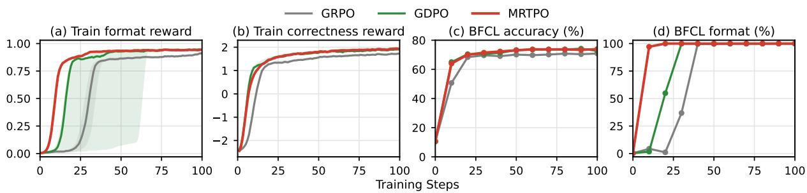  
Figure 4: Tool calling on Qwen2.5-1.5B-Instruct over training: (a, b) training format and correctness rewards, median over seeds with interquartile range; (c, d) BFCL-v4 accuracy and format rate, mean over seeds. The binary format reward is harder to learn, while the continuous correctness reward rises early for all methods. The median number of steps to a format reward of 0.8 is 13 for MRTPO, 19 for GDPO and 34 for GRPO.

Baselines. On all tasks we compare with GRPO (Shao et al., 2024) and GDPO (Liu et al., 2026b). Most concurrent multi-reward methods reweight the rewards when aggregating them; we select SAW (He et al., 2026) as their representative. Since reweighting is orthogonal to MRTPO, we compare with SAW on top of GDPO and also apply it on top of MRTPO. On instruction following the rewards differ across prompts, so such reweighting does not apply, and we instead compare with CoRT (Zhang et al., 2026a), a token-level method. On text-to-SQL, where reference reasoning chains are available (Li et al., 2025), we also compare with onpolicy self-distillation (OPSD) (Zhao et al., 2026). MRTPO uses $\beta = 0 . 5$ on all tasks, and all results are averaged over independent training runs.

Tool calling. Following ToolRL (Qian et al., 2025), the model selects tools and fills in their arguments. We train on the RLLA data with a format reward and a correctness reward that compares tool names, parameter names and values with the reference calls. The verifier blocks of MRTPO state the required format and list the reference calls. We train Qwen2.5-1.5B-Instruct and 3B-Instruct (Qwen Team, 2024) for 100 steps and report the official AST accuracy on the single-turn Non-Live and Live categories of BFCL-v4 (Patil et al., 2025).

## 5.2 Main Results

Does token-level assignment improve multireward RL? MRTPO has the best average performance on all three tasks and all six models (Tables 1, 2 and 3). MRTPO and GDPO compute the same per-reward advantages and differ only in how each advantage is assigned to the tokens, so the improvement comes from the token-level assignment alone. MRTPO is orthogonal to response-level reweighting such as SAW and still outperforms it on text-to-SQL. Combined with SAW, it gives the best average with both models. OPSD gives its teacher more privileged information than MRTPO receives, a full reference solution with the reasoning and the query, yet it stays below MRTPO on every text-to-SQL benchmark. This shows that the policy needs only the information its verifiers already use, not a full reference solution.

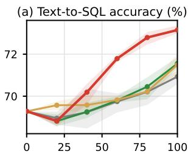

Training Steps (text-to-SQL, Qwen2.5-Coder-7B / 3B)  
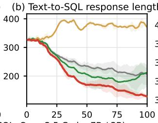

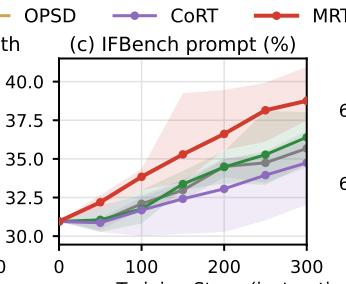

Training Steps (instruction following, Qwen3-4B)  
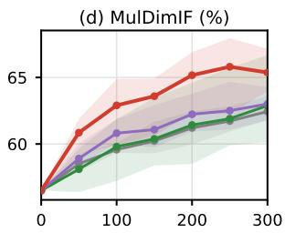

Figure 5: Training dynamics. (a) Text-to-SQL execution accuracy averaged over six benchmarks (Qwen2.5-Coder-7B-Instruct); (b) training response length (Qwen2.5-Coder-3B-Instruct); (c, d) IFBench prompt-level and MulDimIF accuracy (Qwen3-4B-Instruct-2507). Lines are seed means; bands span the seeds.  
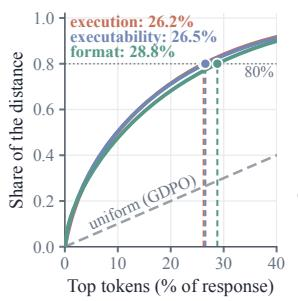  
(a) Text-to-SQL: concentration

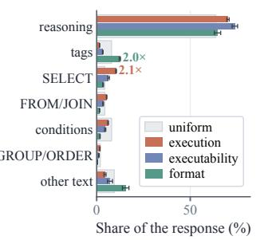  
(b) Text-to-SQL: regions

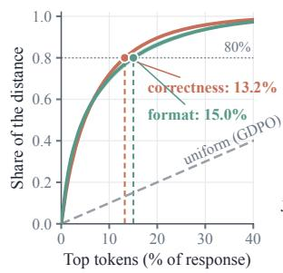  
(c) Tool calling: concentration

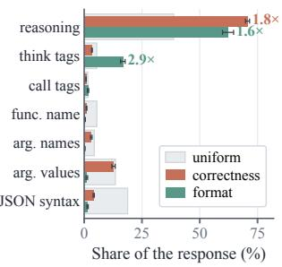  
(d) Tool calling: regions  
Figure 6: Where the replay distance falls. (a, b) Text-to-SQL with Qwen2.5-Coder-3B-Instruct; (c, d) tool calling with Qwen2.5-3B-Instruct. (a, c) Share of each reward’s distance held by the top tokens of a response; (b, d) share on each part of the response. Gray marks the uniform assignment of GDPO.

When does it help most? The gain grows with the number of rewards in a response. Under a uniform assignment every token receives the sum of all rewards’ advantages, so most of the credit on a token comes from rewards unrelated to it, and this share grows with the number of rewards. Instruction following has five to thirteen constraint rewards per prompt, and here MRTPO gains most, 2.4 and 3.2 points on IFBench, whose constraints are not seen in training. Text-to-SQL has three rewards, and MRTPO gains 1.3 and 1.6 points in average accuracy. Tool calling has two, and MRTPO ends close to GDPO; its gain there is in speed.

Does it learn faster? A reward decided by a few tokens receives only a small share of its advantage on those tokens when the advantage is spread uniformly. The format reward of tool calling, which its verifier checks on the tags alone, shows this most clearly. After 10 steps, MRTPO produces the required format on 97% of the BFCL cases, compared with 2% for GDPO and 4% for GRPO (Figure 4d). The other tasks show the same pattern. With Coder-7B, MRTPO passes the final text-to-SQL accuracy of GDPO at step 60 of 100, and with Qwen3-4B-Instruct-2507 it passes the final IFBench accuracy of every baseline at step 200 of 300 (Figure 5a, c). In text-to-SQL the responses also become 40% shorter than those of GDPO with Coder-3B (Figure 5b), because reasoning that does not affect the query gets less execution advantage.

Which tokens receive each reward’s advantage? Without step-level annotations, the replay finds the tokens that decide each reward from forward passes of the policy itself (Figure 6). In text-to-SQL, 80% of a reward’s distance falls on 26% to 29% of the tokens (Figure 6a). The execution reward puts 10% of its distance on the selected columns, twice their share of the tokens, and little on the tags, while the format reward puts twice their share on the tags (Figure 6b). In tool calling, 80% of a reward’s distance falls on 13% to 15% of the tokens (Figure 6c). The format reward gives the think tags three times their share of the tokens. The correctness reward falls mostly on the reasoning that chooses the call, while the function names and JSON syntax, which correct and incorrect calls share, receive about a fifth of their share (Figure 6d).

<table><tr><td rowspan="2">Constraint</td><td colspan="3">Qwen2.5-7B</td><td colspan="3">Qwen3-4B</td></tr><tr><td>Dist.</td><td>Tok.</td><td>Ratio</td><td>Dist.</td><td>Tok.</td><td>Ratio</td></tr><tr><td>End phrase Title Quotation Start phrase</td><td>39.6 24.5 12.3 13.9</td><td>4.4 3.2 1.1 3.8</td><td>9.1 7.6 11.1 3.7</td><td>41.4 25.0 19.6</td><td>4.0 3.3 1.1</td><td>10.4 7.5 17.4</td></tr><tr><td>Keyword Postscript Bullet lines</td><td>8.6 34.3 89.4</td><td>2.7 14.2 86.3</td><td>3.2 2.4 1.0</td><td>10.2 41.8 68.8</td><td>3.1 15.5 45.7</td><td>3.3 2.7 1.5</td></tr><tr><td>All satisfied All violated</td><td>27.6 17.7</td><td>10.1 9.5</td><td>2.7 1.9</td><td>33.0 7.4</td><td>11.7 1.4</td><td>2.8 5.1</td></tr></table>

Table 4: Replay localizes each constraint. For each satisfied constraint type, Dist. is the percentage of the constraint’s replay distance on the part of the response its checker reads, Tok. is that part’s percentage of the tokens, and Ratio is Dist. over Tok.; uniform assignment gives a ratio of 1. The last two rows pool all satisfied and all violated constraints. “–”: fewer than five instances.

In instruction following, the checker of each constraint reads a known part of the response; an endphrase constraint, for example, asks the response to finish with a given phrase, and its checker reads that phrase. We replay 192 HIR-16K responses from each of Qwen2.5-7B-Instruct and Qwen3-4B-Instruct-2507, removing one constraint at a time (Table 4). A satisfied constraint places about 30% of its distance on the part its checker reads, about a tenth of the response; an end phrase holds 40% of the distance with 4% of the tokens. A violated constraint moves its distance to where the missing content should be, such as the opening token when quotation marks are missing. The distances of different constraints on the same response are weakly correlated, so each constraint receives its own assignment, and the part of each advantage that follows relevance goes to the tokens where good and bad responses differ.

Does the gain come from assigning each reward to its own tokens? Two ablations change only the assignment (Table 5). Shuffling the token weights within each response keeps their values and removes their positions, and the gain over GDPO disappears, so the gain depends on where each advantage is assigned. Replaying all rewards together assigns their summed advantage with one shared profile. It improves over GDPO but stays below MRTPO, so the gain also depends on giving each reward its own assignment. We set $\beta = 0 . 5$ on all tasks instead of tuning it per task. On two tasks we also tried 0.25 and 0.75 (Tables 6 and 7). On instruction following, 0.5 gives the highest IFBench accuracy and average, while 0.75 is higher on IFEval and MulDimIF; on text-to-SQL, 0.25 gives a slightly higher average. The best β thus depends on the task, and tuning it per task could improve MRTPO further, which we leave aside because of its compute cost.

<table><tr><td>Method</td><td>Dev</td><td>Test Syn Real. DK BIRD Avg.</td><td></td></tr><tr><td>GDPO</td><td></td><td></td><td>79.2180.6272.2174.8767.2955.11 71.55</td></tr><tr><td>MRTPO</td><td></td><td></td><td>81.33 81.65 73.53 75.92 70.04 56.42 73.15</td></tr><tr><td></td><td></td><td></td><td>joint replay 80.91 81.09 72.95 75.92 69.54 54.94 72.56 shuffled pos. 77.92 80.41 71.21 75.26 66.54 54.8571.03</td></tr></table>

Table 5: Ablations on text-to-SQL with Qwen2.5-Coder-7B-Instruct. Shuffling the weights within each response removes the gain over GDPO.

<table><tr><td></td><td colspan="2">IFEval</td><td colspan="2">IFBench</td><td colspan="2">MulDimIF</td></tr><tr><td>β</td><td>Prompt</td><td>Inst.</td><td>Prompt</td><td>Inst.</td><td>Acc.</td><td>Avg.</td></tr><tr><td>0.25</td><td>81.59</td><td>87.31</td><td>35.83</td><td>37.91</td><td>53.69</td><td>59.26</td></tr><tr><td>0.5</td><td>82.18</td><td>87.70</td><td>38.59</td><td>41.87</td><td>52.75</td><td>60.62</td></tr><tr><td>0.75</td><td>82.49</td><td>88.04</td><td>36.08</td><td>38.67</td><td>55.04</td><td>60.06</td></tr></table>

Table 6: Allocation strength on instruction following with Qwen2.5-7B-Instruct. Assigning half of each advantage by relevance gives the highest average.

<table><tr><td>β</td><td>Dev</td><td>Test</td><td>Syn</td><td>Real.</td><td>DK</td><td>BIRD</td><td>Avg.</td></tr><tr><td>0.25</td><td>81.24</td><td>83.05</td><td>73.69</td><td>76.18</td><td>71.54</td><td>55.87</td><td>73.59</td></tr><tr><td>0.5</td><td>81.82</td><td>81.46</td><td>73.02</td><td>77.56</td><td>69.85</td><td>56.46</td><td>73.36</td></tr><tr><td></td><td>0.75 80.85</td><td>81.97</td><td>72.73</td><td>74.41</td><td>70.04</td><td>56.92</td><td>72.82</td></tr></table>

Table 7: Allocation strength on text-to-SQL with Qwen2.5-Coder-7B-Instruct (one seed).

What does the replay cost? Replay adds forward passes of the policy. For each reward, MRTPO replays a response only when that reward varies within its group, since otherwise its advantage is zero. Such groups are common only early in training and quickly become rare: in tool calling, the share of groups whose correctness varies falls from 61% in the first ten steps to about 10%. Overall, 12% to 21% of the response–reward pairs are replayed, and a training step takes 10% to 20% longer than with GDPO on the same GPUs.

## 6 Conclusion

We introduce MRTPO, which tells a multi-reward learner not only which rewards a response earned but also which tokens earned each of them. The key idea of MRTPO is to replay the policy’s own response under the prompt with and without one verifier’s information, such as a reference query, an execution error or a constraint. The tokens whose predictions change most are the ones this reward depends on, and MRTPO assigns more of the reward’s advantage to them, without step-level annotations. Across text-to-SQL, instruction following and tool calling, MRTPO consistently outperforms GRPO and GDPO on six models and reaches the final accuracy of GDPO in fewer steps. Any reward that comes with checkable information, such as a reference answer, an execution error or a rubric item, can be assigned to its tokens this way.

## Limitations

MRTPO requires that each reward’s verification information can be written as text and that adding or removing it changes the predictions from the policy. Rewards without such information, for example response length, cannot be localized this way and shall keep uniform allocation in GDPO. Our experiments use models of 1.5B to 7B parameters with a single allocation strength $( \beta = 0 . 5 )$ on all tasks. Larger models, rewards judged by an LLM such as rubric items, and adaptive choices of $\beta$ remain to be studied.

## Ethics Statement

This work studies credit assignment for reinforcement learning on publicly available text-to-SQL, instruction-following and tool-calling datasets with programmatic verifiers. It does not involve human subjects or new data collection. More efficient optimization of verifiable rewards also makes it easier to optimize misspecified rewards.

## References

Rishabh Agarwal, Nino Vieillard, Yongchao Zhou, Piotr Stanczyk, Sabela Ramos Garea, Matthieu Geist, and Olivier Bachem. 2024. On-policy distillation of language models: Learning from self-generated mistakes. In International Conference on Learning Representations.

Daixuan Cheng, Shaohan Huang, Xuekai Zhu, Bo Dai, Wayne Xin Zhao, Zhenliang Zhang, and Furu Wei. 2026. Reasoning with exploration: An entropy perspective. In Proceedings of the AAAI Conference on Artificial Intelligence.

Josef Dai, Xuehai Pan, Ruiyang Sun, Jiaming Ji, Xinbo Xu, Mickel Liu, Yizhou Wang, and Yaodong Yang. 2024. Safe RLHF: Safe reinforcement learning from human feedback. In International Conference on Learning Representations.

Xiang Deng, Ahmed Hassan Awadallah, Christopher Meek, Oleksandr Polozov, Huan Sun, and Matthew Richardson. 2021. Structure-grounded pretraining for text-to-SQL. In Proceedings ofthe 2021 Conference of the North American Chapter of the Association for Computational Linguistics.

Yujian Gan, Xinyun Chen, Qiuping Huang, Matthew Purver, John R. Woodward, Jinxia Xie, and Pengsheng Huang. 2021a. Towards robustness of textto-SQL models against synonym substitution. In Proceedings ofthe 59th Annual Meeting ofthe Associationfor Computational Linguistics.

Yujian Gan, Xinyun Chen, and Matthew Purver. 2021b. Exploring underexplored limitations of cross-domain text-to-SQL generalization. In Proceedings of the 2021 Conference on Empirical Methods in Natural Language Processing.

Daya Guo, Dejian Yang, Haowei Zhang, Junxiao Song, Peiyi Wang, et al. 2025. DeepSeek-R1 incentivizes reasoning in LLMs through reinforcement learning. Nature, 645:633–638.

Yuchen He, Baolong Bi, Shenghua Liu, Huaming Liao, Yuyao Ge, Bolin Wan, Siqian Tong, Juan Chen, Jiafeng Guo, and Xueqi Cheng. 2026. SAW: Stageaware dynamic weighting for multi-objective reinforcement learning in large language models. arXiv preprint arXiv:2606.07705.

Yun He, Wenzhe Li, Hejia Zhang, Songlin Li, Karishma Mandyam, Sopan Khosla, Yuanhao Xiong, Nanshu Wang, Xiaoliang Peng, Beibin Li, et al. 2025. AdvancedIF: Rubric-based benchmarking and reinforcement learning for advancing LLM instruction following. arXiv preprint arXiv:2511.10507.

Jonas Hübotter, Frederike Lübeck, Lejs Deen Behric, Anton Baumann, Marco Bagatella, Daniel Marta, Ido Hakimi, Idan Shenfeld, Thomas Kleine Buening, Carlos Guestrin, and Andreas Krause. 2026. Reinforcement learning via self-distillation. In International Conference on Machine Learning.

Binyuan Hui, Jian Yang, Zeyu Cui, Jiaxi Yang, Dayiheng Liu, Lei Zhang, Tianyu Liu, Jiajun Zhang, Bowen Yu, Keming Lu, et al. 2024. Qwen2.5-Coder technical report. arXiv preprint arXiv:2409.12186.

Guochao Jiang, Jingyi Song, Guofeng Quan, Chuzhan Hao, Guohua Liu, and Yuewei Zhang. 2026. DVAO: Dynamic variance-adaptive advantage optimization

for multi-reward reinforcement learning. arXiv preprint arXiv:2605.25604.

Amirhossein Kazemnejad, Milad Aghajohari, Eva Portelance, Alessandro Sordoni, Siva Reddy, Aaron Courville, and Nicolas Le Roux. 2025. VinePPO: Refining credit assignment in RL training of LLMs. In International Conference on Machine Learning.

Haoyang Li, Shang Wu, Xiaokang Zhang, Xinmei Huang, Jing Zhang, Fuxin Jiang, Shuai Wang, Tieying Zhang, Jianjun Chen, Rui Shi, Hong Chen, and Cuiping Li. 2025. OmniSQL: Synthesizing highquality text-to-SQL data at scale. Proceedings of the VLDB Endowment, 18(11):4695–4709.

Jinyang Li, Binyuan Hui, Ge Qu, Jiaxi Yang, Binhua Li, Bowen Li, Bailin Wang, Bowen Qin, Rongyu Cao, Ruiying Geng, Nan Huo, Xuanhe Zhou, Chenhao Ma, Guoliang Li, et al. 2023. Can LLM already serve as a database interface? A BIg bench for largescale database grounded text-to-SQLs. In Advances in Neural Information Processing Systems Datasets and Benchmarks Track.

Hunter Lightman, Vineet Kosaraju, Yura Burda, Harri Edwards, Bowen Baker, Teddy Lee, Jan Leike, John Schulman, Ilya Sutskever, and Karl Cobbe. 2024. Let’s verify step by step. In International Conference on Learning Representations.

Haotian Liu, Yihao Liu, Jingwei Ni, Siyuan Huang, Xinpeng Liu, Pengyu Cheng, Jiajun Song, Ruijin Ding, Junfeng Li, Zhechao Yu, Mengyu Zhou, Hongteng Xu, Xiaoxi Jiang, and Guanjun Jiang. 2026a. GD<sup>2</sup>PO: Mitigating multi-reward conflicts via group-dynamic reward-decoupled policy optimization. arXiv preprint arXiv:2606.16771.

Shih-Yang Liu, Xin Dong, Ximing Lu, Shizhe Diao, Peter Belcak, Mingjie Liu, Min-Hung Chen, Hongxu Yin, Yu-Chiang Frank Wang, Kwang-Ting Cheng, Yejin Choi, Jan Kautz, and Pavlo Molchanov. 2026b. GDPO: Group reward-decoupled normalization policy optimization for multi-reward RL optimization. In International Conference on Machine Learning.

Peixian Ma, Xialie Zhuang, Chengjin Xu, Xuhui Jiang, Ran Chen, and Jian Guo. 2025. SQL-R1: Training natural language to SQL reasoning model by reinforcement learning. In Advances in Neural Information Processing Systems.

Ivan Montero, Tomasz Jurczyk, and Bhuwan Dhingra. 2026. RVPO: Risk-sensitive alignment via variance regularization. arXiv preprint arXiv:2605.05750.

Shishir G. Patil, Huanzhi Mao, Fanjia Yan, Charlie Cheng-Jie Ji, Vishnu Suresh, Ion Stoica, and Joseph E. Gonzalez. 2025. The Berkeley function calling leaderboard (BFCL): From tool use to agentic evaluation of large language models. In International Conference on Machine Learning.

Valentina Pyatkin, Saumya Malik, Victoria Graf, Hamish Ivison, Shengyi Huang, Pradeep Dasigi,

Nathan Lambert, and Hannaneh Hajishirzi. 2025. Generalizing verifiable instruction following. In Advances in Neural Information Processing Systems Datasets and Benchmarks Track.

Cheng Qian, Emre Can Acikgoz, Qi He, Hongru Wang, Xiusi Chen, Dilek Hakkani-Tür, Gokhan Tur, and Heng Ji. 2025. ToolRL: Reward is all tool learning needs. In Advances in Neural Information Processing Systems.

Qwen Team. 2024. Qwen2.5 technical report. arXiv preprint arXiv:2412.15115.

Alexandre Ramé, Guillaume Couairon, Corentin Dancette, Jean-Baptiste Gaya, Mustafa Shukor, Laure Soulier, and Matthieu Cord. 2023. Rewarded soups: Towards Pareto-optimal alignment by interpolating weights fine-tuned on diverse rewards. In Advances in Neural Information Processing Systems.

Zhihong Shao, Peiyi Wang, Qihao Zhu, Runxin Xu, Junxiao Song, Xiao Bi, Haowei Zhang, Mingchuan Zhang, Y. K. Li, Y. Wu, and Daya Guo. 2024. DeepSeekMath: Pushing the limits of mathematical reasoning in open language models. arXiv preprint arXiv:2402.03300.

Jiawei Wang, Jiacai Liu, Yuqian Fu, Yingru Li, Xintao Wang, Yuan Lin, Yu Yue, Lin Zhang, Yang Wang, and Ke Wang. 2026a. Harnessing uncertainty: Entropymodulated policy gradients for long-horizon LLM agents. In International Conference on Machine Learning.

Shenzhi Wang, Le Yu, Chang Gao, Chujie Zheng, Shixuan Liu, Rui Lu, Kai Dang, Xionghui Chen, Jianxin Yang, Zhenru Zhang, Yuqiong Liu, An Yang, Andrew Zhao, Yang Yue, Shiji Song, Bowen Yu, Gao Huang, and Junyang Lin. 2025. Beyond the 80/20 rule: Highentropy minority tokens drive effective reinforcement learning for LLM reasoning. In Advances in Neural Information Processing Systems.

Yixuan Wang, Yifei Chen, Haichao Zhang, Haozheng Luo, Xander Wu, Jie Ni, Yun Fu, Nuno Vasconcelos, and Yijiang Li. 2026b. Learn what’s left, not what’s mastered: Saturation aware advantage reweighting for multi-reward policy optimization. arXiv preprint arXiv:2608.16072.

Zeqiu Wu, Yushi Hu, Weijia Shi, Nouha Dziri, Alane Suhr, Prithviraj Ammanabrolu, Noah A. Smith, Mari Ostendorf, and Hannaneh Hajishirzi. 2023. Finegrained human feedback gives better rewards for language model training. In Advances in Neural Information Processing Systems.

Tianze Xu, Yanzhao Zheng, Pengrui Lu, Lyumanshan Ye, Yong Wu, Zhentao Zhang, Yuanqiang Yu, Chao Ma, Jihuai Zhu, Pengfei Liu, Baohua Dong, Hangcheng Zhu, Ruohui Huang, and Gang Yu. 2026. Rubrics to tokens: Bridging response-level rubrics and token-level rewards in instruction following tasks. In Conference on Language Modeling.

An Yang, Anfeng Li, Baosong Yang, Beichen Zhang, Binyuan Hui, Bo Zheng, Bowen Yu, Chang Gao, Chengen Huang, Chenxu Lv, et al. 2025. Qwen3 technical report. arXiv preprint arXiv:2505.09388.

Junjie Ye, Caishuang Huang, Zhuohan Chen, Wenjie Fu, Chenyuan Yang, Leyi Yang, Yilong Wu, Peng Wang, Meng Zhou, Xiaolong Yang, Tao Gui, Qi Zhang, Zhongchao Shi, Jianping Fan, et al. 2026. MulDimIF: A multi-dimensional constraint framework for evaluating and improving instruction following in large language models. In Proceedings of the 64th Annual Meeting ofthe Associationfor Computational Linguistics.

Tao Yu, Rui Zhang, Kai Yang, Michihiro Yasunaga, Dongxu Wang, Zifan Li, James Ma, Irene Li, Qingning Yao, Shanelle Roman, Zilin Zhang, and Dragomir Radev. 2018. Spider: A large-scale human-labeled dataset for complex and cross-domain semantic parsing and text-to-SQL task. In Proceedings ofthe 2018 Conference on Empirical Methods in Natural Language Processing.

Bo-Wen Zhang, Junwei He, Wen Wang, Song-Lin Lv, Wentao Ma, Rongyi Lin, Shuhan Zhong, and Lan-Zhe Guo. 2026a. CoRT: Counterfactual replay for token-level rubric-guided policy optimization. arXiv preprint arXiv:2607.25659.

Kongcheng Zhang, Qi Yao, Shunyu Liu, Wenjian Zhang, Min Cen, Yang Zhou, Wenkai Fang, Yiru Zhao, Baisheng Lai, and Mingli Song. 2026b. Replay failures as successes: Sample-efficient reinforcement learning for instruction following. In International Conference on Machine Learning.

Siyan Zhao, Zhihui Xie, Mengchen Liu, Jing Huang, Guan Pang, Feiyu Chen, and Aditya Grover. 2026. Self-distilled reasoner: On-policy self-distillation for large language models. In International Conference on Machine Learning.

Tong Zheng, Skylar Zhai, Zhan Cheng, TianMing Sha, Youling Huang, Shuo Zhou, Shaotong Qi, Jingcheng Liang, Xuwei Ding, and Pengcheng Xu. 2026. Make sparse rewards count: Density-aware reward aggregation for multi-reward RL. arXiv preprint arXiv:2610.00574.

Jeffrey Zhou, Tianjian Lu, Swaroop Mishra, Siddhartha Brahma, Sujoy Basu, Yi Luan, Denny Zhou, and Le Hou. 2023. Instruction-following evaluation for large language models. arXiv preprint arXiv:2311.07911.

## A Relation to Reweighting Methods

Algorithm 1 compares one training step of GDPO and MRTPO. Most concurrent multi-reward methods change only how the per-reward advantages are combined into one advantage per response. They weight each reward by batch or group statistics, mask or weight responses, or replace the sum with a soft minimum, and every token of a response receives the same advantage (Table 8). MRTPO instead changes how each advantage is assigned to the tokens, so it is orthogonal to all of these methods. In this paper we combine it with SAW as an example (Table 1).

## B Training and Evaluation Parameters

Table 9 lists the training and evaluation parameters of the three tasks. Reported results are averaged over independent training runs. All tasks use AdamW $( \beta _ { 1 } = 0 . 9 , \beta _ { 2 } = 0 . 9 9 9 )$ , and MRTPO always uses β = 0.5 with an N = 10-step smoothstep warm-up and the reallocation bound of Eq. 8. GRPO standardizes the aggregated reward within each group, without batch-level rescaling.

Text-to-SQL. We drop 3 Spider training questions whose reference query fails to execute and 82 whose prompt exceeds 4,096 tokens. The reference solutions of OPSD are the chain-of-thought solutions that OmniSQL releases for the Spider training set. OPSD shares the rollout and optimizer settings of the other methods, and its teacher is the initial model whose context shows the reference solution as an earlier answer to the same question, followed by the original prompt. For SAW, each reward’s group advantage is multiplied by its coefficient of variation in the batch, normalized so that the three weights sum to three.

Instruction following. We use the first two subsets of HIR-16K, 6,998 prompts with 43,496 constraints, because all their constraints are checked by programs, while the other subsets need an LLM judge.

Tool calling. We follow the public GDPO implementation. Reference argument values written as numeric or boolean strings are converted to the types declared in the tool schema.

## C Replay contexts

Text-to-SQL. The format block is on this database, SQLite raised: <error>.” A response without a SQL block in its answer receives “This response contains no SQL code block inside <answer>.”

Algorithm 1 One training step of GDPO (left) and MRTPO (right); the steps MRTPO adds are in blue   
(Eqs. 4–7). Replay reuses $\pi _ { \theta _ { \mathrm { o l d } } }$ and samples nothing new; the warm-up of $\beta$ and the reallocation bound   
are in Appendix D.   
GDPO MRTPO   
1: for each prompt $P _ { 0 }$ in the batch do 1: for each prompt $P _ { 0 }$ in the batch do   
2: Sample G responses $y ^ { ( 1 ) } , \ldots , y ^ { ( G ) }$ from $\pi _ { \boldsymbol { \theta } _ { \mathrm { o l d } } }$ 2: Sample G responses $y ^ { ( 1 ) } , \ldots , y ^ { ( G ) }$ from $\pi _ { \boldsymbol { \theta } _ { \mathrm { o l d } } }$   
3: Score every response with each verifier: $r _ { k } ^ { ( j ) }$ 3: Score every response with each verifier: $r _ { k } ^ { ( j ) }$   
4: Standardize each reward within the group: 4: Standardize each reward within the group:   
$A _ { k } ^ { ( j ) } = \mathcal { G } ( r _ { k } ^ { ( j ) } )$ $A _ { k } ^ { ( j ) } = \mathcal { G } ( r _ { k } ^ { ( j ) } )$   
5: Sum the rewards: $\begin{array} { r } { S ^ { ( j ) } = \sum _ { k } A _ { k } ^ { ( j ) } } \end{array}$ 5: For each reward $k ,$ find its relevant tokens:   
6: Give every token the same advantage: replay $y ^ { ( j ) }$ after $P _ { \mathrm { a l l } }$ and after $P _ { \backslash k }$   
$S _ { t } ^ { ( j ) } = S ^ { ( j ) }$ for all t $q _ { k , t } = \mathrm { J S }$ distance of the two predictions   
$\bar { w } _ { k , t } = ( 1 - \beta ) + \beta q _ { k , t } / \bar { q } _ { k }$   
7: Rescale: $A _ { t } ^ { ( j ) } = S _ { t } ^ { ( j ) } / \mathrm { s t d } ( S )$ 6: Sum the rewards on each token:   
8: Update π<sub>θ</sub> with the clipped objective $\begin{array} { r } { S _ { t } ^ { ( j ) } = \sum _ { k } A _ { k } ^ { ( j ) } w _ { k , t } } \end{array}$   
7: Rescale: $A _ { t } ^ { ( j ) } = S _ { t } ^ { ( j ) } / \mathrm { s t d } ( S )$   
8: Update π<sub>θ</sub> with the clipped objective

<table><tr><td>Method</td><td>What changes in the GDPO step</td><td>Token advantage  $S _ { t } ^ { ( j ) }$ </td></tr><tr><td>GDPO (Liu et al., 2026b)</td><td>nothing; the per-reward advantages are summed</td><td> $\textstyle \sum _ { k } A _ { k } ^ { ( j ) }$  for all t</td></tr><tr><td>SAW (He et al., 2026)</td><td>each reward is weighted by its coefficient of variation in the batch</td><td> $\Sigma _ { k } \lambda _ { k } A _ { k } ^ { ( j ) }$  for all t</td></tr><tr><td>DARA (Zheng et al., 2026)</td><td>rewards that vary in fewer groups get a larger, capped weight on their positive advantages</td><td> $\begin{array} { r } { \sum _ { k } \left( A _ { k } ^ { ( j ) } + ( \lambda _ { k } - 1 ) [ A _ { k } ^ { ( j ) } ] _ { + } \right) } \end{array}$  for all t</td></tr><tr><td>DVAO (Jiang et al., 2026)</td><td>each reward is weighted by its standard deviation within the group, normalized across rewards</td><td> $\Sigma _ { k } \lambda _ { k } A _ { k } ^ { ( j ) }$  for all t</td></tr><tr><td>SA-MRPO (Wang et al., 2026b)</td><td>each reward is discounted by how saturated it is in the batch</td><td> $\Sigma _ { k } \lambda _ { k } A _ { k } ^ { ( j ) }$  for all t</td></tr><tr><td> $\mathrm { G D ^ { 2 } P O }$  (Liu et al., 2026a)</td><td>responses whose per-reward advantages disagree in sign are dropped, and each prompt is scaled by its share of kept responses</td><td> $\kappa \delta ^ { ( j ) } \textstyle \sum _ { k } A _ { k } ^ { ( j ) }$  for all t</td></tr><tr><td>RVPO (Montero et al., 2026)</td><td>the rewards are combined by a soft minimum, which penalizes their variance</td><td> $\mathrm { s o f t m i n } _ { k } A _ { k } ^ { ( j ) }$  for all t</td></tr><tr><td>MRTPO</td><td>each reward&#x27;s advantage is assigned to tokens by relevance</td><td> $\textstyle \sum _ { k } A _ { k } ^ { ( j ) } w _ { k , t }$ </td></tr></table>

Table 8: Where each method changes the GDPO step. The other methods act on the response, so all tokens of a response receive the same advantage; MRTPO sets a weight per reward and token and can be combined with them.

```markdown
Text-to-SQL: format block
For the final user request, respond in this
form:
<think>...</think>
<answer>
```sql
</answer>
Use exactly one <think> block followed by
exactly one <answer> block, and put the final
SQL query in a ```sql code block inside
<answer>.
```

The execution block states the reference query, “The reference query for this question is: $< _ { \mathsf { q u e r y } } . .$ The executability block of a failing response reports its own error, “When this query was executed

Instruction following. For a prompt with constraints $c _ { 1 } , \ldots , c _ { M } , P _ { \backslash k }$ is produced by the same HiR concatenation template with $c _ { k }$ omitted. For example, removing the end-phrase constraint from

<table><tr><td>Parameter</td><td>Text-to-SQL</td><td>Instruction following</td><td>Tool calling</td></tr><tr><td>Models</td><td>Qwen2.5-Coder-{3B, 7B}-Instruct</td><td>Qwen2.5-7B-Instruct; Qwen3-4B-Instruct-2507</td><td>Qwen2.5-{1.5B, 3B}-Instruct</td></tr><tr><td>Train prompts</td><td>Spider train, 6,915</td><td>HIR-16K, first two subsets,</td><td>RLLA, 3,920 (80 for</td></tr><tr><td>Rewards</td><td>format, executable,</td><td>6,998 one per constraint, {0, 1};</td><td>validation) format {0, 1}; correctness</td></tr><tr><td>Training steps</td><td>execution; {0, 1} 100</td><td>5-13 300</td><td>[-3,3] 100</td></tr><tr><td>Prompts per step / G</td><td>32 / 8</td><td>64 /8</td><td>512 /4</td></tr><tr><td>Rollout temp. / top-p / top-k</td><td>1.1 / 1.0 / none</td><td>1.0 / 0.99 / 100</td><td>1.0 / 1.0 / none</td></tr><tr><td>Max prompt / response length</td><td>4,096 / 2,048</td><td>2,048 / 4,096</td><td>2,048 / 1,024</td></tr><tr><td>Learning rate</td><td>10−6, 15-step linear</td><td>10−6, 15-step linear</td><td>10−6, constant</td></tr><tr><td>Weight decay / grad. clip</td><td>warm-up 0.1 / 1.0</td><td>warm-up 0.1 / 1.0</td><td>0.01 / 1.0</td></tr><tr><td>Updates per step</td><td>1</td><td>1</td><td>4 (mini-batch of 128 prompts)</td></tr><tr><td>PPO clip [εl, εh]</td><td>[0.2, 0.2]</td><td>[0.2, 0.27]</td><td>[0.2, 0.2]</td></tr><tr><td>Entropy coefficient</td><td>0</td><td>0</td><td>0.001</td></tr><tr><td>KL penalty</td><td>in loss, low-var KL, 0.001</td><td>none</td><td>in reward, coefficient 0.001</td></tr><tr><td>Batch rescaling (GDPO, MRTPO)</td><td>per-response std</td><td>per-response std</td><td>token-level whitening</td></tr><tr><td>Validation</td><td></td><td></td><td>80 prompts, greedy, every 10 steps</td></tr><tr><td>Number of seeds</td><td>3</td><td>5</td><td>5</td></tr><tr><td>Hardware</td><td>8 H20 GPUs</td><td>8 H200 GPUs</td><td>4 A100 GPUs</td></tr><tr><td>Evaluation</td><td></td><td></td><td>BFCL-v4 single-turn (gorilla 6ea57973), step 100</td></tr><tr><td>Evaluation decoding</td><td>greedy</td><td>temp. 0.7, top-p 0.8, top-k 20</td><td>temp. 0.6, top-p 0.95, seed 0</td></tr><tr><td>Samples / max length</td><td></td><td>5 / 4,096</td><td></td></tr><tr><td>Max new tokens / context</td><td></td><td></td><td>8,192 / 32,768</td></tr><tr><td>OPSD teacher</td><td>initial model with reference solution</td><td></td><td></td></tr><tr><td>OPSD divergence</td><td>forward KL on teacher</td><td></td><td></td></tr><tr><td>OPSD per-token clip</td><td>top-64 tokens 2.0</td><td></td><td></td></tr></table>

Table 9: Training and evaluation parameters of the three tasks.

Instruction following: removing the end-phrase constraint Provide a detailed response to the following query: “Explain the importance of maintaining a balanced diet for athletes.” Your ENTIRE response should be in en language . . . Your answer must contain exactly 3 bullet points . . . At the end of your response, please explicitly add a postscript starting with P.S. Finish your response with this exact phrase Is there anything else I can help with? No other words should follow this phrase. Wrap your entire response with double quotation marks.

deletes only the bold sentence.

Tool calling. Both blocks are appended to the last user message, separated by a blank line, correctness first. The format block for a tool-call example is

Tool calling: format block   
For the final user request, respond in this   
form:   
<think>...</think>   
<tool\_call>   
</tool\_call>   
Use one <tool\_call> block, place its content   
between the opening and closing tags on   
separate lines, and end the answer with   
</tool\_call>. Do not add a <response> block.  
and the analogous block with <response> for direct-response examples. The correctness block lists the reference calls:

Tool calling: correctness block   
The correctness reference for the final user   
request contains these ordered operation:   
1. Operation name: ‘reverse\_string‘.   
Parameter ‘text‘: "Python programming".   
The operation order, names, parameter names,   
and parameter values above are the complete   
correctness reference.

Replay examples. Figures 3, 7 and 8 show the replays of one training response for text-to-SQL, tool calling and instruction following.

## D Relevance and Weighting Details

Jensen–Shannon divergence. With $\begin{array} { r l } { m _ { k , t } } & { { } = } \end{array}$ $\frac { 1 } { 2 } ( p _ { t } ^ { \mathrm { a l l } } + p _ { t } ^ { \backslash k } )$ , the divergence in Eq. 5 is computed over the full vocabulary as

$$
\begin{array} { r l } & { \mathrm { J S } \big ( p _ { t } ^ { \mathrm { a l l } } \parallel p _ { t } ^ { \backslash k } \big ) = \frac { 1 } { 2 } D _ { \mathrm { K L } } \big ( p _ { t } ^ { \mathrm { a l l } } \parallel m _ { k , t } \big ) } \\ & { ~ + \frac { 1 } { 2 } D _ { \mathrm { K L } } \big ( p _ { t } ^ { \backslash k } \parallel m _ { k , t } \big ) . } \end{array}
$$

It is symmetric and at most ln 2, so $q _ { k , t } \in [ 0 , 1 ]$ Comparing full distributions rather than the probability of the sampled token alone also captures mass that moves among competing candidates while the sampled token keeps its probability.

Warm-up. At training step n, Eq. 6 uses $\beta _ { n } =$ $\beta \lambda _ { n }$ in place of $\beta$ , with the smoothstep $\lambda _ { n } \ =$ $3 u ^ { 2 } - 2 u ^ { 3 }$ and $u = \mathrm { m i n } ( n / N , 1 )$ , which rises from 0 to 1 over the first N steps with zero slope at both ends.

Bounding the reallocation. For response $j ,$ write the token advantage of Eq. 7 before batch rescaling as $S _ { t } ^ { ( j ) } = \bar { S ^ { ( j ) } } + R _ { t } ^ { ( j ) }$ , where $S ^ { ( j ) }$ $\textstyle \sum _ { k } A _ { k } ^ { ( j ) }$ is the uniform GDPO advantage and $\begin{array} { r } { R _ { t } ^ { ( j ) } = \sum _ { k } A _ { k } ^ { ( j ) } \left( w _ { k , t } ^ { ( j ) } - 1 \right) } \end{array}$ is the reallocated part, which has zero mean over the response. Over the valid tokens of a training batch we compute

$$
s = \mathrm { m i n } \left( 1 , \sqrt { \textstyle \sum _ { j } T _ { j } ( S ^ { ( j ) } ) ^ { 2 } { \big / } \textstyle \sum _ { j } \sum _ { t } ( R _ { t } ^ { ( j ) } ) ^ { 2 } } \right)\tag{8}
$$

and use $S ^ { ( j ) } + s R _ { t } ^ { ( j ) }$ in place of $S _ { t } ^ { ( j ) }$ . This is the same as replacing every weight $w _ { k , t }$ by $1 + s \left( w _ { k , t } - 1 \right)$ , which keeps each response’s mean advantage and bounds the second moment of the token advantage by twice that of the uniform advantage.

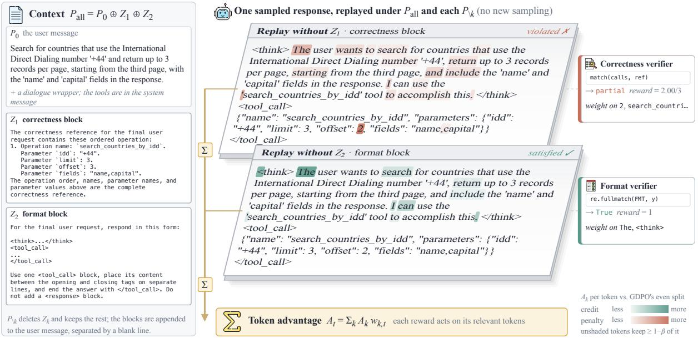  
Figure 7: Leave-one-out replay on a tool-calling response. The response sets offset to 2; the reference has 3. The layout follows Figure 3.

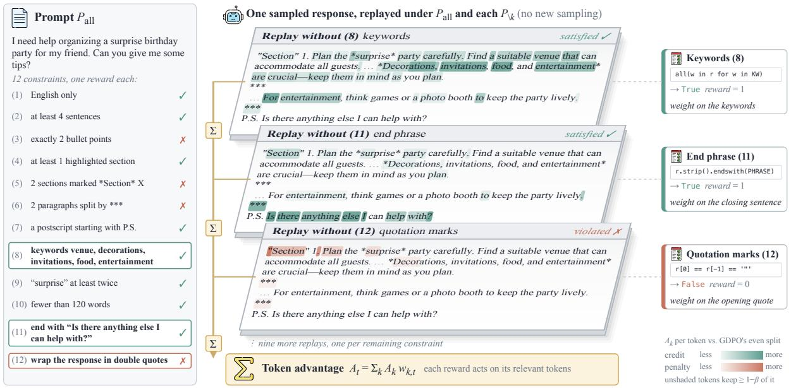  
Figure 8: Leave-one-out replay on an instruction-following response with 12 constraints, three of whose replays are shown. Layout and shading follow Figure 3.