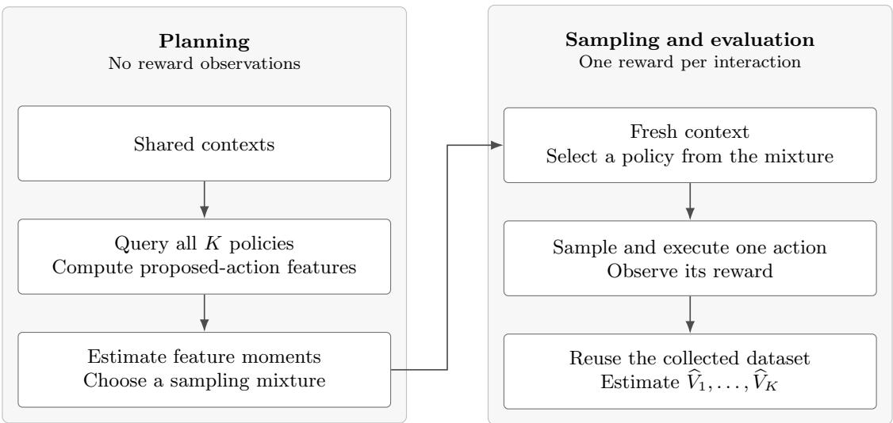

# Explore Once, Evaluate Many: Multiple Policy Evaluation for Stochastic Linear Bandits

Spyros Dragazis<sup>1</sup>, Yilei Chen<sup>1</sup>, and Aldo Pacchiano<sup>1,2</sup>

<sup>1</sup>Boston University <sup>2</sup>Broad Institute of MIT and Harvard

October 16, 2026

## Abstract

We study how to evaluate K target policies simultaneously in stochastic contextual bandits with linear reward structure. Given a known d-dimensional feature map and reward-free access to policy queries, we propose PRISMA (Policy evaluation through Regularized Information Sharing and Mixture Allocation), an algorithm that estimates every target policy’s value to accuracy ε with probability at least $1 - \delta .$ The algorithm uses $\begin{array} { r } { \widetilde { \mathcal { O } } \Big ( \frac { ( L ^ { 2 } S ^ { 2 } + \beta ^ { 2 } ) ( 1 \vee \rho ^ { \star } ) } { \varepsilon ^ { 2 } } \cdot \log ( K ) \Big ) } \end{array}$ context draws and reward observations, where $\rho ^ { \star } \leq d$ is an instance-dependent measure of the dificulty of designing a shared sampling distribution. Here, $L , S ,$ and β bound the feature norm, reward parameter norm, and reward noise, respectively, and the suppressed factors are logarithmic in K, d, and 1/δ. Our method combines reward-free planning, a regularized sampling design, and a single ridge regression estimator shared across all target policies. An adaptive doubling procedure selects the regularization scale without knowledge of $\rho ^ { \star }$ . The guarantees require no numerical lower bound on second-moment eigenvalues and have no explicit dependence on the cardinalities of the context and action spaces. Policy-query costs are accounted for separately, with K queries per shared planning context.

## 1 Introduction

Contextual bandits provide a framework for sequential decision-making in applications such as recommendation systems [24, 25], medicine [5, 7, 32], finance [31, 42], and operations research [4, 16]. Linear reward models are particularly useful because they allow information to be shared across contexts and actions through a feature representation. A variety of learning approaches have been developed, including optimistic algorithms for linear bandits [1] and methods using neural representations [8, 39, 41]. Diferent training procedures, model architectures, and hyperparameter choices can produce many candidate policies. However, it is often unclear which of these policies will perform best in the population where it will be deployed.

Consider a clinician choosing among several pretrained models that recommend treatments from patient measurements. Querying these models on existing patient records may be inexpensive, whereas evaluating their recommendations requires administering treatments and observing outcomes. A similar question arises when a recommendation platform enters a new market: a policy trained for one population may perform diferently in another, and several candidate policies may need to be evaluated on the new population. In both examples, the goal is to assess a collection of fixed policies while limiting the cost of collecting reward observations.

Estimating each policy’s expected reward to a prescribed accuracy supports decisions such as selecting a near-optimal policy or identifying policies whose values exceed a desired threshold. A direct approach evaluates each candidate separately. However, this requires a separate reward budget for every policy, even when their decisions overlap or their feature representations allow observations to be shared. This motivates multiple-policy evaluation: estimating the values of all target policies simultaneously with high probability.

Dann et al. [11] studied this problem in tabular Markov decision processes, exploiting similarities among target policies to reduce the cost of evaluation. Chen et al. [9] developed an approach based on constructing a shared sampling distribution and estimating policy values through importance weighting. These works establish guarantees for tabular models. Extending the underlying ideas to large context and action spaces requires exploiting structure beyond individual context–action pairs. In particular, under linear reward structure, we would like the evaluation cost to reflect the feature dimension and the geometry of the target policies.

This leads to the following question:

Can we evaluate a collection of target policies simultaneously under linear reward structure, with only logarithmic explicit dependence on the number of policies and no dependence on the cardinalities of the context and action spaces in the context and reward sample bounds?

In this work, we answer this question afirmatively for stochastic contextual bandits with a known feature map and a linear conditional mean reward. We consider K fixed target policies and allow reward-free queries to each policy on a shared context. We propose PRISMA, which uses reward-free policy queries on shared contexts to construct a sampling mixture and then fits a single linear reward model to evaluate all target policies.

With probability at least $1 - \delta .$ , our algorithm estimates every target policy’s value to accuracy ε using

$$
\widetilde { \mathcal { O } } \left( \frac { ( L ^ { 2 } S ^ { 2 } + \beta ^ { 2 } ) ( 1 \vee \rho ^ { \star } ) } { \varepsilon ^ { 2 } } \cdot \log ( K ) \right)
$$

context draws and reward observations, where $\widetilde { \mathcal { O } }$ suppresses logarithmic factors in $K , d ,$ , and $1 / \delta$ . Here, $L$ bounds the feature norm, S bounds the reward parameter norm, and $\beta$ bounds the reward noise. The instance-dependent quantity $\rho ^ { \star }$ measures the smallest worst-case value-estimation uncertainty achievable by a mixture of the target policies, and satisfies $\rho ^ { \star } \leq d$ . We account separately for policy queries: each shared planning context requires one query to every target policy.

A central challenge is to learn a useful sampling design from estimated feature moments without requiring a numerical lower bound on the eigenvalues of their second-moment matrices. We address this challenge through a regularized design objective and multiplicative concentration of regularized second moments. An adaptive doubling procedure selects the regularization scale and sample budgets without knowledge of $\rho ^ { \star }$ . Together, these ingredients yield an instance-dependent evaluation guarantee while avoiding explicit dependence on the sizes of the context and action spaces. <sup>1</sup>

## 2 Problem Formulation

Notation. For a positive integer $n ,$ let $[ n ] : = \{ 1 , \dots , n \}$ . For a finite set $s ,$ we denote its cardinality by $| S |$ . We write $\triangle ( s )$ for the set of probability distributions on a measurable space $s ,$ , and $\triangle ^ { n - 1 } : = \{ p \in$ $\begin{array} { r } { [ 0 , 1 ] ^ { n } : \sum _ { i = 1 } ^ { n } p _ { i } = 1 \} } \end{array}$ for the probability simplex over n elements. For vectors $u , v ,$ let $\langle u , v \rangle : = u ^ { \top } v .$ , and let $\lVert u \rVert _ { 2 }$ denote the Euclidean norm. For symmetric matrices $A , B$ of the same size, we write $A \preceq B$ if $B - A$ is positive semidefinite, and $A \succ 0$ if A is positive definite. For $A \succ 0$ , define $\| u \| _ { A } : = \sqrt { u ^ { \top } A u }$ . We denote the identity matrix by $I ,$ with its dimension understood from context. The notation ess sup denotes the essential supremum with respect to the indicated probability distribution. All logarithms are natural. For nonnegative quantities $a , b ,$ we write $a \lesssim b$ if $a \leq C b$ for a universal constant $C > 0$ . The notation $\widetilde { \mathcal { O } }$ suppresses logarithmic factors.

We consider a stochastic contextual linear bandit [7, 18, 40] with context space $x ,$ action space ${ \mathcal { A } } ,$ and an unknown context distribution $\mathcal { P } .$ . The learner has sampling access to $\mathcal { P }$ and access to $K$ known target policies $\Pi ^ { K } : = \{ \pi _ { 1 } , \ldots , \pi _ { K } \}$ , where each policy $\pi _ { i } : \mathcal { X } \to \triangle ( \mathcal { A } )$ maps a context to a distribution over actions. Contexts are sampled independently from $\mathcal { P } _ { \cdot }$ . Given a context $X _ { t } .$ , the learner can select a policy index $I _ { t } \in [ K ]$ and sample an action $A _ { t } \sim \pi _ { I _ { t } } ( \cdot \mid X _ { t } )$ . Executing this action produces a reward

$$
R _ { t } = \left. \phi ( X _ { t } , A _ { t } ) , \theta ^ { \star } \right. + \eta _ { t } ,\tag{1}
$$

where $\phi : \mathcal { X } \times \mathcal { A }  \mathbb { R } ^ { d }$ is a known feature map and $\theta ^ { \star } \in \mathbb { R } ^ { d }$ is an unknown, fixed reward parameter. Conditional on $( X _ { t } , A _ { t } )$ , the reward is drawn independently of the past from a fixed distribution. The noise satisfies

$$
\mathbb { E } [ \eta _ { t } \mid X _ { t } , A _ { t } ] = 0 , \qquad | \eta _ { t } | \leq \beta \quad \mathrm { a l m o s t ~ s u r e l y } ,
$$

for a known constant $\beta > 0$

For any sampled context $x ,$ the learner can query each target policy and compute the feature vectors of the sampled actions without executing those actions or observing their rewards. A reward is observed only when an action is executed. We distinguish between context samples, policy queries, and reward observations when accounting for sample complexity. The context and action spaces may be infinite; our goal is to obtain guarantees expressed through the feature dimension $d ,$ without dependence on the cardinalities of these spaces $| { \mathcal { X } } \times { \mathcal { A } } |$

For any policy π, we define its value as

$$
V _ { \pi } : = \mathbb { E } _ { \pi } [ R ] = \mathbb { E } _ { \pi } \left[ \langle \phi ( x , a ) , \theta ^ { \star } \rangle \right] ,\tag{2}
$$

where $\mathbb { E } _ { \pi }$ denotes expectation over $x \sim \mathcal { P } , a \sim \pi ( \cdot \mid x )$ , and the reward noise when applicable. The equality follows from $\mathbb { E } [ \eta \ | \ x , a ] = 0$ . In particular, for any integrable function $Y ( x , a )$ , we write $\mathbb { E } _ { \pi } Y ( x , a )$ as shorthand for $\mathbb { E } _ { x \sim \mathcal { P } } \mathbb { E } _ { a \sim \pi ( \cdot | x ) } Y ( x , a )$

Given a set of target policies $\Pi ^ { K }$ , sampling access to ${ \mathcal { P } } ,$ and the interaction model described above, the task of multiple-policy high-confidence policy evaluation [9, 11] is to estimate the values of all target policies simultaneously. Specifically, given an accuracy $\varepsilon > 0$ and a confidence parameter $\delta \in ( 0 , 1 )$ , the learner must output estimates $\hat { V } _ { 1 } , \dotsc , \hat { V } _ { K }$ satisfying

$$
\mathbb { P } \left( \operatorname* { m a x } _ { i \in [ K ] } \Big | \hat { V } _ { i } - V _ { i } \Big | \leq \varepsilon \right) \geq 1 - \delta ,\tag{3}
$$

where $V _ { i } : = V _ { \pi _ { i } }$ . The probability is over the randomness in data collection and the algorithm.

Before presenting our algorithm and its sample complexity guarantees, we state the following structural assumptions.

Assumption 1 (ℓ<sub>2</sub>-bounded features and parameter). There exist known constants $L , S > 0$ such that

$$
\begin{array} { r l } { \| \phi ( \boldsymbol { x } , \boldsymbol { a } ) \| _ { 2 } \le L , } & { \quad \forall ( \boldsymbol { x } , \boldsymbol { a } ) \in \mathcal { X } \times \mathcal { A } , } \\ { \| \theta ^ { \star } \| _ { 2 } \le S . } \end{array}
$$

We use these bounds to control feature estimation errors and the regularization bias in value estimation. Knowledge of $L$ and $S$ is a standard assumption in classical linear bandit algorithms, such as OFUL [1]. Developing an algorithm that does not require these bounds is beyond the scope of this work. For linear bandit algorithms that do not require prior knowledge of an upper bound on $\| \theta ^ { \star } \| _ { 2 } ,$ , see Gales et al. [15]. Assumption 2 (Coverage). For every target policy $\pi _ { i } , i \in [ K ]$ , the feature second-moment matrix

$$
\Sigma _ { i } : = \mathbb E _ { \pi _ { i } } \left[ \phi ( x , a ) \phi ( x , a ) ^ { \top } \right]
$$

is positive definite, $i . e . , \Sigma _ { i } \succ 0$

This assumption requires the feature distribution induced by each target policy to span $\mathbb { R } ^ { d }$ . Similar full-rank conditions appear in policy evaluation with linear function approximation; see, for example, Bhandari et al. [6]. We impose no quantitative lower bound on $\lambda _ { \operatorname* { m i n } } ( \Sigma _ { i } )$ for any $i \in [ K ]$

## 3 Planning Phase

Designing a sampling distribution that allows a shared dataset to evaluate all target policies is a natural approach to multiple-policy evaluation. For tabular MDPs, Chen et al. [9] use coarse estimates of visitation distributions to construct an approximately optimal sampling distribution, and then estimate importance weights to evaluate the target policies. Dann et al. [11] exploit overlap between target policies by coupling their rollouts and sharing samples. Explicitly representing visitation distributions and importance weights requires quantities indexed by state–action pairs. Such a representation can be costly when $| { \mathcal { X } } \times { \mathcal { A } } |$ is large, and is unsuitable when these spaces are infinite. We therefore use the known feature map to formulate the sampling design problem in terms of the feature dimension d.

In a finite context–action space, the usual importance weight for evaluating a target policy π using samples from a behavior policy is the target-to-behavior ratio $\mathbb { P } _ { \pi } ( X = x , A = a ) / \mathbb { P } _ { \mu } ( X = x , A = a )$ , provided that the behavior distribution covers the target distribution. In the linear setting, we can instead construct weights using feature means and second moments.

We write

$$
\phi _ { \pi } : = \mathbb { E } _ { \pi } [ \phi ( X , A ) ]
$$

for the mean feature vector of policy π. For a mixture $\pmb { \mu } = ( \mu _ { 1 } , \dots , \mu _ { K } ) \in \triangle ^ { K - 1 }$ , let

$$
\pi _ { \pmb { \mu } } ( \cdot \mid x ) : = \sum _ { i = 1 } ^ { K } \mu _ { i } \pi _ { i } ( \cdot \mid x ) .
$$

We use $\mathbb { E } _ { \mu }$ to denote expectation under this mixture policy and the common context distribution $\mathcal { P } .$ . Its feature second-moment matrix is

$$
\Sigma _ { \pmb { \mu } } : = \mathbb { E } _ { \pmb { \mu } } \big [ \phi ( X , A ) \phi ( X , A ) ^ { \top } \big ] = \sum _ { i = 1 } ^ { K } \mu _ { i } \Sigma _ { i } .\tag{4}
$$

By Assumption $2 , \Sigma _ { \mu }$ is positive definite for every $\mu \in \triangle ^ { K - 1 }$

For any target policy π, we can therefore write

$$
\begin{array} { r l } & { V _ { \pi } = \mathbb { E } _ { \pi } [ \langle \phi ( X , A ) , \theta ^ { \star } \rangle ] = \phi _ { \pi } ^ { \top } \theta ^ { \star } } \\ & { \quad \quad = \phi _ { \pi } ^ { \top } \Sigma _ { \mu } ^ { - 1 } \mathbb { E } _ { \mu } \big [ \phi ( X , A ) \phi ( X , A ) ^ { \top } \big ] \theta ^ { \star } } \\ & { \quad \quad = \mathbb { E } _ { \mu } \Big [ \phi _ { \pi } ^ { \top } \Sigma _ { \mu } ^ { - 1 } \phi ( X , A ) \langle \phi ( X , A ) , \theta ^ { \star } \rangle \Big ] . } \end{array}\tag{5}
$$

Thus, the appropriate analogue of an importance weight in our linear setting is

$$
w _ { \pi } ( x , a ) : = \boldsymbol { \phi } _ { \pi } ^ { \top } \Sigma _ { \mu } ^ { - 1 } \boldsymbol { \phi } ( x , a ) .\tag{6}
$$

These weights may be negative. Their role is to match the target feature mean under the behavior distribution, which is suficient to recover the target value under the linear reward model.

To motivate the choice of mixture, first suppose that the population quantities $\phi _ { \pi }$ and $\Sigma _ { \mu }$ are known. Fix $\mu \in \triangle ^ { K - 1 }$ and consider a fresh batch of N independent samples collected according to this mixture. For each $t \in [ N ]$ , we draw

$$
X _ { t } \sim \mathcal { P } , \qquad I _ { t } \sim \mu , \qquad A _ { t } \sim \pi _ { I _ { t } } ( \cdot \mid X _ { t } ) ,
$$

where $I _ { t }$ is independent of $X _ { t } .$ , and observe a reward $R _ { t }$ generated according to Equation (1). For any target policy π, define

$$
\hat { V } _ { \pi } : = \frac { 1 } { N } \sum _ { t = 1 } ^ { N } w _ { \pi } ( X _ { t } , A _ { t } ) R _ { t } .\tag{7}
$$

By Equation (5) and the conditional mean-zero noise assumption, this estimator is unbiased: E[ ${ \hat { V } } _ { \pi } ] = V _ { \pi }$ . If $\pmb { \mu }$ is chosen using independent planning data, the same argument applies conditional on those data.

The second moment of the weight satisfies

$$
\mathbb { E } _ { \pmb { \mu } } \big [ w _ { \pi _ { k } } ( X , A ) ^ { 2 } \big ] = \phi _ { k } ^ { \top } \Sigma _ { \pmb { \mu } } ^ { - 1 } \phi _ { k } .
$$

Since $| R | \leq L S + \beta$ almost surely, it follows that

$$
\begin{array} { r } { \mathrm { V a r } _ { \pmb \mu } ( w _ { \pi _ { k } } ( X , A ) R ) \leq ( L S + \beta ) ^ { 2 } \phi _ { k } ^ { \top } \Sigma _ { \pmb \mu } ^ { - 1 } \phi _ { k } . } \end{array}
$$

A Bernstein concentration argument therefore gives a value-estimation bound whose leading variance term is controlled by

$$
\rho ( \pmb { \mu } ) : = \operatorname* { m a x } _ { k \in [ K ] } \phi _ { k } ^ { \top } \Sigma _ { \pmb { \mu } } ^ { - 1 } \phi _ { k } .
$$

This motivates choosing a mixture that minimizes $\rho ( \pmb { \mu } )$ , and defining the instance-dependent quantity

$$
\rho ^ { \star } : = \operatorname* { m i n } _ { \pmb { \mu } \in \triangle ^ { K - 1 } } \rho ( \pmb { \mu } ) .
$$

The full Bernstein bound also contains a term controlling the maximum magnitude of the weighted rewards. Of course, the population quantities $\phi _ { k }$ and $\Sigma _ { k }$ are unknown and must be estimated during planning. We first state the concentration guarantee when these quantities are known, and then explain how to estimate them.

Lemma 1. Suppose that the population feature means $\phi _ { k }$ and second moments $\Sigma _ { k } , k \in [ K ]$ , are known. Fix $\mu \in \triangle ^ { K - 1 }$ , and let $\{ ( X _ { t } , A _ { t } , \bar { R _ { t } } ) \} _ { t = 1 } ^ { N }$ be $N \geq 1$ independent samples collected under the mixture policy $\pi _ { \mu }$ and the reward model in Equation (1). Define

$$
W _ { \pmb \mu } : = \operatorname* { m a x } _ { k \in [ K ] } \operatorname { e s s } \operatorname* { s u p } _ { X \sim \mathcal { P } , A \sim \pi _ { \pmb \mu } ( \cdot | X ) } \left| w _ { \pi _ { k } } ( X , A ) \right| .
$$

For any $\delta \in ( 0 , 1 )$ , with probability at least $1 - \delta ,$ , the estimators in Equation (7) satisfy

$$
\operatorname* { m a x } _ { k \in \left[ K \right] } \left. \hat { V } _ { \pi _ { k } } - V _ { \pi _ { k } } \right. \leq \left( L S + \beta \right) \left( \sqrt { \frac { 2 \rho ( \mu ) \log ( 2 K / \delta ) } { N } } + \frac { 4 W _ { \mu } \log ( 2 K / \delta ) } { 3 N } \right) .
$$

If the mixture is selected using independent planning data, the same guarantee holds conditional on those data.

Consequently, to estimate all target policy values with ε accuracy, it is suficient to take

$$
N \geq \log \left( \frac { 2 K } { \delta } \right) \operatorname* { m a x } \left\{ \frac { 8 ( L S + \beta ) ^ { 2 } \rho ( \pmb \mu ) } { \varepsilon ^ { 2 } } , \frac { 8 ( L S + \beta ) W _ { \pmb \mu } } { 3 \varepsilon } \right\} .
$$

The leading variance term therefore scales as $\tilde { \mathcal { O } } ( ( L S + \beta ) ^ { 2 } \rho ( \pmb { \mu } ) / \varepsilon ^ { 2 } )$ . The population benchmark $\rho ^ { \star }$ minimizes this uncertainty over all mixtures of the target policies. Since the feature means $\phi _ { k }$ and second moments $\Sigma _ { k }$ are unknown, we will estimate them and use a regularized empirical design problem during planning. We first show that the population benchmark is at most d.

Proposition 1. Under Assumption 2, the optimal design complexity satisfies

$$
\rho ^ { \star } = \operatorname* { m i n } _ { \mu \in \triangle ^ { K - 1 } } \operatorname* { m a x } _ { k \in [ K ] } \phi _ { k } ^ { \top } \left( \sum _ { i = 1 } ^ { K } \mu _ { i } \Sigma _ { i } \right) ^ { - 1 } \phi _ { k } \leq d .
$$

In Chen et al. [9], coarse estimates of policy visitation distributions are used to construct a sampling distribution for multiple-policy evaluation in tabular MDPs. Coarse estimation allows the cost of estimating visitation distributions to scale with $1 / \varepsilon$ , up to logarithmic factors and factors depending on the tabular problem parameters, rather than $1 / \varepsilon ^ { 2 }$ . In our setting, we do not necessarily need to apply the coarse estimation technique as the context distribution does not depend on the policy, and we can query every target policy on the same context without observing rewards. Thus, for each context $X _ { t } \sim \mathcal { P }$ , we sample $A _ { t } ^ { k } \sim \pi _ { k } ( \cdot \mid X _ { t } )$ and compute $\phi ( X _ { t } , A _ { t } ^ { k } )$ for every $k \in [ K ]$ . This allows us to estimate the feature means and second moments directly from a shared batch of contexts.

We begin by estimating the unknown population quantities $\phi _ { k }$ and $\Sigma _ { k }$ . Draw $X _ { 1 } , \ldots , X _ { N }$ independently from $\mathcal { P }$ and, for each $t \in [ N ]$ , sample $A _ { t } ^ { \bar { k } } \sim \pi _ { k } ( \cdot \ \bar { | } \ X _ { t } )$ using fresh randomness. For each fixed policy k, the feature vectors $\{ \phi ( X _ { t } , A _ { t } ^ { k } ) \} _ { t = 1 } ^ { N }$ are therefore independent and identically distributed, with mean $\phi _ { k }$ and second moment $\Sigma _ { k }$ . We finally obtain simultaneous guarantees through a union bound.

Since the feature vectors satisfy $\| \phi ( X _ { t } , A _ { t } ^ { k } ) \| _ { 2 } \leq L$ by Assumption 1, we first use McDiarmid’s inequality, together with a bound on the expected estimation error, to control the Euclidean distance between each empirical feature mean and its population counterpart.

Lemma 2. Let $X _ { 1 } , \ldots , X _ { N }$ be independent contexts drawn from P. For each $t \in [ N ]$ and $k \in [ K ]$ , sample $A _ { t } ^ { k } \sim \pi _ { k } ( \cdot \mid X _ { t } )$ using fresh randomness, and define

$$
\hat { \phi } _ { N } ^ { k } : = \frac { 1 } { N } \sum _ { t = 1 } ^ { N } \phi ( X _ { t } , A _ { t } ^ { k } ) .
$$

Under Assumption 1, for any $\delta \in ( 0 , 1 )$ , with probability at least $1 - \delta$ , simultaneously for all $k \in [ K ]$

$$
\left\| \hat { \phi } _ { N } ^ { k } - \phi _ { k } \right\| _ { 2 } \leq \frac { L } { \sqrt { N } } \left( 1 + \sqrt { 2 \log \left( \frac { K } { \delta } \right) } \right) .
$$

See Section C.3 for the proof.

We next estimate the second moments used in the design problem. Directly controlling the relative error of an estimate of $\Sigma _ { k } ^ { - 1 }$ generally requires a sample size that depends on the smallest eigenvalue of $\Sigma _ { k }$ , which can be arbitrarily small. To avoid this dependence, we introduce a regularization parameter $\lambda > 0$ and estimate $\Sigma _ { k } + \lambda I$ to constant multiplicative accuracy. Since $\Sigma _ { k } + \lambda I \succeq \lambda I$ , the resulting sample bound depends on λ instead of a lower bound on the eigenvalues of $\Sigma _ { k }$ . We will choose $\lambda$ later to balance the cost of planning with the regularization bias in value estimation.

Lemma 3. Let $X _ { 1 } , \ldots , X _ { N }$ be independent contexts drawn from $\mathcal { P } .$ For each $t \in [ N ]$ and $k \in [ K ]$ , sample $A _ { t } ^ { k } \sim \pi _ { k } ( \cdot \mid X _ { t } )$ using fresh randomness, and define

$$
\hat { \Sigma } _ { k } : = \frac { 1 } { N } \sum _ { t = 1 } ^ { N } \phi ( X _ { t } , A _ { t } ^ { k } ) \phi ( X _ { t } , A _ { t } ^ { k } ) ^ { \top } .
$$

Under Assumption 1, fix $\lambda > 0$ and $\delta \in ( 0 , 1 )$ . If

$$
N \geq \frac { 2 8 L ^ { 2 } } { 3 \lambda } \log \left( \frac { 2 K d } { \delta } \right) ,
$$

then, with probability at least $1 - \delta$ , simultaneously for all $k \in [ K ]$

$$
\frac 1 2 ( \Sigma _ { k } + \lambda I ) \preceq \hat { \Sigma } _ { k } + \lambda I \preceq \frac 3 2 ( \Sigma _ { k } + \lambda I ) .
$$

See Section C.4 for the proof. Since inversion reverses the positive definite order, on the same event we also have

$$
{ \frac { 2 } { 3 } } ( \Sigma _ { k } + \lambda I ) ^ { - 1 } \preceq ( { \hat { \Sigma } } _ { k } + \lambda I ) ^ { - 1 } \preceq 2 ( \Sigma _ { k } + \lambda I ) ^ { - 1 } , \qquad k \in [ K ] .
$$

We now replace the population quantities by their empirical estimates and solve the regularized design problem. For convenience, write $\hat { \phi } _ { k } : = \hat { \phi } _ { N } ^ { k }$ and define

$$
\hat { F } _ { \lambda } ( \pmb { \mu } ) : = \operatorname* { m a x } _ { k \in [ K ] } \hat { \phi } _ { k } ^ { \top } \left( \sum _ { i = 1 } ^ { K } \mu _ { i } \hat { \Sigma } _ { i } + \lambda I \right) ^ { - 1 } \hat { \phi } _ { k } .
$$

We select a mixture

$$
\hat { \pmb \mu } \in \mathop { \mathrm { a r g } } _ { \pmb \mu \in \triangle ^ { K - 1 } } \hat { F } _ { \lambda } ( \pmb \mu ) .
$$

This is a convex optimization problem. Indeed, by the Schur complement, it is equivalent to the semidefinite program

$$
\begin{array} { r l } { \underset { \mu \in \triangle ^ { K - 1 } , z \in \mathbb { R } } { \mathrm { m i n i m i z e } } } & { z } \\ { \mathrm { s u b j e c t ~ t o } } & { \left( \sum _ { i = 1 } ^ { K } \mu _ { i } \hat { \Sigma } _ { i } + \lambda I \quad \hat { \phi } _ { k } \right) \succeq 0 , \qquad k \in [ K ] . } \end{array}
$$

Since $\lambda > 0$ , the objective is continuous on the compact simplex, so a minimizer exists [33].

To assess the selected mixture, define the corresponding regularized population objective

$$
F _ { \lambda } ( \pmb { \mu } ) : = \operatorname* { m a x } _ { k \in [ K ] } \phi _ { k } ^ { \top } \left( \sum _ { i = 1 } ^ { K } \mu _ { i } \Sigma _ { i } + \lambda I \right) ^ { - 1 } \phi _ { k } ,
$$

and recall that

$$
\rho ^ { \star } : = \operatorname* { m i n } _ { \mu \in \triangle ^ { K - 1 } } \operatorname* { m a x } _ { k \in [ K ] } \phi _ { k } ^ { \top } \Sigma _ { \mu } ^ { - 1 } \phi _ { k } .
$$

The following lemma compares the empirical and population objectives and bounds the uncertainty of the selected mixture in terms of the unregularized benchmark $\rho ^ { \star }$

Lemma 4. Under Assumptions 1 and 2, fix $\lambda > 0$ and $\delta \in ( 0 , 1 )$ . Form $\hat { \phi } _ { k }$ and $\hat { \Sigma } _ { k }$ from the same batch of N independent contexts and fresh policy queries, as in Lemmas 2 and 3. If

$$
N \geq \frac { 1 6 L ^ { 2 } } { \lambda } \log \left( \frac { 4 K d } { \delta } \right) ,
$$

then, with probability at least $1 - \delta ,$ every minimizer ${ \hat { \pmb { \mu } } } \in \arg \operatorname* { m i n } _ { { \pmb { \mu } } \in \triangle ^ { K - 1 } } { \hat { F } } _ { \lambda } ( { \pmb { \mu } } )$ satisfies

$$
\hat { F } _ { \lambda } ( \hat { \pmb { \mu } } ) \leq 4 \rho ^ { \star } + 4 , \qquad F _ { \lambda } ( \hat { \pmb { \mu } } ) \leq 1 2 \rho ^ { \star } + 1 4 .
$$

See Section C.5 for the proof. We deploy this mixture in the sampling phase and account for the resulting regularization bias when estimating the policy values.

## 4 Sampling phase

During the planning phase, we used reward-free feature samples to select a mixture $\hat { \pmb { \mu } }$ of the target policies. We now deploy this mixture, collect reward observations, and use them to estimate the values of all target policies. The planning guarantees depend on a regularization parameter $\lambda > 0$ . In this section, we analyze how this parameter afects the final estimation error and choose it, together with the sample budgets, to achieve accuracy ε.

Our estimator combines feature-mean estimates with a single linear reward model fitted by ridge regression. For each target policy π<sub>k</sub>, we estimate $V _ { \pi _ { k } } = \phi _ { k } ^ { \top } \theta ^ { \star }$ by

$$
\hat { V } _ { k } : = \tilde { \phi } _ { k } ^ { \top } \hat { \theta } ,
$$

where $\tilde { \phi } _ { k }$ is a fresh estimate of $\phi _ { k }$ and $\hat { \theta }$ is fitted using rewards collected under $\hat { \mu } .$

To simplify the dependence structure in the analysis, we use separate batches for estimating the feature means and fitting the reward model. Specifically, draw $N _ { \mathrm { m e a n } }$ fresh contexts $X _ { t } ^ { \prime } \sim \mathcal { P }$ , independently of the planning data and the reward batch. For each context, query every target policy to obtain $\ \cdot \mathrm { \ i } _ { t } ^ { \prime k } \sim \pi _ { k } ( \cdot \mid X _ { t } ^ { \prime } )$ , and define

$$
\tilde { \phi } _ { k } : = \frac { 1 } { N _ { \mathrm { m e a n } } } \sum _ { t = 1 } ^ { N _ { \mathrm { m e a n } } } \phi ( X _ { t } ^ { \prime } , A _ { t } ^ { \prime k } ) , \qquad k \in [ K ] .
$$

By Lemma 2, a batch of

$$
N _ { \mathrm { m e a n } } = \left\lceil \frac { L ^ { 2 } } { \lambda } \left( 1 + \sqrt { 2 \log \left( \frac { 2 K } { \delta } \right) } \right) ^ { 2 } \right\rceil
$$

contexts sufices to ensure $\| \tilde { \phi } _ { k } - \phi _ { k } \| _ { 2 } \leq \sqrt { \lambda }$ simultaneously for all $k \in [ K ]$ , with probability at least $1 - \delta / 2$ . These contexts are shared across policies, so this step requires $K N _ { \mathrm { m e a n } }$ policy queries and no reward observations.

We next collect M fresh reward samples using the selected mixture. For each $i \in [ M ]$ , draw $X _ { i } \sim \mathcal { P }$ independently sample $I _ { i } \sim { \hat { \mu } } ,$ , and execute $A _ { i } \sim \pi _ { I _ { i } } ( \cdot \mid X _ { i } )$ . Observe the reward $R _ { i }$ generated according to Equation (1). Conditional on the planning data, these samples are independent and identically distributed under the fixed mixture $\hat { \pmb { \mu } }$ . Define

$$
\begin{array} { r l } & { \tilde { \Sigma } : = \displaystyle \frac { 1 } { M } \sum _ { i = 1 } ^ { M } \phi ( X _ { i } , A _ { i } ) \phi ( X _ { i } , A _ { i } ) ^ { \top } , } \\ & { \tilde { g } : = \displaystyle \frac { 1 } { M } \sum _ { i = 1 } ^ { M } \phi ( X _ { i } , A _ { i } ) R _ { i } , } \\ & { B : = \tilde { \Sigma } + \lambda I . } \end{array}\tag{8}
$$

Our ridge regression estimator is $\hat { \theta } : = B ^ { - 1 } \tilde { g }$

We first express the parameter-estimation error as the sum of a regularization term and a reward-noise term. This identity will yield a three-term decomposition of the value-estimation error and guide our choice of λ and the reward sample budget M.

Lemma 5. Let $B$ and $\tilde { g }$ be defined in Equation (8), and let $\hat { \theta } : = B ^ { - 1 } \tilde { g }$ . Under the reward model in Equation (1),

$$
\hat { \theta } - \theta ^ { \star } = - \lambda B ^ { - 1 } \theta ^ { \star } + \frac { 1 } { M } B ^ { - 1 } \sum _ { i = 1 } ^ { M } \eta _ { i } \phi ( X _ { i } , A _ { i } ) .
$$

See Section D.1 for the proof. This identity holds for every realization of the samples.

For brevity, write $\phi _ { i } : = \phi ( X _ { i } , A _ { i } )$ . Using Lemma $5 ,$ , we decompose the value-estimation error as

$$
\begin{array} { r l } & { V _ { k } - \hat { V } _ { k } = \phi _ { k } ^ { \top } \theta ^ { \star } - \tilde { \phi } _ { k } ^ { \top } \hat { \theta } } \\ & { \qquad = ( \phi _ { k } - \tilde { \phi } _ { k } ) ^ { \top } \theta ^ { \star } + \tilde { \phi } _ { k } ^ { \top } ( \theta ^ { \star } - \hat { \theta } ) } \\ & { \qquad = \underbrace { ( \phi _ { k } - \tilde { \phi } _ { k } ) ^ { \top } \theta ^ { \star } } _ { \mathrm { f e a t u r e - m e a n ~ e r r o r } } + \underbrace { \lambda \tilde { \phi } _ { k } ^ { \top } B ^ { - 1 } \theta ^ { \star } } _ { \mathrm { r e g u l a r i z a t i o n ~ b i a s } } - \underbrace { \frac { 1 } { M } \tilde { \phi } _ { k } ^ { \top } B ^ { - 1 } \sum _ { i = 1 } ^ { M } \eta _ { i } \phi _ { i } } _ { \mathrm { r e w a r d ~ n o i s e } } . } \end{array}\tag{9}
$$

We bound these three contributions separately, allocating error $\varepsilon / 2$ to feature-mean estimation and $\varepsilon / 4$ to each of the remaining terms.

For the feature-mean error, Cauchy–Schwarz and Assumption $1 \ \mathrm { g i v e } .$ , on the event $\lVert \tilde { \phi } _ { k } - \phi _ { k } \rVert _ { 2 } \leq \sqrt { \lambda }$

$$
\begin{array} { r l } & { \left| ( \phi _ { k } - \tilde { \phi } _ { k } ) ^ { \top } \theta ^ { \star } \right| \leq \| \phi _ { k } - \tilde { \phi } _ { k } \| _ { 2 } \| \theta ^ { \star } \| _ { 2 } } \\ & { \qquad \leq S \sqrt { \lambda } . } \end{array}
$$

Thus, this contribution is at most $\varepsilon / 2$ whenever

$$
\lambda \leq \frac { \varepsilon ^ { 2 } } { 4 S ^ { 2 } } .
$$

To control the regularization bias, define

$$
G : = \Sigma _ { \hat { \pmb { \mu } } } + \lambda I , \qquad Q _ { k } : = \tilde { \phi } _ { k } ^ { \top } B ^ { - 1 } \tilde { \phi } _ { k } .
$$

Conditional on the planning data, the reward batch is drawn from the fixed mixture ${ \hat { \mu } } .$ Applying the regularized second-moment concentration argument of Lemma 3 to this mixture gives

$$
{ \frac { 1 } { 2 } } G \preceq B \preceq { \frac { 3 } { 2 } } G .
$$

We work on this event together with the planning and feature-mean concentration events.

Writing $e _ { k } : = \tilde { \phi } _ { k } - \phi _ { k }$ , we have $e _ { k } ^ { \top } G ^ { - 1 } e _ { k } \leq \| e _ { k } \| _ { 2 } ^ { 2 } / \lambda \leq 1$ . Therefore,

$$
\begin{array} { r l } & { Q _ { k } \leq 2 \tilde { \phi } _ { k } ^ { \top } G ^ { - 1 } \tilde { \phi } _ { k } } \\ & { \quad = 2 ( \phi _ { k } + e _ { k } ) ^ { \top } G ^ { - 1 } ( \phi _ { k } + e _ { k } ) } \\ & { \quad \leq 4 \phi _ { k } ^ { \top } G ^ { - 1 } \phi _ { k } + 4 e _ { k } ^ { \top } G ^ { - 1 } e _ { k } } \\ & { \quad \leq 4 F _ { \lambda } ( \hat { \mu } ) + 4 } \\ & { \quad \leq 4 8 \rho ^ { \star } + 6 0 , } \end{array}
$$

where the last step follows from Lemma 4.

For a positive definite matrix H, write $\| v \| _ { H } : = \sqrt { v ^ { \top } H v }$ . Since $B \succeq \lambda I$ , Cauchy–Schwarz in the $B ^ { - 1 }$ inner product yields

$$
\begin{array} { r l } & { \displaystyle \lambda \left| \tilde { \phi } _ { k } ^ { \top } B ^ { - 1 } \theta ^ { \star } \right| \leq \lambda \| \tilde { \phi } _ { k } \| _ { B ^ { - 1 } } \| \theta ^ { \star } \| _ { B ^ { - 1 } } } \\ & { \quad \quad \leq \lambda \sqrt { Q _ { k } } \frac { \| \theta ^ { \star } \| _ { 2 } } { \sqrt { \lambda } } } \\ & { \quad \quad \leq S \sqrt { \lambda ( 4 8 \rho ^ { \star } + 6 0 ) } . } \end{array}
$$

Thus, the regularization bias is at most $\varepsilon / 4$ provided that

$$
\lambda \le \frac { \varepsilon ^ { 2 } } { 1 6 S ^ { 2 } ( 4 8 \rho ^ { \star } + 6 0 ) } .
$$

This condition also ensures that the feature-mean error is at most $\varepsilon / 2$

It remains to control the reward-noise contribution. Conditional on the planning data, the fresh feature-mean batch, and the contexts and actions in the reward batch, the coeficients

$$
c _ { i , k } : = \frac { 1 } { M } \tilde { \phi } _ { k } ^ { \top } B ^ { - 1 } \phi _ { i }
$$

are fixed. The noise term is therefore a weighted sum $\textstyle \sum _ { i = 1 } ^ { M } c _ { i , k } \eta _ { i }$ . The following lemma bounds these sums simultaneously over the target policies.

Lemma 6. Let B be defined in Equation (8), and let $\tilde { \phi } _ { k }$ be the feature-mean estimates obtained from the independent batch. Define

$$
Q _ { k } : = \tilde { \phi } _ { k } ^ { \top } B ^ { - 1 } \tilde { \phi } _ { k } .
$$

For any $\zeta \in ( 0 , 1 )$ , conditional on the planning data, the feature-mean batch, and the reward-batch contexts and actions, with probability at least $1 - \zeta ,$ simultaneously for all $k \in [ K ]$

$$
\left| \frac { 1 } { M } \tilde { \phi } _ { k } ^ { \top } B ^ { - 1 } \sum _ { i = 1 } ^ { M } \eta _ { i } \phi ( X _ { i } , A _ { i } ) \right| \le \beta \sqrt { \frac { 2 Q _ { k } \log ( 2 K / \zeta ) } { M } } .
$$

The same probability guarantee holds unconditionally.

See Section D.2 for the proof. On the concentration events established above, $Q _ { k } \leq 4 8 \rho ^ { \star } + 6 0$ for every k. Consequently, on their intersection with the noise event, the reward-noise contribution is at most $\varepsilon / 4$ whenever

$$
{ \cal M } \ge { \frac { 3 2 \beta ^ { 2 } ( 4 8 \rho ^ { \star } + 6 0 ) } { \varepsilon ^ { 2 } } } \log \left( { \frac { 2 K } { \zeta } } \right) .
$$

The reward sample budget must also be large enough to ensure that B concentrates around $\Sigma _ { \hat { \mu } } + \lambda I$ . In particular, the bound on $Q _ { k }$ used above requires

$$
B \succeq \frac 1 2 ( \Sigma _ { \hat { \mu } } + \lambda I ) .
$$

Conditional on the planning data, applying Lemma 3 to the single selected mixture shows that it sufices to require

$$
M \geq \frac { 2 8 L ^ { 2 } } { 3 \lambda } \log \left( \frac { 2 d } { \zeta } \right) .
$$

## 5 Algorithm and guarantees

The preceding analysis identifies suficient choices of the regularization parameter and sample budgets in terms of $\rho ^ { \star }$ . However, this quantity depends on unknown population moments. We address this issue by testing increasing scales $r _ { j } = 2 ^ { j }$ and using the empirical design objective to decide when a scale is suficiently large.

At each stage, we collect a fresh planning batch and solve the corresponding empirical design problem. We accept the resulting mixture when $\hat { F } _ { \lambda _ { j } } ( \hat { \pmb { \mu } } _ { j } ) \leq 9 r _ { j }$ . On the planning concentration event, Lemma 4 gives

$$
\hat { F } _ { \lambda _ { j } } ( \hat { \pmb { \mu } } _ { j } ) \leq 4 \rho ^ { \star } + 4 .
$$

Consequently, a stage is accepted whenever $r _ { j } \geq 1 \vee \rho ^ { \star }$ . Since $\rho ^ { \star } \leq d$ by Proposition 1, it sufices to consider $j = 0 , \ldots , J$ , where $J : = \lceil \log _ { 2 } d \rceil$

After accepting a mixture, we collect the independent feature-mean and reward batches described in Section 4. To specify the budgets, let

$$
\zeta : = \frac { \delta } { J + 4 } , \qquad \ell : = \log \left( \frac { 4 K d } { \zeta } \right) .
$$

For each stage $j ,$ define

$$
\begin{array} { l l } { { \displaystyle r _ { j } : = 2 ^ { j } , } } & { { \lambda _ { j } : = \frac { \varepsilon ^ { 2 } } { 2 0 4 8 S ^ { 2 } r _ { j } } , } } \\ { { \displaystyle n _ { j } : = \left\lceil \frac { 1 6 L ^ { 2 } \ell } { \lambda _ { j } } \right\rceil , } } & { { M _ { j } : = \left\lceil \operatorname* { m a x } \left\{ \frac { 1 6 L ^ { 2 } \ell } { \lambda _ { j } } , \frac { 4 0 9 6 \beta ^ { 2 } r _ { j } \ell } { \varepsilon ^ { 2 } } \right\} \right\rceil . } } \end{array}\tag{10}
$$

We assume $L , S > 0$ and $0 < \varepsilon < L S$ . If $\varepsilon \geq L S$ , returning zero for every policy already achieves the desired accuracy.

The acceptance rule also controls the uncertainty of the selected mixture. Indeed, the comparisons established in the preceding analysis give, on the concentration events,

$$
\begin{array} { r l } & { Q _ { k } \leq 4 F _ { \lambda _ { \hat { j } } } ( \pmb { \hat { \mu } } ) + 4 } \\ & { \quad \quad \leq 1 2 \hat { F } _ { \lambda _ { \hat { j } } } ( \pmb { \hat { \mu } } ) + 1 2 } \\ & { \quad \quad \leq 1 0 8 r _ { \hat { j } } + 1 2 \leq 1 2 0 r _ { \hat { j } } . } \end{array}
$$

The choices in Equation (10) therefore control both regularization bias and reward noise using the accepted scale.

Theorem 1. Suppose Assumptions 1 and 2 and the stochastic reward model in Equation (1) hold. Let $0 < \varepsilon < L S$ and $\delta \in ( 0 , 1 )$ . Assume the empirical design problems in PRISMA (Algorithm 1) are solved exactly.

PRISMA terminates by stage $J = \lceil \log _ { 2 } d \rceil$ . With probability at least $1 - \delta$

$$
\operatorname* { m a x } _ { k \in [ K ] } | \hat { V } _ { k } - V _ { k } | \leq \varepsilon , \qquad r _ { \hat { j } } \leq 2 ( 1 \vee \rho ^ { \star } ) .
$$

```latex
Algorithm 1 PRISMA: Policy evaluation through Regularized Information Sharing and Mixture Allocation
Input: Target policies $\{ \pi _ { k } \} _ { k = 1 } ^ { K } ,$ accuracy ε, confidence δ, and bounds $L , S , \beta .$
1. Set $\bar { J } = \lceil \bar { \log _ { 2 } d } \rceil$ and define the budgets in Equation (10).
2. For $j = 0 , \ldots , J ;$
(a) Draw $n _ { j }$ fresh contexts. On each context, query every target policy and compute its proposed
action’s feature vector.
(b) Using this batch, form $\hat { \phi } _ { j , k }$ and $\hat { \Sigma } _ { j , k }$ as in Lemmas $2$ and 3.
(c) Form $\hat { F } _ { \lambda _ { j } }$ using these stage-specific estimates and compute
$\hat { \pmb \mu } _ { j } \in \underset { { \pmb \mu } \in \triangle ^ { K - 1 } } { \arg \operatorname* { m i n } } \hat { F } _ { \lambda _ { j } } ( { \pmb \mu } ) .$
(d) If $\hat { F } _ { \lambda _ { j } } ( \hat { \pmb { \mu } } _ { j } ) \leq 9 r _ { j } .$ , set ${ \hat { j } } = j$ and exit the loop.
3. Set $\hat { \pmb { \mu } } = \hat { \pmb { \mu } } _ { \hat { \jmath } } , \bar { \lambda } = \lambda _ { \hat { \jmath } } .$ , and $M = M _ { \hat { j } }$
4. Use $n _ { \hat { j } }$ fresh shared contexts and queries to all target policies to form $\tilde { \phi } _ { 1 } , \ldots , \tilde { \phi } _ { K }$ , independently of the
planning and reward batches.
5. Collect M fresh reward observations under ${ \hat { \mu } } .$ . Form B and $\tilde { g }$ as in Equation (8), and set $\hat { \theta } = B ^ { - 1 } \tilde { g }$
6. Return $\hat { V } _ { k } = \tilde { \phi } _ { k } ^ { \top } \hat { \theta }$ for every $k \in [ K ]$
On the same event, the total number of context draws and the number of reward observations are each at
most
$\mathcal { O } \left( \frac { ( L ^ { 2 } S ^ { 2 } + \beta ^ { 2 } ) ( 1 \vee \rho ^ { \star } ) } { \varepsilon ^ { 2 } } \log \left( \frac { K d \log ( d + 4 ) } { \delta } \right) \right)$
The constants hidden in $\mathcal { O } ( \cdot )$ are universal. For every realization, the corresponding resource bounds hold
with $1 \vee \rho ^ { \star }$ replaced by d.
See Section E.1 for the proof.
```

## 6 Discussion

We studied simultaneous policy evaluation in stochastic contextual bandits with linear reward structure. Our results show that reward-free planning and a shared sampling design yield instance-dependent guarantees without explicit dependence on the cardinalities of the context and action spaces or a numerical lower bound on second-moment eigenvalues.

A natural direction is to extend these techniques to linear MDPs and more general function approximation settings. In these settings, an additional challenge is that the policies influence the distributions of future states, so feature moments cannot be estimated directly from a shared policy-independent context distribution.

An open question is whether $\rho ^ { \star }$ captures the intrinsic dificulty of evaluation in the linear setting. Our analysis provides an upper bound in terms of this quantity, but does not establish its necessity. Matching lower bounds would help determine when mixtures of target policies achieve the optimal evaluation cost and whether more general sampling strategies can improve upon them.

## AI disclosure

We used GPT-6 Astra and Sol through iterative, back-and-forth discussions to polish the manuscript, work through calculations in the concentration arguments, and check mathematical details. These discussions also helped identify gaps and refine the presentation of proofs. The authors are responsible for the correctness and originality of the final manuscript.

## References

[1] Yasin Abbasi-Yadkori, D´avid P´al, and Csaba Szepesv´ari. Improved algorithms for linear stochastic bandits. Advances in neural information processing systems, 24, 2011. 1 and 3

[2] Marc Abeille and Alessandro Lazaric. Linear thompson sampling revisited. In Artificial Intelligence and Statistics, pages 176–184. PMLR, 2017.

[3] Philip Amortila, Audrey Huang, Akshay Krishnamurthy, and Nan Jiang. A unifying view of coverage in linear of-policy evaluation. arXiv preprint arXiv:2601.19030, 2026.

[4] Ashwinkumar Badanidiyuru, John Langford, and Aleksandrs Slivkins. Resourceful contextual bandits. In Conference on Learning Theory, pages 1109–1134. PMLR, 2014. 1

[5] Hamsa Bastani and Mohsen Bayati. Online decision making with high-dimensional covariates. Operations Research, 68(1):276–294, 2020. 1

[6] Jalaj Bhandari, Daniel Russo, and Raghav Singal. A finite time analysis of temporal diference learning with linear function approximation. In Conference on learning theory, pages 1691–1692. PMLR, 2018. 3

[7] Emma Brunskill, Ishani Karmarkar, and Zhaoqi Li. Active learning for stochastic contextual linear bandits. arXiv preprint arXiv:2605.24803, 2026. 1 and 2

[8] Ha Manh Bui, Enrique Mallada, and Anqi Liu. Variance-aware linear ucb with deep representation for neural contextual bandits. arXiv preprint arXiv:2411.05979, 2024. 1

[9] Yilei Chen, Aldo Pacchiano, and Ioannis Ch Paschalidis. Multiple-policy evaluation via density estimation. arXiv preprint arXiv:2404.00195, 2024. 2, 3, 5, and 16

[10] Yan Dai, Negin Golrezaei, and Patrick Jaillet. Policy regret for embedding model routing: Contextual bandits with low-rank experts. arXiv preprint arXiv:2606.14929, 2026.

[11] Chris Dann, Mohammad Ghavamzadeh, and Teodor V Marinov. Multiple-policy high-confidence policy evaluation. In International Conference on Artificial Intelligence and Statistics, pages 9470–9487. PMLR, 2023. 1, 3, 4, and 15

[12] Aniket Anand Deshmukh, Abhimanu Kumar, Levi Boyles, Denis Charles, Eren Manavoglu, and Urun Dogan. Self-supervised contextual bandits in computer vision. arXiv preprint arXiv:2003.08485, 2020.

[13] Yaqi Duan, Zeyu Jia, and Mengdi Wang. Minimax-optimal of-policy evaluation with linear function approximation. In International Conference on Machine Learning, pages 2701–2709. PMLR, 2020.

[14] Tanner Fiez, Lalit Jain, Kevin Jamieson, and Lillian Ratlif. Sequential experimental design for transductive linear bandits. Advances in neural information processing systems, 32, 2019.

[15] Spencer B Gales, Sunder Sethuraman, and Kwang-Sung Jun. Norm-agnostic linear bandits. In International Conference on Artificial Intelligence and Statistics, pages 73–91. PMLR, 2022. 3

[16] Adel Javanmard and Hamid Nazerzadeh. Dynamic pricing in high-dimensions. Journal of Machine Learning Research, 20(9):1–49, 2019. 1

[17] Chi Jin, Qinghua Liu, and Sobhan Miryoosefi. Bellman eluder dimension: New rich classes of rl problems, and sample-eficient algorithms. Advances in neural information processing systems, 34:13406–13418, 2021.

[18] Sanath Kumar Krishnamurthy, Ruohan Zhan, Susan Athey, and Emma Brunskill. Proportional response: Contextual bandits for simple and cumulative regret minimization. Advances in Neural Information Processing Systems, 36:30255–30266, 2023. 2

[19] Tor Lattimore and Csaba Szepesv´ari. Bandit algorithms. Cambridge University, 355, 2019.

[20] Alessandro Lazaric, Mohammad Ghavamzadeh, and R´emi Munos. Finite-sample analysis of lstd. In ICML-27th International Conference on Machine Learning, pages 615–622, 2010.

[21] Jeonghwan Lee and Cong Ma. Of-policy estimation with adaptively collected data: the power of online learning. Advances in Neural Information Processing Systems, 37:133908–133947, 2024.

[22] Jonathan Lee, Annie Xie, Aldo Pacchiano, Yash Chandak, Chelsea Finn, Ofir Nachum, and Emma Brunskill. Supervised pretraining can learn in-context reinforcement learning. Advances in Neural Information Processing Systems, 36:43057–43083, 2023.

[23] Gen Li, Weichen Wu, Yuejie Chi, Cong Ma, Alessandro Rinaldo, and Yuting Wei. High-probability sample complexities for policy evaluation with linear function approximation. IEEE transactions on information theory, 70(8):5969–5999, 2024.

[24] Lihong Li, Wei Chu, John Langford, and Robert E Schapire. A contextual-bandit approach to personalized news article recommendation. In Proceedings of the 19th international conference on World wide web, pages 661–670, 2010. 1

[25] Lihong Li, Wei Chu, John Langford, and Xuanhui Wang. Unbiased ofline evaluation of contextualbandit-based news article recommendation algorithms. In Proceedings of the fourth ACM international conference on Web search and data mining, pages 297–306, 2011. 1

[26] Tianjiao Li, Guanghui Lan, and Ashwin Pananjady. Accelerated and instance-optimal policy evaluation with linear function approximation. arXiv preprint arXiv:2112.13109, 2021.

[27] Shuze Daniel Liu, Claire Chen, and Shangtong Zhang. Eficient multi-policy evaluation for reinforcement learning. In Proceedings of the AAAI Conference on Artificial Intelligence, volume 39, pages 18951– 18959, 2025. 16

[28] Juan C Perdomo, Akshay Krishnamurthy, Peter Bartlett, and Sham Kakade. A complete characterization of linear estimators for ofline policy evaluation. Journal of machine learning research, 24(284): 1–50, 2023.

[29] Alessio Russo and Aldo Pacchiano. Adaptive exploration for multi-reward multi-policy evaluation. arXiv preprint arXiv:2502.02516, 2025.

[30] Maurice Sion. On general minimax theorems. 1958. 19

[31] Dennis Soemers, Tim Brys, Kurt Driessens, Mark Winands, and Ann Now´e. Adapting to concept drift in credit card transaction data streams using contextual bandits and decision trees. In Proceedings of the AAAI conference on artificial intelligence, volume 32, 2018. 1

[32] Anna L Trella, Kelly W Zhang, Hinal Jajal, Inbal Nahum-Shani, Vivek Shetty, Finale Doshi-Velez, and Susan A Murphy. A deployed online reinforcement learning algorithm in an oral health clinical trial. In Proceedings of the AAAI Conference on Artificial Intelligence, volume 39, pages 28792–28800, 2025. 1

[33] Lieven Vandenberghe and Stephen Boyd. Convex optimization, volume 1. Cambridge university press Cambridge, 2004. 7

[34] Roman Vershynin. High-dimensional probability. Cambridge Series in Statistical and Probabilistic Mathematics, 47, 2019. 16, 19, 21, and 25

[35] Andrew Wagenmaker and Kevin G Jamieson. Instance-dependent near-optimal policy identification in linear mdps via online experiment design. Advances in Neural Information Processing Systems, 35: 5968–5981, 2022.

[36] Yu-Xiang Wang, Alekh Agarwal, and Miroslav Dudık. Optimal and adaptive of-policy evaluation in contextual bandits. In International Conference on Machine Learning, pages 3589–3597. PMLR, 2017.

[37] Simon Weissmann, Till Freihaut, Claire Vernade, Giorgia Ramponi, and Leif D¨oring. Barycenter policy design for multiple policy evaluation. In Eighteenth European Workshop on Reinforcement Learning.

[38] Tengyang Xie, Dylan J Foster, Yu Bai, Nan Jiang, and Sham M Kakade. The role of coverage in online reinforcement learning. arXiv preprint arXiv:2210.04157, 2022.

[39] Pan Xu, Zheng Wen, Handong Zhao, and Quanquan Gu. Neural contextual bandits with deep representation and shallow exploration. arXiv preprint arXiv:2012.01780, 2020. 1

[40] Andrea Zanette, Kefan Dong, Jonathan N Lee, and Emma Brunskill. Design of experiments for stochastic contextual linear bandits. Advances in Neural Information Processing Systems, 34:22720–22731, 2021. 2 and 15

[41] Dongruo Zhou, Lihong Li, and Quanquan Gu. Neural contextual bandits with ucb-based exploration. In International conference on machine learning, pages 11492–11502. PMLR, 2020. 1

[42] Mengying Zhu, Xiaolin Zheng, Yan Wang, Qianqiao Liang, and Wenfang Zhang. Online portfolio selection with cardinality constraint and transaction costs based on contextual bandit. In Proceedings of the Twenty-Ninth International Conference on International Joint Conferences on Artificial Intelligence, pages 4682–4689, 2021. 1

## Appendix

## Contents

1 Introduction 1   
2 Problem Formulation 2   
3 Planning Phase 3   
4 Sampling phase 7   
5 Algorithm and guarantees 10   
6 Discussion 11   
Supplementary Material 14   
A Overview of our method 15   
B Related work 15   
C Planning phase 16   
C.1 Proof of Lemma 1 16   
C.2 Proof of Proposition 1 18   
C.3 Proof of Lemma 2 19   
C.4 Proof of Lemma 3 21   
C.5 Proof of Lemma 4 23   
D Sampling phase 25   
D.1 Proof of Lemma 5 25   
D.2 Proof of Lemma 6 25   
E Algorithm and guarantees 26   
E.1 Proof of Theorem 1 . 26

  
Figure 1: Overview of the two-phase procedure. Planning queries all target policies on shared contexts without observing rewards. Sampling executes one action per context, and the resulting reward dataset is reused to estimate all K policy values. Final value estimates also use feature means estimated from a separate, fresh reward-free batch of contexts.

## A Overview of our method

Our method consists of two phases: planning and sampling, illustrated in Figure 1. During planning, we use contexts and queries to the target policies to estimate their feature means and second moments, without observing rewards. These estimates define a regularized design problem that selects a mixture of target policies to control the largest value-estimation uncertainty across them. The planning procedure also determines the regularization parameter and the sample budgets used in the next phase.

During sampling, we deploy the selected mixture: for each fresh context, we sample a target policy and execute an action drawn from that policy. We use the resulting reward observations to fit a single linear reward model by ridge regression. Combining this model with target feature means estimated from a separate, fresh batch of contexts yields value estimates for all K policies. A related separation between planning and sampling appears in Zanette et al. [40], for the objective of learning a near-optimal policy.

The distinction between context samples, policy queries, and reward observations is central to our approach. For each context x used to estimate feature moments, we sample an action $a _ { i } \sim \pi _ { i } ( \cdot \mid x )$ from every target policy and compute $\phi ( x , a _ { i } )$ . This requires K policy queries, but only one context draw and no reward observations. Thus, policy-queries per context scale linearly with K, while the same contexts are shared across all target policies. Our primary objective is to reduce the number of reward observations, and we account for these resources separately.

This distinction is also practically relevant. For example, contexts may represent patient measurements and target policies may be pretrained models recommending treatments. Querying these models on historical patient records can be inexpensive, whereas observing a reward requires administering a treatment and measuring its outcome. An independent historical dataset whose contexts are drawn i.i.d. from the same distribution P can therefore supply the planning contexts.

## B Related work

Dann et al. [11] studied multiple-policy high-confidence evaluation in finite-horizon tabular MDPs. Their goal, as in our work, is to estimate the values of all target policies to a prescribed accuracy while sharing observations across policies. They achieve this through coupled trajectory sampling: when policies choose the same action at a visited state, a transition sample can be reused in their respective trajectories. Their guarantees depend on an expected-disagreement quantity that captures the overlap among target policies. They first analyze this procedure under a sampling oracle and then construct an approximate oracle through interaction with the environment. Our approach exploits a diferent source of shared information: under linear reward structure, an observation can inform the values of policies taking diferent actions through their feature representations. We capture this relationship through policy feature means and second moments.

The work closest to ours is Chen et al. [9], who propose CAESAR for multiple-policy evaluation in tabular MDPs. Their method first obtains coarse estimates of policy visitation distributions and uses them to construct a shared sampling distribution. It then estimates marginal importance ratios through quadratic objectives inspired by DualDICE and uses these ratios to evaluate the target policies. Their sample guarantee depends on an optimized occupancy-based measure of the dificulty of covering the target policies. Our method follows a related separation between designing a sampling distribution and collecting data for evaluation. In our setting, the design is expressed through feature moments, and its quality is measured by the largest quadratic uncertainty among the target feature means. Moreover, contexts follow a policy independent distribution, so we can estimate these moments by querying all policies on shared contexts without observing rewards. We use a regularized empirical design and a single ridge regression model to obtain value estimates, accounting explicitly for moment-estimation error and regularization bias.

Liu et al. [27] also design a shared behavior policy to evaluate multiple target policies. Their approach uses per-decision importance sampling and derives behavior-policy choices through objectives that aggregate estimator variances across target policies. They establish unbiasedness and give conditions on policy similarity under which their estimators improve upon separate on-policy evaluation. Their implementation estimates the value and second-moment quantities needed for behavior-policy construction from ofline transition and reward data, using fitted policy evaluation. They also demonstrate the approach in Gridworld and MuJoCo environments. Our objective instead controls the maximum uncertainty across target policies, matching the requirement that every value estimate satisfy the same accuracy guarantee. Our planning procedure uses reward-free feature queries, and our analysis accounts for the samples needed to learn the design as part of a simultaneous high-probability evaluation guarantee.

These works address sequential decision-making in MDPs, where actions afect future state distributions. We focus on stochastic contextual bandits with linear conditional mean rewards and a known feature map. This structure allows us to share information across context–action pairs and obtain sample bounds governed by feature dimension and the instance-dependent quantity $\rho ^ { \star }$ . Our guarantees avoid explicit dependence on the cardinalities of the context and action spaces and require no numerical lower bound on second-moment eigenvalues. The distinction between context draws, policy queries, and reward observations is essential: the shared contexts reduce the context budget, while querying every target policy still requires K policy queries per context.

## C Planning phase

We first recall Bernstein’s inequality for bounded random variables, which we use to prove Lemma 1. Lemma 7 (Bernstein inequality [34, Theorem 2.8.4]). Let $Y _ { 1 } , \dots , Y _ { N }$ be independent random variables satisfying $\mathbb { E } [ Y _ { i } ] = 0$ and $| Y _ { i } | \le b$ almost surely, for some $b > 0$ and every $i \in [ N ]$ . Set $\begin{array} { r } { \sigma ^ { 2 } : = \sum _ { i = 1 } ^ { N } \mathbb { E } [ Y _ { i } ^ { 2 } ] } \end{array}$ For every $t > 0$

$$
\mathbb { P } \left( \left| \sum _ { i = 1 } ^ { N } Y _ { i } \right| \geq t \right) \leq 2 \exp \left( - \frac { t ^ { 2 } } { 2 ( \sigma ^ { 2 } + b t / 3 ) } \right) .
$$

## C.1 Proof of Lemma 1

Lemma 1. Suppose that the population feature means $\phi _ { k }$ and second moments $\Sigma _ { k } , k \in [ K ]$ , are known. Fix $\mu \in \triangle ^ { K - 1 }$ , and let $\{ ( X _ { t } , A _ { t } , R _ { t } ) \} _ { t = 1 } ^ { N }$ be $N \geq 1$ independent samples collected under the mixture policy $\pi _ { \mu }$ and the reward model in Equation (1). Define

$$
W _ { \pmb \mu } : = \operatorname* { m a x } _ { k \in [ K ] } \operatorname { e s s } \operatorname* { s u p } _ { X \sim \mathcal { P } , A \sim \pi _ { \pmb \mu } ( \cdot | X ) } \left| w _ { \pi _ { k } } ( X , A ) \right| .
$$

For any $\delta \in ( 0 , 1 )$ , with probability at least $1 - \delta$ , the estimators in Equation (7) satisfy

$$
\operatorname* { m a x } _ { k \in \left[ K \right] } \left. \hat { V } _ { \pi _ { k } } - V _ { \pi _ { k } } \right. \leq \left( L S + \beta \right) \left( \sqrt { \frac { 2 \rho ( \mu ) \log ( 2 K / \delta ) } { N } } + \frac { 4 W _ { \mu } \log ( 2 K / \delta ) } { 3 N } \right) .
$$

If the mixture is selected using independent planning data, the same guarantee holds conditional on those data.

Proof. Fix a mixture $\mu \in \triangle ^ { K - 1 }$ and a target policy $\pi _ { k } , k \in [ K ]$ . The samples are independent, with $X _ { t } \sim \mathcal { P }$ $I _ { t } \sim \pmb { \mu }$ independently of $X _ { t } ,$ and $A _ { t } \sim \pi _ { I _ { t } } ( \cdot \mid X _ { t } )$ . Write

$$
\phi _ { t } : = \phi ( X _ { t } , A _ { t } ) , \qquad w _ { k } : = w _ { \pi _ { k } } , \qquad V _ { k } : = V _ { \pi _ { k } } , \qquad C _ { R } : = L S + \beta , \qquad q _ { k } : = \phi _ { k } ^ { \top } \Sigma _ { \mu } ^ { - 1 } \phi _ { k } .
$$

Define the centered random variables

$$
Z _ { t } : = w _ { k } ( X _ { t } , { \cal A } _ { t } ) R _ { t } - V _ { k } , \qquad t \in [ N ] .
$$

Then $\begin{array} { r } { \hat { V } _ { \pi _ { k } } - V _ { k } = N ^ { - 1 } \sum _ { t = 1 } ^ { N } Z _ { t } } \end{array}$ . Using the conditional mean-zero noise assumption, we have

$$
\begin{array} { r l } & { \mathbb { E } [ Z _ { t } ] = \mathbb { E } _ { \mu } [ w _ { k } ( X _ { t } , A _ { t } ) R _ { t } ] - V _ { k } } \\ & { \quad \quad = \mathbb { E } _ { \mu } [ w _ { k } ( X _ { t } , A _ { t } ) \langle \phi _ { t } , \theta ^ { \star } \rangle ] + \mathbb { E } _ { \mu } [ w _ { k } ( X _ { t } , A _ { t } ) \mathbb { E } [ \eta _ { t } \mid X _ { t } , A _ { t } ] ] - V _ { k } } \\ & { \quad \quad = \phi _ { k } ^ { \top } \Sigma _ { \mu } ^ { - 1 } \mathbb { E } _ { \mu } [ \phi _ { t } \phi _ { t } ^ { \top } ] \theta ^ { \star } - V _ { k } } \\ & { \quad \quad = \phi _ { k } ^ { \top } \Sigma _ { \mu } ^ { - 1 } \Sigma _ { \mu } \theta ^ { \star } - V _ { k } } \\ & { \quad \quad = \phi _ { k } ^ { \top } \theta ^ { \star } - V _ { k } } \\ & { \quad \quad = 0 . } \end{array}
$$

Next, we bound the magnitude of $Z _ { t }$ . By Assumption 1 and the noise bound,

$$
\begin{array} { r l } & { | R _ { t } | \leq | \langle \phi _ { t } , \theta ^ { \star } \rangle | + | \eta _ { t } | } \\ & { \qquad \leq \| \phi _ { t } \| _ { 2 } \| \theta ^ { \star } \| _ { 2 } + \beta } \\ & { \qquad \leq L S + \beta = C _ { R } . } \end{array}
$$

Since $\mathbb { E } _ { \pmb { \mu } } [ w _ { k } ( X _ { t } , A _ { t } ) R _ { t } ] = V _ { k }$ , it follows that

$$
\begin{array} { r l } & { | V _ { k } | \leq \mathbb { E } _ { \pmb { \mu } } [ | w _ { k } ( X _ { t } , A _ { t } ) R _ { t } | ] } \\ & { \qquad \leq C _ { R } \mathbb { E } _ { \pmb { \mu } } [ | w _ { k } ( X _ { t } , A _ { t } ) | ] } \\ & { \qquad \leq C _ { R } W _ { \pmb { \mu } } . } \end{array}
$$

Consequently,

$$
\begin{array} { r l } & { | Z _ { t } | \leq | w _ { k } ( X _ { t } , A _ { t } ) R _ { t } | + | V _ { k } | } \\ & { \qquad \leq 2 C _ { R } W _ { \mu } . } \end{array}
$$

We now bound the variance. Since the weighted reward has mean $V _ { k }$

$$
\begin{array} { r l } & { \mathbb { E } [ Z _ { t } ^ { 2 } ] = \mathbb { E } _ { \mu } \Big [ \big ( w _ { k } ( X _ { t } , A _ { t } ) R _ { t } - V _ { k } \big ) ^ { 2 } \Big ] } \\ & { \quad \quad = \mathbb { E } _ { \mu } \big [ w _ { k } ( X _ { t } , A _ { t } ) ^ { 2 } R _ { t } ^ { 2 } \big ] - V _ { k } ^ { 2 } } \\ & { \quad \quad \le C _ { R } ^ { 2 } \mathbb { E } _ { \mu } \big [ w _ { k } ( X _ { t } , A _ { t } ) ^ { 2 } \big ] } \\ & { \quad \quad = C _ { R } ^ { 2 } \phi _ { k } ^ { \top } \Sigma _ { \mu } ^ { - 1 } \mathbb { E } _ { \mu } [ \phi _ { t } \phi _ { t } ^ { \top } ] \Sigma _ { \mu } ^ { - 1 } \phi _ { k } } \\ & { \quad \quad = C _ { R } ^ { 2 } \phi _ { k } ^ { \top } \Sigma _ { \mu } ^ { - 1 } \Sigma _ { \mu } \Sigma _ { \mu } ^ { - 1 } \phi _ { k } } \\ & { \quad \quad = C _ { R } ^ { 2 } q _ { k } . } \end{array}
$$

Thus,

$$
\sigma _ { k } ^ { 2 } : = \sum _ { t = 1 } ^ { N } \mathbb { E } [ Z _ { t } ^ { 2 } ] \leq N C _ { R } ^ { 2 } q _ { k } .
$$

If $W _ { \mu } = 0$ , all weights vanish almost surely and the assertion follows immediately. Otherwise, set $b : =$ $2 C _ { R } W _ { \pmb \mu } > 0$ . Applying Lemma 7, for every $t > 0$ we obtain

$$
\begin{array} { r l } { \displaystyle \mathbb { P } \left( \Big | \hat { V } _ { \pi _ { k } } - V _ { k } \Big | \geq t \right) = \mathbb { P } \left( \left| \displaystyle \sum _ { s = 1 } ^ { N } { Z _ { s } } \right| \geq N t \right) } & { } \\ { \displaystyle \leq 2 \exp \left( - \frac { N ^ { 2 } t ^ { 2 } } { 2 ( \sigma _ { k } ^ { 2 } + b N t / 3 ) } \right) } & { } \\ { \displaystyle \leq 2 \exp \left( - \frac { N t ^ { 2 } } { 2 ( C _ { R } ^ { 2 } q _ { k } + b t / 3 ) } \right) . } \end{array}
$$

To invert this bound, let $\ell : = \log ( 2 K / \delta )$ . The positive root of

$$
N t ^ { 2 } - \frac { 2 b \ell } { 3 } t - 2 C _ { R } ^ { 2 } q _ { k } \ell = 0
$$

is

$$
t _ { k } = \frac { b \ell } { 3 N } + \sqrt { \frac { 2 C _ { R } ^ { 2 } q _ { k } \ell } { N } + \left( \frac { b \ell } { 3 N } \right) ^ { 2 } } .
$$

At $t = t _ { k }$ , the exponent equals −ℓ. Using ${ \sqrt { u + v } } \leq { \sqrt { u } } + { \sqrt { v } }$ for $u , v \geq 0$ gives

$$
\begin{array} { r l } & { t _ { k } \leq C _ { R } \sqrt { \displaystyle \frac { 2 q _ { k } \ell } N } + \displaystyle \frac { 2 b \ell } { 3 N } } \\ & { ~ = C _ { R } \left( \sqrt { \displaystyle \frac { 2 q _ { k } \ell } N } + \displaystyle \frac { 4 W _ { \mu } \ell } { 3 N } \right) } \\ & { ~ \leq C _ { R } \left( \sqrt { \displaystyle \frac { 2 \rho ( \mu ) \ell } N } + \displaystyle \frac { 4 W _ { \mu } \ell } { 3 N } \right) = : \tau . } \end{array}
$$

The last inequality follows from $q _ { k } \le \rho ( \pmb { \mu } )$ . A union bound over the K target policies therefore yields

$$
\begin{array} { l } { \displaystyle \mathbb { P } \left( \operatorname* { m a x } _ { k \in \left[ K \right] } \left| \hat { V } _ { \pi _ { k } } - V _ { k } \right| \geq \tau \right) \leq \sum _ { k = 1 } ^ { K } \mathbb { P } \left( \left| \hat { V } _ { \pi _ { k } } - V _ { k } \right| \geq \tau \right) } \\ { \displaystyle \leq \sum _ { k = 1 } ^ { K } 2 e ^ { - \ell } } \\ { \displaystyle = \delta . } \end{array}
$$

Substituting $C _ { R } = L S + \beta$ and $\ell = \log ( 2 K / \delta )$ proves the stated bound.

If µ is selected using independent planning data, condition on those data. The mixture is then fixed, and the fresh evaluation samples remain independent with the required distribution. The same argument proves the conditional guarantee. □

## C.2 Proof of Proposition 1

Proposition 1. Under Assumption 2, the optimal design complexity satisfies

$$
\rho ^ { \star } = \operatorname* { m i n } _ { \mu \in \triangle ^ { K - 1 } } \operatorname* { m a x } _ { k \in [ K ] } \phi _ { k } ^ { \top } \left( \sum _ { i = 1 } ^ { K } \mu _ { i } \Sigma _ { i } \right) ^ { - 1 } \phi _ { k } \leq d .
$$

Proof. For $\mu , \alpha \in \triangle ^ { K - 1 }$ , define

$$
F ( \pmb { \mu } , \alpha ) : = \sum _ { k = 1 } ^ { K } \alpha _ { k } \phi _ { k } ^ { \top } \Sigma _ { \pmb { \mu } } ^ { - 1 } \phi _ { k } .
$$

By Assumption 2, $F$ is continuous on the product of the two simplices. It is afine in α and convex in $\pmb { \mu } .$ Indeed,

$$
\phi _ { k } ^ { \top } \Sigma _ { \pmb { \mu } } ^ { - 1 } \phi _ { k } = \operatorname* { m a x } _ { z \in \mathbb { R } ^ { d } } \left\{ 2 \phi _ { k } ^ { \top } z - z ^ { \top } \Sigma _ { \pmb { \mu } } z \right\} ,
$$

which is a pointwise maximum of afine functions of $\pmb { \mu } .$

Both simplices are compact and convex, so Sion’s minimax theorem [30] gives

$$
\begin{array} { r l } & { \rho ^ { \star } = \underset { \mu \in \triangle ^ { K - 1 } } { \operatorname* { m i n } } \ \underset { \alpha \in \triangle ^ { K - 1 } } { \operatorname* { m a x } } F ( \mu , \alpha ) } \\ & { \quad = \underset { \alpha \in \triangle ^ { K - 1 } } { \operatorname* { m a x } } \ \underset { \mu \in \triangle ^ { K - 1 } } { \operatorname* { m i n } } F ( \mu , \alpha ) } \\ & { \quad \le \underset { \alpha \in \triangle ^ { K - 1 } } { \operatorname* { m a x } } F ( \alpha , \alpha ) . } \end{array}
$$

The first equality uses the fact that a linear function on the simplex attains its maximum at a vertex. The last inequality follows by choosing $\pmb { \mu } = \alpha$ in the inner minimization.

For any $\alpha \in \triangle ^ { K - 1 }$ , write $\begin{array} { r } { \Sigma _ { \alpha } : = \sum _ { k = 1 } ^ { K } \alpha _ { k } \Sigma _ { k } } \end{array}$ . Jensen’s inequality for the convex quadratic form $v \mapsto v ^ { \top } \Sigma _ { \alpha } ^ { - 1 } v$ yields

$$
\begin{array} { r l } & { F ( \alpha , \alpha ) = \displaystyle \sum _ { k = 1 } ^ { K } \alpha _ { k } \big ( \mathbb { E } _ { \pi _ { k } } { \phi } ( X , A ) \big ) ^ { \top } \Sigma _ { \alpha } ^ { - 1 } \big ( \mathbb { E } _ { \pi _ { k } } { \phi } ( X , A ) \big ) } \\ & { \qquad \leq \displaystyle \sum _ { k = 1 } ^ { K } \alpha _ { k } \mathbb { E } _ { \pi _ { k } } \big [ { \phi } ( X , A ) ^ { \top } \Sigma _ { \alpha } ^ { - 1 } { \phi } ( X , A ) \big ] } \\ & { \qquad = \mathrm { t r } \Bigg ( \Sigma _ { \alpha } ^ { - 1 } \displaystyle \sum _ { k = 1 } ^ { K } \alpha _ { k } \mathbb { E } _ { \pi _ { k } } [ { \phi } ( X , A ) { \phi } ( X , A ) ^ { \top } ] \Bigg ) } \\ & { \qquad = \mathrm { t r } ( \Sigma _ { \alpha } ^ { - 1 } \Sigma _ { \alpha } ) } \\ & { \qquad = d . } \end{array}
$$

Combining the two displays proves $\rho ^ { \star } \leq d .$

## C.3 Proof of Lemma 2

We next state the bounded diferences inequality, which we use to control the error in estimating the feature means.

Lemma 8 (McDiarmid’s inequality [34, Theorem 2.9.1]). Let $Y _ { 1 } , \dots , Y _ { N }$ be independent random variables taking values in a measurable space Y. Suppose a measurable function $f : \mathcal { V } ^ { N } \to$ R satisfies

$$
| f ( y _ { 1 } , \dots , y _ { i } , \dots , y _ { N } ) - f ( y _ { 1 } , \dots , y _ { i } ^ { \prime } , \dots , y _ { N } ) | \leq c _ { i }
$$

for every $i \in [ N ]$ and all arguments in its domain. Then, for every $u > 0$

$$
\mathbb { P } \left( f ( Y _ { 1 } , \dots , Y _ { N } ) - \mathbb { E } f ( Y _ { 1 } , \dots , Y _ { N } ) \geq u \right) \leq \exp \left( - \frac { 2 u ^ { 2 } } { \sum _ { i = 1 } ^ { N } c _ { i } ^ { 2 } } \right) .
$$

Lemma 2. Let $X _ { 1 } , \ldots , X _ { N }$ be independent contexts drawn from P. For each $t \in [ N ]$ and $k \in [ K ]$ , sample $A _ { t } ^ { k } \sim \pi _ { k } ( \cdot \mid X _ { t } )$ using fresh randomness, and define

$$
\hat { \phi } _ { N } ^ { k } : = \frac { 1 } { N } \sum _ { t = 1 } ^ { N } \phi ( X _ { t } , A _ { t } ^ { k } ) .
$$

Under Assumption 1, for any $\delta \in ( 0 , 1 )$ , with probability at least $1 - \delta ,$ , simultaneously for all $k \in [ K ]$

$$
\left\| \hat { \phi } _ { N } ^ { k } - \phi _ { k } \right\| _ { 2 } \leq \frac { L } { \sqrt { N } } \left( 1 + \sqrt { 2 \log \left( \frac { K } { \delta } \right) } \right) .
$$

Proof. Fix a policy $k \in [ K ]$ , and write $Y _ { t } : = \phi ( X _ { t } , A _ { t } ^ { k } )$ and $m _ { k } : = \phi _ { k }$ . The vectors $Y _ { 1 } , \dots , Y _ { N }$ are independent and identically distributed, with E $Y _ { t } = m _ { k }$ and $\| Y _ { t } \| _ { 2 } \leq L$ almost surely. Define

$$
f _ { k } ( y _ { 1 } , \dots , y _ { N } ) : = \left\| { \frac { 1 } { N } } \sum _ { t = 1 } ^ { N } y _ { t } - m _ { k } \right\| _ { 2 } ,
$$

on the product of the Euclidean balls of radius L. Thus, $f _ { k } ( Y _ { 1 } , \dots , Y _ { N } ) = \Big \| \hat { \phi } _ { N } ^ { k } - \phi _ { k } \Big \| _ { 2 } .$

We first bound the expected estimation error. By independence and centering, for $s \neq t ,$

$$
\begin{array} { r } { \mathbb { E } \left[ ( Y _ { s } - m _ { k } ) ^ { \top } ( Y _ { t } - m _ { k } ) \right] = ( \mathbb { E } [ Y _ { s } - m _ { k } ] ) ^ { \top } \mathbb { E } [ Y _ { t } - m _ { k } ] = 0 . } \end{array}
$$

Consequently,

$$
\begin{array} { l } { \displaystyle \mathbb { E } \left\| \hat { \phi } _ { N } ^ { k } - m _ { k } \right\| _ { 2 } ^ { 2 } = \frac { 1 } { N ^ { 2 } } \displaystyle \sum _ { s = 1 } ^ { N } \sum _ { t = 1 } ^ { N } \mathbb { E } \left[ ( Y _ { s } - m _ { k } ) ^ { \top } ( Y _ { t } - m _ { k } ) \right] } \\ { \displaystyle \qquad = \frac { 1 } { N ^ { 2 } } \displaystyle \sum _ { t = 1 } ^ { N } \mathbb { E } \| Y _ { t } - m _ { k } \| _ { 2 } ^ { 2 } } \\ { \displaystyle \qquad = \frac { 1 } { N ^ { 2 } } \displaystyle \sum _ { t = 1 } ^ { N } \left( \mathbb { E } \| Y _ { t } \| _ { 2 } ^ { 2 } - \| m _ { k } \| _ { 2 } ^ { 2 } \right) } \\ { \displaystyle \qquad \leq \frac { L ^ { 2 } } { N } . } \end{array}
$$

Jensen’s inequality therefore gives

$$
\begin{array} { r l } & { \mathbb { E } f _ { k } ( Y _ { 1 } , \dots , Y _ { N } ) = \mathbb { E } \left\| \hat { \phi } _ { N } ^ { k } - m _ { k } \right\| _ { 2 } } \\ & { \qquad \leq \sqrt { \mathbb { E } \left\| \hat { \phi } _ { N } ^ { k } - m _ { k } \right\| _ { 2 } ^ { 2 } } \leq \frac { L } { \sqrt { N } } . } \end{array}
$$

We now verify the bounded diferences condition. If only the ith argument changes, the reverse triangle inequality yields

$$
\begin{array} { r l } & { | f _ { k } ( y _ { 1 } , \dots , y _ { i } , \dots , y _ { N } ) - f _ { k } ( y _ { 1 } , \dots , y _ { i } ^ { \prime } , \dots , y _ { N } ) | } \\ & { \qquad \le \left\| \frac { y _ { i } - y _ { i } ^ { \prime } } { N } \right\| _ { 2 } } \\ & { \qquad \le \frac { \| y _ { i } \| _ { 2 } + \| y _ { i } ^ { \prime } \| _ { 2 } } { N } \le \frac { 2 L } { N } . } \end{array}
$$

For $L > 0 ,$ , applying Lemma 8 with $c _ { i } = 2 L / N$ gives, for every $u > 0$

$$
\begin{array} { r } { \mathbb { P } \left( \left\| \hat { \phi } _ { N } ^ { k } - \phi _ { k } \right\| _ { 2 } \geq \frac { L } { \sqrt { N } } + u \right) \leq \mathbb { P } \left( f _ { k } - \mathbb { E } f _ { k } \geq u \right) } \\ { \leq \exp \left( - \frac { N u ^ { 2 } } { 2 L ^ { 2 } } \right) . } \end{array}
$$

Taking

$$
u = L { \sqrt { \frac { 2 \log ( K / \delta ) } { N } } }
$$

bounds this probability by $\delta / K$ . A union bound over the K target policies now yields

$$
\begin{array} { r l } & { \mathbb { P } \left( \exists k \in [ K ] : \left\| \hat { \phi } _ { N } ^ { k } - \phi _ { k } \right\| _ { 2 } \geq \frac { L } { \sqrt { N } } \left( 1 + \sqrt { 2 \log \left( \frac { K } { \delta } \right) } \right) \right) } \\ & { \quad \leq \displaystyle \sum _ { k = 1 } ^ { K } \frac { \delta } { K } = \delta . } \end{array}
$$

## C.4 Proof of Lemma 3

To prove the regularized second-moment bound, we use the following matrix version of Bernstein’s inequality.   
Throughout this proof, $\| \cdot \| _ { \mathrm { o p } }$ denotes the operator norm.

Lemma 9 (Matrix Bernstein’s inequality [34, Theorem $5 . 4 . 1 ]$ . Let $Y _ { 1 } , \dots , Y _ { N }$ be independent symmetric $d \times d$ random matrices satisfying E $Y _ { t } = 0$ and $\| Y _ { t } \| _ { \mathrm { o p } } \leq R$ almost surely. Define

$$
v : = \left\| \sum _ { t = 1 } ^ { N } \mathbb { E } [ Y _ { t } ^ { 2 } ] \right\| _ { \mathrm { o p } } .
$$

Then, for every $s > 0$

$$
\mathbb { P } \left( \left. \sum _ { t = 1 } ^ { N } Y _ { t } \right. _ { \mathrm { o p } } \geq s \right) \leq 2 d \exp \left( - \frac { s ^ { 2 } } { 2 ( v + R s / 3 ) } \right) .
$$

Lemma 3. Let $X _ { 1 } , \ldots , X _ { N }$ be independent contexts drawn from $\mathcal { P } .$ For each $t \in [ N ]$ and $k \in [ K ]$ , sample $A _ { t } ^ { k } \sim \pi _ { k } ( \cdot \mid X _ { t } )$ using fresh randomness, and define

$$
\hat { \Sigma } _ { k } : = \frac { 1 } { N } \sum _ { t = 1 } ^ { N } \phi ( X _ { t } , A _ { t } ^ { k } ) \phi ( X _ { t } , A _ { t } ^ { k } ) ^ { \top } .
$$

Under Assumption 1, fix $\lambda > 0$ and $\delta \in ( 0 , 1 )$ . If

$$
N \geq \frac { 2 8 L ^ { 2 } } { 3 \lambda } \log \left( \frac { 2 K d } { \delta } \right) ,
$$

then, with probability at least $1 - \delta _ { i }$ simultaneously for all $k \in [ K ]$ ，

$$
\frac { 1 } { 2 } ( \Sigma _ { k } + \lambda I ) \preceq \hat { \Sigma } _ { k } + \lambda I \preceq \frac { 3 } { 2 } ( \Sigma _ { k } + \lambda I ) .
$$

Proof. Fix a policy $k \in [ K ]$ , and write $U _ { t } : = \phi ( X _ { t } , A _ { t } ^ { k } )$ and $G : = \Sigma _ { k } + \lambda I$ . The vectors $U _ { 1 } , \dots , U _ { N }$ are independent and identically distributed, with $\mathbb { E } [ U _ { t } U _ { t } ^ { \top } ] = \Sigma _ { k }$ and $\| U _ { t } \| _ { 2 } \leq L$ almost surely. Since $G \succeq \lambda I$ , it is positive definite.

We apply matrix Bernstein to the normalized error. Define

$$
Z _ { t } : = G ^ { - 1 / 2 } U _ { t } U _ { t } ^ { \top } G ^ { - 1 / 2 } , \qquad M : = \mathbb { E } Z _ { t } = G ^ { - 1 / 2 } \Sigma _ { k } G ^ { - 1 / 2 } , \qquad Y _ { t } : = Z _ { t } - M .
$$

The matrices $Y _ { t }$ are independent, symmetric, and mean zero, and

$$
\frac { 1 } { N } \sum _ { t = 1 } ^ { N } Y _ { t } = G ^ { - 1 / 2 } \bigl ( \hat { \Sigma } _ { k } - \Sigma _ { k } \bigr ) G ^ { - 1 / 2 } .
$$

The population matrix G is used only in the analysis.

We first bound the operator norm of each $Y _ { t } .$ . The feature bound implies

$$
0 \preceq U _ { t } U _ { t } ^ { \top } \preceq L ^ { 2 } I , \qquad 0 \preceq \Sigma _ { k } \preceq L ^ { 2 } I .
$$

Consequently, $- L ^ { 2 } I \preceq U _ { t } U _ { t } ^ { \top } - \Sigma _ { k } \preceq L ^ { 2 } I$ , and hence

$$
\begin{array} { r l } & { \| Y _ { t } \| _ { \mathrm { o p } } = \left\| G ^ { - 1 / 2 } ( U _ { t } U _ { t } ^ { \top } - \Sigma _ { k } ) G ^ { - 1 / 2 } \right\| _ { \mathrm { o p } } } \\ & { \qquad \leq \| G ^ { - 1 / 2 } \| _ { \mathrm { o p } } ^ { 2 } \| U _ { t } U _ { t } ^ { \top } - \Sigma _ { k } \| _ { \mathrm { o p } } } \\ & { \qquad \leq \frac { L ^ { 2 } } { \lambda } . } \end{array}
$$

Next, we bound the matrix variance. By congruence and $G \succeq \lambda I$

$$
0 \preceq Z _ { t } \preceq L ^ { 2 } G ^ { - 1 } \preceq \frac { L ^ { 2 } } { \lambda } I , \qquad 0 \preceq M = I - \lambda G ^ { - 1 } \preceq I .
$$

Every eigenvalue of $Z _ { t }$ therefore belongs to $[ 0 , L ^ { 2 } / \lambda ]$ , which gives

$$
Z _ { t } ^ { 2 } \preceq \frac { L ^ { 2 } } { \lambda } Z _ { t } .
$$

Since M is deterministic and E $Z _ { t } = M$

$$
\begin{array} { r l } & { \mathbb { E } [ Y _ { t } ^ { 2 } ] = \mathbb { E } [ ( Z _ { t } - M ) ^ { 2 } ] } \\ & { \qquad = \mathbb { E } [ Z _ { t } ^ { 2 } ] - \mathbb { E } [ Z _ { t } ] M - M \mathbb { E } [ Z _ { t } ] + M ^ { 2 } } \\ & { \qquad = \mathbb { E } [ Z _ { t } ^ { 2 } ] - M ^ { 2 } } \\ & { \qquad \preceq \mathbb { E } [ Z _ { t } ^ { 2 } ] } \\ & { \qquad \preceq \frac { L ^ { 2 } } { \lambda } \mathbb { E } [ Z _ { t } ] } \\ & { \qquad = \frac { L ^ { 2 } } { \lambda } M \preceq \frac { L ^ { 2 } } { \lambda } I . } \end{array}
$$

Thus,

$$
v : = \left\| \sum _ { t = 1 } ^ { N } \mathbb { E } [ Y _ { t } ^ { 2 } ] \right\| _ { \mathrm { o p } } \leq \frac { N L ^ { 2 } } { \lambda } .
$$

Assume $L > 0 ;$ the case $L = 0$ is immediate. Applying Lemma 9 with $R = L ^ { 2 } / \lambda$ and $s = N / 2$ yields

$$
\begin{array} { r l } {  { \mathbb P ( \| G ^ { - 1 / 2 } ( \widehat { \Sigma } _ { k } - \Sigma _ { k } ) G ^ { - 1 / 2 } \| _ { \infty } \geq \frac 1 2 ) } } \\ & { = \mathbb P ( \| \displaystyle \sum _ { t = 1 } ^ { N } Y _ { t } \| _ { \infty } \geq \frac { N } { 2 } ) } \\ & { \leq 2 d \exp ( - \frac { N ^ { 2 } / 4 } { 2 ( N L ^ { 2 } / \lambda + N L ^ { 2 } / ( 6 \lambda ) ) } ) } \\ & { = 2 d \exp ( - \frac { 3 N \lambda } { 2 8 L ^ { 2 } } ) } \\ & { \leq \frac \delta K . } \end{array}
$$

On the complementary event, symmetry gives

$$
- \frac { 1 } { 2 } I \preceq G ^ { - 1 / 2 } \bigl ( \hat { \Sigma } _ { k } - \Sigma _ { k } \bigr ) G ^ { - 1 / 2 } \preceq \frac { 1 } { 2 } I .
$$

Multiplying on both sides by $G ^ { 1 / 2 }$ and then adding G gives

$$
\begin{array} { c } { { \displaystyle - \frac { 1 } { 2 } G \preceq \hat { \Sigma } _ { k } - \Sigma _ { k } \preceq \frac { 1 } { 2 } G , } } \\ { { \displaystyle \frac { 1 } { 2 } G \preceq \hat { \Sigma } _ { k } + \lambda I \preceq \frac { 3 } { 2 } G . } } \end{array}
$$

Substituting $G = \Sigma _ { k } + \lambda I$ proves the desired inequalities for policy k. A union bound over $k \in [ K ]$ bounds the probability that any of these inequalities fails by $K ( \delta / K ) = \delta$ . Independence between policies sharing the same context is not required. □

## C.5 Proof of Lemma 4

Lemma 4. Under Assumptions 1 and 2, fix $\lambda > 0$ and $\delta \in ( 0 , 1 )$ . Form $\hat { \phi } _ { k }$ and $\hat { \Sigma } _ { k }$ from the same batch of N independent contexts and fresh policy queries, as in Lemmas 2 and 3. If

$$
N \geq \frac { 1 6 L ^ { 2 } } { \lambda } \log \left( \frac { 4 K d } { \delta } \right) ,
$$

then, with probability at least $1 - \delta ,$ every minimizer ${ \hat { \pmb { \mu } } } \in \arg \operatorname* { m i n } _ { { \pmb { \mu } } \in \triangle ^ { K - 1 } } { \hat { F } } _ { \lambda } ( { \pmb { \mu } } )$ satisfies

$$
\hat { F } _ { \lambda } ( \hat { \pmb { \mu } } ) \leq 4 \rho ^ { \star } + 4 , \qquad F _ { \lambda } ( \hat { \pmb { \mu } } ) \leq 1 2 \rho ^ { \star } + 1 4 .
$$

Proof. Write

$$
\ell : = \log \left( \frac { 4 K d } { \delta } \right) .
$$

Apply Lemma 2 with failure probability $\delta / 2$ . Since $\ell > 1$ and $\log ( 2 K / \delta ) \leq \ell .$ , the assumed sample size gives, simultaneously for all $k \in [ K ]$ ,

$$
\begin{array} { l } { \displaystyle \| \hat { \phi } _ { k } - \phi _ { k } \| _ { 2 } \leq \frac { L } { \sqrt { N } } \left( 1 + \sqrt { 2 \log \left( \frac { 2 K } { \delta } \right) } \right) } \\ { \leq \frac { L } { \sqrt { N } } ( 1 + \sqrt { 2 \ell } ) } \\ { \leq 4 L \sqrt { \frac { \ell } { N } } \leq \sqrt { \lambda } . } \end{array}
$$

Also, $1 6 \geq 2 8 / 3$ , so Lemma $^ { 3 , }$ applied with failure probability $\delta / 2 ,$ gives

$$
\frac 1 2 ( \Sigma _ { k } + \lambda I ) \preceq \hat { \Sigma } _ { k } + \lambda I \preceq \frac 3 2 ( \Sigma _ { k } + \lambda I ) , \qquad k \in [ K ] .
$$

By a union bound, both conclusions hold on an event $\mathcal { E }$ of probability at least $1 - \delta$ . The remainder of the proof is deterministic on this event.

For $\mu \in \triangle ^ { K - 1 }$ , define

$$
G _ { \mu } : = \sum _ { i = 1 } ^ { K } \mu _ { i } \Sigma _ { i } + \lambda I , \qquad { \hat { G } } _ { \mu } : = \sum _ { i = 1 } ^ { K } \mu _ { i } { \hat { \Sigma } } _ { i } + \lambda I .
$$

Multiplying the second-moment inequalities by $\mu _ { i }$ and summing over $i ,$ using $\textstyle \sum _ { i } \mu _ { i } = 1$ , yields

$$
\frac { 1 } { 2 } G _ { \mu } \preceq \hat { G } _ { \mu } \preceq \frac { 3 } { 2 } G _ { \mu } .
$$

These inequalities hold simultaneously for every mixture. Inverting them gives

$$
\hat { G } _ { \mu } ^ { - 1 } \preceq 2 G _ { \mu } ^ { - 1 } , \qquad G _ { \mu } ^ { - 1 } \preceq \frac 3 2 \hat { G } _ { \mu } ^ { - 1 } .
$$

Let $e _ { k } : = \hat { \phi } _ { k } - \phi _ { k }$ . Since $G _ { \pmb { \mu } } \succeq \lambda I$ , on $\mathcal { E }$

$$
e _ { k } ^ { \top } G _ { \mu } ^ { - 1 } e _ { k } \leq \frac { \| e _ { k } \| _ { 2 } ^ { 2 } } { \lambda } \leq 1 .
$$

We will also use the elementary inequality

$$
( a + b ) ^ { \top } H ( a + b ) \leq 2 a ^ { \top } H a + 2 b ^ { \top } H b , \qquad H \succeq 0 ,
$$

which follows by expanding $( a - b ) ^ { \top } H ( a - b ) \geq 0 .$

We first compare the empirical objective with its population counterpart. For every policy k and mixture $\mu ,$

$$
\begin{array} { r l } & { \hat { \phi } _ { k } ^ { \top } \hat { G } _ { \mu } ^ { - 1 } \hat { \phi } _ { k } \leq 2 \hat { \phi } _ { k } ^ { \top } G _ { \mu } ^ { - 1 } \hat { \phi } _ { k } } \\ & { \quad \quad \quad = 2 ( \phi _ { k } + e _ { k } ) ^ { \top } G _ { \mu } ^ { - 1 } ( \phi _ { k } + e _ { k } ) } \\ & { \quad \quad \leq 4 \phi _ { k } ^ { \top } G _ { \mu } ^ { - 1 } \phi _ { k } + 4 e _ { k } ^ { \top } G _ { \mu } ^ { - 1 } e _ { k } } \\ & { \quad \quad \leq 4 \phi _ { k } ^ { \top } G _ { \mu } ^ { - 1 } \phi _ { k } + 4 . } \end{array}
$$

Taking the maximum over $k$ gives

$$
\hat { F } _ { \lambda } ( \pmb { \mu } ) \leq 4 F _ { \lambda } ( \pmb { \mu } ) + 4 .
$$

For the reverse comparison,

$$
\begin{array} { r l } & { \phi _ { k } ^ { \top } G _ { \mu } ^ { - 1 } \phi _ { k } = ( \hat { \phi } _ { k } - e _ { k } ) ^ { \top } G _ { \mu } ^ { - 1 } ( \hat { \phi } _ { k } - e _ { k } ) } \\ & { \phantom { { \phi _ { k } ^ { \top } } } \leq 2 \hat { \phi } _ { k } ^ { \top } G _ { \mu } ^ { - 1 } \hat { \phi } _ { k } + 2 e _ { k } ^ { \top } G _ { \mu } ^ { - 1 } e _ { k } } \\ & { \phantom { { \phi _ { k } ^ { \top } } } \leq 3 \hat { \phi } _ { k } ^ { \top } \hat { G } _ { \mu } ^ { - 1 } \hat { \phi } _ { k } + 2 . } \end{array}
$$

Thus,

$$
F _ { \lambda } ( { \pmb \mu } ) \le 3 \hat { F } _ { \lambda } ( { \pmb \mu } ) + 2 .
$$

Both objective comparisons hold simultaneously for every $\mu \in \triangle ^ { K - 1 }$

Finally, define

$$
\rho _ { \lambda } : = \operatorname* { m i n } _ { \pmb { \mu } \in \triangle ^ { K - 1 } } F _ { \lambda } ( \pmb { \mu } ) .
$$

Since $( \Sigma _ { \pmb { \mu } } + \lambda I ) ^ { - 1 } \preceq \Sigma _ { \pmb { \mu } } ^ { - 1 }$ , we have $\rho \lambda \leq \rho ^ { \star }$ . By optimality of $\hat { \pmb { \mu } }$

$$
\begin{array} { l } { \hat { F } _ { \lambda } ( \hat { \pmb { \mu } } ) = \displaystyle \operatorname* { m i n } _ { \pmb { \mu } \in \triangle ^ { K - 1 } } \hat { F } _ { \lambda } ( \pmb { \mu } ) } \\ { \displaystyle \qquad \leq \operatorname* { m i n } _ { \pmb { \mu } \in \triangle ^ { K - 1 } } \bigl ( 4 F _ { \lambda } ( \pmb { \mu } ) + 4 \bigr ) } \\ { \displaystyle = 4 \rho _ { \lambda } + 4 } \\ { \displaystyle \qquad \leq 4 \rho ^ { \star } + 4 . } \end{array}
$$

Applying the reverse comparison at $\hat { \pmb { \mu } }$ now gives

$$
\begin{array} { l } { { F _ { \lambda } ( \hat { \pmb { \mu } } ) \leq 3 \hat { F } _ { \lambda } ( \hat { \pmb { \mu } } ) + 2 } } \\ { { \leq 1 2 \rho _ { \lambda } + 1 4 } } \\ { { \leq 1 2 \rho ^ { \star } + 1 4 . } } \end{array}
$$

This proves both claims.

## D Sampling phase

## D.1 Proof of Lemma 5

Lemma 5. Let B and $\tilde { g }$ be defined in Equation (8), and let $\hat { \theta } : = B ^ { - 1 } \tilde { g }$ . Under the reward model in Equation (1),

$$
\hat { \theta } - \theta ^ { \star } = - \lambda B ^ { - 1 } \theta ^ { \star } + \frac { 1 } { M } B ^ { - 1 } \sum _ { i = 1 } ^ { M } \eta _ { i } \phi ( X _ { i } , A _ { i } ) .
$$

Proof. Write $\phi _ { i } : = \phi ( X _ { i } , A _ { i } )$ . Substituting the reward model $R _ { i } = \phi _ { i } ^ { \top } \theta ^ { \star } + \eta _ { i }$ into $\tilde { g }$ gives

$$
\begin{array} { l } { { \displaystyle { \vec { g } = \frac { 1 } { M } \sum _ { i = 1 } ^ { M } \phi _ { i } R _ { i } } } \ ~ } \\ { { \displaystyle ~ = \frac { 1 } { M } \sum _ { i = 1 } ^ { M } \phi _ { i } \phi _ { i } ^ { \top } \theta ^ { * } + \frac { 1 } { M } \sum _ { i = 1 } ^ { M } \eta _ { i } \phi _ { i } } } \\ { { \displaystyle ~ = { \tilde { \Sigma } \theta ^ { * } + \frac { 1 } { M } \sum _ { i = 1 } ^ { M } \eta _ { i } \phi _ { i } } } \ ~ } \\ { { \displaystyle ~ = ( B - \lambda I ) \theta ^ { * } + \frac { 1 } { M } \sum _ { i = 1 } ^ { M } \eta _ { i } \phi _ { i } } . } \end{array}
$$

Since $B \succeq \lambda I \succ 0$ , multiplying by $B ^ { - 1 }$ and subtracting $\theta ^ { \star }$ yields

$$
\begin{array} { l } { { \displaystyle \hat { \theta } - \theta ^ { \star } = B ^ { - 1 } ( B - \lambda I ) \theta ^ { \star } - \theta ^ { \star } + \frac { 1 } { M } B ^ { - 1 } \sum _ { i = 1 } ^ { M } \eta _ { i } \phi _ { i } } } \\ { { \displaystyle ~ } } \\ { { \displaystyle ~ = - \lambda B ^ { - 1 } \theta ^ { \star } + \frac { 1 } { M } B ^ { - 1 } \sum _ { i = 1 } ^ { M } \eta _ { i } \phi _ { i } . } } \end{array}
$$

We use the following two-sided consequence of Hoefding’s inequality.

Lemma 10 (Hoefding’s inequality [34, Theorem $2 . 2 . 6 ] )$ . Let $Y _ { 1 } , \dots , Y _ { M }$ be independent random variables satisfying $a _ { i } \leq Y _ { i } \leq b _ { i }$ almost surely. Then, for every $t > 0$

$$
\mathbb { P } \left( \left| \sum _ { i = 1 } ^ { M } ( Y _ { i } - \mathbb { E } Y _ { i } ) \right| \geq t \right) \leq 2 \exp \left( - \frac { 2 t ^ { 2 } } { \sum _ { i = 1 } ^ { M } ( b _ { i } - a _ { i } ) ^ { 2 } } \right) .
$$

## D.2 Proof of Lemma 6

Lemma 6. Let B be defined in Equation (8), and let $\tilde { \phi } _ { k }$ be the feature-mean estimates obtained from the independent batch. Define

$$
Q _ { k } : = \tilde { \phi } _ { k } ^ { \top } B ^ { - 1 } \tilde { \phi } _ { k } .
$$

For any $\zeta \in ( 0 , 1 )$ , conditional on the planning data, the feature-mean batch, and the reward-batch contexts and actions, with probability at least $1 - \zeta ,$ simultaneously for all $k \in [ K ]$

$$
\left| \frac { 1 } { M } \tilde { \phi } _ { k } ^ { \top } B ^ { - 1 } \sum _ { i = 1 } ^ { M } \eta _ { i } \phi ( X _ { i } , A _ { i } ) \right| \le \beta \sqrt { \frac { 2 Q _ { k } \log ( 2 K / \zeta ) } { M } } .
$$

The same probability guarantee holds unconditionally.

Proof. Let $\mathcal { D }$ denote the sigma-field generated by the planning data, the independent feature-mean batch, and the contexts and actions in the reward batch. Conditional on D, the matrices B, the vectors $\tilde { \phi } _ { k } .$ , and the features $\phi _ { i } : = \phi ( X _ { i } , A _ { i } )$ are fixed. Moreover, the noises are conditionally independent and satisfy

$$
\mathbb { E } [ \eta _ { i } \mid \mathcal { D } ] = 0 , \qquad | \eta _ { i } | \leq \beta .
$$

Fix $k \in [ K ]$ and define

$$
\boldsymbol { c } _ { i , k } : = \frac { 1 } { M } \widetilde { \boldsymbol { \phi } } _ { k } ^ { \intercal } \boldsymbol { B } ^ { - 1 } \boldsymbol { \phi } _ { i } , \qquad \boldsymbol { T } _ { k } : = \sum _ { i = 1 } ^ { M } \boldsymbol { c } _ { i , k } \boldsymbol { \eta } _ { i } .
$$

We first control the squared coeficients:

$$
\begin{array} { r l } & { \displaystyle \sum _ { i = 1 } ^ { M } c _ { i , k } ^ { 2 } = \frac { 1 } { M ^ { 2 } } \sum _ { i = 1 } ^ { M } \tilde { \phi } _ { k } ^ { \top } B ^ { - 1 } \phi _ { i } \phi _ { i } ^ { \top } B ^ { - 1 } \tilde { \phi } _ { k } } \\ & { \quad \quad \quad \quad = \frac { 1 } { M } \tilde { \phi } _ { k } ^ { \top } B ^ { - 1 } \tilde { \Sigma } B ^ { - 1 } \tilde { \phi } _ { k } } \\ & { \quad \quad \quad \quad = \frac { 1 } { M } \tilde { \phi } _ { k } ^ { \top } B ^ { - 1 } ( B - \lambda I ) B ^ { - 1 } \tilde { \phi } _ { k } } \\ & { \quad \quad \quad \quad = \frac { 1 } { M } \left( Q _ { k } - \lambda \tilde { \phi } _ { k } ^ { \top } B ^ { - 2 } \tilde { \phi } _ { k } \right) } \\ & { \quad \quad \quad \quad \quad \leq \frac { Q _ { k } } { M } . } \end{array}
$$

Conditional on ${ \mathcal { D } } ,$ each $c _ { i , k } \eta _ { i }$ has mean zero and lies in $[ - \beta | c _ { i , k } | , \beta | c _ { i , k } | ]$ . Therefore, Lemma 10 gives

$$
\begin{array} { r l } & { \mathbb { P } \left( | T _ { k } | \geq t  { \left| \begin{array} { l } { \mathcal { D } } \end{array} \right. } \right) \leq 2 \exp \left( - \frac { 2 t ^ { 2 } } { \sum _ { i = 1 } ^ { M } ( 2 \beta | c _ { i , k } | ) ^ { 2 } } \right) } \\ & { \quad \quad \quad = 2 \exp \left( - \frac { t ^ { 2 } } { 2 \beta ^ { 2 } \sum _ { i = 1 } ^ { M } c _ { i , k } ^ { 2 } } \right) } \\ & { \quad \quad \quad \leq 2 \exp \left( - \frac { M t ^ { 2 } } { 2 \beta ^ { 2 } Q _ { k } } \right) . } \end{array}
$$

These expressions apply when the denominators are positive. If $\beta = 0$ or $\textstyle \sum _ { i } c _ { i , k } ^ { 2 } = 0$ , then $T _ { k } = 0$ almost surely and the desired conclusion is immediate.

For $Q _ { k } > 0$ and $\beta > 0$ , take

$$
t _ { k } : = \beta \sqrt { \frac { 2 Q _ { k } \log ( 2 K / \zeta ) } { M } } .
$$

The conditional failure probability is at most $\zeta / K$ . A union bound over the target policies consequently gives

$$
\mathbb { P } \left( \exists k \in [ K ] : | T _ { k } | > \beta { \sqrt { \frac { 2 Q _ { k } \log ( 2 K / \zeta ) } { M } } } \Bigg | \mathcal { D } \right) \leq \zeta .
$$

Finally, taking expectations over $\mathcal { D }$ proves the unconditional guarantee.

## E Algorithm and guarantees

## E.1 Proof of Theorem 1

Theorem 1. Suppose Assumptions 1 and 2 and the stochastic reward model in Equation (1) hold. Let $0 < \varepsilon < L S$ and $\delta \in ( 0 , 1 )$ . Assume the empirical design problems in PRISMA (Algorithm 1) are solved exactly.

PRISMA terminates by stage $J = \lceil \log _ { 2 } d \rceil$ . With probability at least $1 - \delta$

$$
\operatorname* { m a x } _ { k \in [ K ] } | \hat { V } _ { k } - V _ { k } | \leq \varepsilon , \qquad r _ { \hat { j } } \leq 2 ( 1 \vee \rho ^ { \star } ) .
$$

On the same event, the total number of context draws and the number of reward observations are each at most

$$
\mathcal { O } \left( \frac { ( L ^ { 2 } S ^ { 2 } + \beta ^ { 2 } ) ( 1 \vee \rho ^ { \star } ) } { \varepsilon ^ { 2 } } \log \left( \frac { K d \log ( d + 4 ) } { \delta } \right) \right) .
$$

The constants hidden in $\mathcal { O } ( \cdot )$ are universal. For every realization, the corresponding resource bounds hold with $1 \vee \rho ^ { \star }$ replaced by d.

Proof. We first establish termination for every realization, then define the concentration event used to prove accuracy and the instance-dependent resource bounds.

For any planning batch, the empirical moments satisfy

$$
\begin{array} { r } { \hat { \phi } _ { j , k } \hat { \phi } _ { j , k } ^ { \top } \preceq \hat { \Sigma } _ { j , k } , \qquad k \in [ K ] . } \end{array}
$$

This follows because their diference is the empirical covariance matrix. Fix the batch and write

$$
H _ { \pmb { \mu } } : = \sum _ { i = 1 } ^ { K } \mu _ { i } \hat { \Sigma } _ { j , i } + \lambda _ { j } { \cal I } .
$$

Let $\pmb { \mu } _ { D }$ maximize log det $H _ { \mu }$ over the simplex. A maximizer exists because $H _ { \mu } \succeq \lambda _ { j } I$ and the simplex is compact. The one-sided derivative towards the kth simplex vertex is nonpositive, so

$$
\mathrm { t r } \left( H _ { \pmb { \mu } _ { D } } ^ { - 1 } \left( \hat { \Sigma } _ { j , k } - \sum _ { i = 1 } ^ { K } \mu _ { D , i } \hat { \Sigma } _ { j , i } \right) \right) \leq 0 .
$$

Consequently,

$$
\begin{array} { r l } & { \hat { \phi } _ { j , k } ^ { \top } H _ { \pmb { \mu } _ { D } } ^ { - 1 } \hat { \phi } _ { j , k } \leq \mathrm { t r } \left( H _ { \pmb { \mu } _ { D } } ^ { - 1 } \hat { \Sigma } _ { j , k } \right) } \\ & { \qquad \leq \mathrm { t r } \left( H _ { \pmb { \mu } _ { D } } ^ { - 1 } ( H _ { \pmb { \mu } _ { D } } - \lambda _ { j } I ) \right) } \\ & { \qquad = d - \lambda _ { j } \mathrm { t r } ( H _ { \pmb { \mu } _ { D } } ^ { - 1 } ) \leq d . } \end{array}
$$

Thus mi $1 _ { \mu } \hat { F } _ { \lambda _ { j } } ( \mu ) \leq d$ for every batch. Since $r _ { J } \geq d .$ , stage J necessarily satisfies the acceptance criterion. For every executed planning stage j, define $\mathcal { E } _ { \mathrm { p l a n } , j }$ by the simultaneous conditions

$$
\| \hat { \phi } _ { j , k } - \phi _ { k } \| _ { 2 } \leq \sqrt { \lambda _ { j } } , \qquad \frac 1 2 ( \Sigma _ { k } + \lambda _ { j } I ) \preceq \hat { \Sigma } _ { j , k } + \lambda _ { j } I \preceq \frac 3 2 ( \Sigma _ { k } + \lambda _ { j } I ) , \quad k \in [ K ] .
$$

For an unexecuted stage, take $\mathcal { E } _ { \mathrm { p l a n } , j }$ to be the whole sample space. The argument in Lemma 4, applied with failure probability $\zeta ,$ shows that each executed stage fails these conditions with conditional probability at most ζ.

For the final batches, define

$$
\mathcal { E } _ { \mathrm { m e a n } } : = \left\{ \| \widetilde { \phi } _ { k } - \phi _ { k } \| _ { 2 } \leq \sqrt { \lambda } \mathrm { f o r } \mathrm { e v e r y } k \in [ K ] \right\} ,
$$

$$
\qquad \mathcal E _ { \mathrm { c o v } } : = \left\{ \frac 1 2 G \preceq B \preceq \frac 3 2 G \right\} , \qquad G : = \Sigma _ { \hat { \mu } } + \lambda I ,
$$

$$
\mathcal { E } _ { \mathrm { n o i s e } } : = \left\{ \left| T _ { k } \right| \leq \beta \sqrt { \frac { 2 Q _ { k } \log ( 2 K / \zeta ) } { M } } \ \mathrm { f o r ~ e v e r y ~ } k \in \left[ K \right] \right\} ,
$$

where

$$
T _ { k } : = \frac { 1 } { M } \tilde { \phi } _ { k } ^ { \top } B ^ { - 1 } \sum _ { i = 1 } ^ { M } \eta _ { i } \phi ( X _ { i } , A _ { i } ) .
$$

The sample budgets and Lemmas 2, 3 and 6 give failure probability at most ζ for each final event, conditiona on the data used to select the stage. For the covariance event, we apply the concentration argument to the single fixed mixture after conditioning on planning.

Define

$$
\mathcal { E } : = \left( \bigcap _ { j = 0 } ^ { J } \mathcal { E } _ { \mathrm { p l a n } , j } \right) \cap \mathcal { E } _ { \mathrm { m e a n } } \cap \mathcal { E } _ { \mathrm { c o v } } \cap \mathcal { E } _ { \mathrm { n o i s e } } .
$$

A union bound, together with the conditional guarantees, gives

$$
\begin{array} { r } { \mathbb { P } ( \mathcal { E } ^ { c } ) \leq ( J + 1 ) \zeta + 3 \zeta = \delta . } \end{array}
$$

We now work on $\varepsilon .$ Let $j ^ { \star }$ be the first stage with $r _ { j ^ { \star } } \geq 1 \vee \rho ^ { \star }$ . Such a stage exists because $\rho ^ { \star } \leq d .$ At this stage,

$$
\hat { F } _ { \lambda _ { j ^ { \star } } } ( \hat { \pmb { \mu } } _ { j ^ { \star } } ) \leq 4 \rho ^ { \star } + 4 \leq 8 r _ { j ^ { \star } } ,
$$

so the algorithm accepts no later than $j ^ { \star }$ . Therefore,

$$
r _ { \hat { j } } \leq r _ { j ^ { \star } } \leq 2 ( 1 \vee \rho ^ { \star } ) .
$$

Write $r : = r _ { \hat { i } }$ . The acceptance rule and the objective comparisons in Lemma 4 yield $Q _ { k } \leq 1 2 0 r$ . Using Equation (9), we obtain

$$
\begin{array} { r l } & { \left| V _ { k } - \hat { V } _ { k } \right| \le S \sqrt { \lambda } + S \sqrt { \lambda Q _ { k } } + \left| T _ { k } \right| } \\ & { \qquad \le \displaystyle \frac { \varepsilon } { \sqrt { 2 0 4 8 r } } + \varepsilon \sqrt { \frac { 1 2 0 } { 2 0 4 8 } } + \beta \sqrt { \frac { 2 4 0 r \ell } { M } } } \\ & { \qquad \le \displaystyle \frac { \varepsilon } { 2 } + \frac { \varepsilon } { 4 } + \frac { \varepsilon } { 4 } = \varepsilon . } \end{array}
$$

For the final term, if $\beta > 0 .$ , use $M \geq 4 0 9 6 \beta ^ { 2 } r \ell / \varepsilon ^ { 2 }$ and $2 4 0 / 4 0 9 6 \leq 1 / 1 6$ . If $\beta = 0$ , that term vanishes. It remains to count resources. Set

$$
a : = \frac { 3 2 7 6 8 L ^ { 2 } S ^ { 2 } \ell } { \varepsilon ^ { 2 } } , \qquad b : = \frac { 4 0 9 6 \beta ^ { 2 } \ell } { \varepsilon ^ { 2 } } .
$$

Then $n _ { j } = \lceil a r _ { j } \rceil$ and $M _ { j } = \lceil \operatorname* { m a x } \{ a , b \} r _ { j } \rceil$ . Since $\varepsilon < L S$ , we have $a \ge 1$ . Using $\textstyle \sum _ { j = 0 } ^ { \hat { j } } 2 ^ { j } < 2 r$

$$
\begin{array} { c } { { P : = \displaystyle \sum _ { j = 0 } ^ { \hat { j } } n _ { j } \leq 2 a \displaystyle \sum _ { j = 0 } ^ { \hat { j } } r _ { j } \leq 4 a r , \hfill } } \\ { { \displaystyle n _ { \hat { j } } \leq 2 a r , \hfill } } \\ { { \displaystyle M \leq 2 ( a + b ) r . \hfill } } \end{array}
$$

The exact resource counts are

$$
N _ { \mathrm { c o n t e x t s } } = P + n _ { \hat { \jmath } } + M , \qquad N _ { \mathrm { r e w a r d s } } = M , \qquad N _ { \mathrm { q u e r i e s } } = K ( P + n _ { \hat { \jmath } } ) + M .
$$

Substituting the preceding bounds and $r ~ \leq ~ 2 ( 1 ~ \vee ~ \rho ^ { \star } )$ proves the asserted rates. Finally, deterministic termination gives $r \leq 2 ^ { J } \leq 2 d$ for every realization, which yields the deterministic resource bounds. □