# FROM PERCEPTION TO PREDICTION AND INTERVEN-TION: BENCHMARKING PROACTIVE VIDEOASSISTANTS IN REAL-LIFE SCENARIOS

Boyu Cui1,∗, Junhao Luo1,∗, Zhihao Wang1,∗, Linghan Chen1,∗, Zejun Li1,∗, Jiwen Zhang1 Siyuan Wang3,†, Zhongyu Wei1,2,†

1Fudan University 2Shanghai Innovation Institute 3The Chinese University of Hong Kong ∗Equal contribution †Corresponding author

## ABSTRACT

Recent multimodal large language models have advanced video understanding, but existing benchmarks mainly evaluate whether models can interpret observed visual content. In real-world scenarios, assistants must additionally anticipate what assistance is needed and decide when to provide it. To address this gap, we introduce P3IBENCH, a benchmark for proactive video understanding in reallife streaming scenarios. It evaluates three complementary capabilities: daily perception, risk prediction and intervention. We benchmark 12 representative opensource and proprietary video-language models, including streaming and adapted non-streaming systems. Our evaluation shows that current models struggle to make well-calibrated response decisions. Finally, we construct additional proactive training data and train P3I-ASSISTANT-4B, achieving improvements on several tasks, though gains remain uneven across capabilities. Together, these findings show that effective proactive assistance requires not only visual understanding, but also precise response timing and appropriate restraint.

Homepage | Code | Dataset

## 1 INTRODUCTION

Streaming video enables intelligent assistants to continuously observe evolving real-world environments and interact with users beyond offline or query-triggered video understanding. A key capability is proactive streaming video understanding, where an assistant autonomously determines whether and when to respond without explicit user queries (Wang et al., 2025b; Zhao et al., 2026; Du et al., 2026). Such assistants must not only understand ongoing events, but also respond at the right moment for their assistance to remain useful. This creates a growing need to reliably evaluate both the appropriateness and timeliness of proactive responses (Wang et al., 2025b; Du et al., 2026).

Existing benchmarks have advanced the evaluation of proactive video understanding (Lin et al., 2024; Niu et al., 2025; Wang et al., 2025b; Shi et al., 2026), but two key limitations remain. First, they primarily focus on perception, such as recognizing ongoing events or predefined conditions. Real-life proactive assistance should go beyond perception to predict emerging events or risks early enough for advance warning, and intervene with timely reminders, corrections, or guidance toward a user’s goal (Zeng et al., 2025; Ran et al., 2026; Zhao et al., 2026). These capabilities require models to reason not only about what is currently observable, but also about what may happen next and when guidance becomes necessary. Second, expanding to prediction and intervention poses stricter requirements on benchmark data quality, especially the precision of temporal annotations (Wang et al., 2025b; Ran et al., 2026). A proactive response is useless if delayed, yet ungrounded if triggered before sufficient evidence accumulates. Evaluating such systems thus demands precise, fine-grained temporal boundaries for when a response becomes both justified and actionable.

To fill these gaps, we introduce P3IBENCH (Proactive Perception-Prediction-Intervention), a benchmark for evaluating proactive video assistants in diverse real-life scenarios. P3IBench contains

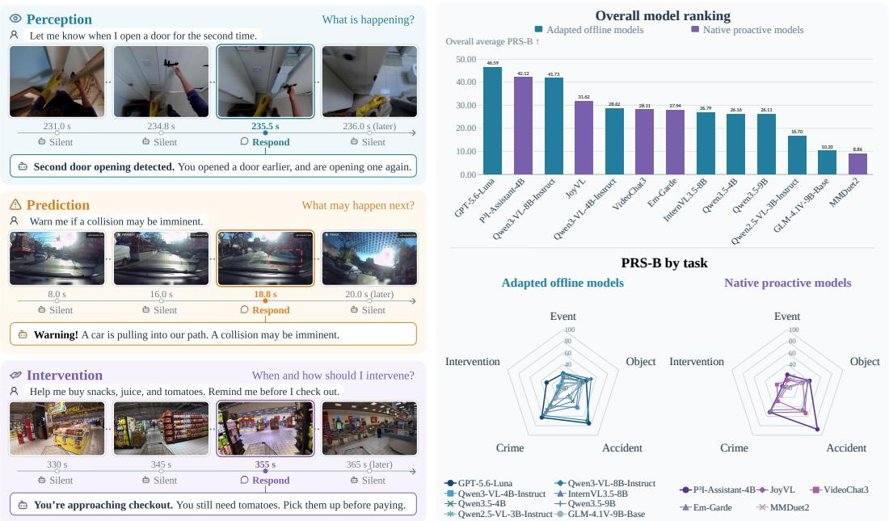

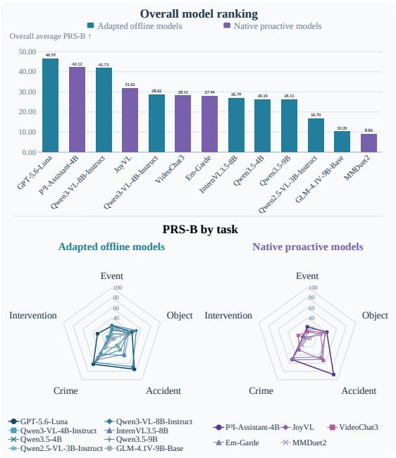  
(a) Three proactive capabilities.  
(b) Overall model ranking.  
Figure 1: Overview of P3IBENCH and model performance. (a) Three complementary proactive capabilities: Perception, recognizing relevant events as they occur; Prediction, anticipating risks before they materialize; and Intervention, proactively providing assistance or corrections when needed. (b) Overall ranking of evaluated models by average PRS-B (higher is better), together with task-wise PRS-B profiles across five subtasks. Detailed numerical results are reported in Table 2.

533 video-query samples from 429 unique videos, organized into three subsets: Daily Perception for monitoring events and objects in everyday scenarios, Risk Alert for anticipating emerging hazards in traffic and crime-related scenarios, and Event Intervention for providing timely, context-dependent guidance toward user goals. Each sample pairs an initial instruction with temporally grounded response targets, enabling evaluation of both response correctness and timeliness. To construct reliable evaluation data, we develop a hybrid data construction pipeline that combines multi-LLM annotation with human annotation and review, with particular emphasis on precisely identifying when each response becomes justified and useful.

Using P3IBENCH, we evaluate 12 representative models spanning open-source and proprietary systems, including four native proactive streaming models and eight general-purpose offline MLLMs adapted to causal streaming inference. We introduce two metrics, PRS-U and PRS-B, that reward correct responses at appropriate times, while accounting for missed responses when models fail to respond and penalizing unnecessary or repeated outputs, and analyze performance across capabilities, temporal factors, and streaming inference settings. Overall, no model performs reliably across all three proactive capabilities, with the strongest system reaching only 46.59 PRS-B (Figure 1b). Models within each category exhibit consistent but distinct failure patterns: adapted offline models tend to over-respond with unnecessary or repeated outputs, whereas native proactive models are often overly conservative, missing warranted responses or responding with substantial delay. These results show that existing video understanding and streaming models remain insufficient for proactive assistance, which additionally requires well-calibrated decisions about whether and when to respond. To this end, we further construct proactive training data and train P3I-ASSISTANT-4B on top of Qwen3-VL-4B via supervised fine-tuning and reinforcement learning, achieving clear gains on P3IBENCH. In summary, our contributions are threefold:

• We introduce P3IBENCH, a benchmark for proactive video assistance that jointly evaluates perception, prediction, and intervention in real-life streaming scenarios, with high-quality response targets and temporal annotations through a hybrid multi-LLM and human annotation pipeline.

Table 1: Comparison of representative benchmarks for streaming video understanding and proactive assistance. Pe, Pr, and I indicate perception, prediction of not-yet-observed future events or risks, and proactive intervention, respectively. HR denotes human review.
<table><tr><td>Benchmark</td><td colspan="2">Scale</td><td colspan="3">Scenarios</td><td colspan="3">Capabilities</td><td colspan="2">Quality Control</td></tr><tr><td></td><td>#Videos</td><td>#Samples</td><td>Daily</td><td>Traffic</td><td>Crime</td><td>Pe</td><td>Pr</td><td>I</td><td>Anno</td><td>HR</td></tr><tr><td>StreamingBench</td><td>900</td><td>4,500</td><td>√</td><td></td><td></td><td>√</td><td>√</td><td></td><td>LLM+Human</td><td>√</td></tr><tr><td>OVO-Bench</td><td>644</td><td>2,814</td><td>√</td><td></td><td></td><td>√</td><td>√</td><td></td><td>LLM+Human</td><td>√</td></tr><tr><td>ProactiveVideoQA</td><td>1,377</td><td>1,427</td><td>√</td><td></td><td>√</td><td>√</td><td></td><td></td><td>LLM+Rule+Human</td><td></td></tr><tr><td>ODV-Bench</td><td>1,190</td><td>6,348</td><td></td><td>√</td><td></td><td>√</td><td>√</td><td></td><td>LLM+Rule+Human</td><td>√</td></tr><tr><td>RIVER</td><td>1,067</td><td>4,278</td><td>√</td><td></td><td></td><td>√</td><td></td><td></td><td>LLM+Rule</td><td>√</td></tr><tr><td>EgoPro-Bench</td><td>2,400</td><td>2,400</td><td>√</td><td></td><td></td><td>√</td><td></td><td>√</td><td>LLM</td><td>√</td></tr><tr><td>OmniPro</td><td>1,262</td><td>2,700</td><td>√</td><td></td><td></td><td>√</td><td></td><td>√</td><td>LLM</td><td>√</td></tr><tr><td>LiveProBench</td><td>911</td><td>911</td><td>√</td><td></td><td></td><td>√</td><td></td><td></td><td>Human</td><td>√</td></tr><tr><td>P³IBench (ours)</td><td>429</td><td>533</td><td>√</td><td>√</td><td>√</td><td>√</td><td>√</td><td>√</td><td>LLM+Human</td><td>√</td></tr></table>

• We systematically evaluate 12 representative models and reveal clear limitations of current approaches, including distinct failure patterns across model categories in over-response, missed responses, and response latency, along with their sensitivity to temporal and streaming settings.

• We construct proactive training data and train P3I-ASSISTANT-4B through supervised fine-tuning and reinforcement learning, achieving clear improvements on P3IBENCH and demonstrating the effectiveness of targeted training for proactive video assistance.

## 2 RELATED WORKS

## 2.1 ONLINE AND PROACTIVE VIDEO MODELS

Online video MLLMs extend offline video understanding to causally arriving streams, while proactive variants additionally determine when accumulated evidence warrants a response. VideoLLMonline (Chen et al., 2024) introduces temporally aligned streaming dialogue through a causal interleaved video–language interface, and MMDuet (Wang et al., 2025c) later adopts a video–text duet format for time-sensitive interaction. MMDuet2 (Wang et al., 2026) further advances this line by learning response-or-silence decisions with multi-turn reinforcement learning. Other representative designs include VideoChat-Online (Huang et al., 2025), which introduces a Pyramid Memory Bank for maintaining online context; Dispider (Qian et al., 2025), which separates perception, decision, and reaction; and Em-Garde (Zheng et al., 2026), which uses lightweight proposal matching for efficient response triggering. Recent systems such as VideoChat3 (Li et al., 2026) and JoyAI-VL-Interaction (Yao et al., 2026) further support proactive response control in continuous video streams.

## 2.2 STREAMING AND PROACTIVE VIDEO BENCHMARKS

Existing benchmarks differ substantially in their coverage of perception, prediction, and intervention, as summarized in Table 1. StreamingBench (Lin et al., 2024) and OVO-Bench (Niu et al., 2025) evaluate online perception together with prediction-oriented tasks, while ODV-Bench (Zeng et al., 2025) similarly covers perception and prediction with a focus on driving scenarios. ProactiveVideoQA (Wang et al., 2025b), RIVER (Shi et al., 2026), and LiveProBench (Du et al., 2026) primar ily emphasize perception-centered interaction. In contrast, EgoPro-Bench (Ran et al., 2026) extends evaluation toward personalized proactive assistance in egocentric activities, while OmniPro (Zhao et al., 2026) includes procedural guidance through its Sequential Step Instruction sub-task. Overall, prior benchmarks typically cover only a subset of Perception, Prediction, and Intervention, or study their combination within specialized settings.

Beyond capability coverage, proactive evaluation places particularly strong demands on annotation quality and temporal precision. As summarized in Table 1, prior benchmarks adopt diverse construction pipelines, including LLM- or rule-assisted annotation with varying degrees of human review, as well as fully human annotation. While these approaches support scalable benchmark construction, they often inherit heterogeneous source annotations or rely on automatically generated intermediate labels, making consistent control over response validity and temporal boundaries challenging.

P3IBENCH addresses these limitations through task-specific construction and verification procedures. Compared with prior benchmarks that often rely on heterogeneous source annotations or limited post-hoc review, our pipeline combines automated annotation with targeted verification and human inspection to provide more consistent, high-confidence response targets. At the same time, P3IBENCH jointly evaluates Perception, Prediction, and Intervention under a unified causal protocol across everyday monitoring, anticipatory risk warning, and goal-conditioned task assistance.

## 3 P3IBENCH

## 3.1 BENCHMARK CONSTRUCTION

P3IBENCH evaluates proactive video understanding: given a task instruction and an incrementally observed video stream, a model must decide when and what to respond using only observations available up to the current time, while remaining silent when no task-relevant response is warranted. We organize the benchmark into three categories: Daily Perception, Risk Alert, and Event Intervention, corresponding broadly to perception, prediction, and intervention.

Daily Perception. This category evaluates instruction-conditioned monitoring of events and object states. It includes Event Monitoring task and Object Monitoring task. Event Monitoring considers events at three levels of granularity: a single specified atomic event (e.g., wash plates), a compositional process formed by multiple temporally related events (e.g., wash plates, then dry them), and a semantic event category that may correspond to multiple concrete atomic events (e.g., wash something). Object Monitoring requires tracking a specified object and reporting when it disappears from view. For tasks in this category, the response should be issued as soon as the instructed event or object state becomes reliably identifiable.

To enhance the diversity of real-world daily activities, we construct Event Monitoring from Ego4D (Grauman et al., 2022), using its dense timestamped narrations to generate candidate queries, match them to relevant events with visual evidence, and localize their temporal boundaries. Two independent vision-language models are used for boundary estimation, followed by agreement checking, verification, and confidence-based filtering (Details can be found in Appendix A). Object Monitoring is constructed from TAG (Zhang et al., 2026), where segmentation masks are used to identify object disappearance events and their timestamps. The resulting instances are additionally inspected or manually refined to reduce event-identity and temporal-boundary errors.

Risk Alert. This category evaluates timely warnings about emerging or ongoing hazards, with particular emphasis on warning timing, which is a capability rarely considered in prior videounderstanding benchmarks. Specifically, it includes Accident Warning task and Crime Alert task. Accident Warning requires the model to recognize an imminent collision risk and issue a warning before the collision occurs. We derive it with driving videos from Nexar (Moura et al., 2025) dataset using its original accident annotations. Crime Alert requires a warning once criminal or suspicious behavior becomes detectable, and is constructed from UCF-Crime (Yuan et al., 2023) dataset. The selected accident annotations are manually checked and the coarse crime intervals are manually refined to obtain more accurate temporal boundaries.

Event Intervention. This category evaluates proactive assistance conditioned on the user’s goal and observed task progress. The model must identify situations that warrant assistance and provide a relevant reminder, correction, or guidance while remaining useful. Since multiple situations may arise within one video, the model may need to intervene several times without additional user queries. We construct this category from first-person videos recorded in five real-world scenarios: grocery shopping, navigation, procedural maintenance, desk organization, and item packing. Each video follows a manually designed task script that contains at least one intentional error in step order, task content, or both. We then annotate the temporal windows in which an intervention is visually grounded and useful and pair each window with a reference response describing the essential object, location, operation error, or next action. All scripts, videos, instructions, intervention windows, and reference responses are manually annotated and verified.

Together, the three categories capture the Perception–Prediction-Intervention theme of P3IBench: recognizing relevant events and object states, warning about hazards at the appropriate time, and providing goal-directed assistance from streaming observations.

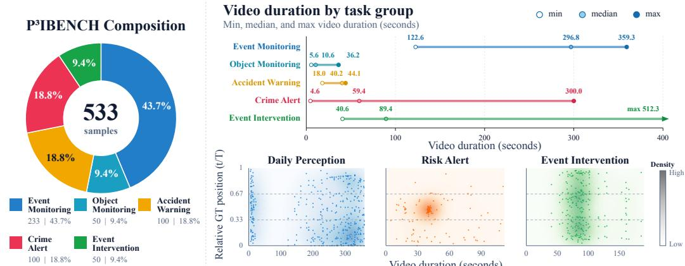  
Figure 2: Benchmark Statistics. (Left) Task distribution. (Top right) Video duration distribution across tasks. (Bottom right) Distribution of GT trigger positions across categories, normalized by video duration; dashed lines divide the video timeline into early, middle, and late thirds. For readability, the Risk Alert and Event Intervention scatterplots show GT events from videos up to 112s and 190s, respectively, covering 90.2% and 90.7% of their GT events.

## 3.2 BENCHMARK STATISTICS

P3IBENCH contains 533 query samples from 429 unique videos across three categories and five task groups, as detailed in the left side of Figure 2. The top right panel of Figure 2 demonstrates that P3IBENCH covers substantially different temporal scales across tasks. Median video durations range from 10.6 to 296.8 seconds, while the longest Event Intervention video reaches 512.3 seconds, spanning both short-horizon observations and extended task sequences.

Across P3IBENCH we annotate 836 GT response targets. The bottom right of Figure 2 plots these positive GT events by video duration T and normalized trigger time $t _ { \mathrm { G T } } \bar { / } T$ , using the start time for interval annotations. As shown, GT events cover the early, middle, and late thirds of videos, accounting for 37.8%, 39.7%, and 22.5% of all events, respectively. Event Intervention is particularly balanced, with 87, 87, and 84 events in these thirds. This distribution provides temporal coverage for evaluating proactive responses at different stages of a video.

## 3.3 EVALUATION PROTOCOL

Proactive Task Formulation. In P3IBENCH, we formulate proactive video understanding as recurrent decision-making over an incrementally revealed video stream V. Each sample is initialized with an instruction I that specifies the task scenario and requirements, such as monitoring for the occurrence of a particular event. As time progresses, at each sampling step at video time t, the model receives the observed frames $V _ { \leq t }$ subject to its visual context window, and its response history H, then either remains silent or emits a response $o _ { j } = ( t _ { j } , \hat { y } _ { j } )$ , where $t _ { j }$ is the video time of emission and $\hat { y } _ { j }$ is the response content. Given a target response $g _ { i } ~ = ~ ( \tau _ { i } , y _ { i } )$ , the goal of proactive task evaluation is to assess whether the model can respond accurately and in a timely manner, with $t _ { j }$ approaching the target response time $\tau _ { i }$ and $\hat { y } _ { j }$ approaching the target content $y _ { i }$

Evaluation Metric. To jointly capture the accuracy of the response and its temporal alignment, we introduce the Proactive Response Score (PRS). For a target $g _ { i } = \left( \tau _ { i } , y _ { i } \right)$ and a model response $o _ { j } = ( t _ { j } , \hat { y } _ { j } )$ , the pairwise PRS is calculated as:

$$
s ( o _ { j } , g _ { i } ) = c ( \hat { y } _ { j } , y _ { i } ) \exp \left( - \alpha | t _ { j } - \tau _ { i } | \right) , \qquad \alpha = 0 . 0 5 ,
$$

where $c ( \hat { y } _ { j } , y _ { i } )$ measures the accuracy of the response. For structured outputs, $c \in \{ 0 , 1 \}$ is determined using deterministic rules, whereas for open-ended responses (i.e., the intervention subset), $c \in [ 0 , 1 ]$ is judged by an LLM. The PRS further applies a temporal decay factor, exp $( - \alpha | t _ { j } - \tau _ { i } | )$ which penalizes responses with larger temporal deviations from the target response time.

Considering a single sample may contain multiple target responses, while the model may produce redundant responses or completely miss certain targets, we first match each model output $o _ { j }$ to at most one ground-truth target $g _ { i }$ . For each target $g _ { i }$ and its corresponding set of matched responses $O _ { i } .$ , we aggregate their scores into a target-level score:

$$
S _ { i } = \frac { \mathrm { m a x } _ { o _ { j } \in \mathcal { O } _ { i } } s ( o _ { j } , g _ { i } ) } { | \mathcal { O } _ { i } | } \mathrm { i f } | O _ { i } | > 0 \mathrm { e l s e } 0
$$

by taking the score of the best-matched response while penalizing redundant responses. The PRS of each sample is subsequently computed as the average target-level score over all targets in the video.

We report two PRS variants w.r.t. different $o _ { j } ~  ~ g _ { i }$ mapping strategies. PRS-U uses unidirectional matching: each response is assigned to the most recent target at or before its emission time. Responses emitted before the first target are assigned to that target but receive a score of zero, regardless of their content; they still count toward the number of matched responses. PRS-B uses bidirectional matching: each response is assigned to the temporally nearest target, allowing early responses to match future targets. Both variants use the same correctness and aggregation rules.

## 4 EXPERIMENT

## 4.1 EVALUATION SETUP

Evaluated Models. For a comprehensive assessment, we evaluate two groups of models: adapted offline MLLMs and native proactive MLLMs. (1) Offline baselines include GLM-4.1V-9B-Base (Hong et al., 2026), InternVL3.5-8B (Wang et al., 2025a), Qwen2.5-VL-3B-Instruct (Bai et al., 2025b), Qwen3-VL-4/8B-Instruct (Bai et al., 2025a), Qwen3.5-4/9B(Qwen Team, 2026) and GPT-5.6-Luna (OpenAI, 2026). These models are originally developed for prompted visual understanding; they are adapted at inference time to process incrementally revealed frames and decide whether to respond. (2) Native proactive models include JoyAI-VL-Interaction (Yao et al., 2026), MM-Duet2 (Wang et al., 2026), Em-Garde (Zheng et al., 2026) and VideoChat3 (Li et al., 2026), which are trained for proactive interaction with streaming video.

Proactive Evaluation Setup. For offline models, we wrap each model with a streaming context management framework to support proactive evaluation. Specifically, (1) a system prompt defines the role, task, and response requirements, including when and how to remain silent; (2) the video is processed in fixed intervals (1 second), with new frames sampled at the default rate of 1 FPS and appended to the input at each timestep, after which the model is prompted to decide whether to respond; and (3) the context retains the initial instruction, as well as the inputs and model outputs from previous rounds. Most models retain all previously observed frames. Due to input context limitations, GPT-5.6-Luna and InternVL3.5-8B retain only the most recent 16 and 32 frames, respectively, while all other textual information is fully preserved. The complete evaluation pipeline is provided in Appendix B. For native proactive models, we follow their respective inference frameworks and additionally incorporate the requirements specific to the P3I-Bench tasks into the prompts.

## 4.2 MAIN RESULTS

Table 2 presents model performance across five tasks organized in three categories. Despite the strong capabilities of MLLMs on many static tasks, their performance remains unsatisfactory in the dynamic proactive setting, with the average PRS scores of most models below 30. The challenge is particularly pronounced for the complex intervention tasks. GPT-5.6-Luna achieves the strongest overall performance, with a notable advantage over open-source models on risk prediction and intervention. However, it still struggles to promptly perceive events and objects as they emerge in the streaming context. Overall, these results suggest that the complex contextual dynamics and stringent temporal requirements of proactive tasks remain challenging for current models. Furthermore, we delve deeper to investigate the limitations of existing models based on P3IBENCH:

(i) Offline models produce excessive, repeated replies. Figure 3 shows the distribution of the number of responses generated by the models. A major bottleneck for offline models is the difficulty in fully understanding the streaming context and distinguishing between when to remain silent and when to respond. Instead, they tend to continuously generate responses in a manner similar to static $\mathrm { Q A } .$ , resulting in substantial redundancy and consequently incurring penalties in the PRS. For example, on the Accident Warning task, Qwen2.5-VL-3B produces $\geq 3$ responses in 53/100

Table 2: Model Performance in P3IBENCH. PRS-U and PRS-B denote the proactive response score metrics evaluated in unidirectional and bidirectional setups, respectively. In each column, the best performance is highlighted in bold while the runner-up is underlined.
<table><tr><td rowspan="3">Model</td><td colspan="4">Perception</td><td colspan="4">Risk Prediction</td><td colspan="2">Intervention</td><td colspan="2">Overall</td></tr><tr><td>Event</td><td></td><td colspan="2">Object</td><td colspan="2">Accident</td><td colspan="2">Crime</td><td colspan="2"></td><td colspan="2">Average</td></tr><tr><td>PRS-U PRS-B</td><td></td><td>PRS-U PRS-B</td><td></td><td>PRS-U PRS-B</td><td></td><td>PRS-U PRS-B</td><td></td><td>PRS-U PRS-B</td><td></td><td></td><td>PRS-U PRS-B</td></tr><tr><td colspan="9">Offline Models adapted for Proactive Tasks</td><td></td><td></td><td></td><td></td></tr><tr><td>GLM-4.1V-9B-Base</td><td>0.89</td><td>0.96</td><td>26.00</td><td>26.49</td><td>2.11</td><td>2.80</td><td>18.15</td><td>19.80</td><td>0.93</td><td>0.93</td><td>9.62</td><td>10.20</td></tr><tr><td>InternVL3.5-8B</td><td>5.43</td><td>9.06</td><td>28.02</td><td>28.08</td><td>23.19</td><td>38.79</td><td>43.81</td><td>52.15</td><td>5.89</td><td>5.89</td><td>21.27</td><td>26.79</td></tr><tr><td>Qwen2.5-VL-3B-Instruct</td><td>3.44</td><td>8.27</td><td>22.38</td><td>28.44</td><td>14.91</td><td>21.27</td><td>11.25</td><td>24.01</td><td>1.49</td><td>1.49</td><td>10.69</td><td>16.70</td></tr><tr><td>Qwen3-VL-4B-Instruct</td><td>14.84</td><td>21.35</td><td>32.67</td><td>33.82</td><td>30.93</td><td>41.78</td><td>35.29</td><td>37.03</td><td>9.13</td><td>9.13</td><td>24.57</td><td>28.62</td></tr><tr><td>Qwen3-VL-8B-Instruct</td><td>16.17</td><td>26.00</td><td>44.38</td><td>50.33</td><td>29.21</td><td>68.83</td><td>43.65</td><td>57.96</td><td>5.53</td><td>5.53</td><td>27.79</td><td>41.73</td></tr><tr><td>Qwen3.5-4B</td><td>13.14</td><td>17.49</td><td>30.65</td><td>33.89</td><td>18.39</td><td>27.92</td><td>36.84</td><td>46.33</td><td>5.17</td><td>5.17</td><td>20.84</td><td>26.16</td></tr><tr><td>Qwen3.5-9B</td><td>10.13</td><td>15.65</td><td>37.81</td><td>46.20</td><td>15.82</td><td>15.82</td><td>42.75</td><td>49.62</td><td>3.26</td><td>3.26</td><td>21.95</td><td>26.11</td></tr><tr><td>GPT-5.6-Luna</td><td>15.62</td><td>24.60</td><td>37.83</td><td>41.51</td><td>56.41</td><td>74.64</td><td>54.17</td><td>62.37</td><td>29.85</td><td>29.85</td><td>38.78</td><td>46.59</td></tr><tr><td colspan="9">Native Proactive Streaming Models</td><td></td><td></td><td></td><td></td></tr><tr><td>Em-Garde</td><td>2.00</td><td>2.41</td><td>31.92</td><td>37.61</td><td>27.45</td><td>44.69</td><td>25.59</td><td>46.83</td><td>4.74</td><td>8.16</td><td>18.34</td><td>27.94</td></tr><tr><td>JoyVL</td><td>9.94</td><td>14.78</td><td>29.96</td><td>36.40</td><td>19.66</td><td>50.62</td><td>43.15</td><td>52.19</td><td>4.10</td><td>4.10</td><td>21.36</td><td>31.62</td></tr><tr><td>MMDuet2</td><td>0.18</td><td>0.26</td><td>26.00</td><td>26.00</td><td>0.00</td><td>0.00</td><td>17.00</td><td>17.00</td><td>1.03</td><td>1.03</td><td>8.84</td><td>8.86</td></tr><tr><td>VideoChat3</td><td>6.08</td><td>12.91</td><td>25.82</td><td>27.61</td><td>44.09</td><td>53.38</td><td>26.83</td><td>27.90</td><td>12.84</td><td>18.77</td><td>23.13</td><td>28.11</td></tr></table>

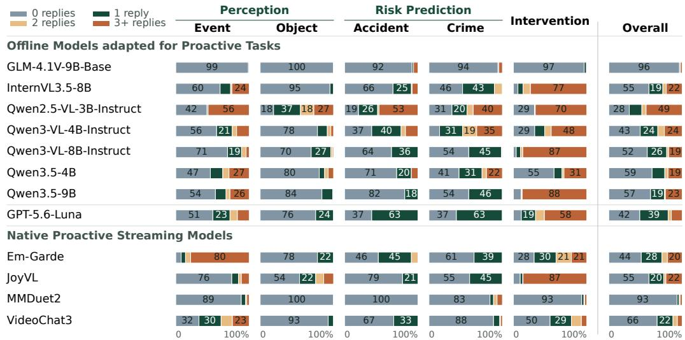  
Figure 3: Response frequency distribution of different models across tasks. The response frequency is measured as the number of model responses within the ground-truth window of each target response, grouped into four categories: 0, 1, 2, and $\geq 3$

GT windows with a PRS-B score of 21.27, but would reach 71.39 if the redundancy penalty were removed. Similar behavior is observed across other models, see Appendix E for further analysis.

(ii) Proactive models become overly silent. In contrast to offline models, proactive models, which are specifically trained for proactive interaction, tend to reduce redundant responses. However, this may also lead to an over-correction, causing models to remain silent even during intervals when a response is expected. As shown in Figure 3, MMDuet2 and JoyVL miss 79% and 100% of the ground-truth (GT) windows, respectively, on the Accident Warning task. We hypothesize that this behavior may stem from the imbalance between the supervision signals for silent responses and content-bearing responses in the training of current proactive models, as discussed in (Xia et al., 2026). This observation highlights the need to explore more effective proactive training paradigms.

(iii) Timeliness remains a major challenge for proactive tasks. Beyond response frequency, we find that producing responses at the correct timing remains difficult for current models. (1) First, as shown in Figure 4, current models exhibit substantial response latency. While their perception of specific objects is relatively timely, their ability to perform event-level perception that requires understanding continuous and complex contexts is substantially weaker. This limitation further affects the timeliness of prediction and intervention. (2) Second, the comparison between PRS-U and PRS-B in Table 2 reveals a prevalent tendency toward premature responses. PRS-B is generally 6–15 points higher than PRS-U, with the gap being particularly pronounced on specific tasks such as Accident Warning. Although responding in advance can be appropriate in certain scenarios, such as early warning, this discrepancy also suggests that models have difficulty identifying the temporal boundaries of when a response is actually required. Therefore, jointly analyzing PRS-B and PRS-U is important for a more comprehensive assessment of the temporal alignment of proactive responses.

<table><tr><td rowspan="2"></td><td colspan="2">Perception</td><td colspan="2">Risk Prediction</td><td rowspan="2">Intervention</td></tr><tr><td>Event</td><td>Object</td><td>Accident</td><td>Crime</td></tr><tr><td colspan="6">Offline Models adapted for Proactive Tasks</td></tr><tr><td>GLM-4.1V-9B-Base</td><td>4.8s</td><td>No response</td><td>1.6s</td><td>1.0s</td><td>5.2s</td></tr><tr><td>InternVL3.5-8B</td><td>21.1s</td><td>3.7s</td><td>2.2s</td><td>13.9s</td><td>1.7s</td></tr><tr><td>Qwen2.5-VL-3B-Instruct</td><td>1.5s</td><td>1.0s</td><td>6.5s</td><td>10.2s</td><td>0.1s</td></tr><tr><td>Qwen3-VL-4B-Instruct</td><td>13.6s</td><td>1.5s</td><td>2.9s</td><td>6.4s</td><td>3.0s</td></tr><tr><td>Qwen3-VL-8B-Instruct</td><td>15.1s</td><td>1.1s</td><td>1.9s</td><td>9.3s</td><td>1.1s</td></tr><tr><td>Qwen3.5-4B</td><td>23.7s</td><td>1.7s</td><td>2.5s</td><td>10.7s</td><td>4.2s</td></tr><tr><td>Qwen3.5-9B</td><td></td><td>1.0s</td><td>2.7s</td><td></td><td></td></tr><tr><td>GPT-5.6-Luna</td><td>35.2s 24.7s</td><td>1.5s</td><td>2.5s</td><td>16.0s 9.6s</td><td>0.2s 2.2s</td></tr><tr><td colspan="6">Native Proactive Streaming Models</td></tr><tr><td>Em-Garde</td><td>9.4s</td><td>3.4s</td><td>6.5s</td><td></td><td></td></tr><tr><td>JoyVL</td><td>8.6s</td><td>0.5s</td><td>1.3s</td><td>6.8s</td><td>5.0s</td></tr><tr><td>MMDuet2</td><td>9.3s</td><td>No response</td><td>No response</td><td>7.6s</td><td>0.3s</td></tr><tr><td>VideoChat3</td><td>51.4s</td><td>0.8s</td><td>6.0s</td><td>23.8s 31.4s</td><td>7.0s 9.2s</td></tr></table>

Figure 4: Distribution of the first-response latency across different models and tasks. GT windows with no model response are excluded from the analysis. Within each distribution, the thin line, thick line, and circle denote the 10–90% percentile range, interquartile range, and median, respectively.

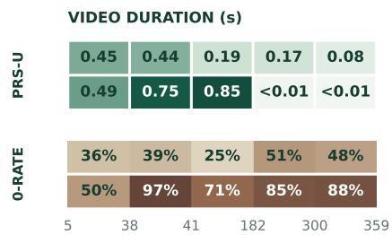

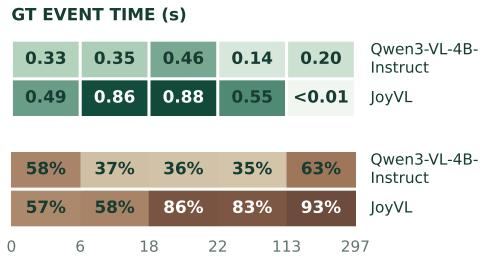  
Figure 5: PRS-U of Qwen3-VL-4B-Instruct and JoyVL across different video durations (left) and ground-truth event times (right). Videos are separately binned by each dimension. The top row reports the median PRS-U among non-zero responses, while the bottom row reports the fraction of zero scores. Videos without ground-truth responses are excluded from the video-duration analysis.

In summary, the above quantitative analyses demonstrate that there is a substantial gap between existing models and reliable proactive assistants, as they still need substantial improvements in perceiving dynamic streaming contexts and following complex instructions. In addition, we provide representative examples in Appendix D for a qualitative analysis of common failure modes.

## 4.3 UNDERSTANDING THE CHALLENGES BEHIND STREAMING VIDEO CONTEXTS

As discussed in Section 4.2, dynamic context perception remains a key limitation of current models.   
We therefore further investigate its underlying factors in this section.

Video Length and Event Time. As shown in Figure 5, longer videos and events occurring later are more challenging for both models, likely due to the increasing complexity of the accumulated context. In addition, Qwen3-VL is less sensitive to information presented early in the video.

Table 3: Effect of the FPS sampling rate.
<table><tr><td rowspan="3">Model</td><td rowspan="3">FPS</td><td colspan="2">Perception</td><td colspan="4">Risk Prediction</td></tr><tr><td colspan="2">Object</td><td colspan="2">Accident</td><td colspan="2">Crime</td></tr><tr><td>PRS-U</td><td>PRS-B</td><td>PRS-U</td><td>PRS-B</td><td>PRS-U</td><td>PRS-B</td></tr><tr><td rowspan="3">JoyVL</td><td>0.5</td><td>29.23</td><td>40.76</td><td>15.09</td><td>45.35</td><td>44.22</td><td>53.62</td></tr><tr><td>1</td><td>29.96</td><td>36.40</td><td>19.66</td><td>50.62</td><td>43.15</td><td>52.19</td></tr><tr><td>2</td><td>31.50</td><td>38.21</td><td>6.54</td><td>38.78</td><td>24.05</td><td>37.07</td></tr><tr><td rowspan="3">MMDuet2</td><td>0.5</td><td>26.00</td><td>26.00</td><td>0.00</td><td>0.00</td><td>16.90</td><td>16.90</td></tr><tr><td>1</td><td>26.00</td><td>26.00</td><td>0.00</td><td>0.00</td><td>17.00</td><td>17.00</td></tr><tr><td>2</td><td>26.00</td><td>26.00</td><td>0.00</td><td>0.00</td><td>14.00</td><td>14.00</td></tr><tr><td rowspan="3">Qwen3-VL- 4B-Instruct</td><td>0.5</td><td>33.46</td><td>35.01</td><td>28.76</td><td>39.86</td><td>33.83</td><td>35.43</td></tr><tr><td>1</td><td>32.67</td><td>33.82</td><td>30.93</td><td>41.78</td><td>35.29</td><td>37.03</td></tr><tr><td>2</td><td>39.26</td><td>42.55</td><td>21.29</td><td>30.02</td><td>29.90</td><td>31.83</td></tr></table>

Table 4: Effect of the limit for historical frames.
<table><tr><td rowspan="2">Model</td><td rowspan="2">Frames</td><td colspan="2">Perception</td><td colspan="4">Risk Prediction</td></tr><tr><td colspan="2">Object</td><td colspan="2">Accident</td><td colspan="2">Crime</td></tr><tr><td rowspan="4">JoyVL</td><td></td><td>PRS-U</td><td>PRS-B</td><td>PRS-U</td><td>PRS-B</td><td>PRS-U</td><td>PRS-B</td></tr><tr><td>1</td><td>22.99</td><td>28.75</td><td>1.32</td><td>31.53</td><td>12.36</td><td>37.76</td></tr><tr><td>2</td><td>30.49</td><td>33.87</td><td>2.88</td><td>39.07</td><td>21.38</td><td>43.51</td></tr><tr><td>4 All</td><td>34.24 29.96</td><td>36.45 36.40</td><td>5.86 19.66</td><td>37.18 50.62</td><td>30.73 43.15</td><td>40.10 52.19</td></tr><tr><td rowspan="4">MMDuet2</td><td>1</td><td>26.00</td><td>26.00</td><td>0.00</td><td>0.00</td><td>17.91</td><td>17.91</td></tr><tr><td>2</td><td>26.00</td><td>26.00</td><td>0.00</td><td>0.00</td><td>20.13</td><td>20.13</td></tr><tr><td>4</td><td>26.00</td><td>26.00</td><td>0.00</td><td>0.00</td><td>17.79</td><td>17.79</td></tr><tr><td>All</td><td>26.00</td><td>26.00</td><td>0.00</td><td>0.00</td><td>17.00</td><td>17.00</td></tr><tr><td rowspan="4">Qwen3-VL- 4B-Instruct</td><td>1</td><td>25.02</td><td>25.02</td><td>12.58</td><td>20.09</td><td>28.22</td><td>29.01</td></tr><tr><td>2</td><td>29.35</td><td>31.16</td><td>11.54</td><td>17.81</td><td>27.82</td><td>29.03</td></tr><tr><td>4</td><td>30.15</td><td>34.48</td><td>27.42</td><td>39.96</td><td>29.66</td><td>34.32</td></tr><tr><td>All</td><td>32.67</td><td>33.82</td><td>30.93</td><td>41.78</td><td>35.29</td><td>37.03</td></tr></table>

Table 5: Effect of post-training on Qwen3-VL-4B-Instruct.
<table><tr><td rowspan="3">Model / Stage</td><td colspan="4">Perception</td><td colspan="4">Risk Prediction</td><td rowspan="3" colspan="2">Intervention</td><td rowspan="3">|PRS-B Avg.</td></tr><tr><td colspan="2">Event</td><td colspan="2">Object</td><td colspan="2">Accident</td><td colspan="2">Crime</td></tr><tr><td>PRS-U PRS-B</td><td></td><td>PRS-U PRS-B</td><td></td><td>PRS-U PRS-B</td><td></td><td>PRS-U PRS-B</td><td>PRS-U PRS-B</td></tr><tr><td>Qwen3-VL-4B-Instruct</td><td>14.84</td><td>21.35</td><td>32.67</td><td>33.82</td><td>30.93</td><td>41.78</td><td>35.29</td><td>37.03</td><td>9.13</td><td>9.13</td><td>28.62</td></tr><tr><td>+ SFT</td><td>5.84</td><td>18.10</td><td>30.72</td><td>48.62</td><td>2.96</td><td>61.78</td><td>16.84</td><td>47.04</td><td>8.05</td><td>8.05</td><td>36.72</td></tr><tr><td>+ RL (P³I-Assistant-4B)</td><td>7.47</td><td>22.77</td><td>32.35</td><td>40.03</td><td>32.88</td><td>87.59</td><td>29.67</td><td>51.21</td><td>9.02</td><td>9.02</td><td>42.12</td></tr><tr><td>JoyVL</td><td>9.94</td><td>14.78</td><td>29.96</td><td>36.40</td><td>19.66</td><td>50.62</td><td>43.15</td><td>52.19</td><td>4.10</td><td>4.10</td><td>31.62</td></tr></table>

Effect of Visual Information Density. We further investigate how the density of visual information provided to the model affects its performance. (1) We vary the FPS to control the amount of visual information introduced at each query turn. As shown in Table 3, while a higher FPS can facilitate object perception, it also increases context complexity and makes tasks such as risk prediction more challenging. We therefore retain the default 1-FPS setting in P3IBENCH. (2) We then vary the size of the visual context window to control the density of historical information. In contrast to FPS, the results in Table 4 show that retaining more historical visual information consistently improves performance. Overall, these results suggest that current models are better at processing static historical information, while their ability to model richer dynamic information remains limited.

## 4.4 PRELIMINARY EXPLORATION TO ENHANCE PROACTIVE CAPABILITIES

In this section, we conduct a preliminary study on how to address the limitations of existing models discussed above. We hypothesize that a major bottleneck lies in the lack of high-quality training data. Inspired by the high-quality data construction strategy proposed in Section 3.1, we additionally construct a 1.3K training dataset, including 600 Accident Warning samples and 768 Event Perception samples. We fine-tune Qwen3-VL-4B through a two-stage SFT and RL pipeline, together with commonly used Shot2Story (Han et al., 2025) and LLaVA-Video (Zhang et al., 2025) data. Details of the training pipeline and optimization objectives are provided in Appendix C. Notably, to mitigate the excessive silence observed in Section 4.2, we introduce dynamic weighting to balance the supervision strength between different types of responses.

Table 5 presents the performance of our fine-tuned model, P3I-Assistant-4B. The results show that well-curated high-quality data can substantially improve proactive capabilities, with both SFT and RL contributing to overall gains of +8.1 and +13.5 in average PRS-B, respectively. The final model substantially outperforms JoyVL, despite being trained with only 13K samples compared to its 4M training samples, i.e., approximately 300× fewer data. Notably, the gains from post-training also generalize to Object Perception and Crime Alert, despite no corresponding training data being used. Overall, this preliminary study demonstrates substantial room for further optimization of proactive capabilities, while also highlighting the need for more sophisticated data construction and training strategies for tasks such as Intervention, which require complex responses.

## 5 CONCLUSION

In this work, we introduced P3IBENCH, a benchmark to evaluate proactive video understanding in real-life streaming scenarios across three major categories: Daily Perception, Risk Alert, and Event Intervention. Our evaluation of 12 models reveals a persistent gap between video under-

standing and proactive assistance. To narrow this gap, we train P3I-Assistant-4B through targeted post-training, improving performance on several tasks. We hope that our work will support future research toward more reliable proactive video assistants in dynamic, real-world settings.

## AI USE STATEMENT

We used generative AI tools to aid and polish writing, draft portions of the manuscript, and assist in generating synthetic or automatically annotated data. All AI-assisted content was reviewed and verified by the authors, who take full responsibility for the final paper.

## ETHICS STATEMENT

Our benchmark uses existing public research datasets and manually recorded first-person videos. Some tasks involve safety- and crime-related scenarios, and current models may produce incorrect or delayed responses. Therefore, our benchmark is intended for research evaluation rather than deployment in safety-critical or surveillance applications. We follow the licenses and privacy requirements of the corresponding data sources.

## REPRODUCIBILITY STATEMENT

We provide detailed descriptions of the construction and evaluation of P3IBENCH in Section 3.1, and the post-training procedure in Appendix C. Upon publication, we will release the benchmark and training data, data construction pipeline, model checkpoints, training and evaluation code, prompts, and configurations to support reproducibility.

## REFERENCES

Shuai Bai, Yuxuan Cai, Ruizhe Chen, Keqin Chen, Xionghui Chen, Zesen Cheng, Lianghao Deng, Wei Ding, Chang Gao, Chunjiang Ge, Wenbin Ge, Zhifang Guo, Qidong Huang, Jie Huang, Fei Huang, Binyuan Hui, Shutong Jiang, Zhaohai Li, Mingsheng Li, Mei Li, Kaixin Li, Zicheng Lin, Junyang Lin, Xuejing Liu, Jiawei Liu, Chenglong Liu, Yang Liu, Dayiheng Liu, Shixuan Liu, Dunjie Lu, Ruilin Luo, Chenxu Lv, Rui Men, Lingchen Meng, Xuancheng Ren, Xingzhang Ren, Sibo Song, Yuchong Sun, Jun Tang, Jianhong Tu, Jianqiang Wan, Peng Wang, Pengfei Wang, Qiuyue Wang, Yuxuan Wang, Tianbao Xie, Yiheng Xu, Haiyang Xu, Jin Xu, Zhibo Yang, Mingkun Yang, Jianxin Yang, An Yang, Bowen Yu, Fei Zhang, Hang Zhang, Xi Zhang, Bo Zheng, Humen Zhong, Jingren Zhou, Fan Zhou, Jing Zhou, Yuanzhi Zhu, and Ke Zhu. Qwen3-vl technical report, 2025a. URL https://arxiv.org/abs/2511.21631.

Shuai Bai, Keqin Chen, Xuejing Liu, Jialin Wang, Wenbin Ge, Sibo Song, Kai Dang, Peng Wang, Shijie Wang, Jun Tang, Humen Zhong, Yuanzhi Zhu, Mingkun Yang, Zhaohai Li, Jianqiang Wan, Pengfei Wang, Wei Ding, Zheren Fu, Yiheng Xu, Jiabo Ye, Xi Zhang, Tianbao Xie, Zesen Cheng, Hang Zhang, Zhibo Yang, Haiyang Xu, and Junyang Lin. Qwen2.5-vl technical report, 2025b. URL https://arxiv.org/abs/2502.13923.

Joya Chen, Zhaoyang Lv, Shiwei Wu, Kevin Qinghong Lin, Chenan Song, Difei Gao, Jia-Wei Liu, Ziteng Gao, Dongxing Mao, and Mike Zheng Shou. VideoLLM-online: Online video large language model for streaming video. In Proceedings of the IEEE/CVF Conference on Computer Vision and Pattern Recognition (CVPR), pp. 18407–18418, June 2024. URL https://openaccess.thecvf.com/content/CVPR2024/html/Chen\_ VideoLLM-online\_Online\_Video\_Large\_Language\_Model\_for\_Streaming\_ Video\_CVPR\_2024\_paper.html.

Kaixuan Du, Xin Wan, Hang Zhang, Meng Cao, Dai Guan, Ming Chen, and YuKun Wang. Liveprobench: Can streaming video models really interact like humans? arXiv preprint arXiv:2609.12658, 2026.

Kristen Grauman, Andrew Westbury, Eugene Byrne, Zachary Chavis, Antonino Furnari, Rohit Girdhar, Jackson Hamburger, Hao Jiang, Miao Liu, Xingyu Liu, Miguel Martin, Tushar Nagarajan, Ilija Radosavovic, Santhosh Kumar Ramakrishnan, Fiona Ryan, Jayant Sharma, Michael Wray,

Mengmeng Xu, Eric Zhongcong Xu, Chen Zhao, Siddhant Bansal, Dhruv Batra, Vincent Cartillier, Sean Crane, Tien Do, Morrie Doulaty, Akshay Erapalli, Christoph Feichtenhofer, Adriano Fragomeni, Qichen Fu, Abrham Gebreselasie, Cristina Gonzalez, James Hillis, Xuhua Huang,´ Yifei Huang, Wenqi Jia, Weslie Khoo, Jachym Kol´ a´ˇr, Satwik Kottur, Anurag Kumar, Federico Landini, Chao Li, Yanghao Li, Zhenqiang Li, Karttikeya Mangalam, Raghava Modhugu, Jonathan Munro, Tullie Murrell, Takumi Nishiyasu, Will Price, Paola Ruiz, Merey Ramazanova, Leda Sari, Kiran Somasundaram, Audrey Southerland, Yusuke Sugano, Ruijie Tao, Minh Vo, Yuchen Wang, Xindi Wu, Takuma Yagi, Ziwei Zhao, Yunyi Zhu, Pablo Arbelaez, David Crandall, Dima Damen,´ Giovanni Maria Farinella, Christian Fuegen, Bernard Ghanem, Vamsi Krishna Ithapu, C. V. Jawahar, Hanbyul Joo, Kris Kitani, Haizhou Li, Richard Newcombe, Aude Oliva, Hyun Soo Park, James M. Rehg, Yoichi Sato, Jianbo Shi, Mike Zheng Shou, Antonio Torralba, Lorenzo Torresani, Mingfei Yan, and Jitendra Malik. Ego4D: Around the world in 3,000 hours of egocentric video. In Proceedings of the IEEE/CVF Conference on Computer Vision and Pattern Recognition (CVPR), pp. 18995–19012, 2022.

Mingfei Han, Linjie Yang, Xiaojun Chang, Lina Yao, and Heng Wang. Shot2Story: A new benchmark for comprehensive understanding of multi-shot videos. In International Conference on Learning Representations, 2025.

Wenyi Hong, Wenmeng Yu, Xiaotao Gu, Guo Wang, Guobing Gan, Haomiao Tang, Jiale Cheng, Ji Qi, Junhui Ji, Lihang Pan, Shuaiqi Duan, Weihan Wang, Yan Wang, Yean Cheng, Zehai He, Zhe Su, Zhen Yang, Ziyang Pan, Aohan Zeng, Baoxu Wang, Bin Chen, Boyan Shi, Changyu Pang, Chenhui Zhang, Da Yin, Fan Yang, Guoqing Chen, Haochen Li, Jiale Zhu, Jiali Chen, Jiaxing Xu, Jiazheng Xu, Jing Chen, Jinghao Lin, Jinhao Chen, Jinjiang Wang, Junjie Chen, Leqi Lei, Letian Gong, Leyi Pan, Mingdao Liu, Mingde Xu, Mingzhi Zhang, Qinkai Zheng, Ruiliang Lyu, Shangqin Tu, Sheng Yang, Shengbiao Meng, Shi Zhong, Shiyu Huang, Shuyuan Zhao, Siyan Xue, Tianshu Zhang, Tianwei Luo, Tianxiang Hao, Tianyu Tong, Wei Jia, Wenkai Li, Xiao Liu, Xiaohan Zhang, Xin Lyu, Xinyu Zhang, Xinyue Fan, Xuancheng Huang, Yadong Xue, Yanfeng Wang, Yanling Wang, Yanzi Wang, Yifan An, Yifan Du, Yiheng Huang, Yilin Niu, Yiming Shi, Yu Wang, Yuan Wang, Yuanchang Yue, Yuchen Li, Yusen Liu, Yutao Zhang, Yuting Wang, Yuxuan Zhang, Zhao Xue, Zhengxiao Du, Zhenyu Hou, Zihan Wang, Peng Zhang, Debing Liu, Bin Xu, Juanzi Li, Minlie Huang, Yuxiao Dong, and Jie Tang. Glm-4.5v and glm-4.1vthinking: Towards versatile multimodal reasoning with scalable reinforcement learning, 2026. URL https://arxiv.org/abs/2507.01006.

Zhenpeng Huang, Xinhao Li, Jiaqi Li, Jing Wang, Xiangyu Zeng, Cheng Liang, Tao Wu, Xi Chen, Liang Li, and Limin Wang. Online video understanding: OVBench and VideoChat-Online. In Proceedings of the IEEE/CVF Conference on Computer Vision and Pattern Recognition (CVPR), pp. 3328–3338, June 2025. URL https://openaccess.thecvf.com/ content/CVPR2025/html/Huang\_Online\_Video\_Understanding\_OVBench\_ and\_VideoChat-Online\_CVPR\_2025\_paper.html.

Xinhao Li, Yuhan Zhu, Xiangyu Zeng, Yuhao Dong, Haoning Wu, Zhiqiu Zhang, Yuandong Yang, Changlian Ma, Qingyu Zhang, Yansong Shi, Xinyu Chen, Haoran Chen, Zizheng Huang, Jun Zhang, Kun Ouyang, Lin Sui, Ziang Yan, Yicheng Xu, Chenting Wang, Yinan He, Hongjie Zhang, Yi Wang, Yu Qiao, Yali Wang, Ziwei Liu, Kai Chen, and Limin Wang. VideoChat3: Fully open video MLLM for efficient and generalist video understanding. arXiv preprint arXiv:2607.14935, 2026. URL https://arxiv.org/abs/2607.14935.

Junming Lin, Zheng Fang, Chi Chen, Zihao Wan, Fuwen Luo, Peng Li, Yang Liu, and Maosong Sun. StreamingBench: Assessing the gap for MLLMs to achieve streaming video understanding. arXiv preprint arXiv:2411.03628, 2024. doi: 10.48550/arXiv.2411.03628. URL https://arxiv. org/abs/2411.03628.

Daniel C. Moura, Shizhan Zhu, and Orly Zvitia. Nexar dashcam collision prediction dataset and challenge, 2025. URL https://arxiv.org/abs/2503.03848.

Junbo Niu, Yifei Li, Ziyang Miao, Chunjiang Ge, Yuanhang Zhou, Qihao He, Xiaoyi Dong, Haodong Duan, Shuangrui Ding, Rui Qian, Pan Zhang, Yuhang Zang, Yuhang Cao, Conghui He, and Jiaqi Wang. OVO-Bench: How far is your Video-LLMs from real-world online video understanding? In Proceedings of the IEEE/CVF Conference on Computer Vision and

Pattern Recognition (CVPR), pp. 18902–18913, June 2025. URL https://openaccess. thecvf.com/content/CVPR2025/html/Niu\_OVO-Bench\_How\_Far\_is\_Your\_ Video-LLMs\_from\_Real-World\_Online\_Video\_CVPR\_2025\_paper.html.

OpenAI. GPT-5.6 Luna. https://developers.openai.com/api/docs/models/ gpt-5.6-luna, 2026. Accessed: 2026-09-25.

Rui Qian, Shuangrui Ding, Xiaoyi Dong, Pan Zhang, Yuhang Zang, Yuhang Cao, Dahua Lin, and Jiaqi Wang. Dispider: Enabling video LLMs with active real-time interaction via disentangled perception, decision, and reaction. In Proceedings of the IEEE/CVF Conference on Computer Vision and Pattern Recognition (CVPR), pp. 24045–24055, June 2025. URL https://openaccess.thecvf.com/content/CVPR2025/html/Qian\_ Dispider\_Enabling\_Video\_LLMs\_with\_Active\_Real-Time\_Interaction\_ via\_Disentangled\_CVPR\_2025\_paper.html.

Qwen Team. Qwen3.5: Towards native multimodal agents, February 2026. URL https://qwen. ai/blog?id=qwen3.5.

Dongchuan Ran, Linyu Ou, Xueheng Li, Wenwen Tong, Chenxu Guo, Hewei Guo, Kaibing Wang, and Lewei Lu. Egopro-bench: Benchmarking personalized proactive interaction in egocentric video streams. arXiv preprint arXiv:2605.07299, 2026.

Yansong Shi, Qingsong Zhao, Tianxiang Jiang, Xiangyu Zeng, Yi Wang, and Limin Wang. River: A real-time interaction benchmark for video llms. In International Conference on Learning Representations, 2026.

Weiyun Wang, Zhangwei Gao, Lixin Gu, Hengjun Pu, Long Cui, Xingguang Wei, Zhaoyang Liu, Linglin Jing, Shenglong Ye, Jie Shao, Zhaokai Wang, Zhe Chen, Hongjie Zhang, Ganlin Yang, Haomin Wang, Qi Wei, Jinhui Yin, Wenhao Li, Erfei Cui, Guanzhou Chen, Zichen Ding, Changyao Tian, Zhenyu Wu, Jingjing Xie, Zehao Li, Bowen Yang, Yuchen Duan, Xuehui Wang, Zhi Hou, Haoran Hao, Tianyi Zhang, Songze Li, Xiangyu Zhao, Haodong Duan, Nianchen Deng, Bin Fu, Yinan He, Yi Wang, Conghui He, Botian Shi, Junjun He, Yingtong Xiong, Han Lv, Lijun Wu, Wenqi Shao, Kaipeng Zhang, Huipeng Deng, Biqing Qi, Jiaye Ge, Qipeng Guo, Wenwei Zhang, Songyang Zhang, Maosong Cao, Junyao Lin, Kexian Tang, Jianfei Gao, Haian Huang, Yuzhe Gu, Chengqi Lyu, Huanze Tang, Rui Wang, Haijun Lv, Wanli Ouyang, Limin Wang, Min Dou, Xizhou Zhu, Tong Lu, Dahua Lin, Jifeng Dai, Weijie Su, Bowen Zhou, Kai Chen, Yu Qiao, Wenhai Wang, and Gen Luo. Internvl3.5: Advancing open-source multimodal models in versatility, reasoning, and efficiency, 2025a. URL https://arxiv.org/abs/2508.18265.

Yueqian Wang, Xiaojun Meng, Yifan Wang, Huishuai Zhang, and Dongyan Zhao. ProactiveVideoQA: A comprehensive benchmark evaluating proactive interactions in video large language models. arXiv preprint arXiv:2507.09313, 2025b. doi: 10.48550/arXiv.2507.09313. URL https://arxiv.org/abs/2507.09313.

Yueqian Wang, Xiaojun Meng, Yuxuan Wang, Jianxin Liang, Jiansheng Wei, Huishuai Zhang, and Dongyan Zhao. VideoLLM knows when to speak: Enhancing time-sensitive video comprehension with video-text duet interaction format. In Findings of the Association for Computational Linguistics: EMNLP 2025, pp. 6338–6359, Suzhou, China, November 2025c. Association for Computational Linguistics. doi: 10.18653/v1/2025.findings-emnlp.336. URL https://aclanthology.org/2025.findings-emnlp.336/.

Yueqian Wang, Songxiang Liu, Disong Wang, Nuo Xu, Guanglu Wan, Huishuai Zhang, and Dongyan Zhao. MMDuet2: Enhancing proactive interaction of video MLLMs with multi-turn reinforcement learning. In International Conference on Learning Representations, pp. 23257– 23270, 2026. URL https://proceedings.iclr.cc/paper\_files/paper/2026/ hash/281970ef377580ab9ec3c7d3781110d4-Abstract-Conference.html.

Jiaer Xia, Peixian Chen, Mengdan Zhang, Xing Sun, and Kaiyang Zhou. Streaming video instruction tuning, 2026. URL https://arxiv.org/abs/2512.21334.

Dingyu Yao, Junhao Zhou, Chenxu Yang, Chuanyu Qin, Haowen Hou, Zheming Liang, Congcong Wang, Yuhang Cao, Shenglong Ye, Shuai Xie, Shuhuan Gu, Haoyang Huang, Qingyi Si, Nan

Duan, and Jiaqi Wang. JoyAI-VL-Interaction: Real-time vision-language interaction intelligence, 2026. URL https://arxiv.org/abs/2606.14777.

Tongtong Yuan, Xuange Zhang, Kun Liu, Bo Liu, Chen Chen, Jian Jin, and Zhenzhen Jiao. Towards surveillance video-and-language understanding: New dataset, baselines, and challenges, 2023. URL https://arxiv.org/abs/2309.13925.

Xiangyu Zeng, Kefan Qiu, Qingyu Zhang, Xinhao Li, Jing Wang, Jiaxin Li, Ziang Yan, Kun Tian, Meng Tian, Xinhai Zhao, Yi Wang, and Limin Wang. Streamforest: Efficient online video understanding with persistent event memory. In Advances in Neural Information Processing Systems, volume 38, 2025.

Jiaming Zhang, Cheng Liang, Yichun Yang, Chenkai Zeng, Yutao Cui, Xinwen Zhang, Xin Zhou, Kai Ma, Gangshan Wu, and Limin Wang. Sam 2++: Tracking anything at any granularity, 2026. URL https://arxiv.org/abs/2510.18822.

Yuanhan Zhang, Jinming Wu, Wei Li, Bo Li, Zejun Ma, Ziwei Liu, and Chunyuan Li. LLaVA-Video: Video instruction tuning with synthetic data. Transactions on Machine Learning Research, 2025. URL https://mlanthology.org/tmlr/2025/zhang2025tmlr-llavavideo/.

Ruixiang Zhao, Jie Yang, Zijie Xin, Tianyi Wang, Fengyun Rao, Jing Lyu, and Xirong Li. Omnipro: A comprehensive benchmark for omni-proactive streaming video understanding. arXiv preprint arXiv:2605.18577, 2026.

Yikai Zheng, Xin Ding, Yifan Yang, Shiqi Jiang, Hao Wu, Qianxi Zhang, Weijun Wang, Ting Cao, and Yunxin Liu. Em-Garde: A propose-match framework for proactive streaming video understanding. arXiv preprint arXiv:2603.19054, 2026. URL https://arxiv.org/abs/2603. 19054.

## A TASK DEFINITIONS AND DATA EXAMPLES

This appendix specifies the tasks introduced in Section 3.1 and presents a representative example of each task form. All tasks follow a causal streaming setting: the model receives a task instruction and observes video frames in chronological order, without access to future frames. It should respond when the instructed condition is reliably identified and otherwise remain silent. In the Event Monitoring examples, C denotes the camera wearer. The figures show selected frames with non-uniform temporal spacing; their horizontal distances do not represent elapsed time on a uniform scale. Frames after a ground-truth (GT) response time provide explanatory context and are not available to the model at that response time. Displayed instructions may be shortened for readability.

## A.1 DAILY PERCEPTION

## A.1.1 EVENT MONITORING

Event Monitoring uses Ego4D videos and comprises three task forms that differ in the scope of the monitored event and the required response. Each query is provided at the beginning of the video.

Atomic Event Monitoring. An atomic event is a single, concrete action that can be unambiguously identified from visual evidence. Given a query and a target occurrence index n, the model counts visually supported occurrences that satisfy all query constraints, treating one continuous action as one occurrence. It must output only the integer n, exactly once, as soon as the n-th occurrence begins or becomes reliably identifiable, without waiting for its completion. The annotation records the target event’s start and end times. Figure 6 illustrates this task.

Event Type Monitoring. An event type is a well-defined semantic category encompassing related atomic events. Membership depends on their shared event semantics rather than identical objects, tools, locations, manners, or action wording. Given a category query and a target index n, the model counts every visually supported occurrence belonging to that category in chronological order. As in Atomic Event Monitoring, the model outputs only n, exactly once, when the target occurrence

Atomic Event Monitoring

## Daily Perception / Event Monitoring

IAtomic event: C opens the door.   
Target occurrence: 2. Output one trigger when it occurs.

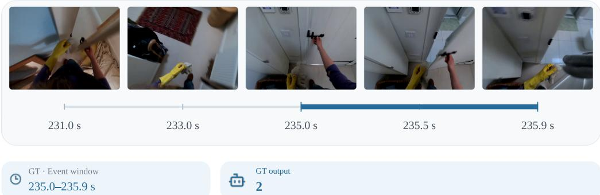  
Figure 6: Atomic Event Monitoring. The model is asked to report the second occurrence of opening a door. The selected frames show a local excerpt around the target event; preceding occurrences are outside this excerpt.

becomes reliably identifiable. The distinction lies in the semantic scope of matching, not the output format. The annotation records the target occurrence’s temporal window. Figure 7 provides an example.

Daily Perception / Event Monitoring

Event Type Monitoring

Event tpe: C throws something itothe bin.   
Target occurrence: 4. Output one trigger when it occurs.

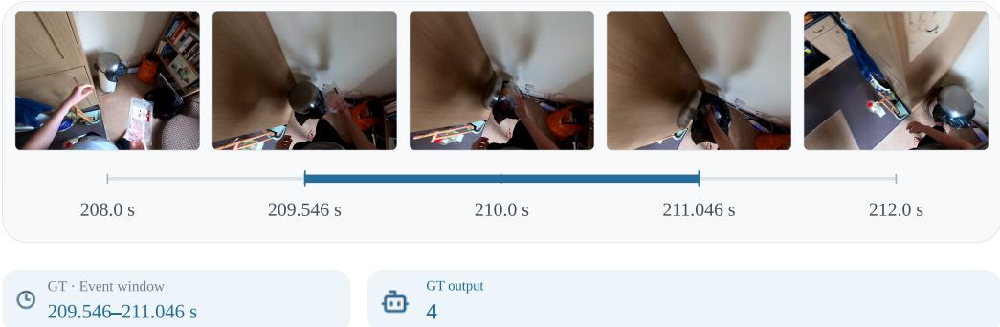  
Figure 7: Event Type Monitoring. The query covers throwing something into a bin without restricting the discarded object. The model must output 4 for the fourth matching occurrence, annotated at 209.546–211.046 s.

Compositional Process Monitoring. A compositional process is a complete, coarse-grained activity formed by temporally continuous atomic events that are semantically or functionally related and serve a common goal. Its boundaries follow the complete process specified by the query, excluding independent activities outside that scope. Actions that initiate, advance, adjust, or complete the process remain part of it, even when not explicitly named in the query. The model outputs start when the process begins, followed by end when completion becomes reliably identifiable. Each boundary is reported at most once, and internal actions require no separate response. Figure 8 shows the two annotated boundaries.

## Daily Perception / Event Monitoring

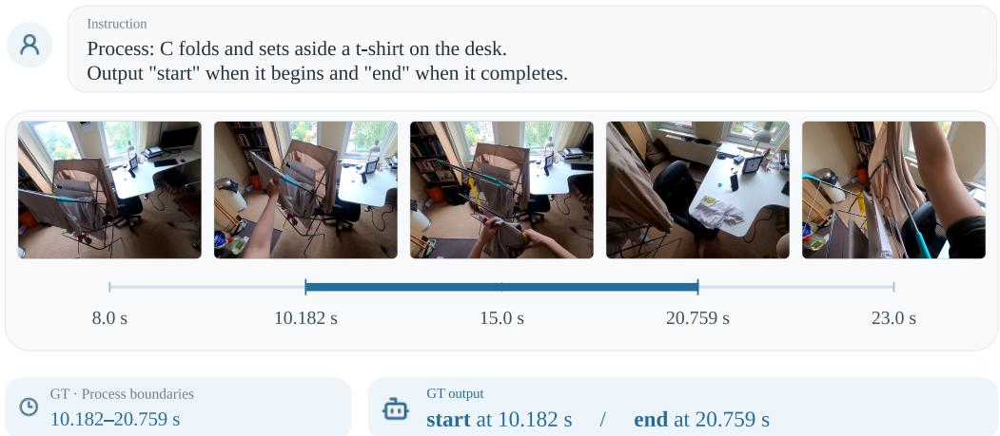  
Figure 8: Compositional Process Monitoring. The queried process is folding and setting aside a T-shirt on the desk. Its annotated start and completion are 10.182 s and 20.759 s, respectively. The required responses are start and end.

## A.1.2 OBJECT MONITORING

Object Monitoring uses TAG videos and evaluates disappearance detection for an object specified by a natural-language description. The model tracks the object and outputs exactly Warning when it becomes no longer visible or identifiable. Each disappearance requires one response, issued as soon as the disappearance can be reliably confirmed. If the object becomes visible again and subsequently disappears, the later disappearance constitutes a new target; continued absence does not require repeated warnings. The annotations therefore consist of disappearance timestamps paired with the same required warning token. Figure 9 illustrates an instance with two annotated targets.

## Daily Perception / Object Monitoring

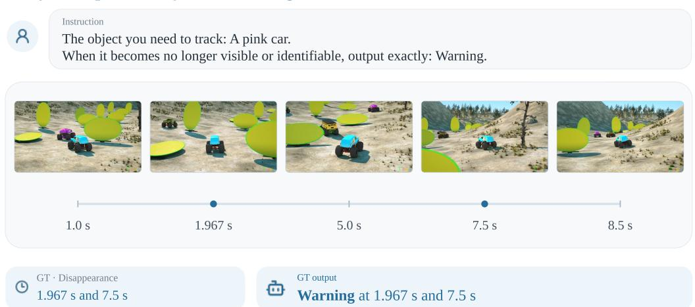  
Figure 9: Object Monitoring. The specified object is a pink car. The annotated disappearance times are 1.967 s and 7.5 s, each requiring Warning. The task requires maintaining the target object’s identity across the video and distinguishing separate disappearance events.

## A.2 RISK ALERT

## A.2.1 ACCIDENT WARNING

Accident Warning uses Nexar driving videos and requires predicting an imminent collision risk from the stream observed so far. The model outputs exactly Warning at the earliest time when the risk can be reliably identified, before the collision occurs. Only one warning is required per video. Each instance contains a GT warning timestamp, which is distinct from the collision time and serves as the annotated response target. This task concerns anticipatory warning rather than retrospective description of a collision. Figure 10 shows an example.

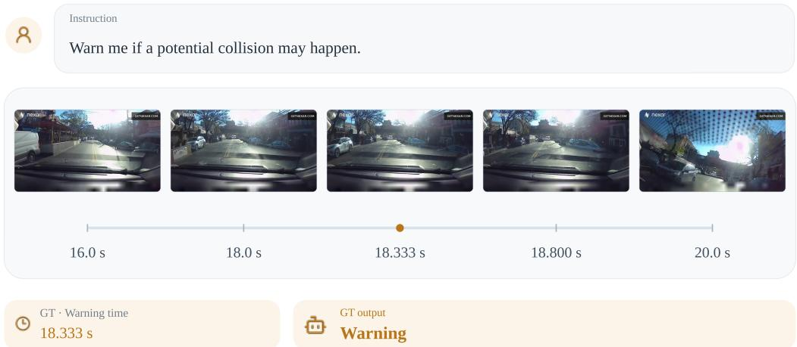  
Figure 10: Accident Warning. The model monitors a driving scene for an imminent collision risk, with a GT warning target at 18.333 s. The 18.800 s and 20.0 s frames illustrate subsequent developments and do not provide evidence available at the annotated warning time.

## A.2.2 CRIME ALERT

Crime Alert uses UCF-Crime videos and requires detecting criminal or suspicious behavior when it becomes visually identifiable. The model outputs exactly Warning at the earliest reliable detection time and only once per video. The annotation supplies the target alert timestamp and the required warning token. Figure 11 illustrates the task; its displayed instruction summarizes the task-level monitoring requirement.

## Risk Alert / Crime Alert

Warn me if criminal or suspicious behavior is reliably detected.

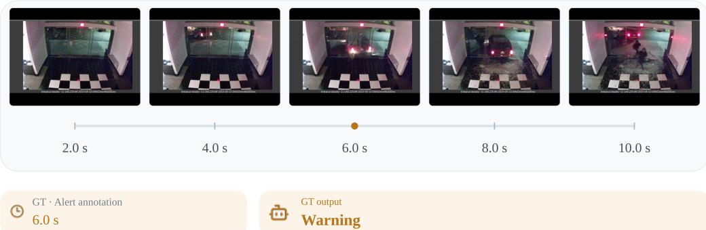  
Figure 11: Crime Alert. A surveillance-video example from UCF-Crime has a GT alert target at 6.0 s, with Warning as the required output. The surrounding frames provide context for the developing incident; later frames are not used to justify an earlier response.

## A.3 EVENT INTERVENTION

Event Intervention uses videos that we manually script and record. Each video is paired with an instruction specifying the user’s goal and the conditions under which assistance is expected. The model must relate the observed scene and task progress to these requirements and proactively provide a relevant reminder, correction, or guidance without a follow-up query. Multiple interventions may be needed in one video. Each annotated response contains a start time t, a duration d, and a natural-language reference answer, defining a response window [t, t + d] during which the intervention remains grounded and useful. Responses should convey the essential information required by the instruction and reference answer, rather than reproduce a fixed string.

The shopping example in Figure 12 illustrates one intervention within a longer interaction. The full instruction also requests reminders about unpurchased items or their product areas, including relative locations, and corrections when the user picks up an unlisted item. The figure displays an abbreviated instruction focused on checking out before completing the shopping list. The model must retain the outstanding goal across the stream to recognize that tomatoes have not yet been purchased.

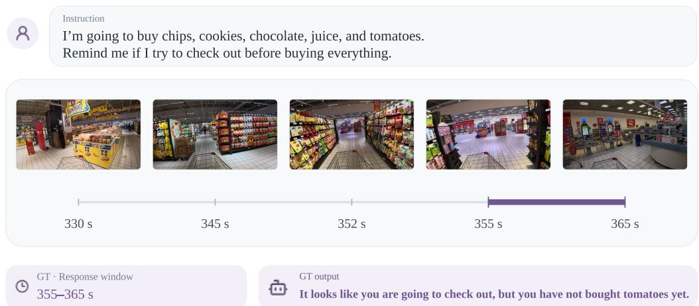  
Figure 12: Event Intervention. As the user approaches checkout without having bought tomatoes, the model should remind them of the missing item. The annotated response window is 355–365 s. The reference answer identifies both the attempted checkout and the unfulfilled shopping requirement.

## B STREAMING INFERENCE PROCEDURE

System prompt. The following is the system prompt used for prompt-based inference; {silence signal} is replaced with the model-specific silence token before inference. A sepa rate user prompt specifies the monitored event or user goal and its response rules.

You are a real-time video assistant watching a video frame by frame.   
At each turn, you are given newly observed visual frames from the video   
stream.   
Rules:   
1. Follow the instruction provided by the user and decide whether to   
reply.   
2. If you do not need to reply now, output exactly "{silence\_signal}".   
Output only the reply text.

For most models the silence token is Silence; JoyAI-VL-Interaction uses </silence> and MMDuet2 uses NO REPLY. These tokens are retained in the conversation but removed from the scored responses.

Inference procedure. Algorithm 1 formalizes the prompt-based evaluation. The default sampling rate is 1 FPS with one new frame per decision step. Sample times resolving to the same video frame are deduplicated, and time-stamped user instructions join the next eligible frame turn. InternVL3.5- 8B and GPT-5.6-Luna retain the latest 32 and 16 images per request, respectively; all other promptbased models receive every observed image. No visual context limit removes prior instructions or generated replies from the dialogue history.

## Algorithm 1 Causal Streaming Inference

Require: Video V, instruction I, model M, sampling rate $f ,$ frames per turn B   
Scheduled user text Q   
Ensure: Time-stamped non-silent responses O   
1: s ← SilenceSignal(M)   
2: H ← [SystemPrompt $( M , s )$ , TaskPrompt $( I , s ) ]$   
3: $\mathcal { O }  \dot { \emptyset }$   
4: $F $ DecodeUniqueFrames $( V , f )$ ▷ Chronological samples   
5: for each consecutive group G of B frames in $F$ do   
6: t ← time(last(G))   
7: q ← DueText(Q, t)   
8: H ← H ∥ [UserTurn $( G , q , t ) ]$   
9: r ← Inference(M, H)   
10: $H  H \parallel [ \mathrm { A }$ ssistantTurn $\left[ \left( \boldsymbol { r } , t \right) \right]$   
11: $\mathbf { i f } \ r \neq s$ then   
12: $\dot { \mathcal { O } } \gets \mathcal { O } \parallel [ ( t , r ) ]$   
13: end if   
14: end for   
15: return O

## C TRAINING DETAILS OF $\mathrm { P ^ { 3 } I { - } A }$ SSISTANT-4B

## C.1 TRAINING DATA

The SFT data consist of 12,000 broadly scoped proactive video question-answering examples and 1,368 additionally annotated examples targeting the tasks in our benchmark. The broadly scoped data include 10,000 PVQ examples derived from Shot2Story and 2,000 CRR examples from LLaVA-Video. The additionally annotated data comprise 600 Accident examples and 768 Event examples, where Event collectively denotes the Atomic, Event Type, and Compositional tasks, containing 259, 232, and 277 examples, respectively. All examples are combined into a deterministically shuffled training file without additional task-dependent resampling.

The RL data contain 863 rollout windows, including 300 Accident windows and 563 Event windows. The Event portion consists of 100 Atomic, 100 Event Type, and 363 Compositional windows. For Compositional, the start and end targets of 191 videos can be covered by the same rollout window, whereas the remaining 86 videos are divided into separate start- and end-oriented windows. This produces $1 9 1 + 8 6 \times \bar { 2 } = 3 6 3$ rollout windows from 277 source videos.

## C.2 SUPERVISED FINE-TUNING

The SFT stage is initialized from Qwen3-VL-4B-Instruct. The vision encoder is frozen, while the language model and visual merging and alignment modules remain trainable. Each training example retains the preceding visual observations and alternating interaction history within the sampled video clip. The target at each interaction turn is either ${ < } / { \mathrm { S i } }$ lence> or a response beginning with </Response>, followed by a required signal or a natural-language answer. Each Compositional example contains two boundary responses corresponding to its start and end targets.

To account for the imbalance between silence and response decisions, focal and frequency-balancing factors are applied to the two state tokens. Let $\nu$ denote the set of supervised token positions, excluding positions whose labels are masked with −100. The cross-entropy loss at position i is

$$
\ell _ { i } = - \log p _ { \theta } ( y _ { i } \mid x , y _ { < i } ) ,
$$

where $x$ denotes the video, task instruction, and interaction history; $y _ { i }$ is the target token at position $i ; y _ { < i }$ denotes the preceding target tokens; and θ denotes the trainable model parameters. Let $\mathcal { S } \subseteq \mathcal { V }$

Table 6: Configuration for supervised fine-tuning.
<table><tr><td>Configuration</td><td>Value</td></tr><tr><td>Initialization</td><td>Qwen3-VL-4B-Instruct</td></tr><tr><td>Video sampling rate</td><td>1 FPS</td></tr><tr><td>Learning rate</td><td> $1 \times 1 0 ^ { - 5 }$ </td></tr><tr><td>Training epochs / steps</td><td> $1 / 4 1 8$ </td></tr><tr><td>GPUs</td><td>4</td></tr><tr><td>Per-device batch size</td><td>1</td></tr><tr><td>Gradient accumulation steps</td><td>8</td></tr><tr><td>Optimizer</td><td>Fused AdamW</td></tr><tr><td>Learning-rate schedule</td><td>Cosine decay</td></tr><tr><td>Warmup ratio</td><td>5%</td></tr></table>

denote positions whose targets are ${ < } / { \textrm { S i l } }$ ence> or $< /$ Response>. The weight assigned to each supervised token is

$$
w _ { i } = \left\{ \begin{array} { l l } { \displaystyle { \frac { N _ { s } } { K n _ { y _ { i } } } } ( 1 - \exp ( - \ell _ { i } ) ) ^ { \gamma } , } & { i \in \mathcal { S } , } \\ { 1 , } & { i \notin \mathcal { S } , } \end{array} \right.
$$

where $n _ { y _ { i } }$ is the number of occurrences of state token $y _ { i }$ in the current batch, $N _ { s }$ is the total number of supervised state tokens in that batch, K is the number of state-token classes present in the batch, and $\gamma$ is the focal exponent. The final SFT loss is

$$
\mathcal { L } _ { \mathrm { S F T } } = \frac { 1 } { | \mathcal { V } | } \sum _ { i \in \mathcal { V } } w _ { i } \ell _ { i } ,
$$

where $| \nu |$ is the total number of supervised tokens. Ordinary response tokens therefore retain the standard cross-entropy loss, while difficult and less frequent state-token decisions receive larger weights. All supervised tokens share the same token-count normalization, without separately weighting state-token and response-content losses.

The SFT stage takes approximately 2 hours and 49 minutes to complete. The remaining training configuration is summarized in Table 6.

## C.3 REINFORCEMENT LEARNING

The RL stage is initialized from the final SFT checkpoint and optimized using Group Relative Policy Optimization (GRPO). Rollouts reveal the video incrementally by introducing newly sampled frames over successive interaction rounds. Accident and Compositional rollouts retain a bounded video prefix preceding the rollout window. For Atomic and Event Type, the historical context begins at the start of the video, allowing the model to determine how many times the queried event has occurred. Responses preceding the rollout window are treated as a fixed prefix, and only responses generated within the rollout participate in policy optimization. The complete RL configuration is reported in Table 7.

The reward is computed over the complete generated trajectory. The temporal score assigned to a response emitted at time t is

$$
s ( t ) = \exp \left( - \alpha \left| t - t _ { \mathrm { G T } } \right| \right) ,
$$

where t is the response time, $t _ { \mathrm { G T } }$ is the annotated target time, and α controls the decay with respect to temporal distance. Following the benchmark evaluation protocol, we set $\alpha = 0 . 0 5$

For Accident, let $\mathcal { I }$ denote the set of non-silent outputs whose normalized content strictly matches Warning, and let M denote the total number of non-silent outputs, including malformed outputs. If at least one correct warning is generated, the closest one is selected as

Table 7: Configuration for reinforcement learning.
<table><tr><td>Configuration</td><td>Value</td></tr><tr><td>Initialization</td><td>Final SFT checkpoint at step 418</td></tr><tr><td>Optimization algorithm</td><td>Group Relative Policy Optimization (GRPO)</td></tr><tr><td>Learning rate</td><td> $5 \times \bar { 1 0 } ^ { - 7 }$ </td></tr><tr><td>Training epochs / steps</td><td>Approximately 1 / 143</td></tr><tr><td>Training GPUs / rollout GPUs</td><td> $3 \hat { / } \hat { 1 }$ </td></tr><tr><td>Per-device batch size</td><td>1</td></tr><tr><td>Gradient accumulation steps</td><td>8</td></tr><tr><td>Generations per input</td><td>4</td></tr><tr><td>GRPO clipping coefficient</td><td>0.2</td></tr><tr><td>KL coefficient</td><td>0</td></tr><tr><td>Optimizer</td><td>Fused AdamW</td></tr><tr><td>Learning-rate schedule</td><td>Cosine decay</td></tr><tr><td>Warmup ratio</td><td>5%</td></tr><tr><td>Generation temperature</td><td>0.9</td></tr><tr><td>Top-p / top-k</td><td>0.9 / 50</td></tr><tr><td>Video sampling rate</td><td>1 FPS 1</td></tr><tr><td>Frames per interaction turn</td><td></td></tr></table>

$$
j ^ { * } = \arg \operatorname* { m i n } _ { j \in \mathcal { I } } \left| t _ { j } - t _ { \mathrm { G T } } \right| ,
$$

where $t _ { j }$ is the emission time of output j. The Accident reward is

$$
R _ { \mathrm { A c c i d e n t } } = \left\{ { { s \atop - \lambda M } } , \begin{array} { l } { { \lambda ( { \cal t } _ { j ^ { * } } ) - \lambda ( { \cal M } - 1 ) , \quad | { \mathcal I } | > 0 , } } \\ { { } } \\ { { | { \mathcal I } | = 0 , } } \end{array}  \right.
$$

where $\lambda = 0 . 2$ is the penalty assigned to each unmatched non-silent output. When at least one correct warning is produced, the closest correct warning contributes its temporal score, while the remaining outputs are penalized. If no correct warning is produced, all non-silent outputs are penalized.

For Atomic and Event Type, a response is considered correct only when its predicted integer exactly matches the target. Their trajectory reward is

$$
R _ { \mathrm { E v e n t } } = \mathrm { P R S - B _ { f i r s t } } \left( \mathcal { O } , \mathcal { G } \right) ,
$$

where O is the set of non-silent outputs in the rollout, $\mathcal { G }$ is the set of ground-truth event responses, and $\mathrm { P R S - B _ { \mathrm { f i r s t } } }$ denotes the bidirectional first-only score used in our evaluation. It selects the temporally closest semantically correct output while retaining all non-silent outputs in the score normalization. Incorrect and repeated responses therefore reduce the trajectory reward.

For Compositional, predictions are first assigned to the start and end labels and then matched strictly against their corresponding targets. Let A denote the set of active boundary labels in the current rollout, S denote the bidirectional first-only score for label $l ,$ and $N _ { \mathrm { i n v } }$ denote the number of malformed predictions or predictions associated with a boundary absent from the current rollout. The reward is

$$
R _ { \mathrm { C o m p } } = { \frac { 1 } { | { \cal A } | } } \sum _ { l \in { \cal A } } S _ { l } - \lambda N _ { \mathrm { i n v } } ,
$$

where $| { \cal A } |$ is the number of active boundary labels and $\lambda = 0 . 2$ is the invalid-output penalty. Repeated predictions of an active boundary remain in the corresponding score denominator and consequently reduce $S _ { l } . \mathrm { A }$ valid ${ < } / \mathrm { S i l } { } ]$ lence> output is excluded from response scoring and receives no independent positive reward. Consequently, remaining silent throughout a rollout does not yield the temporal reward associated with its target responses.

The explicit additive penalties in the Accident and Compositional rewards are introduced because the SFT checkpoint exhibits a stronger tendency to generate redundant or invalid outputs on these two tasks. No analogous additive penalty is applied to the remaining task subsets, but incorrect or repeated outputs still reduce their metric-based trajectory rewards.

## D ERROR ANALYSIS

Figure 13 presents three failure cases from model response traces, illustrating distinct limitations in response control, warning timeliness, and goal-conditioned intervention.

Repeated triggering. In Figure 13(a), the instruction requires a single response for the first occurrence of placing clay mix into a brick mold. Qwen3-VL-8B-Instruct nevertheless outputs 1 at 13 timestamps between 4 and 277 s. Subsequent molding actions do not constitute additional requested targets. Although the first response slightly precedes the annotated onset, the repeated outputs violate the explicit one-response constraint. This case illustrates a failure to maintain selective responding after a one-time request has been addressed.

Delayed warning. In Figure 13(b), the GT warning target is 18.867 s. The video subsequently shows the gap to the preceding vehicle closing rapidly, followed by a sharp upward camera pitch around 20.2 s. The only recorded Warning from GPT-5.6-Luna occurs at 40.200 s, near the video end and 21.333 s after the GT target. The warning therefore follows the close approach and abrupt camera motion instead of anticipating them. This trace illustrates how a valid warning token can arrive too late to serve its intended proactive role.

Missing corrective guidance. In Figure 13(c), the user requests guidance to room 212 on the second floor, including corrections for excessive descent. JoyAI-VL-Interaction correctly announces arrival at the second floor at 30 s. The user then turns toward the downward staircase and begins descending. During the annotated correction window of 35–39 s, the model only repeats the floorarrival notice at 35 s, without advising the user to stop or turn back. Recognizing the floor is therefore insufficient: useful intervention requires identifying deviations of the unfolding action from the intended destination and providing the appropriate correction.

## E BEST-REPLY EVALUATION WITHOUT REDUNDANCY PENALTY

Table 8 reports an alternative to the PRS results in Table 2. It retains the same response-to-target assignment, correctness score, and temporal decay as PRS-U and PRS-B, but measures whether a model produces at least one well-timed, correct response to each target. For the responses $\mathcal { O } _ { i }$ matched to target $g _ { i } ,$ the target-level score is

$$
S _ { i } ^ { \mathrm { b e s t } } = \left\{ \begin{array} { l l } { \operatorname* { m a x } _ { 0 _ { j } \in \mathcal { O } _ { i } } s ( o _ { j } , g _ { i } ) , } & { | \mathcal { O } _ { i } | > 0 , } \\ { o _ { i } } & { | \mathcal { O } _ { i } | = 0 . } \end{array} \right.
$$

Unlike the primary PRS, this variant does not divide by the number of matched responses. Targets requiring silence retain the original scoring rule. Target scores are averaged within each video and then across videos; the Event column averages the Atomic, Compositional, and Event Type subsets, and Overall averages the five tasks equally. The results are reported on a 0–100 scale.

## (a) Repeated triggering

## Report the first occurrence of putting clay mix into the brick mold. Output “1” exactly once

  
4.000 s |First response  
GT REQUIREMENT One target: 4.889–7.139 s Output “1” once.

  
5.000 s | Target event

## Daily Perception·Qwen3-VL-8B-Instruct

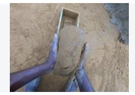  
27.000 s |Later response  
MODEL RESPONSE 13 responses to a one-time request “1” at 4, 27, 46, 65, 68, 85, 106, 185, 204, 224, 242, 259 and 277 s.

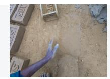  
65.000 s |Later response

## (b) Delayed warning

Warn when an imminent collision risk becomes identifiable, before the collision occurs

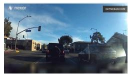  
18.867 s | GT warning time  
GT REQUIREMENT Warning target: 18.867 s Output “Warning”.

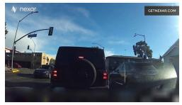  
19.900 s |Gap rapidly closes

## Accident Warning·GPT-5.6-Luna

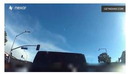  
20.200 s | Camera pitches upward

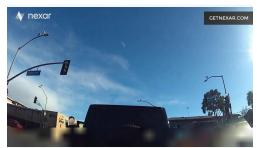  
40.200 s |Model warning time  
MODEL RESPONSE 21.333 s after the GT warning target Only saved response: “Warning” at 40.200 s. The response is triggered well after the close approach and camera jolt.

## (c) Missing corrective guidance

Guide me to room 212 on floor 2. Announce floor arrivals and correct excessive descent.

  
GT REQUIREMENT Correction window: 35–39 s Already on floor 2; turn back.

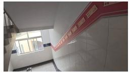  
35.002 s | Downward turn  
MODEL RESPONSE  
Event Intervention · JoyAl-VL-Interaction

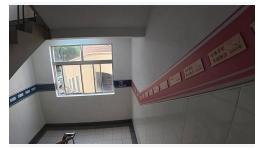  
37.004 s | Continues descending

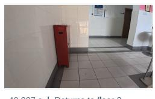  
40.007 s | Returns to floor 2  
30 s: “Reminder: you have arrived at the 2nd floor." 35 s: “Reminder: you have arrived at the 2nd floor."  
Arrival is reported again; the correction is omitted

Figure 13: Failure cases from model response traces. (a) Repeated outputs for a single requested event occurrence. (b) A warning recorded 21.333 s after the annotated warning target. (c) A repeated floor-arrival notice that omits the required correction. Instructions and GT descriptions are abridged. Later frames provide context and do not justify earlier responses.

Table 8: Best-reply model performance in $\mathbf { P } ^ { 3 } \mathbf { I } \mathbf { B } \mathbf { E } \mathbf { N } \mathbf { C } \mathbf { H } .$ PRS-U’ and $\mathrm { P R S - B } ^ { \prime }$ retain the original matching and temporal decay rules but score each target by its highest-scoring matched reply, without dividing by the number of matched replies. The best and second-best available scores in each column are bold and underlined, respectively.
<table><tr><td rowspan="3">Model</td><td colspan="4">Perception</td><td colspan="4">Risk Prediction</td><td colspan="2">Intervention</td><td colspan="2">Overall</td></tr><tr><td>Event</td><td></td><td colspan="2">Object</td><td colspan="2">Accident</td><td colspan="2">Crime</td><td colspan="2"></td><td colspan="2">Average</td></tr><tr><td>PRS-U&#x27;</td><td>PRS-B&#x27;</td><td>PRS-U&#x27;</td><td>PRS-B&#x27;</td><td>PRS-U&#x27;</td><td>PRS-B&#x27;</td><td>PRS-U’PRS-B’</td><td></td><td>PRS-U&#x27;</td><td>PRS-B&#x27;</td><td>PRS-U&#x27;</td><td>PRS-B&#x27;</td></tr><tr><td colspan="10">Offline Models adapted for Proactive Tasks</td><td></td><td></td><td></td><td></td></tr><tr><td>GLM-4.1V-9B-Base</td><td>0.89</td><td>0.96</td><td>26.00</td><td>26.49</td><td>7.38</td><td>8.08</td><td>21.76</td><td>23.41</td><td>1.32</td><td>1.32</td><td>11.47</td><td>12.05</td></tr><tr><td>InternVL3.5-8B</td><td>28.06</td><td>33.03</td><td>28.02</td><td>28.08</td><td>30.71</td><td>46.83</td><td>48.10</td><td>58.63</td><td>37.06</td><td>37.06</td><td>34.39</td><td>40.73</td></tr><tr><td>Qwen2.5-VL-3B-Instruct</td><td>31.70</td><td>38.52</td><td>63.20</td><td>69.27</td><td>63.74</td><td>71.39</td><td>46.25</td><td>60.82</td><td>16.98</td><td>16.98</td><td>44.37</td><td>51.40</td></tr><tr><td>Qwen3-VL-4B-Instruct</td><td>34.22</td><td>43.97</td><td>40.32</td><td>42.41</td><td>55.56</td><td>69.23</td><td>69.72</td><td>74.28</td><td>31.00</td><td>31.00</td><td>46.16</td><td>52.18</td></tr><tr><td>Qwen3-VL-8B-Instruct</td><td>20.77</td><td>31.33</td><td>48.20</td><td>53.90</td><td>33.06</td><td>72.67</td><td>44.51</td><td>59.30</td><td>39.88</td><td>39.88</td><td>37.28</td><td>51.42</td></tr><tr><td>Qwen3.5-4B</td><td>29.74</td><td>36.78</td><td>33.34</td><td>36.57</td><td>25.47</td><td>35.00</td><td>48.17</td><td>57.94</td><td>14.51</td><td>14.51</td><td>30.24</td><td>36.16</td></tr><tr><td>Qwen3.5-9B</td><td>25.26</td><td>31.86</td><td>39.12</td><td>47.20</td><td>15.82</td><td>15.82</td><td>43.20</td><td>50.06</td><td>35.82</td><td>35.82</td><td>31.84</td><td>36.15</td></tr><tr><td>GPT-5.6-Luna</td><td>26.04</td><td>38.13</td><td>39.82</td><td>43.49</td><td>56.41</td><td>74.64</td><td>54.58</td><td>62.78</td><td>52.90</td><td>52.90</td><td>45.95</td><td>54.39</td></tr><tr><td colspan="10">Native Proactive Streaming Models</td><td></td><td></td><td></td><td></td></tr><tr><td>Em-Garde</td><td>48.07</td><td>55.28</td><td>31.92</td><td>37.61</td><td>40.60</td><td>59.35</td><td>25.59</td><td>46.83</td><td>10.85</td><td>16.59</td><td>31.41</td><td>43.13</td></tr><tr><td>JoyVL</td><td>19.25</td><td>24.23</td><td>47.47</td><td>54.39</td><td>19.66</td><td>50.62</td><td>43.15</td><td>52.19</td><td>24.92</td><td>24.92</td><td>30.89</td><td>41.27</td></tr><tr><td>MMDuet2</td><td>0.36</td><td>0.44</td><td>26.00</td><td>26.00</td><td>0.00</td><td>0.00</td><td>17.00</td><td>17.00</td><td>1.46</td><td>1.46</td><td>8.96</td><td>8.98</td></tr><tr><td>VideoChat3</td><td>14.47</td><td>28.01</td><td>20.00</td><td>21.79</td><td>25.21</td><td>26.07</td><td>21.32</td><td>22.94</td><td>N/A</td><td>N/A</td><td>N/A</td><td>N/A</td></tr></table>

Event averages the three Ego4D subsets equally; Overall averages the five tasks equally. Intervention B reuses U where no bidirectional semantic scores are available. N/A denotes VideoChat3 scores that cannot be recomputed without Intervention semantic scores. VideoChat3 uses its archived raw outputs, which are distinct from the existing main-table score artifacts.