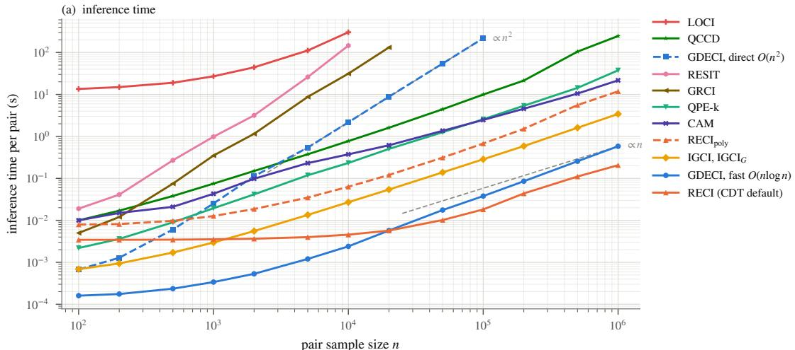
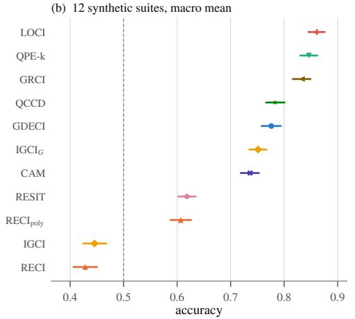
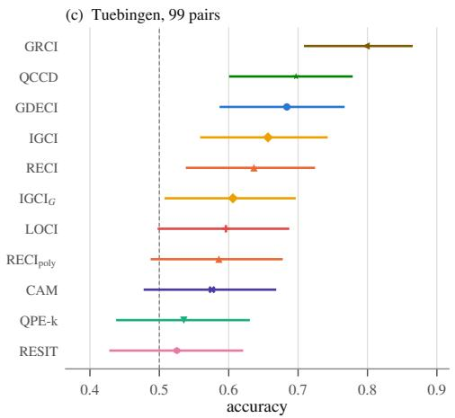
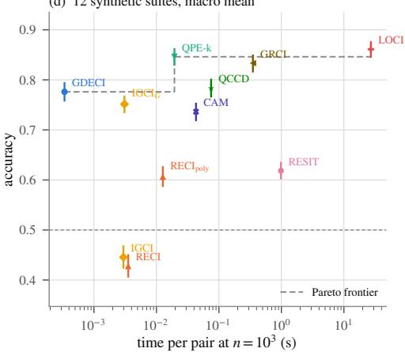
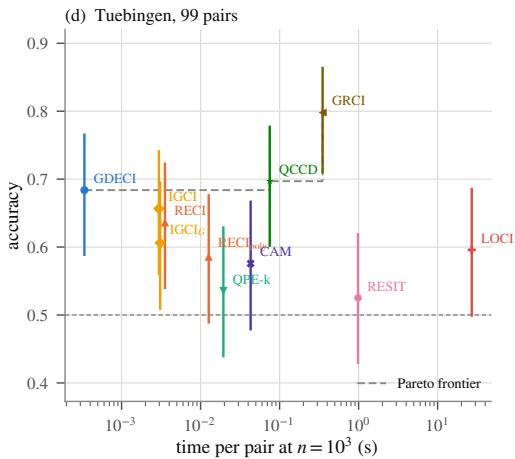
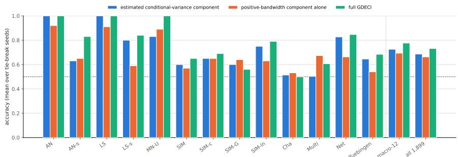
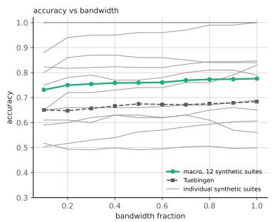

# GRAPH DIRICHLET ENERGY FOR FITTING-FREE BIVARIATE CAUSAL INFERENCE

A PREPRINT

Povilas Daniušis Neurotechnology and Vytautas Magnus University povilas.daniusis@gmail.com

## ABSTRACT

We propose the Graph Dirichlet Energy Causal Inference (GDECI) criterion for distinguishing cause from effect in bivariate settings. For a candidate direction X → Y , we construct a kernel similarity graph from X and treat Y as a graph signal. The score is the Dirichlet energy of this signal, induced by the unnormalized graph Laplacian. The reverse score swaps the variables, and the lower-energy direction is inferred as causal. The method requires neither regression fitting nor independence testing. After the empirical probability integral transform, its decisions are invariant under strictly monotone transformations of either variable, and the graph operations reduce to convolutions, allowing exact evaluation in O(n log n) time and O(n) memory. At the population level, GDECI compares degreeweighted Bayes squared prediction errors plus a non-negative smoothness term of the regression function. As the bandwidth tends to zero, the weights become uniform and the smoothness term vanishes, reducing the criterion to a RECI-type comparison of expected conditional variances in copula space. Empirically, we compare GDECI with QCCD, GRCI, CAM, IGCI (two variants), RESIT, LOCI, QPE-k, and RECI (two variants), in accuracy on 1899 cause–effect pairs and in inference speed. GDECI ranked fifth of eleven methods in macro-averaged accuracy on 12 synthetic suites (0.776). On the real-world Tuebingen pairs, it ranked third in unweighted accuracy (0.684) and fifth in weighted accuracy (0.678). It was also the fastest of the compared methods up to $n \approx 1 0 ^ { 4 }$ The accompanying code repository: https://github.com/povidanius/gdeci.

## 1 Introduction

Given an i.i.d. sample of $( X , Y ) \sim P _ { X , Y }$ , deciding whether X → Y or Y → X is an important problem in causal discovery, with applications wherever interventions are costly or infeasible [15]. From the observational joint distribution alone, the causal direction is in general not identifiable without additional assumptions. Bivariate causal-discovery methods therefore exploit statistical or structural properties that hold in the causal direction but generally fail when the roles of cause and effect are reversed.

A broad class of methods obtains such asymmetries by restricting the data-generating mechanism. For instance, additivenoise models [10] represent the effect as a function of the cause plus an independent disturbance, $Y = f ( X ) + N$ with N independent of X. RESIT [16] fits a nonlinear regression in each direction and tests whether the residuals are independent of the regressor, while CAM [4] compares the Gaussian likelihoods of additive models fitted in the two directions. Location–scale (heteroscedastic) noise models generalize this to $\boldsymbol { Y } = \boldsymbol { f } ( \boldsymbol { X } ) + \boldsymbol { g } ( \boldsymbol { X } ) \boldsymbol { N }$ , so that the noise scale may depend on the cause and the noise is recovered as the standardized residual $( \dot { Y } - \bar { f } ( X ) ) / g ( X )$ . GRCI [21] estimates the conditional mean and scale in each direction and selects the direction whose standardized residual is less dependent on the candidate cause, measured by mutual information. LOCI [11] fits f and g with neural network and selects the direction with either the higher likelihood or the weaker HSIC dependence between the standardized residual and the candidate cause. These restrictions make the direction identifiable because, apart from non-generic cases, no model of the same form holds in the reverse direction [10, 16, 21, 11]. QPE-k [5] restricts the conditional distribution through the quantile partial effect, defined by differentiating the conditional quantile function with respect to the cause at a fixed quantile level. For each value of the cause, this quantity, viewed as a function of the response value, is assumed to be a linear combination of finitely many known basis functions. This assumption contains additive and heteroscedastic noise models as special cases.

Other methods derive such asymmetries from the principle of independence of cause and mechanism (ICM) [13], which they formalize in different ways. For instance, IGCI relies on the fact that, if the cause distribution and the data-generating mechanism are chosen independently, irregularities of the latter are generally reflected in the effect distribution, resulting in an asymmetry in relative entropy [6, 12]. QCCD approaches the independence of cause and mechanism through minimum description length, comparing the quantile scores of nonparametric quantile regressions in the two directions as proxies for code length [23]. RECI compares the least-squares errors of regressing each variable on the other. Under an independence postulate, the error is smaller in the causal direction for equally scaled variables, invertible nonlinear mechanisms, and sufficiently small noise [2, 3].

In this paper, we investigate whether asymmetries in graph Dirichlet energy can reveal the causal direction between two variables. We treat one variable as a signal on a similarity graph built from the other and measure its Dirichlet energy induced by the unnormalized graph Laplacian. Although graph Dirichlet energy has been widely used in machine learning and graph signal processing [1, 24, 20], to the best of our knowledge, this graph-based framework was not investigated from the perspective of bivariate causal asymmetry. The main contributions are:

• Theoretical and methodological contributions. We propose a fitting-free GDECI criterion for bivariate causal inference, whose decisions are invariant under strictly monotone transformations of either variable, and show that its population form decomposes into a weighted Bayes squared prediction error and a smoothness term. As the bandwidth tends to zero, the smoothness term vanishes, so that GDECI reduces to a RECI-type comparison in copula space. We give a sufficient condition under which GDECI selects the causal direction for non-injective mechanisms, and show that the smoothness term is of smaller order in the causal direction for monotone additive and heteroscedastic mechanisms with bounded noise. We also derive a fast algorithm to compute the GDECI criterion in $O ( n \log n )$ time and $O ( n )$ memory.

• Empirical study. We benchmark GDECI against QCCD, GRCI, CAM, IGCI, RESIT, LOCI, QPE-k, and RECI methods on 1899 cause–effect pairs and report its empirical profile for both accuracy and inference time.

We introduce the proposed criterion in Section 2, discuss its theoretical properties in Section 3, and present an efficient algorithm in Section 4. Section 5 is devoted to the experiments. Finally, we discuss limitations in Section 6 and conclude our paper in Section 7. Proofs and other technical information are provided in Appendices $\mathbf { A } , \mathbf { B } , \mathbf { C } , \mathbf { \Lambda D }$ , and E.

## 2 Method

Let X, Y have continuous distribution functions $F _ { X } , F _ { Y }$ and set $U = F _ { X } ( X ) , V = F _ { Y } ( Y )$ , so both marginals are uniform on $[ 0 , 1 ]$ and the directional signal is not confounded by differing one-dimensional marginals. For i.i.d. copies $( U _ { i } , V _ { i } ) _ { i = 1 } ^ { n }$ and a bandwidth $\sigma > 0$ define

$$
\begin{array} { c c } { { k _ { \sigma } ( a , b ) = \exp \Big [ - \frac { ( a - b ) ^ { 2 } } { 2 \sigma ^ { 2 } } \Big ] , } } & { { W _ { i j } ^ { U } = k _ { \sigma } ( U _ { i } , U _ { j } ) , } } \\ { { d _ { i } ^ { U } = \displaystyle \sum _ { j } W _ { i j } ^ { U } , } } & { { D ^ { U } = \mathrm { d i a g } ( d _ { 1 } ^ { U } , \dots , d _ { n } ^ { U } ) , } } \end{array}
$$

$$
L ^ { U } = D ^ { U } - W ^ { U } ,
$$

and, with $v = ( V _ { 1 } , \ldots , V _ { n } ) ^ { \top }$

$$
\begin{array} { r l r } & { } & { E _ { n } ( U  V ) = v ^ { \top } L ^ { U } v = \frac { 1 } { 2 } \sum _ { i , j } W _ { i j } ^ { U } ( V _ { i } - V _ { j } ) ^ { 2 } , \phantom { \sum _ { i } } } \\ & { } & { M _ { n } ( U ) = \sum _ { i , j } W _ { i j } ^ { U } , ~ \Delta _ { n } ( U  V ) = \frac { E _ { n } ( U  V ) } { M _ { n } ( U ) } . } \end{array}\tag{1}
$$

The reverse score swaps U and V, and the direction with the smaller $\Delta _ { n }$ is returned. In practice, $U _ { i }$ and $V _ { i }$ are replaced by the normalized empirical ranks rank $( X _ { i } ) / ( n + 1 )$ and rank $( Y _ { i } ) / ( n + 1 )$ , respectively.

Bandwidth. We parameterize σ by a dimensionless multiplier $m > 0$ relative to the median interpoint distance, $\widehat { \sigma } ( z ; m ) = m \cdot \mathrm { m e d i a n } _ { i < j } | z _ { i } - z _ { j } |$ , recomputed per pair, direction and preprocessing, so m is the only free parameter. Under marginal equalization the two samples are permutations of the same rank grid, hence ${ \widehat { \sigma } } ( u ; m ) { \dot { = } } { \widehat { \sigma } } ( { \bar { v ; m } } )$

Invariance. Since the orientation of a cause–effect pair should not depend on the measurement scale, invariance under strictly monotone transformations of either variable ensures that changes of measurement units or scale orientation do not affect the inferred causal direction. GDECI satisfies this requirement through marginal equalization and the use of the unnormalized graph Laplacian (Appendix A). For the normalized Laplacian $L _ { \mathrm { n o r m } } = I - D ^ { - 1 / 2 } W D ^ { - 1 / 2 }$ , whose null space is spanned by $D ^ { \bar { 1 } / 2 } \mathbf { 1 }$ rather than 1, invariance under strictly decreasing transformations generally fails.

## 3 Theoretical analysis

We state the main theoretical results below and defer all proofs to Appendices B and C. Throughout, $U = F _ { X } ( X )$ and $V = F _ { Y } ( Y )$ are uniform on $[ 0 , 1 ]$ . Write $\begin{array} { r } { d _ { \sigma } ( u ) = \int _ { 0 } ^ { 1 } k _ { \sigma } ( u , t ) d t , \mu _ { \sigma } = \int _ { 0 } ^ { 1 } d _ { \sigma } ( u ) } \end{array}$ du and $w _ { \sigma } = d _ { \sigma } / \mu _ { \sigma }$ (the degree weights). Let $r ( u ) = \mathbb { E } ( V \mid U = u ) , s ( v ) = \mathbb { E } ( U \mid \tilde { V } = v ) , \nu _ { r } ( u ) = \mathrm { V a r } ( \tilde { V } \mid U = u )$ and $\nu _ { s } ( v ) = \mathrm { V a r } ( U \mid V = v )$ For $\begin{array} { r } { g \in L ^ { 2 } [ 0 , 1 ] , \operatorname { l e t } \mathcal { D } _ { \sigma } [ g ] = \frac { 1 } { 2 } \int _ { 0 } ^ { 1 } \int _ { 0 } ^ { 1 } k _ { \sigma } ( u , t ) ( g ( u ) - g ( t ) ) ^ { 2 } d u d t } \end{array}$ t. Define

$$
Q _ { \sigma } ( U \to V ) : = \mathbb { E } [ w _ { \sigma } ( U ) \nu _ { r } ( U ) ] + \mathcal { D } _ { \sigma } [ r ] / \mu _ { \sigma } ,\tag{2}
$$

and $Q _ { \sigma } ( V \to U )$ likewise, with $( s , \nu _ { s } )$ in place of $( r , \nu _ { r } )$

Proposition 1 (Population form). For every fixed $\sigma > 0 ,$ almost surely as $n \to \infty , \Delta _ { n } ( U \to V ) \to Q _ { \sigma } ( U \to V )$ and $\operatorname { \bar { \Delta } } _ { n } ( V \to U ) \to Q _ { \sigma } ( V \to U )$ , also for the rank-based scores. As $\sigma \downarrow 0 , \mathcal { D } _ { \sigma } [ g ] / \mu _ { \sigma }  0$ for every $g \in L ^ { 2 } [ 0 , 1 ]$ $Q _ { \sigma } ( U \to V ) \to \operatorname { \mathbb { E } } \operatorname { V a r } ( V \mid U )$ and $Q _ { \sigma } ( { V \to U } ) \to \mathbb { E } \operatorname { V a r } ( U \mid V )$

The weights $w _ { \sigma }$ form a probability density on [0, 1] that is smallest at the endpoints and tends to 1 in the interior as $\sigma \downarrow 0$ (Lemma 1). The following results give conditions under which the population rule selects the causal direction. For non-injective mechanisms (Theorem 1), the conditional-variance term determines the decision, relying on the fact that the cause cannot be recovered from the effect. For bounded monotone location–scale (heteroscedastic) mechanism (Proposition 2), the smoothness term is of smaller order in the causal direction as $\sigma \downarrow 0$ , but both smoothness terms enter the score difference only beyond first order in σ. At first order, the degree weighting rescales the zero-bandwidth difference and adds a positive boundary term. Hence, at small bandwidth, the causal direction is selected whenever its expected conditional variance is not larger.

Theorem 1 (Non-injective mechanisms). Let $Y _ { \tau } = h ( f ( X ) + \tau N ) , \tau \geq 0 $ , where X and N are independent with continuous distributions, $f : \mathbb { R } $ R is Borel, $h : \mathbb { R } $ R is continuous and strictly increasing, and Y0 has a continuous distribution. Assume that f is injective on no Borel set A with $P ( X \in A ) = 1$ , and put $U \overset { \cdot } { = } F _ { X } ( X ) , V _ { \tau } = F _ { Y _ { \tau } } ( Y _ { \tau } )$ and $\gamma = \mathbb { E } \operatorname { V a r } ( U \mid Y _ { 0 } )$ . Then $\gamma > 0 ;$ $\mathbb { E } \operatorname { V a r } ( U \mid V _ { \tau } ) \geq \gamma$ for every $\dot { \tau } \geq 0 ,$ and E Var $\dot { [ V _ { \tau } \mid U ) }  0$ as τ ↓ 0. Consequently, there exist $\tau _ { 0 } , \beta _ { 0 } > 0$ such that $Q _ { \sigma } ( U \to V _ { \tau } ) < Q _ { \sigma } ( V _ { \tau } \to U )$ for all $0 < \tau < \tau _ { 0 }$ and $0 < \sigma < \beta _ { 0 }$ , and for each such $( \tau , \sigma )$ the rank-based rule with bandwidth σ selects $X  Y _ { \tau }$ almost surelyfor all sufficiently large n.

Proposition 2 (Bounded location–scale mechanisms). Let $\boldsymbol { Y } = \boldsymbol { f } ( \boldsymbol { X } ) + \boldsymbol { g } ( \boldsymbol { X } ) \boldsymbol { N }$ , where X and N are independent and supported on $[ - 1 , 1 ]$ and $[ - \eta , \eta ] , \eta > 0 ,$ , with $C ^ { 1 }$ densities that are strictly positive on these closed intervals. Let $f , g \in \bar { C } ^ { 2 } ( [ - 1 , 1 ] ) , g > \bar { 0 }$ and $f ^ { \prime } - \dot { \eta } | g ^ { \prime } | \ge \lambda > 0 ;$ , and put $E _ { r } = \mathbb { E } \operatorname { V a r } ( V \mid \dot { U } ) ^ { \cdot } E _ { s } = \mathbb { E } \operatorname { V a r } ( U \mid V )$ . Then: (i) there exist $0 < \bar { c _ { 1 } } \le \bar { C _ { 1 } } <$ ∞ and $\sigma _ { 1 } \in ( 0 , 1 )$ such that $\mathcal { D } _ { \sigma } [ \hat { r } ] \leq C _ { 1 } \sigma ^ { 3 }$ and $c _ { 1 } \sigma ^ { 3 } \log ( 1 / \sigma ) \leq \mathcal { D } _ { \sigma } [ \dot { s } ] \stackrel { . } { \leq } C _ { 1 } \sigma ^ { 3 } \log ( 1 / \sigma ) f o r$ $0 < \sigma < \sigma _ { 1 } , ( i i ) \nu _ { r }$ has a continuous version with $\nu _ { r } ( 0 ) , \nu _ { r } ( 1 ) > 0 , \nu _ { s }$ has a version with $\nu _ { s } ( 0 ^ { + } ) = \nu _ { s } ( 1 ^ { - } ) = 0 ;$ , and, as $\sigma \downarrow 0 ,$

$$
\begin{array} { r l } & { Q _ { \sigma } ( V  U ) - Q _ { \sigma } ( U  V ) = \big ( 1 + \sigma \sqrt { 2 / \pi } \big ) ( E _ { s } - E _ { r } ) } \\ & { \qquad + \frac { \sigma } { \sqrt { 2 \pi } } \big ( \nu _ { r } ( 0 ) + \nu _ { r } ( 1 ) \big ) + o ( \sigma ) . } \end{array}
$$

Hence, $\begin{array} { r } { i f E _ { r } \le E _ { s } , } \end{array}$ , then $Q _ { \sigma } ( U \to V ) < Q _ { \sigma } ( V \to U )$ for all sufficiently small $\sigma > 0$ . Monotone additive mechanisms $Y = f ( { \overset { \cdot } { X } } ) + N$ with $f ^ { \prime } \geq \lambda > 0$ are the case $g \equiv 1$

Relation to regression-error criteria. By Proposition 1, the population rule compares degree-weighted Bayes squared prediction errors plus a smoothness term. $\mathrm { A s } \sigma \downarrow 0 ,$ it corresponds to a RECI-type comparison [3] with Bayes-optimal regression in copula space. However, GDECI differs from RECI in three respects. First, through rank equalization, its decisions are invariant to strictly monotone transformations of either variable (Section 2), whereas RECI is applied on the original scale. Second, no explicit regression is fitted, since GDECI evaluates $\Delta _ { n } ( U  V ) = v ^ { \top } L ^ { U } v / \mathbf { \hat { 1 } } ^ { \top } W ^ { U } \mathbf { 1 }$ (see (1)). Third, for $\sigma > 0 ,$ , degree weighting and the smoothness term change the population criterion itself. For the mechanisms of Proposition 2, the degree weighting already favours the causal direction at first order in σ. Empirically, the positive-bandwidth component improved overall accuracy relative to an extrapolated estimate of the zero-bandwidth limit, with statistical significance (Section 5.5).

## 4 Efficient computation

Evaluating $E _ { n }$ and $M _ { n }$ directly requires all $n ^ { 2 }$ kernel weights and hence $O ( n ^ { 2 } )$ time. After marginal equalization, however, both scores can be computed exactly in O(n log n) time. $\operatorname { L e t } u _ { i } = \operatorname { r a n k } ( X _ { i } ) / ( n + 1 )$ and $\overset { \cdot } { v _ { i } } = \mathrm { r a n \bar { k } } ( Y _ { i } ) / ( n +$ 1), with ties broken at random, so that $u = ( u _ { 1 } , \ldots , u _ { n } ) $ and $v = ( v _ { 1 } , \ldots , v _ { n } )$ are permutations of the same grid $\{ 1 , \ldots , n \} / ( n + 1 )$ ). Consequently, both directions share the bandwidth $\widehat { \sigma } = h / ( n + 1 )$ with $h = m$ · median $\cdot k < l   \left| k - l \right|$ and the kernel weight between the observations with U-ranks k and l equals $\kappa ( k - l )$ , where $\kappa ( j ) = \exp [ - j ^ { 2 } / ( 2 h ^ { 2 } ) ]$ and thus depends only on the lag $k - l .$ . Sorting the observations by their U-ranks therefore turns $W ^ { U }$ into the Toeplitz matrix $W ^ { \kappa } \bar { = } ( \kappa ( k - \bar { l } ) ) _ { k . l = 1 } ^ { n }$ , and sorting them instead by their V-ranks turns $W ^ { V }$ into the same matrix. In the original observation order, $L ^ { U }$ and $L ^ { V }$ differ, but $z ^ { \top } L z$ is unchanged when L and z are permuted together, so both energies use the single Laplacian $L ^ { \kappa } = \mathrm { d i a g } ( d ) - W ^ { \kappa }$ with $\begin{array} { r } { d _ { k } = \sum _ { l = 1 } ^ { \tilde { n } } \kappa ( k - l ) } \end{array}$ . The two scores therefore differ only through the signals. Here $v ^ { U }$ is obtained from v by reordering its components by increasing U-rank, and $u ^ { V }$ is obtained from u by reordering its components by increasing V-rank.

Proposition 3 (Efficient computation). Under marginal equalization, with ties broken at random, $M _ { n } ( U ) = M _ { n } ( V ) =$ $\textstyle \sum _ { k } d _ { k }$ and

$$
\begin{array} { r l } & { E _ { n } ( U  V ) = \sum _ { k } d _ { k } ( v _ { k } ^ { U } ) ^ { 2 } - \sum _ { k , l } \kappa ( k - l ) v _ { k } ^ { U } v _ { l } ^ { U } , } \\ & { E _ { n } ( V  U ) = \sum _ { k } d _ { k } ( u _ { k } ^ { V } ) ^ { 2 } - \sum _ { k , l } \kappa ( k - l ) u _ { k } ^ { V } u _ { l } ^ { V } , } \end{array}
$$

so the GDECI rule selects $X  Y$ exactly when $E _ { n } ( U  V ) < E _ { n } ( V  U )$ . Each double sum equals $z ^ { \top } W ^ { \kappa } z f o r$ $z \in \{ v ^ { U } , u ^ { V } \}$ , where $W ^ { \kappa } z \ i s$ a discrete convolution ofz with $( \kappa ( j ) ) _ { | j | < n }$ , so both energies can be evaluated byfast Fourier transforms in O(n log n) time and $O ( n )$ memory.

The proof is given in Appendix D.

## 5 Experiments

## 5.1 Methods

We compare GDECI with a set of established methods for bivariate causal discovery. QCCD [23] compares quantileregression scores motivated by the minimum description length principle. GRCI [21] fits heteroscedastic noise models and assesses dependence between the inferred noise and the candidate cause. CAM [4] scores causal additive models using a Gaussian likelihood, whereas RESIT [16] combines nonlinear regression with residual independence testing. IGCI [6, 12] exploits an assumption of independence of cause distribution and the causal mechanism. We evaluate variants with uniform and Gaussian reference measures, denoted by IGCI and $\mathrm { I G C I _ { G } }$ , respectively. LOCI [11] fits location–scale noise models in both directions. We use its neural estimator with standardized inputs, 5000 training epochs, and HSIC-based residual independence testing. RECI [2] selects the direction with the smaller regression error. We evaluate two of its configurations. The first is the default Causal Discovery Toolbox (CDT) [14] implementation, which is included in recent benchmarks [5]. The empirical performance of RECI depends on the regression function class, preprocessing, etc. [2]. With its default degree of three, the toolbox zeroes the linear and quadratic columns of the design matrix and therefore fits $y = a + b x ^ { 3 }$ , a member of the MON family considered by [2]. We additionally evaluate $\mathrm { R E C I _ { p o l y } }$ , which retains the toolbox’s directional decision rule and [0, 1] min–max rescaling, but uses the polynomial family $\textstyle y = \sum _ { i = 0 } ^ { k } a _ { i } x ^ { i }$ , with $k \in \{ 1 , \ldots , 9 \}$ , considered by [2]. Finally, QPE-k [5] estimates quantile partial effect using kernels and compares how well they satisfy a prescribed basis representation through a least-squares test.

For the accuracy comparisons, QCCD, GRCI, CAM, IGCI, and RESIT variants use the released per-pair outputs distributed with the LOCI repository [11], rescored on our evaluation pairs. LOCI, RECI, and QPE-k were run locally. The GDECI variants and the marginal-only EDGEMASS control are defined in Section 5.3.

## 5.2 Datasets

We evaluate on 13 established bivariate cause–effect benchmark suites, using all observations in the versions distributed with the LOCI repository1 [11].

The four SIM suites originate from Mooij et al. [15]. Each contains 100 cause–effect pairs with 1000 observations per pair. SIM is the default simulated setting, SIM-c adds one confounder, SIM-ln uses lower noise levels, and SIM-G uses a cause distribution that is approximately Gaussian. Tagasovska et al. [23] introduced five further synthetic suites, again with 100 pairs and 1000 observations per pair: AN and AN-s use additive-noise mechanisms, while LS and LS-s use location–scale mechanisms, and the “s” variants use sigmoidal mechanisms. MN-U uses a sigmoidal mechanism with multiplicative uniform noise.

Table 1: Scoring rules and preprocessing transformations.
<table><tr><td>Name</td><td>Score</td><td>Preprocessing</td></tr><tr><td>GDECI rstd avg</td><td> $E ( x \to y ) / M ( x )$ </td><td> $T _ { \mathrm { s t d } }$ </td></tr><tr><td>GDECI</td><td> $E ( x \to y ) / M ( x )$ </td><td> $T _ { \mathrm { u n i f } }$ </td></tr><tr><td>EDGEMASS</td><td>M(x)</td><td> $T _ { \mathrm { s t d } }$ </td></tr></table>

The Net, Multi, and Cha rows correspond to the CE-Net, CE-Multi, and CE-Cha benchmarks used by Goudet et al. [8]. In the LOCI distribution each contains 300 pairs. CE-Net uses randomly initialized neural-network mechanisms with varied cause distributions, whereas CE-Multi uses linear or polynomial mechanisms with pre- or post-additive and multiplicative noise. CE-Cha is the continuous-variable subset derived from the ChaLearn Cause–Effect Pairs Challenge [9]. Unlike the other synthetic suites, it includes both real and artificial data.

Finally, Tuebingen is the real-world benchmark of Mooij et al. [15]. We follow the commonly used univariate continuous protocol and evaluate the 99 eligible pairs [23], reporting both unweighted accuracy and accuracy with the supplied pair weights.

## 5.3 GDECI scores evaluated

To assess the effect of marginal equalization, we compare GDECI with a standardized counterpart that omits the empirical probability integral transform (PIT) and retains marginal shape information (Table 1). The PIT map $T _ { \mathrm { u n i f } }$ assigns normalized ranks in $\{ 1 , . . . , n \} / ( n + 1 )$ , whereas $T _ { \mathrm { s t d } }$ centres each variable and scales it to unit variance. For $\boldsymbol { x } = \mathsf { \bar { T } } ( X _ { 1 } , \ldots , X _ { n } ) , \boldsymbol { y } = T ( Y _ { 1 } , \ldots , \bar { Y _ { n } } )$ and $\sigma _ { x } = \widehat { \sigma } ( x ; m )$ , define

$$
\begin{array} { c c } { W _ { i j } ^ { x } = k _ { \sigma _ { x } } ( x _ { i } , x _ { j } ) , } & { E ( x  y ) = y ^ { \top } L ^ { x } y , } \\ { M ( x ) = \displaystyle \sum _ { i , j } W _ { i j } ^ { x } , } & { L ^ { x } = D ^ { x } - W ^ { x } , } \end{array}
$$

where $D ^ { x }$ is the degree matrix, as in Section 2. Reverse scores swap x and $y ;$ each rule selects the direction with the smaller score. Bandwidth multipliers were selected by maximizing accuracy in 300 cause-effect pairs, generated independently via CDT, and disjoint from every benchmark reported here.

Under $T _ { \mathrm { u n i f } }$ , both samples are permutations of the same grid, so $M ( x ) = M ( y )$ and comparing scores reduces to comparing energies. Under $T _ { \mathrm { s t d } } .$ , the edge masses generally differ, so the normalization does not cancel. EDGEMASS compares the edge masses alone and therefore uses only marginal information.

## 5.4 Benchmark results

We benchmark both accuracy and computational cost. The resulting empirical profile is summarised in Figure 1, with inference time in panel (a) and accuracy on the synthetic suites and the Tuebingen pairs in panels (b) and (c), respectively. Panel (d) plots each method’s accuracy against its inference time and shows that no method is both faster and more accurate than GDECI, on either the synthetic suites or the Tuebingen pairs. Per-suite accuracies with 95% Wilson intervals are reported in Table 2. Throughout, all bandwidths were frozen before evaluation as described in Section 5.3.

Accuracy. Among the investigated methods, GDECI ranked fifth in macro accuracy on the 12 synthetic suites (0.776, Figure 1(b)), behind LOCI, QPE-k, GRCI and QCCD. It was most effective on the additive and location-scale suites and weakest on Cha, SIM-G and Multi. On the real-world Tuebingen pairs it ranked third in unweighted accuracy (0.684, Figure 1(c)), behind GRCI and QCCD, and fifth in weighted accuracy (0.678), behind GRCI, QCCD, RECI and IGCI, although the confidence intervals on these 99 pairs overlap for most methods. The standardized variant $\mathrm { G D E C I _ { a v g } ^ { s t d } }$ reached only 0.586 on the Tuebingen pairs, below GDECI’s 0.684 (paired permutation test, $p = 0 . 0 4 1 )$ , whereas on the 12 synthetic suites the two did not differ significantly (0.762 vs. 0.776, paired permutation test’s $p = 0 . 2 7 )$ .

RECI configurations. The two RECI configurations differ substantially. The CDT default reproduces the monomial rows of $[ 2 , { \bar { 3 } } ] { \mathrm { : } }$ on SIM, SIM-c, SIM-ln and SIM-G it attains 0.44, 0.53, 0.44 and 0.39, against the reported monomial ranges 0.42–0.46, 0.54–0.63, 0.37–0.45 and 0.43–0.47. $\mathrm { R E C I _ { p o l y } }$ recovers the accuracies reported there for polynomial regressors of degree at least two: 0.57, 0.66, 0.79 and 0.59 on the same four suites, against the reported ranges 0.52–0.57, 0.65–0.68, 0.69–0.82 and 0.54–0.60, and 0.656 on the weighted Tuebingen pairs against the reported 0.653–0.686 on this benchmark. Over the twelve non-Tuebingen suites $\mathrm { R E C I _ { p o l y } }$ raises the macro mean from 0.428 to 0.607, improving nine suites and worsening two (McNemar $p < 1 0 ^ { - 5 }$ over the 1800 pairs).

Table 2: Accuracies with 95% Wilson confidence intervals. Panel (a) reflects the published data (LOCI repository), and panel (b) the methods run here together.  
(a) published per-pair outputs
<table><tr><td>benchmark</td><td> $N _ { \mathrm { p a i r s } }$ </td><td>QCCD</td><td>GRCI</td><td>CAM</td><td>IGCI</td><td>IGCIG</td><td>RESIT</td></tr><tr><td>AN</td><td>100</td><td>1.000 [0.96, 1.00]</td><td>1.000 [0.96, 1.00]</td><td>1.000 [0.96, 1.00]</td><td>0.200 [0.13, 0.29]</td><td>1.000 [0.96, 1.00]</td><td>1.000 [0.96, 1.00]</td></tr><tr><td>AN-s</td><td>100</td><td>0.820 [0.73, 0.88]</td><td>0.940 [0.88, 0.97]</td><td>1.000 [0.96, 1.00]</td><td>0.350 [0.26, 0.45]</td><td>1.000 [0.96, 1.00]</td><td>1.000 [0.96, 1.00]</td></tr><tr><td>LS</td><td>100</td><td>1.000 [0.96, 1.00]</td><td>0.980 [0.93, 0.99]</td><td>1.000 [0.96, 1.00]</td><td>0.460 [0.37, 0.56]</td><td>0.980 [0.93, 0.99]</td><td>0.600 [0.50, 0.69]</td></tr><tr><td>LS-s</td><td>100</td><td>0.960 [0.90, 0.98]</td><td>0.870 [0.79, 0.92]</td><td>0.530 [0.43, 0.62]</td><td>0.340 [0.25, 0.44]</td><td>0.990 [0.95, 1.00]</td><td>0.030 [0.01, 0.08]</td></tr><tr><td>MN-U</td><td>100</td><td>0.990 [0.95, 1.00]</td><td>0.880 [0.80, 0.93]</td><td>0.860 [0.78, 0.91]</td><td>0.110 [0.06, 0.19]</td><td>1.000 [0.96, 1.00]</td><td>0.050 [0.02, 0.11]</td></tr><tr><td>SIM</td><td>100</td><td>0.620 [0.52, 0.71]</td><td>0.770 [0.68, 0.84]</td><td>0.570 [0.47, 0.66]</td><td>0.370 [0.28, 0.47]</td><td>0.380 [0.29, 0.48]</td><td>0.780 [0.69, 0.85]</td></tr><tr><td>SIM-c</td><td>100</td><td>0.720 [0.63, 0.80]</td><td>0.770 [0.68, 0.84]</td><td>0.600 [0.50, 0.69]</td><td>0.450 [0.36, 0.55]</td><td>0.390 [0.30, 0.49]</td><td>0.820 [0.73, 0.88]</td></tr><tr><td>SIM-G</td><td>100</td><td>0.640 [0.54, 0.73]</td><td>0.700 [0.60, 0.78]</td><td>0.810 [0.72, 0.87]</td><td>0.530 [0.43, 0.62]</td><td>0.830 [0.74, 0.89]</td><td>0.770 [0.68, 0.84]</td></tr><tr><td>SIM-ln</td><td>100</td><td>0.800 [0.71, 0.87]</td><td>0.770 [0.68, 0.84]</td><td>0.870 [0.79, 0.92]</td><td>0.510 [0.41, 0.61]</td><td>0.590 [0.49, 0.68]</td><td>0.870 [0.79, 0.92]</td></tr><tr><td>Cha</td><td>300</td><td>0.537 [0.48, 0.59]</td><td>0.700 [0.65, 0.75]</td><td>0.467 [0.41, 0.52]</td><td>0.550 [0.49, 0.61]</td><td>0.580 [0.52, 0.63]</td><td>0.343 [0.29, 0.40]</td></tr><tr><td>Multi Net</td><td>300</td><td>0.507 [0.45, 0.56]</td><td>0.773 [0.72, 0.82]</td><td>0.347 [0.30, 0.40]</td><td>0.923 [0.89, 0.95]</td><td>0.680 [0.63, 0.73]</td><td>0.373 [0.32, 0.43]</td></tr><tr><td>Tuebingen</td><td>300 99</td><td>0.803 [0.75, 0.84]</td><td>0.847 [0.80, 0.88]</td><td>0.783 [0.73, 0.83]</td><td>0.553 [0.50, 0.61]</td><td>0.597 [0.54, 0.65]</td><td>0.783 [0.73, 0.83]</td></tr><tr><td></td><td></td><td>0.697 [0.60, 0.78]</td><td>0.798 [0.71, 0.87]</td><td>0.576 [0.48, 0.67]</td><td>0.657 [0.56, 0.74]</td><td>0.606 [0.51, 0.70]</td><td>0.525 [0.43, 0.62]</td></tr><tr><td>Tuebingen, weighted</td><td>99</td><td>0.771 [0.65, 0.86]</td><td>0.816 [0.70, 0.90]</td><td>0.578 [0.45, 0.70]</td><td>0.680 [0.55, 0.79]</td><td>0.563 [0.43, 0.68]</td><td>0.620 [0.49, 0.74]</td></tr><tr><td>macro mean, 12 non-Tuebingen</td><td>1800</td><td>0.783 [0.76, 0.80]</td><td>0.833 [0.81, 0.85]</td><td>0.736 [0.72, 0.76]</td><td>0.446 [0.42, 0.47]</td><td>0.751 [0.73, 0.77]</td><td>0.618 [0.60, 0.64]</td></tr></table>

(b) fully replicated in our study
<table><tr><td>benchmark</td><td> $N _ { \mathrm { p a i r s } }$ </td><td>LOCI</td><td>RECI</td><td> $\mathrm { R E C I _ { p o l y } }$ </td><td>QPE-k</td><td>GDECIst </td><td></td><td>GDECI</td><td>EDGEMASS</td></tr><tr><td>AN</td><td>100</td><td>1.000 [0.96, 1.00]</td><td>0.180 [0.12, 0.27]</td><td>0.920 [0.85, 0.96]</td><td>0.990 [0.95, 1.00]</td><td></td><td>1.000 [0.96, 1.00]</td><td>1.000 [0.96, 1.00]</td><td>0.940 [0.88, 0.97]</td></tr><tr><td>AN-s</td><td>100</td><td>1.000 [0.96, 1.00]</td><td>0.350 [0.26, 0.45]</td><td>0.610 [0.51, 0.70]</td><td>0.880 [0.80, 0.93]</td><td></td><td>1.000 [0.96, 1.00]</td><td>0.830 [0.74, 0.89]</td><td>0.960 [0.90, 0.98]</td></tr><tr><td>LS</td><td>100</td><td>0.940 [0.88, 0.97]</td><td>0.220 [0.15, 0.31]</td><td>0.850 [0.77, 0.91]</td><td>1.000 [0.96, 1.00]</td><td></td><td>1.000 [0.96, 1.00]</td><td>1.000 [0.96, 1.00]</td><td>0.920 [0.85, 0.96]</td></tr><tr><td>LS-s</td><td>100</td><td>0.890 [0.81, 0.94]</td><td>0.440 [0.35, 0.54]</td><td>0.080 [0.04, 0.15]</td><td>0.780 [0.69, 0.85]</td><td></td><td>0.670 [0.57, 0.75]</td><td>0.840 [0.76, 0.90]</td><td>0.950 [0.89, 0.98]</td></tr><tr><td>MN-U</td><td>100</td><td>1.000 [0.96, 1.00]</td><td>0.130 [0.08, 0.21]</td><td>0.040 [0.02, 0.10]</td><td>1.000 [0.96, 1.00</td><td></td><td>0.990 [0.95, 1.00]</td><td>1.000 [0.96, 1.00]</td><td>0.990 [0.95, 1.00]</td></tr><tr><td>SIM</td><td>100</td><td>0.780 [0.69, 0.85]</td><td>0.440 [0.35, 0.54]</td><td>0.570 [0.47, 0.66]</td><td>0.830 [0.74, 0.89]</td><td></td><td>0.510 [0.41, 0.61]</td><td>0.650 [0.55, 0.74]</td><td>0.350 [0.26, 0.45]</td></tr><tr><td>SIM-c</td><td>100</td><td>0.820 [0.73, 0.88]</td><td>0.530 [0.43, 0.62]</td><td>0.660 [0.56, 0.75]</td><td>0.790 [0.70, 0.86]</td><td></td><td>0.580 [0.48, 0.67]</td><td>0.690 [0.59, 0.77]</td><td>0.360 [0.27, 0.46]</td></tr><tr><td>SIM-G</td><td>100</td><td>0.780 [0.69, 0.85]</td><td>0.390 [0.30, 0.49]</td><td>0.590 [0.49, 0.68]</td><td>0.830 [0.74, 0.89]</td><td></td><td>0.750 [0.66, 0.82]</td><td>0.560 [0.46, 0.65]</td><td>0.850 [0.77, 0.91]</td></tr><tr><td>SIM-ln</td><td>100</td><td>0.740 [0.65, 0.82]</td><td>0.440 [0.35, 0.54]</td><td>0.790 [0.70, 0.86]</td><td>0.680 [0.58, 0.76]</td><td></td><td>0.810 [0.72, 0.87]</td><td>0.790 [0.70, 0.86]</td><td>0.510 [0.41, 0.61]</td></tr><tr><td>Cha Multi</td><td>300</td><td>0.727 [0.67, 0.77]</td><td>0.560 [0.50, 0.62]</td><td>0.583 [0.53, 0.64]</td><td>0.597 [0.54, 0.65]</td><td>0.437</td><td>[0.38, 0.49]</td><td>0.499 [0.44, 0.56]</td><td>0.583 [0.53, 0.64]</td></tr><tr><td>Net</td><td>300</td><td>0.790 [0.74, 0.83]</td><td>0.853 [0.81, 0.89]</td><td>0.853 [0.81, 0.89] 0.733 [0.68, 0.78]</td><td>0.883 [0.84, 0.91]</td><td></td><td>0.647 [0.59, 0.70]</td><td>0.607 [0.55, 0.66]</td><td>0.683 [0.63, 0.73]</td></tr><tr><td>Tuebingen</td><td>300 99</td><td>0.867 [0.82, 0.90] 0.596 [0.50, 0.69]</td><td>0.603 [0.55, 0.66] 0.636 [0.54, 0.72]</td><td>0.586 [0.49, 0.68]</td><td>0.893 [0.85, 0.92] 0.535 [0.44, 0.63]</td><td></td><td>0.750 [0.70, 0.80] 0.586 [0.49, 0.68]</td><td>0.847 [0.80, 0.88] 0.684 [0.59, 0.77]</td><td>0.557 [0.50, 0.61] 0.263 [0.19, 0.36]</td></tr><tr><td></td><td></td><td></td><td></td><td></td><td></td><td></td><td></td><td></td><td></td></tr><tr><td>Tuebingen, weighted</td><td>99</td><td>0.621 [0.49, 0.74]</td><td>0.736 [0.61, 0.83]</td><td>0.656 [0.53, 0.77]</td><td>0.613 [0.48, 0.73]</td><td></td><td>0.562 [0.43, 0.68]</td><td>0.678 [0.55, 0.78]</td><td>0.345 [0.23, 0.47]</td></tr><tr><td>macro mean, 12 non-Tuebingen</td><td>1800</td><td>0.861 [0.84, 0.88]</td><td>0.428 [0.40, 0.45]</td><td>0.607 [0.59, 0.63]</td><td>0.846 [0.83, 0.86]</td><td></td><td>0.762 [0.74, 0.78]</td><td>0.776 [0.76, 0.79]</td><td>0.721 [0.70, 0.74]</td></tr></table>

Computational cost. The fast algorithm followed the predicted $O ( n \log n )$ rate (Figure 1(a)), reproduced the direct evaluation, and processed samples of $n = 1 0 ^ { 6 }$ in about 0.6 s. The direct $\bar { O } ( n ^ { 2 } )$ evaluation exceeded the 120 s budget at $n = 1 0 ^ { 5 } . \mathrm { \ A i } n = 1 0 ^ { 3 }$ , the size of most benchmark pairs, GDECI was the cheapest method in the comparison. Only RECI, which requires a single least-squares fit per direction, reached comparable speed at $n \approx 1 0 ^ { 4 }$ , and beyond $n \stackrel { . } { \approx } 2 \times 1 0 ^ { 4 }$ it was faster, by a factor of about three at $n = 1 0 ^ { 6 }$ . LOCI and RESIT exceeded the time budget at $n = 1 0 ^ { 4 }$ GRCI at $n \approx 2 \times 1 0 ^ { 4 }$ . Taken together, the methods that were more accurate than GDECI on the 12 synthetic suites were about two to five orders of magnitude slower at $n = 1 0 ^ { 3 }$ , whereas the methods of comparable cost were les accurate on these suites.

Marginal information. The comparatively high EDGEMASS and $\mathrm { I G C I _ { G } }$ accuracies on several synthetic suites show that parts of these benchmarks can be oriented from marginal information alone. The two agree closely at the suite level $( r = 0 . 9 9 $ across the 12 synthetic suites), suggesting that both are largely driven by the same marginal signal. Related observations appear in [17], where marginal characteristics of simulated benchmarks are shown to be informative about the causal orientation.

## 5.5 Ablation: does the $\sigma > 0$ part carry directional signal?

To separate the zero-bandwidth limit of Proposition 1 from the positive-bandwidth part, we score all 1,899 pairs at $\sigma = s \sigma _ { 0 } , s \in \{ 0 . 1 , 0 . 2 , \ldots , 1 \}$ , where $\sigma _ { 0 }$ is the frozen bandwidth of Table 2. Causal labels are used only to score the resulting decisions.

Decomposition via a small-bandwidth fit. Under the conditions of Lemma 1 and Proposition 2, $Q _ { \sigma } ( U \to V ) =$ $\mathbb { E } [ w _ { \sigma } ( \hat { U } ) \operatorname { V a r } ( V \mid U ) ] + \mathcal { D } _ { \sigma } [ r ] / \mu _ { \sigma } = \mathbb { E } \operatorname { V a r } ( V \mid U ) + a \sigma + o ( \sigma )$ . Since this expansion holds only as $\sigma  0 ,$ we fit the GDECI score (1) in each direction as $B + a o$ over the five smallest bandwidths $( s \leq 0 . 5 )$ and keep only the intercept B, which estimates the $\sigma \to 0$ limit E $\operatorname { V a r } ( V \mid U )$ (Proposition 1). Five points leave three residual degrees of freedom while staying close enough to $\sigma = 0$ to keep the $o ( \sigma )$ remainder small. Having $\Delta _ { n }$ the score at $\sigma _ { 0 }$ , we compare three decision rules, each choosing the direction with the smaller value: B (conditional-variance component), $\Delta _ { n } - B$ (positive-bandwidth component) and $\Delta _ { n }$ (full score).

Over all 1,899 pairs, the conditional-variance component alone attained an accuracy of 0.686, the positive-bandwidth component alone 0.663, and the full score 0.732 (Figure 2(a); macro over the 12 synthetic suites 0.725, 0.693 and 0.776; Tuebingen 0.645, 0.540 and 0.684). Accuracies are means over ten random tie-breaks. Adding the positive-bandwidth component corrected 185 decisions and misdirected 101, a net gain of +84 (McNemar $p = 7 . 7 \times 1 0 ^ { - 7 } )$ , and raised pooled accuracy by 0.045 (stratified bootstrap 95% CI [0.029, 0.062]). The gain was positive on 9 of the 13 suites, negative on two and zero on two (one-sided sign test $p = 0 . 0 3 3 )$ . Refitting $B$ on other windows, from $s \leq 0 . 3 \mathrm { t o } s < 1$ leaves the net gain between $+ 7 3$ and +100 (Table 3, Appendix E).

Accuracy along the bandwidth grid. As a fit-free check, we score the full GDECI directly at each bandwidth: the score at 0.1 $\sigma _ { 0 }$ is close to the zero-bandwidth limit, and that at $\sigma _ { 0 }$ is the full score. Accuracy increased with the bandwidth, from 0.731 to 0.776 macro over the 12 synthetic suites, and from 0.651 to 0.684 on Tuebingen (Figure 2(b)); both values at $\sigma _ { 0 }$ match Table 2.

## 6 Limitations

Although GDECI performed competitively across diverse benchmarks, the provided theoretical guarantees hold only under rather restricted conditions. These results identify some settings in which the conditional-variance or smoothness term favors the causal direction but do not establish identifiability in general. In the limit $\sigma \downarrow 0 ,$ , taken after $n  \infty ,$ the population rule compares E $\operatorname { V a r } ( V \mid U )$ with $\operatorname { E V a r } ( U \mid V )$ . Since both marginals are uniform, $\operatorname { \mathrm { ? } } \operatorname { V a r } ( V \mid U ) =$ $\begin{array} { r } { \frac { 1 - \rho _ { U \to V } } { 1 2 } , \qquad \rho _ { U \to V } = \overset { \mathrm { V a r } ( \mathrm { E } ( V | U ) ) } { \mathrm { V a r } ( V ) } } \end{array}$ . Thus, the limiting rule selects $U  V$ exactly when $\rho _ { U  V } > \rho _ { V  U }$ , recovering the ordering of the copula-based directional dependence measures studied by Sungur [22]. Sungur studied from the perspective of predictive power, without establishing a causal interpretation. The analogous limiting rule coincides with RECI [3] applied in copula space with Bayes-optimal regression. $\mathrm { A t } \sigma > 0$ , GDECI additionally incorporates degree weighting and a smoothness term, while remaining fitting-free. Our ablation shows that positive bandwidth improved macro accuracy relative to the estimated zero-bandwidth limit, although the gain was uneven across benchmarks and negative on two of the 12 synthetic suites. Like the bivariate methods reviewed in [15], GDECI is intended for dependent pairs without unobserved confounding. In practice, a preliminary independence test [18, 7] can help avoid orienting independent pairs, but cannot rule out unobserved confounding.

## 7 Conclusion

We investigated whether asymmetries in graph Dirichlet energy can reveal the causal direction between two variables. To this end, we proposed and analysed GDECI, a new fitting-free criterion for bivariate causal inference that compares the graph Dirichlet energy of each variable, viewed as a signal on a kernel similarity graph built from the other, using the unnormalized graph Laplacian. For rank-transformed variables, the use of the unnormalized Laplacian ensures that its decisions are invariant under strictly monotone transformations of either variable, which is not true for the normalized Laplacians. In population form, GDECI criterion decomposes into a degree-weighted Bayes squared prediction error and a non-negative smoothness term, both normalized by the edge mass. As the bandwidth tends to zero, the weights become uniform and the smoothness term vanishes, recovering a RECI-like conditional-variance asymmetry in copula space. At positive bandwidth, the degree-weighted conditional variances and the smoothness terms of the two directions generally differ, so GDECI can reach a different decision than a conditional-variance comparison.

Theory. For non-injective mechanisms, we give sufficient conditions under which GDECI selects the causal direction. For additive-noise and heteroscedastic models with bounded supports, in which the cause and noise densities are positive up to the endpoints and the slope of the effect in the cause is positive, the smoothness term is of smaller order in the causal direction at sufficiently small bandwidth. Quantitatively, it is at most of order $\sigma ^ { 2 }$ in the causal direction and of order $\sigma ^ { 2 } \log ( 1 / \sigma )$ in the anticausal one. The difference arises at the endpoints of the effect’s support, where its density vanishes linearly, so that the derivative of the reverse regression function diverges like the inverse square root of the distance to the copula boundary, whereas the forward regression function is Lipschitz. At first order in the bandwidth, to which the smoothness terms do not contribute, the degree weighting adds a boundary term in favour of the causal direction, because the reverse conditional variance vanishes at the boundary, whereas the forward one does not. Hence, at small bandwidth, the population rule selects the causal direction whenever its expected conditional variance is not larger. These guarantees take $n \to \infty$ at fixed bandwidth, require the bandwidth to be sufficiently small, and cover restricted mechanism classes. They do not establish identifiability in general. On the computational side, marginal equalization reduces the graph operations to convolutions, so GDECI admits an efficient algorithm with $O ( n \log n )$ time and $O ( n )$ memory. This makes it attractive for large samples and for screening many candidate pairs, for instance before applying slower methods.

Empirics. In the conducted experiments, GDECI showed a favourable trade-off between accuracy and computational cost on the evaluated benchmarks, since no method in the comparison was both faster and more accurate at $n = 1 0 ^ { 3 }$ Among eleven methods, it ranked fifth in macro accuracy on the 12 synthetic suites, and on the real-world Tuebingen pairs it ranked third in unweighted and fifth in weighted accuracy. The four methods that were more accurate on the synthetic suites were about two to five orders of magnitude slower, and two of them (LOCI and GRCI) did not reach $n = 1 0 ^ { 5 }$ within our time and memory budgets. With the O(n log n) algorithm, GDECI was the fastest method up to $n \approx 1 0 ^ { 4 }$ . An extrapolation-based decomposition suggests that the positive-bandwidth part of the score carries directional information on these pairs: relative to the conditional-variance component alone, it corrected more decisions than it misdirected (net +84 of 1899, $p = 7 . 7 \times 1 0 ^ { - 7 } )$ , although the gain was not uniform across benchmarks. Notably, two criteria that infer the direction from the marginals $P _ { X }$ and $P _ { Y }$ alone, the EDGEMASS control and $\mathrm { I G C I _ { G } }$ , reach accuracies of at least 0.92 on AN, AN-s, LS, LS-s and MN-U, and their suite-level accuracies correlate at $r = 0 . 9 9$ across the 12 synthetic suites. Parts of these benchmarks can thus be oriented from marginal information alone [17]. In contrast, under marginal equalization GDECI depends on the data only through ranks and hence uses no information from $P _ { X }$ and $P _ { Y }$ . Its accuracy on these suites therefore stems from the dependence between X and $Y$ alone.

Future work includes multivariate extensions and investigation of GDECI-based directionality constraints between latent factors in causal representation learning [19].

## 8 AI Use Statement

Claude Opus $5 ^ { 2 }$ was used for writing assistance, mathematical analysis, and code implementation, with all AI-generated material subject to careful manual review, corrections, and modifications.

## 9 Acknowledgements

The author thank Neurotechnology and Vytautas Magnus University for supporting this research. The affiliations reflect the author’s institutional associations and do not necessarily indicate institutional participation in this research.

## References

[1] Mikhail Belkin and Partha Niyogi. Laplacian eigenmaps for dimensionality reduction and data representation. Neural Computation, 15(6):1373–1396, 2003.

[2] Patrick Blöbaum, Dominik Janzing, Takashi Washio, Shohei Shimizu, and Bernhard Schölkopf. Cause-effect inference by comparing regression errors. In Proceedings of the Twenty-First International Conference on Artificial Intelligence and Statistics, volume 84 of Proceedings ofMachine Learning Research, pages 900–909. PMLR, 2018.

[3] Patrick Blöbaum, Dominik Janzing, Takashi Washio, Shohei Shimizu, and Bernhard Schölkopf. Analysis of cause-effect inference by comparing regression errors. PeerJ Computer Science, 5:e169, 2019.

[4] Peter Bühlmann, Jonas Peters, and Jan Ernest. CAM: Causal additive models, high-dimensional order search and penalized regression. The Annals ofStatistics, 42(6):2526–2556, 2014.

[5] Yikang Chen, Xingzhe Sun, and Dehui Du. Causal discovery via quantile partial effect. In International Conference on Learning Representations, 2026.

[6] Povilas Daniušis, Dominik Janzing, Joris M. Mooij, Jakob Zscheischler, Bastian Steudel, Kun Zhang, and Bernhard Schölkopf. Inferring deterministic causal relations. In Peter Grünwald and Peter Spirtes, editors, Proceedings ofthe 26th Conference on Uncertainty in Artificial Intelligence, pages 143–150, Corvallis, OR, USA, 2010. AUAI Press.

[7] Povilas Daniušis, Shubham Juneja, Lukas Kuzma, and Virginijus Marcinkevicius. Measuring statistical dependence viaˇ characteristic function IPM. Entropy, 27(12):1254, 2025.

[8] Olivier Goudet, Diviyan Kalainathan, Philippe Caillou, Isabelle Guyon, David Lopez-Paz, and Michèle Sebag. Learning functional causal models with generative neural networks. In Explainable and Interpretable Models in Computer Vision and Machine Learning, pages 39–80. Springer, Cham, 2018.

[9] Isabelle Guyon, Alexander R. Statnikov, and Berna Bakir Batu, editors. Cause Effect Pairs in Machine Learning. The Springer Series on Challenges in Machine Learning. Springer, Cham, 2019.

[10] Patrik O. Hoyer, Dominik Janzing, Joris M. Mooij, Jonas Peters, and Bernhard Schölkopf. Nonlinear causal discovery with additive noise models. In Advances in Neural Information Processing Systems 21, pages 689–696. Curran Associates, Inc., 2009.

[11] Alexander Immer, Christoph Schultheiss, Julia E. Vogt, Bernhard Schölkopf, Peter Bühlmann, and Alexander Marx. On the identifiability and estimation of causal location-scale noise models. In Proceedings ofthe 40th International Conference on Machine Learning, volume 202 of Proceedings ofMachine Learning Research, pages 14316–14332. PMLR, 2023.

[12] Dominik Janzing, Joris M. Mooij, Kun Zhang, Jan Lemeire, Jakob Zscheischler, Povilas Daniušis, Bastian Steudel, and Bernhard Schölkopf. Information-geometric approach to inferring causal directions. Artificial Intelligence, 182–183:1–31, 2012.

[13] Dominik Janzing and Bernhard Schölkopf. Causal inference using the algorithmic Markov condition. IEEE Transactions on Information Theory, 56(10):5168–5194, 2010.

[14] Diviyan Kalainathan, Olivier Goudet, and Ritik Dutta. Causal discovery toolbox: Uncovering causal relationships in python. Journal ofMachine Learning Research, 21(37):1–5, 2020.

[15] Joris M. Mooij, Jonas Peters, Dominik Janzing, Jakob Zscheischler, and Bernhard Schölkopf. Distinguishing cause from effect using observational data: Methods and benchmarks. Journal ofMachine Learning Research, 17(32):1–102, 2016.

[16] Jonas Peters, Joris M. Mooij, Dominik Janzing, and Bernhard Schölkopf. Causal discovery with continuous additive noise models. Journal ofMachine Learning Research, 15(58):2009–2053, 2014.

[17] Alexander Reisach, Christof Seiler, and Sebastian Weichwald. Beware of the Simulated DAG! Causal Discovery Benchmarks May Be Easy to Game. In Advances in Neural Information Processing Systems, volume 34, pages 27772–27784. Curran Associates, Inc., 2021.

[18] Yixin Ren, Yewei Xia, Hao Zhang, Jihong Guan, and Shuigeng Zhou. Efficiently learning significant Fourier feature pairs for statistical independence testing. In Advances in Neural Information Processing Systems, volume 37, 2024.

[19] Bernhard Schölkopf, Francesco Locatello, Stefan Bauer, Nan Rosemary Ke, Nal Kalchbrenner, Anirudh Goyal, and Yoshua Bengio. Toward causal representation learning. Proceedings ofthe IEEE, 109(5):612–634, 2021.

[20] David I. Shuman, Sunil K. Narang, Pascal Frossard, Antonio Ortega, and Pierre Vandergheynst. The emerging field of signal processing on graphs: Extending high-dimensional data analysis to networks and other irregular domains. IEEE Signal Processing Magazine, 30(3):83–98, 2013.

[21] Eric V. Strobl and Thomas A. Lasko. Identifying patient-specific root causes with the heteroscedastic noise model. Journal of Computational Science, 72:102099, 2023.

[22] Engin A. Sungur. A note on directional dependence in regression setting. Communications in Statistics – Theory and Methods, 34(9–10):1957–1965, 2005.

[23] Natasa Tagasovska, Valérie Chavez-Demoulin, and Thibault Vatter. Distinguishing cause from effect using quantiles: Bivariate quantile causal discovery. In Proceedings of the 37th International Conference on Machine Learning, volume 119 of Proceedings ofMachine Learning Research, pages 9311–9323. PMLR, 2020.

[24] Ulrike von Luxburg. A tutorial on spectral clustering. Statistics and Computing, 17(4):395–416, 2007.

  
(d) 12 synthetic suites, macro mean

  
Figure 1: Empirical profile of GDECI. (a): Time to decide one causal pair, against sample size n. Each point is the median of seven calls on a single synthetic additive-noise pair, using identical inputs for every method. Curves terminate where a call first exceeded a 120 s budget or exhausted memory. IGCI and $\operatorname { I G C I } _ { G }$ share a curve because they differ only by an $O ( n )$ rescaling. All measurements were taken on one machine (Intel Core i7-4790K, 16 GiB RAM). The R implementations of QCCD, RESIT, CAM and GRCI were timed within R so that interpreter start-up is not charged to them. (b) and (c): accuracies and confidence intervals over benchmarks. (d): accuracy from (b) and (c) against time per pair at $n = 1 0 ^ { 3 }$ from (a), with dashed lines marking the Pareto frontier.

## Graph Dirichlet Energy for Fitting-Free Bivariate Causal Inference: Supplementary Materials

## A Invariance under monotone transformations.

Let $u , v$ be the rank vectors of $X , Y$ (no ties). For $z \in \{ u , v \}$ put $W _ { i j } ^ { z } = k _ { \sigma } ( z _ { i } , z _ { j } ) , L ^ { z } = \mathrm { d i a g } ( W ^ { z } { \bf 1 } ) - W ^ { z }$ and $M ( z ) = \mathbf { 1 } ^ { \top } W ^ { z } \mathbf { 1 }$ , with σ fixed or median-based. Since u and v are permutations of the same grid, $\boldsymbol { M } ( \boldsymbol { u } ) = \boldsymbol { M } ( \boldsymbol { v } )$ , and the rule compares $E ( u  v ) = v ^ { \top } L ^ { u } v$ with $E ( v  u ) = u ^ { \top } L ^ { v } u .$ A strictly increasing map leaves ranks unchanged, and a strictly decreasing one map $z \mapsto \mathbf { 1 } - z$ . Two facts suffice:

## (F1) $L ^ { z }$ is symmetric with $L ^ { z } \mathbf { 1 } = 0 , \mathbf { s o } \left( \mathbf { 1 } - x \right) ^ { \top } L ^ { z } ( \mathbf { 1 } - x ) = x ^ { \top } L ^ { z } x ;$

(F2) |(1 − zi) − (1 − zj )| = |zi − zj |, so $L ^ { 1 - z } = L ^ { z }$ and M(1 − z) = M(z).
<table><tr><td>X</td><td>Y</td><td> $\overline { { E ( u  v ) } }$ </td><td>becomes  $\overline { { E ( v  u ) } }$  becomes</td></tr><tr><td>incr.</td><td>incr.</td><td> $\overline { { v ^ { \dag } L ^ { u } v } }$ </td><td> $\overline { { { u ^ { \textnormal { T } } L ^ { v } u } } }$ </td></tr><tr><td>incr.</td><td>decr.</td><td> $( \mathbf { 1 } - v ) ^ { \top } L ^ { u } ( \mathbf { 1 } - v ) \stackrel { \underset { \mathrm { F 1 } } { } } { = } v ^ { \top } L ^ { u } v$ </td><td> $u ^ { \top } L ^ { { \bf 1 } - v } u \stackrel { \mathrm { F 2 } } { = } u ^ { \top } L ^ { v } u$ </td></tr><tr><td>decr.</td><td>incr.</td><td> $v ^ { \top } L ^ { 1 - u } v \overset { \mathbb { F } 2 } { = } v ^ { \top } L ^ { u } v$ </td><td> $( \mathbf { 1 } - u ) ^ { \top } L ^ { v } ( \mathbf { 1 } - u ) \stackrel { \mathrm { F 1 } } { = } u ^ { \top } L ^ { v } u$ </td></tr><tr><td>decr.</td><td>decr.</td><td> $( \mathbf { 1 } - v ) ^ { \top } L ^ { \mathbf { 1 } - u } ( \mathbf { 1 } - v ) \stackrel { \operatorname { F 1 } , \operatorname { F } 2 } { = } v ^ { \top } L ^ { u } v$ </td><td> $( \mathbf { 1 } - u ) ^ { \top } L ^ { \mathbf { 1 } - v } ( \mathbf { 1 } - u ) \overset { \underset { \mathrm { F 1 } , \mathrm { F 2 } } { } } { = } u ^ { \top } L ^ { v } u$ </td></tr></table>

In all four cases both energies, and hence the decision, are unchanged. For normalized Dirichlet energy based on $L _ { \mathrm { n o r m } } = I - D ^ { - 1 / 2 } W D ^ { - \overline { { 1 } } / 2 }$ , property (F1) generally fails. By Proposition 1, invariance of both empirical scores also implies invariance of their population limits.

## B Population limit and partial identifiability

Let $( U _ { i } , V _ { i } ) _ { i \geq 1 }$ be i.i.d. copies of $( U , V )$ with both marginals uniform on $[ 0 , 1 ]$ . Since U is uniform, expectations of functions of U are integrals over $\begin{array} { r } { [ 0 , 1 ] \colon \mathbb { E } [ g ( U ) ] = \int _ { 0 } ^ { 1 } g ( u ) } \end{array}$ du. For $\sigma > 0$ , define

$$
k _ { \sigma } ( u , t ) : = \exp \left( - \frac { ( u - t ) ^ { 2 } } { 2 \sigma ^ { 2 } } \right) , \qquad d _ { \sigma } ( u ) : = \int _ { 0 } ^ { 1 } k _ { \sigma } ( u , t ) d t , \qquad \mu _ { \sigma } : = \int _ { 0 } ^ { 1 } d _ { \sigma } ( u ) d u .
$$

For a sample of size $n ,$ write

$$
W _ { i j } : = k _ { \sigma } ( U _ { i } , U _ { j } ) , \qquad d _ { i } : = \sum _ { j = 1 } ^ { n } W _ { i j } , \qquad D : = \mathrm { d i a g } ( d _ { 1 } , \dots , d _ { n } ) , \qquad v : = ( V _ { 1 } , \dots , V _ { n } ) ^ { \top } ,
$$

and set

$$
L : = D - W , \qquad E _ { n } : = v ^ { \top } L v = \frac 1 2 \sum _ { i , j = 1 } ^ { n } W _ { i j } ( V _ { i } - V _ { j } ) ^ { 2 } ,
$$

$$
M _ { n } : = \sum _ { i , j = 1 } ^ { n } W _ { i j } , \quad \Delta _ { n } ( U \to V ) : = E _ { n } / M _ { n } ,
$$

where $W = ( W _ { i j } ) _ { i , j = 1 } ^ { n }$ , and the diagonal entries $W _ { i i } = 1$ are included; they contribute to $M _ { n }$ but not to $E _ { n }$ . The reverse quantities are obtained by interchanging U and V. The second expression for $E _ { n }$ follows from $W _ { i j } = W _ { j i }$ and $d _ { i } = \textstyle \sum _ { j } W _ { i j }$ , since $\begin{array} { r } { \sum _ { i } d _ { i } V _ { i } ^ { 2 } - \sum _ { i , j } W _ { i j } \bar { V } _ { i } \bar { V _ { j } } = \frac { 1 } { 2 } \sum _ { i , j } W _ { i j } ( V _ { i } ^ { 2 } + V _ { j } ^ { \bar { 2 } } - 2 V _ { i } V _ { j } ) } \end{array}$ . In particular L is symmetric and $L \mathbf { 1 } = 0 .$

Let $F ( t ) = t \mathrm { o n } \left[ 0 , 1 \right]$ be the uniform distribution function, and let $F _ { n }$ and $H _ { n }$ be the empirical distribution functions of $( U _ { i } ) _ { i = 1 } ^ { n }$ and $( V _ { i } ) _ { i = 1 } ^ { \bar { n } } .$

Write $r ( u ) : = \mathbb { E } [ V \mid U = u ]$ and $s ( t ) : = \mathbb { E } [ U \mid V = t ]$ for the two regression functions, and $\nu _ { r } ( u ) : = \mathbb { E } [ ( V - r ( U ) ) ^ { 2 } \mid$ $U = u ]$ and $\nu _ { s } ( t ) : = \operatorname { \mathbb { E } } [ ( U - s ( V ) ) ^ { 2 } \mid V = t ]$ for the two conditional variances, so that $\textstyle \operatorname { \mathbb { E } } \operatorname { V a r } ( V \mid U ) = \int _ { 0 } ^ { 1 } \nu _ { r } ( u )$ du and $0 \leq \nu _ { r } , \nu _ { s } \leq 1$ . Let $\begin{array} { r } { \langle g , h \rangle : = \int _ { 0 } ^ { 1 } g ( u ) h ( u ) } \end{array}$ du and $\| g \| _ { 2 } ^ { 2 } : = \langle g , g \rangle$ , and let $\| \cdot \| _ { \infty }$ denote the supremum norm. For real-valued $g \in L ^ { 2 } [ 0 , 1 ]$ , define the Dirichlet form and the kernel operator

$$
\mathcal { D } _ { \sigma } [ g ] : = \frac 1 2 \int _ { 0 } ^ { 1 } \int _ { 0 } ^ { 1 } k _ { \sigma } ( u , t ) \big ( g ( u ) - g ( t ) \big ) ^ { 2 } d u d t , \qquad \big ( K _ { \sigma } g \big ) ( u ) : = \int _ { 0 } ^ { 1 } k _ { \sigma } ( u , t ) g ( t ) d t .
$$

Expanding the square and using the symmetry of $k _ { \sigma }$ and $\begin{array} { r } { \int _ { 0 } ^ { 1 } k _ { \sigma } ( u , t ) d t = d _ { \sigma } ( u ) } \end{array}$

$$
{ \mathcal { D } } _ { \sigma } [ g ] = \int _ { 0 } ^ { 1 } d _ { \sigma } ( u ) g ( u ) ^ { 2 } d u - \langle g , K _ { \sigma } g \rangle ,\tag{3}
$$

which is the population counterpart of $\begin{array} { r } { v ^ { \top } L v = \sum _ { i } d _ { i } V _ { i } ^ { 2 } - v ^ { \top } W v } \end{array}$ . Since $\mathcal { D } _ { \sigma } [ g ]$ depends on g only through the differences $g ( u ) - g ( t )$ , we have $\mathcal { D } _ { \sigma } [ a + b g ] = b ^ { 2 } \mathcal { D } _ { \sigma } [ g ]$ for all constants $a , b .$

Since $| u - t | \leq 1 \mathrm { o n } [ 0 , 1 ] ^ { 2 }$ , the constant $c _ { \sigma } : = \exp [ - 1 / ( 2 \sigma ^ { 2 } ) ]$ satisfies, for every $u , t ,$

$$
c _ { \sigma } \leq k _ { \sigma } ( u , t ) \leq 1 , \qquad c _ { \sigma } \leq d _ { \sigma } ( u ) \leq 1 , \qquad c _ { \sigma } \leq \mu _ { \sigma } \leq 1 .\tag{4}
$$

Degree profile. Let $\Phi$ and $\phi$ be the standard Gaussian distribution function and density, and put

$$
q _ { \sigma } ( z ) : = \frac { e ^ { - z ^ { 2 } / ( 2 \sigma ^ { 2 } ) } } { \sigma \sqrt { 2 \pi } } , \qquad \bar { \psi } _ { \sigma } : = \int _ { 0 } ^ { 1 } \psi _ { \sigma } ( u ) d u ,
$$

$$
\psi _ { \sigma } ( u ) : = \int _ { 0 } ^ { 1 } q _ { \sigma } ( u - t ) d t = \Phi \Big ( \frac { u } { \sigma } \Big ) - \Phi \Big ( \frac { u - 1 } { \sigma } \Big ) .
$$

Then $k _ { \sigma } ( u , t ) = \sigma \sqrt { 2 \pi } q _ { \sigma } ( u - t ) , d _ { \sigma } = \sigma \sqrt { 2 \pi } \psi _ { \sigma } \mathrm { a n d } \mu _ { \sigma } = \sigma \sqrt { 2 \pi } \bar { \psi } _ { \sigma }$ . We call

$$
w _ { \sigma } : = \frac { d _ { \sigma } } { \mu _ { \sigma } } = \frac { \psi _ { \sigma } } { \bar { \psi } _ { \sigma } }
$$

the degree weights. With this notation, the scores of Proposition 1 below read $\mathbb { E } [ w _ { \sigma } ( U ) \nu _ { r } ( U ) ] + { \mathcal { D } } _ { \sigma } [ r ] / \mu _ { \sigma }$ and $\mathbb { E } [ w _ { \sigma } ( \mathbf { \bar { V } } ) \nu _ { s } ( V ) ] + { \mathcal { D } } _ { \sigma } [ s ] / \mu _ { \sigma }$

Lemma 1 (Degree weights). (i) For every $\sigma > 0 , w _ { \sigma }$ is a probability density on [0, 1] with $w _ { \sigma } ( 1 - u ) = w _ { \sigma } ( u )$ . For $0 < \sigma \leq 1$ and every $u \in [ 0 , 1 ]$

$$
\begin{array} { r } { \frac 1 4 \leq \psi _ { \sigma } ( u ) \leq 1 , \qquad \frac 1 4 \leq \bar { \psi } _ { \sigma } \leq 1 , \qquad \frac 1 4 \leq w _ { \sigma } ( u ) \leq 4 , } \end{array}
$$

and $w _ { \sigma } ( u )  1$ for every $u \in ( 0 , 1 )$ as $\sigma \downarrow 0$ . Hence $\begin{array} { r } { \int _ { 0 } ^ { 1 } w _ { \sigma } ( u ) \nu ( u ) d u \to \int _ { 0 } ^ { 1 } \nu ( u ) } \end{array}$ du for every bounded measurable $\nu .$

(ii) $H \nu$ is bounded and measurable on [0, 1] and has one-sided limits $\nu ( 0 ^ { + } )$ and $\nu ( 1 ^ { - } )$ , then, as $\sigma \downarrow 0 ;$

$$
\int _ { 0 } ^ { 1 } w _ { \sigma } ( u ) \nu ( u ) d u = \int _ { 0 } ^ { 1 } \nu ( u ) d u + \frac { \sigma } { \sqrt { 2 \pi } } \Big ( 2 \int _ { 0 } ^ { 1 } \nu ( u ) d u - \nu ( 0 ^ { + } ) - \nu ( 1 ^ { - } ) \Big ) + o ( \sigma ) .
$$

Proof. (i) $\begin{array} { r } { \int _ { 0 } ^ { 1 } w _ { \sigma } ( u ) d u = 1 } \end{array}$ by definition of $\mu _ { \sigma }$ , and the symmetry $\Phi ( - z ) = 1 - \Phi ( z )$ gives $\psi _ { \sigma } ( 1 - u ) = \psi _ { \sigma } ( u )$ Moreover, $\ ` \psi _ { \sigma } ^ { \prime } ( u ) = \sigma ^ { - 1 } \bigl \lceil \phi ( u / \sigma ) - \phi ( ( 1 - u ) / \sigma ) \bigr \rceil \geq 0$ for $u \leq \frac 1 2$ , so $\psi _ { \sigma }$ attains its minimum at the endpoints: $\psi _ { \sigma } \geq \psi _ { \sigma } ( 0 ) = { \textstyle { \frac { 1 } { 2 } } } - \Phi ( - 1 / \sigma ) \geq { \textstyle { \frac { 1 } { 2 } } } - \Phi ( - 1 ) > { \textstyle { \frac { 1 } { 4 } } } \mathrm { f o r } \sigma \leq 1$ . Clearly $\psi _ { \sigma } \leq 1 $ , hence $\begin{array} { r } { \frac { 1 } { 4 } \leq \bar { \psi } _ { \sigma } \leq 1 } \end{array}$ and $\begin{array} { r } { \frac 1 4 \leq w _ { \sigma } \leq 4 } \end{array}$ For $u \in ( 0 , 1 ) , \psi _ { \sigma } ( u ) \to 1 , \mathrm { s o } \bar { \psi } _ { \sigma } \to 1$ by dominated convergence and $w _ { \sigma } ( u )  1$ . The last claim follows by dominated convergence. (ii) Since $1 - \psi _ { \sigma } ( \dot { u } ) = \Phi ( - u / \sigma ) + \Phi ( - ( 1 - u ) / \sigma )$ , and, by the substitutions $u = \sigma x$ and $u = 1 - \sigma x$ and dominated convergence, as $\sigma \downarrow 0 ,$

$$
{ \frac { 1 } { \sigma } } \int _ { 0 } ^ { 1 } \Phi \Bigl ( - { \frac { u } { \sigma } } \Bigr ) \nu ( u ) d u = \int _ { 0 } ^ { 1 / \sigma } \Phi ( - x ) \nu ( \sigma x ) d x \to \nu ( 0 ^ { + } ) \int _ { 0 } ^ { \infty } \Phi ( - x ) d x ,
$$

$$
{ \frac { 1 } { \sigma } } \int _ { 0 } ^ { 1 } \Phi \Bigl ( - { \frac { 1 - u } { \sigma } } \Bigr ) \nu ( u ) d u = \int _ { 0 } ^ { 1 / \sigma } \Phi ( - x ) \nu ( 1 - \sigma x ) d x \to \nu ( 1 ^ { - } ) \int _ { 0 } ^ { \infty } \Phi ( - x ) d x ,
$$

where $\textstyle \int _ { 0 } ^ { \infty } \Phi ( - x ) d x = \phi ( 0 ) = 1 / { \sqrt { 2 \pi } }$ , we get

$$
\int _ { 0 } ^ { 1 } \psi _ { \sigma } ( u ) \nu ( u ) d u = \int _ { 0 } ^ { 1 } \nu ( u ) d u - \frac { \sigma } { \sqrt { 2 \pi } } \big ( \nu ( 0 ^ { + } ) + \nu ( 1 ^ { - } ) \big ) + o ( \sigma ) .
$$

The case $\nu \equiv 1$ gives $\bar { \psi } _ { \sigma } = 1 - \sigma \sqrt { 2 / \pi } + o ( \sigma )$ , and dividing the two expansions gives the claim, because ${ \sqrt { 2 / \pi } } =$ $2 / { \sqrt { 2 \pi } }$ □

Proposition 1 (Population form). For everyfixed $\sigma > 0 ;$ , almost surely as $n \to \infty$

$$
\begin{array} { r l } & { \Delta _ { n } ( U \to V ) \to Q _ { \sigma } ( U \to V ) : = \mathbb { E } [ w _ { \sigma } ( U ) \nu _ { r } ( U ) ] + { \mathcal { D } _ { \sigma } [ r ] } / { \mu _ { \sigma } } , } \\ & { \Delta _ { n } ( V \to U ) \to Q _ { \sigma } ( V \to U ) : = \mathbb { E } [ w _ { \sigma } ( V ) \nu _ { s } ( V ) ] + { \mathcal { D } _ { \sigma } [ s ] } / { \mu _ { \sigma } } , } \end{array}
$$

and the same limits hold for the rank-based scores. Moreover, as $\sigma \downarrow 0 , \mathcal { D } _ { \sigma } [ g ] / \mu _ { \sigma }  0$ for every $g \in L ^ { 2 } [ 0 , 1 ]$ $Q _ { \sigma } ( U \to V ) \to \mathbb { E } \operatorname { V a r } ( V \mid U )$ and $Q _ { \sigma } ( V \to U ) \to \mathbb { E } \operatorname { V a r } ( U \mid V )$

Proof of Proposition 1. Fix $\sigma > 0$ and write $Z _ { i } : = ( U _ { i } , V _ { i } )$ . The normalized quantities $M _ { n } / n ^ { 2 }$ and $E _ { n } / n ^ { 2 }$ are V -statistics with bounded, symmetric kernels. The strategy is to compute the expectation of the energy kernel by conditioning on the graph variables, which splits it into a degree-weighted conditional variance and a Dirichlet form of the regression function r.

1. Edge mass. Including the diagonal entries, the normalized edge mass is a V -statistic:

$$
\begin{array} { c l } { \displaystyle \frac { M _ { n } } { n ^ { 2 } } = \frac { 1 } { n ^ { 2 } } \sum _ { i , j = 1 } ^ { n } k _ { \sigma } ( U _ { i } , U _ { j } ) \xrightarrow { \mathrm { a . s . } } { \mathbb { E } } [ k _ { \sigma } ( U , U ^ { \prime } ) ] } \\ { = \displaystyle \int _ { 0 } ^ { 1 } \int _ { 0 } ^ { 1 } k _ { \sigma } ( u , t ) d u d t = \mu _ { \sigma } > 0 , } \end{array}\tag{5}
$$

by the strong law of large numbers for V -statistics with bounded kernels, where $U ^ { \prime }$ is an independent copy of U.

2. The energy as a V -statistic. By the pair-sum representation of $E _ { n }$ , the normalized energy is a V -statistic whose diagonal terms vanish:

$$
\begin{array} { c } { { \displaystyle \frac { E _ { n } } { n ^ { 2 } } = \frac { 1 } { n ^ { 2 } } \sum _ { i , j = 1 } ^ { n } G _ { \sigma } ( Z _ { i } , Z _ { j } ) , } } \\ { { G _ { \sigma } ( ( u , v ) , ( t , w ) ) : = \frac { 1 } { 2 } k _ { \sigma } ( u , t ) ( v - w ) ^ { 2 } \in [ 0 , \frac { 1 } { 2 } ] . } } \end{array}\tag{6}
$$

The kernel $G _ { \sigma }$ is bounded and symmetric, so the strong law of large numbers for V-statistics gives $E _ { n } / n ^ { 2 } \xrightarrow { \mathrm { ~ a . s . } }$ $\mathbb { E } [ G _ { \sigma } ( Z , Z ^ { \prime } ) ] _ { . } ^ { . }$ ], where $Z ^ { \prime } = ( U ^ { \prime } , \bar { V ^ { \prime } } )$ is an independent copy of $Z = ( { \bar { U } } , V )$

3. Conditioning on the graph variables. Write $V { - } V ^ { \prime } = ( V { - } r ( U ) ) { - } ( V ^ { \prime } { - } r ( U ^ { \prime } ) ) { + } ( r ( U ) { - } r ( U ^ { \prime } ) )$ . Since the pairs $( U , V )$ and $( U ^ { \prime } , V ^ { \prime } )$ are independent, $\begin{array} { r } { \mathbb E [ V - r ( U ) \mid U , U ^ { \prime } ] \stackrel { } { = } \mathbb E [ V - r ( U ) \mid U ] = 0 , \mathbb E [ ( V - r ( U ) ) ^ { 2 } \mid U , U ^ { \prime } ] = \nu _ { r } ^ { \cdot } ( U ) } \end{array}$ the analogous identities hold for $V ^ { \prime } { - } r ( \dot { U } ^ { \prime } )$ , and $\begin{array} { r } { \mathbb { E } [ ( V - r ( U ) ) ( \dot { V } ^ { \prime } - r ( \dot { U } ^ { \prime } ) ) ^ { * } | \dot { U } , U ^ { \prime } ] = \mathbb { E } [ V - r ( \dot { U } ) ^ { * } | \dot { U } ] \mathbb { E } [ V ^ { \prime } - r ( \dot { U } ^ { \prime } ) ^ { * } ] } \end{array}$ $U ^ { \prime } ] = 0$ . All cross terms involving the function $r ( U ) - r ( U ^ { \prime } )$ of $( U , { \dot { U } } ^ { \prime } )$ vanish as well, so

$$
\begin{array} { r } { \mathbb { E } \big [ ( V - V ^ { \prime } ) ^ { 2 } \mid U , U ^ { \prime } \big ] = \nu _ { r } ( U ) + \nu _ { r } ( U ^ { \prime } ) + \big ( r ( U ) - r ( U ^ { \prime } ) \big ) ^ { 2 } . } \end{array}
$$

Since $k _ { \sigma } ( U , U ^ { \prime } )$ is a function of $( U , U ^ { \prime } )$ , the tower property and the independence and uniformity of $U , U ^ { \prime }$ give

$$
\begin{array} { l } { \displaystyle \mathbb { E } [ G _ { \sigma } ( Z , Z ^ { \prime } ) ] = \frac { 1 } { 2 } \int _ { 0 } ^ { 1 } \int _ { 0 } ^ { 1 } k _ { \sigma } ( u , t ) \big ( \nu _ { r } ( u ) + \nu _ { r } ( t ) \big ) d u d t + \mathcal { D } _ { \sigma } [ r ] } \\ { \displaystyle \qquad = \int _ { 0 } ^ { 1 } d _ { \sigma } ( u ) \nu _ { r } ( u ) d u + \mathcal { D } _ { \sigma } [ r ] , } \end{array}
$$

where the symmetry of $k _ { \sigma }$ and $\begin{array} { r } { \int _ { 0 } ^ { 1 } k _ { \sigma } ( u , t ) d t = d _ { \sigma } ( u ) } \end{array}$ were used in the last step. The first term equals $\mathbb { E } [ d _ { \sigma } ( U ) \operatorname { V a r } ( V \ |$ $U ) ]$ . Thus the variation of V around $r ( U )$ enters only through the degree-weighted conditional variance, and the regression function only through the Dirichlet form $\mathcal { D } _ { \sigma } [ r ]$

4. The score and the reverse direction. Dividing by (5) gives $\Delta _ { n } ( U \to V ) = ( E _ { n } / n ^ { 2 } ) / ( M _ { n } / n ^ { 2 } ) \to Q _ { \sigma } ( U \to V )$ almost surely, and dividing by $\mu _ { \sigma }$ and using $w _ { \sigma } = d _ { \sigma } / \mu _ { \sigma }$ gives the form stated in Proposition 1. Interchanging the roles of U and V gives the reverse limit with s and $\nu _ { s }$ in place of r and $\nu _ { r }$ . Both marginals are uniform, so both directions share the same $d _ { \sigma }$ and $\mu _ { \sigma }$

5. Small bandwidth. By Lemma 2 below, $\mathcal { D } _ { \sigma } [ r ] / \mu _ { \sigma } \to 0$ and ${ \mathcal { D } } _ { \sigma } [ s ] / \mu _ { \sigma } \to 0$ . Moreover $\mathbb { E } [ d _ { \sigma } ( U ) \operatorname { V a r } ( V ) \ ]$ $\begin{array} { r } { U ) ] / \mu _ { \sigma } = \int _ { 0 } ^ { 1 } w _ { \sigma } \nu _ { r } \to \int _ { 0 } ^ { 1 } \nu _ { r } = \mathbb { E } \operatorname { V a r } ( V \mid U ) } \end{array}$ by Lemma 1(i), and likewise in the reverse direction. The claim for the rank-based scores is proved in the paragraph Empirical ranks below. □

Lemma 2 (Vanishing Dirichlet term). For every real-valued $g \in L ^ { 2 } [ 0 , 1 ] , \mathcal { D } _ { \sigma } [ g ] / \mu _ { \sigma } \to 0 a s \sigma \downarrow 0 .$

Proof. Let g¯ equal g on $[ 0 , 1 ]$ and zero elsewhere, so that $\bar { g } \in L ^ { 2 } ( \mathbb { R } )$ and $\| \bar { g } \| _ { L ^ { 2 } ( \mathbb { R } ) } = \| g \| _ { 2 }$ . Using $k _ { \sigma } ( u , t ) =$ $\sigma \sqrt { 2 \pi } q _ { \sigma } ( u - t )$ and $\mu _ { \sigma } = \sigma \sqrt { 2 \pi } \bar { \psi } _ { \sigma }$ , we obtain

$$
\begin{array} { l } { \displaystyle \frac { { \mathcal D } _ { \sigma } \left[ g \right] } { \mu _ { \sigma } } = \frac { 1 } { 2 \bar { \psi } _ { \sigma } } \displaystyle \int _ { 0 } ^ { 1 } \int _ { 0 } ^ { 1 } q _ { \sigma } ( u - t ) \big ( g ( u ) - g ( t ) \big ) ^ { 2 } d u d t } \\ { \displaystyle \quad \leq \frac { 1 } { 2 \bar { \psi } _ { \sigma } } \displaystyle \int _ { \mathbb { R } } \int _ { \mathbb { R } } q _ { \sigma } ( u - t ) \big ( \bar { g } ( u ) - \bar { g } ( t ) \big ) ^ { 2 } d u d t } \\ { \displaystyle \quad = \frac { 1 } { 2 \bar { \psi } _ { \sigma } } \displaystyle \int _ { \mathbb { R } } \sigma q _ { \sigma } \big ( \sigma z \big ) \left[ \displaystyle \int _ { \mathbb { R } } \big ( \bar { g } ( t + \sigma z ) - \bar { g } ( t ) \big ) ^ { 2 } d t \right] d z } \\ { \displaystyle \quad = \frac { 1 } { 2 \bar { \psi } _ { \sigma } } \displaystyle \int _ { \mathbb { R } } q _ { 1 } ( z ) \left\| \bar { g } ( \cdot + \sigma z ) - \bar { g } \right\| _ { L ^ { 2 } ( \mathbb { R } ) } ^ { 2 } d z . } \end{array}
$$

Here we use $u = t + \sigma z , d u = \sigma d z$ , Tonelli’s theorem, and $\sigma q _ { \sigma } ( \sigma z ) = q _ { 1 } ( z ) = ( 2 \pi ) ^ { - 1 / 2 } e ^ { - z ^ { 2 } / 2 }$

For each fixed $z ,$ continuity of translations in $L ^ { 2 } ( \mathbb { R } )$ gives $\| \bar { g } ( \cdot + \sigma z ) - \bar { g } \| _ { L ^ { 2 } ( \mathbb { R } ) } \to 0$ as $\sigma \downarrow 0$ . Moreover, translation invariance of the $L ^ { 2 }$ norm yields

$$
0 \leq q _ { 1 } ( z ) \big \| \bar { g } ( \cdot + \sigma z ) - \bar { g } \big \| _ { L ^ { 2 } ( \mathbb { R } ) } ^ { 2 } \leq 4 q _ { 1 } ( z ) \| g \| _ { 2 } ^ { 2 } .
$$

The upper bound is integrable because $\begin{array} { r } { \int _ { \mathbb { R } } q _ { 1 } ( z ) d z = 1 } \end{array}$ . Dominated convergence therefore makes the integral tend to zero. Finally, $\begin{array} { r } { \bar { \psi } _ { \sigma } \geq \frac { 1 } { 4 } } \end{array}$ for $0 < \sigma \leq 1$ (Lemma 1) bounds the prefactor and proves the claim. □

Consequence for the population ordering. By Proposition 1, $Q _ { \sigma } ( U \to V ) \to \mathbb { E } \operatorname { V a r } ( V \mid U )$ and $Q _ { \sigma } ( V \to U ) \to$ E $\operatorname { V a r } ( { \bar { U } } \mid V )$ as $\sigma \downarrow 0$ . If the two expected conditional variances differ, their ordering thus agrees with the population score ordering for all sufficiently small positive σ. This uses $n \to \infty$ at fixed σ first. The first-order corrections in σ are described in Lemma 1(ii) and in Appendix C.

Empirical ranks. For the rank grid $\{ 1 , . . . , n \} / ( n + 1 )$ , write

$$
\widehat { U } _ { i } : = \frac { n } { n + 1 } F _ { n } ( U _ { i } ) , \qquad \widehat { V } _ { i } : = \frac { n } { n + 1 } H _ { n } ( V _ { i } ) , \qquad \delta _ { n } : = \operatorname* { m a x } _ { i \leq n } \operatorname* { m a x } \{ | \widehat { U } _ { i } - U _ { i } | , | \widehat { V } _ { i } - V _ { i } | \} .
$$

There are no marginal ties almost surely, and

$$
\delta _ { n } \leq \operatorname* { m a x } \{ \| F _ { n } - F \| _ { \infty } , \| H _ { n } - F \| _ { \infty } \} + \frac { 1 } { n + 1 } \xrightarrow { \mathrm { a . s . } } 0 .
$$

At fixed σ, the function $z \mapsto e ^ { - z ^ { 2 } / ( 2 \sigma ^ { 2 } ) }$ is Lipschitz with constant $\ell _ { \sigma } : = 1 / ( \sigma \sqrt { e } )$ . Replacing $( U _ { i } , V _ { i } )$ by $( \widehat { U } _ { i } , \widehat { V } _ { i } )$ therefore changes each kernel entry by at most $2 \ell _ { \sigma } \delta _ { n }$ , and each squared difference $( V _ { i } - V _ { j } ) ^ { 2 } \in [ 0 , 1 ]$ by at most $4 \delta _ { n }$ Writing $E _ { n } ^ { \mathrm { r a n k } }$ and $M _ { n } ^ { \mathrm { r a n k } }$ for the quantities computed from $( \widehat { U } _ { i } , \widehat { V } _ { i } ) , ( 5 )$ and (6) give

$$
\left| \frac { E _ { n } ^ { \mathrm { r a n k } } - E _ { n } } { n ^ { 2 } } \right| + \left| \frac { M _ { n } ^ { \mathrm { r a n k } } - M _ { n } } { n ^ { 2 } } \right| \le ( 3 \ell _ { \sigma } + 2 ) \delta _ { n } \xrightarrow { \mathrm { a . s . } } 0 .
$$

Since $M _ { n } / n ^ { 2 } \to \mu _ { \sigma } > 0$ , the rank-based scores have the same limits in both directions.

Conditional variance and best prediction. For a bounded random variable W and a random variable $Z ,$ let $\rho ( z ) : = \mathbb { E } [ W \mid Z = z ]$ denote a bounded regression function, so that $\mathbb { E } [ W \mid Z ] = \rho ( Z )$ a.s., and write E $\mathrm { V a r } ( W \mid$ $Z ) : = \mathbb { E } \left( W - \rho ( Z ) \right) ^ { 2 }$ . For every bounded Borel function $g ,$

$$
\operatorname { \mathbb { E } } { \bigl ( } W - g ( Z ) { \bigr ) } ^ { 2 } = \operatorname { \mathbb { E } } \operatorname { V a r } ( W \mid Z ) + \operatorname { \mathbb { E } } { \bigl ( } \rho ( Z ) - g ( Z ) { \bigr ) } ^ { 2 } ,\tag{7}
$$

because in the expansion of $\big ( ( W - \rho ( Z ) ) + ( \rho ( Z ) - g ( Z ) ) \big ) ^ { 2 }$ the cross term has expectation zero: $\rho ( Z ) - g ( Z )$ is a function of $Z ,$ and $\operatorname { \mathbb { E } } [ W \mathrm { ~ - ~ } \rho ( Z ) ~ | ~ Z ] = 0$ . Equivalently, $\rho ( Z )$ is the orthogonal projection of W onto the

square-integrable functions of $Z .$ Hence $\mathbb { E } \operatorname { V a r } ( W \mid Z )$ is the smallest value of $\mathbb { E } ( W - g ( Z ) ) ^ { 2 }$ over bounded Borel g, i.e. the Bayes squared error of predicting W from Z. For a pair $( U , V )$ with uniform marginals on [0, 1] and $\sigma > 0$ , the population scores of Proposition 1 are, with the degree weights $w _ { \sigma } = d _ { \sigma } / \mu _ { \sigma }$ of Lemma 1,

$$
Q _ { \sigma } ( U \to V ) = \operatorname { \mathbb { E } } \bigl [ w _ { \sigma } ( U ) \bigl ( V - r ( U ) \bigr ) ^ { 2 } \bigr ] + \frac { \mathscr { D } _ { \sigma } [ r ] } { \mu _ { \sigma } } ,\tag{8}
$$

$$
Q _ { \sigma } ( V \to U ) = \operatorname { \mathbb { E } } \bigl [ w _ { \sigma } ( V ) \bigl ( U - s ( V ) \bigr ) ^ { 2 } \bigr ] + \frac { { \mathscr { D } _ { \sigma } [ s ] } } { \mu _ { \sigma } } ,
$$

where $r ( u ) = \mathbb { E } [ V \mid U = u ]$ and $s ( v ) = \mathbb { E } [ U \mid V = v ]$

Lemma 3 (elementary properties of $\mathcal { D } _ { \sigma } ) .$ . For every $\sigma > 0 , g , g ^ { \prime } \in L ^ { 2 } [ 0 , 1 ]$ and constants $a , b ,$

$$
\begin{array} { r } { \mathcal { D } _ { \sigma } [ g ] \geq 0 , \qquad \mathcal { D } _ { \sigma } [ g + g ^ { \prime } ] \leq 2 \mathcal { D } _ { \sigma } [ g ] + 2 \mathcal { D } _ { \sigma } [ g ^ { \prime } ] , } \end{array}
$$

$$
{ \mathcal D } _ { \sigma } [ g ] \le 2 \int _ { 0 } ^ { 1 } d _ { \sigma } ( u ) g ( u ) ^ { 2 } d u , \qquad { \mathcal D } _ { \sigma } [ a + b g ] = b ^ { 2 } { \mathcal D } _ { \sigma } [ g ] .
$$

In particular, $\begin{array} { r } { \mathcal { D } _ { \sigma } [ g ] / \mu _ { \sigma } \le 2 \int _ { 0 } ^ { 1 } w _ { \sigma } ( u ) g ( u ) ^ { 2 } d u \le 8 \| g \| _ { 2 } ^ { 2 } f o r 0 < \sigma \le 1 . } \end{array}$

Proof. All integrals are finite, since $k _ { \sigma } \leq 1$ and $g \in L ^ { 2 } [ 0 , 1 ]$ . The integrand of $\mathcal { D } _ { \sigma } [ g ]$ is nonnegative, so $\mathcal { D } _ { \sigma } [ g ] \ge 0$ Applying $( \alpha + \breve { \beta } ) ^ { 2 } \leq 2 \alpha ^ { 2 } + 2 \beta ^ { 2 }$ with $\alpha = g ( u ) - g ( t )$ and $\dot { \boldsymbol { \beta } } = \boldsymbol { g } ^ { \prime } ( \boldsymbol { u } ) - \boldsymbol { g } ^ { \prime } ( t )$ ) gives the second inequality. Applying $( \alpha - \beta ) ^ { 2 } \leq 2 \alpha ^ { 2 } + 2 \beta ^ { 2 }$ with $\alpha = g ( u )$ and $\beta = g ( t )$ , and then using the symmetry of $k _ { \sigma }$ and $\begin{array} { r } { \int _ { 0 } ^ { 1 } k _ { \sigma } ( u , t ) d t = d _ { \sigma } ( u ) } \end{array}$

$$
\mathcal { D } _ { \sigma } [ g ] \leq \int _ { 0 } ^ { 1 } \int _ { 0 } ^ { 1 } k _ { \sigma } ( u , t ) \big ( g ( u ) ^ { 2 } + g ( t ) ^ { 2 } \big ) d u d t = 2 \int _ { 0 } ^ { 1 } d _ { \sigma } ( u ) g ( u ) ^ { 2 } d u .
$$

The identity $\mathcal { D } _ { \sigma } [ a + b g ] = b ^ { 2 } \mathcal { D } _ { \sigma } [ g ]$ is immediate from the definition, and the last claim follows from $d _ { \sigma } = \mu _ { \sigma } w _ { \sigma }$ and $w _ { \sigma } \leq 4 \mathrm { ( L e m m a 1 ) }$ □

Theorem 1 (Non-injective mechanisms). Let X have a continuous distribution and

$$
Y _ { \tau } = h \big ( f ( X ) + \tau N \big ) , \qquad \tau \geq 0 ,\tag{9}
$$

where $f : \mathbb { R } $ R is Borel, $h : \mathbb { R }  \mathbb { R }$ is continuous and strictly increasing, and N is independent ofX and has a continuous distribution. Assume that $Y _ { 0 }$ has a continuous distribution and that f is injective on no Borel set A with $P ( X \in A ) = 1$ . Put

$$
U : = F _ { X } ( X ) , \qquad V _ { \tau } : = F _ { Y _ { \tau } } ( Y _ { \tau } ) , \qquad \gamma : = \operatorname { \mathbb { E } } \operatorname { V a r } ( U \mid Y _ { 0 } ) .
$$

Then

$$
\gamma > 0 ,\tag{10}
$$

$$
\mathbb { E } \operatorname { V a r } ( U \mid V _ { \tau } ) \ge \gamma \qquad f o r e \nu e r y \tau \ge 0 ,\tag{11}
$$

$$
\mathbb { E } \operatorname { V a r } ( V _ { \tau } \mid U ) \longrightarrow 0 \qquad a s \tau \downarrow 0 .\tag{12}
$$

Consequently there exist $\tau _ { 0 } , \beta _ { 0 } > 0$ such that

$$
Q _ { \sigma } ( U \to V _ { \tau } ) < Q _ { \sigma } ( V _ { \tau } \to U ) f o r a l l 0 < \tau < \tau _ { 0 } , 0 < \sigma < \beta _ { 0 } ,\tag{13}
$$

and for each such $( \tau , \sigma )$ the rank-based rule with bandwidth σ selects $X  Y _ { \tau }$ almost surely for all sufficiently large n.

Conventions. $( X ^ { \prime } , N ^ { \prime } )$ denotes an independent copy of $( X , N )$ . Regression functions of $\left\lceil 0 , 1 \right\rceil$ -valued variables are taken [0, 1]-valued. Since X and N are independent, the law of $( { \dot { X } } , N )$ ) is the product $P _ { X } \otimes { \bar { P } } _ { N }$ , so by Fubini’s theorem

$$
\operatorname { \mathbb { E } } H ( X , N ) = \int \operatorname { \mathbb { E } } H ( X , n ) P _ { N } ( d n ) = \int \operatorname { \mathbb { E } } H ( x , N ) P _ { X } ( d x )\tag{14}
$$

for every bounded Borel $H : \mathbb { R } ^ { 2 }  \mathbb { R }$ . The same holds for the independent pairs $( X , N )$ and $( X ^ { \prime } , N ^ { \prime } )$ , and for X and $X ^ { \prime }$ . Equalities between random variables are understood almost surely.

Proof. Let $( X ^ { \prime } , N ^ { \prime } )$ be an independent copy of $( X , N )$ , put $Y _ { \tau } ^ { \prime } : = h ( f ( X ^ { \prime } ) + \tau N ^ { \prime } )$ and $F _ { \tau } : = F _ { Y _ { \tau } }$ , and take all regression functions [0, 1]-valued. Since h is a continuous bijection of R onto the interval $h ( \mathbb { R } ) , Y _ { 0 } = h ( f ( X ) )$ and $f ( X )$ are Borel functions of each other, so by $( 7 ) \gamma = \mathbb { E } \operatorname { V a r } ( { \tilde { U } } \mid Y _ { 0 } ) = \mathbb { E } \operatorname { V a r } ( U \mid f ( X ) )$

Marginals. We check that U and V are uniform, so that Proposition 1 applies, and that U determines X. For $\tau > 0$ and $c \in h ( \mathbb { R } )$ , independence gives $\begin{array} { r } { P ( Y _ { \tau } = c ) = \int P \big ( N = ( \boldsymbol { h } ^ { \dot { - } 1 } ( c ) - f ( \dot { \boldsymbol { x } } ) ) / \tau \big ) P _ { X } ( d \boldsymbol { x } ) = 0 } \end{array}$ , since N has a continuous distribution. For $c \notin h ( \mathbb { R } )$ the probability is zero trivially, and for $\tau = 0$ it is zero by assumption. By the probability integral transform, U and all $V _ { \tau }$ are therefore uniform on [0, 1]. Moreover, with the quantile function $F _ { X } ^ { - 1 }$ (set to 0 outside (0, 1)),

$$
X = F _ { X } ^ { - 1 } ( U ) ,\tag{15}
$$

since $F _ { X } ^ { - 1 } ( F _ { X } ( x ) ) \neq x$ only if x lies in a nondegenerate interval on which $F _ { X }$ is constant, and the countably many such intervals carry no probability.

Proof of (10). Suppose $\gamma = 0$ . Then

$$
\mathbb { E } \big [ ( U - \mathbb { E } [ U \mid f ( X ) ] ) ^ { 2 } \big ] = 0 ,
$$

so $U = \mathbb { E } [ U \mid f ( X ) ]$ a.s. Thus U is a Borel function of $f ( X )$ . Since $X = F _ { X } ^ { - 1 } ( U )$ a.s., we also have $X = \Psi ( f ( X ) )$ a.s. for some Borel map Ψ. The Borel set $A : = \{ x : \Psi ( { \dot { f } } ( x ) ) = x \}$ therefore has full probability. For $x , x ^ { \prime } \in A .$ , if $f ( x ) = f ( x ^ { \prime } )$ , then

$$
x = \Psi ( f ( x ) ) = \Psi ( f ( x ^ { \prime } ) ) = x ^ { \prime } .
$$

Hence f is injective on $A ,$ contradicting the hypothesis.

Proof of (11). Write $T : = f ( X )$ and $m ( T ) : = \mathbb { E } [ U \mid T ] = \mathbb { E } [ F _ { X } ( X ) \mid f ( X ) ]$ . By the opening paragraph of the proof, $\gamma = \operatorname { \mathbb { E } } \operatorname { V a r } ( U \mid T ) = \operatorname { \mathbb { E } } { \big ( } U - m ( T ) { \big ) } ^ { 2 }$ . None of T, m and γ depends on τ. Now fix $\tau \geq 0$ . Since $U = F _ { X } ( X )$ is a function of X and $V _ { \tau } = \dot { F } _ { \tau } ( h ( T + \tau N ) )$ is a function of $( T , N )$ , independence of X and N implies $U \perp V _ { \tau } \mid T$ . This conditional independence means that, once $T$ is known, $\dot { V _ { \tau } }$ carries no further information about U. Therefore,

$$
\mathbb { E } [ U \mid T , V _ { \tau } ] = m ( T ) .\tag{16}
$$

The conditional law of total variance decomposes the variance of $U$ given $V _ { \tau }$ by additionally conditioning on T:

$$
\operatorname { V a r } ( U \mid V _ { \tau } ) = \operatorname { \mathbb { E } } \left[ \operatorname { V a r } ( U \mid T , V _ { \tau } ) \mid V _ { \tau } \right] + \operatorname { V a r } \left( \operatorname { \mathbb { E } } [ U \mid T , V _ { \tau } ] \mid V _ { \tau } \right) .
$$

The first term is the variation of U that remains when T is observed in addition to $V _ { \tau }$ . The second is the variation of the refined prediction $\mathbb { E } [ U \mid T , V _ { \tau } ]$ around the coarser prediction $\mathbb { E } [ U \mid V _ { \tau } ]$ . Taking expectations, and using the tower property in the first term, gives

$$
\operatorname { \mathbb { E } } \operatorname { V a r } ( U \mid V _ { \tau } ) = \operatorname { \mathbb { E } } \operatorname { V a r } ( U \mid T , V _ { \tau } ) + \operatorname { \mathbb { E } } \operatorname { V a r } \left( \operatorname { \mathbb { E } } [ U \mid T , V _ { \tau } ] \mid V _ { \tau } \right) .\tag{17}
$$

By (16), the first term on the right of (17) equals $\mathbb { E } \big ( U - m ( T ) \big ) ^ { 2 } = \gamma$ , and the second equals $\mathbb { E } \operatorname { V a r } ( m ( T ) \mid V _ { \tau } )$ , which is nonnegative. Therefore

$$
\begin{array} { r } { \mathbb { E } \operatorname { V a r } ( U \mid V _ { \tau } ) = \gamma + \mathbb { E } \operatorname { V a r } \bigl ( m ( T ) \mid V _ { \tau } \bigr ) \geq \gamma . } \end{array}
$$

Proofof (12). Define $I _ { \tau } : = \mathbf { 1 } \{ Y _ { \tau } ^ { \prime } \leq Y _ { \tau } \}$ . Since $( X ^ { \prime } , N ^ { \prime } )$ is independent of $( X , N )$

$$
\mathbb { E } [ I _ { \tau } \mid X , N ] = F _ { \tau } ( Y _ { \tau } ) = V _ { \tau } .
$$

Thus, by the conditional Jensen inequality (for convex $\varphi$ and integrable $Z , \varphi ( \mathbb { E } [ Z \mid X , N ] ) \leq \mathbb { E } [ \varphi ( Z ) \mid X , N ]$ with $\varphi ( z ) = { \bar { z } } ^ { 2 }$ and $Z = I _ { \tau } - I _ { 0 } )$ ,

$$
\begin{array} { r } { \varepsilon ( \tau ) : = {  { \mathbb E } } [ ( V _ { \tau } - V _ { 0 } ) ^ { 2 } ] = {  { \mathbb E } } \big [ ( {  { \mathbb E } } [ I _ { \tau } - I _ { 0 } \ | \ X , N ] ) ^ { 2 } \big ] \leq {  { \mathbb E } } [ ( I _ { \tau } - I _ { 0 } ) ^ { 2 } ] = P ( I _ { \tau } \neq I _ { 0 } ) . } \end{array}
$$

By continuity of $h ,$ both $Y _ { \tau }  Y _ { 0 }$ and $Y _ { \tau } ^ { \prime }  Y _ { 0 } ^ { \prime } \mathrm { a s } \tau \downarrow 0 .$ . Since $Y _ { 0 }$ and $Y _ { 0 } ^ { \prime }$ are independent and continuously distributed, they are unequal almost surely. Their ordering is therefore unchanged for all sufficiently small τ, so $I _ { \tau }  I _ { 0 }$ almost surely. As $( \dot { I _ { \tau } } - I _ { 0 } ) ^ { 2 } \leq 1$ , dominated convergence gives $\varepsilon ( \tau ) \to 0$

At zero noise, $Y _ { 0 } = h ( f ( X ) )$ and $V _ { 0 } = F _ { 0 } ( Y _ { 0 } )$ . Since $X = F _ { X } ^ { - 1 } ( U )$ a.s., we can express $V _ { 0 }$ directly in terms of $U { : }$

$$
V _ { 0 } = g _ { 0 } ( U ) , \qquad g _ { 0 } ( u ) : = F _ { 0 } \big ( h \big ( f \big ( F _ { X } ^ { - 1 } ( u ) \big ) \big ) \big ) .
$$

Here $F _ { X } ^ { - 1 }$ recovers the cause from its rank, $h \circ f$ gives the noiseless response, and $F _ { 0 }$ maps that response to its rank. Let $r _ { \tau } ( u ) : = \mathbb { E } [ V _ { \tau } \mid U = u ]$ . Applying (7) with predictor $g _ { 0 } ( U )$ , and using the uniformity of $U ,$ gives

$$
\mathbb { E } \operatorname { V a r } ( V _ { \tau } \mid U ) + \| r _ { \tau } - g _ { 0 } \| _ { 2 } ^ { 2 } = \mathbb { E } [ ( V _ { \tau } - g _ { 0 } ( U ) ) ^ { 2 } ] = \varepsilon ( \tau ) \longrightarrow 0 .\tag{18}
$$

Both terms on the left are nonnegative, so each tends to zero.

Proof of (13). Let $0 < \sigma \leq 1$ , so that $\begin{array} { r } { \frac 1 4 \leq w _ { \sigma } \leq 4 } \end{array}$ by Lemma 1. By Lemma $3 , \mathcal { D } _ { \sigma } [ r _ { \tau } ] \leq 2 \mathcal { D } _ { \sigma } [ g _ { 0 } ] + 2 \mathcal { D } _ { \sigma } [ r _ { \tau } - g _ { 0 } ]$ and $\mathcal { D } _ { \sigma } [ r _ { \tau } - g _ { 0 } ] / \mu _ { \sigma } \leq 8 \| r _ { \tau } - g _ { 0 } \| _ { 2 } ^ { 2 }$ . Hence, by (8) and (18), the forward score satisfies

$$
Q _ { \sigma } ( U \to V _ { \tau } ) \leq 4 \ : \mathbb { E } \operatorname { V a r } ( V _ { \tau } \mid U ) + 1 6 \| r _ { \tau } - g _ { 0 } \| _ { 2 } ^ { 2 } + 2 \ : \frac { { \mathcal { D } } _ { \sigma } [ g _ { 0 } ] } { \mu _ { \sigma } } \leq 1 6 \varepsilon ( \tau ) + 2 \ : \frac { { \mathcal { D } } _ { \sigma } [ g _ { 0 } ] } { \mu _ { \sigma } } ,
$$

while by (11), $\begin{array} { r } { w _ { \sigma } \geq \frac { 1 } { 4 } } \end{array}$ and $\mathcal { D } _ { \sigma } \geq 0$ the reverse score satisfies

$$
\begin{array} { r } { Q _ { \sigma } ( V _ { \tau } \to U ) \geq \frac { 1 } { 4 } \operatorname { \mathbb { E } } \operatorname { V a r } ( U \mid V _ { \tau } ) \geq \frac { 1 } { 4 } \gamma . } \end{array}
$$

Since $g _ { 0 }$ does not depend on $\tau ,$ , Lemma 2 gives $\beta _ { 0 } \in ( 0 , 1 ]$ with $\mathcal { D } _ { \sigma } [ g _ { 0 } ] / \mu _ { \sigma } \leq \gamma / 3 2$ for $0 < \sigma < \beta _ { 0 }$ , and (18) gives $\tau _ { 0 } > 0$ with $\varepsilon ( \tau ) \leq \bar { \gamma } / 2 5 6$ for $0 < \tau < \tau _ { 0 }$ . For such $( \tau , \sigma ) , Q _ { \sigma } ( U  V _ { \tau } ) \leq \gamma / 8 < \gamma / 4 \leq Q _ { \sigma } ( V _ { \tau }  U )$

Consistency. Fix such $( \tau , \sigma )$ , and put $( U _ { i } , V _ { \tau , i } ) : = ( F _ { X } ( X _ { i } ) , F _ { \tau } ( Y _ { \tau , i } ) )$ for an i.i.d. sample $( X _ { i } , Y _ { \tau , i } ) _ { i > 1 }$ . These pairs are i.i.d. with uniform marginals, and almost surely their ranks coincide with those of the ${ \bar { X } } _ { i }$ and $Y _ { \tau , i \cdot } \mathrm { B } _ { \mathrm { } y } ^ { }$ Proposition 1 and paragraph Empirical ranks, the two rank-based scores converge almost surely to $Q _ { \sigma } ( U \to V _ { \tau } ) < ^ { ^ { \prime } } Q _ { \sigma } ( \operatorname { \hat { V } } _ { \tau } \to U )$ Hence the rank-based rule with bandwidth σ selects $X  Y _ { \tau }$ for all sufficiently large n. □

## C Causal information at positive bandwidth

Recall that $r ( u ) = \mathbb { E } [ V \mid U = u ]$ and $s ( v ) = \mathbb { E } [ U \mid V = v ]$ , and write

$$
\nu _ { r } ( u ) : = \operatorname { V a r } ( V \mid U = u ) , \qquad \nu _ { s } ( v ) : = \operatorname { V a r } ( U \mid V = v ) .
$$

By Proposition 1 and (8), the population scores are

$$
\begin{array} { l l l } { { Q _ { \sigma } ( U \to V ) = \displaystyle \int _ { 0 } ^ { 1 } w _ { \sigma } ( u ) \nu _ { r } ( u ) d u + \frac { D _ { \sigma } [ r ] } { \mu _ { \sigma } } , } } \\ { { Q _ { \sigma } ( V \to U ) = \displaystyle \int _ { 0 } ^ { 1 } w _ { \sigma } ( v ) \nu _ { s } ( v ) d v + \frac { D _ { \sigma } [ s ] } { \mu _ { \sigma } } . } } \end{array}
$$

Lemma 1(ii) gives the first-order expansion of the degree-weighted conditional-variance terms as $\sigma \downarrow 0$ . The following lemma controls the Dirichlet terms. For $g \in L ^ { 2 } [ 0 , 1 ]$ and $0 \leq h \leq 1$ , define

$$
\omega _ { g } ( h ) : = \int _ { 0 } ^ { 1 - h } { \bigl ( } g ( t + h ) - g ( t ) { \bigr ) } ^ { 2 } d t .
$$

Lemma 4 (Rates of the Dirichlet form). Let $g \in L ^ { 2 } [ 0 , 1 ]$ and $\sigma > 0 .$

(a) The Dirichletform admits the representation

$$
{ \mathcal { D } } _ { \sigma } [ g ] = \int _ { 0 } ^ { 1 } e ^ { - h ^ { 2 } / ( 2 \sigma ^ { 2 } ) } \omega _ { g } ( h ) d h .
$$

(b) $\mathit { I f g }$ is Lipschitz with constant $L _ { g } ,$ then

$$
\begin{array} { r } { \mathcal { D } _ { \sigma } [ g ] \leq \sqrt { \pi / 2 } L _ { g } ^ { 2 } \sigma ^ { 3 } . } \end{array}
$$

(c) Suppose that g takes values in [0, 1], is locally absolutely continuous on $( 0 , 1 )$ , and satisfies

$$
| g ^ { \prime } ( u ) | \leq \frac { C } { \sqrt { u ( 1 - u ) } } \qquad f o r a l m o s t e \nu e r y u \in ( 0 , 1 ) .
$$

With $C _ { 3 } : = \operatorname* { m a x } \{ 4 C ^ { 2 } , 4 \}$ , one has

$$
\omega _ { g } ( h ) \leq C _ { 3 } h ^ { 2 } \log ( e / h ) , \qquad 0 < h \leq 1 ,
$$

and

$$
\begin{array} { r } { \mathcal { D } _ { \sigma } [ g ] \le 3 C _ { 3 } \sigma ^ { 3 } \log ( 1 / \sigma ) , \qquad 0 < \sigma \le e ^ { - 1 } . } \end{array}
$$

(d) Suppose that g is locally absolutely continuous on (0, 1) and that, for some $c > 0$ and $v _ { 1 } \in ( 0 , 1 )$ ,

$$
g ^ { \prime } ( u ) \geq \frac { c } { \sqrt { u } } \qquad f o r a l m o s t e \nu e r y \ : u \in ( 0 , v _ { 1 } ) .
$$

Then

$$
\omega _ { g } ( h ) \geq c ^ { 2 } h ^ { 2 } \log ( v _ { 1 } / h ) , \qquad 0 < h < v _ { 1 } ,
$$

and

$$
\mathcal { D } _ { \sigma } [ g ] \geq \frac { c ^ { 2 } } { 6 \sqrt { e } } \sigma ^ { 3 } \log ( 1 / \sigma ) , \qquad 0 < \sigma < v _ { 1 } ^ { 2 } .
$$

Proof. (a) By symmetry of the integrand in the definition of $\mathcal { D } _ { \sigma }$ , the factor $1 / 2$ is removed by restricting the double integral to $0 < t < u < 1$ . Setting $h = u - t$ and applying Tonelli’s theorem gives

$$
\begin{array} { l } { { \displaystyle { \mathcal { D } } _ { \sigma } [ g ] = \int _ { 0 } ^ { 1 } \int _ { 0 } ^ { u } e ^ { - ( u - t ) ^ { 2 } / ( 2 \sigma ^ { 2 } ) } \big ( g ( u ) - g ( t ) \big ) ^ { 2 } d t d u } } \\ { { \displaystyle \qquad = \int _ { 0 } ^ { 1 } e ^ { - h ^ { 2 } / ( 2 \sigma ^ { 2 } ) } \int _ { 0 } ^ { 1 - h } \big ( g ( t + h ) - g ( t ) \big ) ^ { 2 } d t d h . } } \end{array}
$$

(b) The Lipschitz property gives $\omega _ { g } ( h ) \leq L _ { g } ^ { 2 } h ^ { 2 } ( 1 - h ) \leq L _ { g } ^ { 2 } h ^ { 2 }$ . The result follows from (a) and

$$
\int _ { 0 } ^ { \infty } e ^ { - h ^ { 2 } / ( 2 \sigma ^ { 2 } ) } h ^ { 2 } d h = \sqrt { \pi / 2 } \sigma ^ { 3 } .
$$

(c) For $0 < t < t + h < 1$ , local absolute continuity and the Cauchy–Schwarz inequality give

$$
\big ( g ( t + h ) - g ( t ) \big ) ^ { 2 } \leq h \int _ { t } ^ { t + h } | g ^ { \prime } ( x ) | ^ { 2 } d x .
$$

For each $x \in ( 0 , 1 )$ , the set of $t \in [ 0 , 1 - h ]$ satisfying $t \leq x \leq t + h$ has length at most min $\{ h , x , 1 - x \}$ . Integration in t, followed by Tonelli’s theorem, therefore yields

$$
\begin{array} { l } { \displaystyle \omega _ { g } ( h ) \leq h \int _ { 0 } ^ { 1 } | g ^ { \prime } ( x ) | ^ { 2 } \operatorname* { m i n } \{ h , x , 1 - x \} d x } \\ { \leq C ^ { 2 } h \int _ { 0 } ^ { 1 } \frac { \operatorname* { m i n } \{ h , x , 1 - x \} } { x ( 1 - x ) } d x . } \end{array}
$$

For $0 < h \leq 1 / 2$ , the last integrand is symmetric about $1 / 2 .$ and

$$
\int _ { 0 } ^ { 1 / 2 } \frac { \operatorname* { m i n } \{ h , x \} } { x ( 1 - x ) } d x \leq 2 \int _ { 0 } ^ { 1 / 2 } \frac { \operatorname* { m i n } \{ h , x \} } { x } d x = 2 h \left( 1 + \log \frac { 1 } { 2 h } \right) .
$$

Hence $\omega _ { g } ( h ) \leq 4 C ^ { 2 } h ^ { 2 } \log ( e / h )$ for $h \leq 1 / 2$ . For $1 / 2 < h \leq 1$ , the range restriction gives $\omega _ { g } ( h ) \leq 1 - h \leq 1 \leq$ $4 h ^ { 2 } \log ( { e } / { h } )$ . Combining these bounds proves the stated estimate for $\omega _ { g }$ . By (a), with the substitution $h = \sigma z$

$$
\begin{array} { l } { \displaystyle \mathcal { D } _ { \sigma } [ g ] \le C _ { 3 } \sigma ^ { 3 } \int _ { 0 } ^ { 1 / \sigma } e ^ { - z ^ { 2 } / 2 } z ^ { 2 } \left( 1 + \log \frac { 1 } { \sigma } - \log z \right) d z } \\ { \displaystyle \qquad \le C _ { 3 } \sigma ^ { 3 } \left[ \sqrt { \pi / 2 } \left( 1 + \log \frac { 1 } { \sigma } \right) + \frac { 1 } { 9 } \right] . } \end{array}
$$

Here we used

$$
- \int _ { 0 } ^ { 1 / \sigma } e ^ { - z ^ { 2 } / 2 } z ^ { 2 } \log z d z \leq \int _ { 0 } ^ { 1 } z ^ { 2 } | \log z | d z = \frac { 1 } { 9 } .
$$

For $0 < \sigma \leq e ^ { - 1 }$ , the bracket is at most $3 \log ( 1 / \sigma )$ , which proves the claim.

(d) For $0 < h < v _ { 1 }$ and $0 < t < v _ { 1 } - h$

$$
g ( t + h ) - g ( t ) \geq c \int _ { t } ^ { t + h } x ^ { - 1 / 2 } d x = \frac { 2 c h } { \sqrt { t + h } + \sqrt { t } } \geq \frac { c h } { \sqrt { t + h } } > 0 .
$$

Consequently,

$$
\omega _ { g } ( h ) \geq c ^ { 2 } h ^ { 2 } \int _ { 0 } ^ { v _ { 1 } - h } \frac { 1 } { t + h } d t = c ^ { 2 } h ^ { 2 } \log ( v _ { 1 } / h ) .
$$

If $0 < \sigma < v _ { 1 } ^ { 2 } < v _ { 1 }$ , restricting the integral in (a) to $0 < h < \sigma$ gives

$$
\begin{array} { l } { { \displaystyle { \mathcal { D } } _ { \sigma } [ g ] \geq e ^ { - 1 / 2 } c ^ { 2 } \log ( v _ { 1 } / \sigma ) \int _ { 0 } ^ { \sigma } h ^ { 2 } d h } } \\ { { \displaystyle \qquad = \frac { c ^ { 2 } } { 3 \sqrt { e } } \sigma ^ { 3 } \log ( v _ { 1 } / \sigma ) } . } \end{array}
$$

Finally, $\sigma < v _ { 1 } ^ { 2 }$ implies lo $\mathrm { g } ( v _ { 1 } / \sigma ) \geq { \textstyle \frac { 1 } { 2 } } \log ( 1 / \sigma )$

Since $\mu _ { \sigma } = \sigma { \sqrt { 2 \pi } } { \bar { \psi } } _ { \sigma } \asymp \sigma { \mathrm { ~ a s ~ } } \sigma \downarrow 0$ , a Lipschitz function satisfies ${ \mathcal { D } } _ { \sigma } [ g ] / \mu _ { \sigma } = O ( \sigma ^ { 2 } )$ . This is of smaller order than the $O ( \sigma )$ correction in Lemma 1(ii). An inverse-square-root singularity of the derivative can introduce an additional factor $\log ( 1 / \sigma )$ . The next result establishes this behavior for the reverse regression function while showing that the forward regression function is Lipschitz.

Proposition 2 (Bounded location–scale mechanisms). Let $\boldsymbol { Y } = \boldsymbol { f } ( \boldsymbol { X } ) + \boldsymbol { g } ( \boldsymbol { X } ) \boldsymbol { N }$ , where X and N are independent and supported on $[ - 1 , 1 ]$ and $[ - \eta , \eta ] , \eta > 0$ , with continuously differentiable densities that are strictly positive on these closed intervals. Let $f , g \bar { \in } \dot { C } ^ { 2 } ( [ - 1 , 1 ] )$ with $g > 0$ and $\dot { f ^ { \prime } } - \tilde { \eta } | g ^ { \prime } | \geq \lambda > 0$ on $[ - 1 , 1 ]$ , and put $\dot { E _ { r } } { = } \operatorname { \mathbb { E } } \operatorname { V a r } ( V \mid U )$ and $E _ { s } = \mathbb { E } \operatorname { V a r } ( U \mid { \bar { V } } )$ . Then:

(i) There exist $0 < c _ { 1 } \leq C _ { 1 } < \infty$ and $\sigma _ { 1 } ~ \in ~ ( 0 , 1 )$ such that, for $0 ~ < ~ \sigma ~ < ~ \sigma _ { 1 } , ~ { \mathcal { D } } _ { \sigma } [ r ] ~ \leq ~ C _ { 1 } \sigma ^ { 3 }$ and $c _ { 1 } \sigma ^ { 3 } \log ( 1 / \sigma ) \leq \mathcal { D } _ { \sigma } [ s ] \leq C _ { 1 } \sigma ^ { 3 } \log ( 1 / \sigma )$

(ii) $\nu _ { r }$ has a continuous version on $[ 0 , 1 ]$ with $\nu _ { r } ( 0 ) , \nu _ { r } ( 1 ) > 0 , \nu _ { s }$ has a version with $\nu _ { s } ( 0 ^ { + } ) = \nu _ { s } ( 1 ^ { - } ) = 0 ,$ and, as $\sigma \downarrow 0 ;$

$$
\begin{array} { r } { Q _ { \sigma } ( V \to U ) - Q _ { \sigma } ( U \to V ) = \big ( 1 + \sigma \sqrt { 2 / \pi } \big ) ( E _ { s } - E _ { r } ) + \frac { \sigma } { \sqrt { 2 \pi } } \big ( \nu _ { r } ( 0 ) + \nu _ { r } ( 1 ) \big ) + o ( \sigma ) . } \end{array}
$$

Consequently, $i f E _ { r } \le E _ { s }$ , then $Q _ { \sigma } ( U \to V ) < Q _ { \sigma } ( V \to U ) f o r$ all sufficiently small $\sigma > 0$ . The monotone additive model $\mathbf { \dot { Y } } = \mathbf { \dot { f } } ( \mathbf { \dot { X } } ) + N \mathbf { \dot { \eta } }$ with $f ^ { \prime } \geq \lambda > 0$ is the special case $g \equiv 1$

Proof. We first show that the forward regression $r ( u )$ is Lipschitz. For the reverse regression $s ( v )$ , the main point is that $p _ { Y } ( y )$ vanishes linearly at the endpoints of its support. Passing to the uniform coordinate $v = F _ { Y } ( y )$ then produces an inverse-square-root singularity in $s ^ { \bar { \prime } } ( v )$ as v approaches 0 or 1. Lemma 4 converts these regularity properties into (i), and Lemma 1(ii), together with (i), gives the score expansion in (ii). We write $\alpha \asymp \beta$ when their ratio is bounded above and below by positive constants in the stated regime.

Step 1: support and density. For $n \in [ - \eta , \eta ]$ , put

$$
\ell _ { n } ( x ) : = f ( x ) + n g ( x ) , \qquad \ell _ { - } ( x ) : = \ell _ { - \eta } ( x ) , \qquad \ell _ { + } ( x ) : = \ell _ { \eta } ( x ) ,
$$

and let $\Lambda : = \| f ^ { \prime } \| _ { \infty } + \eta \| g ^ { \prime } \| _ { \infty }$ , with norms on [−1, 1]. The assumptions give

$$
\lambda \leq \ell _ { n } ^ { \prime } ( x ) \leq \Lambda , \qquad \ell _ { - } ( x ) < \ell _ { + } ( x ) .\tag{19}
$$

Thus every $\ell _ { n }$ is strictly increasing. The joint support of $( X , Y )$ and the support of $Y$ are, respectively,

$$
R : = \{ ( x , y ) : - 1 \leq x \leq 1 , \ell _ { - } ( x ) \leq y \leq \ell _ { + } ( x ) \} , \qquad [ A , B ] : = [ \ell _ { - } ( - 1 ) , \ell _ { + } ( 1 ) ] .
$$

On R, the joint density is

$$
p _ { X , Y } ( x , y ) = \frac { p _ { X } ( x ) } { g ( x ) } p _ { N } \biggl ( \frac { y - f ( x ) } { g ( x ) } \biggr ) .
$$

Extend $p _ { X } , f , g$ and $p _ { N }$ beyond their respective intervals by the first-order Taylor polynomials at the endpoints, retaining the same notation, and choose $\delta > 0$ such that the extension of $g$ is positive on $( - 1 - \delta , 1 + \delta )$ . On $O : = ( - 1 - \delta , 1 + \delta ) \times \mathbb { R }$ , this density formula using these extensions defines $\bar { p } \in C ^ { 1 } ( O )$ with $\bar { p } = p _ { X , Y }$ on R, and positivity and compactness give constants

$$
0 < p _ { \operatorname* { m i n } } \leq p _ { X , Y } \leq p _ { \operatorname* { m a x } } < \infty , \qquad | \partial _ { x } \bar { p } | \leq K _ { x } , \quad | \partial _ { y } \bar { p } | \leq K _ { y } \quad \mathrm { o n } \ R .\tag{20}
$$

On $R ,$ partial derivatives of $p _ { X , Y }$ are understood as those of ${ \bar { p } } ,$ so they are defined and continuous on all of R, including its boundary. For $y \in [ A , B ]$ , define the endpoints of the conditional support by

$$
\begin{array} { r l } & { x _ { - } ( y ) : = \operatorname* { m i n } \{ x \in [ - 1 , 1 ] : \ell _ { + } ( x ) \geq y \} , } \\ & { x _ { + } ( y ) : = \operatorname* { m a x } \{ x \in [ - 1 , 1 ] : \ell _ { - } ( x ) \leq y \} . } \end{array}
$$

These functions are $1 / \lambda { \mathrm { - I } }$ Lipschitz. Strict monotonicity gives

$$
\{ x \in [ - 1 , 1 ] : \ell _ { + } ( x ) \geq y \} = [ x _ { - } ( y ) , 1 ] , \qquad \{ x \in [ - 1 , 1 ] : \ell _ { - } ( x ) \leq y \} = [ - 1 , x _ { + } ( y ) ] ,
$$

so the section of R at height y is $[ x _ { - } ( y ) , x _ { + } ( y ) ]$ . For $A < y < B _ { \mathrm { : } }$ , put $x _ { 0 } = x _ { - } ( y ) < 1$ (since $\ell _ { + } ( 1 ) = B > y )$ . If $x _ { 0 } = - 1$ , then $\ell _ { - } ( x _ { 0 } ) = A < y$ . Otherwise $\ell _ { + } ( x _ { 0 } ) = y$ , hence again $\ell _ { - } ( x _ { 0 } ) < y .$ In both cases, continuity of $\ell _ { - }$ yields $x _ { + } ( y ) > x _ { 0 }$ . Consequently,

$$
p _ { Y } ( y ) = \int _ { x _ { - } ( y ) } ^ { x _ { + } ( y ) } p _ { X , Y } ( x , y ) d x
$$

is continuous and bounded on $[ A , B ]$ , and strictly positive on $( A , B )$ . In particular, $F _ { Y }$ is continuously differentiable and strictly increasing on $[ A , { \dot { B } } ]$

What this step establishes.

• The joint support is R, the effect support is $[ A , B ]$ , and the conditional support of X given $Y \ = \ y$ is $[ x _ { - } ( y ) , x _ { + } ( y ) ]$

• On $R , p _ { X , Y }$ is bounded above and away from zero, with bounded first partial derivatives.

• The marginal density $p _ { Y }$ is continuous and bounded, and is positive on $( A , B )$ . Hence $F _ { Y }$ is continuously differentiable and strictly increasing on $[ A , B ]$

Step $2 { : }$ forward regression and conditional variance. The map $F _ { X } : [ - 1 , 1 ] \to [ 0 , 1 ]$ is a continuously differentiable bijection, and $p _ { X }$ is bounded away from zero. Since $U = \bar { F _ { X } ( X ) }$ and $V \doteq F _ { Y } \bar { ( Y ) }$ , invertibility of $\dot { F } _ { X }$ allows us to condition on $X = x$ in place of $U = F _ { X } ( x )$ . The definition of conditional expectation gives

$$
r ( F _ { X } ( x ) ) = \int _ { A } ^ { B } F _ { Y } ( y ) p _ { Y \mid X } ( y \mid x ) d y \quad = \int _ { - \eta } ^ { \eta } F _ { Y } ( \ell _ { n } ( x ) ) p _ { N \mid X } ( n \mid x ) d n = \int _ { - \eta } ^ { \eta } F _ { Y } ( \ell _ { n } ( x ) ) p _ { N } ( n ) d n .
$$

Here $p _ { Y \mid X }$ and $p _ { N \mid X }$ denote conditional densities. The penultimate equality uses $Y = f ( x ) + g ( x ) N = \ell _ { N } ( x )$ when $X = x .$ , and the last uses independence of the cause X and the noise $N ,$ which gives $p _ { N | X } ( n \mid x ) = p _ { N } ( n )$ . We use the final integral to define the endpoint values at $x = \pm 1$ as well. Differentiating under the integral and applying the chain rule,

$$
r ^ { \prime } ( F _ { X } ( x ) ) = { \frac { 1 } { p _ { X } ( x ) } } \int _ { - \eta } ^ { \eta } p _ { Y } ( \ell _ { n } ( x ) ) \ell _ { n } ^ { \prime } ( x ) p _ { N } ( n ) d n .
$$

Every factor is uniformly bounded, so r is Lipschitz on $[ 0 , 1 ]$ . Similarly,

$$
\nu _ { r } ( F _ { X } ( x ) ) = \int _ { - \eta } ^ { \eta } F _ { Y } ( \ell _ { n } ( x ) ) ^ { 2 } p _ { N } ( n ) d n - r ( F _ { X } ( x ) ) ^ { 2 }
$$

defines a continuous version of $\nu _ { r }$ . For each fixed $x ,$ the map $n \mapsto F _ { Y } ( \ell _ { n } ( x ) )$ is strictly increasing, since $g ( x ) > 0$ and $F _ { Y }$ is strictly increasing. As N is nondegenerate, this conditional variance is positive, including at $x = - 1$ and $x = 1$ Thus $\nu _ { r } ( 0 ) , \nu _ { r } ( 1 ) > 0$

## What this step establishes.

• The forward regression r is Lipschitz on $[ 0 , 1 ]$ , providing the regularity needed for the causal Dirichlet-energy bound.

• The forward conditional variance $\nu _ { r }$ has a continuous version on [0, 1] with strictly positive endpoint values $\nu _ { r } ( 0 ) , \nu _ { r } ( 1 ) > 0$

Step 3: reverse regression near the lower endpoint. Keep the notation s for the regression on the uniform scale and write

$$
s _ { Y } ( y ) : = \mathbb { E } [ U \mid Y = y ] = \int _ { x _ { - } ( y ) } ^ { x _ { + } ( y ) } F _ { X } ( x ) p _ { X \mid Y } ( x \mid y ) d x \ = \frac { \int _ { x _ { - } ( y ) } ^ { x _ { + } ( y ) } F _ { X } ( x ) p _ { X , Y } ( x , y ) d x } { p _ { Y } ( y ) } , \qquad A < y < B .
$$

Choose $\varepsilon > 0$ so that $A + \varepsilon < \operatorname* { m i n } \{ \ell _ { + } ( - 1 ) , \ell _ { - } ( 1 ) \}$ . For $A < y < A + \varepsilon .$ , the conditional support is $[ - 1 , \ell _ { - } ^ { - 1 } ( y ) ]$ ]. Its length

$$
L ( y ) : = \ell _ { - } ^ { - 1 } ( y ) + 1
$$

satisfies

$$
L ( y ) \asymp y - A , \qquad L ^ { \prime } ( y ) = \frac { 1 } { \ell _ { - } ^ { \prime } ( \ell _ { - } ^ { - 1 } ( y ) ) } \longrightarrow \frac { 1 } { \ell _ { - } ^ { \prime } ( - 1 ) } > 0 .
$$

Integrating the density bounds in (20) over the conditional support $[ - 1 , - 1 + L ( y ) ]$ gives

$$
p _ { \operatorname* { m i n } } L ( y ) \leq p _ { Y } ( y ) = \int _ { - 1 } ^ { - 1 + L ( y ) } p _ { X , Y } ( x , y ) d x \leq p _ { \operatorname* { m a x } } L ( y ) .
$$

Since $y - A = \ell _ { - } ( - 1 + L ( y ) ) - \ell _ { - } ( - 1 )$ , the mean value theorem and (19) give

$$
{ \frac { y - A } { \Lambda } } \leq L ( y ) \leq { \frac { y - A } { \lambda } } .
$$

Thus $p _ { Y } ( y ) \asymp L ( y ) \asymp y - A$ . Combining these bounds and integrating from A to y yields

$$
\frac { p _ { \operatorname* { m i n } } } { 2 \Lambda } ( y - A ) ^ { 2 } \leq F _ { Y } ( y ) = \int _ { A } ^ { y } p _ { Y } ( z ) d z \leq \frac { p _ { \operatorname* { m a x } } } { 2 \lambda } ( y - A ) ^ { 2 } ,
$$

so $F _ { Y } ( y ) \asymp ( y - A ) ^ { 2 }$

We next show that $s _ { Y } ^ { \prime } ( y ) \to p _ { X } ( - 1 ) / \bigl ( 2 \ell _ { - } ^ { \prime } ( - 1 ) \bigr ) > 0$ as $y \downarrow A$ . Rescale the shrinking conditional support by $x = - 1 + L ( y ) \xi$ and define the density

$$
\rho _ { y } ( \xi ) : = \frac { p _ { X , Y } ( - 1 + L ( y ) \xi , y ) } { \int _ { 0 } ^ { 1 } p _ { X , Y } ( - 1 + L ( y ) t , y ) d t } , \qquad 0 \le \xi \le 1 .
$$

This is the conditional density of $( X + 1 ) / L ( y )$ given $Y = y .$ . Since

$$
F _ { X } ( - 1 + L ( y ) \xi ) = L ( y ) \int _ { 0 } ^ { \xi } p _ { X } ( - 1 + L ( y ) t ) d t ,
$$

we have

$$
s _ { Y } ( y ) = L ( y ) H ( y ) ,
$$

$$
H ( y ) : = \int _ { 0 } ^ { 1 } \left[ \int _ { 0 } ^ { \xi } p _ { X } ( - 1 + L ( y ) t ) d t \right] \rho _ { y } ( \xi ) d \xi .
$$

$y \downarrow A .$ , continuity and strict positivity at the corner $( - 1 , A )$ give $\rho _ { y }  1$ uniformly on [0, 1]. Hence

$$
H ( y ) \xrightarrow [ y \downarrow A ] { } p _ { X } ( - 1 ) \int _ { 0 } ^ { 1 } \xi d \xi = \frac { p _ { X } ( - 1 ) } { 2 } .
$$

On $J : = ( A , A + \varepsilon )$ , the inverse function theorem gives $L \in C ^ { 1 } ( J )$ and $1 / \Lambda \le L ^ { \prime } \le 1 / \lambda$ . Write

$$
\begin{array}{c} \begin{array} { l l l } { \displaystyle { a ( \xi , y ) : = p _ { X , Y } ( - 1 + L ( y ) \xi , y ) , \quad \quad Z ( y ) : = \int _ { 0 } ^ { 1 } a ( t , y ) d t , } } & { } & { } \\ { \displaystyle { G ( \xi , y ) : = \int _ { 0 } ^ { \xi } p _ { X } ( - 1 + L ( y ) t ) d t , \quad \rho _ { y } ( \xi ) = \frac { a ( \xi , y ) } { Z ( y ) } , } } & { } & { } \end{array} \quad H ( y ) = \int _ { 0 } ^ { 1 } G ( \xi , y ) \rho _ { y } ( \xi ) d \xi .   \end{array}
$$

The chain rule gives, uniformly for $\xi \in [ 0 , 1 ]$ and $y \in J$

$$
\partial _ { y } a ( \xi , y ) = \partial _ { x } p _ { X , Y } ( - 1 + L ( y ) \xi , y ) L ^ { \prime } ( y ) \xi + \partial _ { y } p _ { X , Y } ( - 1 + L ( y ) \xi , y ) ,
$$

$$
| \partial _ { y } a ( \xi , y ) | \le K _ { x } / \lambda + K _ { y } ,
$$

$$
\partial _ { y } G ( \xi , y ) = L ^ { \prime } ( y ) \int _ { 0 } ^ { \xi } p _ { X } ^ { \prime } ( - 1 + L ( y ) t ) t d t , \qquad | \partial _ { y } G ( \xi , y ) | \leq \frac { \| p _ { X } ^ { \prime } \| _ { \infty } } { 2 \lambda } .
$$

These uniform bounds justify differentiation under the integrals by the mean value theorem and dominated convergence. The quotient rule, $\begin{array} { r } { p _ { \operatorname* { m i n } } \leq a , Z \leq p _ { \operatorname* { m a x } } , \int _ { 0 } ^ { 1 } \rho _ { y } = 1 } \end{array}$ , and $0 \leq G \leq \| p _ { X } \| _ { \infty }$ then give

$$
| \partial _ { y } \rho _ { y } ( \xi ) | \leq \left( K _ { x } / \lambda + K _ { y } \right) \left( \frac { 1 } { p _ { \operatorname* { m i n } } } + \frac { p _ { \operatorname* { m a x } } } { p _ { \operatorname* { m i n } } ^ { 2 } } \right) ,
$$

$$
| H ^ { \prime } ( y ) | \leq \frac { \| p _ { X } ^ { \prime } \| _ { \infty } } { 2 \lambda } + \| p _ { X } \| _ { \infty } ( K _ { x } / \lambda + K _ { y } ) \left( \frac { 1 } { p _ { \operatorname* { m i n } } } + \frac { p _ { \operatorname* { m a x } } } { p _ { \operatorname* { m i n } } ^ { 2 } } \right) .
$$

In particular, $L ( y ) H ^ { \prime } ( y ) \to 0 { \mathrm { ~ a s ~ } } y \downarrow A$ . It follows that

$$
s _ { Y } ^ { \prime } ( y ) = L ^ { \prime } ( y ) H ( y ) + L ( y ) H ^ { \prime } ( y ) \xrightarrow [ y \downarrow A ] { } \frac { p _ { X } ( - 1 ) } { 2 \ell _ { - } ^ { \prime } ( - 1 ) } > 0 .
$$

Thus $s _ { Y } ^ { \prime }$ is bounded and bounded away from zero near A. Also, for $y \in J$ , the conditional support $[ - 1 , - 1 + L ( y ) ^ { \cdot }$ ] of X given $\bar { Y } = y$ shrinks to $\{ - 1 \}$ as $y \downarrow A .$ . Since $U = F _ { X } ( X )$ and $F _ { X }$ is nondecreasing, we have $0 \leq ^ { \cdot } U \leq F _ { X } ( - \overset { \cdot } { 1 } + ^ { \cdot } L ( y ) )$ conditional on $Y = y .$ . Thus,

$$
\operatorname { V a r } ( U \mid Y = y ) = \operatorname { \mathbb { E } } [ U ^ { 2 } \mid Y = y ] - \operatorname { \mathbb { E } } [ U \mid Y = y ] ^ { 2 } \leq \operatorname { \mathbb { E } } [ U ^ { 2 } \mid Y = y ] \leq F _ { X } ( - 1 + L ( y ) ) ^ { 2 } \underset { y \downarrow A } { \longrightarrow } 0 .
$$

What this step establishes.

$\operatorname { A s } y \downarrow A$ , the conditional support shrinks with length $L ( y ) \asymp y - A$ , giving $p _ { Y } ( y ) \asymp y - A$ and $F _ { Y } ( y ) \asymp$ $( y - A ) ^ { 2 }$

• The reverse regression on the original effect scale satisfies $s _ { Y } ^ { \prime } ( y ) \to p _ { X } ( - 1 ) / ( 2 \ell _ { - } ^ { \prime } ( - 1 ) ) > 0$

• The reverse conditional variance satisfies $\operatorname { V a r } ( U \mid Y = y ) \to 0 { \mathrm { ~ a s ~ } } y \downarrow A$

Step 4: reverse regression on the uniform scale. The upper endpoint follows by applying Step 3 to

$$
\widetilde X = - X , \qquad \widetilde N = - N , \qquad \widetilde Y = - Y , \qquad \widetilde f ( x ) = - f ( - x ) , \qquad \widetilde g ( x ) = g ( - x ) .
$$

This model satisfies the same assumptions, because ${ \widetilde { f ^ { \prime } } } ( x ) - \eta | { \widetilde { g } } ^ { \prime } ( x ) | = f ^ { \prime } ( - x ) - \eta | g ^ { \prime } ( - x ) | \geq \lambda$ . Its uniform variables are $\widetilde { U } = 1 - U$ and $\widetilde { V } = 1 - V$ . In particular, $s _ { Y } ( y ) = 1 - \widetilde s _ { Y } ( - y )$ , so as $y \uparrow B$

$$
p _ { Y } ( y ) \asymp B - y , \qquad 1 - F _ { Y } ( y ) \asymp ( B - y ) ^ { 2 } ,
$$

$s _ { Y } ^ { \prime }$ is bounded, and $\operatorname { V a r } ( U \mid Y = y )  0$

On any compact subinterval of $( A , B ) , p _ { Y }$ is bounded away from zero. The numerator and denominator defining sY are Lipschitz there: their integration endpoints are Lipschitz, their integrands are bounded, and their derivatives in y are bounded wherever the integrands are evaluated. Thus $s _ { Y }$ is locally Lipschitz on $( A , B )$

Since $F _ { Y }$ is strictly increasing, conditioning on $V = v$ is the same as conditioning on $Y = F _ { Y } ^ { - 1 } ( v )$ . We may therefore take

$$
s ( v ) = s _ { Y } ( F _ { Y } ^ { - 1 } ( v ) ) , \qquad 0 < v < 1 ,
$$

which is locally Lipschitz on $( 0 , 1 )$

Since $p _ { Y } > 0 \mathrm { o n } ( A , B ) , F _ { Y } ^ { - 1 }$ is a $C ^ { 1 }$ diffeomorphism of $( 0 , 1 )$ onto $( A , B )$ . Hence s is locally absolutely continuous, and the chain rule below holds almost everywhere. Therefore,

$$
s ^ { \prime } ( v ) = \frac { s _ { Y } ^ { \prime } ( y ) } { p _ { Y } ( y ) } , \qquad y = F _ { Y } ^ { - 1 } ( v ) .
$$

Near $v = 0$ , Step 3 gives $y - A \asymp \sqrt { v }$ and $p _ { Y } ( y ) \asymp \sqrt { v } .$ , while $s _ { Y } ^ { \prime }$ is bounded and strictly positive. The reflected argument gives the corresponding upper bound near $v = 1$ . Combining these endpoint estimates with the local Lipschitz property in the interior, there are $C _ { s } , c _ { s } > 0$ and $v _ { 1 } \in ( 0 , 1 )$ such that

$$
| s ^ { \prime } ( v ) | \leq \frac { C _ { s } } { \sqrt { v ( 1 - v ) } } \quad \mathrm { f o r ~ a l m o s t ~ e v e r y ~ } v \in ( 0 , 1 ) , \qquad s ^ { \prime } ( v ) \geq \frac { C _ { s } } { \sqrt { v } } \quad \mathrm { f o r ~ a l m o s t ~ e v e r y ~ } v \in ( 0 , v _ { 1 } ) .
$$

The conditional variances in Steps 3 and 4 also give a version $\nu _ { s } ( v ) = \operatorname { V a r } ( U \mid Y = F _ { Y } ^ { - 1 } ( v ) )$ with $\nu _ { s } ( 0 ^ { + } ) =$ $\nu _ { s } ( 1 ^ { - } ) = 0$

What this step establishes.

• The reverse regression s is locally Lipschitz on $( 0 , 1 )$ . Its derivative satisfies the global bound $| s ^ { \prime } ( v ) | \leq$ $C _ { s } / \sqrt { v ( 1 - v ) }$ almost everywhere and the lower bound $s ^ { \prime } ( v ) \geq c _ { s } / \sqrt { v }$ almost everywhere near $v = 0$

• The reverse conditional variance has a version with $\nu _ { s } ( 0 ^ { + } ) = \nu _ { s } ( 1 ^ { - } ) = 0$

Step 5: Dirichlet rates and score ordering. Let $L _ { r }$ be a Lipschitz constant of r from Step 2. Lemma 4(b) gives

$$
\begin{array} { r } { \mathcal { D } _ { \sigma } [ r ] \leq \sqrt { \pi / 2 } L _ { r } ^ { 2 } \sigma ^ { 3 } . } \end{array}
$$

By Step 4, s is [0, 1]-valued and locally absolutely continuous, with the derivative bounds stated there. Lemma 4(c) with $C = C _ { s }$ gives the upper bound for $\sigma \leq e ^ { - 1 }$ , and part (d) with $c = c _ { s }$ gives the lower bound for $\sigma < v _ { 1 } ^ { 2 }$ , so (i) holds with

$$
\begin{array} { l } { \displaystyle \sigma _ { 1 } : = \displaystyle \operatorname* { m i n } \{ e ^ { - 1 } , v _ { 1 } ^ { 2 } \} , \qquad c _ { 1 } : = \frac { c _ { s } ^ { 2 } } { 6 \sqrt { e } } , } \\ { \displaystyle C _ { 1 } : = \operatorname* { m a x } \left\{ c _ { 1 } , \sqrt { \pi / 2 } L _ { r } ^ { 2 } , 3 \operatorname* { m a x } \{ 4 C _ { s } ^ { 2 } , 4 \} \right\} . } \end{array}
$$

For (ii), recall

$$
E _ { r } = \int _ { 0 } ^ { 1 } \nu _ { r } ( u ) d u , \qquad E _ { s } = \int _ { 0 } ^ { 1 } \nu _ { s } ( v ) d v .
$$

Both conditional variances are bounded, and their endpoint limits are $\nu _ { r } ( 0 ) , \nu _ { r } ( 1 ) > 0 ( \operatorname { S t e p } 2 )$ and $\nu _ { s } ( 0 ^ { + } ) = \nu _ { s } ( 1 ^ { - } ) =$ 0 (Step 4). Applying Lemma 1(ii) gives

$$
\begin{array} { l l l } & { \displaystyle \int _ { 0 } ^ { 1 } w _ { \sigma } ( u ) \nu _ { r } ( u ) d u = E _ { r } + \frac { \sigma } { \sqrt { 2 \pi } } \big ( 2 E _ { r } - \nu _ { r } ( 0 ) - \nu _ { r } ( 1 ) \big ) + o ( \sigma ) , } \\ & { \displaystyle \int _ { 0 } ^ { 1 } w _ { \sigma } ( v ) \nu _ { s } ( v ) d v = E _ { s } + \frac { 2 \sigma } { \sqrt { 2 \pi } } E _ { s } + o ( \sigma ) . } \end{array}
$$

Since $\mu _ { \sigma } \asymp \sigma ,$ , part (i) also gives

$$
\frac { \mathcal { D } _ { \sigma } [ r ] } { \mu _ { \sigma } } = O ( \sigma ^ { 2 } ) , \qquad \frac { \mathcal { D } _ { \sigma } [ s ] } { \mu _ { \sigma } } = O \bigl ( \sigma ^ { 2 } \log ( 1 / \sigma ) \bigr ) = o ( \sigma ) .
$$

Subtracting the two population scores gives

$$
\begin{array} { l } { { \displaystyle Q _ { \sigma } ( V \to U ) - Q _ { \sigma } ( U \to V ) = \left( 1 + \sigma \sqrt { 2 / \pi } \right) ( E _ { s } - E _ { r } ) } } \\ { { \displaystyle \qquad + \frac { \sigma } { \sqrt { 2 \pi } } ( \nu _ { r } ( 0 ) + \nu _ { r } ( 1 ) ) + o ( \sigma ) . } } \end{array}
$$

If $E _ { s } > E _ { r }$ , this difference tends to the positive constant $E _ { s } - E _ { r } . \mathrm { H } E _ { s } = E _ { r }$ , its coefficient of σ is strictly positive because $\nu _ { r } ( 0 ) , \nu _ { r } ( 1 ) > 0$ . Thus the forward score is smaller for all sufficiently small $\sigma > 0$ whenever $E _ { r } \leq E _ { s }$ . The additive case follows by taking $g \equiv 1$

## D Efficient computation

Throughout this section we assume that, with ties broken at random, the normalized rank vectors $u , v$ of $X , Y$ are permutations of the grid $\{ 1 , . . . , n \} / ( n + 1 )$ ) (Section 4). Let $\boldsymbol { v } ^ { U } \in \mathbb { R } ^ { n }$ be v reordered by increasing U-rank, so that $v _ { k } ^ { U }$ is the value of v at the observation with U-rank $k ,$ and define $u ^ { V }$ analogously by reordering u by increasing V-rank.

Kernel in rank units. Grid points with ranks k and l are $| k - l | / ( n + 1 )$ apart, so the median-based bandwidth of Section 2 satisfies

$$
\widehat { \sigma } : = \widehat { \sigma } ( u ; m ) = \widehat { \sigma } ( v ; m ) = \frac { h } { n + 1 } , \qquad h : = m \cdot \operatorname * { m e d i a n } _ { k < l } | k - l | ,
$$

and the kernel weight between the observations with U-ranks k and l is $\begin{array} { r } { \kappa ( k - l ) : = \exp \left[ - \frac { ( k - l ) ^ { 2 } } { 2 h ^ { 2 } } \right] } \end{array}$ . Hence $W ^ { U }$ , with the observations indexed by U-rank, and $W ^ { V }$ , with the observations indexed by V-rank, both equal the symmetric Toeplitz matrix

$$
W ^ { \kappa } : = \big ( \kappa ( k - l ) \big ) _ { k , l = 1 } ^ { n } , \qquad d : = W ^ { \kappa } \mathbf { 1 } , \qquad d _ { k } = \sum _ { l = 1 } ^ { n } \kappa ( k - l ) ,
$$

and $d ^ { U } , d ^ { V }$ both equal d.

Since exactly $n - j$ pairs have lag $j \in \{ 1 , \dotsc , n - 1 \}$ , the median lag, and hence $h ,$ is found in $O ( n )$ time by accumulating these counts. These counts do not depend on the sample, so $\widehat { \sigma }$ depends only on n and m for every $n ,$ , and $\widehat { \sigma }  m ( 1 - 1 / \sqrt { 2 } )$ as $n \to \infty$

Proposition 3 (Efficient computation). Under marginal equalization, with ties broken at random, $M _ { n } ( U ) = M _ { n } ( V ) =$ $\textstyle \sum _ { k } d _ { k }$ and

$$
\begin{array} { r l } & { E _ { n } ( U  V ) = \sum _ { k } d _ { k } ( v _ { k } ^ { U } ) ^ { 2 } - \sum _ { k , l } \kappa ( k - l ) v _ { k } ^ { U } v _ { l } ^ { U } , } \\ & { E _ { n } ( V  U ) = \sum _ { k } d _ { k } ( u _ { k } ^ { V } ) ^ { 2 } - \sum _ { k , l } \kappa ( k - l ) u _ { k } ^ { V } u _ { l } ^ { V } , } \end{array}
$$

so the GDECI rule selects $X  Y$ exactly when $E _ { n } ( U  V ) < E _ { n } ( V  U )$ . Each double sum equals $z ^ { \top } W ^ { \kappa } z f o r$ $z \in \{ v ^ { U } , u ^ { V } \}$ , where $W ^ { \kappa } z$ is a discrete convolution $o f z$ with $( \kappa ( j ) ) _ { | j | < n } ,$ so both energies can be evaluated by fast Fourier transforms in O(n log n) time and $O ( n )$ memory.

ProofofProposition 3. Energies and edge masses. Permuting the rows and columns of $W ^ { U }$ and the entries of v simultaneously leaves $v ^ { \top } L ^ { U } \bar { \iota }$ and $\sum _ { i , j } W _ { i j } ^ { U }$ unchanged. Ordering the observations by U-rank thus gives

$$
\begin{array} { r l r } { { \boldsymbol M } _ { n } ( { \boldsymbol U } ) = \mathbf { 1 } ^ { \top } { \boldsymbol d } , } & { \quad { \boldsymbol E } _ { n } ( { \boldsymbol U } \to { \boldsymbol V } ) = ( { \boldsymbol v } ^ { { \boldsymbol U } } ) ^ { \top } \left( \mathrm { d i a g } ( { \boldsymbol d } ) - { \boldsymbol W } ^ { \kappa } \right) { \boldsymbol v } ^ { { \boldsymbol U } } = \sum _ { { \boldsymbol k } } d _ { { \boldsymbol k } } ( { \boldsymbol v } _ { { \boldsymbol k } } ^ { { \boldsymbol U } } ) ^ { 2 } - ( { \boldsymbol v } ^ { { \boldsymbol U } } ) ^ { \top } { \boldsymbol W } ^ { \kappa } { \boldsymbol v } ^ { { \boldsymbol U } } , } \end{array}
$$

and ordering by V -rank gives the same with $u ^ { V }$ in place of $v ^ { U }$ . In particular $M _ { n } ( V ) = M _ { n } ( U )$ , so comparing $\Delta _ { n }$ reduces to comparing $E _ { n }$

Cost. For $\begin{array} { r } { k = 1 , \ldots , n , ( W ^ { \kappa } z ) _ { k } = \sum _ { l } \kappa ( k - l ) z _ { l } = ( \kappa * z ) _ { k } } \end{array}$ is the convolution of z with the lag sequence $( \kappa ( j ) ) _ { | j | < n } .$ Let $P$ be a power of two with $2 n - 1 \leq P <$ 4n (the upper bound gives $P = O ( n ) )$ , and let C be the circulant matrix of order $P$ with first row

$$
\begin{array} { r } { c : = \big ( \kappa ( 0 ) , \ldots , \kappa ( n - 1 ) , 0 , \ldots , 0 , \kappa ( n - 1 ) , \ldots , \kappa ( 1 ) \big ) \in \mathbb { R } ^ { P } , } \end{array}
$$

each further row being the previous one shifted cyclically by one position to the right. Since $P \geq 2 n - 1$ , the two blocks of κ-values in c do not overlap, and the upper-left $n \times n$ block of C is $W ^ { \kappa }$ . Hence $W ^ { \kappa } z$ consists of the first n entries of $C { \bar { z } } .$ where $\bar { z } \in \mathbb { R } ^ { P }$ is z padded with zeros. The matrix $C$ is never formed, since Cz¯ is the circular convolution of c with z¯, which the fast Fourier transform computes in $O ( P \log P ) = O ( n \log n )$ time. Two such products give $W ^ { \kappa } v ^ { U }$ and $W ^ { \kappa } u ^ { V }$ , and the degrees $\begin{array} { r } { d _ { k } = \sum _ { j = k - n } ^ { k - 1 } \kappa ( j ) } \end{array}$ follow from cumulative sums of κ in $O ( n )$ time. With the two sorts for the rank transforms and a fixed number of inner products, each costing $O ( n )$ , the total cost is $O ( n \log n )$ Apart from FFT work arrays of length P, only $c ,$ d and the two signals are stored, giving $O ( n )$ memory. □

## E Auxiliary tables and figures

  
Figure 2: Positive-bandwidth ablation over all 1,899 pairs. (a) Accuracy of the estimated conditional-variance component (blue), the positive-bandwidth component alone (orange), and the full GDECI score (green), by suite, macro over the 12 synthetic suites, and pooled over all pairs. (b) Accuracy of the full score at bandwidth $s \sigma _ { 0 } ,$ $s \in \{ 0 . 1 , 0 . 2 , \ldots , 1 \}$ : macro mean over the 12 synthetic suites (solid green), Tuebingen (dashed) and individual synthetic suites (grey).

Table 3: Robustness of the small-bandwidth decomposition to the fitting window. In each row, $B + a \sigma$ is fitted on the k smallest bandwidths $( s \le k / 1 0 )$ as per Section 5.5. Corrected, misdirected and net counts compare the B-alone and full-score decisions. Accuracies are pooled over all 1,899 pairs and averaged over ten tie-breaks. Decision counts and McNemar p use a single tie-break. The main analysis uses $k = 5 ( \mathrm { b o l d } )$
<table><tr><td>window</td><td>k</td><td>B alone</td><td> $\sigma > 0$  part alone</td><td>corrected</td><td>misdirected</td><td> $\mathrm { n e t } ( \mathrm { M c N e m a r } p )$ </td></tr><tr><td> $s \leq 0 . 3$ </td><td>3</td><td>0.677</td><td>0.668</td><td>207</td><td>107</td><td> $+ 1 0 0 ( 1 . 8 \times 1 0 ^ { - 8 } )$ </td></tr><tr><td> $s \leq 0 . 4$ </td><td>4</td><td>0.682</td><td>0.666</td><td>195</td><td>103</td><td> $+ 9 2 ( 1 . 1 \times 1 0 ^ { - 7 } )$ </td></tr><tr><td> $\mathbf { s } \leq \mathbf { 0 . 5 }$ </td><td>5</td><td>0.686</td><td>0.663</td><td>185</td><td>101</td><td> $\mathbf { + 8 4 ( 7 . 7 \times 1 0 ^ { - 7 } ) }$ </td></tr><tr><td> $s \leq 0 . 6$ </td><td>6</td><td>0.690</td><td>0.654</td><td>175</td><td>97</td><td> $+ 7 8 ( 2 . 6 \times 1 0 ^ { - 6 } )$ </td></tr><tr><td> $s \leq 0 . 7$ </td><td>7</td><td>0.691</td><td>0.647</td><td>170</td><td>91</td><td> $+ 7 9 ( 1 . 2 \times 1 0 ^ { - 6 } )$ </td></tr><tr><td> $s \leq 0 . 8$ </td><td>8</td><td>0.693</td><td>0.640</td><td>163</td><td>87</td><td> $+ 7 6 ( 1 . 8 \times 1 0 ^ { - 6 } )$ </td></tr><tr><td> $s \leq 0 . 9$ </td><td>9</td><td>0.695</td><td>0.642</td><td>158</td><td>85</td><td> $+ 7 3 ( 3 . 3 \times 1 0 ^ { - 6 } )$ </td></tr></table>