# INTERFACES AND MODULES: A SCALABLE REPRE-SENTATION FOR WEIGHT-SPACE LEARNING ACROSSARCHITECTURES

Michał Kozyra   
University of Oxford   
michal.kozyra@seh.ox.ac.uk

Michael Bronstein University of Oxford AITHYRA

## ABSTRACT

Weight-space learning across architectures requires representations that respect parameter symmetries and scale to large networks. Existing equivariant tensor encoders require architecture-specific symmetry specifications, while neuron graphs make global attention costly. We introduce a typed graph organized around shared coordinate-permutation actions. Its nodes, called interfaces, represent coordinate spaces whose bound tensor axes must be permuted jointly; operation occurrences, called modules, form typed hyperedges. A compiler derives this graph from supported PyTorch models, with exact recovery of the permutation factors defined by its constraints. The Universal Weight Encoder (UWE) combines local equivariant updates to parameter features with global attention over invariant interface summaries. The small number of interfaces makes global attention practical, and a single encoder processes different supported architectures. UWE is competitive with architecture-specific state-of-the-art methods on established benchmarks. On a new zoo of 1,200 transformers spanning 100 architectures, it outperforms the evaluated baselines at ranking networks within unseen architectures, including architectures larger than those used for training, while using substantially less memory.

## 1 INTRODUCTION

Weight-space learning treats trained neural networks as data: predicting performance from parameters, editing implicit neural representations, and generating weights and adapters (Unterthiner et al., 2020; Navon et al., 2023; Zhou et al., 2023a; Karimi Mahabadi et al., 2021; Ruiz et al., 2024). Public model hubs motivate extending these methods across networks that differ in width, depth, operations and training history (Falk et al., 2025). Their representations must also account for parameter symmetries: hidden-unit permutations, and in suitable architectures continuous rescalings and changes of basis, can preserve the represented function (Hecht-Nielsen, 1990; Chen et al., 1993; Neyshabur et al., 2015; Putterman et al., 2024). Here we focus on coordinate permutations. We seek a representation that respects these symmetries, supports modern architectural components, transfers across architectures, and remains compact enough for global attention. It should also be derived from the network’s implementation.

Existing representations meet only some of these requirements. Equivariant weight-space networks act directly on weight tensors, using an architecture-specific construction or a supplied permutation specification (Navon et al., 2023; Zhou et al., 2023a; 2024; Tran et al., 2025). Neural graph methods instead represent neurons as nodes and weights as edge features, allowing one encoder to process different architectures (Kofinas et al., 2024; Lim et al., 2024). However, extending these representations to combinations of residual connections, normalization, attention and low-rank adapters requires careful treatment of their parameter dependencies. The required symmetry specifications or graph encodings are typically supplied by hand, and their correctness is not automatic: the attention representation of Kofinas et al. (2024) admits relabellings that change the function and excludes valid ones (Section 2.5).

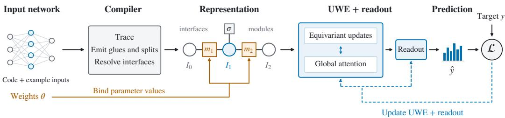  
Figure 1: The compiler derives interfaces and parameter bindings from network code. UWE processes the resulting graph, and a supervised loss trains the encoder and readout.

The size of neural graphs creates a further constraint. Local message passing requires successive hops to connect distant operations, while fully connected attention is quadratic in the number of neuron nodes. Methods that tokenize windows of weights offer another route to scale, but do not enforce permutation equivariance (Schurholt et al., 2024; Falk et al., 2025). We therefore need objects¨ that preserve the shared permutation actions of the network while being substantially fewer than its neurons. Appendix A reviews related work in more detail.

These requirements suggest separating operations from the coordinate spaces they act on. In an MLP, permuting a hidden layer requires the same relabelling of the preceding weight matrix’s outputs and the following matrix’s inputs. A residual addition can impose this agreement across several activation tensors. The shared coordinate space is therefore a natural object for the representation: it identifies which parameter axes must be relabelled together. We call such a space an interface. Each permutation-bearing interface carries one shared coordinate permutation, while distinct interfaces may be permuted independently. We represent the network as a typed graph whose nodes are interfaces and whose hyperedges are operation occurrences, called modules.

Our main contributions are this interface–module graph and the Universal Weight Encoder (UWE), an equivariant encoder that operates on it across architectures. Shared permutation bindings already appear in alignment specifications (Ainsworth et al., 2023) and in specifications used to construct equivariant layers (Zhou et al., 2024). We use these bindings to define the graph’s nodes and the objects over which the encoder communicates. UWE alternates local equivariant updates to parameter features with global attention over invariant interface summaries (Section 3). The graphs are compact: a ResNet-18 has twelve permutation-bearing interfaces, and an 85M-parameter transformer has 301, compared with about 84,000 neuron nodes. Global attention over these interfaces is therefore affordable.

To automate graph construction, a compiler traces a supported PyTorch model and infers interfaces and parameter-axis bindings from operator constraints. Recovery is exact within its constraint language, and the recovered relabellings preserve the network’s function (Section 4). Models assembled from supported operations, layouts and sharing patterns require no new architecture-specific specification. Figure 1 illustrates the pipeline.

Evaluating transfer across architectures requires benchmarks that vary both architecture and scale. Common weight-space benchmarks focus on small networks from a single architecture or a narrow family, leaving transfer to larger, unseen architectures poorly tested. We therefore introduce a transformer zoo with architecture-level splits and loss profiles across class groups and image corruptions. These profiles distinguish networks with similar aggregate performance but different patterns of error. UWE is competitive on standard weight-space benchmarks and outperforms the tested baselines on the new zoo, with stronger transfer to larger held-out architectures and lower memory use (Section 5) Separate scaling experiments establish computational feasibility on larger networks, including full training steps on ViT-L/16 and GPT-2 Medium on a single 80 GB GPU (Section 5.4).

## 2 THE REPRESENTATION: A TYPED GRAPH OF INTERFACES AND MODULES

## 2.1 OBJECTS

The representation is a typed bipartite graph with three kinds of object (Figure 2).

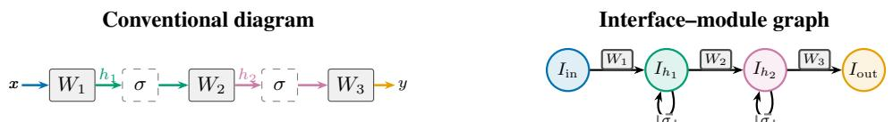

(a) MLP. Each hidden tensor has an interface. The wire into σ and the wire out of it carry the same coordinates, which is why σ is a weightless self-loop.

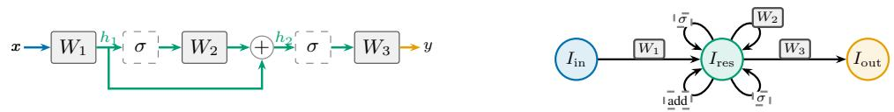

(b) Residual MLP. Addition ties the permutations of $h _ { 1 }$ and $h _ { 2 } { \mathrm { : } }$ everything from $W _ { 1 }$ to $W _ { 3 } .$ , the skip included, is one colour and so one interface $I _ { \mathrm { r e s } } ,$ , and the modules between them become self-loops.

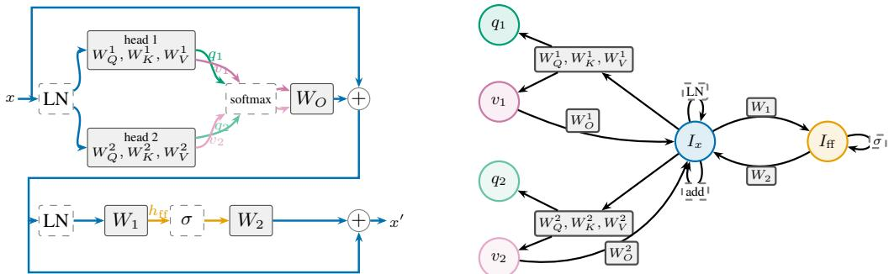  
(c) Pre-norm transformer block with two heads. The residual stream forms one interface $I _ { x }$ . Each head has a query–key interface $q _ { j }$ and a value interface $v _ { j } \colon$ queries and keys share a permutation because joint relabelling preserves their dot product.

Figure 2: Conventional diagrams (left) and interface–module graphs (right). Matching colours identify corresponding coordinate spaces; shades distinguish heads. Objects sharing a coordinatepermutation action map to one interface. Operations whose inputs and outputs share an interface become self-loops. The compiler (Section 4) constructs these graphs for the encoder (Section 3).

An interface $I \in \mathcal { Z }$ is a coordinate space of width $n _ { I }$ . It is permutation-bearing if the compiler’s constraints permit arbitrary coordinate permutations, and fixed if they permit only the identity. Fixed interfaces arise, for example, from input/output layers or fixed positional encodings. Interfaces carry no arbitrary identity or depth labels.

A module $o \in \mathcal { O }$ is an operation occurrence with a type, hyperparameter descriptor and network depth. Several modules may reference shared parameters. Parameter-free operations, such as activations, additions and concatenations, are weightless modules retained for their constraints on relabellings.

A binding associates a module axis with an interface under a role, such as input, output, query-output or scale-and-shift, from a fixed vocabulary of about a dozen entries (Appendix H.6). Each bound axis has one binding; several axes may bind to the same interface. The representation is thus a typed hypergraph: modules are typed hyperedges, and bindings are their role-labelled incidences.

## 2.2 PARAMETERS

A parameter tensor with two channel axes bound to I and J forms a rectangular block of cells $\boldsymbol { W } ^ { \hat { } } \in \mathbb { R } ^ { n _ { I } \times n _ { J } \times k }$ ; a bias or normalization vector with one bound axis forms a diagonal block $W \in \mathbb { R } ^ { n _ { I } \times k }$ . The trailing axis folds k scalars into each cell, such as kernel elements or normalization scale and shift; its coordinates are not permuted. A block with its bound axes is a unit u. Modules reference one or more units, such as a linear layer’s weight and bias; several occurrences may share a unit. An axis spanning several interfaces, as when reading a concatenation, is partitioned into one unit per interface. The representation re-indexes parameters; inverting the layout recovers the original tensors. Each distinct parameter tensor is represented once.

## 2.3 ASSERTED SYMMETRY

A relabelling permutes hidden coordinates and transforms parameters through their bound axes. For a weight matrix $W \in \mathbb { R } ^ { n _ { J } \times n _ { I } }$ from I to J and its bias,

$$
W \longmapsto P _ { J } W P _ { I } ^ { \top } , \qquad b \longmapsto P _ { J } b .\tag{1}
$$

where $P _ { I }$ and $P _ { J }$ are the corresponding permutation matrices.

Definition 2.1 (Asserted symmetry). Independently choose $\pi _ { I } \in S _ { n _ { I } }$ for each permutation-bearing interface and the identity for each fixed interface. Apply each permutation to every stored-state axis bound to that interface, respecting occurrence-level bindings and alias constraints. These transformations form

$$
\Gamma = \prod _ { I \in \mathcal { I } ^ { * } } S _ { n _ { I } } .
$$

Every element of Γ is asserted to preserve the network’s function. The group permutes coordinates within interfaces without exchanging distinct interfaces.

Module exchanges. Some supported operations also permit exchanges of complete modules and associated interfaces. Exchanging attention heads requires jointly exchanging their query, key and value projections and corresponding output-projection blocks. All affected typed incidences, fixed-state constraints and shared-storage bindings must be preserved.

Let E be the group generated by the supported exchange actions for a compiled model. It permutes compatible factors of Γ, giving the combined action

$$
G = \Gamma \rtimes E .
$$

This extends Γ beyond within-interface permutations. For h interchangeable attention heads of query, key and value width d, the internal discrete action is $( S _ { d } \times S _ { d } ) ^ { h } \rtimes \bar { S _ { h } }$

Theorem 2.2 (Function preservation). For every model accepted by the compiler under its supported operation, layout, state-action and alias rules:

(a) Every coordinate relabelling in Γ, applied consistently through the bindings, leaves the network’sfunction unchangedfor every admissible value ofthe represented state.

(b) Every supported module exchange in E, applied to all affected modules, interfaces and stored-state blocks, leaves the network’sfunction unchanged.

Consequently, every transformation in G preserves the network’sfunction.

Part (a) follows by composing the supported operations’ equivariance, enforcing fixed-state and alias constraints (Appendix H.7); part (b) follows from the supported exchange rules. Composition extends these actions to G. Numerical tests separately check their implementation on compiled models.

Remark 2.3 (Exactness and completeness). Γ is exact relative to the compiler’s constraints: it contains precisely the coordinate relabellings satisfying them (Theorem F.1, Appendix F.5). Soundness establishes function preservation, not the converse. Transformations outside Γ may also preserve the function, including continuous attention symmetries and arbitrary translations of the key bias (Appendix B.3).

## 2.4 SIZE

Let A count interfaces, $S = \textstyle \sum _ { I } n _ { I }$ their coordinates, and C cells: the parameter count after folding kernel elements and normalization pairs. Sharing interfaces within stages can put A below the layer count; grouped or multi-head layouts can put it above. Typical graphs have a few high-degree interfaces, such as residual streams, and many of degree two or three. Table 1 lists examples of compiled networks alongside compiled graph sizes.

## 2.5 ATTENTION SYMMETRIES

Table 14 in Appendix H.3 compares the symmetries represented by each method with attention’s permutation group: independent query–key and value permutations within heads, and exchanges of complete heads (Tran et al., 2025; Knyazev et al., 2025). The neural graph of Kofinas et al. (2024, Appendix C.4) bundles query, key and value entries into one edge feature and omits head membership. It therefore permits function-changing cross-head coordinate mixing while excluding independent value permutations. Fixed head identifiers (Lim et al., 2024) prevent such mixing but also forbid head exchange. Transformer-NFN uses a hand-derived symmetry specification and layers that scale cubically with embedding width (Appendix A). Our compiler recovers these permutation symmetries from supported implementations, with an encoder whose parameter count is independent of the input model’s size.

<table><tr><td>Network</td><td>Parameters</td><td>A</td><td>S</td><td>Interface widths</td></tr><tr><td>ResNet-18 (20 convolutions)</td><td>11.7M</td><td>12</td><td>2,880</td><td>64–512, three of each</td></tr><tr><td>ResNeXt-50 32×4d (53 convolutions)</td><td>25.0M</td><td>1,029</td><td>19,008</td><td>mostly 4–32</td></tr><tr><td>ViT-S/16</td><td>22.1M</td><td>157</td><td>28,032</td><td>384, 64, 1536</td></tr><tr><td>ViT-B/16</td><td>86.6M</td><td>301</td><td>56,064</td><td>768, 64, 3072</td></tr><tr><td>ViT-L/16</td><td>304.3M</td><td>793</td><td>148,480</td><td>1024, 64, 4096</td></tr><tr><td>GPT-2 Small</td><td>124.4M</td><td>301</td><td>56,064</td><td>768, 64, 3072</td></tr><tr><td>GPT-2 Medium</td><td>354.8M</td><td>793</td><td>148,480</td><td>1024, 64, 4096</td></tr><tr><td>GPT-2 Large</td><td>774.0M</td><td>1,477</td><td>277,760</td><td>1280, 64, 5120</td></tr><tr><td>GPT-2 XL</td><td>1,557.6M</td><td>2,449</td><td>462,400</td><td>1600, 64, 6400</td></tr></table>

Table 1: Permutation-bearing interfaces A and coordinates $S ;$ fixed interfaces excluded. A transformer with a permutation-bearing residual interface, width D, h heads and L blocks has $A = 1 + L ( 2 h + 1 )$ and $S \stackrel { \cdot } { = } D + L ( 2 D + D _ { \mathrm { f f } } ^ { - } )$ : one residual interface of width D, two interfaces of width $D / h$ per head per block, and one feed-forward interface of width $D _ { \mathbb { H } }$ per block. Configurations: Appendix H.4.

## 3 THE ENCODER

The representation does not prescribe one encoder, but it fixes what any encoder over it must respect. We state the design at that level, keeping it as close to a standard transformer as the graph allows; the architecture used in our experiments is specified in full in Appendix G.1.

State. A rectangular unit u bound to interfaces $I , J$ carries ${ \bf E } _ { u } \in \mathbb { R } ^ { n _ { I } \times n _ { J } \times d _ { E } } ;$ a diagonal unit, such as a bias tensor, carries $\mathbf { E } _ { u } \in \mathbb { R } ^ { n _ { I } \times d _ { E } }$ . Each cell encodes one scalar or a vector of folded parameters. Interface I carries $\mathbf { H } _ { I } \in \mathbb { R } ^ { n _ { I } \times d _ { H } }$ , one vector per coordinate. Each weightless module o carries $u _ { o } \in \mathbb { R } ^ { d _ { H } }$ , and $g$ learned global tokens $\mathbf { G } \in \mathbb { R } ^ { \overset { \cdot } { g } \times d _ { H } }$ support invariant readouts. Cells can greatly outnumber interface coordinates, so we use narrower cell features, $d _ { E } < d _ { H }$ , to reduce memory use.

Layer. Each encoder layer applies four passes (Figure 3).

• Interface pass. Coordinate states are pooled into invariant interface summaries. Local messages connect interfaces sharing a module, conditioned on its type and binding roles. Global attention operates on the summaries and optional global tokens. Updates are broadcast to interface coordinates.

• Delivery: interfaces to modules. Each unit gathers its bound interface states, adds receiving-role embeddings, and projects them into row and column contributions to its cells.

• Module pass. Shared maps update cells from their features and pooled row and column features, following equivariant weight-space layers (Navon et al., 2023; Zhou et al., 2023a; 2024). Weightless modules receive a feed-forward update. This is the analogue of the per-token feed-forward block in a conventional transformer.

• Emission: modules to interfaces. Each unit pools its cells into one message per bound interface coordinate, with sending-role embeddings. Each coordinate averages incoming messages from its bound units and weightless modules.

The small number of interfaces makes full attention practical (Table 1).

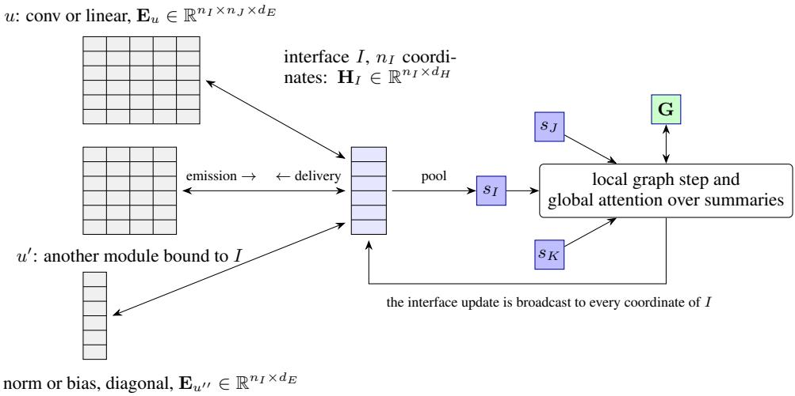  
Figure 3: One layer of the encoder. Every module bound to interface I has an axis of exactly $n _ { I }$ cells, one per coordinate, whether rectangular $( u , u ^ { \prime } )$ or diagonal $( u ^ { \prime \prime } ) ;$ emission pools a module’s other axis into one message per coordinate, and delivery broadcasts the coordinate states back along it. The global pass runs over one summary per interface and its result is broadcast to all coordinates.

Codes. Learned embeddings identify parameter kinds, operation types and binding roles. Numerical descriptors record attributes such as stride and normalization ϵ; sinusoidal features encode module depth, ordered binding positions and offsets within folded tensors. These codes condition the lift and local messages and are shared across architectures (Appendix G.1).

Lift. Scalar weights are encoded with a fixed multi-octave sine–cosine basis (Tancik et al., 2020; Vaswani et al., 2017), optionally including the raw value, without rescaling. A cell contains one scalar or a folded vector, such as kernel elements or a normalization pair, with codes for their kinds and offsets. The parameter layout retains every entry, while the fixed-width cell encoding may compress folded vectors. Module codes are added to cell features.

Fixed coordinates. For every fixed interface, the lift adds projected sinusoidal coordinate encodings to its bound cell axes. This includes input and output interfaces and residual streams fixed by externally supplied positional encodings. Learned positional embeddings are parameters that permute jointly with the residual stream; permutable axes receive no coordinate encoding.

Aggregation, normalization, and batching. Pooling uses shared maps and means (Zaheer et al., 2017); LayerNorm acts only along the feature dimension. Different architectures are batched as disjoint unions, with attention and readouts separate for each network. Matching graphs and metadata permit batching along a shared batch dimension. Encoder maps are shared across modules and architectures.

Equivariance. Invariant network-level readouts r and equivariant parameter-valued readouts F satisfy

$$
r ( g \theta ) = r ( \theta ) , \qquad F ( g \theta ) = g F ( \theta ) , \qquad g \in G .
$$

Appendix H.1 gives the argument.

## 4 THE COMPILER

The compiler constructs the graph of Section 2 from a supported PyTorch model and example inputs. It traces the model in evaluation mode and resolves coordinate axes from tensor shapes, dtypes and operator rules, without inspecting numerical parameter values. External input and output coordinates are fixed. Rules for parameters, buffers and shared storage specify their permitted transformations; unsupported cases are rejected.

Each operation imposes constraints on coordinate permutations. A glue requires corresponding coordinate blocks to use the same permutation: activations and normalization glue their input and output axes, addition glues its inputs to its output, and attention glues query and key coordinates within each head. A split requires permutations to preserve a block boundary, such as an input boundary in coordinate-axis concatenation or a head boundary in attention. A linear layer imposes no input–output glue.

The compiler propagates splits through glues until no new split is introduced. This procedure terminates and is independent of processing order. It then partitions each axis at the split positions and identifies the resulting intervals whose permutations must agree. Each equivalence class defines an interface, which is fixed if any member belongs to a fixed axis. Parameters and buffers are partitioned into units and bound to these interfaces.

The permutations satisfying the emitted constraints are exactly Γ. Supported head permutations generate the additional exchanges E. Function preservation follows from the operator rules under their stated assumptions. An independent checker verifies the interface derivation against the emitted constraints; numerical tests separately check the implementation. Appendix F gives the compiler pipeline and interval solver in Algorithms 1 and 2. Appendix H.6 lists the supported operations and their interface bindings.

## 5 RESULTS

Our focus is a shared representation and encoder for networks of varying architecture and size. Standard fixed-architecture benchmarks assess predictive quality against established methods. The transformer zoo tests transfer across architectures, while separate resource measurements assess computational feasibility on larger networks.

## 5.1 STANDARD HOMOGENOUS BENCHMARKS

We evaluate three fixed-architecture tasks. INR classification predicts image labels from the weights of SIRENs fitted to MNIST or Fashion-MNIST images. CNNzoo generalisation prediction estimates CIFAR-10 CNN test accuracy, evaluated by Kendall’s τ (Zhou et al., 2023a; Kofinas et al., 2024).

UWE achieves the highest INR accuracies among the compared methods: 98.18% on MNIST and 85.33% on Fashion-MNIST, compared with 97.30% and 80.78% for the strongest respective baselines (Table 2). On the CNN zoo, UWE reaches τ = 0.933, compared with the best reported value of 0.941.

Table 2: Test accuracy for INR classification and Kendall’s τ for CIFAR-10-GS CNN-zoo generalisation prediction. Higher is better; baseline results are as published.
<table><tr><td rowspan="2">Method</td><td colspan="2">INR accuracy (%)</td><td>CNN zoo</td></tr><tr><td>MNIST</td><td>F-MNIST</td><td>T</td></tr><tr><td>DWSNet</td><td>85.71 ±0.57</td><td>67.06 ±0.29</td><td></td></tr><tr><td>NFNNP</td><td>78.50 ±0.23</td><td>68.19 ±0.28</td><td>0.922 ±0.001</td></tr><tr><td>NFNHNP</td><td>79.11 ±0.84</td><td>68.94±0.64</td><td>0.934±0.001</td></tr><tr><td>NG-GNN</td><td>94.70 ±0.30</td><td>74.20 ±0.40</td><td>0.931 ±0.002</td></tr><tr><td>NG-T</td><td>97.30 ±0.20</td><td>74.80 ±0.90</td><td>0.935 ±0.000</td></tr><tr><td>ScaleGMN</td><td>96.57 ±0.10</td><td>80.46 ±0.32</td><td>0.941 ±0.006</td></tr><tr><td>ScaleGMN-B</td><td>96.59 ±0.24</td><td>80.78±0.16</td><td>0.941 ±0.000</td></tr><tr><td>UWE (ours)</td><td>98.18±0.26</td><td>85.33±0.19</td><td>0.933 ±0.002</td></tr></table>

## 5.2 TRANSFORMER ZOO AND LOSS PROFILE PREDICTION

New model zoo. Standard benchmarks largely fix the architecture (Unterthiner et al., 2020; Navon et al., 2023; Tran et al., 2025). To provide a more challenging evaluation, we introduce architectural variation and predict class-conditional loss profiles under clean and corrupted inputs. The benchmark tests transfer to unseen architectures, including architectures larger than those used for training.

The zoo contains 1,200 CIFAR-100 vision transformers: 100 architectures sampled by log-parametercount stratification over 0.11M–9.1M parameters, each trained under 12 recipes crossing four training data fractions with three learning rates. All recipes use augmentation, fixed weight decay and 10,560 optimiser steps. Each network is represented by its best-validation-loss checkpoint, with a profile of mean cross-entropy for each of 20 superclasses under clean, blur and additive-noise conditions (60 targets). Appendix C details the architecture family, recipes and labelling protocol.

<table><tr><td rowspan="2">Model</td><td rowspan="2">Params</td><td colspan="3">common, common</td><td colspan="2">common, beyond</td><td colspan="3">full, full</td></tr><tr><td>MSE</td><td>T</td><td>h</td><td>MSE</td><td>T</td><td>MSE</td><td>T</td><td>h</td></tr><tr><td>Predict the training mean</td><td></td><td>0.9720</td><td></td><td></td><td>1.5510</td><td></td><td>1.2860</td><td></td><td></td></tr><tr><td>NG-T, node 16, edge 4</td><td>72k</td><td>0.9519</td><td>0.2165</td><td>23.1H</td><td></td><td></td><td></td><td></td><td></td></tr><tr><td>Transformer-NFN, (c = 4)</td><td>1.18B</td><td>0.8206</td><td>0.3420</td><td> $2 . 9 ^ { \mathrm { H } }$ </td><td></td><td></td><td></td><td></td><td></td></tr><tr><td>GMN, width 64</td><td>0.19M</td><td>0.9594</td><td>0.3766</td><td>1.5H</td><td>1.4273</td><td>0.4015</td><td></td><td></td><td></td></tr><tr><td>NG-GNN, released readout</td><td>0.20M</td><td>0.5263</td><td>0.5022</td><td>2.7</td><td>1.0320</td><td>0.5795</td><td>0.4007</td><td>0.6990</td><td>13.7</td></tr><tr><td>NG-GNN, all-node readout</td><td>0.10M</td><td>0.4411</td><td>0.5455</td><td>2.9</td><td>1.1494</td><td>0.5114</td><td>0.3637</td><td>0.6970</td><td>13.8</td></tr><tr><td> $\mathrm { U W E } , d _ { E } = 1 6 , d _ { H } = 3 2$ </td><td>73k</td><td>0.2790</td><td>0.7100</td><td>8.5</td><td>0.5361</td><td>0.7159</td><td>0.3355</td><td>0.7192</td><td>21.7</td></tr><tr><td> $\mathrm { U W E } , d _ { E } = 3 2 , d _ { H } = 2 5 6$ </td><td>3.46M</td><td>0.2228</td><td>0.7965</td><td>8.9</td><td>0.5089</td><td>0.7538</td><td>0.3178</td><td>0.7778</td><td>23.0</td></tr></table>

Table 3: Test results by (training cohort, test cohort), at checkpoints selected by validation MSE. MSE averages errors over 60 training-standardised profile coordinates; τ ranks networks by mean profile loss within each architecture, then averages over architectures. h: runtime in hours; H: H100, otherwise A10. Common, beyond reuses the common, common models, with no separate runtime reported. —: the model does not fit the cohort’s architectures. Results use one metamodel training seed per configuration. Variability across training seeds was not estimated due to computational constraints.

Experimental setup. Architectures are split 70/15/15 for training/validation/testing, keeping each architecture’s 12 networks together (Appendix C.4). The common cohort contains 43 training, seven validation and seven test architectures supported by all baselines under the memory constraints. Methods share its training and validation networks; Table 11 reports resource costs. The beyondcommon cohort contains the remaining eight test architectures (96 networks, approximately 2.8–9.1M parameters). All exceed the common training maximum of 2.12M, so evaluation here tests transfer to larger architectures. Full-cohort experiments use the complete 70/15/15 split.

We report MSE over 60 profile coordinates standardised using training-set statistics. For ranking, we compute Kendall’s τ between predicted and true mean profile losses across each test architecture’s 12 networks, then average over architectures. Baselines use released implementations of NG-GNN and NG-T (Kofinas et al., 2024), GMN (Lim et al., 2024), and Transformer-NFN (Tran et al., 2025). All configurations use 100 epochs and the same learning rate; validation MSE selects checkpoints. UWE uses two sizes; the smaller approximately matches NG-T, the smallest baseline, in parameter count.

Results. On the common test cohort, UWE reaches τ = 0.7965 versus 0.5455 for the strongest baseline (Table 3). The 73k-parameter UWE reaches 0.7100 versus 0.2165 for the similarly sized NG-T. On beyond-common architectures, the two UWE sizes reach 0.7538 and 0.7159 versus 0.5795 for the strongest baseline; the larger UWE also reduces MSE from 1.0320 to 0.5089. Full-cohort results change both training and test cohorts, so they do not isolate the effect of adding larger training architectures. UWE uses less memory but takes about 3× as long as NG-GNN to train on the common cohort and 1.6× on the full cohort (A10).

## 5.3 ABLATIONS

We ablate codes and global attention in a $2 \times 2$ design (Table 4, details in Appendix D.3). Removing global attention substantially worsens MSE and ranking. Removing codes slightly improves common-cohort MSE but lowers τ and considerably worsens both beyondcommon metrics.

Table 4: Common-trained ablations evaluated at their bestvalidation-MSE checkpoints. Metrics follow Table 3.
<table><tr><td colspan="3"></td><td colspan="3">common beyond</td></tr><tr><td>Variant</td><td>Params</td><td>MSE</td><td>τ</td><td>MSE</td><td>T</td></tr><tr><td>UWE</td><td>73k</td><td>0.28</td><td>0.71</td><td>0.54</td><td>0.72</td></tr><tr><td>Without codes</td><td>67k</td><td>0.27</td><td>0.67</td><td>0.75</td><td>0.66</td></tr><tr><td>Without global attention</td><td>56k</td><td>0.73</td><td>0.33</td><td>1.15</td><td>0.44</td></tr><tr><td>Without either</td><td>50k</td><td>0.84</td><td>0.38</td><td></td><td>1.400.05</td></tr></table>

## 5.4 SCALING TO LARGE NETWORKS

We measure the memory required to pro-

cess MLP, CNN, residual-CNN and transformer targets with 1M–100M parameters (Table 5). These

experiments use random target weights and synthetic labels: they assess computational cost and feasibility, not predictive performance on trained networks.

UWE separates cell width $d _ { E }$ from the wider interface states, allowing encoder capacity to increase with modest memory growth. Across three metamodel sizes, it completes training steps on every target in the ladder and uses less memory than the parameter-matched graph baselines wherever they fit. Transformer-NFN is compared at two channel counts; its parameter count depends on target width. On native ViT and GPT-2 targets with up to 355M parameters (Table 12 in Appendix E.4), UWE also completes training steps, while the matched graph baselines run out of memory during inference. Appendices E.3 and E.4 give the protocols and additional measurements.
<table><tr><td></td><td></td><td colspan="3">UWE</td><td colspan="3">NG-GNN</td><td colspan="3">GMN</td><td colspan="2">Transformer-NFN</td></tr><tr><td>Target</td><td>P</td><td>0.2M</td><td>0.9M</td><td>1.8M</td><td>0.2M</td><td>0.9M</td><td>1.8M</td><td>0.2M</td><td>0.9M</td><td>1.8M</td><td>c=2</td><td>c=10</td></tr><tr><td>MLP</td><td>1M</td><td>0.46</td><td>0.54</td><td>0.59</td><td>2.28</td><td>5.11</td><td>7.21</td><td>3.81</td><td>8.19</td><td>11.39</td><td>一</td><td>一</td></tr><tr><td>MLP</td><td>30M</td><td>10.34</td><td>10.70</td><td>10.97</td><td>66.16</td><td>OOM</td><td>OOM</td><td>OOMt</td><td>OOM</td><td>OOM</td><td>一</td><td>一</td></tr><tr><td>CNN</td><td>10M</td><td>0.55</td><td>0.63</td><td>0.69</td><td>2.63</td><td>5.80</td><td>8.09</td><td>37.47</td><td>OOMt</td><td>OOM</td><td></td><td>一</td></tr><tr><td>CNN</td><td>100M</td><td>4.30</td><td>4.54</td><td>4.72</td><td>25.47</td><td>56.77</td><td>OOMt</td><td>OOM</td><td>OOM</td><td>OOM</td><td></td><td>一</td></tr><tr><td>Residual CNN</td><td>100M</td><td>4.20</td><td>4.52</td><td>4.79</td><td>25.49</td><td>56.82</td><td>OOMt</td><td></td><td></td><td></td><td></td><td></td></tr><tr><td>Transformer</td><td>1M</td><td>0.57</td><td>0.79</td><td>0.97</td><td>2.21</td><td>4.95</td><td>6.93</td><td>3.99</td><td>8.57</td><td>11.92</td><td>1.31</td><td>6.41</td></tr><tr><td>Transformer</td><td>3M</td><td>1.37</td><td>1.70</td><td>1.97</td><td>6.43</td><td>14.54</td><td>20.41</td><td>11.76</td><td>25.40</td><td>35.36</td><td>6.44</td><td>32.23</td></tr><tr><td>Transformer</td><td>10M</td><td>3.78</td><td>4.40</td><td>4.88</td><td>20.59</td><td>46.70</td><td>65.62</td><td>37.81</td><td>OOMt</td><td>OOM</td><td>36.96</td><td>OOMt</td></tr></table>

Table 5: Peak allocated memory (GiB) for a metamodel training step, including the first AdamW step: one H100, 75 GiB cap, batch one. Targets have random weights; predictive performance is not evaluated. NG-GNN and GMN match UWE’s trainable parameter count within 2.1%. Transformer-NFN is unmatched: at the 3M target, c = 2 and c = 10 have 381M and 1.924B parameters. OOM /OOM : observed inference/training OOM; –: unsupported or not applicable.

## 6 LIMITATIONS

(i) The compiler’s guarantees hold within its rule set and constraint language, which exclude continuous changes of basis. (ii) Unsupported constructs, including arbitrary attention masks, cross-attention, rotary embeddings, recurrence and tensor sharing without a supported alias rule, are rejected. (iii) Compressing the parameters bound to each cell into a fixed-width feature can lose information, particularly for large convolutional kernels. (iv) Execution requires many small kernels, making deep targets substantially slower per step than neural graph baselines. Designing encoders that use modern hardware more efficiently while respecting the representation’s symmetries remains future work. (v) The zoo covers one transformer family, one dataset and one task; transfer across model families and tasks remains untested. (vi) Resource measurements use random weights and establish computational feasibility, not predictive quality.

## 7 DISCUSSION

Organizing weight-space learning around shared permutation actions gives a common representation for networks with different architectures. Interfaces record which parameter axes must be relabelled together, and modules describe the operations connecting them. This structure serves two purposes: it specifies the permutation action and provides a small graph for global communication. UWE combines attention over interface summaries with local equivariant updates to parameter features. The compiler derives the required bindings from operator constraints, allowing the same representation and encoder to handle new combinations covered by its rules. The connection between symmetry, architecture transfer and computational cost therefore follows from the choice of what the graph represents.

The held-out-architecture results provide evidence that computations shared at this level can learn useful predictors across changes in transformer architecture. The resource measurements establish feasibility on substantially larger networks; predictive quality at that scale remains to be tested. More broadly, a shared representation makes transfer possible, but does not ensure that the learned features will remain useful across model families or tasks. Training across several families and testing unseen combinations of supported operations would help establish how far interface-based learning extends beyond variation within a transformer family.

## AI USE STATEMENT

We used generative AI tools, including OpenAI Codex and Anthropic Claude Code, to assist with implementation and debugging, experimental design, data preparation, discussion of mathematical arguments, literature and reference checks, and manuscript and figure preparation. These tools contributed suggestions, code and draft text throughout the project. The authors take full responsibility for the correctness, originality and reporting of the work.

## REPRODUCIBILITY STATEMENT

The compiler appendix specifies the supported operations, constraint language and compilation algorithms. The technical appendix details the encoder computations and the assumptions underlying the symmetry guarantees. The experimental appendices describe the transformer zoo, training procedures, data splits, prediction targets, baseline configurations and resource measurements. These descriptions distinguish architectural choices from experimental settings and state the scope of the reported guarantees and comparisons. We release research code to reproduce the results and explore the proposed constructions. Developing a maintained Python package remains future work.

## ETHICS STATEMENT

Learning from network parameters may reduce the cost of model analysis and selection, although constructing model zoos and training encoders also require computation. Performance predictions can be unreliable outside the evaluated architectures and data distributions, so their use in model selection requires validation on the intended task. Predictive accuracy on the studied benchmark does not establish the fairness, privacy or robustness of the networks being assessed.

## REFERENCES

Samuel K. Ainsworth, Jonathan Hayase, and Siddhartha Srinivasa. Git Re-Basin: Merging models modulo permutation symmetries. In International Conference on Learning Representations, 2023. URL https://arxiv.org/abs/2209.04836.

Jimmy Lei Ba, Jamie Ryan Kiros, and Geoffrey E. Hinton. Layer normalization. arXiv preprint arXiv:1607.06450, 2016. URL https://arxiv.org/abs/1607.06450.

An Mei Chen, Haw-minn Lu, and Robert Hecht-Nielsen. On the geometry of feedforward neural network error surfaces. Neural Computation, 5(6):910–927, 1993. doi: 10.1162/neco.1993.5.6.910. URL https://doi.org/10.1162/neco.1993.5.6.910.

Tianqi Chen, Bing Xu, Chiyuan Zhang, and Carlos Guestrin. Training deep nets with sublinear memory cost. arXiv preprint arXiv:1604.06174, 2016. URL https://arxiv.org/abs/ 1604.06174.

Adir Dayan, Yam Eitan, and Haggai Maron. On the expressive power of permutation-equivariant weight-space networks. In International Conference on Machine Learning, 2026. URL https: //arxiv.org/abs/2602.01083v2.

Damian Falk, Konstantin Schurholt, Konstantinos Tzevelekakis, L¨ eo Meynent, and Damian´ Borth. Learning model representations using publicly available model hubs. arXiv preprint arXiv:2510.02096, 2025. URL https://arxiv.org/abs/2510.02096.

Justin Gilmer, Samuel S. Schoenholz, Patrick F. Riley, Oriol Vinyals, and George E. Dahl. Neural message passing for quantum chemistry. In Proceedings of the 34th International Conference on Machine Learning, volume 70 of Proceedings of Machine Learning Research, pp. 1263–1272. PMLR, 2017. URL https://proceedings.mlr.press/v70/gilmer17a.html.

Charles Godfrey, Davis Brown, Tegan Emerson, and Henry Kvinge. On the symmetries of deep learning models and their internal representations. In Advances in Neural Information Processing Systems, volume 35, pp. 11893–11905, 2022. doi: 10.52202/068431-0864.

URL https://proceedings.neurips.cc/paper\_files/paper/2022/hash/ 4df3510ad02a86d69dc32388d91606f8-Abstract-Conference.html.

J. Elisenda Grigsby, Kathryn Lindsey, and David Rolnick. Hidden symmetries of ReLU networks. In Proceedings of the 40th International Conference on Machine Learning, volume 202 of Proceedings of Machine Learning Research, pp. 11734–11760. PMLR, 2023. URL https://proceedings.mlr.press/v202/grigsby23a.html.

Xiaolong Han, Ferrante Neri, Zijian Jiang, Fang Wu, Yanfang Ye, Lu Yin, and Zehong Wang. W2T: LoRA weights already know what they can do. arXiv preprint arXiv:2603.15990, 2026a. URL https://arxiv.org/abs/2603.15990.

Xiaolong Han, Zehong Wang, Bo Zhao, Binchi Zhang, Jundong Li, Damian Borth, Rose Yu, Haggai Maron, Yanfang Ye, Lu Yin, and Ferrante Neri. A survey of weight space learning: Understanding, representation, and generation. arXiv preprint arXiv:2603.10090, 2026b. URL https://arxiv.org/abs/2603.10090.

Robert Hecht-Nielsen. On the algebraic structure of feedforward network weight spaces. In Advanced Neural Computers, pp. 129–135. North-Holland, 1990. doi: 10.1016/B978-0-444-88400-8. 50019-4. URL https://doi.org/10.1016/B978-0-444-88400-8.50019-4.

Dan Hendrycks and Kevin Gimpel. Gaussian error linear units (GELUs). arXiv preprint arXiv:1606.08415, 2016. URL https://arxiv.org/abs/1606.08415.

Ioannis Kalogeropoulos, Giorgos Bouritsas, and Yannis Panagakis. Scale equivariant graph metanetworks. In Advances in Neural Information Processing Systems, volume 37, pp. 106800–106840, 2024. doi: 10.52202/079017-3391. URL https://proceedings.neurips.cc/paper\_files/paper/2024/hash/ c13d5a10028586fdc15ee7da97b7563f-Abstract-Conference.html.

Rabeeh Karimi Mahabadi, Sebastian Ruder, Mostafa Dehghani, and James Henderson. Parameterefficient multi-task fine-tuning for transformers via shared hypernetworks. In Proceedings of the 59th Annual Meeting ofthe Associationfor Computational Linguistics and the 11th International Joint Conference on Natural Language Processing (Volume 1: Long Papers), pp. 565–576, 2021. doi: 10.18653/v1/2021.acl-long.47. URL https://aclanthology.org/2021. acl-long.47/.

Boris Knyazev, Abhinav Moudgil, Guillaume Lajoie, Eugene Belilovsky, and Simon Lacoste-Julien. Accelerating training with neuron interaction and nowcasting networks. In International Conference on Learning Representations, 2025. URL https://proceedings.iclr.cc/paper\_files/paper/2025/hash/ 48a4f41ff000b121eabe7b2491b24aef-Abstract-Conference.html.

Miltiadis Kofinas, Boris Knyazev, Yan Zhang, Yunlu Chen, Gertjan J. Burghouts, Efstratios Gavves, Cees G. M. Snoek, and David W. Zhang. Graph neural networks for learning equivariant representations of neural networks. In International Conference on Learning Representations, 2024. URL https://proceedings.iclr.cc/paper\_files/paper/2024/hash/ c592fc7e6207f82560ed45fece8d6937-Abstract-Conference.html.

Derek Lim, Haggai Maron, Marc T. Law, Jonathan Lorraine, and James Lucas. Graph metanetworks for processing diverse neural architectures. In International Conference on Learning Representations, 2024. URL https://proceedings.iclr.cc/paper\_files/paper/2024/ hash/2feafd84b23a52b3fa434bc6d7682256-Abstract-Conference.html.

Mahdi Namazifar, Devamanyu Hazarika, and Dilek Hakkani-Tur. Role of bias terms in dot-product¨ attention. In ICASSP 2023 – 2023 IEEE International Conference on Acoustics, Speech and Signal Processing (ICASSP), pp. 1–5. IEEE, 2023. doi: 10.1109/ICASSP49357.2023.10097125. URL https://doi.org/10.1109/ICASSP49357.2023.10097125.

Aviv Navon, Aviv Shamsian, Idan Achituve, Ethan Fetaya, Gal Chechik, and Haggai Maron. Equivariant architectures for learning in deep weight spaces. In Proceedings of the 40th International Conference on Machine Learning, volume 202 of Proceedings of Machine Learning Research, pp. 25790–25816. PMLR, 2023. URL https://proceedings.mlr.press/ v202/navon23a.html.

Behnam Neyshabur, Ruslan Salakhutdinov, and Nati Srebro. Path-SGD: Path-normalized optimization in deep neural networks. In Advances in Neural Information Processing Systems, volume 28, 2015. URL https://proceedings.neurips.cc/paper\_files/paper/ 2015/hash/eaa32c96f620053cf442ad32258076b9-Abstract.html.

Ethan Perez, Florian Strub, Harm de Vries, Vincent Dumoulin, and Aaron Courville. FiLM: Visual reasoning with a general conditioning layer. In Proceedings ofthe AAAI Conference on Artificial Intelligence, volume 32, 2018. doi: 10.1609/aaai.v32i1.11671. URL https://ojs.aaai. org/index.php/AAAI/article/view/11671.

Theo Putterman, Derek Lim, Yoav Gelberg, Stefanie Jegelka, and Haggai Maron. Learning on LoRAs: GL-equivariant processing of low-rank weight spaces for large finetuned models. arXiv preprint arXiv:2410.04207, 2024. URL https://arxiv.org/abs/2410.04207.

Nataniel Ruiz, Yuanzhen Li, Varun Jampani, Wei Wei, Tingbo Hou, Yael Pritch, Neal Wadhwa, Michael Rubinstein, and Kfir Aberman. HyperDreamBooth: HyperNetworks for fast personalization of text-to-image models. In Proceedings of the IEEE/CVF Conference on Computer Vision and Pattern Recognition, pp. 6527–6536, 2024. URL https://openaccess.thecvf.com/content/CVPR2024/html/ Ruiz\_HyperDreamBooth\_HyperNetworks\_for\_Fast\_Personalization\_of\_ Text-to-Image\_Models\_CVPR\_2024\_paper.html.

Konstantin Schurholt, Michael W. Mahoney, and Damian Borth. Towards scalable and versatile ¨ weight space learning. In Proceedings ofthe 41st International Conference on Machine Learning, volume 235 of Proceedings of Machine Learning Research, pp. 43947–43966. PMLR, 2024. URL https://proceedings.mlr.press/v235/schurholt24a.html.

Matthew Tancik, Pratul P. Srinivasan, Ben Mildenhall, Sara Fridovich-Keil, Nithin Raghavan, Utkarsh Singhal, Ravi Ramamoorthi, Jonathan T. Barron, and Ren Ng. Fourier features let networks learn high frequency functions in low dimensional domains. In Advances in Neural Information Processing Systems, volume 33, pp. 7537–7547, 2020. URL https://proceedings.neurips.cc/paper/2020/hash/ 55053683268957697aa39fba6f231c68-Abstract.html.

Viet-Hoang Tran, Thieu Vo, An Nguyen, Tho-Huu Tran, Minh-Khoi Nguyen-Nhat, Thanh Tran, Duy-Tung Pham, and Tan Nguyen. Equivariant neural functional networks for transformers. In International Conference on Learning Representations, 2025. URL https://proceedings.iclr.cc/paper\_files/paper/2025/hash/ 29962c2c9daf1fbd92530a7c958dfc2b-Abstract-Conference.html.

Thomas Unterthiner, Daniel Keysers, Sylvain Gelly, Olivier Bousquet, and Ilya Tolstikhin. Predicting neural network accuracy from weights. arXiv preprint arXiv:2002.11448, 2020. URL https: //arxiv.org/abs/2002.11448.

Ashish Vaswani, Noam Shazeer, Niki Parmar, Jakob Uszkoreit, Llion Jones, Aidan N. Gomez, Łukasz Kaiser, and Illia Polosukhin. Attention is all you need. In Advances in Neural Information Processing Systems, volume 30, 2017. URL https://proceedings.neurips.cc/paper/ 2017/hash/3f5ee243547dee91fbd053c1c4a845aa-Abstract.html.

Manzil Zaheer, Satwik Kottur, Siamak Ravanbakhsh, Barnabas P´ oczos, Ruslan Salakhutdinov,´ and Alexander J. Smola. Deep sets. In Advances in Neural Information Processing Systems, volume 30, 2017. URL https://proceedings.neurips.cc/paper/2017/hash/ f22e4747da1aa27e363d86d40ff442fe-Abstract.html.

Bo Zhao, Robin Walters, and Rose Yu. Symmetry in neural network parameter spaces. Transactions on Machine Learning Research, 2025. URL https://openreview.net/forum?id= jLpWq5QY6I.

Allan Zhou, Kaien Yang, Kaylee Burns, Adriano Cardace, Yiding Jiang, Samuel Sokota, J. Zico Kolter, and Chelsea Finn. Permutation equivariant neural functionals. In Advances in Neural Infor mation Processing Systems, volume 36, pp. 24966–24992, 2023a. doi: 10.52202/075280-1085. URL https://proceedings.neurips.cc/paper\_files/paper/2023/hash/ 4e9d8aeeab6120c3c83ccf95d4c211d3-Abstract-Conference.html.

Allan Zhou, Kaien Yang, Yiding Jiang, Kaylee Burns, Winnie Xu, Samuel Sokota, J. Zico Kolter, and Chelsea Finn. Neural functional transformers. In Advances in Neural Information Processing Systems, volume 36, pp. 77485–77502, 2023b. doi: 10.52202/075280-3387. URL https://proceedings.neurips.cc/paper\_files/paper/2023/hash/ f4757db82a02eea015670ecca605d5cc-Abstract-Conference.html.

Allan Zhou, Chelsea Finn, and James Harrison. Universal neural functionals. In Advances in Neural Information Processing Systems, volume 37, pp. 104754–104775, 2024. doi: 10.52202/079017-3326. URL https://proceedings.neurips.cc/paper\_files/paper/2024/hash/ bd20595c8e5802ba40ed418f4ec116f0-Abstract-Conference.html.

## A RELATED WORK

Weight-space learning treats neural-network parameters as inputs to learned models. Han et al. (2026b) survey weight-space geometry, representation learning and weight generation, together with their applications and benchmarks.

Parameter-space symmetries. Hidden-unit permutations preserve the functions represented by feedforward networks (Hecht-Nielsen, 1990; Chen et al., 1993). Further symmetries depend on the activation, architecture and parameter values (Godfrey et al., 2022; Grigsby et al., 2023). Zhao et al. (2025) review these symmetries and their applications. Permutation alignment is used to merge independently trained networks (Ainsworth et al., 2023). ScaleGMN incorporates both permutation and activation-dependent scaling symmetries into graph metanetworks (Kalogeropoulos et al., 2024).

Equivariant tensor models. DWSNets construct permutation-equivariant layers for MLP weight spaces (Navon et al., 2023). Neural functionals process MLP and CNN parameters through equivariant tensor operations (Zhou et al., 2023a), while neural functional transformers introduce attention-based weight-space processing (Zhou et al., 2023b). Universal neural functionals automate equivariant layer construction for collections of tensors with specified permutation actions (Zhou et al., 2024). Their weight-space specification assigns shared permutation identifiers to tensor axes, describing which axes must transform jointly.

Graph metanetworks. Kofinas et al. (2024) represent neurons as nodes and weights as edge features, and process the resulting graphs with message passing or relational transformers. Lim et al. (2024) construct parameter graphs for diverse neural architectures, including architectural features such as residual connections, normalization and parameter sharing. They relate metanetwork equivariance to automorphisms of the represented computation. Message passing communicates along graph edges, whereas relational transformers permit global interactions between nodes. Invariant pooling provides network-level representations; standard pooling constructions are studied by Zaheer et al. (2017).

Transformer and adapter symmetries. Transformer-NFN studies the symmetries of multi-head attention and constructs polynomial weight-space layers equivariant to attention-head permutations and continuous query/key and value basis changes (Tran et al., 2025). LoRA adapters have a related factorization ambiguity: invertible transformations of the rank coordinates can preserve the induced weight update. W2T uses QR and SVD preprocessing to address this ambiguity, followed by rank-level and position-level transformers (Han et al., 2026a).

Large and heterogeneous model collections. SANE processes windows of weight tokens to learn representations of larger networks and generate network parameters (Schurholt et al., 2024). Falk¨ et al. (2025) learn model representations from heterogeneous networks collected from public model hubs, extending weight-space learning beyond purpose-built model zoos. These settings introduce variation in architecture, training data and parameter count.

Expressivity. Dayan et al. (2026) establish expressivity equivalences between several permutationequivariant weight-space architectures. They derive universality results under assumptions on the input weights and characterize settings where those results fail. Their analysis distinguishes approximation of maps on parameter space from approximation of functions of the represented neural networks.

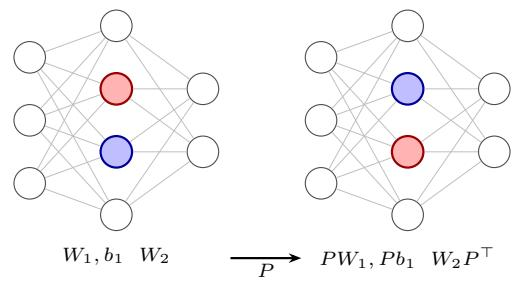  
(a) Perceptron. Exchanging two hidden units permutes the rows of $W _ { 1 }$ and $b _ { 1 }$ and the columns of $\bar { W } _ { 2 }$ . The activation commutes with $P ,$ so the function is unchanged.

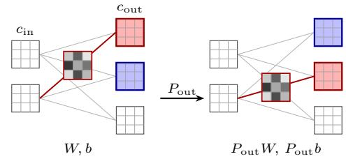  
(b) Convolution. Channels are feature maps and every edge carries a $k _ { h } \times k _ { w }$ kernel. Exchanging two output channels relabels the output maps and moves their kernels with them; the marked kernel is the same array before and after, since its axis is an index domain and is never reordered.  
Figure 4: Permutation symmetry acts on coordinate spaces and carries the parameters along the axes bound to them. Colour marks the two exchanged coordinates.

## B SYMMETRIES OF NEURAL NETWORK PARAMETERS

This appendix collects the symmetries a weight-space representation has to take a position on, and states which of them Γ (Definition 2.1) contains. Surveys of the wider structure are given by Zhao et al. (2025) and Grigsby et al. (2023).

Throughout, a network is a map $x \mapsto f ( x ; \theta )$ with parameters $\theta \in \Theta$ . A universal parameter symmetry is an invertible map $g : \Theta \to \Theta$ satisfying $f ( x ; g \theta ) = f ( x ; \theta )$ for every x and θ. These transformations form a group under composition. Additional equivalences may hold only at particular parameter values; we refer to these as accidental. Only universal symmetries are candidates for a representation to build in.

## B.1 PERMUTATIONS

Let σ act coordinatewise. For a layer $h = \sigma ( W _ { 1 } x + b _ { 1 } )$ followed by $y = W _ { 2 } h + b _ { 2 }$ and any $P \in S _ { n }$

$$
W _ { 1 } \mapsto P W _ { 1 } , \qquad b _ { 1 } \mapsto P b _ { 1 } , \qquad W _ { 2 } \mapsto W _ { 2 } P ^ { \top }\tag{2}
$$

leaves $y$ unchanged, because $\sigma ( P z ) = P \sigma ( z )$ (Figure 4a). The same holds for a convolution acting on its channel axes, with the elements of a kernel carried along and never permuted among themselves (Figure 4b): for $W \in \mathbb { R } ^ { c _ { \mathrm { o u t } } \times c _ { \mathrm { i n } } \times k _ { h } k _ { w } }$

$$
W [ : , : , t ] \mapsto P _ { \mathrm { o u t } } W [ : , : , t ] P _ { \mathrm { i n } } ^ { \top } \quad \mathrm { f o r e v e r y ~ k e r n e l ~ e l e m e n t } t .\tag{3}
$$

Kernel elements are index domains, not coordinate spaces: a permutation of them is a different convolution, not the same one relabelled. An L-layer perceptron of hidden widths $n _ { 1 } , \ldots , n _ { L }$ therefore admits at least $\textstyle \prod _ { l } n _ { l } !$ hidden-coordinate relabellings (Hecht-Nielsen, 1990; Chen et al., 1993), and for perceptrons with generic weights this group is the whole universal symmetry group up to activation-induced factors (Chen et al., 1993). Permutation symmetry is what weight alignment and model merging exploit (Ainsworth et al., 2023). Everything in Γ is of this kind; Section H.6 gives the cases where architecture restricts which permutations are allowed.

## B.2 ACTIVATION-INDUCED SYMMETRIES

A permutation is available whatever the activation, as long as it acts coordinatewise. Particular activations admit more (Godfrey et al., 2022). If $\sigma$ is positively homogeneous, $\sigma ( \alpha z ) = \alpha \sigma ( z )$ for $\alpha > 0$ , as ReLU and leaky ReLU are, then for any positive diagonal $\bar { D }$

$$
W _ { 1 } \mapsto D W _ { 1 } , \qquad b _ { 1 } \mapsto D b _ { 1 } , \qquad W _ { 2 } \mapsto W _ { 2 } D ^ { - 1 }\tag{4}
$$

preserves the function, giving a factor $\mathbb { R } _ { > 0 } ^ { n }$ per hidden layer, semidirect with the permutations. If σ is odd, as tanh and sin are, the same holds with D restricted to $\{ \pm 1 \} ^ { n }$ . Sinusoidal representations admit a second sign symmetry that needs no absorption downstream, since sin $( \pi - z ) = \sin ( z )$ gives $( w , b ) \mapsto ( - w , \pi ^ { - } - \bar { b } )$ on any unit. Smooth non-homogeneous activations such as GELU, SiLU and the logistic function admit no nontrivial scaling: $\tau ( \alpha z ) = \alpha \sigma ( z )$ for all $z \operatorname { f o r c e s } \alpha = 1$

Normalization requires its own symmetry rules. Channel permutations commute with batch normalization when its channelwise affine parameters and running statistics are permuted consistently. Layer normalization over a coordinate axis likewise respects permutations of that axis when any affine parameters transform with it. This does not imply invariance to arbitrary independent rescaling of the channels.

We restrict Γ to coordinate permutations; activation-dependent rescalings are outside this scope. Scale-equivariant graph metanetworks explicitly incorporate such actions (Kalogeropoulos et al., 2024). Independently of this choice, UWE does not rescale weights on input (Section 3), so their magnitudes remain available to the encoder.

## B.3 CONTINUOUS SYMMETRIES FROM CONTRACTION

A third family arises wherever two parameter blocks enter the function only through their product. If f depends on matrices $\theta _ { 1 } \in \mathbb { R } ^ { m \times r }$ and $\theta _ { 2 } \in \mathbb { R } ^ { r \times n }$ only through their product, an invertible change of basis in the intermediate space preserves the function:

$$
( \theta _ { 1 } , \theta _ { 2 } ) \longmapsto ( \theta _ { 1 } G ^ { - 1 } , G \theta _ { 2 } ) , \qquad G \in \operatorname { G L } ( r ) .
$$

Three instances matter in current practice. In an attention head with $W _ { Q } , W _ { K } \in \mathbb { R } ^ { d \times D }$ , the logits are $X W _ { Q } ^ { \top } W _ { K } X ^ { \top } / \sqrt { d } .$ , so the head depends on $W _ { Q }$ and $W _ { K }$ only through $W _ { Q } ^ { \top } W _ { K }$ and

$$
W _ { Q } \mapsto G ^ { - \top } W _ { Q } , \qquad W _ { K } \mapsto G W _ { K } , \qquad G \in \operatorname { G L } ( d ) ,\tag{5}
$$

preserves the function; biases transform with their projections. The same head depends on $W _ { V } \in$ $\mathbb { R } ^ { d \times D }$ and its block $\dot { W _ { O } } \in \mathbb { R } ^ { D \times d }$ of the output projection only through $W _ { O } W _ { V }$ , giving a second $\operatorname { G L } ( d )$ (Tran et al., 2025). In a LoRA adapter $\bar { W _ { \mathbf { \lambda } } } + \bar { \frac { \alpha } { r } } B A$ with $B \in \mathbb { R } ^ { \breve { d } _ { \mathrm { o u t } } \times r }$ and $\bar { A ^ { \prime } } \in \mathbb { R } ^ { \bar { r } \times d _ { \mathrm { i n } } }$ , only BA is observable, so GL(r) acts on the rank space; this is the ambiguity that W2T removes by QR and SVD preprocessing before encoding (Han et al., 2026a).

A degenerate case of the same phenomenon is a parameter that is unobservable outright. Adding any vector to the key bias $b _ { K }$ shifts every logit of a query row by the same amount, and softmax is invariant to a row shift, so $b _ { K }$ can be changed arbitrarily (Namazifar et al., 2023). The compiler transforms $b _ { K }$ with its head’s query–key permutation, which is sound but not maximal (Remark 2.3).

## B.4 ACCIDENTAL SYMMETRIES

Some symmetries depend on the parameter values. For example, the outgoing weights of a ReLU unit that is identically inactive on the input domain may change without affecting the function. Identical hidden units also permit redistribution of their outgoing weights while preserving their sum. The compiler does not attempt to recover these parameter-dependent equivalences.

## B.5 SUMMARY

Table 6 summarizes the transformations considered here. The group Γ contains precisely the withininterface coordinate permutations permitted by the compiler’s constraints. The enlarged group G additionally contains supported exchanges of complete modules. Neither group is claimed to contain every function-preserving transformation.

## C THE TRANSFORMER ZOO

We construct a zoo of 1,200 transformers spanning 100 architectures to evaluate weight-space learning across changes in width, depth, head count and feed-forward ratio. Every block includes residual connections around both sublayers. Each architecture is trained under the same 12 recipes, varying data availability and learning rate.

<table><tr><td>Symmetry</td><td>Origin</td><td>Group</td><td>In Γ</td></tr><tr><td>hidden-unit permutation channel permutation</td><td>coordinatewise activation</td><td> $S _ { n }$ </td><td>yes</td></tr><tr><td></td><td>convolution on channel axes</td><td> $S _ { c }$ </td><td>yes</td></tr><tr><td>within-group permutation</td><td>grouped-convolution layout</td><td> $\Pi _ { j } S _ { c / g }$ </td><td>yes</td></tr><tr><td>head exchange</td><td>exchange of complete heads</td><td> $S _ { h } ^ { \check { \mathbf { \alpha } } }$ </td><td>no; included in  $G$ </td></tr><tr><td>positive rescaling</td><td>positively homogeneous σ</td><td> $\mathbb { R } _ { > 0 } ^ { n }$ </td><td>no</td></tr><tr><td>sign flip</td><td>odd σ</td><td> $\{ \pm 1 \} ^ { n }$ </td><td>no</td></tr><tr><td>query–key basis change</td><td>logits depend on  $W _ { Q } ^ { \top } W _ { K }$ </td><td> $\operatorname { G L } ( d )$ </td><td>permutation subgroup</td></tr><tr><td>value-output basis change</td><td>output depends on  $\dot { W } _ { O } W _ { V }$ </td><td> $\operatorname { G L } ( d )$ </td><td>permutation subgroup</td></tr><tr><td>LoRA factor basis change</td><td>update depends on  $B A$ </td><td> $\operatorname { G L } ( r )$ </td><td>permutation subgroup</td></tr><tr><td>key-bias translation</td><td>softmax row-shift invariance</td><td> $\mathbb { R } ^ { d }$ </td><td>no</td></tr><tr><td>parameter-dependent equivalences</td><td>e.g. dead or duplicate units</td><td> $\mathrm { N . A . }$ </td><td>no</td></tr></table>

Table 6: Parameter symmetries and their treatment in this paper. The last column refers to the within-interface group Γ. A permutation action is included only when the corresponding interfaces are permutation-bearing and the model’s bindings permit it. Permutation subgroup means that Γ contains the permitted coordinate permutations within the stated continuous group, without asserting the remaining transformations. Supported head exchanges belong to the enlarged group $G = \Gamma \rtimes E$ The attention product expressions describe bias-free projections; affine projections require the corresponding bias transformations.

<table><tr><td>Architectures</td><td>100 distinct  $( d , L , h , r )$ </td></tr><tr><td>Parameters</td><td>112,676 to 9,061,732; median 1.05M</td></tr><tr><td>Width d</td><td>64 to 608</td></tr><tr><td>Depth L</td><td>2 (30), 3 (31), 4 (23), 6 (16)</td></tr><tr><td>Heads h</td><td>2 to 16; head width 32 to 96</td></tr><tr><td>FFN ratio r</td><td>2 (34), 3 (38), 4 (28)</td></tr><tr><td>Runs</td><td>1,200: one per recipe per architecture</td></tr><tr><td>Training subset sizes</td><td>5,600; 11,200; 22,500; 45,000 images</td></tr><tr><td>Labels</td><td>3 conditions × 20 superclass mean losses</td></tr><tr><td>Raw FP32 parameter storage</td><td>9.75 GiB</td></tr></table>

Table 7: Transformer zoo summary. Parentheses give architecture counts at each depth or feedforward ratio.

## C.1 SOURCE ARCHITECTURE FAMILY

Each source is a vision transformer for CIFAR-100. A 4 × 4 convolution with stride 4 maps a $3 2 \times 3 2$ image to 64 tokens of width d, followed by fixed sinusoidal positional encodings. The network has $L$ pre-normalization blocks, each containing bias-free multi-head attention and a ReLU feed-forward network of hidden width rd, with a residual connection around each sublayer. All layer normalizations have no affine parameters. A final normalization, mean pooling over tokens and a classifier $d \to d \to 1 0 0$ , with an intermediate ReLU, produce the logits. For compilation, the positional encodings are fixed external inputs, so their addition fixes the residual-stream interface. With $C = 1 0 0$ classes, the learned parameter count is

$$
P ( d , L , r ) = { \big ( } 1 + L ( 4 + 2 r ) { \big ) } d ^ { 2 } + { \big ( } 5 0 + C + L ( r + 1 ) { \big ) } d + C ,\tag{6}
$$

excluding the fixed positional encodings.

The candidate grid uses $L ~ \in ~ \{ 2 , 3 , 4 , 6 \} , \ d ~ \in ~ \{ 6 4 , 9 6 , \ldots , 6 4 0 \} , \ r ~ \in ~ \{ 2 , 3 , 4 \}$ and $h \in$ $\{ 2 , 3 , 4 , 6 , 8 , 1 2 , \bar { 1 6 } \}$ heads. We retain configurations with $h \mid d ,$ head width $3 2 \leq d / h \leq 9 6$ and $1 0 ^ { 5 } \le \dot { P } \le 1 0 ^ { 7 }$ . To sample 100 distinct architectures, we divide [log $1 0 ^ { 5 }$ , log $1 0 ^ { 7 } ]$ into 100 equal intervals and draw one uniform target per interval. For each target, we sample uniformly among unused candidates within 0.18 in natural-log parameter count, choosing the nearest unused candidate if none qualifies. Sampling uses seed 926314 and no training outcomes.

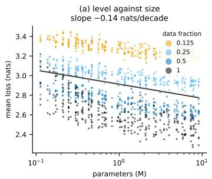

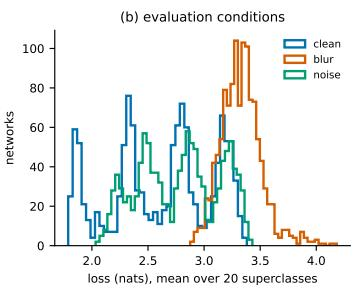

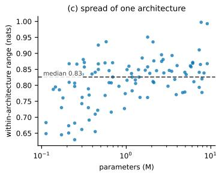  
Figure 5: Transformer zoo labels. (a) Mean profile loss versus parameter count, coloured by trainingdata fraction; the fitted slope is −0.14 nats per decade. (b) Distributions of per-condition mean loss. (c) Range of mean profile loss across the 12 runs of each architecture; the dashed line marks the median, 0.83 nats.

## C.2 TRAINING

We reserve 50 images per fine class from the CIFAR-100 training set for source validation, using seed 921314. The remaining 45,000 images form the training pool and determine the shared normalization statistics. The official 10,000-image test set is used only to compute labels.

The 12 recipes cross nominal training-data fractions {0.125, 0.25, 0.5, 1} with peak learning rates $\{ 1 . 5 , 3 , 6 \} \ \times 1 0 ^ { - 4 }$ . Subsets are class-balanced, deterministic and nested, and are shared across architectures and learning rates; classwise rounding gives the sizes in Table 7. Every recipe uses weight decay $1 0 ^ { - 2 }$ and augmentation: a random $3 2 \times 3 2$ crop after reflect padding by four pixels, followed by a random horizontal flip.

All runs use AdamW with batch size 256 for 10,560 optimizer updates. The learning rate increases linearly for 1,056 updates, then follows cosine decay to 1% of its peak. We clip the gradient norm at one and use bfloat16 autocast with float32 cross-entropy. A fixed update budget prevents smaller data subsets from receiving fewer optimization steps. Source validation is evaluated every 132 updates; the checkpoint with the lowest clean validation loss supplies the weights and labels. All 1,200 runs completed the budget without skipped updates.

Initialization and data-order seeds are derived from each run’s identifier. The manifest records seeds, recipes and splits; training snapshots retain the optimizer, random-number-generator and data-order states for resumption.

## C.3 LABELS

Each selected checkpoint is evaluated on the official test set under three conditions: clean images; Gaussian blur with σ = 1 pixel, a $5 \times 5$ kernel and reflect padding; and additive Gaussian noise with standard deviation 0.05 on [0, 1] pixel values, clipped to that range. Perturbations precede normalization. Noise is seeded by image index, so every network receives the same corrupted images. Evaluation uses float32 in evaluation mode.

The target comprises the mean cross-entropy within each of the 20 CIFAR-100 superclasses under each condition, giving 60 values per network. The source still predicts 100 fine classes: superclass grouping averages fine-label losses over 500 images rather than 100. The profile retains class and condition differences that a single average would hide. We also store the 300 fine-class means, per-condition mean loss and accuracy, and per-example losses. Figure 5 summarizes the resulting labels.

## C.4 SPLIT PROTOCOLS

The manifest defines two protocols independently of training outcomes. The held-out-architecture protocol, used in Section 5.2, assigns 70/15/15 architectures to training, validation and testing. All

<table><tr><td>Setting</td><td>MNIST-INR</td><td>Fashion-MNIST-INR</td><td>CNN zoo</td></tr><tr><td> $d _ { E }$ </td><td>16</td><td>16</td><td>40</td></tr><tr><td> $d _ { H }$ </td><td>80</td><td>80</td><td>160</td></tr><tr><td>Layers</td><td>4</td><td>4</td><td>8</td></tr><tr><td>Attention heads</td><td>4</td><td>4</td><td>8</td></tr><tr><td>Global tokens</td><td>4</td><td>4</td><td>4</td></tr><tr><td>Learned probes</td><td>64</td><td>64</td><td>0</td></tr><tr><td>Batch size</td><td>128</td><td>128</td><td>256</td></tr><tr><td>Warm-up updates</td><td>1,000</td><td>1,000</td><td>0</td></tr><tr><td>Gradient clipping norm</td><td>1</td><td>1</td><td>10</td></tr><tr><td>Epochs</td><td>300</td><td>100</td><td>300</td></tr><tr><td>Trainable parameters</td><td>341,082</td><td>341,082</td><td>2,744,421</td></tr></table>

Table 8: Standard-benchmark settings. Counts include the encoder, readout and probes. Hyperparameters were loosely chosen to align the model with baseline methods.

runs follow their architecture, giving 840/180/180 networks and preventing architecture overlap between splits.

The familiar-architecture protocol instead splits runs within architectures, giving 832/187/181 networks. Every evaluation architecture is represented in training; this protocol evaluates generalization to new trained instances of known architectures.

All experiments in the paper use the held-out-architecture protocol.

## D EXPERIMENTAL SETUP

This section specifies predictive training and evaluation. Zoo construction is described in Appendix C; resource measurements are separate (Appendix E). All predictive runs use AdamW with $( \beta _ { 1 } , \beta _ { 2 } ) =$ (0.9, 0.999) and $\epsilon = 1 0 ^ { - 8 }$

## D.1 STANDARD BENCHMARKS

Data. We use the released INR and CIFAR-10-GS CNN benchmarks (Navon et al., 2023; Zhou et al., 2023a; Kofinas et al., 2024). Each INR is a $2  3 2  3 2  1$ SIREN with 1,185 parameters, fitted to one MNIST or Fashion-MNIST image. Each dataset contains 55,000/5,000/10,000 training/validation/test networks. The CNN zoo uses step-86 checkpoints of networks with three $3 \times 3$ 16-channel convolutions and a linear classifier (4,970 parameters). The released shuffle and IID split give 12,000/3,000/15,000 networks. Targets are image classes for INRs and recorded test accuracies for CNNs.

Configurations. Table 8 gives task-specific settings. The readout averages coordinates within interfaces, and global tokens. The concatenated summaries enter a $2 d _ { H }  2 d _ { H }  C$ MLP with GELU, with $C \stackrel { \bf { \bar { \Delta } } } { = } 1 0$ for INRs and C = 1 for CNNs. Source weights are not standardized. INRs use the sine–cosine lift in Equation 20. CNN’s lift folds kernel perameters as in Appendix G.1. UWE’s parameter count roughly follows that of NG-GNN, roughly matching it on INRs, and being about a half of it on the CNN task.

Probes and augmentation. Following the setup of Kofinas et al. (2024), INR runs use 64 jointly learned two-dimensional probes, initialized uniformly in $[ - 1 , 1 ] ^ { 2 }$ and evaluated with $\omega _ { 0 } ~ = ~ 3 0$ Activations provide coordinate-aligned observation features (Appendix H.2).

Training and evaluation. Runs use AMSGrad, learning rate $1 0 ^ { - 3 }$ and weight decay $5 \times 1 0 ^ { - 4 }$ The INR learning rate increases linearly for 1,000 updates, then remains constant; CNN uses a constant rate throughout. Runs use FP32, PyTorch 2.13, Apple Silicon MPS, four CPU threads and no data-loader workers.

<table><tr><td>Experiment</td><td> $d _ { E }$ </td><td> $d _ { H }$ </td><td>g</td><td>Layers</td><td>Readout</td><td>Parameters</td></tr><tr><td>Loss profile, small</td><td>16</td><td>32</td><td>0</td><td>4</td><td>H</td><td>72,636</td></tr><tr><td>Loss profile, large</td><td>32</td><td>256</td><td>0</td><td>4</td><td>H</td><td>3,458,684</td></tr><tr><td>Budget ladder, small</td><td>16</td><td>56</td><td>4</td><td>4</td><td>H,G</td><td>190,057</td></tr><tr><td>Budget ladder, medium</td><td>16</td><td>128</td><td>4</td><td>4</td><td>H,G</td><td>906,529</td></tr><tr><td>Budget ladder, large</td><td>16</td><td>180</td><td>4</td><td>4</td><td>H,G</td><td>1,759,277</td></tr><tr><td>Native ViT/GPT-2</td><td>4</td><td>128</td><td>4</td><td>4</td><td>H,G</td><td>887,881</td></tr><tr><td>Native ViT/GPT-2</td><td>8</td><td>128</td><td>4</td><td>4</td><td>H,G</td><td>893,649</td></tr><tr><td>Native ViT/GPT-2</td><td>16</td><td>128</td><td>4</td><td>4</td><td>H,G</td><td>906,529</td></tr></table>

Table 9: UWE configurations for loss-profile prediction and resource measurements; g is the number of global tokens. Readout uses pooled interface features H and, when present, global-token features G. Counts include the encoder and prediction head. The parameter-matched native comparison uses $d _ { E } = 4$

INRs minimize cross-entropy. CNN minimizes binary cross-entropy with logits against accuracy targets in [0, 1], applying sigmoid at evaluation. Validation runs every epoch; checkpoint selection maximizes accuracy for INRs and Kendall’s $\tau _ { b }$ for CNNs. Baseline results in Table 2 are taken from the cited publications.

## D.2 TRANSFORMER LOSS-PROFILE PREDICTION

Cohorts. We use the held-out-architecture split (Appendix C.4). All 12 networks of an architecture share its split. The full cohort contains 70/15/15 training/validation/test architectures, or 840/180/180 networks.

The common development cohort was selected by preflighting UWE and NG-GNN under a 20 GiB A10 cap, NG-T under a 70 GiB H100 cap, and a two-channel Transformer-NFN bank padded to width 288 under the 20 GiB A10 cap. The intersection contains 50 development architectures. The final configurations, including GMN, smaller UWE and the four-channel bank, were subsequently checked under their respective budgets.

The common cohort contains 43/7/7 architectures (516/84/84 networks). Beyond-common comprises the remaining eight test architectures (96 networks), spanning approximately 2.8–9.1M parameters; all exceed the common training maximum of 2.12M. Common-trained models are evaluated on common and beyond-common test cohorts separately. Full-cohort models use the full training, validation and test splits. Partial-coverage results include the number of networks evaluated; unsupported inputs and failed evaluations are recorded separately.

UWE. The first two rows of Table 9 specify model configuration for the transformer zoo experiments. All use four layers, four attention heads, and sine–cosine weight features.

Both headline sizes use structural codes. The readout applies learned LayerNorm to coordinate features, averages coordinates within interfaces and interfaces equally, then applies a $d _ { H }  2 d _ { H } $ 60 MLP with GELU. Each source architecture is compiled once; its bindings are reused across trained instances.

NG-GNN and NG-T. We minimally adapt the released implementations of Kofinas et al. (2024). The graph includes a patch linear map from 48 fixed coordinates, position nodes, separate Q/K and V coordinate groups, head membership, identity edges for non-affine normalization and residual skip edges. Biases enter node features; Q and K use separate edge channels. Entrywise checks verify that every learned source parameter appears once.

NG-GNN uses node and edge width 32, edge updates and node-wise LayerNorm. We compare concatenation of the 100 output-node features (the released readout) with all-node mean pooling. NG T uses two relational-transformer layers, eight heads, node width 16, edge width four and output-node concatenation. Both retain learned positional and activation embeddings, 128-dimensional sinusoidal weight features and zero dropout.

<table><tr><td>Metamodel</td><td>Trainable parameters</td></tr><tr><td> $\mathrm { U W E } , d _ { E } = 1 6 , d _ { H } = 3 2$ </td><td>72,636</td></tr><tr><td> $\mathrm { U W E } , d _ { E } = 3 2 , d _ { H } = 2 5 6$ </td><td>3,458,684</td></tr><tr><td>NG-GNN, output-node concatenation</td><td>203,516</td></tr><tr><td>NG-GNN, all-node mean</td><td>102,140</td></tr><tr><td>NG-T, node 16, edge 4</td><td>72,388</td></tr><tr><td>GMN, width 64</td><td>185,340</td></tr><tr><td>Transformer-NFN, width-288 four-channel bank</td><td>1,179,934,498</td></tr></table>

Table 10: Headline parameter counts, including input encodings and prediction heads. Small UWE approximately matches NG-T; the full comparison is not parameter-matched.

Beyond the released configuration, we evaluate NG-GNN, the strongest graph baseline, with an all-node readout to test whether adapting its aggregation improves performance. Both variants are reported. Computational constraints precluded extensive method-specific hyperparameter searches.

GMN. The released EdgeMPNN-DiT (Lim et al., 2024) uses four width-64 layers and a DeepSets edge readout. We omit its final sigmoid for standardized regression. The adapter combines released convolution, attention, feed-forward and linear constructors. Bias-free attention receives fixed zero bias vectors; automatic residual edges are retained. These contribute 4d zero-bias and 2d residual edges per block, in addition to learned-parameter edges. Head partitions, fixed positional encodings, non-affine normalization, ReLU and token averaging are not explicitly encoded.

Transformer-NFN. The bank uses released Transformer-NFN layers (Tran et al., 2025), six block slots and maximum width 288, with zero padding. The encoder has one four-channel equivariant stage, followed by the released invariant construction. Blocks use LayerNorm. Patch-embedding, classifier and encoder branches each produce ten features, concatenated and mapped linearly to 60 outputs. Width 288 balances coverage and bank size. Wider sources require a larger bank and are unsupported by this configuration. This construction already has 1.18B parameters.

Objective and optimization. Each target coordinate is standardized using its training-cohort mean and population standard deviation, with equal total weight per architecture. These statistics are fixed for validation and testing, and recomputed for common versus full training. The objective is MSE over 60 standardized coordinates, weighted equally across architectures. Each architecture has 12 networks. Input weights are unstandardized; no weight or permutation augmentation is applied.

All models use seed 715 and a 100-epoch budget. AdamW uses no AMSGrad, peak learning rate $3 \times 1 0 ^ { - 4 }$ and weight decay $1 0 ^ { - 4 }$ . One warm-up epoch precedes cosine decay towards 5% of the peak. Each epoch visits all training networks in shuffled order. Physical batch size is one, with gradient accumulation over 16 networks. Gradients are clipped at norm one. Common/full cohorts give 33/53 optimizer updates per epoch. Validation runs every epoch; selection minimizes architecture-averaged validation MSE.

Runs use FP32, PyTorch 2.11 and CUDA 12.8. UWE and NG-GNN use A10s with a 20 GiB allocator cap; GMN, NG-T and Transformer-NFN use H100s with a 70 GiB cap due to memory demand slightly above A10s capcity.

Metrics. For each network, MSE is the mean squared error over its 60 training-standardized targets. For ranking, we convert predictions back to the original loss units and average each predicted and true profile over its 60 coordinates. Within each test architecture, we compute Kendall’s $\tau _ { b }$ between the predicted and true scores of its 12 networks. We report the mean of these architecture-level coefficients. The training-mean baseline predicts the same profile for every network, so its Kendall correlation is undefined and shown as a dash.

## D.3 ABLATIONS

The $2 \times 2$ common-cohort ablation crosses structural codes with global attention. All variants use small UWE’s widths, with the same training protocol as the transformer zoo experiment.

<table><tr><td></td><td></td><td colspan="2">Fits, of 85</td><td colspan="4">Peak GiB by target size, H100</td><td rowspan="2">Step (s)</td></tr><tr><td>Method</td><td>Params</td><td>H100</td><td>A10</td><td>0.1-0.3M</td><td>0.3-1M</td><td>1-3M</td><td>3-10M</td></tr><tr><td>UWE,  $d _ { E } = 3 2 , d _ { H } = 2 5 6$ </td><td>3.46M</td><td>85</td><td>85</td><td>0.72</td><td>1.43</td><td>3.24</td><td>9.17</td><td>0.81</td></tr><tr><td> $\mathrm { U W E } , d _ { E } = 1 6 , d _ { H } = 3 2$ </td><td>73k</td><td>85</td><td>85</td><td>0.22</td><td>0.46</td><td>1.13</td><td>3.19</td><td>0.82</td></tr><tr><td>NG-GNN, width 32</td><td>0.20M</td><td>85</td><td>85</td><td>0.54</td><td>1.60</td><td>4.32</td><td>12.91</td><td>0.10</td></tr><tr><td>GMN, width 64</td><td>0.19M</td><td>85</td><td>69</td><td>1.66</td><td>5.13</td><td>14.58</td><td>44.14</td><td>0.15</td></tr><tr><td>NG-T, node 16, edge 4</td><td>72k</td><td>52</td><td>26</td><td>21.93¹7</td><td>57.54</td><td> $6 8 . 4 7 ^ { 1 2 }$ </td><td></td><td>1.47</td></tr><tr><td>Transformer-NFN, four-channel bank</td><td>1.18B</td><td>65</td><td>NR</td><td>22.05</td><td>22.05</td><td> $2 2 . 0 5 ^ { 2 2 }$ </td><td> $2 2 . 0 6 ^ { 2 }$ </td><td>0.09</td></tr></table>

Table 11: Zoo resource use: Configurations follow Table 10 with batch one. NG-GNN uses the released output-node concatenation readout. The 85 architectures span widths 64–608 and 0.11M– 8.3M parameters. Fits counts completed steps under 70 GiB H100 and 20 GiB A10 caps. Peak is the maximum over successful H100 cases per bin (18/23/25/19 architectures); superscripts give partial-coverage counts. Step is the median over each method’s successful H100 cases. GMN and NG-T failures are OOMs except one NG-T implementation failure; Transformer-NFN coverage is width-limited. –: no completed measurement; NR: not evaluated.

Code removal. Each parameter-kind, operation-type and sending or receiving role table has one shared learned embedding. Descriptors and ordered-binding contributions are zeroed, depth encodings are removed, and folded offsets use a constant (0, 0) geometry code. Fixed-coordinate encodings remain. As most parameters do not require folding at lift (unlike for example in CNNs, where geometric codes provide positional information within a kernel), this ablation does not isolate convolutional offset information.

Attention removal. We remove attention between interface summaries. No variant uses global tokens. This measures the contribution of global interface-to-interface communication, which the interface-module graph representation makes feasible at scale.

Parameter counts are 72,636 for full UWE, 67,116 without codes, 55,740 without global attention, and 50,220 without either.

## E RESOURCE MEASUREMENTS

These experiments measure metamodel memory and execution time, not predictive performance. Zoo measurements use trained source weights; ladder and native measurements use random source weights. All training-step measurements use synthetic losses.

## E.1 TRANSFORMER ZOO

These measurements support the resource and architecture-coverage discussion in Section 5.2. Table 11 reports the results.

Protocol. We use the configurations, representations and AdamW settings from Appendix D.2. For each of 85 train and validation architectures, the first available trained network supplies the input. A step predicts the 60 outputs, minimizes their mean square, backpropagates, clips gradients at norm one and updates the metamodel. Each metamodel is instantiated once per sweep. Packing and transfer are timed separately and excluded. Peak allocated memory is reset per architecture and include inputs, metamodel parameters, gradients and optimizer state.

Hardware and failures. Measurements use PyTorch 2.11 and CUDA 12.8. OOM includes observed allocation failures and, on A10, recorded allocator/NVML errors under memory pressure.

## E.2 MEASUREMENT PROTOCOL FOR SCALING EXPERIMENTS

This protocol applies to the budget ladder reported in Section 5.4 and Table 5, and to the native-model experiments in Appendix E.4. The zoo measurements follow Appendix E.1.

Ladder and native targets use random initialization with a fixed seed. Each case runs in a separate process on one H100 80 GB: 75 GiB allocator cap, four CPU threads, PyTorch 2.11, CUDA 12.8, FP32, autocast and TF32 disabled, batch one.

A training step comprises squared error against a fixed synthetic target, backward propagation, gradient clipping at norm one and AdamW with learning rate 10−4, and zero weight decay. Inference and training are measured separately. We first perform one forward pass or complete training step and record its peak allocated GPU memory. We then perform two warm-up repetitions followed by five timed repetitions, synchronizing the GPU before and after each. Reported time is the median of the five timed repetitions. Reported memory is the largest peak allocated GPU memory across the first repetition and the five timed repetitions, including optimizer-state initialization for training. Target generation, representation construction and transfer are excluded and measured separately; learned input encoding is included.

Successful training requires finite loss and a finite, non-zero gradient norm. OOMs retain their phase (inference or training step); timeouts and implementation errors are separate.

## E.3 BUDGET LADDER

Targets. We scale MLP, CNN, residual CNN and Transformer families to approximately 1M, 3M, 10M, 30M and 100M parameters. MLPs have four linear layers with ReLU. CNNs have three convolutions; residual CNNs have a convolutional stem and three two-convolution residual blocks. Both use 3 × 3 kernels, ReLU, global average pooling and a linear classifier.

Transformer cores have two blocks, eight heads, bias-free attention, LayerNorm and ReLU feedforward layers of width 4d, without residual connections or positional encoding. Widths are the smallest meeting the nominal count, rounded to multiples of eight for transformers.

Parameter matching. UWE, NG-GNN and GMN use four rounds at approximately 0.2M, 0.9M and 1.8M metamodel parameters. UWE follows Table 9, with 190,057, 906,529 and 1,759,277 parameters.

NG-GNN uses released PNA layers (Kofinas et al., 2024), sparse execution, output-node concatenation and graph LayerNorm. Node and edge widths are 45/103/146 for MLPs, 46/104/146 for CNNs and residual CNNs, and 45/103/145 for transformers. GMN (Lim et al., 2024) uses widths 66/144/201, DeepSets edge readout and the released sigmoid.

Counts include input encoding, embeddings, backbone and readout. Graph widths minimize the difference from each UWE budget; the largest mismatch is 2.042%. Transformer-NFN (Tran et al., 2025) uses two or ten channels and is not parameter-matched.

## E.4 COMPLETE VIT AND GPT-2 TARGETS

Targets. We use torchvision VisionTransformer: ViT-B/16 has width 768, 12 blocks and 12 heads; ViT-L/16 has width 1,024, 24 blocks and 16 heads. Both retain 224 × 224 inputs, $1 6 \times 1 6$ patches, a class token, learned positions and a 1,000-class head.

Hugging Face GPT2LMHeadModel supplies GPT-2 Small (768, 12, 12) and Medium (1,024, 24, 16), with vocabulary size 50,257, 1,024 learned positions and tied token-embedding and output weights. UWE traces one image or eight tokens for shape propagation. Complete parameter tensors are retained; shared parameters are encoded once.

Metamodels. UWE follows Table 9, with $d _ { H } = 1 2 8 , d _ { E } \in \{ 4 , 8 , 1 6 \}$ and cell chunks of 65,536. Graph baselines match the d = 4 model’s 887,881 parameters: NG-GNN width 94 for ViT and 17 for GPT-2; GMN width 143. The largest mismatch is 1.984%. Coordinate embeddings dominate NG-GNN’s GPT-2 parameter count, so total-count matching does not equalize message-passing capacity.

NG-GNN uses node-wise LayerNorm and all-node mean pooling; GMN omits its final sigmoid. These differ from the ladder’s graph LayerNorm, output-node concatenation and retained GMN sigmoid.

<table><tr><td>Target</td><td>P (M)</td><td>Encoder</td><td>Infer. (s)</td><td>Infer. (GiB)</td><td>Step (s)</td><td>Step (GiB)</td></tr><tr><td>ViT-B/16</td><td>86.57</td><td>UWE,  $d _ { E } = 4$ </td><td>2.66</td><td>3.64</td><td>17.95</td><td>17.72</td></tr><tr><td></td><td></td><td>UWE,  $d _ { E } = 8$ </td><td>2.54</td><td>5.93</td><td>17.37</td><td>24.35</td></tr><tr><td></td><td></td><td>UWE,  $d _ { E } = 1 6$ </td><td>2.57</td><td>11.12</td><td>17.66</td><td>37.39</td></tr><tr><td></td><td></td><td>NG-GNN</td><td>OOM</td><td>一</td><td>一</td><td>一</td></tr><tr><td></td><td></td><td>GMN</td><td>OOM</td><td>一</td><td>一</td><td>一</td></tr><tr><td>ViT-L/16</td><td>304.33</td><td>UWE,  $d _ { E } = 4$ </td><td>7.83</td><td>12.49</td><td>54.60</td><td>58.19</td></tr><tr><td></td><td></td><td>UWE,  $d _ { E } = 8$ </td><td>7.38</td><td>20.57</td><td>OOM</td><td>一</td></tr><tr><td></td><td></td><td>UWE,  $d _ { E } = 1 6$ </td><td>7.32</td><td>38.80</td><td>OOM</td><td>一</td></tr><tr><td></td><td></td><td>NG-GNN</td><td>OOM</td><td>一</td><td>一</td><td>一</td></tr><tr><td></td><td></td><td>GMN</td><td>OOM</td><td>1</td><td>一</td><td>一</td></tr><tr><td>GPT-2 Small</td><td>124.44</td><td>UWE,  $d _ { E } = 4$ </td><td>3.12</td><td>5.09</td><td>22.81</td><td>22.27</td></tr><tr><td></td><td></td><td>UWE,  $d _ { E } = 8$ </td><td>2.91</td><td>8.53</td><td>22.29</td><td>31.82</td></tr><tr><td></td><td></td><td>UWE,  $d _ { E } = 1 6$ </td><td>2.92</td><td>16.03</td><td>22.25</td><td>51.00</td></tr><tr><td></td><td></td><td>NG-GNN</td><td>OOM</td><td></td><td>一</td><td></td></tr><tr><td></td><td></td><td>GMN</td><td>OOM</td><td>一</td><td>一</td><td>一</td></tr><tr><td>GPT-2 Medium</td><td>354.82</td><td>UWE,  $d _ { E } = 4$ </td><td>8.29</td><td>14.37</td><td>61.37</td><td>63.75</td></tr><tr><td></td><td></td><td>UWE,  $d _ { E } = 8$ </td><td>7.79</td><td>23.98</td><td>OOM</td><td>一</td></tr><tr><td></td><td></td><td>UWE,  $d _ { E } = 1 6$ </td><td>7.93</td><td>45.31</td><td>OOM</td><td>一</td></tr><tr><td></td><td></td><td>NG-GNN</td><td>OOM</td><td></td><td>一</td><td>一</td></tr><tr><td></td><td></td><td>GMN</td><td>OOM</td><td>一</td><td>一</td><td>一</td></tr></table>

Table 12: Native-model resource measurements: one H100, 75 GiB cap, FP32, batch one, four rounds and checkpointing. UWE has 0.888M/0.894M/0.907M parameters at $\dot { d } _ { E } = 4 / 8 / 1 6$ , with $d _ { H } = 1 2 8$ Graph baselines match $d _ { E } = 4$ within 2%. Memory includes the initial forward or AdamW step; time is the median of five repetitions. OOM: failure in the indicated phase; –: no completed measurement. Random source weights are used; predictive performance is not measured.

Methods share targets and the protocol in Appendix E.2, with a 1,200 s case limit. Table 12 combines the matched $d _ { E } = 4$ comparison with earlier $d _ { E } = 8$ , 16 measurements.

## F THE COMPILER

The compiler constructs the representation of Section 2 from a supported PyTorch model and example inputs. It traces the model in evaluation mode and uses tensor shapes, dtypes, operation attributes and parameter-sharing information to infer interfaces and parameter bindings. This inference does not depend on numerical parameter values. Parameters and buffers are subsequently assigned to the corresponding units.

The compiler recovers the permutation group defined by its constraints. Function preservation additionally depends on the supported operator, layout and parameter-sharing rules.

## F.1 OVERVIEW

Coordinate axes. The compiler records the computational graph and identifies the feature or channel dimension of each relevant tensor. We call this its coordinate axis. Linear layers specify the final feature dimension; convolutions specify the channel dimension. Layout operations, such as transposes, relate coordinate axes across tensors. Axis constraints propagate in both directions through the graph.

Permutation constraints. Each operation imposes constraints on its input and output permutations. A linear layer without parameter sharing allows independent input and output permutations, with corresponding permutations of its weights and bias. Elementwise addition requires the same permutation on both inputs and the output. Concatenation along the coordinate axis requires the output permutation to preserve the input blocks and agree with each input permutation within its block.

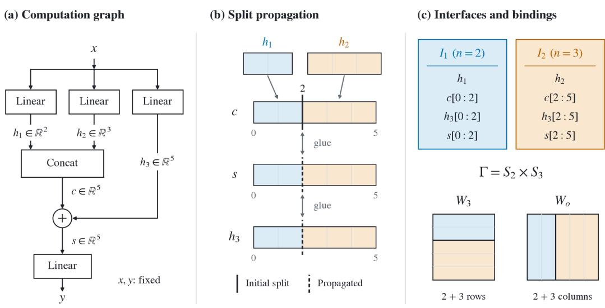  
Figure 6: Interface inference for concatenation and addition. Concatenation splits c at position $2 ;$ addition propagates this split to s and $h _ { 3 }$ . The resulting atoms form two interfaces with permutation group $S _ { 2 } \times S _ { 3 }$ . Colors indicate their bindings to rows of $W _ { 3 }$ and columns of $W _ { o } .$ . Input and output coordinates remain fixed.

The compiler represents these requirements using three constraints: a glue equates permutations on two coordinate intervals; a split prevents permutations across a boundary; and afixed axis permits only the identity.

Interface inference. The compiler propagates splits through glues until no new split is introduced. It then partitions each coordinate axis into intervals between consecutive split positions, called atoms. Atoms identified by glues form equivalence classes. Each class defines an interface with one shared permutation. If any atom belongs to a fixed axis, the entire class is fixed.

Example. Let $h _ { 1 } , h _ { 2 } , h _ { 3 }$ be the outputs of three linear layers with dimensions 2, 3 and 5, respectively:

$$
\begin{array} { r l } & { h _ { i } = W _ { i } x + b _ { i } , \qquad i = 1 , 2 , 3 , } \\ & { \ c = \mathrm { c o n c a t } ( h _ { 1 } , h _ { 2 } ) , \qquad s = c + h _ { 3 } , \qquad y = W _ { o } s + b _ { o } . } \end{array}
$$

The layers do not share parameters, and batch dimensions are omitted. Concatenation introduces a split at position 2 of c. Addition propagates this split to $h _ { 3 }$ and s. Their first two coordinates share an interface with $h _ { 1 } ;$ ; their remaining three share an interface with $h _ { 2 } .$ . The two interfaces admit independent permutations, giving $S _ { 2 } \times S _ { 3 }$ . The input and output coordinates remain fixed. The same partition splits the rows of $W _ { 3 }$ and the columns of $W _ { o }$ into the corresponding units. See Figure 6 for a schematic illustration.

Parameter bindings and head permutations. The inferred interfaces determine the permutations of parameters and buffers. Binding rules specify the affected tensor dimensions and slices, including constraints from parameter sharing. Attention-head permutations are handled separately: a head permutation must also permute the corresponding query, key and value projections and the matching blocks of the output projection.

## F.2 CONSTRAINTS AND OPERATOR RULES

Let X be a finite set of coordinate axes. Axis t has width $n _ { t } \ge 1$ and coordinates $[ n _ { t } ] = \{ 0 , . . . , n _ { t } -$ 1}. Axes may correspond to traced tensors or be introduced by an operator rule. In particular, attention rules introduce internal query, key and value axes. Integer indices and supported shape computations do not receive coordinate permutation factors.

<table><tr><td>Operation</td><td>Constraints</td></tr><tr><td>Linear layer without parameter sharing Elementwise operation; addition or</td><td>No input-output glue.</td></tr><tr><td>multiplication with aligned coordinate axes</td><td>Glue the participating coordinate axes.</td></tr><tr><td>Concatenation along the coordinate axis</td><td>Glue each input to its output interval and split at the interval bound- aries.</td></tr><tr><td>Concatenation along another axis</td><td>Glue each input coordinate axis to the output coordinate axis; no coordinate splits.</td></tr><tr><td>Depthwise convolution with g =  $n _ { \mathrm { i n } } = n _ { \mathrm { o u t } } > 1$ </td><td>Glue input and output coordinate axes.</td></tr><tr><td>Other grouped convolution,  $g > 1$ </td><td>Split input and output coordinate axes at group boundaries; no input-output glue.</td></tr><tr><td>Supported attention with h heads of di- Introduce mension d</td><td> $q , k ,$  v axes of width hd; glue q to k and split all three at head boundaries. Declare head permutations separately.</td></tr></table>

Table 13: Representative operator rules. Each row assumes a supported layout. Fixed-axis and parameter-sharing constraints may further restrict the permitted permutations.

The constraint system is $\mathcal { C } = ( \mathcal { X } , n , S , L , F )$ , where S contains splits, L contains glues and $F \subseteq { \mathcal { X } }$ contains fixed axes. A permutation assignment is a tuple $( \pi _ { t } ) _ { t \in \mathcal { X } }$ with $\pi _ { t } \in S _ { n _ { t } }$ . Intervals below contain integer coordinates.

• A split (t, c), with $0 \leq c \leq n _ { t }$ , prohibits permutations across position c:

$$
\pi _ { t } ( i ) < c \iff i < c , \qquad i \in \{ 0 , \ldots , n _ { t } - 1 \} .
$$

• A glue $( t , u ; t ^ { \prime } , u ^ { \prime } ; k )$ relates two blocks of $k \geq 1$ coordinates, with $0 \leq u \leq n _ { t } - k$ and $0 \leq u ^ { \prime } \leq n _ { t ^ { \prime } } - k .$ It imposes splits at $u , u + k$ on t and at $u ^ { \prime } , u ^ { \prime } + k$ on $t ^ { \prime }$ . Both blocks must use the same permutation σ of $\{ 0 , \ldots , k - 1 \}$

$$
\begin{array} { r } { \pi _ { t } ( u + j ) = u + \sigma ( j ) , \qquad j = 0 , \ldots , k - 1 . } \\ { \pi _ { t ^ { \prime } } ( u ^ { \prime } + j ) = u ^ { \prime } + \sigma ( j ) , \qquad j = 0 , \ldots , k - 1 . } \end{array}
$$

The endpoint splits are part of the constraint: both permutations preserve the specified interval and agree in relative coordinates.

• A fixed axis $t \in F$ requires $\pi _ { t } = \operatorname { i d } .$

Axis inference. Operator rules specify coordinate-axis positions, and layout rules propagate these positions in both directions. Conflicting assignments are rejected. Supported reshapes preserve the coordinate axis without combining it with another non-singleton dimension.

If propagation permits several positions for an unassigned tensor, the implementation selects the lowest index. Components without an assigned axis are initialized at tensor dimension 1, using zero-based indexing, and propagation resumes. Tensors for which this assignment is unavailable or inconsistent are rejected. The exactness theorem is conditional on the resulting axis assignment.

Operator rules. Each rule specifies its layout requirements, permutation constraints and parameter bindings. Rules may introduce internal axes and fixed axes. External input and output coordinate axes are fixed; embedding rules also fix the vocabulary axis. Parameter-sharing rules impose consistent permutations at every supported use of a shared tensor. Attention rules separately declare supported head permutations.

Table 13 summarizes the main constraint patterns. Operator contracts, state bindings and their principal restrictions are given in Appendix H.6.

## F.3 ALGORITHMS

Algorithm 1 specifies the compiler pipeline. Operator-specific steps follow the rules above and reject unsupported cases. Algorithm 2 specifies interface inference from the emitted constraints.

Algorithm 1 Compile the representation   
Require: model $f ,$ example inputs x, rule set $V$   
1: trace $f$ in evaluation mode and propagate shapes and dtypes using fake inputs   
2: retain the computational graph $\dot { \tau }$ and typed operation occurrences $\mathcal { O }$   
3: validate parameter sharing and record supported aliases $\mathcal { A }$   
4: infer coordinate-axis positions a using the operator and layout rules   
5: $( \mathcal { C } , \mathcal { D } ) \gets \mathrm { E m i t R u l e s } _ { V } ( \mathcal { T } , a , \mathcal { A } )$   
6: $\mathcal { C } \mathrm { : }$ axes and constraints; $\mathcal { D } \colon$ head-permutation declarations   
7: (C, I, R) ← RecoverInterfaces(C) (Algorithm 2)   
8: verify $C , \mathcal { T }$ and derivation record R against C   
9: partition parameters and buffers into units U and construct bindings $B ,$ respecting A   
10: add the supported attention-head and output-projection occurrences to O   
11: $N _ { \mathrm { e x p e c t e d } } $ entry count of distinct registered parameters and buffers, excluding BatchNorm   
training counters   
12: $N _ { \mathrm { p a c k e d } }$ ← total entry count of the blocks in U   
13: if $\dot { N } _ { \mathrm { p a c k e d } } \neq N _ { \mathrm { e x p e c t e d } }$ then   
14: reject: parameter and buffer coverage mismatch   
15: end if   
16: construct head permutations $\mathcal { H }$ from $\mathcal { D }$ and the inferred representation   
17: verify H against the declarations, occurrences, interfaces and bindings   
18: return $( \mathcal { T } , \mathcal { \breve { O } } , \mathcal { U } , B , \mathcal { H } )$ and $( \mathcal { C } , C , R )$

For a glue $( t , u ; t ^ { \prime } , u ^ { \prime } ; k )$ , a split position $c \in [ u , u + k ]$ on t induces the split position $c + u ^ { \prime } - u$ on t′, and conversely. Both directions include the endpoints.

In Algorithm 2, Insert $( t , c , r )$ inserts a previously absent split position into $C [ t ]$ , adds $( t , c )$ to the worklist, and appends its justification r to R. It has no effect if $c \in C [ t ]$ . The justification records either an initial split or an earlier split and the glue used to propagate it.

## F.4 BINDINGS AND HEAD PERMUTATIONS

For a linear layer, the input and output partitions divide the columns and rows of its weight matrix into blocks. A block associated with interfaces I and J transforms as

$$
W _ { J I } \mapsto P _ { J } W _ { J I } P _ { I } ^ { \top } .
$$

Each bias segment is stored once and transforms by $P _ { J }$ . Convolutional blocks retain the spatial kernel dimensions. Grouped convolution and depthwise convolution use the corresponding block and diagonal parameterizations. Normalization layers include their affine parameters and, for BatchNorm, running means and variances. BatchNorm’s training counter is excluded.

Parameter sharing. The supported weight-tying rule covers an embedding layer and a linear output layer without bias that share the same weight parameter and have matching dimensions. The embedding uses fixed integer indices, with no padding index or max norm update. The rule identifies the output layer’s input interface with the embedding’s feature interface and its output interface with the fixed vocabulary interface. These interfaces must remain unsplit under the current binding rule. The shared parameter is stored once, while both operations remain in the graph. Unsupported parameter-sharing patterns are rejected.

Attention. For each supported attention layer, the constraints yield one query–key interface and one value interface per head. A head permutation acts jointly on the query, key and value projection blocks, their biases when present, and the corresponding columns of the output projection in the [out, in] convention. The output-projection bias is unchanged. The checker verifies the head interfaces, operation occurrences and all affected parameter bindings.

Supported head permutations exchange compatible interface factors and therefore normalize Γ. Together with the within-interface permutations, they give $G = \Gamma \rtimes E$ as defined in Section 2.3. For h heads of dimension $d ,$ the internal attention group is $( S _ { d } \times S _ { d } ) ^ { h } \rtimes S _ { h }$

Algorithm 2 Recover interfaces from interval constraints   
Require: $\mathcal { C } = ( \mathcal { X } , n , S , L , F )$   
1: validate axis identifiers, positive integer widths, integer split positions and glue intervals   
2: $C [ t ] \gets \emptyset$ and links $[ t ] \gets [ ]$ for every $\bar { \boldsymbol { t } } \in \mathcal { X }$   
3: worklist $W  \emptyset ;$ derivation record $\mathit { \bar { R } } \gets \mathbb { [ ] }$   
4: for each $t \in \mathcal { X }$ do   
5: Inser ${ \mathrm { ; } } ( t , 0 ,$ initial); Inser $ ; ( t , n _ { t } ,$ , initial)   
6: end for   
7: for each $( t , c ) \in S$ do   
8: Inser $\mathopen { } \mathclose \bgroup \left( t , c , \aftergroup \egroup \right)$ initial)   
9: end for   
10: for each glue $\ell = ( t , u ; t ^ { \prime } , u ^ { \prime } ; k ) \in L$ do   
11: insert its four endpoints as initial split positions   
12: append $( u , u + \bar { k , \ : t ^ { \prime } } , u ^ { \prime } - u , \ell )$ to links[t]   
13: append $\left( u ^ { \prime } , u ^ { \prime } + k , t , u - u ^ { \prime } , \ell \right)$ to links[t′]   
14: end for   
15: while $W \neq \emptyset$ do   
16: pop $( t , \dot { c } )$ from W   
17: for each $( l , h , s , \delta , \ell ) \in$ links[t] do   
18: if $\ ` l \leq c \leq h$ then   
19: Inser $( s , c + \delta , ( t , c , \ell ) )$   
20: end if   
21: end for   
22: end while   
23: sort each $C [ t ]$ and form atoms $\left( t , c _ { i } , c _ { i + 1 } \right)$ between consecutive split positions   
24: initialize one equivalence class per atom   
25: for each glue $( { \dot { t } } , u ; t ^ { \prime } , u ^ { \prime } ; k ) \in { \dot { L } }$ do   
26: for each atom $( t , a , b )$ contained in $[ u , u + k )$ do   
27: merge its class with that of $( t ^ { \prime } , a \dot { + } u ^ { \prime } - u , b + u ^ { \prime } - u )$   
28: end for   
29: end for   
30: let I be the resulting classes; assign each its common atom width   
31: mark a class fixed if any of its atoms belongs to an axis in $F$   
32: return $( C , { \cal Z } , R )$

## F.5 GUARANTEES

Theorem F.1 (Termination and exactness of interval closure). For every validfinite constraint system C, Algorithm 2 inserts at most $\textstyle \sum _ { t \in { \mathcal { X } } } ( n _ { t } + 1 )$ distinct split positions, including the initial positions. It terminates with the least set containing the initial positions and closed under propagation through every glue. This set and the resulting interface partition are independent of processing order.

The permutation assignments satisfying the original constraints are exactly those obtained by choosing independently one permutation in $S _ { n _ { I } }$ for each non-fixed interface I, assigning the identity to each fixed interface, and applying the chosen permutation to every atom in the class. Their group is therefore isomorphic to

$$
\Gamma = \prod _ { I \in \mathcal { Z } ^ { * } } S _ { n _ { I } } ,
$$

where $\mathcal { T } ^ { * }$ denotes the non-fixed interfaces.

Proof. Each inserted position is an integer within its axis and is inserted at most once. Every insertion is an initial position or follows by propagation from an earlier insertion. It therefore belongs to every closed set containing the initial positions. At termination, every applicable propagation has been processed, so the result is the least such closed set.

Propagated splits are consequences of the original constraints. A glue preserves its interval endpoints and equates the relative permutations within the two intervals. Preserving a split in one interval therefore implies preservation of the corresponding split in the other. By induction, every admissible permutation assignment preserves all final atoms. Closure matches atoms of equal width, and glues require their permutations to agree. Thus each equivalence class carries one permutation, which must be the identity if the class contains an atom of a fixed axis.

Conversely, assigning one permutation to each class preserves every split and satisfies every glue. Fixed classes satisfy the fixed-axis constraints. The resulting correspondence is an injective group homomorphism onto the admissible permutation assignments. □

Function preservation. Assume that the operator and layout rules correctly describe the traced computation, and that the parameter bindings and sharing constraints implement their permitted transformations. Each operation is then equivariant under the corresponding input, output and parameter permutations. Composition, with external inputs and outputs fixed, gives

$$
f _ { g \theta } ( x ) = f _ { \theta } ( x ) , \qquad g \in \Gamma ,
$$

for every admissible input and model state θ, including represented buffers. The supported head permutations also preserve the function, so the equality extends to G by composition. The operatorspecific arguments for Theorem 2.2 are given in Appendix H.7. These equalities are statements in real arithmetic; numerical tests allow floating-point error.

Exactness is relative to C. It does not imply that the compiler recovers every function-preserving transformation or that distinct permutations produce distinct parameter values. Continuous symmetries and additional symmetries at particular parameter values are outside this claim.

## F.6 VERIFICATION, COMPLEXITY AND SCOPE

Verification. The factor checker verifies each split derivation, inclusion of all initial positions and closure under every glue. It independently computes the connected components of the atom-matching graph and checks the reported interface members, widths and fixed flags. It uses graph connectivity rather than the solver’s union–find implementation. The check establishes correctness relative to the supplied constraints; correctness of the operator rules requires the separate soundness arguments.

The head-permutation checker verifies the declared permutations against the supported attention rules and parameter bindings. The parameter and buffer coverage check compares entry counts. Equal counts alone do not establish entrywise coverage; that property also depends on the packing and parameter-sharing rules.

Separate numerical tests compare outputs before and after applying interface permutations, head permutations and their compositions. These tests are not part of Algorithm 1.

Complexity. Let B be the number of final split positions, K the number of atoms, Q the number of matched atom pairs counted across glues, and T the number of split–link checks in the worklist loop. With standard disjoint-set operations and expected constant-time dictionary access, the interval solver takes

$$
O ( B + K + T + Q \alpha ( K ) )
$$

apart from sorting, where α is the inverse Ackermann function. Sorting takes at most O(B log B + K log K). The factor checker takes $O ( B + K + Q )$ apart from the same sorting bound. These bounds exclude tracing, parameter packing and verification of head permutations. The bound on insertions does not bound the number of split–link checks.

Scope. The supported operations include linear layers, one- and two-dimensional convolutions and batch normalization, layer normalization over one feature dimension, selected elementwise operations and pooling, concatenation, aligned addition and multiplication, embeddings and learned tensors. Depthwise convolution with a channel multiplier greater than one uses the grouped-convolution rule. Reshapes, transposes and reductions require a supported coordinate-axis mapping.

Standard PyTorch self-attention is supported in the specified unmasked configuration. Native GPT-2 has a separate implementation of the rule for standard causal self-attention. Arbitrary attention masks and cross-attention are unsupported.

A positional encoding supplied as an external input is fixed. Addition therefore fixes the residual interfaces connected to its coordinate axis. Supported learned positional embeddings are instead permuted jointly with the residual features. The compiler does not inspect fixed tensor values to recover additional permutations that preserve those values. Registered positional buffers and other tensor attributes require a supported transformation rule.

Models whose traces satisfy these rules require no additional architecture-specific rules. Further details on supported operations and rejection cases are given in Appendix H.6.

## G ENCODER

## G.1 THE ENCODER IN EQUATIONS

The encoder alternates between cell features of width $d _ { E }$ and interface-coordinate features of width $d _ { H }$ . Each layer applies interface exchange, delivery, module updates and emission. Local exchange follows module incidences; global attention uses one summary per interface. Delivery broadcasts coordinate features to cells, while emission pools cells back to coordinates. Projections between $d _ { E }$ and $d _ { H }$ therefore act on coordinate vectors rather than the full cell grid.

We first describe these updates, treating structural codes as given. Appendix G.2 defines the codes and numerical lift. The bindings determine which coordinates communicate; the codes condition their features and messages.

Notation. We write norm for LayerNorm (Ba et al., 2016) without affine parameters and LN for LayerNorm with learned scale and shift. Both normalize only the feature dimension, with $\epsilon = 1 \dot { 0 } ^ { - 5 } ;$ ; GELU denotes GELU (Hendrycks & Gimpel, 2016). Learned maps are affine unless specified otherwise, with biases suppressed in the notation. Update maps are shared across objects and architectures, with separate parameters in each layer. Lift maps and structural embeddings are shared across layers.

Initialization. Let $w _ { a b s } , s = 1 , \ldots , k .$ , be the scalars folded into cell $( a , b )$ of a rectangular unit $u ,$ with scalar codes $c _ { s } \in \mathbb { R } ^ { d _ { E } }$ . Its initial state is

$$
\begin{array} { r l } {  { \mathbf { E } _ { u } ^ { 0 } [ a , b ] = \frac { 1 } { k } \sum _ { s = 1 } ^ { k } \phi ( w _ { a b s } , c _ { s } ) + M \mathrm { n o r m } ( \tau _ { o } ) } } \\ & { + \lambda _ { u , 0 } ( a ) + \lambda _ { u , 1 } ( b ) , } \end{array}\tag{7}
$$

where ϕ is the scalar lift, $\tau _ { o } \in \mathbb { R } ^ { d _ { H } }$ is the owning occurrence’s code, and $M : \mathbb { R } ^ { d _ { H } }  \mathbb { R } ^ { d _ { E } }$ is bias-free. The terms $\lambda _ { u , q }$ label coordinates on fixed interfaces and vanish on permutable interfaces. A diagonal unit uses one coordinate index and one label term. The lift, codes and labels are defined in Appendix G.2. The raw unit layout retains every parameter entry; its fixed-width encoding need not be injective.

Interface states start at zero, or at norm(C obsI) when coordinate-aligned observations are supplied (Appendix H.2). Weightless states start at $u _ { o } ^ { 0 } = \tau _ { o }$ . When used, the $g$ global tokens $\mathbf { G } \in \bar { \mathbb { R } } ^ { \bar { g } \times d _ { H } }$ have learned initial values. One emission using the first layer’s maps seeds the interface states before the layers begin.

Interface pass: local exchange. Each interface contributes an invariant summary

$$
s _ { I } = \mathrm { m e a n } _ { r } \operatorname { G E L U } \big ( P \ \mathrm { n o r m } ( \mathbf { H } _ { I } [ r ] ) \big ) .
$$

Let ${ \mathcal { P } } ( o )$ be the binding of occurrence $^ { O , }$ with $I ( p )$ denoting the interface of binding $p .$ Every ordered pair $p , q \in \mathcal { P } ( o )$ , including $p = q$ , contributes a message

$$
m _ { p \to q } ^ { ( o ) } = L { \mathrm { ~ G E L U } } \bigl ( \operatorname { n o r m } \bigl ( s _ { I ( p ) } + \kappa _ { o , p q } \bigr ) \bigr ) ,\tag{8}
$$

where $\kappa _ { o , p q } \in \mathbb { R } ^ { d _ { H } }$ encodes the operation type and sending and receiving roles. This is message passing over module incidences (Gilmer et al., 2017).

Define the incoming binding pairs of interface J by

$$
\begin{array} { r } { A _ { J } = \{ ( o , p , q ) : o \in \mathcal { O } , p , q \in \mathcal { P } ( o ) , I ( q ) = J \} . } \end{array}
$$

Their mean gives the local increment:

$$
\Delta _ { J } ^ { \mathrm { l o c } } = \frac { 1 } { \operatorname* { m a x } ( 1 , | \mathcal { A } _ { J } | ) } \sum _ { ( o , p , q ) \in \mathcal { A } _ { J } } m _ { p  q } ^ { ( o ) } .\tag{9}
$$

Binding remain distinct when they bind to the same interface, so aggregation retains incidence multiplicities. The increment is zero when no messages arrive. For attention, local exchange connects the query–key and value interfaces even though no parameter unit directly joins them.

Interface pass: global exchange. Global attention (Vaswani et al., 2017) acts on $\begin{array} { r l } { X } & { { } = } \end{array}$ $[ s _ { 1 } ; . . . ; s _ { A } ; \mathbf { G } ] { \mathrm { : } }$

$$
\begin{array} { l } { { \Delta ^ { \mathrm { a t t } } = \mathrm { M H A } ( \mathrm { n o r m } X ) , } } \\ { { \Delta ^ { \mathrm { f f } } = \mathrm { F F N } _ { H } ( X + \Delta ^ { \mathrm { a t t } } ) . } } \end{array}\tag{10}
$$

MHA includes learned query, key, value and output projections, with no attention dropout or additional positional encoding. The feed-forward block applies affine LayerNorm, a map $d _ { H }  2 d _ { H }$ , GELU and a map $2 d _ { H }  d _ { H }$

Local and global increments update the interface coordinates and global tokens:

$$
\begin{array} { r } { \phantom { \frac { 1 } { \mathbf { H } _ { J } [ r ] } } \mathbf { H } _ { J } [ r ]  \mathbf { H } _ { J } [ r ] + \mathrm { n o r m } \big ( \Delta _ { J } ^ { \mathrm { l o c } } + \Delta _ { J } ^ { \mathrm { a t t } } + \Delta _ { J } ^ { \mathrm { f f } } \big ) , } \\ { \phantom { \frac { 1 } { \mathbf { H } _ { J } [ r ] } } \mathbf { G }  \mathbf { G } + \Delta _ { \mathbf { G } } ^ { \mathrm { a t t } } + \Delta _ { \mathbf { G } } ^ { \mathrm { f f } } . \qquad } \end{array}\tag{11}
$$

Subscripts $J$ and $\mathbf { G }$ select the corresponding rows. Each interface receives the same increment at every coordinate; global tokens receive only the global increments.

Delivery: interfaces to modules. For unit axis $q ,$ bound to interface $I _ { q }$ by slot map $\sigma _ { q }$ under role $\rho _ { q }$ , define

$$
x ^ { ( q ) } = \Pi _ { \downarrow } { \mathrm { ~ G E L U } } \biggl ( \mathrm { n o r m } \Bigl ( \mathbf { H } _ { I _ { q } } [ \sigma _ { q } ] + e _ { \rho _ { q } } ^ { \mathrm { r e c v } } \Bigr ) \biggr ) ,
$$

where the receiving-role embedding is broadcast over gathered coordinates and $\Pi _ { \downarrow } : \mathbb { R } ^ { d _ { H } }  \mathbb { R } ^ { d _ { E } }$ is bias-free. A rectangular unit receives

$$
{ \bf E } _ { u } [ a , b ]  { \bf E } _ { u } [ a , b ] + x ^ { ( 0 ) } [ a ] + x ^ { ( 1 ) } [ b ] ,\tag{12}
$$

and a diagonal unit receives its single-axis contribution. Projection to cell width precedes broadcasting over the cell grid.

For a weightless binding $p ,$ let

$$
\begin{array} { r } { h _ { p } = \operatorname* { m e a n } _ { r } \mathbf { H } _ { I ( p ) } [ \sigma _ { p } ( r ) ] . } \end{array}
$$

The weightless occurrence receives

$$
\begin{array} { r } { u _ { o }  u _ { o } + \mathrm { n o r m } \big ( \mathrm { m e a n } _ { p \in \mathcal { P } ( o ) } \mathrm { G E L U } \big ( \mathrm { n o r m } \big ( h _ { p } + \widetilde { e } _ { p } ^ { \mathrm { r e c v } } \big ) \big ) \big ) , } \end{array}\tag{13}
$$

where $\hat { e } _ { p } ^ { \mathrm { r e c v } }$ additionally encodes the binding position when ordered.

Module pass. A rectangular cell combines its current feature with summaries of cells sharing either coordinate:

$$
r _ { a } = A \mathrm { n o r m } ( \mathrm { m e a n } _ { b } { \bf E } _ { u } [ a , b ] ) ,
$$

$$
c _ { b } = A \mathrm { n o r m } ( \mathrm { m e a n } _ { a } \mathbf { E } _ { u } [ a , b ] ) ,\tag{14}
$$

$$
\mathbf { E } _ { u } [ a , b ] \gets \mathbf { E } _ { u } [ a , b ] + W _ { \mathrm { o u t } } \mathrm { ~ G E L U } ( W _ { \mathrm { i n } } \mathbf { E } _ { u } [ a , b ] + r _ { a } + c _ { b } ) .\tag{15}
$$

The row and column summaries share the bias-free map $A : \mathbb { R } ^ { d _ { E } }  \mathbb { R } ^ { d _ { E } }$ . Both $W _ { \mathrm { i n } }$ and $W _ { \mathrm { o u t } }$ have input and output width $d _ { E }$ . For a diagonal unit, the context is $A$ norm(mean ${ \bf \Pi } _ { a } \mathbf { E } _ { u } [ a ] )$ , broadcast to every coordinate. The cell-normalized variant replaces the input to $W _ { \mathrm { i n } }$ by norm $( \bar { \bf E } _ { u } [ a , b ] )$ ).

Weightless states use

$$
u _ { o } \gets u _ { o } + \mathrm { F F N } _ { o } ( u _ { o } ) ,
$$

where $\mathrm { F F N } _ { o }$ applies affine LayerNorm, an affine map, GELU and a second affine map, all at width $d _ { H }$

Emission: modules to interfaces. For rectangular unit axis $q ,$ let $v _ { q }$ be the mean of $\mathbf { E } _ { u }$ over the other coordinate axis; for a diagonal unit, let $v _ { q } = \mathbf { E } _ { u }$ . The outgoing messages are

$$
e _ { u , q } [ a ] = \mathrm { G E L U } \Bigl ( \mathrm { n o r m } \Bigl ( \Pi _ { \uparrow } v _ { q } [ a ] + e _ { \rho _ { q } } ^ { \mathrm { s e n d } } \Bigr ) \Bigr ) ,
$$

with shared bias-free $\Pi _ { \uparrow } : \mathbb { R } ^ { d _ { E } }  \mathbb { R } ^ { d _ { H } }$ . A weightless binding contributes $\mathrm { G E L U } ( \mathrm { n o r m } ( u _ { o } + \widetilde { e } _ { p } ^ { \mathrm { s e n d } } ) )$ at each bound coordinate.

Messages are scattered through their slot maps and averaged at each receiving coordinate, giving $\bar { e } _ { I } [ r ]$ ]. The update is

$$
\mathbf { H } _ { I } [ r ]  \mathbf { H } _ { I } [ r ] + \mathrm { n o r m } \big ( \bar { e } _ { I } [ r ] + \bar { t } _ { I } [ r ] \big ) ,\tag{16}
$$

where ${ { \bar { t } } _ { I } } [ r ]$ is the optional transbinding contribution defined below. An empty incoming message set has mean zero.

Linear transport. Transport combines interface-coordinate states using raw parameters as coefficients. For a rectangular unit, define $\begin{array} { r } { A _ { u } [ a , b ] = k ^ { - 1 } \sum _ { s } w _ { a b s } } \end{array}$ . If its axes bind to $I , J$ through $\sigma _ { 0 } , \sigma _ { 1 }$ it sends

$$
\begin{array} { r } { t _ { u  I } = A _ { u } \mathbf { H } _ { J } [ \sigma _ { 1 } ] , } \\ { t _ { u  J } = A _ { u } ^ { \top } \mathbf { H } _ { I } [ \sigma _ { 0 } ] . } \end{array}\tag{17}
$$

A diagonal unit sends $a _ { u } [ a ] { \bf H } _ { I } [ \sigma ( a ) ]$ , where $\begin{array} { r } { a _ { u } [ a ] = k ^ { - 1 } \sum _ { s } w _ { a s } } \end{array}$ . Messages are scattered through their receiving slot maps. Their mean gives ${ { \bar { t } } _ { I } } [ r ]$ , using a separate count from ordinary emission.

All transport messages read the same pre-emission interface states. Transport introduces no learned parameters; when disabled, ${ \bar { t } } _ { I } [ r ] = 0$

Readouts. The loss-profile experiments give each interface equal weight:

$$
\begin{array} { r l } & { h = \operatorname * { m e a n } _ { I } \operatorname* { m e a n } _ { r } \mathrm { L N } _ { H } ( \mathbf { H } _ { I } [ r ] ) , } \\ & { \widehat { y } = \mathrm { M L P } _ { H } ( h ) . } \end{array}
$$

The MLP has widths $d _ { H }  2 d _ { H }  6 0$ , with GELU between its affine layers. This configuration has no global tokens.

Standard benchmarks and scaling experiments additionally pool global tokens:

$$
\begin{array} { r l } & { z = \operatorname * { m e a n } _ { j } \mathrm { L N } _ { G } ( \mathbf { G } [ j ] ) , } \\ & { \widehat { y } = \mathrm { M L P } _ { H G } ( [ h ; z ] ) . } \end{array}
$$

The streams have separate affine normalizations. The MLP has widths $2 d _ { H }  2 d _ { H }  C$ , with GELU, where $C = \bar { 1 } 0$ for INR classification and $C = 1$ for CNN accuracy prediction and scaling measurements.

For parameter-valued outputs, the scalar with code $c _ { s }$ in a cell is predicted by

$$
\mathrm { M L P } _ { E } ( \mathrm { L N } _ { E } ( { \bf E } _ { u } [ a , b ] ) \odot g ^ { \prime } ( c _ { s } ) + b ^ { \prime } ( c _ { s } ) ) ,\tag{18}
$$

where $g ^ { \prime } , b ^ { \prime } : \mathbb { R } ^ { d _ { E } }  \mathbb { R } ^ { d _ { E } }$ are affine and $\mathrm { M L P } _ { E }$ has widths $d _ { E }  2 d _ { E }  1$ with GELU. A cell containing k scalars is queried once per scalar code. Inverting the unit reshapes and transpositions returns predictions in the stored parameter-block layouts.

Batching and execution. Different architectures are batched as a disjoint union, with exchange, global tokens and readout pooling separate for each network. Matching layouts can instead be stacked along a batch dimension. Within a network, compatible units are stacked for cell computations; large units are processed in tiles with activation checkpointing (Chen et al., 2016). These modes preserve the corresponding separate computations up to floating-point error.

## G.2 LIFT AND STRUCTURAL CODES

The lift combines scalar values with their parameter kinds and positions within a cell. For a convolutional cell, these positions are kernel offsets. Code-dependent scaling associates values with their positions before averaging, following FiLM (Perez et al., 2018). Adding codes before a linear average would lose this association. Mean aggregation accommodates different numbers of folded entries (Zaheer et al., 2017).

Parameter and operation codes. The scalar and occurrence codes are

$$
\begin{array} { r l } & { c _ { s } = E _ { \mathrm { p a r a m } } ( \mathrm { k e y } _ { s } ) + G _ { \mathrm { g e o } } \gamma ( \delta _ { s } ) , } \\ & { \tau _ { o } = E _ { \mathrm { t y p e } } ( \mathrm { k i n d } ( o ) ) + D d _ { o } + \Pi \widetilde { \psi } ( \mathrm { d e p t h } ( o ) ) . } \end{array}\tag{19}
$$

The parameter key identifies a kind, such as a linear weight or normalization scale, rather than a source-model name. The descriptor $d _ { o }$ records operation attributes, and depth(o) is the longest-path depth of the occurrence. The maps D and Π are bias-free.

Convolutional offsets $\delta _ { s }$ are measured from the kernel centre. Folded learned tensors use centred indices in their flattened layout, embedded as $( j , 0 )$ ; entries without an offset use $\delta _ { s } = 0$ . The 32-dimensional map γ contains sines and cosines of

$$
\frac { \pi } { 8 } 2 ^ { j } \langle v , \delta \rangle , \qquad j = 0 , \ldots , 3 , \quad v \in \{ ( 1 , 0 ) , ( 0 , 1 ) , ( 1 , 1 ) , ( 1 , - 1 ) \} .
$$

Scalar features and lift. Let a, b index the two coordinate axes of a rectangular unit $u ,$ and let $w _ { a b s } , s = 1 , \ldots , k .$ , be the scalars folded into cell $( a , b )$ . Each scalar has a code $\bar { c } _ { s } \in \mathbb { R } ^ { d _ { E } }$ identifying its parameter kind and position within the cell (Equation (19)).

We apply fixed multi-frequency Fourier features (Tancik et al., 2020) without rescaling the weights:

$$
\psi ( w ) = [ \sin ( 2 ^ { p } w ) , \cos ( 2 ^ { p } w ) ] _ { p = - 5 } ^ { 8 } .
$$

The initial cell state is

$$
\begin{array} { c l c r } { \displaystyle \mathbf { E } _ { u } ^ { 0 } [ a , b ] = \frac 1 k \sum _ { s = 1 } ^ { k } \left( V \psi ( w _ { a b s } ) \odot \alpha ( c _ { s } ) + \beta ( c _ { s } ) \right) } \\ { + M \mathrm { n o r m } ( \tau _ { o } ) + \lambda _ { u , 0 } ( a ) + \lambda _ { u , 1 } ( b ) . } \end{array}\tag{20}
$$

The affine maps $V _ { ; }$ , α and $\beta$ have output width $d _ { E } ; \alpha ( c _ { s } )$ and $\beta ( c _ { s } )$ provide the code-dependent scale and shift. The remaining terms add operation metadata and fixed-coordinate labels, defined below. For one scalar per cell, $k = 1$ . For a convolutional unit, each cell contains the $\boldsymbol { k } = \boldsymbol { k } _ { h } \boldsymbol { k } _ { w }$ kernel coefficients for one input–output channel pair.

Binding roles and positions. Each role $\rho$ has separate sending and receiving embeddings $e _ { \rho } ^ { \mathrm { s e n d } } , e _ { \rho } ^ { \mathrm { r e c v } } \in \mathbb { R } ^ { d _ { H } }$ . The code used by local exchange is

$$
\kappa _ { o , p q } = E _ { \mathrm { t y p e } } ( \mathrm { k i n d } ( o ) ) + e _ { \rho ( p ) } ^ { \mathrm { s e n d } } + e _ { \rho ( q ) } ^ { \mathrm { r e c v } } .
$$

Thus local exchange uses the operation type and binding roles; the full occurrence code $\tau _ { o }$ initializes cell and weightless states.

Unit-axis delivery and emission use the role embeddings directly. For an ordered weightless binding p at position $j _ { p } ,$ , they use

$$
\begin{array} { r } { \widetilde { e } _ { p } ^ { \mathrm { s e n d / r e c v } } = e _ { \rho ( p ) } ^ { \mathrm { s e n d / r e c v } } + \Pi _ { p } \widetilde { \psi } ( j _ { p } ) , } \end{array}
$$

where $\Pi _ { p }$ is a shared bias-free map. Unordered bindings use the role embedding alone.

Fixed-coordinate labels. For axis q bound to interface $I _ { q }$ by slot map $\sigma _ { q } .$

$$
\lambda _ { u , q } ( a ) = { \left\{ \begin{array} { l l } { B _ { \mathrm { f i x } } \eta ( \sigma _ { q } ( a ) ) , } & { { \mathrm { i f ~ } } I _ { q } { \mathrm { ~ i s ~ f i x e d } } , } \\ { 0 , } & { { \mathrm { o t h e r w i s e } } , } \end{array} \right. }
$$

where $B _ { \mathrm { f i x } }$ is shared and bias-free. The coordinate encoding is sinusoidal (Vaswani et al., 2017):

$$
\eta ( r ) = [ \sin ( r 1 0 0 0 0 ^ { - 2 j / 3 2 } ) , \cos ( r 1 0 0 0 0 ^ { - 2 j / 3 2 } ) ] _ { j = 0 } ^ { 1 5 } .
$$

Labels are added to cells on every fixed interface, including input and output interfaces and residual interfaces fixed by externally supplied positional encodings. Learned positional embeddings transform through their parameter bindings and do not by themselves fix the residual interface. Coordinate labels are not added directly to interface states.

## H TECHNICAL APPENDIX

## H.1 EQUIVARIANCE OF THE ENCODER

Every encoder stage respects the coordinate action of Γ. Shared pointwise maps and feature normalization commute with coordinate permutations. Pooling removes the action on the reduced axis and preserves it on the retained axes; gathering and scattering follow the bindings. Linear transbinding contracts matching coordinate axes and therefore obeys the same transformation law. Fixed-coordinate labels occur only where the action is the identity. Optional observation features must transform with their interface coordinates.

Supported module exchanges carry states between the corresponding interfaces, modules and units. These exchanges preserve the codes, layouts and typed bindings used by the encoder. Local aggregation follows the exchanged incidences, while global attention follows the permutation of interface summaries because it has no interface-position encoding. Global-token outputs remain unchanged. Thus the encoder respects the combined action $G = { \Gamma } \stackrel { - } { \rtimes } E$

The network-level readouts pool over coordinates and interfaces and are therefore invariant. The perparameter readout applies a shared decoder to each cell and its scalar codes, so its outputs transform with the represented parameters. These properties do not imply that the encoder distinguishes all states in distinct G-orbits.

For Theorem 2.2(b), the implemented exchanges move complete attention heads: their query, key and value parameters, including biases, move together with the corresponding output-projection blocks. In evaluation mode, this merely reorders the sum of projected head outputs and leaves the layer’s output unchanged. The same argument applies to the supported GPT-2 causal attention rule, whose mask is shared across heads

## H.2 FEATURE PROVIDERS

Afeature provider supplies optional observations obs $\mathbf { \Psi } _ { I } \in \mathbb { R } ^ { n _ { I } \times d _ { \mathrm { c t } \mathbf { x } } }$ on any subset of interfaces, with one feature vector per coordinate. These initialize the interface states before the seeding emission:

$$
{ \bf H } _ { I } ^ { 0 } = \mathrm { n o r m } ( C \mathrm { o b s } _ { I } ) \quad \mathrm { w h e r e ~ o b s e r v a t i o n s ~ a r e ~ s u p p l i e d } , \qquad { \bf H } _ { I } ^ { 0 } = 0 \quad \mathrm { o t h e r w i s e } ,\tag{21}
$$

where $C : \mathbb { R } ^ { d _ { \mathrm { c t x } } }  \mathbb { R } ^ { d _ { H } }$ is shared across interfaces and architectures. The remaining encoder is unchanged.

Learned probes. For the INR experiments, we use learned input probes (Kofinas et al., 2024). Evaluating each network at inputs $z _ { 1 } , \dots , z _ { S } \ { \mathrm { g i v e } }$ s

$$
\mathrm { o b s } _ { I } = [ a _ { I } ( z _ { 1 } ) , \ldots , a _ { I } ( z _ { S } ) ] \in \mathbb { R } ^ { n _ { I } \times S } ,\tag{22}
$$

where $a _ { I } ( z )$ is the corresponding layer value, after its activation where present. The probe inputs are shared across networks and optimized jointly with the encoder, while the input networks’ weights remain fixed. Execution is differentiable with respect to the probes, and the recorded values follow hidden-coordinate permutations.

## H.3 PERMUTATION ACTIONS IN ATTENTION REPRESENTATIONS

Consider an attention layer with two heads of width four and fixed input and output coordinates. Independent query–key and value permutations within each head, together with complete-head exchanges, give the subgroup

$$
G _ { \mathrm { a t t } } = ( S _ { 4 } \times S _ { 4 } ) ^ { 2 } \times S _ { 2 } , \qquad | G _ { \mathrm { a t t } } | = 6 6 3 , 5 5 2 .
$$

Its function preservation follows from Lemma H.1 and Theorem 2.2(b). Table 14 compares this action with those imposed by the representations. Continuous symmetries and additional parameter-specific symmetries are outside this comparison.

Representation-induced actions. The construction of Kofinas et al. (2024, Appendix C.4) associates each head coordinate with one node, combining its Q, K and V weights into edge features.

<table><tr><td>Representation</td><td>Permutation action</td><td>Order</td><td>Non-symmetries</td></tr><tr><td>Reference subgroup</td><td> $G _ { \mathrm { a t t } }$ </td><td>663,552</td><td>0</td></tr><tr><td>QKV-triple graph (Kofinas et al., 2024)</td><td> $S _ { 8 }$ </td><td>40,320</td><td>39,168</td></tr><tr><td>With fixed head labels (Lim et al., 2024)</td><td> $S _ { 4 } \times S _ { 4 }$ </td><td>576</td><td>0</td></tr><tr><td>Transformer-NFN (Tran et al., 2025)</td><td> $G _ { \mathrm { a t t } }$ </td><td>663,552</td><td>0</td></tr><tr><td>UWE</td><td> $G _ { \mathrm { a t t } }$ </td><td>663,552</td><td>0</td></tr></table>

Table 14: Internal permutation actions for two heads of width four, with stream coordinates fixed. Non-symmetries are listed transformations that do not preserve the attention function for all parameter values. Transformer-NFN also supports continuous basis changes, omitted from these counts.

Without head labels, the eight nodes can be relabelled arbitrarily, jointly permuting the rows of $W _ { Q } , W _ { K } , W _ { V }$ and the matching columns of $W _ { O }$ . Here relabelling transports the numerical features; it need not fix an individual numerically labelled graph.

The joint permutations that map each complete head block onto a head block form $S _ { 4 } \wr S _ { 2 }$ , of order $2 4 ^ { 2 } \cdot 2 = \bar { 1 } , 1 5 2$ . The remaining 39,168 mix coordinates between heads and are not universal attention symmetries. The joint QKV action also omits independent value permutations. Adding fixed head labels, as proposed by Lim et al. (2024), restricts the action to $S _ { 4 } \times S _ { 4 }$ and additionally excludes head exchange. UWE represents the two coordinate factors separately and includes supported head exchanges, giving $G _ { \mathrm { a t t } }$

Numerical check. We used stream width eight, independent standard normal projection weights, zero biases and three standard normal input sequences of six tokens, with random seed 20260922 and double-precision evaluation. Among all $8 ! = 4 0 { , } 3 2 0$ joint permutations, exactly 1,152 had maximum absolute output error below $1 0 ^ { - 9 }$ : precisely those preserving the head partition. All 4,000 uniformly sampled elements of $G _ { \mathrm { a t t } }$ also passed this threshold.

A separate encoder check used four rounds, $d _ { E } = 8 , d _ { H } = 3 2 .$ , four attention heads, four global tokens and linear transport, initialized with seed 20260923. A complete-head exchange and a valueonly permutation with matching output-projection columns preserved its invariant readout to within $1 0 ^ { \overset { \bullet } { - } 1 \overset { \bullet } { 6 } }$ . Exchanging one coordinate between heads, or permuting query coordinates without their key coordinates, changed both the attention output and this readout. These are finite implementation checks; they do not establish that the encoder distinguishes all distinct symmetry orbits.

## H.4 REPRESENTATION SIZE

Consider L transformer encoder blocks of residual width D, with h heads of width $r = D / h$ feed-forward width $D _ { \mathrm { f f } }$ , two LayerNorms per block and one final LayerNorm. Embeddings and the task output layer are excluded.

Interfaces and coordinate states. Residual additions and normalization identify the residual coordinate axes across the stack. Each head contributes one query–key interface and one value interface, and each block contributes one feed-forward hidden interface. Thus

$$
\begin{array} { l } { A = 1 + L ( 2 h + 1 ) , } \\ { S = D + L ( 2 h r + D _ { \mathrm { f f } } ) = D + L ( 2 D + D _ { \mathrm { f f } } ) . } \end{array}
$$

These counts include fixed interfaces. With biases and affine normalization parameters, the parameter count is

$$
P = L ( 4 D ^ { 2 } + 2 D D _ { \mathrm { f } } + 9 D + D _ { \mathrm { f } } ) + 2 D .
$$

For D = 768, h = 12, L = 12 and $D _ { \mathrm { f f } } = 3 0 7 2 .$

$$
A = 3 0 1 , \qquad S = 5 6 , 0 6 4 , \qquad P = 8 5 , 0 5 6 , 0 0 0 .
$$

The cell count is close to $P \colon$ matrix entries and biases are stored individually, while normalization scale and shift share cells.

Neuron graph. Applying the construction of Kofinas et al. (2024, Appendices C.3–C.4) gives D input nodes. Each block adds four sets of D stream nodes, $h r = D$ head nodes and $D _ { \mathbb { H } }$ feed-forward nodes. The final LayerNorm adds another D nodes, giving

$$
N = ( 5 L + 2 ) D + L D _ { \mathrm { f } } = 8 4 { , } 4 8 0 .
$$

Full attention over these nodes has $N ^ { 2 } = 7 { , } 1 3 6 { , } 8 7 0$ ,400 ordered pairs. Attention over UWE’s interface summaries, with four global tokens, has $( A + 4 ) ^ { 2 } = 3 0 5 ^ { 2 } = \mathrm { \dot { 9 } 3 , 0 2 5 }$ . These counts compare attention domains; a message-passing graph network does not materialize all node pairs.

## H.5 UNSUPPORTED CASES AND VALIDATION

Compilation rejects operations, layouts and state-sharing patterns outside the rules of Appendix H.6. Examples include forward hooks, in-place operations and mutation arguments, unsupported tensor attributes, undeclared aliases and repeated stateful uses without a sharing rule. The traced computation must return one tensor and admit a consistent coordinate-axis assignment. Unsupported datadependent scalar extraction and coordinate-mixing layouts are rejected.

Arbitrary attention masks and cross-attention remain unsupported; the prescribed GPT-2 causal rule is a separate supported case. There are no dedicated rules for rotary embeddings, recurrence or mixtureof-experts routing. Operation-specific restrictions, including those on embeddings, normalization and concatenation, are listed in Appendix H.6.

A final coverage check compares the number of packed state entries with the expected number of parameters and buffers, excluding BatchNorm’s training counter. A mismatch is an error. Equal counts alone do not establish one-to-one coverage; that also depends on the packing and sharing rules. The factor and head-exchange checks are described in Appendix F.6.

## H.6 SUPPORTED OPERATIONS AND STATE TRANSFORMATIONS

Table 15 specifies permutation constraints and parameter and buffer bindings. Permutations act on resolved coordinate axes; other indices are unchanged. Interface partitions may divide a tensor into several units. Rectangular units bind two coordinate axes, diagonal units bind one, and remaining indices are folded within cells. Shared state must receive the same transformation at every use.

Binding roles. The vocabulary contains twelve roles: input (in), output (out), normalization state (gamma beta), depthwise channel (channel), shared query/key/value projection input $( \mathtt { q k V \mathrm { - } \dot { 1 } n } )$ query, key and value projection outputs (q out, k out, v out), output-projection input and output (o in, o out), and main and skip operands (main, skip) used in skip connections.

Operation families. Compilation uses evaluation-mode computation at the supplied input shapes. Convolutions, BatchNorm, max pooling, average pooling and adaptive average pooling support one or two spatial dimensions. LayerNorm normalizes one feature axis. Activation rules cover ReLU, ReLU6, LeakyReLU, GELU, SiLU, tanh, sigmoid, Hardswish, Hardsigmoid and functional hardtanh; identity and evaluation-mode Dropout and Dropout2d are also supported. Depthwise convolution with channel multiplier greater than one uses the grouped-convolution rule.

Layout restrictions. Reshape and flatten must preserve the coordinate axis without merging it with another non-singleton dimension. Expansion cannot change its width. Selection uses literal indices and slices; the coordinate axis must survive as a nonempty contiguous interval with unit stride. Mean reductions require explicit non-coordinate axes. Concatenation requires an explicit ordered operand list. Addition and multiplication require two tensor operands with aligned coordinate axes; scaled addition requires a nonzero coefficient. These are implementation restrictions, not maximal conditions for equivariance.

Learned tensors and sharing. Embedding indices are fixed integer data; padding indices and max norm updates are unsupported. Learned tensor attributes must be floating-point parameters. Other tensor attributes and buffers require an explicit state-transformation rule.

<table><tr><td>Operation</td><td>Permutation constraints</td><td>State bindings</td></tr><tr><td>Linear layer; convolu- No input-output glue. tion with one group</td><td></td><td>Rectangular weights; biases bind the out- put. Kernel offsets are folded.</td></tr><tr><td>Depthwise convolution, Glue input and output.  $g = n _ { \mathrm { i n } } = n _ { \mathrm { o u t } } > 1$ </td><td></td><td>Diagonal kernels and biases; kernel off- sets are folded.</td></tr><tr><td>tion,  $g > 1$ </td><td>aries; no input-output glue.</td><td>Other grouped convolu- Split input and output at group bound- Rectangular kernels connect matching groups; biases bind the output.</td></tr><tr><td>BatchNorm; single-axis Glue input and output. LayerNorm</td><td></td><td>Diagonal affine parameters. BatchNorm running statistics follow the channel ac- tion.</td></tr><tr><td>Pointwise tion, spatial pooling, evaluation-mode</td><td>activa- Glue input and output.</td><td>No stored state.</td></tr><tr><td>dropout tiplication</td><td>Aligned addition or mul- Glue both operands and output.</td><td>No stored state.</td></tr><tr><td>nation</td><td>Coordinate-axis concate- Glue each operand to its output interval; No stored state. split at interval boundaries.</td><td></td></tr><tr><td>other axis</td><td>Concatenation along an- Glue all input coordinate axes to the No stored state. output coordinate axis.</td><td></td></tr><tr><td>slice</td><td>Contiguous coordinate Glue the selected input interval to the No stored state. output; split at its endpoints.</td><td></td></tr><tr><td>Coordinate-preserving layout change or mean</td><td>Glue corresponding coordinate axes. No stored state.</td><td></td></tr><tr><td>reduction</td><td>Supported self-attention Split Q, K and V at head boundaries; Rectangular projection blocks; Q and K glue Q to K. Declare complete-head ex- share a head interface, while V shares its changes separately.</td><td>interface with the output projection&#x27;s in-</td></tr><tr><td>Embedding lookup</td><td>feature axis through its uses.</td><td>put. Biases bind projection outputs. Fix the vocabulary axis; constrain the Rectangular vocabulary-feature units.</td></tr><tr><td>tensor</td><td>Learned floating-point Constrain the feature axis through its Diagonal units; remaining indices are uses.</td><td>folded.</td></tr><tr><td>ear output layer</td><td>feature axis and its output to the fixed occurrences.</td><td>Embedding tied to a lin- Glue the linear input to the embedding Store the shared weight once; retain both</td></tr><tr><td>External tensor inputs Fix their coordinate axes</td><td>vocabulary axis.</td><td>Input data are not packed into units.</td></tr></table>

Table 15: Implemented constraint patterns and state bindings. Each row is subject to the restrictions below. Fixed-axis and sharing constraints may further restrict the action. Biases and shared state are stored without duplication.

The weight-tying rule covers one embedding and one bias-free linear output layer with matching dimensions and the same weight parameter. Their feature and vocabulary interfaces must remain unsplit. Additional aliases, repeated stateful uses and shared-storage views are outside this rule.

Attention restrictions. The standard PyTorch rule requires batched self-attention: Q, K and V receive the same tensor, and their projections use a packed weight with equal embedding widths. Masks, causal hints, added key/value bias tokens and add zero attn are unsupported.

The native GPT-2 rule separately supports unpruned causal self-attention with standard scaling and the prescribed head-independent causal mask. Cross-attention, padding masks, cached decoding, layer-dependent attention scaling and custom attention implementations are outside this rule.

Rejection and verification. The trace must return one tensor and admit a consistent coordinate-axis assignment. Forward hooks, in-place operations, mutation arguments, unsupported data-dependent scalar extraction and undeclared state sharing are rejected. There are no dedicated rules for rotary embeddings, recurrence or mixture-of-experts routing.

Constraint recovery is specified in Appendix F.2; factor, head-exchange and state-coverage checks are described in Appendix F.6.

## H.7 SOUNDNESS OF THE OPERATOR RULES

For every supported operation, the emitted constraints and state bindings imply

$$
\begin{array} { r } { f ( P _ { a _ { 1 } } x _ { 1 } , \dots , P _ { a _ { m } } x _ { m } ; \theta ^ { \prime } ) = P _ { b } f ( x _ { 1 } , \dots , x _ { m } ; \theta ) , } \end{array}\tag{23}
$$

where $\theta ^ { \prime }$ is the prescribed transformation of its parameters and buffers. The identity holds for every admissible input and state, under the restrictions of Appendix H.6. The arguments below concern evaluation-mode computation in real arithmetic. Batch, token and spatial indices are unchanged.

Linear layers and convolutions. For input and output permutations $P _ { a } , P _ { b } ,$

$$
( P _ { b } W P _ { a } ^ { \top } ) ( P _ { a } x ) + P _ { b } b = P _ { b } ( W x + b ) .
$$

Convolution satisfies this identity at each kernel offset; summation over offsets preserves it. For grouped convolution, the splits restrict permutations to each group’s input and output coordinates. For depthwise convolution with channel multiplier one, a common input–output permutation moves each channel’s kernel and bias together.

Coordinatewise operations and normalization. A shared scalar function or channelwise spatial pooling commutes with coordinate permutations. BatchNorm permutes affine parameters and any running statistics with their channels. Evaluation-mode dropout is the identity.

LayerNorm’s mean and variance are permutation-invariant, so

$$
\operatorname { L N } ( P x ; P \gamma , P \beta ) = P \operatorname { L N } ( x ; \gamma , \beta ) .
$$

The identity also holds without affine parameters.

Addition, multiplication and concatenation. For aligned operands,

$$
P x + \alpha P y = P ( x + \alpha y ) , \qquad ( P x ) \odot ( P y ) = P ( x \odot y ) .
$$

Coordinate-axis concatenation satisfies

$$
\operatorname { c a t } ( P _ { 1 } x _ { 1 } , \dots , P _ { m } x _ { m } ) = ( P _ { 1 } \oplus \dots \oplus P _ { m } ) \operatorname { c a t } ( x _ { 1 } , \dots , x _ { m } ) .
$$

The splits preserve operand boundaries, and the glues equate each operand’s action with its output block. Concatenation along another axis commutes with the common coordinate permutation.

Slicing and layout operations. For a supported coordinate slice, let R select its interval. The endpoint splits preserve this interval, and the glue equates its action with the output permutation. Hence

$$
R P _ { \mathrm { i n } } = P _ { \mathrm { o u t } } R .
$$

Selections on other axes leave the coordinate action unchanged.

Supported transposes, reshapes and flattenings relocate the coordinate axis without mixing its coordinates. Expansion and mean reduction affect only other axes. These operations therefore satisfy Equation (23). Fixed integer indices and shape computations have the identity action; coordinate permutations do not change tensor shapes.

Embeddings, learned tensors and weight tying. Let $B \in \mathbb { R } ^ { V \times d }$ be an embedding matrix and $e _ { i }$ the one-hot vector for a fixed vocabulary index. A feature permutation $P$ gives $B ^ { \prime } = \bar { B P } ^ { \top }$ , and

$$
( B ^ { \prime } ) ^ { \top } e _ { i } = P B ^ { \top } e _ { i } , \qquad B ^ { \prime } ( P h ) = B h .
$$

Thus embedding lookup and the tied linear output layer induce the same transformation of their shared weight. A learned tensor source transforms along its bound feature axis, supplying the required action to subsequent operations.

Lemma H.1 (Attention). Consider a supported attention layer with row-wisefeatures X, projections $Q _ { j } = X W _ { Q , j } ^ { \top } + \mathbf { 1 } b _ { Q , j } ^ { \top } ,$ and analogous $K _ { j } , V _ { j }$ . Its outputs are

$$
\begin{array} { r l } & { U _ { j } = \operatorname { s o f t m a x } \left( Q _ { j } K _ { j } ^ { \top } / \sqrt { d } + M \right) V _ { j } , } \\ & { Y = \operatorname { c a t } ( U _ { 1 } , \ldots , U _ { h } ) W _ { O } ^ { \top } + { \bf 1 } b _ { O } ^ { \top } , } \end{array}
$$

where d is the query–key width and M is zero or the prescribed GPT-2 causal mask. Let $R _ { j } , S _ { j }$ independently permute head j’s query–key and value coordinates. Under $X ^ { \prime } = X P _ { x } ^ { \top }$ and the corresponding transformations of projection weights and biases, with output permutation $P _ { y } ,$ , the output satisfies $Y ^ { \prime } = Y P _ { y } ^ { \intercal }$

Proof. The affine rule gives

$$
\begin{array} { r } { Q _ { j } ^ { \prime } = Q _ { j } R _ { j } ^ { \top } , \qquad K _ { j } ^ { \prime } = K _ { j } R _ { j } ^ { \top } , \qquad V _ { j } ^ { \prime } = V _ { j } S _ { j } ^ { \top } . } \end{array}
$$

Thus $Q _ { j } ^ { \prime } ( K _ { j } ^ { \prime } ) ^ { \top } = Q _ { j } K _ { j } ^ { \top }$ . The mask acts on token indices and is unchanged, so $U _ { j } ^ { \prime } = U _ { j } S _ { j } ^ { \top }$ . Writing U = cat $\left( U _ { 1 } , \ldots , U _ { h } \right)$ and ${ \cal S } = \mathrm { d i a g } ( S _ { 1 } , \dots , S _ { h } )$ , the output bindings give $W _ { O } ^ { \prime } = P _ { y } \bar { W } _ { O } S ^ { \top }$ and $b _ { O } ^ { \prime } = P _ { y } \bar { b } _ { O }$ . Therefore

$$
\begin{array} { r } { Y ^ { \prime } = U S ^ { \top } ( P _ { y } W _ { O } S ^ { \top } ) ^ { \top } + \mathbf { 1 } b _ { O } ^ { \top } P _ { y } ^ { \top } = Y P _ { y } ^ { \top } . } \end{array}
$$

ProofofTheorem 2.2. For part (a), let $\gamma \in \Gamma$ induce permutations $P _ { t }$ on tracked tensor axes and a consistent transformed state θ′. By Theorem F.1, these permutations satisfy the emitted constraints.

Proceed in topological order through the trace. Fixed inputs and index data have the identity action; learned tensor sources follow their state bindings. If the inputs of operation $f$ obey their assigned actions, Equation (23) gives

$$
t ^ { \prime } = f ( P _ { t _ { 1 } } t _ { 1 } , \dots , P _ { t _ { m } } t _ { m } ; \theta _ { f } ^ { \prime } ) = P _ { t } f ( t _ { 1 } , \dots , t _ { m } ; \theta _ { f } ) = P _ { t } t .
$$

Sharing rules ensure that every $\theta _ { f } ^ { \prime }$ is induced by the same $\theta ^ { \prime }$ . Induction reaches the fixed output axis, establishing function preservation.

For part (b), partition $W _ { O }$ into head blocks $O _ { j }$ . The attention output is

$$
Y = \sum _ { j = 1 } ^ { h } U _ { j } O _ { j } ^ { \top } + \mathbf { 1 } b _ { O } ^ { \top } .
$$

A supported head exchange jointly permutes the Q, K and V projections, their biases and the blocks $O _ { j }$ It reorders the summands and preserves the common mask, leaving Y unchanged. The exchange rules enforce compatible bindings and shared-state actions. Composition establishes function preservation for $G = { \Gamma } \stackrel { - } { \rtimes } E$ □