# KOLMOGOROV-ARNOLD NETWORKS: CURSE OF DIMENSIONALITY AND STRUCTURAL BIAS

Yunhao N1, Yuxin Guo1, Jie Luo1, Wenjun Wu1,2, Lei Huang1,2\*

1State Key Laboratory of Complex and Critical Software Environment, Beihang University, Beijing, China

2Hangzhou International Innovation Institute, Beihang University, Hangzhou, China

## ABSTRACT

Kolmogorov-Arnold networks (KANs) have a dimension-independent approximation exponent when the target admits a sufficiently smooth representation by univariate edge functions. We ask whether this favorable scaling belongs to the architecture or to the assumed target class. For arbitrary-depth standard spline-KANs, we prove a worst-case lower bound on isotropic Sobolev balls: below a dimension-independent accuracy threshold, the required number of spline coefficients grows at least exponentially with input dimension. Existing compositionmatched MLP results, by contrast, show that favorable exponents on low-arity targets are not exclusive to KANs. We also revisit empirical comparisons. On four scaling-law targets, spline-KAN approximants constructed from known decompositions transfer exactly to MLPs with the cubic ReLU activation σ(x) = (max{0, x })3, although their full dense parameter counts are larger. In controlled ridge-profile scans, KANs have a strong advantage when each nonlinear component depends on one input coordinate. When a component couples multiple input coordinates, this advantage may narrow sharply. At tight budgets, interacting targets often favor MLPs. In the random-label test on MNIST, ReLU-MLPs fit the randomized training labels more efficiently than spline-only KANs. Together, these results locate favorable scaling in target structure and a compatible inductive bias, not a general KAN-specific escape from the curse of dimensionality.

## 1 INTRODUCTION

Kolmogorov-Arnold networks (KANs) were introduced as an alternative to standard multilayer perceptrons (MLPs) (Rumelhart et al., 1986), replacing fixed node-wise activations with learnable univariate edge functions, typically parameterized by splines (Liu et al., 2025b). This parameterization makes the learned univariate transformations directly inspectable and distinguishes KANs from the standard node-activation design of MLPs.

A particularly striking result reported by Liu et al. (2025b) is that KANs can beat the curse of dimensionality (CoD) on compositional targets with smooth Kolmogorov-Arnold (KA) representations (Liu et al., 2025b). In their approximation analysis, beating CoD means that the exponent in the approximation rate does not deteriorate with the input dimension. Assuming that the target admits a KAN representation with sufficiently smooth univariate edge functions, they approximate those functions by degree-k splines and obtain the dimension-independent exponent k + 1. To support this prediction empirically, they construct five toy targets known in advance to admit smooth KAN representations, train KANs and MLPs under the same vanilla LBFGS protocol, and report that the KAN curves approach the predicted P-4 rate (P denotes parameter count) while the tested MLPs scale more slowly and plateau (Liu et al., 2025b). They interpret this contrast as KANs exploiting an intrinsically low-dimensional representation that MLPs do not similarly exploit (Liu et al., 2025b).

Different from the discussion above, We argue that the phenomenon "KANs escape CoD" because of the relative ease of approximating the chosen target classes, rather than the uniform approximation advantage of KANs. First, KANs suffer from CoD on harder classes. Sobolev balls are a canonical approximation benchmark (DeVore et al., 1989; Mhaskar, 1996; Yarotsky, 2017). Liu et al. (2025b)

acknowledge that nonlinear n-width theory rules out a general escape from CoD on Sobolev spaces, but do not quantify the corresponding worst-case parameter cost for standard spline-KANs. We address this gap by proving that arbitrary-depth standard spline-KANs suffer from worst-case CoD on this canonical class: below a dimension-independent accuracy threshold, the required number of spline coefficients grows at least exponentially with the input dimension d (Theorem 1). Our proof uses the exact representation of spline-KANs by $\operatorname { R e L U } ^ { k }$ MLPs from Wang et al. (2025, Theorem 3.3), together with an explicit count of the representing MLP's affine parameters, to transfer a Sobolev lower bound. Second, low-arity compositional classes are easy enough for MLPs to beat CoD as well. Long before KANs, composition-matched MLP theory showed that sparse MLPs attain approximation exponents governed by local arity rather than the input dimension (Mhaskar & Poggio, 2016; Mhaskar et al., 2017). We discuss the corresponding target classes and approximation rates in detail in Section 2.1. Together, these observations suggest that the favorable dimension dependence reflects the structure of the target class rather than a general approximation advantage of KANs.

The lower bound leaves open how the two architectures compare on particular targets at finite budgets. We first revisit four functions from the scaling-law experiment of Liu et al. (2025b): when their decompositions are supplied, constructed spline-KAN approximants transfer to ReL $L ^ { 3 }$ MLPs with essentially the same test error, albeit at potentially larger dense parameter counts (Section 5.1). We then train both families on controlled ridge profiles. KANs have a pronounced advantage when each nonlinear component uses just one input coordinate. Even limited coupling across input coordinates sharply narrows it, and the finite-budget ranking also depends on the target nonlinearity. See Section 5.2 for details. Finally, a random-label test on MNIST shows that ReLU-MLPs fit the randomized training labels more efficiently than spline-only KANs (Section 5.3).

Our contributions are threefold: (i) we prove a dimension-uniform, fixed-accuracy CoD lower bound for arbitrary-depth standard spline-KANs on isotropic Sobolev classes; (ii) we place conditional KAN rates alongside composition-matched MLP rates, identifying target structure as the source of their favorable dimensional dependence; and (iii) we use constructive scaling comparisons, controlled ridge targets, and MNIST random-label fitting to distinguish representational possibilities from finite-budget training behavior.

## 2 RELATED WORK

## 2.1 FAVORABLE RATES UNDER STRUCTURAL ASSUMPTIONS

Kolmogorov (1957) proved that continuous multivariate functions admit representations through continuous univariate functions and addition. Schmidt-Hieber (2021) showed that the outer univariate functions in such representations can be highly irregular even when the target is smooth. Motivated by the representation theorem, Liu et al. (2025b) introduce KANs and obtain an approximation-error exponent independent of the input dimension when the target admits a sufficiently smooth Kolmogorov-Arnold representation. They describe this conditional rate as beating the curse of dimensionality (CoD), although its representation-dependent constant may depend on the dimension. Separately, Wang et al. (2025, Theorem 3.2) show that degree-one spline-KANs can exactly realize ReLU-MLPs on bounded domains, providing a route to universality without assuming a smooth Kolmogorov-Arnold representation. For residual KANs, Kratsios et al. (2026) establish approximation rates in Besov norms. For spline-KAN regression estimators, Liu et al. (2025a) derive a dimension-free risk exponent conditional on a KAN representation with smooth univariate components.

Years before KANs were introduced, Mhaskar & Poggio (2016) showed how matching MLP connectivity to low-arity target structure improves approximation complexity. A concrete binary-tree class is studied by Mhaskar et al. (2017): for integers $d \geq 2$ and $n \geq 1$ , let $\mathcal { C } _ { d , n } ^ { ( 2 ) }$ consist of functions represented by a tree with d input leaves and $d - 1$ internal nodes. Each node computes a bivariate constituent in $W ^ { n , \infty } ( [ - 1 , \dot { 1 } ] ^ { 2 } )$ , the Sobolev space with essentially bounded weak derivatives through order $n$ . The Sobolev and Lipschitz norms are uniformly bounded. Mhaskar et al. (2017) show that a network matching this tree can approximate every $f \in \mathcal { C } _ { d , n } ^ { ( 2 ) }$ uniformly to accuracy

$\epsilon \in ( 0 , 1 )$ using N active units, with

$$
N = O \Bigl ( ( d - 1 ) \epsilon ^ { - 2 / n } \Bigr )\tag{1}
$$

The exponent $2 / n$ reflects the local arity, while d enters through the number of constituent nodes. Mhaskar & Poggio (2020) extend the compositional analysis to directed-acyclic-graph classes under compatible architecture, smoothness, and error-propagation assumptions. Like KANs, MLPs can attain approximation exponents governed by local arity rather than the ambient dimension on composition-matched classes. Favorable dimensional scaling on such targets is not an exclusive property of KANs.

## 2.2 APPROXIMATION LIMITS ON BROAD FUNCTION CLASSES

Approximation rates quantify the model size required at a prescribed accuracy beyond universal approximation. For d-variate Sobolev balls of smoothness order $n ,$ DeVore et al. (1989) establish nonlinear-width limits. For networks with suitable smooth activations, Mhaskar (1996) obtain $\epsilon ^ { - d / n } \mathrm { - t y p e }$ approximation complexity at uniform accuracy €. Yarotsky (2017) derive upper and lower bounds for deep ReLU networks under their own architectural assumptions. These results retain explicit worst-case dimension dependence on broad smoothness classes.

For KANs, Wang et al. (2025, Theorem 3.2 and Corollary 3.4) transfer deep piecewise-polynomial MLP constructions and obtain the Sobolev approximation rate $O ( P ^ { - 2 n / d } )$ , where P is the number of trainable parameters. This upper bound has an exponent depending on d, but it cannot establish that this dependence is unavoidable: a better KAN rate is not ruled out. A worst-case lower bound is needed to prove a CoD requirement for the architecture.

On the lower-bound side, Shen et al. (2022) provide a Hölder-class shattering argument. Combining it with a Vapnik–Chervonenkis (VC)-dimension bound, Hu et al. (2026) derive a worst-case uniformerror lower bound for two-layer B-spline KANs of prescribed complexity. It implies a CoD-type parameter requirement at fixed accuracy.

Our result addresses arbitrary-depth standard spline-KANs on integer-order Sobolev balls. Whereas Hu et al. (2026) bound the VC dimension of two-layer KANs directly, we construct Sobolev bumps, use the converse KAN-to-MLP representation of Wang et al. (2025, Theorem 3.3), derive the dense MLP parameter count needed here, and apply a VC-dimension bound to the transferred networks. The target classes, architectures, and transfer steps make the two lower bounds complementary.

## 2.3 SUBSEQUENT KAN DEVELOPMENTS AND LIMITATIONS

Subsequent work has broadened the KAN family: Aghaei et al. (2026) propose rational edge functions, and Bozorgasl & Chen (2024) introduce wavelet KANs. Qiu et al. (2025) introduce PowerMLP as an MLP-type alternative and establish a structured KAN-to-PowerMLP representation under a nonzero-parameter count (Theorem 2). Direct analyses of the original spline-KAN's theoretical or empirical limitations are comparatively less prominent. Under matched parameter and computation budgets, Yu et al. (2024) find that MLPs usually win outside symbolic formula representation and trace KAN's advantage there largely to its B-spline basis. In scientific machine learning, Shukla et al. (2024) find B-spline KANs less accurate and efficient than MLP counterparts on their tested problems, while polynomial variants remain sensitive to seed and order. These comparisons test practical performance under particular tasks and protocols. Our controlled ridgeprofile and MNIST experiments further probe how target structure affects the finite-budget ordering of KANs and MLPs.

## 3 PRELIMINARIES

Our lower bound transfers from ${ \mathrm { R e L U } } ^ { k } { \mathrm { - } } { \mathrm { M L P s } }$ to spline-KANs. This section defines the target class and both model families, then states the edge-level spline realization used in Section 4. Throughout, $O _ { k } ( \cdot )$ hides a multiplicative constant depending only on k.

For a multi-index ${ \pmb { \alpha } } = ( \alpha _ { 1 } , \ldots , \alpha _ { d } ) \in \mathbb { N } _ { 0 } ^ { d } .$ where $\mathbb { N } _ { 0 } : = \{ 0 , 1 , 2 , . . . \}$ , set $\begin{array} { r } { | \alpha | : = \sum _ { j = 1 } ^ { d } \alpha _ { j } } \end{array}$ and $D ^ { \alpha } f : = \partial ^ { | \alpha | } f / ( \partial x _ { 1 } ^ { \alpha _ { 1 } } \cdot \cdot \cdot \partial x _ { d } ^ { \alpha _ { d } } )$ . Let $C ^ { n } ( [ 0 , 1 ] ^ { d } )$ denote the space of functions with continuous

derivatives through order n, and, for $h : [ 0 , 1 ] ^ { d } \to \mathbb { R }$ , write $\| h \| _ { \infty } : = \operatorname* { s u p } _ { \mathbf { x } \in [ 0 , 1 ] ^ { d } } | h ( \mathbf { x } ) |$ . For positive integers $d , n$ , let

$$
F _ { d , n } : = \left\{ f \in C ^ { n } ( [ 0 , 1 ] ^ { d } ) : \operatorname* { m a x } _ { | \alpha | \leq n } \| D ^ { \alpha } f \| _ { \infty } \leq 1 \right\} .\tag{2}
$$

The complexity question is how many trainable parameters are needed to approximate every member of $F _ { d , n }$ to a prescribed uniform accuracy. The architecture is fixed, but its parameter values may depend on the target function.

## 3.1 ReLUk-MLPs

Multilayer perceptron. Let $d _ { 0 } = d _ { \mathrm { i n } }$ and $d _ { L } = d _ { \mathrm { o u t } }$ be the input and output dimensions. An L-layer MLP with scalar activation $\sigma : \mathbb { R }  \mathbb { 1 }$ R realizes

$$
f = T _ { L } \circ \sigma \circ T _ { L - 1 } \circ \cdots \circ \sigma \circ T _ { 1 } , \qquad T _ { \ell } ( x ) = W _ { \ell } x + b _ { \ell } ,\tag{3}
$$

where $W _ { \ell } \in \mathbb { R } ^ { d _ { \ell } \times d _ { \ell - 1 } } , b _ { \ell } \in \mathbb { R } ^ { d _ { \ell } }$ , and $\sigma$ acts coordinate-wise. Thus $L$ counts affine layers. Its trainable-parameter count is

$$
P _ { \mathrm { M L P } } = \sum _ { \ell = 1 } ^ { L } d _ { \ell } ( d _ { \ell - 1 } + 1 ) .\tag{4}
$$

For an integer $k \geq 1$ , write $( x ) _ { + } : = \operatorname* { m a x } \{ x , 0 \}$ and $\sigma _ { k } ( x ) : = ( x ) _ { + } ^ { k }$ . An MLP with activation $\sigma _ { k }$ is called a ReL ${ \mathrm { ~ } } _ { \mathrm { U } } { } ^ { k } { \mathrm { - } } { \mathrm { M L P } } .$ The superscript denotes an ordinary power. The activation $\sigma _ { k }$ is also called a truncated power: it is zero for $x \leq 0$ and equals $x ^ { k }$ for $x > 0$

## 3.2 SPLINE-KANS

Liu et al. (2025b) implement KANs with learnable edge functions based on B-splines. Each layer sums the edge outputs at its receiving nodes. We first introduce B-spline basis and edge function, and then define the standard Spline-KAN version studied here.

B-spline basis. Let k and G be positive integers, and let $\mathcal { T } = ( \tau _ { 1 } , \dots , \tau _ { G + 2 k + 1 } )$ be a strictly increasing augmented knot sequence whose central knots form a grid of G intervals. The associated degree-k B-spline basis is denoted by $\{ B _ { r , k } \} _ { r = 1 } ^ { G + k }$ . Our indexing and the Cox-de Boor recursion are given in Appendix A.

(k, G)-spline edge function. For the B-spline basis above, a spline edge is

$$
\phi ( x ) = \sum _ { r = 1 } ^ { G + k } c _ { r } B _ { r , k } ( x ) ,\tag{5}
$$

where the coefficients $c _ { r } \in \mathbb { R }$ are trainable.

Definition 1 (Standard spline-KAN). Given positive integers $d _ { 0 } , \ldots , d _ { L }$ , a spline degree $k ,$ and a grid size G, a depth-L standard spline-KAN with shape $[ d _ { 0 } , \ldots , d _ { L } ]$ is defined for $\boldsymbol { x } ~ \in ~ \mathbb { R } ^ { d _ { 0 } }$ recursively by $x ^ { ( 0 ) } = x$ and

$$
x _ { j } ^ { ( \ell + 1 ) } = \sum _ { i = 1 } ^ { d _ { \ell } } \phi _ { j , i } ^ { ( \ell ) } \left( x _ { i } ^ { ( \ell ) } \right) , \qquad j = 1 , \dots , d _ { \ell + 1 } ,\tag{6}
$$

where $\boldsymbol { x } ^ { ( \ell ) } \in \mathbb { R } ^ { d _ { \ell } }$ , every $\phi _ { j , i } ^ { ( \ell ) }$ is a $( k , G )$ -spline edge, and the output is $g ( x ) = x ^ { ( L ) }$ . Its width is $w : = \operatorname* { m a x } _ { 0 \leq \ell \leq L } d _ { \ell }$

Each edge contributes $G + k$ trainable spline coefficients, so Definition 1 gives

$$
P _ { \mathrm { K A N } } = ( G + k ) \sum _ { \ell = 0 } ^ { L - 1 } d _ { \ell } d _ { \ell + 1 } = O \bigl ( L w ^ { 2 } ( G + k ) \bigr ) .\tag{7}
$$

This agrees with the usual count for equally wide spline-KANs (Liu et al., 2025b)

Model boundary. The implementation of Liu et al. (2025b) augments each spline edge with a weighted sigmoid linear unit (SiLU) base branch and permits grid-update heuristics. A grid update changes the knot locations while preserving the final degree-k, G-interval spline form. The representation result below therefore allows arbitrary knot locations that may differ across edges. We exclude the additional edge-wise SiLU term and non-spline KAN variants. Appendix A gives the precise scope.

## 3.3 EXACT SPLINE REALIZATION BY $\operatorname { R e L U } ^ { k }$

The classical B-spline identity expresses each degree-k B-spline as a linear combination of at most $k + 2$ shifted copies of $\sigma _ { k }$ (de Boor, 2001). Qiu et al. (2025, Lemma 1) also use this identity in a power-activation network construction. We record the edge-level form needed below.

Lemma 1 (Exact realization of a spline edge by ${ \mathrm { R e L U } } ^ { k } )$ . Every $( k , G )$ -spline edge function has an exact representation

$$
\phi ( x ) = \sum _ { m = 1 } ^ { M } \beta _ { m } \sigma _ { k } ( x - \tau _ { m } ) , \qquad M \le ( k + 2 ) ( G + k ) = O _ { k } ( G + k ) ,\tag{8}
$$

where the shifts are knots of the edge and the coefficients $\beta _ { m }$ depend linearly on the spline coefficients of $\phi .$ Hence the edge is realized by a one-hidden-layer ReL $\boldsymbol { { \mathbf { { \mathit { U } } } } ^ { k } }$ subnetwork of width $O _ { k } ( G + k )$

We use this edge-level form in the next section to bound the full affine parameter count of the ordinary MLP representation.

## 4 WORST-CASE COD OF SPLINE-KANS

We now study the worst-case approximation complexity of arbitrary-depth standard spline-KANs on $F _ { d , n }$ . The argument has three steps: an exact representation of spline-KANs by MLPs with a controlled parameter count (Lemma 3); a Sobolev approximation lower bound for ReI $\boldsymbol { \mathbf { \ell } } _ { I } \boldsymbol { \mathbf { \bar { \rho } } } _ { \mathrm { { } } }$ -MLPs (Lemma $4 ) ;$ and a transfer of that lower bound back to spline-KANs (Theorem 1).

## 4.1 REPRESENTATION BRIDGE

Wang et al. (2025, Theorem 3.3) give an exact representation of spline-only KANs by ordinary ReL $\mathrm { _ { \ell } U ^ { \mathit { k } } \mathrm { _ { - M L P s } } }$ , allowing knot locations to differ across edges. Our lower bound requires the full affine parameter count of an ordinary MLP. We therefore state Wang et al. (2025)'s representation result and then derive that count for the model of Definition 1.

Lemma 2 (Spline-KAN representation by ${ \mathrm { R e L U } } ^ { k } { \mathrm { - } } { \mathrm { M L P s } }$ , Wang et al., 2025). Suppose that $g :$ $[ 0 , 1 ] ^ { d } $ R is represented by a depth-L spline-only KAN of width w and grid size G, whose edge functions are degree-k B-splines. The knot locations may differ across edges. Then there exists a ReLUk -MLP f of width $( G + 2 k + 1 ) w ^ { 2 }$ and depth at most 2L such that

$$
f ( x ) = g ( x )\tag{9}
$$

for all $x \in [ 0 , 1 ] ^ { d } .$

Lemma 3 (Parameter count for the representation bridge). Let g be a depth-L standard spline-KAN with shape $[ d _ { 0 } , \ldots , d _ { L } ]$ , width $w , \left( k , G \right)$ -spline edges, and parameter count $P _ { \mathrm { K A N } }$ as in equation 7. The edge-wise knot sequences may be arbitrary and may differ across edges. Then there exists a ReLUk-MLP f that represents g exactly. $H f W _ { \mathrm { h i d } } , L _ { \mathrm { M L P } }$ , and $P _ { \mathrm { M L P } }$ denote its maximum hidden width, depth, and total number of afine weights and biases, respectively, then there is a constant $C _ { k } > 0$ , depending only on k, such that

$$
W _ { \mathrm { h i d } } \leq C _ { k } w ^ { 2 } ( G + k ) , \qquad L _ { \mathrm { M L P } } \leq C _ { k } L ,\tag{10}
$$

and

$$
\begin{array} { r } { P _ { \mathrm { M L P } } \leq C _ { k } P _ { \mathrm { K A N } } ^ { 2 } . } \end{array}\tag{11}
$$

In particular, the coarser width-based parameter bound

$$
P _ { \mathrm { M L P } } \leq C _ { k } L w ^ { 4 } ( G + k ) ^ { 2 }\tag{12}
$$

also holds.

We provide the proof of Lemma 3 in Appendix B.1.

Remark 1 (Full versus nonzero parameter counts). Lemma 3 counts every affine weight and bias of the ordinary ${ \mathrm { R e L U } } ^ { k } { \mathrm { - } } { \mathrm { M L P } } .$ If one instead counts only nonzero parameters, Qiu et al. (2025, Theorem 2) give a structured KAN-to-PowerMLP representation that preserves this count under their convention. This result counts all the parameters, for the VC-dimension argument below uses the full MLP parameter count.

## 4.2 A SOBOLEV LOWER BOUND FOR ReL $\boldsymbol { \mathbf { \ell } } _ { I } \boldsymbol { \mathbf { \bar { \rho } } } _ { \mathrm { { } } }$ -MLPs

The next lemma adapts the shattering argument of Yarotsky (2017, Theorem 4). We construct Sobolev bumps and combine the resulting VC-dimension lower bound with an upper bound for fixed-degree piecewise-polynomial MLPs (Anthony & Bartlett, 1999; Bartlett et al., 1998).

Lemma 4 (Sobolev approximation lower bounds for ${ \mathrm { R e L U } } ^ { k } { \mathrm { - } } { \mathrm { M L P s } } )$ . Fix d, n, k with $d , n \geq 1$ $k \geq 1 ,$ and let W and L denote, respectively, the number of trainable parameters and affine layers in the fxed MLP architecture. Approximation error is measured by the uniform norm $\| \cdot \| _ { \infty }$ on $[ 0 , 1 ] _ { \ } ^ { d }$ parameter values may depend on the target function, and ln denotes the natural logarithm.

(a) For any $\epsilon \in ( 0 , 1 )$ , a ${ \mathrm { R e L U } } ^ { k } { - } M L P$ architecture capable of approximating every $f \in F _ { d , n }$ with error ∈ must have at least $c \epsilon ^ { - d / ( 2 n ) }$ trainable parameters, where $c = c ( d , n , k ) > 0 .$

(b) Let $p \geq 0 , c _ { 1 } > 0$ be constants. For any $\epsilon \in ( 0 , \frac { 1 } { 2 } )$ , if a fixed ReL $\mathrm { U } ^ { k } - M L P$ architecture of depth $L \leq c _ { 1 } \ln ^ { p } ( 1 / \epsilon )$ can approximate every $f \in F _ { d , n }$ with error €, then the architecture must have at least

$$
c _ { 2 } \epsilon ^ { - d / n } \ln ^ { - 2 p - 1 } ( 1 / \epsilon )\tag{13}
$$

trainable parameters, with a constant $c _ { 2 } = c _ { 2 } ( d , n , p , c _ { 1 } , k ) > 0 .$

Moreover, there exist constants $\epsilon _ { 0 } = \epsilon _ { 0 } ( n ) > 0$ and $c _ { 0 } = c _ { 0 } ( k ) > 0$ , both independent of d, such that the lower bound in part (a) has the dimension-uniform form

$$
W \ge c _ { 0 } \left( \frac { \epsilon _ { 0 } } { \epsilon } \right) ^ { d / ( 2 n ) } , \qquad 0 < \epsilon \le \epsilon _ { 0 } .\tag{14}
$$

Proof sketch. Following Yarotsky (2017, Theorem $4 ) _ { ; }$ , choose a grid resolution $N _ { \ast }$ place $N ^ { d }$ separated points in $[ 0 , 1 ] ^ { d }$ , and construct disjoint smooth bumps whose values encode arbitrary binary labels while remaining in $F _ { d , n }$ . Uniform €-approximation of all these functions forces the thresholded network class to shatter the $N ^ { d }$ points. Combining this VC-dimension lower bound with the standard upper bounds for fixed-degree piecewise-polynomial networks gives parts (a) and (b). The full argument, including the constants needed for the dimension-uniform statement, is given in Appendix B.2.

## 4.3 STANDARD SPLINE-KANS SUFFER FROM COD

We use CoD in the worst-case approximation sense: at some fixed target accuracy, the parameter complexity required for the entire function class grows at least exponentially with the input dimension. The dimension-uniform statement below makes this dependence explicit.

Theorem 1 (Standard spline-KANs suffer from CoD). Let $d , n , k$ satisfy d, $n \geq 1$ and $k \geq 1$ , and write $H : = G + k .$ Consider a standard spline-KAN architecture in the sense of Definition $^ { l , }$ with input dimension $d _ { 0 } = d ,$ scalar output $d _ { L } = 1$ , depth $L ,$ width w, grid size $G ,$ and parameter count PKAN as in equation 7. Then the following statements hold.

(a) For any $\epsilon \in \mathsf { \Gamma } ( 0 , 1 )$ , if such a standard spline-KAN architecture can approximate every $f \in F _ { d , n }$ with uniform-norm error at most €, then

$$
L w ^ { 4 } H ^ { 2 } \ge c \epsilon ^ { - d / ( 2 n ) }\tag{15}
$$

and, in particular,

$$
P _ { \mathrm { K A N } } \geq c ^ { \prime } \epsilon ^ { - d / ( 4 n ) } .\tag{16}
$$

Here $c , c ^ { \prime } > 0$ depend only on $d , n ,$ k.

(b) Let $p \ge 0 , c _ { 1 } > 0$ be constants. For any $\epsilon \in ( 0 , \frac { 1 } { 2 } )$ , if such a standard spline-KAN has depth $L \le c _ { 1 } \ln ^ { p } ( 1 / \epsilon )$ and can approximate every $\mathsf { \bar { f } } \in F _ { d , n }$ with uniform-norm error at most $\epsilon ,$ then

$$
L w ^ { 4 } H ^ { 2 } \ge c _ { 2 } \epsilon ^ { - d / n } \ln ^ { - 2 p - 1 } ( 1 / \epsilon )\tag{17}
$$

and, in particular,

$$
P _ { \mathrm { K A N } } \geq c _ { 3 } \epsilon ^ { - d / ( 2 n ) } \ln ^ { - p - \frac { 1 } { 2 } } ( 1 / \epsilon ) ,\tag{18}
$$

with constants $c _ { 2 } , c _ { 3 } > 0$ depending only on $d , n , p , c _ { 1 } , k$

Moreover, there exist constants $\epsilon _ { 0 } = \epsilon _ { 0 } ( n ) > 0$ and $\bar { c } , \bar { c } ^ { \prime } > 0 _ { ; }$ depending on k but independent of d, such that, for $0 < \epsilon \le \epsilon _ { 0 } ,$ part (a) can be written as

$$
L w ^ { 4 } H ^ { 2 } \ge \bar { c } \left( \frac { \epsilon _ { 0 } } { \epsilon } \right) ^ { d / ( 2 n ) } , \qquad P _ { \mathrm { K A N } } \ge \bar { c } ^ { \prime } \left( \frac { \epsilon _ { 0 } } { \epsilon } \right) ^ { d / ( 4 n ) } .\tag{19}
$$

Thus, for fxed $\epsilon < \epsilon _ { 0 } { } _ { }$ , the parameter count grows at least exponentially in d.

Proof sketch. Apply Lemma 3 to the given spline-KAN architecture class. If it uniformly approximates $F _ { d , n }$ , the resulting ${ \mathrm { R e L U } } ^ { k } { \mathrm { - } } { \mathrm { M L P } }$ architecture does so as well, with $P _ { \mathrm { M L P } } \leq C _ { k } L w ^ { 4 } ( G + k ) ^ { 2 }$ and $P _ { \mathrm { M L P } } \leq C _ { k } P _ { \mathrm { K A N } } ^ { 2 } .$ Lemma 4 then yields the two structural lower bounds and, after taking square roots, the stated bounds for $P _ { \mathrm { K A N } }$ . The logarithmic-depth case follows in the same way from Lemma 4(b). See Appendix B.3 for the complete proof.

Our theorem shows that standard spline-KANs still suffer from worst-case CoD on isotropic Sobolev balls. Together with the composition-matched MLP results in Section 2.1, this suggests that KANs and MLPs can have comparable approximation capabilities on structured targets. We next examine their relative performance experimentally.

## 5 EMPIRICAL BOUNDARIES BETWEEN KANS AND MLPS

We revisit the KAN–MLP scaling-law comparison by constructing KAN approximants from known target decompositions and transferring them to MLPs. We then compare trained models on controlled ridge targets and on MNIST with standard or random labels. Protocols are in Appendix C. In the ridge scans, $P$ counts trainable parameters used in the numerical forward pass, and MSE denotes mean squared error.

## 5.1 REVISITING THE KAN-MLP SCALING-LAW COMPARISON

Liu et al. (2025b) compare trained KANs and MLPs on structured functions and report faster error decay for KANs. We revisit four of those targets— $- J _ { 0 } ( 2 0 x ) , e ^ { \sin ( \pi x ) + y ^ { 2 } }$ , a 100-dimensional composition, and a four-dimensional nested composition—to distinguish what an MLP can represent from what training finds. We omit xy, which our degree-three spline construction represents up to numerical precision at every tested grid. Using the known target decompositions, we construct spline-only KAN approximants without gradient-based optimization and transfer them algebraically to $\mathrm { R e L U ^ { \mathbf { \bar { 3 } } } }$ MLPs. The transfer preserves the represented function at step zero. In Figure 1, validation selects this unmodified MLP for the 100-dimensional and four-dimensional targets, and a lower-error, fine-tuned MLP for Bessel and exp-sine. The MLP curves lie farther right because their full dense parameter counts are larger. Further protocol details are in Appendix C.1.

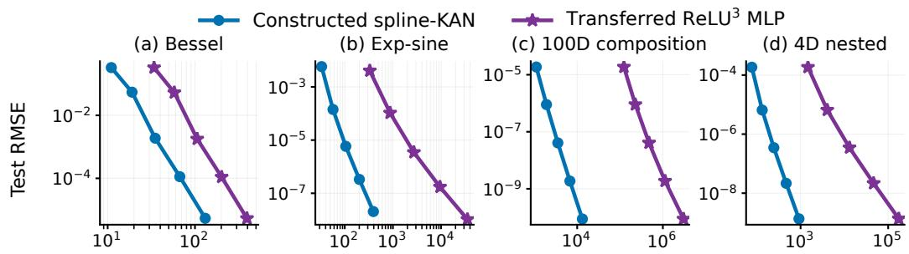  
Figure 1: Constructive scaling on four targets from Liu et al. (2025b). Blue: constructed degreethree spline-KAN test RMSE versus spline-coefficient count. Purple: transferred $\mathrm { R e L U ^ { 3 } }$ MLP test RMSE versus dense parameter count, at the validation-selected checkpoint (step zero or up to 200 Adam steps). At step zero the MLP represents the same function as its KAN source. All panels use $G \in \{ 8 , \bar { 1 6 } , 3 2 , 6 4 , \bar { 1 2 } 8 \}$

## 5.2 INTERACTION SUPPORT AND THE FINITE-BUDGET BOUNDARY

For input dimension $d ,$ number of ridge components $R ,$ and per-ridge support size $s \leq d ,$ we consider standardized ridge-profile targets

$$
\widetilde { f } _ { \varphi } ( \mathbf { x } ) = \sum _ { r = 1 } ^ { R } a _ { r } \varphi \big ( { v } _ { r } ^ { \top } ( 2 \mathbf { x } - \mathbf { 1 } ) + b _ { r } \big ) , \qquad f _ { \varphi } ( \mathbf { x } ) = \frac { \widetilde { f } _ { \varphi } ( \mathbf { x } ) - \mu _ { \varphi } } { \sigma _ { \varphi } } ,\tag{20}
$$

Here $\mathbf { x }$ is uniform on $[ 0 , 1 ] ^ { d }$ , R counts ridge components, $a _ { r }$ and $b _ { r }$ are coefficients and offsets, and 1 is the all-ones vector. Each direction ${ \pmb v } _ { r }$ uses exactly s coordinates. We test $\varphi ( t ) \ \in$ $\{ t ^ { 2 } , \sin ( 2 \pi t )$ , tanh(t), SiLU(t)}. $\mu _ { \varphi }$ and $\sigma _ { \varphi }$ are estimated on an independent reference set. At $s = 1$ , the target is additive and each nonlinear component depends on one coordinate. $\mathrm { A t } \ s > 1$ a component can couple coordinates, introducing interactions. The coefficient, direction, and offset sampling rules are in Appendix C.

We scan d, $R \in \{ 4 , 1 6 , 6 4 \}$ and $s \in \{ 1 , 2 , 4 , \ldots , d \}$ , comparing degree-three spline-only KANs with MLPs using ReLU, tanh, SiLU, or sine activation. At each budget, each family selects its run across architectures, learning rates, and three seeds by minimum training-probe MSE. We report its independent test MSE. We use the square profile $\varphi ( t ) = t ^ { 2 }$ with $d = 1 6$ as the main-text example.

Figure 2 reports

$$
\rho ( P ) = \frac { \mathrm { M S E } _ { \mathrm { b e s t M L P } } ( P ) } { \mathrm { M S E } _ { \mathrm { b e s t K A N } } ( P ) } ,\tag{21}
$$

SO $\rho > 1$ favors KAN and $\rho < 1$ favors MLP. On square targets at moderate budgets, the decoupled $s = 1$ targets consistently favor KAN. Once each component involves multiple coordinates, this advantage contracts sharply. At the tightest budgets, the interacting targets generally favor MLPs. At the largest tested budget, every displayed curve favors KAN. Complete results across all tested profiles and dimensions, together with additional diagnostics, are reported in Appendix C.3.

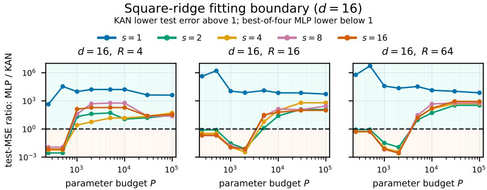  
Figure 2: Training-probe-selected test-MSE ratios on square-ridge targets with $d = 1 6$ and $R \in$ {4, 16, 64}. Each family is selected independently within budget ${ \bf \bar { \rho } } _ { P }$ MLP candidates include four activations. The ratio $\rho > 1$ favors KAN, and s is the number of active coordinates per ridge. The full nine-panel scan is in Appendix C.3.

## 5.3 MNIST CLASSIFICATION AND RANDOM-LABEL TEST UNDER MATCHED BUDGETS

We compare MNIST with standard labels to a random-label test in which each training label is independently sampled from the ten classes (Zhang et al., 2017). We report test accuracy for standard labels and final training accuracy for random labels to measure how well the models fit arbitrary image-label assignments. Both families reach high test accuracy with standard labels, but ReLU-MLPs do so with fewer parameters and fit random labels far more efficiently than spline-only KANs. The full protocol and budget frontiers are in Appendix C.4.

Table 1: MNIST accuracies (%) with $N _ { \mathrm { t r a i n } } = 6 0 { , } 0 0 0$ within selected trainable-parameter budgets. Standard labels report test accuracy and random labels report final training accuracy. Each entry is the best architecture median over three seeds after selecting optimizer and learning rate by final training accuracy. Bold marks the higher median within each label condition and budget.
<table><tr><td>Labels</td><td>Model</td><td> $P \leq 5 \mathrm { k }$ </td><td> $P \le 2 0 \mathrm { k \Omega }$ </td><td> $P \leq$  100k</td><td> $P \le 5 0 0 \mathrm { k \Omega }$ </td></tr><tr><td>Standard</td><td>ReLU-MLP</td><td>87.5</td><td>94.9</td><td>98.0</td><td>98.6</td></tr><tr><td>Standard</td><td>Spline-only KAN</td><td>54.8</td><td>89.6</td><td>96.0</td><td>97.3</td></tr><tr><td>Random</td><td>ReLU-MLP</td><td>11.7</td><td>18.2</td><td>47.6</td><td>100.0</td></tr><tr><td>Random</td><td>Spline-only KAN</td><td>12.3</td><td>13.4</td><td>16.9</td><td>19.4</td></tr></table>

## 6 CONCLUSION

Theoretically, we prove that arbitrary-depth standard spline-KANs need exponentially many spline coefficients to approximate isotropic Sobolev balls below a fixed accuracy threshold. Their architecture therefore does not remove worst-case CoD. Earlier composition-matched MLP results show that favorable dimension dependence on low-arity targets is not exclusive to KANs.

Empirically, we revisit the scaling-law targets of Liu et al. (2025b): transferring constructed spline-KAN approximants to MLPs separates what can be represented from what training discovers. On controlled ridge targets, KANs strongly favor decoupled components, whereas interacting targets often favor MLPs at tight budgets. The boundary shifts with the target nonlinearity and budget. The random-label test on MNIST further probes fitting outside these structured targets.

Limitations. The theorem covers spline-only standard KANs with arbitrary edge-wise knot locations, not variants with SiLU base branches, multiplication nodes, or non-spline edges.

## ACKNOWLEDGMENTS

This work was supported by the National Natural Science Foundation of China (62476016, 62441617), and the Fundamental Research Funds for the Central Universities and the Beijing Natural Science Foundation (Grant No. QY24137).

## CODE AVAILABILITY

Experiment code and compact result tables are available in the GitHub repository.

## AI USE STATEMENT

We used generative AI tools to assist with manuscript editing, proof checking, literature search and citation checking, code implementation and debugging, and the preparation and interpretation of synthetic experiments and figures. The research question, mathematical claims and constructions, and experimental objectives were formulated by the authors. All AI-assisted outputs were reviewed and verified by the authors, who take full responsibility for the final content.

## REFERENCES

Alireza Afzal Aghaei, Mehdi Hosseinzadeh, and Kourosh Parand. rKAN: Rational Kolmogorov-Arnold networks. Neural Networks, 201:108888, 2026. doi: 10.1016/j.neunet.2026.108888. URLhttps://doi.org/10.1016/j.neunet.2026.108888.

Martin Anthony and Peter L. Bartlett. Neural Network Learning: Theoretical Foundations. Cambridge University Press, 1999.

Peter L. Bartlett, Vitaly Maiorov, and Ron Meir. Almost linear VC-dimension bounds for piecewise polynomial networks. Neural Computation, 10(8):2159–2173, 1998. doi: 10.1162/ 089976698300017016.

Zavareh Bozorgasl and Hao Chen. Wav-KAN: Wavelet kolmogorov-arnold networks. arXiv preprint arXiv:2405.12832,2024.URLhttps://arxiv.org/abs/2405.12832.

Carl de Boor. A Practical Guide to Splines, volume 27 of Applied Mathematical Sciences. Springer, revised edition, 2001. ISBN 978-0-387-95366-3. URL https://1ink.springer.com/ book/9780387953663.

Ronald A. DeVore, Ralph Howard, and Charles A. Micchelli. Optimal nonlinear approximation. Manuscripta Mathematica, 63(4):469–478, 1989. doi: 10.1007/BF01171759.

Jintao Hu, Hongjiong Tian, and Qian Guo. Approximation and error bounds for Kolmogorov-Arnold networks applications to dynamical system discovery via linear multistep methods. Communications in Nonlinear Science and Numerical Simulation, 160:109953, 2026. doi: 10.1016/j.cnsns.2026.109953.

Andrey N. Kolmogorov. On the representation of continuous functions of many variables by superposition of continuous functions of one variable and addition. Doklady Akademii Nauk SSSR, 114 (5):953-956,1957. URL https://www.mathnet.ru/eng/dan22050.

Anastasis Kratsios, Bum Jun Kim, and Takashi Furuya. Approximation rates in Besov norms and sample-complexity of Kolmogorov-Arnold networks with residual connections. Neural Networks, 200:108797, 2026. doi: 10.1016/j.neunet.2026.108797. URL https://doi.org/ 10.1016/j.neunet.2026.108797.

Wei Liu, Eleni Chatzi, and Zhilu Lai. On the rate of convergence of kolmogorov-arnold network regression estimators. arXiv preprint arXiv:2509.19830, 2025a. URL https : //arxiv. org/ abs/2509.19830.

Ziming Liu, Yixuan Wang, Sachin Vaidya, Fabian Ruehle, James Halverson, Marin Soljačić, Thomas Y. Hou, and Max Tegmark. KAN: Kolmogorov-arnold networks. In International Conference on Learning Representations, 2025b.

Hrushikesh Mhaskar, Qianli Liao, and Tomaso Poggio. When and why are deep networks better than shallow ones? In Proceedings of the AAAI Conference on Artificial Intelligence, volume 31, pp. 2343–2349, 2017. doi: 10.1609/aaai.v31i1.10913.

Hrushikesh N. Mhaskar. Neural networks for optimal approximation of smooth and analytic functions. Neural Computation, 8(1):164–177, 1996.

Hrushikesh N. Mhaskar and Tomaso Poggio. Deep vs. shallow networks: An approximation theory perspective. Analysis and Applications, 14(6):829–848, 2016. doi: 10.1142/ S0219530516400042.

Hrushikesh N. Mhaskar and Tomaso Poggio. Function approximation by deep networks. Communications on Pure and Applied Analysis, 19(8):4085–4095, 2020. doi: 10.3934/cpaa.2020181.

Ruichen Qiu, Yibo Miao, Shiwen Wang, Yifan Zhu, Lijia Yu, and Xiao-Shan Gao. PowerMLP: An efficient version of KAN. In Proceedings of the AAAI Conference on Artificial Intelligence, volume 39, pp. 20069–20076, 2025. doi: 10.1609/aaai.v39i19.34210.

David E. Rumelhart, Geoffrey E. Hinton, and Ronald J. Williams. Learning representations by back-propagating errors. Nature, 323:533–536, 1986. doi: 10.1038/323533a0.

Johannes Schmidt-Hieber. The kolmogorov-arnold representation theorem revisited. Neural Networks, 137:119–126, 2021. doi: 10.1016/j.neunet.2021.01.020.

Seyd Teymoor Seydi. Exploring the potential of polynomial basis functions in kolmogorovarnold networks: A comparative study of different groups of polynomials. arXiv preprint arXiv:2406.02583,2024.URLhttps://arxiv.org/abs/2406.02583.

Seyd Teymoor Seydi, Zavareh Bozorgasl, and Hao Chen. Unveiling the power of wavelets: A wavelet-based kolmogorov-arnold network for hyperspectral image classification. arXiv preprint arXiv:2406.07869,2024.URL https://arxiv.org/abs/2406.07869.

Zuowei Shen, Haizhao Yang, and Shijun Zhang. Optimal approximation rate of ReLU networks in terms of width and depth. Journal de Mathématiques Pures et Appliquées, 157:101–135, 2022. doi: 10.1016/j.matpur.2021.07.009.

Khemraj Shukla, Juan Diego Toscano, Zhicheng Wang, Zongren Zou, and George Em Karniadakis. A comprehensive and FAIR comparison between MLP and KAN representations for differential equations and operator networks. Computer Methods in Applied Mechanics and Engineering, 431:117290, 2024. doi: 10.1016/j.cma.2024.117290.

Sidharth S. S., Keerthana A. R., Gokul R., and Anas K. P. Chebyshev polynomial-based kolmogorov-arnold networks: An efficient architecture for nonlinear function approximation. arXiv preprint arXiv:2405.07200, 2024. URL https: //arxiv.org/abs/2405.07200.

Yixuan Wang, Jonathan W. Siegel, Ziming Liu, and Thomas Y. Hou. On the expressiveness and spectral bias of KANs. In International Conference on Learning Representations, 2025.

Dmitry Yarotsky. Error bounds for approximations with deep relu networks. Neural Networks, 94: 103–114, 2017. doi: 10.1016/j.neunet.2017.07.002.

Runpeng Yu, Weihao Yu, and Xinchao Wang. KAN or MLP: A fairer comparison. arXiv preprint arXiv:2407.16674,2024.URLhttps://arxiv.org/abs/2407.16674.

Chiyuan Zhang, Samy Bengio, Moritz Hardt, Benjamin Recht, and Oriol Vinyals. Understanding deep learning requires rethinking generalization. In International Conference on Learning Representations, 2017.URL https://openreview.net/forum?id=Sy8gdB9xx.

Jusheng Zhang, Yijia Fan, Kaitong Cai, Keze Wang, and Wenhao Wang. Kolmogorov-arnold fourier networks. arXiv preprint arXiv:2502.06018, 2025. URL https: //arxiv. org/abs/2502. 06018.

## A ADDITIONAL MODEL DETAILS

## A.1 B-SPLINE CONVENTION

For the augmented knot sequence $\mathcal { T } = \left( \tau _ { 1 } , \dots , \tau _ { G + 2 k + 1 } \right)$ introduced in Section 3.2, the central knots $\xi _ { j } : = \tau _ { k + 1 + j } , j = 0 , \ldots , G$ , form the G grid intervals. The remaining k knots on each side are boundary or extension knots. Starting from $B _ { r , 0 } ( x ) = \mathbf { 1 } _ { [ \tau _ { r } , \tau _ { r + 1 } ) } ( x )$ , where $\mathbf { 1 } _ { A }$ denotes the indicator of a set A, and using the usual right-endpoint convention, the Cox-de Boor recursion is

$$
B _ { r , m } ( x ) = { \frac { x - \tau _ { r } } { \tau _ { r + m } - \tau _ { r } } } B _ { r , m - 1 } ( x ) + { \frac { \tau _ { r + m + 1 } - x } { \tau _ { r + m + 1 } - \tau _ { r + 1 } } } B _ { r + 1 , m - 1 } ( x ) , \qquad m = 1 , \dots , k .\tag{22}
$$

Thus $B _ { r , k }$ is a degree-k piecewise polynomial supported on $[ \tau _ { r } , \tau _ { r + k + 1 } ]$ and is $C ^ { k - 1 }$ across simple interior knots.

## A.2 SCOPE RELATIVE TO PRACTICAL AND NON-SPLINE KANS

Liu et al. (2025b) parameterize a practical KAN edge function as

$$
\phi ( x ) = w _ { b } b ( x ) + w _ { s } \mathrm { ~ s p l i n e } ( x ) , \qquad b ( x ) = \mathrm { S i L U } ( x ) : = \frac { x } { 1 + e ^ { - x } } ,\tag{23}
$$

where $w _ { b }$ and $w _ { s }$ are trainable scalar weights. The base function is introduced to improve optimization behavior, and spline(x) denotes the B-spline expansion on that edge. It forms an edge-wise additive branch, distinct from a layer-wise residual or skip connection, and adds the trainable scalars $w _ { b } , w _ { s }$ . This SiLU branch is outside the spline-only model analyzed in the main text. By contrast, a grid update only relocates knots: after the update, each edge is still a degree-k spline with G intervals, so arbitrary edge-wise knot locations are covered by Definition 1 and the representation bridge.

The same boundary excludes Fourier KANs (Zhang et al., 2025), rational KANs (Aghaei et al., 2026), wavelet-based KANs (Bozorgasl & Chen, 2024; Seydi et al., 2024), and polynomial-basis variants (Sidharth S. S. et al., 2024; Seydi, 2024). These models require separate representation theorems, VC-dimension estimates, or approximation lower-bound arguments beyond the splineonly scope of this paper.

## B PROOFS AND SUPPORTING RESULTS

## B.1 PROOF OF THE PARAMETER-COUNT LEMMA

Proof of Lemma 3. Set $H : = G + k$ and $a _ { \ell } : = d _ { \ell } d _ { \ell + 1 }$ . By Lemma 1, each KAN layer l can be realized by $M _ { \ell } \le C _ { k } a _ { \ell } H$ shifted $\operatorname { R e L U } ^ { k }$ units, followed by an affine summation that forms $x ^ { ( \ell + 1 ) }$ To write the stacked construction as an ordinary MLP, use the affine map that produces the shifted $\operatorname { R e L U } ^ { k }$ arguments for the first KAN layer, then compose the afine summation of layer $\ell - 1$ with the affine shift map of layer l for $\ell = \dot { 1 } , \dots , L - 1$ , and finally use the affine summation of the last KAN layer. This gives an exact ${ \mathrm { R e L U } } ^ { k } { \mathrm { - } } { \mathrm { M L P } }$ realization of g.

The hidden widths are $M _ { \ell } \le C _ { k } d _ { \ell } d _ { \ell + 1 } H \le C _ { k } w ^ { 2 } H$ , and the number of nonlinear stages is $L .$ Hence $W _ { \mathrm { h i d } } \leq C _ { k } w ^ { 2 } ( G + k )$ and $L _ { \mathrm { M L P } } \leq C _ { k } L$ , after adjusting the constant.

For the parameter count, the first affine map has at most $M _ { 0 } ( d _ { 0 } + 1 )$ parameters, the intermediate affine maps have at most $M _ { \ell } ( M _ { \ell - 1 } + 1 )$ parameters for $\ell = \dot { 1 } , \dots , \dot { L } - 1$ , and the final affine map has at most $d _ { L } ( M _ { L - 1 } + 1 )$ parameters. Therefore

$$
P _ { \mathrm { M L P } } \leq C _ { k } H ^ { 2 } \biggl ( a _ { 0 } ^ { 2 } + \sum _ { \ell = 1 } ^ { L - 1 } a _ { \ell - 1 } a _ { \ell } + a _ { L - 1 } ^ { 2 } \biggr )
$$

$$
\leq C _ { k } H ^ { 2 } \biggl ( \sum _ { \ell = 0 } ^ { L - 1 } a _ { \ell } \biggr ) ^ { 2 } = C _ { k } P _ { \mathrm { K A N } } ^ { 2 } .
$$

Bounding each summand in the first parenthesis by $w ^ { 4 }$ gives the coarser bound

$$
\begin{array} { r } { P _ { \mathrm { M L P } } \leq C _ { k } L w ^ { 4 } H ^ { 2 } = C _ { k } L w ^ { 4 } ( G + k ) ^ { 2 } . } \end{array}
$$

□

## B.2 PROOF OF THE $\operatorname { R e L U } ^ { k }$ VC-DIMENSION LOWER BOUND

Proof of Lemma 4. We follow Yarotsky (2017, Theorem 4). Let H denote the binary function class obtained by thresholding the outputs of the fixed architecture while varying its W trainable parameters. Since $\sigma _ { k } ( x ) = ( \bar { x ) } _ { + } ^ { k }$ is piecewise polynomial with two pieces and fixed degree k, Anthony & Bartlett (1999, Theorems 8.7 and 8.8) (see also Bartlett et al., 1998) give

$$
\mathrm { V C d i m } ( \mathcal { H } ) \le c _ { 3 } W ^ { 2 }\tag{24}
$$

and

$$
\mathrm { V C d i m } ( \mathcal { H } ) \leq \widetilde { c } _ { 3 } L ^ { 2 } W \ln ( 2 W ) ,\tag{25}
$$

where $c _ { 3 } , \widetilde { c } _ { 3 } > 0$ depend only on k. These are the only activation-specific estimates used below.

Given a positive integer $N _ { \ast }$ let $S = \{ \mathbf { x } _ { 1 } , \dots , \mathbf { x } _ { N ^ { d } } \}$ be the regular grid of cube centers in $[ 0 , 1 ] ^ { d } ,$ so distinct points have $\ell _ { \infty }$ -distance $\| \dot { \mathbf { x } } - \mathbf { x } ^ { \prime } \| _ { \infty } : =$ max $_ j | x _ { j } - x _ { j } ^ { \prime } |$ at least $1 / N$ To make the dependence on d explicit, fix $\psi \in C ^ { \infty } ( \mathbb { R } )$ with $0 \leq \psi \leq 1 , \psi ( 0 ) = \mathrm { \bar { 1 } }$ , and $\psi ( t ) = 0$ for $| t | \geq 1 / 2 ,$ and set

$$
\phi _ { d } ( \mathbf { x } ) = \prod _ { j = 1 } ^ { d } \psi ( x _ { j } ) , \qquad c _ { 4 , n } : = \left( \operatorname* { m a x } _ { 0 \leq r \leq n } \| \psi ^ { ( r ) } \| _ { \infty } \right) ^ { - n } .\tag{26}
$$

Then $ { c _ { 4 , n } }$ is independent of $d ,$ and $\| D ^ { \alpha } \phi _ { d } \| _ { \infty } \leq c _ { 4 , n } ^ { - 1 }$ whenever $| { \boldsymbol { \alpha } } | \leq n$ . For arbitrary coefficients $y _ { 1 } , \dotsc , y _ { N ^ { d } } \in \mathbb { R }$ , define

$$
f ( { \bf x } ) = \sum _ { m = 1 } ^ { N ^ { d } } y _ { m } \phi _ { d } \big ( N ( { \bf x } - { \bf x } _ { m } ) \big ) .\tag{27}
$$

At every point, at most one summand and its derivatives are nonzero. Hence

$$
\operatorname* { m a x } _ { m } | y _ { m } | \leq c _ { 4 , n } N ^ { - n }\tag{28}
$$

implies $f \in F _ { d , n }$

Set

$$
\epsilon _ { 0 } : = \frac { c _ { 4 , n } } { 3 \cdot 2 ^ { n } } , \qquad N : = \left\lfloor \left( \frac { c _ { 4 , n } } { 3 \epsilon } \right) ^ { 1 / n } \right\rfloor , \qquad 0 < \epsilon \leq \epsilon _ { 0 } .\tag{29}
$$

Then

$$
N \ge \frac { 1 } { 2 } \left( \frac { c _ { 4 , n } } { 3 \epsilon } \right) ^ { 1 / n } .\tag{30}
$$

For an arbitrary Boolean vector ${ \bf z } = ( z _ { 1 } , \dots , z _ { N ^ { d } } )$ , take $y _ { m } = 3 \epsilon z _ { m }$ in equation 27. By the choice of $N$ , condition equation 28 holds. If a fixed architecture approximates every function in $F _ { d , n }$ within $\epsilon ,$ write $\eta ( \mathbf { x } ; \mathbf { w } )$ for its output at input x with parameter vector w. Then some parameter vector ${ \bf w _ { z } }$ satisfies

$$
\begin{array} { r } { \int \eta ( \mathbf { x } _ { m } ; \mathbf { w } _ { \mathbf { z } } ) > 3 \epsilon / 2 , ~ z _ { m } = 1 , } \\ { \eta ( \mathbf { x } _ { m } ; \mathbf { w } _ { \mathbf { z } } ) < 3 \epsilon / 2 , ~ z _ { m } = 0 . } \end{array}\tag{31}
$$

Thus the thresholded network shatters S, and

$$
\mathrm { V C d i m } ( \mathcal { H } ) \geq N ^ { d } \geq \left( \frac { \epsilon _ { 0 } } { \epsilon } \right) ^ { d / n } .\tag{32}
$$

Combining equation 32 with equation 24 proves part (a), including the dimension-uniform form

$$
W \ge c _ { 3 } ^ { - 1 / 2 } \left( \frac { \epsilon _ { 0 } } { \epsilon } \right) ^ { d / ( 2 n ) } .\tag{33}
$$

For fixed $d , n , k ,$ decreasing the constant covers the remaining $\epsilon \in [ \epsilon _ { 0 } , 1 )$

For part (b), equation 25 and $L \leq c _ { 1 } \ln ^ { p } ( 1 / \epsilon )$ give

$$
W \ln ( 2 W ) \geq \frac { 1 } { \widetilde c _ { 3 } c _ { 1 } ^ { 2 } } \left( \frac { \epsilon _ { 0 } } { \epsilon } \right) ^ { d / n } \ln ^ { - 2 p } ( 1 / \epsilon ) .\tag{34}
$$

Exactly as in Yarotsky (2017), define the candidate scale $W _ { c _ { 2 } } : = c _ { 2 } \epsilon ^ { - d / n } \ln ^ { - 2 p - 1 } ( 1 / \epsilon )$ . Then

$$
W _ { c _ { 2 } } \ln ( 2 W _ { c _ { 2 } } ) = \left( c _ { 2 } \frac { d } { n } + o ( 1 ) \right) \epsilon ^ { - d / n } \ln ^ { - 2 p } ( 1 / \epsilon ) .\tag{35}
$$

Here $o ( 1 ) \to 0 \mathrm { a s } \epsilon \downarrow 0$ . Choosing $c _ { 2 } > 0$ sufficiently small and comparing with equation 34 yields

$$
W \geq c _ { 2 } \epsilon ^ { - d / n } \ln ^ { - 2 p - 1 } ( 1 / \epsilon ) .\tag{36}
$$

A further decrease of $c _ { 2 }$ covers all $\epsilon \in ( 0 , 1 / 2 )$ , proving part (b).

## B.3 PROOF OF THE SPLINE-KAN COD THEOREM

Proof of Theorem 1. Let K be the spline-KAN architecture in the theorem. For every admissible choice of its edge-wise knots, Lemma 3 realizes those knot locations as affine biases in the same ${ \mathrm { R e L U } } ^ { k } { \mathrm { - } } { \mathrm { M L P } }$ architecture. The MLP width and depth depend on the shape, k, and G and are independent of the knot values. Thus the resulting MLP class contains every function represented by $\kappa .$ with constants $C _ { k } , C _ { k } ^ { \prime } > 0$ depending only on k such that

$$
\begin{array} { r } { P _ { \mathrm { M L P } } \leq C _ { k } L w ^ { 4 } H ^ { 2 } , \qquad P _ { \mathrm { M L P } } \leq C _ { k } P _ { \mathrm { K A N } } ^ { 2 } , \qquad L _ { \mathrm { M L P } } \leq C _ { k } ^ { \prime } L . } \end{array}\tag{37}
$$

If K approximates every $f \in F _ { d , n }$ within $\epsilon ,$ so does this MLP architecture. Part (a) of Lemma 4, combined separately with the first two bounds in equation 37, gives

$$
L w ^ { 4 } H ^ { 2 } \ge c \epsilon ^ { - d / ( 2 n ) } , \qquad P _ { \mathrm { K A N } } \ge c ^ { \prime } \epsilon ^ { - d / ( 4 n ) } .\tag{38}
$$

Using instead the dimension-uniform form of that theorem gives

$$
L w ^ { 4 } H ^ { 2 } \ge \bar { c } \left( \frac { \epsilon _ { 0 } } { \epsilon } \right) ^ { d / ( 2 n ) } , \qquad P _ { \mathrm { K A N } } \ge \bar { c } ^ { \prime } \left( \frac { \epsilon _ { 0 } } { \epsilon } \right) ^ { d / ( 4 n ) } ,\tag{39}
$$

where $\epsilon _ { 0 } = \epsilon _ { 0 } ( n )$ and $\bar { c } , \bar { c } ^ { \prime }$ are independent of $d .$

Finally, if $L \le c _ { 1 } \ln ^ { p } ( 1 / \epsilon )$ , then $L _ { \mathrm { M L P } } \le C _ { k } ^ { \prime } c _ { 1 } \ln ^ { p } ( 1 / \epsilon )$ . Applying Lemma 4(b) and again using the first two bounds in equation 37 yields, respectively,

$$
L w ^ { 4 } H ^ { 2 } \ge c _ { 2 } \epsilon ^ { - d / n } \ln ^ { - 2 p - 1 } ( 1 / \epsilon )\tag{40}
$$

and

$$
P _ { \mathrm { K A N } } \geq c _ { 3 } \epsilon ^ { - d / ( 2 n ) } \ln ^ { - p - \frac { 1 } { 2 } } ( 1 / \epsilon ) .\tag{41}
$$

## C EXPERIMENTAL DETAILS

Parameter counts include every trainable scalar that participates in the forward computation. Fixed grid locations, masks, and disabled branches are excluded. In the ridge-profile experiment, each active KAN edge contributes G + k spline coefficients and one trainable spline scale. In the MNIST experiment, the scale is fixed, so each edge contributes only its $G + k$ coefficients. Hidden depth denotes the number of nonlinear hidden stages. All reported models omit layer-wise residual connections, and every reported KAN is spline-only, with its edge-wise SiLU base branch set identically to zero.

## C.1 CONSTRUCTIVE SCALING PROTOCOL AND SOURCE COMPARISON

Figure 3 repeats the main-text construction. It is not a reproduction of the trained curves in Liu et al. (2025b). We use $G \in \{ 8 , 1 6 , 3 2 , 6 4 , 1 2 8 \}$ intervals on every active edge and cubic interpolation of the known scalar functions. Each edge has $G + 3$ B-spline coefficient slots. Its interpolant is converted algebraically to a shifted ReL $\breve { \mathrm { I J ^ { 3 } } }$ expansion, and the resulting expansions are assembled into an ordinary dense MLP. All affine entries, including those initialized to zero by the construction, are counted for the MLP. Consequently, the horizontal coordinates of the two families use stored trainable slots, but they do not represent a matched-parameter comparison.

The one-dimensional Bessel target uses a [1, 1] KAN on [–1, 1]. The target $e ^ { \sin ( \pi x ) + y ^ { 2 } }$ uses [2, 1, 1] on $[ - 1 , 1 ] ^ { 2 }$ . For the 100-dimensional target we use $\textstyle \exp \bigl ( 1 0 0 ^ { - 1 } \sum _ { i = 1 } ^ { 1 0 0 } \sin ^ { 2 } ( \pi x _ { i } / 2 ) \bigr )$ and a [100, 1, 1] construction on $[ 0 , 1 ] ^ { 1 0 0 }$ The input domain for this target is not specified in Liu et al. (2025b). For the four-dimensional nested target, we follow the formula shown there, $\exp ( \sin ( x _ { 1 } ^ { 2 } + x _ { 2 } ^ { 2 } ) +$ sin $( x _ { 3 } ^ { 2 } + x _ { 4 } ^ { 2 } ) )$ , on $[ - 1 , 1 ] ^ { 4 }$ Our explicit construction has shape [4, 2, 1, 1]. The paper's prose, rendered formula, and plotted topology are not fully consistent. We omit xy from the main figure because $x y = ( ( x + y ) ^ { 2 } - ( x - y ) ^ { 2 } ) / 4$ is represented exactly by cubic-spline edges, leaving only floating-point error.

We use independently scrambled Sobol sets of 1,024 training, 2,048 validation, and 8,192 test points, fixed across grids. The transferred MLPs are continued in float64 with Adam for at most

200 steps, minibatches of 256, and learning rate $1 0 ^ { - 6 } ( 8 / G ) ^ { 4 }$ The validation set selects among steps 0, 1, 2, 5, 10, 20, 50, 100, 150, 200, including the unmodified transfer at step zero. The independent test set is used after selection. All computations run on a server CPU with the edge-wise SiLU branch absent. This one-seed protocol does not estimate training variability. For the 100- dimensional and four-dimensional targets, validation selects step zero at every grid, so their purple curves show unmodified transfers

For the original trained KAN/MLP scaling-law curves, see Liu et al. (2025b). Their optimization protocol and parameter-count convention differ from ours, so the figures do not form a matched comparison.

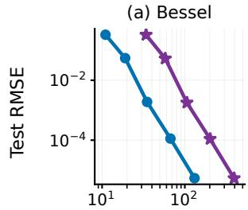

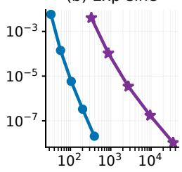

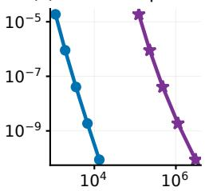

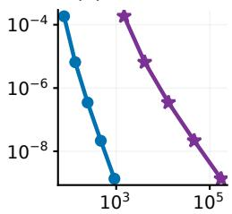  
Figure 3: Constructive scaling on four targets from Liu et al. (2025b). Blue: constructed cubic spline-KAN test RMSE versus spline-coefficient count. Purple: transferred $\mathrm { R e L U ^ { 3 } }$ MLP test RMSE versus dense parameter count, at the validation-selected checkpoint (step zero or up to 200 Adam steps). At step zero the MLP represents the same function as its KAN source. All panels use $G \bar { \in } \{ 8 , 1 6 , 3 2 , 6 4 , 1 2 8 \}$

## C.2 CONTROLLED RIDGE-PROFILE PROTOCOL

The targets are defined in equation 20. Before normalization, the coefficients and direction entries are sampled independently from the standard normal distribution $\mathcal { N } ( 0 , 1 )$ . For each target instance, the coefficient vector $\pmb { a } = ( a _ { 1 } , \ldots , a _ { R } )$ and every direction ${ \pmb v } _ { r }$ are normalized in $\ell _ { 2 }$ The support of each ${ \pmb v } _ { r }$ is sampled uniformly subject to $\| \pmb { v } _ { r } \| _ { 0 } = s ,$ where $\lVert \pmb { v } \rVert _ { 0 }$ denotes the number of nonzero coordinates of $^ { v , }$ and each offset $b _ { r }$ is sampled uniformly from $[ - 0 . 5 , 0 . 5 ]$ The mean $\mu _ { \varphi }$ and standard deviation $\sigma _ { \varphi }$ are estimated from 16,384 independently sampled reference points. Training uses fresh online samples at every step. Fixed evaluation sets contain 4,096 training-probe points and 16,384 validation and test points each.

Table 2: Controlled ridge-profile scan.
<table><tr><td>Item</td><td>Setting</td></tr><tr><td>Target grid</td><td> $d , R \in \{ 4 , 1 6 , 6 4 \} , \mathrm { a n d } s \in \{ 1 , 2 , 4 , \dots , d \}$ </td></tr><tr><td>Target profiles</td><td> $\varphi ( t ) = \dot { t } ^ { 2 } , \sin ( 2 \pi t ) , \operatorname { t a n h } ( t ) , \mathrm { o r } \operatorname { S i L U } ( t ) = t / ( 1 + e ^ { - t } )$ </td></tr><tr><td>Hidden depth</td><td> $L \in \{ 2 , 4 , 6 \}$  for both families</td></tr><tr><td>MLP</td><td> $\mathrm { W i d t h ~ } w \in \{ 1 , 4 , 1 6 , 6 4 , 2 5 6 \} ; \mathrm { R e L U , t a n h , S i L U } ,$  or sine activation</td></tr><tr><td>Spline-only KAN</td><td>Width  $w \in \{ 1 , 4 , 1 6 , 6 4 \} ; k = 3 ; G \in \{ 3 , 7 , 1 5 , 3 1 \}$  ; zero edge-wise base branch</td></tr><tr><td>Optimization</td><td>MSE; Adam; zero weight decay; 5,000 online-sampling steps; batch size 4,096; 500-step linear warmup followed by cosine decay to 1% of the base rate</td></tr><tr><td>Learning rates</td><td> $1 0 ^ { - 3 } , 3 \times 1 0 ^ { - 3 }$  , and  $1 0 ^ { - 2 }$  for both families</td></tr><tr><td>Seeds</td><td>Seed index  $q \in \{ 0 , 1 , 2 \}$ </td></tr><tr><td>Budgets</td><td> $P \in \{ 2 5 0 , 5 0 0 .$  1000, 2000, 5000,  $1 0 ^ { 4 } , 3 \times 1 0 ^ { 4 } , 1 0 ^ { 5 } \}$  Within each target cell, model family, and budget, select the run with</td></tr><tr><td>Selection</td><td>minimum training-probe MSE over architectures, learning rates, and seeds; report both its training-probe MSE and its independent test MSE</td></tr></table>

Within each run, validation MSE evaluated every 100 steps selects the checkpoint. The fixed training probe is reserved for constructing the final envelope. Pooling the three seeds is deliberate because the experiment asks for the best fit found within a fixed search budget. This convention is applied symmetrically to both families. For each profile, the target cells form a complete Cartesian product under the scan in Table 2. There are 45 target cells per profile, 324 architecture-learning-rate configurations per cell and seed, and 174,960 successful runs across all four profiles and three seeds. No manifest jobs are missing or failed.

## C.3 TARGET PROFILE AND ACTIVATION SENSITIVITY

Figure 4 shows the complete square-profile scan. Its $d \ : = \ : 1 6$ row is Figure 2 in the main text. The main-text envelope allows the MLP to select among four activations. This provides a strong comparator, but the sine target makes activation alignment especially relevant. Figures $5 - 7$ show the three other target profiles under the same scan and selection rule as Figure 2. All four profiles exhibit a strong KAN regime at $s = 1$ , while the crossover at larger s depends on the target and parameter budget. In particular, square and SiLU do not support a universal MLP win for interacting targets. For sine at $d = 6 4$ , some dense cells leave both models near the standardized unit-variance baseline. Their near-unit error ratios are not evidence of successful fitting by either family.

Figure 8 removes the target-matched sine activation and lets the MLP choose among ReLU, tanh, and SiLU. KAN then has lower test error in more cells, including 20 of 24 at $P = 1 0 ^ { 4 }$ within the $d \in$ {4, 16} subset, but the gap between s = 1 and denser supports remains large. Figure 9 fixes ReLU and shows the same directional effect. The erosion of KAN's sparse-target advantage therefore persists with a ReLU comparator, although target-activation matching substantially changes where the crossover occurs. Figure 10 reports training-probe ratios for the same selected models.

## C.3.1 EXACT REPRESENTATION AND OPTIMIZATION DIAGNOSTIC

For the sine profile in equation 20, the target has the exact one-hidden-layer sine-MLP representation

$$
f _ { \sin } ( \mathbf { x } ) = \gamma _ { 0 } + \sum _ { r = 1 } ^ { R } \gamma _ { r } \sin ( \omega _ { r } ^ { \top } \mathbf { x } + \beta _ { r } ) .\tag{42}
$$

For completeness, the coefficients in equation 42 can be chosen explicitly. Writing 1 for the all-ones vector and using the normalization in equation 20, set

$$
\gamma _ { 0 } = - \frac { \mu _ { \mathrm { s i n } } } { \sigma _ { \mathrm { s i n } } } , \qquad \gamma _ { r } = \frac { a _ { r } } { \sigma _ { \mathrm { s i n } } } , \qquad \boldsymbol { \omega } _ { r } = 4 \pi \boldsymbol { v } _ { r } , \qquad \beta _ { r } = 2 \pi \left( b _ { r } - \boldsymbol { v } _ { r } ^ { \top } \mathbf { 1 } \right) .\tag{43}
$$

This yields the target exactly. A dense one-hidden-layer implementation has dR input weights, R hidden biases, R output weights, and one output bias, hence $\mathbf { \bar { \phi } } R ( d + 2 ) + 1$ trainable parameters.

Square-ridge fitting boundary KAN lower test error above 1; best-of-four MLP lower below 1 s = 1 s = 2 s = 4 s = 8 s = 16 s = 32 s = 64  
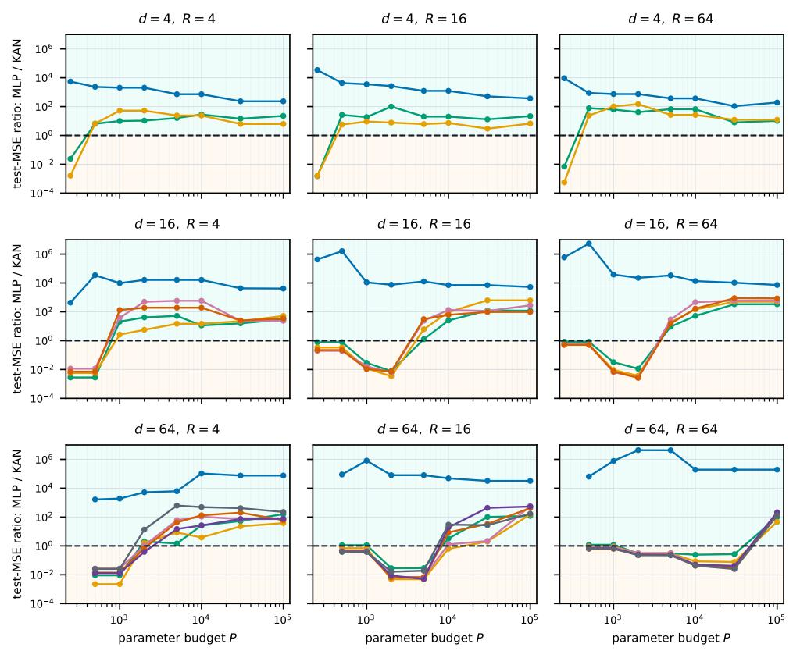  
Best run across seeds 0, 1, 2 selected by training-probe MSE within each budget; independent test MSE shown.  
Figure 4: Complete square-ridge test-MSE ratios for d, $R \in \{ 4 , 1 6 , 6 4 \}$ , under the same trainingprobe selection rule as Figure 2. The middle row is shown in the main text.

Sine-ridge fitting boundary KAN lower test error above 1; best-of-four MLP lower below 1 s = 1 s = 2 s = 4 s = 8 s = 16 s = 32 s = 64  
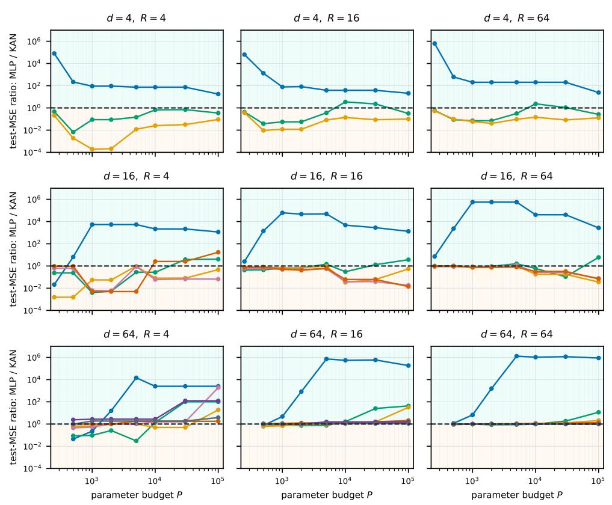  
Best run across seeds 0, 1, 2 selected by training-probe MSE within each budget; independent test MSE shown.  
Figure 5: Sine-ridge test-MSE ratios under the same three-seed scan and parameter-budget selection as Figure 2.

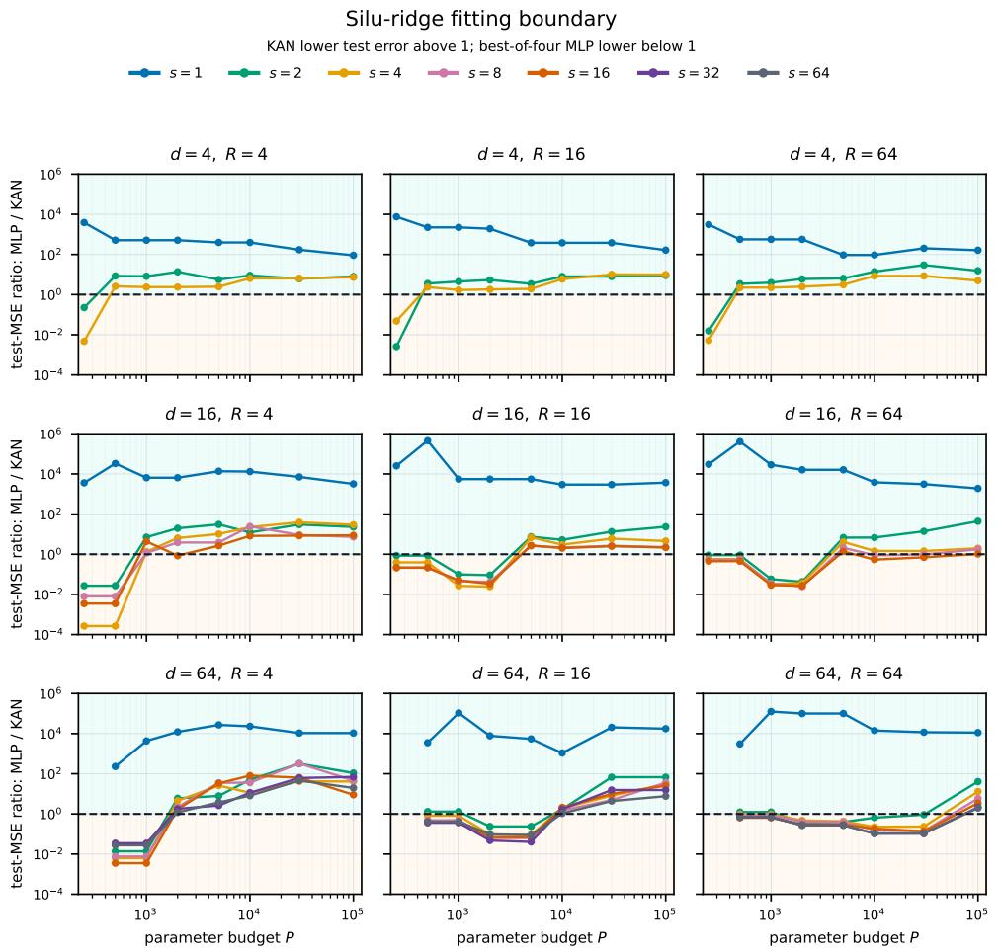  
Best run across seeds 0, 1, 2 selected by training-probe MSE within each budget; independent test MSE shown.  
Figure 6: SiLU-ridge test-MSE ratios under the same scan and selection rule.

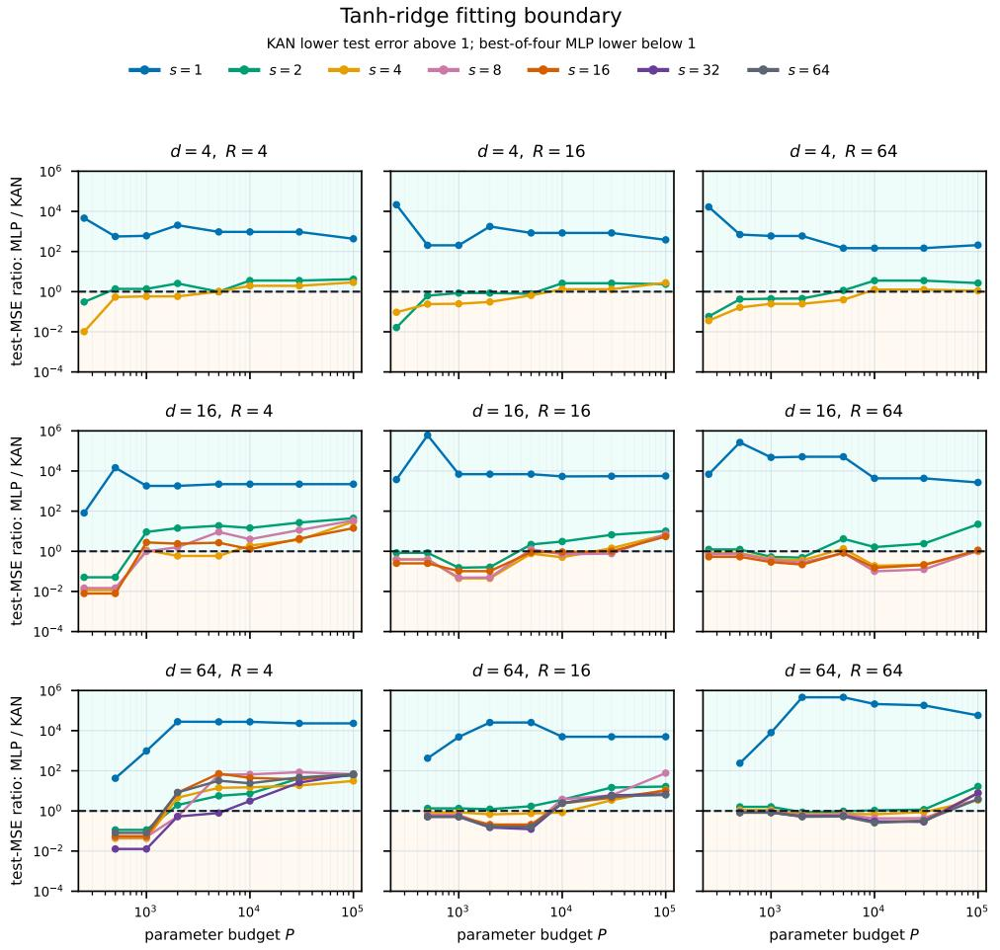  
Best run across seeds 0, 1, 2 selected by training-probe MSE within each budget; independent test MSE shown.  
Figure 7: Tanh-ridge test-MSE ratios under the same scan and selection rule.

We verify the distinction between representation and optimization at $d = R = 6 4$ using a width-64 sine MLP and the same Adam, warmup-cosine schedule, batch size, and 5,000-step protocol as the main scan. The explicit weights give test MSE $\phantom { + } 1 . 9 6 \times 1 0 ^ { - 1 3 }$ without training. From the default SIREN-style random initialization, the s = 1 model finishes at test MSE 0.542. Supplying only the teacher ridge directions, while leaving phases and output coefficients to be learned, reduces the test MSE to $8 . { \overset { \smile } { 9 } } 0 \times 1 0 ^ { - 6 }$ for $s = 1$ , 4 $. 4 \bar { 2 } \times 1 0 ^ { - 7 }$ for $s = 1 6 ,$ and $3 . 4 1 \times 1 0 ^ { - 7 }$ for $s = 6 4$ The high error persists when only the first-layer weight norm is matched while its directions remain random. Because direction-aligned initialization uses knowledge of the target, we reserve these values for the optimization diagnostic. The exact construction and initialization comparison identify optimization and feature discovery as the source of the trained error.

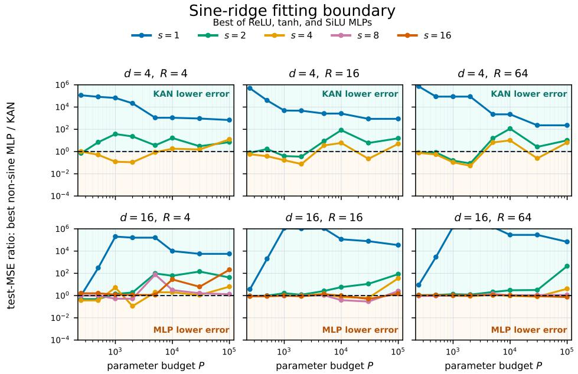  
Models are selected by minimum train-probe MSE within each budget; the independent test MSE of the selected run is shown.

Figure 8: Sine-ridge test-error ratios when the MLP envelope is restricted to ReLU, tanh, or SiLU. Plotting and selection conventions follow Figure 5 for the $d \in \{ 4 , 1 6 \}$ subset. Removing sine activation expands the KAN-favored region, while denser supports still narrow that advantage.

Because a large error ratio can be misleading when both models fit poorly, Figure 11 reports the corresponding absolute errors. The targets are standardized to unit variance, so the constant-zero predictor has MSE approximately one. At moderate and large parameter budgets, most selected models lie well below this baseline, and the training-probe and independent-test curves closely track one another. Thus the ratios generally do not compare two models stuck near the trivial predictor.

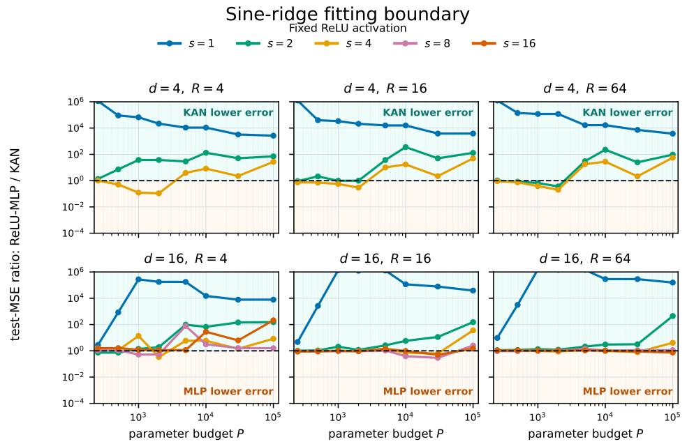  
Models are selected by minimum train-probe MSE within each budget; the independent test MSE of the selected run is shown.  
Figure 9: Sine-ridge test-error ratios for a fixed ReLU-MLP comparator. Increasing support s again shifts the comparison toward MLP with a ReLU comparator.

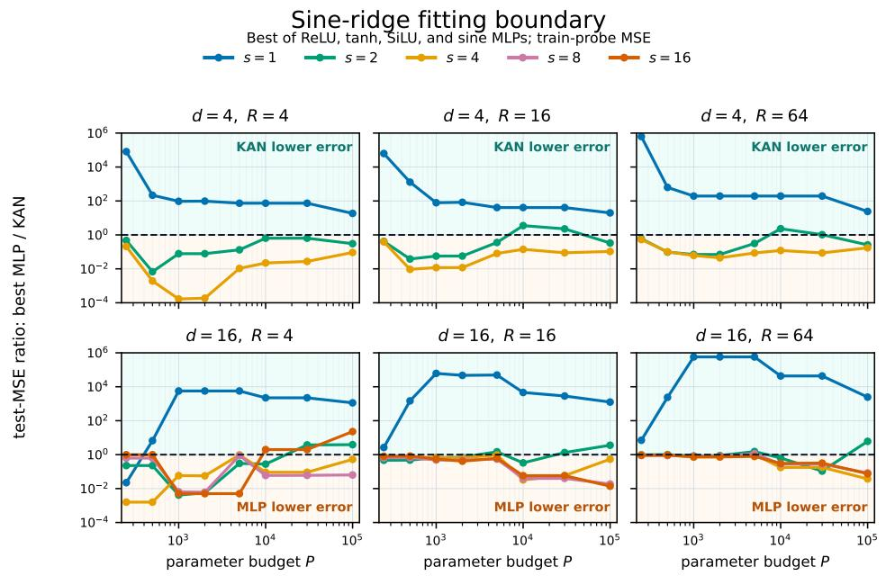  
Models are selected by minimum train-probe MSE within each budget; the independent test MSE of the selected run is shown.  
Figure 10: Training-probe MSE ratios for the best-activation MLP comparison. The panels cover $d \in \{ 4 , 1 6 \}$ with the same selection rule as Figure 5. The support-dependent pattern matches the independent-test ratios.

Absolute errors of the selected sine-ridge models  
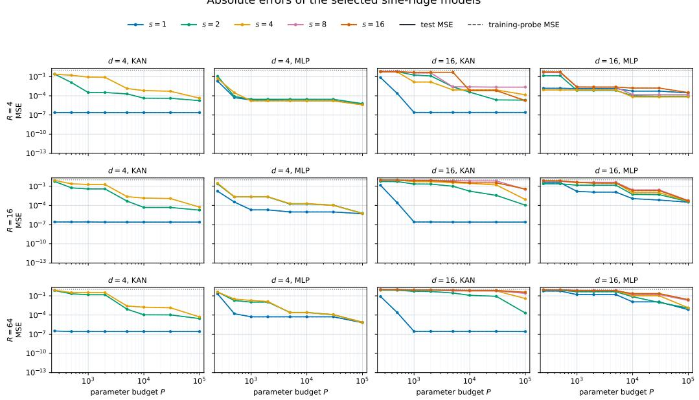  
Targets are standardized to unit variance; the dotted horizontal line at MSE = 1 is the zero-predictor baseline. Solid: independent test; dashed: training probe.  
Figure 11: Absolute MSE of the models selected for the best-activation sine-ridge envelope. Solid curves report independent-test MSE and dashed curves report training-probe MSE. The dotted horizontal line marks MSE one, the zero-predictor baseline after target standardization.

## C.4 MNIST CLASSIFICATION AND RANDOM-LABEL TEST

For each seed $q \in \{ 0 , 1 , 2 \}$ , all 60,000 images in the official MNIST training partition are flattened to 784 coordinates in [0, 1]. In the normal-label condition, the official labels are retained and evaluation uses all 10,000 images in the official test partition. In the random-label condition, each training image $i = 1 , \ldots , 6 0 , 0 0 0$ receives an independent label $y _ { i }$ sampled uniformly from $\{ 0 , \ldots , 9 \}$ Within each condition and seed, both model families receive the same images and labels.

Table 3: MNIST classification and random-label fitting hyperparameters.
<table><tr><td>Item</td><td>Setting</td></tr><tr><td>Hidden depth</td><td> $L \in \{ 2 , 4 , 6 , 8 \}$ </td></tr><tr><td>Hidden width</td><td> $\mathbf { M L P } \dot { : } w \in \{ 4 , 8 , 1 6 , 3 2 , 6 4 , 1 2 8 , 2 5 6 , 5 1 2 \} ; \mathbf { K A N : } w \in \{ 1 , 2 , 4 , 8 , 1 6 , 3 2 \}$ </td></tr><tr><td>MLP</td><td>ReLU activation; Kaiming-uniform weights; zero biases</td></tr><tr><td>Spline-only KAN</td><td> $G = 3 , k = 3 ;$  zero edge-wise base branch; spline coefficients trainable and spline scale fixed</td></tr><tr><td>Optimization</td><td>Cross-entropy, batch size 256, 200 epochs, no weight decay; SGD with momentum 0.9 and learning rate in {0.1, 0.03, 0.01 }, or Adam with learning rate in {0.01, 0.003, 0.001}</td></tr><tr><td>Aggregation</td><td>For each architecture and seed, retain the optimizer/rate with highest final training accuracy; report medians and interquartile ranges over three seeds</td></tr></table>

For normal labels, the final training and test accuracies are read from the optimizer/rate selected by final training accuracy, so the test frontier forms a descriptive envelope over the prescribed scan. The independently randomized label condition reports training accuracy as its measure of random-label fitting.

Table 1 in the main text summarizes selected budgets. Figure 12 shows the full budget frontiers, while Figure 13 exposes the complete depth-width scan. Over the scanned budgets, the MLP test envelope on normal labels rises faster and reaches a higher accuracy. With random labels, wider MLPs approach 100% training accuracy, while the scanned KANs remain below 20%.

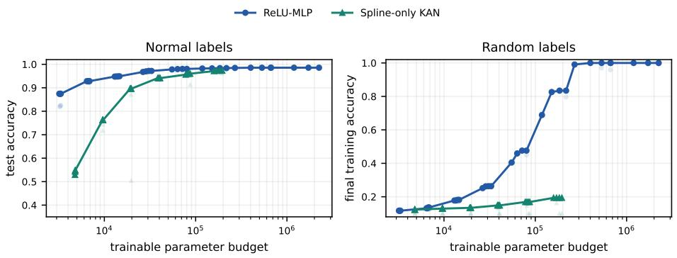  
Figure 12: Full MNIST accuracy frontiers with $N _ { \mathrm { t r a i n } } = 6 0 { , } 0 0 0$ The left panel reports standardlabel test accuracy and the right panel reports random-label final training accuracy. Each point is a three-seed architecture median after optimizer and learning-rate selection by final training accuracy. The curves show the best available value within each parameter budget.

As a small-sample diagnostic, we repeat both conditions using a fixed subset of 6,000 training images. This scan also includes MLP widths 4 and $^ { 8 , }$ so the two families overlap below $1 0 ^ { 4 }$ trainable parameters. Figure 14 shows the corresponding frontiers. Fitting random labels is easier at this sample size, but the qualitative separation persists: the MLP eventually fits all training labels, whereas the best spline-only KAN plateaus below 100% training accuracy.

MNIST architecture scan (N = 60,000)

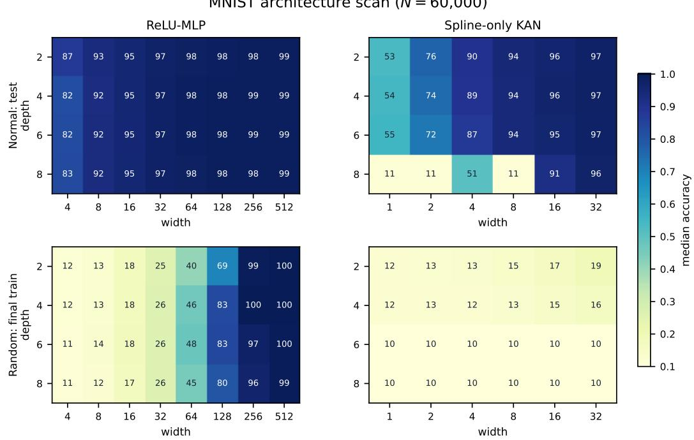  
Figure 13: Depth–width scan for normal-label testing (top) and random-label fitting (bottom). Cell values are median accuracies in percent. Width grids differ between MLP and KAN so that the scan covers overlapping parameter budgets. The plot title's N = 60,000 denotes the number of training examples. The random-label fitting gap persists across the tested depths.

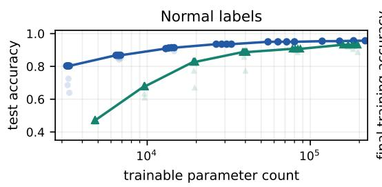

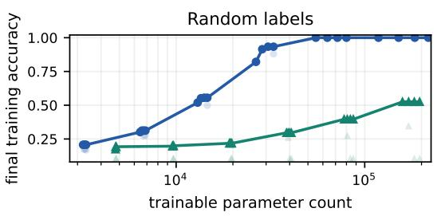  
Figure 14: Small-sample MNIST comparison with $N _ { \mathrm { t r a i n } } = 6 { , } 0 0 0$ The normal-label panel reports median test accuracy and the random-label panel reports median training accuracy over three seeds. The display is truncated just beyond the largest scanned KAN budget so that the visible range is covered by both families.