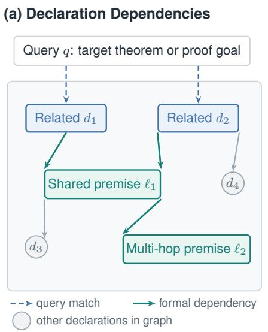
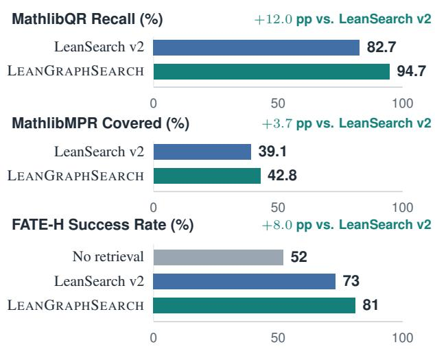
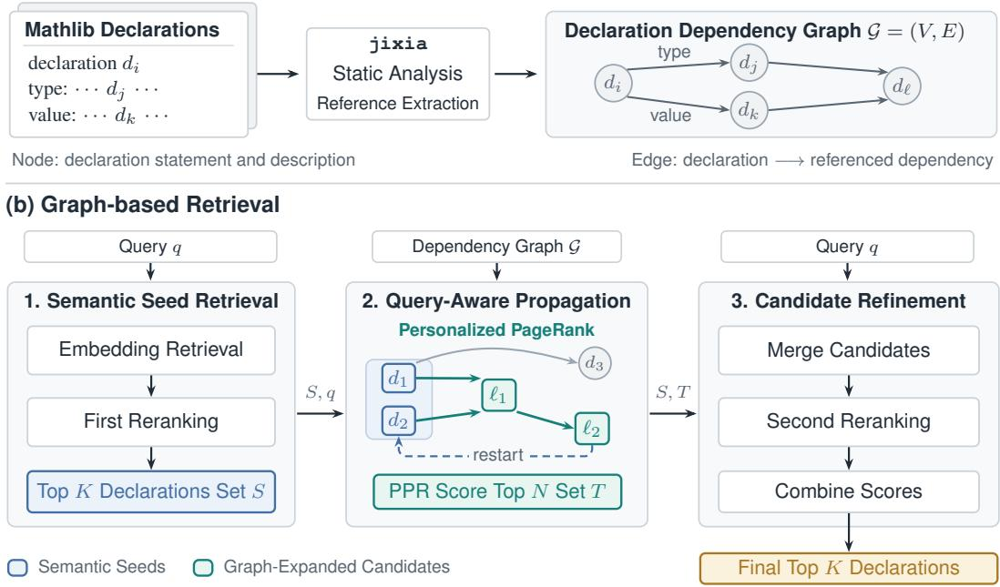
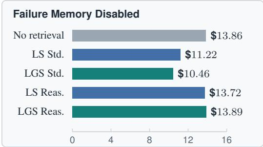
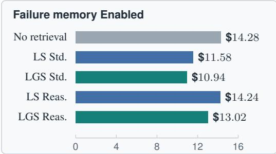

# LEAN GRAPH SEARCH FOR FORMAL THEOREM PROVING

Yihan Xu<sup>∗</sup>, Jia-Chen Gu<sup>∗</sup>, Junyi Zhang, Di Wu, Haikang Deng, Po-Nien Kung Kai-Wei Chang, Amit Sahai, Wei Wang, Nanyun Peng

University of California, Los Angeles

{simpson561@, gujc@, junyizhang2002@, diwu@cs.}ucla.edu <sup>€</sup> Website <sup>§</sup> Code

## ABSTRACT

Retrieving relevant lemmas is crucial for formal theorem proving, enabling provers to build machine-checkable proofs from established mathematical results. Recent retrieval systems match library declarations to a target theorem or its intermediate proof steps, but make limited use of multi-hop dependencies among declarations. These dependencies can reveal supporting lemmas that are not necessarily lexically similar to the target theorem but recur in proofs of related problems. To this end, we propose LEANGRAPHSEARCH, a graph-based retrieval method for Lean 4 that constructs a graph from Mathlib’s forward dependencies and traverses it to uncover supporting lemmas through multi-hop dependency chains. Specifically, LEANGRAPHSEARCH links each declaration to the premises it depends on, uses a graph-based ranking algorithm to propagate relevance from semantically matched declarations to their dependencies, and reranks the expanded candidates against the original query. Across two mathematical retrieval benchmarks, LEANGRAPHSEARCH improves recall by up to 12 percentage points over the strongest baseline, LeanSearch v2, on MathlibQR and increases coverage of complete annotated proof routes on MathlibMPR by up to 3.7 percentage points. More importantly, we evaluate whether these retrieval gains translate into improved end-to-end theorem proving by integrating LEANGRAPHSEARCH into an iterative proving loop guided by Lean feedback. Across three theorem proving benchmarks, LEANGRAPHSEARCH improves pass rate at {8, 16, 32} reflection turns by as much as 40% compared to the vanilla prover and at most 10% compared to LeanSearch v2, showing a better accuracy–cost tradeoff. These findings highlight the value of dependency graph search for theorem proving and motivate further research on structure-aware search for proof discovery.

## 1 INTRODUCTION

Formal theorem proving expresses mathematical statements and proofs in a formal language, allowing a proof assistant such as Lean to verify their correctness (de Moura & Ullrich, 2021). Search engines support the proving process by helping users and automated provers locate useful definitions, theorems, and lemmas within large mathematical libraries such as Mathlib (The mathlib Community, 2020; Yang et al., 2023; Mikuła et al., 2024; Shen et al., 2025; Ju et al., 2026). Existing retrieval systems, such as LeanExplore (Asher, 2025), LeanFinder (Lu et al., 2026), and LeanSearch v2 (Gao et al., 2026), address this need by identifying library declarations relevant to a target theorem or an intermediate goal. However, their limited use of multi-hop dependencies among declarations may miss supporting lemmas that share little lexical similarity with the query but occur in proofs of related problems (Shen et al., 2025; Gao et al., 2026).

A key observation is that declarations relevant to a target theorem can serve as starting points for discovering supporting lemmas through multi-hop dependencies. These dependencies connect declarations to their direct and indirect premises, providing extra paths to useful lemmas that are less

(b) Retrieval and Proving



  
Figure 1: Dependency-guided retrieval with LEANGRAPHSEARCH. (a) An illustration of the dependency graph, showing how semantically retrieved declarations (blue) lead to supporting premises (green) through shared and multi-hop dependencies. (b) Selected retrieval and proving results. Gains are reported in percentage points relative to LeanSearch v2.

lexically similar to the query. To capture and exploit this structure, we introduce LEANGRAPH-SEARCH (Fig. 1), a graph-based retrieval framework for Lean 4 theorem proving. It constructs a directed graph from Mathlib’s forward dependencies, representing declarations as nodes and linking each declaration to the premises it directly depends on. Searching this graph from semantically relevant declarations extends retrieval beyond direct query matching, helping users and automated provers discover supporting premises that may otherwise be difficult to locate.

To search the constructed dependency graph, LEANGRAPHSEARCH uses the target query to guide traversal along formal dependencies. Given an informal description or a formal goal, it first retrieves declarations using embeddings and reranks them against the query to select semantically relevant seeds. The seed relevance scores are normalized to form the personalization distribution for personalized PageRank (Brin & Page, 1998), which propagates relevance along dependency edges while repeatedly returning to the seeds, thereby expanding the candidate set. Finally, LEANGRAPH-SEARCH reranks the expanded candidates against the original query and combines these second-pass relevance scores with query-specific graph scores to produce the final ranking.

We evaluate LEANGRAPHSEARCH on both standalone premise retrieval and downstream formal theorem proving. For premise retrieval, LEANGRAPHSEARCH improves Recall@100 from 82.7% with LeanSearch v2 to 94.7% on the 810-query fair subset of MathlibQR (Gao et al., 2026), confirming that dependency graph search effectively recovers additional relevant lemmas. On MathlibMPR (Gao et al., 2026), it improves proof route-level premise coverage, increasing Covered@20 from 39.1% to 42.8% and Covered@50 from 41.3% to 44.2%. These results suggest that dependency-aware retrieval better recovers complete premise sets along annotated proof routes. For formal theorem proving, we integrate LEANGRAPHSEARCH into an iterative proving loop equipped with Lean’s diagnostic feedback and problem-local failure memory. LEANGRAPHSEARCH consistently outperforms the state-of-the-art retrieval baselines across FATE-H (Jiang et al., 2026), MathlibMPR-Prop (Gao et al., 2026), and Lean-IMO-Bench (Kung et al., 2026), demonstrating that premise retrieval improvements translate into higher formal proof success rates.

## 2 RELATED WORK

Mathematical theorem proving can be carried out informally in natural language and mathematical notation or formally in a language checked by a proof assistant such as Lean (de Moura & Ullrich, 2021). Large language model (LLM)-based approaches to formal proving include generating tactics within proof-state search (Yang et al., 2023; Thakur et al., 2024) and generating and refining proof scripts through verifier feedback, often guided by informal proof sketches (Kung et al., 2026). Throughout this paper, mathematical search refers to retrieving library declarations for formal proving, using either informal or formal queries. For additional related work, see Appendix A.

Search for Formal Mathematics. Prior work shows that retrieving reusable library facts improves formal proof construction (Mikuła et al., 2024; Yang et al., 2023; Shen et al., 2025). Magnushammer learns premise selection through contrastive training and reranking for Isabelle (Mikuła et al., 2024), while ReProver and REAL-Prover condition tactic generation on retrieved Lean premises (Yang et al., 2023; Shen et al., 2025). LeanPremise supports premise selection in user-specific contexts (Zhu et al., 2026), and LeanStateSearch adapts tokenization and reranking to formal proof-state queries (Tao et al., 2025). Complementary search systems help locate declarations from mathematical descriptions: LeanExplore combines formal statements with informal descriptions for semantic search (Asher, 2025), and Lean Finder learns intent-aware embeddings from synthesized queries and preference feedback (Lu et al., 2026). LeanSearch v2 extends this line of work to global premise retrieval, combining embedding-based search and reranking with iterative sketch–retrieve–reflec cycles to gather supporting premises for an entire proof (Gao et al., 2026).

Graph-based Retrieval. Graph structure has been used to guide retrieval in both natural-language corpora and formal libraries. GraphRAG builds an entity graph and community summaries for query-focused summarization (Edge et al., 2024), while HippoRAG applies personalized PageRank to a knowledge graph for multi-hop retrieval (Jimenez Guti´ errez et al., 2024). KG´ <sup>2</sup>RAG starts from semantically retrieved chunks and uses a knowledge graph to expand and organize evidence (Zhu et al., 2025). In formal mathematical search, LeanExplore uses declaration dependencies to generate informal descriptions and incorporates PageRank centrality as a ranking feature (Asher, 2025). LeanSearch v2 also processes dependencies bottom-up when constructing declaration descriptions (Gao et al., 2026). To learn graph-aware representations for premise selection, Petrovciˇ cˇ et al. (2025) combine textual embeddings with a relational graph neural network over state–premise and premise–premise dependencies.

## 3 LEANGRAPHSEARCH

We introduce a graph-based retrieval framework for Lean theorem proving that exploits structural relationships among declarations. It represents Mathlib as a directed declaration dependency graph (Fig. 2 (a)) and uses query-aware propagation to expand from semantically relevant declarations to their formal prerequisites (Fig. 2 (b)). Semantic relevance and dependency structure jointly guide promising declaration selection, followed by reranking to produce the final ranked list.

## 3.1 TASK FORMULATION

Mathematical Retrieval. We study library declaration retrieval for theorem proving in Lean 4 (de Moura & Ullrich, 2021). Let $\mathcal { L } \dot { = } \{ d _ { i } \} _ { i = 1 } ^ { n }$ denote the Mathlib declaration corpus. Each declaration $d _ { i }$ is identified by its name and associated with its formal statement and, when available, a natural-language description<sup>1</sup>. A retrieval query q can contain an informal mathematical description, a formal Lean statement, a proof state, or a combination of these. It may describe a target theorem or request a definition or lemma needed at an intermediate proof step.

Given a query q, the retriever returns up to K declarations from L ranked by retrieval score, denoted $\mathcal { R } ( q ) = \dot { \{ d _ { j } \} } _ { j = 1 } ^ { \hat { K } }$ We consider two complementary objectives: locating an individual declaration that matches the query and retrieving supporting premises for a target theorem. In the latter setting, a useful declaration may address an intermediate object or a side condition, and several declarations may be needed to support a complete proof. Retrieval must therefore capture the relevance of declarations in a proof, even when their statements differ substantially from the query.

Theorem Proving. Each proving problem is specified by a Lean source x containing one target proof hole. At round t, a search policy can issue queries using x and, when available, the preceding proof candidate $Y _ { t - 1 }$ and Lean compiler diagnostic $e _ { t - 1 }$ . The retrieved declarations are aggregated into a context R , which the prover uses to construct or revise the candidate Y . A successful candidate elaborates without a live sorry and satisfies the proof-hole integrity contract. This separates the query-level retrieval interface from the policy that determines when to invoke it.

(a) Dependency Graph Construction  
  
Figure 2: Overview of LEANGRAPHSEARCH. (a) Dependency graph construction (Section 3.2). Static analysis with jixia extracts references from Mathlib declarations to construct a directed graph G. (b) Graph-based retrieval (Section 3.3). It first retrieves semantic seeds using semantic embeddings, then expands the candidate set by traversing the dependency graph. Seed and graphexpanded candidates are merged and reranked to select the final top-K declarations.

## 3.2 DECLARATION DEPENDENCY GRAPH CONSTRUCTION

LEANGRAPHSEARCH constructs a directed graph G = (V, E) from the structural references in Mathlib through static analysis with the jixia tool (frenzymath, 2024). Each node i ∈ V represents one declaration together with its formal statement and, when available, its natural-language description. A directed edge i → j indicates that declaration i references declaration j in its type or value. Edges therefore point from declarations to their dependencies, allowing traversal from a query-relevant declaration to the definitions and lemmas underlying its statement or implementation.

This graph provides explicit formal dependency structure that complements embedding-based semantic similarity. Starting from a semantically relevant declaration, traversal can reveal potentially useful supporting declarations, including dependencies shared by declarations with different surface forms. The graph thus augments retrieval with formal structural relationships while leaving the underlying Mathlib corpus unchanged.

## 3.3 GRAPH-BASED RETRIEVAL

Semantic Seed Retrieval. Given a query q, LEANGRAPHSEARCH first retrieves semantically related declarations as seeds for graph propagation using the embedding–reranker retrieval pipeline (Gao et al., 2026). The query is encoded with Qwen3-Embedding-8B (Zhang et al., 2025) to retrieve an initial candidate set. Each query–declaration pair is then scored for relevance using the reranker logits produced by Qwen3-Reranker-8B (Zhang et al., 2025). The top K declarations ranked by these scores form the semantic seed set S.

Query-personalized Propagation. To exploit the dependency structure described in Section 3.2, LEANGRAPHSEARCH propagates a query-specific seed distribution over the graph. Specifically, LEANGRAPHSEARCH normalizes the semantic seed scores to obtain a seed distribution v over graph nodes, assigning zero mass to nodes outside the seed set S:

$$
v _ { i } = \frac { q _ { i } \cdot \mathbb { 1 } [ i \in S ] } { \sum _ { j \in S } q _ { j } } .\tag{1}
$$

Let $P$ denote the row-stochastic transition matrix of $\mathcal { G }$ and D the set of dangling nodes. LEAN-GRAPHSEARCH computes personalized PageRank (PPR) (Brin & Page, 1998) by iterating:

$$
p ^ { ( k + 1 ) } = r v + ( 1 - r ) p ^ { ( k ) } P + ( 1 - r ) \left( \sum _ { i \in \mathcal { D } } p _ { i } ^ { ( k ) } \right) v ,\tag{2}
$$

where $p ^ { ( 0 ) } = v .$ . The restart term rv keeps propagation anchored to the seed distribution, while the transition term $( 1 - r ) p ^ { ( k ) } P$ expands each seed toward its dependencies. Returning dangling mass to v preserves the query-specific distribution.

Graph-aware Candidate Refinement. After PPR propagation, LEANGRAPHSEARCH merges the semantic seed set S with the top-N graph-expanded candidates ranked by PPR score. The retained candidates are then scored against the original query through the Qwen reranker in a second reranking stage. The final score mixes the second-stage relevance score $\tilde { q } _ { i }$ with the normalized PPR score weighted by a coefficient λ:

$$
f _ { i } = \tilde { q } _ { i } + \lambda \mathrm { z s c o r e } _ { \mathrm { q u e r y } } ( p _ { i } ) .\tag{3}
$$

This procedure evaluates graph-expanded and seed candidates using the same relevance model, with the graph signal helping distinguish candidates with similar reranker scores. Finally, LEANGRAPH-SEARCH returns the top-K candidates with highest $f _ { i }$ as $\mathcal { R } ( q )$

## 3.4 SEARCH LOOP POLICY

To align with the search loop settings in LeanSearch $\mathbf { v } 2 ,$ we evaluate two retrieval-policy variants of LEANGRAPHSEARCH that share the same retrieval mechanism but differ in when and how it is invoked. Standard Mode invokes graph-based retrieval after a failed proof attempt using queries conditioned on the current proof state. Reasoning Mode additionally uses an LLM to decompose the theorem into queries targeting definitions, high-level proof strategies, and individual proof steps before the first proof attempt. Retrieved evidence is aggregated across subqueries and truncated to K declarations. Readers can refer to Gao et al. (2026) for more details of the search policies.

## 4 EXPERIMENTS ON MATHEMATICAL RETRIEVAL

## 4.1 SETUP

Benchmarks and Metrics. We evaluate LEANGRAPHSEARCH on MathlibQR and MathlibMPR, following the benchmark definitions and metrics of LeanSearch $\mathbf { v } 2$ (Gao et al., 2026). MathlibQR contains six kinds of natural-language queries, each paired with a single target declaration. We use its fair subset of 810 queries over 171 target declarations shared by all compared systems, and report nDCG@k for $k \in \{ 1 , 5 , 1 0 \}$ and Recall@k for $k \in \{ 1 0 , 5 \dot { 0 } , 1 0 0 \}$ . MathlibMPR contains 69 research-level Mathlib theorems with grouped premises and alternative proof routings. Recall@k (group) measures the fraction of premise groups hit by the top-k results, while Covered@k measures whether the retrieved set covers every premise group in at least one complete proof routing. We report both metrics for $k \in \{ 5 , 1 0 , 2 0 , 3 \dot { 0 } , \dot { 5 } 0 \}$

Baselines. For non-agentic search, we compare LEANGRAPHSEARCH with three prior embedding-based search methods, LeanExplore, LeanFinder and LeanSearch v2 (standard mode) on MathlibQR (Asher, 2025; Lu et al., 2026; Gao et al., 2026). For agentic search, we compare LEANGRAPHSEARCH with three search methods that use informal and formal descriptions as queries, INF-X-Retriever, ReasonIR and DIVER (Yao et al., 2025; Shao et al., 2025;

Table 1: Query-to-declaration retrieval on the 810-query fair subset of MathlibQR. LeanExplore and LeanFinder are quoted from Gao et al. (2026). The best result in each column is bold.
<table><tr><td rowspan="2">Method</td><td colspan="3">nDCG@k</td><td colspan="3">Recall@k</td></tr><tr><td>1</td><td>5</td><td>10</td><td>10</td><td>50</td><td>100</td></tr><tr><td>LeanExplore</td><td>0.246</td><td>0.358</td><td>0.393</td><td>0.569</td><td>0.743</td><td>0.789</td></tr><tr><td>LeanFinder</td><td>0.370</td><td>0.514</td><td>0.533</td><td>0.698</td><td>0.824</td><td>0.875</td></tr><tr><td>LeanSearch v2 (standard mode)</td><td>0.472</td><td>0.596</td><td>0.616</td><td>0.765</td><td>0.821</td><td>0.827</td></tr><tr><td>LEANGRAPHSEARCH (standard mode)</td><td>0.473</td><td>0.604</td><td>0.629</td><td>0.794</td><td>0.899</td><td>0.947</td></tr></table>

Table 2: Global premise retrieval on MathlibMPR. The two evaluated method rows are arithmetic means over Gemini 3.1 Pro and Claude Sonnet 5. Baseline results are quoted from Gao et al. (2026).
<table><tr><td rowspan="2">Method</td><td colspan="5">Recall@k (group)</td><td colspan="5">Covered@k</td></tr><tr><td>5</td><td>10</td><td>20</td><td>30</td><td>50</td><td>5</td><td>10</td><td>20</td><td>30</td><td>50</td></tr><tr><td>INF-X-Retriever</td><td>21.2</td><td>28.2</td><td>33.9</td><td>40.0</td><td>42.6</td><td>15.9</td><td>18.8</td><td>21.7</td><td>24.6</td><td>24.6</td></tr><tr><td>ReasonIR</td><td>23.9</td><td>26.9</td><td>33.3</td><td>35.6</td><td>43.8</td><td>17.4</td><td>18.8</td><td>20.3</td><td>21.7</td><td>30.4</td></tr><tr><td>DIVER</td><td>27.7</td><td>38.0</td><td>46.6</td><td>52.8</td><td>55.0</td><td>18.8</td><td>24.6</td><td>29.0</td><td>33.3</td><td>37.7</td></tr><tr><td>ReProver</td><td>3.0</td><td>5.5</td><td>7.6</td><td>8.8</td><td>10.3</td><td>0.0</td><td>1.4</td><td>2.9</td><td>4.3</td><td>4.3</td></tr><tr><td>LeanPremise</td><td>4.1</td><td>4.8</td><td>8.0</td><td>9.9</td><td>11.5</td><td>1.4</td><td>1.4</td><td>4.3</td><td>4.3</td><td>5.8</td></tr><tr><td>LeanStateSearch</td><td>6.5</td><td>9.3</td><td>12.5</td><td>16.0</td><td>20.0</td><td>2.9</td><td>2.9</td><td>7.2</td><td>10.1</td><td>13.0</td></tr><tr><td>LeanSearch v2 (reasoning mode)</td><td>36.4</td><td>48.2</td><td>55.5</td><td>57.8</td><td>58.2</td><td>22.5</td><td>29.7</td><td>39.1</td><td>41.3</td><td>41.3</td></tr><tr><td>LEANGRAPHSEARCH (reasoning mode)</td><td>37.9</td><td>47.0</td><td>56.8</td><td>57.9</td><td>58.3</td><td>23.9</td><td>31.9</td><td>42.8</td><td>43.5</td><td>44.2</td></tr></table>

Sun et al., 2025); three search methods that use current proof states as queries, ReProver, Lean-Premise and LeanStateSearch (Yang et al., 2023; Zhu et al., 2026; Tao et al., 2025); and finally with LeanSearch v2 (reasoning mode) that uses a simple concatenated description and status as input. To estimate the robustness across different backbone models, we evaluate LeanSearch v2 (reasoning mode) and LEANGRAPHSEARCH (reasoning mode) with Gemini 3.1 Pro and Claude Sonnet 5 as backbone models, then average each metric across the two models.

## 4.2 RESULTS

Table 1 shows that LEANGRAPHSEARCH consistently improves retrieval performance at every measured cutoff. The gains over LeanSearch v2 increase at larger cutoffs, with nDCG@10 increasing from 0.616 to 0.629, Recall@50 by 7.8 percentage points, and Recall@100 by 12.0 percentage points. In Table 2, LEANGRAPHSEARCH improves group recall at four of the five cutoffs, with the exception of Recall@10. Improvements in complete-route coverage are more consistent: Covered@k increases at every cutoff, outperforming LeanSearch v2 by 3.7 percentage points at k = 20 and 2.9 percentage points at k = 50.

Overall, these results suggest that graph-based retrieval improves both individual declaration retrieval and the recovery of premise sets that support complete proof routes. In addition to the quantitative results, our qualitative analysis reveals the following findings:

Graph-aware expansion reveals underlying mathematical objects. On MathlibQR, semantic retrievers frequently identify constructors, projections, or characteristic theorems whose descriptions closely match the query, but miss the associated parent declarations or deeper dependent declarations because their names and signatures are less lexically similar to the query. Graph-aware expansion connects these semantic matches to underlying declarations through dependency relationships.

Graph augmentation improves the composition of the retrieved context. On MathlibMPR, LEANGRAPHSEARCH returns fewer filtered declarations on average than LeanSearch v2, yet retrieves more gold declarations within the top five positions, improving group recall and completeroute coverage. Route-level examples further illustrate this effect. These results suggest that graph augmentation concentrates relevant premises in its retrieved context instead of merely expanding it.

Examples illustrating these findings are provided in Appendix C.

## 5 EXPERIMENTS ON THEOREM PROVING

More importantly, we evaluate on formal theorem proving tasks to confirm whether improvements in retrieval quality translate into better proof generation.

## 5.1 LEANGRAPHSEARCH IN AN AGENTIC PROVING LOOP

To integrate LEANGRAPHSEARCH into a verifier-grounded proof loop, we implement it as a search tool that can be called by LLM provers. Each problem instance contains a Lean source x with one target proof hole. At inference round $t ,$ the prover $M _ { \theta }$ parameterized by $\theta$ generates a complete Lean source candidate $Y _ { t }$ conditioned on the problem $x ,$ the preceding candidate $Y _ { t - 1 } ,$ , the latest Lean compiler diagnostic $e _ { t - 1 }$ , optional retrieved declarations $R _ { t }$ , and optional failure-memory feedback $m _ { t - 1 }$ as:

$$
Y _ { t } \sim M _ { \theta } \left( x , Y _ { t - 1 } , e _ { t - 1 } , R _ { t } , m _ { t - 1 } \right) .\tag{4}
$$

The Lean compiler executes $Y _ { t }$ and returns either a successful elaboration or a structured diagnostic. Each failed candidate is followed by one revision conditioned on the latest verifier feedback, producing a single candidate lineage.

Building on the common practice of incorporating verifier feedback into iterative proof refinement, we investigate whether LEANGRAPHSEARCH can provide useful retrieval feedback that further improves proving performance. After a failed attempt, the LLM optionally generates five search queries from the problem $x ,$ current candidate $Y _ { t } .$ , and Lean diagnostic $e _ { t } .$ . Each query invokes LEANGRAPHSEARCH and returns K declarations. LEANGRAPHSEARCH deduplicates the retrieved declarations and inserts them next to the previous candidate and diagnostic in the revision prompt. A candidate succeeds when the complete Lean source elaborates without a live sorry and satisfies the proof-hole integrity contract.

Optional Formal Failure Memory. Our preliminary experiments show that the LLM prover is likely to repeat the same or similar failed proofs across multiple rounds, wasting the inference budget and limiting exploration of alternative proof strategies. To mitigate this issue, we introduce a failure memory, which augments the agentic loop with problem-local records of recurrent formal states. For each stable failure, we construct a structured failure state as:

$$
s _ { t } = \left( c _ { t } , \bar { e } _ { t } , G _ { t } , L _ { t } , \tau _ { t } \right) ,\tag{5}
$$

where $c _ { t }$ is the error category, $\bar { e } _ { t }$ is the normalized diagnostic, $G _ { t }$ contains unresolved goals, $L _ { t }$ summarizes the local context, and $\tau _ { t }$ is the inferred failing tactic. A deterministic serialization and SHA-256 (NIST, 2015) hash identify repeated states.

When a state recurs, the next prover call receives a compact dead-end record and the failed modifications that led to it, encouraging the prover to explore an alternative repair. The memory also reuses deterministic failures of identical candidates and caches retrieval responses by formal proof state and normalized query. These interventions reduce repeated compilation and retrieval while preserving the single-lineage search structure.

## 5.2 SETUP

Benchmarks and Metrics. We consider three benchmarks with diverse fields and complexities: FATE-H (Jiang et al., 2026), MathlibMPR-Prop (Gao et al., 2026) and Lean-IMO-Bench (Kung et al., 2026). FATE-H contains 100 graduate-level algebra problems, MathlibMPR-Prop contains the 50 propositions from MathlibMPR that admit a uniform tactic-mode interface, and Lean-IMO-Bench contains 30 Basic and 30 Advanced Olympiad problems. For each problem, we allow the backbone model at most 32 reflection turns with one optional query assigned to each turn, and report pass@k for $k \in \{ 8 , 1 6 , 3 2 \}$ , where k represents the number of reflection turns. We also report the normalized total cost over each group to assess cost effectiveness.

Baselines. To control evaluation costs while retaining representative baselines, we mostly compare LEANGRAPHSEARCH with the state-of-the-art LeanSearch v2 (Gao et al., 2026) and the vanilla backbone LLM without retrieval. To align with the searching loop settings in LeanSearch v2, we evaluate both LeanSearch v2 and LEANGRAPHSEARCH under the Standard Mode and Reasoning

Table 3: Proving results on FATE-H, grouped by whether failure memory is enabled. Relative cost is the full-budget API cost normalized by no retrieval within each group. The best and second best results in each group are shown in bold and underlined, respectively.
<table><tr><td>Retrieval condition</td><td>pass@8</td><td>pass@16</td><td>pass@32</td><td>Relative cost</td></tr><tr><td colspan="5">FAILURE MEMORY DISABLED</td></tr><tr><td>No retrieval</td><td>35</td><td>42</td><td>47</td><td>1.00×</td></tr><tr><td>LeanSearch v2 (standard mode)</td><td>49</td><td>61</td><td>70</td><td>1.11×</td></tr><tr><td>LEANGRAPHSEARCH (standard mode)</td><td>53</td><td>69</td><td>71</td><td>1.09×</td></tr><tr><td>LeanSearch v2 (reasoning mode)</td><td>52</td><td>68</td><td>73</td><td>1.41×</td></tr><tr><td>LEANGRAPHSEARCH (reasoning mode)</td><td>56</td><td>70</td><td>75</td><td>1.37×</td></tr><tr><td colspan="5">FAILURE MEMORY ENABLED</td></tr><tr><td>No retrieval</td><td>33</td><td>45</td><td>52</td><td>1.00×</td></tr><tr><td>LeanSearch v2 (standard mode)</td><td>53</td><td>63</td><td>71</td><td>1.01×</td></tr><tr><td>LEANGRAPHSEARCH (standard mode)</td><td>54</td><td>68</td><td>73</td><td>1.01×</td></tr><tr><td>LeanSearch v2 (reasoning mode)</td><td>54</td><td>66</td><td>73</td><td>1.31×</td></tr><tr><td>LEANGRAPHSEARCH (reasoning mode)</td><td>58</td><td>75</td><td>81</td><td>1.22×</td></tr></table>

Table 4: Proving results on MathlibMPR-Prop, grouped by whether failure memory is enabled.
<table><tr><td>Retrieval condition</td><td>pass@8</td><td>pass@16</td><td>pass@32</td><td>Relative cost</td></tr><tr><td colspan="5">FAILURE MEMORY DISABLED</td></tr><tr><td>No retrieval</td><td>15</td><td>18</td><td>23</td><td>1.00×</td></tr><tr><td>LeanSearch v2 (standard mode)</td><td>31</td><td>35</td><td>39</td><td>0.82×</td></tr><tr><td>LEANGRAPHSEARCH (standard mode)</td><td>32</td><td>38</td><td>41</td><td>0.78×</td></tr><tr><td>LeanSearch v2 (reasoning mode)</td><td>33</td><td>37</td><td>41</td><td>1.01×</td></tr><tr><td>LEANGRAPHSEARCH (reasoning mode)</td><td>33</td><td>38</td><td>39</td><td>1.06×</td></tr><tr><td colspan="5">FAILURE MEMORY ENABLED</td></tr><tr><td>No retrieval</td><td>15</td><td>19</td><td>23</td><td>1.00×</td></tr><tr><td>LeanSearch v2 (standard mode)</td><td>33</td><td>35</td><td>39</td><td>0.76×</td></tr><tr><td>LEANGRAPHSEARCH (standard mode)</td><td>35</td><td>37</td><td>40</td><td>0.78×</td></tr><tr><td>LeanSearch v2 (reasoning mode)</td><td>33</td><td>36</td><td>39</td><td>0.99×</td></tr><tr><td>LEANGRAPHSEARCH (reasoning mode)</td><td>31</td><td>37</td><td>40</td><td>0.96×</td></tr></table>

Mode. Each of the five configurations is evaluated with failure memory both disabled and enabled, respectively. Specifically, each retrieval action produces five queries conditioned on the current theorem, proof candidate, and Lean diagnostic, with each query retrieving up to 50 declarations. Gemini 3.1 Pro is the prover backbone throughout all experiments. Within each benchmark, the prover prompt, verifier, action budget, and model settings are fixed across all configurations.

## 5.3 RESULTS

Tables 3 to 5 show the pass rates and costs relative to the no-retrieval baseline on the three benchmarks. Our results reveal the following findings:

Graph retrieval improves proof completion. LEANGRAPHSEARCH in Standard Mode outperforms LeanSearch v2 in Standard Mode at every evaluated reflection budget across all sets, while achieving performance comparable to LeanSearch v2 in Reasoning Mode. The number solved across the 210 problems within 32 turns increases from 136 to 143 without memory and from 134 to 142 with memory. LEANGRAPHSEARCH in Reasoning Mode yields further improvement, reaching the highest total number of solved problems, with particularly strong results on FATE-H.

The benefit is also visible at smaller reflection budgets. Comparing results across budgets reveals improvements that are less apparent from pass@32 alone. On FATE-H, Standard Mode without memory solves 69 problems within 16 turns using LEANGRAPHSEARCH, compared with 61 using LeanSearch v2. In Reasoning Mode with memory, LEANGRAPHSEARCH solves 75 FATE-H problems within 16 turns, exceeding the 73 problems solved by LeanSearch v2 within 32 turns.

Table 5: Proving results on Lean-IMO-Bench, grouped by whether failure memory is enabled.
<table><tr><td rowspan="2">Retrieval condition</td><td colspan="4">Basic Set (n = 30)</td><td colspan="4">Advanced Set (n = 30)</td></tr><tr><td>pass@8</td><td>pass@16</td><td>pass@32</td><td>Rel. cost</td><td>pass@8</td><td>pass@16</td><td>pass@32</td><td>Rel. cost</td></tr><tr><td colspan="9">FAILURE MEMORY DISABLED</td></tr><tr><td>No retrieval</td><td>12</td><td>16</td><td>16</td><td>1.00×</td><td>7</td><td>7</td><td>8</td><td>1.00×</td></tr><tr><td>LeanSearch v2 (standard mode)</td><td>15</td><td>15</td><td>18</td><td>1.49×</td><td>4</td><td>8</td><td>9</td><td>1.82×</td></tr><tr><td>LEANGRAPHSEARCH (standard mode)</td><td>16</td><td>17</td><td>21</td><td>1.40×</td><td></td><td>9</td><td>10</td><td>1.88×</td></tr><tr><td>LeanSearch v2 (reasoning mode)</td><td>14</td><td>16</td><td>21</td><td>2.04×</td><td>57</td><td>9</td><td>10</td><td>2.56×</td></tr><tr><td>LEANGRAPHSEARCH (reasoning mode)</td><td>14</td><td>16</td><td>19</td><td>2.09×</td><td>7</td><td>8</td><td>10</td><td>2.53×</td></tr><tr><td colspan="9">FAILURE MEMORY ENABLED</td></tr><tr><td>No retrieval</td><td>13</td><td>15</td><td>17</td><td>1.00×</td><td>5</td><td>6</td><td>7</td><td>1.00×</td></tr><tr><td>LeanSearch v2 (standard mode)</td><td>13</td><td>16</td><td>16</td><td>1.61×</td><td>6</td><td>7</td><td>8</td><td>1.64×</td></tr><tr><td>LEANGRAPHSEARCH (standard mode)</td><td>15</td><td>18</td><td>20</td><td>1.64×</td><td>7</td><td>9</td><td>9</td><td>1.61×</td></tr><tr><td>LeanSearch v2 (reasoning mode)</td><td>16</td><td>18</td><td>18</td><td>1.94×</td><td>7</td><td>10</td><td>12</td><td>2.31×</td></tr><tr><td>LEANGRAPHSEARCH (reasoning mode)</td><td>15</td><td>17</td><td>18</td><td>2.25×</td><td>7</td><td>9</td><td>12</td><td>2.20×</td></tr></table>





Figure 3: Cost efficiency on theorem proving. LS = LeanSearch, LGS = LEANGRAPHSEARCH, Std. = Standard Mode, Reas. = Reasoning Mode. For each of the 10 configurations, we compute total API cost divided by the number of solved problems on the union of 210 theorem-proving instances. Solved counts are measured by pass@32. Lower values indicate better cost efficiency.

Failure memory improves proving performance under limited reflection budgets. At k = 8, enabling failure memory increases the total number of solved problems across all four retrieval configurations. In Standard Mode, the count rises from 106 to 111 for LEANGRAPHSEARCH and from 99 to 105 for LeanSearch v2. In Reasoning Mode, memory also improves completion, increasing the aggregate pass@16 count for LEANGRAPHSEARCH from 132 to 138. These results show that failure memory can help the prover complete more proofs under limited reflection budgets.

Graph retrieval lowers API cost per solved problem. Fig. 3 reports API cost per solved problem for each retrieval configuration across all 210 theorem-proving instances, calculated as total API expenditure, including unsuccessful runs, divided by the number of problems solved within 32 turns. LEANGRAPHSEARCH in Standard Mode achieves the lowest cost per solved problem. LEAN-GRAPHSEARCH in Reasoning Mode with memory achieves the highest aggregate completion, solving 151 of 210 problems, while maintaining a lower cost per solved problem than LeanSearch v2.

Our qualitative analysis suggests that, by following multi-hop dependencies, LEANGRAPHSEARCH uncovers supporting lemmas used in related proofs that direct query matching may miss. Retrieving these premises contributes to improved downstream theorem proving. Examples illustrating this mechanism are provided in Appendix C.

## 6 CONCLUSION

We introduced LEANGRAPHSEARCH, a graph-based retrieval method that exploits formal dependencies in Mathlib to discover supporting premises for Lean 4 theorem proving. Starting from semantically relevant declarations, it propagates relevance along dependency edges with personalized PageRank and reranks the expanded candidates against the original query. Experiments show improvements in declaration recall and annotated proof-route coverage, with benefits extending to downstream proof construction. LEANGRAPHSEARCH improves proof completion over matched LeanSearch v2 configurations on most of the evaluated benchmarks and reflection budgets, while reducing the aggregate API cost per solved problem. Together, these findings show that the dependencies recorded in a formal library provide useful guidance for retrieving supporting premises, connecting semantic search to the mathematical ingredients needed to construct a formal proof.

## AI USE STATEMENT

In this work, we used generative AI tools to implement methods and assist with translation. Additionally, we used generative AI tools to create or edit software code, summarize or analyze existing literature, and source or search for information.

We did not use generative AI tools to propose or refine hypotheses, design or provide feedback on research methodology or experiments, clean or reformat datasets, support qualitative or thematic data analysis, interpret results, generate synthetic datasets, help develop theoretical models or conceptual frameworks, formulate mathematical claims, provide critical ingredients for proving mathematical claims, or assist in writing proofs. These uses are not applicable to this work.

All code, writing, and references were double-checked by at least two authors. We take responsibil ity for the final content of this work, including text, claims, and artifacts produced with the aid of generative AI.

## ETHICS STATEMENT

This paper mainly discusses formal mathematical declaration search and the corresponding theoremproving harness. There are several potential societal consequences of our work, none of which we feel must be specifically highlighted here.

## REPRODUCIBILITY STATEMENT

The models and data used in this paper are all accessible online, and we provide citations for all baselines. Readers can refer to the codebases of Gao et al. (2026) and frenzymath (2024) to better reproduce our framework. We have also uploaded a redacted version of our codebase as supplemental material for reference. For more technical details of our implementation setup, see the Appendix.

## REFERENCES

Justin Asher. LeanExplore: A search engine for Lean 4 declarations. arXiv preprint arXiv:2506.11085, 2025.

Zhangir Azerbayev, Bartosz Piotrowski, and Jeremy Avigad. ProofNet: A benchmark for autoformalizing and formally proving undergraduate-level mathematics problems. In Workshop on MATH-AI: Toward Human-Level Mathematical Reasoning at NeurIPS, 2022.

Zhangir Azerbayev, Hailey Schoelkopf, Keiran Paster, Marco Dos Santos, Stephen McAleer, Albert Q. Jiang, Jia Deng, Stella Biderman, and Sean Welleck. Llemma: An open language model for mathematics. In International Conference on Learning Representations, 2024.

Kshitij Bansal, Sarah Loos, Markus Rabe, Christian Szegedy, and Stewart Wilcox. HOList: An environment for machine learning of higher order logic theorem proving. In Proceedings of the 36th International Conference on Machine Learning, volume 97 of Proceedings of Machine Learning Research, pp. 454–463. PMLR, 2019.

Sergey Brin and Lawrence Page. The anatomy of a large-scale hypertextual web search engine. Computer Networks, 30:107–117, 1998.

Łukasz Czajka and Cezary Kaliszyk. Hammer for Coq: Automation for dependent type theory. Journal ofAutomated Reasoning, 61:423–453, 2018. doi: 10.1007/s10817-018-9458-4.

Leonardo de Moura and Sebastian Ullrich. The Lean 4 theorem prover and programming language. In Automated Deduction—CADE 28, volume 12699 of Lecture Notes in Computer Science, pp. 625–635. Springer, 2021. doi: 10.1007/978-3-030-79876-5 37.

Darren Edge, Ha Trinh, Newman Cheng, Joshua Bradley, Alex Chao, Apurva Mody, Steven Truitt, Dasha Metropolitansky, Robert Osazuwa Ness, and Jonathan Larson. From local to global: A graph RAG approach to query-focused summarization. arXiv preprint arXiv:2404.16130, 2024.

frenzymath. jixia: A static analysis tool for Lean 4. GitHub repository, 2024. URL https: //github.com/frenzymath/jixia.

Guoxiong Gao, Zeming Sun, Jiedong Jiang, Yutong Wang, Jingda Xu, Peihao Wu, Bryan Dai, and Bin Dong. Leansearch v2: Global premise retrieval for lean 4 theorem proving. arXiv preprint arXiv:2605.13137, 2026.

Jiewen Hu, Thomas Zhu, and Sean Welleck. miniCTX: Neural theorem proving with (long-)contexts. In International Conference on Learning Representations, 2025.

Thomas Hubert, Rishi Mehta, Laurent Sartran, Miklos Z. Horv´ ath, Goran´ Zu<sup>ˇ</sup> ziˇ c, Eric Wieser,´ Aja Huang, Julian Schrittwieser, Yannick Schroecker, Hussain Masoom, Ottavia Bertolli, Tom Zahavy, Amol Mandhane, Jessica Yung, Iuliya Beloshapka, Borja Ibarz, Vivek Veeriah, Lei Yu, Oliver Nash, Paul Lezeau, Salvatore Mercuri, Calle Sonne, Bhavik Mehta, Alex Davies,¨ Daniel Zheng, Fabian Pedregosa, Yin Li, Ingrid von Glehn, Mark Rowland, Samuel Albanie, Ameya Velingker, Simon Schmitt, Edward Lockhart, Edward Hughes, Henryk Michalewski, Nicolas Sonnerat, Demis Hassabis, Pushmeet Kohli, and David Silver. Olympiad-level formal mathematical reasoning with reinforcement learning. Nature, 651:607–613, 2026. doi: 10.1038/s41586-025-09833-y.

Albert Qiaochu Jiang, Wenda Li, Szymon Tworkowski, Konrad Czechowski, Tomasz Odrzygo´zd´ z,´ Piotr Miłos, Yuhuai Wu, and Mateja Jamnik. Thor: Wielding hammers to integrate language´ models and automated theorem provers. In Advances in Neural Information Processing Systems, volume 35, 2022.

Albert Qiaochu Jiang, Sean Welleck, Jin Peng Zhou, Wenda Li, Jiacheng Liu, Mateja Jamnik, Timothee Lacroix, Yuhuai Wu, and Guillaume Lample. Draft, sketch, and prove: Guiding formal´ theorem provers with informal proofs. In International Conference on Learning Representations, 2023.

Jiedong Jiang, Wanyi He, Yuefeng Wang, Guoxiong Gao, Yongle Hu, Jingting Wang, Nailin Guan, Peihao Wu, Chunbo Dai, Liang Xiao, and Bin Dong. FATE: A formal benchmark series for frontier algebra of multiple difficulty levels. In International Conference on Learning Representations, 2026.

Bernal Jimenez Guti´ errez, Yiheng Shu, Yu Gu, Michihiro Yasunaga, and Yu Su. HippoRAG: Neu-´ robiologically inspired long-term memory for large language models. In Advances in Neural Information Processing Systems, volume 37, 2024.

Haocheng Ju, Leheng Chen, Peihao Wu, Bryan Dai, and Bin Dong. Matlas: A semantic search engine for mathematics. arXiv preprint arXiv:2604.17484, 2026.

Cezary Kaliszyk, Franc¸ois Chollet, and Christian Szegedy. HolStep: A machine learning dataset for higher-order logic theorem proving. In International Conference on Learning Representations, 2017.

Po-Nien Kung, Linfeng Song, Dawsen Hwang, Jinsung Yoon, Chun-Liang Li, Simone Severini, Mirek Olsˇak, Edward Lockhart, Quoc V. Le, Burak Gokturk, Thang Luong, Tomas Pfister, and ´ Nanyun Peng. LEAP: Supercharging LLMs for formal mathematics with agentic frameworks. arXiv preprint arXiv:2606.03303, 2026.

Guillaume Lample, Timothee Lacroix, Marie-Anne Lachaux, Aur´ elien Rodriguez, Amaury Hayat,´ Thibaut Lavril, Gabriel Ebner, and Xavier Martinet. HyperTree proof search for neural theorem proving. In Advances in Neural Information Processing Systems, volume 35, pp. 26337–26349, 2022.

Haohan Lin, Zhiqing Sun, Sean Welleck, and Yiming Yang. Lean-STaR: Learning to interleave thinking and proving. In International Conference on Learning Representations, 2025.

Yong Lin, Shange Tang, Bohan Lyu, Ziran Yang, Jui-Hui Chung, Haoyu Zhao, Lai Jiang, Yihan Geng, Jiawei Ge, Jingruo Sun, Jiayun Wu, Jiri Gesi, Ximing Lu, David Acuna, Kaiyu Yang, Hongzhou Lin, Yejin Choi, Danqi Chen, Sanjeev Arora, and Chi Jin. Goedel-Prover-V2: Scaling formal theorem proving with scaffolded data synthesis and self-correction. In International Conference on Learning Representations, 2026.

Chengwu Liu, Jianhao Shen, Huajian Xin, Zhengying Liu, Ye Yuan, Haiming Wang, Wei Ju, Chuanyang Zheng, Yichun Yin, Lin Li, Ming Zhang, and Qun Liu. FIMO: A challenge formal dataset for automated theorem proving. arXiv preprint arXiv:2309.04295, 2023.

Junqi Liu, Xiaohan Lin, Bolton Bailey, et al. CombiBench: Benchmarking LLM capability for combinatorial mathematics. In Third AI for Math Workshop at the International Conference on Machine Learning, 2026.

Qi Liu, Xinhao Zheng, Xudong Lu, Qinxiang Cao, and Junchi Yan. Rethinking and improving autoformalization: Towards a faithful metric and a dependency retrieval-based approach. In International Conference on Learning Representations, 2025.

Jialin Lu, Kye Emond, Kaiyu Yang, Swarat Chaudhuri, Weiran Sun, and Wuyang Chen. Lean Finder: Semantic search for Mathlib that understands user intents. In International Conference on Learning Representations, 2026.

Maciej Mikuła, Szymon Tworkowski, Szymon Antoniak, Bartosz Piotrowski, Albert Qiaochu Jiang, Jin Peng Zhou, Christian Szegedy, Łukasz Kucinski, Piotr Miło´ s, and Yuhuai Wu. Magnusham-´ mer: A transformer-based approach to premise selection. In International Conference on Learning Representations, 2024.

Niklas Muennighoff, Nouamane Tazi, Loic Magne, and Nils Reimers. MTEB: Massive text embedding benchmark. In Proceedings of the 17th Conference of the European Chapter of the Associationfor Computational Linguistics, pp. 2014–2037. Association for Computational Linguistics, 2023. doi: 10.18653/v1/2023.eacl-main.148.

NIST. Secure hash standard (SHS). Federal Information Processing Standards Publication 180-4, National Institute of Standards and Technology, 2015.

Lawrence C. Paulson and Jasmin Christian Blanchette. Three years of experience with Sledgehammer, a practical link between automatic and interactive theorem provers. In IWIL 2010: The 8th International Workshop on the Implementation of Logics, volume 2 of EPiC Series in Computing, pp. 1–11. EasyChair, 2012. doi: 10.29007/36dt.

Job Petrovciˇ c, David Narv ˇ aez, and Ljup ´ co Todorovski. Combining textual and structural informa- ˇ tion for premise selection in Lean. In Fifth Workshop on Mathematical Reasoning and AI at NeurIPS, 2025.

QuocViet Pham, Elvir Karimov, Andrey Galichin, and Ivan Oseledets. TheoremBench: Evaluating LLMs on theorem proving in formal mathematics. arXiv preprint arXiv:2606.09450, 2026.

Lushi Pu, Weiming Zhang, Xinheng Xie, Zixuan Fu, Bingxiang He, Hongya Lyu, Xin Li, Jie Zhou, and Yudong Wang. MA-ProofBench: A two-tiered evaluation of LLMs for theorem proving in mathematical analysis. arXiv preprint arXiv:2606.13782, 2026.

Z. Z. Ren, Zhihong Shao, Junxiao Song, Huajian Xin, Haocheng Wang, Wanjia Zhao, Liyue Zhang, Zhe Fu, Qihao Zhu, Dejian Yang, Z. F. Wu, Zhibin Gou, Shirong Ma, Hongxuan Tang, Yuxuan Liu, Wenjun Gao, Daya Guo, and Chong Ruan. DeepSeek-Prover-V2: Advancing formal mathematical reasoning via reinforcement learning for subgoal decomposition. arXiv preprint arXiv:2504.21801, 2025.

Rulin Shao, Rui Qiao, Varsha Kishore, Niklas Muennighoff, Xi Victoria Lin, Daniela Rus, Bryan Kian Hsiang Low, Sewon Min, Wen-tau Yih, Pang Wei Koh, and Luke Zettlemoyer. ReasonIR: Training retrievers for reasoning tasks. In Second Conference on Language Modeling, 2025.

Ziju Shen, Naohao Huang, Fanyi Yang, Yutong Wang, Guoxiong Gao, Tianyi Xu, Jiedong Jiang, Wanyi He, Pu Yang, Mengzhou Sun, Haocheng Ju, Peihao Wu, Bryan Dai, and Bin Dong. REAL-Prover: Retrieval augmented Lean prover for mathematical reasoning. arXiv preprint arXiv:2505.20613, 2025.

Noah Shinn, Federico Cassano, Ashwin Gopinath, Karthik Narasimhan, and Shunyu Yao. Reflexion: Language agents with verbal reinforcement learning. In Advances in Neural Information Processing Systems, volume 36, 2023.

Hongjin Su, Howard Yen, Mengzhou Xia, Weijia Shi, Niklas Muennighoff, Han-yu Wang, Haisu Liu, Quan Shi, Zachary S. Siegel, Michael Tang, Ruoxi Sun, Jinsung Yoon, Sercan O. Arik, Danqi<sup>¨</sup> Chen, and Tao Yu. BRIGHT: A realistic and challenging benchmark for reasoning-intensive retrieval. In International Conference on Learning Representations, 2025.

Duolin Sun, Meixiu Long, Dan Yang, Junjie Wang, Yecheng Luo, Yue Shen, Jian Wang, Hualei Zhou, Chunxiao Guo, Peng Wei, Jiahai Wang, and Jinjie Gu. DIVER: A multi-stage approach for reasoning-intensive information retrieval. arXiv preprint arXiv:2508.07995, 2025.

Yicheng Tao, Haotian Liu, Shanwen Wang, and Hongteng Xu. Learning an effective premise retrieval model for efficient mathematical formalization. In Second AI for Math Workshop at the International Conference on Machine Learning, 2025.

Amitayush Thakur, George Tsoukalas, Yeming Wen, Jimmy Xin, and Swarat Chaudhuri. An incontext learning agent for formal theorem-proving. In First Conference on Language Modeling, 2024.

Nandan Thakur, Nils Reimers, Andreas Ruckl¨ e, Abhishek Srivastava, and Iryna Gurevych. BEIR: A´ heterogeneous benchmark for zero-shot evaluation of information retrieval models. In Proceed ings ofthe Neural Information Processing Systems Track on Datasets and Benchmarks, volume 1, 2021.

The mathlib Community. The Lean Mathematical Library. In Proceedings of the 9th ACM SIGPLAN International Conference on Certified Programs and Proofs, CPP 2020, New Orleans, LA, USA, January 2020. ACM. doi: 10.1145/3372885.3373824.

George Tsoukalas, Jasper Lee, John Jennings, Jimmy Xin, Michelle Ding, Michael Jennings, Ami tayush Thakur, and Swarat Chaudhuri. PutnamBench: Evaluating neural theorem-provers on the Putnam mathematical competition. In Advances in Neural Information Processing Systems, volume 37, 2024.

Sumanth Varambally, Thomas Voice, Yanchao Sun, Zhifeng Chen, Rose Yu, and Ke Ye. Hilbert: Recursively building formal proofs with informal reasoning. In International Conference on Learning Representations, 2026.

Haiming Wang, Huajian Xin, Chuanyang Zheng, Zhengying Liu, Qingxing Cao, Yinya Huang, Jing Xiong, Han Shi, Enze Xie, Jian Yin, Zhenguo Li, and Xiaodan Liang. LEGO-Prover: Neural theorem proving with growing libraries. In International Conference on Learning Representations, 2024.

Hanyu Wang, Ruohan Xie, Yutong Wang, Guoxiong Gao, Xintao Yu, and Bin Dong. Aria: An agent for retrieval and iterative auto-formalization via dependency graph. In International Conference on Learning Representations, 2026.

Sean Welleck, Jiacheng Liu, Ronan Le Bras, Hannaneh Hajishirzi, Yejin Choi, and Kyunghyun Cho. NaturalProofs: Mathematical theorem proving in natural language. In Proceedings of the Neural Information Processing Systems Track on Datasets and Benchmarks, volume 1, 2021.

Huajian Xin, Z. Z. Ren, Junxiao Song, Zhihong Shao, Wanjia Zhao, Haocheng Wang, Bo Liu, Liyue Zhang, Xuan Lu, Qiushi Du, Wenjun Gao, Haowei Zhang, Qihao Zhu, Dejian Yang, Zhibin Gou, Z. F. Wu, Fuli Luo, and Chong Ruan. DeepSeek-Prover-V1.5: Harnessing proof assistant feedback for reinforcement learning and Monte-Carlo tree search. In International Conference on Learning Representations, 2025.

Kaiyu Yang, Aidan M. Swope, Alex Gu, Rahul Chalamala, Peiyang Song, Shixing Yu, Saad Godil, Ryan Prenger, and Anima Anandkumar. LeanDojo: Theorem proving with retrieval-augmented language models. In Advances in Neural Information Processing Systems, volume 36, 2023.

Yichen Yao, Jiahe Wan, Yuxin Hong, Mengna Zhang, Junhan Yang, Zhouyu Jiang, Qing Xu, Kuan Lu, Yinghui Xu, Wei Chu, Emma Wang, and Yuan Qi. INF-X-Retriever. GitHub repository, 2025. URL https://github.com/yaoyichen/INF-X-Retriever.

Zhouliang Yu, Ruotian Peng, Keyi Ding, Yizhe Li, Zhongyuan Peng, Minghao Liu, Yifan Zhang, Zheng Yuan, Huajian Xin, Wenhao Huang, Yandong Wen, Ge Zhang, and Weiyang Liu. Formal-MATH: Benchmarking formal mathematical reasoning of large language models. In Findings of the Associationfor Computational Linguistics: EMNLP 2026, 2026.

Yanzhao Zhang, Mingxin Li, Dingkun Long, Xin Zhang, Huan Lin, Baosong Yang, Pengjun Xie, An Yang, Dayiheng Liu, Junyang Lin, Fei Huang, and Jingren Zhou. Qwen3 Embedding: Advancing text embedding and reranking through foundation models. arXiv preprint arXiv:2506.05176, 2025.

Kunhao Zheng, Jesse Michael Han, and Stanislas Polu. miniF2F: A cross-system benchmark for formal olympiad-level mathematics. In International Conference on Learning Representations, 2022.

Thomas Zhu, Joshua Clune, Jeremy Avigad, Albert Q. Jiang, and Sean Welleck. Premise selection for a Lean hammer. In International Conference on Learning Representations, 2026.

Xiangrong Zhu, Yuexiang Xie, Yi Liu, Yaliang Li, and Wei Hu. Knowledge graph-guided retrieval augmented generation. In Proceedings of the 2025 Conference of the Nations of the Americas Chapter of the Association for Computational Linguistics: Human Language Technologies (Vol ume 1: Long Papers), pp. 8912–8924. Association for Computational Linguistics, 2025. doi: 10.18653/v1/2025.naacl-long.449.

## A RELATED WORK

## A.1 RETRIEVAL TASKS AND BENCHMARKS

General retrieval benchmarks evaluate different aspects of the relationship between queries and supporting evidence. BEIR measures retrieval across heterogeneous domains (Thakur et al., 2021), while MTEB evaluates embeddings across retrieval and other representation tasks (Muennighoff et al., 2023). BRIGHT emphasizes queries that require reasoning beyond direct semantic matching (Su et al., 2025), motivating specialized retrievers such as ReasonIR, INF-X-Retriever, and DIVER (Shao et al., 2025; Yao et al., 2025; Sun et al., 2025). In mathematics, NaturalProofs evaluates reference retrieval for natural-language proofs (Welleck et al., 2021), and Matlas supports statement-level search over mathematical literature (Ju et al., 2026).

Formal proof traces provide more explicit supervision for premise use. HolStep and HOList supply proof-step data from HOL Light (Kaliszyk et al., 2017; Bansal et al., 2019), while LeanDojo extracts proof states, tactics, and premise annotations from Lean developments (Yang et al., 2023). LeanSearch v2 introduces two complementary retrieval benchmarks (Gao et al., 2026): MathlibQR evaluates queries paired with individual target declarations, whereas MathlibMPR annotates premise groups and alternative proof routes. Their metrics distinguish locating a relevant declaration from covering the supporting premises along a complete route. Our evaluation combines these retrieval measures with downstream proof completion to examine whether the retrieved declarations help construct checked proofs.

## A.2 FORMAL THEOREM-PROVING SYSTEMS

Premise selection has long connected mathematical libraries to automated reasoning. Sledgehammer and CoqHammer select library facts for external provers and reconstruct successful proofs within a proof assistant (Paulson & Blanchette, 2012; Czajka & Kaliszyk, 2018). Thor integrates language models with hammer-based automation (Jiang et al., 2022), and Magnushammer learns premise selection through contrastive training and reranking (Mikuła et al., 2024). Neural provers also explore proof states through learned tactic selection, as in HOList and HyperTree Proof Search (Bansal et al., 2019; Lample et al., 2022). ReProver and REAL-Prover incorporate retrieved Lean premises into this stepwise proving process (Yang et al., 2023; Shen et al., 2025).

Recent work improves the prover through mathematical pretraining (Azerbayev et al., 2024), scaffolded data synthesis and self-correction (Lin et al., 2026), and reinforcement learning with formal verification (Xin et al., 2025; Ren et al., 2025; Hubert et al., 2026). Informal reasoning provides another source of guidance: Draft, Sketch, and Prove generates formal sketches from informal proofs (Jiang et al., 2023), while Lean-STaR, Hilbert, and LEAP connect informal reasoning to formal tactics or subproblems (Lin et al., 2025; Varambally et al., 2026; Kung et al., 2026). These approaches improve proof generation and decomposition. Our experiments hold the prover fixed to study how access to library declarations affects proof completion.

Library structure and prior attempts can also guide formal reasoning. LEGO-Prover retrieves verified lemmas from a growing library (Wang et al., 2024), while RAutoformalizer and Aria use dependency information and retrieval during statement autoformalization (Liu et al., 2025; Wang et al., 2026). For premise selection, Petrovciˇ c et al. (2025) incorporate dependencies into graph-awareˇ representations. LEANGRAPHSEARCH instead uses query-conditioned dependency traversal to expand the candidates considered by a semantic reranker. During proof construction, COPRA records unsuccessful tactics and uses execution feedback to guide search (Thakur et al., 2024); Reflexion more generally stores reflections on failed attempts (Shinn et al., 2023). Our optional failure memory associates unsuccessful repairs with recurring formal failure states, complementing the library evidence supplied by retrieval.

## A.3 THEOREM-PROVING BENCHMARKS

Formal proving benchmarks cover competition problems, textbook mathematics, and existing library developments. miniF2F, FIMO, and PutnamBench evaluate competition-oriented mathematics (Zheng et al., 2022; Liu et al., 2023; Tsoukalas et al., 2024), while ProverBench adds a further collection of formalized problems, including AIME questions (Ren et al., 2025). ProofNet pairs undergraduate mathematical statements with formalizations (Azerbayev et al., 2022), and Formal-MATH broadens evaluation across mathematical domains and difficulty levels (Yu et al., 2026). Domain-focused collections include CombiBench for combinatorics (Liu et al., 2026), FATE for algebra at multiple difficulty levels (Jiang et al., 2026), and MA-ProofBench for mathematical analysis (Pu et al., 2026).

Other benchmarks emphasize the context and structure surrounding a theorem. miniCTX evaluates proving within real Lean projects, where preceding definitions and lemmas supply relevant context (Hu et al., 2025). TheoremBench provides both main theorems and related supporting subtheorems to examine progress through a proof’s structure (Pham et al., 2026). Our proving evaluation uses FATE-H, MathlibMPR-Prop, and Lean-IMO-Bench to cover graduate algebra, Mathlib developments, and Olympiad problems (Jiang et al., 2026; Gao et al., 2026; Kung et al., 2026). Together with MathlibQR and MathlibMPR, these benchmarks connect declaration retrieval and premise coverage to proof completion under different reflection budgets.

## B IMPLEMENTATION DETAILS

## B.1 RETRIEVAL BACKEND AND DEPENDENCY GRAPH

Corpus and graph representation. The implementation builds on the Mathlib v4.28.0-rc1 corpus released with LeanSearch v2 (Gao et al., 2026), retaining its declaration metadata, informal descriptions, and precomputed embeddings. The released dependency graph contains 310,579 declarations and 4,528,330 forward edges extracted with jixia (frenzymath, 2024). The builder resolves structured references to declaration names, removes self-references and duplicate targets, and ignores references whose targets are absent from the graph. Its dependency-only profile uses forward dependency edges with unit weights. The transition matrix is stored in compressed sparse row format, with a separate indicator for dangling nodes. Inclusion of theorem proof-body references is controlled at graph-construction time and recorded in the graph metadata.

Semantic retrieval and relevance scores. Queries are encoded with Qwen3-Embedding-8B (Zhang et al., 2025) and ℓ<sub>2</sub>-normalized before cuVS CAGRA search. Qwen3-Reranker-8B scores each query–declaration pair using the final-position logits for the tokens yes and no:

$$
q _ { i } = \frac { \exp ( z _ { i , \mathrm { y e s } } ) } { \exp ( z _ { i , \mathrm { y e s } } ) + \exp ( z _ { i , \mathrm { n o } } ) } .\tag{6}
$$

These nonnegative scores define the seed weights in Section 3.3. Both reranking passes use the same checkpoint and query, with each formatted pair limited to 8,192 tokens.

Matched retrieval budgets. In all mathematical retrieval and theorem-proving evaluations, both retrievers return at most $K = 5 0$ declarations per query, and LEANGRAPHSEARCH uses $N = 2 0 0$ PPR-ranked expansion candidates. For LEANGRAPHSEARCH, K specifies both the number of semantic seeds and the number of declarations returned after final ranking, while N specifies the number of PPR-ranked graph candidates considered for expansion. LeanSearch v2 also returns its top 50 declarations for each query. Thus, the paired comparisons use the top-50 results of each retriever; graph expansion increases the internal candidate pool without increasing the per-query output budget. The same setting applies to direct benchmark queries, reasoning-based subqueries, and reflection-time queries. Multi-query aggregation is a separate operation and can combine declarations from several top-50 lists.

Propagation and candidate refinement. The retrieval configuration uses 50 semantic seeds, 200 PPR-ranked graph candidates, and a refined candidate pool of at most 100 declarations. These internal budgets are separate from the per-query output budget of $K = 5 0$ . PPR uses restart probability $r = 0 . 1 5$ , at most 50 iterations, and an $\ell _ { 1 }$ convergence tolerance of $1 0 ^ { - 6 }$ . The computation uses double precision and returns dangling mass to the seed distribution.

Before the second reranking pass, the implementation merges the first-pass semantic candidates with the PPR-ranked candidates and applies a graph-aware prefilter:

$$
h _ { i } = \alpha \ \mathrm { m m } ( q _ { i } ) + \beta \ \mathrm { m m } ( p _ { i } ) - \gamma \log ( 1 + \mathrm { d e g _ { i n } } ( i ) + \mathrm { d e g _ { o u t } } ( i ) ) ,\tag{7}
$$

where mm denotes min–max normalization over the candidate union. New graph-only candidates receive an initial semantic score of zero. The shared prefilter defaults are $\alpha = \beta = 1$ and $\gamma =$ 0.05. The retained candidates then receive new semantic scores from the reranker. The qwen ppr zscore option implements the final score in Section 3.3 with $\lambda = 0 . 0 0 5 ;$ its mean and standard deviation are computed over the retained candidates for the current query. A zero-variance PPR vector contributes a zero correction.

## B.2 SEARCH LOOP POLICY

Single-query retrieval. LeanSearch v2 and LEANGRAPHSEARCH share the same query and result interface. Each result contains a declaration name, module, kind, formal signature, and available informal description. The client explicitly specifies whether graph augmentation is enabled, allowing both retrieval conditions to use the same serving backend. The proving and reasoning callers retain at most $K = 5 0$ declarations from each query, even when graph retrieval uses a larger internal pool.

Reasoning-based retrieval. The reasoning controller follows a decompose–retrieve–filter–judge loop (Gao et al., 2026). Given the formal statement and an available informal description, the decomposition model generates queries for definitions, high-level results, and individual proof steps. Duplicate query strings are removed before retrieval. A filtering model selects relevant declarations for each subquery using the target statement and the corresponding step description. A judging model then evaluates whether the resulting premises support the proposed plan. An accepted plan terminates the loop; otherwise, the plan and judge feedback are supplied to the next decomposition call. MathlibMPR retrieval and reasoning-based pre-retrieval for theorem proving use the same four templates, reproduced in Section D.4.

After filtering, declarations are identified by their module and fully qualified name and ranked by the sum of their positional discounts:

$$
a ( d ) = \sum _ { u \in \mathcal { Q } : d \in F _ { u } } \frac { 1 } { \log _ { 2 } ( \operatorname { r a n k } _ { F _ { u } } ( d ) + 1 ) } ,\tag{8}
$$

where $F _ { u }$ is the filtered list for subquery u and ranks start at one. The highest-scoring declarations form the final reasoning context. The multi-branch controller runs independent plans concurrently and uses the first branch accepted by the judge. If no branch is accepted, it pools the final filtered lists from the completed branches and applies the same aggregation rule.

Integration with proof refinement. In Standard Mode, the first proof attempt receives no retrieved context. After a failed attempt, a query generator uses the target statement, current candidate, and Lean diagnostic to request supporting declarations. The reported proving setup requests five queries per retrieval action and retains up to 50 declarations per query. The five lists contain at most 250 entries and are deduplicated in first-seen order before being supplied to the prover. Retrieved entries are formatted as Lean declarations with their informal descriptions.

Reasoning-based proving first obtains an initial context through the reasoning controller. The reported Reasoning Mode uses the adaptive policy: the initial proof sketch and retrieved premises are supplied to the prover, and subsequent failures can trigger the same reflection-time queries used in Standard Mode. The initial premises are combined with newly retrieved declarations after failures. The fixed-context reasoning/graph reasoning paths also exist in the codebase, but the reported adaptive policy corresponds to their adaptive variants. The GET QUERY INIT template is not invoked in the five evaluated system configurations.

## B.3 MATHEMATICAL RETRIEVAL SETTING

MathlibQR. The evaluation expands each benchmark declaration into its available query variants and selects the shared-declaration subset using the released list of 171 names. This yields the 810 queries used in Section 4. Dense retrieval supplies 200 candidates for the initial reranking stage; the matched comparison uses the final top 200 declarations from each retriever, with $K = 5 0$ and $N = 2 0 0$ for LEANGRAPHSEARCH. Compared to Fig. 2, the last step of choosing final top-K is not used, keeping the full list for deeper comparison. With one annotated target per query, Recall@k is the indicator that the target appears within the first k results, and nDCG@k is its logarithmically discounted rank when retrieved. Metrics are averaged across queries.

MathlibMPR. The reasoning input consists of the formal statement and its NL main result description; the supplied informal-proof field is empty. The released driver defaults to two reasoning branches, with one initial planning pass and up to three revisions per branch. Each subquery retrieves up to 50 declarations for relevance filtering under the shared $K \overset { \cdot } { = } 5 0 , N = 2 0 0$ setting. The judge examines at most 30 unique filtered declarations, and the final aggregated ranking contains at most 100 declarations. For failed filter parsing, the implementation retains the first five candidates; failed judge parsing triggers another planning iteration when budget remains.

Evaluation normalizes retrieval identifiers to declaration names and checks whether each annotated premise group is hit by at least one retrieved member. Group recall is macro-averaged across problems. Covered@k checks complete coverage of the original route or the annotated alternative route. Both metrics are evaluated at $\bar { k } \in \{ 5 , 1 0 , \bar { 2 } 0 , 3 0 , 5 0 \}$ . As described in Section 4.1, the reported LeanSearch v2 and LEANGRAPHSEARCH results are averaged over Gemini 3.1 Pro and Claude Sonnet 5.

## B.4 THEOREM PROVING SETTING

Problems and model calls. The proving evaluation uses 100 FATE-H problems, the 50 MathlibMPR entries selected by the released proposition-ID list, and 30 problems from each Lean-IMO-Bench difficulty level (Jiang et al., 2026; Gao et al., 2026; Kung et al., 2026). Benchmark loaders retain the formal statements and required source context. The Olympiad loader supplies the problem description and Lean statement while keeping solution and grading fields outside the model input. Gemini 3.1 Pro is the prover backbone in the reported experiments. The implementation requests temperature zero for proof generation, query generation, and the reasoning-controller calls. Each revision is conditioned on the current candidate, latest diagnostic, and available retrieval and failure-memory context, maintaining a single proof trajectory.

Verification and proof-hole integrity. The Lean verifier uses lean-interact with a Mathlib environment, with v4.28.0-rc1 as the fallback toolchain version. Its default timeout is 600 seconds per verification call. The integrity-aware path isolates one target proof hole and preserves the surrounding source as an immutable prefix and suffix. The model returns a tactic body, which the host inserts into this source. Before compilation, the checker rejects changes to the protected context, additional top-level commands, and prohibited constructs such as sorry, admit, and newly introduced axiom declarations. The checks ignore comments and string contents. Under this contract, success requires both valid source boundaries and successful Lean elaboration without unresolved sorry obligations.

Reflection budgets. The implementation records the initial attempt at round zero and subsequent revisions with increasing round indices. The reported evaluation measures cumulative completion at budgets $k \in \{ 8 , 1 6 , 3 2 \}$ . Proof-generation calls, retrieval actions, and compiler submissions are tracked separately in the budgeted controller. One retrieval action can issue several search queries, while initial reasoning preparation has its own planning budget. These counters also distinguish a newly compiled candidate from an exact failed candidate rejected using cached feedback.

Failure memory. Memory is initialized separately for each proving problem and is not used in the standalone mathematical retrieval benchmarks. For a stable failed candidate, the implementation serializes its error category, normalized diagnostic, unresolved goals, local context, inferred failing tactic, referenced identifiers, and nearby source snippet. A SHA-256 hash identifies the state, and the record stores its occurrence count and associated unsuccessful edits (NIST, 2015). The repeat threshold is two observations. Feedback includes at most three recurrent states and the three most recent failed edits for each, together with a directive to change the unsuccessful repair.

When memory is enabled, the FAILURE MEMORY GUIDANCE STRICT instruction is included in the initial proof prompt and every proof-refinement prompt. The structured failure memory summary is appended to compiler-tool feedback, so both the proof-refinement prompt and the reflection-query prompt receive it. The guidance treats a recorded tactic or declaration as evidence about a failed application in its context, rather than a global prohibition on reusing that tool. A corrected application may remain valid after changing its arguments, goal, instances, or local hypotheses. When a state occurs at least twice, the summary includes the DEAD END REPEATED directive. The complete guidance and repeated-state directive are reproduced in Section D.6.

Exact candidates with cached deterministic failures are rejected without another compiler call; their generation calls still count toward model usage. The already prepared retrieval context is retained for the replacement candidate. Repeated search queries are cached by a formal-state fingerprint and normalized query string, and cached results are reused. Infrastructure failures are excluded from the stable-failure cache. These operations add feedback and eliminate duplicate work while preserving the single-trajectory proving loop.

API cost accounting. API expenditure includes paid calls for proof generation, query generation, and reasoning-based retrieval, including calls made on unsuccessful problems. Relative costs are normalized by the no-retrieval configuration within the same benchmark and memory setting. For the aggregate comparison, cost per solved problem is

$$
\mathrm { C o s t P e r S o l v e d } = \frac { \sum _ { i = 1 } ^ { 2 1 0 } C _ { i } } { \sum _ { i = 1 } ^ { 2 1 0 } \mathbb { 1 } \{ i \mathrm { i s ~ s o l v e d ~ a t ~ b u d g e t ~ 3 2 } \} } ,\tag{9}
$$

where $C _ { i }$ is the API expenditure on problem i. This measure covers API usage; local retrieval and Lean-verification hardware costs are outside its definition. The result records retain proof attempts, compiler diagnostics, retrieval traces, and available usage and memory statistics for inspecting individual trajectories.

## C CASE STUDY

## C.1 MATHEMATICAL RETRIEVAL

Dependency references improve retrieval quality. On MathlibQR, semantic search often identifies an object’s constructor before identifying the object itself. For the query describing “a family of morphisms between two functors that commutes with morphism action,” LeanSearch v2 retrieves the constructor NatTrans.mk but does not place CategoryTheory.NatTrans in its top 100. A type-reference edge from the constructor introduces the parent declaration, which LEANGRAPHSEARCH ranks third. The same pattern appears for a query about bases and independent sets satisfying the exchange axioms: Matroid.mk leads to Matroid, ranked second by LEANGRAPHSEARCH but absent from LeanSearch v2’s top 100. For a description of a category equipped for Quillen-style homotopy theory, ModelCategory.mk’ similarly leads to HomotopicalAlgebra.ModelCategory, which LEANGRAPHSEARCH ranks first. In each case, the semantically recognizable API entry provides a path to the underlying mathematical object.

References in declaration bodies also expose a complementary route. For the MathlibQR query expressing a presheafed space as $( X , { \mathcal { F } } : { \mathrm { O p e n } } ( { \dot { X } } ) ^ { \mathrm { o p } } \to { \dot { C } } )$ , a semantically retrieved globalsections restriction functor refers to AlgebraicGeometry.PresheafedSpace in its value. Graph expansion recovers the latter at rank four, whereas LeanSearch v2 does not return it in the top 100. For the query defining a scheme as a locally ringed space locally isomorphic to an affine spectrum, a value reference from AlgebraicGeometry.AffineScheme connects to AlgebraicGeometry.Scheme; the target moves from outside the baseline top 100 to rank eight. Finally, for “morphism between functors,” the implementation of CategoryTheory. Functor.category refers to natural transformations. Following that value reference recovers CategoryTheory.NatTrans at rank 14, again from outside the baseline top 100. These examples show how implementation-level relationships can bring a relevant declaration into the candidate set when its own description is a weak semantic match.

Better retrieval improves premise-route coverage. The benefit on MathlibMPR is visible in the composition and ordering of the filtered premise list. In MathlibMPR Query 15, the angle argument requires both SSameSide.oangle sign eq and angle eq abs oangle toReal. LeanSearch v2 places them at ranks one and seven; LEANGRAPHSEARCH places them at ranks one and four, completing the two-premise route within the top five. In MathlibMPR Query 75, a route through cover lifting, Grothendieck-topology closure, and adjunction naturality is similarly more concentrated. LEANGRAPHSEARCH places IsCocontinuous.cover lift at rank two rather than 18 and superset covering at rank three rather than eight. Its filtered context also contains both the left- and right-naturality lemmas for the adjunction’s hom equivalence, at ranks 21 and 15; neither appears in the corresponding LeanSearch v2 filtered list. The resulting context brings the principal steps of this diagrammatic route together.

## C.2 THEOREM PROVING

LEANGRAPHSEARCH improves proof success rate within budget. For MathlibMPR-Prop Problem 51, LeanSearch v2 exhausts the budget, while LEANGRAPHSEARCH succeeds at reflection round 10. The successful trajectory searches for Radon–Nikodym chain rules, density transforma tions, and composition products, then combines the corresponding measure-theoretic lemmas in its accepted proof. On FATE-H Problem 88, the LeanSearch v2 trajectory again ends at round 31; the LEANGRAPHSEARCH trajectory succeeds at round 10 after developing the route from regularity in a quotient to ideal membership. On FATE-H Problem 100, LEANGRAPHSEARCH succeeds at round 18 using a square-zero extension and the nilpotence of its module component, whereas LeanSearch v2 exhausts round 31. These cases illustrate how a search-guided trajectory can reach a compiler-accepted construction within the available budget.

LEANGRAPHSEARCH also helps complete proofs in fewer reflection rounds. Both systems solve MathlibMPR-Prop Problem 34, but LEANGRAPHSEARCH succeeds at round seven rather than 16. Its proof develops the colon-ideal argument using, among other facts, Submodule.mem colon singleton; total API cost falls from \$8.33 to \$3.25. For MathlibMPR-Prop Problem 66, the route through multiplicative-height bounds and finite products reaches a proof at round five rather than 16, reducing cost from \$9.37 to \$2.85. On FATE-H Problem 89, queries about flatness, going down, and prime-ideal height align with the accepted proof’s height argument. LEANGRAPH-SEARCH completes it at round seven rather than 21, at \$3.24 rather than \$10.82.

Graph retrieval lowers API cost per attempt. Fewer attempts account for part of the savings, but the observed API cost per attempt also decreases. For instance, on MathlibMPR-Prop Problem 34, the cost decreases from \$0.490 to \$0.406 per attempt. On FATE-H Problem 15, a proof that $\mathbb { Z } [ { \sqrt { - 5 } } ]$ is not a principal ideal ring, decreases from \$0.572 to \$0.415 per attempt while finishing at round three rather than seven. On Lean-IMO-Bench Advanced Set Problem 25, a digit-bound argument, the corresponding figures are \$0.543 and \$0.416, with completion at round three rather than six. Thus the shorter trajectories in these cases also require less billed model usage per attempt.

Failure memory improves proving efficiency. Failure memory supplies an additional source of improvement. On Lean-IMO-Bench Basic Set Problem 16, the no-memory LEANGRAPHSEARCH run exhausts round 31. The memory-enabled run records a repeated recursion-depth failure, changes its subsequent proof action, and closes the remaining arithmetic contradiction with omega at round nine. On FATE-H Problem 12, both runs succeed, but enabling memory reduces completion from round 30 to round seven and API cost from \$17.26 to \$4.56. The trace records the intervening compiler errors, including type mismatches, before the accepted revision.

## D LLM PROMPTING AND SAMPLING

## D.1 PROMPT INTERFACES

We use the same prompt templates in matched LeanSearch v2 (Gao et al., 2026) and LEANGRAPH-SEARCH comparisons. Retrieved declarations are presented through an informal description, when available, followed by the formal declaration or signature. Our prompt templates are modified from the templates of Gao et al. (2026), correcting some parts that may lead to incomplete proofs. See Sections D.4 and D.5 for our prompts.

Mathematical retrieval. MathlibQR uses the benchmark queries directly and requires no LLMgenerated queries. For MathlibMPR, the reasoning model receives the formal theorem and its informal description. The reference-proof field is left empty, and gold premise groups are used only for evaluation. The same reasoning prompts are used to prepare the initial context for theorem proving in Reasoning Mode.

Reasoning retrieval follows four stages: planning, retrieval, filtering, and route assessment. The planning prompt first seeks high-level theorems that may directly advance the proof, then key definitions and lemmas for individual steps, with at most 20 queries across all categories. For each query, a filtering prompt examines up to 50 declarations and selects results according to their mathematical relevance, Lean types, and intended role in the proof. The filter may return an empty list. A judge assesses whether the filtered premises support an implementable Lean proof route and returns a good or bad judgment with feedback. This judgment evaluates the proposed route; successful theorem proving still requires Lean verification.

Two reasoning branches run in parallel, each allowing an initial plan and up to three revisions based on judge feedback. The first branch judged good supplies the final route. If neither branch is accepted, their final filtered lists are pooled and declarations are ranked by the sum of their positiondiscounted contributions across queries. The resulting list contains at most 100 declarations.

Theorem proving. Standard Mode begins with a proof attempt without retrieved context. Reasoning Mode first obtains a proof sketch and filtered premises through the reasoning procedure above. After a failed attempt, both modes permit reflection-time retrieval: the query prompt receives the theorem, the preceding tactic body, and the compiler feedback, and requests exactly five complementary natural-language queries. The next proof attempt is conditioned on the previous attempt, compiler feedback, and deduplicated retrieval results. There is no separate initial-query generation step outside the reasoning procedure.

The proof-generation prompts supply an immutable theorem prefix and suffix and request a complete replacement tactic body. Shared proof-integrity instructions require the prover to establish the target from its hypotheses and existing library declarations, with any auxiliary results proved locally. The generated body is inserted into the fixed source context and checked for source integrity before Lean verification. Source-integrity errors and Lean diagnostics are returned as feedback for the next revision.

Failure memory. Failure memory is used only in theorem proving. When enabled, its guidance is included in the initial proof prompt and every revision prompt, while the memory itself is initially empty. After a failed attempt, a structured failure summary is appended to the compiler feedback and is therefore available to both proof revision and reflection-time query generation. The summary records recurring formal states, occurrence counts, and unsuccessful tactic or declaration applications. An unchanged candidate with a cached deterministic failure is blocked without another compilation.

## D.2 DECODING AND SEARCH BUDGETS

Model settings. Gemini 3.1 Pro with HIGH thinking is used for all proving runs and one MathlibMPR retrieval run. Requests set top p to 1 and cap model output at 65,536 tokens. Temperature is left at the provider default, and Google Search is disabled. The second MathlibMPR retrieval run uses Claude Sonnet 5 with adaptive thinking, high effort, and a 128,000-token output cap. Its temperature and top p remain at the provider defaults, and no sampling seed is supplied. Each paired comparison uses the same model settings and prompt templates.

Retrieval budgets. All retrieval calls in the retrieval and proving evaluations use K = 50 returned declarations, and LEANGRAPHSEARCH uses N = 200 PPR-ranked expansion candidates. Thus, the comparison uses the top 50 results from each retriever under the same per-query output budget. In MathlibMPR retrieval and initial reasoning retrieval for proving, each query supplies up to 50 declarations to the filter; the filtered lists are aggregated into at most 100 declarations. Each reflection-time retrieval action generates five queries with up to 50 results each, which are dedupli cated before being passed to the prover. The larger internal candidate pool used by graph retrieval does not increase the per-query output budget.

Proving budgets. A trajectory contains one initial candidate and at most 31 compiler-tested revisions. At most one retrieval action is available before each revision, for a maximum of 31 actions.

<sub>\*\*</sub>Query Generation Guidelines:<sub>\*\*</sub>

Query generation and proof generation share a 63-call proof-stage model budget. Initial reasoning retrieval has a separate budget and does not reduce the available proof-stage calls. Each problem follows a single candidate trajectory rather than selecting among multiple parallel proofs.

## D.3 INSTANCE SELECTION AND ACCOUNTING

The retrieval evaluations use the fixed 810-query fair subset of MathlibQR and all 69 MathlibMPR instances. The proving evaluations use identical problem sets across configurations: 50 MathlibMPR-Prop propositions, 100 FATE-H problems, and 30 problems from each of the Basic and Advanced Lean-IMO-Bench sets. Each configuration is evaluated with one proving trajectory per problem.

We report pass@k as cumulative success along that trajectory by reflection round k. The initial compiler submission is indexed by zero, and retrieval calls do not advance the round counter. Under the 32-submission cap, pass@32 is the full-budget result. API expenditure is calculated from responsereported token usage for query generation, initial reasoning retrieval, filtering, judging, and proof generation, including calls on unsuccessful problems. Local embedding, reranking, graph traversal, and Lean compilation are excluded from this API-cost measure.

## D.4 REASONING RETRIEVAL PROMPTS

The following prompts are shared by MathlibMPR retrieval and initial reasoning retrieval for theo rem proving. Fields in braces denote instance-specific inputs.

## D.4.1 INITIAL ROUTE GENERATION.

You are a mathematician that is very familiar with abstract algebra and commutative algebra, and their corresponding Lean 4 formalizations and Mathlib infrastructure.

Your task is to generate several queries to find key Lean 4 items for the formal proof. <sub>\*\*</sub>Crucially, you should first attempt to find "High-Level Theorems" that might directly imply the conclusion or cover a significant portion of the informal proof.<sub>\*\*</sub> Mathlib often contains powerful generalizations (e.g., "PID implies UFD") that can solve specific problems in 1-2 steps, avoiding the need to reconstruct the proof from scratch.

Therefore, your queries should target three categories:

1. <sub>\*\*</sub>High-Level Targets:<sub>\*\*</sub> Queries for theorems that might bridge the gap between assumptions and conclusion directly.

2. Key Definitions: The structures described in the statement (to ensure the downstream LLM understands their exact meaning and usage).

3. <sub>\*\*</sub>Step-wise Lemmas:<sub>\*\*</sub> The specific tools needed for the detailed proof steps (to avoid proving them from scratch).

These queries will be fed into LeanSearch, a semantic search engine for Mathlib4 , to find the corresponding Lean 4 items in Mathlib4. The following guidelines for the query generation task will help you to enhance the search quality.

1. The queries should be written in natural language, and contain enough details about the item you are searching for. a) For definitions/structures, you should clearly state that you are searching for a definition in the query ("The definition of ..."), and state the name (if it exists) and the full content of this definition.

b) For lemmas/theorems/instances, you should state the name (if it exists) and the full content of this lemma/theorem/instance.

2. Note that you are searching for items in Mathlib4, a formal language library. It doesn't contain all possible definitions/theorems. It is built in a Bourbaki-style, and only contains the most important and frequently used definitions/theorems.

a) Do not expect a theorem for a specific choice of a constant exists in Mathlib4. For example, when dealing with \`theorem

not\_isPrincipalIdealRing\_Zsqrtd\_neg\_five : ¬IsPrincipalIdealRing (Zsqrtd (-5)) \`, "How to use the norm to analyze divisibility in Zsqrtd (-5)" is not a good <sub>query. Instead, you should search for "The definition of the norm on \`Z</sub>√<sub>d\`.</sub>

```markdown
<sub>For</sub> <sub>an</sub> <sub>element</sub> <sub>`n</sub> <sub>=</sub> <sub>x</sub> <sub>+</sub> <sub>y</sub>√<sub>d`</sub> <sub>in</sub> <sub>`Z</sub>√<sub>d`,</sub> <sub>the</sub> <sub>norm</sub> <sub>is</sub> <sub>defined</sub> <sub>as</sub> <sub>`n.norm</sub> <sub>=</sub> <sub>n.re</sub> <sub>*</sub>
n.re - d n.im n.im`, i.e. `x<sup>2</sup> − d y<sup>2</sup>`".
b) For problems that contain specific calculations (e.g., structure of Zsqrtd
(-5), group of order 336 is not simple group), usually there is no direct
applicable theorem in Mathlib4. Instead, you need to search for tools that can
help in the calculations.
## Theorem to Prove
{formal_statement}
## Informal Statement
{informal_statement}
## Informal Proof (Reference)
{informal_proof}
## Your Task
Generate a complete proof plan with queries organized into three categories:
definitions, high-level theorems, and step-by-step proof.
<sub>**</sub>IMPORTANT: You should carefully analyze the informal proof provided above and
use it as the foundation for your step-by-step decomposition.<sub>**</sub> Break down the
informal proof into clear, logical steps that can be directly translated into
Lean 4 code. Each step should capture a single inference from the informal
proof.
<sub>**</sub>Constructive Concreteness:<sub>**</sub> If a step claims an object exists (e.g., an
inverse, a bounding constant, a specific element), explicitly state how to
construct or obtain it. Avoid vague appeals to named techniques without
specifying the concrete algebraic operations involved.
<sub>**</sub>Typeclass & Coercion Awareness:<sub>**</sub> When the proof involves multiple related
structures (e.g., `Ideal` vs `FractionalIdeal`, `Polynomial R` vs `MvPolynomial
σ R`), explicitly identify the type boundaries and plan bridge lemmas for
transitions between them.
<sub>**</sub>You must still provide detailed step-by-step proof as a fallback<sub>**</sub>, in case
the high-level theorems are not found. The steps should be a coherent proof
following the structure of the informal proof, and for each step, determine if
it is:
- <sub>**</sub>Type A) Easily provable with a theorem:<sub>**</sub> Propose 1-3 queries for the lemma/
theorem/instance. Usually, one query is enough if your step is clear and simple
- <sub>**</sub>Type B) Requires calculation:<sub>**</sub> The query number can be more than 3. Try to
find effective calculation tools.
Try to rearrange the proof steps so that you can use powerful theorems in
Mathlib4 to accelerate the proof.
## Response Format
Provide your response in the following JSON format:
`json
{
"definition_queries": [
"The definition of a Unique Factorization Monoid (UFD), also known as
UniqueFactorizationMonoid.",
"The definition of the height of a prime ideal, Ideal.height."
],
"highlevel_queries": [
"Theorem stating that a Noetherian domain where every height 1 prime is
principal is a UFD.",
"Nagata's criterion for UFDs involving prime elements or height 1 primes."
],
"steps": [
"description": "Show that a Noetherian integral domain is a UFD if and
only if every irreducible element is prime",
```

"reasoning": "This simplifies the main goal, as the existence of   
factorization is guaranteed by IsNoetherianRing",   
"queries": ["Theorem stating that a Noetherian integral domain is a UFD if   
and only if every irreducible element is prime."]   
},   
{   
"description": "Apply Krull's Principal Ideal Theorem to the minimal prime   
over (x)",   
"reasoning": "For an irreducible element x, we need to find a prime ideal   
P minimal over (x) with height 1",   
"queries": ["Krull's Principal Ideal Theorem: In a Noetherian ring, any   
prime ideal minimal over a non-zero principal ideal has height 1."]   
},   
{   
"description": "...",   
"reasoning": "...",   
"queries": ["..."]   
}   
]   
}   
Important notes:   
- \`definition\_queries\`: 1-3 queries for core definitions (optional, can be empty   
array)   
- \`highlevel\_queries\`: 2-4 queries for high-level theorems that might solve the   
problem directly (optional, can be empty array)   
- \`steps\`: 3-7 major proof steps, each with description, reasoning, and queries   
- Total number of queries should be no more than 20   
- By experience, if the theorem doesn't need calculation, usually 3-7 queries is   
enough   
Now generate the proof plan:

## D.4.2 ROUTE REVISION AFTER JUDGE FEEDBACK.

You are a mathematician that is very familiar with abstract algebra and   
commutative algebra, and their corresponding Lean 4 formalizations and Mathlib   
infrastructure.   
Your previous proof plan led to a formal sketch that was rejected as inadequate.   
You need to rethink the overall proof strategy and generate a COMPLETELY NEW   
proof plan.   
## Theorem to Prove   
{formal\_statement}   
## Informal Statement   
{informal\_statement}   
## Informal Proof (Reference)   
{informal\_proof}   
## Previous Proof Plan (REJECTED)   
{previous\_steps}   
## Quality Judge's Feedback   
{quality\_reasoning}   
## Your Task

Generate a COMPLETELY NEW proof plan with a different approach. Do NOT just   
tweak the previous plan - rethink the entire strategy.   
IMPORTANT: Re-read the informal proof carefully and consider a fundamentally   
different way to decompose it into formal steps. The previous decomposition   
was rejected, so try a different structural approach while still following the   
overall narrative of the informal proof.   
Query Generation Guidelines:   
1. The queries should be written in natural language, and contain enough details   
about the item you are searching for.   
a) For definitions/structures, clearly state you are searching for a   
definition ("The definition of ...").   
b) For lemmas/theorems/instances, state the name (if it exists) and the full   
content.   
2. Remember that Mathlib4 is built in a Bourbaki-style and only contains the   
most important and frequently used definitions/theorems.   
a) Do not expect theorems for specific constants (e.g., Zsqrtd (-5)). Instead   
, search for general tools and definitions.   
b) For problems with specific calculations, search for calculation tools   
rather than direct theorems.   
<sub>\*\*</sub>Strategy:<sub>\*\*</sub>   
- <sub>\*\*</sub>Try a fundamentally different proof structure<sub>\*\*</sub> - if previous plan focused   
on direct calculation, try finding high-level theorems; if it relied on general   
theorems, try a more constructive approach   
- <sub>\*\*</sub>Different decomposition:<sub>\*\*</sub> If previous plan had N steps, consider N+1 or N-1   
steps   
- <sub>\*\*</sub>Look for alternative mathematical pathways<sub>\*\*</sub> that might be better supported   
by Mathlib   
- <sub>\*\*</sub>Prioritize finding high-level theorems<sub>\*\*</sub> that can bridge large portions of   
the proof

## ## Response Format

Provide your response in the following JSON format:   
\`\`\`json   
{   
"definition\_queries": [   
"The definition of ..."   
],   
"highlevel\_queries": [   
"Theorem stating that ..."   
],   
"steps": [   
{   
"description": "...",   
"reasoning": "...",   
"queries": ["..."]   
}   
]   
}   
<sub>\*\*</sub>Important notes:<sub>\*\*</sub>   
- \`definition\_queries\`: Core definitions (can be empty if they were already   
found)   
- \`highlevel\_queries\`: 2-4 queries for completely different high-level   
approaches   
- \`steps\`: New step-by-step proof with fundamentally different structure   
- Total queries should be no more than 20   
- Focus on finding theorems that can be easily verified with Lean   
Now generate the NEW proof plan:

## D.4.3 PER-QUERY RELEVANCE FILTERING.

```markdown
You are an expert in formal mathematics and Lean 4. Your task is to filter
search results for a specific query, keeping only the most relevant and useful
items.
## Context
We are proving the following theorem:
{formal_statement}
## Query Context
This query was generated for proof step: "{step_description}"
Query: "{query}"
## Search Results
{search_results}
## Important Notes
The retrieval process is carried out by an embedding and reranking based search
engine. It is excellent at finding semantically relevant documents, but <sub>**</sub>
unable to handle cases where the document in Mathlib4 is not in its common form
in natural language<sub>**</sub> (e.g., using module theory to describe the minimal
polynomial of a matrix, or the difference between `Fintype` and `Finite`).
## Your Task
Further filter the retrieved results by selecting documents that are <sub>**</sub>truly
relevant<sub>**</sub> to the search query.
<sub>**</sub>A document is relevant if:<sub>**</sub>
1. It matches the mathematical concept described in the query
2. Its <sub>**</sub>Type Signature<sub>**</sub> matches the expected mathematical objects
- Pay special attention to type differences (e.g., `Nat` vs `Int`, `Fintype`
vs `Finite`, `Ideal R` vs `Submodule R R`)
- Check if the theorem applies to the specific algebraic structures in our
target theorem
3. It could directly help prove the step (not just tangentially related)
<sub>**</sub>A document should be FILTERED OUT if:<sub>**</sub>
1. It is about a different mathematical concept (even if the name sounds similar
)
2. Its type signature does not match our needs (wrong types, wrong structure)
3. It is an internal implementation detail or auxiliary lemma
4. It is redundant with other better results
Important: If there is no direct match in the search results, especially for
theorem queries (as opposed to definition queries), <sub>**</sub>you should output an
empty list `[]`<sub>**</sub>. It is better to have no results than to keep marginally
relevant items that will confuse the downstream proof generation.
## Response Format
Provide your response in JSON format:
```json
{
"kept_results": [0, 2],
"reasoning": "Result 0 provides the exact theorem for Noetherian domains with
the correct type signature (CommRing R, IsDomain R). Result 2 gives the
definition of height with the expected type Ideal.height. Result 5 is filtered
out because it applies to Submodule rather than Ideal, which is a type mismatch
}
Where:
`kept_results`: A list of indices (0-based) of results to keep. <sub>**</sub>Can be empty
`[]` if no results match.
```

- \`reasoning\`: Explain your filtering decisions, especially mentioning <sub>\*\*</sub>which   
results are kept and why<sub>\*\*</sub>, as well as <sub>\*\*</sub>which results are filtered out and why   
<sub>\*\*</sub> (focusing on type signature mismatches).   
Now evaluate the results:

## D.4.4 ROUTE-QUALITY ASSESSMENT.

```markdown
You are an expert in Lean 4 theorem proving. Judge whether the current proof
plan is suitable for decomposition into Lean subgoals that remain tractable in
the downstream proof-completion stage (after sketch generation).
## Theorem to Prove
{formal_statement}
## Informal Proof Plan
{informal_plan}
## Available Theorems (filtered from search)
{available_theorems}
## Filtering Reasoning (optional)
{filter_reasoning}
## Judging Criteria
You are judging <sub>**</sub>pre-sketch plan quality for downstream proof completion<sub>**</sub>, not
final proof correctness.
<sub>**</sub>CRITICAL<sub>**</sub>: This is a task of <sub>**</sub>writing Lean code<sub>**</sub>, not just mathematics.
Judge difficulty by <sub>**</sub>Lean implementation complexity<sub>**</sub>, not mathematical
elegance.
Evaluate the informal plan <sub>**</sub>step by step<sub>**</sub> (not as a single overall impression)
:
- For each step, check whether the step has a clear, verifiable conclusion that
can map to a Lean subgoal (`have ... : ...`).
For each step, check whether it is mathematically sound (not false, not self
contradictory, not based on invalid implications).
For each step, estimate whether it is likely lightweight or heavy in Lean
implementation.
- For each step, explicitly judge Mathlib support <sub>**</sub>based on the retrieved-and
filtered theorems listed above<sub>**</sub> (`Available Theorems`).
- Do not rely on assumed library knowledge that is not reflected in the
retrieved-and-filtered results; if support is missing in those results, treat
it as a coverage gap.
Consider: Can this step be resolved with available theorems + simple tactics
(`rfl`, `simp`, `ring`)?
- If a step is likely heavy, check whether it should be split into smaller
bridge steps.
Typical Lean-hard patterns to watch for (even when math is simple):
- hidden coercion/casting jumps;
- bundled "expand + coefficient compare + contradiction" in one step;
- omitted bridge lemmas between algebraic transformations;
- assumptions that are mathematically plausible but awkward in Lean without
extra setup.
A plan is <sub>**</sub>GOOD<sub>**</sub> if:
1. Most key steps have at least one relevant theorem/definition support,
2. Retrieved theorems have acceptable type/structure alignment with target steps
3. There is no obvious coverage hole for critical bridge steps,
4. The overall decomposition seems implementable in Lean sketch form,
5. No single step appears disproportionately difficult without decomposition.
6. No mathematically incorrect key step is present.
```

A plan is BAD if:   
1. Critical steps have no meaningful support,   
2. Retrieved results are mostly tangential or mismatched,   
3. The plan likely needs query/strategy revision before sketching,   
4. One or more steps are too coarse (especially if they merge multiple hard   
transformations without intermediate conclusions).   
5. Any mathematically incorrect key step is present.   
<sub>\*\*</sub>Be REALISTIC but not overly strict.<sub>\*\*</sub> If most steps look achievable but one is   
borderline, consider the overall balance.   
## Response Format   
\`\`\`json   
{   
"judgment": "good" or "bad",   
"reasoning": "Concise diagnosis of coverage/quality.",   
"suggestions\_if\_bad": "If bad: concrete query/strategy improvements for next   
round."   
}   
Now judge the retrieval-plan quality:

## D.5 THEOREM-PROVING PROMPTS

The prover generates and revises a tactic body within a fixed theorem context. In both proof-generation prompts, {integrity rules} contains the shared instructions below. The {failure memory guidance} field is empty when memory is disabled and contains the instruction in Section D.6 when memory is enabled. The remaining fields supply the immutable source context, retrieved declarations, previous tactic body, and compiler feedback.

## D.5.1 SHARED PROOF-INTEGRITY RULES.

## Non-negotiable Proof-Integrity Rules   
These rules are part of the task, not optional style guidance:   
1. Prove the supplied target using its hypotheses and existing library results.   
Do not add an unproved assumption or use the theorem being defined as its own   
proof. Introducing a binder or hypothesis required by the goal, case analysis,   
induction, and proof by contradiction are legitimate proof steps.   
2. Never use or introduce \`axiom\`, \`constant\`, \`opaque\`, \`unsafe\`, \`unsound\`, \`   
sorry\`, or \`admit\`. Do not hide these constructs in another declaration.   
3. The host owns every top-level declaration. Generate only the tactic body; no   
new top-level declarations, imports, namespaces, options, or commands.   
4. The supplied prefix, including the target theorem header ending in \`:= by\`,   
and the supplied suffix are immutable. The host inserts your generated tactic   
body between them; you must not copy, rewrite, or close either one.   
5. Output only tactic commands that belong inside the existing \`by\` proof body,   
without another outer \`by\`. Local \`have\`, \`let\`, \`letI\`, \`haveI\`, \`suffices\`,   
and ordinary tactic steps are allowed. If you need a helper result, state and   
prove it locally with \`have\` or \`suffices\`, including a stronger or universally   
quantified helper when useful. Every helper needs a proof. The \`classical   
tactic and existing library automation are allowed.   
6. Existing declarations from the supplied Mathlib environment are the only   
admissible external facts. Search results are hints to existing declarations,   
not assumptions and not authorization to invent similarly named facts.   
7. Aim to close every goal. If unsuccessful, submit a concrete proof attempt for   
compiler feedback, without placeholders or trusted-code escape hatches.   
The host checks source boundaries and forbidden constructs before compilation;   
Lean checks the proof. A rejected candidate returns compiler-tool feedback to   
the next reflection round and does not count as a successful proof.

## D.5.2 INITIAL PROOF ATTEMPT.

```markdown
You are an expert at writing sound Lean 4 proofs. The host will insert exactly
one generated tactic body into the proof hole below. Solve the stated theorem;
do not reproduce or edit the surrounding Lean source.
## Exact Immutable Prefix
```lean4
{proof_prefix}
This prefix already ends in `:= by`. It is context for understanding the goal,
not text to repeat in your response.
## Exact Immutable Suffix
```lean4
{proof_suffix}
This suffix is host-owned context and must not be repeated or closed by your
response.
## Relevant Search Results
{search_results}
Use the search results as hints to declarations that actually exist in the
supplied Mathlib environment. You may also use other existing Mathlib
declarations you know, but never invent a declaration or add an assumption.
Check a result's type, hypotheses, argument order, and conclusion before using
it. Search rank and informal similarity do not establish applicability.
Empty search results do not mean the needed fact is absent from Mathlib.
Any supplied reasoning sketch is a candidate route: adapt it if its steps do not
fit the formal target or available declarations.
## Proof Construction
Read the exact target and local hypotheses, then choose a proof that fits them.
Use a direct library application when applicable; otherwise reduce the goal with
explicit intermediate claims. Match coercions and typeclass assumptions at
each application. Use local `have` blocks for auxiliary results and ordinary
Lean tactics for the resulting goals.
{integrity_rules}
{failure_memory_guidance}
## Response Format
First give a concise proof plan. Then output exactly one Lean 4 code block that
contains only the honest tactic commands to place after the existing `:= by`.
Return the entire replacement body, including all branches and helper proofs.
Start outermost tactics at column zero; indent nested blocks consistently.
Do not include the theorem statement, imports, namespace commands, suffix, or an
additional outer `by`. Put every helper inside the tactic body with `have`, `
suffices`, or `let`.
```

## D.5.3 PROOF REVISION AFTER FEEDBACK.

You are an expert at repairing sound Lean 4 proofs. The host owns the immutable   
source contract and will insert your revised tactic body into its existing \`:=   
by\` proof hole.   
## Exact Immutable Prefix   
\`\`\`lean4

{proof\_prefix}   
## Exact Immutable Suffix   
\`\`\`lean4   
{proof\_suffix}   
## Previous Failed Tactic Body   
\`\`\`lean4   
{proof}   
## Compiler-Tool Feedback   
{error\_msg}   
## Relevant Search Results   
{search\_results}   
Use compiler feedback to choose the next concrete repair. Reported line and   
column numbers refer to the complete assembled file (prefix, body, suffix), not   
line numbers within the body shown above.   
Prioritize an early syntax or scope error that could cause later errors.   
For indentation or parser errors, repair the block structure first. For a type   
mismatch, compare the expected and actual types, explicit arguments, coercions,   
and required instances. For remaining goals, prove the displayed obligation.   
For \`no goals to be solved\`, remove the redundant tactic.   
For an unknown identifier, first determine whether it is a local name, a   
namespace-resolution issue, or a library declaration. A failed name does not   
establish that the mathematical fact is absent. Use an applicable known or   
retrieved declaration, or prove the needed fact locally. Library facts outside   
the search results remain available. Check retrieved statements against the   
current goal and hypotheses; a search ranking is not evidence of applicability.   
Preserve coherent parts of the proof while repairing the identified obstacle.   
Change strategy if the needed step cannot be justified or the chosen approach   
has stopped making progress. A supplied reasoning sketch is revisable.   
{integrity\_rules}   
{failure\_memory\_guidance}   
## Mandatory Repair of the Previous Attempt   
If feedback reports a proof-integrity violation, remove the offending   
construction. Prove any useful helper locally using \`have\` or \`suffices\`, then   
use it to finish the original target.   
## Response Format   
First briefly identify the obstacle and the change that addresses it. Then   
output exactly one Lean 4 code block containing only the repaired tactic   
commands to place after the existing \`:= by\`. Return the entire replacement   
body, not a patch or only the last failing step. Start outermost tactics at   
column zero and indent nested blocks consistently. Do not repeat the prefix,   
suffix, theorem header, imports, namespace commands, or an additional outer \`by

## D.5.4 REFLECTION-TIME RETRIEVAL QUERIES.

Generate exactly 5 complementary Mathlib search queries for the next proof   
attempt. These queries supply candidate declarations to a Lean prover; they do   
not execute Lean code.   
## Formal Target and Context   
\`\`\`lean4   
{lean\_code}   
## Informal Description   
{informal\_statement}   
## Previous Failed Tactic Body   
\`\`\`lean4   
{proof}   
## Compiler Feedback   
{error\_msg}   
Find the mathematical obligation or missing API behind the current obstacle.   
For a library-name error, describe the intended mathematical fact in natural   
language, including relevant hypotheses and the type of objects. Check whether   
the unknown name is instead a local variable, a namespace issue, or a result of   
an earlier syntax error. A local-name or indentation error itself does not   
require a missing library lemma; search for facts supporting the intended next   
proof step in that case.   
For a type mismatch, seek a version of the fact with the actual domains,   
codomains, assumptions, and coercions. For an unsolved goal, describe that goal   
and the hypotheses available to discharge it. Include a definition or bridge   
lemma when it would connect the available facts to the goal.   
Each query should express a distinct useful fact or alternative approach,   
avoiding repeated paraphrases of one guessed name. Give natural-language   
descriptions; add an identifier only when it helps disambiguate a known   
declaration. Explicitly say when searching for a definition. Use only the   
supplied context, not an assumed benchmark answer. A previous failed   
application does not make every use of that lemma invalid.   
Return exactly one JSON object in a json code block, with no other text:   
{"queries": ["natural-language query", "..."]}   
The queries array must contain exactly 5 nonempty strings.

## D.6 FAILURE-MEMORY PROMPT AND FEEDBACK

When memory is enabled, the following instruction is inserted verbatim into the initial proof prompt and every proof-revision prompt. It applies only to the current proving trajectory and is not part of standalone MathlibMPR retrieval.

## D.6.1 CONTEXTUAL FAILURE-MEMORY GUIDANCE.

```markdown
## Failure Memory
The `failure_memory` feedback records earlier failures in this trajectory.
Treat a listed tactic or declaration as evidence about its failed application,
not a global ban on that tool. Corrected arguments, goal shape, instances, or
local hypotheses can make a new application valid. An unchanged full candidate
with a cached failure is blocked; submit a revised candidate.
When a failure repeats, identify what has changed that could resolve it. Keep
useful proof steps; change the local application or choose another strategy
when the feedback shows a mathematical obstacle. A repeated error alone does
not establish that the whole strategy is impossible. Memory summaries guide
repairs; Lean checks the submitted proof.
```

Structured feedback for repeated failures. Compiler feedback includes a structured failure memory object in the {error msg} field. It contains the latest state fingerprint and occurrence count, together with summaries of recurrent states and their unsuccessful tactics, declaration applications, and modifications. Once a state has occurred at least twice, the feedback includes the following directive:

DEAD\_END\_REPEATED: this formal state has now appeared at least twice. Do not   
repeat the same tactic, lemma, declaration, or proof modification. You remain   
free to change the mathematical strategy, rewrite the whole proof, make a   
different local repair, or issue a new Mathlib query; the controller will not   
choose for you.

This structured feedback is supplied to both proof revision and reflection-time query generation.