# LEARNING TO FORECAST ON MULTIPLE SPATIOTEMPORAL HIERARCHIES

Valentina Moretti1\* Cesare Alippi1,2 Andrea Cini3

1IDSIA USI-SUPSI, Università della Svizzera italiana 2Politecnico di Milano 3EPFL

## ABSTRACT

Hierarchical forecasting exploits aggregation structures that expose multiple views of the same underlying spatiotemporal forecasting problem, while ensuring coherence among forecasts. Individual series provide fine-grained information, while progressively coarser aggregates reveal temporal and spatial patterns at different scales. In the associated deep learning architectures, the hierarchy determines which aggregate series are available and how they are processed together with individual series (e.g., through reconciliation or message-passing operators). Different hierarchies thus provide distinct learning signals and inductive biases for forecasting the same collection of time series Nonetheless, existing architectures are typically trained on a single, often fixed, structure. In this work, we propose a graph deep learning framework that leverages variations across hierarchies as multi-task regularization. We show that jointly learning across these structures can reduce overspecialization to any single hierarchy and improve forecasting performance. Indeed, training across hierarchies provides an inductive bias toward representations that are useful across different structures, and as such, generalize better. Making forecasts coherent with the aggregation constraints for each sampled hierarchy is computationally expensive: to complement the framework, we propose a novel operator—based on a top-down approach—that produces coherent forecasts with linear time and space complexity w.r.t. the hierarchy size. Experiments show that our approach improves forecasting accuracy over training on a single structure and is competitive with current state-of-the-art methods.

## 1 Introduction

Many forecasting problems involve collections of time series recorded by sensors at different locations. Spatiotemporal forecasting addresses these settings by jointly modeling the temporal dynamics of individual series and spatial dependencies among them. Recent deep learning architectures represent the irregular structure of the problem by using graphs, where sensors are nodes and edges encode pairwise relationships among them (e.g., spatial proximity) (Jin et al., 2024; Cini et al., 2025). Recently, hierarchical representations have been increasingly used in this context (Yu et al., 2021; Hermes et al., 2022; Chen et al., 2023). A hierarchy specifies how input series are progressively grouped into hierarchical clusters, producing aggregates at different resolutions that can highlight relevant dynamics in the underlying process. Hierarchical representations also model relationships beyond pairwise interactions (graph edges), allowing information to propagate across levels—e.g., with appropriate message-passing (MP) operators (Cini et al., 2024). The hierarchical structure additionally creates shorter paths between distant nodes, allowing information to travel across larger portions of the graph within a limited number of MP layers (Cini et al., 2024; Carotti et al., 2026). As such, hierarchical models have found several practical applications in spatiotemporal forecasting, including pandemic (Ma et al., 2022), air-quality (Chen et al., 2023), traffic (Guo et al., 2021; Hermes et al., 2022), and financial forecasting (Arya et al., 2023). Forecasting aggregate series offers two further advantages. First, aggregation structures encode coherence constraints that can be used to regularize predictions through reconciliation (forecasts at different levels should add up) (Wickramasuriya et al., 2019; Panagiotelis et al., 2021, 2023). By leveraging predictions from the entire hierarchy to enforce these constraints, reconciliation acts as a forecast combination that can reduce variance and improve accuracy (Bates & Granger, 1969; Hollyman et al., 2021; Di Fonzo & Girolimetto, 2024). Second, aggregate series provide additional training targets, allowing the model to learn from errors at both individual and aggregate levels (Rangapuram et al., 2021; Cini et al., 2024).

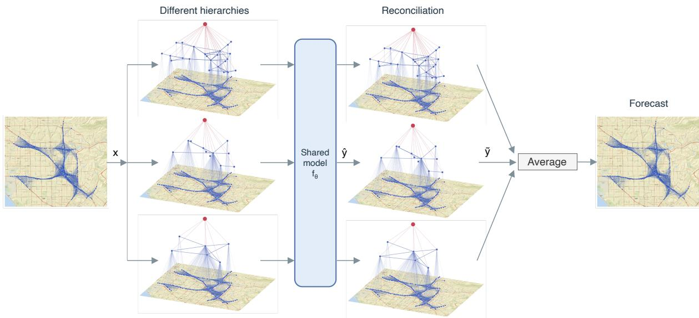  
Figure 1: Inference step for a model trained with our framework on LargeST. Each input is processed and reconciled under multiple hierarchies, and the resulting bottom-level forecasts are averaged.

Taken together, these aspects make the hierarchy an integral part of the forecasting model and a source of inductive bias: it determines the aggregate series available to the model, the paths through which information propagates across scales, the higher-level targets used for supervision, and the constraints imposed on the forecasts. Consequently, different hierarchies group the series into different aggregates and connect them through different paths, thereby inducing distinct but related learning tasks that share the same bottom-level forecasting objective. Related tasks can encourage the model to learn representations that are useful across different structures and generalize better to the common forecasting task, as established in the multi-task learning literature (Caruana, 1993). This effect arises when parameters are shared across tasks, favoring solutions useful across them over those specialized to a single one. However, existing deep hierarchical forecasting methods generally train on a single, often fixed, hierarchy (Rangapuram et al., 2021; Yang et al., 2017; Cini et al., 2024).

In this paper, we introduce a framework that leverages multiple, structurally diverse hierarchies as a source of regularization for spatiotemporal forecasting. In particular, we train a single hierarchical forecasting model over a distribution of hierarchies, sampling a different structure at each training step. Sharing parameters across different hierarchies encourages the same model's forecasting and hierarchical MP functions to perform well across different groupings, thereby reducing overfitting to any single hierarchy. This may be particularly useful in inductive settings, where a trained model is applied to previously unseen time series. Training over different hierarchies, however, introduces a computational challenge, as widely used reconciliation methods require dense matrix inversions for each sampled structure and scale poorly with hierarchy size (Hyndman et al., 2016; Sprangers et al., 2024; Petropoulos et al., 2025; Sharma et al., 2025). To tackle the problem, we introduce a recursive operator that combines forecasts across adjacent hierarchy levels, ensuring coherence by construction with linear time and space complexity w.r.t. the hierarchy size. The main contributions of this paper are:

• We introduce a training framework that optimizes a shared spatiotemporal forecasting model across multiple structurally diverse hierarchies, using their variation as a source of multi-task regularization. Learning across tasks leads to more effective and general representations.

• We develop an efficient recursive procedure that incorporates forecasts from every aggregation level while enforcing the corresponding coherence constraints, making training across a distribution of hierarchies computationally practical.

• We instantiate the proposed framework in a spatiotemporal graph architecture that combines graph neural networks (GNNs), graph pooling, and hierarchical information propagation. This implementation allows the same model parameters to be trained across different hierarchies while preserving coherence w.r.t. each sampled structure.

We evaluate the framework across spatiotemporal forecasting benchmarks, aggregation structures, and inductive settings. Experiments show that jointly training across hierarchies improves accuracy compared with training on individual hierarchies, supporting the hypothesis that variation in the aggregation structures can act as a source of regularization for the forecasting task.

## 2 Preliminaries

Spatiotemporal forecasting. Let $\boldsymbol { X } _ { t } \in \mathbb { R } ^ { N \times d }$ denote the values of N multivariate time series at time $t ; \pmb { x } _ { t } ^ { i } \in \mathbb { R } ^ { d }$ is the d-dimensional observation associated with node i. The spatial relations among time series are represented by a weighted graph with adjacency matrix $\pmb { A } \in \mathbb { R } ^ { N \times N }$ , where $a _ { i j }$ is the weight of the edge from node i to node $j .$ We denote by $U _ { t } \in \mathbb { R } ^ { N \times d _ { u } }$ the exogenous covariates. Given a history $X _ { t - W + 1 : t }$ of W steps in the range $[ t - W + 1 , t ]$ the model $g _ { \boldsymbol { \theta } }$ produces point forecasts for the next H observations as $\boldsymbol { \hat { X } _ { t + 1 : t + H } } = g _ { \boldsymbol { \theta } } ( \boldsymbol { X } _ { t - W + 1 : t } , \boldsymbol { U } _ { t - W + 1 : t } , \boldsymbol { A } )$ . We use time-then-space (TTS) networks that first encode each series' recent history and then exchange information among connected nodes via MP (Gao & Ribeiro, 2022; Cini et al., 2025). For node $i ,$ a generic layer k of such spatiotemporal graph neural network (STGNN) can be written as

$$
\begin{array} { r } { \pmb { h } _ { t } ^ { i , 0 } = \mathrm { S e q E n c } \left( \pmb { x } _ { t - W + 1 : t } ^ { i } , \pmb { u } _ { t - W + 1 : t } ^ { i } \right) , } \end{array}\tag{1}
$$

$$
h _ { t } ^ { i , k + 1 } = \mathrm { U p d a t e } ^ { k } \Big ( h _ { t } ^ { i , k } , \mathrm { A g g r } _ { j \in \mathcal { N } ( i ) } \left\{ \mathrm { M s g } ^ { k } \left( h _ { t } ^ { i , k } , h _ { t } ^ { j , k } , a _ { i j } \right) \right\} \Big ) ,\tag{2}
$$

where $\mathrm { U p d a t e } ^ { k } ( \cdot )$ and $\mathrm { M s g } ^ { k } ( \cdot )$ denote update and message functions, SeqEnc(·) the network performing temporal encoding for each input series, and Aggr{ · } the permutation-invariant aggregation function over the set of neighbors $\mathcal { N } ( i )$ of the i-th node.

Hierarchical forecasting. In hierarchical forecasting, a hierarchy organizes a collection of N time series $X _ { t } \in$ $\mathbb { R } ^ { N \times d }$ into progressively coarser groups. The input series constitute the bottom level, denoted by $Y _ { t } ^ { ( 0 ) } = X _ { t }$ . Each higher level $l \in \{ 1 , \ldots , L - 1 \}$ contains $N _ { l }$ series $\pmb { Y } _ { t } ^ { ( l ) } \in \mathbb { R } ^ { N _ { l } \times d }$ . Overall, the hierarchy contains $\begin{array} { r } { M = \sum _ { l = 0 } ^ { L - 1 } N _ { l } } \end{array}$ series, stacked from the highest aggregation level to the bottom in $\boldsymbol { Y } _ { t } \in \mathbb { R } ^ { M \times d }$ . The matrix $C \in \{ 0 , 1 \} ^ { ( M { \overset { . } { - } } { \tilde { N } } ) \times N }$ specifies which bottom-level series contribute to each aggregate. Since aggregates are represented as means, we define $\dot { \bar { C } } = D ^ { - 1 } C$ , where $D = \arg ( C \mathbf { 1 } )$ stores the corresponding group sizes. The aggregation matrix is therefore obtained as $\pmb { S } = [ \bar { C } ^ { \top } , \pmb { I } _ { N } ] ^ { \top } \in \mathrm { ~ \mathbb { R } ^ { M \times N } ~ }$ , where $\mathbf { \Psi } _ { I _ { N } } \in \bar { \mathbb { R } } ^ { N \times N }$ is the identity matrix (Hyndman et al., 2016). The hierarchy and its aggregation structure satisfy:

$$
Y _ { t } = S X _ { t } , \qquad Q Y _ { t } = \left[ I _ { M - N } \ | - \bar { C } \right] Y _ { t } = 0 ,\tag{3}
$$

where $Q$ encodes the coherence constraints. A forecast $\widehat { Y } _ { t }$ is coherent if $Q { \widehat { Y } } _ { t } = \mathbf { 0 }$ , that is, if each aggregate forecast equals the mean of its corresponding bottom-level forecasts. Because forecasts produced independently at the hierarchy nodes generally do not satisfy this condition, forecast reconciliation enforces the aggregation constraints on the model outputs.

Reconciliation methods and scalability Forecast reconciliation adjusts predictions across hierarchy levels to satisfy the aggregation constraints, transforming the unreconciled forecasts $\widehat { Y } _ { t }$ into coherent forecasts $\overline { { \boldsymbol { Y } } } _ { t }$ . This mapping is generally written as $\overline { { Y } } _ { t } ~ = ~ S P \widehat { Y } _ { t }$ , where $\pmb { P } \in \mathbb { R } ^ { N \times M }$ combines the M node-level forecasts into N bottom-level forecasts and S maps them back to all hierarchy levels (Wickramasuriya et al., 2019). Simple methods such as bottomup (BU) and top-down (TD) use forecasts from a single level, respectively aggregating the bottom-level forecasts or distributing the top-level forecast throughout the hierarchy. In doing so, they discard forecasts from the remaining levels, which can provide complementary information and improve accuracy (Bates & Granger, 1969; Hollyman et al., 2021; Di Fonzo & Girolimetto, 2024). This motivates methods that combine forecasts from the entire hierarchy through weighted projections onto the coherent subspace (Hyndman et al., 2011; Wickramasuriya et al., 2019). In particular, deep hierarchical models (Rangapuram et al., 2021; Cini et al., 2024) usually obtain coherent forecasts as:

$$
\overline { { \boldsymbol { Y } } } _ { t } = \arg \operatorname* { m i n } _ { \boldsymbol { z } : \boldsymbol { Q } \boldsymbol { z } = 0 } \| \boldsymbol { Z } - \widehat { \boldsymbol { Y } } _ { t } \| _ { 2 } ^ { 2 } = \left[ \boldsymbol { I } _ { M } - \boldsymbol { Q } ^ { \intercal } \left( \boldsymbol { Q } \boldsymbol { Q } ^ { \intercal } \right) ^ { - 1 } \boldsymbol { Q } \right] \widehat { \boldsymbol { Y } } _ { t } .\tag{4}
$$

This formulation, however, requires inverting dense matrices that can become increasingly expensive as the hierarchy grows, limiting its application to large hierarchies (Hyndman et al., 2016; Sprangers et al., 2024; Petropoulos et al., 2025; Sharma et al., 2025).

## 3 Stochastic Hierarchy Regularization for Spatiotemporal Forecasting

We use a distribution of hierarchies as a source of regularization for forecasting. For each input graph, we define a hierarchy distribution and sample one hierarchy at each training step. Each sampled hierarchy groups the same bottomlevel nodes differently and connects each aggregate to the nodes it groups. Changing the hierarchy thus changes which aggregates the model processes and how information is exchanged across levels, while the model parameters remain shared. First, in Sec. 3.1, we formulate the optimization of shared parameters across sampled hierarchies. We then discuss how to construct the hierarchy distribution in Sec. 3.2. Next, in Sec. 3.3, we present the pyramidal forecaster, which processes the structure induced by the sampled hierarchy and produces predictions for all of its nodes. Finally, in Sec. 3.4, we introduce a recursive operator that enforces coherence through local operations between adjacent levels while allowing aggregate forecasts to contribute to bottom-level predictions.

## 3.1 Learning over a distribution of hierarchies

Let the input at time t be $\mathcal { G } _ { t } \ = \ \langle X _ { t - W + 1 : t } , U _ { t - W + 1 : t } , A \rangle$ . We propose a forecasting framework with two key ingredients:

1. A hierarchy distribution $\mathcal { P } ( \cdot \mid A )$ over different clusterings of the input graph. Each sampled hierarchy H defines aggregate series, connections across levels, aggregate targets $Y _ { t + 1 : t + H } ^ { \mathcal { H } }$ , and coherence constraints as defined in Sec. 2.

2. A predictor $f _ { \boldsymbol { \theta } } ( \mathcal { G } _ { t } , \mathcal { H } )$ that can operate on a generic input graph $\mathcal { G } _ { t }$ under any hierarchy sampled from $\mathcal { P } ( \cdot \mid A )$ and produce forecasts for its $N _ { l } ^ { \mathcal { H } }$ nodes at each level l. Its parameters θ are shared across hierarchy samples.

At each training step, we sample $\mathcal { H } \sim \mathcal { P } ( \cdot \mid A )$ and apply $f _ { \boldsymbol { \theta } } ( \mathcal { G } _ { t } , \mathcal { H } )$ . We evaluate its forecasts against the original series at $l = 0$ and the aggregates defined by H at $l > 0$ . These losses yield the following objective:

$$
\operatorname* { m i n } _ { \theta } \mathbb { E } _ { \mathcal { G } _ { t } } \mathbb { E } _ { \mathcal { H } \sim \mathcal { P } ( \cdot | A ) } \left[ \sum _ { l = 0 } ^ { L - 1 } \mathcal { L } \Big ( [ f _ { \theta } ( \mathcal { G } _ { t } , \mathcal { H } ) ] ^ { ( l ) } , \mathbf { Y } _ { t + 1 : t + H } ^ { \mathcal { H } , ( l ) } \Big ) \right] ,\tag{5}
$$

where $[ \cdot ] ^ { ( l ) }$ selects the forecasts at level l, and $\mathcal { L }$ is the loss function. The bottom-level targets are shared across all sampled hierarchies, whereas the aggregate targets and computational graph depend on H. Sharing parameters across these related objectives provides multi-task regularization that discourages overfitting to any single hierarchy and, as such, can improve generalization. Importantly, this regularization arises from training shared parameters across structurally different views of the same forecasting problem, rather than from training separate hierarchy-specific models. At inference, the same model can produce one bottom-level forecast under each sampled hierarchy. In practice, we obtain forecasts for the bottom level by independently sampling R hierarchies from ${ \hat { \mathcal { P } } } ( \cdot \mid A )$ , evaluating the model $f _ { \theta } ( \mathcal { G } _ { t } , \mathcal { H } _ { r } )$ under each hierarchy $H _ { r }$ , and averaging the resulting bottom-level forecasts (see Fig. 1):

$$
\widehat { Y } _ { t + 1 : t + H } ^ { ( 0 ) } = \frac { 1 } { R } \sum _ { r = 1 } ^ { R } \left[ f _ { \theta } ( \mathcal { G } _ { t } , \mathcal { H } _ { r } ) \right] ^ { ( 0 ) } .\tag{6}
$$

This average is a Monte Carlo estimate of the expected bottom-level prediction under the hierarchy distribution and makes the final prediction less dependent on any single structure. We describe how to design the hierarchy distribution $\mathcal { P } ( \cdot \mid A )$ in Sec. 3.2, and the predictor $f _ { \theta }$ in Sec. 3.3. Finally, in Sec. 3.4, we consider the problem of enforcing aggregation constraints on the output of $f _ { \theta } ( \cdot )$ while also ensuring computational scalability.

## 3.2 Designing the hierarchy distribution

The distribution $\mathcal { P } ( \cdot \mid A )$ controls the amount and nature of the structural variation introduced during training. Our framework does not prescribe a specific hierarchy distribution. A minimally constrained distribution may randomize both node assignments and the number of aggregates. Alternatively, hierarchy generation can preserve relationships that may be relevant to the task, such as data-driven similarities (Pang et al., 2022) or spatial dependencies encoded by a graph (Cini et al., 2024; Carotti et al., 2026). For the latter, structures can be generated through graph pooling methods (Grattarola et al., 2024). Among existing methods, k-maximal independent set (k-MIS) (Bacciu et al., 2023) generalizes downsampling to arbitrary irregular graphs by selecting centroids more than k hops apart, while ensuring that every node lies within k hops of a centroid. As such, k-MIS coarsening fits well within the framework as it preserves graph locality while allowing the aggregates to vary by considering different pooled graphs. In particular, different hierarchies can be obtained by changing k, which controls the number and spatial range of the intermediate aggregates, and the node ranking $\pi ,$ which changes the centroid selection. In our implementation, we use three-level hierarchies in which k-MIS maps bottom-level nodes into clusters at the second level. Then, all intermediate nodes are connected to a single top-level aggregate. Let K denote the candidate values of k and let ${ \mathfrak { S } } _ { N }$ denote the set of permutations of the $N$ graph nodes. At each training step, we sample $k \sim \mathrm { U n i f } ( \mathcal { K } ) , \pi \sim \mathrm { U n i f } ( \mathfrak { S } _ { N } )$ , and construct the hierarchy $\mathcal { H } _ { k , \pi } = \bar { \mathrm { k } } \mathrm { - } \bar { \mathrm { M I S } } ( A , k , \pi )$ . This provides one possible design for the hierarchy distribution in Eq. 5. In our experiments, we primarily use this topology-aware distribution and also evaluate random node assignments (see Sec. 5).

## 3.3 Pyramidal forecaster

We instantiate the forecaster $f _ { \theta }$ in Eq. 5 using a variant of the pyramidal graph architecture of Cini et al. (2024). The architecture first encodes the history of every node in the hierarchy. At level $l ,$ a temporal encoder processes the corresponding time series and exogenous variables, producing representations ${ \pmb H } _ { t } ^ { ( l ) , 0 }$ . These are then processed by B pyramidal layers. For simplicity, we omit the superscript H from quantities determined by the sampled hierarchy, including $H _ { t } ^ { ( l ) , b } , S ^ { ( l ) }$ , and $\hat { \widehat { Y } } _ { t + 1 : t + H } ^ { ( l ) }$ . At the bottom level, each layer applies a GNN to model dependencies among neighboring nodes, while information propagates between adjacent hierarchy levels through the assignment matrices $\pmb { S } ^ { ( l ) } \in \{ 0 , \breve { 1 } \} ^ { N _ { l - 1 } \times N _ { l } }$ . In particular, $S ^ { ( l ) \top }$ aggregates representations from level $l - 1$ to level l, while S(t) $S ^ { ( l ) }$ propagates them in the opposite direction. Each layer $b \in [ 0 , B - 1 ]$ is defined as:

$$
\begin{array} { r } { \pmb { Z } _ { t } ^ { ( l ) , b } = \left\{ \mathbf { G } \mathrm { N N } ^ { b } \left( \pmb { H } _ { t } ^ { ( 0 ) , b } , \pmb { A } \right) , l = 0 , \right. \qquad } \\ { \left. \pmb { H } _ { t } ^ { ( l ) , b } , \qquad l > 0 , \right. \qquad } \\ { \left. \pmb { H } _ { t } ^ { ( l ) , b + 1 } = \mathrm { U p d a t e } ^ { ( l ) , b } \left( \pmb { Z } _ { t } ^ { ( l ) , b } , \pmb { S } ^ { ( l ) \top } \pmb { Z } _ { t } ^ { ( l - 1 ) , b } , \pmb { S } ^ { ( l + 1 ) } \pmb { Z } _ { t } ^ { ( l + 1 ) , b } \right) . \right. } \end{array}\tag{7}
$$

After B layers, a multi-layer perceptron (MLP) maps each final node representation to its forecast. The sampled hierarchy determines the aggregate representations $\mathbf { \Lambda } _ { \pmb { H } _ { t } ^ { ( l ) , 0 } }$ for $l > 0$ and the assignment matrices $S ^ { ( l ) }$ , thereby changing the aggregate nodes and propagation paths used by the model. We stack forecasts from all levels in $\widehat { Y } _ { t + 1 : t + H }$ and enforce coherence as described in Sec. 3.4.

## 3.4 Obtaining coherent forecasts efficiently

The predictions produced by the pyramidal forecaster at every hierarchy node are not generally coherent across levels. For a hierarchy of M nodes, the projection in Eq. 4 requires a dense matrix inversion, with worstcase time and memory complexities of $\mathcal { O } ( M ^ { 3 } )$ and $\mathcal { O } ( M ^ { 2 } )$ , respectively. When the hierarchy is fixed, the projection matrix can be computed once and reused throughout training (Rangapuram et al., 2021). When the hierarchy is learned, as in Cini et al. (2024), or resampled, as in our method, it must instead be recomputed whenever the structure changes. Therefore, computing coherent forecasts efficiently becomes particularly important in these settings. To this end, we impose coherence recursively between adjacent levels. At each step, a parent forecast is distributed among its children, and

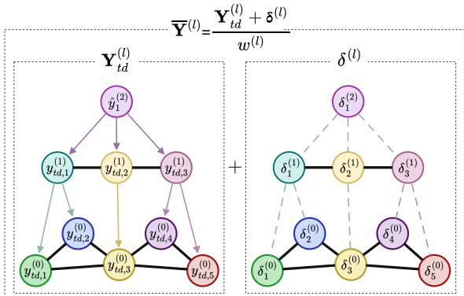  
Figure 2: Recursive operator for coherence.

a zero-sum correction derived from the children's forecasts is added without altering their aggregate. For clarity, we omit the forecasting-horizon indices in the following. Recall that ${ \pmb S } ^ { ( l ) } \in \{ 0 , 1 \} ^ { N _ { l - 1 } \times \overline { { N } } _ { l } }$ assigns each node at level $l - 1$ to one parent at level l. Let $w _ { i } ^ { ( l ) }$ be the number of bottom-level nodes represented by node i at level l. Starting from $\pmb { w } ^ { ( 0 ) } = \mathbf { 1 }$ , we compute $\pmb { w } ^ { ( l + 1 ) } = \pmb { S } ^ { ( l + 1 ) \top } \pmb { w } ^ { ( l ) }$ and rescale the forecasts according to their numbers of bottom-level descendants $\widetilde { \mathbfcal Y } ^ { ( l ) } = \pmb w ^ { ( l ) } \odot \widehat { \mathbfcal Y } ^ { ( l ) }$ . We initialize $\overline { { \pmb { Y } } } ^ { ( L - 1 ) } = \widetilde { \pmb { Y } } ^ { ( L - 1 ) }$ and, for $l = L - 2 , \ldots , 0$ , recursively compute $\overline { { \mathbf { Y } } } ^ { ( l ) } = { Y } _ { \mathrm { t d } } ^ { ( l ) } + \delta ^ { ( l ) }$ as follows:

$$
{ \mathbf { Y } _ { \mathrm { t d } } ^ { ( l ) } } = { \mathbf { w } ^ { ( l ) } } \odot { S ^ { ( l + 1 ) } } \left( \frac { \overline { { \mathbf { Y } } } ^ { ( l + 1 ) } } { \mathbf { w } ^ { ( l + 1 ) } } \right) , \quad \delta ^ { ( l ) } = \widetilde { \mathbf { Y } } ^ { ( l ) } - { \mathbf { w } ^ { ( l ) } } \odot { S ^ { ( l + 1 ) } } \left( \frac { { S ^ { ( l + 1 ) \top } } \widetilde { \mathbf { Y } } ^ { ( l ) } } { \mathbf { w } ^ { ( l + 1 ) } } \right) .\tag{8}
$$

Finally, the resulting forecasts at each level are divided by the descendant counts to recover the original scale. The top-down component $Y _ { \mathrm { t d } } ^ { ( l ) }$ distributes each coherent parent forecast to its children proportionally to their numbers of bottom-level descendants. The correction $\pmb { \delta } ^ { ( l ) }$ captures the weighted deviations of the lower-level forecasts from the average of their siblings. Since these corrections sum to zero within each sibling group, $S ^ { ( l + 1 ) \top } \delta ^ { ( l ) } = \mathbf { 0 }$ , they preserve coherence between adjacent levels (see Fig. 2). Repeating this update from the top level downward produces coherent forecasts at every level. The procedure uses only local reductions from children to parents and broadcasts from parents to children, resulting in O(M) time and memory complexity.

## 4 Related work

STGNNs model temporal dynamics and spatial dependencies by combining temporal and graph-based operations (Wu et al., 2019, 2020; Seo et al., 2018; Yu et al., 2021; BAI et al., 2020; Yu et al., 2018; Li et al., 2018). Hierarchical structures have been used in GNNs to pool nodes into coarser graphs progressively. This allows signals to be processed at multiple resolutions and facilitates long-range MP through the coarser levels (Ying et al., 2018; Gao & Ji. 2019; Bianchi et al., 2022a,b; Carotti et al., 2026). This pyramidal design has also been adopted in spatiotemporal models (Yu et al., 2021; Hermes et al., 2022; Guo et al., 2021; Ma et al., 2022; Chen et al., 2023; Arya et al., 2023; Marisca et al., 2024). A separate line of work forecasts series at multiple aggregation levels and enforces coherence among their predictions. Rangapuram et al. (2021) incorporate predefined aggregation constraints into a probabilistic forecasting model, while Cini et al. (2024) jointly learn the hierarchy with the forecasting model. Both approaches train the model using a single hierarchy. Besides deep learning methods, recent work has begun to consider multiple aggregation structures. Zhang et al. (2025) fit and reconcile forecasts separately under each hierarchy before combining the resulting predictions. However, applying this approach to deep models would require training a separate model for each hierarchy. Other methods build multiple aggregate groupings and use their constraints jointly during reconciliation (Pang et al., 2022; Mattera et al., 2024). In both cases, hierarchy variation is used after forecasts have been produced to reconcile or combine predictions, rather than as a source of regularization during model training.

## 5 Experiments

We aim to assess whether diversity in hierarchy structures can act as a source of regularization to improve forecasting accuracy, and whether our framework allows scalable training over a distribution of hierarchies. Specifically, we analyze: (1) whether training across multiple hierarchies improves accuracy over single-hierarchy alternatives and compares favorably with the baselines; (2) how the diversity of the hierarchies affects accuracy at training and inference time; (3) whether our procedure to obtain coherence scales to large hierarchies; and (4) whether the derived regularization improves generalization to unseen series compared with fixed-hierarchy alternatives. We refer to the framework introduced in Sec. 3 as Stochastic Hierarchical Regularization (SHR). To isolate the effect of regularization from architectural choices, we instantiate the forecaster using the pyramidal architecture of Hierarchical Graph Predictor (HiGP) (Cini et al., 2024), with a recurrent neural network (RNN) for temporal encoding and gated graph convolutions (Cini et al., 2023b) for MP. SHR trains across sampled hierarchies (Eq. 5), enforces coherence with our recursive procedure (Sec. 3.4), and averages forecasts across hierarchies at inference (Eq. 6). In contrast, HiGP is trained with a single hierarchy learned during training and uses the projection-based reconciliation (Eq. 4). Unless otherwise specified, SHR uses the k-MIS-based hierarchy distribution described in Sec. 3.2; we also evaluate a random-assignment variant, denoted SHR (rand.).

Experimental settings We use four real-world sensor-network datasets with hundreds of nodes, covering traffic (Metr-LA and PeMS-Bay, Li et al. (2018)), air quality (AQI, Zheng et al. (2015)), and weather (EngRAD, Marisca et al. (2024)). We follow established settings from the literature for train, validation, and test splits, input windows, forecasting horizons, adjacency matrices, and exogenous variables (Cini et al., 2023b; Yi et al., 2016; Cini et al., 2022; Marisca et al., 2024). For the inductive setting, we use the large-scale traffic dataset GLA, part of LargeST (Liu et al., 2023b). Our baselines include TTS architectures with a GRU (Cho et al., 2014) temporal encoder combined with different state of the art (SOTA) GNNs: bidirectional diffusion convolution (DCRNN, Li et al. (2018)), graph convolution (GConv-TTS, Kipf & Welling (2017)), and hierarchical Graph U-Net (GUNet-TTS, Gao & Ji (2019)). We also include a global univariate RNN as a simple reference and several SOTA STGNNs: Graph WaveNet (GWNet, Wu et al. (2019)), SGP (Cini et al., 2023a), STAEformer (Liu et al., 2023a), LAMP (Castelli et al., 2026), STDN (Cao et al., 2025), and HiGP (Cini et al., 2024). Full experimental details and additional results are provided in App. A, App. B, and App. C. For all experiments, we report the mean and standard deviation of the Mean Absolute Error (MAE) across independent runs.

Forecasting performance and hierarchy variants Tab. 1 reports bottom-level forecasting performance for SHR and a range of established baselines and SOTA models across datasets. Despite its simple backbone, SHR is competitive with several established baselines. To assess whether these benefits derive from training across multiple hierarchies, we compare SHR with two single-hierarchy variants using the same forecasting backbone in Tab. 2. HiGP uses a hierarchy learnt jointly with the forecasting model, whereas Fixed hier. uses a fixed hierarchy obtained through spectral clustering. SHR shows better performance than both, supporting the hypothesis that training across multiple aggregation structures can provide regularization for the bottom-level task. In our experiments, we generally use k-MIS to constrain node assignments through graph connectivity. We assess this choice with SHR (rand.), which randomly assigns bottom-level nodes to balanced aggregates. The fully randomized approach can perform well, although k-MIS yields markedly better results in some settings, such as on EngRAD. The differences cannot be attributed solely to graph connectivity, as the two constructions also differ in the number, size, and balance of their aggregates. Finally, SHR (proj.-based rec.) replaces our recursive procedure in SHR with projection-based reconciliation (Eq. 4), commonly adopted in deep hierarchical forecasting models (Rangapuram et al., 2021; Cini et al., 2024). As shown in Tab. 2, our procedure achieves similar or better forecasting accuracy than standard projection-based reconciliation, showing that improved scalability can be achieved without compromising forecasting accuracy.

Table 1: Performance of baselines and SHR across datasets. Bold and underlined denote the best and second-best mean MAE.
<table><tr><td rowspan=1 colspan=2>Model</td><td rowspan=1 colspan=1>Metr-LA</td><td rowspan=1 colspan=1> $\mathrm { P e M S - B a y }$ </td><td rowspan=1 colspan=2>AQI</td><td rowspan=1 colspan=3>EngRAD</td></tr><tr><td rowspan=1 colspan=2>RNN</td><td rowspan=1 colspan=1> $3 . 5 4 0 \pm . 0 0 1$ </td><td rowspan=1 colspan=1> $1 . 7 7 1 \pm . 0 0 0$ </td><td rowspan=1 colspan=2> $1 3 . 9 1 9 \pm . 0 5 2$ </td><td rowspan=2 colspan=3>46.727 ± .489 $4 3 . 4 0 8 \pm . 0 8 4$ </td></tr><tr><td rowspan=1 colspan=2>DCRNN</td><td rowspan=1 colspan=1> $3 . 2 8 1 \pm . 0 0 1$ </td><td rowspan=1 colspan=1> $1 . 7 1 0 \pm . 0 0 4$ </td><td rowspan=1 colspan=2> $1 2 . 6 8 5 \pm . 0 1 8$ </td><td rowspan=1 colspan=2>43.408</td></tr><tr><td rowspan=5 colspan=2>GConv-TTSGUNet-TTSGWNetSGPSTAEformer</td><td rowspan=1 colspan=1> $3 . 0 7 1 \pm . 0 0 4$ </td><td rowspan=1 colspan=1> $1 . 5 7 1 \pm . 0 0 7$ </td><td rowspan=1 colspan=2> $1 2 . 3 9 3 \pm . 0 2 0$ </td><td rowspan=1 colspan=1> $4 3 . 7 8 9</td><td></td><td rowspan=1 colspan=1>\pm . 0 7 1$ </td></tr><tr><td rowspan=2 colspan=1> $3 . 0 5 6 \pm . 0 0 2$  $3 . 0 6 9 \pm . 0 0 3$ </td><td rowspan=2 colspan=1> $1 . 5 7 1 \pm . 0 0 3$  $1 . 5 7 3 \pm . 0 0 8$ </td><td rowspan=1 colspan=1> $1 2 . 3</td><td rowspan=1 colspan=1>2 5 \pm . 0 2 0$ </td><td rowspan=1 colspan=1>44.1</td><td></td><td rowspan=2 colspan=1> $4 4 . 1 7 9 \pm . 4 3 9$ \pm . 4 0 5</eq></td></tr><tr><td rowspan=1 colspan=2> $1 1 . 9 6 2 \pm . 0 3 3$ </td><td rowspan=1 colspan=1> $4 0 . 5 7 1</td><td rowspan=1 colspan=1>571</td></tr><tr><td rowspan=2 colspan=1><eq>3 . 0 4 7 \pm . 0 0 2$  $\underline { { 3 . 0 2 1 \pm . 0 2 0 } }$ </td><td rowspan=2 colspan=1> $1 . 5 9 3 \pm . 0 0 4$  $1 . 5 5 2 \pm . 0 0 8$ </td><td rowspan=1 colspan=2> $1 2 . 7 2 7 \pm . 0 1 0$ </td><td rowspan=1 colspan=3> $4 3 . 9 8 5 \pm . 1 5 1$ </td></tr><tr><td rowspan=1 colspan=1>mer</td><td rowspan=1 colspan=2> $1 2 . 8 1 1 \pm . 0 4 9$ </td><td rowspan=1 colspan=3> $5 7 . 4 1 8 \pm . 8 0 1$ </td></tr><tr><td rowspan=1 colspan=1>LAMP</td><td rowspan=2 colspan=2>STDN</td><td rowspan=1 colspan=1> $3 . 1 3 2 \pm . 0 0 1$ </td><td rowspan=1 colspan=2> $1 . 6 8 9 \pm . 0 0 2$ </td><td rowspan=1 colspan=3> $1 5 . 8 2 7 \pm . 0 2 8$ </td></tr><tr><td></td><td rowspan=1 colspan=1> $3 . 0 5 0 \pm . 0 0 7$ </td><td rowspan=1 colspan=1> $1 . 5 8 4 \pm . 0 0 5$ </td><td rowspan=1 colspan=2> $1 3 . 2 2 2 \pm . 1 3 3$ </td><td rowspan=1 colspan=3> $5 2 . 9 3 5 \pm . 4 5 4$ </td></tr><tr><td rowspan=1 colspan=2>HiGP</td><td rowspan=1 colspan=1> $3 . 0 3 5 \pm . 0 0 8$ </td><td rowspan=1 colspan=1> $1 . 5 7 9 \pm . 0 0 3$ </td><td rowspan=1 colspan=2> $1 1 . 9 8 4 \pm . 0 1 7$ </td><td rowspan=1 colspan=3> $4 0 . 5 5 1 \pm . 3 0 2$ </td></tr><tr><td rowspan=1 colspan=4>SHR           $\mathbf { 3 . 0 0 3 \ : \pm . 0 1 7 }$    $1 . 5 5 6 \pm . 0 0 8$ </td><td rowspan=1 colspan=5> $\mathbf { 1 1 . 9 4 5 \ : \pm . 0 0 4 }$    $\mathbf { 3 9 . 1 6 7 \sigma \bot } 6 0$ </td></tr></table>

Table 2: Comparison of single- and multiple-hierarchy training, hierarchy construction strategies, and reconciliation procedures. Bold and underlined denote the best and second-best mean MAE
<table><tr><td rowspan=1 colspan=1>Model</td><td rowspan=1 colspan=1>Metr-LA|P</td><td rowspan=1 colspan=1>eMS-Bay</td><td rowspan=1 colspan=1>AQI</td><td rowspan=1 colspan=1>EngRAD</td></tr><tr><td rowspan=1 colspan=1>Fixed hier.HiGP</td><td rowspan=1 colspan=1> $3 . 0 6 6 \pm . 0 1 9$  $3 . 0 3 5 \pm . 0 0 8$ </td><td rowspan=1 colspan=1> $1 . 5 6 2 \pm . 0 0 9$  $1 . 5 7 9 \pm . 0 0 3$ </td><td rowspan=1 colspan=1> $1 2 . 0 4 5 \pm . 0 2 2$  $1 1 . 9 8 4 \pm . 0 1 7$ </td><td rowspan=1 colspan=1> $4 0 . 6 4 2 \pm . 0 5 7$  $4 0 . 5 5 1 \pm . 3 0 2$ </td></tr><tr><td rowspan=1 colspan=1>SHR (proj.-based rec.)</td><td rowspan=1 colspan=1> $3 . 0 2 1 \pm . 0 0 7$ 一</td><td rowspan=1 colspan=1> $1 . 5 5 8 \pm . 0 0 3$ 一</td><td rowspan=1 colspan=1> ${ \underline { { 1 1 . 9 5 1 \pm . 0 4 9 } } }$ 一</td><td rowspan=1 colspan=1> $4 0 . 0 0 2 \pm . 1 8 0$ </td></tr><tr><td rowspan=1 colspan=1>SHR (rand.)SHR</td><td rowspan=1 colspan=1> $\mathbf { 2 . 9 9 7 \bot . 0 1 5 }$  $\underline { { 3 . 0 0 3 \pm . 0 1 7 } }$ </td><td rowspan=1 colspan=1> $1 . 5 5 2 \pm . 0 0 7$  $1 . 5 5 6 \pm . 0 0 8$ </td><td rowspan=1 colspan=1> $1 1 . 9 7 2 \pm . 0 2 9$  ${ \bf 1 1 . 9 4 5 \ : \pm . 0 0 4 }$ </td><td rowspan=1 colspan=1> $4 0 . 1 7 0 \pm . 2 5 6$  $\mathbf { 3 9 . 1 6 7 \sigma \bot } 6 0 $ </td></tr></table>

Table 3: Bottom-level performance under different hierarchy distributions induced by k-MIS. Bold and underlined denote the best and second-best mean MAE.
<table><tr><td rowspan=1 colspan=1>Model</td><td rowspan=1 colspan=1>Metr-LA</td><td rowspan=1 colspan=1>PeMS-Bay</td><td rowspan=1 colspan=1>AQI</td><td rowspan=1 colspan=1>EngRAD</td></tr><tr><td rowspan=1 colspan=1> $k = 2 ,$ fixed rankingk = 3, fixed ranking</td><td rowspan=1 colspan=1> $3 . 0 2 5 \pm . 0 0 9$  $3 . 0 2 0 \pm . 0 1 3$ </td><td rowspan=1 colspan=1> $1 . 5 5 9 \pm . 0 1 3$  $1 . 5 6 6 \pm . 0 0 8$ </td><td rowspan=1 colspan=1> $1 2 . 0 7 6 \pm . 0 6 6$  $1 2 . 0 5 4 \pm . 0 1 2$ </td><td rowspan=1 colspan=1> $3 9 . 7 6 9 \pm . 1 4 2$  $3 9 . 6 7 0 \pm . 2 6 9$ </td></tr><tr><td rowspan=3 colspan=1> $k = 2 ,$ random ranking $k = 3 ,$ random ranking $k \in \{ 2 , 3 \}$ , random ranking</td><td rowspan=3 colspan=1> $3 . 0 2 7 \pm . 0 3 1$  $\mathbf { 3 . 0 1 } 2 \pm . 0 1 0$  $\underline { { 3 . 0 1 4 \pm . 0 3 5 } }$ </td><td rowspan=2 colspan=1> $1 . 5 5 2 \pm . 0 0 3$  $1 . 5 5 9 \pm . 0 0 1$ </td><td rowspan=2 colspan=1> ${ \bf 1 1 . 9 4 0 \pm . 0 1 2 }$  $1 1 . 9 8 7 \pm . 0 2 7$ </td><td rowspan=1 colspan=1> $3 9 . 3 1 7 \pm . 1 0 1$ </td></tr><tr><td rowspan=1 colspan=1> $\mathbf { 3 9 . 2 3 3 \ : \pm . 3 6 1 }$ </td></tr><tr><td rowspan=1 colspan=1> $\underline { { 1 . 5 5 3 \pm . 0 1 1 } }$ </td><td rowspan=1 colspan=1> $\underline { { 1 1 . 9 7 9 \pm . 0 2 1 } }$ </td><td rowspan=1 colspan=1> $3 9 . 3 5 8 \pm . 1 9 6$ </td></tr></table>

Sensitivity analysis. As described in Sec. 3.1, SHR leverages hierarchy diversity during both training and inference. During training, a single model learns across different aggregation structures, while at inference its bottom-level forecasts can be averaged across hierarchies. Here, we investigate in depth whether increasing hierarchy diversity during training benefits forecasting accuracy. We use the Metr-LA dataset as reference and provide results for other datasets in App. C. In Fig. 3a, we progressively increase the number of training hierarchies while keeping the number of intermediate nodes fixed $( \bar { N _ { 1 } } = 2 0 )$ and varying their bottom-level assignments. One hierarchy is sampled at each training batch from a finite set of increasing size, while Rand. generates a new assignment every time. Increasing the number of training hierarchies generally reduces MAE, supporting the interpretation that different structures may provide useful learning signals for the downstream task. We then study whether introducing broader structural diversity provides similar benefits. In Fig. 3b, we progressively increase hierarchy diversity by varying both bottom-level assignments and the number of intermediate nodes. Hierarchy randomization Level 0 and 1 use one and four hierarchies with $N _ { 1 } = 2 0$ . Levels 2 and 3 use 16 and 64 hierarchies with $N _ { 1 } \in \{ 1 5 , 2 0 , 2 5 \}$ and $N _ { 1 } \in \{ 1 0 , 1 5 , 2 0 , 2 5 , 3 0 \}$ respectively. At Level Rand. (corresponding to SHR (rand.) in Tab. 2), a new hierarchy is generated at every training batch with $N _ { 1 } \in \{ 1 0 , \dots , 3 0 \}$ . In both experiments, the compared models use three randomly generated hierarchies per validation batch and report bottom-level MAE after averaging forecasts from multiple hierarchies. Fixed instead uses a single hierarchy for training, validation, and testing. Also in this case, training on multiple, structurally different hierarchies improves bottom-level accuracy. This trend persists without test-time averaging (App. C). Similar gains at higher aggregation levels under three different hierarchies show that the benefit extends to aggregate forecasts under different aggregation structures (Fig. 4). We next assess whether hierarchy diversity also provides benefits at inference through forecast averaging. In Fig. 3c, we progressively increase the number of test hierarchies whose bottom-level forecasts are averaged according to Eq. 6, using two separately trained SHR (rand.) models. For the first, every training and test hierarchy has $N _ { 1 } = 2 0 ;$ for the second, $N _ { 1 }$ is independently sampled from $\{ 1 0 , \ldots , 3 0 \}$ for each training batch and test hierarchy. Accuracy consistently improves as more forecasts are averaged, both for fixed and varying $N _ { 1 }$ . Finally, we investigate whether training across multiple hierarchies is also beneficial when the hierarchy distribution is constrained by graph topology. Tab. 3 compares different hierarchy distributions induced by k-MIS. Fixed k and node rankings π define a single hierarchy, whereas randomized rankings generate multiple hierarchies by changing centroid selection and node assignments. We consider fixed and randomized rankings for $k \in \{ 2 , 3 \}$ as well as randomized rankings with sampled k. Randomized rankings perform best on most datasets, particularly AQI and EngRAD, showing that the benefits of training across multiple hierarchies persist across different hierarchy distributions.

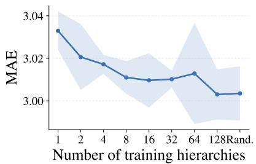  
(a) Fixed $N _ { 1 }$ , performance at $L _ { 0 } .$

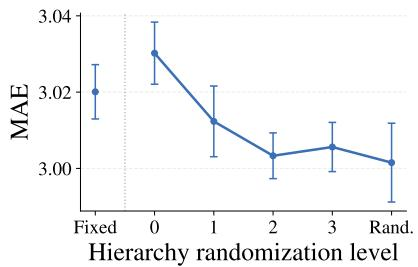  
(b) Variable $N _ { 1 } .$ performance at $L _ { 0 } .$

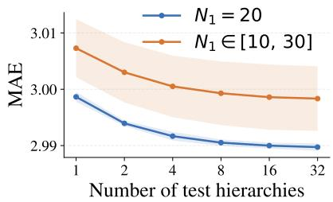  
(c) Test-time averaging at $L _ { 0 } .$

Figure 3: Bottom-level performance $( L _ { 0 } )$ on Metr-LA. (a) varies the number of training hierarchies with fixed $N _ { 1 } =$ 20; (b) increases the diversity of both node-to-aggregate assignments and the number of intermediate aggregates $N _ { 1 }$ (c) varies the number of test-hierarchy forecasts being averaged, comparing fixed $N _ { 1 } = 2 0$ with $N _ { 1 } \in \{ \bar { 1 0 } , . . . , 3 0 \}$  
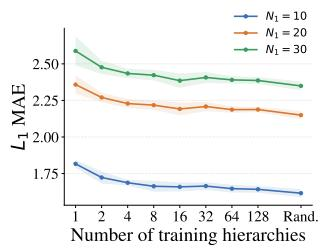  
(a) Fixed $N _ { 1 } ( L _ { 1 } ) .$

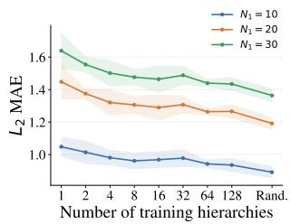  
(b) Fixed $N _ { 1 }$ $( L _ { 2 } ) .$

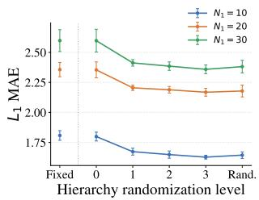  
(c) Variable $N _ { 1 }$ $( L _ { 1 } ) .$

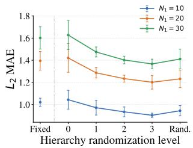  
(d) Variable $N _ { 1 }$ $( L _ { 2 } ) .$  
Figure 4: Performance at higher aggregation levels $( L _ { 1 }$ and $L _ { 2 } )$ on Metr-LA. (a) and (b) increase the number of training hierarchies while keeping $N _ { 1 } = 2 0$ and varying node-to-aggregate assignments. (c) and (d) progressively increase training-hierarchy diversity by varying both the assignments and $N _ { 1 }$ . Each curve evaluates the same set of trained models using common test hierarchies with $N _ { 1 } \in \{ 1 0 , 2 0 , 3 0 \}$

Computational scalability. We assess how our recursive operator for obtaining coherent forecasts scales compared with the projection-based reconciliation in Eq. 4, commonly used in deep hierarchical forecasting models (Rangapuram et al., 2021; Cini et al., 2024). We use identical forecasting models that differ only in how coherence is enforced, and evaluate them on synthetic graphs and hierarchies of increasing size. As shown in Fig. 5, our procedure requires substantially less inference time and GPU memory, with the gap widening at larger scales. Consistent with Sec. 3.4, its time and memory complexities grow approximately linearly, whereas projection-based reconciliation grows faster.

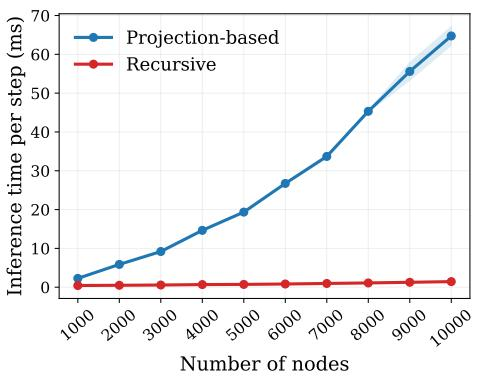

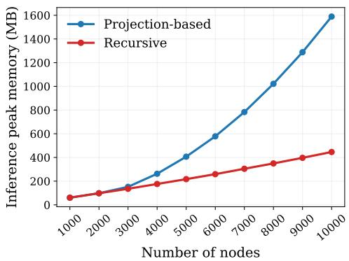  
Figure 5: Inference scalability with projection-based reconciliation and our recursive operator, measured by runtime (left) and peak GPU memory (right) as graph and hierarchy sizes increase.

Together with Tab. 2, these findings show that our procedure improves scalability relative to a dense projection implementation without sacrificing predictive performance.

Inductive setting. We evaluate SHR in an inductive setting by partitioning GLA into disjoint subgraphs for training, validation, and testing (further details in App. A). We compare SHR with a single-hierarchy model. We exclude HiGP from the comparison because it relies on node embeddings to construct the hierarchy (Cini et al., 2023b), which cannot directly transfer to unseen graphs. As shown in Tab. 4, both SHR variants outperform the single-hierarchy model. Results suggest that SHR can support settings where the underlying graph and associated aggregation structure change.

Table 4: Performance on GLA (inductive setup). Bold and underlined values indicate the best and second-best MAE.
<table><tr><td>Model</td><td>Window</td><td>MAE</td></tr><tr><td>Fixed hier.</td><td>96</td><td>22.444 ±.198</td></tr><tr><td>SHR (rand.)</td><td>96</td><td> $\mathbf { 2 1 . 2 4 0 \ : \pm . 0 5 7 }$ </td></tr><tr><td>SHR</td><td>96</td><td> $2 1 . 4 1 2 \pm . 0 8 7$ </td></tr></table>

## 6 Conclusion

We propose structurally diverse hierarchies as a source of regularization for spatiotemporal forecasting. We introduce a training framework in which a single model learns across multiple aggregation structures, together with a scalable procedure for ensuring coherent forecasts under each hierarchy. Experiments show consistent improvements over single-hierarchy training and competitive performance against forecasting baselines. Future work could explore different distributions over hierarchies and different designs for the forecasting architecture. It would also be interesting to consider different aggregation levels jointly across time and space, incorporating temporal hierarchies (Athanasopoulos et al., 2017; Rangapuram et al., 2023) into the framework.

## Acknowledgments

This work was supported by the Swiss National Science Foundation projects no. 204061 (Higher-Order Relations and Dynamics in Graph Neural Networks) and no. 225351 (Relational Deep Learning for Reliable Time Series Forecasting at Scale).

## References

Arie N. Arya, Yao Lei Xu, L. Stankovic, and Danilo P. Mandic. Hierarchical graph learning for stock market prediction via a domain-aware graph pooling operator. In ICASSP 2023 - 2023 IEEE International Conference on Acoustics, Speech and Signal Processing (ICASSP), pp. 1–5, 2023. doi: 10.1109/ICASSP49357.2023.10095381.

George Athanasopoulos, Rob J. Hyndman, Nikolaos Kourentzes, and Fotios Petropoulos. Forecasting with temporal hierarchies. European Journal of Operational Research, 262(1):60–74, 2017. ISSN 0377-2217. doi: https://doi.org/10.1016/j.ejor.2017.02.046. URL https://www.sciencedirect.com/science/article/pii/ S0377221717301911.

Davide Bacciu, Alessio Conte, and Francesco Landolfi. Generalizing downsampling from regular data to graphs. In Proceedings of the Thirty-Seventh AAAI Conference on Artificial Intelligence and Thirty-Fifth Conference on

Innovative Applications of Artificial Intelligence and Thirteenth Symposium on Educational Advances in Artificial Intelligence, AAAI'23/IAAI'23/EAAI'23. AAAI Press, 2023. ISBN 978-1-57735-880-0. doi: 10.1609/aaai.v37i6 25824. URL https://doi.org/10.1609/aaai.v37i6.25824.

LEI BAI, Lina Yao, Can Li, Xianzhi Wang, and Can Wang. Adaptive graph convolutional recurrent network for traffic forecasting. In H. Larochelle, M. Ranzato, R. Hadsell, M.F. Balcan, and H. Lin (eds.), Advances in Neural Information Processing Systems, volume 33, pp. 17804–17815. Curran Associates, Inc., 2020. URL https://proceedings.neurips.cc/paper\_files/paper/2020/file/ ce1aad92b939420fc17005e5461e6f48-Paper.pdf.

J. M. Bates and C. W. J. Granger. The combination of forecasts. OR, 20(4):451–468, 1969. ISSN 14732858. URL http://www.jstor.org/stable/3008764.

Filippo Maria Bianchi, Daniele Grattarola, Lorenzo Livi, and Cesare Alippi. Hierarchical representation learning in graph neural networks with node decimation pooling. IEEE Transactions on Neural Networks and Learning Systems, 33(5):2195–2207, 2022a. doi: 10.1109/TNNLS.2020.3044146.

F.M. Bianchi, Claudio Gallicchio, and Alessio Micheli. Pyramidal reservoir graph neural network. Neurocomputing, 470:389–404, 2022b. ISSN 0925-2312. doi: https://doi.org/10.1016/j.neucom.2021.04.131. URL https://www. sciencedirect.com/science/article/pii/S0925231221011152.

Lingxiao Cao, Bin Wang, Guiyuan Jiang, Yanwei Yu, and Junyu Dong. Spatiotemporal-aware trend-seasonality decomposition network for traffic flow forecasting. In Proceedings of the Thirty-Ninth AAAI Conference on Artificial Intelligence and Thirty-Seventh Conference on Innovative Applications of Artificial Intelligence and Fifteenth Symposium on Educational Advances in Artificial Intelligence, AAAI’25/IAAI’25/EAAI'25. AAAI Press, 2025. ISBN 978-1-57735-897-8. doi: 10.1609/aaai.v39i11.33247. URL https://doi.org/10.1609/aaai.v39i11.33247.

Stefano Carotti, Marco Pacini, Alessio Gravina, Davide Bacciu, Bruno Lepri, and Sebastiano Bontorin. Graph hierarchical recurrence for long-range generalization, 2026. URL https://arxiv.org/abs/2605.18387.

Rich Caruana. Multitask learning: a knowledge-based source of inductive bias. In Proceedings of the Tenth International Conference on Machine Learning, ICML'93, pp. 41–48, San Francisco, CA, USA, 1993. Morgan Kaufmann Publishers Inc. ISBN 1558603077.

Fabrizio De Castelli, Alessio Gravina, Moshe Eliasof, Carola-Bibiane Schönlieb, and Davide Bacciu. Adaptive memory retention in dynamic graphs. In Forty-third International Conference on Machine Learning, 2026. URL https://openreview.net/forum?id=x7NGYPNlgs.

Ling Chen, Jiahui Xu, Binqing Wu, and Jianlong Huang. Group-aware graph neural network for nationwide city air quality forecasting. ACM Trans. Knowl. Discov. Data, 18(3), December 2023. ISSN 1556-4681. doi: 10.1145/ 3631713. URL https://doi.org/10.1145/3631713.

Kyunghyun Cho, Bart van Merriënboer, Dzmitry Bahdanau, and Yoshua Bengio. On the properties of neural machine translation: Encoder-decoder approaches. In Dekai Wu, Marine Carpuat, Xavier Carreras, and Eva Maria Vecchi (eds.), Proceedings of SSST-8, Eighth Workshop on Syntax, Semantics and Structure in Statistical Translation, pp. 103–111, Doha, Qatar, October 2014. Association for Computational Linguistics. doi: 10.3115/v1/W14-4012. URL https://aclanthology.org/W14-4012/.

Andrea Cini and Ivan Marisca. Torch Spatiotemporal, 3 2022. URL https://github.com/ TorchSpatiotemporal/tsl.

Andrea Cini, Ivan Marisca, and Cesare Alippi. Filling the G\_ap\_s: Multivariate time series imputation by graph neural networks. In International Conference on Learning Representations, 2022. URL https://openreview .net/ forum?id=k0u3-S3wJ7.

Andrea Cini, Ivan Marisca, Filippo Maria Bianchi, and Cesare Alippi. Scalable spatiotemporal graph neural networks. In Proceedings of the Thirty-Seventh AAAI Conference on Artificial Intelligence and Thirty-Fifth Conference on Innovative Applications of Artificial Intelligence and Thirteenth Symposium on Educational Advances in Artificial Intelligence, AAAI'23/IAAI'23/EAAI'23. AAAI Press, 2023a. ISBN 978-1-57735-880-0. doi: 10.1609/aaai.v37i6. 25880. URL https://doi.org/10.1609/aaai.v37i6.25880.

Andrea Cini, Ivan Marisca, Daniele Zambon, and Cesare Alippi. Taming local effects in graph-based spatiotemporal forecasting. In A. Oh, T. Naumann, A. Globerson, K. Saenko, M. Hardt, and S. Levine (eds.), Advances in Neural Information Processing Systems, volume 36, pp. 55375–55393. Curran Associates, Inc., 2023b. doi: 10.52202/075280-2417. URL https://proceedings.neurips.cc/paper\_files/paper/2023/file/ ad58c61c71efd5436134a3ecc87da6ea-Paper-Conference.pdf.

Andrea Cini, Danilo Mandic, and Cesare Alippi. Graph-based time series clustering for end-to-end hierarchical forecasting. In Proceedings of the 41st International Conference on Machine Learning, ICML’24. JMLR.org, 2024.

Andrea Cini, Ivan Marisca, Daniele Zambon, and Cesare Alippi. Graph deep learning for time series forecasting. ACM Comput. Surv., 57(12), July 2025. ISSN 0360-0300. doi: 10.1145/3742784. URL https://doi.org/10. 1145/3742784.

Tommaso Di Fonzo and Daniele Girolimetto. Forecast combination-based forecast reconciliation: Insights and extensions. International Journal of Forecasting, 40(2):490–514, 2024. ISSN 0169-2070. doi: https:// doi.org/10.1016/j.ijforecast.2022.07.001. URL https://www.sciencedirect.com/science/article/pii/ S0169207022000991.

William Falcon and The PyTorch Lightning team. PyTorch Lightning, 3 2019. URL https://github.com/ PyTorchLightning/pytorch-lightning.

Matthias Fey and Jan E. Lenssen. Fast graph representation learning with PyTorch Geometric. In ICLR Workshop on Representation Learning on Graphs and Manifolds, 2019.

Hongyang Gao and Shuiwang Ji. Graph u-nets. In Kamalika Chaudhuri and Ruslan Salakhutdinov (eds.), Proceedings of the 36th International Conference on Machine Learning, volume 97 of Proceedings of Machine Learning Research, pp. 2083–2092. PMLR, 09–15 Jun 2019. URL https://proceedings.mlr.press/v97/gao19a.html.

Jianfei Gao and Bruno Ribeiro. On the equivalence between temporal and static equivariant graph representations. In Kamalika Chaudhuri, Stefanie Jegelka, Le Song, Csaba Szepesvari, Gang Niu, and Sivan Sabato (eds.), Proceedings of the 39th International Conference on Machine Learning, volume 162 of Proceedings of Machine Learning Research, pp. 7052–7076. PMLR, 17–23 Jul 2022. URL https://proceedings .mlr. press/v162/gao22e.html.

Daniele Grattarola, Daniele Zambon, Filippo Maria Bianchi, and Cesare Alippi. Understanding pooling in graph neural networks. IEEE Transactions on Neural Networks and Learning Systems, 35(2):2708–2718, 2024. doi: 10.1109/TNNLS.2022.3190922.

Kan Guo, Yongli Hu, Yanfeng Sun, Sean Qian, Junbin Gao, and Baocai Yin. Hierarchical graph convolution network for traffic forecasting. In Proceedings of the AAAI conference on artificial intelligence, volume 35, pp. 151–159, 2021.

Charles R Harris, K Jarrod Millman, Stéfan J Van Der Walt, Ralf Gommers, Pauli Virtanen, David Cournapeau, Eric Wieser, Julian Taylor, Sebastian Berg, Nathaniel J Smith, et al. Array programming with numpy. Nature, 585 (7825):357–362, 2020.

Luca Hermes, Barbara Hammer, Andrew Melnik, Riza Velioglu, Markus Vieth, and Malte Schilling. A graph-based u-net model for predicting traffic in unseen cities. In 2022 International Joint Conference on Neural Networks (IJCNN), pp. 1–8, 2022. doi: 10.1109/IJCNN55064.2022.9892453.

Ross Hollyman, Fotios Petropoulos, and Michael E. Tipping. Understanding forecast reconciliation. European Journal of Operational Research, 294(1):149–160, 2021. ISSN 0377-2217. doi: https://doi.org/10.1016/j.ejor.2021.01.017. URLhttps://www.sciencedirect.com/science/article/pii/S0377221721000199.

Rob J. Hyndman, Roman A. Ahmed, George Athanasopoulos, and Han Lin Shang. Optimal combination forecasts for hierarchical time series. Computational Statistics & Data Analysis, 55(9):2579–2589, 2011. ISSN 0167-9473. doi: https://doi.org/10.1016/j.csda.2011.03.006. URL https://www.sciencedirect.com/science/article/ pii/S0167947311000971.

Rob J. Hyndman, Alan J. Lee, and Earo Wang. Fast computation of reconciled forecasts for hierarchical and grouped time series. Computational Statistics & Data Analysis, 97:16–32, 2016. ISSN 0167-9473. doi: https://doi.org/10.1016/j.csda.2015.11.007.URLhttps://www.sciencedirect.com/science/article/pii/ S016794731500290X.

Ming Jin, Huan Yee Koh, Qingsong Wen, Daniele Zambon, Cesare Alippi, Geoffrey I. Webb, Irwin King, and Shirui Pan. A survey on graph neural networks for time series: Forecasting, classification, imputation, and anomaly detection. IEEE Transactions on Pattern Analysis and Machine Intelligence, 46(12):10466–10485, 2024. doi: 10.1109/TPAMI.2024.3443141.

Thomas N. Kipf and Max Welling. Semi-supervised classification with graph convolutional networks, 2017. URL https://arxiv.org/abs/1609.02907.

Yaguang Li, Rose Yu, Cyrus Shahabi, and Yan Liu. Diffusion convolutional recurrent neural network: Data-driven traffic forecasting. In International Conference on Learning Representations, 2018. URL https: //openreview. net/forum?id=SJiHXGWAZ.

Hangchen Liu, Zheng Dong, Renhe Jiang, Jiewen Deng, Jinliang Deng, Quanjun Chen, and Xuan Song. Spatiotemporal adaptive embedding makes vanilla transformer sota for traffic forecasting. In Proceedings of the 32nd ACM International Conference on Information and Knowledge Management, CIKM '23, pp. 4125–4129, New York, NY.

USA, 2023a. Association for Computing Machinery. ISBN 9798400701245. doi: 10.1145/3583780.3615160. URL https://doi.org/10.1145/3583780.3615160.

Xu Liu, Yutong Xia, Yuxuan Liang, Junfeng Hu, Yiwei Wang, Lei Bai, Chao Huang, Zhenguang Liu, Bryan Hooi, and Roger Zimmermann. Largest: a benchmark dataset for large-scale traffic forecasting. In Proceedings of the 37th International Conference on Neural Information Processing Systems, NIPS '23, Red Hook, NY, USA, 2023b. Curran Associates Inc.

Yihong Ma, Patrick Gerard, Yijun Tian, Zhichun Guo, and Nitesh V. Chawla. Hierarchical spatio-temporal graph neural networks for pandemic forecasting. In Proceedings of the 31st ACM International Conference on Information & Knowledge Management, CIKM '22, pp. 1481–1490, New York, NY, USA, 2022. Association for Computing Machinery. ISBN 9781450392365. doi: 10.1145/3511808.3557350. URL https://doi.org/10.1145/3511808. 3557350.

Ivan Marisca, Cesare Alippi, and Filippo Maria Bianchi. Graph-based forecasting with missing data through spatiotemporal downsampling. In Proceedings of the 41st International Conference on Machine Learning, ICML’24. JMLR.org, 2024.

Raffaele Mattera, George Athanasopoulos, and Rob Hyndman. Improving out-of-sample forecasts of stock price indexes with forecast reconciliation and clustering. Quantitative Finance, 24(11):1641–1667, 2024. doi: 10.1080/ 14697688.2024.2412687.URL https://doi.org/10.1080/14697688.2024.2412687.

Anastasios Panagiotelis, George Athanasopoulos, Puwasala Gamakumara, and Rob J. Hyndman. Forecast reconciliation: A geometric view with new insights on bias correction. International Journal of Forecasting, 37(1): 343–359, 2021. ISSN 0169-2070. doi: https://doi.org/10.1016/j.ijforecast.2020.06.004. URL https://www. sciencedirect.com/science/article/pii/S0169207020300911.

Anastasios Panagiotelis, Puwasala Gamakumara, George Athanasopoulos, and Rob J. Hyndman. Probabilistic forecast reconciliation: Properties, evaluation and score optimisation. European Journal of Operational Research, 306(2):693–706, 2023. ISSN 0377-2217. doi: https://doi.org/10.1016/j.ejor.2022.07.040. URL https: //www.sciencedirect.com/science/article/pii/S0377221722006087.

Yue Pang, Xiangdong Zhou, Junqi Zhang, Quan Sun, and Jianbin Zheng. Hierarchical electricity time series prediction with cluster analysis and sparse penalty. Pattern Recognition, 126:108555, 2022. ISSN 0031-3203. doi: https://doi.org/10.1016/j.patcog.2022.108555. URL https://www.sciencedirect.com/science/article/ pii/S003132032200036X.

Adam Paszke, Sam Gross, Francisco Massa, Adam Lerer, James Bradbury, Gregory Chanan, Natalia Gimelshein, Luca Antiga, Alban Desmaison, Andreas Kopf, Edward Yang, Zachary DeVito, Martin Raison, Alykhan Tejani, Sasank Chilamkurthy, Benoit Steiner, Lu Fang, Junjie Bai, and Soumith Chintala. Pytorch: An imperative style, high-performance deep learning library. In H. Wallach, H. Larochelle, A. Beygelzimer, F. d'Alché-Buc, E. Fox, and R. Garnett (eds.), Advances in Neural Information Processing Systems 32, pp. 8024–8035. Curran Associates, Inc., 2019.

Fotios Petropoulos, Ross A Hollyman, and Evangelos Spiliotis. Scalable forecast reconciliation through (un)guided sub-hierarchies. Journal of the Operational Research Society, 0(0):1–20, 2025. doi: 10.1080/01605682.2025. 2599394. URL https://doi.org/10.1080/01605682.2025.2599394.

Syama Sundar Rangapuram, Lucien D Werner, Konstantinos Benidis, Pedro Mercado, Jan Gasthaus, and Tim Januschowski. End-to-end learning of coherent probabilistic forecasts for hierarchical time series. In Marina Meila and Tong Zhang (eds.), Proceedings of the 38th International Conference on Machine Learning, volume 139 of Proceedings of Machine Learning Research, pp. 8832–8843. PMLR, 18–24 Jul 2021. URL https://proceedings.mlr.press/v139/rangapuram21a.html.

Syama Sundar Rangapuram, Shubham Kapoor, Rajbir Singh Nirwan, Pedro Mercado, Tim Januschowski, Yuyang Wang, and Michael Bohlke-Schneider. Coherent probabilistic forecasting of temporal hierarchies. In Francisco Ruiz, Jennifer Dy, and Jan-Willem van de Meent (eds.), Proceedings of The 26th International Conference on Artificial Intelligence and Statistics, volume 206 of Proceedings of Machine Learning Research, pp. 9362–9376. PMLR, 25–27 Apr 2023. URL https://proceedings.mlr.press/v206/rangapuram23a.htm1.

Youngjoo Seo, Michaël Defferrard, Pierre Vandergheynst, and Xavier Bresson. Structured sequence modeling with graph convolutional recurrent networks. In Long Cheng, Andrew Chi Sing Leung, and Seiichi Ozawa (eds.), Neural Information Processing, pp. 362–373, Cham, 2018. Springer International Publishing. ISBN 978-3-030-04167-0.

Charupriya Sharma, Iñaki Estella Aguerri, and Daniel Guimarans. Hierarchical forecast reconciliation on networks: A network flow optimization formulation. arXiv preprint arXiv:2505.03955, 2025.

Olivier Sprangers, Wander Wadman, Sebastian Schelter, and Maarten de Rijke. Hierarchical forecasting at scale. International Journal of Forecasting, 40(4):1689–1700, 2024. ISSN 0169-2070. doi: https://doi.org/10.1016/j.ijforecast. 2024.02.006. URL https://www.sciencedirect.com/science/article/pii/S0169207024000116.

Guido Van Rossum and Fred L. Drake. Python 3 Reference Manual. CreateSpace, Scotts Valley, CA, 2009. ISBN 1441412697.

Shanika L. Wickramasuriya, George Athanasopoulos, and Rob J. Hyndman. Optimal forecast reconciliation for hierarchical and grouped time series through trace minimization. Journal of the American Statistical Association, 114(526):804–819,2019. doi: 10.1080/01621459.2018.1448825. URL https://doi.org/10.1080/01621459. 2018.1448825.

Zonghan Wu, Shirui Pan, Guodong Long, Jing Jiang, and Chengqi Zhang. Graph wavenet for deep spatial-temporal graph modeling. In Proceedings of the 28th International Joint Conference on Artificial Intelligence, IJCAI'19, pp. 1907–1913. AAAI Press, 2019. ISBN 9780999241141.

Zonghan Wu, Shirui Pan, Guodong Long, Jing Jiang, Xiaojun Chang, and Chengqi Zhang. Connecting the dots: Multivariate time series forecasting with graph neural networks. In Proceedings of the 26th ACM SIGKDD International Conference on Knowledge Discovery & Data Mining, KDD '20, pp. 753–763, New York, NY, USA, 2020. Association for Computing Machinery. ISBN 9781450379984. doi: 10.1145/3394486.3403118. URL https://doi.org/10.1145/3394486.3403118.

Omry Yadan. Hydra - a framework for elegantly configuring complex applications. Github, 2019. URL https: //github.com/facebookresearch/hydra.

Dazhi Yang, Hao Quan, Vahid R. Disfani, and Licheng Liu. Reconciling solar forecasts: Geographical hierarchy. Solar Energy, 146:276–286, 2017. ISSN 0038-092X. doi: https://doi.org/10.1016/j.solener.2017.02.010. URL https://www.sciencedirect.com/science/article/pii/S0038092X17301020.

Xiuwen Yi, Yu Zheng, Junbo Zhang, and Tianrui Li. St-mvl: filling missing values in geo-sensory time series data. In Proceedings of the Twenty-Fifth International Joint Conference on Artificial Intelligence, IJCAI'16, pp. 2704–2710. AAAI Press, 2016. ISBN 9781577357704.

Zhitao Ying, Jiaxuan You, Christopher Morris, Xiang Ren, Will Hamilton, and Jure Leskovec. Hierarchical graph representation learning with differentiable pooling. In S. Bengio, H. Wallach, H. Larochelle, K. Grauman, N. Cesa-Bianchi, and R. Garnett (eds.), Advances in Neural Information Processing Systems, volume 31. Curran Associates, Inc., 2018. URL https://proceedings.neurips.cc/paper\_files/paper/2018/file/ e77dbaf6759253c7c6d0efc5690369c7-Paper.pdf.

Bing Yu, Haoteng Yin, and Zhanxing Zhu. Spatio-temporal graph convolutional networks: a deep learning framework for traffic forecasting. In Proceedings of the 27th International Joint Conference on Artificial Intelligence, IJCAI'18, pp. 3634–3640. AAAI Press, 2018. ISBN 9780999241127.

Bing Yu, Haoteng Yin, and Zhanxing Zhu. St-unet: A spatio-temporal u-network for graph-structured time series modeling, 2021. URL https://arxiv.org/abs/1903.05631.

Bohan Zhang, Anastasios Panagiotelis, and Han Li. Constructing hierarchical time series through clustering: Is there an optimal way for forecasting? International Journal of Forecasting, 41(3):1022–1036, 2025. ISSN 0169- 2070. doi: https://doi.org/10.1016/j.ijforecast.2024.10.002. URL https://www.sciencedirect.com/science/ article/pii/S0169207024001031.

Yu Zheng, Xiuwen Yi, Ming Li, Ruiyuan Li, Zhangqing Shan, Eric Chang, and Tianrui Li. Forecasting fine-grained air quality based on big data. In Proceedings of the 21th ACM SIGKDD International Conference on Knowledge Discovery and Data Mining, KDD '15, pp. 2267–2276, New York, NY, USA, 2015. Association for Computing Machinery. ISBN 9781450336642. doi: 10.1145/2783258.2788573. URL https://doi.org/10.1145/2783258. 2788573.

Patrick Zippenfenig. Open-meteo.com weather api, 2023. URL https://open-meteo. com/.

## A Data

We use the following datasets:

• Metr-LA (Li et al., 2018) contains traffic measurements recorded by loop detectors on highways in Los Angeles County.

• PeMS-Bay (Li et al., 2018) reports traffic speeds observed by road sensors located throughout the San Francisco Bay Area.

Table 5: Overview of the datasets.
<table><tr><td>DATASETS</td><td>Time steps</td><td>Nodes</td><td>Edges</td><td>Type</td><td>Rate</td><td>Channels</td><td>Window</td><td>Horizon</td></tr><tr><td>Metr-LA</td><td>34,272</td><td>207</td><td>1,515</td><td>Directed</td><td>5 minutes</td><td>1</td><td>12</td><td>12</td></tr><tr><td>PeMS-Bay</td><td>52,128</td><td>325</td><td>2,369</td><td>Directed</td><td>5 minutes</td><td>1</td><td>12</td><td>12</td></tr><tr><td>AQI</td><td>8,760</td><td>437</td><td>2,699</td><td>Undirected</td><td>1 hour</td><td>1</td><td>24</td><td>3</td></tr><tr><td>EngRAD</td><td>26,304</td><td>487</td><td>2,297</td><td>Undirected</td><td>1 hour</td><td>5</td><td>24</td><td>6</td></tr><tr><td>GLA</td><td>35,040</td><td>3,834</td><td>98,703</td><td>Directed</td><td>15 minutes</td><td>1</td><td>96</td><td>12</td></tr></table>

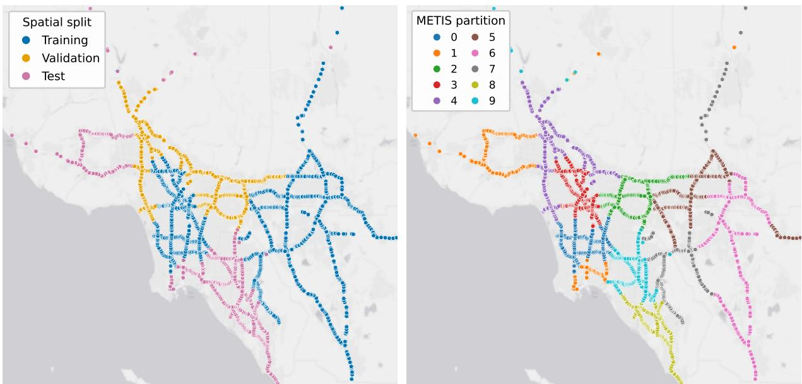  
Figure 6: Spatial partitioning of the GLA sensor graph. The left panel shows the nodes used for training, validation, and test, whereas the right panel shows the ten partitions. A small number of distant sensors fall outside the displayed map and are omitted for visualization only.

• AQI (Zheng et al., 2015) records PM2.5 concentrations at an hourly resolution through 437 stations distributed across 43 cities in China.

• EngRAD contains 3 years of 5 historical weather variables sampled hourly at 487 grid points in England. The measurements are provided by open-meteo.com (Zippenfenig, 2023; Marisca et al., 2024).

We provide details about the datasets in Tab. 5. Following previous work, we use the standard adjacency matrix and exogenous variables associated with each dataset (Cini et al., 2022; Li et al., 2018; Cini et al., 2023b; Marisca et al., 2024). We partition each time series into training, validation, and test sets, containing 70%/10%/20% of the observations, respectively. The only exception is AQI, for which we adopt the predefined splits established in the literature (Yi et al., 2016). Additionally, for the inductive setting, we use LargeST (Liu et al., 2023b), a large-scale traffic forecasting benchmark based on speed measurements from PeMS sensors across California. We consider the GLA subset, which contains 3,834 sensors connected by 98,703 directed and weighted road-network edges. We use the 2019 observations, aggregated at a 15-minute frequency. We partition the GLA road graph into ten balanced and disjoint subgraphs. Edges between different partitions are removed, and each partition is subsequently treated as an independent spatiotemporal graph. The resulting partitions contain between 372 and 394 nodes. We assign five subgraphs to training, two subgraphs to validation, and the remaining three subgraphs to test (see Tab. 6 and Fig. 6). Within each subgraph, we apply the same 70%/10%/20% chronological split. At test time, we evaluate the model's ability to transfer inductively across graph instances with disjoint node sets and different connectivity patterns. A separate standard scaler is associated with each subgraph and is estimated from its training data.

Table 6: GLA spatial split. The left table shows the assignment of the ten partitions to the training, validation, and test sets, while the right table reports detailed statistics for each partition.
<table><tr><td>Split</td><td>Partitions</td><td>No.</td><td>Sensors</td></tr><tr><td>Training</td><td>{5, 6, 0, 7, 3}</td><td>5</td><td>1,932</td></tr><tr><td>Validation</td><td>{2,4}</td><td>2</td><td>769</td></tr><tr><td>Test</td><td>{1, 8,9}</td><td>3</td><td>1,133</td></tr><tr><td>Total</td><td>{0, . .. , 9}</td><td>10</td><td>3,834</td></tr></table>

<table><tr><td>Partition</td><td>Split</td><td>Nodes</td><td>Edges</td></tr><tr><td>0</td><td>Training</td><td>382</td><td>12,522</td></tr><tr><td>1</td><td>Test</td><td>372</td><td>5,714</td></tr><tr><td>2</td><td>Validation</td><td>394</td><td>9,786</td></tr><tr><td>3</td><td>Training</td><td>391</td><td>15,451</td></tr><tr><td>4</td><td>Validation</td><td>375</td><td>8,086</td></tr><tr><td>5</td><td>Training</td><td>380</td><td>6,393</td></tr><tr><td>6</td><td>Training</td><td>393</td><td>5,800</td></tr><tr><td>7</td><td>Training</td><td>386</td><td>4,728</td></tr><tr><td>8</td><td>Test</td><td>372</td><td>11,642</td></tr><tr><td>9</td><td>Test</td><td>389</td><td>14,506</td></tr><tr><td>Total</td><td></td><td>3,834</td><td>94,628</td></tr></table>

## B Baselines

In the experiments, we use the following baselines:

• RNN, a global recurrent model that processes each node independently with shared parameters, without using the graph structure;

• Diffusion convolution recurrent neural network (DCRNN) (Li et al., 2018) models temporal dynamics with a RNN and uses diffusion graph convolutions to exchange information among nodes;

• GConv-TTS (Kipf & Welling, 2017) first encodes each series with a RNN and then applies graph convolutions to exchange information among neighboring nodes;

• GUNet-TTS (Gao & Ji, 2019) first encodes each series with a RNN and then uses graph pooling and unpooling to process the resulting representations at multiple spatial resolutions;

• Graph WaveNet (GWNet) (Wu et al., 2019) combines dilated temporal convolutions with graph convolutions;

• SGP (Cini et al., 2023a) first encodes temporal and spatial information using a randomized spatiotemporal graph encoder and then maps the resulting representations to forecasts with a trainable model;

• STAEformer (Liu et al., 2023a) uses a Transformer with learned spatial and temporal embeddings;

• STDN (Cao et al., 2025) learns dynamic graph representations and decomposes the temporal signals into trend and seasonal components;

• LAMP (Castelli et al., 2026) models the evolution of node representations through stable graph dynamics. Its adaptive dissipation mechanism controls how much past information is retained or discarded, supporting the propagation of information over long spatial and temporal ranges;

• HiGP (Cini et al., 2024) learns a hierarchy from the input graph and produces coherent forecasts at each hierarchical level. Its MP scheme combines graph convolutions at the bottom level with bidirectional propagation between adjacent hierarchy levels through the learned aggregation matrices.

HiGP, GConv-TTS, and GUNet-TTS share the same TTS pipeline (Gao & Ribeiro, 2022). They encode the temporal history using an RNN, optionally use learnable node embeddings (Cini et al., 2023b), apply model-specific MP, and produce forecasts with an MLP readout. They differ in how spatial information is propagated, with HiGP additionally processing representations across multiple hierarchical levels. We adopt the same pipeline in SHR. In the inductive setting, we disable node embeddings for all models, as embeddings learned on the training graph cannot be transferred to unseen series in the test graph.

## C Experimental Details and Additional Results

This section provides additional details on the experimental setup and supplementary results. Throughout the paper, all models are trained using the MAE loss. Results reported in tables and figures are averaged over at least three independent runs with different random seeds.

Table 7: Performance across datasets at selected forecasting horizons. Bold and underlined values denote the best and second-best MAE, respectively.
<table><tr><td rowspan="2">Model</td><td colspan="3">Metr-LA</td><td colspan="3">PeMS-Bay</td><td colspan="3">AQI</td><td colspan="3"> $\overline { { \mathrm { \mathrm { E n g R A D } } } }$ </td></tr><tr><td>@3</td><td>@6</td><td>@12</td><td>@3</td><td>@6</td><td>@12</td><td>@1</td><td>@2</td><td>@3</td><td>@2</td><td>@3</td><td>@6</td></tr><tr><td>RNN</td><td> $2 . 9 7 7 \pm . 0 0 1$ </td><td> $3 . 5 5 6 \pm . 0 0 1$ </td><td> $4 . 3 5 6 \pm . 0 0 4$ </td><td>1.389 ± .000</td><td>1.815 ± .001</td><td> $2 . 3 0 7 \pm . 0 0 1$ </td><td>9.783 ± .053</td><td>14.310 ±.051</td><td>17.665 ± .052</td><td>37.707 ± .272</td><td>46.570 ± .480</td><td>60.928 ± .819</td></tr><tr><td>DCRNN</td><td>2.865 ± .001</td><td>3.319 ± .003</td><td>3.871 ± .003</td><td>1.372 ± .002</td><td>1.759 ± .003</td><td>2.184 ± .006</td><td>9.058 ± .011</td><td>12.958 ± .019</td><td>16.039 ± .030</td><td>34.025 ± .057</td><td>42.827 ± .068</td><td>57.952 ±.156</td></tr><tr><td>GConv-TTS</td><td>2.764 ± .008</td><td>3.122 ± .004</td><td>3.500 ± .014</td><td>1.321 ± .002</td><td>1.633 ± .008</td><td>1.907 ± .012</td><td>9.055 ± .050</td><td>12.603 ± .017</td><td>15.522 ± .028</td><td>34.402 ± .211</td><td>42.929 ± .401</td><td>57.735 ±.173</td></tr><tr><td>GUNet-TTS</td><td>2.748 ± .003</td><td>3.101 ± .003</td><td>3.489 ± .002</td><td>1.322 ± .006</td><td>1.633 ± 006</td><td>1.905 ± .002</td><td>9.029 ± .012</td><td>12.547 ± .019</td><td>15.401 ± .043</td><td>35.099 ± .583</td><td>43.689 ± .609</td><td>58.640 ±1.359</td></tr><tr><td>GWNet</td><td>2.745 ± .013</td><td> $3 . 1 2 0 \pm . 0 0 2$ </td><td>3.514 ± .009</td><td>1.317 ± .003</td><td>1.644 ± .009</td><td>1.914 ± .013</td><td>8.719 ± .041</td><td>12.277 ± .036</td><td>14.891 ±.026</td><td>32.760 ± .477</td><td>39.598 ± .289</td><td>53.373 ± .677</td></tr><tr><td>SGP</td><td>2.750 ± .002</td><td>3.104 ± .003</td><td>3.460 ± .002</td><td>1.346 ± .004</td><td>1.665 ± .004</td><td>1.932 ± .005</td><td>9.120 ± .011</td><td>13.023 ± .011</td><td>16.041 ± .009</td><td>34.227 ± .163</td><td>43.046 ± .216</td><td>59.052 ± .069</td></tr><tr><td>STAEformer</td><td>2.722 ± .028</td><td>3.056 ± .032</td><td>3.451 ±.003</td><td>1.310 ± .007</td><td>1.615 ± .013</td><td>1.881 ± .005</td><td>9.525 ± .094</td><td>13.121 ± .061</td><td>15.787 ± .062</td><td>47.982 ± .811</td><td>57.277 ± 1.064</td><td>71.587 ±1.009</td></tr><tr><td>LAMP</td><td>2.853 ± .001</td><td>3.174 ± .002</td><td>3.515 ±.004</td><td>1.477 ± .002</td><td>1.734 ± .002</td><td>1.968 ± .003</td><td>12.772 ± .040</td><td>16.043 ± .027</td><td>18.668 ± .018</td><td>43.072 ± .153</td><td>49.473 ± .142</td><td>61.071 ± .143</td></tr><tr><td>STDN</td><td>2.767 ± .012</td><td>3.095 ± .006</td><td>3.457 ± .019</td><td>1.335 ± .002</td><td>1.649 ± .006</td><td>1.914 ± .010</td><td>10.212 ± .248</td><td>13.399 ± .165</td><td>16.056 ± .185</td><td>43.284 ± .786</td><td>51.793 ± .551</td><td>67.643 ±.262</td></tr><tr><td>HiGP</td><td>2.734 ± .010</td><td>3.077 ±.011</td><td>3.456 ± .006</td><td>1.333 ± .001</td><td>1.644 ± .002</td><td>1.917 ± .008</td><td>8.800 ± .010</td><td>12.242 ± .028</td><td>14.911 ± .035</td><td>32.350 ± .405</td><td>40.117 ± .518</td><td>53.055 ±.435</td></tr><tr><td>SHR</td><td>2.694 ± .015</td><td>3.046 ±.016</td><td>3.424 ±.022</td><td>1.308 ± .007</td><td>1.620 ±.010</td><td> $1 . 8 8 8 \pm . 0 0 8$ </td><td> $\underline { { 8 . 7 8 6 \pm . 0 1 3 } }$ </td><td> $1 2 . 2 1 5 \pm . 0 0 8$ </td><td>14.836 ±.009</td><td> $\mathbf { 3 1 . 0 6 9 \Pi _ { \pm . 2 0 0 } }$ </td><td> $\mathbf { 3 8 . 2 5 9 \bot . 0 2 4 }$ </td><td> $\mathbf { 5 1 . 8 9 8 \ : \pm . 0 9 0 }$ </td></tr></table>

## C.1 Forecasting performance and hierarchy variants

For the experiments in Tab. 1, we implemented the baselines in our environment using their original implementations. We generally followed the recommended hyperparameter settings and tuned selected model parameters. The batch size and learning rate were set to 32 and 0.003, respectively, or to 16 and 0.001 in some cases. For SHR, we tuned the hidden dimension following the same procedure used for the baselines. Its bottom-level predictions at test time are obtained by averaging forecasts over 20 independently sampled hierarchies generated using k-MIS. For Fixed hier., instead, a single hierarchy obtained through spectral clustering is fixed throughout the forward pass, including input aggregation, hierarchical message passing, and forecast reconciliation. Finally, for SHR (rand.), we replace the hierarchy construction used by SHR with random balanced assignments. At each training batch, a new hierarchy is generated by sampling $N _ { 1 }$ uniformly from $\{ 1 0 , \ldots , 3 0 \}$ and assigning the bottom-level nodes to balanced intermediate groups. At validation, forecasts are averaged over three hierarchies per batch, with $N _ { 1 } ~ \in ~ \{ 1 0 , 2 0 , 3 0 \}$ . At test time, they are averaged over 20 independently generated hierarchies per batch, with $N _ { 1 }$ sampled uniformly from $\{ 1 0 , \ldots , 3 0 \}$ . In Tab. 7, we further report forecasting errors at specific forecast horizons. The results are broadly consistent with those in Tab. 1.

## C.2 Sensitivity analysis

The hierarchy used in our experiments has a pyramidal structure, with the original bottom-level nodes, a set of intermediate aggregates, and a single global node. Each bottom-level node is assigned to one intermediate node. Changing either these assignments or the number $N _ { 1 }$ of intermediate nodes therefore produces a different aggregation structure. For the sensitivity analysis, we generally construct the intermediate aggregates by applying spectral clustering to the input graph. For AQI only, we instead apply K-means to the station coordinates. We make this choice because the spectral partitions of the AQI graph are particularly unbalanced, comprising a few very large aggregates and several aggregates containing only a small number of stations. We provide below details on the sensitivity analysis presented in Sec. 5. Additionally, in Fig. 7, Fig. 9, we report further plots analogous to Fig. 4 and Fig. 3 on different datasets. The decreasing trends are consistent with those observed in Sec. 5, although varying the hierarchy structure is more beneficial on some datasets while varying node assignments is more beneficial on others.

Changing node assignments. In Fig. 3a, we isolate the effect of changing node assignments by fixing the number of intermediate nodes to $N _ { 1 } = 2 0$ . Consequently, all hierarchies have the same cardinality and differ only in how bottomlevel nodes are assigned to intermediate groups. All conditions follow the same evaluation protocol. At each validation batch, predictions are averaged across three hierarchies with $N _ { 1 } = 2 0$ At each test batch, predictions are averaged across ten hierarchies with $N _ { 1 } = 2 0$ . The plot reports the test ensemble MAE, averaged across five training seeds, and the shaded region denotes the standard deviation. In Fig. 8, we additionally evaluate the models separately on three fixed hierarchies with $N _ { 1 } \in \{ 1 0 , 2 0 , 3 0 \}$ and report bottom-level $( L _ { 0 } )$ performance. Each hierarchy determines input aggregation, hierarchical message passing, and reconciliation. We do not perform averaging in this case. Evaluating all models on the same fixed hierarchies without averaging allows us to assess the effect of training with different node assignments independently of inference-time averaging. The results show that training with multiple assignments can also improve predictions when evaluated on hierarchies with 10 and 30 intermediate nodes, although these cardinalities are not encountered during training. These results are consistent with those obtained at the aggregate levels in Sec. 5.

Changing node assignments and hierarchy structure. In Fig. 3b, we progressively vary both the assignments of bottom-level nodes and the number of intermediate nodes. All compared models use the same evaluation protocol, except for Fixed. At each validation batch, predictions are averaged across three hierarchies with $N _ { 1 } \in \{ 1 0 , 2 0 , 3 0 \}$ At each test batch, predictions are averaged across ten hierarchies, with two independently sampled hierarchies for each

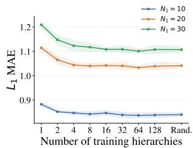  
(a) Fixed $N _ { 1 }$ (L1).

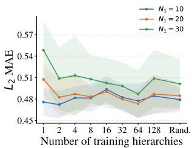  
(b) Fixed $N _ { 1 }$ (L2).

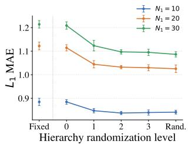  
(c) Variable $N _ { 1 }$ (L1).

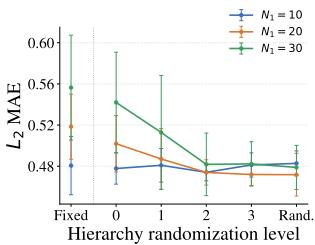  
(d) Variable $N _ { 1 }$ (L2).

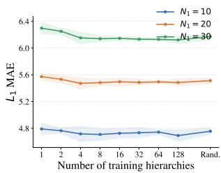  
(e) Fixed $N _ { 1 }$ (L1).

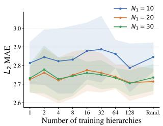  
(f) Fixed $N _ { 1 }$ (L2).

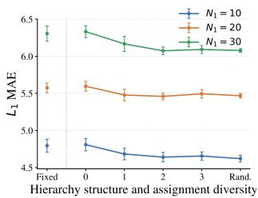

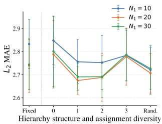  
(g) Variable $N _ { 1 }$ (L1).  
(h) Variable $N _ { 1 }$ (L2).

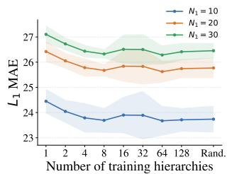

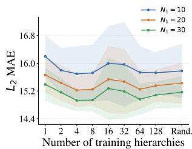  
(i) Fixed $N _ { 1 }$ (L1).  
(j) Fixed $N _ { 1 }$ (L2).

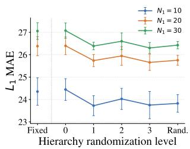  
(k) Variable $N _ { 1 }$ (L1).

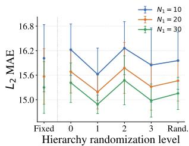  
(1) Variable $N _ { 1 }$ (L2).  
Figure 7: Performance at higher aggregation levels $( L _ { 1 }$ and $L _ { 2 } )$ on PeMS-Bay (top row), AQI (middle row), and EngRAD (bottom row). The first two columns increase the number of training hierarchies while keeping $N _ { 1 } = 2 0$ and varying node-to-aggregate assignments. The third and fourth columns instead progressively increase traininghierarchy diversity by varying both the assignments and $N _ { 1 }$ . Each curve evaluates the same set of trained models using common test hierarchies with $N _ { 1 } \in \{ 1 \bar { 0 } , 2 0 , 3 0 \}$

$N _ { 1 } \in \{ 1 0 , 1 5 , 2 0 , 2 5 , 3 0 \}$ . In Fig. 8, we also evaluate these models separately on the same three fixed hierarchies with $N _ { 1 } \in \{ 1 0 , 2 0 , 3 0 \}$ used above. These retests report MAE at the bottom level $( L _ { 0 } )$ for one hierarchy at a time, without applying the average in Eq. 6. As above, evaluating all models on the same fixed hierarchies without averaging allows us to assess the effect of training with different hierarchy distributions independently of inference-time averaging. Also here, the decreasing trends are consistent with those obtained in Sec. 5.

## C.3 Computational scalability

The experiments on computational scalability were performed on a synthetic graph made of sparse ringconnected communities linked by bridge edges. We measured the CUDA execution time of a single inference step using PyTorch Profiler (Paszke et al., 2019) and the peak GPU memory allocated during the step using torch.cuda.max\_memory\_allocated. All scalability experiments were conducted on a single NVIDIA RTX PRO 6000 Blackwell Max-Q Workstation Edition GPU with 96 GB of memory, FP32 precision, and a batch size of one. In Fig. 10, we extend the analysis to training and observe scaling trends similar to those reported for inference in Sec. 5. In Fig. 11, instead, we evaluate inference scalability using ten hierarchies. Our recursive procedure is applied separately to each hierarchy, and the resulting coherent forecasts are averaged as defined in Eq. 6, whereas projectionbased reconciliation processes only one hierarchy. This experiment assesses whether the scalability advantage reported in the main text is preserved when our method processes multiple hierarchies at inference time, compared with a less efficient reconciliation procedure applied to a single hierarchy. The results show that the advantage persists despite the additional hierarchies processed by our method. Finally, in Fig. 12, we also account for the cost of building the hierarchy in HiGP and sampling a hierarchy in SHR. Accordingly, we profile HiGP using projection-based reconciliation and SHR using our recursive procedure. The resulting scaling trends remain consistent with the other experiments, suggesting that the procedure used to obtain coherent forecasts largely determines the differences in computational scalability observed in the plots.

## C.4 Inductive setting

We evaluate the performance of SHR on held-out graphs from GLA. Tab. 8 reports additional forecasting results at horizon steps 3, 6, and 12. Both variants of SHR outperform the fixed-hierarchy baseline at all three horizons. In this setting, random hierarchy sampling yields lower mean errors than k-MIS. A possible explanation is that, even with a fixed k, k-MIS can generate substantially different numbers of aggregate nodes depending on graph topology. In the inductive setting, this can lead to differences in hierarchy size between training and unseen graphs. By contrast, the random sampling strategy constrains the number of aggregates to $\{ 1 0 , \ldots , 3 0 \}$ and produces groups of approximately equal size within each graph, during both training and testing. This difference in the hierarchy distributions should be considered when interpreting the performance of the two SHR variants.

Table 8: MAE performance on GLA at selected forecasting horizons. Bold and underlined values denote the best and second-best mean performance, respectively.
<table><tr><td rowspan="3">Model</td><td colspan="5">GLA</td></tr><tr><td>Window</td><td>@3</td><td>@6</td><td></td><td>@12</td></tr><tr><td>Fixed hier.</td><td>96</td><td> $1 8 . 8 5 1 \pm . 1 1 9$ </td><td> $2 2 . 9 3 4 \pm . 2 5 5$ </td><td></td><td> $2 7 . 1 6 6 \pm . 1 7 1$ </td></tr><tr><td>SHR (rand.)</td><td>96</td><td> $\mathbf { 1 7 . 9 8 0 \ : \pm . 1 1 9 }$ </td><td> $2 1 . 6 5 2 \pm . 1 1 2$ </td><td></td><td> ${ \pm 5 . 6 9 9 \pm . 0 2 9 }$ </td></tr><tr><td>SHR</td><td>96</td><td> $1 8 . 1 3 6 \pm . 0 5 6$ </td><td> $2 1 . 9 7 2 \pm . 1 4 4$ </td><td></td><td> $\underline { { 2 5 . 7 1 1 \pm . 0 2 4 } }$ </td></tr></table>

## D Implementation Details

We implement our code in Python (Van Rossum & Drake, 2009) and use the following libraries:

• PyTorch (Paszke et al., 2019);

• PyTorch Geometric (Fey & Lenssen, 2019);

• PyTorch Lightning (Falcon & The PyTorch Lightning team, 2019);

• Torch Spatiotemporal (Cini & Marisca, 2022);

• Hydra (Yadan, 2019);

• Numpy (Harris et al., 2020).

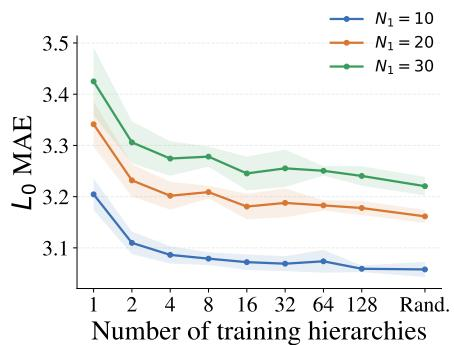  
(a) Fixed $N _ { 1 } ,$ performance at $L _ { 0 } .$

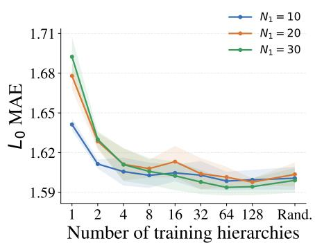  
(c) Fixed $N _ { 1 }$ , performance at $L _ { 0 }$

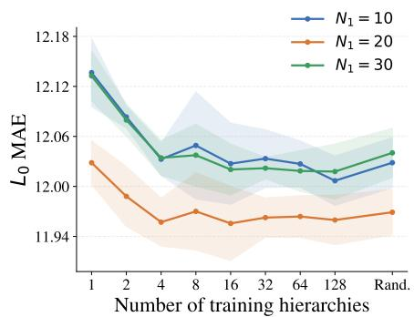  
(e) Fixed $N _ { 1 }$ , performance at $L _ { 0 } .$

(b) Variable $N _ { 1 }$ , performance at $L _ { 0 } .$  
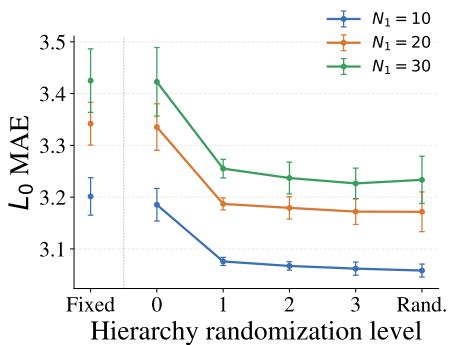

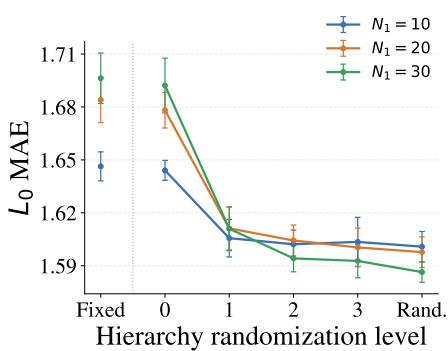  
(d) Variable $N _ { 1 }$ , performance at $L _ { 0 }$

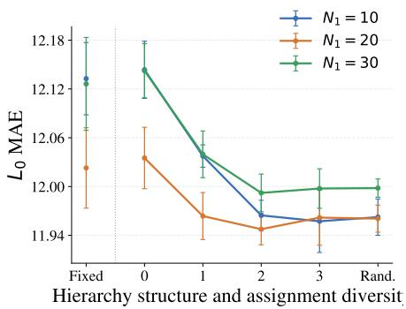

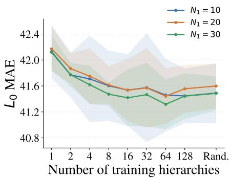  
(g) Fixed $N _ { 1 }$ , performance at $L _ { 0 } .$

(f) Variable $N _ { 1 }$ , performance at $L _ { 0 } .$  
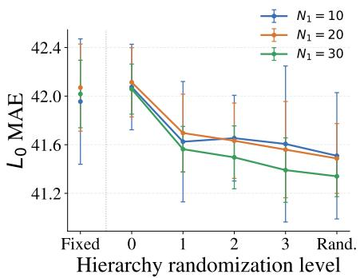  
(h) Variable $N _ { 1 }$ , performance at $L _ { 0 } .$  
Figure 8: Bottom-level performance $( L _ { 0 } )$ on Metr-LA (first row), PeMS-Bay (second row), AQI (third row), and EngRAD (fourth row) without inference-time hierarchy averaging (Eq. 6). The first column increases the number of training hierarchies while keeping $N _ { 1 } = 2 0$ and varying node-to-aggregate assignments. The second column instead progressively increases training-hierarchy diversity by varying both the assignments and $N _ { 1 }$ . Each curve evaluates the same set of trained models using common test hierarchies with $N _ { 1 } \in \{ 1 0 , \hat { 2 0 } , 3 0 \}$

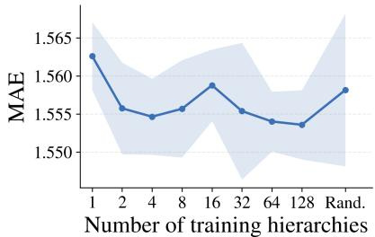  
(a) Fixed $N _ { 1 }$ , performance at $L _ { 0 } .$

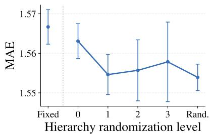  
(b) Variable $N _ { 1 }$ , performance at $L _ { 0 } .$

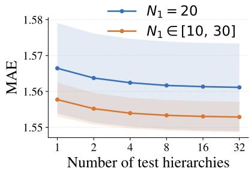  
(c) Test-time averaging on $L _ { 0 } .$

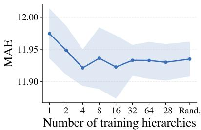  
(d) Fixed $N _ { 1 }$ , performance at $L _ { 0 } .$

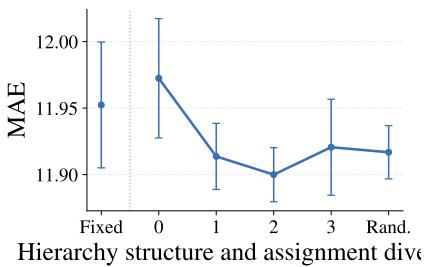  
(e) Variable $N _ { 1 } ,$ performance at $L _ { 0 } .$

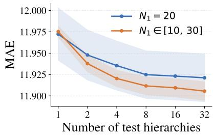  
(f) Test-time averaging on Lo.

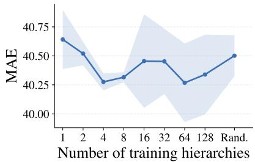  
(g) Fixed $N _ { 1 } .$ performance at $L _ { 0 } .$

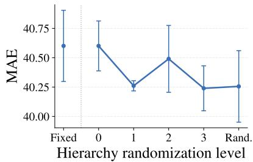  
(h) Variable $N _ { 1 }$ , performance at $L _ { 0 } .$

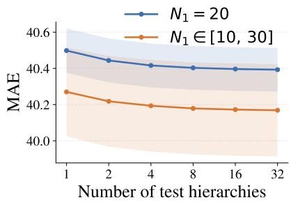  
(i) Test-time averaging on $L _ { 0 }$  
Figure 9: Bottom-level performance $( L _ { 0 } )$ on PeMS-Bay (top row), AQI (middle row), and EngRAD (bottom row). (a) varies the number of training hierarchies with fixed $N _ { 1 } = 2 0 ;$ (b) increases the diversity of both node-to-aggregate assignments and the number of intermediate aggregates $N _ { 1 } ; \mathrm { ( c ) }$ varies the number of test-hierarchy forecasts being averaged, comparing fixed $N _ { 1 } = 2 0$ with $N _ { 1 } \in \{ 1 0 , \dots , 3 0 \}$

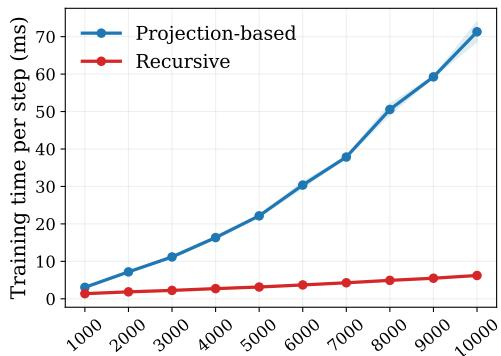  
Number of nodes

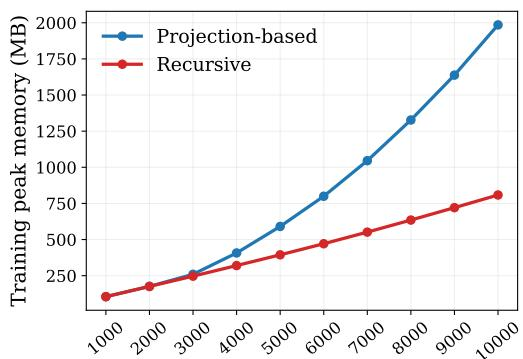  
Number of nodes  
Figure 10: Training scalability using projection-based reconciliation and our recursive procedure. The panels report training time (left) and peak GPU memory usage (right).

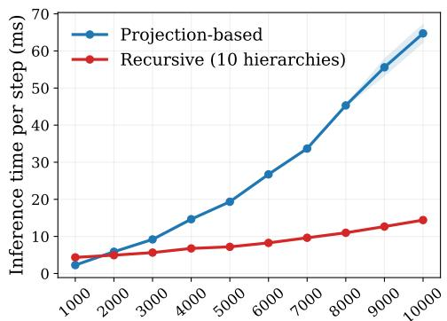  
Number of nodes

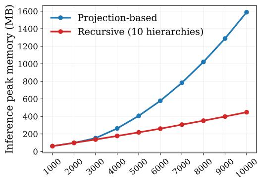  
Number of nodes  
Figure 11: Comparison of inference scalability between projection-based reconciliation using one hierarchy and our recursive procedure using ten hierarchies. The panels report inference time (left) and peak GPU memory usage (right).

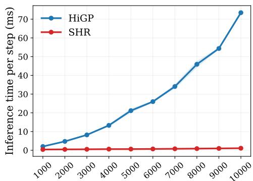  
Number of nodes

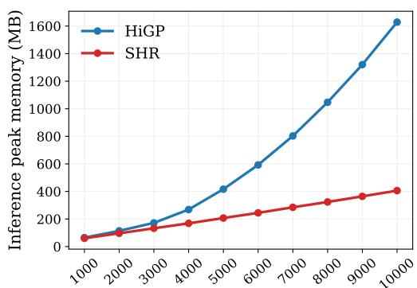  
Number of nodes  
Figure 12: Inference scalability of HiGP and SHR as the number of graph nodes increases. The panels report inference time (left) and peak GPU memory usage (right).