# Learn Only Where You Can’t Compute: Structured Corrections to Gaussian Process Posteriors

Tobias Weber, Carla Sagebiel and Philipp Hennig Tübingen AI Center Tübingen, Germany

## Abstract

Physics-informed Gaussian processes (GPs) provide a principled framework for scientific inference by expressing uncertainty over empirical measurements, boundary conditions, and governing equations. However, they struggle to scale to larger datasets and nonlinear information. Conversely, difusion models excel at learning complex distributions over functions from massive datasets, but struggle in scientific contexts where training data are scarce and physical or observational information must be incorporated. We propose a structured posterior-correction framework that combines a tractable Gaussian reference with data-driven corrections via generative learning. After a mean correction and covariance calibration, a difusion model learns a targeted correction in a low-dimensional subspace selected to capture discrepancies from the reference, while the complement retains its Gaussian law. Across three scientific inference tasks, these corrections recover hidden modes, improve sample structure, and reduce prediction error relative to the Gaussian reference. Comparisons with full-field generative models reveal task-dependent benefits and tradeofs between predictive accuracy and computational cost.

## 1 INTRODUCTION

Scientific inference often combines heterogeneous sources of information about an unknown function or state, such as noisy measurements, boundary conditions, physical laws, numerical models, and historical data. These sources typically leave the quantity of interest only partially determined, making uncertainty quantification an essential part of the inference problem (Stuart, 2010; Hennig, Osborne, and Kersting,

2022). A central challenge is therefore not only to predict a function, but to construct a conditional distribution that combines the available information while remaining computationally tractable.

Probabilistic function-space methods provide a natural way to combine such information. Gaussian processes (GPs), in particular, place a distribution directly over the unknown function and admit analytic conditioning on linear information such as measurements, boundary values, or derivative observations (Rasmussen and Williams, 2005; Raissi, Perdikaris, and Karniadakis, 2017; Pförtner et al., 2024). Probabilistic numerical methods extend this perspective to information supplied by diferential equations and numerical computations (Hennig, Osborne, and Kersting, 2022; Schmidt, N. Krämer, and Hennig, 2021; N. Krämer, Schmidt, and Hennig, 2022). The resulting Gaussian posterior can encode substantial prior, physical, and observational structure before any learning from data is required. It provides both a predictive mean and a structured representation of the uncertainty that remains.

Such a probabilistic model is nevertheless only as expressive as the assumptions from which it is constructed. Incomplete physics, unresolved scales, latent nonlinear efects, or model mismatch may cause the true conditional law to difer systematically from its Gaussian approximation. Some of this discrepancy amounts to an incorrect location or spread; other efects produce multimodality or dependencies that a Gaussian cannot represent. Expressive generative models ofer a complementary route. Difusion models, in particular, can learn rich distributions over fields and trajectories (Ho, Jain, and Abbeel, 2020; Song, Sohl-Dickstein, et al., 2021; Rühling Cachay et al., 2023; Rozet and Louppe, 2023). Learning the entire conditional law, however, also asks the generative model to represent structure already available from the Gaussian posterior. When scientific training data are expensive to obtain, there is a particular incentive to make use of this information. This raises a question: how much of a scientific conditional distribution needs to be learned when a useful

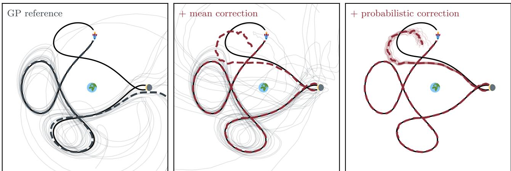  
Figure 1: Illustrative correction pipeline for a CR3BP trajectory in the rotating Earth–Moon frame: target orbit ( ), Gaussian reference ( ), and learned corrections ( ); thin curves are samples. Left: reference mean and samples. Middle: mean correction shifts the reference toward the target. Right: covariance and difusion correction refines the ensemble spread. Earth and Moon mark their normalized locations; marks the trajectory start.

## Gaussian approximation can already be computed?

We turn this idea into a structured posterior-correction framework, illustrated in Figure 1. An analytically conditioned Gaussian serves as a probabilistic scafold (Figure 1, left). A mean correction adjusts its predictive center across the whole field (middle). The subsequent probabilistic correction recalibrates its covariance and fits a mixture or difusion model in a selected low-dimensional subspace (right). This learned law captures remaining discrepancies in conditional spread and non-Gaussian shape, while the complement retains its Gaussian law.

Our contributions are threefold. First, we formulate a correction framework that uses an available Gaussian posterior to reduce the part of the conditional distribution assigned to a generative model. Gaussian and subspace KL decompositions explain which discrepancies the corrections can repair and what remains outside the learned block. Second, we develop a data-driven subspace search based on estimated validation log-score improvement, making the value of a richer law the criterion for where to learn it. Third, we evaluate this restricted learning task on regression and smoke transport problems with tractable posterior references and on numerical trajectory reconstruction, using learning curves and measured run times alongside distributional scores. Small learned blocks improve on the calibrated scafold and can improve the structure of individual draws even when marginal scores are similar. The experiments also show where full-field models remain preferable, while the restricted model still ofers a useful accuracy–cost tradeof.

## 2 METHOD

We model a conditional distribution $P _ { c }$ by correcting an available Gaussian approximation $Q _ { c } ^ { 0 }$ . The scafold $Q _ { c } ^ { 0 }$ provides an initial predictive mean and uncertainty geometry that we refine by a mean correction, a pooled covariance calibration, and a flexible law on a selected low-dimensional block, while retaining the Gaussian law on the complement. The following decomposition motivates this sequence and makes its limitations explicit.

Gaussian scafold and correction objective. Let $f \in \mathbb { R } ^ { d }$ denote a discretized function of interest, and let c represent the available information about $f ,$ such as observations, boundary conditions, or mechanistic inputs. Given training pairs $( f ^ { ( n ) } , c ^ { ( n ) } )$ , our goal is to approximate the unknown conditional law $P _ { c } : = \mathcal { L } ( f \mid c )$ We assume that part of this inference problem can already be solved analytically via a tractable Gaussian conditioning step, yielding a reference distribution $Q _ { c } ^ { 0 } = \mathcal { N } ( m _ { c } , C _ { c } )$ . The construction of this scafold is application dependent. In particular, probabilistic numerical solvers (N. Krämer, Schmidt, and Hennig, 2022; Weiland, Pförtner, and Hennig, 2025) can construct Gaussian conditional distributions that incorporate mechanistic information such as diferential equations, boundary conditions, and observations (Pförtner et al., 2024).

To quantify the discrepancy between the true conditional law $P _ { c }$ and the Gaussian scafold $Q _ { c } ^ { 0 } .$ , we consider the Kullback–Leibler divergence, which arises from the excess risk of the scafold when choosing the logarithmic score. Writing $\mu _ { c } = \mathbb { E } [ f \mid c ]$ and $\Sigma _ { c } = \operatorname { C o v } ( f \mid c )$ this discrepancy decomposes exactly as

$$
\begin{array} { r l } & { D _ { \mathrm { K L } } \big ( P _ { c } \| Q _ { c } ^ { 0 } \big ) = \underbrace { \frac { 1 } { 2 } \| \mu _ { c } - m _ { c } \| _ { C _ { c } ^ { - 1 } } ^ { 2 } } _ { \mathrm { l o c a t i o n ~ m i s m a t c h } } } \\ & { \qquad + \underbrace { \frac { 1 } { 2 } \big [ \mathrm { t r } ( C _ { c } ^ { - 1 } \Sigma _ { c } ) - \log \operatorname* { d e t } ( C _ { c } ^ { - 1 } \Sigma _ { c } ) - d \big ] } _ { \mathrm { c o v a r i a n c e ~ m i s m a t c h } } } \\ & { \qquad + \underbrace { D _ { \mathrm { K L } } \big ( P _ { c } \| \mathcal { N } ( \mu _ { c } , \Sigma _ { c } ) \big ) } _ { \mathrm { n o n - G a u s s i a n ~ s t r u c t u r e } } . } \end{array}
$$

This identity assumes a density with finite second moments, finite divergences, and nonsingular $C _ { c }$ and $\Sigma _ { c } .$ For numerically rank-deficient scafolds we work in resolved coordinates with a positive covariance floor (Appendix A.2). A shift in the scafold mean cannot repair its spread or shape, but it can remove the location mismatch (cf. Eq. (1), Term 1) across the entire field. This motivates learning a full-field mean correction before deciding where a richer probability law is needed.

Conditional mean correction. At the population level, the mean discrepancy $\mu _ { c } - m _ { c }$ minimizes the precision-weighted regression loss. Its empirical counterpart is

$$
\frac { 1 } { N } \sum _ { n = 1 } ^ { N } \Big \| f ^ { ( n ) } - m _ { c ^ { ( n ) } } - \delta _ { \phi } ( c ^ { ( n ) } ) \Big \| _ { C _ { c ^ { ( n ) } } ^ { - 1 } } ^ { 2 } .\tag{2}
$$

The precision $C _ { c ^ { n } } ^ { - 1 }$ weights errors according to the scafold uncertainty. Unweighted squared error has the same unrestricted population minimizer and can be used alternatively. We use then the fitted shift $\delta _ { \phi } ( c )$ to define the corrected mean $\hat { \mu } _ { c } = m _ { c } + \delta _ { \phi } ( c )$ residual $\rho _ { \phi } = f - \hat { \mu } _ { c }$ , and the mean-corrected scafold $Q _ { c } ^ { \phi } = \mathcal { N } ( \hat { \mu } _ { c } , C _ { c } )$

Covariance mismatch correction. After correcting the mean, we target the covariance mismatch in Term 2 of (1). We first whiten the residuals by the scafold covariance, so that the scafold predicts unit variance in every direction, and estimate their covariance pooled across training contexts:

$$
z = C _ { c } ^ { - 1 / 2 } ( f - \hat { \mu } _ { c } ) , \qquad \widehat { \mathrm { C o v } } ( z ) = R \mathrm { d i a g } ( \hat { \lambda } _ { i } ) R ^ { \top } ,\tag{3}
$$

Here, $r _ { i }$ is the ith column of $R ,$ and $\hat { \lambda } _ { i }$ is the estimated residual variance along that direction. Values above or below one indicate that the scafold underestimates or overestimates this variance, respectively.

To decide which variance corrections are supported by the data, we measure their potential log-score gain. For a centered Gaussian coordinate, replacing unit variance by $\hat { \lambda } _ { i }$ gives

$$
\begin{array} { r } { \kappa _ { i } = \frac { 1 } { 2 } \big ( \hat { \lambda } _ { i } - \log \hat { \lambda } _ { i } - 1 \big ) . } \end{array}\tag{4}
$$

We set $\tilde { \lambda } _ { i } = \hat { \lambda } _ { i }$ when $\kappa _ { i }$ exceeds a sampling-noise threshold, and retain the scafold variance, $\tilde { \lambda } _ { i } = 1$ , otherwise. We then map these calibrated variances back to the original field coordinates using

$$
L _ { c } = C _ { c } ^ { 1 / 2 } R \mathrm { d i a g } ( \tilde { \lambda } _ { i } ^ { 1 / 2 } ) ,\tag{5}
$$

where $ { C _ { c } } ^ { 1 / 2 }$ denotes the chosen square-root factor, the calibrated reference and its standardized coordinates are

$$
\begin{array} { r } { Q _ { c } ^ { \mathrm { G } } = \mathcal { N } ( \hat { \mu } _ { c } , L _ { c } L _ { c } ^ { \top } ) , \qquad u = L _ { c } ^ { - 1 } ( f - \hat { \mu } _ { c } ) . } \end{array}\tag{6}
$$

Thus u is standard normal under the calibrated reference $Q _ { c } ^ { \mathrm { G } }$ . Because calibration pools residuals across contexts, it can leave context-dependent covariance mismatch and fitted mean error. The next stage addresses these remaining discrepancies together with non-Gaussian structure.

Probabilistic correction objective. To model this discrepancy without replacing the Gaussian in all $d$ directions, we assume an orthonormal matrix $U \in$ $\mathbb { R } ^ { d \times k }$ and learn only a conditional law $q _ { \theta } ( \cdot \mid c )$ for $w = U ^ { \top } u$ . Writing $U _ { \perp }$ for its orthogonal complement, the corrected density is

$$
q ( u \mid c ) = q _ { \theta } ( U ^ { \top } u \mid c ) { \mathcal { N } } ( U _ { \bot } ^ { \top } u ; 0 , I _ { d - k } ) .\tag{7}
$$

For $w _ { \perp } = U _ { \perp } ^ { \top } u$ , its divergence from the true residual law decomposes as

$$
\begin{array} { r l } & { D _ { \mathrm { K L } } \big ( P _ { u | c } \| q ( \cdot \vert c ) \big ) = D _ { \mathrm { K L } } \big ( P _ { w | c } \| q _ { \theta } ( \cdot \vert c ) \big ) } \\ & { \phantom { D _ { \mathrm { K L } } \big ( } + D _ { \mathrm { K L } } \big ( P _ { w _ { \perp } | c } \| { \mathcal N } ( 0 , I _ { d - k } ) \big ) } \\ & { \phantom { D _ { \mathrm { K L } } \big ( } + I ( w ; w _ { \perp } \vert c ) . } \end{array}\tag{8}
$$

For fixed $U ,$ only the first term depends on $\theta$ and we fit the block law either by maximizing a Gaussian mixture likelihood (Bishop, 1994) or by training a difusion model with a denoising objective (Ho, Jain, and Abbeel, 2020); the Gaussian complement requires no learned density. However, even an exact block law leaves the complement mismatch and the dependence between block and complement. Whitening alone does not remove these terms.

The remaining question is where this block should be placed. Relative to the calibrated Gaussian, replacing the law of w yields an improvement

$$
\begin{array} { r l } & { \mathcal { G } ( U , q _ { \theta } ) } \\ & { \qquad = \mathbb E _ { c , u } \left[ \log q _ { \theta } ( U ^ { \top } u \mid c ) - \log \mathcal { N } ( U ^ { \top } u ; 0 , I _ { k } ) \right] . } \end{array}\tag{9}
$$

For a fixed $U .$ , maximizing this gain over $q _ { \theta }$ is equivalent to fitting the projected conditional law $P _ { w | c }$ with the largest attainable gain being

$$
\mathbb { E } _ { c } \big [ D _ { \mathrm { K L } } \big ( P _ { w | c } \| \mathcal { N } ( 0 , I _ { k } ) \big ) \big ] .\tag{10}
$$

A positive population gain $\mathcal { G }$ guarantees a KL improvement for the given block and fitted law. Choosing $k \ll d$ reduces the stochastic dimension of the learned correction, while the calibrated Gaussian supplies the law on the complement.

Subspace selection. Choosing U is the dificult part. Fitting a separate difusion model for every candidate subspace is computationally prohibitive, so we estimate (9) with a lightweight density model and train the final difusion model only after selecting the block. We use a product of one-dimensional Gaussian mixtures, conditioned on c when needed, whose exact likelihood provides a held-out gain for each projected direction.

Log-score gain can favor sharp discrepancies with negligible amplitude in the original function space. Before evaluating it, we therefore add matched isotropic Gaussian noise of standard deviation τ to both the residual law and the Gaussian reference and repeat the covariance calibration. This creates a soft noise floor, measured in the units of $f ,$ that decreases discrepancies smaller than τ ; setting $\tau = 0$ recovers the original objective.

We initialize the search directions from residual-PCA, independent-component and excess-variance (λˆ-span) proposals (Appendix A.3). We score these candidate blocks, refine the most promising frame together with its mixture density by gradient ascent on the training gain ${ \mathcal { G } } ,$ retaining the checkpoint with the highest validation gain. Finally, we select directions whose validation gains exceed ma $\mathrm { x } \{ g _ { \mathrm { m i n } } , p / n _ { \mathrm { v a l } } \}$ , with minimum gain threshold $g _ { \mathrm { m i n } } = 0 . 0 1$ and p the parameter count of a one-dimensional mixture. This is a practical threshold, not a statistical guarantee accounting for the adaptive search.

Sampling from the corrected posterior. For $k > 0 ,$ we map the selected directions from the smoothed selection coordinates back to the original standardized coordinates u and fit the final law qθ to $w = U ^ { \top } u$ . A mixture from the selection family can be refitted as qθ; alternatively, we train a conditional difusion model by denoising score matching $( \mathrm { H o } ,$ Jain, and Abbeel, 2020), allowing the final law to capture joint dependence between the selected coordinates. A corrected sample is then

$$
\begin{array} { r l } & { f ^ { \star } = \hat { \mu } _ { c } + L _ { c } ( U w + U _ { \perp } \epsilon ) , } \\ & { ~ w \sim q _ { \theta } ( \cdot \mid c ) , \qquad \epsilon \sim \mathcal { N } ( 0 , I _ { d - k } ) , \qquad w \perp \epsilon . } \end{array}\tag{11}
$$

The corrected mean $\hat { \mu } _ { c }$ sets the center, $L _ { c }$ from equation (5) combines the scafold geometry with its covariance calibration, and $q _ { \theta }$ replaces the Gaussian law only in the selected span. For $k = 0$ , this reduces to $Q _ { c } ^ { \mathrm { G } }$ , for $k = d ,$ , the family becomes a full residual model. The experimental full-residual baselines also difer in calibration and architecture, as described in Appendix A.4.

## 3 RELATED WORK

Gaussian conditioning and probabilistic numerics. Gaussian processes provide closed-form inference under linear-Gaussian information, including observations and linear physical constraints (Rasmussen and Williams, 2005; Raissi, Perdikaris, and Karniadakis, 2017; Pförtner et al., 2024). Probabilistic numerical methods extend this perspective to diferential equations and numerical computation (Hennig, Osborne, and Kersting, 2022; Schmidt, N. Krämer, and Hennig, 2021; N. Krämer, Schmidt, and Hennig, 2022), including sparse Gauss Markov formulations for PDE solutions (Rue and Held, 2005; Weiland, Pförtner, and Hennig, 2025). For Gaussian measures conditioned on nonlinear observations of finitely many linear functionals, Chen et al. (2024) derive a decomposition into a Gaussian component and a finite-dimensional non-Gaussian component. In our setting, the discrepancy from an available Gaussian approximation is learned from data, including the directions in which a richer law is fitted.

Low-dimensional corrections of reference distributions. The idea that a high-dimensional target can difer from a reference in a small subspace underlies non-Gaussian component analysis (Blanchard et al., 2006), likelihood-informed subspaces (Cui et al., 2014), certified posterior dimension reduction (Zahm et al., 2022), and lazy transport maps (Brennan et al., 2020). Lazy maps relate restricted density-ratio corrections to projected KL gain and identify correction subspaces through gradient-based diagnostics. Scoreratio matching learns such diagnostics from samples, including for conditional generative modeling (Baptista, Brennan, and Marzouk, 2025). We develop a correction procedure for scientific Gaussian posteriors that combines mean correction, covariance calibration, and data-driven selection of a residual block. A lightweight conditional mixture estimates validation log-score gain, directing flexible modeling towards residual discrepancies for which a richer law improves on the calibrated Gaussian. A mixture or difusion model then learns the block law, while the calibrated Gaussian supplies the law on the complement.

Model discrepancy and residual correction. Bayesian calibration represents the diference between a simulator and observations through a discrepancy process (Kennedy and O’Hagan, 2001; Brynjarsdóttir and O’Hagan, 2014; Plumlee, 2017). Learned residual models provide a more flexible alternative. For example, CorrDif predicts a conditional mean and uses difusion for the remaining variability for downscaling climate models (Mardani et al., 2025), while score-based approaches learn conditional distributions for data assimilation and PDE inference (Rozet and Louppe, 2023; Huang et al., 2024). We similarly learn residual structure, but start from a probabilistic scaffold and retain a calibrated Gaussian complement. Our experiments examine what this restriction preserves and where full-field models remain preferable.

## 4 EXPERIMENTS

We examine how much of a conditional distribution can be recovered by learning a correction to an available Gaussian model. Experiment 1 (Synthetic) tests the recovery of known hidden modes as training data increase. Experiment 2 (Smoke) challenges the correction with measurement-dependent uncertainty over distinct smoke directions and examines the accuracy– cost tradeof. Experiment 3 (CR3BP) tests whether the correction improves a probabilistic numerical solver. Across these problems, we assess predictive accuracy and the structure of individual samples.

Methods. Each task supplies its own Gaussian scafold (Scaffold) and conditioning information. Scaffold+M applies the mean correction, while Rescale additionally recalibrates the covariance. The selected subspace methods leverage a product mixture (Gain-Mix) or difusion (Gain-Diff) model; Full-Diff learns the full residual law. We compare against conditional difusion directly on the field (Diff) and a Kennedy–O’Hagan GP discrepancy (KO) (Kennedy and O’Hagan, 2001), which adds a Gaussian process to the reference model to learn systematic diferences between its predictions and the observed data. In both Synthetic and Smoke we have access to the exact posterior (Exact) and its moment-matched Gaussian (Exact-GP) as references. For both Full-Diff and Diff we use U-Nets (Ronneberger, Fischer, and Brox, 2015) on Smoke and MLPs on Synthetic and CR3BP; all coeficient laws use MLPs. These comparisons reflect diferences in architecture and representation as well as the subspace restriction. Each method underwent hyperparameter sweeps during development, after which its configuration was fixed for the reported experiments. Details are provided in the corresponding appendices.

Evaluation. The main comparisons use three seeds, 500 test contexts, and 100 draws per context and method. CRPS and Cramér distance $d _ { \mathrm { C } }$ assess predictive distributions at individual coordinates, while energy score (ES) assesses complete fields. Coverage $C _ { 9 0 }$ checks whether central 90% intervals contain the reference values at the expected frequency. Accurate marginal predictions need not imply coherent joint samples. We therefore define a physical consistency distance (PCD), which assigns each sample a negative log-density score under a smoothed exact posterior and compares the distributions of these scores for generated and exact draws. Lower PCD indicates closer sample agreement; Appendix B.3 gives the construction. This diagnostic complements predictive scores but does not fully characterize the distribution. Table 1 summarizes the results aggregated across three seeds; metric definitions, seed variation, and additional results appear in the corresponding appendices.

## 4.1 Synthetic

On a periodic grid, the target is $f = g + h + B z$ , where $g$ is a coarse GP, h an independent fine-scale GP, and the columns of B are smooth bumps between adjacent sensors, with signs $z \in \{ - 1 , + 1 \} ^ { \bar { 1 } 6 }$ drawn uniformly. Sixteen sensors observe $y = A f + \varepsilon ,$ , which we provide as conditioning information c. Since $A B = 0 ;$ , the measurements do not identify the signs, and the exact posterior is

$$
\begin{array} { r } { p ( f \mid y ) = 2 ^ { - 1 6 } \sum _ { z } \mathcal { N } \big ( m _ { G } ( y ) + B z , C _ { G } \big ) , } \end{array}\tag{12}
$$

where $( m _ { G } , C _ { G } )$ are the posterior moments of $g + h$ under the true sensor noise. The scafold conditions g alone using one averaged noise level. It therefore misses both Gaussian structure and the bump modes (Appendix C).

The Synthetic columns of Table 1 report results at $n _ { \mathrm { t r a i n } } = 2 0 0 0$ , while Figure 2 shows Cramér distance across number of training pairs $( f ^ { ( n ) } , c ^ { ( n ) } )$ . Gaussian calibration (Rescale) recovers much of the missing spread, raising coverage $C _ { 9 0 }$ from 0.30 to 0.94, but leaves the two sign modes at each bump unresolved. The GP discrepancy baseline (KO) achieves nominal coverage, but its Cramér distance remains higher than that of Rescale. Learning a distribution on the subspace resolves this discrepancy. From $n _ { \mathrm { t r a i n } } = 5 0 0$ both Gain-Mix and Gain-Diff improve beyond the moment-matched Gaussian Exact-GP in marginal distance (Figure 2). The selector retains exactly 16 coordinates on every seed, matching the number of hidden bumps. A product mixture is particularly well suited to this construction, whose non-Gaussian structure arises from 16 independent binary signs. Therefore, Gain-Mix achieves marginal accuracy comparable to Gain-Diff.

The bump-amplitude distributions estimated from posterior samples explain the learning curves. In the illustrated seed, Gain-Diff already separates the modes at $n = 1 0 0 0$ , while Full-Diff does so at $n = 2 0 0 0$ These results suggest that restricting the correction to a subspace containing the non-Gaussian structure provides a useful inductive bias, enabling the model to recover the missing modes with fewer training examples in this experiment.

(a) Learning from more fields  
Table 1: Main results, mean over three seeds. Synthetic: d=512, $\scriptstyle n = 2 0 0 0 ;$ Smoke: $d { = } 1 0 2 4$ $scriptstyle n = 8 1 9 2 $ ; CR3BP: $d { = } 2 0 0 4 , n { = } 7 5 0 0$ . Lower is better except $C _ { 9 0 }$ (target 0.90). Baselines are above the dashed line, scafold corrections below it, and exact references below the solid rule (not available for CR3BP). Bold: mean ± one s.d. overlaps the best non-reference method.
<table><tr><td></td><td colspan="4">Synthetic</td><td colspan="4">Smoke</td><td colspan="4">CR3BP</td></tr><tr><td>Method</td><td>CRPS</td><td> $d _ { \mathrm { C } }$ </td><td> $C _ { 9 0 }$ </td><td>PCD</td><td>CRPS</td><td> $d _ { \mathrm { C } }$ </td><td> $C _ { 9 0 }$ </td><td>PCD</td><td>CRPS</td><td>ES</td><td> $C _ { 9 0 }$ </td><td>Jacobi</td></tr><tr><td>Scaffold</td><td>0.2859</td><td>0.1884</td><td>0.30</td><td>667</td><td>0.0714</td><td>0.0585</td><td>0.92</td><td>7072</td><td>0.1588</td><td>11.26</td><td>0.89</td><td>1.46</td></tr><tr><td>KO</td><td>0.2130</td><td>0.0427</td><td>0.90</td><td>1242</td><td>0.0714</td><td>0.0584</td><td>0.92</td><td>7079</td><td>0.2726</td><td>19.03</td><td>0.96</td><td>5.50</td></tr><tr><td>Diff</td><td>0.2208</td><td>0.0575</td><td>0.86</td><td>1256</td><td>0.0434</td><td>0.0014</td><td>0.89</td><td>37</td><td>0.1785</td><td>10.91</td><td>0.99</td><td>2.89</td></tr><tr><td>Scaffold+M</td><td>0.2744</td><td>0.1659</td><td>0.33</td><td>512</td><td>0.0619</td><td>0.0385</td><td>0.94</td><td>6906</td><td>0.1178</td><td>7.83</td><td>0.93</td><td>2.01</td></tr><tr><td>Rescale</td><td>0.2014</td><td>0.0193</td><td>0.94</td><td>406</td><td>0.0595</td><td>0.0336</td><td>0.92</td><td>5190</td><td>0.0916</td><td>7.60</td><td>0.94</td><td>0.79</td></tr><tr><td>Gain-Mix</td><td>0.1936</td><td>0.0026</td><td>0.89</td><td>23</td><td>0.0473</td><td>0.0088</td><td>0.91</td><td>1022</td><td>0.0844</td><td>7.24</td><td>0.96</td><td>0.68</td></tr><tr><td>Gain-Diff</td><td>0.1934</td><td>0.0027</td><td>0.89</td><td>32</td><td>0.0457</td><td>0.0051</td><td>0.90</td><td>154</td><td>0.0815</td><td>7.06</td><td>0.93</td><td>0.44</td></tr><tr><td>Full-Diff</td><td>0.1947</td><td>0.0050</td><td>0.87</td><td>958</td><td>0.0450</td><td>0.0049</td><td>0.88</td><td>249</td><td>0.0902</td><td>7.65</td><td>0.97</td><td>1.26</td></tr><tr><td>Exact-GP</td><td>0.2007</td><td>0.0175</td><td>0.95</td><td>407</td><td>0.0459</td><td>0.0062</td><td>0.91</td><td>1256</td><td></td><td></td><td></td><td></td></tr><tr><td>Exact</td><td>0.1921</td><td>0.0000</td><td>0.90</td><td>0</td><td>0.0429</td><td>0.0000</td><td>0.90</td><td>0</td><td></td><td></td><td></td><td></td></tr></table>

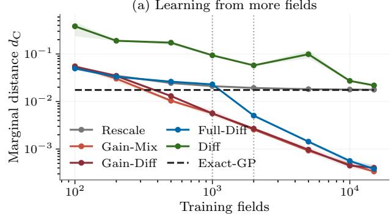

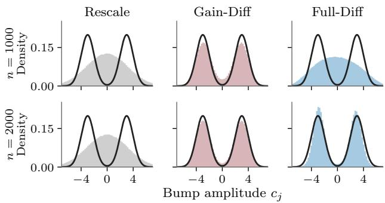  
Figure 2: Synthetic. Top: Cramér distance $d _ { \mathrm { C } }$ to the exact posterior versus training-set size; mean and range over three seeds. Bottom: pooled bump amplitudes at $n = 1 0 0 0$ and 2000 (dotted lines; single seed) against the exact density (black). Rescale cannot split the sign modes; Gain-Diff does so by $n = 1 0 0 0$ , Full-Diff only by n = 2000.

## 4.2 Smoke

We next consider smoke emitted by a chimney on a $3 2 \times 3 2$ grid under an uncertain wind direction $\varphi .$ Nine noisy sensors measure the smoke concentration $f .$ Some readings identify the wind direction sharply, while others leave several directions plausible. We examine whether a low-dimensional correction can capture this measurement-dependent uncertainty. The concentration is $f = b + Q g _ { \varphi }$ , where b is a small GP background, $Q$ is the emission strength, and $g _ { \varphi }$ is an advection– difusion plume given $\varphi .$ . For each of 360 possible wind directions, the conditional posterior is Gaussian, so the exact posterior is a weighted mixture. The scafold instead conditions a single Gaussian with the prior’s first two moments on the same readings (Appendix D). When several wind directions remain plausible, the posterior mean can be difuse even though individual draws will always contain a narrow smoke plume.

The Smoke columns of Table 1 report results at $n _ { \mathrm { t r a i n } } =$ 8192. The GP discrepancy baseline (KO) leaves the scaffold’s CRPS essentially unchanged. The presented corrections recover an increasing share of the predictive accuracy missing from the Gaussian scafold. Correcting the mean (Scaffold+M) closed 33% of the scafold-toexact CRPS gap, and additional covariance calibration Rescale raises this to 42%. Learning a distribution on the selected subspace yields a further substantial improvement: Gain-Mix closes 85% of the gap, and Gain-Diff reaches 90% (Table 1, Smoke columns). The selected difusion correction achieves this using only 38–39 of the 1024 field coordinates.

The posterior samples illustrate the resulting improvement in plume structure (Figure 4). For the displayed readings, several wind directions remain plausible. Exact draws contain individual narrow plumes in diferent directions, whereas scafold draws spread smoke across several directions at once. Gain-Diff recovers more localized plumes, although one of its displayed draws remains difuse. Across test contexts, its CRPS is close to that of the moment-matched Gaussian Exact-GP (0.0457 versus 0.0459), while its PCD is about eight times lower (154 versus 1256; Table 1). Thus, similar marginal accuracy can coexist with substantially diferent sample plausibility.

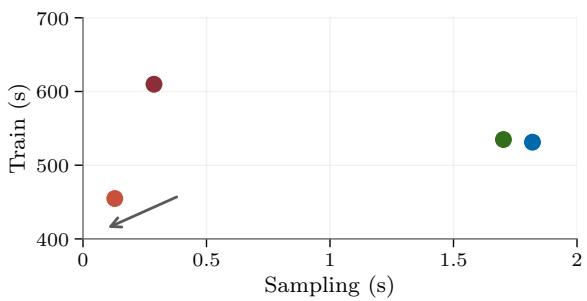

Figure 3: Smoke training and sampling costs at n = 8192, d = 1024. Methods: Gain-Mix ( ), Gain-Diff ( ), Full-Diff ( ), Diff ( ). The arrow indicates improvement; points show timing medians over three seeds. Training includes selection and excludes evaluation; sampling produces 100 draws for one context.  
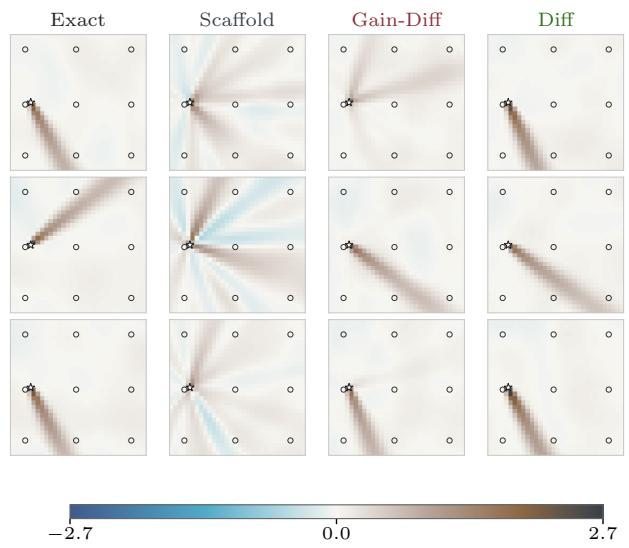  
Figure 4: Smoke posterior draws for one set of sensor observations (first three draws per method; rows are not paired). Exact draws are narrow plumes in diferent directions; the scafold smears smoke across directions, while Gain-Diff and Diff recover localized plumes. Stars: source; circles: sensors.

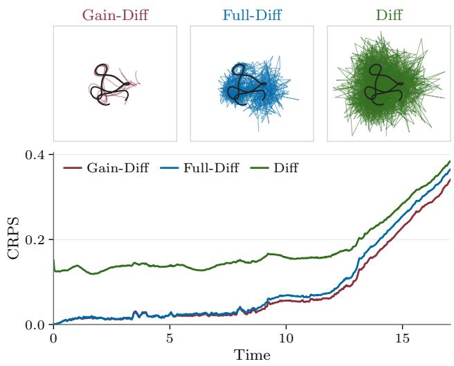  
Figure 5: CR3BP $( n = 7 5 0 0 $ , single seed). Top: first five draws per method for one initial state, with the reference trajectory in black; Gain-Diff ( ) stays close to the reference orbit, while Full-Diff ( ) and Diff ( ) scatter. Bottom: CRPS over time, averaged over the four state coordinates and all test contexts.

Full-Diff achieves slightly lower CRPS than Gain-Diff, although Gain-Diff has lower PCD at n = 8192 (Table 1). Direct conditional difusion Diff achieves the lowest CRPS, Cramér distance and PCD among the learned methods. The learning curves also favor the full-field models: both achieve lower mean CRPS than the selected corrections throughout the measured training sizes (Appendix D.4). The contrast with Synthetic suggests that the useful inductive bias depends on the structure of the discrepancy: fixed bump directions favor learning in coeficient space, whereas uncertainty over coherent plume shapes may favor the spatial structure of the full-field U-Nets used here. The selected correction, however, ofers a clear tradeof between predictive accuracy and reduced sampling cost (Figure 3).

## 4.3 CR3BP

Finally, we examine whether a selected correction can improve numerical trajectory predictions. The Gaussian scafold is supplied by a probabilistic ODE solver (P. N. Krämer, 2024) for the planar circular restricted three-body problem (Hairer, Nørsett, and Wanner, 1993; Hennig, Osborne, and Kersting, 2022). The context is the initial state, and the target comprises positions and velocities at 501 times (d = 2004). The dynamics are deterministic given the initial state, so the task is to correct numerical prediction error. A high-accuracy numerical solve supplies the reference trajectory (Appendix E).

The CR3BP columns of Table 1 report results at $n _ { \mathrm { t r a i n } } =$ 7500. As in Smoke, correcting the mean and covariance already improves substantially on the Gaussian scaffold. Learning a distribution on the selected subspace improves accuracy further: Gain-Diff reaches a CRPS of 0.0815, about half the solver’s 0.1588. In contrast to Smoke, direct conditional difusion Diff has higher CRPS than the scafold. For KO, likelihood fitting produces an over-dispersed prediction, where its log-score improves, but CRPS against the deterministic reference worsens (Appendix E.4).

The trajectory samples compare the three difusion models (Figure 5 and Figure 1). For the displayed initial state, Gain-Diff draws follow the reference orbit more closely, while Full-Diff and direct conditional difusion (Diff) produce visibly irregular paths. Since PCD is unavailable for the point-mass reference, we assess physical consistency through Jacobiconstant drift (Appendix E), which measures changes in a state-derived quantity that should remain constant along each trajectory. Both, Gain-Diff and Gain-Mix, achieve lower field CRPS, energy scores and Jacobi errors than both full-field alternatives.

## 5 LIMITATIONS AND CONCLUSION

We developed a posterior-correction framework that uses a Gaussian reference to carry physical and observational information into a learned generative model. Mean and covariance corrections address location and spread, while a richer probability law is learned on directions selected by estimated improvement over the calibrated reference. The remaining directions retain Gaussian uncertainty. This targeted correction recovers hidden modes in Synthetic, improves predictive accuracy and sample structure in Smoke, and reduces numerical trajectory error in CR3BP.

The framework leaves several sources of approximation error. Even an exact law on the selected subspace leaves mismatch in the Gaussian complement and dependence between the two subspace unresolved. Pooled calibration may miss context-dependent covariance structure, while gains estimated by the product-mixture selector may not carry over to the fitted difusion model. It remains open how to adapt global subspace selection when the leading directions of discrepancy vary strongly across contexts. The selected rank depends on the data, resolution, and search budget. In CR3BP, selection reaches the imposed rank cap, so the experiment does not establish an intrinsic correction dimension, but a useful regularization. Its point-mass target also falls outside the theory’s finite-KL assumptions.

Smoke illustrates that uncertainty in a single physical parameter can require coordinated corrections across many field directions. The restricted correction improves predictive accuracy over the Gaussian reference and produces more plausible samples, while direct diffusion achieves higher predictive accuracy at a greater sampling cost. Gain-Diff’s subspace selection introduces additional fitting overhead, but reduces the dimensionality of the generative model and simplifies its training.

Together, these results suggest that a Gaussian approximation can reduce the scope of generative learning when its remaining discrepancy admits a compact correction. Our framework makes this principle operational: use computation to construct a reference, use residual data to identify where a richer law adds value, and concentrate generative modeling there while retaining a Gaussian law on the complement.

## Acknowledgements

The authors gratefully acknowledge financial support by the European Research Council through ERC CoG Action 101123955 ANUBIS; the DFG Cluster of Excellence "Machine Learning - New Perspectives for Science", EXC 2064/1, project number 390727645; the DFG SPP 2298 (Project HE 7114/5-1), and the Carl Zeiss Foundation, (project "Certification and Foundations of Safe Machine Learning Systems in Healthcare"), as well as funds from the Ministry of Science, Research and Arts of the State of Baden-Württemberg. The authors thank the International Max Planck Research School for Intelligent Systems (IMPRS-IS) for supporting Tobias Weber.

## References

Baik, Jinho and Jack W. Silverstein (2006). “Eigenvalues of large sample covariance matrices of spiked population models”. In: Journal of Multivariate Analysis 97.6, pp. 1382–1408. doi: 10.1016/j.jmva.2005. 08.003.

Baptista, Ricardo, Michael Brennan, and Youssef Marzouk (2025). “Dimension reduction via score ratio matching”. In: Transactions on Machine Learning Research. issn: 2835-8856.

Bishop, Christopher M. (1994). Mixture Density Networks. Tech. rep. NCRG/94/004. Aston University.

Blanchard, Gilles et al. (2006). “In Search of Non-Gaussian Components of a High-Dimensional Distribution”. In: Journal of Machine Learning Research 7, pp. 247–282.

Brennan, Michael et al. (2020). “Greedy inference with structure-exploiting lazy maps”. In: Advances in Neural Information Processing Systems. Ed. by H. Larochelle et al. Vol. 33, pp. 8330–8342.

Brynjarsdóttir, Jenný and Anthony O’Hagan (2014). “Learning about physical parameters: The importance of model discrepancy”. In: Inverse problems 30.11, p. 114007. doi: 10.1088/0266-5611/30/11/ 114007.

Chen, Yifan et al. (2024). “Gaussian Measures Conditioned on Nonlinear Observations: Consistency, MAP Estimators, and Simulation”. In: Statistics and Computing 35.1, p. 10. issn: 1573-1375. doi: 10.1007/ s11222-024-10535-0.

Cover, Thomas M. and Joy A. Thomas (2005). Elements of Information Theory. 2nd ed. Wiley. doi: 10.1002/047174882X.

Cui, Tiangang et al. (2014). “Likelihood-Informed Dimension Reduction for Nonlinear Inverse Problems”. In: Inverse Problems 30.11, p. 114015.

Edelman, Alan, Tomás A. Arias, and Steven T. Smith (1998). “The Geometry of Algorithms with Orthogonality Constraints”. In: SIAM Journal on Matrix Analysis and Applications 20.2, pp. 303–353. doi: 10.1137/S0895479895290954.

Gneiting, Tilmann and Adrian E Raftery (2007). “Strictly proper scoring rules, prediction, and estimation”. In: Journal of the American statistical Association 102.477, pp. 359–378.

Gneiting, Tilmann, Larissa I Stanberry, et al. (2008). “Assessing probabilistic forecasts of multivariate quantities, with an application to ensemble predictions of surface winds”. In: Test 17.2, pp. 211–235.

Hairer, Ernst, Syvert P. Nørsett, and Gerhard Wanner (1993). Solving Ordinary Diferential Equations I: Nonstif Problems. 2nd ed. Vol. 8. Springer Series in Computational Mathematics. Springer Berlin, Heidelberg. isbn: 978-3-540-78862-1. doi: 10.1007/978- 3-540-78862-1.

Hennig, Philipp, Michael A. Osborne, and Hans P. Kersting (2022). Probabilistic Numerics: Computation as Machine Learning. Cambridge: Cambridge University Press.

Ho, Jonathan, Ajay Jain, and Pieter Abbeel (2020). “Denoising Difusion Probabilistic Models”. In: Advances in Neural Information Processing Systems. Ed. by H. Larochelle et al. Vol. 33. Curran Associates, Inc., pp. 6840–6851.

Huang, Jiahe et al. (2024). “DifusionPDE: Generative PDE-solving under partial observation”. In: Advances in Neural Information Processing Systems. Vol. 37, pp. 130291–130323.

Hyvärinen, Aapo (1999). “Fast and Robust Fixed-Point Algorithms for Independent Component Analysis”. In: IEEE Transactions on Neural Networks 10.3, pp. 626–634. doi: 10.1109/72.761722.

Kennedy, Marc C and Anthony O’Hagan (2001). “Bayesian Calibration of Computer Models”. In: Journal of the Royal Statistical Society Series B: Statis-

tical Methodology 63.3, pp. 425–464. doi: 10.1111/ 1467-9868.00294.

Krämer, Nicholas, Jonathan Schmidt, and Philipp Hennig (Mar. 2022). “Probabilistic Numerical Method of Lines for Time-Dependent Partial Diferential Equations”. In: Proceedings of The 25th International Conference on Artificial Intelligence and Statistics. Ed. by Gustau Camps-Valls, Francisco J. R. Ruiz, and Isabel Valera. Vol. 151. Proceedings of Machine Learning Research. PMLR, pp. 625–639.

Krämer, Peter Nicholas (2024). “Implementing probabilistic numerical solvers for diferential equations”. PhD thesis. Universität Tübingen.

Lezcano-Casado, Mario (2019). “Trivializations for Gradient-Based Optimization on Manifolds”. In: Advances in Neural Information Processing Systems. Vol. 32.

Loshchilov, Ilya and Frank Hutter (2019). “Decoupled Weight Decay Regularization”. In: International Conference on Learning Representations.

Marchenko, V. A. and L. A. Pastur (1967). “Distribution of Eigenvalues for Some Sets of Random Matrices”. In: Mathematics of the USSR-Sbornik 1.4, pp. 457–483. doi: 10 . 1070 / SM1967v001n04ABEH001994.

Mardani, Morteza et al. (2025). “Residual corrective difusion modeling for km-scale atmospheric downscaling”. In: Communications Earth & Environment 6.1, p. 124. doi: 10.1038/s43247-025-02042-5.

Nalisnick, Eric et al. (2019). Detecting Out-of-Distribution Inputs to Deep Generative Models Using Typicality. arXiv preprint arXiv:1906.02994. arXiv: 1906.02994 [stat.ML].

Nichol, Alexander Quinn and Prafulla Dhariwal (2021). “Improved Denoising Difusion Probabilistic Models”. In: Proceedings of the 38th International Conference on Machine Learning. Vol. 139. Proceedings of Machine Learning Research. PMLR, pp. 8162–8171.

Pförtner, Marvin et al. (2024). Physics-Informed Gaussian Process Regression Generalizes Linear PDE Solvers. arXiv preprint arXiv:2212.12474. arXiv: 2212.12474 [cs.LG].

Plumlee, Matthew (2017). “Bayesian Calibration of Inexact Computer Models”. In: Journal of the American Statistical Association 112.519, pp. 1274–1285. doi: 10.1080/01621459.2016.1211016.

Raissi, Maziar, Paris Perdikaris, and George Em Karniadakis (2017). “Machine learning of linear diferential equations using Gaussian processes”. In: Journal of Computational Physics 348, pp. 683–693. doi: 10.1016/j.jcp.2017.07.050.

Rasmussen, Carl Edward and Christopher K. I. Williams (2005). Gaussian Processes for Machine Learning. The MIT Press. isbn: 9780262256834. doi: 10.7551/mitpress/3206.001.0001.

Ronneberger, Olaf, Philipp Fischer, and Thomas Brox (2015). “U-Net: Convolutional Networks for Biomedical Image Segmentation”. In: Medical Image Computing and Computer-Assisted Intervention – MIC-CAI 2015. Cham: Springer International Publishing, pp. 234–241.

Rozet, François and Gilles Louppe (2023). “Score-based Data Assimilation”. In: Advances in Neural Information Processing Systems. Ed. by A. Oh et al. Vol. 36. Curran Associates, Inc., pp. 40521–40541. doi: 10. 52202/075280-1763.

Rue, Håvard and Leonhard Held (2005). Gaussian Markov Random Fields: Theory and Applications. 1st ed. Chapman and Hall/CRC. doi: 10.1201/ 9780203492024.

Rühling Cachay, Salva et al. (2023). “DYfusion: A Dynamics-informed Difusion Model for Spatiotemporal Forecasting”. In: Advances in Neural Information Processing Systems. Ed. by A. Oh et al. Vol. 36. Curran Associates, Inc., pp. 45259–45287. doi: 10. 52202/075280-1961.

Salimans, Tim and Jonathan Ho (2022). “Progressive Distillation for Fast Sampling of Difusion Models”. In: International Conference on Learning Representations.

Schmidt, Jonathan, Nicholas Krämer, and Philipp Hennig (2021). “A Probabilistic State Space Model for Joint Inference from Diferential Equations and Data”. In: Advances in Neural Information Processing Systems. Vol. 34, pp. 12374–12385.

Song, Yang and Stefano Ermon (2020). “Improved Techniques for Training Score-Based Generative Models”. In: Advances in Neural Information Processing Systems. Vol. 33, pp. 12438–12448.

Song, Yang, Jascha Sohl-Dickstein, et al. (2021). “Score-Based Generative Modeling Through Stochastic Differential Equations”. In: International Conference on Learning Representations.

Stuart, A. M. (2010). “Inverse Problems: A Bayesian Perspective”. In: Acta Numerica 19, pp. 451–559. doi: 10.1017/S0962492910000061.

Székely, Gábor J. and Maria L. Rizzo (2013). “Energy statistics: A class of statistics based on distances”. In: Journal of Statistical Planning and Inference 143.8, pp. 1249–1272. doi: 10.1016/j.jspi.2013.03.018.

Weiland, Tim, Marvin Pförtner, and Philipp Hennig (2025). “Flexible and Eficient Probabilistic PDE Solvers through Gaussian Markov Random Fields”. In: Proceedings of The 28th International Conference on Artificial Intelligence and Statistics. Proceedings of Machine Learning Research. PMLR, pp. 2746– 2754.

Zahm, Olivier et al. (2022). “Certified Dimension Reduction in Nonlinear Bayesian Inverse Problems”. In: Mathematics of Computation 91.336, pp. 1789–1835.

## APPENDIX

## CONTENTS

A Method details 11   
A.1 Derivations 12   
A.2 Covariance mismatch correction 13   
A.3 Subspace selection 13   
A.4 Block laws and sampling . 14   
B Shared experimental setup 14   
B.1 Methods . 15   
B.2 Training protocol 15   
B.3 Evaluation and metrics . 16   
C Dataset: Synthetic 17   
C.1 Data, exact posterior and scafold . 17   
C.2 Methods and training 18   
C.3 Evaluation . 18   
C.4 Additional results . 18   
D Dataset: Smoke 21   
D.1 Data, exact posterior and scafold . 21   
D.2 Methods and training 21   
D.3 Evaluation . 21   
D.4 Additional results . 22   
E Dataset: CR3BP 24   
E.1 Data, reference trajectory and scafold . 24   
E.2 Methods and training 24   
E.3 Evaluation . 24   
E.4 Additional results . 24

## A METHOD DETAILS

This section completes the decompositions of Section 2 and then describes each stage as implemented. Algorithm 1 summarizes one full pipeline fit; per-problem values are collected in Table 3.

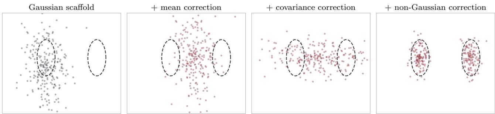  
Figure 6: Illustration of the correction principle in two dimensions. Dashed contours mark two target modes. Correcting the mean and covariance accounts for location and spread, but leaves the Gaussian unable to represent both modes. Replacing the law along the horizontal direction recovers the bimodality while retaining a Gaussian in the vertical direction.

## A.1 Derivations

Throughout, $P _ { c } = \mathcal { L } ( f \mid c )$ has a density, finite second moments, mean $\mu _ { c }$ and nonsingular covariance $\Sigma _ { c } ,$ and all divergences are finite. These assumptions concern the density identities; the deterministic CR3BP target does not satisfy them in ambient field space. Its sample-based comparisons do not require finite KL divergence. Statements are per context c and the objectives of Section 2 take their expectation over c.

Gaussian projection (Equation (1)). Let $G _ { c } ^ { \star } = \mathcal { N } ( \mu _ { c } , \Sigma _ { c } )$ and $Q = { \mathcal { N } } ( m , C )$ . Since log $G _ { c } ^ { \star } - \log Q$ is a quadratic polynomial in $f ,$ its expectation depends on the law of $f$ only through the first two moments, which $P _ { c }$ and $G _ { c } ^ { \star }$ share. Hence

$$
D _ { \mathrm { K L } } \big ( P _ { c } \| Q \big ) - D _ { \mathrm { K L } } \big ( P _ { c } \| G _ { c } ^ { \star } \big ) = \mathbb { E } _ { P _ { c } } \big [ \log G _ { c } ^ { \star } - \log Q \big ] = \mathbb { E } _ { G _ { c } ^ { \star } } \big [ \log G _ { c } ^ { \star } - \log Q \big ] = D _ { \mathrm { K L } } \big ( G _ { c } ^ { \star } \| Q \big ) ,\tag{13}
$$

and the closed form of the Gaussian divergence splits $D _ { \mathrm { K L } } \big ( G _ { c } ^ { \star } \| Q \big )$ into the location and covariance terms of Equation (1).

Mean step. For any shift δ, $, \mathbb { E } _ { P _ { c } } \left. \ b { f } - m _ { c } - \delta \right. _ { C _ { c } ^ { - 1 } } ^ { 2 } = \left. \mu _ { c } - m _ { c } - \delta \right. _ { C _ { c } ^ { - 1 } } ^ { 2 } + \mathrm { t r } ( C _ { c } ^ { - 1 } \Sigma _ { c } )$ . The precision-weighted loss is therefore twice the location term plus a constant in δ, and it is minimized by $\delta = \mu _ { c } - m _ { c }$

Covariance mismatch after pooled calibration. Covariance correction removes the pooled mismatch, but may leave a context-dependent contribution to the covariance term in the KL decomposition. Assume the mean is exact, and let u denote the whitened residual after exact pooled covariance calibration. Write $\Sigma _ { c } ^ { u } = \operatorname { C o v } ( u \mid c )$ so that $\mathbb { E } _ { c } \Sigma _ { c } ^ { u } = I$ . The remaining expected covariance contribution to the Gaussian KL is

$$
\begin{array} { r } { \mathbb { E } _ { c } \frac { 1 } { 2 } \Big [ \operatorname { t r } { \Sigma } _ { c } ^ { u } - \log \operatorname* { d e t } { \Sigma } _ { c } ^ { u } - d \Big ] = - \frac { 1 } { 2 } \mathbb { E } _ { c } \log \operatorname* { d e t } { \Sigma } _ { c } ^ { u } \ \geq \ 0 , } \end{array}\tag{14}
$$

where the equality uses $\mathbb { E } _ { c } \Sigma _ { c } ^ { u } = I$ and the inequality follows from concavity of log det. For positive-definite covariances, this remainder vanishes if and only if $\Sigma _ { c } ^ { u } = I$ for almost every context. Any remaining contextdependent covariance mismatch must be addressed by the block law.

Block decomposition (Equation (8)). The map $u \mapsto \left( w , w _ { \perp } \right) = \left( U ^ { \top } u , U _ { \parallel } ^ { \top } u \right)$ is orthogonal, so densities transform without a Jacobian. Writing lo $\begin{array} { r } { \lg p ( w , w _ { \bot } \mid c ) = \log p ( w \mid c ) + \log p ( w _ { \bot } \mid c ) + \log \frac { p ( w , w _ { \bot } \mid c ) } { p ( w \mid c ) p ( w _ { \bot } \mid c ) } } \end{array}$ inside $D _ { \mathrm { K L } } \big ( P _ { u | c } \| q ( \cdot | \ c ) \big )$ gives the block term, the complement term and the mutual information $I ( w ; w _ { \perp } \mid c )$

Gain (Equation (9)). Subtracting the decomposition for $q$ from the same decomposition for the calibrated Gaussian $\mathcal { N } ( 0 , I _ { d } )$ cancels the complement and the mutual-information terms:

$$
\begin{array} { r l } & { \mathbb { E } _ { c } D _ { \mathrm { K L } } \big ( P _ { u | c } \| \mathcal { N } ( 0 , I _ { d } ) \big ) - \mathbb { E } _ { c } D _ { \mathrm { K L } } \big ( P _ { u | c } \| q ( \cdot \ | \ c ) \big ) = \mathbb { E } _ { c } \big [ D _ { \mathrm { K L } } \big ( P _ { w | c } \| \mathcal { N } ( 0 , I _ { k } ) \big ) - D _ { \mathrm { K L } } \big ( P _ { w | c } \| q _ { \theta } ( \cdot \ | \ c ) \big ) \big ] } \\ & { \qquad = \mathcal { G } ( U , q _ { \theta } ) . } \end{array}\tag{15}
$$

The gain is thus the reduction of total divergence achieved by that block law up to finite-sampling errors. It is bounded by $\mathbb { E } _ { c } D _ { \mathrm { K L } } \big ( P _ { w | c } \| \mathcal { N } ( 0 , I _ { k } ) \big )$ , which is attained at $q _ { \theta } = P _ { w | c }$

Gain under a factorized selection density. Selection uses a product of one-dimensional laws, $q ( w \mid c ) =$ $\Pi _ { j } q _ { j } ( w _ { j } \mid c )$ . With the total correlation $\begin{array} { r } { \mathrm { T C } ( w \mid c ) = D _ { \mathrm { K L } } \big ( P _ { w \mid c } \| \prod _ { j } P _ { w _ { j } \mid c } \big ) \ge 0 } \end{array}$ ,

$$
D _ { \mathrm { K L } } \big ( P _ { w | c } \| \mathcal { N } ( 0 , I _ { k } ) \big ) = \sum _ { j = 1 } ^ { k } D _ { \mathrm { K L } } \big ( P _ { w _ { j } | c } \| \mathcal { N } ( 0 , 1 ) \big ) + \mathrm { T C } ( w \mid c ) .\tag{16}
$$

The gain a product contrast can measure is therefore a lower bound on the gain available to a joint law such as the block DDPM; the diference is the dependence inside the block.

Resolution τ. Selection scores the residual and the Gaussian reference after both are convolved with ${ \mathcal { N } } ( 0 , \tau ^ { 2 } I )$ For a fixed pair, the data-processing inequality (Cover and Thomas, 2005) guarantees that the smoothed divergence never exceeds the original one, and discrepancies whose amplitude in the units of $f$ is small against $\tau$ contribute little to it.

## A.2 Covariance mismatch correction

Coordinates. Let $r = f - \hat { \mu } _ { c }$ be the mean-corrected residual. A shared-covariance scafold uses the same covariance $C _ { c } = C$ for every context (Synthetic, Smoke); a context-dependent-covariance scafold uses a covariance $C _ { c }$ that varies with c (CR3BP). In our shared-covariance examples, $C$ is numerically low rank, so we add an isotropic variance floor and whiten as $z = ( C + \sigma ^ { 2 } I ) ^ { - 1 / 2 } r$ . For Synthetic, we choose $\sigma$ by grid search on the training Gaussian log score; for Smoke, we set $\sigma = \tau$ . For CR3BP, we use the context-specific factor $C _ { c } = S _ { c } S _ { c } ^ { \top }$ and whiten as $z = S _ { c } ^ { - 1 } r$ , without adding a floor.

Rescaling with a sampling-noise threshold. Let $\hat { \lambda } _ { i }$ be the variance of the whitened residuals z along the ith eigenvector of their sample covariance, and $\tilde { \lambda } _ { i }$ the variance the calibrated reference assigns to that direction. Even when the scafold covariance is correct, the $\hat { \lambda } _ { i }$ of n residuals in m dimensions spread over the Marchenko–Pastur interval $[ ( 1 - \sqrt { m / n } ) ^ { 2 } , ( 1 + \sqrt { m / n } ) ^ { 2 } ]$ (Marchenko and Pastur, 1967). We therefore set $\tilde { \lambda } _ { i } = \hat { \lambda } _ { i }$ only if $\kappa ( \hat { \lambda } _ { i } )$ exceeds its value at both edges, and $\tilde { \lambda } _ { i } = 1$ otherwise. For CR3BP, this test runs on the full field space. For shared scafolds, it runs on the range of $C$ and on the complement’s principal components whose eigenvalues exceed the Marchenko–Pastur edge of the others, debiased following Baik and Silverstein (2006); all other complement directions share their average sample variance. The resulting variances define $L _ { c }$ and $u = L _ { c } ^ { - 1 } r$

## A.3 Subspace selection

Contrast. The selection density is a product of one-dimensional Gaussian mixtures with $K = 3$ components per coordinate. Its parameters are shared across contexts in Synthetic and predicted from the context by an MLP in Smoke and CR3BP. Each coordinate’s held-out gain is $\begin{array} { r } { g _ { j } = \frac { 1 } { n _ { \mathrm { v a l } } } \sum _ { \mathrm { v a l } } \left[ \log q _ { j } ( w _ { j } \mid c ) - \log \mathcal { N } ( w _ { j } ; 0 , 1 ) \right] } \end{array}$

Resolution. The resolution is $\tau = c _ { \tau } \cdot \mathrm { R M S } ( r )$ with $c _ { \tau } \in \{ 0 , 0 . 2 \}$ per problem (Table 3). Training and validation residuals receive $\tau \xi , \xi \sim \mathcal { N } ( 0 , I )$ , and the calibration is refitted on the smoothed residuals with floor $\tau$ (shared) or covariance $C _ { c } + \tau ^ { 2 } I$ (per context). After selection, the directions are mapped back to the unsmoothed coordinates.

Proposals and search. The gain is a non-convex function of the frame $U ,$ so gradient ascent from an arbitrary start can stall in a poor local optimum. We therefore start from three proposals, each restricted to the resolved calibration directions:

• Residual PCA: principal components of $r$ in function space, mapped into u. They capture the residual structure with the largest amplitude in the units of $f .$

• FastICA (Hyvärinen, 1999): independent components of $u ,$ ranked by held-out gain. FastICA seeks maximally non-Gaussian projections, which is the structure the gain rewards.

• λˆ-span: after recalibration, the at most 64 axes with the largest $\hat { \lambda } _ { i } > 1$ , rotated within their span by the same Stiefel gradient ascent as the refinement below, using a pooled mixture contrast. Separated modes widen the residual along the directions that separate them, so they tend to appear as excess variance.

Algorithm 1 Fitting the corrected posterior for one training seed.   
Require: training and validation pairs $( f , c )$ , scafold $( m _ { c } , C _ { c } )$ , resolution factor $c _ { \tau }$   
1: Fit the mean shift $\delta _ { \phi } ;$ set $\hat { \mu } _ { c } = m _ { c } + \delta _ { \phi } ( c )$ and $r = f - \hat { \mu } _ { c }$   
2: Calibrate the covariance, giving $L _ { c }$ and $u = L _ { c } ^ { - 1 } r$ ▷ Appendix A.2   
3: Set $\tau = c _ { \tau } \mathrm { R M S } ( r )$ , add $\bar { \mathcal { N } } ( 0 , \bar { \tau ^ { 2 } } I )$ noise to r and recalibrate   
4: for each proposal (PCA, FastICA, λˆ-span) do   
5: Fit the contrast on its leading 64 directions and score them by $\textstyle \sum _ { j }$ max $( g _ { j } , 0 )$   
6: end for   
7: Refine the best pool on the Stiefel manifold; keep the pool if refinement lowers the score   
8: Keep the directions whose $g _ { j }$ exceeds the threshold   
9: Map them back to $\tau = 0$ and drop those without held-out gain there, giving $U \in \mathbb { R } ^ { d \times k }$   
10: if $k > 0$ then   
11: Fit the block law $q _ { \theta }$ (mixture or DDPM) on $w = U ^ { \top }$ u and apply the law guard   
12: end if   
13: return the sampler of Equation (11), which is Rescale when $k = 0$

The leading 64 directions of each proposal form a pool, scored by $\textstyle \sum _ { j }$ max $( g _ { j } , 0 )$ under a fitted contrast (see above). The top $k _ { \operatorname* { m a x } } = 6 4$ directions of the best pool are refined jointly with the contrast by gradient ascent on the Stiefel manifold of orthonormal frames, through a smooth parametrization (Edelman, Arias, and Smith, 1998; Lezcano-Casado, 2019). If refinement lowers the gain, the pool is kept. For per-context scafolds, the refinement runs inside a 64-dimensional span assembled from the proposals and is then polished in the full resolved space.

Rank selection. A coordinate is kept if $g _ { j } > \mathrm { m a x } \{ 0 . 0 1 , ( 3 K - 1 ) / n _ { \mathrm { v a l } } \}$ , where 3K − 1 is the parameter count of a one-dimensional mixture (0.016 nats at $n _ { \mathrm { v a l } } = 5 0 0 )$ . After mapping back to $\tau = 0$ , a freshly fitted contrast drops coordinates with $g _ { j } \leq 0$ . The law guard falls back to the Gaussian when a mixture block has no positive held-out gain over $\mathcal { N } ( 0 , \bar { I } _ { k } )$ or, on Synthetic, when a block DDPM’s best validation state is its initialization. These decisions use the validation split, never the test contexts; because the same split early-stops the contrast, the reported gains are optimistic and the threshold does not control an error rate. An empty block means that the search found no gain, not that the residual is Gaussian.

## A.4 Block laws and sampling

Block laws. All block laws are fitted on $w = U ^ { \top }$ u at $\tau = 0$ . Gain-Mix refits the factorized Gaussian mixture contrast from scratch. Gain-Diff uses a DDPM (Ho, Jain, and Abbeel, 2020) with $T = 2 0 0$ steps, a cosine noise schedule (Nichol and Dhariwal, 2021) and v-prediction (Salimans and Ho, 2022). Its MLP denoiser is conditioned on c, and ancestral sampling clips the predicted wˆ to the training range widened on each side by half its width. Coordinates are standardized per dimension. On Synthetic, whose readings carry no information about the bump signs, both block laws are unconditional and the DDPM predicts ϵ.

Full-residual baseline. Full-Diff takes $k = d$ without the covariance calibration: it models the mean-corrected residual r (shared scafolds) or $S _ { c } ^ { - 1 } r$ (per-context scafolds) directly.

Corrected draw. A draw is $\begin{array} { r } { f ^ { \star } = \hat { \mu } _ { c } + L _ { c } \big ( U w + ( I - U U ^ { \top } ) \epsilon \big ) } \end{array}$ with $w \sim q _ { \theta } ( \cdot \mid c )$ and $\epsilon \sim \mathcal { N } ( 0 , I _ { d } )$ ; this has the law of Equation (11) without forming $U _ { \perp }$ . Directions outside the resolved calibration directions are never selected, so they always remain Gaussian.

## B SHARED EXPERIMENTAL SETUP

All problems share the method names, the training protocol and the metrics defined here. Problem-specific choices are collected in Table 3 and explained in the problem sections.

## B.1 Methods

Table 2 defines every method by its center, its Gaussian part and its learned law. The structured residual corrections share the anchor mean stage $\hat { \mu } _ { c } = m _ { c } + \delta _ { \phi } ( c )$ of their problem. The mean of a learned block law can produce a further shift, so this anchor is not necessarily the predictive mean. Block and full-residual laws are unconditional on Synthetic and conditional on the other problems.

Table 2: Method roster. $\mathit { L _ { c } } \mathrm { : }$ calibrated factor (Appendix A.2); k: block size; mixtures are products of one-dimensional Gaussian mixtures; KO is shown before conditioning on readings. Grey rows require the exact posterior.
<table><tr><td>Method</td><td>Anchor</td><td>Gaussian part</td><td>Learned law</td><td>Problems</td><td>Defined in</td></tr><tr><td>Scaffold</td><td> $m _ { c }$ </td><td> $C _ { c }$ </td><td></td><td>all</td><td>Section 2</td></tr><tr><td>Scaffold+M</td><td> $\hat { \mu } _ { c }$ </td><td> $C _ { c }$ </td><td></td><td>all</td><td>Section 2</td></tr><tr><td>Rescale</td><td> $\hat { \mu } _ { c }$ </td><td> $L _ { c } L _ { c } ^ { \top }$ </td><td></td><td>all</td><td>Appendix A.2</td></tr><tr><td>Gain-Mix</td><td> $\hat { \mu } _ { c }$ </td><td> $\boldsymbol { L _ { c } } ( \boldsymbol { I } - \boldsymbol { U } \boldsymbol { U } ^ { \top } ) \boldsymbol { L } _ { c } ^ { \top }$ </td><td>mixture on k coordinates</td><td>all</td><td>Appendix A.4</td></tr><tr><td>Gain-Diff</td><td> $\hat { \mu } _ { c }$ </td><td> $\boldsymbol { L _ { c } ( I - U U ^ { \top } ) L _ { c } ^ { \top } }$ </td><td>DDPM on k coordinates</td><td>all</td><td>Appendix A.4</td></tr><tr><td>Full-Diff</td><td> $\hat { \mu } _ { c }$ </td><td></td><td>DDPM on all d coordinates</td><td>all</td><td>Appendix A.4</td></tr><tr><td>KO</td><td> $\rho _ { m } m _ { 0 } ( c ) + \mu$ </td><td> $\rho ^ { 2 } C _ { 0 } ( c ) + K _ { \delta }$ </td><td></td><td>all</td><td>below</td></tr><tr><td>Diff</td><td></td><td></td><td>conditional DDPM on f</td><td>all</td><td>below</td></tr><tr><td>Exact-GP</td><td> $\mu _ { c }$ </td><td> $\Sigma _ { c }$ </td><td></td><td>all but CR3BP</td><td>Section 1</td></tr><tr><td>Exact</td><td>draws from Pc</td><td></td><td></td><td>all but CR3BP</td><td>problem sections</td></tr></table>

KO. Following Kennedy and O’Hagan (2001), the field is $f = \rho _ { m } m _ { 0 } ( c ) + \rho \eta + \delta$ , where $\eta \sim \mathcal { N } ( 0 , C _ { 0 } ( c ) )$ is the scafold’s model before conditioning on the readings, δ is a Gaussian-process discrepancy with a mean µ per grid point and covariance $K _ { \delta } = s ^ { 2 } ( R _ { \ell } + \nu I )$ , and the readings are $y = H f + e$ with $e \sim \mathcal { N } ( 0 , \lambda I )$ . The mean scale $\rho _ { m }$ is chosen by generalized least squares, $( \rho , s ^ { 2 } , \ell , \nu )$ are fitted by type-II maximum likelihood (L-BFGS-B within boxes) on the training and validation sets, and λ is the average of $( y - H f ) ^ { 2 }$ over the training readings, i.e. the empirical reading-noise variance. With $\rho _ { m } = \rho = 1$ and $\delta = 0$ , KO is the scafold. Its discrepancy prior is shared across contexts; conditioning can still change the resulting mean with the readings, but it does not learn an arbitrary context-dependent discrepancy process.

Diff. A conditional DDPM on the whole field that does not use the scafold (v-prediction, $T = 2 0 0$ , the cosine schedule and clipping rule of Appendix A.4). It is an MLP on Synthetic and CR3BP, and a U-Net with the context as input channels on Smoke. Its RMSE uses the mean of its draws.

## B.2 Training protocol

Stages and data. The stages are fitted in the order mean, calibration, selection, law, each on the same training split and frozen before the next; there is no joint fine-tuning. The validation split early-stops every network and supplies the held-out gains.

Optimization. The learned neural components use AdamW (Loshchilov and Hutter, 2019) with cosine learningrate schedules and gradient clipping; difusion models keep exponential moving averages of their weights (decay 0.999) (Song and Ermon, 2020). Budgets and learning rates difer by problem and component, as summarized in Table 3. Difusion validation averages four fixed-noise evaluations; the checkpoint with the lowest validation objective is restored. Validation frequency and patience are set per component. Difusion models standardize their coordinates per dimension (U-Nets: per-pixel centering, one shared scale), and networks standardize the context per column.

Seeds and splits. Each final comparison runs three seeds. A seed draws the data (on CR3BP, re-splits one pool), initializes the networks and seeds the evaluation. Smaller training sets are subsets of larger ones, and the validation and test sets do not depend on $n _ { \mathrm { t r a i n } }$ . Architectures and training settings were chosen during development using exploratory sweeps and then fixed for the reported comparisons.

Cost reporting. Fit-plus-evaluation wall times use the last completed run per method and seed. The timings exclude prior dataset and scafold preparation and do not separate sampling from evaluation. For Smoke we report training and sampling separately.

Table 3: Per-problem settings. Learning rates are for the block DDPM and Diff; budgets are in optimizer steps.
<table><tr><td></td><td>Synthetic</td><td>Smoke</td><td>CR3BP</td></tr><tr><td> $d$ </td><td>512</td><td>1024 (32 × 32)</td><td>2004 (501 × 4)</td></tr><tr><td> $n _ { \mathrm { t r a i n } } ~ / ~ n _ { \mathrm { v a l } }$ </td><td>2000 / 500</td><td>8192 /500</td><td>7500 /500</td></tr><tr><td>Mean</td><td>linear (ridge)</td><td>MLP 2 × 128, span-projected</td><td>MLP 2 × 256</td></tr><tr><td>Floor σ</td><td>log-score grid</td><td>T</td><td>- (per context)</td></tr><tr><td> $c _ { \tau } ~ /$  contrast</td><td>0 / pooled</td><td>0.2 / conditional</td><td>0.2 / conditional</td></tr><tr><td>Search span</td><td>resolved</td><td>resolved</td><td>64</td></tr><tr><td>Mixture law</td><td>product, unconditional</td><td>product, conditional</td><td>product, conditional</td></tr><tr><td>Block DDPM</td><td>MLP 256, €, uncond.</td><td>MLP 512 × 4, v</td><td>MLP 256, v</td></tr><tr><td>batch / budget / lr</td><td>64 / 100k / 2 · 10−3</td><td>64 / 30k / 2 · 10 -3</td><td>64 / 100k / 2 · 10 -3</td></tr><tr><td>Full-Diff</td><td>MLP 1024, uncond.</td><td>U-Net</td><td>MLP 4008</td></tr><tr><td>Diff</td><td>MLP 1024</td><td>U-Net</td><td>MLP 4008</td></tr><tr><td>budget / lr</td><td>100k / 10-3</td><td>16,384 / 2 · 10−4</td><td>100k / 10−3</td></tr><tr><td>KO discrepancy</td><td>periodic SE + nugget</td><td>SE (ARD) + nugget</td><td>SE(t) ⊗ B4×4 + nugget</td></tr></table>

## B.3 Evaluation and metrics

Protocol. Each method draws E = 100 samples for each of 500 test contexts, with random numbers shared across methods. Where exact draws are available, Exact and the reference distances use separate ensembles; the distance between the two gives the Monte Carlo floor. Marginal scores are averaged over coordinates and then contexts, and joint scores over contexts. Tables report the mean ± standard deviation over seeds; these describe seed variation and are not confidence intervals.

Notation. For one context, $X , X ^ { \prime }$ are independent draws of a method, $Z , Z ^ { \prime }$ independent exact draws, $f ^ { \star }$ the truth and $j = 1 , \ldots , d$ a coordinate.

CRPS. The continuous ranked probability score (Gneiting and Raftery, 2007), averaged over coordinates,

$$
\mathrm { C R P S } = \frac { 1 } { d } \sum _ { j = 1 } ^ { d } \Big [ \mathbb { E } | X _ { j } - f _ { j } ^ { \star } | - \frac { 1 } { 2 } \mathbb { E } | X _ { j } - X _ { j } ^ { \prime } | \Big ] ,\tag{17}
$$

estimated with the fair ensemble estimator (distinct members in the second term). $\mathrm { C R P S } _ { \mathrm { v i e w } }$ restricts the average to a subset of coordinates, such as the sensors or a region.

Cramér distance to the exact posterior.

$$
d _ { \mathrm { C } } = \frac { 1 } { d } \sum _ { j = 1 } ^ { d } \Big [ 2 \mathbb { E } | X _ { j } - Z _ { j } | - \mathbb { E } | X _ { j } - X _ { j } ^ { \prime } | - \mathbb { E } | Z _ { j } - Z _ { j } ^ { \prime } | \Big ] ,\tag{18}
$$

which is twice the Cramér distance $\int ( F _ { j } - G _ { j } ) ^ { 2 }$ between the marginal distribution functions (Székely and Rizzo, 2013). It is estimated without bias and can therefore be slightly negative when the two laws agree.

Energy score. $\begin{array} { r } { \operatorname { E S } = \operatorname { \mathbb { E } } \left\| X - f ^ { \star } \right\| - \frac { 1 } { 2 } \operatorname { \mathbb { E } } \left\| X - X ^ { \prime } \right\| } \end{array}$ (Gneiting, Stanberry, et al., 2008), with the fair estimator, scores the joint field against the truth.

Coverage. With E draws $X ^ { ( 1 ) } , \ldots , X ^ { ( E ) }$ and the rank $\begin{array} { r } { r _ { j } = \sum _ { e = 1 } ^ { E } \Im \{ X _ { j } ^ { ( e ) } < f _ { j } ^ { \star } \} } \end{array}$ of the truth in coordinate $j ,$

$$
C _ { 9 0 } = \frac { 1 } { d } \sum _ { j = 1 } ^ { d } \Big \vert \left[ r _ { j } , r _ { j } + 1 \right] \cap \big [ 0 . 0 5 ( E + 1 ) , 0 . 9 5 ( E + 1 ) \big ] \Big \vert ,\tag{19}
$$

averaged over contexts, where | · | is the length of an interval. For a calibrated ensemble each rank has probability $1 / ( E + 1 )$ , and the partial credit at the two boundary ranks makes $C _ { 9 0 } = 0 . 9 0$ exactly for any E.

Physical consistency. Pointwise accuracy does not ensure that a complete draw has plausible joint structure. For example, a smoke field may combine several wind directions that are individually plausible but incompatible within one realization. We define the physical consistency distance (PCD) to compare how generated and exact draws score under the exact posterior. We compare score distributions because minimizing the average negative log density alone can reward concentration at high-density points rather than reproduce posterior uncertainty, an intuition related to typicality tests (Nalisnick et al., 2019).

For context $c ,$ we assign each complete draw the score

$$
s _ { c } ( f ) = - \log p _ { \tau _ { \mathrm { e v a l } } } ( f \mid c ) , \qquad p _ { \tau } ( \cdot \mid c ) = p ( \cdot \mid c ) * \mathcal { N } ( 0 , \tau ^ { 2 } I ) ,\tag{20}
$$

where $p ( \cdot \mid c )$ is the exact posterior. For independent method draws $X , X ^ { \prime }$ and exact draws $Z , Z ^ { \prime }$ , the distance for this context is

$$
\begin{array} { r l } & { \mathrm { P C D } _ { c } = 2 \mathbb { E } | s _ { c } ( X ) - s _ { c } ( Z ) | } \\ & { \qquad - \mathbb { E } | s _ { c } ( X ) - s _ { c } ( X ^ { \prime } ) | - \mathbb { E } | s _ { c } ( Z ) - s _ { c } ( Z ^ { \prime } ) | . } \end{array}\tag{21}
$$

This is the Cramér distance of Equation (18) applied to scalar scores rather than individual field coordinates. We compute it from the generated and independent exact reference ensembles, excluding identical-member pairs in the within-ensemble terms, and average over test contexts.

Smoothing prevents tiny deviations in directions with negligible posterior variance from dominating the score. We set $\tau _ { \mathrm { e v a l } } = 0 . 2 \mathrm { R M S } ( f - m _ { c } )$ over the full training pool and field coordinates, using the canonical scafold mean $m _ { c } .$ . This scale is shared across methods and training-set sizes within each problem and seed; smoothing applies only to the scoring density, without perturbing the evaluated draws.

Lower PCD indicates closer agreement between the score distributions. The population distance is zero for exact draws; its unbiased ensemble estimate may be slightly negative. PCD can reveal joint-structure errors and excessive concentration that alter these scores, but matching score distributions does not imply matching posterior distributions. Its scale depends on the problem and smoothing choice, so numerical values are compared within each problem.

Gap closed. The share of the scafold-to-exact CRPS gap a method closes is

$$
\frac { \mathrm { C R P S } _ { \mathrm { s c a f f o l d } } - \mathrm { C R P S } _ { \mathrm { m e t h o d } } } { \mathrm { C R P S } _ { \mathrm { s c a f f o l d } } - \mathrm { C R P S } _ { \mathrm { e x a c t } } } ,\tag{22}
$$

which is 0% for Scaffold and 100% for Exact.

RMSE. The root-mean-square error of a point prediction ${ \hat { f } } ,$

$$
\mathrm { R M S E } = \biggl ( \mathbb { E } _ { c } \frac { 1 } { d } \sum _ { j = 1 } ^ { d } \left( \hat { f } _ { j } - f _ { j } ^ { \star } \right) ^ { 2 } \biggr ) ^ { 1 / 2 } ,\tag{23}
$$

where $\hat { f }$ is the anchor $\hat { \mu } _ { c }$ for the corrected methods and the predictive mean otherwise.

## C DATASET: SYNTHETIC

In Synthetic the scafold misses Gaussian structure and non-Gaussian bump modes. The readings carry no information about the non-Gaussian part, so the missing structure lies in the same directions in every context.

## C.1 Data, exact posterior and scafold

Field and readings. On the periodic grid $x _ { i } = i / d , d = 5 1 2$ , the field is $f = g + h + B z$ with independent periodic GPs g and h, kernel

$$
k _ { v , \ell } ( x , x ^ { \prime } ) = v \exp \big ( - 2 \sin ^ { 2 } ( \pi ( x - x ^ { \prime } ) ) / \ell \big ) ,\tag{24}
$$

with $v = 1 , \ell = 0 . 3 4 1$ for the coarse component $g$ and $v = 0 . 3 , \ell = 0 . 0 8 3$ for the fine component h. Sixteen sensors sit at $x = 0 , \Delta , \ldots , 1 5 \Delta$ with $\Delta = 1 / 1 6$ and read $y _ { i } = f ( x _ { s _ { i } } ) + \sigma _ { i } \varepsilon _ { i }$ , alternately precise $( \sigma _ { i } = 0 . 0 2 )$ and noisy $( \sigma _ { i } = 0 . 1 5 )$ . Each column of B is a bump $a \sin ^ { 2 } ( \pi ( x - x _ { s _ { i } } ) / \Delta )$ on the j-th gap between neighbouring sensors and zero elsewhere, so $A B = 0$ for the sensor operator A. The signs $z \in \{ - 1 , + 1 \} ^ { 1 6 }$ are uniform, and the amplitude a places the two modes along each unit bump at about ±3 posterior standard deviations.

Table 4: Synthetic (d = 512, $n = 2 0 0 0 )$ : mean ± standard deviation over three seeds (500 contexts × 100 draws). Corrected methods share the RMSE of their mean stage; k is the block size.
<table><tr><td>Method</td><td>CRPS</td><td> $d _ { \mathrm { C } }$ </td><td> $C _ { 9 0 }$ </td><td>PCD</td><td>ES</td><td>RMSE</td><td>k</td></tr><tr><td>Scaffold</td><td> $0 . 2 8 5 9 { \scriptstyle \pm 0 . 0 0 1 6 }$ </td><td> $0 . 1 8 8 4 { \scriptstyle \pm 0 . 0 0 0 6 }$ </td><td> $0 . 3 0 { \scriptstyle \pm 0 . 0 0 }$ </td><td> $6 6 7 \pm 5$ </td><td> $7 . 8 6 { \scriptstyle \pm 0 . 0 4 }$ </td><td> $0 . 4 0 3 6 { \scriptstyle \pm 0 . 0 0 1 6 }$ </td><td></td></tr><tr><td>KO</td><td> $0 . 2 1 3 0 { \scriptstyle \pm 0 . 0 0 1 1 }$ </td><td> $0 . 0 4 2 7 { \scriptstyle \pm 0 . 0 0 0 2 }$ </td><td> $0 . 9 0 { \scriptstyle \pm 0 . 0 0 }$ </td><td> $1 2 4 2 \pm 5$ </td><td> $6 . 4 6 { \scriptstyle \pm 0 . 0 3 }$ </td><td> $0 . 4 0 5 5 { \scriptstyle \pm 0 . 0 0 1 7 }$ </td><td></td></tr><tr><td>Diff</td><td> $0 . 2 2 0 8 { \scriptstyle \pm 0 . 0 0 1 3 }$ </td><td> $0 . 0 5 7 5 { \scriptstyle \pm 0 . 0 0 1 2 }$ </td><td> $0 . 8 6 { \scriptstyle \pm 0 . 0 0 }$ </td><td> $1 2 5 6 { \pm } 1 8$ </td><td> $6 . 7 9 { \scriptstyle \pm 0 . 0 4 }$ </td><td> $0 . 4 2 4 1 { \scriptstyle \pm 0 . 0 0 2 4 }$ </td><td></td></tr><tr><td>Scaffold+M</td><td> $0 . 2 7 4 4 { \scriptstyle \pm 0 . 0 0 1 2 }$ </td><td> $0 . 1 6 5 9 { \scriptstyle \pm 0 . 0 0 0 2 }$ </td><td> $0 . 3 3 { \scriptstyle \pm 0 . 0 0 }$ </td><td> $5 1 2 \pm 2$ </td><td> $7 . 6 9 { \scriptstyle \pm 0 . 0 3 }$ </td><td> $0 . 3 9 5 5 { \scriptstyle \pm 0 . 0 0 1 2 }$ </td><td>0</td></tr><tr><td>Rescale</td><td> $0 . 2 0 1 4 { \scriptstyle \pm 0 . 0 0 0 7 }$ </td><td> $0 . 0 1 9 3 { \scriptstyle \pm 0 . 0 0 0 2 }$ </td><td> $0 . 9 4 { \scriptstyle \pm 0 . 0 0 }$ </td><td> $4 0 6 { \scriptstyle \pm 0 }$ </td><td> $6 . 2 6 { \scriptstyle \pm 0 . 0 2 }$ </td><td> $0 . 3 9 5 5 { \scriptstyle \pm 0 . 0 0 1 2 }$ </td><td>0</td></tr><tr><td> $\mathtt { G a i n - M i x }$ </td><td> $0 . 1 9 3 6 { \scriptstyle \pm 0 . 0 0 0 7 }$ </td><td> $0 . 0 0 2 6 { \scriptstyle \pm 0 . 0 0 0 1 }$ </td><td> $0 . 8 9 { \scriptstyle \pm 0 . 0 0 }$ </td><td> $2 3 { \pm } 3$ </td><td> $6 . 2 7 { \scriptstyle \pm 0 . 0 2 }$ </td><td> $0 . 3 9 5 5 { \scriptstyle \pm 0 . 0 0 1 2 }$ </td><td>16</td></tr><tr><td> $\mathtt { G a i n - D i f f }$ </td><td> $0 . 1 9 3 4 { \scriptstyle \pm 0 . 0 0 0 5 }$ </td><td> $0 . 0 0 2 7 { \scriptstyle \pm 0 . 0 0 0 2 }$ </td><td> $0 . 8 9 { \scriptstyle \pm 0 . 0 0 }$ </td><td> $3 2 \pm 3$ </td><td> $6 . 2 7 { \scriptstyle \pm 0 . 0 2 }$ </td><td> $0 . 3 9 5 5 { \scriptstyle \pm 0 . 0 0 1 2 }$ </td><td>16</td></tr><tr><td> $\mathtt { F u l 1 - D i f f }$ </td><td> $0 . 1 9 4 7 { \scriptstyle \pm 0 . 0 0 0 6 }$ </td><td> $0 . 0 0 5 0 { \scriptstyle \pm 0 . 0 0 0 3 }$ </td><td> $0 . 8 7 { \scriptstyle \pm 0 . 0 1 }$ </td><td> $9 5 8 { \scriptstyle \pm 2 4 1 }$ </td><td> $6 . 2 8 { \scriptstyle \pm 0 . 0 2 }$ </td><td> $0 . 3 9 5 5 { \scriptstyle \pm 0 . 0 0 1 2 }$ </td><td>512</td></tr><tr><td>Exact-GP</td><td> $0 . 2 0 0 7 { \scriptstyle \pm 0 . 0 0 0 9 }$ </td><td> $0 . 0 1 7 5 { \scriptstyle \pm 0 . 0 0 0 0 }$ </td><td> $0 . 9 5 { \scriptstyle \pm 0 . 0 0 }$ </td><td> $4 0 7 \pm 1$ </td><td> $6 . 2 4 { \scriptstyle \pm 0 . 0 2 }$ </td><td> $0 . 3 9 4 0 { \scriptstyle \pm 0 . 0 0 1 4 }$ </td><td></td></tr><tr><td>Exact</td><td> $0 . 1 9 2 1 { \scriptstyle \pm 0 . 0 0 0 7 }$ </td><td> $0 . 0 0 0 0 { \scriptstyle \pm 0 . 0 0 0 2 }$ </td><td> $0 . 9 0 { \scriptstyle \pm 0 . 0 0 }$ </td><td> $0 { \pm } 0$ </td><td> $6 . 2 4 { \scriptstyle \pm 0 . 0 2 }$ </td><td> $0 . 3 9 4 0 { \scriptstyle \pm 0 . 0 0 1 4 }$ </td><td></td></tr></table>

Exact posterior. Let $( m _ { G } ( y ) , C _ { G } )$ be the posterior of $g + h$ under the true sensor noise. Then

$$
p ( f \mid y ) = 2 ^ { - 1 6 } \sum _ { z } { \cal N } \big ( m _ { G } ( y ) + B z , ~ C _ { G } \big ) ,\tag{25}
$$

and an exact draw is a Gaussian draw plus fresh uniform signs. Exact-GP is $\mathcal { N } ( m _ { G } ( y ) , C _ { G } + B B ^ { \top } )$

Scafold. The scafold is the GP posterior of g alone, conditioned on all readings with one pooled noise level $\bar { \sigma } = \mathrm { R M S } _ { i } ( \sigma _ { i } ) = 0 . 1 0 7$ . Its mean is afine in y, its covariance is shared across contexts and has rank 35. It misses h (which shifts the conditional mean and adds variance mostly outside the range of $C _ { c } )$ , the unequal sensor precision and the bumps.

## C.2 Methods and training

Because the exact mean is afine in y, the mean stage is a ridge regression $( 1 0 ^ { - 6 } )$ of the residual on the readings. The floor is chosen on the log-score grid $( \sigma = 0 . 3 2 )$ , and the calibration covers the 35 range directions. Selection uses the pooled contrast at $\tau = 0$ , since the bump law does not depend on the readings and both block laws are unconditional. Full-Diff and Diff are MLPs of width 1024; Diff standardizes the field per grid point.

## C.3 Evaluation

The physical consistency score is the negative log density of the convolved exact mixture (25) at $\tau = 0 . 2 \cdot \mathrm { R M S } ( f -$ $m _ { c } ) \approx 0 . 0 8$

## C.4 Additional results

The main table uses $n _ { \mathrm { t r a i n } } = 2 0 0 0$ , with all reported methods complete. Table 4 adds seed spread, the energy score and RMSE to the main-table metrics.

Learning curve. The curve in Figure 2 uses $n _ { \mathrm { t r a i n } } \in \{ 1 0 0 , 2 0 0 , 5 0 0 , 1 0 0 0 , 2 0 0 0 , 5 0 0 0 , 1 0 , 0 0 0 , 1 5 , 0 0 0 \}$ , with three seeds at every point for every plotted method. The main table compares methods at $n = 2 0 0 0$ ; the larger training sizes show how the gain methods and full-residual difusion approach the exact reference as more data become available. Figure 7 shows the complementary marginal, joint and physical-consistency metrics across the same training sizes.

Selected subspace. From $n _ { \mathrm { t r a i n } } = 5 0 0$ on, the selector keeps $k = 1 6$ coordinates on every seed, the number of bumps. With fewer fields fewer coordinates clear the bar, and at $n _ { \mathrm { t r a i n } } = 1 0 0$ the subspace selection falls back to the Gaussian.

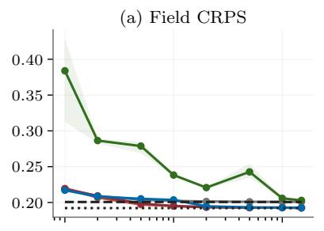

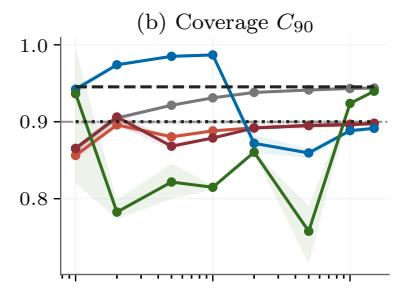

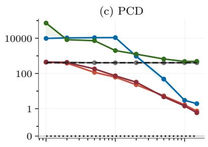

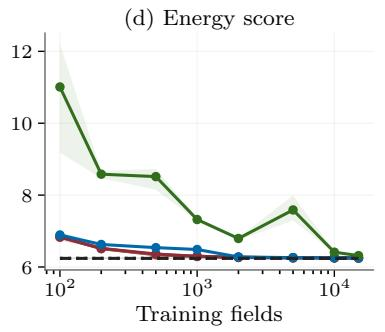

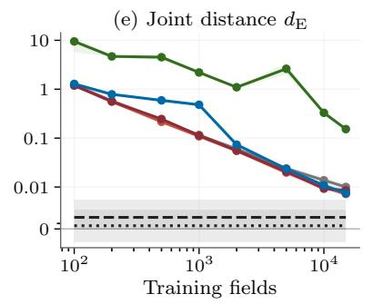

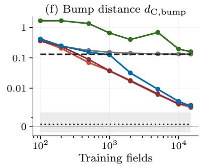  
Figure 7: Synthetic learning curves for six further metrics, using 500 test contexts and 100 draws per context. Lines show means and bands span three seeds. Dashed and dotted lines show Exact-GP and Exact, respectively; the horizontal rule in the coverage panel marks 0.90. Distance panels use logarithmic scales with a linear region near zero.

Table 5: Synthetic, $n = 2 0 0 0$ : median fit-plus-evaluation time (s) over three seeds on an RTX 2080 Ti. Includes selection; excludes data preparation.
<table><tr><td>Method</td><td>Fit + evaluation (s)</td></tr><tr><td>Rescale</td><td>40</td></tr><tr><td>Gain-Mix</td><td>349</td></tr><tr><td>Gain-Diff</td><td>361</td></tr><tr><td>Full-Diff</td><td>276</td></tr><tr><td>Diff</td><td>208</td></tr></table>

Posterior samples. Figure 8 shows three draws per method for the first test context at $n = 2 0 0 0$ , on the full domain over the generating function, the sensor readings and the exact posterior’s pointwise 90% intervals. Figure 9 zooms into the first four sensor gaps, adds exact draws and centers all draws on the exact posterior mean to expose the structure between sensors.

Cost. Table 5 reports combined fit-plus-evaluation wall time at $n = 2 0 0 0$ . At this scale, learning fewer stochastic coordinates is therefore not equivalent to reducing the full computational cost.

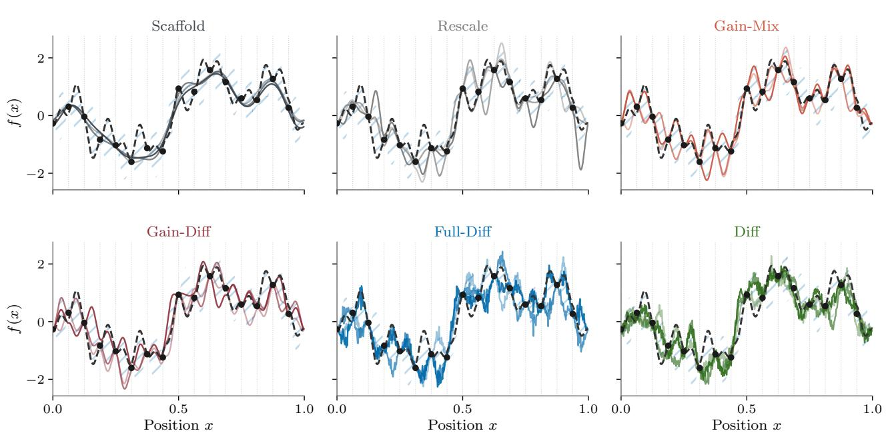  
Figure 8: Synthetic posterior draws at $n = 2 0 0 0$ (seed 10): three draws per method for the first test context, over the true function (dashed) and the readings (dots). Hatching marks the exact pointwise 90% intervals and dotted lines the sensors. The readings do not determine the bump signs, so valid draws need not match the true function between sensors.

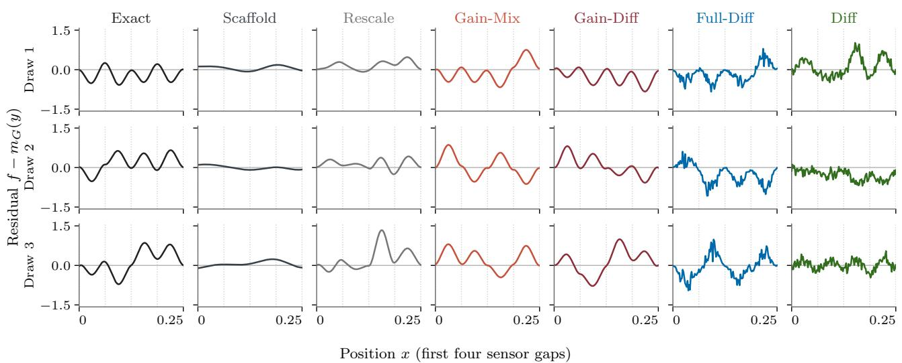  
Figure 9: The draws of Figure 8 and three exact draws on the first four sensor gaps, centered on the exact posterior mean $m _ { G } ( y ) { \mathrm { ; } }$ ; dotted lines mark the sensors.

## D DATASET: SMOKE

In Smoke nine readings of a smoke plume constrain an unknown wind direction, sharply in some contexts and only to several sectors in others. The exact posterior is a mixture over the wind direction, the scafold a single Gaussian with the prior’s first two moments, so the missing structure depends on the readings.

## D.1 Data, exact posterior and scafold

Field and readings. A point source at $x _ { s } = ( 0 . 1 5 , 0 . 5 )$ releases a tracer into a steady wind of speed $u = 1$ and direction φ, with difusivity $\kappa = 0 . 0 0 3$ . The concentration is the free-space Green’s function of $\boldsymbol { u } \cdot \nabla c =$ $\kappa \Delta c + \delta ( x - x _ { s } )$

$$
g _ { \varphi } ( x ) \propto e ^ { a \cos \theta } K _ { 0 } ( a ) , \qquad a = \frac { u \| x - x _ { s } \| } { 2 \kappa } ,\tag{26}
$$

with $\theta$ the angle between $x - x _ { s }$ and the wind and $K _ { 0 }$ the modified Bessel function. We normalize $g _ { \varphi }$ to one on its axis at distance 0.4 and cap it smoothly near the source, $g \gets 3 \operatorname { t a n h } ( g / 3 )$ ; the result is a narrow ray $( 1 / e$ half-width 0.08 at distance 0.5). The field on the $3 2 \times 3 2$ cell centers is

$$
f = b + Q g _ { \varphi } , b { \sim } \mathcal { G P } ( 0 , K ) , Q { \sim } { \mathcal N } ( q _ { 0 } , s _ { Q } ^ { 2 } ) , p ( \varphi _ { k } ) \propto e ^ { \cos \varphi _ { k } } ,\tag{27}
$$

with a squared-exponential K (standard deviation 0.05, lengthscale 0.15), $q _ { 0 } = 1 , s _ { Q } = 0 . 1$ , and $\varphi$ on a grid of 360 angles, so the posterior below is exact rather than a quadrature. The wind blows away from the sensors’ side $( | \varphi | > 9 0 ^ { \circ } )$ with prior probability 0.22. The $3 \times 3$ sensors on $[ 0 . 1 , 0 . 9 ] ^ { 2 }$ are snapped to the nearest cell centers and read $y = H f + \varepsilon$ with $\sigma = 0 . 0 2$

Exact posterior. Given $\varphi = \varphi _ { k }$ , the field is linear in $( b , Q )$ and hence Gaussian, and so are the readings: $y \mid \varphi _ { k } \sim \mathcal N ( q _ { 0 } h _ { k } , S _ { k } )$ with $h _ { k } = H g _ { k }$ and $\begin{array} { r } { S _ { k } = H K H ^ { \top } + \dot { \sigma } ^ { 2 } I + s _ { Q } ^ { 2 } h _ { k } h _ { k } ^ { \top } } \end{array}$ . Therefore

$$
p ( f \mid y ) = \sum _ { k = 1 } ^ { 3 6 0 } w _ { k } ( y ) \mathcal { N } \big ( m _ { k } ( y ) , C _ { k } - C _ { k } H ^ { \top } S _ { k } ^ { - 1 } H C _ { k } \big ) , \qquad w _ { k } ( y ) \propto p ( \varphi _ { k } ) \mathcal { N } ( y ; q _ { 0 } h _ { k } , S _ { k } ) ,\tag{28}
$$

with $C _ { k } = K + s _ { Q } ^ { 2 } g _ { k } g _ { k } ^ { \top }$ and $m _ { k } = q _ { 0 } g _ { k } + C _ { k } H ^ { \top } S _ { k } ^ { - 1 } ( y - q _ { 0 } h _ { k } )$ ; weights, means and pathwise draws are available in closed form.

Scafold. The scafold conditions the Gaussian with the prior’s mean and covariance on $y ,$

$$
\begin{array} { r } { m = q _ { 0 } \bar { g } , \qquad P = K + ( q _ { 0 } ^ { 2 } + s _ { Q } ^ { 2 } ) \sum _ { k } p _ { k } g _ { k } \mathcal { I } _ { k } ^ { \top } - q _ { 0 } ^ { 2 } \bar { g } \bar { g } ^ { \top } , \qquad \bar { g } = \sum _ { k } p _ { k } g _ { k } . } \end{array}\tag{29}
$$

The prior moments determine the best linear prediction from the readings and its residual covariance. They do not determine the true conditional mean or covariance at each context, or a context-dependent choice of wind sector; scafold draws can superpose several rays.

## D.2 Methods and training

The mean stage is an MLP $( 2 \times 1 2 8 )$ of the observations. We choose $\tau = 0 . 2 \cdot \mathrm { R M S } ( r ) \approx 0 . 0 2 6$ , and the calibration covers 309 range directions of $C _ { c }$ and 197 complement spikes. Selection uses the conditional contrast density with an MLP encoder of the nine readings. Full-Diff and Diff share one U-Net (channels 32, 64, 128, 128, two blocks per level, attention at the coarsest level, cf. Ho, Jain, and Abbeel (2020)); Diff receives the readings as a value map and a mask and through an MLP that modulates every block. KO collapses to the scafold. Its fitted $\rho \approx 1$ and the discrepancy variance sits at its lower bound.

## D.3 Evaluation

The physical consistency score is the negative log density of the exact mixture (28) convolved with ${ \mathcal { N } } ( 0 , \tau ^ { 2 } I )$ with Q integrated out, at $\tau = 0 . 2 \cdot 0 . 1 6 3 \approx 0 . 0 3 3$ . Besides the field we report the views source (the disk of radius 0.2 around the source), upwind $\left( x _ { 1 } < 0 . 1 5 \right)$ and downwind (the rest).

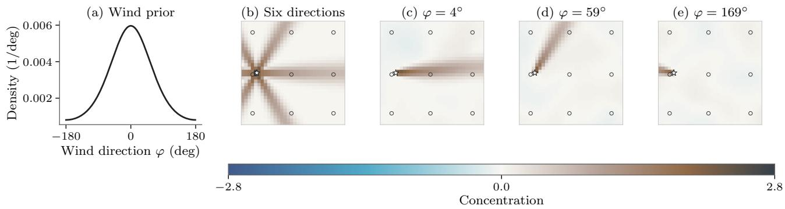  
Figure 10: Smoke. (a) Prior over the wind direction. (b) Smoke plume shapes $g _ { \varphi }$ for six directions, with the source (⋆) and the sensors (◦). (c–e) Three draws of the field: a sharp ray whose direction changes from draw to draw, on a quiet background.

Table 6: Smoke, reported methods: field and source-disk scores, 500 test contexts × 100 draws, mean ± std over seeds 10, 11, 12 $( n _ { \mathrm { t r a i n } } = 8 1 9 2 )$ . d : Cramér distance to the exact posterior (Exact: its split-half floor); PCD: the Cramér distance between posterior log-density score distributions for generated and exact draws; RMSE: root mean squared error of the predictive mean; k: the selected block’s size. Best non-reference value in bold, references in grey.
<table><tr><td colspan="9">field</td><td colspan="3"></td></tr><tr><td>Method</td><td>CRPS</td><td>dc</td><td>Cov90</td><td>PCD</td><td>ES</td><td>RMSE</td><td>CRPS</td><td>dc</td><td>Cov90</td><td>k</td></tr><tr><td>Scaffold</td><td>0.0714±0.0002</td><td>0.0585±0.0001</td><td>0.92</td><td>7072.3±10.9</td><td>3.561±0.012</td><td>0.1631±0.0005</td><td>0.1342±0.0020</td><td>0.1306±0.0013</td><td>0.93</td><td></td></tr><tr><td>KO</td><td>0.0714±0.0002</td><td>0.0584±0.0001</td><td>0.92</td><td>7078.7±18.5</td><td>3.560±0.012</td><td>0.1631±0.0006</td><td>0.1342±0.0021</td><td>0.1307±0.0014</td><td>0.93</td><td></td></tr><tr><td>Diff</td><td>0.0434±0.00090.0014±0.0002</td><td></td><td>0.89</td><td>36.5±1.3</td><td></td><td>2.515±0.029 0.1353±0.0017</td><td>0.0714±0.0015 0.0028±0.0004</td><td></td><td>0.89</td><td></td></tr><tr><td>Scaffold+M</td><td>0.0619±0.0005</td><td>0.0385±0.0001</td><td>0.94</td><td>6906.3±38.3</td><td>2.966±0.017</td><td>0.1372±0.0012</td><td>0.1135±0.0020</td><td>0.0882±0.0006</td><td>0.94</td><td>0</td></tr><tr><td>Rescale</td><td>0.0595±0.0006</td><td>0.0336±0.0001</td><td>0.92</td><td>5190.5±35.1</td><td>2.914±0.018</td><td>0.1372±0.0012</td><td>0.1082±0.0020</td><td>0.0775±0.0006</td><td>0.92</td><td>0</td></tr><tr><td>Gain-Mix</td><td>0.0473±0.0010</td><td>0.0088±0.0009</td><td>0.91</td><td>1022.4±33.8</td><td>2.667±0.057</td><td>0.1372±0.0012</td><td>0.0806±0.0024</td><td>0.0216±0.0016</td><td>0.92±0.01</td><td>38±1</td></tr><tr><td>Gain-Diff</td><td>0.0457±0.0012</td><td>0.0051±0.0009</td><td>0.90</td><td>153.9±15.0</td><td>2.650±0.068</td><td>0.1372±0.0012</td><td>0.0762±0.0022</td><td>0.0115±0.0014</td><td>0.91±0.01</td><td>38±1</td></tr><tr><td>Full-Diff</td><td>0.0450±0.0011</td><td>0.0049±0.0005</td><td>0.88</td><td>248.7±25.6</td><td>2.567±0.040</td><td>0.1372±0.0012</td><td>0.0755±0.0019</td><td>0.0117±0.0007</td><td>0.88</td><td>1024</td></tr><tr><td>Exact-GP</td><td>0.0459±0.0007</td><td>0.0062±0.0001</td><td>0.91</td><td>1256.2±44.7</td><td>2.569±0.024</td><td>0.1339±0.0017</td><td>0.0778±0.0014</td><td>0.0157±0.0006</td><td>0.91</td><td></td></tr><tr><td>Exact</td><td>0.0429±0.0007</td><td>0.0000±0.0001</td><td>0.90</td><td>0.0</td><td>2.485±0.024</td><td>0.1339±0.0017</td><td>0.0703±0.0012</td><td>-0.0000±0.0001</td><td>0.90</td><td></td></tr></table>

## D.4 Additional results

Table 6 reports the retained methods on the final round in the order of Table 1.

Posterior samples. Figure 11 extends Figure 4 to all retained corrections and baselines, alongside the exact posterior and its moment-matched Gaussian.

Learning curve. The Smoke U-Nets keep a fixed optimizer-step budget as the training set changes. The block methods require $n \geq 2 \cdot 3 0 9 = 6 1 8$ fields for calibration.

The Smoke curve shows improvement with more training data for each residual correction, but no crossover in favor of the gain methods. The diference between Gain-Diff and direct difusion narrows with increasing data; the direct U-Net still leads at n = 8192. This supports reporting the restricted model as a practical alternative, without a general claim that scientific scafolds improve sample eficiency.

Cost. Table 7 reports combined fit-plus-evaluation wall time at n = 8192. The gain methods have lower combined times than the full-field U-Nets, but the separate timings show that this is not a fitting advantage. For Smoke, Figure 3 separates training from sampling.

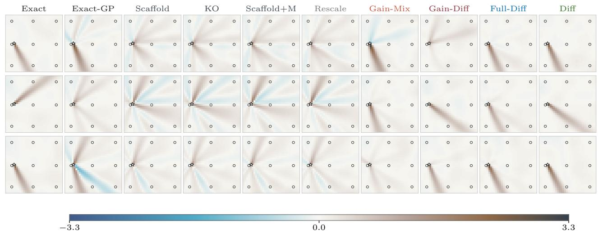  
Figure 11: Smoke posterior draws for all retained methods and the two exact references. The readings, training size $( n = 8 1 9 2 )$ , training seed (10) and first three draws match Figure 4; rows are not paired realizations. Exact-GP matches the exact posterior’s conditional mean and covariance. All panels share a concentration scale: brown is positive, blue is negative. Stars mark the source; circles mark sensors.

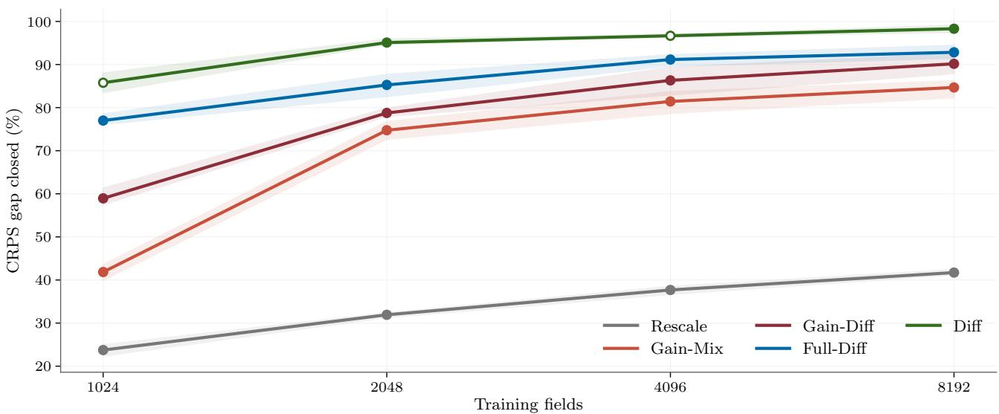  
Figure 12: Smoke learning curve: share of the scafold-to-exact CRPS gap closed. Lines show seed means and bands span seeds. Filled points have three seeds; open points have two (scratch difusion at $n = 1 0 2 4$ and 4096). The curve starts at $n = 1 0 2 4$ , where all methods have results. Scratch difusion leads throughout the measured range.

Table 7: Smoke, $n = 8 1 9 2$ : median fit-plus-evaluation time (s) over three seeds on an L40S. Includes selection; excludes data preparation.
<table><tr><td>Method</td><td>Fit + evaluation (s)</td></tr><tr><td>Rescale</td><td>80</td></tr><tr><td>Gain-Mix</td><td>527</td></tr><tr><td>Gain-Diff</td><td>687</td></tr><tr><td>Full-Diff</td><td>1270</td></tr><tr><td>Diff</td><td>2983</td></tr></table>

## E DATASET: CR3BP

In CR3BP (Circular Restricted Three-Body Problem) the scafold is a probabilistic ODE solver’s Gaussian prediction for trajectories of the planar circular restricted three-body problem (Hennig, Osborne, and Kersting, 2022, Sec. 40.3). A trajectory is a deterministic function of its initial state, so the reference law is a point mass at the truth. We score predictions against a high-accuracy reference trajectory and omit Exact, Exact-GP and the redundant marginal distance $d _ { \mathrm { C } }$ . The KL identities in Section 2 assume a target density with finite divergences and do not apply to this point-mass reference.

## E.1 Data, reference trajectory and scafold

Dynamics. In rotating coordinates with state $\boldsymbol { z } ~ = ~ ( x , y , v _ { x } , v _ { y } )$ , mass parameter µ, $\mu _ { 1 } ~ = ~ 1 - \mu , ~ r _ { 1 } ~ =$ $\sqrt { ( x + \mu ) ^ { 2 } + y ^ { 2 } }$ and $r _ { 2 } = \sqrt { ( x - \mu _ { 1 } ) ^ { 2 } + y ^ { 2 } }$

$$
{ \dot { x } } = v _ { x } , \quad { \dot { y } } = v _ { y } , \quad { \dot { v } } _ { x } = x + 2 v _ { y } - \mu _ { 1 } { \frac { x + \mu } { r _ { 1 } ^ { 3 } } } - \mu { \frac { x - \mu _ { 1 } } { r _ { 2 } ^ { 3 } } } , \quad { \dot { v } } _ { y } = y - 2 v _ { x } - \mu _ { 1 } { \frac { y } { r _ { 1 } ^ { 3 } } } - \mu { \frac { y } { r _ { 2 } ^ { 3 } } } ,\tag{30}
$$

with $\mu ~ = ~ 0 . 0 1 2 2 7 7 4 7 1$ and the Arenstorf orbit $z _ { A } ~ = ~ ( 0 . 9 9 4 , 0 , 0 , - 2 . 0 0 1 5 8 5 1 0 6 3 7 9 0 8 2 5 )$ of period $T =$ 17.0652 (Hairer, Nørsett, and Wanner, 1993).

Initial states and data. An initial state is the Arenstorf state propagated to a random phase and perturbed, $z _ { 0 } = \Phi _ { \varphi } ( z _ { A } ) + \eta ,$ , with $\varphi = \left( c _ { j } + U [ - 0 . 0 5 , 0 . 0 5 ] \right) T , \ c _ { j } \ \in \ \{ 0 , 0 . 2 5 , 0 . 5 , 0 . 7 5 \}$ , and $\eta \sim \mathcal { N } ( 0 , \mathrm { d i a g } ( 5 \cdot 1 0 ^ { - 4 } , 5 $ $1 0 ^ { - 4 } , 1 0 ^ { - 3 } , 1 0 ^ { - 3 } ) ^ { 2 } )$ . The reference trajectory is integrated with DOP853 (relative and absolute tolerances $1 0 ^ { - 1 2 }$ and $1 0 ^ { - 1 3 } )$ over one period and stored at 501 equispaced times, with four state coordinates per time, so $d = 2 0 0 4$ Initial states are rejected if a coarse RK45 solve exceeds RMSE 1.5, RMS Jacobi-constant drift 1.0 or radius 2.0 (relative and absolute tolerances $3 \cdot 1 0 ^ { - 3 }$ and $3 \cdot 1 0 ^ { - 6 } )$ . One pool of 10,400 trajectories is re-split per seed into 500 test, 500 validation and 9400 training trajectories, of which the runs use 7500.

Scafold. The scafold is a probabilistic ODE filter (P. N. Krämer, 2024) with a twice-integrated Wiener prior, first-order Taylor linearization, dynamic calibration, adaptive steps and smoothing, from which 32 pathwise draws are interpolated to the grid. Its covariance is $C _ { c } = \bar { \alpha ^ { 2 } } D D ^ { \top } + \sigma ^ { 2 } I$ , with $D$ the draws centered at the solver mean and scaled by $1 / \sqrt { 3 1 } , \alpha = 1$ and $\sigma = 0 . 2 5$ , fixed after a development sweep of held-out log-likelihood. The experiment tests corrections to this floored solver prediction. The context is $c = z _ { 0 }$

## E.2 Methods and training

The mean stage is an MLP $( 2 \times 2 5 6 )$ of $z _ { 0 }$ trained by mean squared error on trajectory residuals. Covariance calibration uses the full pooled basis with the context-dependent scafold, without adding a further floor. Selection uses $\tau = 0 . 2 \cdot \mathrm { R M S } ( r ) \approx 0 . 0 5 9$ and a conditional contrast on $z _ { \mathrm { 0 } }$ , with at most 64 directions in the search span. The block DDPM is an MLP conditioned on $z _ { \mathrm { 0 } } ;$ Full-Diff and Diff are MLPs of width 4008. KO uses the solver’s Gaussian without the added floor and the discrepancy $K _ { \delta } = R _ { \ell } ( t ) \otimes B + \nu I$ , where $R _ { \ell }$ is squared-exponential and B is a full $4 \times 4$ channel covariance. Its likelihood is fitted on the resolved span of the pooled reference trajectories and solver means.

## E.3 Evaluation

CRPS, ES and $C _ { 9 0 }$ are scored against the reference trajectory; for a point-mass reference, the marginal distance of Equation (18) is twice CRPS. The views are the positions, the velocities and the final state. In place of PCD we use the Jacobi constant $C _ { J } = x ^ { 2 } + y ^ { 2 } + 2 { ( \mu _ { 1 } / r _ { 1 } ) } + \mu / r _ { 2 } { ) } - { ( v _ { x } ^ { 2 } + v _ { y } ^ { 2 } ) }$ , which the dynamics conserve. A draw’s score is its drift $s ( f ) = \mathrm { R M S } _ { t } \big [ C _ { J } ( f _ { t } ) - C _ { J } ( z _ { 0 } ) \big ] \ ( 2 \cdot 1 0 ^ { - 1 2 }$ for the truth). The Jacobi error is the median over contexts and draws of $| s ( X ) - \bar { s } ( f ^ { \star } ) |$ , reducing sensitivity to large drift values.

## E.4 Additional results

Table 8 reports the retained methods in the order of Table 1.

Table 8: CR3BP (d = 2004, $n = 7 5 0 0 )$ : mean ± std over seeds 10–12 (500 contexts × 100 draws). Jacobi error is defined in Appendix E.3; k is the block size. Best mean in bold (coverage closest to 0.90).
<table><tr><td>Method</td><td>CRPS</td><td></td><td>ES Jacobi err.</td><td> $\mathrm { C _ { 9 0 } }$ </td><td> $\mathrm { C R P S _ { p o s } }$ </td><td> $\mathrm { C R P S } _ { \mathrm { v e l } }$ </td><td> $\mathrm { C R P S _ { f i n a l } }$ </td><td>k</td></tr><tr><td>Scaffold</td><td> $0 . 1 5 8 8 { \scriptstyle \pm 0 . 0 0 0 2 }$ </td><td> $1 1 . 2 6 { \scriptstyle \pm 0 . 0 5 }$ </td><td> $1 . 4 6 { \scriptstyle \pm 0 . 0 1 }$ </td><td>0.89</td><td> $0 . 1 7 1 3 { \scriptstyle \pm 0 . 0 0 2 0 }$ </td><td> $0 . 1 4 6 2 { \scriptstyle \pm 0 . 0 0 2 3 }$ </td><td> $0 . 5 9 2 { \scriptstyle \pm 0 . 0 0 3 }$ </td><td></td></tr><tr><td>KO</td><td> $0 . 2 7 2 6 { \scriptstyle \pm 0 . 0 1 0 8 }$ </td><td> $1 9 . 0 3 { \scriptstyle \pm 0 . 5 9 }$ </td><td> $5 . 5 0 { \scriptstyle \pm 0 . 2 6 }$ </td><td>0.96</td><td> $0 . 2 9 1 0 { \scriptstyle \pm 0 . 0 1 1 9 }$ </td><td> $0 . 2 5 4 1 { \scriptstyle \pm 0 . 0 0 9 7 }$ </td><td> $1 . 0 9 1 { \scriptstyle \pm 0 . 0 2 5 }$ </td><td></td></tr><tr><td>Diff</td><td> $0 . 1 7 8 5 { \scriptstyle \pm 0 . 0 0 3 6 }$ </td><td> $1 0 . 9 1 { \scriptstyle \pm 0 . 2 7 }$ </td><td> $2 . 8 9 { \scriptstyle \pm 0 . 0 1 }$ </td><td>0.99</td><td> $0 . 2 0 3 1 { \scriptstyle \pm 0 . 0 0 3 8 }$ </td><td> $0 . 1 5 3 8 { \scriptstyle \pm 0 . 0 0 3 4 }$ </td><td> $0 . 3 8 4 { \scriptstyle \pm 0 . 0 1 4 }$ </td><td></td></tr><tr><td> $\mathtt { S c a f f o l d - M }$ </td><td> $0 . 1 1 7 8 { \scriptstyle \pm 0 . 0 0 2 8 }$ </td><td> $7 . 8 3 { \scriptstyle \pm 0 . 2 6 }$ </td><td> $2 . 0 1 { \scriptstyle \pm 0 . 0 3 }$ </td><td>0.93</td><td> $0 . 1 2 1 7 { \scriptstyle \pm 0 . 0 0 2 3 }$ </td><td> $0 . 1 1 3 8 { \scriptstyle \pm 0 . 0 0 3 6 }$ </td><td> $0 . 3 9 7 { \scriptstyle \pm 0 . 0 1 5 }$ </td><td>0</td></tr><tr><td>Rescale</td><td> $0 . 0 9 1 6 { \scriptstyle \pm 0 . 0 0 2 4 }$ </td><td> $7 . 6 0 { \scriptstyle \pm 0 . 2 3 }$ </td><td> $0 . 7 9 { \scriptstyle \pm 0 . 0 2 }$ </td><td>0.94±0.01</td><td> $0 . 0 9 1 1 { \scriptstyle \pm 0 . 0 0 1 5 }$ </td><td> $0 . 0 9 2 1 { \scriptstyle \pm 0 . 0 0 3 5 }$ </td><td> $0 . 3 7 6 { \scriptstyle \pm 0 . 0 1 1 }$ </td><td>0</td></tr><tr><td> $\mathtt { G a i n - M i x }$ </td><td> $0 . 0 8 4 4 { \scriptstyle \pm 0 . 0 0 2 8 }$ </td><td> $7 . 2 4 { \scriptstyle \pm 0 . 2 6 }$ </td><td> $0 . 6 8 { \scriptstyle \pm 0 . 0 2 }$ </td><td>0.96</td><td> $0 . 0 8 2 1 { \scriptstyle \pm 0 . 0 0 2 5 }$ </td><td> $0 . 0 8 6 6 { \scriptstyle \pm 0 . 0 0 3 3 }$ </td><td> $0 . 3 7 2 { \scriptstyle \pm 0 . 0 1 1 }$ </td><td>64</td></tr><tr><td> $\mathtt { G a i n - D i f f }$ </td><td> $\mathbf { 0 . 0 8 1 5 { \scriptstyle \pm 0 . 0 0 3 1 } }$ </td><td> $\mathbf { 7 . 0 6 { \scriptstyle \pm 0 . 3 4 } }$ </td><td> $\mathbf { 0 . 4 4 { \scriptstyle \pm 0 . 0 3 } }$ </td><td>0.93</td><td> $\mathbf { 0 . 0 7 9 9 { \scriptstyle \pm 0 . 0 0 2 3 } }$ </td><td> $\mathbf { 0 . 0 8 3 0 { \scriptstyle \pm 0 . 0 0 4 3 } }$ </td><td> $\mathbf { 0 . 3 5 5 \pm 0 . 0 1 6 }$ </td><td>64</td></tr><tr><td> $\mathtt { F u l 1 - D i f f }$ </td><td> $0 . 0 9 0 2 { \scriptstyle \pm 0 . 0 0 2 4 }$ </td><td> $7 . 6 5 { \scriptstyle \pm 0 . 2 2 }$ </td><td> $1 . 2 6 { \scriptstyle \pm 0 . 0 1 }$ </td><td>0.97</td><td> $0 . 0 8 9 7 { \scriptstyle \pm 0 . 0 0 1 6 }$ </td><td> $0 . 0 9 0 7 { \scriptstyle \pm 0 . 0 0 3 3 }$ </td><td> $0 . 3 7 4 { \scriptstyle \pm 0 . 0 0 9 }$ </td><td>2004</td></tr></table>

Table 9: CR3BP, $n = 7 5 0 0 \colon$ median fit-plus-evaluation time (s) over three seeds on an RTX 2080 Ti. Includes selection; excludes data preparation.
<table><tr><td>Method</td><td>Fit + evaluation (s)</td></tr><tr><td>Rescale</td><td>275</td></tr><tr><td> $\mathtt { G a i n - M i x }$ </td><td>1081</td></tr><tr><td> $\mathtt { G a i n - D i f f }$ </td><td>1362</td></tr><tr><td> $\mathtt { F u l 1 - D i f f }$ </td><td>875</td></tr><tr><td>Diff</td><td>932</td></tr></table>

Cost. Table 9 reports combined fit-plus-evaluation wall time at $n = 7 5 0 0 ;$ separate sampling timings are no available.