# Learning Rational Strategies for Temporal Objectives in Multi-Agent Systems

Omar Adalat Imperial College London London, United Kingdom o.adalat24@imperial.ac.uk

Edwin Hamel-De le Court University of Manchester   
Manchester, United Kingdom edwin.hamel- delecourt@manchester.ac.uk

Francesco Belardinelli Imperial College London London, United Kingdom francesco.belardinelli@imperial.ac.uk

## Abstract

We study rational synthesis for stochastic multi-agent systems with unknown dynamics, where each agent is equipped with its own probabilistic temporal objective specified using Probabilistic Linear Temporal Logic on Finite Traces (pltl�). We impose solution concepts (e.g., Nash equilibrium, subgame-perfect equilibrium) as constraints on the joint strategy profile, using payofs derived from each agent’s probability of satisfying its temporal objective. In particular, we formulate per-agent rational synthesis as finding a strategy profile – if one exists – such that (i) the designated agent’s probabilistic temporal constraint is satisfied, and (ii) the profile represents a stable solution under a chosen solution concept. We give conditional convergence guarantees for tabular Nash-Q learning, certify satisfaction with simultaneous finite-sample confidence bounds, and assess strategic stability with approximate best-response checking. Our approach operates in a stochastic Multi-Agent Reinforcement Learning (MARL) environment, where model-free learning algorithms attempt to attain extremal satisfaction probabilities for temporal objectives automatically compiled into reward automata. Our approach is empirically validated using 8 general-sum concurrent stochastic games.

## Keywords

Multi-agent Reinforcement Learning, General-Sum Games, Rational Learning, Probabilistic Temporal Objectives

## 1 Introduction

Strategic reasoning in multi-agent systems (MAS) hinges on determining what outcomes groups of agents (termed coalitions) can bring about through their interactions. In many multi-agent settings, especially safety-critical systems, properties of interest go beyond plain reward signals and include temporally extended goals such as reachability/liveness (e.g., eventually reaching a tar-get region or completing a mission), or safety invariants (e.g., always avoid unsafe regions, or never violate constraints) [4, 23]. Similar objectives are naturally captured by temporal logics [38] which provide precise languages and semantics to specify and verify such properties. Languages relevant to specification of strate-gic properties include Alternating-Time Temporal Logic (atl [3]), Dynamic Coalition Logic [22], Probabilistic Alternating-� Calculus [47], Game Description Logic (gdl [16]), and See-To-It-That (stit [7]). However, such logics typically resolve non-determinism by restricting to coalitional modalities which aim to universally and unilaterally (inevitably) force a property to be true.

On the other hand, rational synthesis [20, 52] aims to find strate-gies that are self-enforcing through stable equilibria, instead of quantifying against all possible behaviour (including irrational behaviour) by other agents who have their own objectives. Therefore, rational synthesis is typically less conservative than adversarial synthesis.

Settings we consider can be represented formally as (generalsum) stochastic games, which model multiple decision-making agents that interact over time in a dynamic environment with probabilistic behaviours. Each agent repeatedly selects an action, and the combination of agents’ non-deterministic choices and the environment’s probabilistic transitions determines the evolution of the game. Stochastic games have been applied in domains as diverse as cybersecurity [60], epidemics [29], auctions [39], and routing in stochastic trafic networks [59].

We use an expressive specification style in which each agent has its own probabilistic temporal objective as a logical formula inter-preted on finite traces. Finite traces have a natural correspondence with reinforcement learning (RL) as tasks are often trained and executed episodically. Rationality is captured by imposing that the learned joint strategy profile satisfies a specific solution concept (e.g., (�-)Nash equilibrium, subgame-perfect equilibrium), where each agent’s payof reflects the preferred direction of its satisfaction probability. Our approach emphasises learning a single committed strategy profile, allowing tractability by not requiring an explicit transition model of the underlying stochastic game which gener- ally grows combinatorially with respect to the number of agents involved.

Contributions. Our contributions are as follows: (i) We formulate a learning-based rational-synthesis objective for finite-horizon stochastic games in which each agent has a probabilistic ltl� objective and utilities encode the preferred direction of satisfaction probabil- ities; (ii) We compile per-agent ltl� objectives into deterministic reward automata and show that terminal automaton rewards have expectation equal to satisfaction probability; (iii) We provide theoretical analysis for the reward-automaton encoding, discounting efects, finite-sample satisfaction certification, and finite-horizon equilibrium existence and convergence; (iv) We evaluate satisfaction and strategic stability on 8 benchmark environment instances.

For reasons of space, proofs are deferred to Appendix D. A highlevel overview for our approach is presented in Appendix B.

## 2 Preliminaries

Multi-agent Reinforcement Learning. We model multi-agent RL problems as an �-agent concurrent stochastic game (also known as a Markov game [36]) $\mathcal { M } = ( S , s _ { 0 } , \mathcal { A } ^ { 1 } , \ldots , \mathcal { A } ^ { n } , d ^ { 1 } , \ldots , d ^ { n }$ , $\mathcal { P } , \mathcal { R } ^ { 1 } , \ldots , \mathcal { R } ^ { n } , \gamma )$ , where � is the finite state space and $s _ { 0 } \in \mathcal { S }$ is the initial state; �� is the finite action space of agent $i \in [ 1 , \ldots , n ] ;$

$d ^ { i } : S  2 ^ { { \mathcal { A } } ^ { i } } \setminus \{ \emptyset \}$ is the protocol (action-availability) function of agent �, where $d ^ { i } ( s )$ denotes the set of legal actions for agent � in state �; the set of legal joint actions at � is $\begin{array} { r } { \bar { d } ( s ) = \prod _ { i = 1 } ^ { n } { d ^ { i } } \bar { ( s ) } \subseteq \mathcal { A } ; } \end{array}$ $\mathcal { P } : \mathcal { S } \times \mathcal { A }  \Delta ( \mathcal { S } )$ is the (partial) transition function (defined only for joint actions � $\in d ( s ) )$ , with $\Delta ( S )$ being the set of probability distributions over $S ; \mathcal { R } ^ { i } : S \times \mathcal { A } $ R is the (Markovian) reward function of agent �; and � is the discount factor.

A (stochastic) policy $\pi ^ { i }$ (also known as a strategy) of agent � is a function $\pi ^ { i } : \bar { \cal S }  \bar { \Delta } ( { \mathcal { A } } ^ { i } )$ with supp $\pi ^ { i } ( \cdot \mid s ) \subseteq { \overline { { d } } } ^ { i } ( s )$ for every �. Then, the joint action space of agents is $\textstyle A = \prod _ { i = 1 } ^ { n } A ^ { i }$ , and the joint policy of other agents is $\begin{array} { r } { \pi ^ { - i } ( a ^ { - i } | s ) = \prod _ { i \neq i } \bar { \pi } ^ { j } \bar { ( } a ^ { j } | s ) } \end{array}$ , where $a ^ { - i }$ is the joint action except agent �’s action. Each agent � has their own goal to maximise their expected cumulative discounted rewards, defined as:

$$
\begin{array} { r l } { \mathbb { E } } & { { } [ \displaystyle \sum _ { \substack { s t + 1 \sim \mathcal { P } ( \cdot | s _ { t } , a _ { t } ^ { i } , a _ { t } ^ { - i } ) , } } ^ { \infty } [ \displaystyle \sum _ { t = 0 } ^ { \infty } \gamma ^ { t } \mathcal { R } ^ { i } \big ( s _ { t } , a _ { t } ^ { i } , a _ { t } ^ { - i } \big ) ] } \\ { a _ { t } ^ { i } \sim \pi ^ { i } ( \cdot | s _ { t } ) , a _ { t } ^ { - i } \sim \pi ^ { - i } ( \cdot | s _ { t } ) } \end{array}\tag{1}
$$

The decentralised stochastic game, from the perspective of each agent, is non-stationary, as the other agents concurrently update their policies. General-sum stochastic games have computational solution concepts which assess stability under equilibria, since they account for the actions of the remaining agents.

A labelled stochastic game simply extends a stochastic game with a labelling function $\mathcal { L } : \mathcal { S }  2 ^ { \mathsf { A } \bar { \mathsf { p } } }$ which maps each state � to a set $\mathcal { L } ( s ) \subseteq \mathsf { A p }$ of atoms, which denotes which atoms are true at �. We denote a joint set of strategies for a coalition $C \subseteq [ 1 , \ldots , n ]$ as $\sigma _ { C ; }$ and for all agents in the concurrent stochastic game, we denote the strategy profile ${ \vec { \sigma } } \ { \stackrel { \mathrm { d e f } } { = } } \ \left( \sigma _ { 1 } , \ldots \ldots , \sigma _ { n } \right)$ as the set composed of each agent’s strategy.

We denote a finite path as $\pi = s _ { 0 } a _ { 0 } s _ { 1 } \cdot \cdot \cdot a _ { T - 1 } s _ { T }$ , where $a _ { t } \in$ $d ( s _ { t } )$ and $\mathcal { P } ( s _ { t + 1 } \mid s _ { t } , a _ { t } ) > 0$ for every $0 \leq t < T$ . The horizon � bounds the number of transitions, so $T \leq H$ and the associated label trace has $T + 1$ positions. Let $\mathsf { F P a t h } _ { \mathcal { M } , s }$ denote the set offinite paths from �. For a strategy profile ${ \vec { \sigma } } ,$ let $\mathrm { P r } _ { { \mathcal M } , s } ^ { \vec { \sigma } }$ be the induced probability measure on complete finite paths $\mathsf { F P a t h } _ { \mathcal { M } , s } ^ { \mathrm { c o m p } }$ . We refer to [6] for the standard construction of the probability measure $\mathrm { P r } _ { { \mathcal M } , s } ^ { \vec { \sigma } }$ induced by a strategy profile. We learn a single strategy profile using IPPO [18, 44], IQL [49], Nash-Q Learning (NQL) [28], and PR2-IQL/PR2-IPPO variants [57] (further details in Appendix D.2).

Probabilistic Linear Temporal Logic on Finite Traces. We use Prob-abilistic $\mathbf { L T L } _ { f } \ \left( \mathbf { P L T L } _ { f } \right) \ \left[ 3 7 \right]$ to specify each agent’s probabilistic temporal objective on finite traces, matching the episodic structure of RL tasks. Each completed episode supplies a finite sequence of state labels on which a temporal goal is evaluated: for example, reaching a target before the episode ends while avoiding collisions throughout. The probabilistic requirement then constrains how often that goal is satisfied under a fixed strategy profile. Equilib- rium constraints capture rationality through utilities reflecting each agent’s preferred direction of satisfaction. The grammar of Proba- bilistic Linear Temporal Logic on Finite Traces $\left( \mathbf { P I T L } _ { f } \right)$ is defined as follows:

Definition 1 (pltl� Formula). $P L T L f$ formulas are constructed inductively from the set of atoms $\mathsf { A p }$ , where $p \in \mathsf { A p }$ , ⊤ denotes true and ⊥ denotes false, $d \in \mathsf { [ 0 , 1 ] }$ is a rational constant, and $\bowtie \in \{ < , \leq , > , \geq \}$ . Formally, the grammar is:

$$
\begin{array} { r l } & { \varphi : : = \top \mid p \mid \neg \varphi \mid \varphi \land \varphi \mid \textsf { X } \varphi \mid \varphi _ { 1 } \textsf { U } \varphi _ { 2 } } \\ & { \psi : : = \mathsf { P } _ { \ J \ J } [ \varphi ] } \end{array}
$$

X denotes temporal Next and U denotes temporal Until. The remaining Boolean and temporal operators are syntactic sugar defined as usual: Eventually F as $\mathsf { F } \varphi \equiv \mathsf { T } \mathsf { U } \varphi$ and Always G as ${ \sf G } \varphi \equiv \neg { \sf F } \neg \varphi .$ In multi-agent systems, agents with no specific objectives can be included in a residual coalition with a trivial objective always achievable with probability of 1 $( \mathrm { e . g . , \top } )$ . The full finite-trace semantics are given in Appendix A. We provide the probabilistic clause of $\mathbf { P L T L } _ { f }$ as:

$$
\begin{array} { c } { { \mathcal { M } , s , \vec { \sigma } \equiv \mathsf { P } _ { \bowtie d } [ \varphi ] \quad \Longleftrightarrow } } \\ { { \vec { \sigma } } _ { \tiny { \mathscr { M } , s } } \left( \{ \pi \in { \mathsf { F P a t h } } _ { \mathscr { M } , s } ^ { \mathrm { c o m p } } \mid \mathcal { M } , \pi \mid = \varphi \} \right) \bowtie d . }  \end{array}
$$

Rational Synthesis. Classical logics with strategic coalition modalities (such as atl [3] and patl [13]) assert temporal goals against all behaviours of the other agents. This treats other coalitions as strictly adversarial, which can lead to overly conservative solu- tions. In settings where other agents have their own objectives, it is more natural to assume they act rationally and restrict their behaviour to strategy profiles satisfying a solution concept (e.g., (strong) Nash equilibrium, subgame-perfect equilibrium) [14, 20]. We write $\vec { \sigma } \in \mathsf { S o l } _ { \zeta } ( s ; \vec { u } )$ to denote that $\vec { \sigma }$ satisfies solution concept � at state � for the payof vector ⃗�, where the utilities encode each agent’s preferred direction of satisfaction.

Definition 2 (Satisfaction Probabilities and Utilities). For agent � with requirement $\psi _ { i } = \mathsf { P } _ { \bowtie i d _ { i } } [ \varphi _ { i } ]$ , define $p _ { i } ( s , { \vec { \sigma } } ) \ { \stackrel { \mathrm { d e f } } { = } } \ \operatorname* { P r } _ { { \mathcal { M } } , s } ^ { \vec { \sigma } } ( \varphi _ { i } )$ and $f _ { i } : \bar { [ 0 , 1 ] }  [ 0 , 1 ]$ by

$$
f _ { i } ( p ) \stackrel { \mathrm { d e f } } { = } \left\{ \begin{array} { l l } { p , } & { \bowtie _ { i } \in \{ > , \geq \} , } \\ { 1 - p , } & { \bowtie _ { i } \in \{ < , \leq \} . } \end{array} \right.
$$

The utility is $u _ { i } ( s , \vec { \sigma } ) \stackrel { \mathrm { d e f } } { = } f _ { i } ( p _ { i } ( s , \vec { \sigma } ) )$ . Write $\vec { u } ( s , \vec { \sigma } ) \stackrel { \mathrm { d e f } } { = }$ $\big ( u _ { i } ( s , \vec { \sigma } ) \big ) _ { i = 1 } ^ { n } .$

Definition 2 makes utility maximisation favour larger satisfaction probabilities for lower-bound requirements and smaller probabili- ties for upper-bound requirements. We target the following notion of �-Nash equilibrium:

Definition 3 (�-Nash Equilibrium). A strategy profile $\vec { \sigma } ~ = ~ \left( \sigma _ { 1 } , \ldots , \sigma _ { n } \right)$ is an �-Nash equilibrium $( \varepsilon - N E )$ at state � if, for every agent � and every alternative strategy $\sigma _ { i } ^ { \prime } ,$ , we have $u _ { i } ( s , ( \sigma _ { i } ^ { \prime } , \sigma _ { - i } ) ) \le u _ { i } ( s , \vec { \sigma } ) + \varepsilon$ , where $\sigma _ { - i }$ denotes the strategies ofall agents except �. For $\varepsilon = 0 , \vec { \sigma }$ is a Nash equilibrium (NE).

The largest gain any single agent can obtain by deviating unilat-erally measures how far a profile is from equilibrium:

Definition 4 (Exploitability). The exploitability of a strategy profile ⃗� at state � is Exploit $( s , { \vec { \sigma } } ) \ { \stackrel { \mathrm { d e f } } { = } }$ max� $\mathrm { s u p } _ { \sigma _ { i } ^ { \prime } } \left[ u _ { i } \left( s , ( \sigma _ { i } ^ { \prime } , \sigma _ { - i } ) \right) - \right.$ $u _ { i } ( s , \vec { \sigma } ) ]$

By Definitions 3 and 4, ⃗� is an $\varepsilon { - } \mathsf { N E }$ at � if and only if Exploit $( s , { \vec { \sigma } } ) \leq \varepsilon$

Problem Statement. We consider a finite labelled concurrent sto- chastic game $\mathcal { M }$ with initial state $s _ { 0 } ,$ , finite horizon $H ,$ and a so- lution concept $\zeta ,$ such as $\varepsilon { - } \mathsf { N E }$ . The transition probabilities are unknown, and strategies are learned through episodic interaction with the environment. Each agent $i \in \{ 1 , \ldots , n \}$ has an ltl� path objective $\varphi _ { i }$ and a probabilistic requirement $\psi _ { i } = \mathsf { P } _ { \bowtie _ { i } d _ { i } } \big [ \varphi _ { i } \big ]$ . Let $\Sigma _ { i }$ denote agent $i \ ' s$ admissible strategy space and $\begin{array} { r } { \Sigma \ { \stackrel { \mathrm { d e f } } { = } } \ \prod _ { i = 1 } ^ { n } \Sigma _ { i } } \end{array}$ Each agent seeks an extremal satisfaction probability at equilibrium: a maximum for a lower-bound requirement and a minimum for an upper-bound requirement, while meeting its threshold.

Definition 5 (Equilibrium Profiles). The set of admissible profiles satisfying solution concept � for the utilities in Definition 2 is

$$
\mathcal { E } _ { \zeta } \overset { \mathrm { d e f } } { = } \left\{ \vec { \sigma } \in \Sigma \ | \ \vec { \sigma } \in { \sf S o l } _ { \zeta } ( s _ { 0 } ; \vec { u } ) \right\} .
$$

Definition 5 captures stability under the agents’ individual payof maximising preferences. For agent �, the acceptable equilibrium profiles are $\mathcal { F } _ { \zeta } ^ { i } \stackrel { \mathrm { d e f } } { = } \{ \vec { \sigma } \in \mathcal { E } _ { \zeta } \mid p _ { i } ( s _ { 0 } , \vec { \sigma } ) \boxtimes _ { i } d _ { i } \}$

Definition 6 (Rational Strategy Synthesis). Given $( \mathcal { M } , s _ { 0 } , H ,$ $( \psi _ { j } ) _ { j = 1 } ^ { n } , \zeta )$ , admissible strategy spaces $\textstyle { \bigl ( } \sum _ { j } { \bigr ) } _ { j = 1 } ^ { n }$ , and an agent �, the rational strategy synthesis problem for agent � is to find a strategy profile $\vec { \sigma } ^ { \star } = ( { \sigma } _ { i } ^ { \star } , { \sigma } _ { - i } ^ { \star } ) \in \mathcal { F } _ { \zeta } ^ { i } ,$ , ifsuch a profile exists.

Definition 6 requires agent �’s threshold to hold at an equilibrium profile. The other agents’ objectives determine their strategic preferences, but their thresholds do not necessarily need to hold. Correspondingly, the feasibility question is whether $\mathcal { F } _ { \zeta } ^ { i } \neq \emptyset _ { \vdots }$ , since the existence of equilibria alone is insuficient for the existence of threshold-constrained Nash equilibria. Proving infeasibility may re quire ruling out all admissible equilibrium profiles, which is outside the scope of model-free rational learning.

An equilibrium profile is additionally said to be jointly satisfying if it belongs to $\begin{array} { r } { \mathcal { F } _ { \zeta } \overset { \mathrm { d e f } } { = } \bigcap _ { i = 1 } ^ { n } \mathcal { F } _ { \zeta } ^ { i } } \end{array}$ , so that every agent’s probabilistic threshold holds at the same profile. Each agent uses a threshold- constrained Nash equilibrium as its primary solution concept, as opposed to a jointly satisfying Nash equilibrium.

We investigate model-free MARL approaches in which agents concurrently learn strategies towards their respective synthesis objectives. For each learned profile, we assess each agent’s probabilistic requirement using finite-sample confidence bounds and the profile’s strategic stability using finite-budget approximate bestresponse search.

## 3 Encoding Quantitative Objectives

We outline how to translate pltl� objectives into Markovian reward signals for applying standard (model-free) multi-agent RL algorithms, while preserving the single strategy profile witness re-quirement of strategy synthesis.

We compile each ltl� path objective into a deterministic reward automaton, then take the synchronous product of these automata with the stochastic game. Terminal acceptance rewards recover satisfaction probabilities (Theorem 1), and the product makes the objectives Markovian while preserving payofs and equilibria (The orem 2). Discounting results quantify how terminal rewards relate to satisfaction probabilities under fixed and early-terminating horizons. Sampling results provide finite-sample certificates for probabilistic thresholds. Algorithm 1 summarises the procedure.

Algorithm 1: Learning-based pltl� rational synthesis un-   
der unknown dynamics   
Input: Labelled stochastic game $\mathcal { M } ;$ objective profile   
$\vec { \psi } = ( \mathsf { P } _ { \ J \ J _ { i } d _ { i } } [ \varphi _ { i } ] ) _ { i = 1 } ^ { n } ;$ tolerance; additional budget $B ,$   
solution concept �   
Output: learned strategy profile $\widehat { \vec { \sigma } }$ and per-agent   
satisfaction certificates   
1 for each agent $i \in \{ 1 , \ldots , n \}$ do   
2 Compile $\varphi _ { i }$ into a deterministic reward automaton $\mathcal { A } _ { \varphi _ { i } }$   
3 end   
4 Construct the composite reward automaton $\mathcal { A } _ { \vec { \varphi } }$   
5 Train with terminal rewards $\mathscr { R } _ { T } ^ { i } = f _ { i } ( { \bf 1 } [ { \pmb m } _ { T } ] = F _ { i } ] )$ and   
counterfactual experience trajectories   
6 Using fixed profile $\widehat { \vec { \sigma } } ,$ estimate unilateral-improvement score   
$\widehat { \delta } _ { \zeta }$ by rollouts   
7 if $\widehat { \delta } _ { \zeta } > \varepsilon _ { \zeta }$ then   
8 Train once more with budget $B ,$ then re-estimate $\widehat { \delta } _ { \zeta }$   
9 end   
10 Estimate simultaneous intervals $[ L _ { i } , U _ { i } ]$ for all objectives   
from fresh rollouts of the final fixed profile   
11 return ${ \widehat { \vec { \sigma } } } ,$ and for each agent �, whether its threshold   
condition is certified

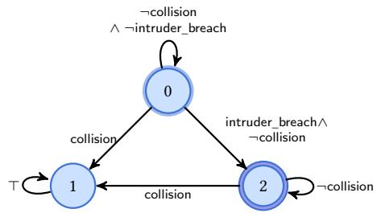  
Figure 1: DFA for F(intruder\_breach) $\land \mathsf { G } ( \lnot \mathsf { c o l l i s i o n } )$ in Stochastic Pursuit Evasion. State 0 is initial and state 2 is accepting. Acceptance is evaluated at episode end.

Reward Automata. For each agent, a deterministic finite automa- ton (DFA) tracks whether the labelled trace of an episode satisfies the ltl� path formula inside its probabilistic constraint. Its state summarises the history relevant to that formula and is updated as each new state label is read. For example, the automaton in Figure 1 remembers whether a breach has occurred and whether a collision has made the objective impossible. At episode end, its accepting states identify successful traces, and averaging these binary outcomes estimates satisfaction probability. Constructing this automaton takes 2EXPTIME in the worst case [17]. In practice, temporal objectives are often simple and avoid deep temporal nesting, allowing existing tools to construct their automata in milliseconds. Thus, the worst-case complexity need not make compilation a practical bottleneck. Figure 1 illustrates a simple example.

Definition 7 (Deterministic Reward Automaton). Given a ltl� formula, the corresponding reward automaton is a deterministic finite automaton overthe alphabet $\Gamma \ { \stackrel { \mathrm { d e f } } { = } } \ 2 ^ { \mathsf { A p } }$ , represented as the tuple $A _ { \varphi } =$ $( M , m _ { 0 } , \Gamma , \delta , F )$ , where � is the set ofstates; $m _ { 0 } \in M$ is the initial state; $F \subseteq M$ is the set ofaccepting states; and $\delta \colon M \times \Gamma \to M$ is the total transition function.

For every finite word � $\in \Gamma ^ { + }$ , we have: $\tau , 0 \left| = \varphi \mathrm { i f f } \delta ^ { * } ( m _ { 0 } , \tau ) \in \right.$ $F ,$ where $\delta ^ { * }$ is the usual extension of � to words. The automaton records acceptance at the terminal timestep. Agent �’s learning reward applies $f _ { i }$ to this indicator. For each objective $\varphi$ we define an episodic (terminal) reward functional on complete paths:

$$
\begin{array} { r } { \mathcal { R } _ { \varphi } ( \pi ) \stackrel { \mathrm { d e f } } { = } \mathbf { 1 } \big [ \delta ^ { * } ( m _ { 0 } , \tau ( \pi ) ) \in F \big ] \ = \ \mathbf { 1 } \big [ \mathcal { M } , \pi \mid = \varphi \big ] . } \end{array}
$$

This is a Bernoulli random variable under the induced measure $\mathrm { P r } _ { \mathcal { M } , s } ^ { \vec { \sigma } }$ . Theorem 1 states coherence between the expected return induced by a reward automaton and the satisfaction probability.

Theorem 1 (Coherence). For any strategy profile ⃗� and state �: $\mathbb { E } _ { \pi \sim \mathrm { P r } _ { \mathcal { M } , s } ^ { \vec { \sigma } } } [ \mathcal { R } _ { \varphi } ( \pi ) ] = \mathrm { P r } _ { \mathcal { M } , s } ^ { \vec { \sigma } } ( \varphi )$

Proof in Appendix D.4. For multiple agents, the individual reward automata are run synchronously in a composite reward automaton, whose state records each agent’s automaton state and whose termi- nal reward vector records component-wise acceptance.

Definition 8 (Composite Reward Automaton). Let $\varphi _ { 1 } , \ldots , \varphi _ { n } \in$ $L T L _ { f } ( \mathsf { A p } )$ , and for each $i \in \{ 1 , . . . , n \} l e t { \cal A } _ { \varphi _ { i } } = ( M _ { i } , m _ { 0 } ^ { i } , \Gamma , \delta _ { i } , F _ { i } )$ be a deterministic reward automaton. The composite reward automa- ton is the deterministic monitor $\begin{array} { r l r } { \mathcal { A } _ { \vec { \varphi } } } & { { } \stackrel { \mathrm { d e f } } { = } } & { \left( M _ { c } , m _ { 0 } ^ { c } , \Gamma , \delta _ { c } \right) } \end{array}$ where $\begin{array} { r l r l r l } { M _ { c } } & { { } \stackrel { \mathrm { \tiny ~ { ~ d e f } ~ } } { = } } & { \prod _ { i = 1 } ^ { n } M _ { i } , } & { m _ { 0 } ^ { c } } & { { } \stackrel { \mathrm { \tiny ~ { ~ d e f } ~ } } { = } } & { \left( m _ { 0 } ^ { 1 } , \ldots , m _ { 0 } ^ { n } \right) } \end{array}$ , and $\begin{array} { r l r } { \delta _ { c } \bigl ( ( m _ { 1 } , \ldots , m _ { n } ) , \ell \bigr ) } & { { } \stackrel { \mathrm { \tiny ~ d e f } } { = } } & { \big ( \delta _ { 1 } ( m _ { 1 } , \ell ) , \ldots , \delta _ { n } ( m _ { n } , \ell ) \big ) } \end{array}$ . Acceptance is tracked component-wise via the sets $F _ { i } \colon f o r \ : .$ a composite state $\pmb { m } = ( m _ { 1 } , \ldots , m _ { n } )$ we write � ${ \bf \Phi } \cdot \in F _ { i } \mathrm { \Delta } i f f m _ { i } \in F _ { i }$

Definition 8 synchronises the individual monitors. Along an episode $\pi = s _ { 0 } \pmb { a } _ { 0 } s _ { 1 } \cdot \cdot \cdot s _ { T }$ , initialise ${ \pmb m } _ { 0 } = \delta _ { c } ( m _ { 0 } ^ { c } , \mathcal { L } ( s _ { 0 } ) )$ and update $\pmb { m } _ { t + 1 } = \delta _ { c } ( \pmb { m } _ { t } , \pmb { \mathcal { L } } ( s _ { t + 1 } ) )$ , so �� records the label prefix through $s _ { t }$

Definition 9 (Time-Augmented Product Game). Let ℳ be a finite labelled stochastic game, $\mathcal { A } _ { \vec { \varphi } }$ its composite reward automaton, and � the horizon. Let $\kappa : \mathcal S \times \{ 0 , \ldots , H \} \to \{ 0 , 1 \}$ encode the original stopping rule, with $\kappa ( s , H ) = 1$ for every �. The stopping time is $T \stackrel { \mathrm { d e f } } { = } \operatorname* { m i n } \{ 0 \leq t \leq H : \kappa ( s _ { t } , t ) = 1 \}$ (any information needed by this rule is included in �). The time-augmented synchronous product $\widehat { \mathcal { M } } _ { H }$ has state space

$$
{ \widehat { S } } _ { H } \ { \stackrel { \mathrm { d e f } } { = } } \ S \times M _ { c } \times \{ 0 , \ldots , H \} ,
$$

where $\begin{array} { r l r } { x } & { { } = } & { ( s , m , t ) } \end{array}$ is formed of the environment state, composite monitor state, and elapsed time, with initial state $x _ { 0 } = ( s _ { 0 } , \delta _ { c } ( m _ { 0 } ^ { c } , \mathcal { L } ( s _ { 0 } ) ) , 0 )$ . A state � is terminal exactly when $\kappa ( s , t ) = 1$ . No further action or transition occurs there. At each nonterminal �, agent � retains its original legal actions $d _ { H } ^ { i } ( x ) \stackrel { \mathrm { d e f } } { = } d ^ { i } ( s )$ and we write $\begin{array} { r } { d _ { H } ( x ) \stackrel { \mathrm { \tiny ~ { d e f } ~ } } { = } \prod _ { i } d _ { H } ^ { i } ( x ) } \end{array}$ . For $\boldsymbol { x } ^ { \prime } ~ = ~ ( s ^ { \prime } , m ^ { \prime } , t ^ { \prime } )$ and $\pmb { a } \in d _ { H } ( x )$ , the transition kernel is

$$
\tilde { \mathcal { P } } ( x ^ { \prime } \mid x , \pmb { a } ) \overset { \mathrm { d e f } } { = } \left\{ \begin{array} { l c } { \mathcal { P } ( s ^ { \prime } \mid s , \pmb { a } ) , } & { \mathrm { i f } t ^ { \prime } = t + 1 a n d } \\ { } & { m ^ { \prime } = \delta _ { c } ( m , \mathcal { L } ( s ^ { \prime } ) ) ; } \\ { 0 , } & { \mathrm { o t h e r w i s e . } } \end{array} \right.
$$

The game has a terminal payof of $R ( s , m , t ) \ { \stackrel { \mathrm { d e f } } { = } } \ ( f _ { i } ( 1 [ m \ | =$ $F _ { i } { \big ] } ) ) _ { i = 1 } ^ { n } .$

Definition 9 makes both the temporal objectives and the horizon Markovian. The episode ends at � with the expected terminal payof being �� by Theorem 1. Retaining � allows strategies to depend on the remaining horizon. We take each $\Sigma _ { i }$ to consist of randomised strategies that are memoryless on $( s _ { t } , m _ { t } , t )$ , with independent randomisation across agents.

Theorem 2 (Markov Sufficiency in the Composite Product). Forfinite-horizon $L T L f$ objectives $\varphi _ { 1 } , \ldots , \varphi _ { n }$ and every strategy pro- $\begin{array} { r } { f l e \vec { \sigma } \in \Sigma , } \end{array}$ , the satisfaction probabilities $\left( p _ { i } \left( s _ { 0 } , \vec { \sigma } \right) \right) _ { i = 1 } ^ { n }$ and utilities $\vec { u } ( s _ { 0 } , \vec { \sigma } )$ can be realised by a memoryless strategy profile on $\widehat { \mathcal { M } } _ { H }$ and every such memoryless profile induces a profile in Σ with the same payofs.

Theorem 2 identifies the admissible strategies with memoryless product policies while preserving their objective values. Proof is provided in Appendix D.5.

## 3.1 Discount Factor and Efective Horizon

The product above represents undiscounted utilities. Our experiments use terminal rewards with $\gamma \in \{ 0 . 9 9 , 1 \}$ at the original stopping time �. The relationship of discounted rewards to satisfaction probability depends on whether episode length is fixed.

The following results apply to terminal acceptance rewards for $\varphi _ { i }$ under lower-bound requirements and for $\lnot \varphi _ { i }$ under upper- bound requirements. We first consider fixed-length episodes:

Theorem 3 (Fixed-Horizon Terminal Reward Is Invariant to Discounting). Consider episodes offixed time indices $t = 0 , \ldots , H$ and a terminal reward ofthe form $r _ { t } = 0 f o r t < H$ and $r _ { H } =$ $\mathbf { 1 } [ \varphi ] \in \{ 0 , 1 \}$ . Then for any strategy profile $\begin{array} { r l } { \vec { \sigma } , \mathbb { E } _ { \vec { \sigma } } \Big [ \sum _ { t = 0 } ^ { H } \gamma ^ { t } r _ { t } \Big ] = } & { { } } \end{array}$ $\gamma ^ { H } \operatorname { P r } _ { \vec { \sigma } } ( \varphi )$ . In particular, forfixed � and $\gamma \in ( 0 , 1 )$ , any strategy profile that maximises the discounted return also maximises $\mathrm { P r } _ { \vec { \sigma } } ( \varphi )$ Exact Nash equilibria are unchanged, but exploitability in discounted- return units is $\gamma ^ { H }$ Exploit.

Proof in Appendix D.6. Commonly in RL, when the goal is achieved early or some irrecoverable failure state is reached, the episode terminates and resets. With early termination, maximising discounted return is not exactly maximising satisfaction probability, as it favours earlier satisfaction.

Proposition 1 (Discounted Return under Early Termination). Let $T \leq H$ be the (random) termination time of an episode and let � be the acceptance event. If the reward is terminal, $i . e . , r _ { t } = 0$ $f o r t < T$ and $r _ { T } = \mathbf { 1 } [ A ]$ , then the discounted return is $\begin{array} { r l } { G _ { \gamma } } & { { } = } \end{array}$ $\textstyle \sum _ { t = 0 } ^ { T } \gamma ^ { t } r _ { t } \ = \ \gamma ^ { T } \mathbf { 1 } [ A ]$ . Hence for any strategy profile ⃗�, we have $\mathbb { E } _ { \vec { \sigma } } [ G _ { \gamma } ] \ = \ \mathbb { E } _ { \vec { \sigma } } [ \gamma ^ { T } \mathbf { 1 } [ A ] ]$

Proof in Appendix D.7. However, by Corollary 1, even with early stopping the discounted terminal-reward objective is a lower-biased surrogate for $\mathrm { P r } _ { \vec { \sigma } } ( A )$ that additionally encodes a preference for earlier satisfaction:

Corollary 1 (Discounted Objective Bounds Satisfaction Probability). Under the assumptions of Prop. 1 and $T \leq H$ , we have $\gamma ^ { H } \operatorname { P r } _ { \vec { \sigma } } ( A ) \leq \mathbb { E } _ { \vec { \sigma } } [ G _ { \gamma } ] \ \leq \ \operatorname { P r } _ { \vec { \sigma } } ( A )$

Proof in Appendix D.8. Thus, when episodes terminate early upon success or failure, the discounted objective ranks policies by a discount-weighted satisfaction probability, i.e., it may prefer earlier satisfaction even if the raw probability is unchanged. If one wishes to optimise exactly $\mathrm { P r } _ { \vec { \sigma } } ( A )$ under early termination, one can set $\gamma = 1$ , which still yields a finite return in episodic settings. Otherwise, the bias introduced can also be bounded by � per Corollary 2:

Corollary 2 (�-Bounded Discount Bias under Early Termination). Under the assumptions ofCorollary 1, to bound the discount-induced bias by at most $\xi \in [ 0 , 1 ]$ uniformly over strategy profiles, it sufices to choose $\gamma \ge ( 1 - \xi ) ^ { 1 / H }$ . That is, for every strategy profile ${ \vec { \sigma } } ,$ $0 \leq \operatorname* { P r } _ { \vec { \sigma } } ( A ) - \mathbb { E } _ { \vec { \sigma } } [ G _ { \gamma } ] \leq \xi$

Proof is available in Appendix D.10.

## 3.2 PAC-Style Guarantees by Sampling

We give finite-sample certificates for probabilistic constraints $\mathsf { P } _ { \mathsf { P } \boxtimes q } [ \varphi ]$ under a fixed strategy profile ⃗� in a finite-horizon setting. Since the dynamics are unknown, we estimate � from rollouts of the fixed profile and bound the estimation error. Such certificates are needed because convergence to an equilibrium does not ensure that probabilistic thresholds are met.

Fix ℳ, a start state �, a path formula �, and a strategy profile ⃗�. Let $p \ { \stackrel { \mathrm { d e f } } { = } } \ \operatorname* { P r } _ { \mathcal { M } , s } ^ { \vec { \sigma } } ( \varphi ) \ \in [ 0 , 1 ]$ . Consider � i.i.d. rollouts (episodes): $\pi _ { 1 } , . . . , \pi _ { n } \sim \mathrm { P r } _ { \mathcal { M } , s } ^ { \vec { \sigma } }$ and define the binary satisfaction indicators $X _ { j } \stackrel { \mathrm { \tiny ~ { d e f } } } { = } { \bf 1 } [ { \cal M } , \pi _ { j } { \bf \pi } _ { j } \stackrel { } { = } \varphi ] \in \{ 0 , 1 \}$ , where $j = 1 , \dotsc , n$ so that $\begin{array} { r } { \mathbb { E } [ X _ { j } ] = p . \operatorname { L e t } \hat { p } \stackrel { \mathrm { d e f } } { = } \frac { 1 } { n } \sum _ { j = 1 } ^ { n } X _ { j } } \end{array}$

Theorem 4 (Hoeffding Confidence Interval for Satisfaction Probability). For any confidence parameter � $\in ( 0 , 1 )$ , define the half-width $\rho _ { n } ( \delta ) \ { \stackrel { \mathrm { d e f } } { = } } \ { \sqrt { \frac { \ln ( 2 / \delta ) } { 2 n } } }$ , and the clipped bounds

$$
L _ { n } \ { \stackrel { \mathrm { d e f } } { = } } \ \operatorname* { m a x } \{ 0 , { \hat { p } } - \rho _ { n } ( \delta ) \} , \qquad U _ { n } \ { \stackrel { \mathrm { d e f } } { = } } \ \operatorname* { m i n } \{ 1 , { \hat { p } } + \rho _ { n } ( \delta ) \} .
$$

Then $\begin{array} { r } { \operatorname* { P r } \big ( p \in [ L _ { n } , U _ { n } ] \big ) ~ \ge ~ 1 - \delta , } \end{array}$ where the probability is over the randomness of the � sampled rollouts.

Proof is available in Appendix D.9. Since $\hat { p }$ is the fraction of the � rollouts that satisfy $\varphi ,$ Theorem 4 states that $| \hat { p } - p | \leq \rho _ { n } ( \delta )$ with probability at least $1 - \delta$ , without knowledge of $\mathcal { P } _ { : }$ , where ${ \rho } _ { n } ( \delta ) = O ( n ^ { - \mathrm { { 1 } } / 2 } )$

Corollary 3 (One-Sided Certification of Threshold Constraints). Fix a threshold $q \in [ 0 , 1 ]$ . Under the assumptions of Theorem $^ { 4 , }$ with probability at least $1 - \delta$ over the validation rollouts, all four implications hold:

$$
\begin{array} { r } { L _ { n } > q \implies p > q , \quad U _ { n } < q \implies p < q , } \\ { L _ { n } \geq q \implies p \geq q , \quad U _ { n } \leq q \implies p \leq q . } \end{array}
$$

Thus the probability of issuing any false threshold certificate is at most �.

Proof is available in Appendix D.11. Corollary 3 certifies $\mathsf { P } { \geq } q \left[ \varphi \right]$ only when $L _ { n } \geq q$ , and symmetrically for upper bounds. If $L _ { n } <$ $q \leq U _ { n }$ , the sample is inconclusive rather than evidence that $p < q$

Corollary 4 (Joint Certification via Bonferroni Adjustment). Fix an objective profile $\vec { \psi } = ( \psi _ { 1 } , \ldots , \psi _ { m } )$ , where $\psi _ { i } = \mathsf { P } _ { \bowtie _ { i } q _ { i } } \left[ \varphi _ { i } \right]$ , and a fixed strategy profile ⃗�. Before validation, fix sample sizes $n _ { i } \geq 1$ and failure budgets $\delta _ { i } \in ( 0 , 1 )$ such that $\textstyle \sum _ { i = 1 } ^ { m } \delta _ { i } \leq \delta$ for a joint budget $\delta \in ( 0 , 1 )$ . For each $i ,$ let $p _ { i } = \mathrm { P r } _ { { \mathcal M } , s } ^ { \vec { \sigma } } ( \varphi _ { i } )$ and construct a Hoefding interval $[ L _ { i } , U _ { i } ]$ as in Theorem $4 , f r o m n _ { i }$ i.i.d. rollouts and with marginal failure probability $\delta _ { i }$ . Then

$$
\operatorname* { P r } \left( \bigcap _ { i = 1 } ^ { m } \{ p _ { i } \in [ L _ { i } , U _ { i } ] \} \right) \geq 1 - \delta .
$$

Consequently, with probability at least $1 - \delta ,$ all endpoint-based certificates from Corollary 3 are simultaneously sound. In particular, if, for every �, the relevant condition

$$
\begin{array} { r l } { L _ { i } > q _ { i } ( \bowtie _ { i } = > ) , \qquad } & { U _ { i } < q _ { i } ( \bowtie _ { i } = < ) , } \\ { L _ { i } \geq q _ { i } ( \bowtie _ { i } = \geq ) , \qquad } & { U _ { i } \leq q _ { i } ( \bowtie _ { i } = \leq ) } \end{array}
$$

holds, then $\mathcal { M } , s , \vec { \sigma } \vdash \vec { \psi }$ is jointly certified with confidence at least $1 - \delta .$ . The uniform Bonferroni choice $\delta _ { i } = \delta / m$ gives half-width $\rho _ { n _ { i } } ( \delta / m ) \ : = \ : \sqrt { \ln ( 2 m / \delta ) / ( 2 n _ { i } ) }$ . The rollouts used for diferent objectives need not be independent. In particular, the same rollouts may be evaluated against every ��.

Proof is available in Appendix D.12. Corollary 4 certifies all agents’ constraints simultaneously for a fixed profile, regardless of how it was learned when validation uses fresh i.i.d rollouts.

Boundary Probabilities. At $p = q ,$ strict requirements $( p > q$ or $p < q )$ are false, while non-strict requirements $( p \geq q \mathrm { o r } p \leq q )$ hold but leave no margin for separating the confidence bound from the threshold using finitely many samples. A useful additional feasibility condition, analogous to [41], is satisfaction with positive slack:

Definition 10 (Threshold Strengthening). For a positive rational �, let $T ( \psi , \eta )$ replace $\mathsf { P } { \geq } d \ b y \mathsf { P } { \geq } d { + } \eta$ and $\mathsf { P } { \leq } _ { d } b y \mathsf { P } { \leq } _ { d - \eta }$ (and similarly $f o r >$ and $< ) ,$ provided the strengthened threshold remains in [0, 1].

Definition 10 moves each threshold in the more demanding di- rection.

Assumption A1 (Generalised Slater Condition). There exist a positive rational � and a strategy profile $\vec { \sigma } ^ { \star } \in \Sigma$ such that, for every agent $i , T ( \psi _ { i } , \eta )$ is defined and $\mathcal { M } , s _ { 0 } , \vec { \sigma } ^ { \star } \vdash T ( \psi _ { i } , \eta )$

Assumption A1 expresses joint feasibility with positive slack. It neither places the witness at equilibrium nor ensures that learning finds it. Rather, it ensures the existence ofa profile whose thresholds hold with a positive certification margin.

## 3.3 Existence of Equilibria

For infinite-horizon concurrent stochastic games with qualitative objectives, equilibrium existence is only known for certain low levels of the Borel hierarchy (e.g., safety objectives). For example, existence of $\varepsilon { - } \mathsf { N E }$ for general �-player concurrent reachability games remains an open question [10]. In the finite-horizon case, however, existence is classical: every finite extensive-form game with perfect recall has a subgame-perfect equilibrium [45], and a Markov one is obtained by backward induction, solving at each state and remaining time the one-shot stage game whose payofs are the continuation values, which has a mixed equilibrium by Nash’s theorem [40] (see e.g., [21]). We restate this standard result for our setting in Proposition 2:

Proposition 2 (Existence of SPNE in Finite Horizon [45]). Every fully observed concurrent stochastic game with finite state and action spaces, Markovian stage and terminal rewards, and horizon bounded by � admits a subgame-perfect Nash equilibrium (SPNE) in randomised strategies that is Markov, i.e. each agent’s strategy depends only on the current state and the remaining time $H - t$ . In particular, this holds for the fully observed product game $\widehat { \mathcal { M } } _ { H }$ with utilities from Definition 2.

Proof in Appendix D.13. Proposition 2 ensures an equilibrium in the unrestricted class of randomised policies over the fully observed product state. However, existence does not guarantee feasibility for agent � in Definition 6: $\mathcal { E } _ { \zeta }$ may be nonempty while $\mathcal { F } _ { \zeta } ^ { i }$ is empty.

## 3.4 Convergence Guarantees

Many of the methods considered in our experiments, including IPPO, IQL, and PR2, have no general guarantee of convergence to Nash equilibria under non-linear function approximation and concurrent policy updates [51]. We instead analyse tabular Nash-Q [28], which backs up equilibrium payofs of successor-state games.

In finite horizon, convergence proceeds backwards from terminal outcomes as continuation values stabilise. The subtlety is equilibrium selection: when several Nash equilibria exist, small estimation errors may change which one Nash-Q chooses. We therefore re-quire vanishing errors in the stage-game payofs to yield vanishing errors in the selected continuation values.

We use the fully observed product $\hat { \mathcal { M } } _ { H }$ of Definition 9. A state is reachable if it has positive probability under some legal joint action sequence from $x _ { 0 }$ . At each non-terminal �, a stage game � assigns a payof vector in $[ 0 , 1 ] ^ { n }$ to each $\pmb { a } \in d _ { H } ( \boldsymbol { x } )$ . In particular, $Q ( x )$ denotes the game $\mathbf { \em a } \mapsto Q ( x , \mathbf { \em a } )$

Definition 11 (Selector and Selector Profile). A selector Sel maps each non-terminal state � and stage game � at � to a Nash equilibrium $\mathsf { S e l } _ { x } ( g )$ of �, with value $\mathsf { V a l } _ { x } ( g ) \overset { \mathrm { d e f } } { = } \mathbb { E } _ { \pmb { a } \sim \mathsf { S e l } _ { x } ( g ) } [ g ( \pmb { a } ) ] \in [ 0 , 1 ] ^ { n }$ . Its selector profile $\vec { \sigma } _ { \mathsf { S e l } }$ is obtained by backward induction: $V ^ { \mathsf { S e l } } ( x ) \ { \stackrel { \mathrm { d e f } } { = } }$ $R ( x )$ for terminal �, and, at each non-terminal � in time layers $t = H - 1 , \ldots , 0 ,$

$$
\begin{array} { r l r } & {  { Q ^ { 5 \mathrm { e l } } ( x , a ) \stackrel { \mathrm { d e f } } { = } \sum _ { x ^ { \prime } } \tilde { \mathcal { P } } ( x ^ { \prime } \mid x , a ) V ^ { 5 \mathrm { e l } } ( x ^ { \prime } ) , } } \\ & { } & \\ & { \vec { \sigma } _ { 5 \mathrm { e l } } ( x ) \stackrel { \mathrm { d e f } } { = } \mathsf { S e l } _ { x } \big ( Q ^ { 5 \mathrm { e l } } ( x ) \big ) , \qquad V ^ { 5 \mathrm { e l } } ( x ) \stackrel { \mathrm { d e f } } { = } \mathsf { V a l } _ { x } \big ( Q ^ { 5 \mathrm { e l } } ( x ) \big ) . } \end{array}
$$

Definition 11 states the equilibrium choices used throughout backward induction. Intuitively, the selector fixes one Nash- equilibrium continuation at each state when several are available, and backward induction propagates the corresponding payof vector to earlier states. In our experiments, we use a selector that ranks the equilibria returned by the stage-game solver by their total expected Q-value. Ties favour the equilibrium with the highest minimum individual value.

Nash-Q with selector Sel maintains $Q ^ { k } ( x , \pmb { a } ) ~ \in ~ \mathbb { R } ^ { n }$ and, after observing a transition $( x , a , x ^ { \prime } )$ at iteration �, updates $Q ^ { k + 1 } ( x , \pmb { a } ) = \overset { \smile } { \left( 1 - \alpha _ { k } ( x , \pmb { a } ) \right) } \acute { Q } ^ { k } ( x , \pmb { a } ) + \alpha _ { k } ( x , \pmb { a } ) V ^ { k } ( x ^ { \prime } )$ , where $V ^ { k } ( x ^ { \prime } ) = R ( x ^ { \prime } )$ if $x ^ { \prime }$ is terminal and $V ^ { k } ( x ^ { \prime } ) = \mathsf { V a l } _ { x ^ { \prime } } ( Q ^ { k } ( x ^ { \prime } ) )$ otherwise. All other entries are unchanged $( \alpha _ { k } \ = \ 0 )$ . At non- terminal states, the extracted profile is $\vec { \sigma } _ { k } ( x ) \stackrel { \mathrm { d e f } } { = } \mathsf { S e l } _ { x } ( Q ^ { k } ( x ) )$ .

Theorem 5 (Convergence of Nash-Q Values and Exploitability). Let Sel be a selector, and suppose that $( i ) Q ^ { 0 } ( x , \pmb { a } ) \in [ 0 , 1 ] ^ { n }$ for all $( x , \pmb { a } ) ; ( i i ) .$ for every reachable non-terminal � and $\pmb { a } \in d _ { H } ( x )$ the step sizes satisfy $\begin{array} { r } { \alpha _ { k } ( x , \pmb { a } ) \in [ 0 , 1 ] , \sum _ { k } \alpha _ { k } ( x , \pmb { a } ) = \infty } \end{array}$ and $\begin{array} { r } { \sum _ { k } \alpha _ { k } ( x , \pmb { a } ) ^ { 2 } < } \end{array}$ ∞ almost surely; (iii) each $\mathsf { S e l } _ { \mathsf { i } }$ � is Borel measur- able, the updated pair and step sizes are measurable functions ofthe past, and, conditional on that past, the successor is sampled from $\tilde { \mathcal { P } } ( \cdot \mid x , a ) ,$ ; and (iv) for every reachable non-terminal �, $\mathsf { V a l } _ { x }$ is continuous at $\log ^ { \mathsf { S e l } } ( x )$ , which holds in particular $i f S e l _ { x }$ is continuous at $Q ^ { \mathsf { S e l } } ( x )$ or if all Nash equilibria $f \bar { Q } ^ { \mathsf { S e l } } ( x )$ have the same value vector. Then $\vec { \sigma } _ { \mathsf { S e l } }$ is a Markov SPNE $o f \widehat { \mathcal { M } } _ { H }$ and, almost surely, $Q ^ { k } \to Q ^ { \mathsf { S e l } }$ on all reachable non-terminal states, $u _ { i } ( s _ { 0 } , \vec { \sigma } _ { k } )  u _ { i } ( s _ { 0 } , \vec { \sigma } _ { 5 \mathrm { e l } } )$ for every agent �, and $\mathsf { E x p l o i t } ( s _ { 0 } , \vec { \sigma } _ { k } ) \to 0$ (Definition $4 ) .$ In particular, for $e \nu e r y \varepsilon > 0 , { \vec { \sigma } } _ { k }$ is an �-NE for all suficiently large �. Ifmoreover $\mathsf { S e l } _ { x }$ is continuous at $Q ^ { \mathsf { S e l } } ( x )$ for every reachable non-terminal �, then almost surely $\vec { \sigma } _ { k }  \vec { \sigma } _ { \mathsf { S e l } }$ on all reachable non-terminal states.

Proof in Appendix D.14. Theorem 5 assumes that the selected payof map Val� is continuous at $Q ^ { \mathsf { S e l } } ( x )$ . Together with (i)–(iii), this yields convergence of Q-values and payofs and vanishing ex-ploitability. The stronger assumption that $\mathsf { S e l } _ { x }$ is continuous there also yields convergence of action probabilities. Payof continuity alone allows switching between equilibria with the same payof vector.

Since ties are broken only after maximising the total expected Q-value, the resulting backup may satisfy fewer thresholds than another available equilibrium if high values for some agents com- pensate for low values for others. Hence, equilibrium convergence does not ensure satisfaction of the probabilistic thresholds, which must be checked using Corollary 3 (or Corollary 4 for joint certification).

## 4 Experimental Analysis

We evaluate Algorithm 1, targeting $\zeta ~ = ~ \varepsilon { \mathrm { - } } \mathsf { N } \mathsf { E }$ with $\varepsilon \ = \ 0 . 0 5$ (Definition 3) as a practical tolerance for unilateral improvements. Improvements below this tolerance are treated as practically neg- ligible relative to finite-sample payof estimation, approximate best-response training, and stochastic learning dynamics. Appendix G provides full hyperparameters, and our code is available at https://github.com/nightly/learning-rational-strategies for reproducibility.

Counterfactual Experience Replay. Terminal rewards are sparse and less suited to long-horizon tasks, so we use ltl� counterfac- tual experience replay (CER), inspired by Voloshin et al. [54]. For each agent, we replay a recorded rollout chunk from alternative reward-automaton states, using the observed proposition labels to recompute monitor states and terminal rewards. Environment observations, actions, and episode endings stay fixed: the same rollout provides experience for several stages of progress towards the objective. IQL variants store relabelled experience in replay, Nash-Q updates online, and PPO variants combine original and relabelled chunks and recompute rollout statistics. Appendix D.1 gives complete pseudocode and update details.

Environments. We consider 8 task instances from five environ- ment families, fully specified in Appendix C and Appendix E. The suite contains two- and three-player classic and capture variants of

$$
\begin{array} { r } { \begin{array} { r l } { \underset { \mathrm { \tiny { - \infty ~ \mathbb { P R } 2 - 1 0 L ~ -- ~ \mathbb { P R } 2 \cdot 1 \mathbb { Q } 1 . - \mathbb { C } \mathbb { R } } } } { \mathrm { \tiny { - \infty ~ \mathbb { P R } 2 . 1 \mathbb { P } 0 . ~ -- ~ \mathbb { P r } 2 . 1 \mathbb { Q } 1 . - \mathbb { C } \mathbb { R } } } } ~ \underset { \mathrm { \tiny { N a s h - Q ~ L e a r n i n g ~ -- ~ \mathbb { P r } 2 . 1 \mathbb { P r } 0 . ~ \mathbb { Q } - \mathbb { C } \mathbb { R } } } } { \mathrm { \tiny { \mathbb { P R } 2 . 1 \mathbb { P } \mathbb { P } 0 . ~ - \mathbb { C } \mathbb { R } } } } ~ \underset { \mathrm { \tiny { - \infty ~ \mathbb { P r } 2 . 1 \mathbb { P r } \mathbb { Q } 1 . \mathbb { C } \mathbb { R } } } } { \mathrm { \tiny { - \mathbb { Q } . 1 . - \mathbb { P r } \mathbb { Q } 1 . - \mathbb { Q } . 1 . \mathbb { Q } 1 . - \mathbb { Q } . 1 . \mathbb { Q } 1 . - \mathbb { P r } \mathbb { R } } } } } & { \mathrm { \textnormal { \tiny { 1 . - \mathbb { Q } L . C \mathbb { R } } } } } \end{array} } \end{array}
$$

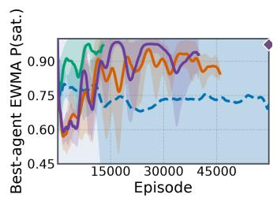  
(a) Pursuit Classic 2

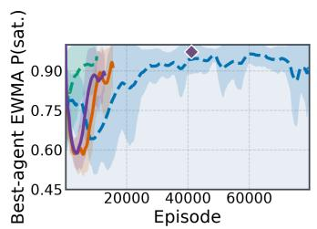  
(b) Pursuit Capture 2

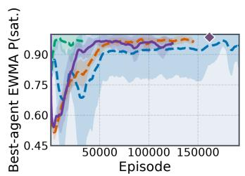  
(c) Pursuit Classic 3

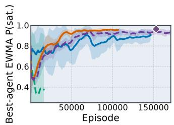  
(d) Pursuit Capture 3

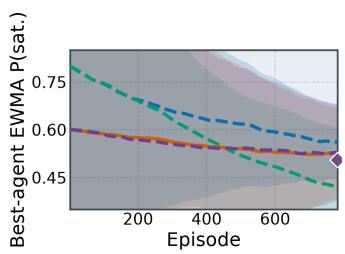  
(e) Coins

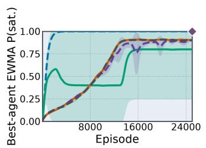  
(f) Matrix Stag Hunt

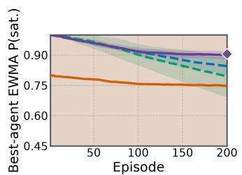  
(g) Commons Harvest

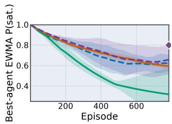  
(h) Territory

Fi ure 2: Best-a ent satisfaction of each famil ’s stron er variant with or without CER (mean and 95% CIs over five runs). Diamonds mark the strongest handcrafted-reward baseline’s separately evaluated final satisfaction at its final training step.
<table><tr><td>Benchmark</td><td>Learner</td><td>i</td><td>Agent&#x27;s objective</td><td>pi</td><td>95% CI</td><td> $\mathsf { N a s h C o n v }$ </td></tr><tr><td>Pursuit Classic 2</td><td>PR2-IPP0</td><td>0</td><td> $\mathsf { P } _ { \geq 0 . 1 } [ \mathsf { G }$  ¬goal_reached]</td><td>0.979</td><td>[0.936, 0.993]</td><td>0.000</td></tr><tr><td>Pursuit Capture 2</td><td>PR2-IPPO</td><td>1</td><td> $\mathsf { P } { \scriptstyle \geq } 0 . 5$  [G¬guard_intruder_collision ∧G¬collision_ever]</td><td>1.000</td><td>[0.957, 1.000]</td><td>0.000</td></tr><tr><td>Pursuit Classic 3</td><td>PR2-IQL-CER</td><td>2</td><td> $\mathsf { P { \geq } 0 . 1 } \mathopen { } \mathclose \bgroup \left[ \mathsf { F g o a l } \aftergroup \egroup \right]$  reached ∧G¬collision_ever]</td><td>0.975</td><td>[0.932, 0.993]</td><td>0.008</td></tr><tr><td>Pursuit Capture 3</td><td>IQL-CER</td><td>2</td><td> $\mathsf { P } _ { \geq 0 . 8 } [ \mathsf { G } \cdot$  guard_intruder_collision∧G¬collision_ever]</td><td>0.969</td><td>[0.926, 0.998]</td><td>0.002</td></tr><tr><td>Coins Own Coin First</td><td>IPPO-CER</td><td>1</td><td> $\mathsf { P } _ { \geq 0 . 4 } [ \neg w _ { 1 } \cup m _ { 1 } ]$ </td><td>0.503</td><td>[0.460, 0.546]</td><td>0.044</td></tr><tr><td>Matrix Sustained Stag</td><td>Nash-Q-CER</td><td>1</td><td> $\mathsf { P } _ { \geq 0 . 9 }$  [F(both_stag∧X(both_stag∧G¬unmirrored))]</td><td>1.000</td><td>[0.957, 1.000]</td><td>0.000</td></tr><tr><td>Commons Safe Harvest</td><td>IQL-CER</td><td>0</td><td> $\mathsf { P { \geq } 0 . 8 } \mathsf { [ G \mathrm { \ - } p 1 a y e r \_ 0 } _ { \mathsf { - } }$  zapped ∧ Fplayer_0_apple_collected]</td><td>0.817</td><td>[0.774, 0.860]</td><td>0.206</td></tr><tr><td>Territory Role Claim</td><td>IQL</td><td>0</td><td> $\mathsf { P } _ { \geq 0 . 2 5 } [ \neg \mathsf { p } _ { 1 }$  _claimed U(po_claimed ∧¬p₁_claimed)]</td><td>0.923</td><td>[0.880, 0.944]</td><td>0.031</td></tr></table>

Table 1: Selected learners and agents (player\_�); objectives omit the outer X. Satisfaction estimates and marginal 95% Hoefding interval endpoints are five-seed means from 1000 new rollouts per seed, without selection adjustment. Appendix E gives selection details, atom definitions and all agents’ results.

Stochastic Pursuit Evasion [56], the repeated matrix-game Stag Hunt, and three spatial substrates adapted from the MeltingPot suite [1]: Coins, Commons Harvest, and Territory. Each agent � has objective $\psi _ { i } = \mathsf { P } _ { \geq q _ { i } } [ \mathsf { X } \varphi _ { i } ]$ with a role-specific threshold $q _ { i }$ (Appendix E).

Algorithms. Our setup targets five algorithm families: variants of IPPO, PR2-IPPO, IQL, PR2-IQL, and Nash-Q, with and without counterfactual experience replay (CER, e.g., IQL and IQL-CER), and one handcrafted-reward (hc-) counterpart for each learner family. Probabilistic recursive reasoning (PR2) evaluates actions against modelled opponent responses, guiding action selection and policy updates.

However, Nash-Q completed only for Stag Hunt due to it being a tractable low-dimensional matrix game, whereas the other environments timed out after 96 hours. The handcrafted-reward baseline tries to capture the same objective faithfully with a Python reward function, but has a diferent equilibrium set in practice, and thus serves primarily as an auxiliary baseline.

Evaluation Metrics. Each fixed profile is evaluated on 1000 episodes per seed, using five training seeds. We select the objectivetrained learner and agent with the highest mean satisfaction in this initial evaluation. Table 1 reports that agent’s satisfaction estimate from an independent evaluation, threshold, marginal Hoefding interval endpoints, and the profile’s approximate NashConv.

Appendix E gives the per-agent results, learning curves, and handcrafted comparisons.

We model the unilateral improvements found by finite-budget response searches using approximate NashConv [50]. For each agent �, we freeze its opponents and continue training from the evaluated profile with the same learner and a fixed additional bud get. In practice, this can instead be estimated using best-response predictors.

Definition 12 (Approximate NashConv). Let $\vec { \sigma } ^ { ( i ) }$ denote the profile obtained by the unilateral search for agent �. For objective-reward profiles, with payof $\mathrm { \dot { \alpha } } _ { u _ { i } } ( \vec { \sigma } ) = \mathrm { P r } _ { \mathcal { M } , s _ { 0 } } ^ { \vec { \sigma } } ( \mathsf { X } _ { \varphi _ { i } } )$ and rollout estimate $\widehat { u } _ { i }$ the score is

$$
{ \sf N a s h C o n v \widetilde { \sigma } } ^ { \mathrm { q e f } } ( \vec { \sigma } ) \overset { n } { = } \sum _ { i = 1 } ^ { n } \operatorname* { m a x } \biggr \{ 0 , \widehat { u } _ { i } \bigl ( \vec { \sigma } ^ { ( i ) } \bigr ) - \widehat { u } _ { i } ( \vec { \sigma } ) \biggr \} .
$$

The score in Definition 12 measures the unilateral improvements found by the search. We call it approximate NashConv because each unilateral response is obtained by finite-budget training rather than exact best-response computation, and the resulting utility gains are estimated from finite rollouts. Consequently, finite search and sampling noise preclude an �-NE certificate. As a heuristic, if $\mathsf { N a s h C o n v } ^ { \approx } > 0 . 0 5$ , we train the original profile for up to 25% additional steps. Unlike exploitability (Definition 4), which takes the maximum unilateral gain over agents, NashConv≈ sums the gains found across agents.

Results. Figure 2 shows learning curves across all 8 benchmarks, while per-agent curves and complete learner comparisons appear in Appendix E. The selected learners in Table 1 achieve independent satisfaction estimates above 0.9 on six benchmarks: PR2-IPPO on two-player Pursuit, PR2-IQL-CER on Classic 3, IQL-CER on Capture 3, IQL on Territory, and Nash-Q-CER on Stag Hunt. Harvest selects IQL-CER with mean 0.817, and Coins selects IPPO-CER with mean 0.503.

Threshold feasibility. Capture 2 illustrates why rational synthesis is conditional on feasibility (Definition 6). Its dynamics yield a numerically computed minimax guard satisfaction probability � ≈ 0.130. At any unrestricted 0.05-NE, the guard’s satisfaction probability is at most � + 0.05 ≈ 0.180, below its required 0.3. The intruder’s threshold 0.5 remains feasible. Thus, the guard’s acceptable-equilibrium set $\mathcal { F } _ { 0 . 0 5 \mathrm { - N E } } ^ { \mathrm { g } }$ is empty. Additional training is insuficient to resolve this, as the obstruction lies in the environ- ment dynamics coupled with the specified requirement.

## 5 Related Work

We provide an extended review of related work in Appendix F, but summarise the most relevant works here. Hahn et al. consider verify- ing minimax objectives using the logic patl, although they consider a model checking problem rather than a synthesis problem as they allow relabelling, and only allow an objective considered between a single coalition and its complement. A closely related model-based tools is PRISM-Games [33], which supports verification and strategy synthesis for rpatl-style probabilistic and reward objectives in stochastic games, including multi-objective and equilibrium-based extensions [31, 32, 34]. These methods assume explicit transition models. Varricchione et al. construct a reward machine from an atl specification, but their approach assumes a fully cooperative grand coalition, which in turn allows delegating to reward ma- chines generated for individual agents. Hu et al. consider reward machines for stochastic games, but are limited to exact Nash equilibria, non-quantitative specifications, and two-player general-sum games. Jothimurugan et al. provide a bespoke enumerate-and-verify procedure for a non-probabilistic task specification language that is designed exclusively for equilibria with high social welfare. Ham- mond et al. studied temporal-logic reward optimisation of a sum of probabilities, but restricted their analysis to cooperative MARL. Our use of equilibrium constraints is inspired by classical rational synthesis [14, 20, 52]. Subramanian et al. study reward-machine based learning in general-sum stochastic games, proposing CROM and QROM, which combine counterfactual experience updates over reward-machine states with opponent modelling and provide tab- ular convergence and finite-time guarantees for Nash Q-values under additional assumptions. However, our paper deals with prob-abilistic thresholds rather than discounted rewards. We provide sampling-based certification guarantees and bounds on discounting efects, as well as equilibrium stability and convergence analysis.

## 6 Conclusions and Future Work

Our approach targets multiple strategic agents, each equipped with its own probabilistic temporal-logic objective in pltl� over finite traces. Each agent seeks a strategy satisfying its own probabilistic threshold within a profile that is stable under a chosen equilibrium notion (solution concept), interpreted over the utilities induced by the probabilistic requirements.

Compared to existing approaches, our work focuses on modelfree strategy synthesis in a learning setting, without requiring known transition dynamics. This allows considering objectives beyond those that a strategic coalition can unilaterally enforce, as required by logics such as atl and patl. We analyse how dis- counting afects the learning of probabilistic objectives, establish conditional convergence guarantees for tabular Nash-Q learning, and provide algorithm-agnostic finite-sample certificates of objective satisfaction.

Future work could target nested probabilistic properties and the undiscounted infinite-horizon case for �-regular properties, which would require learning maximal end components [11, 24], although this is non-trivial as end components for multi-agent systems depend on the dynamics of other agents. Another extension of interest could be evaluating diferent solution concepts, such as a jointly satisficing objective [43]. It may also be worth investigating confidence-aware equilibrium selection with Nash-Q; however this introduces statistical noise into the selector and non-local depen- dence across states.

## Acknowledgments

The research described in this paper was supported by the EPSRC (grant number EP/X015823/1) and the UKRI Centre for Doctoral Training in Safe and Trusted AI (grant number EP/S0233356/1).

## References

[1] John P Agapiou, Alexander Sasha Vezhnevets, Edgar A Duéñez-Guzmán, Jayd Matyas, Yiran Mao, Peter Sunehag, Raphael Köster, Udari Madhushani, Kavya Kopparapu, Ramona Comanescu, et al. 2022. Melting Pot 2.0. arXiv preprint arXiv:2211.13746 (2022).

[2] Thomas Ågotnes, Valentin Goranko, and Wojciech Jamroga. 2007. Alternating- time temporal logics with irrevocable strategies. In Proceedings ofthe 11th conference on Theoretical aspects ofrationality and knowledge. 15–24.

[3] Rajeev Alur, Thomas A Henzinger, and Orna Kupferman. 2002. Alternating-time temporal logic. Journal ofthe ACM (JACM) 49, 5 (2002), 672–713.

[4] Dario Amodei, Chris Olah, Jacob Steinhardt, Paul Christiano, John Schulman, and Dan Mané. 2016. Concrete problems in AI safety. arXiv preprint arXiv:1606.06565 (2016).

[5] Fahiem Bacchus, Craig Boutilier, and Adam Grove. 1996. Rewarding behaviors. In Proceedings ofthe National Conference on Artificial Intelligence. 1160–1167.

[6] Christel Baier and Joost-Pieter Katoen. 2008. Principles ofmodel checking. MIT press.

[7] Nuel Belnap and Michael Perlof. 1988. Seeing to it that: a canonical form for a entives. Theoria 54, 3 (1988), 175–199.

[8] Alper Kamil Bozkurt, Yu Wang, Michael M Zavlanos, and Miroslav Pajic. 2021. Model-free reinforcement learning for stochastic games with linear temporal logic objectives. In 2021 IEEE International Conference on Robotics and Automation (ICRA). IEEE, 10649–10655.

[9] Ronen Brafman, Giuseppe De Giacomo, and Fabio Patrizi. 2018. LTLf/LDLf nonmarkovian rewards. In Proceedings of the AAAI conference on artificial intelligence, Vol. 32.

[10] Krishnendu Chatterjee. 2007. Errata: Flaw in Concurrent Reachability Games: Complexity and Existence. Erratum note (PDF). https://pub.ista.ac.at/ \~kchatterjee/errata-csl04.pdf Erratum note for: Chatterjee, Majumdar, and Jurdz iński (CSL 2004) “On Nash Equilibria in Stochastic Games”. Accessed 2026-02-02..

[11] Krishnendu Chatterjee and Monika Henzinger. 2011. Faster and dynamic algo rithms for maximal end-component decomposition and related graph problems in probabilistic verification. In Proceedings of the twenty-second annual ACM-SIAM symposium on Discrete Algorithms. SIAM, 1318–1336.

[12] Taolue Chen, Vojtěch Forejt, Marta Kwiatkowska, Aistis Simaitis, and Clemens Wiltsche. 2013. On stochastic games with multiple objectives. In International Symposium on Mathematical Foundations ofComputer Science. Springer, 266–277.

[13] Taolue Chen and Jian Lu. 2007. Probabilistic alternating-time temporal logic and model checking algorithm. In Fourth International Conference on Fuzzy Systems and Knowledge Discovery (FSKD 2007), Vol. 2. IEEE, 35–39.

[14] Rodica Condurache, Emmanuel Filiot, Rafaella Gentilini, Jean Fran Raskin, et al. 2016. The complexity of rational synthesis. In 43rd International Colloquium on Automata, Languages, and Programming (ICALP 2016), Vol. 121. Ioannis Chatzi-giannakis, Michael Mitzenmacher, Yuval Rabani, and Davide . . . , 121–1.

[15] Arnaud Da Costa, François Laroussinie, and Nicolas Markey. 2010. ATL with strategy contexts: Expressiveness and Model Checking.. In 30th {C} onference on {F} oundations of{S} oftware {T} echnology and {T} heoretical {C} omputer {S} cience ({FSTTCS}’10), Vol. 8. 120–132.

[16] Giuseppe De Giacomo, Yves Lespérance, and Adrian R Pearce. 2010. Situation Calculus-Based Programs for Representing and Reasoning aboutGame Structures. Proc. ofKR (2010), 445–455.

[17] Giuseppe De Giacomo, Moshe Y Vardi, et al. 2015. Synthesis for LTL and LDL on finite traces. In Proceedin s ofthe Twent -Fourth International Joint Conference on Artificial Intelligence, IJCAI 2015. AAAI Press, 1558–1564

[18] Christian Schroeder De Witt, Tarun Gupta, Denys Makoviichuk, Viktor Makoviy chuk, Philip HS Torr, Mingfei Sun, and Shimon Whiteson. 2020. Is independent learning all you need in the starcraft multi-agent challenge? arXiv preprint arXiv:2011.09533 (2020).

[19] Lasse Espeholt, Hubert Soyer, Remi Munos, Karen Simonyan, Vlad Mnih, Tom Ward, Yotam Doron, Vlad Firoiu, Tim Harley, Iain Dunning, Shane Legg, and Koray Kavukcuoglu. 2018. IMPALA: Scalable Distributed Deep-RL with Impor tance Weighted Actor-Learner Architectures. In Proceedings ofthe 35th International Conference on Machine Learning (Proceedings of Machine Learning Research, Vol. 80). PMLR, 1407–1416. https://proceedings.mlr.press/v80/espeholt18a.htm

[20] Dana Fisman, Orna Kupferman, and Yoad Lustig. 2010. Rational synthesis. In International Conference on Tools and Algorithmsfor the Construction and Analysis ofSystems. Springer, 190–204.

[21] Drew Fudenberg and Jean Tirole. 1991. Game Theory. MIT Press, Cambridge, MA.

[22] Rustam Galimullin and Thomas Ågotnes. 2021. Dynamic coalition logic: granting and revoking dictatorial powers. In International Workshop on Logic, Rationality and Interaction. Springer, 88–101.

[23] Javier Garcıa and Fernando Fernández. 2015. A comprehensive survey on safe reinforcement learning. Journal ofMachine Learning Research 16, 1 (2015), 1437– 1480.

[24] Ernst Moritz Hahn, Mateo Perez, Sven Schewe, Fabio Somenzi, Ashutosh Trivedi, and Dominik Wojtczak. 2019. Omega-regular objectives in model-free rein forcement learning. In International conference on tools and algorithms for the construction and analysis of systems. Springer, 395–412.

[25] Ernst Moritz Hahn, Mateo Perez, Sven Schewe, Fabio Somenzi, Ashutosh Trivedi, and Dominik Wojtczak. 2024. Multi-Agent Reinforcement Learning for Alternating-Time Logic. In 27th European Conference on Artificial Intelligence, ECAI 2024. IOS, 1680–1687.

[26] Lewis Hammond, Alessandro Abate, Julian Gutierrez, and Michael Wooldridge. 2021. Multi-agent reinforcement learning with temporal logic specifications. arXiv preprint arXiv:2102.00582 (2021).

[27] Jueming Hu, Jean-Raphaël Gaglione, Yanze Wang, Zhe Xu, Ufuk Topcu, and Yongming Liu. 2023. Reinforcement learning with reward machines in stochastic games. arXiv preprint arXiv:2305.17372 (2023).

[28] Junling Hu and Michael P Wellman. 2003. Nash Q-learning for general-sum stochastic games. Journal ofmachine learning research 4, Nov (2003), 1039–1069.

[29] Yunhan Huang and Quanyan Zhu. 2022. Game-theoretic frameworks for epidemic spreading and human decision-making: A review. Dynamic Games and Applications 12, 1 (2022), 7–48.

[30] Kishor Jothimurugan, Suguman Bansal, Osbert Bastani, and Rajeev Alur. 2022. Specification-guided learning of nash equilibria with high social welfare. In International Conference on Computer Aided Verification. Springer, 343–363.

[31] Marta Kwiatkowska. 2016. Model checking and strategy synthesis for stochastic games: From theory to practice. In ICALP2016: 43rd International Colloquium on Automata, Languages and Programming. Schloss Dagstuhl.

[32] Marta Kwiatkowska, Gethin Norman, David Parker, and Gabriel Santos. 2020. Multi-player equilibria verification for concurrent stochastic games. In International Conference on Quantitative Evaluation ofSystems. Springer, 74–95.

[33] Marta Kwiatkowska, Gethin Norman, David Parker, and Gabriel Santos. 2020. PRISM-games 3.0: Stochastic game verification with concurrency, equilibria and time. In International Conference on Computer Aided Verification. Springer, 475–487.

[34] Marta Kwiatkowska and David Parker. 2013. Automated verification and strategy synthesis for probabilistic systems. In Automated Technology for Verification and Analysis: 11th International Symposium, ATVA 2013, Hanoi, Vietnam, October 15-18, 2013. Proceedings. Springer, 5–22.

[35] Marc Lanctot, Vinicius Zambaldi, Audrunas Gruslys, Angeliki Lazaridou, Karl Tuyls, Julien Pérolat, David Silver, and Thore Graepel. 2017. A unified game theoretic approach to multiagent reinforcement learning. Advances in neural information processing systems 30 (2017).

[36] Michael L Littman. 1994. Markov games as a framework for multi-agent rein forcement learning. In Machine learning proceedings 1994. Elsevier, 157–163.

[37] Fabrizio M Maggi, Marco Montali, and Rafael Peñaloza. 2020. Temporal logics over finite traces with uncertainty. In Proceedings ofthe AAAI Conference on Artificial Intelligence, Vol. 34. 10218–10225.

[38] Zohar Manna and Amir Pnueli. 1990. A hierarchy of temporal properties (invited paper, 1989). In Proceedings of the ninth annual ACM symposium on Principles of distributed computing. 377–410.

[39] Bharat Manvi and Easwar Subramanian. 2023. A Nash Equilibrium Solution for Periodic Double Auctions. In 2023 62nd IEEE Conference on Decision and Control (CDC). IEEE, 209–214.

[40] John Nash. 1950. Equilibrium points in n-person games. Proceedings of the National Academy ofSciences 36, 1 (1950), 48–49.

[41] Gaspard Ohlmann, Edwin Hamel-De le Court, and Francesco Belardinelli. 2025. Synthesis of Safety Specifications for Probabilistic Systems. arXiv preprint arXiv:2511.16579 (2025)

[42] Martin L Puterman. 2014. Markov decision processes: discrete stochastic dynamic programming. John Wiley & Sons.

[43] Senthil Rajasekaran, Suguman Bansal, and Moshe Y. Vardi. 2023. Multi-Agent S stems with Quantitative Satisficin Goals. (8 2023), 280–288. doi:10.24963/ ijcai.2023/32 Main Track.

[44] John Schulman, Filip Wolski, Prafulla Dhariwal, Alec Radford, and Oleg Klimov. 2017. Proximal policy optimization algorithms. arXiv preprint arXiv:1707.06347 (2017).

[45] Reinhard Selten. 1975. Reexamination of the perfectness concept for equilibrium points in extensive games. International Journal of Game Theory 4, 1 (1975), 25–55.

[46] Satinder Singh, Tommi Jaakkola, Michael L Littman, and Csaba Szepesvári. 2000. Convergence results for single-step on-policy reinforcement-learning algorithms. Machine learning 38, 3 (2000), 287–308.

[47] Fu Song, Yedi Zhang, Taolue Chen, Yu Tang, and Zhiwu Xu. 2019. Probabilistic alternating-time �-calculus. In Proceedings ofthe AAAI Conference on Artificial Intelligence, Vol. 33. 6179–6186.

[48] Sriram Ganapathi Subramanian, Toryn Q. Klassen, and Sheila A. McIlraith. 2026. Multi-Agent Reinforcement Learning with Reward Machines for Mixed Cooperative-Competitive Environments. Reinforcement Learning Journal 7 (2026).

[49] Ming Tan. 1993. Multi-Agent Reinforcement Learning: Independent versus Cooperative Agents. In Proceedings of the Tenth International Conference on Machine Learning. Morgan Kaufmann, 330–337.

[50] Finbarr Timbers, Nolan Bard, Edward Lockhart, Marc Lanctot, Martin Schmid, Neil Burch, Julian Schrittwieser, Thomas Hubert, and Michael Bowling. 2020. Approximate exploitability: Learning a best response in large games. arXiv preprint arXiv:2004.09677 (2020).

[51] John Tsitsiklis and Benjamin Van Roy. 1996. Analysis of temporal-difference learning with function approximation. Advances in neural information processing systems 9 (1996).

[52] Michael Ummels. 2006. Rational behaviour and strategy construction in infi nite multiplayer games. In International Conference on Foundations ofSoftware Technology and Theoretical Computer Science. Springer, 212–223.

[53] Giovanni Varricchione, Natasha Alechina, Mehdi Dastani, and Brian Logan. 2023. Synthesising reward machines for cooperative multi-agent reinforcement learning. In European Conference on Multi-Agent Systems. Springer, 328–344.

[54] Cameron Voloshin, Abhinav Verma, and Yisong Yue. 2023. Eventual discounting temporal logic counterfactual experience replay. In International Conference on Machine Learnin . PMLR, 35137–35150.

[55] Dirk Walther, Wiebe van der Hoek, and Michael Wooldridge. 2007. Alternating- time temporal logic with explicit strategies. In Proceedings ofthe 11th conference on Theoretical aspects ofrationality and knowledge. 269–278.

[56] Isaac E Weintraub, Meir Pachter, and Eloy Garcia. 2020. An introduction to pursuit-evasion diferential games. In 2020 American Control Conference (ACC). IEEE, 1049–1066.

[57] Ying Wen, Yaodong Yang, Rui Luo, Jun Wang, and Wei Pan. 2019. Probabilistic Recursive Reasoning for Multi-Agent Reinforcement Learning. In International Conference on Learning Representations.

[58] Michael Wooldridge, Julian Gutierrez, Paul Harrenstein, Enrico Marchioni, Giuse e Perelli, and Alexis Toumi. 2016. Rational verification: From model checking to equilibrium checking. In Proceedings of the AAAI Conference on Artificial Intelligence, Vol. 30.

[59] Shan Yang and Yang Liu. 2024. Markov game for CV joint adaptive routing in stochastic trafic networks: A scalable learning approach. Transportation Research Part B: Methodological 189 (2024), 102997.

[60] Yunfei Zhao, Linan Huang, Carol Smidts, and Quanyan Zhu. 2020. Finite-horizon semi-Markov game for time-sensitive attack response and probabilistic risk assessment in nuclear power plants. Reliability Engineering & System Safety 201 (2020), 106878.

## Appendix

The appendix is organised as follows:   
Appendix A: The finite-trace semantics of pltl�   
Appendix B: Overview of our approach   
Appendix C: Environment descriptions and handcrafted rewards   
Appendix D: Algorithm details and proofs   
Appendix E: Experimental results   
Appendix F: Extended literature review   
Appendix G: Hyperparameters

## A pltl� Semantics

Definition 13 (pltl� Semantics). Fix a labelled stochastic game ℳ and a horizon of� transitions (label traces have at most $H + 1$ positions). Let $\mathrm { P r } _ { \mathcal { M } , s } ^ { \vec { \sigma } }$ be the probability measure induced by strategy profile ⃗� on complete finite paths $\mathsf { F P a t h } _ { \mathcal { M } , s } ^ { \mathrm { c o m p } }$ . For any finite trajectory $\pi = s _ { 0 } a _ { 0 } s _ { 1 } \cdot \cdot \cdot s _ { \ell } \in { \sf F P a t h } _ { \mathcal { M } , s } ^ { \mathrm { c o m p } } , l e t \tau ( \pi ) = \mathcal { L } ( s _ { 0 } ) \cdot \cdot \cdot \mathcal { L } ( s _ { \ell } ) \in$ Γℓ+1.

ltl satisfaction (finite label traces � ∈ Γ+):   
�, � |= ⊤   
�, � |= � ↔� ∈ �[�]   
�, � |= ¬� ↔�, � ̸|= �   
�, � |= �1 ∧ �2 $ ( \tau , i \Vdash ^ { \prime } \varphi _ { 1 } ) \land ( \tau , i \Vdash \varphi _ { 2 } )$   
�, � |= X� $ i + 1 < | \tau | \wedge \tau , i + 1 \lceil  = \varphi$   
�, � |= �1U�2 $ \exists j \in [ i , \dot { | \tau | } - 1 ] . ~ ( \tau , j \dot { | = { \dot { \varphi } } _ { 2 } } \wedge$   
$\forall k \in [ i , j - 1 ] , \tau , k \in \varphi _ { 1 } \big )$   
Path satisfaction:   
ℳ, � |= � ↔�(�), 0 |= �   
Probabilistic modality:   
$\begin{array} { r l } { | \mathcal { M } , s , \vec { \sigma } | = \mathsf { P } _ { \ J \ J \ J } [ \varphi ] } & { { }  \mathsf { P r } _ { \mathcal { M } , s } ^ { \vec { \sigma } } ( \{ \pi \in \mathsf { F P a t h } _ { \mathcal { M } , s } ^ { \mathrm { c o m p } } \ |  } \end{array}$   
$\mathcal { M } , \pi \models \varphi \models \ v C$

## B Overview

Figure 3 summarises our approach. Given each agent’s objective and a target solution concept, we compile the path formulas into reward automata and form the product stochastic game. We train a single joint profile using model-free MARL, with optional counterfactual replay, and evaluate its satisfaction probabilities and NashConv≈.

## C Environments

We consider 8 benchmark instances drawn from five environment families. Table 2 summarises the complete suite.

Figure 4 shows the spatial environments.

Observations. Agents observe structured symbolic grids: each grid records, cell by cell, the identity of one layer of the scene (terrain, avatars and their orientations, coins, apples, claims, beams, etc), alongside scalar side channels. The grids are flattened and scaled to [0, 1], and the index of the agent’s reward-automaton state is appended alongside spatial coordinates.

## C.1 Stochastic Pursuit-Evasion

We provide a stochastic variation of the Pursuit Evasion environment in the literature [56], which is also referred to as Guard Gridworld. The slippery gridworld is instantiated with one guard, $\mathsf { p l a y e r } _ { 0 } ,$ , and either one or two intruders. In the classic task, the guard satisfies G¬goal\_reached, whereas every intruder satisfies Fgoal\_reached ∧ G¬collision\_ever. In the capture task, the guard satisfies Fguard\_intruder\_collision, whereas each intruder satisfies G¬guard\_intruder\_collision ∧ G¬collision\_ever. Each move is subject to a role-specific slip probability, so the environment remains stochastic under a fixed joint policy.

Handcrafted rewards. Let $D _ { t }$ denote episode completion after step �, and let $G _ { t } , C _ { t } , K _ { t } ,$ , and $E _ { t }$ denote the Boolean labels goal\_reached, collision, guard\_intruder\_collision, and collision\_ever, respectively. For the classic benchmark, the guard reward is

$$
\begin{array} { r } { \tilde { r } _ { t , \mathrm { c l a s s i c } } ^ { 0 } = \left\{ \begin{array} { l l } { - 1 , } & { G _ { t } , } \\ { 1 , } & { D _ { t } \wedge \neg G _ { t } , } \\ { 0 , } & { \mathrm { o t h e r w i s e } , } \end{array} \right. } \end{array}
$$

and each intruder $i > 0$ receives

$$
\tilde { r } _ { t , \mathrm { c l a s s i c } } ^ { i } = { \bf 1 } [ G _ { t } ] - { \bf 1 } [ C _ { t } ] .
$$

For the capture benchmark, the guard reward is

$$
\tilde { r } _ { t , \mathrm { c a p t u r e } } ^ { 0 } = \left\{ \begin{array} { l l } { 1 , } & { K _ { t } , } \\ { - 0 . 5 , } & { D _ { t } \wedge \neg K _ { t } , } \\ { 0 , } & { \mathrm { o t h e r w i s e } , } \end{array} \right.
$$

and each intruder $i > 0$ receives

$$
\tilde { r } _ { t , \mathrm { c a p t u r e } } ^ { i } = \left\{ \begin{array} { l l } { - 1 , } & { K _ { t } \vee E _ { t } , } \\ { 1 , } & { D _ { t } \wedge \neg K _ { t } \wedge \neg E _ { t } , } \\ { 0 , } & { \mathrm { o t h e r w i s e } . } \end{array} \right.
$$

## C.2 Coins

This benchmark uses a two-player adaptation of the MeltingPot coins substrate with a 256-step horizon and coin regrowth rate 0.005. Each player owns one coin colour. Writing �� and $w _ { i }$ for the indexed propositions that player � collected a matching or mismatching coin, respectively, its Own Coin First objective is

$$
\varphi _ { i } = \lnot w _ { i } \lor m _ { i } , \qquad i \in \{ 0 , 1 \} .
$$

The strong-until objective requires a matching collection to occur and forbids a mismatching collection beforehand. Coin consump- tion and regrowth create strategic externalities even though the formulae are symmetric.

Handcrafted reward. On each coin collection, the collector re-ceives

$$
\tilde { r } _ { t } ^ { i } = \mathbf { 1 } [ m _ { i } ] - \mathbf { 1 } [ w _ { i } ] .
$$

The other agent receives no reward for that collection.

## C.3 Matrix Stag Hunt

This benchmark uses a repeated two-player matrix-game version of the classic Stag Hunt. At each of 20 stages, both agents choose between Hare and Stag. The public state records the previous joint action and whether the agents chose diferent actions at that stage. The base environment truncates only at the horizon, and the default stage payofs are shown in Figure 5: mutual Stag is payof-dominant, mutual Hare is the safer coordinated outcome, and unilateral Stag receives the failed-hunt payof.

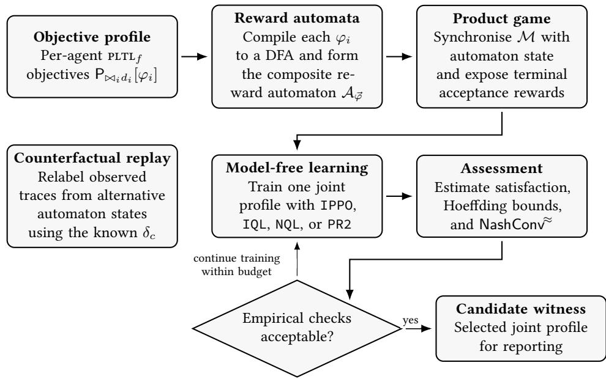

Figure 3: Overview of our approach to automata-based rational synthesis.
<table><tr><td>Environment</td><td>Selected benchmark</td><td>Agents</td><td>Roles</td><td>High-level objective</td></tr><tr><td>STOCHASTIC PURSUIT-EVASION</td><td>Classic (2-player)</td><td>2</td><td>Guard / intruder</td><td>Guard prevents a breach; the intruder reaches the goal without collision.</td></tr><tr><td>STOCHASTIC PURSUIT-EVASION</td><td>Capture (2-player)</td><td>2</td><td>Guard / intruder</td><td>Guard seeks contact; the intruder avoids guard contact and all collisions.</td></tr><tr><td>STOCHASTIC PURSUIT-EVASION</td><td>Classic (3-player)</td><td>3</td><td>Guard / two intruders</td><td>The opposed classic objectives are instantiated for both intruders.</td></tr><tr><td>STOCHASTIC PURSUIT-EVASION</td><td>Capture (3-player)</td><td>3</td><td>Guard / two intruders</td><td>The opposed capture/stealth objectives are instantiated for both intruders.</td></tr><tr><td>CoOINS</td><td>Own Coin First (2-player)</td><td>2</td><td>Two colour owners</td><td>Each player must collect its own colour before collecting the other colour.</td></tr><tr><td>MATRIX STAG HUNT</td><td>Sustained Stag (2-player)</td><td>2</td><td>Two symmetric players</td><td>Coordinate on a sustained mutual Stag convention.</td></tr><tr><td>COMMONS HARVEST</td><td>Safe Harvest (4-player)</td><td>4</td><td>Four indexed harvesters</td><td>Each player collects an apple while avoiding being zapped.</td></tr><tr><td>TERRITORY</td><td>Role Claim (2-player)</td><td>2</td><td>Two competing claimants</td><td>Each player tries to make the first sole resource claim.</td></tr></table>

Table 2: Our eight environments and their high-level objectives and roles. Objectives that share a schema remain agent-indexed unless they are symmetric.

Both agents have the Sustained Stag objective and receive the same terminal Boolean reward for satisfying

$$
\begin{array} { c } { \varphi _ { i } = \mathsf { F } \big ( \mathtt { b o t h \_ s t a g } \wedge \mathsf { X } ( \mathtt { b o t h \_ s t a g } \wedge \mathsf { G \_ u n m i r r o r e d } ) \big ) , } \\ { i \in \{ 0 , 1 \} . } \end{array}
$$

The atoms both\_stag and unmirrored are derived from the pre vious stage outcome. Thus, the objective allows failed coordination attempts before the convention is established, but requires two consecutive Stag-Stag outcomes after which the agents choose the same action at every remaining stage. Earlier pairs followed by a mismatch are permitted, as are later coordinated Hare-Hare outcomes.

Handcrafted reward. We use the native stage payof as the hand-crafted reward for Stag Hunt:

$$
\tilde { r } _ { t } ^ { i } = r _ { \mathrm { e n v } , t } ^ { i } = \left\{ \begin{array} { l l } { 3 , } & { a _ { t } ^ { 0 } = a _ { t } ^ { 1 } = \mathrm { H a r e } , } \\ { 4 , } & { a _ { t } ^ { 0 } = a _ { t } ^ { 1 } = \mathbf { S t a g } , } \\ { 0 , } & { a _ { t } ^ { i } = \mathbf { S t a g } \wedge a _ { t } ^ { - i } = \mathrm { H a r e } , } \\ { 3 , } & { a _ { t } ^ { i } = \mathrm { H a r e } \wedge a _ { t } ^ { - i } = \mathbf { S t a g } . } \end{array} \right.
$$

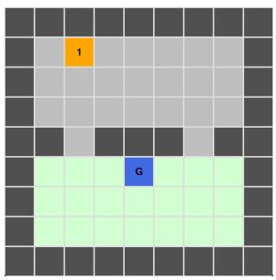  
(a) Stochastic Pursuit-Evasion

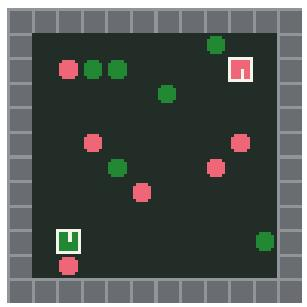  
(b) Coins

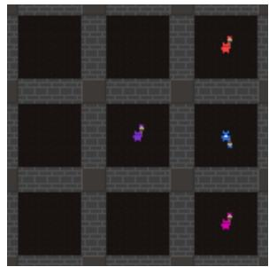  
(c) Territory

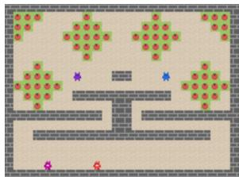  
(d) Commons Harvest  
Figure 4: The four spatial environment families used in our experiments.

Player 2
<table><tr><td colspan="2">Hare</td><td>Stag</td></tr><tr><td>Hare PIyye1</td><td>3,3</td><td>3,0</td></tr><tr><td>Stag</td><td>0,3</td><td>4,4</td></tr></table>

Figure 5: Stage payof matrix for Matrix Stag Hunt. The ordered pair in each cell gives the payof to Player 1 and Player $^ { 2 , }$ respectively.

## C.4 Commons Harvest

This benchmark uses the Melting Pot substrate commons\_ harvest\_\_partnership, where four harvesters compete for apples in a shared field and can zap one another. Each player has the Safe Harvest objective:

$$
\begin{array} { r } { \varphi _ { i } = \mathsf { G } \mathrm { - p } \mathsf { 1 a y e r \_ i \_ z a p p e d } \wedge \mathsf { F p } \mathsf { 1 a y e r \_ i \_ a p p l e \_ c o l l e } _ { - } \mathsf { c o l l e c t e d } , } \\ { i \in \{ 0 , 1 , 2 , 3 \} . } \end{array}
$$

Handcrafted reward. Each agent receives +1 for its first apple collected before being zapped. The first zap gives −1 and prevents further apple rewards, cancelling any earlier apple reward. Another player’s apple collection or zap does not afect this reward. We obtain apple labels from the collector’s positive native payof and zap labels from the substrate’s per-target zap events.

## C.5 Territory

This benchmark uses the territory\_\_rooms substrate from Melting Pot. In the two-player Role Claim task, players race to claim a resource first. Let $c _ { i }$ denote the ownership-change event player\_i\_resource\_claimed. The objectives are

$$
\varphi _ { 0 } = \neg c _ { 1 } \mathsf { U } \big ( c _ { 0 } \wedge \neg c _ { 1 } \big ) , \qquad \varphi _ { 1 } = \neg c _ { 0 } \mathsf { U } \big ( c _ { 1 } \wedge \neg c _ { 0 } \big ) .
$$

Thus each player tries to make the first sole claim. Simultaneous first claims are ties, and later claims cannot reverse the temporal outcome.

Handcrafted reward. At the first step on which a claim occurs, the sole claimant receives +1 and the opponent −1. A simultaneous first claim gives both players 0. Later claims give no reward.

## C.6 Handcrafted Baselines

We train each handcrafted baseline (hc-IPPO, hc-PR2-IPPO, hc-IQL, hc-PR2-IQL and hc-Nash-Q) on the rewards above, using the corresponding learner’s hyperparameters (Appendix G) and five seeds $\{ 0 , \ldots , 4 \}$ , without counterfactual replay. The plt $\mathbf { L } _ { f }$ monitors record objective satisfaction throughout training, while the learner receives the handcrafted reward.

We evaluate each fixed profile on 1000 new episodes per seed, reporting objective satisfaction and Hoefding intervals at overall $\delta = 0 . 0 5$ , as for the objective-trained profiles. Each learning-curve panel marks the strongest handcrafted baseline’s final satisfaction with a diamond, using the same aggregation over agents as the curves. We place the diamond at the last training episode across that baseline’s seeds, capped at the end of the plotted curves. We also compute its NashConv≈ from improvements in temporal satisfaction (Appendix D.3).

## D Technical Details

## D.1 Counterfactual Experience Replay

We apply CER separately to each agent’s deterministic reward automaton. We append the automaton-state identifier to the agent’s observation and store the successor-state propositions at each step. Relabelling keeps the environment rollout fixed and recomputes the automaton states from alternative start states. We keep the original sample and discard duplicate relabellings. Our procedure adapts Voloshin et al. [54] to finite-trace $\mathbf { L T L } _ { f }$ . In particular, our deterministic finite automata require no �-jump transitions used with Büchi automata in ltl, and rewards depend on acceptance at episode termination instead of repeated visits to Büchi accepting states.

Algorithm 2: Relabelling a rollout chunk for one agent   
Input: agent reward automaton $A _ { i } = ( M _ { i } , m _ { i } ^ { 0 } , \Gamma , \delta _ { i } , F _ { i } ) ,$   
rollout chunk $( x _ { 0 } , a _ { 0 } , r _ { 0 } , \ell _ { 0 } , d _ { 0 } ,$   
$\dots , x _ { T - 1 } , a _ { T - 1 } , r _ { T - 1 } , \ell _ { T - 1 } , d _ { T - 1 } , x _ { T } ) ,$ , where   
${ \boldsymbol x } _ { t } = \left( { \boldsymbol o } _ { t } , m _ { t } \right)$ and $\ell _ { t } = \mathcal { L } ( s _ { t + 1 } )$   
Output: set $\widetilde { c }$ of relabelled chunks   
1 Initialise $\widetilde { c }$ with the factual chunk   
2 for each counterfactual start state �˜ $\in M _ { i }$ do   
3 Set $m \gets \tilde { m } _ { 0 }$   
4 for $t = 0 , \ldots , T - 1$ do   
5 Set relabelled observation �˜� $ ( o _ { t } , m )$   
6 Compute pre-reset successor $m ^ { + } \gets \delta _ { i } ( m , \ell _ { t } )$   
7 Set terminal reward $\tilde { r } _ { t } \gets \mathbf { 1 } [ d _ { t } ] f _ { i } ( \mathbf { 1 } [ m ^ { + } \in F _ { i } ] )$   
8 Set � $\gets \tilde { m } _ { 0 }$ if $d _ { t } ,$ else $m ^ { + }$   
9 Set stored next observation $\tilde { x } _ { t + 1 } \gets ( o _ { t + 1 } , m )$   
10 end   
11 Add $( \tilde { x } _ { 0 } , a _ { 0 } , \tilde { r } _ { 0 } , d _ { 0 } , . . . , \tilde { x } _ { T } )$ to $\tilde { c }$ if non-duplicate   
12 end   
13 return $\widetilde { c }$

Algorithm 3: CER integration for replay-based learners   
Input: replay bufer $\mathcal { D } ,$ factual rollout chunk �   
1 Compute $\tilde { c } \gets$ RelabelChunk(�)   
2 for each $\tilde { c } \in \tilde { { \mathcal { C } } }$ do   
3 $\mid$ Insert �˜ into $\mathcal { D }$   
4 end   
5 return $\mathcal { D }$

Write $\boldsymbol { x } _ { t } ~ = ~ ( o _ { t } , m _ { t } )$ for the stored observation, with $o _ { t }$ the environment features and �� the appended monitor identifier. $\scriptstyle \mathrm { R e ^ { - } }$ labelling replaces that identifier, giving $\tilde { \boldsymbol { x } } _ { t } = \left( o _ { t } , \tilde { m } _ { t } \right)$ . In Algo- rithm $2 , d _ { t }$ denotes episode completion under the environment termination/truncation rule or wrapper horizon, independently of the relabelled monitor state. A rollout-chunk boundary alone does not set $d _ { t } = 1$ . Acceptance is evaluated at the post-transition monitor state $m ^ { + }$ before reset, while the stored next observation at an episode boundary uses the reset monitor state.

Actor-critic integration. IPPO-CER and PR2-IPPO-CER combine factual and relabelled chunks, recomputing rollout statistics with fixed pre-update parameters. The implementation retains factual behaviour log-probabilities for conditional importance correction. Write $\rho _ { t } = \bar { \pi } _ { i } ^ { \mathrm { { \bar { o l d } } } } ( a _ { t } ^ { i } \mid \tilde { x } _ { t } ) / \mu _ { i } ( a _ { t } ^ { i } \mid x _ { t } )$ , where $\mu _ { i }$ generated the factual action. In corrected mode, $\operatorname* { m i n } ( 1 , \rho _ { t } )$ weights the clipped PPO surrogate separately from PPO’s update-ratio clipping. IPPO also uses �-V-trace-style targets [19], with $\lambda = 0 . 9 5$ and action and trace caps one. PR2-IPPO retains its response-aware advantage and one-step joint-action critic. In critic\_only mode, actor updates, entropy and advantage normalisation use factual samples, while relabelled samples update the critic. Each run records its replay mode and importance-cap settings. Evaluation always uses the original temporal objectives.

Algorithm 4: CER integration for actor-critic learners   
Input: factual rollout batch ℬ, fixed pre-update parameters   
1 for each a ent � do   
2 for each factual rollout chunk � ofagent � do   
3 Compute $\tilde { c } \gets$ RelabelChunk(�)   
4 Add all chunks in $\widetilde { c }$ to agent �’s update batch   
5 end   
6 Recompute the required rollout statistics using the fixed   
pre-update parameters   
7 end   
8 return updated batch ℬ

Nash-Q integration. For NQL, we apply CER online: we relabel each observed joint transition and perform a tabular Nash-Q backup on the original transition and each relabelled variant before the next environment step.

## D.2 PR2

Our discrete-action variants of probabilistic recursive reasoning (PR2) are inspired by Wen et al. [57] and use the IQL and IPPO training interfaces. For each agent �, we encode the opponents’ actions as a single joint action $\begin{array} { r } { \bar { a } ^ { - i } \in \mathcal { A } ^ { - i } = \prod _ { j \neq i } \mathcal { A } ^ { j } } \end{array}$ . The agent has a joint-action critic

$$
Q _ { i } ( x _ { i } ) \in \mathbb { R } ^ { | { \cal { A } } ^ { i } | \times | { \cal { A } } ^ { - i } | } ,
$$

where $x _ { i }$ is the agent observation, including the reward-automaton state when monitoring is enabled. The opponent-response distribu tion is induced directly from this critic,

$$
\rho _ { i } ( a ^ { - i } \mid x _ { i } , a ^ { i } ) = \mathrm { s o f t m a x } _ { a ^ { - i } } Q _ { i } ( x _ { i } , a ^ { i } , a ^ { - i } ) ,
$$

and the value of the agent’s action under this response model is

$$
\bar { Q } _ { i } ( x _ { i } , a ^ { i } ) = \sum _ { a ^ { - i } \in A ^ { - i } } \rho _ { i } ( a ^ { - i } \mid x _ { i } , a ^ { i } ) Q _ { i } ( x _ { i } , a ^ { i } , a ^ { - i } ) .
$$

We use unit temperature for $\rho _ { i } .$ . This response model comes from agent $\romannumeral 5$ own critic and need not match the opponents’ conditional action distribution. The PR2-IPPO advantage below uses this model.

PR2-IQL.. Action selection is �-greedy with respect to $\bar { Q } _ { i }$ . Re-play stores the agent’s own action, the observed encoded opponent joint action, and the terminal automaton reward. The update regresses only the observed joint-action entry:

$$
\begin{array} { c l } { \mathscr { L } _ { i } = \Big ( Q _ { i } ( x _ { i } , a ^ { i } , a _ { \mathrm { o b s } } ^ { - i } ) - r _ { i } } \\ { - \gamma ( 1 - d ) \underset { b ^ { i } \in \mathcal { A } ^ { i } } { \operatorname* { m a x } } \bar { Q } _ { i } ^ { \mathrm { t a r g } } ( x _ { i } ^ { \prime } , b ^ { i } ) \Big ) ^ { 2 } . } \end{array}
$$

PR2-IPPO.. The actor outputs logits for $\pi _ { i } ( \cdot \mid x _ { i } )$ , while the critic has the same joint-action shape as above. The state value used by the policy update is

$$
V _ { i } ( x _ { i } ) = \sum _ { a ^ { i } \in \mathcal { A } ^ { i } } \pi _ { i } ( a ^ { i } \mid x _ { i } ) \bar { Q } _ { i } ( x _ { i } , a ^ { i } ) ,
$$

and the rollout advantage, fixed before optimisation, is

$$
\begin{array} { l } { { \displaystyle \widehat { A } _ { i } ^ { \rho } ( \boldsymbol { x } _ { i } , \boldsymbol { a } ^ { i } ) = \mathrm { s t o p g r a d } \Big [ \bar { Q } _ { i } ^ { \mathrm { o l d } } ( \boldsymbol { x } _ { i } , \boldsymbol { a } ^ { i } ) } } \\ { { \displaystyle ~ - \sum _ { b } \pi _ { i } ^ { \mathrm { o l d } } ( b \mid \boldsymbol { x } _ { i } ) \bar { Q } _ { i } ^ { \mathrm { o l d } } ( \boldsymbol { x } _ { i } , b ) \Big ] . } } \end{array}
$$

Here $\mathrm { { \tilde { \Delta } o l d \vec { \Delta } } } ^ { m }$ denotes the pre-update parameters. The clipped PPO objective uses this advantage after normalisation over each minibatch, while the critic regresses

$$
Q _ { i } ( x _ { i } , a ^ { i } , a _ { \mathrm { o b s } } ^ { - i } ) \quad \mathrm { t o w a r d s } \quad r _ { i } + \gamma ( 1 - d ) V _ { i } ^ { \mathrm { o l d } } ( x _ { i } ^ { \prime } ) .
$$

The -CER variants use the relabelling procedure in Appendix D.1. For PR2-IPPO, the log-probabilities and advantages are recom-puted after relabelling.

## D.3 Unilateral Improvement Search

For each agent, we initialise its corresponding learner (IPPO, PR2-IPPO, IQL, PR2-IQL, or Nash-Q) from the evaluated profile and train that agent with its opponents fixed. The additional budget is the product of the BR iteration and batch-step counts in Table 13. Response searches preserve the learner’s CER settings. For hc- profiles, the deviating agent instead trains on its temporal objective with CER (Appendix C.6).

We evaluate the candidate and original policies with paired episode seeds and measure their temporal satisfaction $u _ { i } .$ , including for handcrafted profiles. The score sums the unilateral improve- ments found within the given budget and learner family.

Frozen-opponent operator. The Nash-Q trainer has a dedicated single-agent training mode. It obtains opponents’ policies from a frozen copy of the original joint Q-tables and replaces the Nash continuation value by max� E� $\dots { \sim } \sigma _ { - i } Q _ { i } ( x ^ { \prime } , a _ { i } , a _ { - i } )$ . Candidate evaluation likewise samples opponents from that frozen copy. With full product state and the temporal utility, the corresponding undis- counted recursion would be

$$
B _ { i } ( x ) = \operatorname* { m a x } _ { a _ { i } } \sum _ { a _ { - i } } \sigma _ { - i } ( a _ { - i } \mid x ) \sum _ { x ^ { \prime } } \tilde { \mathcal { P } } ( x ^ { \prime } \mid x , a _ { i } , a _ { - i } ) B _ { i } ( x ^ { \prime } ) ,
$$

with $B _ { i } ( x ) = R _ { i } ( x )$ at termination and sums and maxima over legal actions. In our experiments, the search uses the learner’s discount factor, while the score measures improvements in the undiscounted temporal utility $u _ { i } .$

Aggregation andsampling. Writing $\begin{array} { r } { \Delta _ { i } = \operatorname* { s u p } _ { \sigma _ { i } ^ { \prime } } u _ { i } ( s _ { 0 } , ( \sigma _ { i } ^ { \prime } , \sigma _ { - i } ) ) - } \end{array}$ $u _ { i } ( s _ { 0 } , \vec { \sigma } )$ , exact NashConv is $\textstyle \sum _ { i } \Delta _ { i }$ �, whereas exploitability is $\operatorname* { m a x } _ { i } \Delta _ { i }$ . Retaining the original strategy is admissible, so every $\Delta _ { i } \ \geq \ 0$ and hence Exploit $\begin{array} { r } { \leq \sum _ { i } \Delta _ { i } \ \leq } \end{array}$ �Exploit. Two gains of 0.03 therefore give NashConv 0.06 while satisfying 0.05-NE. Finite search can miss deviations, while sampling noise and clipping can inflate either aggregation, so the estimated score is not a statistical lower bound on exploitability.

For paired success diferences in [−1, 1], a simultaneous twosided Hoefding half-width over � agents is $\sqrt { 2 \ln ( 2 m / \delta ) / N }$ . At $N = 3 2$ and $\delta = 0 . 0 5$ , it is approximately 0.52 for two agents and 0.56 for four, substantially exceeding $\varepsilon = 0 . 0 5$ . Small scores therefore do not establish strategic stability.

## D.4 Proof of Theorem 1

Theorem 1 (Coherence). For any strategy profile ⃗� and state �: $\mathbb { E } _ { \pi \sim \mathrm { P r } _ { \mathcal { M } , s } ^ { \vec { \sigma } } } [ \mathcal { R } _ { \varphi } ( \pi ) ] = \mathrm { P r } _ { \mathcal { M } , s } ^ { \vec { \sigma } } ( \varphi )$

Proof. By construction, $\mathcal { R } _ { \varphi } ( \pi ) = 1 \operatorname { i f f } \mathcal { M } , \pi \vdash \varphi ,$ and other- wise $\mathcal { R } _ { \varphi } ( \pi ) = 0$ . Therefore

$$
\mathcal { R } _ { \varphi } ( \pi ) = \mathbf { 1 } \big [ \mathcal { M } , \pi \big | = \varphi \big ] .
$$

Taking expectation under $\mathrm { P r } _ { \mathcal { M } , s } ^ { \vec { \sigma } }$ yields

$$
\begin{array} { r l } & { \mathbb { E } _ { \pi \sim \mathrm { P r } _ { \mathcal { M } , s } ^ { \vec { \sigma } } } [ \mathcal { R } _ { \varphi } ( \pi ) ] = \mathbb { E } _ { \pi \sim \mathrm { P r } _ { \mathcal { M } , s } ^ { \vec { \sigma } } } \big [ \mathbf { 1 } \big [ \mathcal { M } , \pi \big \vert = \varphi \big ] \big ] } \\ & { \qquad = \underset { \mathcal { M } , s } { \overset { \vec { \sigma } } { \mathrm { P r } } } \big ( \{ \pi \mid \mathcal { M } , \pi \mid = \varphi \} \big ) = \underset { \mathcal { M } , s } { \overset { \vec { \sigma } } { \mathrm { P r } } } ( \varphi ) . } \end{array}
$$

## D.5 Proof of Theorem 2

Theorem 2 (Markov Sufficiency in the Composite Product). For finite-horizon $L T L f$ objectives $\varphi _ { 1 } , \ldots , \varphi _ { n }$ and every strategy pro- $\hbar l e \vec { \sigma } \in \Sigma$ , the satisfaction probabilities $\left( p _ { i } ( s _ { 0 } , \vec { \sigma } ) \right) _ { i = 1 } ^ { n }$ and utilities $\vec { u } ( s _ { 0 } , \vec { \sigma } )$ can be realised by a memoryless strategy profile on $\widehat { \mathcal { M } } _ { H }$ and every such memoryless profile induces a profile in Σ with the same payofs.

We adapt the equivalence argument of [5, 9] to stochastic games.

Definition 14 (Non-Markovian Reward Stochastic Game). A non-Markovian reward stochastic game (NMRSG) � inherits the states, initial state, legal actions, transition kernel, horizon �, and stopping rule � $o f \mathcal { M }$ . Rewards are zero before termination, with undiscounted terminal payofs $\mathcal { R } ^ { i } ( h _ { T } )$ depending on the complete history $h _ { T } =$ $s _ { 0 } { \pmb a } _ { 0 } \cdots s _ { T }$

Definition 15 (Equivalence of Reward Games). An NMRSG � is equivalent to an extended Markovian game $\widehat { \mathcal G }$ with zero non-terminal rewards and undiscounted terminal payofs $\widehat { R } _ { i }$ if there are maps $\rho : { \widehat { S } }  S$ and $\iota : { \mathcal { S } }  { \widehat { \mathcal { S } } }$ such that:

(1) $\rho ( \iota ( s ) ) = s$ for every �, and agent �’s legal actions at each non-terminal � are �� $( \rho ( x ) )$ .

(2) For every non-terminal � and legal joint action ${ \mathbf { } } _ { \mathbf { } } { \mathbf { } } _ { \mathbf { } } { \mathbf { } } _ { \mathbf { } } { \mathbf { } } _ { \mathbf { } } { \mathbf { } } _ { \mathbf { } } { \mathbf { } } _ { \mathbf { } } { \mathbf { } } _ { \mathbf { } } { \mathbf { } } _ { \mathbf { } } { \mathbf { } } _ { \mathbf { } } { \mathbf { } } _ { \mathbf { } } { \mathbf { } } _ { \mathbf { } } { \mathbf { } } _ { \mathbf { } } { \mathbf { } } _ { \mathbf { } } { \mathbf { } } _ { \mathbf { } } { \mathbf { } } _ { \mathbf { } } { \mathbf { } } _ { \mathbf { } } { \mathbf { } } _ { \mathbf { } } { \mathbf { } } _ { \mathbf { } } { \mathbf { } } _ { \mathbf { } } { \mathbf { } } _ { \mathbf { } } { \mathbf { } \mathbf { } } _ { \mathbf { } } { \mathbf { } \mathbf { } } _ { \mathbf { } \mathbf { } } _ { \mathbf { } \mathbf { } } _ { \mathbf { } \mathbf { } } _ { \mathbf { } \mathbf { } } _ { \mathbf { } \mathbf { } } _ { \mathbf { } \mathbf { } } _ { \mathbf { } \mathbf { } } _ { \mathbf { } \mathbf { } } _ { \mathbf { } \mathbf { } } _ { \mathbf } { \mathbf } _ { \mathbf { } \mathbf { } } _ { \mathbf } _ { \mathbf { } \mathbf { } \mathbf } _ { \mathbf { } \mathbf } _ { \mathbf } { \mathbf } _ { \mathbf }  _ { \mathbf } _ { \mathbf { } \mathbf } _ { \mathbf } _ { \mathbf } \mathbf { } _ \mathbf { } _ { \mathbf } \mathbf \mathbf { } _ \mathbf { } \mathbf \mathbf { } _ \mathbf \Sigma  _ { \mathbf \mathbf } _ { \mathbf \Sigma } _ \mathbf { } \mathbf \Sigma _ \Sigma \mathbf \Sigma \Sigma _ \Sigma \Sigma \Sigma _ \Sigma \Sigma \Sigma  _ \Sigma \mathbf \Sigma \Sigma \Sigma _ \Sigma \Sigma \Sigma \Sigma _ \Sigma \Sigma \Sigma \Sigma \Sigma \Sigma _ \Sigma \Sigma \Sigma \Sigma \Sigma \Sigma \Sigma \Sigma \Sigma \Sigma \Sigma \Sigma \Sigma \Sigma \Sigma \Sigma \Sigma \Sigma \Sigma \Sigma \Sigma \Sigma \Sigma \Sigma \Sigma \Sigma \Sigma \Sigma \Sigma \Sigma \Sigma $ maps positive-probability extended successors bijectively onto original successors, preserving probabilities:

$$
{ \widehat { \mathcal { P } } } ( x ^ { \prime } \mid x , \mathbf { a } ) = { \mathcal { P } } ( \rho ( x ^ { \prime } ) \mid \rho ( x ) , \mathbf { a } ) .
$$

(3) For corresponding feasible histories $h _ { t } = s _ { 0 } { \pmb a } _ { 0 } \cdot \cdot \cdot { \pmb s } _ { t }$ and $\hat { h } _ { t } = x _ { 0 } \pmb { a } _ { 0 } \cdot \cdot \cdot \boldsymbol { x } _ { t }$ , with $x _ { 0 } = \iota ( s _ { 0 } )$ and $\rho ( x _ { k } ) = s _ { k } , x _ { t }$ is terminal $i f f \kappa ( s _ { t } , t ) = 1$ , and $\widehat { R } _ { i } ( x _ { T } ) = \mathcal { R } ^ { i } ( h _ { T } )$ for every agent � at termination.

In Definition 15, � initialises the additional state and � projects back to the environment, preserving dynamics, termination, and payofs.

Lemma 1 (Strategy-Profile Equivalence). For equivalent games, feasible histories from �0 lift uniquely from $\iota ( s _ { 0 } )$ . Memoryless extended strategies correspond to original strategies depending only on the final lifted state, up to choices at unreachable states. With independent randomisation across agents, corresponding profiles preserve complete-history probabilities, expected terminal payofs, and unilateral deviation gains within these strategy classes.

Proof. Condition 2 constructs the lift recursively, with projection as its inverse, while conditions 1 and 3 preserve legal actions and stopping. For corresponding histories ending at $x _ { t } ,$ set $\sigma _ { i } ( h _ { t } ) = \hat { \sigma } _ { i } ( x _ { t } )$ . This defines both directions of the correspon- dence, since original strategies depend only on $x _ { t }$ . Choose arbitrary legal distributions at unreachable non-terminal states. Independent randomisation gives equal joint-action probabilities, so induction using condition 2 gives equal history probabilities. Condition 3 then gives equal expected payofs. Since the correspondence acts agent by agent, it also preserves unilateral deviations and their gains. □

Proof of Theorem 2. Consider the NMRSG of Definition 14 with terminal payofs

$$
\mathscr { R } ^ { i } ( h _ { T } ) \stackrel { \mathrm { d e f } } { = } f _ { i } \big ( { \bf 1 } [ \mathscr { M } , h _ { T } \ : \in \ : \varphi _ { i } ] \big ) .
$$

Their expectations equal $u _ { i } ( s _ { 0 } , \vec { \sigma } )$ because $f _ { i }$ is afine. To establish equivalence with $\hat { \mathcal { M } } _ { H }$ , define

$$
\begin{array} { c } { \iota ( s ) \ \stackrel { \mathrm { d e f } } { = } \ \big ( s , \delta _ { c } ( m _ { 0 } ^ { c } , \mathcal { L } ( s ) ) , 0 \big ) , } \\ { \rho ( s , \pmb { m } , t ) \ \stackrel { \mathrm { d e f } } { = } \ s . } \end{array}
$$

Condition 1 is immediate. By Definition 9, each original successor $s ^ { \prime }$ gives the unique product successor

$$
( s ^ { \prime } , \delta _ { c } ( m , \mathcal { L } ( s ^ { \prime } ) ) , t + 1 )
$$

with probability $\mathcal { P } ( s ^ { \prime } \mid s , \mathbf { a } )$ , establishing condition 2. Both games terminate at the same $T$ under $\kappa .$ The monitor reads exactly the labels through $s _ { T }$ , so

$$
\begin{array} { r l } & { R _ { i } ( s _ { T } , { m _ { T } } , T ) = f _ { i } \big ( \mathbf { 1 } [ { m _ { T } } \mid = F _ { i } ] \big ) } \\ & { \qquad = f _ { i } \big ( \mathbf { 1 } [ { \mathcal { M } } , h _ { T } \mid = \varphi _ { i } ] \big ) } \\ & { \qquad = \mathcal { R } ^ { i } ( h _ { T } ) , } \end{array}
$$

which establishes condition 3.

The final lifted state is $( s _ { t } , m _ { t } , t )$ , so the original strategy class in Lemma 1 is exactly Σ. The lemma therefore gives both directions of the memoryless correspondence and preserves utilities. Accep- tance indicators also agree on corresponding complete histories, so equality of their probabilities gives equality of every satisfaction probability $p _ { i }$ □

## D.6 Proof of Theorem 3

Theorem 3 (Fixed-Horizon Terminal Reward Is Invariant to Discounting). Consider episodes offixed time indices $t = 0 , \ldots , H$ and a terminal reward ofthe form $r _ { t } = 0 f o r t < H$ and $r _ { H } =$ $\mathbf { 1 } [ \varphi ] \in \{ 0 , 1 \}$ . Then for any strategy profile $\begin{array} { r l } { \vec { \sigma } , \mathbb { E } _ { \vec { \sigma } } \Big [ \sum _ { t = 0 } ^ { H } \gamma ^ { t } r _ { t } \Big ] = } & { { } } \end{array}$ $\gamma ^ { H } \operatorname { P r } _ { \vec { \sigma } } ( \varphi )$ . In particular, forfixed � and $\gamma \in ( 0 , 1 )$ , any strategy profile that maximises the discounted return also maximises $\mathrm { P r } _ { \vec { \sigma } } ( \varphi )$ Exact Nash equilibria are unchanged, but exploitability in discounted- return units $i s \gamma ^ { H }$ Exploit.

Proof. Since $r _ { t } = 0$ for all $t < H$ and $r _ { H } = { \bf 1 } [ \varphi ]$ , we have

$$
\sum _ { t = 0 } ^ { H } \gamma ^ { t } r _ { t } = \gamma ^ { H } r _ { H } = \gamma ^ { H } \mathbf { 1 } [ \varphi ] .
$$

Taking expectation under ⃗� gives

$$
\mathbb { E } _ { \vec { \sigma } } \left[ \sum _ { t = 0 } ^ { H } \gamma ^ { t } r _ { t } \right] = \gamma ^ { H } \mathbb { E } _ { \vec { \sigma } } [ \mathbf { 1 } [ \varphi ] ] = \gamma ^ { H } \operatorname* { P r } _ { \vec { \sigma } } ( \varphi ) .
$$

Because $\gamma ^ { H } > 0 \mathrm { f o r } \gamma \in ( 0 , 1 )$ and fixed $H ,$ multiplying by the constant $\gamma ^ { H }$ does not change the set of maximisers. Hence, any strategy profile maximising discounted return also maximises $\mathrm { P r } _ { \vec { \sigma } } ( \varphi )$ . The same positive scaling applies to every unilateral gain, and commutes with their supremum and maximum, giving the stated equilibrium consequences. □

## D.7 Proof of Proposition 1

Proposition 1 (Discounted Return under Early Termination). Let $T \leq H$ be the (random) termination time of an episode and let � be the acceptance event. If the reward is terminal, $i . e . , r _ { t } = 0$ for $t < T$ and $r _ { T } = \mathbf { 1 } [ A ]$ , then the discounted return is $\begin{array} { r l } { G _ { \gamma } } & { { } = } \end{array}$ $\textstyle \sum _ { t = 0 } ^ { T } \gamma ^ { t } r _ { t } \ = \ \gamma ^ { T } \mathbf { 1 } [ A ]$ . Hence for any strategy profile ${ \vec { \sigma } } ,$ we have $\mathbb { E } _ { \vec { \sigma } } [ G _ { \gamma } ] \ = \ \mathbb { E } _ { \vec { \sigma } } [ \gamma ^ { T } \mathbf { 1 } [ A ] ]$

Proof. By assumption, $r _ { t } = 0$ for all $t < T$ and $r _ { T } = \mathbf { 1 } [ A ]$ Therefore

$$
G _ { \gamma } = \sum _ { t = 0 } ^ { T } \gamma ^ { t } r _ { t } = \sum _ { t = 0 } ^ { T - 1 } \gamma ^ { t } \cdot 0 + \gamma ^ { T } r _ { T } = \gamma ^ { T } \mathbf { 1 } [ A ] .
$$

Taking expectation under the trajectory distribution induced by $\vec { \sigma }$ yields

$$
\mathbb { E } _ { \vec { \sigma } } [ G _ { \gamma } ] = \mathbb { E } _ { \vec { \sigma } } \big [ \gamma ^ { T } \mathbf { 1 } [ A ] \big ] .
$$

## D.8 Proof of Corollary 1

Corollary 1 (Discounted Objective Bounds Satisfaction Probability). Under the assumptions of Prop. 1 and $T \ \leq \ H ,$ we have $\gamma ^ { H } \mathring { \operatorname* { P r } } _ { \vec { \sigma } } ( A ) \ \leq \ \mathbb { E } _ { \vec { \sigma } } [ G _ { \gamma } ] \ \overset { \cdot } { \ \leq } \ \operatorname* { P r } _ { \vec { \sigma } } ( A )$

Proof. Under the assumptions of Proposition 1, on the event � we have $T \leq H$ , and therefore $\gamma ^ { T } \in [ \gamma ^ { \dot { H } }$ , 1]. On the complement event $\neg A$ , the return is 0. Hence, pointwise,

$$
\gamma ^ { H } \mathbf { 1 } [ A ] \leq \gamma ^ { T } \mathbf { 1 } [ A ] \leq \mathbf { 1 } [ A ] .
$$

Taking expectation under $\vec { \sigma }$ and using Proposition 1 gives

$$
\gamma ^ { H } \operatorname* { P r } ( A ) \leq \mathbb { E } _ { \vec { \sigma } } [ G _ { \gamma } ] \leq \operatorname* { P r } _ { \vec { \sigma } } ( A ) .
$$

## D.9 Proof of Theorem 4

Theorem 4 (Hoeffding Confidence Interval for Satisfaction Probability). For any confidence parameter $\delta \in ( 0 , 1 )$ , define the half-width $\rho _ { n } ( \delta ) \ { \stackrel { \mathrm { d e f } } { = } } \ { \sqrt { \frac { \ln ( 2 / \delta ) } { 2 n } } }$ , and the clipped bounds

$$
L _ { n } \ { \stackrel { \mathrm { d e f } } { = } } \ \operatorname* { m a x } \{ 0 , { \hat { p } } - \rho _ { n } ( \delta ) \} , \qquad U _ { n } \ { \stackrel { \mathrm { d e f } } { = } } \ \operatorname* { m i n } \{ 1 , { \hat { p } } + \rho _ { n } ( \delta ) \} .
$$

Then $\begin{array} { r } { \operatorname* { P r } \big ( p \in [ L _ { n } , U _ { n } ] \big ) ~ \ge ~ 1 - \delta , } \end{array}$ where the probability is over the randomness of the � sampled rollouts.

Proof. The variables $X _ { 1 } , \ldots , X _ { n }$ are i.i.d. and take values in [0, 1] with mean $p .$ By Hoefding’s inequality, for any $t > 0$

$$
\operatorname* { P r } ( { \hat { p } } - p \geq t ) \leq e ^ { - 2 n t ^ { 2 } } \qquad { \mathrm { a n d ~ } } \qquad \operatorname* { P r } ( p - { \hat { p } } \geq t ) \leq e ^ { - 2 n t ^ { 2 } } .
$$

Applying a union bound yields

$$
\mathrm { P r } ( | \hat { p } - p | \geq t ) \leq 2 e ^ { - 2 n t ^ { 2 } } .
$$

Now set

$$
t = \rho _ { n } ( \delta ) = \sqrt { \frac { \ln ( 2 / \delta ) } { 2 n } } .
$$

Then $2 e ^ { - 2 n t ^ { 2 } } = \delta ,$ so

$$
\Pr \left( | { \hat { p } } - p | \leq \rho _ { n } ( \delta ) \right) \geq 1 - \delta .
$$

Whenever $| \hat { p } - p | \leq \rho _ { n } ( \delta )$ holds, we also have

$$
p \in [ \hat { p } - \rho _ { n } ( \delta ) , \hat { p } + \rho _ { n } ( \delta ) ] .
$$

Since $p \in \ [ 0 , 1 ]$ , clipping the endpoints to [0, 1] preserves this containment, so

$$
\operatorname* { P r } \left( p \in [ L _ { n } , U _ { n } ] \right) \geq 1 - \delta .
$$

## D.10 Proof of Corollary 2

Corollary 2 (�-Bounded Discount Bias under Early Termination). Under the assumptions ofCorollary 1, to bound the discount-induced bias by at most $\xi \in [ 0 , 1 ]$ uniformly over strategy profiles, it sufices to choose $\gamma \ge ( 1 - \xi ) ^ { 1 / H }$ . That is, for every strategy profile ${ \vec { \sigma } } ,$ $0 \leq \operatorname* { P r } _ { \vec { \sigma } } ( A ) - \mathbb { E } _ { \vec { \sigma } } [ G _ { \gamma } ] \leq \xi .$

Proof. By Corollary 1,

$$
0 \leq \operatorname* { P r } _ { \vec { \sigma } } ( A ) - \mathbb { E } _ { \vec { \sigma } } [ G _ { \gamma } ] \leq ( 1 - \gamma ^ { H } ) \operatorname* { P r } _ { \vec { \sigma } } ( A ) \leq ( 1 - \gamma ^ { H } ) ,
$$

since $\operatorname* { P r } _ { \vec { \sigma } } ( A ) \leq 1 . \operatorname { I f } \gamma \geq ( 1 - \xi ) ^ { 1 / H }$ , then ${ \gamma } ^ { H } \geq 1 - { \xi } ,$ and therefore $1 - \gamma ^ { H } \leq \xi .$ Combining the inequalities gives the result. □

The bound is tight in that if � occurs with probability 1 and $T = H$ almost surely, then $\operatorname* { P r } _ { \vec { \sigma } } ( A ) - \mathbb { E } _ { \vec { \sigma } } [ G _ { \gamma } ] = \hat { 1 } - \gamma ^ { H }$ . Hence no smaller � can guarantee bias at most $\xi$ uniformly (over all possible acceptance-time distributions).

## D.11 Proof of Corollary 3

Corollary 3 (One-Sided Certification of Threshold Constraints). Fix a threshold $q \in [ 0 , 1 ]$ . Under the assumptions of Theorem 4, with probability at least $1 - \delta$ over the validation rollouts, all four implications hold:

$$
\begin{array} { r } { L _ { n } > q \implies p > q , \quad U _ { n } < q \implies p < q , } \\ { L _ { n } \geq q \implies p \geq q , \quad U _ { n } \leq q \implies p \leq q . } \end{array}
$$

Thus the probability of issuing any false threshold certificate is at most �.

Proof. Let $E \ = \ \{ p \in \ [ L _ { n } , U _ { n } ] \}$ . By Theorem 4, we have $\operatorname* { P r } ( E ) \geq 1 - \delta$ . On the event $E _ { \mathrm { { i } } }$ , each claim follows directly from the appropriate endpoint comparison:

$$
\begin{array} { r } { L _ { n } > q \Rightarrow p \geq L _ { n } > q , } \\ { U _ { n } < q \Rightarrow p \leq U _ { n } < q , } \end{array}
$$

and

$$
L _ { n } \geq q \Rightarrow p \geq L _ { n } \geq q ,
$$

$$
U _ { n } \leq q \Rightarrow p \leq U _ { n } \leq q .
$$

These are exactly the semantic conditions for $\mathsf { P } _ { > q } [ \varphi ] , \mathsf { P } _ { < q } [ \varphi ] ,$ $\mathsf { P } { \geq } q \left[ \varphi \right]$ , and $\mathsf { P } { \scriptstyle \leq _ { q } [ \varphi ] }$ , respectively. □

## D.12 Proof of Corollary 4

Corollary 4 (Joint Certification via Bonferroni Adjustment). Fix an objective profile $\vec { \psi } = ( \psi _ { 1 } , \ldots , \psi _ { m } )$ , where $\psi _ { i } = \mathsf { P } _ { \bowtie _ { i } q _ { i } } \left[ \varphi _ { i } \right]$ , and a fixed strategy profile ⃗�. Before validation, fix sample sizes $n _ { i } \geq 1$ and failure budgets $\delta _ { i } \in ( 0 , 1 )$ such that $\bar { \sum } _ { i = 1 } ^ { m } \delta _ { i } \stackrel { - } { \le } \delta$ for a joint budget $\delta \in ( 0 , 1 )$ . For each �, let $p _ { i } = \mathrm { P r } _ { { \mathcal M } , s } ^ { \vec { \sigma } } ( \varphi _ { i } )$ and construct a Hoefding interval $[ L _ { i } , U _ { i } ]$ as in Theorem 4, from �� i.i.d. rollouts and with marginal failure probability ��. Then

$$
\operatorname* { P r } \left( \bigcap _ { i = 1 } ^ { m } \{ p _ { i } \in [ L _ { i } , U _ { i } ] \} \right) \geq 1 - \delta .
$$

Consequently, with probability at least $1 - \delta ,$ all endpoint-based certificates from Corollary 3 are simultaneously sound. In particular, if, for every �, the relevant condition

$$
\begin{array} { r l } { L _ { i } > q _ { i } ( \bowtie _ { i } = > ) , \qquad } & { U _ { i } < q _ { i } ( \bowtie _ { i } = < ) , } \\ { L _ { i } \geq q _ { i } ( \bowtie _ { i } = \geq ) , \qquad } & { U _ { i } \leq q _ { i } ( \bowtie _ { i } = \leq ) } \end{array}
$$

holds, then $\mathcal { M } , s , \vec { \sigma } \vdash \vec { \psi }$ is jointly certified with confidence at least $1 - \delta$ . The uniform Bonferroni choice $\delta _ { i } = \delta / m$ gives half-width $\rho _ { n _ { i } } ( \delta / m ) \ : = \ : \sqrt { \ln ( 2 m / \delta ) / ( 2 n _ { i } ) }$ . The rollouts used for diferent objectives need not be independent. In particular, the same rollouts may be evaluated against every $\varphi _ { i }$

Proof. For each �, let $E _ { i } = \{ p _ { i } \in [ L _ { i } , U _ { i } ] \}$ }. By Theorem 4, $\Pr ( E _ { i } ^ { c } ) \leq \delta _ { i }$ . Hence the Bonferroni inequality (union bound) gives

$$
\begin{array} { r l } {  { \operatorname* { P r } ( \bigcap _ { i = 1 } ^ { m } E _ { i } ) = 1 - \operatorname* { P r } ( \bigcup _ { i = 1 } ^ { m } E _ { i } ^ { c } ) } \ ~ } & { } \\ & { \geq 1 - \displaystyle \sum _ { i = 1 } ^ { m } \operatorname* { P r } ( E _ { i } ^ { c } ) } \\ & { \geq 1 - \displaystyle \sum _ { i = 1 } ^ { m } \delta _ { i } \geq 1 - \delta . } \end{array}
$$

No independence among the events $E _ { i }$ is required. On their intersec- tion, each endpoint comparison implies the corresponding thresh-old constraint by Corollary 3, so all such implications hold simulta- neously. If every objective is certified, this is precisely $\mathcal { M } , s , \vec { \sigma } \vdash \vec { \psi } .$ Finally, substituting $\delta _ { i } = \delta / m$ into $\rho _ { n _ { i } } ( \delta _ { i } )$ yields the stated uni- form half-width. □

## D.13 Proof of Proposition 2

Proposition 2 (Existence of SPNE in Finite Horizon [45]). Every fully observed concurrent stochastic game with finite state and action spaces, Markovian stage and terminal rewards, and horizon bounded by � admits a subgame-perfect Nash equilibrium (SPNE) in randomised strategies that is Markov, i.e. each agent’s strategy depends only on the current state and the remaining time $H - t .$ In particular, this holds for the fully observed product game $\widehat { \mathcal { M } } _ { H }$ with utilities from Definition 2.

Proof. This is the standard backward-induction argument [21], recorded for completeness. Let $r _ { i }$ be agent �’s stage reward and set $V _ { i } ^ { t } ( s )$ to its terminal payof whenever $( s , t )$ is terminal, including at $t = H$ . In $\widehat { \mathcal { M } } _ { H } , r _ { i } \equiv 0 , \gamma = 1$ , and the terminal payof is $R _ { i } ( x )$ For ${ t = H - 1 , \ldots , 0 }$ and every non-terminal $( s , t )$ , let $G _ { t } ( s )$ be the finite normal-form game with action sets $d ^ { 1 } ( s ) , \ldots , d ^ { n } ( s )$ and payofs

$$
g _ { i } ^ { t } ( s , \pmb { a } ) \ \stackrel { \mathrm { d e f } } { = } \ r _ { i } ( s , \pmb { a } ) + \gamma \sum _ { s ^ { \prime } } \mathscr { P } ( s ^ { \prime } \mid s , \pmb { a } ) V _ { i } ^ { t + 1 } ( s ^ { \prime } ) .
$$

By Nash’s theorem $[ 4 0 ] , G _ { t } ( s )$ has a mixed equilibrium $\alpha ^ { t } ( s )$ . Set $\sigma _ { i } ( s , t ) \ { \stackrel { \mathrm { d e f } } { = } } \ \alpha _ { i } ^ { t } ( s )$ and $V _ { i } ^ { t } ( s ) \stackrel { \mathrm { d e f } } { = } \mathbb { E } _ { \pmb { a } \sim \alpha ^ { t } ( s ) } \left[ g _ { i } ^ { t } ( s , \pmb { a } ) \right]$ . By induction on $H - t , V _ { i } ^ { t } ( s )$ is agent �’s expected payof under ⃗� from state � at time $t ,$ irrespective of the preceding history. Hence, as $\alpha ^ { t } ( s )$ is an equilibrium of $G _ { t } ( s )$ , no agent gains from a one-stage deviation at any history. By the one-stage deviation principle for finite-horizon games [21], no deviation is profitable in any subgame, so $\vec { \sigma }$ is an SPNE, and it is Markov by construction. □

## D.14 Proof of Theorem 5

Theorem 5 (Convergence of Nash-Q Values and Exploitability). Let Sel be a selector, and suppose that $( i ) Q ^ { 0 } ( x , \pmb { a } ) \in [ 0 , 1 ] ^ { n }$ for all $( x , \pmb { a } ) ; ( i i )$ for every reachable non-terminal � and $\pmb { a } \in d _ { H } ( \boldsymbol { x } )$ the step sizes satisfy $\alpha _ { k } ( x , \pmb { a } ) \in [ 0 , 1 ] , \sum _ { k } \alpha _ { k } ( x , \pmb { a } ) = \infty$ and $\begin{array} { r } { \sum _ { k } \alpha _ { k } ( x , \pmb { a } ) ^ { 2 } < \infty } \end{array}$ almost surely; (iii) each $\mathsf { S e l } _ { x }$ is Borel measur- able, the updated pair and step sizes are measurable functions of the past, and, conditional on that past, the successor is sampled from $\tilde { \mathcal { P } } ( \cdot \mid x , a )$ ; and (iv) for every reachable non-terminal $x , \mathsf { V a l } _ { x }$ is continuous at $Q ^ { \mathsf { S e l } } ( x )$ , which holds in particular $i f S e l _ { x }$ is continuous at $Q ^ { \mathsf { S e l } } ( x )$ or if all Nash equilibria o $f \bar { Q } ^ { \mathsf { S e l } } ( x )$ have the same value vector. Then $\vec { \sigma } _ { \mathsf { S e l } }$ is a Markov SPNE $o f \widehat { \mathcal { M } } _ { H }$ and, almost surely, $Q ^ { k } \to Q ^ { \mathsf { S e l } }$ on all reachable non-terminal states, � $( s _ { 0 } , \vec { \sigma } _ { k } )  u _ { i } ( s _ { 0 } , \vec { \sigma } _ { 5 \mathrm { e l } } )$ for every agent �, and Exploit $( s _ { 0 } , \vec { \sigma } _ { k } ) \to 0$ (Definition 4). In particular, $f o r e \nu e r y \varepsilon > 0 , \vec { \sigma } _ { k }$ is an �-NE for all suficiently large �. If moreover $\mathsf { S e l } _ { x }$ is continuous at $Q ^ { \mathsf { S e l } } ( x )$ for every reachable non-terminal $x ,$ then almost surely $\vec { \sigma } _ { k }  \vec { \sigma } _ { \mathsf { S e l } }$ on all reachable non-terminal states.

Proof. Equilibrium. Definition 11 applies the backward induc- tion of Proposition 2 to $\widehat { \mathcal { M } } _ { H }$ , choosing Sel� $( Q ^ { \mathsf { S e l } } ( x ) )$ at each non- terminal state. Hence $\vec { \sigma } _ { \mathsf { S e l } }$ is a Markov SPNE with continuation payofs $V ^ { \mathsf { S e l } }$

Convergence ofQ-values. By (i), convex updates and equilibrium averaging keep all Q-values and targets in $[ 0 , 1 ] ^ { n }$ . We prove conver-gence of $Q ^ { k }$ and $V ^ { \bar { k } }$ on reachable states by backward induction on time. At every terminal state, $V ^ { k } = R = { \dot { V } } ^ { \mathsf { S e l } }$ , covering all states at $t = H$ and any earlier stopping states. Suppose ${ \cal V } ^ { k } ( y )  { \cal V } ^ { 5 { \mathsf { e l } } } ( y )$ almost surely at every reachable state � at time $t + 1 .$ Let $\mathcal { G } _ { k }$ contain the past and the current choice of updated pair and step sizes, before sampling its successor $x ^ { \prime }$ . For an updated pair $( x , a )$ at a non-terminal state in time layer �, condition (iii) and the definition of $Q ^ { \mathsf { S e l } }$ give

$$
\begin{array} { r } { \left\| \mathbb { E } [ V ^ { k } ( x ^ { \prime } ) \mid { \mathcal G } _ { k } ] - Q ^ { 5 \mathrm { e l } } ( x , \pmb { a } ) \right\| _ { \infty } \le c _ { k } , } \end{array}
$$

$$
c _ { k } \ { \stackrel { \mathrm { d e f } } { = } } \ \operatorname* { m a x } _ { y } \left\| V ^ { k } ( y ) - V ^ { 5 \mathrm { e l } } ( y ) \right\| _ { \infty } \longrightarrow 0 ,
$$

where the maximum is over reachable states at time $t + 1$ . The target errors $V _ { i } ^ { k } ( x ^ { \prime } ) - Q _ { i } ^ { 5 { \mathsf { e l } } } ( x , \mathbf { a } )$ are bounded by one. Subtracting $Q _ { i } ^ { \mathsf { S e l } } ( x , \pmb { a } )$ from the update gives the scalar recursion of Lemma 1 of $[ 4 6 ]$ coordinatewise, with $\alpha _ { k } = 0$ when $( x , a )$ is not updated. Thus (ii) and that lemma, with $\kappa = 0$ and vanishing bias $c _ { k }$ , imply $Q ^ { k } ( x ) \stackrel { \textstyle } { \to } Q ^ { 5 { \mathsf { e l } } } ( x )$ almost surely for every reachable non-terminal � at time �. Condition (iv) then gives $V ^ { k } ( x ) = \mathsf { V a l } _ { x } ( Q ^ { k } ( x ) ) \to$ $V ^ { \mathsf { S e l } } ( x )$ , completing the induction. Finiteness makes these conclu-sions simultaneous on all reachable states.

Suficient conditions $f o r ( i \nu )$ . Continuity of Sel� at $g ^ { \star } = Q ^ { \mathsf { S e l } } ( x )$ implies continuity of $\mathsf { V a l } _ { x } ( g ) = \mathbb E _ { \pmb { a } \sim \mathsf { S e l } _ { x } ( g ) } [ g ( \pmb { a } ) ]$ there. Alterna- tively, suppose all equilibria of $\boldsymbol { \cdot } \boldsymbol { g } ^ { \star }$ have value $v ^ { \star }$ . For any $g _ { j }  g ^ { \star }$ compactness and the equilibrium inequalities ensure that every limit point of $\mathsf { S e l } _ { x } ( g _ { j } )$ is an equilibrium of $g ^ { \star }$ . Every correspond- ing value limit is therefore $v ^ { \star } = \mathsf { V a l } _ { x } ( g ^ { \star } )$ , proving continuity.

Continuity of payofs and exploitability. On Markov profiles, $u _ { i } ( s _ { 0 } , \vec { \sigma } )$ is a polynomial in the action probabilities at reachable states. Against fixed Markov opponents, agent � faces a finitehorizon MDP, so its best-response payof over all deviations is attained by a deterministic Markov policy [42]. It is therefore the maximum of finitely many such polynomials. Consequently, both $u _ { i } ( s _ { 0 } , \cdot )$ and $\mathsf { E x p l o i t } ( s _ { 0 } , \cdot )$ are continuous on Markov profiles.

Limiting profiles. Fix an outcome on which $Q ^ { k } \to Q ^ { \hat { \mathsf { S } } \mathsf { e l } }$ . By compactness, every subsequence of $\left( \vec { \sigma } _ { k } \right)$ has a further subsequence converging on reachable non-terminal states to some $\bar { \vec { \sigma } } .$ Write its indices as $k _ { \ell } .$ Passing to the limit in the stage-equilibrium inequalities shows that $\bar { \vec { \sigma } } ( x )$ is an equilibrium of $\breve { Q ^ { \sf S e l } } ( x )$ . Moreover, along this subsequence,

$$
\begin{array} { l } { \mathbb { E } _ { { \pmb { a } } \sim \bar { \vec { \sigma } } ( x ) } [ Q ^ { 5 \mathrm { e l } } ( x , { \pmb { a } } ) ] = \underset { \ell  \infty } { \operatorname* { l i m } } \mathsf { V a l } _ { x } ( Q ^ { k _ { \ell } } ( x ) ) } \\ { = V ^ { 5 \mathrm { e l } } ( x ) , } \end{array}
$$

where the first equality follows from convergence of both the pro- files and Q-values, and the second from (iv). Backward induction then gives continuation payofs $V ^ { \mathsf { S e l } }$ and equilibrium in every reachable subgame, as in Proposition 2. Thus $u _ { i } ( s _ { 0 } , \bar { \vec { \sigma } } ) = u _ { i } ( s _ { 0 } , \vec { \sigma } _ { \mathsf { S e l } } )$ and Exploit $( s _ { 0 } , \bar { \vec { \sigma } } ) = 0$ . Continuity yields the claimed payof and exploitability convergence, and hence eventual �-NE for each � $> 0$ Finally, continuity of each $\mathsf { S e l } _ { x }$ at $Q ^ { \mathsf { S e l } } ( x )$ ) gives $\vec { \sigma } _ { k } ( x )  \vec { \sigma } _ { 5 \mathrm { e l } } ( x )$ directly. □

## E Experiments

## E.1 Experimental Setup

For each task, we select the learner, discount and agent with the highest mean satisfaction in the initial evaluation, using five seeds and the training budgets in Table 9. Appendix G summarises training discounts by environment and lists the remaining hyperparameters.

Learning curves. Each row shows one agent, with the best variant per learner family on the left and all objective-trained variants on the right. Variants are chosen by final smoothed training satis- faction averaged over five seeds, also in Figure 2. Solid and dashed lines distinguish variants without and with CER; diamonds mark the strongest handcrafted baseline. Means and 95% confidence bands use exponential smoothing $( \alpha = 0 . 0 0 2 )$ , followed by a cen- tred window covering 3% of the episode range. Bands may extend beyond the vertical axis limits.

Computational resources. Each algorithm–task job uses seeds $\{ 0 , 1 , 2 , 3 , 4 \}$ , one physical CPU core (two threads) on an AMD EPYC 7552, 7.81 GiB RAM and a 96-hour limit, without a GPU. Nash-Q variants complete only on Matrix Stag Hunt, using one Intel Core Ultra 7 155H thread per job and the same training and evaluation budgets.

<table><tr><td>Benchmark</td><td>n</td><td>Selected agent</td><td>Selected agent&#x27;s objective</td><td> $\widehat { p } _ { i }$ </td><td>95% CI</td><td>m</td><td> $\mathsf { N a s h C o n v }$ </td></tr><tr><td>Pursuit Classic 2</td><td>2</td><td> $\mathsf { p l a y e r } _ { - } \Theta$ </td><td> $\mathsf { P } _ { \geq 0 . 1 } [ \mathsf { G } \neg \mathsf { g o a l } _ { . }$  reached]</td><td>0.979</td><td>[0.936,0.993]</td><td>-0.744</td><td>0.000</td></tr><tr><td>Pursuit Capture 2</td><td>2</td><td> $\mathsf { p l a y e r } _ { - } 1$ </td><td> $\mathsf { P } _ { \geq 0 . 5 } [ \mathsf { G } \neg \mathsf { g u a r d } _ { - }$  intruder_collision∧  $\mathsf { G } \mathsf { \neg c o l l i s i o n \_ e v e r }$ </td><td>1.000</td><td>[0.957, 1.000]</td><td>-0.300</td><td>0.000</td></tr><tr><td>Pursuit Classic 3</td><td>3</td><td> $\mathsf { p l a y e r } _ { - } 2$ </td><td> $\mathsf { P } _ { \geq 0 . 1 } [ \mathsf { F g o a l } _ { }$  reached ∧G¬collision_ever]</td><td>0.975</td><td>[0.932,0.993]</td><td>-0.500</td><td>0.008</td></tr><tr><td>Pursuit Capture 3</td><td>3</td><td> $\mathsf { p l a y e r } _ { - } 2$ </td><td> $\mathsf { P } _ { \geq 0 . 8 } [ \mathsf { G } \neg \mathsf { g u a r d }$  _intruder_collision∧  $\mathsf { G } \mathsf { \neg c o l l i s i o n \_ e v e r }$ </td><td>0.969</td><td>[0.926, 0.998]</td><td>-0.049</td><td>0.002</td></tr><tr><td>Coins Own Coin First</td><td>2</td><td> $\mathsf { p l a y e r } _ { - } 1$ </td><td> $\mathsf { P } _ { \geq 0 . 4 } [ \neg w _ { 1 } \cup m _ { 1 } ]$ </td><td>0.503</td><td>[0.460, 0.546]</td><td>+0.046</td><td>0.044</td></tr><tr><td>Matrix Sustained Stag</td><td>2</td><td> $\mathsf { p l a y e r } _ { - } 1$ </td><td> $\mathsf { P } _ { \geq 0 . 9 } [ \mathsf { F } ( \mathtt { b o t h \_ s t a g } \wedge \mathsf { X } ( \mathtt { b o t h \_ s t a g } \wedge \mathsf { G } \cdot \mathsf { G } ^ { \prime } )$  unmirrored))]</td><td>1.000</td><td>[0.957, 1.000]</td><td>+0.053</td><td>0.000</td></tr><tr><td>Commons Safe Harvest</td><td>4</td><td> $\mathsf { p l a y e r } _ { - } \Theta$ </td><td> $\mathsf { P { \mathop { \ge 0 . 8 } } } \mathsf { [ G \mathrm { \ - p 1 a y e r \_ 0 \_ z a p p e d \ } } \wedge$  Fplayer_0_apple_collected]</td><td>0.817</td><td>[0.774,0.860]</td><td>-0.383</td><td>0.206</td></tr><tr><td>Territory Role Claim</td><td>2</td><td></td><td>player_0 P≥0.25[¬p1_claimedU(po_claimed  $\land \neg \mathtt { p 1 \_ c l a i m e d } ]$ </td><td>0.923</td><td>[0.880,0.944]</td><td>-0.156</td><td>0.031</td></tr></table>

Table 3: Selected-agent objectives, marginal intervals and joint margins for the learners in Table 1. Satisfaction estimates and marginal 95% Hoefding interval endpoints are five-seed means from 1000 independent confirmatory rollouts per seed. The reported margin averages ${ \underline { { m } } } ( { \vec { \sigma } } ) \ { \stackrel { \mathrm { d e f } } { = } } \ \operatorname* { m i n } _ { i } ( L _ { i } - q _ { i } )$ over seeds, where $L _ { i }$ is the joint Hoefding lower bound with $\delta _ { i } = 0 . 0 5 / n$ for � agents. A non-negative per-seed margin certifies every agent’s threshold for that profile. $\mathsf { N a s h C o n v } ^ { \approx }$ is averaged over seeds. Objectives omit the outer X.

<table><tr><td>Benchmark</td><td>Agent</td><td>Objective φi</td><td>qi</td><td> $\widehat { p } _ { i }$ </td><td>Marginal 95% CI</td><td>Joint 95% CI</td><td>Certified seeds</td><td> $\mathsf { N a s h C o n v } ^ { \approx }$ </td></tr><tr><td>Classic 2</td><td> $\mathsf { p l a y e r } _ { - } \Theta$ </td><td>G¬goal_reached</td><td>0.1</td><td>0.979</td><td>[0.936, 0.993]</td><td>[0.932, 0.994]</td><td>5/5</td><td>0.000</td></tr><tr><td>Classic 2</td><td> $\mathsf { p l a y e r } _ { - } 1$ </td><td>Fgoal_reached ∧G¬collision_ever</td><td>0.75</td><td>0.020</td><td>[0.007, 0.063]</td><td>[0.006, 0.067]</td><td>0/5</td><td>0.000</td></tr><tr><td>Capture 2</td><td> $\mathsf { p l a y e r } _ { - } \Theta$ </td><td>Fguard_intruder_collision</td><td>0.3</td><td>0.000</td><td>[0.000, 0.043]</td><td>[0.000, 0.047]</td><td>0/5</td><td>0.000</td></tr><tr><td>Capture 2</td><td>player_1</td><td>G¬guard_intruder_collision∧G¬collision_ever</td><td>0.5</td><td>1.000</td><td>[0.957, 1.000]</td><td>[0.953, 1.000]</td><td>5/5</td><td>0.000</td></tr><tr><td>Classic 3</td><td>player_0</td><td>G¬goal_reached</td><td>0.5</td><td>0.011</td><td>[0.000, 0.054]</td><td>[0.000, 0.060]</td><td>0/5</td><td>0.008</td></tr><tr><td>Classic 3</td><td>player_1</td><td>Fgoal_reached ∧ G¬collision_ever</td><td>0.1</td><td>0.975</td><td>[0.932, 0.993]</td><td>[0.926,0.994]</td><td>5/5</td><td>0.008</td></tr><tr><td>Classic 3</td><td> $\mathsf { p l a y e r } _ { - } 2$ </td><td>Fgoal_reached ∧ G¬collision_ever</td><td>0.1</td><td>0.975</td><td>[0.932, 0.993]</td><td>[0.926,0.994]</td><td>5/5</td><td>0.008</td></tr><tr><td>Capture 3</td><td> $\mathsf { p l a y e r } _ { - } \Theta$ </td><td>Fguard_intruder_collision</td><td>0.05</td><td>0.030</td><td>[0.002, 0.073]</td><td>[0.001,0.079]</td><td>0/5</td><td>0.002</td></tr><tr><td>Capture 3</td><td> $\mathsf { p l a y e r } _ { - } 1$ </td><td>G¬guard_intruder_collision∧G¬collision_ever</td><td>0.8</td><td>0.969</td><td>[0.926, 0.998]</td><td>[0.920, 0.999]</td><td>5/5</td><td>0.002</td></tr><tr><td>Capture 3</td><td> $\mathsf { p l a y e r } _ { - } 2$ </td><td>G¬guard_intruder_collision∧G¬collision_ever</td><td>0.8</td><td>0.969</td><td>[0.926, 0.998]</td><td>[0.920, 0.999]</td><td>5/5</td><td>0.002</td></tr></table>

Table 4: Per-agent Pursuit results: PR2-IPPO for Classic 2 and Capture 2, PR2-IQL-CER for Classic 3, and IQL-CER for Capture 3. Satisfaction estimates and Hoefding interval endpoints are five-seed means from 1000 independent confirmatory rollouts per seed, shared across agents. Marginal intervals use $\delta = 0 . 0 5 ;$ joint intervals use $\delta _ { i } = 0 . 0 5 / m$ for � agents. Certified seeds counts runs whose joint lower bound $L _ { i }$ meets the row’s threshold $q _ { i }$ $\mathsf { N a s h C o n v } ^ { \approx }$ is averaged over seeds and shared across each profile’s agents.

<table><tr><td>Agent</td><td>Objective φi</td><td>qi</td><td> $\widehat { p } _ { i }$ </td><td>Marginal 95% CI</td><td>Joint 95% CI</td><td>Certified seeds</td><td> $\mathsf { N a s h C o n v }$ </td></tr><tr><td> $\mathsf { p l a y e r } _ { - } \Theta$ </td><td> $\neg w _ { 0 } \cup m _ { 0 }$ </td><td>0.4</td><td>0.507</td><td> $[ 0 . 4 6 4 , 0 . 5 5 0 ]$ </td><td>[0.460, 0.554]</td><td>5/5</td><td>0.044</td></tr><tr><td>player_1</td><td> $\neg w _ { 1 } \lor m _ { 1 }$ </td><td>0.4</td><td>0.503</td><td> $[ 0 . 4 6 0 , 0 . 5 4 6 ]$ </td><td>[0.456, 0.550]</td><td>5/5</td><td>0.044</td></tr></table>

Table 5: Per-agent Coins results for IPPO-CER; $m _ { i } , w _ { i }$ denote matching- and mismatching-coin collections. Satisfaction estimates and Hoefding interval endpoints are five-seed means from 1000 independent confirmatory rollouts per seed, shared across agents. Marginal intervals use $\delta = 0 . 0 5 ;$ joint intervals use $\delta _ { i } = 0 . 0 2 5$ for the two agents. Certified seeds counts runs whose joint lower bound $L _ { i }$ meets the row’s threshold $q _ { i }$ . NashConv≈ is averaged over seeds and shared across agents.

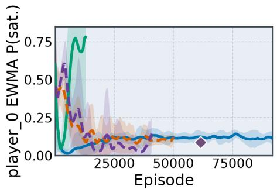  
(a) Guard (player\_0), best algorithms

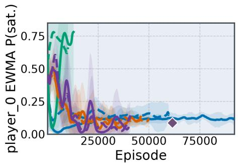  
(b) Guard (player\_0), all algorithms

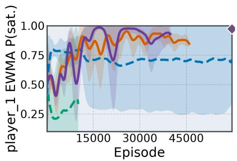  
(c) Intruder $( \mathsf { p l a y e r \_ 1 } ) ,$ best algorithms

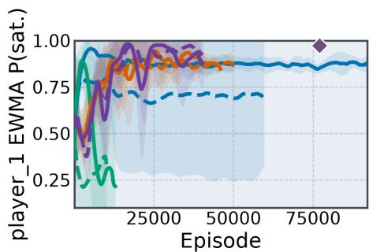  
(d) Intruder $( \mathsf { p l a y e r \_ 1 } ) ,$ all algorithms

Figure 6: Two-player Pursuit Classic: per-agent satisfaction (mean and 95% CIs over five seeds). Left: best variant per learner family; right: all objective-trained variants.
<table><tr><td>Agent</td><td>Objective  $\varphi _ { i }$ </td><td>qi</td><td> $\widehat { p } _ { i }$ </td><td>Marginal 95% CI</td><td>Joint 95% CI</td><td>Certified seeds</td><td> $\mathsf { N a s h C o n v }$ </td></tr><tr><td>player_0</td><td>F(both_stag ∧X(both_stag∧ G¬unmirrored))</td><td>0.9</td><td>1.000</td><td>[0.957,1.000]</td><td>[0.953, 1.000]</td><td>5/5</td><td>0.000</td></tr><tr><td>player_1</td><td>F(both_stag∧X(both_stag ∧G¬unmirrored))</td><td>0.9</td><td>1.000</td><td>[0.957, 1.000]</td><td>[0.953, 1.000]</td><td>5/5</td><td>0.000</td></tr></table>

Table 6: Per-agent Matrix Stag Hunt results for Nash-Q-CER. Satisfaction estimates and Hoefding interval endpoints are five-seed means from 1000 independent confirmatory rollouts per seed, shared across agents. Marginal intervals use $\delta = 0 . 0 5 ;$ joint intervals use $\delta _ { i } = 0 . 0 2 5$ for the two agents. Certified seeds counts runs whose joint lower bound $L _ { i }$ meets the row’s threshold $q _ { i }$ . Nash $\mathsf { C o n v } ^ { \approx }$ is averaged over seeds and shared across agents.

<table><tr><td>Agent</td><td>Objective φi</td><td>qi</td><td> $\widehat { p } _ { i }$ </td><td>Marginal 95% CI</td><td>Joint 95% CI</td><td>Certified seeds</td><td>NashConv≈</td></tr><tr><td>player_0</td><td> ${ \sf G \to p l a y e r \_ 0 } _ { - }$  zapped ∧ Fplayer_0_apple_collected</td><td>0.8</td><td>0.817</td><td>[0.774,0.860]</td><td>[0.767, 0.867]</td><td>3/5</td><td>0.206</td></tr><tr><td>player_1</td><td>G¬player_1_zapped ∧ Fplayer_1_apple_collected</td><td>0.7</td><td>0.608</td><td>[0.565, 0.651]</td><td>[0.558, 0.658]</td><td>3/5</td><td>0.206</td></tr><tr><td>player_2</td><td>G¬player_2_zapped ∧ Fplayer_2_apple_collected</td><td>0.3</td><td>0.001</td><td>[0.000, 0.044]</td><td>[0.000, 0.051]</td><td>0/5</td><td>0.206</td></tr><tr><td>player_3</td><td>G¬player_3_zapped ∧ Fplayer_3_apple_collected</td><td>0.2</td><td>0.005</td><td>[0.000, 0.048]</td><td>[0.000, 0.056]</td><td>0/5</td><td>0.206</td></tr></table>

Table 7: Per-agent Commons Harvest results for IQL-CER. Satisfaction estimates and Hoefding interval endpoints are five-seed means from 1000 independent confirmatory rollouts per seed, shared across agents. Marginal intervals use $\delta = 0 . 0 5 ;$ joint intervals use $\delta _ { i } = 0 . 0 1 2 5$ for the four agents. Certified seeds counts runs whose joint lower bound $L _ { i }$ meets the row’s threshold $q _ { i } . \mathsf { N a s h C o n v } ^ { \approx }$ is avera ed over seeds and shared across a ents.

$$
\_ { \mathrm { P R 2 - I O L ~ - I O L - C R ~ \_ { C E R } ~ \_ { N a s h - Q ~ L e a r n i n g } ~ -- ~ \_ { N a s h - Q ~ L e a r n i n g ~ ( C E R ) } ~ * ~ \_ { B e s t } ~ H a n d c r a f t e d } }
$$

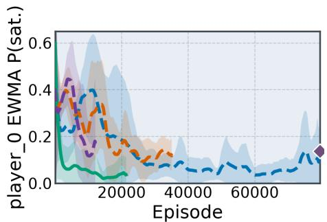  
(a) Guard (player\_0), best algorithms

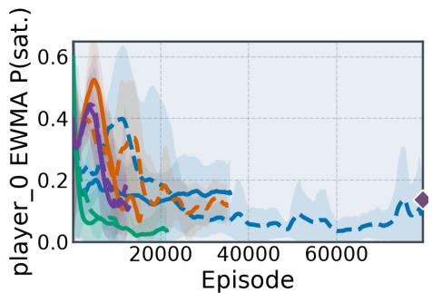  
(b) Guard (player\_0), all algorithms

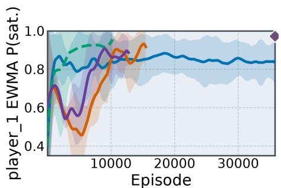  
(c) Intruder (player\_1), best algorithms

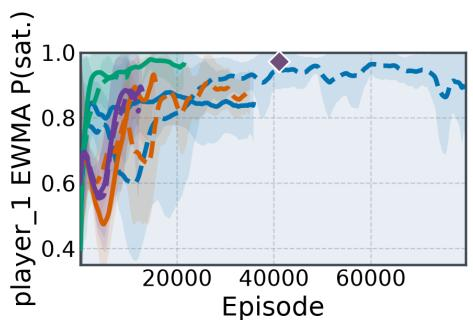  
(d) Intruder (player\_1), all algorithms

Figure 7: Two-player Pursuit Capture: per-agent satisfaction (mean and 95% CIs over five seeds). Left: best variant per learner family; right: all objective-trained variants.
<table><tr><td>Agent</td><td>Objective  $\varphi _ { i }$ </td><td>qi</td><td> $\widehat { p } _ { i }$ </td><td>Marginal 95% CI</td><td>Joint 95% CI</td><td>Certified seeds</td><td>NashConv≈</td></tr><tr><td>player_0</td><td> $\neg \mathtt { p } _ { 1 _ { - } } \mathtt { c l a i m e d } \cup \mathtt { ( p _ { 0 _ - } c l a i m e d \wedge \neg { p } _ { 1 _ - } c l a i m e d ) }$ </td><td>0.25</td><td>0.923</td><td>[0.880,0.944]</td><td>[0.876, 0.945]</td><td>5/5</td><td>0.031</td></tr><tr><td>player_1</td><td> $\neg \mathtt { p } _ { 0 _ { - } }$  claimed U (p₁_claimed ∧ ¬Po_claimed)</td><td>0.2</td><td>0.054</td><td>[0.045, 0.097]</td><td>[0.044, 0.101]</td><td>1/5</td><td>0.031</td></tr></table>

Table 8: Per-agent Territory results for $\mathtt { I Q L } ; \mathtt { p _ { i _ { - } } c } .$ laimed abbreviates player\_i\_resource\_claimed. Satisfaction estimates and Hoefding interval endpoints are five-seed means from 1000 independent confirmatory rollouts per seed, shared across agents. Marginal intervals use $\delta = 0 . 0 5 ;$ joint intervals use $\delta _ { i } = 0 . 0 2 5$ for the two agents. Certified seeds counts runs whose joint lower bound $L _ { i }$ meets the row’s threshold $q _ { i }$ . NashConv≈ is averaged over seeds and shared across agents.

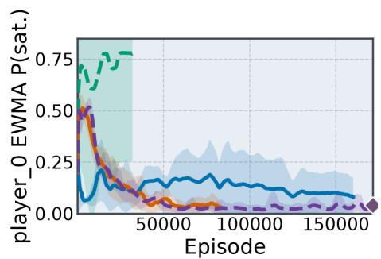  
(a) Guard (player\_0), best algorithms

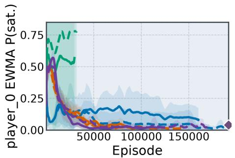  
(b) Guard (player\_0), all algorithms

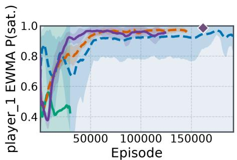  
(c) Intruder 1 (player\_1), best algorithm

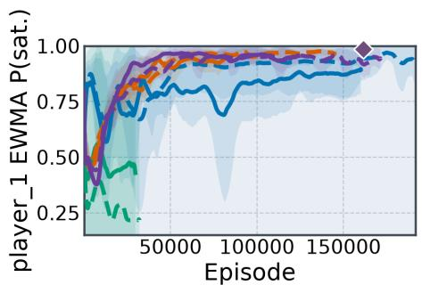  
(d) Intruder 1 (player\_1), all algorithms

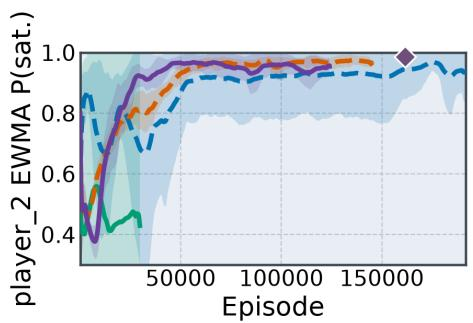  
(e) Intruder 2 (player\_2), best algorithm

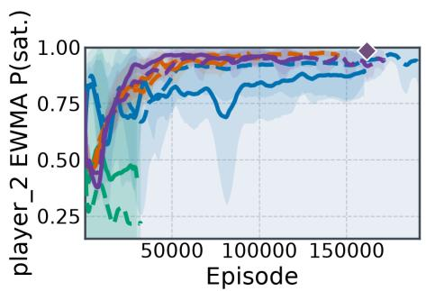  
(f) Intruder 2 (player\_2), all algorithms  
Figure 8: Three-player Pursuit Classic: per-agent satisfaction (mean and 95% CIs over five seeds). Left: best variant per learner family; right: all objective-trained variants.

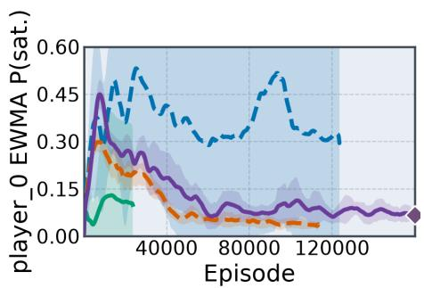  
(a) Guard (player\_0), best algorithms

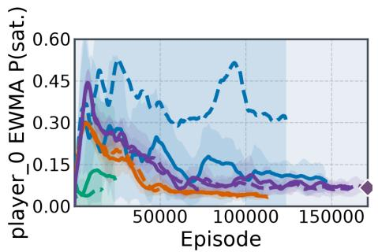  
(b) Guard (player\_0), all algorithms

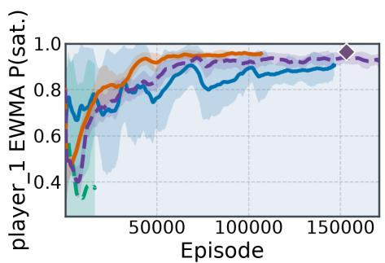  
(c) Intruder 1 (player\_1), best algorithm

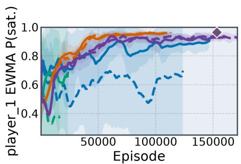  
(d) Intruder 1 (player\_1), all algorithms

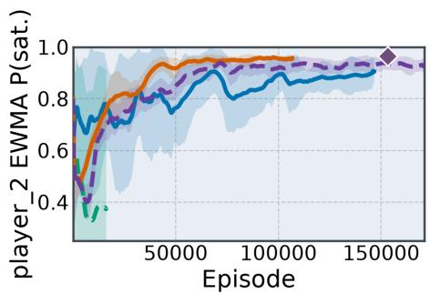  
(e) Intruder 2 (player\_2), best algorithms

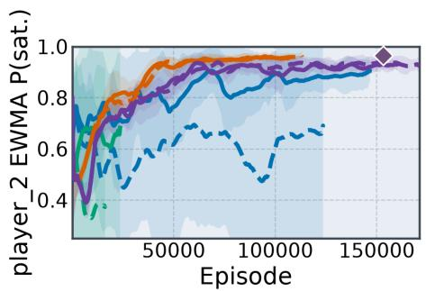  
(f) Intruder 2 (player\_2), all algorithms  
Figure 9: Three-player Pursuit Capture: per-agent satisfaction (mean and 95% CIs over five seeds). Left: best variant per learner family; right: all objective-trained variants.

IPPO - - IPPO-CER  PR2-IPPO - - PR2-IPPO-CER  IQL - - IQL-CER PR2-IQL   PR2-IQL-CER  Nash-Q Learning  Nash-Q Learning (CER)  Best Handcrafted  
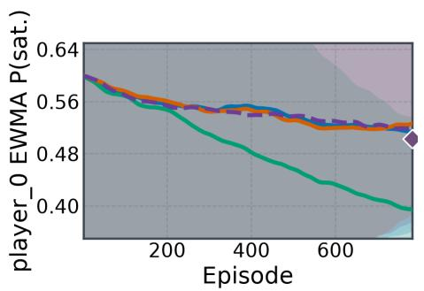  
(a) player\_0, best algorithms

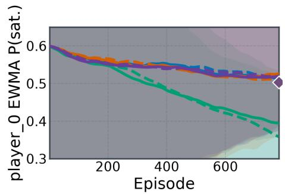  
(b) player\_0, all algorithms

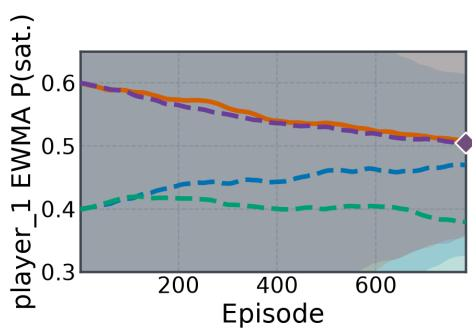  
(c) player\_1, best algorithms

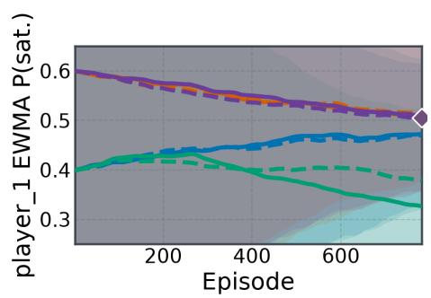  
(d) player\_1, all algorithms  
Figure 10: Coins: per-agent satisfaction (mean and 95% CIs over five seeds). Left: best variant per learner family; right: all objective-trained variants.

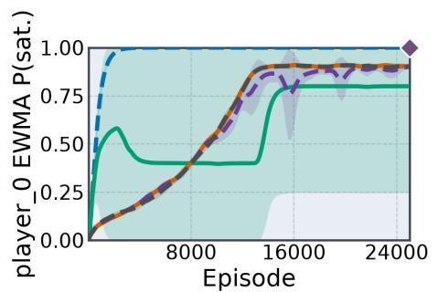  
(a) player\_0, best algorithms

  
(b) player\_0, all algorithms

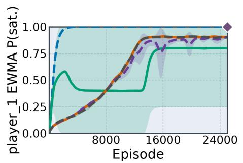  
(c) player\_1, best algorithms

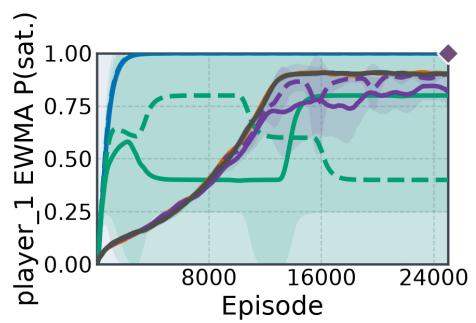  
(d) player\_1, all algorithms  
Figure 11: Matrix Stag Hunt: per-agent satisfaction (mean and 95% CIs over five seeds). Left: best variant per learner family; right: all objective-trained variants.

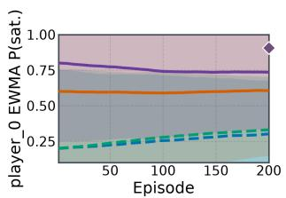  
(a) player\_0, best algorithms

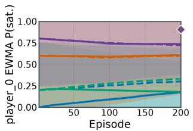  
(b) player\_0, all algorithms

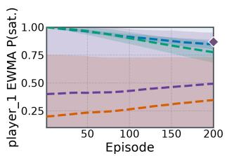  
(c) player\_1, best algorithms

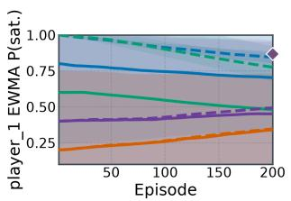  
(d) player\_1, all algorithms

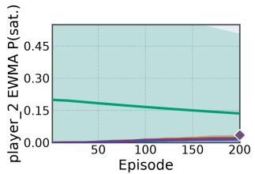  
(e) player\_2, best algorithms

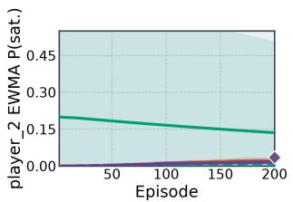  
(f) player\_2, all algorithms

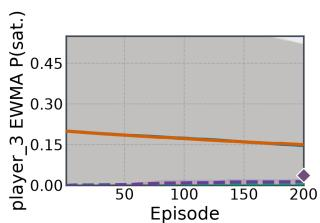  
(g) player\_3, best algorithms

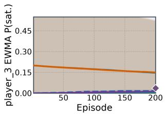  
(h) player\_3, all algorithms  
Figure 12: Commons Harvest: per-agent satisfaction (mean and 95% CIs over five seeds). Left: best variant per learner family; right: all objective-trained variants.

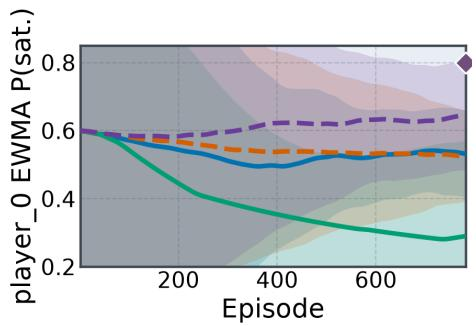  
(a) Competitor (player\_0), best algorithms

  
(b) Competitor (player\_0), all algorithms

  
(c) Competitor (player\_1), best algorithms

  
(d) Competitor (player\_1), all algorithms  
Figure 13: Territory: per-agent satisfaction (mean and 95% CIs over five seeds). Left: best variant per learner family; right: all objective-trained variants.

## F Extended Literature Review

Probabilistic Strategic Logics and Synthesis Tools. Hahn et al. [25] translate reachability-normal patl objectives into rewards for Minimax Q-Learning. Their model-checking procedure recursively relabels states for nested modalities, rather than finding one strategy witnessing all subformulae. It considers a single coalition in turnbased games. Bozkurt et al. [8] similarly study model-free learning for ltl objectives in two-player turn-based zero-sum games, using deterministic Rabin automata.

The zero-sum fragments of PRISM-Games [31] synthesise strategies for probabilistic and reward-based rpatl objectives from known transition models. Single- and multi-objective properties concern one coalition against its complement; where optimal strategies need not exist [12], the tool computes �-approximations of Pareto-optimal strategies.

Equilibrium-based extensions synthesise subgame-perfect, social-welfare-optimal Nash equilibria in concurrent stochastic games [32–34], also assuming known models.

Varricchione et al. [53] construct reward machines from atl specifications for a fully cooperative grand coalition.

Rational Synthesis. Rational synthesis [20, 52] considers agents pursuing their own temporal goals. Fisman et al. [20] reduce ltl rational synthesis to satisfiability in Extended Strategy Logic, obtaining 2EXPTIME-completeness for dominant-strategy, Nash and subgame-perfect solution concepts.

Ummels [52] study pure strategies in infinite multiplayer turn-based games with �-regular objectives, establishing exis tence, payof-constrained decision procedures and finite-state implementations for subgame-perfect Nash equilibria. Condurache et al. [14] study complexity refinements and cooperative and non-cooperative variants.

Our setting combines per-agent probabilistic $\mathrm { L T L } _ { f }$ requirements with learning from unknown dynamics under a single committed profile. Policy Space Response Oracles [35] instead train approxi-mate best responses against a meta-strategy over a policy popula- tion.

Rational Verification. Rational verification [58] asks whether a temporal property holds on some or all equilibrium behaviours. Equilibrium Logic expresses such properties through modalities [NE] and ⟨NE⟩ over Nash-equilibrium computations. Model checking is 2EXPTIME-hard in general, with matching upper bounds for restricted fragments.

Commitment-aware Logics. Strategy Logic (sl) explicitly quantifies and binds strategies, subsumes atl⋆, and can express equilib- rium through stability against deviations. Model checking for full sl is decidable but non-elementary.

Extensions of atl evaluate nested formulas under previously selected strategies, including strategy contexts (atlsc) [15], explicit strategies (atles) [55], and irrevocable semantics [2].

## G Hyperparameters

## G.1 Training Budgets

Tables 9–13 give the settings for all tasks and learners, each using seeds {0, 1, 2, 3, 4}.

Training discounts. The environment-level discount summary is $\gamma = 0$ .99 for all Pursuit-Evasion variants and Matrix Stag Hunt, and $\gamma = 1$ for Coins, Commons Harvest, and Territory. Evaluation uses undiscounted satisfaction probabilities.

<table><tr><td>Environment</td><td>Agents</td><td>Episode horizon</td><td>Initial budget</td></tr><tr><td>PuRsUIT-EvAsION Classic 2</td><td>2</td><td>100</td><td>1,000,192</td></tr><tr><td>PURSUIT-EvASION Capture 2</td><td>2</td><td>100</td><td>1,000,192</td></tr><tr><td>PURsUIT-EvAsION Classic 3</td><td>3</td><td>100</td><td>1,500,160</td></tr><tr><td>PURSUIT-EvAsION Capture 3</td><td>3</td><td>100</td><td>1,500,160</td></tr><tr><td>Coıns Own Coin First</td><td>2</td><td>256</td><td>200,192</td></tr><tr><td>MATRIX STAG HUNT</td><td>2</td><td>20</td><td>500,224</td></tr><tr><td>COMMONS HARVEST Safe Harvest</td><td>4</td><td>1000</td><td>200,192</td></tr><tr><td>TERRITORY Role Claim</td><td>2</td><td>256</td><td>200,192</td></tr></table>

Table 9: Episode horizons and initial training budgets in environment steps, before the optional 25% extension.

## G.2 Learner Settings

<table><tr><td>Setting</td><td>Value</td></tr><tr><td>Applicable algorithms</td><td>IPPO, PR2-IPPO, and their CER and handcrafted variants.</td></tr><tr><td>Rollout batch</td><td>256 transitions; environment counts and chunk lengths are in Table 12.</td></tr><tr><td>Policy/value networks</td><td>Two-layer MLPs, hidden widths [64, 64], tanh activations. PR2-IPPO uses a joint-action critic.</td></tr><tr><td>Optimizer</td><td>Adam, learning rate  $3 \times 1 0 ^ { - 4 } ( 1 0 ^ { - 4 }$  for Coins); annealing only for Safe Harvest; gradient-norm clipping 0.5.</td></tr><tr><td>PPO objective</td><td>GAE parameter λ = 1 for Safe Harvest and 0.95 otherwise; clipping parameter 0.2, value-loss coefficient 0.5, entropy coefficient 0.01.</td></tr><tr><td>Update schedule</td><td>4 epochs and 4 minibatches per rollout; 64 transitions per minibatch before CER expansion.</td></tr><tr><td>Coins CER replay</td><td>uncorrected mode.</td></tr></table>

Table 10: Policy-gradient hyperparameters for IPPO-family algorithms.

Nash-Q convergence. The $1 / N$ schedule in Table 11, counting CER updates, satisfies Theorem 5(ii) under infinitely many updates. The theorem also requires its sampling and selector assumptions and concerns temporal utilities; the handcrafted baseline uses native stage rewards.

<table><tr><td>Setting</td><td>IQL /PR2-IQL</td><td>Nash-Q</td></tr><tr><td>Applicable variants</td><td>IQL, PR2-IQL, and their CER and handcrafted variants.</td><td>Nash-Q, Nash-Q-CER, hc-Nash-Q (Matrix Stag Hunt).</td></tr><tr><td>Function class</td><td>Recurrent Q-network, hidden size 64, tanh activation; joint-action critic for PR2-IQL.</td><td>Tabular joint-action Q-values indexed by joint environment and monitor observations and elapsed time.</td></tr><tr><td>Optimizer / step size</td><td>Adam, learning rate  $3 \times 1 0 ^ { - 4 }$  , gradient-norm clipping 0.5; 4 Visit-count step size epochs per replay batch.</td><td> $\alpha ( x , \pmb { a } ) = 1 / N ( x , \pmb { a } )$ </td></tr><tr><td>Target network</td><td>Update interval 25 trainer updates; target mixing τ = 1.0.</td><td></td></tr><tr><td>Replay and exploration</td><td>Buffer capacity 25,000 chunks; learning starts after 1024 steps; linear ε-greedy decay from 1 to 0.05 over the first half of training.</td><td>Linear ε-greedy decay from 1 to 0.05 over the first half of training.</td></tr></table>

Table 11: Value-learning hyperparameters. Nash-Q settings apply to Matrix Stag Hunt.

<table><tr><td>Benchmark</td><td>Parallel envs.</td><td>Chunk length</td><td>IQL replay batch</td></tr><tr><td>STOCHASTIC</td><td>4</td><td>64</td><td>16 chunks</td></tr><tr><td>PURSUIT-EVASION</td><td></td><td></td><td></td></tr><tr><td>MATRIX STAG HUNT</td><td>8</td><td>32</td><td>32 chunks</td></tr><tr><td>COINS COMMONS HARVEST</td><td>1 1</td><td>256 256</td><td>4 chunks</td></tr><tr><td>TERRITORY</td><td>1</td><td>256</td><td>4 chunks</td></tr><tr><td></td><td></td><td></td><td>4 chunks</td></tr></table>

Table 12: Rollout settings for all learners and IQL replay batches (1024 transitions each).

## G.3 Evaluation Settings

<table><tr><td>Benchmark</td><td>NashConv episodes</td><td>BR train iters</td><td>BR batch steps</td></tr><tr><td>PURSUIT-EVASION (2-player)</td><td>64</td><td>6</td><td>1024</td></tr><tr><td>PURSUIT-EVASION (3-player)</td><td>96</td><td>8</td><td>1024</td></tr><tr><td>MATRIX STAG HUNT</td><td>50</td><td>4</td><td>512</td></tr><tr><td>CoINs</td><td>32</td><td>3</td><td>512</td></tr><tr><td>COMMONS HARVEST</td><td>32</td><td>3</td><td>512</td></tr><tr><td>TERRITORY</td><td>32</td><td>3</td><td>512</td></tr></table>

Table 13: Unilateral response-search budgets for NashConv≈. Scores above 0.05 trigger up to 25% additional profile training.