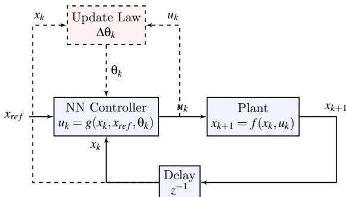
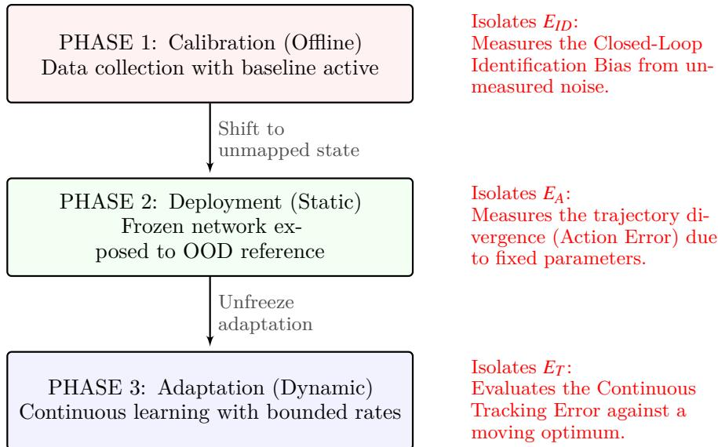
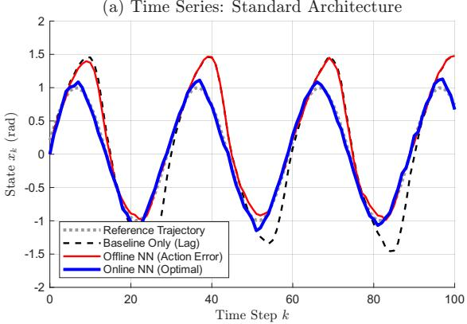
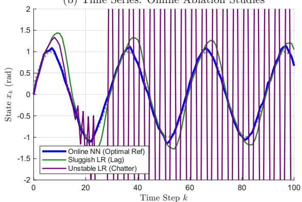
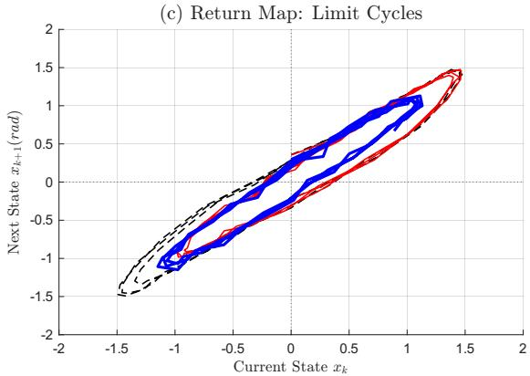
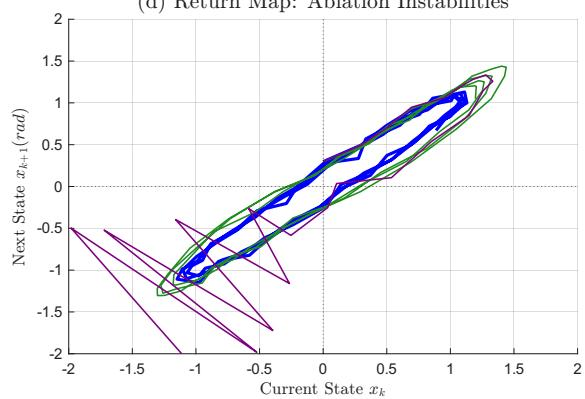
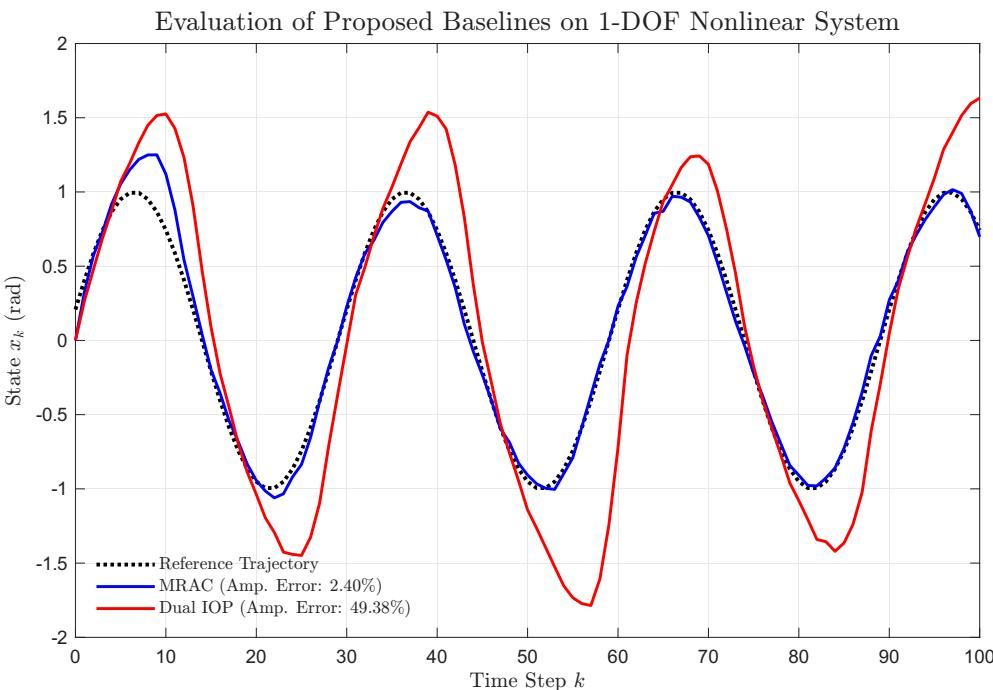

# Learning Changes the World and Then What Was Learned has Changed: Training and Deploying Neural Networks in the Control Loop

Vittorio Lippi1 a

1Calejo Hybrid Intelligence AB, Mellansjö 109, 92592 Tärnaby, Sweden vittorio.lippi@calejo.ai

Keywords:

Neural Networks, Adaptive Control, Closed-Loop Identification, Distributional Shift

## Abstract:

Neural networks ofer critical adaptability for controlling complex systems where nominal modeling proves intractable. However, when ofline-trained neural networks are deployed within closed-loop control systems, their actions fundamentally alter the state distribution upon which they were trained. This paper introduces a unified taxonomy to categorize these sequential failure modes: the initial Closed-Loop Identification Error, the deployment-induced Action Error, and the continuous Tracking Error. Through discrete-time sensitivity analysis, this work formalizes how ofline-learned parameters locally guarantee a trajectory divergence upon deployment, degrading performance due to local loss geometry. To mitigate this distribution shift, we propose actionable design policies centered on time-scale separated online adaptation. These mechanisms are validated through ablation studies on a nonlinear Dufing oscillator, demonstrating that bounded continuous learning successfully mitigates trajectory divergence whereas static deployments fail, ofering concrete guidelines for practitioners deploying machine learning components in safety-critical feedback systems.

## 1 INTRODUCTION

Neural networks (NNs) ofer adaptability for controlling complex systems where nominal modeling proves intractable (Narendra & Parthasarathy, 1990). Experiments with legged robots, including humanoids (Lippi, 2018; Wensing et al., 2024; Zhang et al., 2024; Li et al., 2024) and lowerlimb exoskeletons (Belal et al., 2024; Lhoste et al., 2025; Lippi et al., 2021; Mamou & Saadia, 2014) demonstrate this capability. However, physical closed-loop deployment degrades the oflinevalidated performance of these ML systems. In both disturbance compensation (Lippi, 2018) and gait segmentation (Lippi et al., 2021), this degradation required continuous online learning to recover functionality.

These experimental results imply that deploying the NN alters the system dynamics it originally mapped: such distributional shift degrades network performance. This work formalizes this intuition to propose integration practices for NNs in control loops.

  
Figure 1: Closed-loop system architecture including a learning system influencing the controller. In this generalized architecture, the “Plant” represents the target physical system or dynamical environment (e.g., the 1-DOF nonlinear Dufing oscillator in Section $6 )$ which outputs physical state variables $x _ { k + 1 }$ (such as position and velocity). The $z ^ { - 1 }$ block denotes the standard discrete-time unit delay operator mapping the next state to the current state $x _ { k } ,$ and $x _ { r e f }$ represents the desired reference trajectory or setpoint.

The mechanisms of performance degradation extend beyond the deployment phase. In safetycritical applications like humanoid balance, it is often impossible to collect open-loop training data; a baseline controller must remain active. This closed-loop data collection introduces system identification challenges (Ljung, 1999; Söderström, 2007; Gilson & den Hof, 2005). The correlation between the baseline control input and unmeasured environmental disturbances introduces an estimation bias during the ofline learning phase. The scope of this paper focuses on supervised learning paradigms for neural network control. While Reinforcement Learning architectures incorporate online adaptation, the mathematical dynamics of ofline-to-online distributional shift in supervised contexts remain a challenge. Recent advances in closed-loop system identification, such as Dual Input-Output Parameterization (IOP) (Chen et al., 2023), System Level Parameterization (SLP) (Srivastava et al., 2023), and Neural Identification of stabilized models (Boroujeni et al., 2025a), have proposed structural frameworks to mitigate this initial estimation bias while guaranteeing closed-loop stability. However, even if this initial bias is eliminated, the transition from ofline training to static online deployment induces a secondary mathematical challenge. This paper therefore distinguishes between three sources of performance degradation: the initial Closed-Loop Identification Error, the distribution-shifting Action Error, and the continuous Tracking Error.

## 2 PROBLEM FORMULATION

Consider a discrete-time nonlinear system:

$$
x _ { k + 1 } = f ( x _ { k } , u _ { k } ) ,\tag{1}
$$

where $x _ { k } \in \mathbb { R } ^ { n }$ is the state vector (embedding delay history) and $u _ { k } \in \mathbb { R } ^ { m }$ is the control input. The control integrates a neural network (Figure 1) parameterized by θ:

$$
u _ { k } = g ( x _ { k } , x _ { r e f } , \Theta ) ,\tag{2}
$$

where $x _ { r e f } \in \mathbb { R } ^ { n }$ represents the target setpoint or reference trajectory.

The Ideal Learner. During ofline data collection $( \mathrm { e . g . }$ , zero-assistance calibration), the system visits a state distribution $\mathcal { D } _ { o f f }$ . The ideal ofline learner seeks parameters $\theta _ { o f f }$ minimizing a cost function $L ( x , u , \theta )$ over this dataset:

$$
\Theta _ { o f f } = \underset { \boldsymbol { \Theta } } { \arg \operatorname* { m i n } } \mathbb { E } _ { \boldsymbol { x } \sim \mathcal { D } _ { o f f } } [ L ( \boldsymbol { x } , \boldsymbol { g } ( \boldsymbol { x } , \boldsymbol { \Theta } ) ) ] .\tag{3}
$$

Let $L _ { o f f } ^ { * }$ denote this minimum expected ofline loss.

## 3 THE CLOSED-LOOP IDENTIFICATION ERROR

System identification literature (Gustavsson et al., 1977; Forssell & Ljung, 1999) and deep network surveys (Pillonetto et al., 2025) establish that a mathematical bias corrupts the ofline parameters $\theta _ { o f f }$ prior to deployment. In unstable dynamic systems, the ofline dataset $\mathcal { D } _ { o f f }$ cannot be safely collected in open-loop. Instead, a baseline feedback controller $u _ { k } ^ { b a s e }$ must remain active to stabilize the plant during data collection.

Assume the plant dynamics are subject to an unmeasured stochastic disturbance wk:

$$
x _ { k + 1 } = f ( x _ { k } , u _ { k } ) + w _ { k } .\tag{4}
$$

Because $u _ { k } ^ { b a s e }$ is a function of the state $x _ { k }$ , and $x _ { k }$ is perturbed by $w _ { k }$ , closed-loop data collection enforces a cross-correlation between the control inputs and the unmeasured noise. When the offline learner minimizes the loss $L ( x , u , \theta )$ over $\mathcal { D } _ { o f f }$ (Eq. 3), the neural network learns to reproduce the efects of $w _ { k }$ rather than isolating the deterministic mapping of $f ( x _ { k } , u _ { k } )$

Definition 1 (Identification Bias). The Closed-Loop Identification Bias is the parametric deviation of the ofline controller $\theta _ { o f f }$ from the optimal open-loop parameters, caused by overfitting to the correlated process noise in the training dataset.

Empirical risk minimization yields a biased representation of the system dynamics, a challenge coupled with conditions for convergence in feedback optimization (Løvland et al., 2025). While structural frameworks—such as the afine constraints of Dual Input-Output Parameterization (IOP) and System Level Parameterization (SLP) (Chen et al., 2023; Srivastava et al., 2023), which restrict the network’s hypothesis space to ensure the extracted model commutes with the stabilizing controller, alongside the nonlinear generalization of Neural Identification (Boroujeni et al., 2025a) and continuous-time instrumental variable (IV) consistency methods (González et al., 2024; Classens et al., 2025)—mitigate this bias by ensuring the learned model remains stabilized by the known controller, they operate under the assumption of continuous loop closure. If an ofline model is frozen and deployed as a static feed-forward policy, it acts as a catalyst for the distributional shift defined as the Action Error.

## 4 THE ACTION ERROR

Deployment induces a secondary distributional shift. Substituting the baseline data-collection policy with the static neural network $u _ { k } =$ $g ( x _ { k } , \mathsf { \theta } _ { o f f } )$ shifts the closed-loop system’s invariant measure from $\mathcal { D } _ { o f f }$ to a deployed distribution $\mathcal { D } _ { d e p l o y } .$

To formalize this, we define the neural network’s Control Authority, the degree to which the parameterization governs the state trajectory, captured by the sensitivity matrix $S _ { k } = \partial x _ { k } / \partial \theta$

Let $\theta ^ { * }$ minimize the expected loss over the task’s invariant measure ${ \mathcal { D } } ^ { * } \left( \mathrm { e . g . } \right.$ , an optimal limit cycle). The static deployment parameter contains estimation error $\widetilde { \boldsymbol { \theta } } = \boldsymbol { \theta } _ { o f f } - \boldsymbol { \theta } ^ { * }$ . Operating over $\mathcal { D } _ { d e p l o y }$ rather than $\mathcal { D } ^ { * }$ , the optimal parameter becomes a dynamic moving target. If the network possesses control authority, this parametric sub-optimality guarantees a trajectory divergence (∆xk) from the ideal manifold.

During deployment, the PD baseline is retained as a stabilizing inner loop, while the NN operates as a feedforward adapter. This architecture ensures the baseline enforces closed-loop Schur stability. Specifically, we define the closedloop system Jacobian matrix as $\Phi _ { k }$ . For the system to remain stable, all eigenvalues of $\Phi _ { k }$ must lie within the unit circle, guaranteeing discretetime asymptotic stability (i.e., the spectral radius satisfies $\rho ( \Phi _ { k } ) < 1 )$ for any frozen parameterization θ.

Theorem 1 (Bounded Trajectory Shift via Control Authority). Let the parameter error be defined as $\tilde { \boldsymbol { \Theta } } = \boldsymbol { \Theta } _ { o f f } - \tilde { \boldsymbol { \Theta } ^ { * } }$ . This term represents a suboptimal choice of parameters, capturing the discrepancy between our statically deployed ofline network and the continuously shifting optimal parameters. Because the neural network influences the system state, we track its “Control Authority” via the state sensitivity matrix $\begin{array} { r } { S _ { k } = \frac { \partial x _ { k } } { \partial \theta } } \end{array}$ . This sensitivity evolves according to the closed-loop dynamics:

$$
S _ { k + 1 } = \underbrace { \left( { \frac { \partial f } { \partial x } } + { \frac { \partial f } { \partial u } } { \frac { \partial g } { \partial x } } \right) } _ { \Phi _ { k } , \rho ( \Phi _ { k } ) < 1 } S _ { k } + \underbrace { \left( { \frac { \partial f } { \partial u } } { \frac { \partial g } { \partial \theta } } \right) } _ { \Lambda _ { k } } .\tag{5}
$$

Assuming bounded-variation closed-loop Jacobians, the network possesses non-degenerate control authority if the parameter error θ˜ does not lie entirely within the null space of the sensitivity forcing matrix $\Lambda _ { k } \ \mathrm { ~ ( i . e . , ~ } \tilde { \Theta } \not \in \mathrm { N u l l } ( \Lambda _ { k } ) \mathrm { ) }$ . Because neural networks are over-parameterized (where the number of parameters p exceeds the number of control inputs m), $\Lambda _ { k } \in \mathbb { R } ^ { n \times p }$ is rank-deficient, bounded by a maximum rank of m.

While the parameter error θ˜ does not appear in the sensitivity recursion itself, it drives the physical consequences of that sensitivity. As long as these suboptimal parameters produce a non-zero control perturbation that the physical plant responds to $( \Lambda _ { k } \tilde { \theta } \neq 0 )$ , the deployed trajectory will sufer a bounded, non-zero distributional shift: $\Delta x _ { k } \approx ( I - \Phi _ { k } ) ^ { - 1 } \Lambda _ { k } \tilde { \Theta } \neq 0$

Proof. Let the closed-loop state under $\theta _ { o f f }$ be approximated by $x _ { k } \approx x _ { k } ^ { * } + S _ { k } \tilde { \Theta }$ The sensitivity recursion in Eq. 5 operates as a discretetime Linear Time-Invariant (LTI) system operating on the perturbation matrix $S _ { k }$ . Assuming the baseline controller enforces Schur stability on the closed-loop Jacobian $( \rho ( \Phi _ { k } ) < 1 )$ , the deployed trajectory undergoes a bounded distributional shift from the nominal trajectory: $\Delta x _ { k }$ ≈ $S _ { s s } \tilde { \Theta } \neq 0 .$ , where $S _ { s s } = ( I - \Phi ) ^ { - 1 } \Lambda$ is the bounded steady-state sensitivity matrix. Therefore, the trajectory shift $\Delta x _ { k } \approx S _ { s s } \tilde { { \Theta } }$ is bounded and nonzero. □

Loss Geometry. In stabilization tasks, the offline dataset $\mathcal { D } _ { o f f }$ centers on a physical equilibrium $x _ { e q }$ enforced by the baseline controller. This equilibrium represents a local minimum of operational cost. Near $x _ { e q } ,$ the gradient of the loss with respect to the state naturally vanishes $( \nabla _ { x } L \approx 0 )$ Expanding the loss function via a Taylor series reveals that the Action Error $\left( E _ { A } \right)$ is governed by the local curvature, or Hessian matrix, $H _ { x x } = \nabla _ { x } ^ { 2 } L \colon$

$$
E _ { A } \approx \frac { 1 } { 2 } \Delta x _ { k } ^ { T } H _ { x x } \Delta x _ { k } .\tag{6}
$$

Because $H _ { x x }$ is locally positive semi-definite around $x _ { e q } ,$ any trajectory shift $( \Delta x _ { k } \neq 0 )$ mathematically guarantees a local performance penalty. In physical terms, because the static, suboptimal network parameters push the system away from its ideal equilibrium, the system is forced to operate on a “steeper,” less eficient part of the cost landscape. It is important to note that this analysis is local; extending these guarantees to broader, highly nonlinear regimes requires additional control-theoretic analysis.

The Identifiability Trap. Minimizing this penalty online presents a tension between persistent excitation and stability (Løvland et al., 2025; Annaswamy, 2023). Stabilizing the equilibrium starves the network of dynamic variance, creating an Identifiability Trap: without suficient dynamic movement (persistent excitation), the network lacks the informative data required to learn the underlying system dynamics. While afine parameterizations mitigate initial bias (Chen et al., 2023), recovering from the Action Error requires safe-learning guardrails. Time-scale separation must be paired with geometric constraints, such as embedding inherent Lyapunov stability into the data-driven architecture (Min et al., 2023; Basyal et al., 2024), to bound exploration without destabilizing the plant.

## 5 THE TRACKING ERROR

To mitigate the Action Error, the system must abandon the static $\theta _ { o f f }$ and adopt a dynamic parameterization $\theta _ { k }$ updated via continuous online learning. However, because the optimal parameter $\theta _ { k } ^ { * }$ is a moving target that depends on the continuously shifting state $x _ { k }$ , classical asymptotic convergence to a single fixed parameter is impossible. This compounding divergence mirrors the “covariate $\mathrm { s h i f t } ^ { \mathfrak { r } }$ formalized in sequential decisionmaking paradigms like DAgger (Dataset Aggregation, which mitigates distribution shift by iteratively querying an expert on visited states) (Ross et al., 2011). Instead of relying on an external expert oracle, the online learner must continuously minimize the Tracking Error:

$$
\tilde { \boldsymbol { \theta } } _ { k } = \boldsymbol { \theta } _ { k } - \boldsymbol { \theta } _ { k } ^ { * } .\tag{7}
$$

Design Policy 1: Time-Scale Separation and Convergence To prevent $\theta _ { k }$ updates from destabilizing the physical system, the learning loop must enforce time-scale separation. The coupled system is modeled as a two-time-scale process: the fast physical plant dynamics (xk) and the slow neural weight updates $\left( \theta _ { k } \right)$ .

Condition 1 (Fast-Loop δ-ISS): The retained baseline controller must enforce incremental Input-to-State Stability (δ-ISS). This property ensures that the distance between any two system trajectories is strictly bounded by the magnitude of the diference in their inputs for any frozen parameter θ. Consequently, the fast physical state xk converges exponentially to a parameterdependent equilibrium manifold $x ^ { * } ( \theta )$ . This decouples the dynamics, permitting us to evaluate the loss function safely on the slow manifold, denoted as $\bar { L } ( \boldsymbol { \theta } )$

Condition 2 (Slow-Loop Lipschitz Continuity): The reduced loss function $\bar { L } ( \boldsymbol { \theta } )$ must have a Lipschitz continuous gradient with a constant $L _ { \Theta }$ meaning that for any two parameter vectors $\theta _ { 1 }$ and $\theta _ { 2 }$ , the change in the gradient is bounded by the distance between the parameters:

$$
\lVert \nabla _ { \boldsymbol { \Theta } } \bar { L } ( \Theta _ { 1 } ) - \nabla _ { \boldsymbol { \Theta } } \bar { L } ( \Theta _ { 2 } ) \rVert \leq L _ { \boldsymbol { \Theta } } \lVert \Theta _ { 1 } - \Theta _ { 2 } \rVert .\tag{8}
$$

In physical terms, this Lipschitz constant acts as a global “speed limit” on the curvature of the loss landscape, ensuring the gradient cannot change arbitrarily fast. Mathematically, this constant $L _ { \Theta }$ is bounded by the supremum of the spectral norm of the loss function’s Hessian: $L _ { \Theta } =$ $\operatorname* { s u p } _ { \Theta } \| \nabla _ { \Theta } ^ { 2 } \bar { L } ( \Theta ) \| _ { 2 }$

Theorem 2 (Time-Scale Convergence). If Conditions 1 and 2 hold, the parameter update law $\Theta _ { k + 1 } = \Theta _ { k } - \Gamma \nabla _ { \Theta } \bar { L } ( \Theta _ { k } )$ will monotonically converge to a local optimum without inducing mechanical chatter, provided the positive definite learning rate matrix Γ has a maximum eigenvalue that satisfies $\lambda _ { \operatorname* { m a x } } ( \Gamma ) < 2 / L _ { \theta }$

Proof. $\mathrm { B y }$ Condition 1, we evaluate the update on the equilibrium manifold $\bar { L } ( \boldsymbol { \theta } )$ , bypassing the plant’s transient dynamics. By Condition 2, the gradient $\nabla _ { \boldsymbol { \Theta } } \bar { L }$ is $L _ { \theta } .$ -Lipschitz continuous. Applying the standard Descent Lemma, which provides a guaranteed upper bound on the loss at the next iteration based on the maximum curvature, the new loss is bounded by the quadratic Taylor expansion:

$$
\begin{array} { r } { \bar { L } ( \boldsymbol { \mathbf { \theta } } _ { k + 1 } ) \leq \bar { L } ( \boldsymbol { \mathbf { \theta } } _ { k } ) + \nabla _ { \boldsymbol { \mathbf { \theta } } } \bar { L } ( \boldsymbol { \mathbf { \theta } } _ { k } ) ^ { T } ( \boldsymbol { \mathbf { \theta } } _ { k + 1 } - \boldsymbol { \mathbf { \theta } } _ { k } ) } \\ { + \boldsymbol { \mathbf { 0 } } . 5 L _ { \boldsymbol { \mathbf { \theta } } } \| \boldsymbol { \mathbf { \theta } } _ { k + 1 } - \boldsymbol { \mathbf { \theta } } _ { k } \| ^ { 2 } . } \end{array}
$$

Substituting the parameter update law $( \Theta _ { k + 1 } -$ $\Theta _ { k } ) = - \Gamma \nabla _ { \Theta } \bar { L } ( \Theta _ { k } )$ yields:

$$
\bar { L } ( \boldsymbol { \Theta } _ { k + 1 } ) \leq \bar { L } ( \boldsymbol { \Theta } _ { k } ) - \nabla _ { \boldsymbol { \Theta } } \bar { L } ( \boldsymbol { \Theta } _ { k } ) ^ { T } \left( \Gamma - \frac { L _ { \boldsymbol { \Theta } } } { 2 } \Gamma ^ { 2 } \right) \nabla _ { \boldsymbol { \Theta } } \bar { L } ( \boldsymbol { \Theta } _ { k } ) .\tag{9}
$$

For monotonic descent (meaning the loss strictly decreases, $\bar { L } ( \mathsf { \boldsymbol { \theta } } _ { k + 1 } ) < \bar { L } ( \mathsf { \boldsymbol { \theta } } _ { k } )$ , for any non-zero gradient), the matrix $\begin{array} { r l } {  { ( \Gamma - \frac { L _ { \Theta } } { 2 } \Gamma ^ { 2 } ) } } & { { } } \end{array}$ must be positive definite. Factoring out Γ, we require $I - { \textstyle \frac { L _ { \oplus } } { 2 } } \Gamma \succ 0 $ which dictates that the maximum eigenvalue of the learning rate matrix must satisfy $\lambda _ { \operatorname* { m a x } } ( \Gamma ) <$ $2 / L _ { \Theta }$ □

While Theorem 2 establishes a theoretical threshold for stability, computing the parameter Hessian’s spectral norm $\left( L _ { \mathsf { \theta } } \right)$ online is computationally intractable, and executing physical linesearches to find optimal step sizes is unsafe in robotic loops. To enforce this bound formally, deployments may adopt a dual-layer approach, a two-pronged strategy combining ofline structural constraints with online algorithmic safety filters.

In the first layer (ofline), techniques like Spectral Normalization (Miyato et al., 2018) can be used to bound the network’s global Lipschitz constant, capping the network’s potential volatility and ensuring a theoretical maximum for $L _ { \Theta }$ before the system is ever deployed. In the second layer (online), adaptive step-sizes are governed by curvature surrogates, such as the Generalized Gauss-Newton (GGN) or the empirical Fisher Information Matrix (Martens, 2020). These surrogates function as a dynamic braking mechanism, estimating the steepness of the learning landscape without the massive processing overhead of exact second-order calculations. Because the GGN approximates the Hessian using only first-order derivatives and remains positive semidefinite, fast power iterations can dynamically scale the learning rate matrix Γ. This dual-layer strategy ensures that the neural adaptation remains slow enough to satisfy time-scale separation, respecting the physical mechanics of the robot.

In practical nonlinear deployments, such as the saturated cubic plant evaluated in Section $6 ,$ analytically bounding the global Lipschitz constant $L _ { \Theta }$ and verifying δ-ISS across the entire operational manifold is intractable. Consequently, the gradient clipping applied in our experiments acts as an empirical heuristic to enforce this slow-loop condition. As demonstrated in the subsequent ablation studies, removing this clipping bound violates the time-scale separation, causing the network to overreact to transient dynamics and inducing mechanical chatter.

Bounding $\lambda _ { \operatorname* { m a x } } ( \Gamma )$ beneath this inverse curvature threshold ensures adaptation remains suficiently slow. Violating this threshold breaches time-scale separation, coupling gradient updates with transient dynamics and destabilizing geometric safety bounds. This principle aligns with dual-loop architectures that pair fast inner safety constraints, e.g., Control Barrier Functions, with slower neural adaptation (Annaswamy et al., 2023; Fisher & Annaswamy, 2025).

As the online learner stabilizes the system, adapting on instantaneous gradients (utilizing a learning batch size of $\mathcal { B } _ { k } = 1 )$ causes the network to act as a localized adaptive filter. While this yields high tracking performance on smooth, continuous limit cycles by overfitting to the local tangent dynamics, it induces catastrophic forgetting of the global state space (Dohare et al., 2024). For simple periodic tasks, this loss of global plasticity is benign. However, in discontinuous environments (e.g., hybrid switching in exoskeletons (Lippi et al., 2021)), maintaining an experience replay bufer may become necessary to relax the requirement of persistent excitation and preserve geometric safety.

## 6 ILLUSTRATIVE EXAMPLE

To validate the Action Error and the necessity of bounded continuous learning, we simulate a 1- DOF nonlinear Dufing oscillator. This system serves as a trackable model of wearable robotics (e.g., an exoskeleton joint exhibiting nonlinear “hardening” stifness (Schmalz et al., 2021; Paul, 2020)). It isolates the proposed taxonomy for geometric analysis without requiring novel controller designs.

The MATLAB source code for this simulation environment and all parallel ablation studies is publicly available at https://github.com/ VittorioFreiburg/Action-Error/.

The discrete-time dynamics are governed by:

$$
x _ { k + 1 } = A x _ { k } + B x _ { k } ^ { 3 } + u _ { k } + w _ { k } ,\tag{10}
$$

where $A = 1 . 0 5$ represents the open-loop unstable linear dynamics, $B = 0 . 1 5$ introduces the unmodeled cubic stifness, $u _ { k }$ is the control input, and $w _ { k } \sim \mathcal { N } ( 0 , 0 . 0 2 5 )$ represents stochastic environmental noise.

Implementation Details. The simulation and associated neural network architectures were implemented natively within the MATLAB environment, utilizing the Deep Learning Toolbox. The NN utilizes a single hidden layer (8 neurons, tanh activation), trained ofline via Levenberg-Marquardt utilizing a full training batch size $\begin{array} { r l } {  { ( \mathcal { B } =  } } \end{array}$ Full). Online adaptation operates via SGD evaluating a single sample per step $\left( \mathcal { B } _ { k } = 1 \right)$ with gradient clipping bounded at $\lVert \nabla _ { \boldsymbol { \Theta } } L \rVert _ { F } \leq 0 . 5$ . By restricting the maximum magnitude of the gradient step, this clipping acts as a safety filter to enforce the time-scale separation bound ${ ( \lambda _ { \operatorname* { m a x } } ( \Gamma ) < 2 / L _ { \theta } ) }$ established in Theorem 2, preventing the network from reacting aggressively to transient noise. In the context of the generalized control architecture presented in Figure 1, the “Plant” block encapsulates this 1-DOF Dufing oscillator model. The physical state variable $x _ { k }$ outputted by the plant, represents the angular displacement of the exoskeleton joint in radians, evaluated at discrete time steps $k .$ To simulate mechanical joint limits and prevent numerical divergence, the plant’s state update is subjected to a symmetric physical saturation limit of 5.0 radians. While the generalized formulation in Section 2 treats the network as the unified controller, this hardwareinspired implementation retains the Proportional-Derivative (PD) baseline controller during deployment. The neural network acts as a parallel adaptive feedforward compensator, such that the total applied control efort is $u _ { k } = u _ { k } ^ { b a s e } ( x _ { k } , x _ { r e f } ) -$ $g ( x _ { k } , x _ { r e f } , \Theta )$

  
Figure 2: Experimental Evaluation Phases: The three-phase deployment strategy utilized in Section 6 to explicitly isolate and quantify the proposed error taxonomy. While practical deployments may initialize directly into online adaptation, this staged experimental approach is necessary to independently evaluate the Closed-Loop Identification Error (Phase 1), the Action Error induced by static deployment (Phase 2), and the continuous Tracking Error mitigated by time-scale separated learning (Phase 3).

The system undergoes a three-phase deployment (visually mapped in the experimental strategy of Figure 2):

1) Calibration (Phase 1): A baseline Proportional-Derivative (PD) controller $( K _ { p } = 0 . 6 0 , K _ { d } = 0 . 2 5 )$ stabilizes the system to track a low-amplitude calibration sine wave $( x _ { r e f } = 0 . 3 \sin ( \pi k / 1 5 ) )$ ) over a constrained dataset of $N = 1 5 0$ discrete samples. The plant is subjected to continuous Gaussian process noise $w _ { k } \sim \mathcal { N } ( 0 , 0 . 0 2 5 ^ { 2 } )$ . Because the state magnitude remains small, the cubic term $B x _ { k } ^ { 3 }$ is negligible, leaving the nonlinearity hidden from ofline identification.

2) Deployment (Phase 2): An ofline neural network is trained on the Phase 1 residuals. The system is then tasked with a large-amplitude reference trajectory pushing the state into the unmapped nonlinear regime.

3) Online Adaptation (Phase 3): The network’s weights are “unfrozen” and continuously updated online via standard Backpropagation. To re-establish Lyapunov stability, the gradients are bounded via clipping to enforce time-scale separation.

To isolate the necessity of time-scale separation and gradient bounding, we perform parallel ablation studies on the Phase 3 online adaptation mechanism. To validate the proposed taxonomy, we calculate the three errors:

1) Identification Error: Evaluated ofline, this represents the divergence between the network’s prediction and the unmodeled dynamics over the calibration dataset $\mathcal { D } _ { o f f }$ We quantify the estimation bias using an Estimated Bias Proxy inspired by Instrumental Variable techniques, computing the ratio of the network output’s Pearson correlation with the noisy baseline control to its correlation with the clean reference signal: Proxy $= | \rho ( g _ { \theta } , u ^ { b a s e } ) | / ( | \rho ( g _ { \theta } , x _ { r e f } ) | + \varepsilon )$ In our evaluation, this yielded 0.041. The variance explained by this noise correlation provides an expected lower-bound on the physical bias (the “Ghost Variance”), calculated as $\operatorname { V a r } _ { g h o s t } = \overset { } \underset { } { \mathsf { p } } ( g _ { \boldsymbol { \theta } } , u ^ { b a s e } ) ^ { 2 } \cdot \operatorname { V a r } ( g _ { \boldsymbol { \theta } } )$ This represents the footprint of the unmeasured noise that the neural network has internalized, confirming it mapped closed-loop artifacts rather than the deterministic plant dynamics.

2) Action Error (Generalization Gap). Evaluated upon deployment, this is the diference between the network’s training loss on $\mathcal { D } _ { o f f }$ and its deployment loss on the out-of-distribution manifold $\mathcal { D } _ { d e p l o y }$ . Bridging this metric with Theorem 1, we calculate the accumulation of the state sensitivity matrix $\left( S _ { k } \right)$ The Jacobians comprising $S _ { k }$ are evaluated numerically at each time step via central finite diferences $( \varepsilon = 1 0 ^ { - 5 } )$ across the closed-loop plant and network parameters. While the physical trajectory in this representative execution settled into a sub-optimal ofset, the underlying maximum sensitivity norm diverged $( \| S _ { k } \| _ { F } \approx \mathring { 4 } . 1 6 \times 1 0 ^ { 1 4 } )$ . This divergence confirms unmitigated control authority. This numerical accumulation does not contradict the bounded LTI assumptions of Theorem 1, but illustrates the cascading global consequence of the Action Error. Theorem 1 guarantees the initial, local trajectory divergence. By shifting the state out-of-distribution, this bounded error acts as a catalyst, forcing the system into unmapped regimes where system-specific nonlinearities, such as the uncompensated cubic stifness in this oscillator, take over. In these global regimes, local LTI approximations dissolve, allowing the tracking error to compound or diverge depending on the underlying physical topology of the plant.

3) Tracking Error: Evaluated continuously during operation, this is the MSE between the physical closed-loop state $x _ { k }$ and the reference limit cycle $x _ { r e f }$ . Because this metric aggregates the entire deployment window, it captures the initial transient adaptation phase. Consequently, for the online architecture, this aggregate MSE serves as a conservative upper bound; over prolonged cyclic operation, the instantaneous tracking error asymptotically decays toward the system’s stochastic noise floor.

These metrics across the standard architectures and ablation models are summarized in Table 1. Depending on stochastic noise realization, the unmitigated Action Error can cause the Offline NN to diverge (yielding undefined errors; e.g., maximum state sensitivity norm increasing to $\lVert S _ { k } \rVert \approx 4 . 1 6 \times 1 0 ^ { 1 4 } )$ . To allow meaningful comparison of bounded Tracking Errors, we executed a 100-iteration Monte Carlo simulation. Unmitigated Action Error caused the ofline architecture to diverge in 64% of trials. Table 1 reports error metrics across the 36 stable executions (36%).

As illustrated in Figure 3 for the Dufing oscillator and quantified in Table 1, the static ofline network minimizes the initial Identification Error but fails to track the reference due to an Action Error. Conversely, the optimal online adaptation strategy bounds the trajectory shift and reduces the continuous Tracking Error. The ablation studies emphasize the necessity of Theorem 2: a sluggish learning rate fails to track the moving target, whereas an unstable learning rate breaches time-scale separation, inducing mechanical chatter. Divergent trials were excluded from these aggregations because the out-of-distribution trajectory divergence yields undefined or computationally infinite error metrics. This 64% failure rate validates the Action Error: unmitigated static deployment is sub-optimal and hazardous to system stability.

Table 1: Monte Carlo Summary of Experimental Error Metrics (N = 100). Results report the mean and variance across the 36 stable runs.
<table><tr><td>Architecture</td><td>Id. Error (MSE)</td><td>Action Error</td><td>Tracking Error</td></tr><tr><td>Baseline PD</td><td></td><td></td><td>0.2037 (σ2: 0.0010)</td></tr><tr><td>Static Offline NN</td><td>0.0001 (σ2: 0.0000)</td><td>0.0463 (σ2: 0.0014)</td><td>0.1218 (σ2: 0.0103)</td></tr><tr><td>Optimal Online NN</td><td></td><td></td><td>0.0044 (σ2: 0.0000)</td></tr><tr><td>Ablation: Sluggish LR</td><td></td><td></td><td>0.7096 (σ2: 13.9977)</td></tr><tr><td>Ablation: Unstable LR</td><td></td><td></td><td>19.3110 (σ2: 1.3640)</td></tr></table>

## 6.1 Comparative Benchmarking Against Classical and Structural Baselines

To contextualize the necessity of bounded continuous learning, we benchmark our proposed architecture against two established control paradigms: classical Model Reference Adaptive Control (MRAC) (Ioannou & Sun, 2012) and the structural Phase 1 safeguard of Dual Input-Output Parameterization (Dual IOP) (Chen et al., 2023).

Classical Baseline (MRAC): MRAC avoids the Action Error by utilizing a linear-in-theparameters (LIP) formulation governed by Lyapunov update laws, ensuring global stability. However, when deployed on the Dufing oscillator, this structural rigidity becomes its primary limitation. The LIP formulation fails to capture the spatial complexity of the unmodeled cubic stifness $( B x _ { k } ^ { 3 } )$ . While the MRAC remains bounded and avoids trajectory divergence, it exhibits a persistent steady-state tracking ofset with an amplitude distortion of 2.49% and a Mean Squared Error (MSE) of 0.0062 (Table 2). This highlights the trade-of: classical methods guarantee geometric safety at the cost of representational capacity, whereas our time-scale separated NN recovers representational capacity while imposing safety via gradient bounding.

Structural Baseline (Dual IOP): To isolate the Action Error from the initial closed-loop identification bias $\left( E _ { I D } \right)$ , we implemented a Dual IOP framework during the Phase 1 calibration. By restricting the network’s hypothesis space to models that commute with the stabilizing baseline controller, Dual IOP eliminated the “Ghost Variance” caused by the stochastic noise. However, upon freezing this identified model for Phase 2 static deployment, the system still exhibited trajectory divergence, yielding an amplitude distortion of 48.04% and an MSE of 0.2122.

(a) Time Series: Standard Architecture  

(b) Time Series: Online Ablation Studies  

(d) Return Map: Ablation Instabilities  
  
Figure 3: Simulation of the Action Error and Online Adaptation in a noisy nonlinear tracking task. (a, c) Standard Architectures: The Baseline PD (dashed black) exhibits phase lag due to uncompensated cubic stifness. The Static Ofline NN (red) pushes the system out-of-distribution, forcing an Action Error. The Optimal Online NN (blue) utilizes continuous gradient descent with a bounded learning rate $( \| \nabla _ { \mathsf { \theta } } L \| \leq 0 . 5 )$ to mitigate noise and track the limit cycle. (b, d) Ablation Studies: A sluggish learning rate $( \alpha = 0 . 0 1$ , green) fails to adapt to the moving target, causing persistent phase lag. Conversely, applying the aggressive rate $( \alpha = 0 . 5 0$ , purple) without gradient clipping violates time-scale separation; the network overreacts to transient errors, inducing mechanical chatter.

This empirical result (Figure 4) validates the thesis of this paper: even if an ofline model is identified without bias, the act of static deployment itself shifts the state distribution, rendering the optimal parameters a moving target. Structural identification safeguards like Dual IOP and ICI (Boroujeni et al., 2025b) are efective for calibration, but they do not eliminate the Action Error. Time-scale separated online adaptation remains a necessity for safe, continuous operation.

Table 2: Empirical Tracking Error of Structural and Adaptive Baselines
<table><tr><td>Architecture</td><td></td><td>Tracking Error (MSE) Amplitude Distortion (%)</td></tr><tr><td>MRAC (Linear-in-the-Parameters)</td><td>0.0062</td><td>2.49</td></tr><tr><td>Dual IOP (Frozen Phase 2)</td><td>0.2122</td><td>48.04</td></tr></table>

## 7 DISCUSSION AND CONCLUSIONS

This paper formalized the Action Error (§ 4): the performance decay caused when an oflinetrained NN alters the state distribution upon closed-loop deployment. This framework integrates the Closed-Loop Identification Error with the continuous Tracking Error required during online adaptation.

The Ubiquity of Closed-Loop Dynamics. The Action Error emerges from closed-loop control. While initially observed in unstable systems (e.g., legged robots), it persists when loops are closed via human-exoskeleton interaction (Lippi et al., 2021). Deployed machine learning models alter their operational environments. In generative AI, recursive training on synthetic data causes “Model Collapse” (Shumailov et al., 2024) or “Model Autophagy Disorder” (MAD) (Alemohammad et al., 2024), demonstrating how iterative feedback acts as a lossy compression mechanism that monotonically degrades data entropy (Straňák, 2026). Mitigating this, although delayed by accumulating human data (Gerstgrasser et al., 2024), requires structural guardrails to break the closed-loop feedback cycle. This cycle of data degradation mirrors philosophical critiques regarding the epistemology of artificial intelligence. Literature introduces the concept of generative algorithmic epistemic injustice, which investigates how generative AI can undermine the integrity of collective knowl edge and the processes we rely on to acquire, assess, and trust information (Kay et al., 2025). Grounded in social and political philosophy, this phenomenon identifies how AI systems can produce or amplify misinformation, perpetuate representational harm, and create epistemic inequities (Kay et al., 2025). Whether in the physical state space of a robotic joint or the latent space of a large language model, the mechanism remains identical: without interventions to preserve diversity or enforce exploratory persistent excitation, the agent’s control authority will degrade the environment it seeks to model.

  
Figure 4: Evaluation of proposed baselines on the 1-DOF nonlinear Dufing oscillator. While the MRAC bounds the trajectory via its linear-in-the-parameters Lyapunov formulation, it sufers from a persistent tracking lag due to its inability to capture the unmodeled cubic stifness. Conversely, the Dual IOP model, despite achieving unbiased closed-loop identification in Phase 1, distorts the amplitude upon static deployment, demonstrating the persistence of the Action Error independent of calibration bias.

Breaking the Loop. Neurology ofers inspiration for breaking these loops: sensory inputs are subject to natural detection thresholds of variable entity (Kobel et al., 2021). In human postural control, non-linear thresholds and intermittent control paradigms for the inverted pendulum operate on integrated vestibular and proprioceptive signals (Hettich et al., 2013; Hettich et al., 2015; Tigrini et al., 2022), modalities mimicked in robotics by IMUs and joint encoders. Replicating these thresholds via deadbands can block sensory noise from propagating through the continuous control loop (Mergner, 2010; Akçay et al., 2021), breaking the loop around defined safe zones to suppress control authority without endangering stability (Lippi & Molinari, 2020). Beyond rigid thresholds, cognitive neuroscience provides a framework for loop-breaking via Predictive Processing and Active Inference (Friston et al., 2017; Clark, 2013). In these frameworks, embodied agents minimize variational free energy (“surprise”) by altering the physical world to conform to internal hierarchical predictions (Lanillos et al., 2021). To avoid becoming trapped in feedback loops, biological systems dynamically modulate the “precision” (reliability) of sensory prediction errors (Pezzulo et al., 2015). In robotic control, engineering this adaptive precision-weighting acts as a neuromorphic deadband, allowing the controller to suppress transient sensorimotor errors (Lanillos et al., 2021; Oliver et al., 2022). This theoretical relationship is bidirectional: while active inference uses precision-weighting as a functional threshold, physical deadband models, such as the humanderived Disturbance Estimation and Compensation (DEC) framework, produce sensory reweighting as an emergent macroscopic behavior without requiring explicit gain scheduling (Lippi & Mergner, 2017). This biologically plausible symmetry empowers the agent to balance stabilization with epistemic exploration, ensuring it does not overreact to its action-induced sensory noise (Lanillos et al., 2021; Oliver et al., 2022; Friston et al., 2017).

Embodiment and the Limits of Ofline Learning. The mathematical inevitability of the Action Error exposes a fundamental limit of offline learning: it treats the neural network as a disembodied artifact operating within an epistemic vacuum. Stabilizing a complex dynamic system mandates structural and physical embodiment, requiring continuous, situated interaction with the physical environment (Mergner et al., 2024). Statically deploying a frozen model commits a fallacy of functional anthropomorphization (Mergner et al., 2024); it expects robust adaptability while denying the system the continuous physical experience, or historical embodiment, necessary to co-evolve with a shifting state space (Mergner et al., 2024; Mainzer, 2009). However, continuous adaptation risks recursive feedback degradation if the agent indiscriminately tracks its own self-produced errors. Safe historical co-evolution requires the agent to distinguish external physical disturbances from the trajectory shifts induced by its own parametric suboptimality, a control-theoretic requirement that mirrors the biological somatosensory sense of selfagency (SSA) (Mergner et al., 2024). By enforcing time-scale separation, the architecture achieves this balance: it maintains the continuous structural coupling required for historical embodiment (Mergner et al., 2024; Mainzer, 2009), while mathematically bounding the network’s authority to prevent it from recursively chasing its

own sensory noise.

Classical Adaptive Control and Robust MPC. Architectures like Model Reference Adaptive Control (MRAC) (Ioannou & Sun, 2012; Naranjo & Annaswamy, 2025) and $\mathcal { L } _ { 1 }$ Adaptive Control (Hovakimyan & Cao, 2010) mitigate parameter drift using robust bounds and low-pass filtering. They rely on linear-in-the-parameters (LIP) structures or continuous online tuning, which contrasts with static, non-convex ofline models. While Robust Model Predictive Control (MPC) (Kouvaritakis & Cannon, 2016) circumvents offline bias through online optimization, supervised neural approximations of these MPC laws (de Barros Fontes et al., 2009) face spatial curvature artifacts that necessitate our proposed Hessian regularization and experience replay guardrails.

Reinforcement Learning. These findings contextualize Reinforcement Learning (RL) (Sutton & Barto, 2018). While online RL circumvents identification bias through active interaction, offline RL remains vulnerable to the Action Error via out-of-distribution extrapolation (Fujimoto et al., 2019; Levine et al., 2020). Continuous RL tracks moving targets but relies on exploratory noise, which is dangerous for safetycritical hardware like exoskeletons (García & Fernández, 2015), reintroducing the tension between Lyapunov stability and persistent excitation (Berkenkamp et al., 2017).

Structural Parameterizations, Certificates, and Advanced Safety Wrappers. Advancements in closed-loop system identification, such as Dual IOP (Chen et al., 2023), Neural Identification (Boroujeni et al., 2025a), and the nonlinear generalization of Independent Component Identification (ICI) (Boroujeni et al., 2025b), mitigate the initial Identification Bias by guaranteeing stabilized model extraction from closed-loop data. Mitigating the subsequent Action Error requires run-time safety. Certificate learning frameworks provide learned Lyapunov or Control Barrier Functions (CBFs) (Dawson et al., 2023), which, like inherent Lyapunov structures (Min et al., 2023), act as fast-loop spatial safety filters, while Safe Bayesian Optimization (BO) (Hirt et al., 2024) provides probabilistic constraints during closed-loop tuning. Because these structural methods prioritize guaranteed bounds over spatial representation recovery, our proposed timescale separated adaptation ${ ( \lambda _ { \operatorname* { m a x } } ( \Gamma ) < 2 / L _ { \theta } ) }$ does not replace them; rather, it acts as a slow-loop companion. By bounding the temporal update rate, we ensure neural adaptation remains sufficiently sluggish so as not to trigger or destabilize the fast-loop spatial constraints provided by CBFs or Safe BO. For deployment, this adaptation can be integrated with Seq-AMPC wrappers for provable constraint satisfaction (Clement et al., 2026) or analyzed within NARX surrogate MPC stability bounds (Bold et al., 2026). Physics-informed IDA-PBC formulations (Moreschini, 2021) and reservoir computing’s “modebudgeting” (Oishi et al., 2026) can absorb residual tracking errors and suppress unstable authority outside trained regions. Finally, integrating Instrumental Variable (IV)-based data-driven predictive control (DDPC) (Wang et al., 2023) alongside our empirical bias proxy ofers a structured pathway to validate closed-loop consistency prior to deployment, while bridging continuous SGD with formal non-PE adaptive identification schemes disarms the Identifiability Trap (Hart et al., 2025).

Time-Varying Sensitivities, Noise, and Hybrid Systems. Although Theorem 1 establishes the Action Error via a local LTI approximation, deployments involve dynamic Jacobians that demand incremental stability (δ-ISS) or boundedvariation arguments. In non-autonomous regimes, unmeasured process noise amplifies parametric sub-optimality, and discontinuous hybrid switching thresholds in exoskeletons (Lippi et al., 2021) can induce impulse-like jumps in state sensitivity.

Limitations and Future Work. While the 1-DOF Dufing oscillator provides a geometric testbed to isolate the Action Error without the confounding variables of multi-DOF dynamic coupling, the present work functions as an analytical framework. Scaling this time-scale separated adaptation to multi-DOF hardware (e.g., lowerlimb exoskeletons or humanoid robots) introduces coupled, time-varying Jacobians. In these higherdimensional regimes, the sensitivity matrix $S _ { k }$ becomes non-diagonal, and unmodeled cross-joint inertia amplifies parametric sub-optimality. The gradient clipping threshold must be scaled by the spectral norm of the coupled mass matrix to ensure the slow-loop Lipschitz continuity (Condition 2) is maintained across all joint axes simultaneously. To elevate this taxonomy to a comprehensive control methodology, future work prioritizes extending empirical validation to such hardware-in-the-loop deployments. This requires experimental benchmarking of our time-scale separated adaptation against classical robust architectures (MRAC, L1) and sequential aggregation (DAgger). Theoretically, while Remark 1 addresses continuous saturation-induced instability, eforts are required to formalize sensitivity bounds under discontinuous hybrid switching and time-varying references.

## REFERENCES

Akçay, M. E. et al. (2021). Visual modulation of human responses to support surface translation. Front Hum Neurosci, Volume 15 - 2021. https: //doi.org/10.3389/fnhum.2021.615200

Alemohammad, S. et al. (2024). Self-consuming generative models go mad. Proc. Int. Conf. on Learning Representations (ICLR).

Annaswamy, A. M. (2023). Lessons from adaptive control: Towards real-time machine learning. Keynote Address at the 20th International Conference on Informatics in Control, Automation and Robotics (ICINCO). Available at: https://icinco. scitevents.org/KeynoteSpeakers.aspx?y=2023.

Annaswamy, A. M. et al. (2023). Integration of adaptive control and reinforcement learning for realtime control and learning. IEEE Trans. Autom. Control, 68(12), 7740–7755. https://doi.org/10. 1109/TAC.2023.3290037

Basyal, S., Ting, J., Mishra, K., & Allen, B. C. (2024). Concurrent Learning and Lyapunov-Based Updates of Deep Neural Networks for Euler-Lagrange Dynamic Systems. 2024 American Control Conference (ACC), 15–20. https://doi.org/10.23919/ ACC60939.2024.10644154

Belal, M. et al. (2024). Deep learning approaches for enhanced lower-limb exoskeleton control: A review. IEEE Access, 12, 143883–143907. https://doi.org/ 10.1109/ACCESS.2024.3414175

Berkenkamp, F., Turchetta, M., Schoellig, A., & Krause, A. (2017). Safe model-based reinforcement learning with stability guarantees. Neural Information Processing Systems, volume 30.

Bold, L., Schimperna, I., Worthmann, K., & Köhler, J. (2026). Exponential stability of data-driven nonlinear MPC based on input/output models. https: //arxiv.org/abs/2603.16808

Boroujeni, M. G., Meroi, L., Massai, L., Galimberti, C. L., & Ferrari-Trecate, G. (2025a). Neural identification of feedback-stabilized nonlinear systems.

Boroujeni, M. G., Meroi, L., Massai, L., Galimberti, C. L., & Ferrari-Trecate, G. (2025b). Neural Identification of Feedback-Stabilized Nonlinear Systems. 2025 IEEE 64th Conference on Decision and Control (CDC), 4201–4207. https://doi.org/10.1109/ CDC57313.2025.11312335

Chen, R., Srivastava, A., Yin, M., & Smith, R. S. (2023). Closed-loop identification of stabilized models using dual input-output parameterization.

Clark, A. (2013). Whatever next? predictive brains, situated agents, and the future of cognitive science. Behavioral and Brain Sciences, 36(3), 181– 204. https://doi.org/10.1017/S0140525X12000477

Classens, K., González, R. A., & Oomen, T. (2025).

Recursive identification of structured systems: An instrumental-variable approach applied to mechanical systems. https://arxiv.org/abs/2504.17927

Clement, M.-L. et al. (2026). Towards Safe Learning-Based Non-Linear Model Predictive Control through Recurrent Neural Network Modeling.

Dawson, C., Gao, S., & Fan, C. (2023). Safe control with learned certificates: A survey of neural lyapunov, barrier, and contraction methods for robotics and control. IEEE Transactions on Robotics, 39(3), 1749–1767. https://doi.org/10. 1109/TRO.2022.3232542

de Barros Fontes, A., Amorim, P., & Ribeiro da Silva Garcia, M. (2009). A new approach of the neural predictive control applied in a thermoelectric module. Proceedings of the 6th International Conference on Informatics in Control, Automation and Robotics - Volume 3: ICINCO,, 189–194. https://doi.org/10.5220/0002193001890194

Dohare, S., Hernandez-Garcia, J. F., Lan, Q., Rahman, P., Mahmood, A. R., & Sutton, R. S. (2024). Loss of plasticity in deep continual learning. Nature, 632(8026), 768–774. https://doi.org/10.1038/ s41586-024-07711-7

Fisher, P. A. & Annaswamy, A. M. (2025). Analytical construction of cbf-based safety filters for simultaneous state and input constraints. arXiv:2409.19352.

Forssell, U. & Ljung, L. (1999). Closed-loop identification revisited. Automatica, 35(7), 1215–1241. https://doi.org/10.1016/S0005-1098(99)00022-9

Friston, K., FitzGerald, T., Rigoli, F., Schwartenbeck, P., & Pezzulo, G. (2017). Active Inference: A Process Theory. Neural Computation, 29(1), 1–49. https://doi.org/10.1162/NECO\_a\_00912

Fujimoto, S., Meger, D., & Precup, D. (2019). Ofpolicy deep reinforcement learning without exploration. Proc. 36th Int. Conf. on Machine Learning (ICML), volume 97, 2052–2062.

García, J. & Fernández, F. (2015). A comprehensive survey on safe reinforcement learning. Journal of Machine Learning Research, 16(1), 1437–1480.

Gerstgrasser, M. et al. (2024). Accumulating Data Avoids Model Collapse. NeurIPS 2024 Workshop on Mathematics of Modern Machine Learning. https://openreview.net/forum?id=4DYFHAcgw3

Gilson, M. & den Hof, P. M. J. V. (2005). Instrumental variable methods for closed-loop system identification. Automatica, 41(2), 241–249.

González, R. A., Pan, S., & Rojas, C. R. (2024). Consistency analysis of refined instrumental variable methods for continuous-time system identification in closed-loop. Automatica, 166.

Gustavsson, I. et al. (1977). Identification of processes in closed loop–identifiability and accuracy aspects. Automatica, 13(1), 59–75. https://doi. org/10.1016/0005-1098(77)90008-8

Hart, R. G., Patil, O. S., Bell, Z. I., & Dixon, W. E. (2025). System Identification and Control Using Lyapunov-Based Deep Neural Networks without Persistent Excitation: A Concurrent Learning Approach. https://arxiv.org/abs/2505.10678

Hettich, G., Lippi, V., & Mergner, T. (2013). Humanlike sensor fusion mechanisms in a postural control robot. Special Session on Sensory Fusion for Diagnostics and Neurorehabilitation, volume 2, 152– 160.

Hettich, G., Lippi, V., & Mergner, T. (2015). Human-Like Sensor Fusion Implemented in the Posture Control of a Bipedal Robot. Neurotechnology, Electronics, and Informatics, 29–45. Springer.

Hirt, S., Pfeferkorn, M., & Findeisen, R. (2024). Safe and stable closed-loop learning for neuralnetwork-supported model predictive control. 2024 IEEE 63rd Conference on Decision and Control (CDC). https://doi.org/10.1109/CDC56724.2024. 10886624

Hovakimyan, N. & Cao, C. (2010). L Adaptive Control Theory: Guaranteed Robustness with Fast Adaptation. Advances in Design and Control. Society for Industrial and Applied Mathematics. https: //books.google.de/books?id=U2Giej-1bukC

Ioannou, P. & Sun, J. (2012). Robust Adaptive Control. Dover Books on Electrical Engineering Series. Dover Publications, Incorporated. https: //books.google.de/books?id=pXWFY\_vbg1MC

Kay, J., Kasirzadeh, A., & Mohamed, S. (2025). Epistemic injustice in generative ai. Proceedings of the 2024 AAAI/ACM Conference on AI, Ethics, and Society, AIES ’24, 684–697.

Kobel, M. J., Wagner, A. R., Merfeld, D. M., & Mattingly, J. K. (2021). Vestibular thresholds: a review of advances and challenges in clinical applications. Frontiers in Neurology, 12, 643634.

Kouvaritakis, B. & Cannon, M. (2016). Model Predictive Control: Classical, Robust and Stochastic. Advanced Textbooks in Control and Signal Processing. Springer. https://doi.org/10.1007/ 978-3-319-24853-0

Lanillos, P., Meo, C., Pezzato, C., Meera, A. A., Baioumy, M., Ohata, W., Tschantz, A., Millidge, B., Wisse, M., Buckley, C. L., & Tani, J. (2021). Active inference in robotics and artificial agents: Survey and challenges. https://arxiv.org/abs/2112. 01871

Levine, S., Kumar, A., Tucker, G., & Fu, J. (2020). Ofline reinforcement learning: Tutorial, review, and perspectives on open problems. https://arxiv. org/abs/2005.01643

Lhoste, C. et al. (2025). Deep-learning estimation of weight distribution using joint kinematics for lower-limb exoskeleton control. IEEE Trans. Med. Robot. Bionics, 7(1), 20–26. https://doi.org/10. 1109/TMRB.2024.3503922

Li, J. et al. (2024). Okami: Teaching humanoid robots manipulation skills through single video imitation.

Lippi, V. (2018). Prediction in the context of a human-inspired posture control model. Rob. Auton. Syst., 107, 63–70. https://doi.org/10.1016/j. robot.2018.05.012

Lippi, V. et al. (2021). Identification of Gait Phases with Neural Networks for Smooth Transparent Control of a Lower Limb Exoskeleton. Proc. 18th

Int. Conf. on Informatics in Control, Autom. and Robotics (ICINCO), 171–178. https://doi.org/10. 5220/0010554401710178

Lippi, V. & Mergner, T. (2017). Human-derived disturbance estimation and compensation (DEC) method lends itself to a modular sensorimotor control in a humanoid robot. Frontiers in Neurorobotics, 11, 49. https://doi.org/10.3389/fnbot. 2017.00049

Lippi, V. & Molinari, F. (2020). Lyapunov Stability of a Nonlinear Bio-inspired System for the Control of Humanoid Balance. Proc. 17th Int. Conf. on Informatics in Control, Autom. and Robotics (ICINCO), 726–733. https://doi.org/10. 5220/0009970307260733

Ljung, L. (1999). System Identification: Theory for the User (2nd ed.). Prentice Hall.

Løvland, K. L., Imsland, L., & Grimstad, B. A. (2025). On a closed-loop identification challenge in feedback optimization.

Mainzer, K. (2009). From embodied mind to embodied robotics: Humanities and system theoretical aspects. Journal of Physiology-Paris, 103(3), 296–304. https://doi.org/https://doi.org/10.1016/ j.jphysparis.2009.08.012. Neurorobotics

Mamou, M. A. & Saadia, N. (2014). Neural networks controler of a lower limbs robotic rehabilitation chair. Proceedings of the International Conference on Biomedical Electronics and Devices - Volume 1: BIODEVICES, (BIOSTEC 2014), 65–71. https://doi.org/10.5220/0004700700650071

Martens, J. (2020). New insights and perspectives on the natural gradient method. Journal of Machine Learning Research, 21(146), 1–76. http://jmlr.org/ papers/v21/17-678.html

Mergner, T. (2010). A neurological view on reactive human stance control. Annual Reviews in Control, 34(2), 177–198. https://doi.org/https: //doi.org/10.1016/j.arcontrol.2010.08.001

Mergner, T., Funk, M., & Lippi, V. (2024). Embodiment and Humanoid Robotics, 553–579. Springer Fachmedien Wiesbaden. https://doi.org/10.1007/ 978-3-658-19606-6\_23

Min, Y., Richards, S. M., & Azizan, N. (2023). Data-Driven Control with Inherent Lyapunov Stability. https://arxiv.org/abs/2303.03157

Miyato, T. et al. (2018). Spectral normalization for generative adversarial networks. International Conference on Learning Representations (ICLR).

Moreschini, A. (2021). Modeling and control of discrete-time and sampled-data port-Hamiltonian systems. Sapienza University of Rome. See Section 5.2.1: Constructive aspects: an approximate IDA-PBC design.

Naranjo, D. M. & Annaswamy, A. M. (2025). Adaptive control of dubins vehicle in the presence of loss of efectiveness. IEEE Control Systems Letters.

Narendra, K. S. & Parthasarathy, K. (1990). Identification and control of dynamical systems using neural networks. IEEE Trans. Neural Netw., 1(1), 4–27. https://doi.org/10.1109/72.80202

Oishi, S. et al. (2026). Stabilizing chaotic dynamical

system reproduction in reservoir computing. https: //arxiv.org/abs/2602.11069

Oliver, G., Lanillos, P., & Cheng, G. (2022). An empirical study of active inference on a humanoid robot. IEEE Transactions on Cognitive and Developmental Systems, 14(2), 462–471. https://doi. org/10.1109/TCDS.2021.3049907

Paul, E. N. (2020). Dynamic Analysis of Compliant Joint for Assistive Exoskeleton. Aalborg University.

Pezzulo, G., Rigoli, F., & Friston, K. (2015). Active inference, epistemic value, and vicarious trial and error. Learning & Memory, 22(6), 322–338.

Pillonetto, G. et al. (2025). Deep networks for system identification: A survey. Automatica, 171, 111907. https://doi.org/10.1016/j.automatica.2024.111907

Ross, S., Gordon, G., & Bagnell, D. (2011). A reduction of imitation learning and structured prediction to no-regret online learning. Proceedings of the Fourteenth International Conference on Artificial Intelligence and Statistics (AISTATS), 627–635.

Schmalz, J., Paul, D., Shorter, K., Schmalz, X., Cooper, M., & Murphy, A. (2021). Modelling Human Gait using a Nonlinear Diferential Equation. https://doi.org/10.1101/2021.03.16.435713

Shumailov, I. et al. (2024). Ai models collapse when trained on recursively generated data. Nature, 631, 755–759. https://doi.org/10.1038/ s41586-024-07566-y

Söderström, T. (2007). Errors-in-variables methods in system identification. Automatica, 43(6), 929– 958.

Srivastava, A. et al. (2023). A dual system-level parameterization for identification from closed-loop data.

Straňák, P. (2026). Entropic Limits of Iterative Computation in Generative AI: Model Collapse Explained by the Data Processing Inequality and the AI Theorem. https://doi.org/10.20944/ preprints202507.2260.v2

Sutton, R. S. & Barto, A. G. (2018). Reinforcement learning: An introduction. MIT press.

Tigrini, A., Verdini, F., Fioretti, S., & Mengarelli, A. (2022). Long term correlation and inhomogeneity of the inverted pendulum sway time-series under the intermittent control paradigm. Commun. Nonlinear Sci. Numer. Simul., 108, 106198.

Wang, Y., Qiu, Y., Sader, M., Huang, D., & Shang, C. (2023). Data-driven predictive control using closed-loop data: An instrumental variable approach. IEEE Control Systems Letters, 7, 3639–3644. https://doi.org/10.1109/LCSYS.2023. 3340444

Wensing, P. M., Posa, M., Hu, Y., Escande, A., Mansard, N., & Prete, A. D. (2024). Optimizationbased control for dynamic legged robots. IEEE Trans. Robot., 40, 44–67.

Zhang, Q. et al. (2024). Whole-body humanoid robot locomotion with human reference. 2024 IEEE/RSJ Int. Conf. on Intell. Robots and Syst. (IROS), 11225–11231.