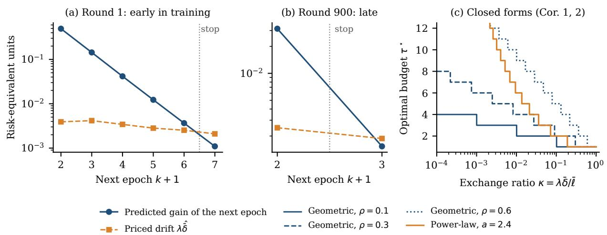
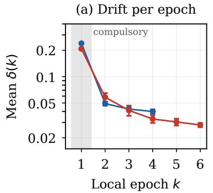
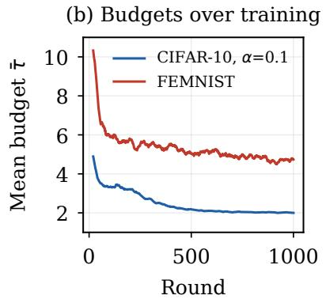
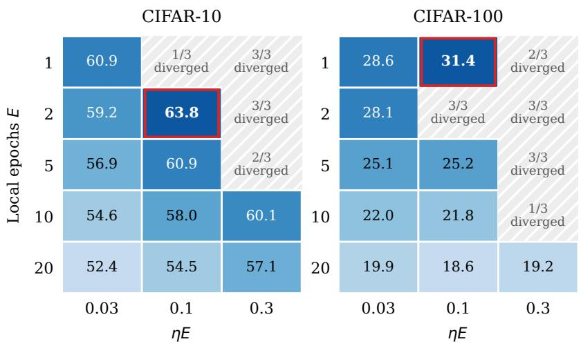
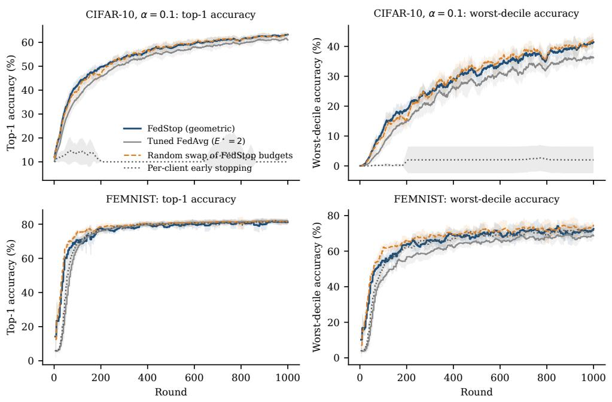
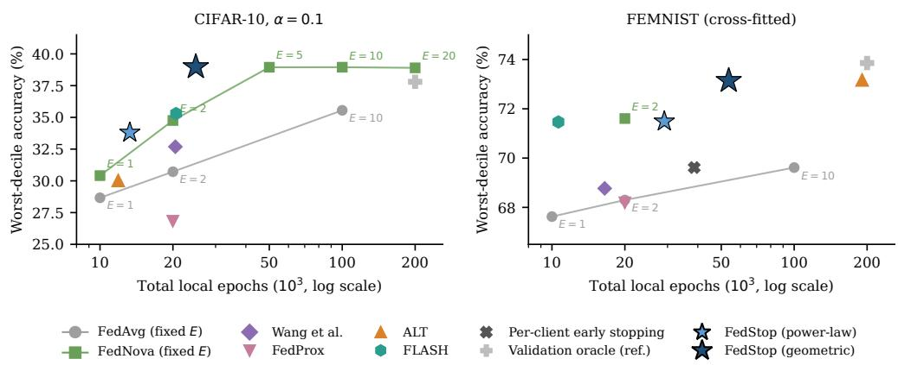
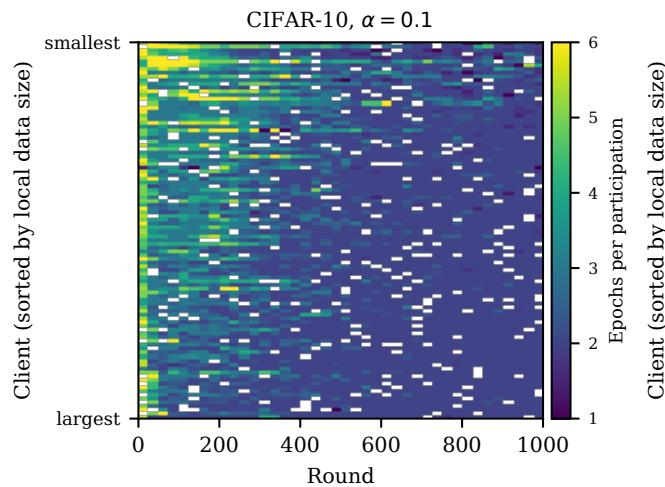
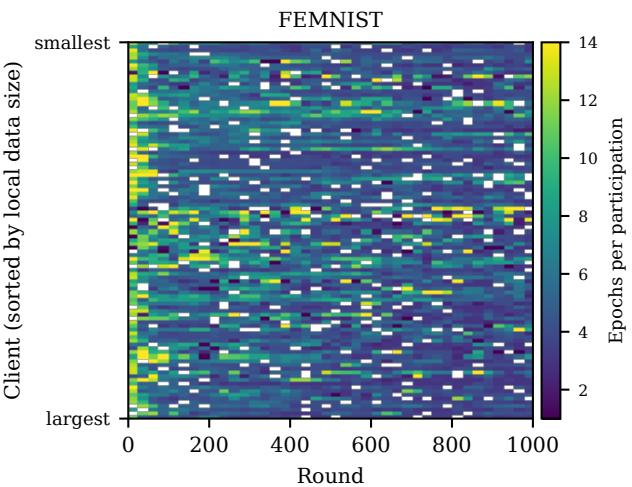
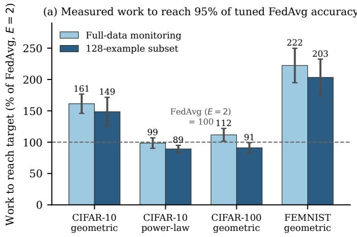
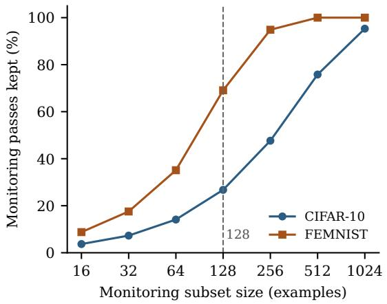

# Local Epochs as Optimal Stopping: Theory and Evidence in Federated Learning

Ke Xiao

School of Computing Science, University of Glasgow

Qiyuan Wang

School of Computing Science, University of Glasgow

Christos Anagnostopoulos School of Computing Science, University of Glasgow

ke.xiao@glasgow.ac.uk

qiyuan.wang@glasgow.ac.uk

christos.anagnostopoulos@glasgow.ac.uk

## Abstract

How long should each client train before communicating? Federated learning usually answers with a fixed, hand-tuned number of local epochs, yet an extra epoch helps only while the loss it removes outweighs the client drift it adds. We cast local training as finite-horizon optimal stopping: a client trains while the next epoch’s expected loss reduction exceeds its priced squared drift. We prove that this one-stage look-ahead threshold is optimal whenever stopping decisions are nested, derive closed forms for geometric and power-law returns, and show that an estimated rule loses utility only through wrong-signed decisions. Epochlevel evidence supports the model’s structure (geometric diminishing returns and additive drift) and reveals a simple regularity: the stage of training, not the client, sets the budget. The resulting rule, FedStop, is never more than one point below tuned FedAvg in mean accuracy. Where its budgets vary, it raises worst-decile accuracy by 4–8 points over tuned FedAvg and an adaptive-interval baseline, and every one of these gains remains significant after a Holm correction. Against the client-side stopping rules ALT and FLASH, it has the highest CIFAR-10 worst decile on every seed and is level elsewhere. It stays stable where per-client early stopping collapses, and each stopping decision takes constant time.

## 1 Introduction

In federated learning (FL) with federated averaging (FedAvg), each round the server broadcasts the global model, a sample of clients train it locally for E epochs, and the server averages the returned models (McMahan et al., 2017). The local epoch count E governs a basic trade-of. More local work reduces how often clients must communicate. Under statistical heterogeneity, however, it also lets each local model drift toward its own optimum and away from the global one, which degrades the aggregate (Li et al., 2020a; Karimireddy et al., 2020).

In practice E is a tuned constant, and a fragile one. In a grid that also varies the learning rate, the best fixed configuration is two epochs on CIFAR-10 but one on CIFAR-100, where two epochs diverge (Section 8). More fundamentally, a tuned constant says nothing about why a budget works, how it should change as training proceeds, or whether it should difer across clients.

We take a modelling view. Every local epoch is an investment: after it, a client observes what it bought, a reduction in its local loss, and what it paid, a further displacement from the round’s starting model. Returns diminish as the local loss flattens while the displacement keeps accruing, so deciding when to stop can be cast as a finite-horizon optimal stopping problem. A model of this kind is worth having only to the extent that it describes real local training, so we derive what it predicts and test those predictions against epoch-level logs. To our knowledge, this is the first formulation of a client’s choice of local epochs as an optimal stopping problem. The resulting rule, FedStop (Federated optimal Stopping), runs locally on each client and ends its training as soon as another epoch is no longer worth its drift.

## Contributions.

1. Model. Local-epoch selection as drift-priced optimal stopping, with a utility motivated by a oneround aggregation bound.

2. Theory. We prove that a one-stage threshold rule is optimal when stopping decisions are nested, including correlated gains within a margin. We derive closed forms with exact one-epoch conditions for geometric and power-law returns, also under declining drift. A regret identity shows that a rule using estimates loses utility only through wrong-signed decisions.

3. Evidence. We derive five observable consequences of the model, such as diminishing returns per epoch and drift that adds up across epochs, and check each against epoch-level training logs. We report where the model holds and where it does not, and find that budgets follow the stage of training rather than the client.

4. Practice. We compare FedStop with the two client-side stopping rules closest to it, ALT (Shenaj et al., 2025) and FLASH (Panchal et al., 2023), and with FedAvg (McMahan et al., 2017), FedNova (Wang et al., 2020), the adaptive interval of Wang et al. (2019), FedProx (Li et al., 2020a) and per-client early stopping. Random-swap and equal-split controls show where its gains come from. FedStop costs at most one point of mean accuracy against tuned FedAvg. Under strong label skew, it lifts the worst decile of clients by up to eight points over tuned FedAvg, a tail that fixed budgets match only with at least twice as many local epochs, if at all. Among the client-side rules, it has the highest CIFAR-10 worst decile, ahead of ALT and FLASH on every seed, and it is level with them on the naturally partitioned data. It remains stable where per-client early stopping fails. The decision itself is lightweight: constant time per epoch and a few hundred scalars of memory per client, independent of model size.

## 2 Related Work

Client drift. FedProx adds a proximal penalty to each local objective (Li et al., 2020a), SCAFFOLD corrects local directions with control variates (Karimireddy et al., 2020), and FedNova normalises updates by the number of local steps to remove objective inconsistency (Wang et al., 2020). These methods change the local objective or the aggregation rule and are complementary to choosing the training duration. FedStop uses FedNova-style normalisation directly.

Local computation. The efect of the number of local steps on convergence is well studied for local SGD (Stich, 2019; Khaled et al., 2020; Woodworth et al., 2020), including step counts that vary across rounds (Qin et al., 2023) and the dependence of the surrogate objective on local work (Charles & Konečný, 2021; Patel et al., 2024). Wang et al. adapt a shared aggregation interval under a resource budget (Wang et al., 2019). These analyses bound or tune one budget per round. We instead model the budget as a client-side stopping decision and test the model’s assumptions directly.

Client-side and global stopping. Two methods also set each client’s number of epochs, by diferent signals and for diferent ends. ALT stops a client once its representations diverge from the global model’s (Shenaj et al., 2025). FLASH addresses concept drift: it pairs a drift-aware server optimiser with a client rule that stops once validation loss stops falling (Panchal et al., 2023). Neither models the trade-of it decides. FedStop derives its threshold from an explicit stopping model with a priced drift cost, and Section 8.4 compares the three rules on CIFAR-10, FEMNIST and Shakespeare. At the server, stopping decisions take two forms: when to close a round given the client updates received so far, posed as optimal stopping (Jiang & Ying, 2020), and when to terminate training altogether (Mahmoudi et al., 2024; Niu et al., 2024). FedStop moves the stopping decision to the client, where it sets how long each client trains within a round. We report worst-client accuracy as an outcome, but unlike fairness-oriented methods (Li et al., 2020b; Mohri et al., 2019) we do not optimise for it.

## 3 Preliminaries

## 3.1 Federated learning

Client i holds $n _ { i }$ examples and a local objective $F _ { i }$ . The population objective is $F = \textstyle \sum _ { i } p _ { i } F _ { i }$ with $p _ { i } =$ $n _ { i } / \sum _ { j } n _ { j }$ . In round t the server broadcasts ${ \pmb \theta } ^ { ( t ) }$ to a sampled cohort $S _ { t }$ with aggregation weights $q _ { i } =$ $n _ { i } / \textstyle \sum _ { j \in S _ { t } } n _ { j }$ . Each client starts from $\pmb { \theta } _ { i } ( 0 ) = \pmb { \theta } ^ { ( t ) }$ and runs local epochs of $S _ { i } = \lceil n _ { i } / B \rceil$ minibatch SGD steps at batch size B. In FedAvg every client runs E epochs and the server forms $\begin{array} { r } { \pmb { \theta } ^ { ( t + 1 ) } = \sum _ { i \in \cal S _ { t } } q _ { i } \pmb { \theta } _ { i } ( E ) } \end{array}$ When clients execute diferent numbers of steps $K _ { i } .$ , plain averaging implicitly upweights those that train longer and optimises an inconsistent objective. Step normalisation (Wang et al., 2020) corrects this with

$$
\pmb \theta ^ { ( t + 1 ) } = \pmb \theta ^ { ( t ) } + \bar { K } \sum _ { i \in S _ { t } } q _ { i } \frac { \pmb \theta _ { i } - \pmb \theta ^ { ( t ) } } { K _ { i } } , \qquad \bar { K } = \sum _ { i \in S _ { t } } q _ { i } K _ { i } ,\tag{1}
$$

which reduces to FedAvg when all $K _ { i }$ are equal. The distance $\lVert \pmb { \theta } _ { i } - \pmb { \theta } ^ { ( t ) } \rVert$ that a client travels from the broadcast is its client drift (Karimireddy et al., 2020).

## 3.2 Finite-horizon optimal stopping

We recall the elements of optimal stopping used in this paper (Chow et al., 1971; Peskir & Shiryaev, 2006). Let $( U _ { k } ) _ { k = 1 } ^ { H }$ be a reward process adapted to a filtration $( \mathcal { F } _ { k } )$ , with $\mathbb { E } | U _ { k } | < \infty$ . A stopping time τ takes values in $\{ \bar { 1 } , \dots , H \}$ and satisfies $\{ \tau = k \} \in \mathcal { F } _ { k } .$ so the decision to stop at k uses only the information available at k. The finite-horizon problem is to find $\operatorname* { s u p } _ { \tau } \mathbb { E } [ U _ { \tau } ]$

Backward induction. The value of the problem is obtained by the recursion

$$
V _ { H } = U _ { H } , \quad C _ { k } = \mathbb { E } [ V _ { k + 1 } \mid { \mathcal { F } } _ { k } ] , \quad V _ { k } = \operatorname* { m a x } \{ U _ { k } , C _ { k } \} ,\tag{2}
$$

for $k < H$ , where $C _ { k }$ is the value of continuing optimally and $V _ { k }$ is the Snell envelope of the reward process. Proposition 1 (Existence of an optimal rule (Chow et al., 1971)). The stopping time $\tau ^ { \circ } = \operatorname* { m i n } \{ k : U _ { k } \geq$ $C _ { k } \}$ , with $C _ { H } : = - \infty ,$ , is optimal, and $\begin{array} { r } { \mathbb E [ U _ { \tau ^ { \circ } } ] = \mathbb E [ V _ { 1 } ] = \operatorname* { s u p } _ { \tau } \mathbb E [ U _ { \tau } ] } \end{array}$

Proposition 1 guarantees that our stopping problem (Section 4) always has an optimal solution, but computing $C _ { k }$ in general requires a model of the entire future. The monotone case identifies when a much simpler rule sufices. The one-stage look-ahead rule $\tau _ { 1 } = \operatorname* { m i n } \{ k < H : U _ { k } \geq \mathbb { E } [ U _ { k + 1 } \mid { \mathcal { F } } _ { k } ] \} \wedge H$ compares stopping now with stopping one step later. The problem is monotone if the sets $A _ { k } = \{ U _ { k } \geq \mathbb { E } [ U _ { k + 1 } \mid { \mathcal { F } } _ { k } ] \}$ satisfy $A _ { 1 } \subseteq A _ { 2 } \subseteq \dotsb \subseteq A _ { H }$ almost surely, so that once the one-stage comparison favours stopping it continues to do so.

Lemma 1 (Monotone case (Chow et al., 1971)). In a monotone finite-horizon problem, $\tau _ { 1 }$ is optimal.

## 4 Problem Formulation

## 4.1 Local progress and drift

Within round t, client i runs local epochs $k = 1 , 2 , \ldots$ . from $\pmb { \theta } _ { i } ( 0 ) = \pmb { \theta } ^ { ( t ) }$ (Section 3.1). Writing $\mathcal { L } _ { i } ( k ) =$ $F _ { i } ( \pmb \theta _ { i } ( k ) )$ for the local loss, we define the marginal loss decrease, the drift, and the marginal squared drift:

$$
\Delta \mathcal { L } _ { i } ( k ) : = \mathcal { L } _ { i } ( k - 1 ) - \mathcal { L } _ { i } ( k ) ,\tag{3}
$$

$$
D _ { i } ( k ) : = \| \pmb { \theta } _ { i } ( k ) - \pmb { \theta } ^ { ( t ) } \| ,\tag{4}
$$

$$
\delta _ { i } ( k ) : = D _ { i } ( k ) ^ { 2 } - D _ { i } ( k - 1 ) ^ { 2 } .\tag{5}
$$

With $x _ { k } = \pmb { \theta } _ { i } ( k ) - \pmb { \theta } ^ { ( t ) }$ and $v _ { k + 1 } = \pmb { \theta } _ { i } ( k + 1 ) - \pmb { \theta } _ { i } ( k )$ , the marginal squared drift satisfies the exact identity

$$
\delta _ { i } ( k + 1 ) = \| v _ { k + 1 } \| ^ { 2 } + 2 \langle x _ { k } , v _ { k + 1 } \rangle ,\tag{6}
$$

so the squared drift is the sum of its per-epoch increments, $\begin{array} { r } { D _ { i } ( k ) ^ { 2 } = \sum _ { i < k } \delta _ { i } ( j ) } \end{array}$ . The filtration $\mathcal { F } _ { k }$ contains the broadcast and all local observations through epoch k. A client executes an epoch before observing its outcome. It cannot preview an epoch and decline its cost. We consider synchronous rounds, in which the server aggregates once every sampled client has finished. A client’s budget is set by its own drift-priced utility and does not account for the time it takes to report back. A longer budget may delay the round, but delay does not enter the decision. Deadline-aware or asynchronous stopping, in which communication delay enters the utility, is beyond our scope.

## 4.2 Drift-priced utility and the stopping problem

For a drift price $\lambda > 0$ , the net value of stopping after epoch k is

$$
U _ { i } ( k ) : = \mathcal { L } _ { i } ( 0 ) - \mathcal { L } _ { i } ( k ) - \lambda D _ { i } ( k ) ^ { 2 } = \sum _ { j \leq k } g _ { i } ( j ) ,\tag{7}
$$

with net increments $g _ { i } ( j ) = \Delta \mathcal { L } _ { i } ( j ) - \lambda \delta _ { i } ( j )$ . Each client solves

$$
\operatorname* { s u p } _ { \tau \in \mathcal { T } } \mathbb { E } \big [ U _ { i } ( \tau ) \big ] ,\tag{8}
$$

where $\tau$ is the set of $( \mathcal { F } _ { k } )$ -stopping times with values in $\{ 1 , \ldots , E _ { \mathrm { m a x } } \}$ . The first epoch is compulsory, so every participating client returns a trained model.

## 4.3 Motivation from an aggregation bound

The utility (7) is not an ad hoc penalty: it is motivated by a lower bound on the descent of the aggregate. Let $\Delta _ { i } = \pmb { \theta } _ { i } ( \tau _ { i } ) - \pmb { \theta }$ be client i’s update from broadcast $\theta , P _ { i } = F _ { i } ( \theta ) - F _ { i } ( \theta + \Delta _ { i } )$ its local progress, and $D _ { i } = \| \Delta _ { i } \|$

Lemma 2 (One-round aggregation bound). Suppose the target F has an L-smooth upper quadratic support along the aggregate segment, each client satisfies $F _ { i } ( \pmb \theta + \Delta _ { i } ) \geq F _ { i } ( \pmb \theta ) + \langle \nabla F _ { i } ( \pmb \theta ) , \Delta _ { i } \rangle + \frac { \nu } { 2 } \| \Delta _ { i } \| ^ { 2 }$ for some $\nu \leq L$ (possibly negative), and $\lVert \nabla F ( { \pmb \theta } ) - \nabla F _ { i } ( { \pmb \theta } ) \rVert \leq \zeta$ . Then the plain aggregate $\begin{array} { r } { a = \sum _ { i } ^ { - } q _ { i } \Delta _ { i } } \end{array}$ satisfies, for any data-dependent stopping times,

$$
\begin{array} { r } { F ( \pmb \theta ) - F ( \pmb \theta + \pmb a ) \ge \displaystyle \sum _ { i } q _ { i } \Big ( P _ { i } - \frac { L - \nu } { 2 } D _ { i } ^ { 2 } - \zeta D _ { i } \Big ) . } \end{array}\tag{9}
$$

Proof. By the upper support, $\begin{array} { r } { F ( \pmb { \theta } + \boldsymbol { a } ) - F ( \pmb { \theta } ) \leq \langle \nabla F ( \pmb { \theta } ) , \boldsymbol { a } \rangle + \frac { L } { 2 } \| \boldsymbol { a } \| ^ { 2 } } \end{array}$ . Writing $\begin{array} { r } { \langle \nabla F , { a } \rangle = \sum _ { i } q _ { i } \langle \nabla F _ { i } , \Delta _ { i } \rangle + } \end{array}$ $\begin{array} { r } { \sum _ { i } q _ { i } \langle \nabla F - \nabla F _ { i } , \Delta _ { i } \rangle } \end{array}$ , the lower support gives $\langle \nabla F _ { i } , \Delta _ { i } \rangle \leq - \bar { P _ { i } } - \textstyle \frac { \nu } { 2 } D _ { i } ^ { 2 }$ and Cauchy–Schwarz bounds the second sum by $\zeta \sum _ { i } q _ { i } D _ { i }$ . Jensen’s inequality gives $\begin{array} { r } { \| a \| ^ { 2 } \leq \sum _ { i } q _ { i } D _ { i } ^ { 2 } } \end{array}$ . Combining the three bounds yields (9). Every step holds pathwise at the realised endpoints. □

With $\lambda = ( L { - } \nu ) / 2$ , the quadratic part of each client’s term in (9) is exactly $U _ { i } ( \tau _ { i } )$ . A client that maximises its drift-priced utility therefore maximises the quadratic part of its contribution to a guaranteed decrease of the aggregate loss. The remaining term $\zeta D _ { i }$ penalises drift further. Because L and ν are not available for neural networks, and because step-normalised aggregation rescales both terms, we treat λ as a hyperparameter selected on validation data.

## 5 FedStop: Optimal Stopping for Local Training

## 5.1 Threshold optimality

Fix a client and round and drop the index i. Let $m _ { j } : = \mathbb { E } [ g ( j ) \mid { \mathcal { F } } _ { j - 1 } ]$ be the conditional expected net gain of epoch $j$

Theorem 1 (Threshold optimality). Suppose $U ( k )$ is integrable and each $m _ { j }$ is deterministic, with $m _ { 2 } , \ldots , m _ { E _ { \mathrm { m a x } } }$ non-increasing. Then an earliest optimal stopping time $f o r \ ( 8 )$ is

$$
\tau ^ { \star } = \operatorname* { m i n } \left( \{ k < E _ { \operatorname* { m a x } } : \ m _ { k + 1 } \leq 0 \} \cup \{ E _ { \operatorname* { m a x } } \} \right) .\tag{10}
$$

Proof. Since $U ( k + 1 ) = U ( k ) + g ( k + 1 )$ , we have $U ( k ) - \mathbb { E } [ U ( k + 1 ) \mid \mathcal { F } _ { k } ] = - m _ { k + 1 }$ , so the one-stage sets of Section 3 are $A _ { k } = \left\{ m _ { k + 1 } \leq 0 \right\}$ for $k < E _ { \operatorname* { m a x } }$ and $A _ { E _ { \mathrm { m a x } } } = \Omega$ . They are deterministic and, because m is non-increasing, nested. The problem is therefore monotone, and Lemma 1 shows that the one-stage rule, which is (10), is optimal. It is the earliest optimum because ties $m _ { k + 1 } = 0$ are resolved by stopping. □

The rule is the one-stage look-ahead policy: train one more epoch exactly while its expected benefit exceeds its expected drift cost. In deployment the gains are estimated, and Theorem 2 below quantifies what this costs.

## 5.2 Closed forms for two progress profiles

Diminishing returns are captured by a progress profile ψ with $\psi ( 1 ) = 1 \colon \mathbb { E } [ \Delta \mathcal { L } ( j ) \mid \mathcal { F } _ { j - 1 } ] = \bar { \ell } \psi ( j )$ and $\mathbb { E } [ \delta ( j ) \mid \mathcal { F } _ { j - 1 } ] = \bar { \delta }$ , with $\bar { \ell } , \bar { \delta } > 0$ . We study two profiles. The geometric profile, $\psi ( j ) = \rho ^ { j - 1 }$ with progress ratio $0 < \rho < 1$ , is the decay implied by linear convergence under the Polyak–Łojasiewicz condition (Karimi et al., 2016; Liu et al., 2022). The power-law profile, $\psi ( j ) = j ^ { - a }$ with decay exponent $a > 0$ , matches the sublinear rates of stochastic gradient methods (Bottou et al., 2018) and the power laws observed for loss against training steps (Kaplan et al., 2020). Both are modelling assumptions, tested in Section 7.1. We write

$$
\kappa : = \lambda \bar { \delta } / \bar { \ell }\tag{11}
$$

for the dimensionless exchange ratio between drift cost and first-epoch progress.

Corollary 1 (Geometric returns). Under the conditions of Theorem 1 with $\psi ( j ) = \rho ^ { j - 1 } , 0 < \rho < 1$

$$
\tau ^ { \star } = \operatorname* { m i n } \left\{ E _ { \mathrm { m a x } } , \ \operatorname* { m a x } \left\{ 1 , \left\lceil { \frac { \log \kappa } { \log \rho } } \right\rceil \right\} \right\} .\tag{12}
$$

For $E _ { \operatorname* { m a x } } \geq 2$ , the optimal rule stops after one epoch if and only $i f \kappa \geq \rho .$

Proof. Here $m _ { k + 1 } = \bar { \ell } \rho ^ { k } - \lambda \bar { \delta }$ is strictly decreasing, so Theorem 1 applies, and $m _ { k + 1 } \leq 0$ is equivalent to $\rho ^ { k } \leq \kappa ,$ , i.e. k ≥ log κ/ log ρ since log $\rho < 0$ . The compulsory first epoch and the cap give (12). Stopping at one is optimal if $m _ { 2 } = \bar { \ell } \rho - \lambda \bar { \delta } \leq 0$ , i.e. $\kappa \geq \rho$ □

The epoch count (12) decreases in the drift price λ and the drift rate $\bar { \delta } ,$ and increases in the first-epoch progress ¯ℓ and the persistence $\rho .$ The condition $\kappa \geq \rho$ states precisely when a client’s second epoch is not worth taking: when the priced drift of an epoch exceeds the progress it is expected to deliver. If this holds for every client, FedStop reduces to one-epoch training with step-normalised aggregation, which is optimal for the drift-priced utility rather than a failure of the rule. The same algebra calibrates the drift price: a client trains for exactly $k \geq 2$ epochs when $\lambda \in [ \bar { \ell } \rho ^ { k } / \bar { \delta } , \bar { \ell } \rho ^ { k - 1 } / \bar { \delta } )$ , and $\lambda \ge \bar { \ell } \rho / \bar { \delta }$ forces one epoch. Measuring $\bar { \ell } ,$ ¯δ and $\rho$ in a pilot round therefore bounds the useful range of λ before any tuning.

Corollary 2 (Power-law returns). Under the conditions of Theorem 1 with $\psi ( j ) = j ^ { - a } , a > 0$

$$
\tau ^ { \star } = \operatorname* { m i n } \bigl \{ E _ { \mathrm { m a x } } , \ : \operatorname* { m a x } \bigl \{ 1 , \lceil \kappa ^ { - 1 / a } \rceil - 1 \bigr \} \bigr \} .\tag{13}
$$

For $E _ { \mathrm { m a x } } \ \geq \ 2$ it stops after one epoch if and only $i f \kappa \geq 2 ^ { - a }$ , and trains exactly $k \geq 2$ epochs when $\lambda \in [ \bar { \ell } ( k + 1 ) ^ { - a } / \bar { \delta } , \bar { \ell } k ^ { - a } / \bar { \delta } )$

Proof. ψ is decreasing, so Theorem 1 applies, and $m _ { k + 1 } = { \bar { \ell } } ( k + 1 ) ^ { - a } - \lambda { \bar { \delta } } \leq 0$ if and only if $k + 1 \geq \kappa ^ { - 1 / a }$ .

Under a power law, budgets grow faster as the drift price falls: polynomially in $1 / \kappa ,$ against logarithmically for the geometric profile. A large exponent, however, makes the second epoch expensive. With the pilot value a ≈ 2.4 (Section 6), the rule stops after one epoch whenever $\kappa \geq 2 ^ { - 2 . 4 } \approx 0 . 1 9$ . This explains why the power-law rule chooses short budgets in Section 7.1.

Theorem 1 asks for non-increasing net gains, but its proof uses only that the one-stage sets are nested. This matters when drift cost is not stationary, as Section 7 finds.

Corollary 3 (Declining drift cost, geometric returns). Let $\mathbb { E } [ \Delta \mathcal { L } ( j ) \mid \mathcal { F } _ { j - 1 } ] = \bar { \ell } \rho ^ { j - 1 } \ f o r \ j \geq 1$ and $\mathbb { E } [ \delta ( j )$ $\mathcal { F } _ { j - 1 } ] = \bar { \delta } \sigma ^ { j - 2 } f o r j \ge 2$ , with $0 < \rho < \sigma \leq 1$ and $\delta ( 1 )$ arbitrary. Then the one-stage rule is optimal and

$$
\tau ^ { \star } = \operatorname* { m i n } \left\{ E _ { \mathrm { m a x } } , 1 + \operatorname* { m a x } \left\{ 0 , \left\lceil \frac { \log ( \kappa / \rho ) } { \log ( \rho / \sigma ) } \right\rceil \right\} \right\} ,\tag{14}
$$

which reduces to (12) when $\sigma = 1$ . The one-epoch condition remains $\kappa \geq \rho ,$ , whatever σ and the first-epoch drift. If instead $\sigma < \rho ,$ the one-stage sets need not be nested, and the one-stage rule can stop before a later epoch with positive net gain.

Proof. For $k \geq 1 , m _ { k + 1 } = \bar { \ell } \rho ^ { k } - \lambda \bar { \delta } \sigma ^ { k - 1 } \leq 0$ if and only if $( \rho / \sigma ) ^ { k - 1 } \leq \kappa / \rho$ . When $\rho < \sigma$ the left side decreases in $k ,$ so the sets $A _ { k } = \left\{ m _ { k + 1 } \leq 0 \right\}$ are deterministic and nested, and Lemma 1 makes the onestage rule optimal. Its first stopping epoch is $k = 1 { \mathrm { ~ i f ~ } } \kappa \geq \rho$ and otherwise $1 + \lceil \log ( \kappa / \rho ) / \log ( \rho / \sigma ) \rceil$ . The cap gives (14), and $1 + \lceil \log ( \kappa / \rho ) / \log \rho \rceil = \lceil \log \kappa / \log \rho \rceil$ recovers (12). When $\sigma < \rho$ the left side increases, so $m _ { k + 1 } \leq 0$ can hold for small k and fail for larger k. □

Declining drift is therefore harmless as long as it declines more slowly than progress: the rule simply trains longer.

Corollary 4 (Declining drift cost, power-law returns). Let $\begin{array} { r } { \mathbb { E } [ \Delta \mathcal { L } ( j ) \mid \mathcal { F } _ { j - 1 } ] = \bar { \ell } j ^ { - a } \ f o r \ j \geq 1 , \ a > 0 , } \end{array}$ and $\mathbb { E } [ \delta ( j ) | \mathcal { F } _ { j - 1 } ] = \bar { \delta } \sigma ^ { j - 2 } f o r j \ge 2 .$ , with $0 < \sigma \leq 1 \ a n d \ \delta ( 1 )$ arbitrary. $I f \sigma \geq ( 1 - 1 / E _ { \operatorname* { m a x } } ) ^ { a }$ , the one-stage rule is optimal. It stops at the first k with $( k + 1 ) ^ { - a } \leq \kappa \sigma ^ { k - 1 }$ , capped at $E _ { \mathrm { m a x } } ,$ , and its one-epoch condition remains $\kappa \geq 2 ^ { - a }$

Proof. For $k \geq 1 , m _ { k + 1 } \leq 0$ if and only if $h ( k ) \ = \ ( k + 1 ) ^ { - a } \sigma ^ { 1 - k } \ \leq \ \kappa .$ The ratio $h ( k + 1 ) / h ( k ) \ =$ $( ( k + 1 ) / ( k + 2 ) ) ^ { a } / \sigma$ increases in k, so it is at most one for every $k \leq E _ { \mathrm { m a x } } - 2$ exactly when $\sigma \geq ( 1 - 1 / E _ { \operatorname* { m a x } } ) ^ { a }$ The sets $\{ m _ { k + 1 } \leq 0 \}$ are then nested, and Lemma 1 applies. At $k = 1 , m _ { 2 } \leq 0$ if and only if $\kappa \geq 2 ^ { - a } . \qquad \bigsqcup$

Unlike the geometric case, the condition tightens with the horizon, because polynomially decaying progress eventually declines more slowly than any geometric drift. For example, with $a = 2 . 4$ and $E _ { \mathrm { m a x } } = 2 0$ it requires $\sigma \geq 0 . 8 8$ , and a drift ratio of 0.83, as measured on FEMNIST, keeps the sets nested only up to twelve epochs.

## 5.3 The cost of estimating the gains

A deployed client does not know $m _ { j }$ , so it estimates it. The following result gives the exact price of any deviation from $\tau ^ { \star }$ and bounds it for the plug-in rule used by FedStop.

Theorem 2 (Regret of estimated stopping rules). Under the conditions of Theorem 1, every stopping time $\hat { \tau }$ satisfies

$$
\begin{array} { r l r } {  { \mathbb { E } [ U ( \tau ^ { \star } ) ] - \mathbb { E } [ U ( \hat { \tau } ) ] = \sum _ { j = 2 } ^ { { E _ { \operatorname* { m a x } } } } | m _ { j } | } } \\ & { } & { \times \operatorname* { P r } \big ( \mathbf { 1 } \{ \hat { \tau } \geq j \} \neq \mathbf { 1 } \{ \tau ^ { \star } \geq j \} \big ) . } \end{array}\tag{15}
$$

In particular, let $\hat { \tau } = \operatorname* { m i n } \{ k : \hat { m } _ { k + 1 } \leq 0 \} \wedge E _ { \operatorname* { m a x } }$ for estimates $\hat { m } _ { k + 1 }$ that are $\mathcal { F } _ { k }$ -measurable. Then

$$
\begin{array} { r l r } {  { \mathbb { E } [ U ( \tau ^ { \star } ) ] - \mathbb { E } [ U ( \hat { \tau } ) ] \leq \sum _ { j = 2 } ^ { { E _ { \operatorname* { m a x } } } } | m _ { j } | } } \\ & { } & { \times \sum _ { i = 2 } ^ { \operatorname* { m i n } \{ j , \tau ^ { \star } + 1 \} } \operatorname* { P r } ( | \hat { m } _ { i } - m _ { i } | \geq | m _ { i } | ) . } \end{array}\tag{16}
$$

Proof. Because $\{ \tau \geq j \} \in \mathcal { F } _ { j - 1 }$ and $m _ { j }$ is deterministic, $\begin{array} { r } { \mathbb { E } [ U ( \tau ) ] = \sum _ { i } m _ { j } \operatorname* { P r } ( \tau \geq j ) } \end{array}$ for any stopping time. Since $\tau ^ { \star }$ is deterministic, the diference of the two expectations is $\begin{array} { r } { \sum _ { i } m _ { j } \bigl ( { \bf 1 } \{ j \le \tau ^ { \star } \} - \mathrm { P r } ( \hat { \tau } \ge j ) \bigr ) } \end{array}$ . For $2 \leq j \leq \tau ^ { \star } , m _ { j } > 0$ and the term is $m _ { j } \operatorname* { P r } ( \hat { \tau } < j )$ . For $j > \tau ^ { \star } , m _ { j } \leq 0$ and the term is $| m _ { j } | \operatorname* { P r } ( \hat { \tau } \geq j )$ . The $j = 1$ term vanishes. This is (15). For the plug-in rule, ${ \hat { \tau } } \geq j$ if and only if $\hat { m } _ { i } > 0$ for all $2 \leq i \leq j$ . If $j \leq \tau ^ { \star }$ , a disagreement requires some $i \leq j$ with $\hat { m } _ { i } \le 0 < m _ { i }$ , hence $| \hat { m } _ { i } - m _ { i } | \geq | m _ { i } | . \mathrm { ~ I f ~ } j > \tau ^ { \star }$ , it requires $\hat { m } _ { \tau ^ { \star } + 1 } > 0 \geq m _ { \tau ^ { \star } + 1 }$ , hence the same event at $i = \tau ^ { \star } + 1$ . A union bound gives (16). □

Theorem 2 makes three properties of the plug-in rule precise. First, the regret is zero whenever every estimate has the correct sign, so the rule needs to estimate only whether an epoch is worth taking, not its value. Second, each wrong decision is charged the net gain $| m _ { j } |$ of the epoch it adds or forgoes. These gains vanish near the threshold, where errors are most likely, so being of by an epoch near $\tau ^ { \star }$ costs little. Third, the event $\left| { \hat { m } } _ { i } - m _ { i } \right| \geq \left| m _ { i } \right|$ compares estimation error with the margin $| m _ { i } |$ . Decisions far from the threshold, including the reduction to one epoch when κ is well above $\rho ,$ are therefore robust to estimation noise.

## 5.4 Correlated progress

Theorems 1 and 2 take each $m _ { j }$ to be deterministic, independent of how earlier epochs went. This assumption is not necessary: both results extend to trajectory-dependent gains, provided stopping decisions are nested.

Proposition 2 (Trajectory-dependent gains). If the sets $\{ m _ { k + 1 } \leq 0 \} , k < E _ { \mathrm { m a x } }$ , are nested almost surely, then $\tau ^ { \star }$ in (10) is an earliest optimal stopping time, and every stopping time τˆ satisfies

$$
\begin{array} { r l r } {  { \mathbb { E } [ U ( \tau ^ { \star } ) ] - \mathbb { E } [ U ( \hat { \tau } ) ] = \sum _ { j = 2 } ^ { { E _ { \operatorname* { m a x } } } } \mathbb { E } \Big [ | m _ { j } | } } \\ & { } & { \times \mathbf { 1 } \big \{ \mathbf { 1 } \{ \hat { \tau } \geq j \} \neq \mathbf { 1 } \{ \tau ^ { \star } \geq j \} \big \} \Big ] . } \end{array}\tag{17}
$$

Proof. As noted before Corollary 3, the proof of Theorem 1 needs only nested sets $A _ { k } = \left\{ m _ { k + 1 } \leq 0 \right\}$ . For $( 1 7 ) , \{ \tau \geq j \} \in \mathcal { F } _ { j - 1 }$ gives $\begin{array} { r } { \mathbb { E } [ U ( \tau ) ] = \mathbb { E } [ g ( 1 ) ] + \sum _ { i > 2 } \mathbb { E } \big [ m _ { j } \mathbf { 1 } \{ \tau \geq j \} \big ] } \end{array}$ for any stopping time. On every path, $m _ { j } > 0$ for $2 \leq j \leq \tau ^ { \star }$ by the definition of $\tau ^ { \star }$ , and $m _ { j } \leq 0$ for $j > \tau ^ { \star }$ by nestedness. Each term of the diference therefore equals $| m _ { j } |$ times the indicator of disagreement. □

Correlation therefore matters only if it can reverse a stopping decision. An autoregressive model of progress shows when it cannot.

Corollary 5 (Correlated progress). Let $\Delta \mathcal { L } ( j ) = \bar { \ell } \psi ( j ) + \varepsilon _ { j }$ for a decreasing profile ψ, with $\varepsilon _ { j } = \phi \varepsilon _ { j - 1 } + \eta _ { j }$ $\varepsilon _ { 0 } = 0 , \mathbb { E } [ \eta _ { j } \mid { \mathcal { F } } _ { j - 1 } ] = 0 a n d | \varepsilon _ { j } | \leq B ,$ and let $\mathbb { E } [ \delta ( j ) | \mathcal { F } _ { j - 1 } ] = \bar { \delta }$ for $j \geq 2$ . Let $\bar { r } = \operatorname* { m a x } _ { 1 \leq k \leq E _ { \operatorname* { m a x } } - 2 } \psi ( k +$ $2 ) / \psi ( k + 1 )$ , which is ρ for the geometric and $( 1 - 1 / E _ { \operatorname* { m a x } } ) ^ { a }$ for the power-law profile. Then $\begin{array} { l l } { { m _ { k + 1 } } } & { { = } } \end{array}$ $\bar { \ell } \psi ( k + 1 ) + \phi \varepsilon _ { k } - \lambda \bar { \delta }$ , and if

$$
\lambda \bar { \delta } \left( 1 - \bar { r } \right) \ \geq \ \left| \phi \right| B \left( 1 + \bar { r } \right) ,\tag{18}
$$

the sets $\{ m _ { k + 1 } \leq 0 \}$ are nested, so the rule (10) with these $m _ { k + 1 }$ is optimal.

Proof. Given $\mathcal { F } _ { k } , \ \varepsilon _ { k }$ is known and $\mathbb { E } [ \varepsilon _ { k + 1 } ~ | ~ \mathcal { F } _ { k } ] = \phi \varepsilon _ { k }$ , which gives $m _ { k + 1 }$ . If $m _ { k + 1 } \leq 0 _ { ; }$ , then $\bar { \ell } \psi ( k + 1 ) \leq$ $\lambda \bar { \delta } + | \phi | B _ { ; }$ , and since $\psi ( k + 2 ) \leq \bar { r } \psi ( k + 1 )$ $m _ { k + 2 } \leq \bar { r } ( \lambda \bar { \delta } + | \phi | B ) + | \phi | B - \lambda \bar { \delta } \leq 0$ by (18). Proposition 2 then applies. □

Correlation is harmless when an epoch’s drift cost dominates the correlated part of its progress. The optimal rule then corrects the expected gain by $\phi \varepsilon _ { k }$ , where $\varepsilon _ { k }$ is the deviation of the last epoch’s progress from its expected value, and it reduces to Corollaries 1 and 2 when $\phi = 0$

  
Figure 1: How FedStop decides. (a, b) Two client-rounds from the CIFAR-10 logs (geometric profile, seed 6): the predicted gain of the next epoch, $\hat { \bar { \ell } } _ { i } \hat { \psi } _ { i } ( k + 1 )$ , against its priced drift $\lambda \hat { \bar { \delta } } _ { i }$ . The client stops where the gain falls below the drift. (c) Optimal budgets from Corollaries 1 and 2 as functions of the exchange ratio κ.

## 5.5 From theory to a deployable rule

In deployment, the profile parameters are estimated online. Each participating client evaluates its full training loss at initialisation and after every executed epoch. These monitoring passes are counted as computation (Appendix). A single round rarely yields enough epochs to estimate a decay rate. Each client therefore estimates its profile shape $( \hat { \rho } _ { i } \ \mathrm { o r } \ \hat { a } _ { i } )$ from the per-epoch loss decreases of its current round and its last w participations, the rounds in which it was sampled. The loss scale $\widehat { \bar { \ell } } _ { i }$ changes as the global model improves, so it is fitted within the round. The shape is assumed stable over nearby participations. The drift rate is a shrinkage mean, $\begin{array} { r } { \hat { \bar { \delta } } _ { i } = ( n _ { 0 } \delta _ { i } ^ { \mathrm { p r i o r } } + \sum _ { j < k } \delta _ { i } ( j ) ) / ( n _ { 0 } + k ) } \end{array}$ with $n _ { 0 } = 2$ . Its prior is the client’s recent mean drift, or a population or pilot value before the client has history. Both terms include the first epoch. The shape is fitted by a penalised profile likelihood with a pilot prior, detailed in the appendix. The client continues while the plug-in look-ahead statistic

$$
\hat { m } _ { i } ( k + 1 ) = \hat { \bar { \ell } } _ { i } \hat { \psi } _ { i } ( k + 1 ) - \lambda \hat { \bar { \delta } } _ { i }\tag{19}
$$

is positive. Because clients return diferent numbers of steps $K _ { i } = \tau _ { i } S _ { i }$ , the server aggregates with step normalisation (1). Algorithm 1 summarises the method. Once these estimates are formed, each stopping decision takes O(1) time. Refitting the shape scores G candidate values over its search range $( G = 2 0 0$ here) and refines the best by golden-section search, at a cost of $O ( G ( w + 1 ) E _ { \operatorname* { m a x } } )$ scalar operations. Each client stores $O ( ( w + 1 ) E _ { \mathrm { m a x } } )$ scalars. All of these costs are independent of model size. The dominant cost is evaluating the training loss, one forward pass over the local data, or a fixed subset of it, per epoch (Section 8.3).

Figure 1 shows the rule at work on two client-rounds from the CIFAR-10 logs. Early in training, the predicted gain of the next epoch starts near 0.5, falls geometrically, and drops below the priced drift after six epochs. Late in training, it starts more than an order of magnitude lower and drops below the priced drift after two. In both cases the client stops at the crossing, as Theorem 1 prescribes. The third panel gives the closed forms of Corollaries 1 and 2. Budgets shrink as the exchange ratio κ grows, logarithmically in $1 / \kappa$ for the geometric profile and polynomially for the power law.

## 5.6 Predictions of the theory

If the theory describes local training, five properties should be visible in training logs. We check each directly, independently of whether FedStop improves accuracy. Together they form the evidence for the model.

Algorithm 1 FedStop   
Require: rounds T, cap $E _ { \mathrm { m a x } } ,$ drift price λ, profile ψ, window w   
1: for $t = 1 , \dots , T$ do   
2: broadcast ${ \pmb \theta } ^ { ( t ) }$ to sampled cohort $S _ { t }$   
3: for each client $i \in S _ { t }$ in parallel do   
4: $\pmb { \theta } _ { i } ( 0 ) \gets \pmb { \theta } ^ { ( t ) } , k \gets 0$   
5: repeat   
6: k $\gets k + 1$ and run one local epoch   
7: observe $\Delta \mathcal { L } _ { i } ( k )$ and $\delta _ { i } ( k )$   
8: update $\hat { \psi } _ { i }$ over the last w participations, and $\hat { \bar { \ell } } _ { i } , \hat { \bar { \delta } } _ { i }$ in the round   
9: $\hat { m } \gets \hat { \bar { \ell } } _ { i } \hat { \psi } _ { i } ( k + 1 ) - \lambda \hat { \bar { \delta } } _ { i }$   
10: until $\hat { m } \leq 0$ or $k = E _ { \operatorname* { m a x } }$   
11: $K _ { i } \gets k S _ { i }$ and return $\left( \theta _ { i } ( k ) , K _ { i } \right)$   
12: end for   
13: $\textstyle { \bar { K } } \gets \sum _ { i \in { \mathcal { S } } _ { t } } q _ { i } K _ { i }$   
14: $\begin{array} { r } { \pmb { \theta } ^ { ( t + 1 ) }  \pmb { \theta } ^ { ( t ) } + \bar { K } \sum _ { i \in S _ { t } } q _ { i } \big ( \pmb { \theta } _ { i } ( \tau _ { i } ) - \pmb { \theta } ^ { ( t ) } \big ) / K _ { i } } \end{array}$   
15: end for

(P1) Geometric diminishing returns. Within a round, the expected loss decrease per epoch decays geometrically, as expected under local linear convergence (Karimi et al., 2016; Liu et al., 2022).

(P2) Additive, stationary drift cost. Drift accrues epoch by epoch, $\begin{array} { r } { D _ { i } ( k ) ^ { 2 } \approx \sum _ { j \leq k } \| v _ { j } \| ^ { 2 } } \end{array}$ , at a constant expected rate ¯δ over the decision-relevant epochs $j \geq 2$ . Corollaries 3 and 4 relax this to a slowly declining rate.

(P3) Training stage sets the budget. By (12), a client’s budget depends on the round only through $\kappa = \lambda \bar { \delta } / \bar { \ell }$ and ρ. As the global model improves, the progress ¯ℓ still available to a client shrinks, κ grows, and budgets fall for all clients together.

(P4) Clients with more data stop earlier. An epoch of a client with more local examples takes more SGD steps. Under local linear convergence it therefore removes a larger share of its remaining loss. Its progress ratio ρ is then smaller and, by (12), its budget shorter, other things equal.

(P5) Nested stopping decisions. Optimality needs only that a stopping decision, once taken, would not reverse (Proposition 2). Correlated epoch gains preserve this under the margin (18). The plug-in rule additionally treats gains as uncorrelated.

Whether budgets vary more across rounds (P3) or across clients (P4) is an empirical question that the model makes consequential. If round-level quantities dominate, permuting a round’s budgets across its clients should leave training largely unchanged. We test this directly with a random-swap control.

## 6 Experimental Setup

Settings. We use five main settings with 100 clients and 10% uniform participation per round (Table 1). They are CIFAR-10 with Dirichlet label partitions at $\alpha = 0 . 1$ and $\alpha = 0 . 5$ (Li et al., 2022), CIFAR-100 at $\alpha = 0 . 1$ , and FEMNIST and Shakespeare with natural client identities (Caldas et al., 2018). Two further CIFAR-10 partitions, a near-IID Dirichlet split $( \alpha = 1 . 0 )$ and a pathological two-class shard split (McMahan et al., 2017), are used only for the progress-profile fits (marked † in Table 1). CIFAR uses a CNN with two convolutional and two dense layers, FEMNIST the LEAF CNN, and Shakespeare a two-layer LSTM. All methods use plain SGD without momentum or weight decay, batch size 50 (20 on FEMNIST), $E _ { \operatorname* { m a x } } = 2 0$ and one client learning rate η per setting. Shakespeare uses $\eta = 1 . 4 7$ , the value of the original FedAvg study (McMahan et al., 2017), and clips gradients at norm 10. Every setting except Shakespeare holds out 10% of each client’s data for validation. Shakespeare splits each role’s snippets in temporal order into 72% training,

Table 1: Experimental settings (η: client learning rate, $E ^ { \star } \colon$ tuned FedAvg epochs)
<table><tr><td>Setting</td><td>Partition</td><td>Model</td><td>η</td><td> $T$ </td><td> $E ^ { \star }$ </td></tr><tr><td>CIFAR-10</td><td>Dirichlet  $\alpha = 0 . 1$ </td><td>CNN</td><td>0.03</td><td>1000</td><td>2</td></tr><tr><td>CIFAR-10</td><td>Dirichlet  $\alpha = 0 . 5$ </td><td>CNN</td><td>0.03</td><td>1000</td><td>1</td></tr><tr><td>CIFAR-10†</td><td>Dirichlet  $\alpha = 1 . 0$ </td><td>CNN</td><td>0.03</td><td>1000</td><td>1</td></tr><tr><td> $\mathrm { C I F A R  – 1 0 ^ { \dag } }$ </td><td>two-class shards</td><td>CNN</td><td>0.03</td><td>1000</td><td>2</td></tr><tr><td>CIFAR-100</td><td>Dirichlet  $\alpha = 0 . 1$ </td><td>CNN</td><td>0.03</td><td>500</td><td>2</td></tr><tr><td>FEMNIST</td><td>natural writers</td><td>LEAF CNN</td><td>0.03</td><td>1000</td><td>2</td></tr><tr><td>Shakespeare</td><td>natural roles</td><td>LSTM</td><td>1.47</td><td>500</td><td>1</td></tr></table>

8% validation and 20% test data. On FEMNIST and Shakespeare, this hold-out also defines the cross-fitted tail described below.

Baselines and controls. All methods share each setting’s learning rate. We compare with FedAvg (McMahan et al., 2017) at E = 1, E = 10 and the validation-tuned $E ^ { \star } \in \{ 1 , 2 , 5 , 1 0 , 2 0 \}$ . FedNova (Wang et al., 2020) runs at $E ^ { \star }$ and rescales each client’s update by its local step count. The adaptive aggregation interval of Wang et al. (2019) (their variant A) chooses one budget per round for all clients. On CIFAR-10 at $\alpha = 0 . 1$ , FEMNIST and Shakespeare we also run per-client early stopping, which stops a client once its local validation loss has not improved for a tuned number of epochs and returns its best iterate. We also run FedProx (Li et al., 2020a), our drift comparator. Its proximal term penalises the same squared distance from the global model that FedStop prices, but during local training rather than at the decision to stop. Its proximal weight is selected from five values. On the same three settings we also run the client-side stopping rules ALT (Shenaj et al., 2025) and FLASH (Panchal et al., 2023), described in Section 8.4.

FedStop’s budgets vary both across rounds and across clients, which raises a question: which of the two drives its gains? A random-swap control answers it. It reruns training with the same clients in each round, but hands that round’s FedStop budgets to its clients in random order. For example, if FedStop gives clients A, B and C four, one and two epochs, the swap might give them one, two and four. Each round keeps the same budgets and the same total, but no client keeps its own. If matching budgets to clients matters, the swap should do worse than FedStop. If only the amount of training per round matters, the two should perform alike. An equal-split control goes further. It keeps each round’s total but gives every client in the round the same share, which removes the budgets’ heterogeneity altogether. Both controls replay the budgets of a FedStop run, so they test its schedule retrospectively rather than act online. Clients train without loss monitoring, and the server aggregates with (1). Because clients difer in size, both controls execute slightly more SGD steps than FedStop, about 5% more on CIFAR-10 and under $2 \%$ more on FEMNIST. We run the swap for the power-law profile in every setting and for the geometric profile wherever its budgets vary (CIFAR-10 at $\alpha = 0 . 1$ and FEMNIST). We run the equal split for the geometric profile on the same two settings. Finally, a round-wise validation oracle provides a reference point. It picks each round’s budget using global validation loss, which no real federation can observe.

Protocol. Hyperparameters, including $E ^ { \star }$ and a separate drift price λ for each profile, are selected on seeds 1–5 by mean validation accuracy over the last five evaluations. Test data are never used for selection. We report seeds 6–10, paired across methods by partition, initialisation and client sampling. Runs that diverge are retained and scored at chance accuracy for the remainder of the horizon. The window $w = 4$ was fixed in advance to balance estimation noise against staleness, and spans about 40 rounds at 10% participation. Pooling over one or over all past participations does not do significantly better (Appendix). Each profile’s drift price is the best of a five-value grid spanning the range that a pilot round calibrates (Section 5.2). The selected prices range from $6 . 7 \times 1 0 ^ { - 4 }$ to $1 . 2 7 \times 1 0 ^ { 4 }$ (Appendix). The geometric shape is learned online. On CIFAR-10, however, it sits at its lower search bound in most decisions, so there the drift price efectively sets the budget. The power-law exponent mostly stays at its pilot value (2.43 on CIFAR-10, 2.48 on Shakespeare), because a rule that seldom trains past one epoch seldom accumulates the rounds a refit needs. In seven of the ten setting–profile pairs the selected price is the grid’s largest, which makes extra epochs expensive. In five of these pairs every budget is already one epoch, so a larger price could not change the rule. Only for the power-law rule on CIFAR-10 at $\alpha = 0 . 1$ and on Shakespeare, where budgets still vary, could the optimum lie beyond the grid. Only geometric FedStop on CIFAR-10 at $\alpha = 0 . 1$ and both rules on FEMNIST select an interior price, and these are the settings where the geometric rule is active (Table 2). Our analysis plan designated the power-law profile as primary and the geometric profile as secondary. We lead with the geometric profile because it fits local trajectories better (Section 7), and report both.

Table 2: Stopping behaviour of the two profiles
<table><tr><td rowspan="2">Setting</td><td colspan="3">Geometric</td><td colspan="3">Power-law</td></tr><tr><td>Int.</td><td>ī</td><td>Var</td><td>Int.</td><td>τ</td><td>Var</td></tr><tr><td>CIFAR-10, α = 0.1</td><td>0.98</td><td>2.5</td><td>0.57</td><td>0.31</td><td>1.3</td><td>0.20</td></tr><tr><td>CIFAR-10, α = 0.5</td><td>0.00</td><td>1.0</td><td>0.00</td><td>0.04</td><td>1.0</td><td>0.03</td></tr><tr><td>CIFAR-100</td><td>0.00</td><td>1.0</td><td>0.00</td><td>0.00</td><td>1.0</td><td>0.00</td></tr><tr><td>FEMNIST</td><td>0.94</td><td>5.4</td><td>8.17</td><td>0.85</td><td>2.9</td><td>3.05</td></tr><tr><td>Shakespeare</td><td>0.00</td><td>1.0</td><td>0.00</td><td>0.25</td><td>1.4</td><td>1.28</td></tr></table>

Reproducibility. Seeds 1–5 select every hyperparameter and seeds 6–10 report every result, so no reported number is used for selection. The appendix lists all grids, selected values, pilot priors and per-configuration results, and the code, configurations and training logs will be released with the paper.

Epoch-level logs. Runs log, for every client and epoch, the squared drift $D _ { i } ( k ) ^ { 2 }$ , its increment $\delta _ { i } ( k )$ and the squared per-epoch displacement $\| v _ { k } \| ^ { 2 }$ , together with each client’s budget per round. FedStop runs also log the local training loss after every epoch. For the drift checks we use the geometric random-swap runs: there, a client’s budget comes from another client’s decision, so which of its epochs are observed does not depend on its own trajectory. For the budget checks we use the budgets geometric FedStop chose.

Metrics. Mean accuracy is top-1 test accuracy at round T. Worst-decile (tail) accuracy is the mean accuracy of the worst 10% of the 100 clients. On CIFAR, where clients have no separate test sets, a client’s accuracy is the per-class test accuracy reweighted by its training label histogram. On FEMNIST and Shakespeare we report two tails. In the cross-fitted tail, each run’s validation accuracies define its worst decile and test accuracy scores it. The shared-index tail uses the ten client indices ranked lowest by tuned FedAvg on the selection seeds. On FEMNIST these indices identify diferent writers on diferent seeds. We give mean ± standard deviation over the five seeds and, for the principal contrasts, unadjusted paired 95% t-intervals. For the headline tail gains over tuned FedAvg and Wang et al., and for the comparison with ALT and FLASH, we also report a Holm correction.

## 7 Testing the Theory Against Local Training

Table 3 summarises the outcome: each element of the model, the result that relies on it, and the evidence for it. The subsections give the detail.

## 7.1 Diminishing returns (P1)

On held-out full-budget local trajectories, the geometric profile extrapolates better than the power-law profile for 75%, 73%, 79% and 63% of clients on the four CIFAR-10 partitions and 78% on FEMNIST. This supports P1 and is why we lead with the geometric profile. Table 2 shows how each profile behaves as a stopping rule. Its interior fraction $P ( 1 < \tau _ { i } < E _ { \operatorname* { m a x } } )$ (Int.) is the share of client-rounds in which the budget lies strictly between the compulsory single epoch and the cap. It measures how often the rule is genuinely active, that is, how often the decision comes from the trade-of between progress and drift rather than from a boundary. The table also reports the mean budget τ¯ and its within-round variance (Var). The geometric rule is active in 98% of decisions on CIFAR-10 at $\alpha = 0 . 1$ and in 94% on FEMNIST, where it adapts substantially. On CIFAR-10 at $\alpha = 0 . 5$ , CIFAR-100 and Shakespeare it is never active: the estimated κ exceeds ρ for every client, so the rule chooses one epoch, which Corollary 1 identifies as optimal. The power-law rule mostly stops after one epoch, with mean budgets of 1.0–1.4 outside FEMNIST, and accordingly gives a smaller tail gain than the geometric rule (Table 5).

  
Figure 2: (a) Mean drift increment δ(k) by local epoch within the same client-rounds of the geometric random-swap runs (budgets $\geq 4$ on CIFAR-10 and $\geq ~ 6$ on FEMNIST, with 95% intervals). (b) Mean geometric FedStop budget per round (five seeds, 20-round moving average).

## 7.2 Drift cost (P2)

Fig. 2(a) follows drift epoch by epoch within the same client-rounds. The first epoch moves the model 3.6 (FEMNIST) to 4.9 (CIFAR-10) times further than the second. On CIFAR-10, $\delta = 0 . 2 4 0$ against 0.049, 0.043 and 0.040 for epochs 2–4. On FEMNIST, $\delta \ : = \ : 0 . 2 0 8$ against 0.058, falling to 0.028 by epoch 6. A stationary cost over all epochs would therefore be misspecified, but the anomaly sits entirely in the compulsory epoch, which never enters the optimal stopping decision (Corollary 3). The deployed plug-in does include it (Section 5.5), pricing continuation at a median 16 (CIFAR-10) and 7 (FEMNIST) times the drift later epochs realise. This shortens budgets, the safe direction, though only 2.1% and 5.1% of clientrounds stop after one epoch. After the first epoch, drift is close to stationary on CIFAR-10, with epochs 2–4 within 20% of each other, whereas on FEMNIST it halves between epochs 2 and 6. Corollary 3 states when this matters. Fitting a geometric decay to epochs 2–6 gives $\sigma \approx 0 . 8 3$ per epoch on FEMNIST (0.90 on CIFAR-10, epochs 2–4). The threshold rule therefore remains optimal provided per-epoch progress decays at least as fast, $\rho \le 0 . 8 3$ . The epoch logs confirm it: successive loss decreases over epochs 2–4 have median ratio 0.34, and 86% of them lie at or below 0.83. Drift is additive: per-epoch squared displacements sum to a median 0.96 (CIFAR-10) and 0.94 (FEMNIST) of the final squared drift, and δ is negative in only 2.5% and 5.1% of epochs.

## 7.3 Determinants of client budgets (P3, P4)

Budgets fall as training proceeds, as P3 predicts (Fig. 2(b)). The mean geometric budget drops from 3.8 epochs in the first hundred rounds to 2.0 in the last hundred on CIFAR-10, and from 7.4 to 4.7 on FEMNIST. They fall faster than predicted, however. The fitted slope is 1.6 (FEMNIST) to 4 (CIFAR-10) times steeper than the slope implied by separately estimated within-round decay and across-round decay of first-epoch progress. The model therefore captures the direction of annealing but not its rate. To separate training stage from client identity, we fit each seed’s budgets by least squares with additive round and client efects and average the explained variance over seeds. The round alone explains 44% of budget variance on CIFAR-10 and 18% on FEMNIST. Adding client identity raises this by only about ten points on both. The remaining within-round variation is therefore largely not a stable client property, but the round-to-round evolution of each client’s estimates. The stable client component that does exist has the sign P4 predicts: budgets correlate negatively with the number of local examples (Spearman −0.17 on CIFAR-10 and −0.09 on FEMNIST, averaged over seeds).

Swapped budgets. Table 6 asks where FedStop’s gains come from: from giving each client the right budget, or from giving each round the right amount of local work. A random swap keeps every round’s budgets but breaks their link to clients, so it removes only the first. For both profiles and in every setting, no diference excludes zero. The point estimates even favour the swap slightly, which also runs 5.0% (CIFAR-

Table 3: Model assumptions and their empirical support
<table><tr><td>Model element</td><td>Used in</td><td>Evidence (CIFAR-10, FEMNIST)</td></tr><tr><td>Geometric returns (P1)</td><td> $\mathrm { { C o r . 1 } }$ </td><td>preferred for 63–79% of clients</td></tr><tr><td>Additive drift, stationary or slowly declining (P2)</td><td>(7), Cor. 1, 3</td><td>ratio 0.94–0.96, stationary on CIFAR-10,  $\rho \le \sigma$  in 86% of FEMNIST epochs</td></tr><tr><td>Budgets fall in training, and annealing matters (P3)</td><td>(12)</td><td> $3 . 8  2 . 0$  and  $7 . 4  4 . 7$  epochs, and fixing budgets per client costs 3.9 tail points</td></tr><tr><td>Round, not client, sets the budget (P3)</td><td>(12)</td><td>random swaps match FEDSTOP (Table 6)</td></tr><tr><td>Over-pricing is safe</td><td> $\mathrm { { C o r . 1 } }$ </td><td>no failure at the two largest λ</td></tr><tr><td>One-stage rule loses little to correlation</td><td>Prop. 2</td><td>exact AR(1) rule, same scale:  $+ 0 . 0 7$  points, [−0.57, 0.72]</td></tr></table>

Table 4: Top-1 accuracy $( \% ,$ five seeds)
<table><tr><td>Method</td><td>CIFAR-10  $\alpha = 0 . 1$ </td><td> $\mathrm { C I F A R – 1 0 }$   $\alpha = 0 . 5$ </td><td>CIFAR-100  $\alpha = 0 . 1$ </td><td>FEMNIST</td><td>Shakespeare</td></tr><tr><td>FedAvg, E = 1</td><td> $6 0 . 7 \pm 1 . 3$ </td><td> $6 7 . 8 \pm 1 . 0$ </td><td> $2 9 . 0 \pm 1 . 1$ </td><td> $8 1 . 7 \pm 1 . 9$ </td><td> $5 0 . 0 \pm 0 . 4$ </td></tr><tr><td>FedAvg, E = 10</td><td> $6 0 . 5 \pm 0 . 7$ </td><td> $5 1 . 2 \pm 2 3 . 1$ </td><td> $1 4 . 2 \pm 1 2 . 0$ </td><td> $8 1 . 3 \pm 1 . 3$ </td><td> $4 7 . 5 \pm 0 . 4$ </td></tr><tr><td>FedAvg, tuned  $E ^ { \star }$ </td><td> $6 0 . 2 \pm 4 . 0$ </td><td> $6 7 . 8 \pm 1 . 0$ </td><td> $3 0 . 4 \pm 1 . 8$ </td><td> $8 1 . 8 \pm 1 . 4$ </td><td> $5 0 . 0 \pm 0 . 4$ </td></tr><tr><td>Wang et al. (2019)</td><td> $6 2 . 0 \pm 1 . 1$ </td><td> $6 7 . 8 \pm 1 . 2$ </td><td> $3 0 . 1 \pm 1 . 8$ </td><td> $8 2 . 0 \pm 1 . 5$ </td><td> $5 0 . 0 \pm 0 . 4$ </td></tr><tr><td>FedNova (Wang et al., 2020)</td><td> $6 3 . 1 \pm 2 . 2$ </td><td> $6 8 . 3 \pm 0 . 6$ </td><td> ${ \bf 3 0 . 7 \pm 0 . 9 }$ </td><td> ${ \bf 8 2 . 1 \pm 1 . 3 }$ </td><td> $5 0 . 1 \pm 0 . 5$ </td></tr><tr><td>FEDSTOP (power-law)</td><td> $6 2 . 8 \pm 1 . 6$ </td><td> ${ \bf 6 8 . 5 \pm 0 . 6 }$ </td><td> $2 9 . 6 \pm 0 . 6$ </td><td> $8 1 . 8 \pm { 1 . 6 }$ </td><td> $4 8 . 2 \pm 0 . 5$ </td></tr><tr><td>FEDSTOP (geometric)</td><td> ${ \bf 6 3 . 5 \pm 0 . 7 }$ </td><td> $6 8 . 0 \pm 0 . 7$ </td><td> $2 9 . 5 \pm 0 . 9$ </td><td> $8 1 . 1 \pm 1 . 9$ </td><td> ${ \bf 5 0 . 1 \pm 0 . 4 }$ </td></tr><tr><td>Reference, not deployable Round-wise validation oracle</td><td> $6 4 . 0 \pm 0 . 5$ </td><td> $6 6 . 7 \pm 0 . 8$ </td><td> $2 9 . 3 \pm 0 . 4$ </td><td> $8 2 . 6 \pm 1 . 0$ </td><td> $4 9 . 4 \pm 0 . 5$ </td></tr></table>

10) and 1.6% (FEMNIST) more SGD steps because larger clients sometimes receive larger budgets. With five seeds the tail intervals are wide, so small efects cannot be excluded, and the largest lean, on the power-law rule’s CIFAR-10 tail, stops just short of significance. The equal split, which removes heterogeneity altogether, also matches geometric FedStop on both settings, and FedStop has the higher tail on only one of five seeds in each. Neither control establishes equivalence, but both point the same way. Which client receives which budget therefore matters little, and on CIFAR-10 the two runs track each other throughout training (Fig. 4). How much each round trains matters a great deal: holding each client’s power-law budget at its average over the run, with the same epochs, lowers the CIFAR-10 tail by 3.9 points ([2.6, 5.3]). FedStop’s value thus lies in the per-round schedule it derives, which both controls can only copy from it.

## 7.4 Nested decisions (P5)

Successive epoch gains are negatively autocorrelated. For the power-law runs, lag-one correlations of the residual per-epoch loss decreases average −0.36 on CIFAR-10 and −0.50 on Shakespeare. For the geometric runs, they average −0.40 on CIFAR-10 and −0.32 on FEMNIST. On the geometric runs the margin of Corollary 5 fails in every client-round with at least four epochs. Under the fitted model, a stopping decision would reverse in 19% (CIFAR-10) and 27% (FEMNIST) of them. These are in-sample estimates on short, self-stopped trajectories, which fit each path’s own scale and omit unobserved continuations, so they are indicative only. Little is lost in practice: a rule that solves the autoregressive stopping problem exactly by dynamic programming matches the one-stage rule that uses the same loss-scale estimator (Table 3).

## 8 Performance in Federated Training

## 8.1 A fixed budget is fragile

Fig. 3 reports a separate grid of 90 FedAvg runs on CIFAR-10 and CIFAR-100, crossing $E \in \{ 1 , 2 , 5 , 1 0 , 2 0 \}$ with three values of the per-round exposure $\eta E .$ , on three seeds per cell. The best fixed configuration is two epochs at $\eta E = 0 . 1$ on CIFAR-10 (63.8%) but one epoch at $\eta E = 0 . 1$ on CIFAR-100 (31.4%), where the same two-epoch configuration diverges on every seed. Across both datasets, nine of the thirty cells diverge on at least one seed. At the main learning rate (Table 1), the tuned CIFAR-100 budget is instead two epochs, so a global budget must be retuned for each dataset and learning rate. FedStop still has one tuned scalar, the drift price, but within that price the budget responds to observed progress.

  
Figure 3: Validation accuracy (%) of fixed-budget FedAvg over epochs E and exposure ηE, three seeds per cell. Hatched cells diverged on the stated number of seeds, and the red box marks the best configuration.

## 8.2 Accuracy and worst-client performance

Table 4 reports top-1 accuracy in all five settings. Table 5 reports worst-decile accuracy where it is informative: on CIFAR-10 at $\alpha = 0 . 1$ , the CIFAR partition where geometric budgets vary, and on the naturally partitioned FEMNIST and Shakespeare. Both list the methods run in every setting, and bold marks the best by unrounded mean, excluding the oracle. Across the five settings, geometric FedStop difers from validation-tuned FedAvg by +3.3, +0.2, −0.9, −0.7 and +0.1 points in mean accuracy, never trailing by more than one. On CIFAR-10 at α = 0.1, the budget selected on seeds $1 ^ { - 5 } \left( E ^ { \star } = 2 \right)$ transfers poorly to seeds 6–10. It scores below both E = 1 and E = 10, with the widest spread in its column. Where the rule is active, it improves the worst decile. On CIFAR-10 its tail of 39.0% exceeds tuned FedAvg by 8.25 points (paired 95% CI [5.77, 10.74]), FedNova by 4.22 ([0.15, 8.29]) and Wang et al. by 6.29 ([4.39, 8.18]). The FedNova interval excludes zero only narrowly. On FEMNIST its cross-fitted tail exceeds tuned FedAvg by 4.84 points ([2.06, 7.62]) and Wang et al. by 4.37 ([2.97, 5.77]), but not FedNova (+1.53, [−0.68, 3.75]). The four tail gains over tuned FedAvg and Wang et al. on CIFAR-10 and FEMNIST all remain significant after a Holm correction (largest adjusted $p = 0 . 0 0 8 )$ . The tables report the final round, the prespecified endpoint. Averaged over the last 50 rounds instead, the tail gains over tuned FedAvg are smaller, 5.0 points on CIFAR-10 ([3.6, 6.3]) and 3.0 on FEMNIST ([2.2, 3.9]), but they remain significant and positive on every seed. The shared-index tail is a weaker check, because its clients are not the worst decile of the runs. On it, the gain over tuned FedAvg is 1.55 points ([0.12, 2.98]) and the diference from FedNova is negligible. In the other three settings the geometric rule returns one epoch for every client and performs like one-epoch FedAvg. Forcing a second epoch there costs 1.8 points on Shakespeare ([1.6, 1.9], every seed).

The gain is also stable across seeds (standard deviations in Table 4). On CIFAR-10, FedStop’s worst seed has a tail of 36.6%, above the average of FedNova (34.8%) and Wang et al. (32.7%). Its mean accuracy varies a third as much as FedNova’s and beats Wang et al. on every seed (+1.58 points, [0.57, 2.58]). The tail gain is not explained by training volume. FedAvg with E = 10 runs four times as many epochs as geometric FedStop on CIFAR-10 but has a lower tail (35.6%). On FEMNIST it runs nearly twice as many epochs for a cross-fitted tail of 69.6% against 73.1%. Nor does it depend on which client receives which budget, since a random swap or an equal split of its budgets matches it (Section 7.3). What remains is the per-round schedule: step-normalised budgets that shrink as training proceeds, whose level matters more than how it is divided among clients.

Table 5: Worst-decile accuracy (%, five seeds)
<table><tr><td rowspan="2">Method</td><td rowspan="2">CIFAR-10  $\alpha = 0 . 1$ </td><td colspan="2">FEMNIST</td><td colspan="2">Shakespeare</td></tr><tr><td> $\mathrm { C r o s s \mathrm { - } f i t . }$ </td><td>Shared</td><td>Cross-fit.</td><td>Shared</td></tr><tr><td>FedAvg, E = 1</td><td> $2 8 . 7 \pm 3 . 7$ </td><td> $6 7 . 6 \pm 6 . 3$ </td><td> $7 5 . 1 \pm 3 . 1$ </td><td> $4 9 . 4 \pm 1 . 7$ </td><td> $5 0 . 7 \pm 0 . 5$ </td></tr><tr><td>FedAvg, E = 10</td><td> $3 5 . 6 \pm 4 . 1$ </td><td> $6 9 . 6 \pm 5 . 8$ </td><td> $7 6 . 3 \pm 2 . 6$ </td><td> $4 7 . 2 \pm 1 . 6$ </td><td> $4 7 . 9 \pm 0 . 8$ </td></tr><tr><td>FedAvg, tuned E*</td><td> $3 0 . 7 \pm 2 . 0$ </td><td> $6 8 . 3 \pm 5 . 3$ </td><td> $7 5 . 5 \pm 3 . 9$ </td><td> $4 9 . 4 \pm 1 . 7$ </td><td> $5 0 . 7 \pm 0 . 5$ </td></tr><tr><td>Wang et al. (2019)</td><td> $3 2 . 7 \pm 3 . 0$ </td><td> $6 8 . 8 \pm 5 . 8$ </td><td> $7 5 . 2 \pm 3 . 9$ </td><td> $5 0 . 0 \pm 1 . 4$ </td><td> $5 0 . 5 \pm 0 . 6$ </td></tr><tr><td>FedNova</td><td> $3 4 . 8 \pm 3 . 4$ </td><td> $7 1 . 6 \pm 6 . 3$ </td><td> $7 7 . 0 \pm 3 . 7$ </td><td> ${ \bf 5 0 . 4 \pm 1 . 9 }$ </td><td> $5 0 . 7 \pm 0 . 5$ </td></tr><tr><td>FEDSTOP (power-law)</td><td> $3 3 . 8 \pm 4 . 6$ </td><td> $7 1 . 5 \pm 4 . 7$ </td><td> $7 6 . 5 \pm 4 . 9$ </td><td> $4 6 . 8 \pm 1 . 0$ </td><td> $4 8 . 6 \pm 1 . 0$ </td></tr><tr><td>FEDSTOP (geometric)</td><td> ${ \bf 3 9 . 0 \pm 2 . 3 }$ </td><td> ${ \bf 7 3 . 1 \pm 5 . 2 }$ </td><td> ${ \bf 7 7 . 0 \pm 3 . 6 }$ </td><td> $4 9 . 5 \pm 1 . 4$ </td><td> ${ \bf 5 0 . 8 \pm 0 . 7 }$ </td></tr><tr><td colspan="6"> $R e f e r e n c e ,$  not deployable</td></tr><tr><td>Round-wise validation oracle</td><td> $3 7 . 8 \pm 6 . 5$ </td><td> $7 3 . 9 \pm 5 . 7$ </td><td> $7 7 . 9 \pm 1 . 5$ </td><td> $4 8 . 7 \pm 1 . 8$ </td><td> $5 0 . 0 \pm 0 . 3$ </td></tr></table>

Table 6: FedStop against controls built from its own budgets: every diference is within noise (%, five seeds, ∆: FedStop minus control with 95% CI)
<table><tr><td colspan="5"></td><td colspan="3">Top-1 accuracy</td><td colspan="5">Worst-decile accuracy</td></tr><tr><td>Profile</td><td>Setting</td><td>Control</td><td>FEDSTOP</td><td>Control</td><td></td><td>∆</td><td></td><td>FEDSTOP</td><td>Control</td><td></td><td>∆</td><td></td></tr><tr><td>Geometric</td><td> $\mathrm { C I F A R - } 1 0 , \alpha = 0 . 1$ </td><td>Random swap</td><td>63.5</td><td>63.6</td><td></td><td>-0.06</td><td>[−1.33, 1.22]</td><td>39.0</td><td>39.6</td><td></td><td>-0.61</td><td>[−2.46, 1.24]</td></tr><tr><td>Geometric</td><td> $\mathrm { C I F A R - } 1 0 , \alpha = 0 . 1$ </td><td>Equal split</td><td>63.5</td><td></td><td>63.5</td><td>+0.01</td><td>[-0.26, 0.28]</td><td>39.0</td><td>39.3</td><td></td><td>-0.35</td><td>[-2.09, 1.39]</td></tr><tr><td>Geometric</td><td>FEMNIST</td><td>Random swap</td><td>81.1</td><td></td><td>81.5</td><td>-0.46</td><td>[−1.50, 0.58]</td><td>73.1</td><td>76.5</td><td></td><td>-3.33</td><td>[−7.87, 1.22]</td></tr><tr><td>Geometric</td><td>FEMNIST</td><td>Equal split</td><td>81.1</td><td></td><td>81.7</td><td>-0.64</td><td>[−2.49, 1.21]</td><td>73.1</td><td>74.4</td><td>-1.21</td><td></td><td>[−3.76, 1.34]</td></tr><tr><td>Power-law</td><td>CIFAR-10, α = 0.1</td><td>Random swap</td><td>62.8</td><td></td><td>63.9</td><td>-1.11</td><td>[−2.24, 0.03]</td><td>33.8</td><td>36.3</td><td>-2.54</td><td></td><td>-5.19, 0.11]</td></tr><tr><td>Power-law</td><td>FEMNIST</td><td>Random swap</td><td>81.8</td><td></td><td>82.2</td><td>-0.45</td><td>[−1.04, 0.15]</td><td>71.5</td><td>71.3</td><td>+0.20</td><td></td><td>[−8.63, 9.03]</td></tr><tr><td>Power-law</td><td>Shakespeare</td><td>Random swap</td><td>48.2</td><td>48.1</td><td></td><td>+0.09</td><td>[−0.26, 0.44]</td><td>46.8</td><td>47.0</td><td>-0.19</td><td></td><td>[−1.86, 1.47]</td></tr></table>

Over training. Fig. 4 shows that the tail advantage over tuned FedAvg opens early and persists. By round 250 the smoothed worst decile is 21.7% against 18.5% on CIFAR-10 and 62.8% against 58.3% on FEMNIST, and the gap holds to the end of training.

Epoch eficiency. Fig. 5 places every method by its total local epochs and its worst-decile accuracy. On CIFAR-10, geometric FedStop reaches a 39.0% tail with 24.9k local epochs. No fixed budget matches it as cheaply. FedNova needs two to eight times as many epochs to reach the same tail, at $E = 5 ,$ , 10 or 20, and then loses 0.9–4.3 points of mean accuracy, every interval excluding zero (Appendix). Every FedAvg budget stays below it, and even the oracle reaches only 37.8% with 200k epochs. The client-side rules ALT and FLASH use fewer epochs on CIFAR-10 but reach clearly lower tails. On FEMNIST, ALT is the only deployable method whose tail is as high as FedStop’s, and it needs 3.6 times as many epochs. FLASH and FedNova come within two points with fewer epochs, a diference within noise. FedStop comes close to the oracle’s tail there at about a quarter of its epochs. FedStop thus spends local epochs where they raise the accuracy of the worst-of clients.

Robustness. FedStop is robust where a heuristic is not. Per-client early stopping ended at chance accuracy on all five CIFAR-10 seeds. It never learned on two of them and fell back after peaks of 27–43% on the other three (Fig. 4), and it collapsed at every patience value on some selection seed. On Shakespeare it trained 2.2 times as many epochs for 0.75 points less accuracy on every seed (49.4%, [0.53, 0.96]). On FEMNIST the two are level (80.7% and a cross-fitted tail of 69.6%, against FedStop in Tables 4 and 5). FedStop itself failed only at drift prices low enough to train two to five times longer than the selected one, and never at the two largest. An upward mis-set is therefore safe in practice as well as in principle. A drift price transferred from another setting also stays level with the locally tuned one on FEMNIST and Shakespeare. The one-stage rule is also more robust than the sequential alternatives we prespecified. A sequential probability ratio test and an upper-confidence-bound rule trained far longer and collapsed on five and four of the five CIFAR-10 seeds, while the exact autoregressive rule matched the one-stage rule (Appendix).

Other mechanisms. FedProx, which penalises the drift that FedStop prices, collapsed on one CIFAR-10 seed (51.6% over the five, tail 26.8%). It reaches 82.0% on FEMNIST (cross-fitted tail 68.2%) and is the most accurate method on Shakespeare (50.7%, tail 49.2%, against FedStop in Tables 4 and 5). The two are complementary rather than competing: FedProx changes the local objective, FedStop its length. Option C of Wang et al., which trades local computation against aggregation cost, and SCAFFOLD, which corrects the direction of local updates, are also reported in the appendix. Option C with its original ϕ is level with FedStop on CIFAR-10.

Figure 4: Accuracy over training on seeds 6–10 (mean ± one standard deviation, 25-round moving average). The tables report the final round. On CIFAR-10, early stopping finishes at chance accuracy.  
  
Figure 5: Worst-decile accuracy against total local epochs (means over the five seeds). Lines trace fixedbudget sweeps of FedAvg and FedNova, and FedStop reaches a higher tail with fewer epochs. Per-client early stopping on CIFAR-10 ends at chance and lies below the axis.

## 8.3 Controlling the cost of loss monitoring

Beyond training, FedStop adds two computations: a constant-time decision per epoch (Section 5.5) and loss monitoring, a forward pass that measures each epoch’s loss decrease. Monitoring cannot simply reuse the losses recorded during training, which are measured on diferent minibatches while the model moves, because the decision depends on small diferences between consecutive losses. Its cost, however, is controllable by design. Evaluating the loss on a fixed subset of min(128, n ) local examples, the same examples at every evaluation so that diferences stay precise, bounds monitoring by a constant per epoch, independent of the local dataset size. We measured this variant on CIFAR-10 with both profiles, on CIFAR-100 and on FEMNIST, keeping every selected drift price. It lowers the modeled work in every setting. With it, the power-law rule on CIFAR-10 and the geometric rule on CIFAR-100 reach the accuracy target with less work than two-epoch FedAvg. Where the geometric rule is active, it still uses more work than tuned FedAvg. That extra work is local training, which buys the tail gain more cheaply than any fixed budget (Fig. 5). On FEMNIST, however, FLASH reaches a statistically indistinguishable tail with about a fifth of the epochs. No mean-accuracy diference from full monitoring excludes zero. On CIFAR-10, the geometric rule’s tail fell by 1.3 points ([0.1, 2.6]) in the primary run. A prespecified re-selection then chose the same drift price, and its repeat on the same seeds shows no tail diference from full monitoring (−0.2, [−2.5, 2.1]), although it is not an independent replication. The appendix reports the measured work.

Table 7: Client-side stopping rules (%, five seeds)
<table><tr><td>Method</td><td colspan="2">CIFAR-10, α = 0.1</td><td colspan="3">FEMNIST</td><td colspan="3">Shakespeare</td></tr><tr><td></td><td>Top-1</td><td>Worst decile</td><td>Top-1</td><td>Cross-fit.</td><td>Shared</td><td>Top-1</td><td>Cross-fit.</td><td>Shared</td></tr><tr><td>ALT (Shenaj et al., 2025)</td><td> $6 1 . 4 \pm 2 . 1$ </td><td> $3 0 . 0 \pm 7 . 2$ </td><td> $8 1 . 6 \pm 1 . 2$ </td><td> ${ \bf 7 3 . 2 \pm 3 . 2 }$ </td><td> ${ \bf 7 8 . 8 \pm 3 . 0 }$ </td><td> $5 0 . 0 \pm 0 . 5$ </td><td> $4 9 . 7 \pm 1 . 0$ </td><td> $5 0 . 4 \pm 0 . 5$ </td></tr><tr><td>FLASH (Panchal et al., 2023)</td><td> $6 3 . 2 \pm 1 . 4$ </td><td> $3 5 . 3 \pm { 3 . 2 }$ </td><td> ${ \bf 8 1 . 8 \pm 1 . 7 }$ </td><td> $7 1 . 5 \pm 4 . 2$ </td><td> $7 8 . 1 \pm 3 . 4$ </td><td> $5 0 . 0 \pm 0 . 5$ </td><td> ${ \bf 4 9 . 9 \pm 1 . 1 }$ </td><td> $5 0 . 5 \pm 0 . 5$ </td></tr><tr><td>FEDSTOP (geometric)</td><td> ${ \bf 6 3 . 5 \pm 0 . 7 }$ </td><td> ${ \bf 3 9 . 0 \pm 2 . 3 }$  </td><td> $8 1 . 1 \pm 1 . 9$ </td><td> $7 3 . 1 \pm 5 . 2$  </td><td> $7 7 . 0 \pm 3 . 6$  </td><td> ${ \bf 5 0 . 1 \pm 0 . 4 }$  </td><td> $4 9 . 5 \pm 1 . 4$  </td><td> ${ \bf 5 0 . 8 \pm 0 . 7 }$ </td></tr></table>

## 8.4 Client-side stopping rules

ALT and FLASH also set a budget for each client, so they test whether FedStop’s model-based rule improves on simpler signals. We port each rule’s local stopping criterion into our training protocol, with the same learning rates, seeds and step-normalised aggregation. These are ports of the stopping rules, not reproductions of the authors’ complete systems. ALT stops a client once the cosine similarity between its local features and the global model’s features on the same batch falls below a threshold τ. The features are the first dense pre-activation for the CNNs and the final LSTM hidden state for Shakespeare. FLASH stops once an epoch reduces the mean validation cross-entropy by less than γ. A five-epoch FedAvg pilot sets each grid: the 10th to 90th percentiles of the pilot’s feature similarity for ALT, and 0.1 to 3 times its median first-epoch validation-loss drop for FLASH. Each threshold is then selected on seeds 1–5 like every other hyperparameter, with up to two outward extensions of the grid. Three selections, ALT on CIFAR-10 and Shakespeare and FLASH on Shakespeare, remain at the edge of the grid after both extensions. They are therefore bounded-search winners rather than interior optima.

Table 7 reports the results, with bold marking the best method in each column. On CIFAR-10, geometric FedStop has the highest worst-decile accuracy, 8.95 points above ALT ([1.40, 16.50]) and 3.68 above FLASH ([1.52, 5.83]), and it is ahead on every seed. These unadjusted intervals exclude zero, but neither diference survives a Holm correction over the six comparator tails (adjusted p = 0.15 and 0.055). Mean accuracy is level with both rules. On FEMNIST and Shakespeare every tail interval includes zero, so the three rules are level there. They reach these levels with very diferent budgets. On FEMNIST, ALT’s similarity signa rarely fires, so it trains 19.1 epochs per participation, close to the cap, whereas FLASH stops after about one epoch and FedStop after 5.4. On CIFAR-10 and Shakespeare, FedStop uses more modeled work than both rules (Appendix).

## 9 Discussion

Limitations. Three limitations matter most. First, optimality requires stopping decisions that do not reverse, and local progress is more strongly autocorrelated than the margin of Corollary 5 allows. An exact trajectory-aware rule gains nothing over the one-stage rule (Table 3), but the guarantee does not cover these trajectories. Second, the model describes a single round, so it predicts that budgets anneal but not how fast they do. Third, the drift price is motivated by an aggregation bound but chosen on validation data, because the curvature constants that would fix it are unavailable for neural networks. Beyond the theory, the evidence comes from small vision and language models in simulated federations of 100 clients, so larger models and cross-device scale remain untested.

Future directions. Three directions follow. One is optimal stopping under dependent progress: rules with regret guarantees for autocorrelated gains, between one-stage look-ahead and full dynamic programming. The other is a cross-round theory that couples each client’s stopping problem to the server’s trajectory, so that the annealing of local work, and with it the drift price, is derived rather than tuned. The third is stopping without monitoring passes, by correcting the losses recorded during training for within-epoch drift, which would remove most of the rule’s remaining overhead.

## 10 Conclusion

We recast the choice of local epochs in federated learning as optimal stopping with a priced drift cost. This view yields a provably optimal one-stage threshold, closed forms that make the rule’s behaviour interpretable, and an exact account of what estimation costs. Tested against epoch-level evidence, the model captures how local training actually behaves, and its central lesson is that the stage of training, not the identity of the client, determines how much local work pays. Acting on this, FedStop protects the worst-of clients at a cost of at most one point of mean accuracy, using a decision rule whose computation and memory are negligible beside training. It also degrades gracefully, rather than failing, when its single parameter is set too high.

## Broader Impact Statement

FedStop aims to make federated learning serve its worst-of clients better: under strong data heterogeneity it raises the accuracy of the least-served decile of clients at a cost of at most one point of mean accuracy. This can benefit users whose data difer most from the majority, who are often the ones a shared model serves poorly. The rule has three costs that deployments should weigh. First, where budgets vary, clients train for more local epochs than under tuned FedAvg, which consumes more energy and battery on client devices. Monitoring on a small fixed subset of examples reduces this overhead. Second, the gain for the worst-of clients can come with a slight loss for the best-served ones. Third, as in FedNova, each client reports its number of local steps, which reveals its local dataset size and how long it trained. FedStop exchanges no data or gradients beyond these standard updates, so it adds no other privacy exposure. All experiments use public benchmark datasets and involve no human subjects.

## References

L. Bottou, F. E. Curtis, and J. Nocedal. Optimization methods for large-scale machine learning. SIAM Review, 60(2):223–311, 2018.

S. Caldas, S. M. K. Duddu, P. Wu, T. Li, J. Konečný, H. B. McMahan, V. Smith, and A. Talwalkar. LEAF: A benchmark for federated settings. arXiv preprint arXiv:1812.01097, 2018.

Z. Charles and J. Konečný. Convergence and accuracy trade-ofs in federated learning and meta-learning. In Proceedings of the 24th International Conference on Artificial Intelligence and Statistics (AISTATS), pp. 2575–2583, 2021.

Y. S. Chow, H. Robbins, and D. Siegmund. Great Expectations: The Theory of Optimal Stopping. Houghton Miflin, Boston, MA, 1971.

P. Jiang and L. Ying. An optimal stopping approach for iterative training in federated learning. In Proceedings of the 54th Annual Conference on Information Sciences and Systems (CISS), 2020.

J. Kaplan, S. McCandlish, T. Henighan, T. B. Brown, B. Chess, R. Child, S. Gray, A. Radford, J. Wu, and D. Amodei. Scaling laws for neural language models. arXiv preprint arXiv:2001.08361, 2020.

H. Karimi, J. Nutini, and M. Schmidt. Linear convergence of gradient and proximal-gradient methods under the Polyak-Łojasiewicz condition. In Joint European Conference on Machine Learning and Knowledge Discovery in Databases (ECML PKDD), pp. 795–811, 2016.

S. P. Karimireddy, S. Kale, M. Mohri, S. Reddi, S. Stich, and A. T. Suresh. SCAFFOLD: Stochastic controlled averaging for federated learning. In Proceedings of the 37th International Conference on Machine Learning (ICML), pp. 5132–5143, 2020.

A. Khaled, K. Mishchenko, and P. Richtárik. Tighter theory for local SGD on identical and heterogeneous data. In Proceedings of the 23rd International Conference on Artificial Intelligence and Statistics (AISTATS), pp. 4519–4529, 2020.

Q. Li, Y. Diao, Q. Chen, and B. He. Federated learning on non-IID data silos: An experimental study. In Proceedings of the 38th IEEE International Conference on Data Engineering (ICDE), 2022.

T. Li, A. K. Sahu, M. Zaheer, M. Sanjabi, A. Talwalkar, and V. Smith. Federated optimization in heterogeneous networks. In Proceedings of Machine Learning and Systems (MLSys), 2020a.

T. Li, M. Sanjabi, A. Beirami, and V. Smith. Fair resource allocation in federated learning. In International Conference on Learning Representations (ICLR), 2020b.

C. Liu, L. Zhu, and M. Belkin. Loss landscapes and optimization in over-parameterized non-linear systems and neural networks. Applied and Computational Harmonic Analysis, 59:85–116, 2022.

A. Mahmoudi, H. S. Ghadikolaei, J. M. B. Da Silva Júnior, and C. Fischione. FedCau: A proactive stop policy for communication and computation eficient federated learning. IEEE Transactions on Wireless Communications, 2024.

H. B. McMahan, E. Moore, D. Ramage, S. Hampson, and B. Agüera y Arcas. Communication-eficient learning of deep networks from decentralized data. In Proceedings of the 20th International Conference on Artificial Intelligence and Statistics (AISTATS), pp. 1273–1282, 2017.

M. Mohri, G. Sivek, and A. T. Suresh. Agnostic federated learning. In Proceedings of the 36th International Conference on Machine Learning (ICML), 2019.

Z. Niu, H. Dong, A. K. Qin, and T. Gu. FLrce: Resource-eficient federated learning with early-stopping strategy. IEEE Transactions on Mobile Computing, 23(12):14514–14529, 2024.

K. Panchal, S. Choudhary, S. Mitra, K. Mukherjee, S. Sarkhel, S. Mitra, and H. Guan. Flash: Concept drift adaptation in federated learning. In Proceedings of the 40th International Conference on Machine Learning (ICML), pp. 26931–26962, 2023.

K. K. Patel, M. Glasgow, A. Zindari, L. Wang, S. U. Stich, Z. Cheng, N. Joshi, and N. Srebro. The limits and potentials of local SGD for distributed heterogeneous learning with intermittent communication. In Proceedings of the 37th Conference on Learning Theory (COLT), pp. 4115–4157, 2024.

G. Peskir and A. Shiryaev. Optimal Stopping and Free-Boundary Problems. Birkhäuser, Basel, 2006.

T. Qin, S. R. Etesami, and C. A. Uribe. The role of local steps in local SGD. Optimization Methods and Software, 2023.

D. Shenaj, E. Belilovsky, and P. Zanuttigh. Adaptive local training in federated learning. In Proceedings of the 33rd European Signal Processing Conference (EUSIPCO), pp. 1907–1911, 2025.

S. U. Stich. Local SGD converges fast and communicates little. In International Conference on Learning Representations (ICLR), 2019.

J. Wang, Q. Liu, H. Liang, G. Joshi, and H. V. Poor. Tackling the objective inconsistency problem in heterogeneous federated optimization. In Advances in Neural Information Processing Systems (NeurIPS), 2020.

S. Wang, T. Tuor, T. Salonidis, K. K. Leung, C. Makaya, T. He, and K. Chan. Adaptive federated learning in resource constrained edge computing systems. IEEE Journal on Selected Areas in Communications, 37 (6):1205–1221, 2019.

B. Woodworth, K. K. Patel, and N. Srebro. Minibatch vs local SGD for heterogeneous distributed learning. In Advances in Neural Information Processing Systems (NeurIPS), 2020.

## Supplementary material

These appendices report every configuration of the prespecified study that the main text does not tabulate: SCAFFOLD, further baseline configurations, ablations of the power-law rule, budget controls and variants on the naturally partitioned data. It also reports the details of the client-side stopping rules ALT and FLASH, training dynamics and the allocation of local epochs over clients and rounds, the measured cost of loss monitoring with a fixed example subset, the synthetic benchmark that preceded the real-data comparison, the predictability of client workload, the shape estimator’s settings, and diagnostics computed from the epoch logs. All results use the main text’s protocol.

## A Protocol

Every number is computed from the stored records of the reporting seeds 6–10, paired with geometric or power-law FedStop by partition, initialisation and client sampling. Intervals are two-sided 95% Student t intervals on four degrees of freedom, unadjusted for multiple comparisons. Tail is the label-reweighted worst decile on CIFAR-10 and the cross-fitted worst decile on FEMNIST and Shakespeare. Collapsed runs, those ending at chance accuracy, are retained and scored at chance, and “Coll.” counts them. Paired contrasts are omitted (–) for configurations with collapsed runs, where they are uninformative. Unless stated, configurations share the main text’s learning rate, rounds, batch size, $E _ { \mathrm { m a x } } = 2 0$ and step-normalised aggregation.

## B SCAFFOLD

SCAFFOLD (Karimireddy et al., 2020) corrects the direction of local updates with control variates. Fed-Stop chooses how long local training lasts, so the two address diferent questions and could be combined. It was run once per setting at the shared learning rate, without the hyperparameter selection that every other tuned method received (Table S1). It collapsed on all five CIFAR-10 and four of five FEMNIST reporting seeds, a known fragility of control variates when clients participate rarely (here about every tenth round) and train for many steps. On Shakespeare it completed every seed and is the most accurate method tested, 4.77 points above geometric FedStop ([4.67, 4.87]) with a tail 2.74 points higher ([0.53, 4.95]). A tuned comparison, selecting its server step size on seeds 1–5, would show whether the collapses are intrinsic.

## C Additional baseline configurations

Table S2 lists every FedNova budget, every configuration of the adaptive interval of Wang et al. (2019), and FedProx (Li et al., 2020a) on CIFAR-10. FedNova (Wang et al., 2020) matches the tail of geometric FedStop at $E = 5$ , 10 and 20, at two to eight times its epochs and lower mean accuracy. Wang et al.’s algorithm appears in two variants. Option A, the one in the main text, adapts the aggregation interval in epochs with the cap $E _ { \mathrm { m a x } } .$ matching the epoch-budget question the paper studies. Option C follows the original resource model more closely, trading local computation against aggregation with a cost ratio $b / c = 1 0 . 1 1$ and a larger interval cap (100 instead of $E _ { \mathrm { m a x } } )$ . With its original ϕ, option C is level with FedStop on CIFAR-10. With the ϕ of option A it trains longer for a lower mean. FedProx’s proximal weight was selected from five values on seeds 1–5, and one reporting seed collapsed.

## D Ablations of the power-law rule

Each variant changes one setting of the power-law rule, the prespecified primary, and is compared with it in Table S3:

$A R ( { \mathit { 1 } } )$ rule: continuation value of the AR(1) cutof policy, solved by backward induction on a 201- point residual grid with 20-node Gauss–Hermite noise, using the shrunk scale. Against the one-stage rule with the same shrunk scale, which isolates the change of rule, it difers by +0.07 ([−0.57, 0.72]) in accuracy and +0.15 ([−2.00, 2.29]) in tail.

Table S1: SCAFFOLD, untuned, at the shared learning rate (%, five seeds)
<table><tr><td>Setting</td><td>Accuracy</td><td>Tail</td><td></td><td>Collapsed Per-seed accuracy</td></tr><tr><td>CIFAR-10, α = 0.1</td><td> $1 0 . 0 \pm 0 . 0$ </td><td> $1 0 . 0 \pm 0 . 0$ </td><td>5/5</td><td> $1 0 . 0 , 1 0 . 0 , 1 0 . 0 , 1 0 . 0 , 1 0 . 0$ </td></tr><tr><td>FEMNIST</td><td> $1 7 . 6 \pm 3 5 . 7$ </td><td> $1 5 . 0 \pm 3 0 . 0$ </td><td>4/5</td><td> $1 . 6 , 1 . 6 , 1 . 6 , 1 . 6 , 8 1 . 4$ </td></tr><tr><td>Shakespeare</td><td> $5 4 . 9 \pm 0 . 5$ </td><td> $5 2 . 2 \pm 1 . 3$ </td><td>0/5</td><td> $5 5 . 1 , 5 4 . 6 , 5 5 . 4 , 5 4 . 3 , 5 5 . 3$ </td></tr></table>

Table S2: Baseline configurations on CIFAR-10, $\alpha = 0 . 1$ (∆: configuration minus geometric FedStop)
<table><tr><td>Configuration</td><td>Accuracy</td><td>Tail</td><td>Epochs  $( { 1 0 } ^ { 3 } )$ </td><td>Coll.</td><td colspan="4">∆ accuracy</td><td colspan="4">∆ tail</td></tr><tr><td>FedNova,  $E = 1$ </td><td> $6 1 . 4 \pm 2 . 3$ </td><td></td><td> $3 0 . 4 \pm 6 . 3$ </td><td>10.0</td><td>0</td><td>-2.17</td><td>[−4.35, +0.01]</td><td></td><td></td><td></td><td>-8.56 [-14.81, -2.31]</td></tr><tr><td>FedNova,  $E ^ { \star } = 2$ </td><td> $6 3 . 1 \pm 2 . 2$ </td><td> $3 4 . 8 \pm 3 . 4$ </td><td></td><td>20.0</td><td>0</td><td>-0.46</td><td>[−2.44, +1.51]</td><td></td><td>-4.22</td><td></td><td>[−8.29, −0.15]</td></tr><tr><td>FedNova, E = 5</td><td> $6 2 . 7 \pm 0 . 6$ </td><td></td><td> $3 8 . 9 \pm 2 . 8 $ </td><td>50.0</td><td>0</td><td>-0.89</td><td>[−1.52, −0.26]</td><td></td><td>-0.03</td><td></td><td>[−2.05, +2.00]</td></tr><tr><td>FedNova, E = 10</td><td> $6 0 . 9 \pm 0 . 9$ </td><td></td><td> $3 9 . 0 \pm { 3 . 0 }$ </td><td>100.0</td><td>0</td><td>-2.61</td><td>-3.47, −1.75]</td><td></td><td>-0.02</td><td></td><td>-4.62, +4.57]</td></tr><tr><td>FedNova, E = 20</td><td> $5 9 . 2 \pm 1 . 1$ </td><td> $3 8 . 9 \pm 3 . 3 $ </td><td></td><td>200.0</td><td>0</td><td>-4.33</td><td>[−5.38, -3.28]</td><td></td><td>-0.07</td><td></td><td>[-5.72, +5.58]</td></tr><tr><td>Wang et al. (A)</td><td> $6 2 . 0 \pm 1 . 1$ </td><td></td><td> $3 2 . 7 \pm 3 . 0$ </td><td>20.5</td><td>0</td><td>-1.58</td><td>[−2.58, −0.57]</td><td></td><td>-6.29</td><td></td><td>[-8.18, -4.39]</td></tr><tr><td>Wang et al. (A), step-normalised</td><td> $6 3 . 1 \pm 2 . 1$ </td><td></td><td> $3 5 . 1 \pm 2 . 9$ </td><td>20.7</td><td>0</td><td>-0.43</td><td>[−2.43, +1.58]</td><td></td><td>-3.83</td><td></td><td>[-8.60, +0.95]</td></tr><tr><td>Wang et al. (C), original φ</td><td> $6 4 . 5 \pm 2 . 1$ </td><td></td><td> $3 9 . 9 \pm 8 . 0$ </td><td>36.5</td><td>0</td><td>+1.00</td><td>[-2.23, +4.23]</td><td></td><td></td><td>+0.90 [−8.00, +9.79]</td><td></td></tr><tr><td>Wang et al. (C), φ of A</td><td> $6 1 . 0 \pm 2 . 9$ </td><td></td><td> $3 8 . 5 \pm 6 . 8$ </td><td>72.4</td><td>0</td><td>-2.52 [−6.53, +1.50]</td><td></td><td></td><td></td><td>-0.49 [-10.99, +10.00]</td><td></td></tr><tr><td>FedProx</td><td></td><td> $5 1 . 6 \pm 2 3 . 3$ </td><td> $2 6 . 8 \pm 9 . 5$ </td><td>20.0</td><td>1</td><td></td><td></td><td></td><td></td><td></td><td></td></tr></table>

• Sequential probability ratio test: a CUSUM-form test on the net gain $( \alpha = \beta = 0 . 0 5 )$

• Upper-confidence-bound rule: continue while the upper confidence bound of the windowed mean net gain is positive (window $3 , \alpha = 0 . 0 5 )$

• Linear multi-step look-ahead: maximise the cumulative predicted net gain over all later epochs, with a drift term linear in the observed squared drift.

• Minimum of two epochs: $k _ { \mathrm { m i n } } = 2 .$

• Shrunk loss scale: the loss scale is shrunk towards a causal prediction from earlier rounds.

• Window $w = 1$ and all participations: the shape is pooled over one or every past participation instead of four.

• Escalating and de-escalating drift price: λ follows a geometric schedule across rounds spanning a factor of four around the selected value.

• Plain and epoch-normalised aggregation: unnormalised averaging, or normalisation by epochs rather than steps.

No variant improves on the power-law rule’s tail with an interval excluding zero. The sequential and upperconfidence-bound rules trained far longer and collapsed on five and four of five seeds. The exact AR(1) rule matches the one-stage rule.

## E Budget controls

Table S4 replays the power-law rule’s budgets under four rearrangements and reports two non-deployable references. Random swap within round hands each round’s budgets to its clients in random order. Random swap within size strata does so only among clients of similar size (five strata ranked by steps per epoch). Permuted across rounds permutes each client’s budgets across its own participations, removing the trend over training. De-annealed fixes each client’s budget at its mean over the run, matching total epochs exactly. The hindsight oracle is the study’s hindsight-utility reference, and the round-wise validation oracle chooses each round’s budget by global validation loss. Decomposing the de-annealed contrast, the trend over rounds contributes +1.61[−3.68, +6.91] tail points and the per-client allocation of a constant budget $+ 2 . 3 0 [ - 3 . 2 1 , + 7 . 8 1 ]$ , against +3.91[+2.58, +5.25] in total.

Table S3: Prespecified ablations of the power-law rule on CIFAR-10, α = 0.1 (∆: variant minus the power-law rule)
<table><tr><td>Configuration</td><td>Accuracy</td><td>Tail</td><td>Epochs  $( { 1 0 } ^ { 3 } )$ </td><td>Coll.</td><td colspan="2">∆ accuracy</td><td colspan="3">∆ tail</td></tr><tr><td>AR(1) rule</td><td> $6 2 . 5 \pm 2 . 1$ </td><td> $3 3 . 5 \pm 2 . 3$ </td><td>13.3</td><td></td><td></td><td> $- 0 . 2 3 \ [ - 1 . 0 1 , + 0 . 5 6 ]$ </td><td></td><td></td><td> $- 0 . 2 8 \ [ - 3 . 6 1 , \ : + 3 . 0 5 ]$ </td></tr><tr><td>Sequential probability ratio test</td><td> $1 0 . 0 \pm 0 . 0$ </td><td> $6 . 0 \pm 5 . 5$ </td><td>130.2</td><td>5</td><td></td><td></td><td></td><td></td><td></td></tr><tr><td>Upper-confidence-bound rule</td><td> $1 0 . 4 \pm 0 . 8$ </td><td> $8 . 0 \pm 4 . 5$ </td><td>48.9</td><td>4</td><td></td><td></td><td></td><td></td><td></td></tr><tr><td>Linear multi-step look-ahead</td><td> $6 1 . 2 \pm 2 . 6$ </td><td> $2 9 . 9 \pm 6 . 8$ </td><td>10.0</td><td>0</td><td></td><td> $- 1 . 5 8 \ [ - 3 . 7 1 , + 0 . 5 5 ]$ </td><td></td><td></td><td>-3.89 [-7.67, -0.10]</td></tr><tr><td>Minimum of two epochs</td><td> $6 3 . 3 \pm 1 . 2$ </td><td> $3 5 . 6 \pm 2 . 4$ </td><td>20.1</td><td>0</td><td></td><td> $+ 0 . 5 3 \ \bar { \left[ - 0 . 1 6 , + 1 . 2 1 \right] }$ </td><td></td><td></td><td>+1.83 [−1.37, +5.04]</td></tr><tr><td>Shrunk loss scale</td><td> $6 2 . 5 \pm 1 . 8$ </td><td> $3 3 . 4 \pm { 3 . 6 }$ </td><td>13.3</td><td>0</td><td></td><td>−0.30 [−0.85, +0.24]</td><td></td><td></td><td>-0.42 [−2.34, +1.49]</td></tr><tr><td>Window  $w = 1$ </td><td> $6 3 . 2 \pm 1 . 1 3 3 . 5 \pm 5 . 1$ </td><td></td><td>14.3</td><td>0</td><td></td><td> $+ 0 . 4 0 \ [ - 0 . 8 9 , + 1 . 6 9 ]$ </td><td></td><td></td><td> $- 0 . 3 0 \ [ - 1 . 2 2 , + 0 . 6 3 ]$ </td></tr><tr><td>Window over all participations</td><td> $6 1 . 9 \pm 2 . 2 3 1 . 6 \pm 4 . 8$ </td><td></td><td>11.5</td><td>0</td><td></td><td> $- 0 . 8 5 \ [ - 2 . 1 2 , \ + 0 . 4 1 ]$ </td><td></td><td></td><td>-2.24 [−4.23, -0.25]</td></tr><tr><td>Escalating drift price</td><td> $6 2 . 9 \pm 2 . 1 3 4 . 7 \pm 4 . 1$ </td><td></td><td>14.0</td><td>0</td><td></td><td> $+ 0 . 0 8 \ [ - 1 . 0 5 , \ : + 1 . 2 1 ]$ </td><td></td><td></td><td> $+ 0 . 9 0 \ \left[ - 0 . 8 3 , \ : + 2 . 6 3 \right]$ </td></tr><tr><td>De-escalating drift price</td><td> $6 1 . 3 \pm 1 . 8 3 0 . 5 \pm 5 . 3$ </td><td></td><td>14.6</td><td>0</td><td></td><td> $- 1 . 4 4 \ \hat { [ - 2 . 6 8 , \ - 0 . 1 9 ] }$ </td><td></td><td></td><td> $- 3 . 3 2 \ \bar { [ - 6 . 3 5 , \ - 0 . 2 9 ] }$ </td></tr><tr><td>Plain aggregation</td><td> $6 1 . 2 \pm 0 . 9 3 0 . 0 \pm 4 . 6$ </td><td></td><td>13.6</td><td>0</td><td></td><td> $- 1 . 5 7 \ \lvert - 3 . 5 5 , \ + 0 . 4 1 \rvert$ </td><td></td><td></td><td> $- 3 . 7 8 \ \lvert - 8 . 7 1 , \ : + 1 . 1 6 \rvert$ </td></tr><tr><td>Epoch-normalised aggregation</td><td> $6 1 . 5 \pm 1 . 8 3 0 . 2 \pm 6 . 0$ </td><td></td><td>13.4</td><td>0</td><td></td><td> $- 1 . 3 2 \ \bar { [ - 3 . 3 1 , + 0 . 6 6 ] } \ - 3 . 6 2 \ \bar { [ - 1 1 . 3 2 , + 4 . 0 \dot { 8 } ] }$ </td><td></td><td></td><td></td></tr></table>

<table><tr><td>Configuration</td><td>Accuracy</td><td>Tail</td><td>Epochs (103)</td><td>Coll.</td><td colspan="3">∆ accuracy</td><td colspan="3">∆ tail</td></tr><tr><td>Random swap within round</td><td> $6 3 . 9 \pm 1 . 5$ </td><td> $3 6 . 3 \pm 2 . 7$ </td><td>13.3</td><td>0</td><td></td><td> $+ 1 . 1 1 \ [ - 0 . 0 3 , + 2 . 2 4 ]$ </td><td></td><td></td><td></td><td>+2.54 [−0.11, +5.19]</td></tr><tr><td>Random swap within size strata</td><td> $6 2 . 8 \pm 1 . 4$ </td><td> $3 2 . 7 \pm 5 . 6$ </td><td>13.3</td><td>0</td><td></td><td> $- 0 . 0 2 \ \left[ - 1 . 0 4 , \ : + 1 . 0 0 \right]$ </td><td></td><td></td><td>-1.08</td><td> $[ - 2 . 7 2 , + 0 . 5 7 ]$ </td></tr><tr><td>Permuted across rounds</td><td> $6 3 . 3 \pm 0 . 9 3 2 . 2 \pm 8 . 5$ </td><td></td><td>13.3</td><td>0</td><td></td><td> $+ 0 . 5 2 \ [ - 2 . 0 9 , + 3 . 1 4 ]$ </td><td></td><td>-1.61</td><td></td><td> $[ - 6 . 9 1 , + 3 . 6 8 ]$ </td></tr><tr><td>De-annealed</td><td> $6 1 . 8 \pm 2 . 4 2 9 . 9 \pm 4 . 7$ </td><td></td><td>13.3</td><td>0</td><td></td><td> $- 0 . 9 9 \ \bar { [ - 2 . 4 3 , + 0 . 4 4 ] }$ </td><td></td><td></td><td></td><td> $- 3 . 9 1 \ [ - 5 . 2 5 , \ - 2 . 5 8 ]$ </td></tr><tr><td>Hindsight oracle  $\left( \mathrm { r e f . } \right)$ </td><td> $6 0 . 6 \pm 2 . 3 2 9 . 8 \pm 6 . 0$ </td><td></td><td>200.0</td><td>0</td><td></td><td> $- 2 . 2 1 \ [ - 3 . 9 3 , \ - 0 . 4 9 \bar { ] }$ </td><td></td><td></td><td></td><td> $- 3 . 9 6 \ [ - 6 . 2 3 , \ - 1 . 6 9 ]$ </td></tr><tr><td>Round-wise validation oracle (ref.)</td><td> $6 4 . 0 \pm 0 . 5 3 7 . 8 \pm 6 . 5$ </td><td></td><td>200.0</td><td>0</td><td></td><td> $+ 1 . 2 2 \ [ - 0 . 8 4 , + 3 . 2 7 ]$ </td><td></td><td></td><td></td><td> $+ 4 . 0 0 \ [ - 4 . 1 0 , + 1 2 . 0 { \dot { 9 } } ]$ </td></tr></table>

Table S4: Controls built from power-law budgets on CIFAR-10, α = 0.1 (∆: control minus the power-law rule)

The main text’s equal split (Table 6) replays geometric $\mathrm { F E D S T O P ^ { \prime } s }$ per-round totals on CIFAR-10 and FEMNIST and divides each round’s epochs equally among its clients. Paired epoch totals are identical, but because clients difer in size the equal split executes 4.8% more SGD steps on CIFAR-10 ([3.5, 6.1]) and 1.5% more on FEMNIST ([1.1, 1.9]), and trains on 5.1% and 1.8% more examples. Geometric FedStop has the higher tail on one of five seeds in each setting, and on the shared-index FEMNIST tail the two difer by −1.13 ([−3.60, 1.34]). As in the main text, these intervals establish neither superiority nor equivalence.

## F Training dynamics

The main text’s training-curve figure follows top-1 and worst-decile accuracy over all 1000 rounds for geometric FedStop, tuned FedAvg, a random swap of FedStop’s budgets and per-client early stopping. On FEMNIST the swap learns slightly faster in the first 200 rounds, consistent with its larger share of SGD steps, and the methods converge to similar top-1 accuracy after about round 400, while tuned FedAvg’s worst decile stays about four points below FedStop’s. Per-client early stopping ends at chance accuracy on every CIFAR-10 seed. On two seeds it never learns, and on three it falls back after peaking at 27–43%, because returning its best iterate lets a client whose validation loss worsens hand back the unchanged broadcast model.

Figure S1 shows where geometric FedStop spends its epochs, for every client and round of one reporting seed, with clients sorted by local data size. On CIFAR-10 budgets fall from left to right for almost every client, so the stage of training sets the budget (P3), and the smallest clients train somewhat longer early on, the weak size efect of P4. On FEMNIST budgets also start high everywhere but later vary more from round to round within each client, consistent with the round explaining less of the budget variance there.

## G Variants on the naturally partitioned data

Table S5 compares two variants with geometric FedStop on FEMNIST and Shakespeare. Forcing a second epoch costs accuracy on Shakespeare, where the rule chooses one epoch. A drift price transferred from CIFAR-10 at $\alpha = 0 . 5$ stays level with the locally selected one.

  
Figure S1: Epochs per participation chosen by geometric FedStop for every client and 25-round window (reporting seed 6), with clients sorted by local data size. White cells are windows in which a client was not sampled.

Table S5: Variants on FEMNIST and Shakespeare (∆: variant minus geometric FedStop)
<table><tr><td>Configuration</td><td>Accuracy</td><td>Tail</td><td>Epochs (103)</td><td>Coll.</td><td></td><td>∆ accuracy</td><td>∆ tail</td><td></td></tr><tr><td>FEMNIST: Minimum of two epochs</td><td>81.6 ± 1.6</td><td>72.4± 5.1</td><td>35.0</td><td>0</td><td>+0.50</td><td>[-1.38, +2.37]</td><td>-0.71</td><td>[−4.00, +2.58]</td></tr><tr><td>FEMNIST: Drift price transferred from CIFAR-10, α = 0.5</td><td>81.8 ± 1.7</td><td>71.2 ± 4.9</td><td>10.3</td><td>0</td><td>+0.78</td><td>-1.46, +3.01]</td><td>-1.97</td><td>-6.23, +2.29]</td></tr><tr><td>Shakespeare: Minimum of two epochs</td><td>48.4 ± 0.4 47.5 ± 1.3</td><td></td><td>10.6</td><td>0</td><td>-1.76</td><td>-1.89, -1.64]</td><td>-2.04</td><td>-3.14, −0.94]</td></tr><tr><td>Shakespeare: Drift price transferred from CIFAR-10, α = 0.5 50.1 ± 0.5 50.4 ± 1.9</td><td></td><td></td><td>5.0</td><td>0</td><td>-0.07</td><td>-0.19, +0.05]</td><td></td><td>+0.86 [−1.69, +3.40]</td></tr></table>

## H Shape estimator and pilot priors

The shape minimises $J ( \theta ) = n _ { \mathrm { r e s } } \log ( \mathrm { S S E } ( \theta ) / n _ { \mathrm { r e s } } ) + n _ { \mathrm { p } } ( \theta - \theta _ { 0 } ) ^ { 2 } / s _ { 0 } ^ { 2 }$ over the current and last $w = 4$ participations, on 200 grid points refined by golden section, with $n _ { \mathrm { p } } = 2$ and search ranges $\rho \in [ 0 . 0 5 , 0 . 9 9 9 5 ]$ $a \in [ 0 . 1 , 4 ]$ . The prior $\left( \theta _ { 0 } , s _ { 0 } \right)$ and the drift prior $\delta ^ { \mathrm { p r i o r } }$ , the pilot median of $\delta ( 1 )$ , come from a pilot round per setting and profile. The prior is used alone until three informative rounds exist. Table S6 lists the values with the selected drift price and the share of decisions whose shape equals its prior. Each drift price is the best of a five-value grid spanning the range that the pilot round calibrates, selected on seeds 1–5 by validation accuracy. The selected prices range from $6 . 7 \times 1 0 ^ { - 4 }$ to $1 . 2 7 \times 1 0 ^ { 4 }$ . Each grid spans many orders of magnitude, because the budget depends on the drift price only through log κ. On CIFAR-10, for instance, the geometric grid runs from $1 . 2 7 \times 1 0 ^ { 4 }$ down to $1 . 3 \times 1 0 ^ { - 2 3 }$ . The power-law exponent rarely leaves its prior, because a rule that seldom trains past one epoch seldom accumulates informative rounds.

## I Client-side stopping rules

Table S7 lists the thresholds selected for ALT and FLASH in the main text’s comparison. ALT’s grid starts at the 10th, 30th, 60th and 90th percentiles of the per-batch feature cosine similarity in a five-epoch FedAvg pilot, and it is extended in the coordinate log ${ \bf \rho } ( 1 + \tau ) / ( 1 - \tau ) ,$ . FLASH’s grid starts at 0.1, 0.3, 1 and 3 times the pilot’s median first-epoch drop in validation loss, and it is extended by factors of three. FLASH uses the mean validation cross-entropy, including the evaluation before the first epoch. Selection uses seeds 1–5, the last five validation evaluations and a calibrated-work tie-break. Diverged selection runs are scored at chance, and seven of ALT’s CIFAR-10 selection runs diverged. The pilot calibrates the grids only.

Table S8 adds the secondary results, with every diference taken as geometric FedStop minus the rule. It gives the Holm-adjusted p-values over the six primary tail contrasts, the fixed-cohort tails, each rule’s epochs per participation and the modeled work over the full horizon. Geometric FedStop executes 2.49, 5.37 and

Table S6: Shape-estimator settings and pilot priors
<table><tr><td>Setting, profile</td><td> $\theta _ { 0 }$ </td><td> $s _ { 0 }$ </td><td>δprior</td><td> $\lambda$ </td><td>Shape at prior</td></tr><tr><td>CIFAR-10 (α = 0.1), geometric</td><td></td><td>0.302 0.160</td><td>0.118</td><td>0.029</td><td>5.3%</td></tr><tr><td>CIFAR-10 (α = 0.1), power-law</td><td></td><td>2.4260.561</td><td>0.118</td><td>1.39</td><td>69.1%</td></tr><tr><td>CIFAR-10 (α = 0.5), geometric</td><td></td><td>0.302 0.160</td><td>0.118</td><td> $1 . 2 7 \times 1 0 ^ { 4 }$ </td><td></td></tr><tr><td>CIFAR-10 (α = 0.5), power-law</td><td></td><td>2.4260.561</td><td>0.118</td><td>1.39</td><td></td></tr><tr><td>CIFAR-100  $( \alpha = 0 . 1 )$  , geometric</td><td>0.221 0.116</td><td></td><td>1.52</td><td>798</td><td></td></tr><tr><td>CIFAR-100 (α = 0.1), power-law 2.742 0.616</td><td></td><td></td><td>1.52</td><td>1.34</td><td></td></tr><tr><td>FEMNIST, geometric</td><td></td><td>0.4820.285</td><td>0.208</td><td> $6 . 7 \times 1 0 ^ { - 4 }$ </td><td> $5 . 8 \% ^ { * }$ </td></tr><tr><td>FEMNIST, power-law</td><td></td><td>1.9240.787</td><td>0.208</td><td>0.151</td><td></td></tr><tr><td>Shakespeare, geometric</td><td></td><td>0.2960.074</td><td>398</td><td>0.104</td><td></td></tr><tr><td>Shakespeare, power-law</td><td>2.4820.292</td><td></td><td>398</td><td> $1 . 5 \times 1 0 ^ { - 3 }$ </td><td>57.6%</td></tr></table>

∗One reporting seed. –: not computed, as it requires epoch-level logs.

Table S7: Selected thresholds of the client-side rules
<table><tr><td></td><td colspan="3">ALT</td><td colspan="3">FLASH</td></tr><tr><td>Setting</td><td>T</td><td>Ext.</td><td>At edge</td><td>γ</td><td>Ext.</td><td>At edge</td></tr><tr><td>CIFAR-10</td><td>0.9889</td><td>2</td><td>yes</td><td>0.160</td><td>1</td><td>no</td></tr><tr><td>FEMNIST</td><td>0.8928</td><td>0</td><td>no</td><td>0.645</td><td>1</td><td>no</td></tr><tr><td>Shakespeare</td><td>0.9947</td><td>2</td><td>yes</td><td>0.331</td><td>2</td><td>yes</td></tr></table>

1.00 epochs per participation on the three settings, with modeled work of 31.4, 61.4 and 5.72 thousand clientepoch equivalents. It therefore uses more modeled work than both rules on CIFAR-10 and Shakespeare. On FEMNIST it uses less than ALT, whose criterion rarely fires, and more than FLASH, which stops after about one epoch.

## J Computational cost and subset monitoring

Compute is counted in modeled client-epoch equivalents, including every monitoring pass and weighting a forward pass by each setting’s forward-to-training cost ratio. It is not measured elapsed time. In the reported runs each client evaluates its training loss on its full local dataset before training and after every epoch. Table S9 compares this with monitoring on a fixed subset of min(128, n ) local examples, measured on the reporting seeds with every selected drift price unchanged. Work is expressed as a percentage of two-epoch FedAvg’s work on the same seeds, both to reach 95% of tuned FedAvg’s final mean accuracy and over the full horizon.

The subset lowers the work in every setting. It brings the power-law rule on CIFAR-10 (89%) and the geometric rule on CIFAR-100 (91%) below two-epoch FedAvg’s work to reach the target, while geometric FedStop on CIFAR-10 and FEMNIST still needs more (149% and 203%). The saving is smaller than an accounting estimate that holds the decisions fixed would suggest, partly because the subset changes some decisions: on CIFAR-10, geometric clients executed 88 more epochs per run ([11, 165]). No mean-accuracy diference excludes zero. The geometric CIFAR-10 tail fell by 1.34 points ([0.10, 2.57]), which triggered a prespecified re-selection of the drift price. The re-selection chose the same price, so its repeat on the same seeds is a same-policy rerun rather than a tuning gain, and it is not an independent replication. In that repeat the tail difers from full monitoring by −0.20 ([−2.51, 2.12]). Figure S2 shows the measured work and, for reference, the share of monitoring passes that a subset of each size keeps.

## K Synthetic benchmark

Before the real-data comparison, we compared the rules on a synthetic benchmark. A 32–64–10 MLP is trained on a ten-class Gaussian mixture with three sub-clusters per class, over 100 clients with a Dirichlet label split $( \alpha = 0 . 1 )$ , for 120 rounds at $\eta = 0 . 0 5$ . FLASH’s client rule, ALT’s released criterion and an equal split of FedStop’s budgets are each tuned on two seeds and reported on five (Table S10). Compute counts a forward pass as one third of an epoch. FedStop improves on one-epoch FedAvg by 3.4 points ([0.9, 5.9]) and by 5.2 points in the worst decile ([2.6, 7.8]), but it is statistically level with every other method. FLASH’s rule is nominally the most accurate and uses less than half of FedStop’s compute, much of which is loss monitoring. ALT’s similarity signal rarely fires in this small network, whose representations stay above 0.98 cosine similarity, so it trains about 18 epochs per client and is the most expensive. The equal split matches FedStop (−0.9 points, [−3.2, 1.3]) with 30% less compute, because it does not monitor.

Table S8: Client-side rules: secondary results $( \Delta \colon$ geometric FedStop minus the rule, 95% CI, unadjusted, with the rule’s epochs per participation and work)
<table><tr><td>Setting</td><td>Rule</td><td colspan="2">∆ top-1</td><td colspan="2">∆ worst decile</td><td>Holm p</td><td colspan="2">∆ fixed cohort</td><td>Epochs</td><td>Work (103)</td></tr><tr><td>CIFAR-10</td><td>ALT</td><td></td><td> $+ 2 . 1 6 \ [ - 0 . 0 6 , \ 4 . 3 8 ]$ </td><td></td><td> $+ 8 . 9 5 \ [ 1 . 4 0 , \ 1 6 . 5 0 ]$ </td><td>0.151</td><td></td><td></td><td>1.19</td><td>14.1</td></tr><tr><td>CIFAR-10</td><td>FLASH</td><td>+0.38</td><td>[−0.62, 1.38]</td><td></td><td>+3.68 [1.52, 5.83]</td><td>0.055</td><td></td><td></td><td>2.06</td><td>21.3</td></tr><tr><td>FEMNIST</td><td>ALT</td><td>-0.50</td><td>[−2.89, 1.88]</td><td>-0.03</td><td>[−4.39, 4.34]</td><td>1.000</td><td></td><td> $- 1 . 7 3 \ [ - 4 . 9 2 , \ 1 . 4 5 ]$ </td><td>19.07</td><td>214.0</td></tr><tr><td>FEMNIST</td><td>FLASH</td><td>-0.73</td><td>[−2.95, 1.49]</td><td>+1.68</td><td>[−1.84, 5.19]</td><td>1.000</td><td></td><td> $- 1 . 1 1 \ \widetilde { [ } - 3 . 1 5 , \ 0 . 9 3 \widetilde { ] }$ </td><td>1.06</td><td>10.9</td></tr><tr><td>Shakespeare</td><td>ALT</td><td></td><td>+0.15 [0.01, 0.30]</td><td>-0.16</td><td>[−1.85, 1.54]</td><td>1.000</td><td></td><td> $+ 0 . 4 0 \dot { { \ } } [ 0 . 0 7 , 0 . 7 4 ] \dot { { \ } }$ </td><td>1.00</td><td>5.36</td></tr><tr><td>Shakespeare</td><td>FLASH</td><td></td><td>+0.11 [−0.15, 0.37]</td><td>-0.36</td><td>[−2.07, 1.35]</td><td>1.000</td><td></td><td> $+ 0 . 2 8 \ [ \dot { - } 0 . 3 5 , 0 . 9 \dot { 1 } ]$ </td><td>1.01</td><td>5.32</td></tr></table>

Table S9: Monitoring on a fixed 128-example subset (work in % of two-epoch FedAvg, ∆: subset minus full monitoring, 95% CI)
<table><tr><td>Setting, profile</td><td colspan="4">Work to reach target</td><td colspan="4">Work over full horizon</td><td colspan="4"></td></tr><tr><td></td><td>Full</td><td>Subset</td><td>∆ (points)</td><td></td><td>Full</td><td>Subset</td><td></td><td>∆ (points)</td><td></td><td>∆ top-1</td><td></td><td>∆ worst decile</td></tr><tr><td>CIFAR-10, geometric</td><td>161.3</td><td>148.6</td><td> $- 1 2 . 8 \ [ - 2 5 . 3 , \ - 0 . 3 ]$ </td><td></td><td>157.1</td><td>140.8</td><td>-16.4</td><td>[−17.1, −15.6]</td><td>-0.31</td><td>[-0.88, 0.27]</td><td></td><td> $- 1 . 3 4 \ [ - 2 . 5 7 , \ - 0 . 1 0 ]$ </td></tr><tr><td>CIFAR-10, power-law</td><td>98.5</td><td>89.2</td><td>−9.4 [−14.4, −4.3]</td><td></td><td>88.3</td><td>77.3</td><td>-10.9</td><td>[−11.4, −10.5]</td><td>-0.37</td><td>-1.62, 0.88]</td><td></td><td>−1.22 [−3.43, 0.99]</td></tr><tr><td>CIFAR-100, geometric</td><td>111.6</td><td>91.0</td><td> $- 2 0 . 7 \ [ - 2 3 . 2 , \ - 1 8 . 2 ]$ </td><td></td><td>67.7 55.2</td><td>-12.5</td><td></td><td>[−12.6, −12.4]</td><td>+0.15</td><td>−0.20, 0.50]</td><td></td><td> $+ 0 . 2 4 \ \left[ - 0 . 0 0 , \ 0 . 4 7 \right]$ </td></tr><tr><td>FEMNIST, geometric</td><td>222.4</td><td>203.3</td><td> $- 1 9 . 0 \dot { ~ } [ - 5 7 . 1 , 1 9 . 1 ] \dot { ~ }$ </td><td></td><td>307.2 298.2</td><td>-9.0</td><td></td><td>-12.4, −5.6]</td><td>-0.42</td><td>-0.89, 0.04]</td><td></td><td> $- 0 . 5 6 \ \dot { \left. - 4 . 4 4 , 3 . 3 1 \right. }$ </td></tr><tr><td>CIFAR-10, geometric, same-λ repeat 161.3</td><td></td><td>138.1</td><td> $- 2 3 . 2 \ [ \dot { - } 3 5 . 8 , \ - 1 0 . \dot { 6 } ]$ </td><td></td><td>157.1</td><td>140.9</td><td>-16.3</td><td>-17.0, −15.5]</td><td>+0.02</td><td>-0.94, 0.98]</td><td></td><td> $- 0 . 2 0 \ [ - 2 . 5 1 , 2 . 1 2 ]$ </td></tr></table>

## L Predicting client workload

A client’s budget times its known steps per epoch is its local workload, so a server that can predict budgets can anticipate computation and stragglers. Predicting each client’s budget at its next participation from its previous one gives a mean absolute error of 0.30 epochs on CIFAR-10 and 1.44 on FEMNIST, against 0.47 and 2.16 for the previous round’s cohort mean, and is exact for 76% and 48% of participations. Budget history is thus a useful scheduling signal on CIFAR-10 and a modest one on FEMNIST, consistent with budgets varying more across rounds than across clients.

## M Diagnostics from the epoch logs

Table S11 collects the quantities behind the main text’s discussion of the plug-in and the model’s limits. The deployed drift estimate includes the first epoch, so the first decision prices continuation well above the drift that later epochs realise. On CIFAR-10 the geometric shape sits at its lower search bound in most decisions. The margin of Corollary 5 holds in no client-round with at least four epochs, and under the fitted autoregressive model a stopping decision would reverse in about a fifth to a quarter of them. These in-sample estimates on short trajectories are indicative only. On FEMNIST, successive loss decreases decline faster than the drift ratio $\sigma \approx 0 . 8 3$ in most epochs, as the geometric declining-drift corollary requires. In seven of the ten setting–profile pairs the selected drift price is the largest on its grid: the power-law rule on CIFAR-10 at $\alpha = 0 . 1$ , and both rules on CIFAR-10 at $\alpha = 0 . 5 .$ CIFAR-100 and Shakespeare. A large price makes extra epochs expensive, which is why FedStop chooses one epoch in most of these settings. Only geometric FedStop on CIFAR-10 at $\alpha = 0 . 1$ and both rules on FEMNIST select an interior price.

(b) Monitoring passes a subset keeps  
  
Figure S2: Subset monitoring. (a) Measured work to reach 95% of tuned FedAvg’s final accuracy, as a percentage of two-epoch FedAvg’s work (mean ± one standard deviation over five seeds). (b) Share of monitoring passes kept by a fixed subset of $\operatorname* { m i n } ( s , n _ { i } )$ examples, computed from the client sizes and epoch counts of the reporting runs.

Table S10: Synthetic benchmark (%, five seeds, compute in $1 0 ^ { 3 }$ client-epoch equivalents)
<table><tr><td>Method</td><td>Accuracy</td><td>Worst decile Epochs</td><td></td><td>Compute</td></tr><tr><td>FedAvg,  $E = 1$ </td><td> $5 7 . 0 \pm 1 . 4$ </td><td> $3 4 . 6 \pm 4 . 5$ </td><td>1.0</td><td>1.2</td></tr><tr><td>FLASH client rule</td><td> $6 1 . 5 \pm 2 . 3$ </td><td> $4 1 . 4 \pm 9 . 4$ </td><td>2.3</td><td>2.9</td></tr><tr><td>ALT</td><td> $5 9 . 4 \pm 1 . 1$ </td><td> $4 1 . 1 \pm 3 . 7$ </td><td>18.2</td><td>29.1</td></tr><tr><td>FEDSTOP (geometric)</td><td> $6 0 . 4 \pm 1 . 2$ </td><td> $3 9 . 7 \pm 4 . 4$ </td><td>3.8</td><td>6.4</td></tr><tr><td>Equal split (control)</td><td> $6 1 . 4 \pm 1 . 2$ </td><td> $4 0 . 8 \pm 6 . 5$ </td><td>3.8</td><td>4.5</td></tr></table>

Table S11: Diagnostics computed from the epoch logs of the reporting runs
<table><tr><td>Quantity</td><td>CIFAR-10</td><td>FEMNIST</td></tr><tr><td>First-decision drift price / later realised drift rate (median)</td><td>16.2</td><td>6.9</td></tr><tr><td>Client-rounds stopped after one epoch</td><td>2.1%</td><td>5.1%</td></tr><tr><td>Fitted ρ: median [IQR]</td><td></td><td>0.05 [0.05, 0.12] 0.18 [0.08, 0.36]</td></tr><tr><td>β at a search bound</td><td>65.1%</td><td>15.1%</td></tr><tr><td>Pooled lag-one correlation φ of progress surprises</td><td>-0.40</td><td>-0.32</td></tr><tr><td>Client-rounds  $( \geq 4$  epochs) meeting the margin of Corollary 5</td><td>0.0%</td><td>0.0%</td></tr><tr><td>Decisions that would reverse under the fitted model</td><td>18.7%</td><td>26.9%</td></tr><tr><td>Successive-decrease ratio, epochs 2-4: median and share  $\leq 0 . 8 3$ </td><td></td><td>0.34 and 86.3%</td></tr><tr><td>Median local training examples per client</td><td>390</td><td>144</td></tr><tr><td>Monitoring work kept by a fixed min(128, ni) subset</td><td>26.8%</td><td>69.1%</td></tr></table>