# MEASURING THE LOCAL SHAPE OF LEARNING-RATE TRANSFER CURVES

Satoki Ishikawa1,2\*, Rio Yokota1, Ryo Karakida2,1 1 Institute of Science Tokyo 2 AIST

## ABSTRACT

Understanding the learning-rate (LR) dependence of trained model performance is essential for better optimization of neural networks, but the appropriate size of the LR depends on learning dynamics, architecture, and their hidden biases, and thus our understanding of this complex dependence remains limited. The behavior of the loss curve as a function of the LR has recently been observed in extensive experiments on LR transfer across different settings, such as model sizes, and it is becoming more important to explore methodologies for quantitatively characterizing the shape of this LR curve. In this work, we provide two relational equations that give a good empirical explanation of the gradient of the LR transfer curve, i.e., the LR gradient. One is a theoretical formula that holds at the edge of stability, and the other is an approximate expression obtained by naively treating this gradient as a hyper-parameter gradient. Using these two relational equations in a complementary manner, we show a lower bound on the gradient of the curve and a zero gradient under specific conditions for normalization layers in theory. The approximate expression also applies to a wide range of experimental settings and allows us to decompose the LR gradient into layer-wise components and quantify the strong contribution of specific layers to the curve shape. Thus, this serves as a foundation for better understanding the internal mechanisms of LR dependence.

## 1 INTRODUCTION

The performance of deep neural networks depends not only on architectural advances and large-scale data, but also crucially on optimization and the tuning of hyperparameters (HPs) (Smith et al., 2018; Choi et al., 2019; Cohen et al., 2021). In practice, when we sweep multiple learning rates (LRs) and plot the final loss as a function of the LR, the curve typically has a U-shaped profile and its detailed shape varies considerably with model size, architecture, or other HPs (Yang et al., 2021; Everett et al., 2024; Yang and Hu, 2021; Noci et al., 2024; Shah et al., 2025). As the previous work has demonstrated, if the curve shapes remain robust across different model sizes, one can reuse an LR found on a small model for a much larger one, which reduces the computational cost of HP search and is known as LR transfer. Although such curves are essential for understanding model performance beyond the context of transfer across model sizes (Wortsman et al., 2024; Lewkowycz et al., 2020; Barrett and Dherin, 2021), we refer to them as LR transfer curves, following this literature.

While experimental studies have gradually identified key factors governing the shape of the LR transfer curve, such as parameterization, weight decay, and weight-feature alignment (Everett et al., 2024; Kosson et al., 2026; Haas et al., 2025), our theoretical understanding is still limited (Hayou, 2026; Ghosh et al., 2026). First of all, the performance of trained models depends on various factors including learning dynamics, architectural choices and implicit biases (Everett et al., 2024; Noci et al., 2024; Smith et al., 2021), and this complexity makes the tractable evaluation of the curve highly non-trivial. In particular, modern deep learning typically uses large LRs beyond the regime where the descent lemma of classical optimization holds (Barrett and Dherin, 2021; Lewkowycz et al., 2020), and Edge of Stability (EoS) phenomena widely appear (Cohen et al., 2021; Arora et al., 2022; Damian et al., 2023). Such a large LR causes highly nonlinear behavior of the learning dynamics and thus that of the trained model performance.

Another reason for the difficulty of characterizing the LR transfer curve is that, because the curve is a function of the LR, which is a hyperparameter, characterizing its geometry naturally requires the hypergradient. The computation of the hypergradient has been classically explored in the context of gradient-based HP optimization (Maclaurin et al., 2015; Lorraine et al., 2020). However, the hypergradient with respect to the LR has rarely been explored, and more crucially, its naive computation in deep architectures easily leads to gradient explosion (Maclaurin et al., 2015) or short-horizon bias (Wu et al., 2018), making it difficult to accurately estimate the LR gradient.

In this work, to address the above-mentioned difficulties, we reveal hidden laws on how the local shape of the LR transfer curve is determined. More specifically, we focus on quantitatively analyzing the slope of the LR curve, that is, the first-order derivative which we refer to as the LR gradient. The detailed contributions are summarized in the following two points.

• We propose two relational expressions that quantitatively explain the LR gradient well in experiments. First, assuming that EoS holds, we theoretically derive a formula for the LR gradient (EoS-LR gradient), through a trick based on the Lagrange multiplier method in Section 3. Second, to measure the LR gradient in a broader range of settings, we also consider the original hypergradient update of the LR gradient. Assuming slow dynamics of the hypergradient, we identify a specific fixed-point expression of the LR gradient (FP-LR gradient) which works well empirically, as shown in Section 4.

• Both can explain the effect of normalization layers (Section 5.1) and provide some bounds on the LR gradient (Section 5.2), but EoS-LR can explain the experimental results in much finer detail. In particular, it enables us to characterize a flat transfer curve caused by a specific combination of weight decay and normalization (Theorem 5.2). Meanwhile, FP-LR does not require an explicit EoS constraint for each optimizer and allows decomposition into layer-wise contributions under a block-diagonal Hessian approximation (Section 5.3). These profiles identify large LR sensitivities in the final layer of ResNet and the embedding and output layers of GPT (Figure 6). In ResNet, changing the output multiplier changes accuracy and LR transfer across widths under $\mu \mathrm { P } ,$ whereas changing the input multiplier has little effect (Figure 7).

Thus, this work provides a first step toward understanding the universal shape of the LR curves for LR tuning and transfer.

## 2 PRELIMINARIES

## 2.1 Related Work

LR transfer curve and sensitivity Yang and Hu (2021) first analyzed how HPs should be scaled with network widths to preserve feature learning in the infinite-width limit, and introduced the Maximal Update Parametrization $( \mu \mathrm { P } )$ . Then, Yang et al. (2021) empirically demonstrated that the optimal LR can remain consistent across model sizes under $\mu \mathrm { P }$ and this prompted the expansion of LR transfer research (Chizat and Netrapalli, 2024; Noci et al., 2024; Bordelon and Pehlevan, 2025; Ghosh et al., 2026; Hayou, 2026). While $\mu \mathrm { P }$ theory describes an appropriate LR scale early in training, recent empirical studies have reported that its predictions do not necessarily hold as training progresses. For instance, recent empirical evidence suggests that stable LR transfer depends on a combination of various factors, including weight-feature alignment (Everett et al., 2024), weight decay (Kosson et al., 2026), loss function and normalization layers (Haas et al., 2025). In contrast, our relational expressions of the LR gradient directly analyze the LR curve and provide a quantitative explanation of these factors in a somewhat unified manner from a new, independent perspective.

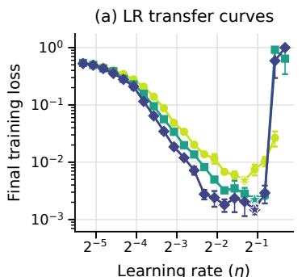

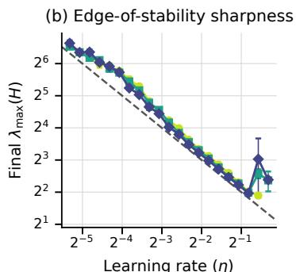

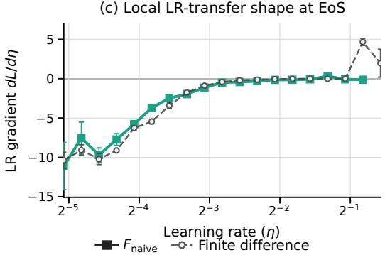  
Figure 1. Learning-rate transfer curves and their local shape at the edge of stability. (a) LR transfer curves show how the final training loss depends on the learning rate η across network widths. (b) We focus on the EoS regime, where the largest Hessian eigenvalue satisfies $\lambda _ { \operatorname* { m a x } } ( H ) \approx 2 / \eta .$ (c) The EoS-LR gradient of $F _ { \mathrm { n a i v e } }$ closely tracks the finite difference estimate, thereby capturing the local shape of the LR transfer curve (shown for width 256).

Independently of LR transfer, it is known that the LR can lie beyond the classical optimization regime, where the descent lemma guarantees convergence, and that the discrete nature of the updates with large LRs strongly influences the dynamics and trained model performance (Lewkowycz et al., 2020; Barrett and Dherin, 2021; Smith et al., 2021). In particular, EoS is a phenomenon which appears after the early phase of training and is observed across a wide range of modern optimizers and architectures, in which the LR satisfies a specific relation with the loss curvature (Cohen et al., 2021; Arora et al., 2022; Kalra et al., 2026; Andreyev and Beneventano, 2024; Islamov et al., 2026). While almost no study has examined LR curves under this regime, Noci et al. (2024) empirically confirmed that the largest eigenvalue of the Hessian becomes width-independent under EoS, supporting better LR transfer. Thus, our work provides the first result that reveals, through some theoretical evaluation, how EoS governs the LR gradient.

Computation of hypergradients Hypergradients have been developed in studies of HP optimization (Bengio, 2000; Maclaurin et al., 2015; Franceschi et al., 2017). However, a key issue is that standard hypergradients easily suffer from gradient explosion, since their computation essentially involves products of many Jacobian matrices (Maclaurin et al., 2015). Moreover, a short-horizon bias is also known to occur, leading to underesti mation of the HPs to achieve an instantaneous loss decrease (Wu et al., 2018). Our setting is different because we use hypergradients to evaluate the LR sensitivity of trained models rather than for HP optimization, but iterative hypergradient computation is still unstable, as is observed in Section 4. In contrast, we find that, although its derivation is heuristic, a certain fixed-point expression provides an accurate approximation to the LR gradient in our experiments. Note that in HP optimization, fixed-point formulations have been explored mainly for other HPs such as weight decay and data transformations, rather than LR (Lorraine et al., 2020).

## 2.2 The shape of LR transfer curves

Previous work has empirically examined the shape of the LR transfer curve of the loss function $\mathcal { L } ( \boldsymbol { \theta } )$ through grid search. This means that the local shape is given by a finite difference:

$$
\Delta \mathcal { L } = \mathcal { L } ( \theta _ { * } ( \eta + \Delta ) ) - \mathcal { L } ( \theta _ { * } ( \eta ) ) ,\tag{1}
$$

where $\eta$ is the LR, $\theta _ { * }$ denotes the trained model parameters, and $\Delta$ is the resolution of the grid search over the LR. Figure 1(a) shows a typical LR transfer curve. The shape of this curve can depend on multiple factors, such as parameterization, optimizers, learning dynamics, and architectures (Yang et al., 2021; Kosson et al., 2026; Haas et al., 2025; Everett et al., 2024; Noci et al., 2024). However, identifying universal behavior empirically is highly challenging in such complex settings, since relying solely on this finite-difference expression requires exhaustive experiments and plots across diverse settings. A more transparent expression for the curve is therefore desirable.

A natural first attempt is to assume that $\Delta$ is sufficiently small and consider the first derivative of the loss; however, this requires computing the hypergradient $\partial \theta _ { * } / \partial \eta$ , whose evaluation in modern neural networks is by no means trivial:

$$
\frac { d \mathcal { L } } { d \eta } = \nabla _ { \theta } \mathcal { L } ^ { \top } \frac { \partial \theta _ { * } } { \partial \eta } .\tag{2}
$$

Technically speaking, this $\mathcal { L }$ can be a validation loss different from the training loss. We consider the training loss for simplicity, as is often supposed in the previous work (Yang and Hu, 2021). The methods presented in this work can also apply to the validation loss if we have validation samples.

Section 3 provides a framework for implicitly evaluating Eq. (2) without directly computing $\partial \theta _ { * } / \partial \eta$ Section 4 presents an empirically validated approximation for explicitly evaluating the hypergradient.

## 3 EOS-CONSTRAINED LR GRADIENT

In this section, we focus on learning under the EoS phenomenon, which links the LR and trained model parameters during training. The key idea is that using this relation as a constraint in the method of Lagrange multipliers, we can obtain a formula which the LR gradient should satisfy.

## 3.1 Basic formula

Suppose that the model is trained under the EoS, and that its global minimum is the same as the solution of the following problem:

$$
\operatorname* { m i n } _ { \theta } \mathcal { L } ( \theta ) \quad s . t . \quad \eta = F ( \theta ) .\tag{3}
$$

$F$ denotes the inverse of the sharpness. We suppose that L is twice differentiable and F is differentiable. For gradient descent (GD), EoS holds for the following F (Cohen et al., 2021):

$$
F _ { n a i v e } ( \theta ) = 2 / \lambda _ { m a x } ( H ( \theta ) ) ,\tag{4}
$$

where H denotes the Hessian of the loss function. The dependence on the algorithm can be incorporated into F. As we show later, several previous studies have examined the algorithm dependence of $\eta = F ( \theta )$ , and the corresponding expressions can be substituted into our formulation.

The following is a simple idea, but it leads to a novel and interesting relation for the LR gradient.

Lemma 3.1. Consider solving the optimization problem (3) by the Lagrange multiplier formulation minθ $\mathcal { L } ( \boldsymbol { \theta } ) + \lambda F ( \boldsymbol { \theta } )$ for a multiplier $\lambda \in \mathbb { R } .$ . Then, at the minimum,

$$
d { \mathcal { L } } / d \eta = - \lambda .\tag{5}
$$

Proof. We abbreviate $\nabla _ { \theta }$ as $\nabla$ . Since $\eta = F ( \theta )$ , we also have $1 = d F / d \eta = \nabla F ^ { \top } \partial \theta / \partial \eta$ . Combining this with $\nabla { \mathcal { L } } ( \theta ) + \lambda \nabla F ( \theta ) = 0$ , we obtain the result. □

We first explain an explicit expression and its computation using the most basic case, $F = F _ { n a i v e } .$ , as a concrete example. Taking the inner product of $\nabla \mathcal { L } + \lambda \nabla F = 0$ with $\nabla \mathcal { L }$ and using Eq. (5), we obtain the following EoS-LR gradient:

$$
\frac { d \mathcal { L } } { d \eta } = \frac { \Vert \nabla \mathcal { L } \Vert ^ { 2 } } { \nabla \mathcal { L } ^ { \top } \nabla F } = - \frac { 2 \Vert \nabla \mathcal { L } \Vert ^ { 2 } } { \eta ^ { 2 } \nabla \mathcal { L } ^ { \top } \nabla \lambda _ { m a x } } .\tag{6}
$$

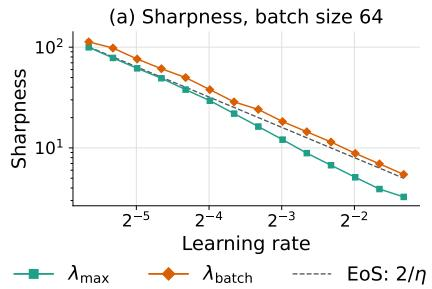

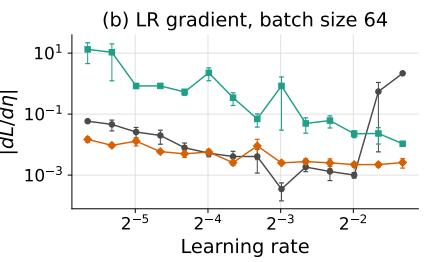

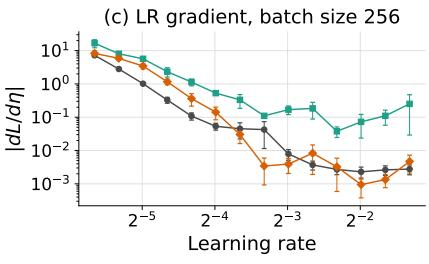  
Figure 2. EoS-LR gradients based on $F _ { b a t c h }$ capture LR sensitivity at small batch sizes. (a) As the batch size decreases, $\lambda _ { m a x }$ deviates from $2 / \eta$ . (b,c) At small batch sizes, the LR gradient based on $F _ { b a t c h }$ closely matches the finite-difference estimate.

This expression is easy to treat in the sense that the numerator is the squared gradient norm easily obtained for the trained model. However, its denominator involves $\nabla \lambda _ { m a x } .$ , a quantity based on third derivatives of the loss. This quantity has rarely been examined numerically in previous work, and its stable numerical computation is generally unexplored. We evaluate the directional derivative $\nabla \mathcal { L } ^ { \top } \nabla F$ by finite differences, avoiding explicit third derivatives (Appendix B.2). The Lagrange multiplier method only examines how the constrained minimization of the loss itself constrains the form of the solution, which does not explicitly depend on learning dynamics. Nevertheless, our expression explains the LR gradient of the trained models well, as is shown in Figure 1. When EoS holds, as shown in Figure 1(b), substituting the trained model parameters into Eq. (6) accurately predicts the LR gradient computed by finite differences, as shown in Figure 1(c). We empirically observed that when EoS holds across widths, the curve transfers across widths (i.e., the position of the U-shaped curve does not shift with width), consistent with the findings of Noci et al. (2024).

Lemma 3.1 and Eq. (6) imply that, at ideal minima, $\nabla \mathcal { L } ^ { \top } \nabla \lambda _ { m a x }$ is positive when the LR curve decreases with η. This inner product is sometimes assumed to be negative during the loss decrease along training trajectories in EoS theory (Damian et al., 2023), but its sign need not be the same at averaged parameters. The angle may differ between an optimization trajectory exhibiting period-two oscillations and the flat manifold on which our theory assumes the constrained minimum in Eq. (3). Consistent with this distinction, we observe a positive inner product at the averaged parameters of trained models (Figure 10 in Appendix C.1). Appendix B.2 describes how we compute the EoS-LR gradient in Figure 1.

Batch Sharpness. Similarly, by substituting different F into the intermediate expression in Eq. (6), we can compute $d \mathcal { L } / d \eta$ for individual EoS cases. Andreyev and Beneventano (2024) proposed

$$
\begin{array} { r } { F _ { b a t c h } ( \theta ) = 2 / E _ { B } [ \nabla \mathcal { L } ( B ) ^ { \top } H ( B ) \nabla \mathcal { L } ( B ) / \| \nabla \mathcal { L } ( B ) \| ^ { 2 } ] , } \end{array}\tag{7}
$$

where the expectation $E _ { B }$ is taken over the mini-batches. For SGD with momentum, $F _ { b a t c h } ( \theta )$ has been argued to approach $2 ( 1 + \beta ) / \lambda _ { m a x }$ in the large-batch limit and $2 ( 1 - \beta ) / \lambda _ { m a x }$ in the small-batch limit (Andreyev et al., 2026). We examine this $F _ { b a t c h }$ as an example showing that F need not be restricted to $F _ { n a i v e }$ and can quantitatively explain the LR curves. The results are shown in Figure 2. For small batch sizes, $F _ { n a i v e }$ fails to match the finite-difference estimates, whereas $F _ { b a t c h }$ successfully matches them.

## 4 FIXED-POINT LR GRADIENT

EoS-LR characterizes LR sensitivity through an EoS constraint, whose form depends on the optimizer. We now introduce a heuristic approximation of the LR gradient, derived directly from the training updates, without requiring an explicit EoS constraint. While naive recursive computation of the hypergradient and its fixed-point approximation can still be unstable, we find that a time-averaged fixed-point approximation works well in a stable manner, which is referred to as the FP-LR gradient. This formulation is more flexible than the EoS-LR gradient, in the sense that it can be adapted to more complex update rules, including AdamW (Appendix B.1.3), and, under a block-diagonal Hessian approximation, decomposed into layer-wise contributions to LR sensitivity (Section 5.3).

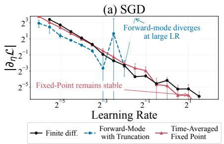

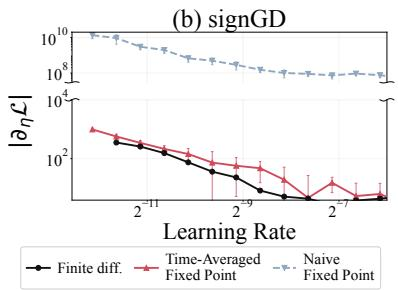

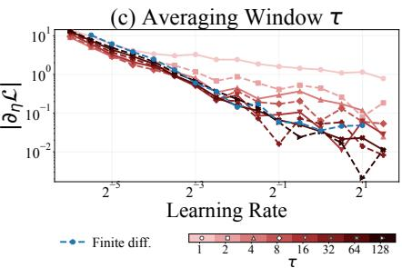  
Figure 3. FP-LR gradients agree with finite-difference estimates. (a,b) FP-LR captures LR sensitivity for both SGD and signGD. (c) Increasing the averaging window improves agreement between the FP-LR gradient and the finite-difference estimate.

Naive LR Gradient. As a preliminary step, we return to the LR hypergradient in Eq. (2). At training step $t ,$ it is given by $d \mathcal { L } ( \theta _ { t } ) / d \eta = \nabla \mathcal { L } ( \theta _ { t } ) ^ { \top } \partial \theta _ { t } / \partial \eta$ and can be computed by either reverse-mode or forward-mode differentiation through the training updates (Franceschi et al., 2017). Consider the parameter update rule $\theta _ { t + 1 } = ( 1 - \eta \gamma ) \theta _ { t } - \eta \nabla \mathcal { L } ( \theta _ { t } )$ , where $\gamma$ is the weight decay coefficient. Differentiating this update rule with respect to η gives the forward-mode recurrence for $\partial \theta _ { t } / \partial \eta$ appearing in Eq. (2):

$$
\partial \theta _ { t + 1 } / \partial \eta = \{ I - \eta ( H _ { t } + \gamma I ) \} \partial \theta _ { t } / \partial \eta - ( \nabla \mathcal { L } ( \theta _ { t } ) + \gamma \theta _ { t } ) ,\tag{8}
$$

where $H _ { t }$ denotes the Hessian of $\mathcal { L } ( \boldsymbol { \theta } )$ evaluated at $\theta _ { t }$ . If the initial weights are independent of $\eta .$ the recurrence starts from $\partial \theta _ { 0 } / \partial \eta = 0$ . For simplicity, we include the $\ell _ { 2 }$ regularization term in the loss and do not explicitly write the $\gamma$ term below.

As reported in previous work, the naive LR gradient tends to diverge, and we observed the same trend in our experiments (Maclaurin et al., 2015; Micaelli and Storkey, 2021). Similarly, we tested the naive fixed-point approximation of Eq. (8), that is, $\partial \theta _ { * } / \partial \eta = - \eta ^ { - 1 } H ( \theta _ { t } ) ^ { - 1 } \nabla \mathcal { L } ( \theta _ { t } )$ , which assumes that $\partial \theta / \partial \eta$ has approximately reached a stationary point. However, we empirically observed that this approximation was either unstable or differed from the true LR gradient estimated from the finite difference (1).

FP-LR gradient. We empirically find that the following time-averaged quantity is computationally stable and provides an accurate approximation to the true LR gradient as a heuristic:

$$
\frac { \partial \theta _ { * } } { \partial \eta } = - \frac { 1 } { \eta } \bar { H } _ { t } ^ { - 1 } \left. \nabla \mathcal { L } ( \theta _ { t } ) \right. ,\tag{9}
$$

where H¯ and ⟨·⟩ denote time averages over a finite time window $[ t - \tau , t ]$ . We then compute $d { \mathcal { L } } / d \eta =$ $\nabla \mathcal { L } ( \langle \theta _ { t } \rangle ) ^ { \top } \partial \theta _ { * } / \partial \eta$ , referred to as the FP-LR gradient. Appendix B.1 gives more details on the numerical computation of time averages and extension to signGD and AdamW. Note that in practice, neural networks are commonly trained with LR schedules and for a large but finite number of epochs, and thus the averaged gradient is not generally zero. Therefore, the time-averaged gradient need not vanish even near the end of training.

As shown in Figure 3, the FP-LR gradient agrees with the finite-difference of the LR curve for both SGD and signGD. With a smaller averaging window, the estimate differs more from the finite-difference LR gradient. This difference decreases as the window size (τ) increases. One interpretation is that the time average removes noisy short-timescale dynamics caused by discrete updates. For example, under EoS, the gradient has been reported to exhibit period-two sign oscillations satisfying $\nabla \mathcal { L } ( \theta _ { t + 1 } ) \approx - \nabla \mathcal { L } ( \theta _ { t } )$ (Cohen et al., 2021; Damian et al., 2023), while the parameters gradually move toward flatter regions over longer timescales.

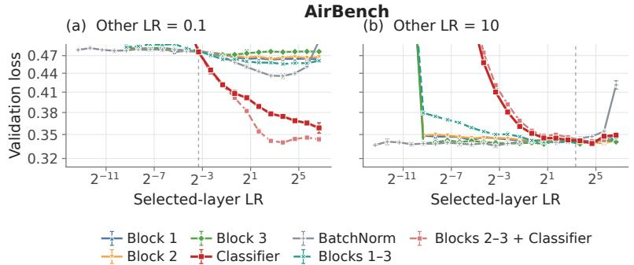

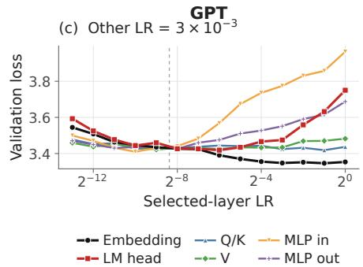  
Figure 4. Validation loss versus selected-layer LR. We sweep the LR of each indicated parameter group while fixing the others: (a,b) ResNet on CIFAR-10; (c) GPT on FineWeb.

## 5 QUANTITATIVE UNDERSTANDING OF LR TRANSFER CURVES

In this section, we use the EoS-LR and FP-LR gradients derived above in a complementary manner and demonstrate their utility in understanding the shape of LR curves.

## 5.1 Analysis of Scale-invariant models

Parameter blocks routed through a normalization layer, such as weights immediately preceding a BatchNorm or LayerNorm, or $W _ { Q }$ and $W _ { K }$ in attention with QK normalization, exhibit scale invariance, i.e., ${ \mathcal { L } } ( c \theta ) =$ $\mathcal { L } ( \boldsymbol { \theta } )$ for any $c > 0$ . Such scale-invariant models have been explored independently in both EoS theory (Arora et al., 2022) and empirical studies of better LR transfer (Kosson et al., 2026). Here, we reveal that the LR gradient becomes zero in this scale-invariant case, implying LR transfer in a more unified manner.

Homogeneity of F. If the scale-invariant loss function is twice differentiable, we have $H ( c \theta ) = c ^ { - 2 } H ( \theta )$ and thus $\lambda _ { m a x } ( H ( c \theta ) ) = c ^ { - 2 } \lambda _ { m a x } ( H ( \theta ) )$ . Therefore, $F _ { n a i v e } ( c \theta ) = c ^ { 2 } F _ { n a i v e } ( \theta )$ Similarly, one can immediately check that $F _ { b a t c h }$ is homogeneous of degree 2 as well. In contrast, the EoS conditions of adaptive optimizers show a different homogeneity. For signGD, Islamov et al. (2026) show $F _ { s i g n } = 2 \| \nabla \mathcal { L } \| _ { 1 } / S _ { \infty }$ where $\begin{array} { r } { S _ { \infty } = \operatorname* { m a x } _ { \| d \| _ { \infty } = 1 } d ^ { \top } \nabla ^ { 2 } \mathcal { L } d . } \end{array}$ . This satisfies $F _ { s i g n } ( c \theta ) = c F _ { s i g n } ( \theta )$ . Note that for Adam, Cohen et al. (2022) proposed $\begin{array} { r } { F _ { A d a m } ( \theta ) = 2 / \left( \frac { 1 - \beta _ { 1 } } { 1 + \beta _ { 1 } } \lambda _ { m a x } ^ { P } \right) } \end{array}$ , where $\lambda _ { m a x } ^ { P }$ is the largest eigenvalue of $P ^ { - 1 / 2 } H P ^ { - 1 / 2 }$ with Adam’s diagonal preconditioner P. If we neglect the damping term of the denominator, this is also homogeneous of degree 1 in the same way as in signGD. This homogeneity leads to the following.

Theorem 5.1. Assume that the model is scale-invariant and F satisfies the homogeneity $F ( c \theta ) = c ^ { a } F ( \theta )$ $f o r a > 0$ . Then, the solution ofthe minimization problem in Lemma 3.1 satisfies $d \mathcal { L } / d \eta = 0$

The proof is shown in Appendix A.1. The point is that $F ^ { \prime } { \bf s }$ homogeneity leads to $\theta ^ { \top } \nabla F = a F$ . This forces the multiplier −λ in the naive case (5) to cancel out, yielding a zero LR gradient. Note that for GD in the scale-invariant model, FP-LR without time averaging is easily shown to be 0 as in Appendix A.3. In comparison, EoS-LR is useful in that it accommodates various optimizers through the choice of $F .$

A distinctive property of Sign gradient with weight decay. Thus far, the EoS-LR formulation has required only loss minimization. In practice, learning may involve additional explicit or implicit regularization, making its effect on EoS-LR an interesting question. Recently, Kosson et al. (2026) empirically reported that the combination of weight decay (L2 regularization) and Adam is a key factor for LR transfer. More specifically, assuming $\gamma \eta = c o n s t$ . for the regularization coefficient $\gamma$ and a gradient norm of order 1, they argue that the parameter norm satisfies $\| \theta \| ^ { 2 } = C \eta ^ { 2 }$ with an uninteresting constant $C ,$ which leads to a stable transfer. Although their derivation of this regularization scale is intuitive, the bound $\| \theta \| ^ { 2 } \leq C \eta ^ { 2 }$ follows readily from these assumptions, as shown in Lemma A.2. We find that the advantage of this setting can indeed be verified through EoS-LR analysis in the scale-invariant model.

Theorem 5.2. Consider the minimization problem (3) with an $L 2$ constraint $\| \theta \| ^ { 2 } \leq C \eta ^ { 2 }$ , that is, $\theta _ { * } = $ argmin $_ { \theta } \mathcal { L } ( \theta ) + \lambda _ { 1 } F ( \theta ) + \lambda _ { 2 } ( \| \theta \| ^ { 2 } - C \eta ^ { 2 } ) / 2$ with $\lambda _ { 2 } \geq 0$ . Under the same assumption ofscale invariance as in Theorem 5.1,

$$
d \mathcal { L } ( \theta _ { * } ) / d \eta = ( 1 - a ) \| \nabla \mathcal { L } \| ^ { 2 } / ( \nabla \mathcal { L } ^ { \top } \nabla F ) .\tag{10}
$$

In particular,for $a = 1$ , the LR gradient is zero.

The proof is shown in Appendix A.2. For signGD and simplified Adam, where $a = 1$ , the LR gradient indeed vanishes, eliminating LR sensitivity. We can also derive an explicit, though more complicated, expression for the LR gradient with L2 regularization but without scale invariance as in Eq. (40). Thus, the LR gradient is generally nonzero if either L2 regularization or scale invariance is absent.

In ResNet (Figure 4), every layer except the final layer is immediately followed by normalization. Thus, all layers except the final layer and the BatchNorm layers are scale-invariant, and the loss is not sensitive to their learning rates. In GPT, the QK layers are immediately followed by QK normalization. For the other layers, normalization is applied after the residual connection, so they are not fully scale-invariant. In particular, the MLP input layer is not immediately followed by normalization and is therefore highly sensitive to changes in its learning rate.

## 5.2 Bounds on LR gradients

Figure 5 shows that LR gradient amplitudes across widths of CNNs, ResNets, and GPT scale approximately as η− $- 3 / 2$ over a broad LR range, generally between $\eta ^ { - 1 }$ and $\eta ^ { - 2 }$ . A natural question is whether our EoS-LR or FP-LR can explain these empirical slopes. However, these expressions include the gradient norm and higher-order derivatives, which depend implicitly on the LR, making these slopes nontrivial to determine. Here, we establish consistency with the experimental results by evaluating bounds under several assumptions.

Case of EoS-LR. The Cauchy–Schwarz inequality straightforwardly gives

$$
| d \mathcal { L } / d \eta | \geq 2 \| \nabla \mathcal { L } \| / ( \eta ^ { 2 } \| \nabla \lambda _ { m a x } \| ) .
$$

(i) Since both theoretical and empirical studies of $\| \nabla \lambda _ { m a x } \|$ are limited in the literature, we evaluated it numerically and observed scaling of order $\eta ^ { - 1 }$ , as shown in Fig 11. (ii) For the gradient norm, a first-order expansion of the loss update gives $\mathcal { L } _ { t + 1 } \approx \mathcal { L } _ { t } - \eta \| \nabla \mathcal { L } _ { t } \| ^ { 2 }$ . Assuming that training progresses at order one, as in Yang and Hu (2021); Chizat and Netrapalli (2024), we have $\| \nabla \mathcal { L } _ { t } \| ^ { 2 } = C / \eta$ . The same scaling has also been reported in experiments on implicit gradient regularization (Barrett and Dherin, 2021), supporting this assumption. Combining (i) and (ii) yields $| d \mathcal { L } / d \eta | = \Omega ( \eta ^ { - 3 / 2 } )$ , consistent with Figure 5.

Comparison with FP-LR. When the training loss is sufficiently small, the Hessian is expected to be dominated by its Gauss–Newton part, motivating the assumption $H \succeq 0$ , which gives $\| \nabla \mathcal { L } \| ^ { 2 } / \eta ( \lambda _ { m a x } + \gamma ) \leq$ $| d \mathcal { L } / d \eta | \leq \Vert \nabla \mathcal { L } \Vert ^ { 2 } / \eta \gamma$ . Depending on additional assumptions, these upper and lower bounds can scale as either $1 / \eta \mathrm { o r } 1 / \eta ^ { 2 }$ . First, assuming $\eta \| \nabla \mathcal { L } \| ^ { 2 } = c o n s t$ . as in the above EoS case, both bounds scale as $1 / \eta ^ { 2 }$ If we further assume EoS, the lower bound scales as $1 / \eta$ . If we impose $\eta \gamma = c o n s t .$ . (Kosson et al., 2026), the upper bound also scales as $1 / \eta$ . Thus, the range of bounds for FP-LR is consistent with the experimental results, but the bounds themselves do not scale as $\eta ^ { - 3 / 2 }$ . In this sense, EoS-LR provides a more specific quantitative characterization.

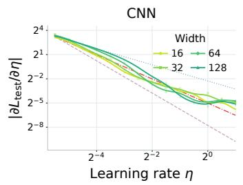

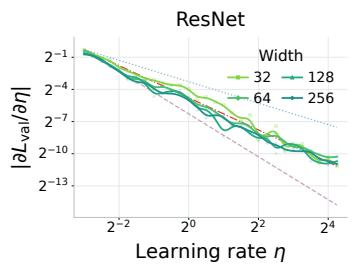

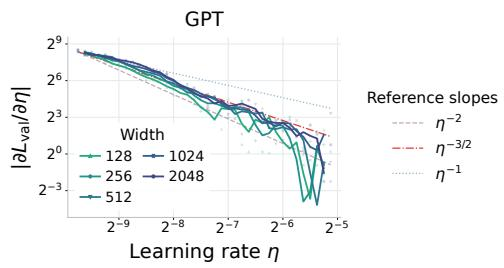  
Figure 5. LR gradients of the evaluation loss exhibit $\eta ^ { - 3 / 2 }$ scaling. Log–log plots show the absolute LR gradients for CNN, ResNet, and GPT, estimated by finite differences from LR sweeps. We use the test loss for CNN and the validation loss for ResNet and GPT; colors indicate network width. Reference lines show the slopes $\eta ^ { - 2 } , \eta ^ { - 3 / 2 }$ , and $\eta ^ { - 1 }$ suggested by the bounds.

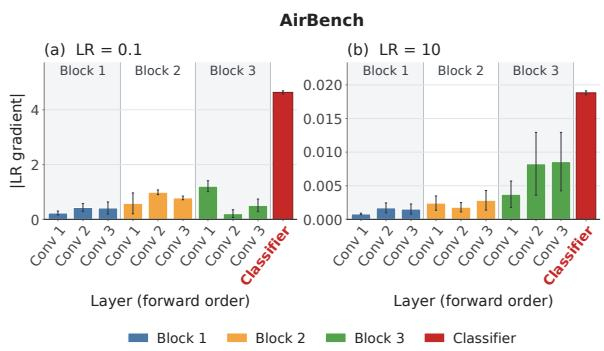

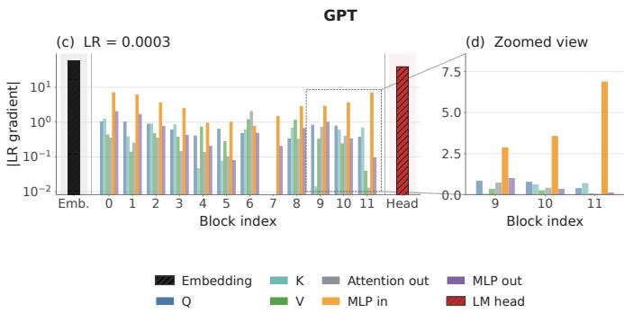  
Figure 6. Layerwise FP-LR gradient. (a,b) ResNet on CIFAR-10 with two different LRs. (c) GPT on FineWeb. (d) Blocks 9–11 of (c), shown on a linear scale.

## 5.3 Layerwise Profiling

Motivated by the benefits of layer-wise LRs (Yang et al., 2021; He et al., 2026), we use the FP-LR expression to decompose the LR gradient into layer-wise contributions and identify the layers that contribute most to LR sensitivity. Under a layer-wise block-diagonal approximation to the time-averaged Hessian, the FP-LR gradient decomposes into layer-wise components as

$$
\frac { d \mathcal { L } } { d \eta } = - \sum _ { l } \frac { 1 } { \eta } \nabla _ { \theta ^ { ( l ) } } \mathcal { L } ^ { \top } ( \bar { H } ^ { ( l ) } ) ^ { - 1 } \langle \nabla _ { \theta ^ { ( l ) } } \mathcal { L } \rangle = \sum _ { l } \frac { \partial \mathcal { L } } { \partial \eta _ { l } } \bigg \vert _ { \eta = \eta } ,\tag{11}
$$

where $\theta ^ { ( l ) }$ and η are the parameters and LR of layer l, with update $\theta _ { t + 1 } ^ { ( l ) } = \theta _ { t } ^ { ( l ) } - \eta _ { l } \nabla _ { \theta ^ { ( l ) } } \mathcal { L } ( \theta _ { t } )$ , and $\bar { H } ^ { ( l ) } = \nabla _ { \theta ^ { ( l ) } } ^ { 2 } \mathcal { L } ( \langle \theta _ { t } \rangle )$ . Time averages and gradient evaluation follow Section 4; implementation details are in Appendix B.3. Note that this simple decomposition is an advantage of FP-LR, compared to EoS-LR. EoS-LR includes the inner product of all parameters in both numerator and denominator in Eq. (6) and this makes the explicit decomposition more non-trivial.

As is shown in Figure 6(a,b), for ResNet, the final layer (Classifier) has a larger amplitude of the layerwise FP-LR gradient than the other layers. This result is consistent with Figure 4, which shows that the loss varies substantially with the LR of the final layer but only slightly with that of the input layer. For GPT, the embedding and output layers have particularly large layer-wise LR gradients, and the MLP input layers also have large LR gradients within the Transformer blocks. These profiles provide a quantitative measure of each layer’s contribution to LR sensitivity.

Figure 7 demonstrates that LR transfer across widths is also sensitive to the output-layer scale, as suggested by Figure 6. Here, the input and output multipliers rescale the first layer’s output and the final logits, respectively. Base Width is the reference width for increasing the width. These quantities are commonly used in $\mu \mathrm { P }$ studies (see Appendix D.3 for details). Base Width is often set to the smallest width used in experiments, and this motivates the comparison with Base Width=1, which rigorously obeys the $\mu \mathrm { P }$ scaling. With both multipliers at 1, Base Width=1 gives higher accuracy than Base Width=32 (a). Reducing the output multiplier to $1 / 9$ improves accuracy at Base Width=32 to roughly the same level as Base Width=1 with default multipliers (c). Increasing it to 3 instead lowers accuracy (b). At Base Width=1, reducing the output multiplier lowers accuracy and makes the optimal LR differ across widths, making LR transfer less reliable (c). Finally, changing the input multiplier has little effect (d,e). Thus, we can conclude that LR transfer significantly depends on the output-layer scale and favors scaling the output layer according to $\mu \mathrm { P }$ from Base Width=1.

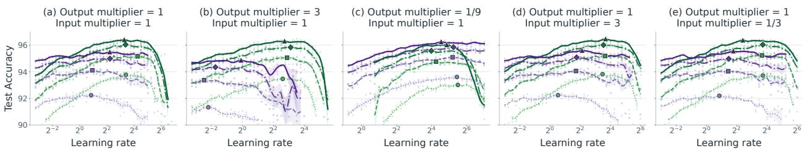  
Base width: 1 Base width: 32 Width: 32 Width: 64 Width: 128 Width: 256 Optimal LR  
Figure 7. Accuracy and LR transfer under different input and output multipliers. Test accuracy for ResNet on CIFAR-10 under $\mu \mathrm { P } ,$ comparing Base Width=1 and 32. (a) Both multipliers are 1. $^ { ( \mathrm { b , c } ) }$ Only the output multiplier changes to 3 or $1 / 9 .$ , respectively. (d,e) Only the input multiplier changes to 3 or $1 / 3 ,$ respectively.

## 6 LIMITATIONS AND DISCUSSIONS

We provide a unified perspective on the LR curve from the analyses of the LR gradient and expect that our results will serve as a foundation for better understanding the mechanisms of stable LR tuning. The following directions could be important for further development. (i) Our characterization of the LR gradient under EoS via Lagrange multipliers will be broadly applicable. That is, as future theoretical or empirical analyses reveal new EoS relations in different optimizers, these can be substituted into our formulation to derive the LR gradient. For example, EoS for preconditioned optimizers in more practical settings incorporating moving averages or damping remains unresolved in the EoS literature (Islamov et al., 2026). Clarifying these relations would also enable the characterization of LR curves through our EoS-LR gradient. (ii) Since this work is restricted to evaluating first derivatives of the LR curve, evaluating higher-order derivatives is also an interesting direction for understanding the shape of the curves. However, it is noteworthy that in both the EoS and FP formulations, additional higher-order terms arise as the derivative order increases. The resulting expressions are therefore unlikely to be as simple as those obtained here. Even the present expressions require careful numerical computation. (iii) We showed that the LR gradient vanishes for scale-invariant layers, yielding a width-independent result. Analyzing the model-size dependence of our relational equations in more general cases is an interesting theoretical direction. Such an analysis requires understanding the universality of the derivative of the largest eigenvalue, which involves third derivatives of the loss. While the theory of the large-size limit of such higher-order terms remains under development (Noci et al., 2024; Lauditi et al., 2026), our work provides a foundation for translating future theoretical advances into evaluations of the LR gradient.

## ACKNOWLEDGEMENTS

The authors acknowledge support from JST FOREST (Grant No. JPMJFR226Q) and FRONTia, a Japanese national program led by METI and NEDO. RK is also supported by JST BOOST (Grant No. JPMJBY25B0), and SI by JSPS KAKENHI (Grant No. 26KJ1108) and JST ACT-X (Grant No. JPMJAX25C1).

## REFERENCES

Arseniy Andreyev and Pierfrancesco Beneventano. Edge of stochastic stability: Revisiting the edge of stability for SGD. arXiv:2412.20553, 2024.

Arseniy Andreyev, Advikar Ananthkumar, Marc Walden, Tomaso Poggio, and Pierfrancesco Beneventano. Momentum further constrains sharpness at the edge of stochastic stability. arXiv:2604.14108, 2026.

Sanjeev Arora, Zhiyuan Li, and Abhishek Panigrahi. Understanding gradient descent on the edge of stability in deep learning. In International Conference on Machine Learning. PMLR, 2022.

David GT Barrett and Benoit Dherin. Implicit gradient regularization. In International Conference on Learning Representations, 2021.

Yoshua Bengio. Gradient-based optimization of hyperparameters. Neural Computation, 12(8), 2000.

Blake Bordelon and Cengiz Pehlevan. Deep linear network training dynamics from random initialization: Data, width, depth, and hyperparameter transfer. In International Conference on Machine Learning. PMLR, 2025.

Lénaïc Chizat and Praneeth Netrapalli. The feature speed formula: a flexible approach to scale hyperparameters of deep neural networks. In Advances in Neural Information Processing Systems, 2024.

Dami Choi, Christopher J Shallue, Zachary Nado, Jaehoon Lee, Chris J Maddison, and George E Dahl. On empirical comparisons of optimizers for deep learning. arXiv:1910.05446, 2019.

Jeremy Cohen, Simran Kaur, Yuanzhi Li, J Zico Kolter, and Ameet Talwalkar. Gradient descent on neural networks typically occurs at the edge of stability. In International Conference on Learning Representations, 2021.

Jeremy M Cohen, Behrooz Ghorbani, Shankar Krishnan, Naman Agarwal, Sourabh Medapati, Michal Badura, Daniel Suo, David Cardoze, Zachary Nado, George E Dahl, and Justin Gilmer. Adaptive gradient methods at the edge of stability. arXiv:2207.14484, 2022.

Alex Damian, Eshaan Nichani, and Jason D Lee. Self-stabilization: The implicit bias of gradient descent at the edge of stability. In International Conference on Learning Representations, 2023.

Katie Everett, Lechao Xiao, Mitchell Wortsman, Alexander A. Alemi, Roman Novak, Peter J. Liu, Izzeddin Gur, Jascha Sohl-Dickstein, Leslie Pack Kaelbling, Jaehoon Lee, and Jeffrey Pennington. Scaling exponents across parameterizations and optimizers. In International Conference on Machine Learning. PMLR, 2024.

Luca Franceschi, Michele Donini, Paolo Frasconi, and Massimiliano Pontil. Forward and reverse gradientbased hyperparameter optimization. In International Conference on Machine Learning. PMLR, 2017.

Nikhil Ghosh, Denny Wu, and Alberto Bietti. Understanding the mechanisms of fast hyperparameter transfer. In International Conference on Learning Representations, 2026.

Moritz Haas, Sebastian Bordt, Ulrike von Luxburg, and Leena Chennuru Vankadara. On the surprising effectiveness of large learning rates under standard width scaling. In Neural Information Processing Systems, 2025.

Soufiane Hayou. A proof of learning rate transfer under $\mu \mathrm { P } .$ In International Conference on Artificia Intelligence and Statistics. PMLR, 2026.

Di He, Songjun Tu, Keyu Wang, Lu Yin, and Shiwei Liu. One LR doesn’t fit all: Heavy-tail guided layerwise learning rates for LLMs. In International Conference on Machine Learning. PMLR, 2026.

Kaiming He, Xiangyu Zhang, Shaoqing Ren, and Jian Sun. Deep residual learning for image recognition. In Proceedings of the IEEE conference on Computer Vision and Pattern Recognition, 2016.

Rustem Islamov, Michael Crawshaw, Jeremy Cohen, and Robert Gower. Non-euclidean gradient descent operates at the edge of stability. In International Conference on Machine Learning. PMLR, 2026.

Keller Jordan, Jeremy Bernstein, Brendan Rappazzo, @fernbear.bsky.social, Boza Vlado, You Jiacheng, Franz Cesista, Braden Koszarsky, and @Grad62304977. modded-nanogpt: Speedrunning the NanoGPT baseline, 2024. URL https://github.com/KellerJordan/modded-nanogpt.

Dayal Singh Kalra, Jean-Christophe Gagnon-Audet, Andrey Gromov, Ishita Mediratta, Kelvin Niu, Alexander H Miller, and Michael Shvartsman. A scalable measure of loss landscape curvature for analyzing the training dynamics of llms. arXiv:2601.16979, 2026.

Atli Kosson, Jeremy Welborn, Yang Liu, Martin Jaggi, and Xi Chen. Weight decay may matter more than muP for learning rate transfer in practice. In International Conference on Learning Representations, 2026.

Clarissa Lauditi, Cengiz Pehlevan, and Blake Bordelon. Spectral dynamics in deep networks: Feature learning, outlier escape, and learning rate transfer. arXiv:2605.07870, 2026.

Aitor Lewkowycz, Yasaman Bahri, Ethan Dyer, Jascha Sohl-Dickstein, and Guy Gur-Ari. The large learning rate phase of deep learning: the catapult mechanism. arXiv:2003.02218, 2020.

Jonathan Lorraine, Paul Vicol, and David Duvenaud. Optimizing millions of hyperparameters by implicit differentiation. In International Conference on Artificial Intelligence and Statistics. PMLR, 2020.

Dougal Maclaurin, David Duvenaud, and Ryan Adams. Gradient-based hyperparameter optimization through reversible learning. In International Conference on Machine Learning. PMLR, 2015.

James Martens and Roger Grosse. Optimizing neural networks with Kronecker-factored approximate curvature. In International Conference on Machine Learning. PMLR, 2015.

Paul Micaelli and Amos J Storkey. Gradient-based hyperparameter optimization over long horizons. In Neural Information Processing Systems, 2021.

Lorenzo Noci, Alexandru Meterez, Thomas Hofmann, and Antonio Orvieto. Super consistency of neural network landscapes and learning rate transfer. In Advances in Neural Information Processing Systems, 2024.

Ishaan Shah, Anthony M Polloreno, Karl Stratos, Philip Monk, Adarsh Chaluvaraju, Andrew Hojel, Andrew Ma, Anil Thomas, Ashish Tanwer, Darsh J Shah, et al. Practical efficiency of muon for pretraining. arXiv:2505.02222, 2025.

Samuel L. Smith, Pieter-Jan Kindermans, and Quoc V. Le. Don’t decay the learning rate, increase the batch size. In International Conference on Learning Representations, 2018.

Samuel L Smith, Benoit Dherin, David GT Barrett, and Soham De. On the origin of implicit regularization in stochastic gradient descent. In International Conference on Learning Representations, 2021.

Mitchell Wortsman, Peter J Liu, Lechao Xiao, Katie E Everett, Alexander A Alemi, Ben Adlam, John D Co-Reyes, Izzeddin Gur, Abhishek Kumar, Roman Novak, Jeffrey Pennington, Jascha Sohl-Dickstein, Kelvin Xu, Jaehoon Lee, Justin Gilmer, and Simon Kornblith. Small-scale proxies for large-scale transformer training instabilities. In International Conference on Learning Representations, 2024.

Yuhuai Wu, Mengye Ren, Renjie Liao, and Roger Grosse. Understanding short-horizon bias in stochastic meta-optimization. In International Conference on Learning Representations, 2018.

Greg Yang and Edward J. Hu. Tensor programs IV: Feature learning in infinite-width neural networks. In International Conference on Machine Learning. PMLR, 2021.

Greg Yang, Edward J Hu, Igor Babuschkin, Szymon Sidor, Xiaodong Liu, David Farhi, Nick Ryder, Jakub Pachocki, Weizhu Chen, and Jianfeng Gao. Tuning large neural networks via zero-shot hyperparameter transfer. In Advances in Neural Information Processing Systems, 2021.

## Appendices

## A DERIVATIONS OF LR GRADIENTS

## A.1 Scale invariance

Theorem A.1 (Theorem 5.1). Assume scale invariance ${ \mathcal { L } } ( c \theta ) = { \mathcal { L } } ( \theta )$ and $F ( c \theta ) = c ^ { a } F ( \theta ) \ : ( c , a > 0 )$ Consider the minimization of $\mathcal { L } ( \boldsymbol { \theta } )$ with a constraint $\eta ~ = ~ F ( { \boldsymbol { \theta } } )$ , and its formulation with a Lagrange multiplier:

$$
\theta _ { * } : = a r g m i n _ { \theta } \mathcal { L } ( \theta ) + \lambda F .\tag{12}
$$

Then,

$$
\frac { d \mathcal { L } ( \theta _ { * } ) } { d \eta } = 0 .\tag{13}
$$

Proof. As is shown in Lemma 3.1,

$$
\frac { d \mathcal { L } } { d \eta } = - \lambda .\tag{14}
$$

Here, note that one can easily confirm

$$
\theta ^ { \top } \nabla { \mathcal { L } } ( \theta ) = 0\tag{15}
$$

by differentiating $\mathcal { L } ( c \theta ) = \mathcal { L } ( \theta )$ with respect to c. Similarly, we have

$$
\theta ^ { \top } \nabla F ( \theta ) = a F\tag{16}
$$

by differentiating $F ( c \theta ) = c ^ { a } F ( \theta )$ with respect to c. Taking the inner product of both sides of $\nabla { \mathcal { L } } + \lambda \nabla F = 0$ with θ, we have

$$
\lambda \boldsymbol { \theta } ^ { \top } \nabla F = \lambda a \eta = 0 .\tag{17}
$$

Since $\eta > 0$ and $a > 0$ , we have $\lambda = 0$ and

$$
\frac { d L } { d \eta } = 0 .\tag{18}
$$

## A.2 Scale invariance with weight decay

Lemma A.2. Consider a gradient update $\theta _ { t + 1 } = ( 1 - \eta \lambda ) \theta _ { t } - \eta g ( \theta _ { t } )$ . Assume $( i ) \| g ( \theta _ { t } ) \| \le C _ { 0 } f o r$ all $t \geq 0 f o r$ a constant $C _ { 0 } > 0$ and (ii) a constant $\eta \lambda = k ( 0 < k < 1 )$ . Then,

$$
\| \theta _ { t + 1 } \| ^ { 2 } \leq C \eta ^ { 2 }\tag{19}
$$

for a constant $C > 0$ and sufficiently large t.

Proof. We have

$$
\lVert { \boldsymbol { \theta } } _ { t + 1 } \rVert \leq ( 1 - \eta \lambda ) \lVert { \boldsymbol { \theta } } _ { t } \rVert + \eta \lVert g _ { t } \rVert .\tag{20}
$$

Therefore,

$$
\| \theta _ { T + 1 } \| \leq ( 1 - \eta \lambda ) ^ { T + 1 } \| \theta _ { 0 } \| + \sum _ { j = 0 } ^ { T } \eta ( 1 - \eta \lambda ) ^ { j } \| g _ { T - j } \|\tag{21}
$$

$$
\leq ( 1 - \eta \lambda ) ^ { T + 1 } \| \theta _ { 0 } \| + \eta C _ { 0 } \frac { 1 - ( 1 - \eta \lambda ) ^ { T + 1 } } { \eta \lambda } .\tag{22}
$$

Choose an integer $T \geq 0$ such that $T > \ln \left( \frac { C _ { 0 } / \lambda } { \| \theta _ { 0 } \| + C _ { 0 } / \lambda } \right) / \ln ( 1 - \eta \lambda )$ . Since $0 < 1 - \eta \lambda < 1$ , this ensures $( 1 - \eta \lambda ) ^ { T + 1 } ( \| \theta _ { 0 } \| + C _ { 0 } / \lambda ) \le C _ { 0 } / \lambda$ . The preceding bound therefore gives

$$
\begin{array} { r } { \| \theta _ { T + 1 } \| \leq ( 1 - \eta \lambda ) ^ { T + 1 } ( \| \theta _ { 0 } \| + C _ { 0 } / \lambda ) + C _ { 0 } / \lambda \leq 2 C _ { 0 } / \lambda . } \end{array}\tag{23}
$$

In addition, by using the assumption $\eta \lambda = k$

$$
\begin{array} { r } { \| \theta _ { T + 1 } \| ^ { 2 } \leq 4 C _ { 0 } ^ { 2 } \eta ^ { 2 } / k ^ { 2 } . } \end{array}\tag{24}
$$

Then, setting $C : = 4 C _ { 0 } ^ { 2 } / k ^ { 2 }$ , we obtain, for all $t \geq T$

$$
\| \theta _ { t + 1 } \| ^ { 2 } \leq C \eta ^ { 2 } .\tag{25}
$$

Kosson et al. (2026) derived an equality for $\theta _ { t + 1 } = \theta _ { t } - \eta g ( \theta _ { t } )$ by assuming $\theta _ { t } ^ { \top } \nabla g ( \theta _ { t } ) = 0$ , but this assumption is nontrivial except for ordinary GD. Our assumption is more general in that it does not explicitly depend on the optimizer.

As shown above, assuming $\eta \lambda = k$ , bounded gradients yield, for sufficiently large $t , \| \theta \| ^ { 2 } \leq C \eta ^ { 2 }$ Thus, it is natural for the L2 norm of the parameters to be bounded by a constant times η. We therefore consider imposing $\| \theta \| ^ { 2 } \leq C \eta ^ { 2 }$ in our Lagrange multiplier method as a minimal constraint that the converged parameters should satisfy. Then, for scale-invariant layers, we obtain the following:

Theorem A.3 (Theorem 5.2). Assume scale invariance $\mathcal { L } ( c \theta ) = \mathcal { L } ( \theta )$ and $F ( c \theta ) = c ^ { a } F ( \theta ) \ : ( c , a > 0 )$ Consider the minimization of $\mathcal { L } ( \boldsymbol { \theta } )$ with constraints $\eta = F ( \theta )$ and $\| \theta \| ^ { 2 } \leq C \eta ^ { 2 } .$

$$
\theta _ { * } = a r g m i n _ { \theta } \mathcal { L } ( \theta ) + \lambda _ { 1 } F + \frac { \lambda _ { 2 } } { 2 } ( \| \theta \| ^ { 2 } - C \eta ^ { 2 } )\tag{26}
$$

with Karush–Kuhn–Tucker (KKT) multipliers $\lambda _ { 1 }$ and $\lambda _ { 2 } \geq 0$ . Then,

$$
\frac { d \mathcal { L } ( \theta _ { * } ) } { d \eta } = ( 1 - a ) \frac { \| \nabla \mathcal { L } \| ^ { 2 } } { \nabla \mathcal { L } ^ { \top } \nabla F } .\tag{27}
$$

In particular, $f o r a = 1$

$$
\frac { d \mathcal { L } ( \theta _ { * } ) } { d \eta } = 0 .\tag{28}
$$

Proof. The KKT conditions of this constrained minimization problem are given by

$$
\begin{array} { r } { \nabla \mathcal { L } + \lambda _ { 1 } \nabla F + \lambda _ { 2 } \theta = 0 , } \end{array}\tag{29}
$$

$$
\frac { \lambda _ { 2 } } { 2 } ( \| \theta \| ^ { 2 } - C \eta ^ { 2 } ) = 0 .\tag{30}
$$

Case (i): $\lambda _ { 2 } = 0$ . Taking the inner product of both sides of Eq. (29) with θ, we have

$$
\theta ^ { \top } ( \nabla { \mathcal { L } } + \lambda _ { 1 } \nabla F ) = \lambda _ { 1 } ( a \eta ) = 0 ,\tag{31}
$$

because of $\theta ^ { \top } \nabla { \mathcal { L } } ( \theta ) = 0 ( \mathrm { e q . }$ . 15) from the scale invariance. Therefore, $\lambda _ { 1 } = 0$ and we obtain $\begin{array} { r } { \frac { d \mathcal { L } } { d \eta } = 0 } \end{array}$

Case (ii): $\lambda _ { 2 } \neq 0$ . We have $\| \theta \| ^ { 2 } - C \eta ^ { 2 } = 0$ , and thus,

$$
\boldsymbol { \theta } ^ { \top } \frac { \partial \boldsymbol { \theta } } { \partial \eta } = \boldsymbol { C } \eta .\tag{32}
$$

Then,

$$
{ { \theta } ^ { \mathsf { T } } } ( \nabla \mathcal L + \lambda _ { 1 } \nabla F + \lambda _ { 2 } \theta ) = \lambda _ { 1 } a \eta + \lambda _ { 2 } \| \theta \| ^ { 2 }
$$

$$
= \lambda _ { 1 } a \eta + \lambda _ { 2 } C \eta ^ { 2 }\tag{33}
$$

(34)

$$
= 0 ,\tag{35}
$$

where we used eqs.(15,16) in the first line and the KKT condition (30) in the second line. We have

$$
\lambda _ { 2 } = - \frac { a } { C \eta } \lambda _ { 1 } .\tag{36}
$$

Finally,

$$
\frac { d \mathcal { L } } { d \eta } = - \lambda _ { 1 } - \lambda _ { 2 } \theta ^ { \top } \frac { \partial \theta } { \partial \eta }\tag{37}
$$

$$
= - \lambda _ { 1 } + \frac { a } { C \eta } \lambda _ { 1 } \cdot C \eta\tag{38}
$$

$$
= ( a - 1 ) \lambda _ { 1 } .\tag{39}
$$

Taking the inner product of both sides of (29) with $\nabla { \mathcal { L } } ,$ we have $\lambda _ { 1 } = - \| \nabla \mathcal { L } \| ^ { 2 } / \nabla \mathcal { L } ^ { \top } \nabla F$

Remark on L2 regularization without the scale invariance. In this case, the expression of $d \mathcal { L } / d \eta$ gets highly complicated. The constrained minimization gives

$$
\frac { d \mathcal { L } } { d \eta } = - \lambda _ { 1 } - C \eta \lambda _ { 2 }\tag{40}
$$

with $\nabla { \mathcal { L } } + \lambda _ { 1 } \nabla F + \lambda _ { 2 } \theta = 0$ . Taking the inner product of both sides of this equation with θ or $\nabla \mathcal { L }$ , we obtain the simultaneous equations for $( \lambda _ { 1 } , \lambda _ { 2 } )$ and their solutions are

$$
\lambda _ { 1 } = \frac { \| \theta \| ^ { 2 } \| \nabla \mathcal { L } \| ^ { 2 } - ( \theta ^ { \top } \nabla \mathcal { L } ) ^ { 2 } } { z } , \quad \lambda _ { 2 } = \frac { ( \theta ^ { \top } \nabla \mathcal { L } ) ( \nabla \mathcal { L } ^ { \top } \nabla F ) - ( \theta ^ { \top } \nabla F ) \| \nabla \mathcal { L } \| ^ { 2 } } { z } ,\tag{41}
$$

$$
z = { \boldsymbol { \theta } } ^ { \intercal } { \boldsymbol { \nabla } } { \mathcal { L } } { \boldsymbol { \theta } } ^ { \intercal } { \boldsymbol { \nabla } } F - \| { \boldsymbol { \theta } } \| ^ { 2 } { \boldsymbol { \nabla } } { \mathcal { L } } ^ { \intercal } { \boldsymbol { \nabla } } F .\tag{42}
$$

One can easily check that if we substitute $\theta ^ { \top } \nabla { \mathcal { L } } = 0$ , which follows from scale invariance, into this expression, we recover $d \mathcal { L } / d \eta = ( 1 - a ) \Vert \nabla \mathcal { L } \Vert ^ { 2 } / \nabla \mathcal { L } ^ { \top } \nabla F$

## A.3 FP-LR with scale invariance

Differentiating $\mathcal { L } ( c \theta ) = \mathcal { L } ( \theta )$ with respect to c at $c = 1$ gives $\theta ^ { \top } \nabla { \mathcal { L } } ( \theta ) = 0$ . Differentiating this identity with respect to θ gives $\nabla { \mathcal { L } } + H \theta = 0$ , hence

$$
H \theta = - \nabla { \mathcal { L } } .\tag{43}
$$

Suppose that we have the fixed point of the LR gradient:

$$
\frac { \partial \theta } { \partial \eta } = ( I - \eta H ) \frac { \partial \theta } { \partial \eta } - \nabla \mathcal { L } .\tag{44}
$$

By multiplying θ by both sides, we have

$$
\boldsymbol { \theta } ^ { \top } \frac { \partial \boldsymbol { \theta } } { \partial \eta } = \boldsymbol { \theta } ^ { \top } \frac { \partial \boldsymbol { \theta } } { \partial \eta } - \eta \boldsymbol { \theta } ^ { \top } \boldsymbol { H } \frac { \partial \boldsymbol { \theta } } { \partial \eta } - \boldsymbol { \theta } ^ { \top } \nabla \mathcal { L } .\tag{45}
$$

Because of $\theta ^ { \top } \nabla { \mathcal { L } } = 0$ and

$$
- \theta ^ { \top } H \frac { \partial \theta } { \partial \eta } = \nabla \mathcal { L } ^ { \top } \frac { \partial \theta } { \partial \eta } = \frac { \partial \mathcal { L } } { \partial \eta }\tag{46}
$$

from eq. (43), we obtain

$$
\frac { \partial \mathcal { L } } { \partial \eta } = 0 .\tag{47}
$$

## B IMPLEMENTATION

## B.1 FP-LR Gradient

## B.1.1 SGD

The FP-LR expression in the GD case has been shown in Eq. (9). This expression is a heuristic that empirically explains the experimental results well, and its theoretical justification or derivation is beyond the scope of this work. However, in preparation for introducing the cases of other optimizers, let us explain here how the FP-LR expression can be interpreted or informally “derived” as a fixed point of the recurrence (8).

Let L include the L2 regularization term and write $H _ { t } = \nabla ^ { 2 } \mathcal { L } ( \theta _ { t } )$ . For readability, we use $\partial _ { \eta }$ to denote $\partial / \partial \eta$ in the appendix. We denote the average from step $t - \tau + 1$ to the current step t by $\langle f _ { t } \rangle =$ $\textstyle \tau ^ { - 1 } \sum _ { s = t - \tau + 1 } ^ { t } f _ { s }$ . We average Eq. (8) and obtain

$$
\langle \partial _ { \eta } \theta _ { t + 1 } \rangle - \langle \partial _ { \eta } \theta _ { t } \rangle = - \langle \nabla \mathcal { L } ( \theta _ { t } ) \rangle - \eta \langle H _ { t } \partial _ { \eta } \theta _ { t } \rangle .\tag{48}
$$

Under the assumption of $\langle \partial _ { \eta } \theta _ { t + 1 } \rangle = \langle \partial _ { \eta } \theta _ { t } \rangle$ , rearranging then gives

$$
\eta \langle H _ { t } \partial _ { \eta } \theta _ { t } \rangle = - \langle \nabla \mathcal { L } ( \theta _ { t } ) \rangle .\tag{49}
$$

Next, we impose the independence assumption $\langle H _ { t } \partial _ { \eta } \theta _ { t } \rangle = \langle H _ { t } \rangle \langle \partial _ { \eta } \theta _ { t } \rangle$ under time averaging. Substituting this relation into Eq. (49) gives

$$
\eta \langle H _ { t } \rangle \langle \partial _ { \eta } \theta _ { t } \rangle = - \langle \nabla \mathcal { L } ( \theta _ { t } ) \rangle .\tag{50}
$$

Assuming that $\langle H _ { t } \rangle$ is invertible, we solve for $\langle \partial _ { \eta } \theta _ { t } \rangle$

$$
\langle \partial _ { \eta } \theta _ { t } \rangle = - \frac { 1 } { \eta } \langle H _ { t } \rangle ^ { - 1 } \langle \nabla \mathcal { L } ( \theta _ { t } ) \rangle .\tag{51}
$$

In practice, to reduce the cost of curvature computation, it will be rational to replace $\langle H _ { t } \rangle$ by $\bar { H } _ { t } = \nabla ^ { 2 } \mathcal { L } ( \langle \theta _ { t } \rangle )$ as an approximation, which is the Hessian evaluated at the averaged parameters.

Finally, take the LR gradient of the evaluation loss at the averaged parameters as

$$
\begin{array} { r l r } {  { \frac { d \mathcal { L } _ { \mathrm { e v a l } } ( \langle \theta _ { t } \rangle ) } { d \eta } = \nabla \mathcal { L } _ { \mathrm { e v a l } } ( \langle \theta _ { t } \rangle ) ^ { \top } \partial _ { \eta } \langle \theta _ { t } \rangle } } \\ & { } & \\ & { } & { = \nabla \mathcal { L } _ { \mathrm { e v a l } } ( \langle \theta _ { t } \rangle ) ^ { \top } \langle \partial _ { \eta } \theta _ { t } \rangle } \\ & { } & { = - \frac { 1 } { \eta } \nabla \mathcal { L } _ { \mathrm { e v a l } } ( \langle \theta _ { t } \rangle ) ^ { \top } \bar { H } _ { t } ^ { - 1 } \langle \nabla \mathcal { L } ( \theta _ { t } ) \rangle . } \end{array}\tag{52}
$$

Thus, we can find the eventual FP-LR expression through some informal but rational operations.

## B.1.2 signGD

In adaptive optimizers, we express $\mathcal { L }$ as the original loss and make weight decay written explicitly. Consider

$$
\theta _ { t + 1 } = \theta _ { t } - \eta \{ \phi ( \nabla \mathcal { L } ( \theta _ { t } ) ) + \gamma \theta _ { t } \} , \qquad \phi ( x ) = \frac { x } { | x | + \varepsilon } ,\tag{53}
$$

where $\varepsilon > 0$ , ϕ acts coordinatewise and $\gamma$ is held fixed when differentiating with respect to $\eta .$ . With $H _ { t } = H ( \theta _ { t } )$ , the exact sensitivity recurrence is

$$
\partial _ { \eta } \theta _ { t + 1 } = \{ I - \eta ( D _ { t } H _ { t } + \gamma I ) \} \partial _ { \eta } \theta _ { t } - \{ \phi ( \nabla \mathcal { L } ( \theta _ { t } ) ) + \gamma \theta _ { t } \} ,\tag{54}
$$

$$
( D _ { t } ) _ { i j } : = \frac { \varepsilon } { ( | \nabla _ { i } \mathcal { L } ( \theta _ { t } ) | + \varepsilon ) ^ { 2 } } \delta _ { i j } .\tag{55}
$$

Naive fixed point. Freezing the coefficients and imposing a stationary sensitivity gives

$$
\partial _ { \eta } \theta = - \frac 1 \eta ( D H + \gamma I ) ^ { - 1 } \{ \phi ( \nabla \mathcal { L } ) + \gamma \theta \} ,\tag{56}
$$

provided $D H + \gamma I$ is invertible. Without weight decay, this reduces to $\partial _ { \eta } \theta = - \eta ^ { - 1 } ( D H ) ^ { - 1 } \phi ( \nabla \mathcal { L } )$ ; both the update direction $\phi ( \nabla \mathcal { L } )$ and the order of the matrix inverse are essential. Under this stationary-sensitivity assumption, the corresponding loss gradient is

$$
\frac { d \mathcal { L } ( \theta _ { t } ) } { d \eta } = - \frac { 1 } { \eta } \nabla \mathcal { L } ( \theta _ { t } ) ^ { \top } ( D _ { t } H _ { t } + \gamma I ) ^ { - 1 } \{ \phi ( \nabla \mathcal { L } ( \theta _ { t } ) ) + \gamma \theta _ { t } \} .\tag{57}
$$

For exact signGD, the derivative of the sign function is zero away from zero and undefined at zero, so this inverse formula cannot be obtained by simply setting $\varepsilon = 0$

Time averaging. Time averaging plays a role in avoiding the above subtlety of $\varepsilon = 0 .$ . Averaging Eq. (54) gives

$$
\langle \partial _ { \eta } \theta _ { t + 1 } \rangle - \langle \partial _ { \eta } \theta _ { t } \rangle = - \langle \phi ( \nabla \mathcal { L } ( \theta _ { t } ) ) \rangle - \gamma \langle \theta _ { t } \rangle - \eta \langle D _ { t } H _ { t } \partial _ { \eta } \theta _ { t } \rangle - \eta \gamma \langle \partial _ { \eta } \theta _ { t } \rangle .\tag{58}
$$

We first assume that $\langle \partial _ { \eta } \theta _ { t + 1 } \rangle = \langle \partial _ { \eta } \theta _ { t } \rangle$ . Rearranging gives

$$
\eta \big \{ \langle D _ { t } H _ { t } \partial _ { \eta } \theta _ { t } \rangle + \gamma \langle \partial _ { \eta } \theta _ { t } \rangle \big \} = - \big \{ \langle \phi ( \nabla \mathcal { L } ( \theta _ { t } ) ) \rangle + \gamma \langle \theta _ { t } \rangle \big \} .\tag{59}
$$

Next, we impose the independence assumption $\langle D _ { t } H _ { t } \partial _ { \eta } \theta _ { t } \rangle = \langle D _ { t } \rangle \langle H _ { t } \rangle \langle \partial _ { \eta } \theta _ { t } \rangle$ . Substituting this factorization gives

$$
\eta \big ( \langle D _ { t } \rangle \langle H _ { t } \rangle + \gamma I \big ) \langle \partial _ { \eta } \theta _ { t } \rangle = - \big \{ \langle \phi ( \nabla \mathcal { L } ( \theta _ { t } ) ) \rangle + \gamma \langle \theta _ { t } \rangle \big \} .\tag{60}
$$

As in SGD, we assume $\langle H _ { t } \rangle = \bar { H }$ to reduce the cost of curvature computation. Substituting $\bar { H }$ and assuming $\langle D _ { t } \rangle \bar { H } + \gamma I$ is invertible, we obtain

$$
\langle \partial _ { \eta } \theta _ { t } \rangle = - \frac { 1 } { \eta } ( \langle D _ { t } \rangle \bar { H } + \gamma I ) ^ { - 1 } \{ \langle \phi ( \nabla \mathcal { L } ( \theta _ { t } ) ) \rangle + \gamma \langle \theta _ { t } \rangle \} .\tag{61}
$$

Finally, substituting this averaged sensitivity into the LR gradient at the averaged parameters defined above gives

$$
\frac { d \mathcal { L } _ { \mathrm { e v a l } } } { d \eta } = - \frac { 1 } { \eta } \nabla \mathcal { L } _ { \mathrm { e v a l } } ( \langle \theta _ { t } \rangle ) ^ { \top } ( \langle D _ { t } \rangle \bar { H } + \gamma I ) ^ { - 1 } \big \{ \langle \phi ( \nabla \mathcal { L } ( \theta _ { t } ) ) \rangle + \gamma \langle \theta _ { t } \rangle \big \} .\tag{62}
$$

This is the FP-LR gradient for signGD which we used in the experiments. Note that taking $\phi ( x ) = x$ and $D _ { t } = I$ recovers the GD case.

To approximate $\left. D _ { t } \right.$ , we use a regularized regression slope for each coordinate over the final τ steps:

$$
\bar { d } _ { i } : = \frac { \mathrm { C o v } _ { s = t - \tau + 1 , \ldots , t } ( \nabla _ { i } \mathcal { L } ( \theta _ { s } ) , \phi ( \nabla _ { i } \mathcal { L } ( \theta _ { s } ) ) ) } { \mathrm { V a r } _ { s = t - \tau + 1 , \ldots , t } ( \nabla _ { i } \mathcal { L } ( \theta _ { s } ) ) + \rho } , \qquad \bar { D } : = \mathrm { d i a g } ( \bar { d } _ { i } ) ,\tag{63}
$$

for $\rho > 0$ . For a Gaussian random variable $G _ { i }$ with positive variance, Stein’s identity gives

$$
\operatorname { C o v } ( G _ { i } , \phi ( G _ { i } ) ) = \operatorname { V a r } ( G _ { i } ) \mathbb { E } [ \phi ^ { \prime } ( G _ { i } ) ] .\tag{64}
$$

Consequently, if the gradient fluctuations in each coordinate are approximately Gaussian, the regularized population regression slope approaches the expected derivative $\mathbb { E } [ \phi ^ { \prime } ( G _ { i } ) ]$ as $\rho \to 0$ . This expected derivative corresponds to the i-th diagonal entry of $\left. D _ { t } \right.$ . This motivates using the empirical slopes ${ \bar { d } } _ { i }$ to approximate $\left. D _ { t } \right.$ by D¯ in the FP-LR gradient above.

## B.1.3 AdamW

Let $m _ { t } = \beta _ { 1 } m _ { t - 1 } + ( 1 - \beta _ { 1 } ) \nabla \mathcal { L } ( \theta _ { t } )$ and $v _ { t } = \beta _ { 2 } v _ { t - 1 } + ( 1 - \beta _ { 2 } ) [ \nabla \mathcal { L } ( \theta _ { t } ) ] ^ { \odot 2 }$ . Omitting bias correction, AdamW uses $u _ { t } = m _ { t } / ( \sqrt { v _ { t } } + \epsilon _ { \mathrm { A } } )$ and $\theta _ { t + 1 } = ( 1 - \eta \gamma ) \theta _ { t } - \eta u _ { t }$ , with coordinate-wise operations. As in SGD, $\langle \partial _ { \eta } \theta _ { t + 1 } \rangle = \langle \partial _ { \eta } \theta _ { t } \rangle$ gives

$$
\eta \big \{ \langle \partial _ { \eta } u _ { t } \rangle + \gamma \langle \partial _ { \eta } \theta _ { t } \rangle \big \} = - \big ( \langle u _ { t } \rangle + \gamma \langle \theta _ { t } \rangle \big ) .\tag{65}
$$

To express $\langle \partial _ { \eta } u _ { t } \rangle$ in terms of $\langle \partial _ { \eta } \theta _ { t } \rangle$ , we fit a diagonal regression slope over the final τ steps:

$$
\bar { a } _ { i } = \frac { \mathrm { C o v } _ { s = t - \tau + 1 , \ldots , t } ( m _ { s , i } , u _ { s , i } ) } { \mathrm { V a r } _ { s = t - \tau + 1 , \ldots , t } ( m _ { s , i } ) + \rho } , \qquad \bar { A } = \mathrm { d i a g } ( \bar { a } _ { i } ) ,\tag{66}
$$

for $\rho > 0$ . We assume $\langle \partial _ { \eta } u _ { t } \rangle = \bar { A } \langle H _ { t } \partial _ { \eta } \theta _ { t } \rangle$ as a heuristic replacement for differentiating the full moment dynamics. The same independence and curvature-replacement assumptions as in SGD then give $\langle \partial _ { \eta } u _ { t } \rangle =$ $\bar { A } \bar { H } \langle \partial _ { \eta } \theta _ { t } \rangle$ . Substituting this relation into the averaged equation and solving for $\langle \partial _ { \eta } \theta _ { t } \rangle$ , we arrive at the FP-LR gradient of AdamW that we used:

$$
\frac { d \mathcal { L } _ { \mathrm { e v a l } } } { d \eta } = - \frac { 1 } { \eta } \nabla \mathcal { L } _ { \mathrm { e v a l } } ( \langle \theta _ { t } \rangle ) ^ { \top } ( \bar { A } \bar { H } + \gamma I ) ^ { - 1 } \big ( \langle u _ { t } \rangle + \gamma \langle \theta _ { t } \rangle \big ) .\tag{67}
$$

Numerical computation. For direct hypergradient computation, we use forward mode because it propagates $\partial _ { \eta } \theta _ { t }$ alongside the weights without storing the training trajectory, so memory use does not grow with the number of training steps (Franceschi et al., 2017). We compute inverse-curvature–vector products with conjugate gradients where we can compute without forming the curvature matrix. Unless otherwise stated, we use Gauss–Newton curvature.

## B.2 EoS-LR gradient

We evaluate the EoS-LR gradient in Eq. (6) by approximating the directional derivative of $F$ using a centered finite difference. At the evaluation point θ, let $u = \nabla \mathcal { L } ( \boldsymbol { \theta } ) / \| \nabla \mathcal { L } ( \boldsymbol { \theta } ) \|$ and choose a finite-difference step $h > 0$

For $F _ { \mathrm { n a i v e } } ( \theta ) = 2 / ( \lambda _ { \mathrm { m a x } } ( H ( \theta ) ) + \gamma )$ , we approximate the LR gradient as

$$
\frac { d \mathcal { L } } { d \eta } = \frac { \| \nabla \mathcal { L } ( \theta ) \| } { D _ { h } } ,\tag{68}
$$

with

$$
D _ { h } : = \frac { F _ { \mathrm { n a i v e } } ( \theta + h u ) - F _ { \mathrm { n a i v e } } ( \theta - h u ) } { 2 h } .\tag{69}
$$

This evaluates the intermediate expression in Eq. (6) without computing third derivatives. We also use this centered-difference approximation to compute the LR gradient based on $F _ { \mathrm { b a t c h } }$

Momentum correction. Momentum changes the stability threshold that defines the EoS and therefore requires a corresponding correction to $F .$ . In our CIFAR-10 experiments using AirBench, we used Nesterov SGD with momentum coefficient $\beta .$ . For this optimizer, we use

$$
F _ { \mathrm { n a i v e } } ^ { \mathrm { m o m } } ( \theta ) = \frac { 2 ( 1 + \beta ) } { ( 1 + 2 \beta ) \big ( \lambda _ { \mathrm { m a x } } ( H ( \theta ) ) + \gamma \big ) } .\tag{70}
$$

Replacing $F _ { \mathrm { n a i v e } }$ with this expression scales the EoS-LR gradient by $( 1 + 2 \beta ) / ( 1 + \beta )$

## B.3 Layerwise FP-LR Gradient with K-FAC

For the layer-wise profiles in Figure 6, we use the empirical K-FAC matrix $B _ { l } \otimes A _ { l }$ (Martens and Grosse, 2015) as a curvature approximation to the Hessian for layer l. Let $a _ { l } \in \mathbb { R } ^ { d _ { \mathrm { i n } , l } \times n _ { l } }$ and $\boldsymbol { z } _ { l } \in \mathbb { R } ^ { d _ { \mathrm { o u t } , l } \times n _ { l } }$ denote the layer inputs and pre-activation outputs, where $n _ { l }$ is the minibatch size. Write $\delta _ { l } = \partial \mathcal { L } _ { \mathrm { t r } } / \partial z _ { l } \in \mathbb { R } ^ { d _ { \mathrm { o u t } , l } \times n _ { l } }$ for the backpropagated loss derivatives. We define $A _ { l } = \langle a _ { l } a _ { l } ^ { \top } / n _ { l } \rangle$ and $B _ { l } = \langle \delta _ { l } \delta _ { l } ^ { \top } / n _ { l } \rangle$ . We average the two factors, the training-loss gradients, and the weights separately over the final training epoch.

For weight-decay coefficient $\gamma _ { : }$ , we compute the FP-LR contribution of layer l as

$$
c _ { l } = - \frac { 1 } { \eta } ( \nabla _ { \theta _ { l } } \mathcal { L } _ { \mathrm { v a l } } ) ^ { \top } \big [ B _ { l } \otimes A _ { l } + \gamma I \big ] ^ { - 1 } \big ( \langle \nabla _ { \theta _ { l } } \mathcal { L } _ { \mathrm { t r } } \rangle + \gamma \bar { \theta } _ { l } \big ) .\tag{71}
$$

Here, $\nabla _ { \theta _ { l } } \mathcal { L } _ { \mathrm { v a l } }$ is the validation-loss gradient for layer l and $\eta$ is the LR. We evaluate linear layers, excluding normalization parameters. We evaluate the inverse-matrix product using eigendecompositions of $A _ { l }$ and $B _ { l }$ without forming their Kronecker product.

## C ADDITIONAL EXPERIMENTS

## C.1 EoS-LR Estimates and Gradient Alignment

Cross-entropy loss. Figure 8 compares EoS-LR and time-averaged FP-LR with finite differences for CNNs trained on CIFAR-10 with cross-entropy loss. Both estimates agree with finite differences over much of the LR range where the loss decreases.

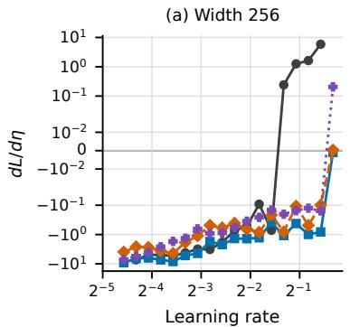

(b) $\| \nabla _ { \theta } L \| _ { 2 } / D _ { u } F _ { \mathsf { n a i v e } }$  
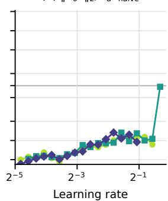

(c) $\| \nabla _ { \theta } L \| _ { 2 } / D _ { u } F _ { \mathsf { b a t c h } }$  
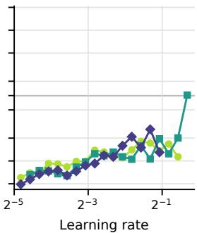  
Finite diff. Fnaive Fbatch Ffixed (GN)

(d) $- g ^ { \top } ( G + \lambda I ) ^ { - 1 } \bar { g } / \eta$  
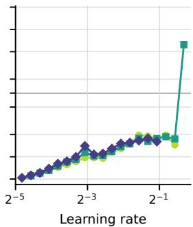  
Width 128 Width 256 Width 512  
Figure 8. LR-gradient estimates for cross-entropy training. CNNs on CIFAR-10 with widths 128, 256, and 512. (a) At width 256, we compare finite differences, EoS-LR based on $F _ { \mathrm { n a i v e } }$ and $F _ { \mathrm { b a t c h } }$ , and time-averaged FP-LR using Gauss–Newton curvature. (b–d) The three estimators across widths. The plots show both the sign and magnitude of the LR gradient.

ResNet on CIFAR-10. EoS-LR also broadly captures the magnitude and LR dependence of the LR gradient for ResNet on CIFAR-10 (Figure 9). The remaining discrepancies near zero at larger LRs vary across seeds, suggesting seed-dependent fluctuations rather than a systematic error in the estimated LR dependence.

The largest Hessian eigenvalue lies above the EoS threshold $2 / \eta$ at smaller LRs and below it at larger LRs. This observation motivates relaxing the equality constraint in Eq. (3) to an inequality. Consider first $F ( \theta ) \leq \eta .$ , equivalently $\lambda _ { \operatorname* { m a x } } \ge 2 / \eta$ . For the Lagrangian $\mathcal { L } ( \theta ) + \lambda ( F ( \theta ) - \eta )$ , the KKT conditions require $\lambda \geq 0$ , and the local sensitivity relation gives $d \mathcal { L } _ { * } / d \eta = - \lambda \leq 0$ , where $\mathcal { L } _ { * } ( \eta )$ denotes the optimal value, assumed differentiable. Reversing the constraint to $F ( \theta ) \geq \eta$ , equivalently $\lambda _ { \operatorname* { m a x } } \le 2 / \eta .$ , yields $\lambda \leq 0$ under the same Lagrangian convention and hence $d \mathcal { L } _ { * } / d \eta \ge 0$ . In either case, complementary slackness implies $\lambda = 0$ when the constraint is inactive. A strictly positive or negative LR gradient therefore requires a nonzero multiplier. The two inequality formulations are thus consistent with the decreasing and increasing branches of a U-shaped LR transfer curve, respectively. This interpretation suggests a possible link between the direction of the sharpness constraint relative to the EoS threshold and the shape of the LR transfer curve.

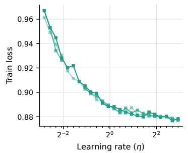

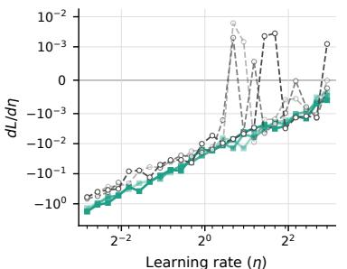

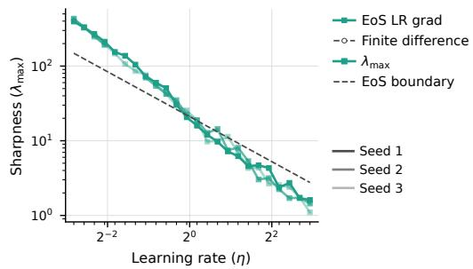  
Figure 9. EoS-LR estimates for ResNet on CIFAR-10. Left: training loss versus LR. Middle: EoS-LR estimates and finite-difference LR gradients. Right: the largest Hessian eigenvalue and the EoS boundary $2 ( 1 + \beta ) / \eta ( 1 + 2 \beta )$ . Each curve corresponds to one of three seeds.

Alignment at averaged parameters. At time-averaged parameters, the cosine similarity between $\nabla \mathcal { L }$ and $\boldsymbol { \nabla } \lambda _ { \mathrm { m a x } }$ stabilizes at a positive value (Figure 10). As discussed in the main text, this gives a negative EoS-LR gradient in Eq. (6), consistent with loss decreasing as the LR increases. When evaluated at the parameters from each training step without averaging, the cosine similarity fluctuates more and can become negative. These negative values show that the sign can differ between individual training steps and averaged parameters. This supports the distinction made in the main text between alignment along the optimization trajectory and on the flat manifold.

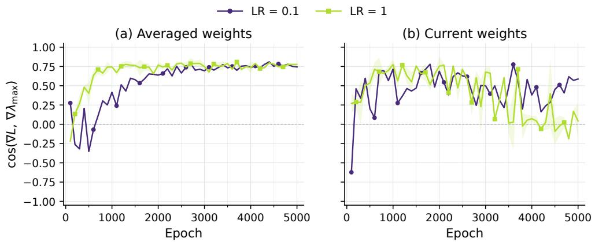  
Figure 10. Parameter averaging reduces fluctuations in sharpness-gradient alignment. ResNet on CIFAR-10 at width 64, trained for 5,000 epochs with LRs 0.1 and 1. We plot cos $\left( \nabla \mathcal { L } , \nabla \lambda _ { \mathrm { m a x } } \right)$ at (a) averaged parameters and (b) current parameters. Curves and shaded regions show seed means and standard errors.

LR exponent of the sharpness gradient. The sharpness-gradient norm $\| \nabla _ { \theta } \lambda _ { \operatorname* { m a x } } \|$ scales with an LR exponent close to −1 at all three widths in Figure 11. This supports the empirical scaling used in the EoS-LR bound in Section 5.2.

Batch sharpness at averaged parameters. At exponentially averaged parameters, batch sharpness remains below $2 / \eta .$ , whereas the largest Hessian eigenvalue stays close to $2 / \eta$ (Figure 12). At the final, unaveraged parameters, batch sharpness is closer to $2 / \eta .$ , particularly after longer training. Thus, the two sharpness

measures behave differently under parameter averaging in this experiment. We therefore used the final parameters without averaging to compute the EoS-LR gradient with $F _ { b a t c h }$  
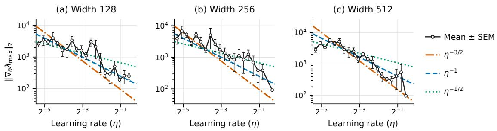  
Figure 11. LR scaling of the sharpness-gradient norm. CNNs on CIFAR-10 at widths 128, 256, and 512. We estimate $\| \nabla _ { \theta } \lambda _ { \operatorname* { m a x } } \|$ from finite differences of $F _ { \mathrm { n a i v e } }$ . Reference lines show exponents $- 3 / 2 , - 1$ , and $- 1 / 2 ;$ the observed scaling is close to −1. Points and error bars show seed means and standard errors.

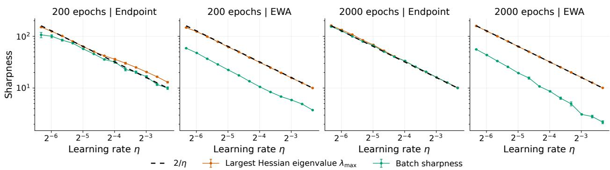  
Figure 12. Batch sharpness falls below the EoS threshold at averaged parameters. Sharpness versus LR on Fashion-MNIST using an MLP. The first two panels show results after 200 epochs, and the last two after 2000 epochs. Within each pair, the left panel uses the final parameters and the right panel uses exponentially averaged parameters (EWA). We compare the largest Hessian eigenvalue and batch sharpness with $2 / \eta$ (dashed).

Longer training under full-batch GD. In a full-batch setting, longer training improves agreement between EoS-LR and finite-difference gradients in the small MLP and CNN experiments (Figure 13). Both models use full-batch GD on 512 examples from two classes of Fashion-MNIST, with parameters averaged over the last 512 updates. For the MLP, agreement extends toward lower LRs as training proceeds; for the CNN, the large differences at 8192 iterations are reduced by 32768 iterations.

This dependence on training iterations is consistent with EoS-LR assuming a constrained minimum in Eq. (3), where $\nabla \mathcal { L } + \lambda \nabla F = 0$ . Figure 14 shows that cos $( \nabla \mathcal { L } , \nabla \lambda _ { \operatorname* { m a x } } ) \approx - 1$ at larger LRs, as expected from this condition when the EoS-LR gradient is positive. This range broadens with training for the MLP; the CNN already exhibits this alignment at many LRs after 8192 iterations, despite remaining differences between the LR-gradient estimates.

## C.2 FP-LR Estimates across Batch Sizes and Architectures

Alignment of averaged gradients. Gradients at epoch-averaged parameters remain closely aligned with data augmentation and batch size 2,048 (Figure 15). Without augmentation and at batch size 128, their cosine similarity falls toward zero as the LR increases. These results support slowly changing gradient directions in the former setting. They do not test changes in gradient magnitude, the independence assumption in Appendix B.1, or the assumption $\langle \partial _ { \eta } \theta _ { t + 1 } \rangle = \langle \partial _ { \eta } \theta _ { t } \rangle$

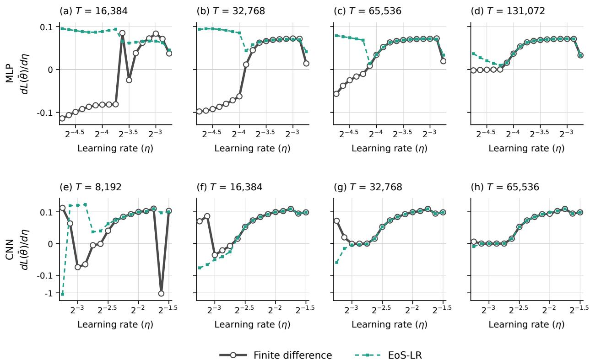  
Figure 13. LR-gradient agreement with longer full-batch GD training. Finite differences (gray) and EoS-LR (teal) for the MLP (top) and CNN (bottom) trained for increasing numbers of iterations T on 512 examples from two classes of Fashion-MNIST. The averaging window remains 512 updates.

CNN batch size. Time-averaged FP-LR captures the overall decrease in LR-gradient magnitude as the LR increases, across the tested batch sizes (Figure 16). “Naive Fixed Point” denotes the fixed-point estimate in Section 4 computed without time averaging. We use either the Hessian or the Gauss–Newton matrix, as indicated in each plot. Using the exact Hessian does not consistently improve agreement with finite differences over the Gauss–Newton approximation. All models are trained for the same number of epochs, so smaller batches result in more parameter updates.

Fashion-MNIST and ResNet8. On Fashion-MNIST, time-averaged FP-LR agrees more closely with finite differences than the naive fixed-point estimate (Figure 17). These plots compare gradient magnitudes and do not establish agreement in sign. For ResNet8, time-averaged FP-LR with the exact Hessian also improves on the naive fixed-point estimate over much of the LR range (Figure 18). Removing batch normalization increases LR sensitivity.

Fixed update budget. FP-LR accuracy still varies with batch size when the number of parameter updates is fixed (Figure 19). For this MLP, the time-averaged Gauss–Newton estimate closely follows finite differences at batch size 4,096, but often overestimates their magnitude at batch size 1,024 and below. The naive Gauss– Newton estimate overestimates sensitivity more strongly. Time averaging therefore improves agreement but does not remove the discrepancies at smaller batch sizes.

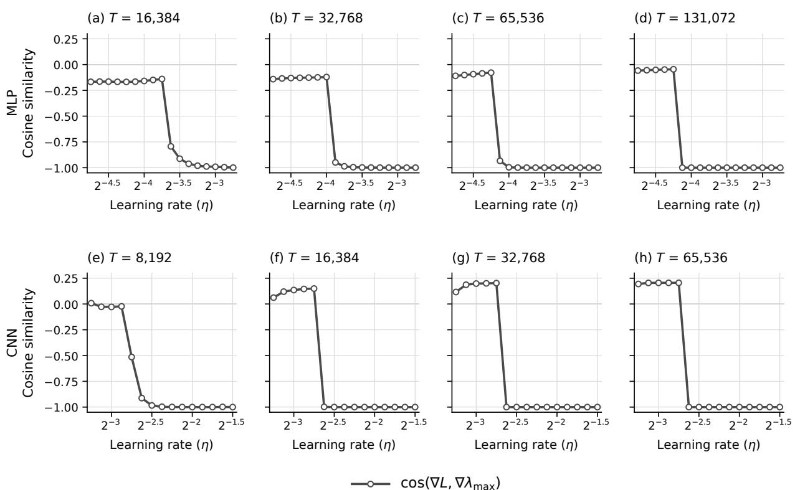

Figure 14. Gradient alignment with longer training. Cosine similarity cos $\left( \nabla \mathcal { L } , \nabla \lambda _ { \mathrm { m a x } } \right)$ at parameters averaged over the last 512 updates, for the same MLP (top) and CNN (bottom) as in Figure 13.  
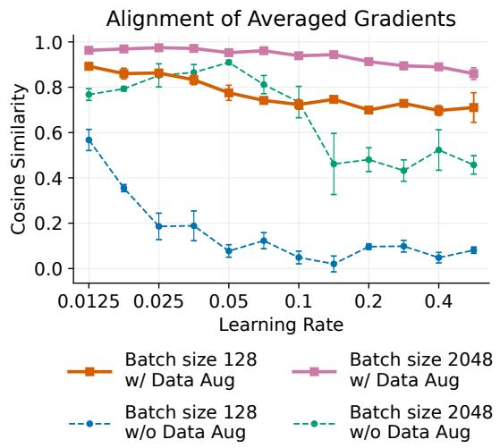  
Figure 15. Alignment of gradients at successive averaged parameters. A width-256 CNN trained on CIFAR-10 with mean-squared loss for 200 epochs. We compare batch sizes 128 and 2,048, with and without augmentation. We plot the cosine similarity of full-data gradients evaluated at successive epoch-averaged parameters near the end of training. Error bars show standard errors across seeds.

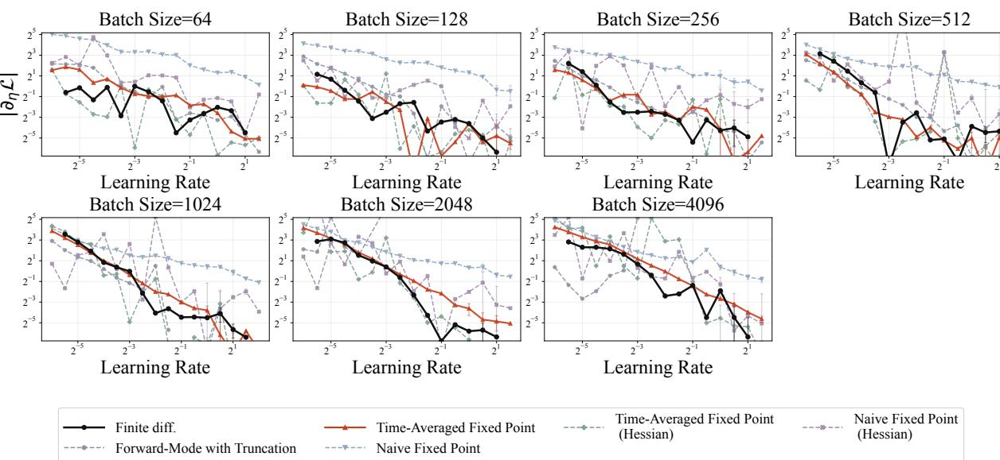  
Figure 16. FP-LR estimates across batch sizes. A width-32 CNN is trained on CIFAR-10 for 200 epochs, with batch sizes from 64 to 4,096. Each panel compares the magnitude of the test-loss LR gradient from finite differences with truncated forward-mode, naive fixed-point, and time-averaged FP-LR estimates. “Hessian” distinguishes exact-Hessian estimates from those using Gauss–Newton curvature.

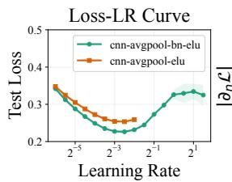

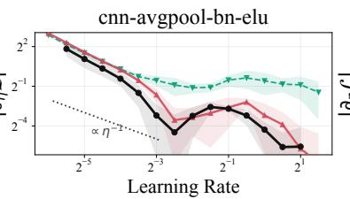

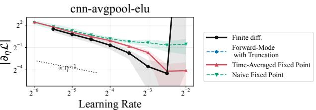  
Figure 17. LR-gradient estimates on Fashion-MNIST. Width-32 CNNs with and without batch normalization are trained with batch size 1,024. Left: test loss versus LR. Middle and right: LR-gradient magnitudes for the models with and without batch normalization, respectively.

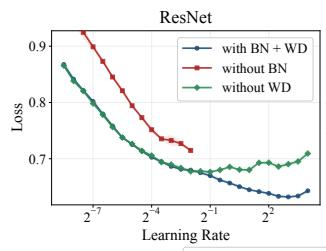

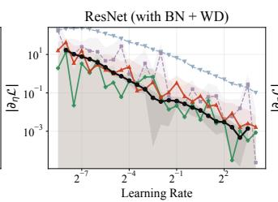

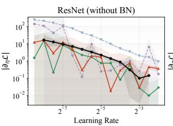

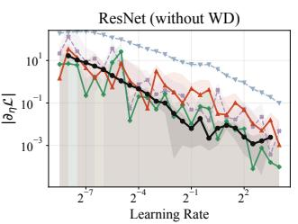  
Figure 18. Batch normalization reduces ResNet8 LR sensitivity. ResNet8 is trained on CIFAR-10 for 100 epochs with SGD, width 8, and batch size 256. Left: test-loss curves with BN and weight decay, without BN, and without weight decay. Remaining panels: corresponding LR-gradient magnitudes, using the exact Hessian or the Gauss–Newton approximation.

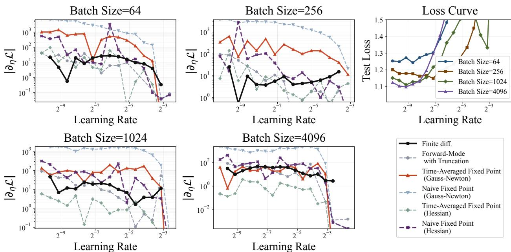  
Figure 19. MLP LR-gradient estimates with a fixed update budget. A width-1,024 MLP with ELU activations is trained on CIFAR-10 for 20,000 updates. We compare batch sizes 64, 256, 1,024, and 4,096. Four panels show the magnitude of the test-loss LR gradient; the upper-right panel shows test loss.

## C.3 FP-LR Estimates for signGD and AdamW

signGD. For ResNet8 trained with signGD, time averaging reduces the overestimation of LR-gradient amplitudes by the naive fixed-point estimate (Figure 20). The time-averaged estimate still differs from finite differences, particularly without batch normalization.

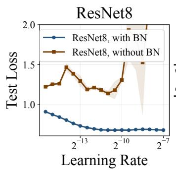

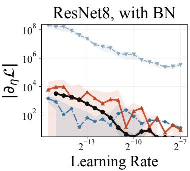

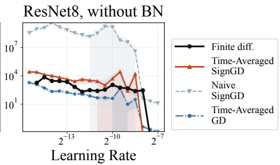  
Figure 20. Time averaging reduces overestimation by the naive signGD estimator. ResNet8 on CIFAR-10 with width 8 and batch size 256, with and without batch normalization. Left: test loss. Middle and right: LRgradient magnitudes, comparing finite differences, time-averaged signGD, naive signGD, and the time-averaged GD approximation.

AdamW. For the CNN trained with AdamW, the time-averaged Adam approximation largely follows the finite-difference (Figure 21). Agreement is poorer near the minimum, where the loss curve is nearly flat. For ResNet8, using only the output-layer contribution improves agreement over much of the LR range (Figure 22). This motivates the layer-wise analysis in Section 5.3, although it does not show that contributions from other layers are negligible in general.

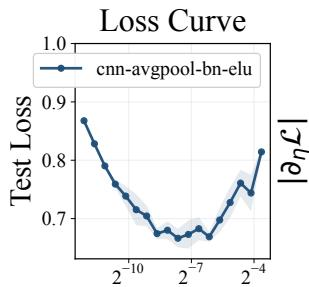  
Learning Rate

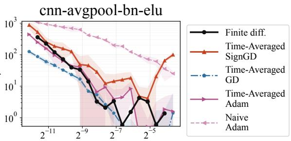  
Learning Rate

Figure 21. Time-averaged estimates for CNN training with AdamW. A width-32 CNN with batch normalization is trained on CIFAR-10 with batch size 1,024. Left: test loss. Right: LR-gradient magnitudes from finite differences and the GD, signGD, and Adam approximations. The naive Adam estimate is included for comparison.  
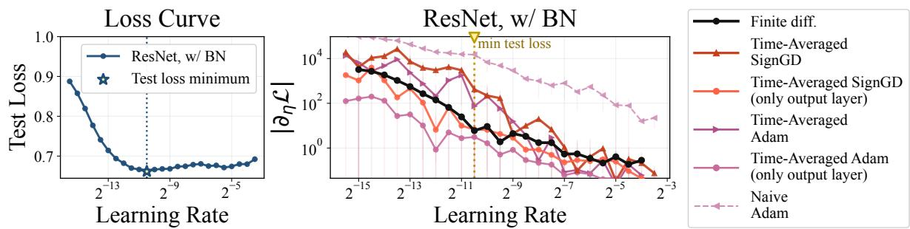  
Figure 22. Output-layer estimates more closely follow finite differences for ResNet8. ResNet8 with batch normalization is trained on CIFAR-10 using AdamW, width 8, and batch size 256. Left: test loss. Right: LR-gradient magnitudes, including estimates restricted to the output layer. The vertical line marks the LR minimizing test loss.

## C.4 Normalization, Weight Decay, and LR Transfer

Normalization and LR settings in GPT. QK normalization broadens the range of LRs that give low validation loss in GPT models trained with the same LR across layers (Figure 23). Without weight decay, layer-wise LRs generally give lower local LR sensitivity than a common LR (Figure 24). Adding weight decay to the common-LR setting also reduces sensitivity in most configurations. Sensitivity does not consistently increase or decrease with model width.

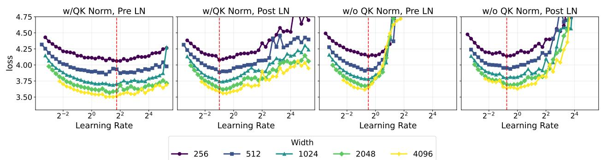  
Figure 23. QK normalization broadens the low-loss LR range with a common LR across layers. GPT models trained on FineWeb with AdamW and weight decay. Panels compare Pre-LN and Post-LN, with and without QK normalization; colors indicate model width.

Batch normalization and weight decay in ResNet. Combining batch normalization with LR-independent weight decay gives a broader range of LRs with high test accuracy than using either alone (Figure 25). At width 32, the magnitude of the accuracy derivative is also smaller over much of the LR range. Here, sensitivity refers to the derivative of accuracy with respect to LR; the other comparisons use loss derivatives.

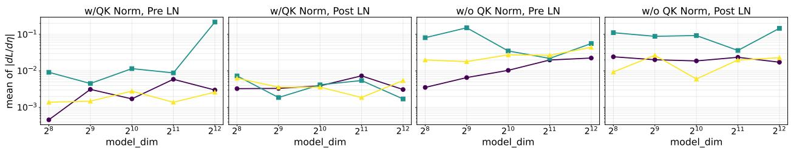  
w/o Weight Decay + Layerwise LR w/o Weight Decay + Constant LR w/ Weight Decay + Constant LR  
Figure 24. Layerwise LRs and weight decay reduce local LR sensitivity in most tested GPT configurations. Columns compare Pre-LN and Post-LN, with and without QK normalization. The three curves use layer-wise LRs without weight decay, a common LR without weight decay, or a common LR with weight decay. At each model width, sensitivity is the mean of the five smallest nonzero absolute finite-difference estimates of the validation-loss LR gradient across the LR sweep.

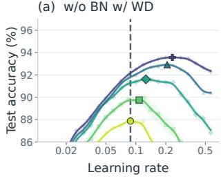

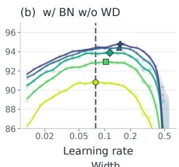

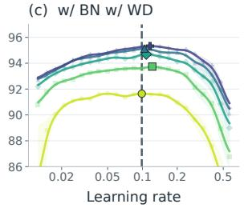

  
Figure 25. Batch normalization and weight decay broaden the high-accuracy LR range. ResNet on CIFAR-10 trained with AdamW and LR-independent weight decay. (a–c) Test accuracy without BN, without weight decay, and with both, across widths 32–512. Curves are smoothed in log-LR space; faint points show seed means, shaded band show standard errors, and dashed lines mark the width-32 optimum. (d) At width 32, the absolute finite-difference derivative of smoothed accuracy, measured in percentage points per unit LR.

Supplementary results with 1/d attention scaling. Pre-LN gives lower local LR sensitivity than Post-LN in the GPT experiment with 1/d attention scaling, where d is the attention head dimension (Figure 26). The difference in local LR sensitivity between models with and without QK normalization is smaller than that between Pre-LN and Post-LN. Validation loss is higher with QK normalization in these runs.

The parameter-scaling experiments in the bottom middle and right panels distinguish scale invariance of the QK layers from scale invariance of the whole model. With QK normalization, the loss remains nearly constant when only the QK parameters are rescaled, but changes when all parameters are rescaled. Thus, QK normalization alone does not make the whole model scale-invariant, consistent with the layer-wise discussion in Section 5.1. In particular, the QK scaling curves are nearly flat for both Pre-LN and Post-LN, despite their different LR sensitivities.

The two-layer Transformer also has a broader range of LRs with low training loss under Pre-LN than under Post-LN (Figure 27).

Figure 26. Pre-LN reduces local LR sensitivity under 1/d attention scaling. GPT models are trained on FineWeb with AdamW. Top: validation loss versus LR for model widths 256–4,096, comparing Pre-LN and Post-LN with and without QK normalization. Bottom left: local LR sensitivity, measured by the mean of the five smallest nonzero LR-gradient magnitudes estimated by finite differences. Bottom middle and right: loss after multiplying all parameters or only QK parameters by c, at model width 256 and LR 0.5.  
  
Figure 27. Pre-LN gives a broader low-loss LR range in a two-layer Transformer. We use the implementation of Yang et al. (2021) with $1 / d$ attention scaling. Panels compare Pre-LN and Post-LN, with and without QK normalization. Curves show training loss for model widths 128–4,096.

## D EXPERIMENTAL SETTINGS

## D.1 CNN for EoS-LR Experiments

The CNN used in Figures 1 and 2 has three $3 \times 3$ convolutional layers with 64, 64, and 128 channels, stride 1, and no padding. Each convolution is followed by ReLU, with $2 \times 2$ max pooling after the second and third convolutions. The resulting features are flattened and passed through a fully connected layer of width M, a ReLU, and a linear output layer with 10 outputs. The convolutional widths remain fixed when M changes. We do not use batch normalization.

We use a fixed subset of 8,192 CIFAR-10 training images. We do not use data augmentation. We use squared loss. We train with SGD without momentum or weight decay and keep the LR constant for up to 200 epochs.

For Figure 1, we use $M \in \{ 1 2 8 , 2 5 6 , 5 1 2 \}$ , batch size 1024, and three random seeds. We sweep 21 LRs from 0.025 to 0.8; panel (c) uses M = 256. For Figure 2, we fix M = 256 and use batch sizes 16, 64, 256, 1024, and 4096, with five random seeds. This sweep uses 18 LRs from 0.0125 to approximately 0.635.

We evaluate training loss and the EoS-LR estimates at the final parameters. The finite differences for $F _ { \mathrm { n a i v e } }$ and $F _ { \mathrm { b a t c h } }$ use step size $h = 1 0 ^ { - 3 }$ , following Appendix B.2. For $F _ { \mathrm { b a t c h } }$ , the sampled batch size

matches the training batch size.

## D.2 CNN and ResNet8 for FP-LR Experiments

This subsection describes the FP-LR experiments in Figure 3 and the additional experiments with CNNs (Figures 16, 17, and 21) and ResNet8 (Figures 18, 20, and 22). Both models use cross-entropy loss and CIFAR-10, except for the Fashion-MNIST experiment in Figure 17.

The CNN is a two-layer convolutional network in which each convolutional layer has 32 channels and is followed by an ELU activation and a $2 \times 2$ average pooling layer, with a final fully connected layer at the end. We compare two architectural variants: cnn-avgpool-bn-elu, which includes Batch Normalization, and cnn-avgpool-elu, which does not. We use SGD as the optimizer, with a weight decay of 1e−5 and a minibatch size of 1024 for both variants. We train for 200 epochs, using the standard CIFAR data augmentations of random cropping and horizontal flipping. No learning rate scheduler is used for the CNN experiments. Training was conducted on a single NVIDIA H100 GPU. One run took approximately 20 minutes to complete 200 epochs, depending on the frequency of metrics collection.

For ResNet8 (He et al., 2016), we trained models for 100 epochs with stronger data augmentation, combining random cropping and horizontal flipping with AutoAugment and Cutout. The learning rate is decayed according to a cosine annealing schedule. When decaying the learning rate with a schedule, we calculate the LR gradient using the average learning rate across the entire training run. The model implementation largely follows the implementations used in Cohen et al. (2021).

## D.3 ResNet Experiments with AirBench

We use the CIFAR-10 AirBench implementation1 with the following modifications and settings. The ResNet has three residual blocks of widths M, 3M, and 4M, each containing three $3 \times 3$ convolutions, batch normalization, GELU activations, and max pooling. A fixed $2 \times 2$ whitening convolution precedes the blocks, and a linear classifier follows them. Whitening filters are estimated from 5,000 training images; their biases are trained for the first three epochs. Batch-normalization scales are fixed at 1, while biases are trainable.

Training uses 45 epochs of Nesterov SGD with momentum 0.85 and cross-entropy loss with label smoothing 0.2. The LR increases linearly from 20% to its peak over the first 10% of training, then decreases linearly to zero. For Figures 9 and 10, we keep the LR constant throughout training. Images are normalized using CIFAR-10 statistics and augmented with horizontal flips, translations of up to four pixels, and $1 2 \times 1 2$ cutout. From each batch of 1,024 images, a proxy network selects the 512 highest-loss examples for training the main model. The proxy has widths (32, 64, 64), two convolutions per block, and is updated every fourth batch over the same training iterations.

Batch-normalization biases use 64 times the optimizer LR of the other parameters. The weight decay is 0.012, normalized so that changing the LR or the bias LR multiplier does not rescale the weight-decay contribution to the update. Every five optimizer steps, we update an exponential moving average of the weights and resume training from these averaged weights. The averaging decay is $0 . 9 5 ^ { 5 } ( t / T ) ^ { 3 }$ , where t is the current step and T is the total number of training steps. Figure 7 reports accuracy on the CIFAR-10 test split, labeled test accuracy in the implementation, using averaged logits from horizontal flips and one-pixel diagonal translations.

Base Width $M _ { 0 }$ is the reference width for the $\mu \mathrm { P }$ scaling. The input and output multipliers, $s _ { \mathrm { i n } }$ and $s _ { \mathrm { o u t } }$ multiply the first block’s initial convolution output and the final logits, respectively. Including the width dependence, the factors are $s _ { \mathrm { i n } } \sqrt { M / M _ { 0 } }$ and $s _ { \mathrm { o u t } } \sqrt { M _ { 0 } / M }$ . The initial weights of that convolution are also scaled by $\sqrt { M _ { 0 } / M }$ . These multipliers scale layer outputs, not optimizer LRs directly. Figure 7 compares $M _ { 0 } = 1$ and 32, varying one multiplier at a time while keeping the other at 1 and holding both fixed across network widths. Specifically, the values 3 and $1 / 9$ in panels $^ { ( \mathrm { b } , \mathrm { c } ) }$ are the width-independent coefficient $s _ { \mathrm { o u t } }$ and the values 3 and $1 / 3$ in panels (d,e) are the width-independent coefficient $s _ { \mathrm { i n } }$ . The width-dependent factors $\sqrt { M / M _ { 0 } }$ and $\sqrt { M _ { 0 } / M }$ remain as specified above.

## D.4 GPT Training

For the GPT-based experiments in Figures 4(c), 5(c), and $^ { 6 ( \mathrm { c } , \mathrm { d } ) }$ , and the additional $\mathrm { G P T }$ experiments, we build on the implementation of Jordan et al. (2024) and train on FineWeb using next-token cross-entropy loss. The reference model has 12 Transformer blocks and 8 attention heads, with model width M varied across experiments. The MLP expands the hidden dimension to 4M and uses squared ReLU activations. Attention uses rotary positional embeddings and a causal sliding-window mask that prevents attention across document boundaries. We retain the value embeddings and learned skip connections of the base implementation; its eighth block omits attention. The normalization layers use RMS normalization. We compare normalization before and after the residual updates (Pre-LN and Post-LN), with and without QK normalization (Figures 23 and 24).

We use AdamW with $( \beta _ { 1 } , \beta _ { 2 } ) = ( 0 . 8 , 0 . 9 5 )$ . The LR shown in the figures is a global multiplier of the layer-wise LRs. Under the $\mu \mathrm { P }$ parametrization, the LRs of the LM head and hidden matrices are multiplied by $M _ { 0 } / M$ , with reference width $M _ { 0 } = 2 5 6$ . Embedding and scalar LRs remain independent of width. Figures 23 and 24 compare common and layer-wise LR settings, while Figure 4(c) varies the LR of a selected parameter group. The default attention scaling is $1 / \sqrt { d _ { \mathrm { h e a d } } } ;$ the $1 / d _ { \mathrm { h e a d } }$ variant is used in Figure 26.

Our reference training setup uses sequences of 8192 tokens. Training lasts 10,000 iterations in total, including 1,000 iterations of linear warmup. The LR then remains constant before a final linear decay. The reference LR-transfer sweeps use 5,000 decay iterations; the LR-gradient experiments also include runs with this phase reduced to one iteration. Validation loss is evaluated on a separate FineWeb validation split. The layer-wise FP-LR profiles in Figure $6 ( \mathrm { c } , \mathrm { d } )$ use the computation described in Appendix B.3. We trained models with one H100 GPU and it took approximately 2-3 hours per training run.