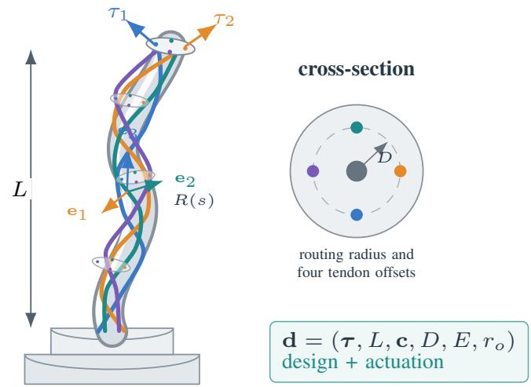
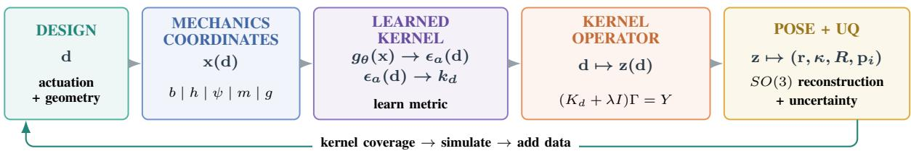
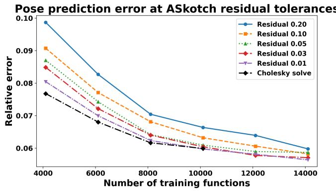
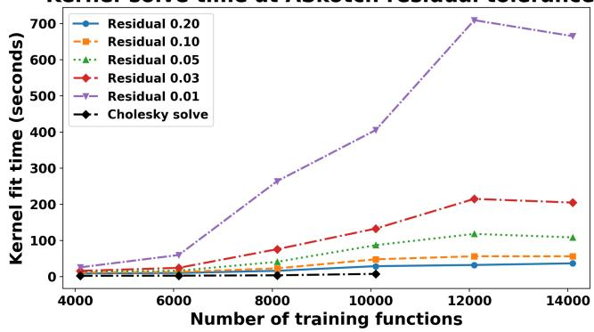
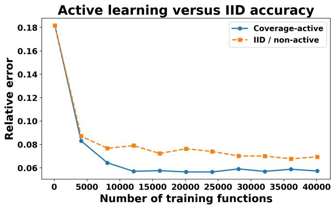
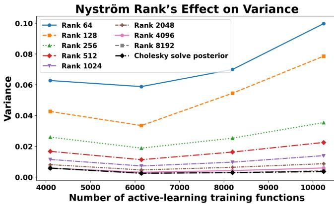
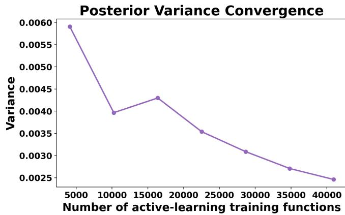
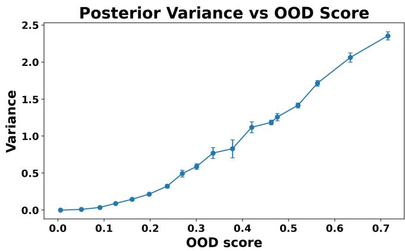
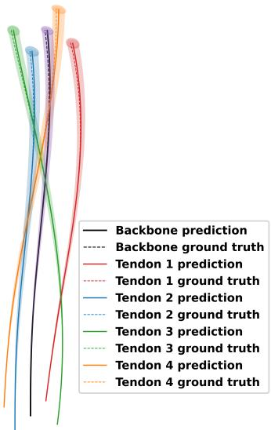

# A Probabilistic, Rotation-Preserving Kernel Operator Surrogate for Continuum-Robot Design Spaces

Branden Frieden1, Alan Kuntz2, and Varun Shankar1

Abstract— We develop an uncertainty-aware, operatorlearning-based surrogate for tendon-driven continuum robots (TDCRs) that generalizes across robot design and actuation while predicting the complete equilibrium configuration. Our central idea is a nonstationary Gaussian-process (GP) kernel whose metric is learned by a shallow neural network from mechanics-aware design coordinates. The network learns how similarity changes across design space, while the resulting kernel defines the design-to-pose operator, its posterior uncertainty, and a criterion for sequential simulator acquisition. We represent backbone position and rotational strain with spatial kernels and reconstruct orientation directly on SO(3), preserving valid material frames and tendon geometry. We use ASkotch with Nystrom preconditioning for scalable kernel¨ operator solves and a separate Nystrom approximation for¨ posterior covariance. Experiments show that kernel-coverage acquisition reduces mean trajectory error by approximately 15% relative to IID sampling, while posterior variance increases for increasingly unsupported designs. Compared with prior neural-operator TDCR models, the method is 30–50% more accurate using approximately 5× fewer training designs while additionally providing posterior uncertainty estimates.

## I. INTRODUCTION

A continuum-robot surrogate becomes substantially more useful when it spans robot design as well as actuation, returns the complete equilibrium shape, and indicates when a query is poorly supported by data. Tendon-driven continuum robots (TDCRs) are attractive for minimally invasive surgery and confined-space manipulation because of their compact actuation and large, smooth deformations [1], [2], [3]. Geometrically exact Cosserat-rod models capture tendon loading, backbone mechanics, and routing geometry [4], [5], but repeated boundary-value solves become costly in planning, control, uncertainty analysis, and design optimization [6]. In this work, we focus on operator-learning-based, uncertaintyaware surrogate models for TDCRs that take design and actuation parameters as inputs and supply full backbone/materialframe pose and routed tendon trajectories as outputs, together with posterior uncertainty estimates; see Figure 1.

Operator learning has recently been leveraged in several robotics applications. Examples include DeepONet-type inverse load reconstruction for Cosserat rods [7], neural operators for full-shape soft-robot inverse kinematics [8], and design-space neural operators for TDCR equilibria [9]. However, neural operators do not typically come with uncertainty estimates, requiring reformulation, ensembles, or post-hoc modifications [10], [11], [12], [13], [14], [15]. Gaussian processes (GPs) offer an inherently uncertaintyaware alternative, with growing interesting on GP-based operator-learning methods for PDEs [16], [17], [18], [19]. GPs also provide uncertainty-aware models for continuumrobot pose and strain estimation on SE(3) [20], forward and inverse kinematics [21], and online probabilistic control [22]; more broadly, GP uncertainty supports data-efficient robot learning [23]. These approaches primarily learn state, kinematic, or control maps for a fixed robot.

  
Fig. 1. Four-tendon TDCR and the continuous configuration learned by the surrogate. The input contains robot-design and actuation parameters; the output is the backbone/material-frame pose and tendon trajectories.

In this work, we present a probabilistic kernel/GP surrogate model for TDCRs whose metric is learned by a neural network. We use a small shallow neural network maps mechanics-aware coordinates to local blockwise kernel shapes, which define a positive-definite nonstationary Matern´ covariance kernel [24]. The network never predicts the robot pose: it learns how similarity changes across design space. The resulting kernel simultaneously defines the design-topose operator, its GP uncertainty, and a kernel-coverage criterion for acquiring new simulator data.

We also build the output representation to respect the mechanics. Spatial kernel coefficients represent dimensionless backbone position and rotational strain; we integrate the predicted strain to reconstruct orientation directly on $S O ( 3 )$ then recover tendon paths analytically from the routing geometry. We focus on four-tendon TDCRs and enforce the corresponding symmetry in both the learned metric and prediction. For scalability, we use ASkotch [25] with a Nystrom preconditioner to solve the kernel systems associ-¨ ated with the GP mean, and we use an independent Nystrom¨ construction to approximate the posterior covariance. We then propagate both design-space and spatial uncertainties to Cartesian covariance tubes around the TDCR.

Our experimental results show that kernel-coverage acquisition reduces mean trajectory error by approximately 15% relative to IID acquisition over the tested training sizes. We also find that the GP posterior variance increases systematically as designs move away from the training distribution. The overall method is 30–50% more accurate, using approximately $5 \times$ fewer training designs, than prior neural-operator work for TDCRs [9], while also providing posterior uncertainty estimates.

The remainder of the paper is organized as follows. Section III develops the kernel operator surrogate, including the rotation-preserving pose representation, mechanicsaware design coordinates, learned nonstationary kernel metric, sequential acquisition, and scalable mean and covariance calculations. Section IV evaluates prediction accuracy, active acquisition, scalable kernel solves, posterior uncertainty, and Cartesian uncertainty propagation. We conclude with the main findings and directions for future work.

## II. BACKGROUND

## A. TDCR mechanics

We model the robot backbone as a geometrically exact Cosserat rod [26], [4]. Let $s \in [ 0 , L ]$ denote arclength, $\mathbf { r } ( s ) \in$ $\mathbb { R } ^ { 3 }$ the backbone centerline, and $R ( s ) \in S O ( 3 )$ the material frame. The rod kinematics are

$$
{ \bf r ^ { \prime } } ( s ) = R ( s ) \nu ( s ) , \qquad R ^ { \prime } ( s ) = R ( s ) [ \kappa ( s ) ] _ { \times } ,\tag{1}
$$

where $\pmb { \nu }$ is the shear/extension strain, κ is the bending/torsion strain, and $[ \cdot ] _ { \times }$ is the cross-product matrix. Internal force and moment satisfy the Cosserat balance laws and are related to these strains by constitutive matrices determined by the backbone geometry and material properties [26], [5].

For tendon i, let $\rho _ { i } ( s )$ denote its known offset from the backbone in the local material frame. Its spatial trajectory is

$$
\mathbf { p } _ { i } ( s ) = \mathbf { r } ( s ) + R ( s ) \pmb { \rho } _ { i } ( s ) .\tag{2}
$$

Tendon tensions enter the Cosserat equilibrium equations through distributed forces and moments induced by these routed paths [4]. Solving the resulting boundary-value problem yields r, R, and the tendon trajectories. We use these mechanics solves as the high-fidelity data source and learn the map from design/actuation parameters to the resulting continuous configuration.

## B. Kernel operators and Gaussian-process uncertainty

A design-space surrogate maps a parameter vector d to a function-valued robot configuration. Previous TDCR operator models represented this map with neural operators [9]; here we instead use kernel regression after representing the output fields in a common coefficient space. If $\mathbf { z ( d ) } \in \mathbb { R } ^ { d _ { z } }$ denotes those coefficients and $k _ { d }$ is a positive-definite kernel on design space, the regularized kernel model has the form

$$
\widehat { \mathbf { z } } ( \mathbf { d } ) = \sum _ { j = 1 } ^ { N } k _ { d } ( \mathbf { d } , \mathbf { d } _ { j } ) \gamma _ { j } ,\tag{3}
$$

with coefficients obtained from one shared kernel system. Kernel constructions of this type have been shown to be competitive for operator learning [16].

The same positive-definite kernel defines a GP covariance [27]. Thus, the kernel fit supplies both a posterior mean and a posterior covariance measuring how strongly a query is supported by the acquired designs. We use this dual interpretation twice: a spatial kernel represents fields along normalized arclength, while a second kernel learns the design-to-coefficient map. The following section builds both kernels so that the reconstructed pose respects $S O ( 3 )$ and the design metric reflects TDCR mechanics.

## III. PROBABILISTIC KERNEL OPERATOR LEARNING

Let $\textbf { d } = \left( \tau , L , \mathbf { c } , D , E , r _ { o } \right)$ collect tendon loads, robot length, routing twist rates, routing radius, Young’s modulus, and backbone radius. For each design, the mechanics solver returns a backbone $\mathbf { r _ { d } } ( s )$ and material-frame orientation. We encode orientation through rotational strain $\kappa _ { \bf d } ( s )$ and learn the parametric operator

$$
\mathcal { G } : \mathbf { d } \longmapsto \left( \frac { \mathbf { r _ { d } } ( L \xi ) } { L } , L \kappa _ { \mathbf { d } } ( L \xi ) \right) , \qquad \xi \in [ 0 , 1 ] .\tag{4}
$$

The input d is finite-dimensional, but the output of $\mathcal { G }$ is a pair of fields on [0, 1]; throughout, operator learning refers to learning this complete design-to-function map. We realize the map in two levels: (1) a spatial kernel converts each functionvalued equilibrium to a finite coefficient vector $\mathbf { z ( d ) }$ , and (2) a design-space kernel learns the coefficient map $\mathbf { d } \mapsto \mathbf { z } ( \mathbf { d } )$ Evaluating that second map at a new design therefore predicts an entire continuous robot configuration after decoding z. The predicted strain is integrated on $S O ( 3 )$ and combined with the known routing geometry. The same learned design kernel also supplies $\mathrm { G P }$ uncertainty and the geometry used for sequential simulator acquisition; see Figure 2.

## A. Rotation-preserving output representation

Let $\xi ~ = ~ s / L$ and $S ~ = ~ \{ \xi _ { q } \} _ { a = 1 } ^ { n _ { s } } ~ \subset ~ [ 0 , 1 ]$ . We use the kernel-literature Matern´ $C ^ { 4 }$ kernel [28], [29]

$$
\phi ( r ) = ( r ^ { 2 } + 3 r + 3 ) e ^ { - r } , \qquad k _ { s } ( \xi , \xi ^ { \prime } ) = \phi ( \epsilon _ { s } | \xi - \xi ^ { \prime } | ) { . }\tag{5}
$$

with Gram matrix $( K _ { s } ) _ { q j } = k _ { s } ( \xi _ { q } , \xi _ { j } )$ . We choose $\epsilon _ { s }$ from cond1 $( K _ { s } ) = 1 0 ^ { 1 0 }$ (making the kernel as flat as possible to increase approximation power) [29] and reuse the same factorization for every equilibrium and both output fields.

  
Fig. 2. Method overview. Mechanics-aware coordinates feed a learned nonstationary kernel metric; the kernel operator learns d $\mapsto \mathbf { z } ( \mathbf { d } )$ , after which structured reconstruction recovers the TDCR pose and uncertainty. The same kernel geometry drives sequential acquisition.

We represent rotational strain rather than the entries of $R ( s )$ : the strain is an unconstrained Euclidean field, while its integration recovers a rotation without a posterior projection onto $S O ( 3 )$ . For equilibrium $\ell ,$ the two dimensionless output fields are

$$
\frac { { \bf r } _ { \ell } ( s ) } { L _ { \ell } } = \sum _ { j = 1 } ^ { n _ { s } } { \bf a } _ { \ell , j } k _ { s } \bigg ( \frac { s } { L _ { \ell } } , \xi _ { j } \bigg ) ,\tag{6}
$$

$$
L _ { \ell } \pmb { \kappa } _ { \ell } ( s ) = \sum _ { j = 1 } ^ { n _ { s } } \mathbf { c } _ { \ell , j } k _ { s } \left( \frac { s } { L _ { \ell } } , \xi _ { j } \right) .\tag{7}
$$

Let $F _ { \ell , r }$ and $F _ { \ell , \kappa }$ contain the sampled dimensionless fields as rows. The coefficient matrices satisfy $K _ { s } A _ { \ell } = F _ { \ell , r }$ and $K _ { s } C _ { \ell } ~ = ~ F _ { \ell , \kappa }$ , and one equilibrium is described by the coefficients

$$
\begin{array} { r } { \mathbf { z } _ { \ell } = \left[ \mathrm { v e c } ( A _ { \ell } ) ^ { T } \quad \mathrm { v e c } ( C _ { \ell } ) ^ { T } \right] ^ { T } \in \mathbb { R } ^ { 6 n _ { s } } . } \end{array}\tag{8}
$$

Every training sample is thus one design paired with coefficients for two continuous fields; one spatial factorization produces the coefficient representation for the entire data set. Learning Eq. (4) therefore reduces to the finite-dimensional coefficient map d $\mapsto \mathbf { z } ( \mathbf { d } )$ , while evaluation of the spatial kernel recovers the two fields at arbitrary arclength. We reconstruct orientation from the predicted strain through

$$
R _ { \ell } ^ { \prime } ( s ) = R _ { \ell } ( s ) [ \star _ { \ell } ( s ) ] _ { \times } , \qquad R _ { \ell } ( 0 ) = I ,\tag{9}
$$

using a Lie-group integrator, which preserves $R _ { \ell } ( s ) \in$ $S O ( 3 )$ [30]. Tendon i then follows

$$
\mathbf { p } _ { i , \ell } ( s ) = \mathbf { r } _ { \ell } ( s ) + R _ { \ell } ( s ) \rho _ { i } ( \mathbf { d } _ { \ell } , s ) .\tag{10}
$$

The operator therefore learns one common pose, while tendon-specific geometry enters analytically through $\rho _ { i } .$ . The same spatial kernel also defines interpolation uncertainty. Its posterior mean is the interpolant above, and its covariance factor is

$$
v _ { s } ( \xi , \xi ^ { \prime } ) = k _ { s } ( \xi , \xi ^ { \prime } ) - k _ { s } ( \xi , S ) K _ { s } ^ { - 1 } k _ { s } ( S , \xi ^ { \prime } ) ,\tag{11}
$$

the squared spatial power function in the noiseless case [28], [27].

## B. Mechanics-aware input coordinates

The design kernel needs a notion of distance between robots. We define these distances through dimensionless combinations that enter bending, shear, and tendon routing. Let $I ~ = ~ \pi r _ { o } ^ { 4 } / 4 , ~ A ~ = ~ \pi r _ { o } ^ { 2 }$ , and $G ~ = ~ E / [ 2 ( 1 + \nu ) ]$ For tendon $i = 1 , \dots , N _ { t }$ and (equispaced) routing sample $q = 1 , \ldots , n _ { \phi }$ , let $\eta _ { q } \in \mathcal { Q }$ denote the normalized arclength location and let $\alpha _ { i } ^ { 0 }$ denote the base angle of tendon i. Define

$$
b _ { i } = \frac { \tau _ { i } D L } { E I } , \qquad h _ { i } = \mathrm { a s i n h } \biggl ( \frac { \tau _ { i } } { \sigma _ { h } G A } \biggr ) ,\tag{12}
$$

where $\sigma _ { h }$ is a fixed shear scale. For normalized routing sites $\eta _ { q }$ and tendon base angle $\alpha _ { i } ^ { 0 }$ , define

$$
\psi _ { i , q } = b _ { i } \left[ \sin ( \alpha _ { i } ^ { 0 } + c _ { i } L \eta _ { q } ) \cos ( \alpha _ { i } ^ { 0 } + c _ { i } L \eta _ { q } ) \right] ^ { T } ,\tag{13}
$$

$$
\mathbf { m } _ { q } = \sum _ { i = 1 } ^ { N _ { t } } \psi _ { i , q } , \qquad \mathbf { g } = \left[ D / L \quad r _ { o } / L \quad D / r _ { o } \right] ^ { T } .\tag{14}
$$

Here $b _ { i }$ measures the tendon loading relative to bending stiffness, $h _ { i }$ separates the shear scale near zero, and $\psi _ { i , q }$ records how loading is distributed around the cross-section as the routing twists along the robot. The resultant $\mathbf { m } _ { q }$ additionally keeps designs with similar net bending close even when individual tendons differ. We stack

$$
\mathbf { x } ( \mathbf { d } ) = \left[ \mathbf { b } ^ { T } \quad \mathbf { h } ^ { T } \quad \mathrm { v e c } ( \psi ) ^ { T } \quad \mathrm { v e c } ( \mathbf { m } ) ^ { T } \quad \mathbf { g } ^ { T } \right] ^ { T } ,\tag{15}
$$

with dimension $d _ { x } = 2 N _ { t } + 2 N _ { t } n _ { \phi } + 2 n _ { \phi } + 3$ and five blocks $\boldsymbol { B } = \{ b , h , \psi , m , g \}$ . We keep these blocks separate because the nonstationary kernel below learns one local shape parameter for each mechanical contribution. Coordinates are standardized from the acquired designs. For the four-tendon robot, normalization moments are pooled over the cyclic $C _ { 4 }$ orbit so quarter-turn rotations and the corresponding tendon relabelings receive identical normalization.

## C. Learned nonstationary GP operator

Let $\overline { { \mathbf { x } } } ^ { ( a ) } ( \mathbf { d } )$ denote standardized block a. A shallow network supplies one positive local kernel shape per block:

$$
\widetilde { \mathbf { \epsilon } } _ { \theta } ( \mathbf { d } ) = \epsilon _ { \mathrm { m i n } } + \mathrm { s o f t p l u s } \left( g _ { \theta } ( \overline { { \mathbf { x } } } ( \mathbf { d } ) ) \right) .\tag{16}
$$

The network outputs only determine the local blockwise metric used when two designs are compared, allowing the relevant length scale to vary across design space without giving up the positive-definite GP construction. We impose $C _ { 4 }$ invariance by geometric averaging,

$$
\epsilon _ { a } ( \mathbf { d } ) = \exp \left[ \frac { 1 } { | C _ { 4 } | } \sum _ { g \in C _ { 4 } } \log \widetilde { \epsilon } _ { \theta , a } ( g \mathbf { d } ) \right] .\tag{17}
$$

For two designs, set

$$
\begin{array} { r } { H _ { a } ( \mathbf { d } , \mathbf { d } ^ { \prime } ) = \frac { 1 } { 2 } \left( \epsilon _ { a } ( \mathbf { d } ) ^ { - 2 } + \epsilon _ { a } ( \mathbf { d } ^ { \prime } ) ^ { - 2 } \right) , } \end{array}\tag{18}
$$

$$
r _ { d } ( \mathbf { d } , \mathbf { d } ^ { \prime } ) ^ { 2 } = \sum _ { a \in \mathcal { B } } \frac { \| \overline { { \mathbf { x } } } ^ { ( a ) } ( \mathbf { d } ) - \overline { { \mathbf { x } } } ^ { ( a ) } ( \mathbf { d } ^ { \prime } ) \| _ { 2 } ^ { 2 } } { H _ { a } ( \mathbf { d } , \mathbf { d } ^ { \prime } ) } ,\tag{19}
$$

$$
q _ { d } ( \mathbf { d } , \mathbf { d } ^ { \prime } ) = \prod _ { a \in \mathcal { B } } \left[ \epsilon _ { a } ( \mathbf { d } ) \epsilon _ { a } ( \mathbf { d } ^ { \prime } ) H _ { a } ( \mathbf { d } , \mathbf { d } ^ { \prime } ) \right] ^ { - d _ { a } / 2 } .\tag{20}
$$

Here $\epsilon _ { a } ( { \bf d } )$ acts as a local inverse length scale for block $a .$ The averaged metric $H _ { a }$ compares two designs using both local scales while $q _ { d }$ supplies the normalization required by the nonstationary covariance. The nonstationary construction [24]

$$
k _ { d } ( \mathbf { d } , \mathbf { d ^ { \prime } } ) = q _ { d } ( \mathbf { d } , \mathbf { d ^ { \prime } } ) \phi ( r _ { d } ( \mathbf { d } , \mathbf { d ^ { \prime } } ) )\tag{21}
$$

therefore remains positive definite as the learned metric varies. For acquired pairs $\{ ( \mathbf { d } _ { \ell } , \mathbf { z } _ { \ell } ) \} _ { \ell = 1 } ^ { N }$ , we standardize the coefficients as ${ \bf y } _ { \ell } = ( { \bf z } _ { \ell } - \pmb { \mu } _ { z } ) \oslash \pmb { \sigma } _ { z }$ and collect them in Y. With $( K _ { d } ) _ { \ell m } = k _ { d } ( { \bf d } _ { \ell } , { \bf d } _ { m } )$ , all output coefficients share one kernel-based operator learning system,

$$
( K _ { d } + \lambda I ) \Gamma = Y ,\tag{22}
$$

$$
\widehat { \mathbf { y } } ( \mathbf { d } _ { * } ) = k _ { d } ( \mathbf { d } _ { * } , D ) \Gamma ,\tag{23}
$$

$$
\widehat { \mathbf { z } } ( \mathbf { d } _ { * } ) = \pmb { \mu } _ { z } + \pmb { \sigma } _ { z } \odot \widehat { \mathbf { y } } ( \mathbf { d } _ { * } ) .\tag{24}
$$

We enforce quarter-turn symmetry in the output through

$$
\widehat { \mathbf { z } } _ { C _ { 4 } } ( \mathbf { d } ) = \frac { 1 } { | C _ { 4 } | } \sum _ { g \in C _ { 4 } } T _ { g ^ { - 1 } } \widehat { \mathbf { z } } ( g \mathbf { d } ) ,\tag{25}
$$

where $T _ { g }$ rotates backbone and strain coefficients. Interpreting $k _ { d }$ as a GP covariance gives the common scalar covariance factor

$$
v _ { d } (  { \mathbf d } ,  { \mathbf d ^ { \prime } } ) = k _ { d } (  { \mathbf d } ,  { \mathbf d ^ { \prime } } ) - k _ { d } (  { \mathbf d } , D ) ( K _ { d } + \lambda I ) ^ { - 1 } k _ { d } ( D ,  { \mathbf d ^ { \prime } } ) .\tag{26}
$$

Thus $v _ { d }$ here measures uncertainty in the design-tocoefficient map, while $v _ { s }$ in (11) measures interpolation uncertainty within each output function. These are distinct sources of uncertainty. Both are decoded through Eqs. (6)– (10); each sampled strain is integrated on $S O ( 3 )$ , so uncertainty propagation never produces an invalid orientation.

## D. Learning the design metric

We learn θ in (16) through the kernel operator itself. At each update, acquired simulator equilibria are split into support and query sets I and J . The support set defines a temporary kernel operator, which is evaluated on the query designs and decoded all the way back to physical tendon positions. Gradients therefore pass through the learned metric, kernel solve, spatial reconstruction, and SO(3) decoder. If $P _ { j }$ and $\widehat { P } _ { j } ( \theta )$ stack the true and predicted tendon positions for query robot $j ,$ we minimize

$$
\mathcal { L } ( \boldsymbol { \theta } ) = \frac { 1 } { | \mathcal { T } | } \sum _ { j \in \mathcal { I } } \frac { \Vert \widehat { P } _ { j } ( \boldsymbol { \theta } ) - P _ { j } \Vert _ { F } } { \Vert P _ { j } \Vert _ { F } } + \beta \mathcal { R } ( \boldsymbol { \theta } ) .\tag{27}
$$

The regularizer prevents degenerate local shapes. An independent selection set chooses the checkpoint, after which the

operator is refit on all acquired designs by solving (22). This predictive objective selects the covariance through physical pose error.

## E. Sequential kernel-coverage acquisition

The learned kernel also defines coverage of the admissible design space. Let A be the acquired designs and C an inputonly candidate pool. The corresponding design GP assigns a candidate the posterior variance

$$
v _ { A } ( \mathbf { d } ) = k _ { d } ( \mathbf { d } , \mathbf { d } ) - k _ { d } ( \mathbf { d } , \mathcal { A } ) ( K _ { A } + \lambda I ) ^ { - 1 } k _ { d } ( \mathcal { A } , \mathbf { d } ) .\tag{28}
$$

Evaluating this quantity over a large candidate pool requires repeated solves with the acquired-set kernel. We therefore use a normalized kernel-coverage surrogate that depends only on pairwise kernel evaluations. For a candidate d, define normalized similarity and coverage deficit

$$
\widetilde { k } _ { d } ( \mathbf { d } , \mathbf { d } ^ { \prime } ) = \frac { k _ { d } ( \mathbf { d } , \mathbf { d } ^ { \prime } ) } { \sqrt { k _ { d } ( \mathbf { d } , \mathbf { d } ) k _ { d } ( \mathbf { d } ^ { \prime } , \mathbf { d } ^ { \prime } ) } } ,\tag{29}
$$

$$
\delta ( \mathbf { d } ; \mathcal { A } ) = 1 - \operatorname* { m a x } _ { \mathbf { a } \in \mathcal { A } } \widetilde { k } _ { d } ( \mathbf { d } , \mathbf { a } ) .\tag{30}
$$

This is related to data-independent P-greedy selection [31]. The connection to GP variance is explicit in the interpolation limit. If $c = 1 - \delta .$ , then for $\lambda = 0$

$$
\frac { v _ { A } ( \mathbf { d } ) } { k _ { d } ( \mathbf { d } , \mathbf { d } ) } \leq 1 - c ^ { 2 } = 2 \delta - \delta ^ { 2 } .\tag{31}
$$

We greedily select the eligible candidate with largest δ and update coverage after each selection. Selection uses only candidate inputs and the current learned kernel; no candidate equilibrium is evaluated before selection. We simulate the selected designs, add their equilibria to A, and refit the normalizer, metric, and operator before the next batch. Prescribed proportions of discrete actuation classes are maintained in every selected prefix.

## F. Scalable kernel operator learning

A direct solve of Eq. (22) requires storing the N×N Gram matrix. We instead use ASkotch [25], which performs blockcoordinate updates with a low-rank Nystrom preconditioner¨ while evaluating only required rows of the full kernel. With $\lambda _ { \mathrm { e f f } } = \operatorname* { m a x } \{ \lambda , \lambda _ { \mathrm { f l o o r } } \}$ , the restricted residual for block I is

$$
G _ { \mathcal { T } } ^ { ( t ) } = { ( K _ { d } ) _ { \mathcal { T } , : } \Gamma ^ { ( t ) } + \lambda _ { \mathrm { e f f } } \Gamma _ { \mathcal { T } , : } ^ { ( t ) } - Y _ { \mathcal { T } , : } } .\tag{32}
$$

All $d _ { z }$ right-hand sides are solved jointly. We use block size $\textit { b } = \mathrm { \operatorname* { m a x } } \{ 1 0 0 , \lceil N / 1 0 0 \rceil \}$ and preconditioner rank $r = \mathrm { m i n } \{ 1 0 0 , N \}$ . The r Nystrom landmarks are chosen ¨ independently of the sampled coordinate blocks, so the preconditioner rank is not tied to b. Crucially, this Nystrom ap-¨ proximation is only a preconditioner. Equation (32) evaluates rows of the full learned kernel, so ASkotch approximates the solution of the original kernel system rather than replacing the operator by a rank-r model. The fitted expansion still contains all N acquired poses. To the best of our knowledge, this is the first application of ASkotch to kernel-based operator learning. In Section IV, we compare ASkotch to using Cholesky factorizations for solving (22).

## G. Sparse posterior uncertainty

The mean and covariance use Nystrom approximations for ¨ different purposes. ASkotch uses one only to precondition the mean solve. For the posterior covariance, where the full Gram matrix would otherwise be required explicitly, we build a separate Fully Independent Training Conditional (FITC)- style Nystrom approximation [32]. Its landmarks are sampled¨ independently of the ASkotch preconditioner. Let $Z _ { u }$ contain $r _ { u }$ uncertainty landmarks and $K _ { d } ( Z _ { u } , Z _ { u } ) + \epsilon _ { u } I = L _ { u } L _ { u } ^ { T }$ Define whitened features and the FITC diagonal correction by

$$
\phi ( d ) = L _ { u } ^ { - 1 } K _ { d } ( Z _ { u } , d ) ,\tag{33}
$$

$$
\delta _ { i } = \operatorname* { m a x } \{ k _ { d } ( d _ { i } , d _ { i } ) - \phi ( d _ { i } ) ^ { T } \phi ( d _ { i } ) , 0 \} .\tag{34}
$$

The low-rank term $\phi ( d _ { i } ) ^ { T } \phi ( d _ { i } )$ captures variance represented by the landmark subspace; $\delta _ { i }$ retains the remaining pointwise prior variance instead of discarding it as in a pure low-rank Nystrom covariance. With¨ $\Phi _ { X }$ containing $\phi ( d _ { i } ) ^ { T }$ as rows,

$$
W = \mathrm { d i a g } ( \delta + \lambda _ { u } { \bf 1 } ) ^ { - 1 } , \qquad A = I _ { r _ { u } } + \Phi _ { X } ^ { T } W \Phi _ { X } ,\tag{35}
$$

and the approximate design-space covariance is

$$
\widehat { v } _ { d } ( d , d ^ { \prime } ) = k _ { d } ( d , d ^ { \prime } ) - \phi ( d ) ^ { T } \phi ( d ^ { \prime } ) + \phi ( d ) ^ { T } A ^ { - 1 } \phi ( d ^ { \prime } ) .\tag{36}
$$

For our kernel, $k _ { d } ( d , d ) = 3 ,$ , so $\widehat { v } _ { d } ( d ) = 3 - \| \phi ( d ) \| _ { 2 } ^ { 2 } +$ $\phi ( d ) ^ { T } A ^ { - 1 } \phi ( d )$ . The reduced system is accumulated in chunks, allowing all acquired designs to condition the approximate posterior without forming $K _ { d }$

To recover correlations among pose coefficients, let

$$
B _ { z } = \frac { 1 } { N } \sum _ { n = 1 } ^ { N } ( { \bf z } _ { n } - { \bf \bar { z } } ) ( { \bf z } _ { n } - { \bf \bar { z } } ) ^ { T } ,\tag{37}
$$

$$
\begin{array} { r } { \mathrm { C o v } [ { \bf z ( d ) } , { \bf z ( d ^ { \prime } ) } ] \approx \widehat { v } _ { d } ( { \bf d } , { \bf d ^ { \prime } } ) B _ { z } . } \end{array}\tag{38}
$$

After applying the $C _ { 4 }$ coefficient actions, denote the resulting query covariance by Σz(d). We propagate position relative to the known backbone base using

$$
\begin{array} { r } { \widetilde { \mathbf { J } } _ { z , i } ( \mathbf { d } , \boldsymbol { \xi } ) = \mathbf { J } _ { z , i } ( \mathbf { d } , \boldsymbol { \xi } ) - \mathbf { J } _ { z , \mathrm { b } } ( \mathbf { d } , 0 ) . } \end{array}\tag{39}
$$

Spatial interpolation uncertainty is combined with the empirical rotational-strain covariance into $\pmb { \Sigma } _ { \kappa , \mathrm { r e s } }$ . We use a separable coefficient covariance $\widehat { v } _ { d } B _ { z }$ and first-order Jacobian propagation through the reconstruction. Assuming independence of the design-induced and spatial-residual terms,

$$
\begin{array} { r } { \Sigma _ { p _ { i } } ( \mathbf { d } , \boldsymbol { \xi } ) = \widetilde { \mathbf { J } } _ { z , i } \Sigma _ { z } ( \mathbf { d } ) \widetilde { \mathbf { J } } _ { z , i } ^ { T } + \mathbf { J } _ { \kappa , i } \Sigma _ { \kappa , \mathrm { r e s } } \mathbf { J } _ { \kappa , i } ^ { T } \in \mathbb { R } ^ { 3 \times 3 } . } \end{array}\tag{40}
$$

Here $\mathbf { J } _ { \kappa , i }$ propagates curvature residuals through the sequential $S O ( 3 )$ integration and tendon-routing reconstruction. The first term propagates uncertainty in the designto-coefficient operator; the second propagates the residual uncertainty of the spatial strain representation. Their sum defines the Cartesian ellipsoids and tubes. Base anchoring removes an artificial translational uncertainty at the known attachment point, so the design-induced position covariance vanishes there by construction.

TABLE I  
ADMISSIBLE TDCR DESIGN AND ACTUATION SPACE USED TO GENERATE THE SIMULATION DATA.
<table><tr><td>Parameter</td><td>Symbol</td><td>Range</td></tr><tr><td>Tendon load</td><td>Ti</td><td>[0,5]N</td></tr><tr><td>Robot length</td><td>L</td><td>[0.10,0.35] m</td></tr><tr><td>Routing twist rate</td><td>Ci</td><td>[-20,20] rad  $\mathrm { m } ^ { - 1 }$ </td></tr><tr><td>Routing radius</td><td>D</td><td>[0.005, 0.020] m</td></tr><tr><td>Young&#x27;s modulus</td><td>E</td><td>[15.5, 46.5] GPa</td></tr><tr><td>Backbone radius</td><td> $r _ { o }$ </td><td>[0.0005,0.0015] m</td></tr><tr><td>Number of tendons</td><td> $N _ { t }$ </td><td>4</td></tr><tr><td>Number of phase routing locations</td><td> $N _ { \phi }$ </td><td>4</td></tr><tr><td>Number of spatial locations</td><td> $N _ { s }$ </td><td>42</td></tr></table>

## IV. RESULTS

## A. Preliminaries

a) Accuracy Metric: We evaluate generalization using the relative $\ell _ { 2 }$ error in the predicted tendon trajectories. For test equilibrium $\ell ,$ let $P _ { \ell }$ and $\widehat { P } _ { \ell }$ stack all ground-truth and predicted tendon positions, respectively, using the same construction as in Eq. (27). The relative error is

$$
e _ { \ell _ { 2 } } ^ { ( \ell ) } = \frac { \left\| \widehat { P } _ { \ell } - P _ { \ell } \right\| _ { F } } { \left\| P _ { \ell } \right\| _ { F } } .\tag{41}
$$

Over a test set T, we report the mean relative error

$$
\overline { { e } } _ { \ell _ { 2 } } = \frac { 1 } { | T | } \sum _ { \ell \in \mathcal { T } } e _ { \ell _ { 2 } } ^ { ( \ell ) } .\tag{42}
$$

For ease of interpretation, we also report the corresponding relative percentage error, $( 1 0 0 \times \overline { { e } } _ { \ell _ { 2 } } ) \%$

b) Uncertainty: Scalar uncertainty results report the pointwise latent posterior uncertainty, using the FITC-style Nystrom approximation in Sec. III-G for ASkotch fits.¨ Physical-space results report the combined design-space and spatial interpolation uncertainty from Eq. (40). The resulting $3 \times 3$ Cartesian covariance matrices define the uncertainty ellipsoids and tubes, which are anchored at the known backbone base.

c) Experimental setup: We generate all equilibria with the Cosserat-rod simulator over the admissible design space in Table I. Training designs are acquired either by IID sampling or by the sequential kernel-coverage procedure in Sec. III-E. We evaluate all models on a fixed, independently sampled test set of 1000 equilibria. Active acquisition begins from the same initial set as the IID baseline and selects new designs from an input-only candidate pool in batches. The OOD study uses separately generated query designs extending beyond the training distribution. Timing experiments were performed on a machine with a RTX 4080 GPU with 16GB of RAM.

## B. Generalization Errors

First, we evaluate the ASkotch residual tolerance to identify a training regime that balances accuracy and computational cost. As shown in Fig. 3, decreasing the target residual improves prediction accuracy and approaches the direct solver baseline, with diminishing returns as the residual decreases. However, Fig. 4 shows a substantial increase in training time for tighter residual targets; clearly, ASkotch trades off memory with training times. At 12,000 training functions/designs, reaching a residual of 0.01 requires more than twice the time required to reach a residual of 0.03. For the remaining experiments, we therefore use a target residual of 0.03, which provides a practical compromise between accuracy and training time.

  
Fig. 3. Prediction accuracy for ASkotch under different target residuals, with the direct Cholesky solve as the baseline.

  
Fig. 4. Training time required to reach different ASkotch residual targets as the number of training functions increases. Note that the Cholesky solve was unable to be used past 10,000 training functions due to memory limitations.

Next, we evaluate the effect of sequential kernel-coverage acquisition on prediction accuracy. As shown in Fig. 5, kernel-coverage acquisition reduces the mean relative error by approximately 15% compared with independent and identically distributed (IID) sampling across the tested trainingset sizes, consistently achieving lower errors throughout the evaluated range. Both acquisition strategies also achieve substantially lower errors than the DeepONet and FNO models reported in [9], reducing the error by approximately 30% with passive learning and 50% with active learning compared to the pose DeepONet (the best model in that work). The two acquisition strategies use the same initial set of 100 training functions and therefore coincide at that data point. For the first 4000 functions, the difference between active and passive learning is relatively small. This is likely because the input space remains largely unexplored, such that IID sampling provides coverage comparable to that achieved by the active acquisition strategy. As the number of training functions increases, the active strategy increasingly targets underrepresented regions of the input space, leading to a larger performance advantage. At larger training-set sizes, however, this gap begins to narrow, potentially because the active set has already thoroughly explored the input space, while the IID samples progressively fill in the remaining gaps.

  
Fig. 5. Prediction accuracy for sequential kernel-coverage acquisition compared with IID sampling as the number of training functions increases.

## C. Uncertainty

We next investigate how the Nystrom rank affects the¨ approximate design-space posterior covariance relative to the direct Cholesky solve. As shown in Fig. 6, increasing the Nystrom rank brings the approximate posterior variance¨ progressively closer to the full-kernel result. When the requested rank reaches the number of training functions, the landmark set contains the complete training set and the Nystrom representation becomes full rank. In this limit, the¨ FITC correction vanishes and the posterior recovers the direct Cholesky solved baseline, as observed for the 4096 and 8192 rank settings when their requested ranks are clipped to the corresponding training-set size.

For ranks below the training-set size, all acquired designs continue to condition the posterior, but the prior covariance is represented through a reduced Nystrom basis. Across all¨ ranks and training-set sizes evaluated here, this approximation is conservative relative to the direct Cholesky solve posterior, yielding posterior variances greater than or equal to the full-rank result. For a fixed Nystrom rank, the discrepancy¨ from the Cholesky solved baseline generally increases as the number of training functions increases over the evaluated range. We therefore use a Nystrom rank of 8192 for the¨ remaining experiments, which is the largest rank that can be used reliably within the available memory.

Next, we examine how the design-space posterior uncertainty changes over a larger range of training-set sizes. As shown in Fig. 7, increasing the number of training functions reduces the posterior variance, with the reduction gradually leveling off at larger training-set sizes. This behavior is consistent with progressively improved coverage of the design space as additional training functions are acquired.

  
Fig. 6. Design-space posterior variance for different Nystrom ranks as the ¨ number of training functions increases, compared with the direct Cholesky solve baseline. These ranks were not used in training, only for estimation of the posterior variance

The observed leveling may also be influenced by the fixedrank Nystrom approximation. As the number of training¨ functions increases while the Nystrom rank remains fixed, the¨ low-rank representation must approximate an increasingly large kernel system. Consistent with the rank study above, this can make the approximate posterior increasingly conservative relative to the full-rank posterior over the evaluated range.

  
Fig. 7. Design-space posterior variance as the number of training functions increases.

Next, we examine how the design-space posterior variance changes for increasingly out-of-distribution (OOD) designs. For a query design d, we define its maximum similarity to the Nystrom uncertainty landmarks¨ $Z _ { u }$ as

$$
s _ { \operatorname* { m a x } } ( \mathbf { d } ) = \operatorname* { m a x } _ { \mathbf { z } \in Z _ { u } } k _ { d } ( \mathbf { d } , \mathbf { z } ) .\tag{43}
$$

Because the design-space kernel satisfies $k _ { d } ( { \bf d } , { \bf d } ) = 3 ,$ , we normalize the maximum landmark similarity to define the landmark-based OOD score

$$
\mathrm { O O D } ( \mathbf { d } ) = 1 - \frac { s _ { \operatorname* { m a x } } ( \mathbf { d } ) } { 3 } ,\tag{44}
$$

where $\mathrm { O O D } ( \mathbf { d } ) \in \lbrack 0 , 1 ]$ . A score near zero indicates that the query design is highly similar to at least one landmark, whereas a score near one indicates low similarity to all landmarks.

We group the evaluated designs into bins according to their OOD scores and report the mean posterior variance within each bin, with whiskers showing the within-bin variation. As shown in Fig. 8, the posterior variance initially increases gradually but rises more rapidly as the evaluated designs move farther from the landmark-covered region of the design space. Clearly, our GP operator is able to provide useful information about its own uncertainty, an important feature for a practical surrogate model.

  
Fig. 8. Design-space posterior variance as a function of the landmarkbased OOD score.

## D. Physical-Space Uncertainty

We next examine how the design-space and spatial interpolation uncertainties are propagated into Cartesian space. Figure 9 shows the resulting uncertainty tubes for the backbone and four tendons of an example design. The uncertainty is smallest at the known backbone base. In particular, the design-induced positional covariance vanishes there by construction because of the base-anchored Jacobian in Eq. (39).

For this example, the uncertainty tubes generally widen toward the robot tip. This behavior reflects the increasing sensitivity of distal positions to perturbations in the predicted pose coefficients, together with the cumulative effect of spatial curvature residuals propagated through the sequential SO(3) reconstruction and tendon-routing map. The shape and orientation of each tube cross-section are determined by the corresponding full Cartesian covariance matrix, including correlations between coordinate directions.

## V. CONCLUSION

We developed a probabilistic kernel/GP operator surrogate for equilibrium prediction across a broad four-tendon TDCR design space. The representation learns backbone position and rotational strain, reconstructs orientation directly on $S O ( 3 )$ , and introduces tendon geometry analytically after reconstruction. Mechanics-aware dimensionless coordinates and a nonstationary C -symmetric Matern kernel define´ the design-space model. The same kernel supports sequential simulator acquisition, while ASkotch and a separate Nystrom-FITC approximation make the mean and posterior ¨ uncertainty practical for larger training sets. The resulting uncertainty can be propagated through the structured reconstruction to Cartesian covariance tubes.

  
Fig. 9. Base-anchored physical-space uncertainty for an example design, showing covariance tubes around the backbone and four tendons and the corresponding covariance ellipsoid at the robot tip.

Our experiments show a consistent accuracy gain from kernel-coverage acquisition over IID sampling and convergence of the sparse posterior toward the direct GP posterior as Nystrom rank increases. Posterior variance also rises¨ as designs move away from the landmark-covered region, providing a useful indicator of extrapolation. These results make the surrogate suitable not only for fast prediction but also for deciding where additional mechanics solves are most valuable. This work thus takes significant steps toward a learned model that is accurate for the spectrum of designs rather than specific to one, enabling faster optimization, control, and planning for these robots. Future work will test calibration against physical TDCR data and extend the construction beyond the four-tendon symmetry used here.

## REFERENCES

[1] R. J. W. III and B. A. Jones, “Design and kinematic modeling of constant curvature continuum robots: A review,” The International Journal of Robotics Research, vol. 29, no. 13, pp. 1661–1683, 2010.

[2] J. Burgner-Kahrs, D. C. Rucker, and H. Choset, “Continuum robots for medical applications: A survey,” IEEE Transactions on Robotics, vol. 31, no. 6, pp. 1261–1280, 2015.

[3] P. E. Dupont, N. Simaan, H. Choset, and C. Rucker, “Continuum robots for medical interventions,” Proceedings of the IEEE, vol. 110, no. 7, pp. 847–870, 2022.

[4] D. C. Rucker and R. J. W. III, “Statics and dynamics of continuum robots with general tendon routing and external loading,” IEEE Transactions on Robotics, vol. 27, no. 6, pp. 1033–1044, 2011.

[5] P. Rao, Q. Peyron, S. Lilge, and J. Burgner-Kahrs, “How to model tendon-driven continuum robots and benchmark modelling performance,” Frontiers in Robotics and AI, vol. 7, p. 630245, 2021.

[6] J. Till, C. Aloi, and D. C. Rucker, “Real-time dynamics of soft and continuum robots based on cosserat rod models,” The International Journal of Robotics Research, vol. 38, no. 12–13, pp. 1575–1592, 2019.

[7] X. Tang, T. Yang, J. Wang, G. Han, Q. Sun, H. Peng, and Z. Sun, “Neural operator-based haptic sensing along slender rods,” International Journal of Mechanical Sciences, vol. 304, p. 110699, 2025.

[8] C. Veil, M. Flaschel, E. Kuhl, and C. D. Santina, “Infinite-dimensional closed-loop inverse kinematics for soft robots via neural operators,” 2026.

[9] B. Frieden, J. M. Ferguson, A. Kuntz, and V. Shankar, “Neural operators for design-space surrogate modeling of tendon-actuated continuum robots,” 2026.

[10] Y. Yang, G. Kissas, and P. Perdikaris, “Scalable uncertainty quantification for deep operator networks using randomized priors,” Computer Methods in Applied Mechanics and Engineering, vol. 399, p. 115399, 2022.

[11] G. Lin, C. Moya, and Z. Zhang, “B-DeepONet: An enhanced bayesian DeepONet for solving noisy parametric PDEs using accelerated replica exchange SGLD,” Journal of Computational Physics, vol. 473, p. 111713, 2023.

[12] S. Garg and S. Chakraborty, “VB-DeepONet: A bayesian operator learning framework for uncertainty quantification,” Engineering Applications of Artificial Intelligence, vol. 118, p. 105685, 2023.

[13] Z. Ma, D. Pitt, K. Azizzadenesheli, and A. Anandkumar, “Calibrated uncertainty quantification for operator learning via conformal prediction,” Transactions on Machine Learning Research, 2024.

[14] C. Moya, A. Mollaali, Z. Zhang, L. Lu, and G. Lin, “Conformalized-DeepONet: A distribution-free framework for uncertainty quantification in deep operator networks,” Physica D: Nonlinear Phenomena, vol. 471, p. 134418, 2025.

[15] E. Magnani, M. Pfortner, T. Weber, and P. Hennig, “Linearization turns¨ neural operators into function-valued Gaussian processes,” in Proceedings of the 42nd International Conference on Machine Learning, ser. Proceedings of Machine Learning Research, vol. 267. PMLR, 2025, pp. 42 421–42 452.

[16] P. Batlle, M. Darcy, B. Hosseini, and H. Owhadi, “Kernel methods are competitive for operator learning,” Journal of Computational Physics, vol. 496, p. 112549, 2024.

[17] S. Kumar, R. Nayek, and S. Chakraborty, “Neural operator induced gaussian process framework for probabilistic solution of parametric partial differential equations,” Computer Methods in Applied Mechanics and Engineering, vol. 431, p. 117265, 2024.

[18] C. Mora, A. Yousefpour, S. Hosseinmardi, H. Owhadi, and R. Bostanabad, “Operator learning with gaussian processes,” Computer Methods in Applied Mechanics and Engineering, vol. 434, p. 117581, 2025.

[19] S. Kumar, R. Nayek, and S. Chakraborty, “Towards gaussian process for operator learning: An uncertainty aware resolution independent operator learning algorithm for computational mechanics,” Computer Methods in Applied Mechanics and Engineering, vol. 435, p. 117664, 2025.

[20] S. Lilge, T. D. Barfoot, and J. Burgner-Kahrs, “Continuum robot state estimation using gaussian process regression on SE(3),” The International Journal of Robotics Research, vol. 41, no. 13–14, pp. 1099–1120, 2022.

[21] C. Relano, J. Mu˜ noz, and C. A. Monje, “Gaussian process regression˜ for forward and inverse kinematics of a soft robotic arm,” Engineering Applications of Artificial Intelligence, vol. 126, p. 107174, 2023.

[22] H. Mo, R. Wei, X. Kong, Y. Zhai, Y. Liu, and D. Sun, “Data-efficient learning control of continuum robots in constrained environments,” IEEE Transactions on Automation Science and Engineering, vol. 22, pp. 984–995, 2025.

[23] M. P. Deisenroth, D. Fox, and C. E. Rasmussen, “Gaussian processes for data-efficient learning in robotics and control,” IEEE Transactions on Pattern Analysis and Machine Intelligence, vol. 37, no. 2, pp. 408– 423, 2015.

[24] C. J. Paciorek and M. J. Schervish, “Nonstationary covariance functions for gaussian process regression,” in Advances in Neural Information Processing Systems 16, S. Thrun, L. K. Saul, and B. Scholkopf,¨ Eds. MIT Press, 2004.

[25] P. Rathore, Z. Frangella, J. Yang, M. Derezinski, and M. Udell, “Have´ ASkotch: A neat solution for large-scale kernel ridge regression,” Journal of Machine Learning Research, vol. 27, no. 162, pp. 1–48, 2026.

[26] S. S. Antman, Nonlinear Problems of Elasticity, 2nd ed., ser. Applied Mathematical Sciences. New York: Springer, 2005, vol. 107.

[27] C. E. Rasmussen and C. K. I. Williams, Gaussian Processes for Machine Learning. Cambridge, MA: MIT Press, 2006.

[28] H. Wendland, Scattered Data Approximation, ser. Cambridge Monographs on Applied and Computational Mathematics. Cambridge University Press, 2004, vol. 17.

[29] G. E. Fasshauer and M. J. McCourt, Kernel-Based Approximation Methods Using MATLAB, ser. Interdisciplinary Mathematical Sciences. World Scientific, 2015, vol. 19.

[30] A. Iserles, H. Z. Munthe-Kaas, S. P. Nørsett, and A. Zanna, “Lie-group methods,” Acta Numerica, vol. 9, pp. 215–365, 2000.

[31] G. Santin and B. Haasdonk, “Convergence rate of the data-independent P-greedy algorithm in kernel-based approximation,” Dolomites Research Notes on Approximation, vol. 10, pp. 68–78, 2017.

[32] J. Quinonero-Candela and C. E. Rasmussen, “A unifying view of ˜ sparse approximate gaussian process regression,” Journal of Machine Learning Research, vol. 6, pp. 1939–1959, 2005.