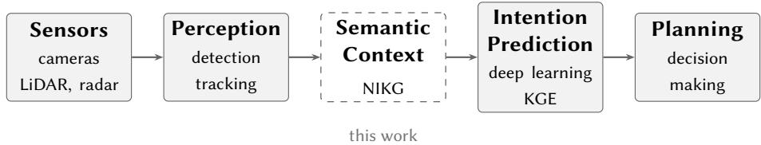
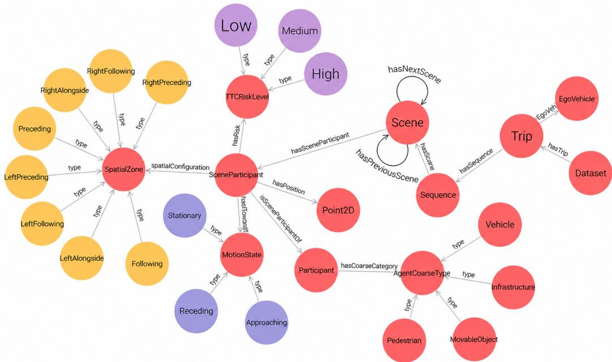
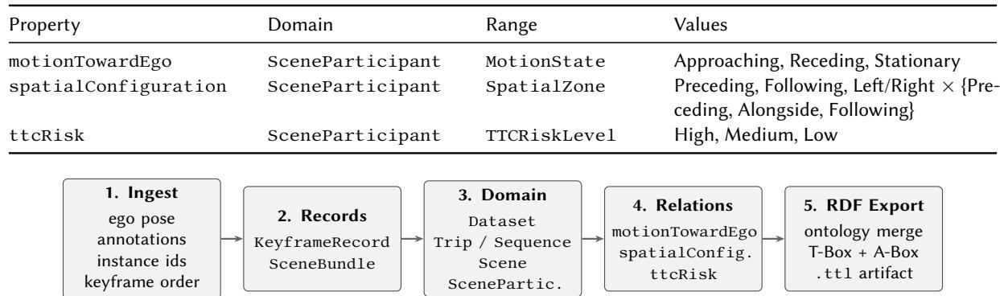
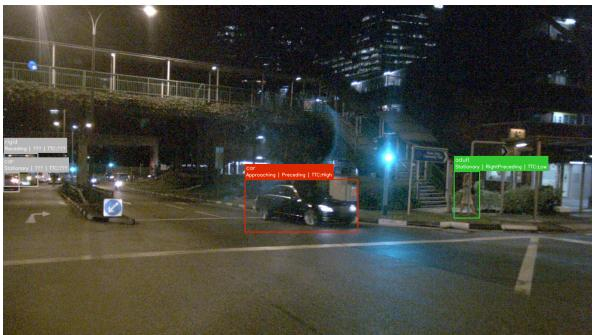
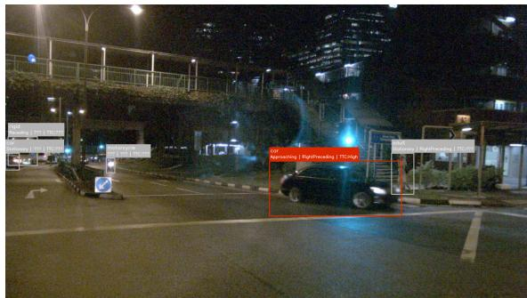
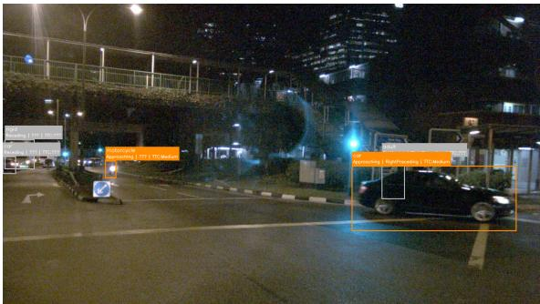
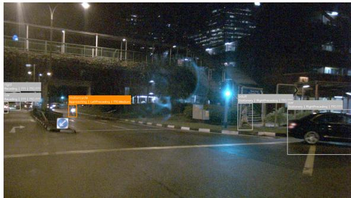
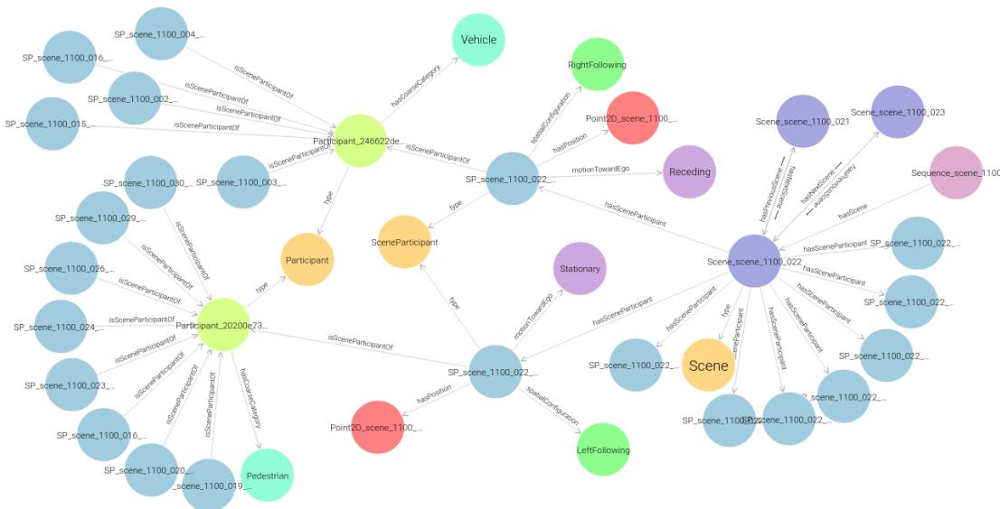

# A Semantic Knowledge Graph Construction Pipeline for Vehicle Intention Prediction in nuScenes

Khaled Nowara<sup>1</sup>, Mohamed Manzour<sup>2</sup> and Catherine Elias<sup>1</sup>

<sup>1</sup>German University in Cairo, Cairo, Egypt

<sup>2</sup>Computer Engineering Department, University of Alcalá, Madrid, Spain

## Abstract

Knowledge graphs (KGs) are increasingly used in autonomous driving (AD) to make trafic scene entities and relations explicit for prediction and reasoning. Existing trafic-scene KGs, however, primarily emphasize trajectory forecasting or general scene understanding. This paper presents the nuScenes Intention Knowledge Graph (NIKG), a focused Web Ontology Language (OWL)-based semantic representation and construction pipeline for ego-centric vehicle intention context. NIKG instantiates nuScenes scenes as a self-describing Turtle graph and promotes three intention-relevant relations to first-class properties of each scene participant: ego-relative motion, spatial configuration, and time to collision (TTC) risk. The pipeline uses a small input contract available in many ego-centric driving datasets: ego pose, tracked object annotations, and temporal keyframe order. NIKG is released as an ontology-backed, self-describing graph artifact together with a reproducible construction pipeline and validation protocol for ego-centric intention context. Applying this pipeline to nuScenes mini yields a graph of 211,335 triples across 404 keyframes; under the validation protocol, ego-relative motion labels achieve 92.5% forward consistency. Coverage, semantic consistency, and temporal coherence analyses over this artifact are further reported. NIKG occupies the space between scene-oriented trafic KGs and intention-prediction models: a small, explicit semantic layer intended to support downstream work such as knowledge graph embedding (KGE), SPARQL-based feature extraction, or hybrid neuro-symbolic reasoning.

## Keywords

knowledge graphs, autonomous driving, nuScenes, intention modeling, semantic representation

## 1. Introduction

Anticipating the behavior of surrounding trafic agents is one of the most challenging aspects of autonomous driving. Human drivers do this constantly and largely unconsciously: they combine perception with contextual reasoning to judge whether a nearby vehicle is preparing to change lanes, likely to yield at a merge, or about to brake. Replicating this capability—predicting agent intentions rather than merely their immediate positions—is essential for safe planning in complex, interactive trafic [1, 2].

Data-driven approaches have made substantial progress on trajectory prediction, yet producing reliable intention estimates requires more than raw motion history. It depends on richer contextual reasoning over the scene—the kind of semantic understanding that goes beyond raw trajectories and captures the relational and situational structure of the trafic environment. Such context is typically computed implicitly inside learned encoders, making it hard to inspect, audit, or reuse across diferent models and studies [3].

Knowledge graphs (KGs) ofer a principled way to make scene context explicit and structured. By encoding entities, relationships, and semantic constraints in an ontology-grounded format, KGs provide a query-friendly representation that complements learned perception with symbolic reasoning and knowledge reuse [4, 5]. Applied to autonomous driving, KGs have been used to represent scene topology, power knowledge graph embedding (KGE) experiments over agent interaction data, and embed scene semantics for trajectory prediction [6, 7].

Despite this progress, no existing resource makes the contextual signals most relevant to intention prediction—ego-relative motion, spatial configuration, and time to collision (TTC) risk—available as explicit, ontology-grounded facts tied to dataset keyframes. These signals remain internal to learned models rather than published as reusable semantic content, forcing every new study to re-derive the same geometric inferences from raw annotations.

This paper introduces the nuScenes Intention Knowledge Graph (NIKG) to fill that gap. NIKG promotes those three signals to first-class, ontology-grounded properties on each observed agent, building on the structural scene representation of prior nuScenes graph work [6]. Figure 1 shows where NIKG sits in the autonomous driving processing stack: between perception and the downstream intention predictor, as an explicit semantic context layer. Section 2 situates NIKG relative to prior work and states the contributions; Sections 3–4 present the methodology and validation; Section 5 concludes.

## 2. Related Work

NIKG is situated within two areas: KGs as a semantic modeling layer for autonomous driving (AD) scenes (§2.1), and the contextual cues used in maneuver-intention prediction (§2.2). The resulting gaps are then summarized and NIKG’s positioning is stated explicitly (§2.3).

## 2.1. Knowledge graphs as a semantic layer in autonomous driving

Human drivers predict behavior by combining external perceptual cues with internalized knowledge about context and intent. Data-driven approaches excel at the perceptual side but struggle to represent the implicit semantic structure that human drivers use [3]. KGs address this gap directly: they provide a structured mechanism for representing, organizing, reasoning over, and retrieving semantic relationships that would otherwise remain implicit in raw data [8].

This modeling pattern has been applied across several subproblems in AD. KGs have been used to represent urban trafic topology and support knowledge reuse via reasoning [9], to manage the heterogeneous sensor data generated by autonomous vehicles [5], and to evaluate KGEs for AD scene data [4]. Together these demonstrate that KGs are a broadly applicable semantic layer across AD subproblems, not only a tool for a single task.

For trafic scene semantics and prediction specifically, nSKG provides the closest structural precedent: a semantic representation of nuScenes scenes used for trajectory prediction [6]. SemanticFormer embeds graph-structured scene semantics directly inside a trajectory-prediction model [7], while FM4SU serializes a KG into token sequences for language-model-style scene understanding [10]. Pedestrianoriented work further shows that explicit graphs can support behavior interpretation and not only trajectory forecasting [3, 11]. However, these eforts target trajectories, pedestrian behavior, or embed the graph inside a specific model architecture. None release a standalone, vehicle-intention-oriented resource with an explicit ontology aligned to maneuver context.

## 2.2. Maneuver intention context

The maneuver-intention prediction literature consistently decomposes context into ego-relative surround layout, longitudinal and lateral positioning, and scene-level risk. The surround-grid representation, in which the space around the ego vehicle is divided into an ego-relative occupancy layout, is a widely adopted encoding for this purpose [12, 2, 1]. TTC is a classical safety metric that quantifies collision risk from relative closing speed and distance, and appears alongside positional layout as a core contextual input in maneuver-intention pipelines [13, 1].

Beyond AD, cross-domain work in service robotics shows that combining explicit knowledge structures with intention reasoning is a reusable modeling pattern [14], further motivating a KG-based formalization of these factors.

  
Figure 1: NIKG in the autonomous driving pipeline. The semantic context layer (dashed, this work) sits between perception and the downstream intention predictor, making ego-relative motion, spatial configuration, and TTC risk available as explicit, queryable graph facts.

## 2.3. Gap summary and NIKG positioning

Taken together, prior work suggests two complementary gaps. First, semantic graphs built from driving datasets are often tuned toward trajectory prediction or fused into a specific neural architecture, rather than ofered as a compact, standalone resource that downstream groups can adopt without re-deriving the graph [6, 7, 10]. Second, maneuver-intention pipelines routinely exploit ego-relative surround layout, motion relative to the ego, and TTC-style risk [12, 2, 1], yet these cues typically remain internal to learned encoders rather than published as explicit, ontology-grounded facts tied to dataset keyframes.

NIKG sits at this intersection. NIKG reuses the nuScenes scene-graph scafold from nSKG [6] and extends it with three interoperable relations—motionTowardEgo, spatialConfiguration, and ttcRisk—so that intention-relevant context becomes first-class, machine-checkable KG content rather than an undocumented side efect of any one model. The ontology, pipeline, and validation artifact are released so that downstream work—via KGE, SPARQL Protocol and RDF Query Language (SPARQL)- based features, or hybrid pipelines—can build directly on this representation without replicating the geometric preprocessing.

The paper makes three contributions:

1. a self-describing Web Ontology Language (OWL) ontology that elevates motionTowardEgo, spatialConfiguration, and ttcRisk to first-class relations on SceneParticipant;

2. a modular construction pipeline from nuScenes to one merged Terse RDF Triple Language (TTL) graph encoding both schema and instances; and

3. an empirical characterization of the released artifact on nuScenes mini (coverage, semanticconsistency implications, and forward coherence of motion labels).

## 3. Methodology

NIKG is described in two parts: the ontology that defines the semantic schema, and the pipeline that instantiates that schema on nuScenes and exports the resulting graph artifact.

## 3.1. Ontology

The ontology defines NIKG’s semantic schema. It is intentionally narrow: it captures ego-centric intention context rather than a complete model of trafic worlds. The design goals are (i) a selfdescribing schema with explicit classes and closed enumerations wherever relations take categorical values, (ii) alignment with the structural vocabulary inherited from nSKG so that the scene graph scafold remains comparable and interoperable [6], and (iii) release as a single reusable artifact that merges terminological box (T-Box) and assertional box (A-Box) triples for downstream consumers.

Figure 2 shows the complete class and property structure of the NIKG ontology; the subsections below describe each layer in turn.

## 3.1.1. Baseline ontology

NIKG inherits the class hierarchy Dataset → Trip → Sequence → Scene from nSKG [6]. It also inherits temporal links between scenes (hasNextScene, hasPreviousScene).

  
Figure 2: NIKG ontology structure. Nodes represent OWL classes; edges are object properties. The three intention-relevant relations (motionTowardEgo, spatialConfiguration, ttcRisk) connect SceneParticipant to their respective enumeration classes. hasCoarseCategory connects the underlying Participant to AgentCoarseType.

Dataset is the root individual for the exported KG instance. It records the declared dataset name and version and links downward to every Trip. Each Trip corresponds to one ego-centric recording unit packaged from nuScenes, aligned with one nuScenes scene, and owns exactly one Sequence. A Sequence is the temporal backbone of that trip: the ordered chain of keyframes materialized as Scene nodes. Each Scene is one discrete time slice. In the NIKG instantiation, it corresponds to one nuScenes sample chosen along the CAM\_FRONT keyframe chain, holds the observations at that instant, and connects forward and backward along the sequence via the temporal properties above.

Agent-level concepts separate persistent identity from per-frame observation, following the same pattern as nSKG [6]. Participant denotes a physical agent with stable identity across scenes within the sequence (derived from nuScenes instance-level tracking). EgoVehicle denotes the sensing ego vehicle itself; it is structurally distinct from trafic agents and is not represented as a traficfacing SceneParticipant. For every non-ego observer agent seen in a frame, the graph contains a SceneParticipant: one RDF individual whose role is to represent “this participant as observed in this scene,” linked to its Participant and enclosing Scene via isSceneParticipantOf and hasSceneParticipant, with centroid coordinates attached through Point2D (normalized imageplane position on CAM\_FRONT).

Scene participants are additionally typed using coarse labels derived from nuScenes detection categories, rather than enumerating the full fine-grained taxonomy as closed OWL individuals. Each non-ego SceneParticipant receives exactly one of four buckets—Vehicle, Pedestrian, MovableObject, or Infrastructure—via a fixed mapping from raw annotation category strings. This keeps the T-Box compact (four coarse-type individuals instead of dozens of nuScenes leaf categories), simplifies schema maintenance and typical queries, and matches high-level intention analysis; the original nuScenes category string may still be emitted as literal metadata on the same node where available.

## 3.1.2. Intention-relevant relations

NIKG extends every SceneParticipant with three new object properties that are not part of the inherited nSKG presentation [6]: motionTowardEgo, spatialConfiguration, and ttcRisk. They attach exclusively to SceneParticipant nodes because each label is defined relative to ego pose at that keyframe. Each property uses a closed enumerated range so that instance values are machine-checkable and query-friendly. Table 1 summarises the properties, their ranges, and their legal values.

The paragraphs below specify operational semantics—inputs, thresholds, and emission rules—shared between the T-Box enumerations and the pipeline implementation (stage 4).

Motion toward ego (motionTowardEgo). For each participant with a previous observation, the change in planar distance to the ego vehicle between consecutive keyframes is computed. If the magnitude of the distance change is below a fixed threshold, the participant is labeled Stationary; otherwise it is labeled Approaching or Receding depending on the sign. The threshold is fixed at 0.5 m.

Spatial configuration (spatialConfiguration). Each participant is projected into the ego body frame and assigned to one of eight surround zones, with thresholds of 3.0 m longitudinally, 1.75 m laterally, and a 50 m maximum range. The resulting label provides a symbolic description of local surround layout [12].

TTC risk (ttcRisk). A one-step closing-speed approximation yields a classical TTC estimate at each keyframe $( \Delta t = 0 . 5 s )$ . The same discrete risk buckets as [2] are adopted: High when ${ \mathrm { T T C } } < 4 \ s ,$ Medium when $4 \ \mathrm { s } \leq \mathrm { T T C } < 1 0 \ \mathrm { s } .$ , and Low when $\mathrm { T T C } \geq 1 0 :$ s. The relation is not emitted on first appearance or when closing speed is negligible [13].

## 3.1.3. Self-describing artifact

At export time the pipeline merges the T-Box —the class and property declarations—with the A-Box —the generated instance triples—into a single TTL file under one namespace. The resulting artifact is self-describing: any consumer loading the file obtains both the vocabulary and the data without a separate schema lookup, following the release pattern of nSKG [6].

## 3.2. Knowledge graph generation pipeline

This subsection covers how those ontology semantics are instantiated on nuScenes: the stages from raw records to populated predicates (Section 3.1.2), the minimal input contract, and reproducibility of the exported artifact.

## 3.2.1. Overview and input contract

The generation pipeline has five stages, shown in Figure 3. Raw nuScenes records are fetched first (stage 1), then immediately converted into lightweight neutral data structures that decouple the rest of the pipeline from the nuScenes API (stage 2). These structures are assembled into the domain object hierarchy—Dataset, Trip, Sequence, Scene, and SceneParticipant—without any relation labels attached yet (stage 3). Relation computation then runs as a separate pass over the assembled dataset, populating the three intention properties on each SceneParticipant in place (stage 4). Finally, the exporter parses the ontology and emits one RDF triple per populated field, merging schema and instance data into the output TTL file (stage 5).

The current implementation targets nuScenes and consumes only a minimal subset of fields: ego pose in a shared planar frame, annotation positions, stable instance identities, and keyframe ordering [15]. Optional camera intrinsics and images may be used for figures, but they are not required for the core graph. Any ego-centric dataset exposing stable tracks, an ego pose, and a shared planar reference frame could in principle be adapted with a thin adapter. Table 2 summarises this minimal input contract.

The relation-population stage (pipeline stage 4) evaluates the three intention relations exactly according to Section 3.1.2. It uses the signals listed in Table 2 to populate motionTowardEgo, spatialConfiguration, and ttcRisk.

Table 1  
Intention-relevant object properties introduced by NIKG.  
  
Figure 3: NIKG generation pipeline. Each stage is independently testable; the final artifact merges schema and instance triples into a single self-describing Turtle file.

## Table 2

Minimal input contract for graph instantiation.
<table><tr><td>Signal</td><td>Source</td><td>Used for</td></tr><tr><td>Ego pose (x, y, ψ)</td><td>ego record</td><td>ego frame + TTC</td></tr><tr><td>Annotation position</td><td>annotation</td><td>participant geometry</td></tr><tr><td>Instance identifier</td><td>annotation</td><td>track continuity</td></tr><tr><td>Keyframe order</td><td>sample chain</td><td>temporal relations</td></tr><tr><td>Optional image/intrinsics</td><td>camera metadata</td><td>figures / future 2D</td></tr></table>

## 3.2.2. Export and reproducibility

At export time, the pipeline first parses the ontology, then emits the instance triples into the same graph under a single namespace, producing a single self-describing TTL file. Thresholds are fixed in code rather than exposed as experiment flags, so the paper’s numbers are reproducible from a single command. The CLI accepts only the dataset root and ontology path:

```batch
python main.py --dataroot data/nuscenes \
--version v1.0-mini \
--ontology ontologies/ontology.ttl \
--out-ttl graphs/multi_scene.ttl
```

The full pipeline, ontology, and evaluation scripts are released as a public companion repository [16]. The environment is frozen via environment.yml (conda, Python 3.11).

## 4. Graph Validation

The generated graph is examined along four axes: a concrete scene study that traces annotation labels through four consecutive keyframes, followed by quantitative checks on scale and coverage, semantic consistency, and temporal label coherence.

## 4.1. Scene study: scene-1100, frames 19–22

Four consecutive keyframes (frames 19–22, 1.5 s at the 2 Hz keyframe rate) from scene-1100 of nuScenes mini are examined to ground the annotation scheme in a concrete trafic scenario. Figure 4 shows the annotated CAM\_FRONT images; bounding boxes are colour-coded by ttcRisk (red = High, orange = Medium, green = Low, grey = none) and each box carries a two-line overlay: coarse category, then motionTowardEgo | spatialConfiguration | ttcRisk.

  
(a) Frame 19: car 19.0 m ahead at ttcRisk=High (closing speed 6.4 m/s, TTC 2.97 s). Pedestrian at 8.4 m in LeftFollowing labelled Stationary (no TTC). Bus receding at 80.9 m beyond the 50 m range cutof: Receding only, no spatial or TTC label.

  
(b) Frame 20: car closes to 16.9 m, ttcRisk remains High. Pedestrian and bus labels unchanged. A motorcycle enters the scene for the first time at 55.5 m (first appearance, beyond range cutof): all three relation slots are empty.

  
(c) Frame 21: car continues closing, now at 15.6 m; deceleration brings ttcRisk down to Medium (TTC 6.27 s). Pedestrian remains Stationary; bus continues receding at 84.4 m. Motorcycle closes to 50.4 m and receives ttcRisk=Medium, but is still marginally outside the 50 m spatial range so spatialConfiguration is absent.

  
(d) Frame 22: car brakes to near-stationary $( \Delta d =$ −0.046 m), ttcRisk suppressed. Pedestrian and bus labels unchanged across all four frames. Motorcycle crosses into the 50 m zone at 45.9 m and is fully annotated: Approaching | LeftPreceding | Medium.  
Figure 4: Scene-1100, frames 19–22 (0.5 s apart). Bounding boxes are colour-coded by ttcRisk: red = High, orange = Medium, green = Low, grey = none. Each box label: coarse category / motionTowardEgo | spatialConfiguration | ttcRisk.

Approaching car. A car 19.0 m ahead (Preceding) decelerates over the window. Closing speed falls from 6.4 m/s in frame 19 (TTC 2.97 s, High) to 4.3 m/s in frame 20 (TTC 3.88 s, still High), 2.5 m/s in frame 21 (TTC 6.27 s, Medium), and 0.09 m/s in frame 22—just below the 0.1 m/s emission threshold—so no ttcRisk triple is written and motionTowardEgo transitions to Stationary despite the vehicle remaining at 15.6 m. The arc (High, High, Medium, none) encodes the full braking event as a sequence of instantaneous risk estimates.

Stationary pedestrian. A pedestrian at 8.4 m in LeftFollowing carries Stationary throughout; inter-frame deltas (+0.095, +0.041, −0.008, −0.007 m) all lie within the 0.5 m band, and closing speeds (≤0.19 m/s) remain below the TTC gate, so no ttcRisk triple is emitted. This illustrates how the stationarity threshold absorbs localisation noise without masking genuine displacement.

Newly arriving motorcycle. The motorcycle is absent in frame 19, then enters the scene at 55.5 m in frame 20 (first appearance, beyond the 50 m range cutof): all three relation slots are empty. In frame 21 it has closed to 50.4 m—still marginally outside the range boundary, so spatialConfiguration remains absent—but a closing speed of 10.2 m/s yields ttcRisk=Medium (TTC 4.95 s). In frame 22 the participant crosses into the 50 m zone at 45.9 m and all three relations are populated: Approaching, LeftPreceding, ttcRisk=Medium (TTC 5.01 s). The three-frame transition illustrates the sequenced efect of the first-appearance rule, the range cutof, and the closing-speed gate.

Receding bus. A bus is tracked at 80.9–86.1 m across all four frames (Δ� ≈ +1.5–+2.0 m per step) and consistently labelled Receding; the negative closing speed suppresses ttcRisk, and the range beyond 50 m suppresses spatialConfiguration. Its uninterrupted presence in the graph confirms that all participants are tracked and annotated regardless of range or approach direction; only the relations whose emission conditions are satisfied are written.

Figure 5 shows a representative subgraph for frame 22; two SceneParticipant nodes are expanded to show their intention-relation triples, while the remaining 21 participants are collapsed for clarity.

## 4.2. Scale and coverage

Table 3 summarises graph scale on nuScenes mini (18,538 SceneParticipant instances across 404 keyframes). The artifact merges the NIKG T-Box with instance data and asserts participant typing (hasCoarseCategory, hasNuScenesCategory) on each SceneParticipant in addition to the three intention-relevant relations. All eight SpatialZone values and all three TTCRiskLevel values are instantiated, confirming that the graph is non-degenerate and the full enumerated vocabulary is populated.

The relation counts are each smaller than the total instance count for defined reasons. motionTowardEgo requires a previous keyframe, so first appearances carry no label; the diference of 911 equals exactly the number of unique participants. spatialConfiguration excludes agents beyond 50 m planar distance (3,372 out-of-range instances). ttcRisk is only emitted when closing speed exceeds 0.1 m/s; receding and stationary agents account for approximately 10,400 of the unlabelled instances.

## 4.3. Semantic consistency

Table 4 reports three implications that test coherence among the intention relations: each row states a premise and a conclusion expected whenever that premise appears on a SceneParticipant keyframe in the RDF graph. Operationally, triples are scanned and instances where the premise holds are collected; Total is that premise count, Pass is how many also satisfy the conclusion, and Rate is Pass/Total. The rate therefore answers “among agents that trigger this premise, what fraction also satisfy the consequent?”— near 100% means the labels agree under that rule; a substantially lower rate flags systematic tension between features (often from geometric modelling rather than a malformed export).

The three rules follow directly from the operational definitions in Section 3.1.2. (i) ttcRisk=High and motionTowardEgo both encode closing behavior via diferent surrogates (one-step TTC bin vs. signed distance delta), so High should align with Approaching rather than Stationary or Receding. (ii) Because ttcRisk uses planar line-of-sight distance, imminent closure should generally correspond to an ahead-of-ego surround cell (Preceding, LeftPreceding, or RightPreceding); mismatches surface the gap between LOS and path-aware estimates. (iii) Stationary (inter-frame $| \Delta d | < 0 . 5 \ : \mathrm { m } )$ and ttcRisk=High (strong closing-speed signal) are contradictory by construction: co-occurrence indicates threshold-band tension between two independently computed labels.

Rows (i) and (iii) are near-perfect (both 99.9%). The two violations in each are the same pair of agents: both carry Stationary and RightAlongside labels with ttcRisk=High. In both cases the distance delta between frames falls within the 0.5 m Stationary band, but the absolute distance at the current frame is small enough to produce a sub-4 s TTC estimate (hence ttcRisk=High under the <4 s bin). This is a threshold-band collision between two independently computed labels rather than a pipeline error.

Row (ii) passes at 89.2%. Forward zones (Preceding, LeftPreceding, RightPreceding) are expected for most high-risk agents, but 204 instances are in lateral or rear zones. This occurs because ttcRisk uses line-of-sight distance rather than a path-aware estimate: a vehicle closing from the side or rear can produce a decreasing planar distance and thus a high TTC estimate. This is consistent with the limitation noted in Section 6. The 98 high-risk agents without a spatialConfiguration label (beyond the 50 m range cut) are excluded from the denominator.

  
Figure 5: Representative NIKG subgraph for scene-1100 frame 22. Two SceneParticipant nodes are expanded to show their populated intention-relation triples; the remaining 21 participants in the frame are collapsed for clarity. The temporal chain linking this frame to frames 21 and 23 is visible at the top of the diagram.

## Table 3

Graph scale on nuScenes mini (10 scenes).
<table><tr><td>Statistic</td><td>Value</td></tr><tr><td>Total triples Scenes (keyframes)</td><td>211,335</td></tr><tr><td>Unique participants</td><td>404 911</td></tr><tr><td>SceneParticipant instances</td><td>18,538</td></tr><tr><td>hasCoarseCategory triples</td><td>18,538</td></tr><tr><td>hasNuScenesCategory triples</td><td>18,538</td></tr><tr><td>motionTowardEgo triples</td><td>17,627</td></tr><tr><td>spatialConfiguration triples</td><td></td></tr><tr><td>ttcRisk triples</td><td>15,166 8,156</td></tr></table>

Table 4  
Semantic consistency checks. Pass rate = fraction of premise instances that also satisfy the conclusion.
<table><tr><td>Constraint</td><td>Total</td><td>Pass</td><td>Rate</td></tr><tr><td>ttcRisk=High ⇒ Approaching</td><td>1,990</td><td>1,988</td><td>99.9%</td></tr><tr><td>ttcRisk=High ⇒ spatialConfiguration in forward zone</td><td>1,892</td><td>1,688</td><td>89.2%</td></tr><tr><td>Stationary ⇒ ttcRisk ≠High</td><td>3,784</td><td>3,782</td><td>99.9%</td></tr></table>

## 4.4. Temporal label coherence

For each SceneParticipant with a motionTowardEgo label at scene �, the observed distance change between � and �+1 is tested for consistency with that label: Approaching predicts a decrease, Receding predicts an increase, and Stationary predicts $| \Delta d | < 0 . 5$ m. Because the check uses the step after the one used to generate the label, it is non-circular.

Overall coherence is 92.5% across 16,746 labeled transitions. Per-label rates are: Receding 99.1%, Approaching 91.0%, and Stationary 84.7%. Stationary is lowest because it occupies the narrowest distance band; agents near the 0.5 m boundary at � frequently cross it at �+1. Errors are almost entirely adjacent-label transitions (Approaching↔Stationary, Stationary↔Receding); cross-direction errors (Approaching→Receding or vice versa) account for only 158 of 16,746 transitions (0.9%).

## 5. Conclusion

This paper presents NIKG: a self-describing OWL ontology, a reproducible nuScenes pipeline, and a graph-characterization analysis that makes ego-relative motion, surround configuration, and TTC risk explicit as first-class relations on each observed agent. Validation on 18,538 SceneParticipant instances shows 92.5% forward motion coherence and near-perfect pass rates on two of three semantic consistency implications; the 89.2% rate on the forward-zone check reflects a known design tradeof (line-of-sight TTC vs path-aware closure) that the current schema handles by design rather than obscuring. By formalizing the contextual factors that the maneuver-intention literature consistently relies on, NIKG provides a reusable semantic layer that can support downstream intention-prediction work through SPARQL-based feature extraction, KGEs, or hybrid neuro-symbolic pipelines.

## 6. Limitations and Future Work

All three intention-relevant properties are defined relative to the ego vehicle; pairwise agent-to-agent relations (e.g. following, yielding) fall outside the current schema and would require extending the ontology with agent-pair subjects. Portability to other ego-centric datasets has not been demonstrated empirically: the graph is instantiated and evaluated on nuScenes mini only. The primary direction for future work is connecting NIKG to a downstream intention-prediction task via SPARQL-based feature extraction, KGE, or a hybrid neuro-symbolic pipeline.

## Declaration on Generative AI

During the preparation of this work, the author(s) used Cursor (agent mode) and Prism in order to: grammar and spelling check; paraphrase and reword; improve writing style; peer review simulation; formatting assistance (Tables 1, 2, 3, and 4); and citation management. Further, the author(s) used Cursor (agent mode) for Figures 1 and 3 in order to: generate images. After using these tool(s)/service(s), the author(s) reviewed and edited the content as needed and take(s) full responsibility for the publication’s content.

## References

[1] W. Wei, J. Wang, Intention-based and risk-aware trajectory prediction for autonomous driving in complex trafic scenarios, in: 2025 IEEE International Conference on Real-time Computing and Robotics (RCAR), IEEE, 2025, pp. 345–350.

[2] M. Manzour, A. Ballardini, R. Izquierdo, M. Sotelo, Vehicle lane change prediction based on knowledge graph embeddings and bayesian inference, in: 2024 IEEE Intelligent Vehicles Symposium (IV), IEEE, 2024, pp. 1893–1900.

[3] J. Zhou, X. Bai, W. Fu, B. Ning, R. Li, Pedestrian intention estimation and trajectory prediction based on data and knowledge-driven method, IET Intelligent Transport Systems 18 (2024) 315–331.

[4] R. Wickramarachchi, C. Henson, A. Sheth, Knowledge graphs of driving scenes to empower the emerging capabilities of neurosymbolic ai, arXiv preprint arXiv:2411.03225 (2024).

[5] R. Wickramarachchi, C. Henson, A. Sheth, An evaluation of knowledge graph embeddings for autonomous driving data: Experience and practice, arXiv preprint arXiv:2003.00344 (2020).

[6] L. Mlodzian, Z. Sun, H. Berkemeyer, S. Monka, Z. Wang, S. Dietze, L. Halilaj, J. Luettin, nuscenes knowledge graph-a comprehensive semantic representation of trafic scenes for trajectory prediction, in: Proceedings of the IEEE/CVF International Conference on Computer Vision, 2023, pp. 42–52.

[7] Z. Sun, Z. Wang, L. Halilaj, J. Luettin, Semanticformer: Holistic and semantic trafic scene representation for trajectory prediction using knowledge graphs, IEEE Robotics and Automation Letters 9 (2024) 7381–7388.

[8] M. Hou, R. Wei, L. Lu, X. Lan, H. Cai, A review of knowledge graph research and its application in the medical field, Computer Research and Development 55 (2018) 2585–2599.

[9] J. Tan, Q. Qiu, W. Guo, T. Li, Research on the construction of a knowledge graph and knowledge reasoning model in the field of urban trafic, Sustainability 13 (2021) 3191.

[10] H. Zhou, S. Schimid, Y. Li, L. Halilaj, X. Yao, W. Cao, Predicting the road ahead: A knowledge graph based foundation model for scene understanding in autonomous driving, in: European Semantic Web Conference, Springer, 2025, pp. 116–132.

[11] A. N. Melo, L. F. Herrera-Quintero, C. Salinas, M. A. Sotelo, Knowledge-based explainable pedestrian behavior predictor, in: 2024 IEEE Intelligent Vehicles Symposium (IV), IEEE, 2024, pp. 3348–3355.

[12] N. Deo, M. M. Trivedi, Convolutional social pooling for vehicle trajectory prediction, in: Proceedings of the IEEE conference on computer vision and pattern recognition workshops, 2018, pp. 1468–1476.

[13] J. C. Hayward, Near miss determination through use of a scale of danger (1972).

[14] J. Zhou, X. Su, W. Fu, Y. Lv, B. Liu, Enhancing intention prediction and interpretability in service robots with llm and kg, Scientific Reports 14 (2024) 26999.

[15] H. Caesar, V. Bankiti, A. H. Lang, S. Vora, V. E. Liong, Q. Xu, A. Krishnan, Y. Pan, G. Baldan, O. Beijbom, nuscenes: A multimodal dataset for autonomous driving, in: Proceedings of the IEEE/CVF conference on computer vision and pattern recognition, 2020, pp. 11621–11631.

[16] K. Nowara, M. Manzour, C. Elias, nuScenes Intention Knowledge Graph (NIKG): companion code and artifacts, https://github.com/KhaledNowara/nuScenes-Intention-Knowledge-Graph, 2026.