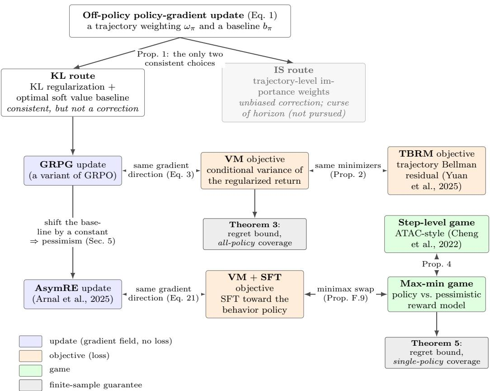

# Anatomy of Off-Policy Policy Gradient: Importance Sampling, KL Regularization, and Baselines

Haoqun Cao Yurun Yuan Tengyang Xie University of Wisconsin–Madison hcao65@wisc.edu, yurun\_yuan@cs.wisc.edu, tx@cs.wisc.edu

## Abstract

Reinforcement learning has become a central tool for large language model (LLM) post-training, where policy gradient methods are routinely deployed off-policy, even though vanilla policy gradient assumes on-policy sampling. We study when such off-policy deployment is justified, and what roles its core ingredients, including importance sampling, KL regularization, and baselines, play in handling the resulting distribution shift. We show that for a general class of off-policy policy gradient updates, consistency, in the sense that the optimal policy remains a stationary point, requires one of two structures at the optimal policy: trajectory-level importance weighting, which suffers from the well-known curse of horizon, or KL regularization with a baseline equal to the optimal soft value, instantiated by the grouped mean. Focusing on the KL route, we identify it with the group-relative policy gradient (GRPG) update, establish an equivalence to a trajectory-level Bellman residual minimization objective, and obtain a finite-sample regret bound under all-policy coverage. This also gives a theoretical account of a variant of the empirically successful GRPO objective. We further uncover a hidden role of baselines in the off-policy setting: a constant shift in the baseline implements pessimism, the standard remedy in offline RL for partial data coverage. We instantiate this via the asymmetric REINFORCE objective, and connect it to the game-theoretic offline RL framework, showing a regret bound with single-policy coverage. Together, these results offer a unified theoretical view of off-policy policy gradient in LLM post-training and connect it to classical ideas in offline RL.

## 1 Introduction

The recent years have witnessed a tremendous amount of work using reinforcement learning (RL) for large language models (LLMs), with applications ranging from instruction following and human preference alignment (Ziegler et al., 2019; Ouyang et al., 2022; Bai et al., 2022) to mathematical and code reasoning (Shao et al., 2024; Guo et al., 2025). The task of next-token prediction is formulated as a long-horizon sequential decision problem, and the language model is trained as a policy through standard policy optimization techniques.

Among policy optimization methods in RL, policy gradient (Williams, 1992; Sutton et al., 1999) is a fundamental approach and a building block of many modern algorithms. It has also been widely adopted in LLM post-training (Ahmadian et al., 2024). In its vanilla form, policy gradient requires on-policy sampling to construct an unbiased gradient estimate; in practice, however, it is routinely deployed off-policy, with various modifications, due to considerations such as replay buffers (Wang et al., 2017), distributed actor-learner asynchrony (Espeholt et al., 2018), or the cost of regenerating rollouts after each update (Schulman et al., 2017b; Shao et al., 2024). A fundamental question is then: when does off-policy policy gradient work for LLM post-training, and how do its core ingredients — importance sampling, KL regularization, and baselines — play their roles? To our knowledge, this question has not been systematically studied in the LLM literature, and this work aims to fill the gap.

When data is sampled from a behavior policy rather than the current learner, one inherits the setting of offline (or batch) RL (Lange et al., 2012; Fujimoto et al., 2019; Levine et al., 2020), where a long line of work has converged on the pessimism principle: under partial data coverage, the learner should be conservative on regions where data is sparse, in order to avoid overestimation (Jin et al., 2021; Xie et al., 2021). A second focus of this work is to bridge the empirical practice of off-policy LLM post-training with the principles developed in the offline RL literature.

Classical off-policy policy gradient methods make the update valid by recovering a quantity of the target policy from behavior data: expectations under π via importance weighting (Precup et al., 2000; Jiang and Li, 2016; Wang et al., 2017; Espeholt et al., 2018), the state distribution dπ via density-ratio estimation (Liu et al., 2019), or the action value $Q ^ { \pi }$ via an off-policy critic (Degris et al., 2012). None of these scales comfortably to LLM post-training: trajectory-level importance weights have variance exponential in the horizon, density ratios over text states are hard to estimate, and a critic adds substantial overhead. The off-policy objectives that work in practice use none of them, relying only on KL regularization and a grouped-mean baseline; this paper asks why that minimal set of ingredients suffices (see Appendix B for further discussion).

The off-policy objectives we study (e.g., Shao et al., 2024; Yuan et al., 2025; Arnal et al., 2025) and related works in this direction with similar objectives (e.g., Ji et al., 2024; Wang et al., 2025; Tang et al., 2025; Wang et al., 2026) have been extensively studied empirically in recent LLM post-training work; our goal in this paper is to provide a unified theoretical understanding of when and why they remain consistent under off-policy distribution shift, what role each ingredient (importance sampling, KL, baseline) plays in this, and how the resulting guarantees connect to the offline RL literature.

Contributions This work develops a theoretical framework for off-policy policy gradient in LLM post-training.

(1) A characterization of consistent off-policy PG updates. We show that for a general class of off-policy PG updates in the autoregressive setting, a consistent update, i.e., one that preserves the optimal policy as a stationary point, must at the optimal policy either use trajectory-level importance weights or use KL regularization paired with a baseline equal to the optimal soft value (Proposition 1). The importance-sampling route suffers from the well-known curse of horizon, so we focus on the KL route, with the grouped-mean baseline, in the rest of the paper.

(2) Analysis of KL regularization with a grouped-mean baseline. We identify the KL route with the group-relative policy gradient (GRPG) update, develop the intuition behind its correctness, and establish an equivalence to a trajectory-level Bellman residual minimization (TBRM) objective of Yuan et al. (2025) (Proposition 2). This connects GRPG, a variant of the empirically successful GRPO objective (Shao et al., 2024), to classical value-based RL principles. We further give a finite-sample regret bound under all-policy coverage (Theorem 3).

(3) A hidden role ofbaselines: implementing pessimism. Within the KL route, we show that a constant shift in the baseline has a surprising effect beyond variance reduction: it implements pessimism, the standard remedy in offline RL for partial coverage. We connect this insight to the asymmetric REINFORCE (AsymRE) objective of Arnal et al. (2025), providing a game-theoretic interpretation connecting it to the adversarial offline RL framework of Cheng et al. (2022), and upgrade the regret bound from all-policy to single-policy coverage (Theorem 5).

Taken together, these three parts trace a single path from the off-policy policy-gradient update template to the two finite-sample guarantees. Figure 1 lays out that path, together with the equivalences and the coverage conditions encountered along the way, and may be useful as a map while reading the rest of the paper.

## 2 Preliminaries

This section provides the necessary background for our work. We first review the fundamentals of episodic Markov Decision Process (MDP) and KL-regularized reinforcement learning, then discuss the policy gradient methods.

  
Figure 1: Roadmap of the paper: the off-policy policy-gradient update template, the two consistent routes it admits, the chain of equivalent objectives and games along the KL route, and the two finite-sample guarantees.

## 2.1 Episodic MDP and KL-regularized RL

MDP Fundamentals We consider a finite-horizon MDP represented by $M = ( H , S , \mathcal { A } , T , r ^ { * } , \rho )$ consisting of a state space S, an action space A, a reward function $r ^ { * } = \{ r _ { h } ^ { * } \} , r _ { h } ^ { * } : \mathcal { S } \times \mathcal { A }  [ 0 , \overset { . } { 1 } ]$ an initial state distribution $\rho \in \Delta ( \mathcal { S } )$ , and a deterministic transition function $T = \{ T _ { h } \} , \bar { T _ { h } }$ $s \times \mathcal { A } \to \mathcal { S }$ , which we assume throughout the paper and which is central to our analysis. A policy $\pi = \{ \pi _ { h } \} , \pi _ { h } : S  \Delta ( { \mathcal { A } } )$ maps states to distributions over actions and induces a distribution over trajectories $\tau = ( s _ { 1 } , a _ { 1 } , \dotsc , s _ { H } , a _ { H } )$ , where we write $s _ { h } ( \tau )$ and $a _ { h } ( \tau )$ for the state and action of τ at step h; the conditional distribution of τ given $s _ { 1 }$ induced by policy π is denoted as $\mathbb { P } ^ { \pi } ( \cdot | s _ { 1 } )$ . We also define the trajectory level reward function as $\begin{array} { r } { R ^ { * } ( \tau ) : = \sum _ { h = 1 } ^ { H } r _ { h } ^ { * } ( s _ { h } , a _ { h } ) } \end{array}$ . We use $\mathbb { E } _ { \pi } [ \cdot ]$ to denote the expectation under such a data generating process induced by π: $s _ { 1 } \sim \rho , a _ { h } \sim \pi _ { h } ( \cdot | s _ { h } ) , s _ { h + 1 } =$ $T _ { h } ( s _ { h } , \dot { a } _ { h } ) , h = 1 , . . . H$ , or equivalently $s _ { 1 } \sim \rho , \tau \sim \mathbb { P } ^ { \pi } ( \cdot | s _ { 1 } )$ . For any policy π, we define $d _ { h } ^ { \pi } ( \cdot , \cdot ) \in \Delta ( S \times \mathcal { A } )$ as the induced marginal state-action distribution at step h. The goal of RL is to find a policy π that maximizes the expected cumulative reward $J ( \pi ) : = \mathbb { E } _ { \pi } \overset { \cdot } { \left[ \right]} R ^ { * } ( \tau ) $

KL-regularized RL In many applications, a KL regularization term is incorporated to encourage the learned policy to stay close to a reference policy $\pi _ { \mathrm { r e f } } .$ . This gives rise to the KL-regularized return and objective:

$$
R _ { \pi , \beta } ^ { * } ( \tau ) : = R ^ { * } ( \tau ) - \beta \sum _ { h = 1 } ^ { H } \log \frac { \pi _ { h } ( a _ { h } | s _ { h } ) } { \pi _ { \mathrm { r e f } , h } ( a _ { h } | s _ { h } ) } , \qquad J _ { \beta } ( \tau ) : = \mathbb { E } _ { \tau \sim \pi } \big [ R _ { \pi , \beta } ^ { * } ( \tau ) \big ] .
$$

Throughout the paper, we let $\pi ^ { * }$ denote the optimal policy of $J ( \pi )$ in the unregularized case and of $J _ { \beta } ( \pi )$ in the KL-regularized case; the relevant case will be clear from context.

Soft value functions We now define the soft value functions via backward recursion under the deterministic transition $\boldsymbol { s } _ { h + 1 } = T _ { h } ( \boldsymbol { s } _ { h } , \boldsymbol { a } _ { h } )$ . Set $V _ { \beta , H + 1 } ^ { \pi } ( s ) : = 0$ . For $h = H , H - 1 , \ldots , 1$ , define

$$
\begin{array} { r l } & { Q _ { \beta , h } ^ { \pi } ( s , a ) : = r _ { h } ^ { * } ( s , a ) + V _ { \beta , h + 1 } ^ { \pi } \big ( T _ { h } ( s , a ) \big ) , } \\ & { \quad V _ { \beta , h } ^ { \pi } ( s ) : = \mathbb { E } _ { a \sim \pi _ { h } ( \cdot \vert s ) } \bigg [ Q _ { \beta , h } ^ { \pi } ( s , a ) - \beta \log \frac { \pi _ { h } ( a \vert s ) } { \pi _ { \mathrm { r e f } , h } ( a \vert s ) } \bigg ] . } \end{array}
$$

We write $V _ { \beta , h } ^ { * } , Q _ { \beta , h } ^ { * }$ for the soft value functions of the optimal policy. In the unregularized case, we only need the optimal value at the initial state, $V _ { 1 } ^ { * } ( s _ { 1 } ) : = \operatorname* { m a x } _ { \tau } R ^ { * } ( \tau )$ , where the maximum is over trajectories from $s _ { 1 }$

Coverage We will also discuss coverage conditions, which measure how well the offline data distribution covers the distributions induced by the learner. The strongest such requirement, $a l l - p o l i c y$ coverage, asks that the data cover every policy in the policy class; this is typically needed when the algorithm has no built-in protection against overestimation. A weaker and more refined notion is single-policy coverage: for any comparator policy π that is well covered by the data, the algorithm is guaranteed to perform at least as well as π. Throughout the paper, the specific coverage condition required by each algorithm is stated in its assumptions, typically as a bound on the density ratio between $d ^ { \pi }$ (or $d ^ { \pi ^ { * } } )$ and $d ^ { \mu }$ , or on the $\chi ^ { 2 }$ -divergence between them, denoted $\chi ^ { 2 } ( P \| Q )$

## 2.2 Policy Gradient Method

Throughout, policies are parameterized, $\pi = \pi _ { \theta }$ with $\theta \in \Theta$ , and $\nabla$ denotes the gradient with respect to $\theta ;$ we suppress $\theta$ when it is clear from context. Policy gradient methods are motivated by the well-known policy gradient lemma, which directly expresses the gradient of $J ( \pi )$ in terms of π:

$$
\nabla J ( \pi ) = \mathbb { E } _ { \pi } \left[ R ^ { * } ( \tau ) \sum _ { h = 1 } ^ { H } \nabla \log \pi _ { h } ( a _ { h } | s _ { h } ) \right] .
$$

Computing this gradient requires sampling from the current policy (i.e., on-policy sampling) and running stochastic gradient descent. In this paper, we instead consider the off-policy or offline setting, where data is collected by a fixed behavior policy $\mu .$ . We say that a policy π is supported on $\pi _ { \mathrm { r e f } }$ if supp $( \pi _ { h } ( \cdot | s ) ) \subseteq \operatorname { s u p p } ( \pi _ { \mathrm { r e f } , h } ( \cdot | s ) )$ for all $( s , h )$ , and assume throughout that $\mu$ is supported on $\pi _ { \mathrm { r e f } } .$ In this case, simply replacing the measure π with $\mu$ in the above expectation no longer yields $\nabla J ( \pi )$

## 3 Two Consistent Routes for Off-Policy Policy Gradient

In the off-policy case, the naive substitution therefore has to be modified. In this work, we consider off-policy updates of the following form:

$$
\nabla { \mathcal E } _ { \mu , \mathrm { p G } } ( \pi ) : = - \mathbb E _ { \tau \sim \mu } \left[ \omega _ { \pi } ( \tau ) A _ { \pi } ( \tau ) \sum _ { h = 1 } ^ { H } \nabla \log \pi _ { h } ( a _ { h } | s _ { h } ) \right] ,\tag{1}
$$

where

$$
\begin{array} { r l } & { A _ { \pi } ( \tau ) : = R ^ { \ast } ( \tau ) - b _ { \pi } ( s _ { 1 } ) , \qquad \mathrm { w i t h o u t ~ K L ~ r e g u l a r i z a t i o n } , } \\ & { A _ { \pi } ( \tau ) : = R _ { \pi , \beta } ^ { \ast } ( \tau ) - b _ { \pi } ( s _ { 1 } ) , \qquad \mathrm { w i t h ~ K L ~ r e g u l a r i z a t i o n } . } \end{array}
$$

Here $b _ { \pi }$ is a policy-dependent baseline depending only on the initial state $s _ { 1 }$ , and $\omega _ { \pi }$ is a policydependent weighting function defined over the entire trajectory. With a slight abuse of notation, $\nabla \bar { \mathcal { E } } _ { \mu , \mathrm { P G } } ( \pi )$ denotes the update direction itself and need not be the gradient of a function of $\pi ;$ the same convention applies to the updates introduced below. This formulation captures a broad class of off-policy policy-gradient objectives and incorporates the key ingredients commonly used in practice to mitigate off-policy distribution shift:

1. Importance weighting, represented by $\omega _ { \pi } ( \tau )$

2. KL regularization.

3. A baseline, represented by $b _ { \pi } ( s _ { 1 } )$

We will show that, for $\pi ^ { * }$ to be a stationary point of this update, $\omega _ { \pi }$ and $A _ { \pi }$ must take particular forms.

We say that π is a stationary point of the update Eq. (1) if for every $h \in [ H ] , s \in \mathcal { S }$ , and $a \in { \mathcal { A } } .$

$$
\mathbb { E } _ { \tau \sim \mu } \Big [ \omega _ { \pi } ( \tau ) A _ { \pi } ( \tau ) \Big ( \mathbf { 1 } \{ s _ { h } ( \tau ) = s , ~ a _ { h } ( \tau ) = a \} - \mathbf { 1 } \{ s _ { h } ( \tau ) = s \} \pi _ { h } ( a | s ) \Big ) \Big ] = 0 .\tag{2}
$$

Under the tabular softmax parameterization $\begin{array} { r } { \pi _ { \boldsymbol { \theta } , h } ( a | s ) = \exp ( \theta _ { h } ( s , a ) ) / \sum _ { a ^ { \prime } } \exp ( \theta _ { h } ( s , a ^ { \prime } ) ) } \end{array}$ , we have $\begin{array} { r } { \frac { \partial } { \partial \theta _ { h } ( s , a ) } \log { \mathbb { P } } ^ { \pi _ { \theta } } ( \tau | s _ { 1 } ) = \mathbf { 1 } \big \{ s _ { h } ( \tau ) = s , ~ a _ { h } ( \tau ) = a \big \} - \mathbf { 1 } \big \{ s _ { h } ( \tau ) = s \big \} \pi _ { \theta , h } ( a | s ) } \end{array}$ , so Eq. (2) is the componentwise form of $\nabla { \mathcal { E } } _ { \mu , \mathrm { P G } } ( \pi _ { \theta } ) = 0$ with respect to $\theta ;$ unlike the latter, it remains well defined for policies on the boundary of the simplex, such as the optimal policy without KL regularization.

We say that the update Eq. (1) is consistent if $\pi ^ { * }$ is a stationary point of it, i.e., if the update preserves stationarity of the optimal policy. Consistency is weaker than unbiasedness: a consistent update need not recover the on-policy gradient $\nabla J ( \pi )$ at other policies. The resulting forms of $\omega _ { \pi }$ and $A _ { \pi }$ give rise to two provably consistent routes for off-policy policy optimization: one driven by importance sampling (IS) weights, and the other by KL regularization.

Proposition 1. Consider the autoregressive setting $s _ { h } = ( s _ { 1 } , a _ { 1 } , \dotsc , a _ { h - 1 } )$ with discrete initial-state and action spaces. $I f \pi ^ { * }$ satisfies $E q . \ ( 2 ) ,$ , then for every $s _ { 1 } \in \operatorname { s u p p } ( \rho )$

1. Without KL regularization, there exists $K ( s _ { 1 } )$ such that

$$
\omega _ { \pi ^ { * } } ( \tau ) = K ( s _ { 1 } ) \prod _ { h = 1 } ^ { H } \frac { \pi _ { h } ^ { * } ( a _ { h } | s _ { h } ) } { \mu _ { h } ( a _ { h } | s _ { h } ) }
$$

for every $\tau \in \operatorname { s u p p } ( \mathbb { P } ^ { \mu } ( \cdot | s _ { 1 } ) )$ with $R ^ { * } ( \tau ) \neq b _ { \pi ^ { * } } ( s _ { 1 } )$

2. With KL regularization, at least one ofthefollowing holds: there exists $K ( s _ { 1 } )$ such that

$$
\omega _ { \pi ^ { * } } ( \tau ) = K ( s _ { 1 } ) \prod _ { h = 1 } ^ { H } \frac { \pi _ { h } ^ { * } ( a _ { h } | s _ { h } ) } { \mu _ { h } ( a _ { h } | s _ { h } ) } f o r e \nu e r y \tau \in \mathrm { s u p p } ( \mathbb { P } ^ { \mu } ( \cdot | s _ { 1 } ) ) ,
$$

or

$$
b _ { \pi ^ { * } } ( s _ { 1 } ) = V _ { \beta , 1 } ^ { * } ( s _ { 1 } ) = \mathbb { E } _ { \mu } \left[ R _ { \pi ^ { * } , \beta } ^ { * } ( \tau ) | s _ { 1 } \right] .
$$

See proof in Appendix D.2. The above proposition shows that there are only two candidates at $\pi ^ { * }$ for a consistent update: either through trajectory-level importance weights or through KL regularization (with baseline as the soft optimal value). In particular, trajectory-level importance weight has the potential to address the off-policy PG objective, both with and without KL regularization. And under KL regularization, there is an alternative, e.g., by using conditional mean as the baseline (which is the most natural choice and which we adopt throughout). Note that this proposition only states necessary conditions; we will show subsequently that both choices are indeed consistent. At the same time, the necessity also implies that many alternative choices, or arbitrary combinations of these ingredients, may fail: in such cases, $\pi ^ { * }$ may not even be a stationary point of the resulting objective. The two routes differ in nature. Trajectory-level importance weighting is a correction in the classical sense: it recovers the on-policy gradient in expectation, and its sufficiency is well known (Precup et al., 2000; Jiang and Li, 2016); the content of Proposition 1 is the converse. The KL route recovers no on-policy quantity; it is consistent because it changes the optimality condition so that the advantage vanishes at $\pi ^ { * }$ , as we explain next. Now, we talk about the first route through trajectory-level importance weights.

The IS Route: Curse of Horizon Setting $\begin{array} { r } { \omega _ { \pi } ( \tau ) = \prod _ { h = 1 } ^ { H } \pi _ { h } ( a _ { h } | s _ { h } ) / \mu _ { h } ( a _ { h } | s _ { h } ) } \end{array}$ yields the classical unbiased correction: the update equals $- \nabla J ( \pi ) \ \mathrm { \bar { ( r e s p . } } \ - \nabla J _ { \beta } ( \pi ) )$ at the population level. However, since the weight is a product of H per-step policy ratios, its variance typically grows exponentially in the horizon $H -$ the well-known curse of horizon (Jiang and $\mathrm { L i } , 2 0 1 6 ;$ Wang et al., 2017; Liu et al., 2019). This makes the trajectory-level IS route impractical in long-horizon settings, including LLM training. We therefore do not pursue the IS route further. Instead, we focus on the KL route, which we develop in the next section.

## 4 The KL Route: Grouped Mean Baseline

KL regularization is one of the hidden gems for off-policy policy optimization. It provides a different route to consistency: unlike trajectory-level importance weighting, it does not recover the on-policy gradient, and so is not a correction in the classical sense; instead, it changes the optimality condition itself. We now explain how KL regularization enables a properly chosen advantage function to satisfy $A _ { \pi ^ { * } } ( \tau ) = 0$ at the optimum, thus making $\pi ^ { * }$ a stationary point.

Fix an initial state $s _ { 1 }$ , without KL regularization, the objective is linear in the trajectory distribution:

$$
\operatorname* { m a x } _ { \pi } \mathbb { E } _ { \tau \sim \mathbb { P } ^ { \pi } ( \cdot | s _ { 1 } ) } [ R ^ { * } ( \tau ) ] .
$$

Hence, the optimum typically lies on the boundary of the probability simplex, and the optimality condition is an inequality: $\begin{array} { r } { \dot { R } ^ { * } ( \tau ) \leq V _ { 1 } ^ { * } ( s _ { 1 } ) } \end{array}$ , with equality only on selected optimal trajectories. Thus, unless all rewards are tied, the raw advantage cannot be zero for every trajectory.

With KL regularization, the objective becomes

$$
\operatorname* { m a x } _ { \pi } \mathbb { E } _ { \tau \sim \mathbb { P } ^ { \pi } ( \cdot | s _ { 1 } ) } \left[ R ^ { * } ( \tau ) - \beta \log \frac { \mathbb { P } ^ { \pi } ( \tau | s _ { 1 } ) } { \mathbb { P } ^ { \pi _ { \mathrm { r e f } } } ( \tau | s _ { 1 } ) } \right] .
$$

The KL term makes the objective strictly concave in the trajectory distribution and forces the optimum to have full support over $\pi _ { \mathrm { r e f } }$ . As a result, the optimality condition becomes a pointwise equality: for every trajectory τ in the support of $\mathbb { P } ^ { \pi _ { \mathrm { r e f } } }$

$$
R ^ { * } ( \tau ) - \beta \log \frac { \mathbb { P } ^ { \pi ^ { * } } ( \tau | s _ { 1 } ) } { \mathbb { P } ^ { \pi _ { \mathrm { r e f } } } ( \tau | s _ { 1 } ) } = V _ { \beta , 1 } ^ { * } ( s _ { 1 } ) = \mathbb { E } _ { \mu } \left[ R _ { \pi ^ { * } , \beta } ^ { * } ( \tau ) \left| \ s _ { 1 } \right. \right] .
$$

A derivation of this identity is given in Appendix D.1. This means the KL-regularized return $R _ { \pi ^ { * } , \beta } ^ { * } ( \tau )$ is constant along every trajectory in the reference support. Consequently, choosing the grouped mean baseline $b _ { \pi } ( s _ { 1 } ) { \bf \bar { \sigma } } = \mathbb { E } _ { \mu } { \bf \bar { [ } } R _ { \pi , \beta } ^ { * } ( \tau ) { \bf \bar { | } } s _ { 1 } ]$ yields $A _ { \pi ^ { * } } ( \tau ) = \mathbf { \bar { 0 } }$ for every τ in the support, which makes $\pi ^ { * }$ a stationary point of the off-policy policy-gradient objective.

Remark 1. The argument relies on the optimality condition holding along every trajectory, which is where deterministic transitions are used. Under stochastic transitions it holds only in expectation over the next state, so the advantage does not vanish pathwise and $\pi ^ { * }$ is in general not a stationary point ofthe KL route. The same trajectory-level structure underlies previous literature (Nachum et al., 2017; Yuan et al., 2025).

## 4.1 Value-Based RL interpretation

Surprisingly, we show that KL regularization, together with the grouped mean baseline, also admits an equivalent value-based RL interpretation. The off-policy PG update we study is Eq. (1) with $\omega _ { \pi } \equiv 1$ and the grouped-mean baseline,

$$
\nabla \mathcal { E } _ { \mu , \mathrm { G R P G } } ( \pi ) : = - \mathbb { E } _ { \mu } \left[ \left( R _ { \pi , \beta } ^ { * } ( \tau ) - \mathbb { E } _ { \mu } [ R _ { \pi , \beta } ^ { * } ( \tau ) \mid s _ { 1 } ] \right) \sum _ { h = 1 } ^ { H } \nabla \log \pi _ { h } ( a _ { h } \mid s _ { h } ) \right] ,
$$

where GRPG abbreviates group-relative policy gradient.

Building on the equivalence framework of soft Q learning and REINFORCE in Schulman et al. (2017a), we first connect the GRPG update to the following conditional variance minimization (VM) objective,

$$
\mathcal { E } _ { \mu , \mathrm { V M } } ( \pi ) : = \mathbb { E } _ { s _ { 1 } \sim \rho } \left[ \mathrm { V a r } _ { \mu } \left( R _ { \pi , \beta } ^ { * } ( \tau ) \vert s _ { 1 } \right) \right] .
$$

The conditional variance objective itself was previously studied as a standalone loss in the contextualbandit setting by Tang et al. (2025); here we show that its gradient coincides with the GRPG update up to a positive constant. A direct calculation shows

$$
\nabla { \mathcal E } _ { \mu , \mathrm { V M } } ( \pi ) = 2 \beta \nabla { \mathcal E } _ { \mu , \mathrm { G R P G } } ( \pi ) .\tag{3}
$$

Therefore, following the GRPG update is the same as running gradient descent on $\mathcal { E } _ { \mu , \mathrm { V M } } .$ , up to the positive scaling constant 2β; the same holds for the corresponding empirical estimators. We now

connect $\mathcal { E } _ { \mu , \mathrm { V M } } ( \pi )$ to value-based RL theory and show that it shares its minimizing policy with a trajectory-level Bellman residual minimization objective.

Let us consider a Q function class $\mathcal { F } \subset \{ f _ { h } : \mathcal { S } \times \mathcal { A }  \mathbb { R } \}$ and the following trajectory Bellman residual minimization (TBRM, originally from Yuan et al. (2025)) objective,

$$
\mathcal { E } _ { \mu , \mathrm { T B R M } } ( f ) : = \mathbb { E } _ { \tau \sim \mu } \left[ \left( \sum _ { h = 1 } ^ { H } \left( f _ { h } ( s _ { h } , a _ { h } ) - ( T _ { \beta , h } ^ { * } f ) ( s _ { h } , a _ { h } ) \right) \right) ^ { 2 } \right] ,
$$

where $\tau _ { \beta } ^ { * }$ is the soft Bellman optimality operator induced by the KL-regularized MDP. Under the deterministic transition $\boldsymbol { s } _ { h + 1 } = T _ { h } ( \boldsymbol { s } _ { h } , \boldsymbol { a } _ { h } )$ , it admits the closed form

$$
\begin{array} { r } { ( \mathcal T _ { \beta , h } ^ { * } f ) ( s _ { h } , a _ { h } ) = r _ { h } ^ { * } ( s _ { h } , a _ { h } ) + \beta \log \int _ { \mathcal { A } } \pi _ { \mathrm { r e f } , h + 1 } ( a | s _ { h + 1 } ) \exp \Bigl ( \frac { f _ { h + 1 } ( s _ { h + 1 } , a ) } { \beta } \Bigr ) d a , } \end{array}
$$

with the second term set to 0 at $h = H$ . After an $f \in { \mathcal { F } }$ is learned, the corresponding policy is the soft-greedy policy $\pi _ { f }$ with respect to $f ,$

$$
\pi _ { f , h } ( a | s ) \propto \pi _ { \mathrm { r e f } , h } ( a | s ) \exp ( f _ { h } ( s , a ) / \beta ) .
$$

Detailed derivations of $\tau _ { \beta } ^ { * }$ and $\pi _ { f }$ are deferred to Appendix D.1. We now state the equivalence between VM and TBRM.

Proposition 2. Let F be a value function class that is closed under first-step, state-dependent, action-independent shifts, in the sense thatfor any $f \in { \mathcal { F } }$ and any $c : { \mathcal { S } } $ R depending only on $s _ { 1 }$ thefunction $f ^ { c }$ defined by $f _ { 1 } ^ { c } ( s _ { 1 } , a _ { 1 } ) = f _ { 1 } \bar { ( } s _ { 1 } , a _ { 1 } ) + c ( s _ { 1 } )$ and ${ \dot { f } } _ { h } ^ { c } = f _ { h }$ for all $h \geq 2$ also belongs to $\dot { \mathcal F }$ . Denote $\Pi _ { { \mathcal { F } } } : = \{ \pi _ { f } : f \in { \mathcal { F } } \}$ . Then

$$
\operatorname * { a r g m i n } _ { \pi \in \Pi _ { \mathcal { F } } } \mathcal { E } _ { \mu , \mathrm { V M } } ( \pi ) = \left\{ \pi _ { f ^ { * } } : f ^ { * } \in \underset { f \in \mathcal { F } } { \operatorname { a r g m i n } } \mathcal { E } _ { \mu , \mathrm { T B R M } } ( f ) \right\} .
$$

The intuition is that the TBRM objective contains a free degree of freedom that does not affect the induced policy: shifting any $f$ by a function of $s _ { 1 }$ leaves $\pi _ { f }$ unchanged but allows the squared Bellman residual to be reduced. When $\mathcal { F }$ is closed under such shifts, the optimal shift is precisely the conditional mean over $s _ { 1 }$ , which turns the squared error into the conditional variance and yields the equivalence. Therefore, the grouped-mean off-policy policy-gradient update can also be viewed as minimizing a trajectory-level Bellman residual, providing a value-based interpretation of the method and connecting it to Bellman-residual and value-iteration principles in reinforcement learning.

## 4.2 Finite Sample Analysis

Finally, we provide a finite-sample analysis of the GRPG update, showing that the KL route with the grouped-mean baseline provably learns the optimal policy under a coverage condition. We also discuss a potential limitation of this algorithm from the perspective of offline RL. Let $D =$ $\{ s _ { 1 } ^ { i } , a _ { 1 : H } ^ { i j } , s _ { 2 : H + 1 } ^ { i j } \} _ { i = 1 , j = 1 } ^ { i = n , j = m }$ , where $s _ { 1 } ^ { i } \sim \rho$ i.i.d. and, conditioning on $s _ { 1 } ^ { i } , \tau ^ { i j } \sim \mathbb { P } ^ { \mu } ( \cdot | s _ { 1 } ^ { i } )$ i.i.d. across j. Define the empirical GRPG update

$$
\begin{array} { r l r } {  { \nabla \mathcal { E } _ { D , \mathrm { G R P G } } ( \boldsymbol { \pi } ) : = - \frac { 1 } { n } \sum _ { i = 1 } ^ { n } \frac { 1 } { m - 1 } \sum _ { j = 1 } ^ { m } ( R _ { \boldsymbol { \pi } , \beta } ^ { * } ( \boldsymbol { \tau } ^ { i j } ) - \frac { 1 } { m } \sum _ { k = 1 } ^ { m } R _ { \boldsymbol { \pi } , \beta } ^ { * } ( \boldsymbol { \tau } ^ { i k } ) ) } } \\ & { } & { \times ( \sum _ { h = 1 } ^ { H } \nabla \log \pi _ { h } ( a _ { h } ^ { i j } | \boldsymbol { s } _ { h } ^ { i j } ) ) . } \end{array}
$$

Notice that this is a variant of the gradient of the GRPO objective in Shao et al. (2024), which differs in details such as the importance ratio, the normalization, and how the KL term enters. The empirical counterpart of $\mathcal { E } _ { \mu , \mathrm { V M } }$ is

$$
\mathcal { E } _ { D , \mathrm { v M } } ( \boldsymbol { \pi } ) : = \frac { 1 } { n } \sum _ { i = 1 } ^ { n } \frac { 1 } { m - 1 } \sum _ { j = 1 } ^ { m } \left( R _ { \boldsymbol { \pi } , \beta } ^ { * } ( \tau ^ { i j } ) - \frac { 1 } { m } \sum _ { k = 1 } ^ { m } R _ { \boldsymbol { \pi } , \beta } ^ { * } ( \tau ^ { i k } ) \right) ^ { 2 } ,\tag{4}
$$

and a direct computation $\left( \operatorname { E q . } \left( 2 0 \right) \right)$ gives $\nabla { \mathcal E } _ { D , \mathrm { v M } } ( \pi ) = 2 \beta \nabla { \mathcal E } _ { D , \mathrm { G R P G } } ( \pi )$ , so the GRPG update is the gradient field of $\mathcal { E } _ { D , \mathrm { V M } }$ . We therefore analyze its minimizer. Let Π $\textsf { C } \{ \pi _ { h } : { \cal S } \to \Delta ( \bar { { \mathcal { A } } } ) \}$ be a policy class, and define

$$
\hat { \pi } \in \mathop { \mathrm { a r g m i n } } _ { \pi \in \Pi } \mathcal { E } _ { D , \mathrm { v M } } ( \pi ) .
$$

We make the following assumptions on data coverage and boundedness.

Assumption 1. There exist constants $C _ { \chi ^ { 2 } } , B < \infty$ such that

$$
\begin{array} { r l } { \mathrm { ( A l l \mathrm { - } p o l i c y ~ c o v e r a g e ) } } & { \displaystyle \operatorname* { s u p } _ { \pi \in \Pi } \sum _ { h = 1 } ^ { H } \chi ^ { 2 } \left( d _ { h } ^ { \pi } \big \| d _ { h } ^ { \mu } \right) \le C _ { \chi ^ { 2 } } , } \\ { \mathrm { ( B o u n d e d ~ t r a j e c t o r y ~ l o g \mathrm { - } r a t i o ) } } & { \displaystyle \operatorname* { s u p } _ { \pi \in \Pi , ~ s _ { 1 } , ~ \tau \in \mathrm { s u p p } ( \mathbb { P } ^ { \pi } \mathrm { r e f } \left( \cdot \vert s _ { 1 } \right) ) } \bigg | \beta \log \frac { \mathbb { P } ^ { \pi } \left( \tau \vert s _ { 1 } \right) } { \mathbb { P } ^ { \pi _ { \mathrm { r e f } } } \left( \tau \vert s _ { 1 } \right) } \bigg | \le B . } \end{array}
$$

We then obtain the following guarantee.

Theorem 3. Suppose Assumption 1 holds, $\pi ^ { * } \in \Pi$ , and $| \Pi | < \infty$ . Then with probability at least $1 - \zeta ,$

$$
J _ { \beta } ( \pi ^ { * } ) - J _ { \beta } ( \hat { \pi } ) \lesssim ( H + B ) \sqrt { \frac { ( 1 + C _ { \chi ^ { 2 } } ) \log ( | \Pi | / \zeta ) } { n } } .
$$

Proofsketch. By a soft performance-difference identity (Lemma E.1), $J _ { \beta } ( \pi ^ { * } ) \ - \ J _ { \beta } ( { \hat { \pi } } ) =$ $\beta \mathbb { E } _ { s _ { 1 } \sim \rho } \big [ \mathrm { K L } \big ( \mathbb { P } ^ { \hat { \pi } } ( \cdot | s _ { 1 } ) \| \mathbb { P } ^ { \pi ^ { * } } ( \cdot | s _ { 1 } ) \big ) \big ]$ . A change of measure from πˆ and $\pi ^ { * }$ to $\mu \ : ( \mathrm { I }$ Lemma E.2), which is where all-policy coverage enters, bounds this expected KL by $\sqrt { \left( 1 + C _ { \chi ^ { 2 } } \right) \mathcal { E } _ { \mu , \mathrm { { V M } } } ( \hat { \pi } ) }$ up to constants, because $R _ { \pi , \beta } ^ { * } ( \tau )$ and $- \beta \log { \frac { \mathbb { P } ^ { \pi } ( \tau | s _ { 1 } ) } { \mathbb { P } ^ { \pi ^ { * } } ( \tau | s _ { 1 } ) } }$ differ only by a function of $s _ { 1 }$ and hence have the same conditional variance. Finally, since $R _ { \pi ^ { * } , \beta } ^ { * }$ is constant on the support, $\mathcal { E } _ { D , \mathrm { V M } } ( \pi ^ { * } ) = 0$ pathwise, and a Bernstein-type excess-risk bound (Lemma E.3) gives $\mathcal { E } _ { \mu , \mathrm { v M } } ( \hat { \pi } ) \lesssim ( H + B ) ^ { 2 } \log ( | \Pi | / \zeta ) / n$ . See Appendix E.2. □

Remark 2. Thefirst condition ofAssumption 1 is the standard all-policy coverage assumption in offline RL: the offline data must cover the distributions induced by the entire policy class, not just $\pi ^ { * }$ . Such a strong requirement is typicalfor algorithms with no built-in pessimism against overestimation; in the next section, we show that a constant shift in the baseline implements exactly this remedy

Remark 3. The second condition ofAssumption 1 is needed to simplify the concentration analysis: it bounds the KL-regularized return, $| R _ { \pi , \beta } ^ { * } ( \tau ) | \leq H + B ,$ , in Lemma E.3. It does not conflict with realizability: by Eq. (11), β log $\begin{array} { r } { \frac { \mathbb { P } ^ { \pi ^ { * } } ( \tau | s _ { 1 } ) } { \mathbb { P } ^ { \pi _ { \mathrm { r e f } } } ( \tau | s _ { 1 } ) } = R ^ { * } ( \tau ) - V _ { \beta , 1 } ^ { * } ( s _ { 1 } ) \in [ - H , H ] } \end{array}$ since both terms lie in $[ 0 , H ] ,$ , so $\pi ^ { * }$ automatically satisfies the condition with $B = H$ . Hence, for any policy class Π containing $\pi ^ { * }$ , the subclass of policies satisfying the condition with $B = H$ still contains $\pi ^ { * }$ , and Theorem 3 applies to it as is — although a generic policy class used in LLM training does not automatically satisfy the condition. A condition ofthe sameform also appears in Theorem 5.

## 5 A Hidden Role of Baseline in Off-Policy Policy Gradient

In on-policy policy gradient, a baseline is a control variate that reduces gradient variance without changing the population gradient (Williams, 1992; Peters and Schaal, 2008). In the off-policy setting the baseline plays a different role: as we have seen in Proposition 1, along the KL route it is no longer free to choose: its value at $\pi ^ { * }$ must equal the optimal soft value, which the grouped mean achieves. In this section, we show that the baseline carries an even more interesting role beyond ensuring stationarity: a properly shifted baseline implicitly induces pessimism, the standard remedy in offline RL to mitigate overestimation with partial coverage.

Concretely, the asymmetric REINFORCE (AsymRE) update of Arnal et al. (2025) adds a constant shift to the grouped-mean baseline of GRPG:

$$
\nabla \mathcal { E } _ { \mu , \mathrm { A s y m R E } } ( \pi ) : = - \mathbb { E } _ { \mu } \left[ \left( R _ { \pi , \beta } ^ { * } ( \tau ) - \left( \mathbb { E } _ { \mu } [ R _ { \pi , \beta } ^ { * } ( \tau ) | s _ { 1 } ] - \delta \right) \right) \sum _ { h = 1 } ^ { H } \nabla \log \pi _ { h } ( a _ { h } | s _ { h } ) \right] ,
$$

where $\delta > 0$ . Arnal et al. (2025) study this update with the unregularized return $R ^ { * } ( \tau )$ and a constant baseline, and discuss KL regularization only as an extension. The KL term is essential for our analysis, since without it the grouped-mean baseline is not consistent (Proposition 1) and the VM identity Eq. (3) does not hold. We nevertheless keep the name AsymRE for the KL-regularized form above, since the constant baseline shift is the feature we study and introducing a new name would only add notation. Intuitively, subtracting an extra δ amplifies the weight on high-reward trajectorie and weakens the push to suppress low-reward ones, since failures sampled from a behavior policy $\mu \neq \pi$ are not particularly worth learning from. Beyond this heuristic, we show below that the shift admits a principled interpretation: it is equivalent to adversarially choosing a value function or reward model that incorporates pessimism.

Notice that the AsymRE update can be decomposed as

$$
\begin{array} { l } { \nabla \mathcal { E } _ { \mu , \mathrm { A s y m R E } } ( \pi ) = \nabla \mathcal { E } _ { \mu , \mathrm { G R P G } } ( \pi ) + \delta \cdot \underbrace { \left( - \mathbb { E } _ { \mu } \left[ \displaystyle \sum _ { h = 1 } ^ { H } \nabla \log \pi _ { h } ( a _ { h } | s _ { h } ) \right] \right) } _ { : = \nabla \mathcal { L } _ { \mu , \mathrm { S F T } } ( \pi ) } } \\ { = \frac { 1 } { 2 \beta } \nabla \mathcal { E } _ { \mu , \mathrm { V M } } ( \pi ) + \delta \cdot \nabla \mathcal { L } _ { \mu , \mathrm { S F T } } ( \pi ) , } \end{array}
$$

where the second equality uses $\nabla { \mathcal E } _ { \mu , \mathrm { v M } } ( \pi ) = 2 \beta \nabla { \mathcal E } _ { \mu , \mathrm { G R P G } } ( \pi )$ from Eq. (3). Therefore, the AsymRE update is essentially adding an SFT regularizer (SFT towards the behavior policy $\mu )$ that prevents the policy from deviating too far from the coverage of the offline data. Beyond this, following Liu et al. (2024), we can show that this SFT term also serves as an adversarial regularizer that prevents the model from choosing trajectories with high reward as estimated by its own reward model.

To further elaborate this point, let us consider $\begin{array} { r } { \textstyle \mathcal { R } \subset \{ R : R ( \tau ) = \sum _ { h = 1 } ^ { H } r _ { h } ( s _ { h } , a _ { h } ) , \ r _ { h } : \mathcal { S } \times \mathcal { A }  } \end{array}$ R} as a reward class, and its element as a reward model R. Recall Π is the policy class. We define

$$
\begin{array} { r l } & { { \mathcal L } _ { \boldsymbol \mu } ( { \boldsymbol \pi } , R ) : = { \mathbb E } _ { s _ { 1 } \sim { \boldsymbol \rho } } \Big \vert { \mathbb E } _ { { \boldsymbol \tau } \sim { \mathbb P } ^ { { \boldsymbol \pi } } ( \cdot \vert s _ { 1 } ) } [ R ( { \boldsymbol \tau } ) ] - { \mathbb E } _ { { \boldsymbol \tau } \sim { \mathbb P } ^ { \boldsymbol \mu } ( \cdot \vert s _ { 1 } ) } [ R ( { \boldsymbol \tau } ) ] } \\ & { \phantom { \mathcal L } - \beta \operatorname { K L } ( { \mathbb P } ^ { { \boldsymbol \pi } } ( \cdot \vert s _ { 1 } ) \Vert \mathbb { P } ^ { { \boldsymbol \pi } _ { \mathrm { r e f } } } ( \cdot \vert s _ { 1 } ) ) + \beta \operatorname { K L } ( { \mathbb P } ^ { { \boldsymbol \mu } } ( \cdot \vert s _ { 1 } ) \Vert \mathbb { P } ^ { { \boldsymbol \pi } _ { \mathrm { r e f } } } ( \cdot \vert s _ { 1 } ) ) \Big ] , } \end{array}
$$

$$
\begin{array} { r } { \mathcal { E } _ { \mu } ( R ) : = \mathbb { E } _ { s _ { 1 } \sim \rho } \mathrm { V a r } _ { \tau \sim \mathbb { P } ^ { \mu } ( \cdot \vert s _ { 1 } ) } \left[ R ^ { * } ( \tau ) - R ( \tau ) \vert s _ { 1 } \right] . } \end{array}
$$

Consider the following trajectory-level max-min game,

$$
\pi ^ { \dagger } \in \operatorname * { a r g m a x } _ { \pi \in \Pi } \operatorname * { m i n } _ { R \in \mathcal { R } } \left( \mathcal { L } _ { \mu } ( \pi , R ) + \eta \cdot \mathcal { E } _ { \mu } ( R ) \right) .\tag{5}
$$

In Appendix F.2, we show that under regularity conditions and with an appropriate choice of $\eta$ (depending on δ and m), optimizing the VM+SFT objective (thus following the AsymRE update) is equivalent to solving this max-min game with R taken to be a reward class induced by Π. The structure of this max-min game reveals why pessimism emerges. In the inner minimization, $\mathcal { E } _ { \mu }$ keeps the reward model consistent with the offline data, while $\mathcal { L } _ { \boldsymbol { \mu } } ( \pi , R )$ adversarially picks the most pessimistic reward model under $\mathbb { P } ^ { \pi }$ ; the outer maximization then maximizes against this adversarially chosen reward model. In this way, the AsymRE loss overcomes overestimation of the reward, and also leads to a guarantee with single-policy coverage as we will show later.

Connection to Offline RL Literature Beyond this trajectory-level contextual bandit-type formulation, the use of game-theoretic objectives for offline pessimism is well rooted in the offline RL literature (Xie et al., 2021; Cheng et al., 2022). We will show that the AsymRE objective also admits a formulation along these lines. Following Cheng et al. (2022), for $f \in \dot { \mathcal { F } } \subset \{ f _ { h } : \overline { { \mathcal { S } \times A \to \mathbb { R } } } \}$ and a policy π, we first define

$$
\tilde { \mathcal { L } } _ { \mu } ( \pi , f ) : = \sum _ { h = 1 } ^ { H } \mathbb { E } _ { s _ { h } \sim d _ { h } ^ { \mu } } \Big [ V _ { f , h } ^ { \pi } ( s _ { h } ) - V _ { f , h } ^ { \mu } ( s _ { h } ) \Big ] ,
$$

$$
\begin{array} { r } { V _ { f , h } ^ { \pi } ( s _ { h } ) : = \mathbb { E } _ { a \sim \pi _ { h } ( \cdot | s _ { h } ) } \bigg [ f _ { h } \big ( s _ { h } , a \big ) - \beta \log \frac { \pi _ { h } ( a | s _ { h } ) } { \pi _ { \mathrm { r e f } , h } ( a | s _ { h } ) } \bigg ] , } \end{array}
$$

with $V _ { f , H + 1 } ^ { \pi } : = 0$ , together with

$$
\tilde { \mathcal { E } } _ { \mu } ( \pi , f ) : = \mathbb { E } _ { s _ { 1 } \sim \rho } \left[ \mathrm { V a r } _ { \mu } \left( \sum _ { h = 1 } ^ { H } ( f _ { h } - { T } _ { \beta , h } ^ { \pi } f ) ( s _ { h } , a _ { h } ) \Big | s _ { 1 } \right) \right] ,
$$

where $\mathcal { T } _ { \beta , h } ^ { \pi }$ is the soft Bellman operator,

$$
( T _ { \beta , h } ^ { \pi } f ) ( s _ { h } , a _ { h } ) : = r _ { h } ^ { \ast } ( s _ { h } , a _ { h } ) + V _ { f , h + 1 } ^ { \pi } \big ( T _ { h } ( s _ { h } , a _ { h } ) \big ) .
$$

Following Cheng et al. (2022), $\tilde { \mathcal { L } } _ { \mu } ( \pi , f )$ is designed to estimate $J _ { \beta } ( \pi ) - J _ { \beta } ( \mu )$ , while $\tilde { \mathcal { E } } _ { \mu } ( \pi , f )$ performs policy evaluation through a conditional variance objective rather than a squared Bellman error; the two are equivalent in the same sense as discussed in the previous section. We can now cast the offline policy optimization problem as the following Stackelberg game (Von Stackelberg, 2010):

$$
\begin{array} { r l } & { \pi ^ { \dagger } \in \underset { \pi \in \Pi } { \mathrm { a r g m a x } } \tilde { \mathcal { L } } _ { \mu } ( \pi , f ^ { \pi } ) \quad \mathrm { s . t . } } \\ & { f ^ { \pi } \in \underset { f \in \mathcal { F } } { \mathrm { a r g m i n } } \Bigl ( \tilde { \mathcal { L } } _ { \mu } ( \pi , f ) + \eta \cdot \tilde { \mathcal { E } } _ { \mu } ( \pi , f ) \Bigr ) . } \end{array}\tag{6}
$$

The idea is to select $\pi ^ { \dagger }$ together with an adversarial value function that is pessimistic about $\pi ^ { \dagger }$ while remaining consistent with the offline data through a low Bellman error. The Stackelberg formulation in Eq. (6) is conceptually clean but bilevel, hence computationally inconvenient. A surrogate objective is a max-min game objective

$$
\pi ^ { \dagger } \in \underset { \pi \in \Pi } { \operatorname { a r g m a x } } \underset { f \in \mathcal { F } } { \operatorname* { m i n } } \left( \tilde { \mathcal { L } } _ { \mu } ( \pi , f ) + \eta \tilde { \mathcal { E } } _ { \mu } ( \pi , f ) \right) .\tag{7}
$$

We now show that this step-level, MDP-style max-min game is, under a suitable condition on $\mathcal { F }$ equivalent to the trajectory-level, bandit-style max-min game Eq. (5) introduced earlier, and hence to the AsymRE objective itself.

Proposition 4. For each $f \in { \mathcal { F } }$ and policy π, define the induced reward model

$$
r _ { f , h } ^ { \pi } ( s _ { h } , a _ { h } ) : = f _ { h } ( s _ { h } , a _ { h } ) - V _ { f , h + 1 } ^ { \pi } ( T _ { h } ( s _ { h } , a _ { h } ) ) , \qquad \mathcal { R } ( \pi , \mathcal { F } ) : = \{ R _ { f } ^ { \pi } = \sum _ { h } r _ { f , h } ^ { \pi } : f \in \mathcal { F } \} .
$$

Suppose $\mathcal { R } ( \pi , \mathcal { F } ) = \mathcal { R }$ for every $\pi \in \Pi ,$ , then

$$
\underset { \pi \in \Pi } { \arg \operatorname* { m a x } } \ \underset { R \in \mathcal { R } } { \operatorname* { m i n } } ( \mathcal { L } _ { \mu } ( \pi , R ) + \eta \mathcal { E } _ { \mu } ( R ) ) = \underset { \pi \in \Pi } { \arg \operatorname* { m a x } } \ \underset { f \in \mathcal { F } } { \operatorname* { m i n } } \Big ( \tilde { \mathcal { L } } _ { \mu } ( \pi , f ) + \eta \tilde { \mathcal { E } } _ { \mu } ( \pi , f ) \Big ) .
$$

Remark 4. The condition $\mathcal { R } ( \pi , \mathcal { F } ) = \mathcal { R }$ for every $\pi \in$ Π requires the reward class induced by $\mathcal { F }$ not to depend on π. It holds when $H = 1$ or when $\mathcal { F }$ contains allfunctions, butfor a general $\mathcal { F } \dot { \boldsymbol { u } }$ requires additional structure and is not easy to verify. We include this proposition to connect the AsymRE objective with the game-theoretic formulation in the offline RL literature; the finite-sample analysis below does not rely on it.

Finite Sample Analysis We now analyze the finite-sample guarantee of the AsymRE update. Compared with the all-policy coverage required by GRPG (Theorem 3), the pessimism induced by the baseline shift allows us to obtain a guarantee under single-policy coverage. Define the empirical AsymRE update

$$
\begin{array} { r l r } {  { \nabla { \mathcal E } _ { D , \mathrm { A s y m R E } } ( \pi ) : = - \frac { 1 } { n } \sum _ { i = 1 } ^ { n } \frac { 1 } { m - 1 } \sum _ { j = 1 } ^ { m } \Bigg [ R _ { \pi , \beta } ^ { * } ( \tau ^ { i j } ) - \Big ( \frac { 1 } { m } \sum _ { k = 1 } ^ { m } R _ { \pi , \beta } ^ { * } ( \tau ^ { i k } ) - \delta \Big ) \Bigg ] } } \\ & { } & { \times ( \sum _ { h = 1 } ^ { H } \nabla \log \pi _ { h } ( a _ { h } ^ { i j } | s _ { h } ^ { i j } ) ) . } \end{array}
$$

Let

$$
\mathcal { L } _ { D , \mathrm { S F I } + \mathrm { V M } } ( \pi ) : = \beta \cdot \frac { 1 } { n m } \sum _ { i = 1 } ^ { n } \sum _ { j = 1 } ^ { m } \Big [ - \sum _ { h = 1 } ^ { H } \log \pi _ { h } ( a _ { h } ^ { i j } | s _ { h } ^ { i j } ) \Big ] + \eta \cdot \mathcal { E } _ { D , \mathrm { V M } } ( \pi ) .\tag{8}
$$

A direct computation (Eq. (21)) gives $\nabla \mathcal { L } _ { D , \mathrm { S F T + } \mathrm { V M } } ( \pi ) = 2 \eta \beta \nabla \mathcal { E } _ { D , \mathrm { A s y m R E } } ( \pi )$ when $\begin{array} { r } { \delta = \frac { m - 1 } { 2 m \eta } } \end{array}$ , so the AsymRE update is the gradient field of $\mathcal { L } _ { D , \mathrm { { S F T + V M } } }$ , and we analyze its minimizer. For a policy class Π supported on $\pi _ { \mathrm { r e f } } .$ let $N ( \Pi , \epsilon )$ denote its ϵ-covering number, with cover elements taken in Π, under the trajectory-level log-ratio metric

$$
\begin{array} { r } { \mathrm { d i s t } ( { \boldsymbol \pi } , { \boldsymbol \pi } ^ { \prime } ) : = \underset { s _ { 1 } , { \tau } \in \mathrm { s u p p } ( \mathbb { P } ^ { \pi _ { \mathrm { r e f } } } ( \cdot | s _ { 1 } ) ) } { \operatorname* { s u p } } \left| \log \frac { \mathbb { P } ^ { \pi } \left( { \tau } \left| s _ { 1 } \right. \right) } { \mathbb { P } ^ { \pi ^ { \prime } } \left( { \tau } \left| s _ { 1 } \right. \right) } \right| . } \end{array}
$$

We also need the following closure condition on Π.

Assumption 2. For any $\pi _ { 1 } , \pi _ { 2 } \in \Pi$ and $\alpha \in [ 0 , 1 ]$ , there exists $\pi _ { 3 } \in \Pi$ such that for all $s _ { 1 }$

$$
\begin{array} { r } { \mathbb { P } ^ { \pi _ { 3 } } ( \tau | s _ { 1 } ) \propto \mathbb { P } ^ { \pi _ { 1 } } ( \tau | s _ { 1 } ) ^ { \alpha } \mathbb { P } ^ { \pi _ { 2 } } ( \tau | s _ { 1 } ) ^ { 1 - \alpha } . } \end{array}
$$

We then have the following result.

Theorem 5. Let A be finite and $\beta \leq 1$ . Let Π be a policy class supported on $\pi _ { \mathrm { r e f } }$ satisfying Assumption 2, and let

$$
\hat { \pi } \in \mathop { \operatorname { a r g m i n } } _ { \pi \in \Pi } \mathcal L _ { D , \operatorname { S F T } + \operatorname { V M } } ( \pi ) ,
$$

with $\eta = { \sqrt { n } } .$ Assume $\left( \mathrm { i } \right) \pi ^ { \ast } \in \Pi ; \left( \mathrm { i i } \right)$ there exists $B < \infty$ such that $\begin{array} { r } { \left| \beta \log \frac { \mathbb { P } ^ { \pi } ( \tau | s _ { 1 } ) } { \mathbb { P } ^ { \pi _ { \mathrm { r e f } } } ( \tau | s _ { 1 } ) } \right| \le B } \end{array}$ for all $\pi \in \Pi , s _ { 1 }$ , and $\tau \in \mathrm { s u p p } ( \mathbb { P } ^ { \pi _ { \mathrm { r e f } } } ( \cdot | s _ { 1 } ) )$ ). Then for any comparator policy π supported on $\pi _ { \mathrm { r e f } }$ with $\begin{array} { r } { \operatorname* { s u p } _ { s _ { 1 } \in \mathrm { s u p p } ( \rho ) } \beta \mathbf { K L } ( \mathbb { P } ^ { \pi } ( \cdot \bar { | s _ { 1 } ) } | | \mathbb { P } ^ { \pi _ { \mathrm { r e f } } } ( \cdot | s _ { 1 } ) ) \le B } \end{array}$ , with probability at least $1 - \zeta _ { }$

$$
J _ { \beta } ( \pi ) - J _ { \beta } ( \hat { \pi } ) \lesssim \left( \sum _ { h = 1 } ^ { H } \chi ^ { 2 } ( d _ { h } ^ { \pi } \| d _ { h } ^ { \mu } ) + ( H + B ) ^ { 2 } \log \frac { N ( \Pi , 1 / n ) } { \zeta } \right) \frac { 1 } { \sqrt { n } } .
$$

Proofsketch. The key step is to view $\mathcal { L } _ { D , \mathrm { { S F T + V M } } }$ through the max-min game Eq. (5). Reparameterizing policies as reward models via $\begin{array} { r } { R _ { \pi } = \beta \log { \frac { \mathbb { P } ^ { \pi } } { \mathbb { P } ^ { \pi } \mathrm { r e f } } } } \end{array}$ , minimizing $\mathcal { L } _ { D , \mathrm { { S F T + V M } } }$ over Π is the same as solving the min-max version of the game over this reward class (Proposition F.9): for each reward model the best-responding trajectory distribution has a closed form, and plugging it in recovers the $\mathbf { S F T } + \mathbf { V M }$ objective up to a constant. Assumption 2 provides the convexity needed for a minimax theorem, which swaps min-max into max-min. In the max-min form, πˆ maximizes the value under the most pessimistic reward model that is consistent with the data, so overestimation off the data support is controlled; this is what allows the regret to be charged only to the coverage of the comparator, giving single-policy instead of all-policy coverage (Theorem F.5). See Appendix F. □

Remark 5. Note that the resulting baseline shift δ scales as $\Theta ( 1 / \sqrt { n } )$ . Therefore, although $\pi ^ { * }$ is no longer an exact stationary point of the AsymRE update, it remains an approximate stationary point with an $O ( 1 / \sqrt { n } )$ advantage shift.

Remark 6. Assumption 2 provides the convexity needed to invoke a minimax theorem, which is central to our analysis: it allows swapping the min-max problem solved by AsymRE into the max-min game $E q . \ ( 5 ) ;$ ; a similar condition appears in Liu et al. (2024). We discuss when it holds and what it costs in Appendix F.3.

## 6 Conclusion

We provided a unified theoretical analysis of off-policy policy gradient for LLM post-training, showing that at $\pi ^ { * }$ only two choices are consistent, i.e., preserve $\pi ^ { * }$ as a stationary point: trajectory-level importance weighting, which suffers from the curse of horizon, and KL regularization with an optimal soft value baseline. We identified the latter with the GRPG update, a variant of GRPO and similar empirically successful methods, established its equivalence to conditional variance minimization and trajectory-level Bellman residual minimization, and proved a finite-sample guarantee under all-policy coverage. We further showed that a constant baseline shift implicitly induces pessimism, admits a max-min game interpretation, and upgrades the guarantee to single-policy coverage.

## Acknowledgments

We acknowledge support of the DARPA AIQ Award.

## References

Arash Ahmadian, Chris Cremer, Matthias Gallé, Marzieh Fadaee, Julia Kreutzer, Olivier Pietquin, Ahmet Üstün, and Sara Hooker. Back to basics: Revisiting reinforce-style optimization for learning from human feedback in llms. In Proceedings of the 62nd Annual Meeting of the Association for Computational Linguistics (Volume 1: Long Papers), pages 12248–12267, 2024.

Charles Arnal, Gaëtan Narozniak, Vivien Cabannes, Yunhao Tang, Julia Kempe, and Remi Munos. Asymmetric reinforce for off-policy reinforcement learning: Balancing positive and negative rewards. arXiv preprint arXiv:2506.20520, 2025.

Yuntao Bai, Andy Jones, Kamal Ndousse, Amanda Askell, Anna Chen, Nova DasSarma, Dawn Drain, Stanislav Fort, Deep Ganguli, Tom Henighan, et al. Training a helpful and harmless assistant with reinforcement learning from human feedback. arXiv preprint arXiv:2204.05862, 2022.

Ching-An Cheng, Tengyang Xie, Nan Jiang, and Alekh Agarwal. Adversarially trained actor critic for offline reinforcement learning. In International Conference on Machine Learning, pages 3852–3878. PMLR, 2022.

Thomas Degris, Martha White, and Richard S Sutton. Off-policy actor-critic. arXiv preprint arXiv:1205.4839, 2012.

Lasse Espeholt, Hubert Soyer, Remi Munos, Karen Simonyan, Vlad Mnih, Tom Ward, Yotam Doron, Vlad Firoiu, Tim Harley, Iain Dunning, et al. Impala: Scalable distributed deep-rl with importance weighted actor-learner architectures. In International conference on machine learning, pages 1407–1416. PMLR, 2018.

Ky Fan. Minimax theorems. Proceedings of the National Academy of Sciences, 39(1):42–47, 1953.

Scott Fujimoto and Shixiang Shane Gu. A minimalist approach to offline reinforcement learning. Advances in neural information processing systems, 34:20132–20145, 2021.

Scott Fujimoto, David Meger, and Doina Precup. Off-policy deep reinforcement learning without exploration. In International conference on machine learning, pages 2052–2062. PMLR, 2019.

Matthieu Geist, Bruno Scherrer, and Olivier Pietquin. A theory of regularized markov decision processes. In International conference on machine learning, pages 2160–2169. PMLR, 2019.

Daya Guo, Dejian Yang, Haowei Zhang, Junxiao Song, Peiyi Wang, Qihao Zhu, Runxin Xu, Ruoyu Zhang, Shirong Ma, Xiao Bi, et al. Deepseek-r1 incentivizes reasoning in llms through reinforcement learning. Nature, 645(8081):633–638, 2025.

Han Guo, Bowen Tan, Zhengzhong Liu, Eric Xing, and Zhiting Hu. Efficient (soft) q-learning for text generation with limited good data. In Findings of the Association for Computational Linguistics: EMNLP 2022, pages 6969–6991, 2022.

Tuomas Haarnoja, Haoran Tang, Pieter Abbeel, and Sergey Levine. Reinforcement learning with deep energy-based policies. In International conference on machine learning, pages 1352–1361. PMLR, 2017.

Tuomas Haarnoja, Aurick Zhou, Pieter Abbeel, and Sergey Levine. Soft actor-critic: Off-policy maximum entropy deep reinforcement learning with a stochastic actor. In International conference on machine learning, pages 1861–1870. Pmlr, 2018.

Kaixuan Ji, Guanlin Liu, Ning Dai, Qingping Yang, Renjie Zheng, Zheng Wu, Chen Dun, Quanquan Gu, and Lin Yan. Enhancing multi-step reasoning abilities of language models through direct q-function optimization. arXiv preprint arXiv:2410.09302, 2024.

Nan Jiang and Lihong Li. Doubly robust off-policy value evaluation for reinforcement learning. In International conference on machine learning, pages 652–661. PMLR, 2016.

Nan Jiang and Tengyang Xie. Offline reinforcement learning in large state spaces: Algorithms and guarantees. Statistical Science, 40(4):570–596, 2025.

Ying Jin, Zhuoran Yang, and Zhaoran Wang. Is pessimism provably efficient for offline rl? In International conference on machine learning, pages 5084–5096. PMLR, 2021.

Sascha Lange, Thomas Gabel, and Martin Riedmiller. Batch reinforcement learning. In Reinforcement learning: State-of-the-art, pages 45–73. Springer, 2012.

Sergey Levine, Aviral Kumar, George Tucker, and Justin Fu. Offline reinforcement learning: Tutorial, review, and perspectives on open problems. arXiv preprint arXiv:2005.01643, 2020.

Yao Liu, Adith Swaminathan, Alekh Agarwal, and Emma Brunskill. Off-policy policy gradient with state distribution correction. arXiv preprint arXiv:1904.08473, 2019.

Zhihan Liu, Miao Lu, Shenao Zhang, Boyi Liu, Hongyi Guo, Yingxiang Yang, Jose Blanchet, and Zhaoran Wang. Provably mitigating overoptimization in rlhf: Your sft loss is implicitly an adversarial regularizer. Advances in Neural Information Processing Systems, 37:138663–138697, 2024.

Ofir Nachum, Mohammad Norouzi, Kelvin Xu, and Dale Schuurmans. Bridging the gap between value and policy based reinforcement learning. Advances in neural information processing systems, 30, 2017.

Gergely Neu, Anders Jonsson, and Vicenç Gómez. A unified view of entropy-regularized markov decision processes. arXiv preprint arXiv:1705.07798, 2017.

Long Ouyang, Jeffrey Wu, Xu Jiang, Diogo Almeida, Carroll Wainwright, Pamela Mishkin, Chong Zhang, Sandhini Agarwal, Katarina Slama, Alex Ray, et al. Training language models to follow instructions with human feedback. Advances in neural information processing systems, 35:27730– 27744, 2022.

Jan Peters and Stefan Schaal. Reinforcement learning of motor skills with policy gradients. Neural networks, 21(4):682–697, 2008.

Doina Precup, Richard S Sutton, and Satinder Singh. Eligibility traces for off-policy policy evaluation. 2000.

Rafael Rafailov, Archit Sharma, Eric Mitchell, Christopher D Manning, Stefano Ermon, and Chelsea Finn. Direct preference optimization: Your language model is secretly a reward model. Advances in neural information processing systems, 36:53728–53741, 2023.

John Schulman, Xi Chen, and Pieter Abbeel. Equivalence between policy gradients and soft q-learning. arXiv preprint arXiv:1704.06440, 2017a.

John Schulman, Filip Wolski, Prafulla Dhariwal, Alec Radford, and Oleg Klimov. Proximal policy optimization algorithms. arXiv preprint arXiv:1707.06347, 2017b.

Zhihong Shao, Peiyi Wang, Qihao Zhu, Runxin Xu, Junxiao Song, Xiao Bi, Haowei Zhang, Mingchuan Zhang, YK Li, Yang Wu, et al. Deepseekmath: Pushing the limits of mathematical reasoning in open language models. arXiv preprint arXiv:2402.03300, 2024.

Richard S Sutton, David McAllester, Satinder Singh, and Yishay Mansour. Policy gradient methods for reinforcement learning with function approximation. Advances in neural information processing systems, 12, 1999.

Yunhao Tang, Taco Cohen, David W Zhang, Michal Valko, and Rémi Munos. Rl-finetuning llms from on-and off-policy data with a single algorithm. arXiv preprint arXiv:2503.19612, 2025.

Heinrich Von Stackelberg. Market structure and equilibrium. Springer Science & Business Media, 2010.

Huaijie Wang, Shibo Hao, Hanze Dong, Shenao Zhang, Yilin Bao, Ziran Yang, and Yi Wu. Offline reinforcement learning for llm multi-step reasoning. In Findings of the Association for Computational Linguistics: ACL 2025, pages 8881–8893, 2025.

Peng-Yuan Wang, Ziniu Li, Tian Xu, Bohan Yang, Tian-Shuo Liu, ChenYang Wang, Xiong-Hui Chen, Yi-Chen Li, Tianyun Yang, Congliang Chen, et al. Off-policy value-based reinforcement learning for large language models. arXiv preprint arXiv:2603.23355, 2026.

Ziyu Wang, Victor Bapst, Nicolas Heess, Volodymyr Mnih, Remi Munos, Koray Kavukcuoglu, and Nando de Freitas. Sample efficient actor-critic with experience replay. In International Conference on Learning Representations, 2017.

Ronald J Williams. Simple statistical gradient-following algorithms for connectionist reinforcement learning. Machine learning, 8(3):229–256, 1992.

Tengyang Xie, Ching-An Cheng, Nan Jiang, Paul Mineiro, and Alekh Agarwal. Bellman-consistent pessimism for offline reinforcement learning. Advances in neural information processing systems, 34:6683–6694, 2021.

Chaorui Yao, Yanxi Chen, Yuchang Sun, Yushuo Chen, Wenhao Zhang, Xuchen Pan, Yaliang Li, and Bolin Ding. Group-relative reinforce is secretly an off-policy algorithm: Demystifying some myths about grpo and its friends. arXiv preprint arXiv:2509.24203, 2025.

Qiying Yu, Zheng Zhang, Ruofei Zhu, Yufeng Yuan, Xiaochen Zuo, Yu Yue, Weinan Dai, Tiantian Fan, Gaohong Liu, Lingjun Liu, et al. Dapo: An open-source llm reinforcement learning system at scale. arXiv preprint arXiv:2503.14476, 2025.

Yurun Yuan, Fan Chen, Zeyu Jia, Alexander Rakhlin, and Tengyang Xie. Trajectory bellman residual minimization: A simple value-based method for llm reasoning. arXiv preprint arXiv:2505.15311, 2025.

Brian D Ziebart. Modeling purposeful adaptive behavior with the principle of maximum causal entropy. Carnegie Mellon University, 2010.

Brian D Ziebart, Andrew L Maas, J Andrew Bagnell, Anind K Dey, et al. Maximum entropy inverse reinforcement learning. In Aaai, volume 8, pages 1433–1438. Chicago, IL, USA, 2008.

Daniel M Ziegler, Nisan Stiennon, Jeffrey Wu, Tom B Brown, Alec Radford, Dario Amodei, Paul Christiano, and Geoffrey Irving. Fine-tuning language models from human preferences. arXiv preprint arXiv:1909.08593, 2019.

## Appendix

## A Notation

Table 1 summarizes the reward, value and objective notation used throughout the paper. Symbols that appear only inside a single proof are defined where they are used.
<table><tr><td>Symbol</td><td>Meaning</td><td>Defined in</td></tr><tr><td>Rewards and returns</td><td></td><td></td></tr><tr><td> $r _ { h } ^ { * } , R ^ { * } ( \tau )$ </td><td>true per-step reward and trajectory reward</td><td>Sec. 2.1</td></tr><tr><td> $r _ { h } , R , \mathcal { R }$ </td><td>additive reward model and reward class</td><td>Sec.5</td></tr><tr><td> $R _ { \pi , \beta } ^ { * } ( \tau )$ </td><td>KL-regularized return  $R ^ { * } ( \tau )$   $\begin{array} { r } { \beta \sum _ { h } \log { \frac { \pi _ { h } \left( a _ { h } \vert s _ { h } \right) } { \pi _ { \mathrm { r e f } , h } \left( a _ { h } \vert s _ { h } \right) } } } \end{array}$ </td><td>Sec. 2.1</td></tr><tr><td> $R _ { \pi } , \mathcal { R } _ { \Pi }$ </td><td>policy-induced reward  $\beta \log { \frac { \mathbb { P } ^ { \pi } ( \tau | s _ { 1 } ) } { \mathbb { P } ^ { \pi } \mathrm { r e f } \left( \tau | s _ { 1 } \right) } }$  and  $\pi \in \Pi \}$ </td><td> $\{ R _ { \pi } : ~ \mathsf { A p p } . \mathsf { F } . 2$ </td></tr><tr><td>Value functions and induced policies</td><td></td><td></td></tr><tr><td> $Q _ { \beta , h } ^ { \pi } , V _ { \beta , h } ^ { \pi }$ </td><td>soft  $Q$  and V of π under  $r ^ { * }$ </td><td>Sec. 2.1</td></tr><tr><td> $Q _ { \beta , h } ^ { * } , V _ { \beta , h } ^ { * }$ </td><td>optimal soft  $Q$  and V under  $r ^ { * }$ </td><td>Sec. 2.1</td></tr><tr><td> $V _ { 1 } ^ { * } ( s _ { 1 } )$ </td><td>unregularized optimal value max  $R ^ { * } ( \tau )$ </td><td>Sec. 2.1</td></tr><tr><td> $f = ( f _ { h } ) _ { h } , \mathcal { F }$ </td><td>candidate Q-function and value function class</td><td>Sec. 4.1</td></tr><tr><td> $\pi _ { f } , Z _ { f , h } , V _ { f , h }$ </td><td>soft-greedy policy  $\pi _ { f , h } \propto \pi _ { \mathrm { r e f } , h } \exp ( f _ { h } / \beta )$  , its nor-</td><td>Sec. 4.1, App. D.1</td></tr><tr><td> $V _ { f , h } ^ { \pi }$ </td><td>malizer, and  $V _ { f , h } = \stackrel { \cdot } { \beta } \log Z _ { f , h }$  soft value of  $f$  under  $\begin{array} { r } { \pi , \mathbb { E } _ { a \sim \pi _ { h } } [ f _ { h } - \beta \log \frac { \pi _ { h } } { \pi _ { \mathrm { r e f } , h } } ] } \end{array}$ </td><td>Sec.5</td></tr><tr><td> $\mathcal { T } _ { \beta , h } ^ { * } , \mathcal { T } _ { \beta , h } ^ { \pi }$ </td><td>soft Bellman optimality operator and soft Bellman</td><td>Sec. 4.1, Sec. 5</td></tr><tr><td> $Q _ { R , h } , V _ { R , h } , \pi _ { R } , \Pi _ { \mathcal { R } }$ </td><td>operator soft dynamic programming under reward model R, App. F.1</td><td></td></tr><tr><td> $Z _ { R } ( s _ { 1 } )$ </td><td>the induced policy, and  $\{ \pi _ { R } : R \in \mathcal { R } \}$  normalizer with  $\mathbb { P } ^ { \pi _ { R } } ( \tau | s _ { 1 } )$  二</td><td>App. F.1</td></tr><tr><td>Objectives</td><td> $\mathbb { P } ^ { \pi _ { \mathrm { r e f } } } \big ( \tau \big | s _ { 1 } \big ) e ^ { R ( \tau ) / \beta } \big / Z _ { R } \big ( s _ { 1 } \big )$ </td><td></td></tr><tr><td> $\nabla \mathcal { E } _ { \mu , \mathrm { P G } } ; \omega _ { \pi } , A _ { \pi } , b _ { \pi }$ </td><td>off-policy policy-gradient update template; weight, Eq. (1)</td><td></td></tr><tr><td> $\nabla \mathcal { E } _ { \mu , \mathrm { G R P G } } , \nabla \mathcal { E } _ { D , \mathrm { G R P G } }$ </td><td>advantage and baseline GRPG update, population and empirical</td><td>Sec. 4.1, 4.2</td></tr><tr><td> $\mathcal { E } _ { \mu , \mathrm { V M } } , \mathcal { E } _ { D , \mathrm { V M } }$ </td><td>conditional variance of  $R _ { \pi , \beta } ^ { * }$  given  $s _ { 1 } ,$  population</td><td>Sec. 4.1, 4.2</td></tr><tr><td></td><td>and empirical</td><td></td></tr><tr><td> $\mathcal { E } _ { \mu , \mathrm { T B R M } }$   $\nabla { \mathcal { E } } _ { \mu , \mathrm { A s y m R E } } , \nabla { \mathcal { E } } _ { D , \mathrm { A s y m R E } }$ </td><td>trajectory Bellman residual AsymRE update, population and empirical</td><td>Sec. 4.1 Sec.5</td></tr><tr><td> $\mathcal { L } _ { D , \mathrm { { S F T + V M } } }$ </td><td> $\beta \cdot \mathrm { S F T } + \eta \cdot \mathcal { E } _ { D , \mathrm { V M } }$ </td><td>Sec.5</td></tr><tr><td> $\mathcal { L } _ { \mu } ( \pi , R ) , \mathcal { E } _ { \mu } ( R )$ </td><td>trajectory-level game: value gap under reward model</td><td>Sec.5</td></tr><tr><td> $\tilde { \mathcal { L } } _ { \mu } ( \pi , f ) , \tilde { \mathcal { E } } _ { \mu } ( \pi , f )$ </td><td> $R ;$  variance of  $\bar { R } ^ { * } - R$ </td><td>Sec.5</td></tr><tr><td> $\mathcal { P } ; \phi , \phi _ { D } ; \mathcal { L } _ { D } , \mathcal { E } _ { D }$ </td><td>step-level counterparts with a value function  $f$  trajectory distributions supported on  $\pi _ { \mathrm { r e f } } ;$  game pay-</td><td>App. F.1</td></tr><tr><td></td><td>off  ${ \mathcal { L } } + { \dot { \eta } } { \mathcal { E } }$  and its empirical version</td><td></td></tr><tr><td> $\mathcal { L } _ { \mu } ^ { \circ } , \mathcal { L } _ { D } ^ { \circ } , \phi _ { D } ^ { \circ }$ </td><td>the same with the  $\beta \mathrm { K L } ( \mathbb { P } ^ { \mu } \| \mathbb { P } ^ { \pi _ { \mathrm { r e f } } } )$  term removed Table 1: Summary of notation.</td><td>App. F.1</td></tr></table>

Table 2 collects the abbreviations used for the objectives and algorithms discussed in the paper.
<table><tr><td>Abbreviation</td><td>Meaning</td><td>Reference</td></tr><tr><td>IS</td><td>importance sampling</td><td>Sec.3</td></tr><tr><td>PG</td><td>policy gradient</td><td>Sec. 2.2</td></tr><tr><td>GRPG</td><td>group-relative policy gradient; the KL-route update studied here, a variant of the GRPO update</td><td>Sec. 4, Shao et al. (2024)</td></tr><tr><td>VM</td><td>conditional variance minimization; the objective whose gra- dient field is the GRPG update</td><td>Sec. 4.1, Tang et al. (2025)</td></tr><tr><td>TBRM</td><td>trajectory Bellman residual minimization; the value-based objective whose minimizers induce the same policies as VM</td><td>Sec. 4.1, Yuan et al. (2025)</td></tr><tr><td>AsymRE</td><td>asymmetric REINFORCE; GRPG with a constant shift in the grouped-mean baseline</td><td>Sec. 5, Arnal et al. (2025)</td></tr><tr><td>ATAC</td><td>adversarially trained actor-critic; the step-level game- theoretic formulation of offline RL</td><td>Cheng et al. (2022)</td></tr><tr><td>GRPO</td><td>group-relative policy optimization</td><td>Shao et al. (2024)</td></tr><tr><td>SFT</td><td>supervised fine-tuning; here, toward the behavior policy μ</td><td>Sec.5</td></tr><tr><td>BC</td><td>behavior cloning</td><td>App. G</td></tr></table>

Table 2: Abbreviations for the objectives and algorithms discussed in the paper.

## B Related Work

Classical Off-Policy Policy Gradient Off-policy policy gradient has a long history, and most methods make the update valid by recovering a target-policy quantity from behavior data. Per-decision importance sampling (Precup et al., 2000), originally developed for evaluation, and its use in policy optimization (Jiang and Li, 2016; Wang et al., 2017; Espeholt et al., 2018) recover expectations under π; density-ratio methods recover the state distribution dπ (Liu et al., 2019); off-policy actor-critic (Degris et al., 2012) recovers Qπ through a learned critic, with per-step ratios on the actor side, and its update approximates the gradient of a behavior-weighted objective rather than J(π). In all three cases the target is the on-policy gradient or a surrogate of it, and validity follows from unbiasedness. The KL route studied in this paper is different in kind: it recovers none of these quantities and is not unbiased; it is consistent because, under KL regularization with a grouped-mean baseline, the optimality condition holds along every trajectory and the advantage vanishes at π∗ (Section 4). This is what allows it to dispense with importance weights, density ratios, and critics, at the price of requiring deterministic transitions and a coverage condition. Relatedly, in the on-policy setting the baseline only affects variance, and Peters and Schaal (2008) derive the baseline that minimizes it; in our off-policy setting the baseline determines whether π∗ remains a stationary point at all, and a constant shift in it implements pessimism (Section 5).

Policy Gradient and LLM Post-Training KL-regularized policy gradient approach is the de facto template for LLM post-training and reasoning fine-tuning, instantiated by PPO (Schulman et al., 2017b), group-relative variants such as GRPO and DAPO (Shao et al., 2024; Yu et al., 2025), and REINFORCE-leave-one-out style updates (Williams, 1992; Ahmadian et al., 2024). A parallel line of recent work seeks to make these updates principled when the rollout policy differs from the learner: AGRO (Tang et al., 2025) casts policy improvement as conditional variance minimization in the contextual-bandit setting; TBRM (Yuan et al., 2025) applies trajectory-level Bellman residual minimization with finite-sample guarantees; and AsymRE (Arnal et al., 2025) introduces a constant baseline shift in REINFORCE that asymmetrically up- or down-weights positive and negative samples. Closely related, Yao et al. (2025) provide an empirical study arguing that group-relative REINFORCE is implicitly off-policy—an observation our theory makes precise. We unify these threads through (i) a stationarity-based necessary characterization showing that, within a broad family of off-policy PG objectives, at the optimal policy, only trajectory-level importance weighting or KL regularization paired with an optimal soft value baseline are consistent, i.e., preserve the optimal policy as a stationary point of the off-policy update (Proposition 1); (ii) a value-based equivalence between

GRPG and trajectory Bellman residual minimization that ports TBRM’s finite-sample guarantees to a policy-gradient method (Proposition 2 and Theorem 3); and (iii) an upgrade of these guarantees to single-policy coverage when AsymRE’s baseline shift is interpreted as pessimism (Theorem 5).

Value-Policy Equivalence in Reinforcement Learning Our proportional-gradient identity (Eq. (3)) and GRPG–TBRM equivalence (Proposition 2) build on a long line of work in KL-regularized (equivalently, entropy-regularized) reinforcement learning, originating from the maximum-entropy formulation of Ziebart et al. (2008); Ziebart (2010); Neu et al. (2017); Geist et al. (2019), in which a Kullback–Leibler penalty toward a reference distribution is added to the reward objective. This framework now serves as the standard backbone for LLM post-training and admits both policy-based and value-based instantiations, whose connections have been the subject of substantial study. One line of algorithms, in the soft Q-learning style—SQL (Haarnoja et al., 2017), the policy-gradient/soft Q-learning equivalence of Schulman et al. (2017a), and its adaptation to text generation (Guo et al., 2022)—formulates KL-regularized policy improvement as fitting a soft Q-function via a single-step Bellman residual. A parallel actor-critic line, including Path Consistency Learning (PCL) of Nachum et al. (2017) and Soft Actor-Critic (Haarnoja et al., 2018), exploits the optimality conditions of entropy-regularized policies as a multi-step softmax temporal-consistency relation along arbitrary action sequences, with recent LLM-side instantiations such as Ji et al. (2024); Wang et al. (2025). TBRM (Yuan et al., 2025) brings this value-based line to LLM reasoning via a clean trajectory-level Bellman residual minimization objective with finite-sample guarantees; see also Wang et al. (2026) for related work in this direction. Our analysis extends these connections to the trajectory level under off-policy data: the proportional-gradient identity recasts the GRPG (policy-gradient) update as the gradient of the VM objective, whose minimizers coincide with those of TBRM (Proposition 2), thereby porting TBRM’s finite-sample function-approximation regret guarantees to the policy-gradient side (Theorem 3).

Offline Reinforcement Learning Our analysis of AsymRE (Section 5) plugs into a rich body of theoretical results in offline RL; see Jiang and Xie (2025) for a recent survey, and Levine et al. (2020); Fujimoto et al. (2019); Lange et al. (2012) for earlier perspectives on the offline (or batch) regime. A central principle is pessimism in theface ofuncertainty, which counteracts distribution shift by penalizing value estimates in regions poorly covered by data (Jin et al., 2021; Xie et al., 2021; Cheng et al., 2022). Closest to our algorithmic perspective are pessimistic and adversarially trained actor-critic methods (Xie et al., 2021; Cheng et al., 2022; Liu et al., 2024), where the actor maximizes a value function chosen pessimistically from a confidence set; the Stackelberg formulation we use to interpret AsymRE as a max-min game (Eq. (6)) traces to the ATAC framework of Cheng et al. (2022), originally developed for the infinite-horizon, no-KL setting, and was extended to the contextual-bandit, KL-regularized setting under the name RPO by Liu et al. (2024). Compared to RPO, which operates in a preference-learning setting and enforces value consistency through a DPO-style loss, our analysis enforces consistency through a conditional-variance loss and operates at the trajectory level. A complementary line of work imposes pessimism implicitly through behavior regularization, most prominently TD3+BC (Fujimoto and Gu, 2021), where a behavior-cloning term toward the offline distribution is added to the actor loss; the AsymRE gradient decomposes into a variance-minimizing critic plus exactly such a behavior-cloning term toward the offline policy, which we view as a natural LLM-side instantiation of the TD3+BC principle.

## C Technical Lemmas

First, we introduce this critical change-of-trajectory lemma.

Lemma C.1. (Change of Measure, Lemma 1 of Yuan et al. (2025)) Given an $M D P ~ M ~ =$ $( H , S , \mathcal { A } , T , r ^ { * } , \rho )$ and two Markovian policies $\pi , \mu ,$ it holds,for any $\begin{array} { r } { g = ( g _ { h } ) _ { h = 1 } ^ { H } } \end{array}$ 1 with $g _ { h } : S \times \mathcal { A } $ R,

$$
\left( \mathbb { E } _ { \boldsymbol \pi } \left[ \sum _ { h = 1 } ^ { H } g _ { h } ( s _ { h } , a _ { h } ) \right] \right) ^ { 2 } \leq \left( 1 + \sum _ { h = 1 } ^ { H } \chi ^ { 2 } ( d _ { h } ^ { \pi } \| d _ { h } ^ { \mu } ) \right) \cdot \mathbb { E } _ { \boldsymbol \mu } \left[ \left( \sum _ { h = 1 } ^ { H } g _ { h } ( s _ { h } , a _ { h } ) \right) ^ { 2 } \right] .
$$

## D Proofs from Section 3

## D.1 Revisitation of KL-Regularized RL

For a given policy π, define $V _ { \beta , H + 1 } ^ { \pi } ( s ) : = 0$ . For $h = H , H - 1 , \dots , 1$ , recursively define

$$
\begin{array} { r } { Q _ { \beta , h } ^ { \pi } ( s , a ) : = r _ { h } ^ { \ast } ( s , a ) + V _ { \beta , h + 1 } ^ { \pi } ( T _ { h } ( s , a ) ) , } \end{array}
$$

and

$$
\begin{array} { r } { V _ { \beta , h } ^ { \pi } ( s ) : = \mathbb { E } _ { a \sim \pi _ { h } ( \cdot | s ) } \left[ Q _ { \beta , h } ^ { \pi } ( s , a ) - \beta \log \frac { \pi _ { h } ( a | s ) } { \pi _ { \mathrm { r e f } , h } ( a | s ) } \right] . } \end{array}
$$

Now we define the Bellman operator $\tau _ { \beta } ^ { \pi }$ . For any action-value function $\ b { f } = ( f _ { h } ) _ { h = 1 } ^ { H }$ , define

$$
\begin{array} { r } { V _ { f , h } ^ { \pi } ( s ) : = \mathbb { E } _ { a \sim \pi _ { h } ( \cdot | s ) } \left[ f _ { h } ( s , a ) - \beta \log \frac { \pi _ { h } ( a | s ) } { \pi _ { \mathrm { r e f } , h } ( a | s ) } \right] , } \end{array}
$$

and

$$
( T _ { \beta , h } ^ { \pi } f ) ( s , a ) : = r _ { h } ^ { \ast } ( s , a ) + V _ { f , h + 1 } ^ { \pi } ( T _ { h } ( s , a ) ) .
$$

The soft-greedy policy induced by f is

$$
\pi _ { f , h } ( \cdot | s ) : = \operatorname * { a r g m a x } _ { \pi _ { h } ( \cdot | s ) \in \Delta ( \mathcal { A } ) } \mathbb { E } _ { a \sim \pi _ { h } ( \cdot | s ) } \left[ f _ { h } ( s , a ) - \beta \log \frac { \pi _ { h } ( a | s ) } { \pi _ { \mathrm { r e f } , h } ( a | s ) } \right] .
$$

It has the closed form

$$
\pi _ { f , h } ( a | s ) = \frac { \pi _ { \mathrm { r e f } , h } ( a | s ) \exp ( f _ { h } ( s , a ) / \beta ) } { Z _ { f , h } ( s ) } ,\tag{9}
$$

where

$$
Z _ { f , h } ( s ) : = \int _ { A } \pi _ { \mathrm { r e f } , h } ( a | s ) \exp \left( \frac { f _ { h } ( s , a ) } { \beta } \right) d a .
$$

The corresponding maximum value (through computation) is,

$$
V _ { f , h } ( s ) = \beta \log Z _ { f , h } ( s ) .
$$

Therefore, under deterministic transition $s _ { h + 1 } = T _ { h } ( s _ { h } , a _ { h } )$ , the soft Bellman optimality operator is

$$
\begin{array} { r l } & { ( { \mathcal T } _ { \beta , h } ^ { * } f ) ( s _ { h } , a _ { h } ) : = r _ { h } ^ { * } ( s _ { h } , a _ { h } ) + \underset { \pi _ { h + 1 } ( \cdot \vert s _ { h + 1 } ) \in \Delta ( A ) } { \operatorname* { m a x } } \mathbb { E } _ { a \sim \pi _ { h + 1 } ( \cdot \vert s _ { h + 1 } ) } \bigg \vert f _ { h + 1 } ( s _ { h + 1 } , a ) } \\ & { \quad \quad \quad \quad \quad - \beta \log \frac { \pi _ { h + 1 } ( a \vert s _ { h + 1 } ) } { \pi _ { \mathrm { r e f } , h + 1 } ( a \vert s _ { h + 1 } ) } \bigg \vert } \\ & { \quad \quad \quad \quad = r _ { h } ^ { * } ( s _ { h } , a _ { h } ) + V _ { f , h + 1 } ( s _ { h + 1 } ) } \\ & { \quad \quad \quad \quad = r _ { h } ^ { * } ( s _ { h } , a _ { h } ) + \beta \log \int _ { \mathcal { A } } \pi _ { \mathrm { r e f } , h + 1 } ( a \vert s _ { h + 1 } ) \exp \bigg ( \frac { f _ { h + 1 } \left( s _ { h + 1 } , a \right) } { \beta } \bigg ) d a , } \end{array}
$$

where $\boldsymbol { s } _ { h + 1 } = T _ { h } ( \boldsymbol { s } _ { h } , \boldsymbol { a } _ { h } )$ and $V _ { f , H + 1 } ( s ) : = 0$

The optimal soft Q-function and value function are defined by

$$
\begin{array} { r } { Q _ { \beta , h } ^ { * } ( s , a ) : = r _ { h } ^ { * } ( s , a ) + V _ { \beta , h + 1 } ^ { * } ( T _ { h } ( s , a ) ) , \qquad V _ { \beta , H + 1 } ^ { * } ( s ) : = 0 , } \end{array}
$$

with

$$
V _ { \beta , h } ^ { * } ( s ) = \beta \log \int _ { A } \pi _ { \mathrm { r e f } , h } ( a | s ) \exp \left( \frac { Q _ { \beta , h } ^ { * } ( s , a ) } { \beta } \right) d a .
$$

The optimal policy satisfies

$$
\begin{array} { r l r } & { } & { \pi _ { h } ^ { * } ( a | s ) = \frac { \pi _ { \mathrm { r e f } , h } ( a | s ) \exp ( Q _ { \beta , h } ^ { * } ( s , a ) / \beta ) } { \int _ { \mathcal { A } } \pi _ { \mathrm { r e f } , h } ( a ^ { \prime } | s ) \exp ( Q _ { \beta , h } ^ { * } ( s , a ^ { \prime } ) / \beta ) d a ^ { \prime } } } \\ & { } & { \Rightarrow \beta \log \frac { \pi _ { h } ^ { * } ( a | s ) } { \pi _ { \mathrm { r e f } , h } ( a | s ) } = Q _ { \beta , h } ^ { * } ( s , a ) - V _ { \beta , h } ^ { * } ( s ) \qquad } \\ & { } & { = r _ { h } ^ { * } ( s , a ) + V _ { \beta , h + 1 } ^ { * } ( s _ { h + 1 } ) - V _ { \beta , h } ^ { * } ( s ) } \end{array}\tag{10}
$$

Therefore, by telescoping,

$$
\sum _ { h = 1 } ^ { H } \left[ r _ { h } ^ { * } ( s _ { h } , a _ { h } ) - \beta \log \frac { \pi _ { h } ^ { * } ( a _ { h } | s _ { h } ) } { \pi _ { \mathrm { r e f } , h } ( a _ { h } | s _ { h } ) } \right] = V _ { \beta , 1 } ^ { * } ( s _ { 1 } ) ,\tag{11}
$$

where $V _ { \beta , H + 1 } ^ { * } ( s _ { H + 1 } ) = 0$

## D.2 Proof of Proposition 1

Proof. Fix $s _ { 1 } \in \operatorname { s u p p } ( \rho ) , h \in [ H ] , a \in \mathcal { A }$ , and a state $s = ( s _ { 1 } , a _ { 1 } , \dotsc , a _ { h - 1 } )$ with initial state $s _ { 1 }$ Since $\mathbb { E } _ { \tau \sim \mu }$ averages over the initial state, Eq. (2) for this $( h , s , a )$ reads

$$
\sum _ { s _ { 1 } ^ { \prime } } \rho ( s _ { 1 } ^ { \prime } ) \mathbb { E } _ { \tau \sim \mathbb { P } ^ { \mu } ( \cdot | s _ { 1 } ^ { \prime } ) } \Big [ \omega _ { \pi } ( \tau ) A _ { \pi } ( \tau ) \Big ( \mathbf { 1 } \{ s _ { h } ( \tau ) = s , ~ a _ { h } ( \tau ) = a \} - \mathbf { 1 } \{ s _ { h } ( \tau ) = s \} \pi _ { h } ( a | s ) \Big ) \Big ] = 0 .
$$

Both indicators contain $\mathbf { 1 } \{ s _ { h } ( \tau ) = s \}$ , and in the autoregressive setting a trajectory starting from $s _ { 1 } ^ { \prime } \neq s _ { 1 }$ has $s _ { h } ( \tau ) = ( s _ { 1 } ^ { \prime } , a _ { 1 } , \ldots , a _ { h - 1 } ) \neq s$ . Hence every summand with $s _ { 1 } ^ { \prime } \neq s _ { 1 }$ is zero, and dividing the remaining one by $\rho ( s _ { 1 } ) > 0$ gives

$$
\mathbb { E } _ { \tau \sim \mathbb { P } ^ { \mu } ( \cdot | s _ { 1 } ) } \Big [ \omega _ { \pi } ( \tau ) A _ { \pi } ( \tau ) \Big ( \mathbf { 1 } \{ s _ { h } ( \tau ) = s , ~ a _ { h } ( \tau ) = a \} - \mathbf { 1 } \{ s _ { h } ( \tau ) = s \} \pi _ { h } ( a | s ) \Big ) \Big ] = 0 .\tag{12}
$$

For a fixed $s _ { 1 }$ , define $M ( \tau ) : = \mathbb { P } ^ { \mu } ( \tau | s _ { 1 } ) \omega _ { \pi ^ { * } } ( \tau ) A _ { \pi ^ { * } } ( \tau )$ , and for any prefix $s _ { h } = ( s _ { 1 } , a _ { 1 } , \dotsc , a _ { h - 1 } )$ define $\begin{array} { r } { m ( s _ { h } ) : = \sum _ { \tau : \mathrm { ~ h a s ~ p r e f i x } s _ { h } } \dot { M ( \tau ) } } \end{array}$ . In the autoregressive setting, $m ( s _ { H + 1 } ) = M ( \tau )$ when $s _ { H + 1 } ( \tau ) = s _ { H + 1 }$ . Condition Eq. (12) states exactly that, for every $h , s _ { h }$ and $^ { a , }$

$$
\sum _ { \tau \colon s _ { h } ( \tau ) = s _ { h } , \ a _ { h } ( \tau ) = a } M ( \tau ) = \pi _ { h } ^ { * } ( a | s _ { h } ) \sum _ { \tau \colon s _ { h } ( \tau ) = s _ { h } } M ( \tau ) .
$$

Since $\boldsymbol { s } _ { h + 1 } = ( s _ { h } , a )$ , therefore $m ( s _ { h + 1 } ) = \pi _ { h } ^ { * } ( a | s _ { h } ) m ( s _ { h } )$ . Iterating, for every trajectory τ from $s _ { 1 }$

$$
M ( \tau ) = m ( s _ { H + 1 } ) = m ( s _ { 1 } ) \prod _ { h = 1 } ^ { H } \pi _ { h } ^ { * } ( a _ { h } | s _ { h } ) = m ( s _ { 1 } ) \mathbb { P } ^ { \pi ^ { * } } ( \tau | s _ { 1 } ) ,\tag{13}
$$

where for $\tau \notin \operatorname { s u p p } ( \mathbb { P } ^ { \mu } ( \cdot | s _ { 1 } ) )$ the left side is 0 by definition of M.

Now we consider two cases. First consider the case without KL regularization, where $A _ { \pi ^ { * } } ( \tau ) =$ $R ^ { * } ( \tau ) - b _ { \pi ^ { * } } ( s _ { 1 } )$ . Fix $\tau \in \operatorname { s u p p } ( \mathbb { P } ^ { \mu } ( \cdot | s _ { 1 } ) )$ ) with $R ^ { * } ( \tau ) \neq b _ { \pi ^ { * } } ( s _ { 1 } )$ , so that $A _ { \pi ^ { * } } ( \tau ) \neq 0$ and Eq. (13) gives

$$
\omega _ { \pi ^ { * } } ( \tau ) = \frac { m ( s _ { 1 } ) } { A _ { \pi ^ { * } } ( \tau ) } \cdot \frac { \mathbb { P } ^ { \pi ^ { * } } ( \tau | s _ { 1 } ) } { \mathbb { P } ^ { \mu } ( \tau | s _ { 1 } ) } .
$$

Without KL regularization, $\pi ^ { * }$ is supported on the set of reward-maximizing trajectories $\mathcal { T } _ { \mathrm { o p t } } ( s _ { 1 } ) : =$ $\{ \tau : R ^ { * } ( \tau ) = V _ { 1 } ^ { * } ( s _ { 1 } ) \}$ . If $\tau \notin \mathcal { T } _ { \mathrm { o p t } } ( s _ { 1 } )$ , then $\mathbb { P } ^ { \pi ^ { * } } ( \tau | s _ { 1 } ) = 0$ and hence $\omega _ { \pi ^ { * } } ( \tau ) = 0 . \mathrm { I f } \tau \in \mathcal { T } _ { \mathrm { o p t } } ( s _ { 1 } )$ then $R ^ { * } ( \tau ) = \bar { V } _ { 1 } ^ { * } ( s _ { 1 } ) \neq b _ { \pi ^ { * } } ( s _ { 1 } )$ and the prefactor equals $m ( s _ { 1 } ) / ( V _ { 1 } ^ { * } ( s _ { 1 } ) - b _ { \pi ^ { * } } ( s _ { 1 } ) )$ ). Both cases take the form

$$
\omega _ { \pi ^ { * } } ( \tau ) = K ( s _ { 1 } ) \frac { \mathbb { P } ^ { \pi ^ { * } } ( \tau | s _ { 1 } ) } { \mathbb { P } ^ { \mu } ( \tau | s _ { 1 } ) } = K ( s _ { 1 } ) \prod _ { h = 1 } ^ { H } \frac { \pi _ { h } ^ { * } ( a _ { h } | s _ { h } ) } { \mu _ { h } ( a _ { h } | s _ { h } ) } ,
$$

with $K ( s _ { 1 } ) : = m ( s _ { 1 } ) / ( V _ { 1 } ^ { * } ( s _ { 1 } ) - b _ { \pi ^ { * } } ( s _ { 1 } ) ) { \mathrm { ~ i f ~ } } V _ { 1 } ^ { * } ( s _ { 1 } ) \neq b _ { \pi ^ { * } } ( s _ { 1 } )$ , and $K ( s _ { 1 } ) : = 0$ otherwise, in which case every τ with $R ^ { * } ( \tau ) \neq b _ { \pi ^ { * } } ( s _ { 1 } )$ lies outside $\mathcal { T } _ { \mathrm { o p t } } ( s _ { 1 } )$

Now consider the case with KL regularization. By Eq. $. ( 1 1 ) , R _ { \pi ^ { * } , \beta } ^ { * } ( \tau ) = V _ { \beta , 1 } ^ { * } ( s _ { 1 } )$ for every $\tau \in$ supp $\left( \mathbb { P } ^ { \pi _ { \mathrm { r e f } } } ( \cdot | s _ { 1 } ) \right) \supseteq \mathsf { s u p p } ( \mathbb { P } ^ { \mu } ( \cdot | s _ { 1 } ) )$ , hence $A _ { \pi ^ { * } } ( \tau ) = V _ { \beta . 1 } ^ { * } ( s _ { 1 } ) - \dot { b } _ { \pi ^ { * } } ( s _ { 1 } )$ is independent of τ. If $V _ { \beta , 1 } ^ { * } ( s _ { 1 } ) \neq b _ { \pi ^ { * } } ( s _ { 1 } )$ , dividing Eq. (13) by this constant gives, for every $\tau \in \operatorname { s u p p } ( \mathbb { P } ^ { \mu } ( \cdot | s _ { 1 } ) )$ ,

$$
\omega _ { \pi ^ { * } } ( \tau ) = K ( s _ { 1 } ) \frac { \mathbb { P } ^ { \pi ^ { * } } ( \tau | s _ { 1 } ) } { \mathbb { P } ^ { \mu } ( \tau | s _ { 1 } ) } = K ( s _ { 1 } ) \prod _ { h = 1 } ^ { H } \frac { \pi _ { h } ^ { * } ( a _ { h } | s _ { h } ) } { \mu _ { h } ( a _ { h } | s _ { h } ) } , \qquad K ( s _ { 1 } ) : = \frac { m ( s _ { 1 } ) } { V _ { \beta , 1 } ^ { * } ( s _ { 1 } ) - b _ { \pi ^ { * } } ( s _ { 1 } ) } .
$$

Otherwise, $b _ { \pi ^ { * } } ( s _ { 1 } ) = V _ { \beta , 1 } ^ { * } ( s _ { 1 } ) = \mathbb { E } _ { \mu } \left[ R _ { \pi ^ { * } , \beta } ^ { * } ( \tau ) | s _ { 1 } \right]$ , where the last equality uses supp $( \mathbb { P } ^ { \mu } ( \cdot | s _ { 1 } ) ) \subseteq$ supp $( \mathbb { P } ^ { \pi _ { \mathrm { r e f } } } ( \cdot | s _ { 1 } ) )$ ). This proves the claim. □

## E Proofs from Section 4

## E.1 Proof of Proposition 2

Proof. Notice that by Eq. (9), it holds,

$$
\begin{array} { r } { f _ { h } ( s , a ) = \beta \log \frac { \pi _ { f , h } ( a | s ) } { \pi _ { \mathrm { r e f } , h } ( a | s ) } + V _ { f , h } ( s ) . } \end{array}\tag{14}
$$

Then we calculate the trajectory-level Bellman residual,

$$
\begin{array} { c l } { \displaystyle \sum _ { h = 1 } ^ { H } \big ( f _ { h } ( s _ { h } , a _ { h } ) - ( T _ { \beta , h } ^ { * } f ) ( s _ { h } , a _ { h } ) \big ) = \displaystyle \sum _ { h = 1 } ^ { H } ( f _ { h } ( s _ { h } , a _ { h } ) - r _ { h } ^ { * } ( s _ { h } , a _ { h } ) - V _ { f , h + 1 } ( s _ { h + 1 } ) ) } \\ { \displaystyle } & { \displaystyle = \sum _ { h = 1 } ^ { H } \bigg ( \beta \log \frac { \pi _ { f , h } ( a _ { h } | s _ { h } ) } { \pi _ { \mathrm { r e f } , h } ( a _ { h } | s _ { h } ) } + V _ { f , h } ( s _ { h } ) } \\ { \displaystyle } & { \displaystyle \qquad - r _ { h } ^ { * } ( s _ { h } , a _ { h } ) - V _ { f , h + 1 } ( s _ { h + 1 } ) \bigg ) } \\ { \displaystyle } & { \displaystyle = - R _ { \pi _ { f } , \beta } ^ { * } ( \tau ) + V _ { f , 1 } ( s _ { 1 } ) . } \end{array}
$$

Let $m _ { \pi _ { f } } ( s _ { 1 } ) = \mathbb { E } _ { \mu } [ R _ { \pi _ { f } , \beta } ^ { * } ( \tau ) | s _ { 1 } ]$ , then notice that it holds,

$$
\begin{array} { r l } & { \mathcal { E } _ { \mu , \mathrm { T B R M } } ( f ) = \mathbb { E } _ { \mu } \left[ \left( - R _ { \pi _ { f } , \beta } ^ { * } ( \tau ) + V _ { f , 1 } ( s _ { 1 } ) \right) ^ { 2 } \right] } \\ & { \quad \quad \quad = \mathbb { E } _ { s _ { 1 } \sim \rho } \left[ \mathrm { V a r } \left( R _ { \pi _ { f } , \beta } ^ { * } ( \tau ) \big | s _ { 1 } \right) \right] + \mathbb { E } \left[ \left( m _ { \pi _ { f } } ( s _ { 1 } ) - V _ { f , 1 } ( s _ { 1 } ) \right) ^ { 2 } \right] } \\ & { \quad \quad \quad = \mathcal { E } _ { \mu , \mathrm { V M } } ( \pi _ { f } ) + \mathbb { E } \left[ \left( m _ { \pi _ { f } } ( s _ { 1 } ) - V _ { f , 1 } ( s _ { 1 } ) \right) ^ { 2 } \right] \geq \mathcal { E } _ { \mu , \mathrm { V M } } ( \pi _ { f } ) . } \end{array}
$$

On the other hand, for any $f \in { \mathcal { F } }$ , let $c _ { f } ( s _ { 1 } ) = m _ { \pi _ { f } } ( s _ { 1 } ) - V _ { f , 1 } ( s _ { 1 } )$ , and define,

$$
f _ { 1 } ^ { c _ { f } } : = f _ { 1 } + c _ { f } , f _ { h } ^ { c _ { f } } : = f _ { h } , h \ge 2 .
$$

This implies that $\pi _ { f ^ { c _ { f } } } = \pi _ { f }$ by Eq. (9). And by Eq. (14),

$$
V _ { f ^ { c _ { f } } , 1 } ( s _ { 1 } ) = V _ { f , 1 } ( s _ { 1 } ) + c _ { f } ( s _ { 1 } ) = m _ { \pi _ { f } } ( s _ { 1 } ) ,
$$

plug this in we have,

$$
\mathcal { E } _ { \mu , \mathrm { T B R M } } ( f ^ { c _ { f } } ) = \mathcal { E } _ { \mu , \mathrm { V M } } ( \pi _ { f } ) ,\tag{15}
$$

this implies,

$$
\operatorname* { m i n } _ { \pi \in \Pi _ { \mathcal { F } } } \mathcal { E } _ { \mu , \mathrm { V M } } ( \pi ) = \operatorname* { m i n } _ { f \in \mathcal { F } } \mathcal { E } _ { \mu , \mathrm { V M } } ( \pi _ { f } ) \geq \operatorname* { m i n } _ { f \in \mathcal { F } } \mathcal { E } _ { \mu , \mathrm { T B R M } } ( f ^ { c _ { f } } ) \geq \operatorname* { m i n } _ { f \in \mathcal { F } } \mathcal { E } _ { \mu , \mathrm { T B R M } } ( f ) .
$$

Above, the first equation is by definition of $\Pi _ { \mathcal { F } } ;$ the first inequality is by Eq. (15). Combined with $\mathcal { E } _ { \mu , \mathrm { T B R M } } ( f ) \geq \mathcal { E } _ { \mu , \mathrm { V M } } ( \pi _ { f } )$ , this shows,

$$
\operatorname* { m i n } _ { \pi \in \Pi _ { \mathcal { F } } } \mathcal { E } _ { \mu , \mathrm { v M } } ( \pi ) = \operatorname* { m i n } _ { f \in \mathcal { F } } \mathcal { E } _ { \mu , \mathrm { T B R M } } ( f ) .
$$

Now we prove the set equality. If $f ^ { * } \in \operatorname { a r g m i n } _ { f } \mathcal { E } _ { \mu , \operatorname { T B R M } } ( f )$ , then,

$$
\operatorname* { m i n } _ { \pi \in \Pi _ { \mathcal { F } } } \mathcal { E } _ { \mu , \mathrm { v M } } ( \pi ) = \mathcal { E } _ { \mu , \mathrm { T B R M } } ( f ^ { * } ) \geq \mathcal { E } _ { \mu , \mathrm { v M } } ( \pi _ { f ^ { * } } ) \geq \operatorname* { m i n } _ { \pi \in \Pi _ { \mathcal { F } } } \mathcal { E } _ { \mu , \mathrm { v M } } ( \pi ) ,
$$

this implies $\begin{array} { r } { \pi _ { f ^ { * } } \in \mathrm { a r g m i n } _ { \pi \in \Pi _ { \mathcal { F } } } \mathcal { E } _ { \mu , \mathrm { V M } } ( \pi ) } \end{array}$ . On the other hand, if $\begin{array} { r } { \pi ^ { \prime } \in \mathrm { a r g m i n } _ { \pi \in \Pi _ { \mathcal { F } } } \mathcal { E } _ { \mu , \mathrm { V M } } ( \pi ) } \end{array}$ , and suppose $\pi ^ { \prime } = \pi _ { f }$ , we construct $\int ^ { c _ { f } }$ as above, then $\pi _ { f ^ { c _ { f } } } = \pi _ { f } = \pi ^ { \prime }$ , then by Eq. (15)

$$
\mathcal { E } _ { \mu , \mathrm { T B R M } } ( f ^ { c _ { f } } ) = \mathcal { E } _ { \mu , \mathrm { \tiny { V M } } } ( \pi _ { f } ) = \operatorname* { m i n } _ { \pi \in \Pi _ { \mathcal { F } } } \mathcal { E } _ { \mu , \mathrm { V M } } ( \pi ) = \operatorname* { m i n } _ { f \in \mathcal { F } } \mathcal { E } _ { \mu , \mathrm { T B R M } } ( f ) ,
$$

this implies $f ^ { c _ { f } } \in \operatorname { a r g m i n } _ { f \in { \mathcal { F } } } { \mathcal { E } } _ { \mu , \mathrm { T B R M } } ( f )$ and $\pi _ { f ^ { c _ { f } } } = \pi ^ { \prime } .$ Therefore we have the set equality,

$$
\operatorname * { a r g m i n } _ { \pi \in \Pi _ { \mathcal { F } } } \mathcal { E } _ { \mu , \mathrm { v M } } ( \pi ) = \left\{ \pi _ { f ^ { * } } , f ^ { * } \in \operatorname * { a r g m i n } _ { f \in \mathcal { F } } \mathcal { E } _ { \mu , \mathrm { T B R M } } ( f ) \right\} .
$$

This concludes the proof.

## E.2 Proof of Theorem 3

First we state and prove a few technical lemma we need to establish Theorem 3.   
Lemma E.1.

$$
J _ { \beta } ( \pi ^ { * } ) - J _ { \beta } ( \pi ) = \beta \mathbb { E } _ { \pi } \left[ \sum _ { h = 1 } ^ { H } \mathbf { K L } ( \pi _ { h } ( \cdot | s _ { h } ) | | \pi _ { h } ^ { * } ( \cdot | s _ { h } ) ) \right]
$$

Proof. From the soft optimality condition derived in Eq. (10), for any trajectory,

$$
\begin{array} { r } { r _ { h } ^ { * } ( s _ { h } , a _ { h } ) - \beta \log \frac { \pi _ { h } ^ { * } \left( a _ { h } | s _ { h } \right) } { \pi _ { \mathrm { r e f } , h } \left( a _ { h } | s _ { h } \right) } = V _ { \beta , h } ^ { * } ( s _ { h } ) - V _ { \beta , h + 1 } ^ { * } ( s _ { h + 1 } ) . } \end{array}
$$

Hence,

$$
\begin{array} { r } { r _ { h } ^ { * } ( s _ { h } , a _ { h } ) - \beta \log \frac { \pi _ { h } \left( a _ { h } | s _ { h } \right) } { \pi _ { \mathrm { r e f } , h } \left( a _ { h } | s _ { h } \right) } = V _ { \beta , h } ^ { * } ( s _ { h } ) - V _ { \beta , h + 1 } ^ { * } ( s _ { h + 1 } ) - \beta \log \frac { \pi _ { h } \left( a _ { h } | s _ { h } \right) } { \pi _ { h } ^ { * } \left( a _ { h } | s _ { h } \right) } . } \end{array}
$$

Summing over h and using $V _ { \beta , H + 1 } ^ { * } = 0$ gives

$$
R _ { \pi , \beta } ^ { * } ( \tau ) = \sum _ { h = 1 } ^ { H } \left[ r _ { h } ^ { * } ( s _ { h } , a _ { h } ) - \beta \log \frac { \pi _ { h } ( a _ { h } | s _ { h } ) } { \pi _ { \mathrm { r e f } , h } ( a _ { h } | s _ { h } ) } \right] = V _ { \beta , 1 } ^ { * } ( s _ { 1 } ) - \beta \sum _ { h = 1 } ^ { H } \log \frac { \pi _ { h } ( a _ { h } | s _ { h } ) } { \pi _ { h } ^ { * } ( a _ { h } | s _ { h } ) } .\tag{16}
$$

Taking expectation under $\tau \sim \mathbb { P } ^ { \pi } ( \cdot | s _ { 1 } )$ and $s _ { 1 } \sim \rho ,$ we obtain

$$
J _ { \beta } ( \pi ) = J _ { \beta } ( \pi ^ { * } ) - \beta \mathbb { E } _ { \pi } \left[ \sum _ { h = 1 } ^ { H } \log \frac { \pi _ { h } ( a _ { h } | s _ { h } ) } { \pi _ { h } ^ { * } ( a _ { h } | s _ { h } ) } \right] .
$$

Finally, conditioning on $s _ { h }$ yields

$$
\mathbb { E } _ { a _ { h } \sim \pi _ { h } ( \cdot | s _ { h } ) } \left[ \log \frac { \pi _ { h } ( a _ { h } | s _ { h } ) } { \pi _ { h } ^ { * } ( a _ { h } | s _ { h } ) } \right] = \mathrm { K L } \left( \pi _ { h } ( \cdot | s _ { h } ) \| \pi _ { h } ^ { * } ( \cdot | s _ { h } ) \right) .
$$

Therefore,

$$
J _ { \beta } ( \pi ^ { * } ) - J _ { \beta } ( \pi ) = \beta \mathbb { E } _ { \pi } \left[ \sum _ { h = 1 } ^ { H } \mathrm { K L } \left( \pi _ { h } ( \cdot | s _ { h } ) \| \pi _ { h } ^ { * } ( \cdot | s _ { h } ) \right) \right] .
$$

Lemma E.2. Under Assumption 1 and $\pi ^ { * } \in \Pi ,$ ,for any $\pi \in$ Π, it holds,

$$
\mathbb { E } _ { s _ { 1 } \sim \rho } \left[ { \mathrm { K L } } \left( \mathbb { P } ^ { \pi } ( \cdot | s _ { 1 } ) \| \mathbb { P } ^ { \pi ^ { * } } ( \cdot | s _ { 1 } ) \right) \right] \leq 2 \sqrt { \left( 1 + C _ { \chi ^ { 2 } } \right) \cdot \mathbb { E } _ { s _ { 1 } \sim \rho } \mathrm { V a r } _ { \mu } } \left[ \sum _ { h = 1 } ^ { H } \log \frac { \pi _ { h } \left( a _ { h } | s _ { h } \right) } { \pi _ { h } ^ { * } \left( a _ { h } | s _ { h } \right) } \Big | s _ { 1 } \right] .
$$

Proof. Let $\begin{array} { r } { \delta _ { h } ( s _ { h } , a _ { h } ) : = \log \frac { \pi _ { h } ( a _ { h } | s _ { h } ) } { \pi _ { h } ^ { * } ( a _ { h } | s _ { h } ) } } \end{array}$ , so that $\begin{array} { r } { \sum _ { h = 1 } ^ { H } \delta _ { h } ( s _ { h } , a _ { h } ) = \log \frac { \mathbb { P } ^ { \pi } ( \tau | s _ { 1 } ) } { \mathbb { P } ^ { \pi ^ { * } } ( \tau | s _ { 1 } ) } } \end{array}$ . We decompose

$$
\begin{array} { r l } & { \mathbb { E } _ { \theta \sim \infty } \Bigg [ \mathbb { E } _ { \theta \sim \infty } \Bigg [ \mathbb { E } _ { \theta } \Bigg ( \mathbf { x } _ { h } \Bigg ( \cdot \Big | \frac { H ^ { n } } { h } \Big ( \delta _ { h } ^ { n } ( s _ { h } , a _ { h } ) \Big | \Big ) ^ { 2 } \Bigg ) \Bigg ] } \\ & { = \mathbb { E } _ { \mathbf { r } } \Bigg [ \displaystyle \sum _ { h = 1 } ^ { \infty } \delta _ { h } ( s _ { h } , a _ { h } ) \Bigg ] } \\ & { = \mathbb { E } _ { \mathbf { r } } \cdot \Bigg [ \displaystyle \sum _ { h = 1 } ^ { \infty } \delta _ { h } ( s _ { h } , a _ { h } ) \Bigg ] + \Bigg ( \mathbb { E } _ { \mathbf { r } } [ \displaystyle \sum _ { h = 1 } ^ { \infty } \delta _ { h } ( s _ { h } , a _ { h } ) ] - \mathbb { E } _ { \mathbf { r } } [ \displaystyle \sum _ { h = 1 } ^ { \infty } \delta _ { h } ( s _ { h } , a _ { h } ) ] \Bigg ) } \\ & { \quad - \Bigg ( \mathbb { E } _ { \mathbf { r } } \cdot \displaystyle \sum _ { h = 1 } ^ { \infty } \delta _ { h } ^ { n } ( s _ { h } , a _ { h } ) \Bigg ] - \mathbb { E } _ { \mathbf { r } } [ \displaystyle \sum _ { h = 1 } ^ { \infty } \delta _ { h } ( s _ { h } , a _ { h } ) ] \Bigg ) } \\ & { \leq \Bigg | \mathbb { E } _ { \mathbf { r } } [ \displaystyle \sum _ { h = 1 } ^ { \infty } \delta _ { h } ( s _ { h } , a _ { h } ) ] - \mathbb { E } _ { \mathbf { r } } [ \displaystyle \sum _ { h = 1 } ^ { \infty } \delta _ { h } ( s _ { h } , a _ { h } ) ] \Bigg | } \\ &  \quad + \Bigg | \mathbb { E } _ { \mathbf { r } } \cdot \Bigg [ \displaystyle \sum _ { h = 1 } ^ { \infty } \delta _ { h } ( s _ { h } , a _ { h } ) \Bigg ] - \mathbb { E } _ { \mathbf { r } }  \end{array}
$$

where the inequality is because $\begin{array} { r l } & { \mathbb { E } _ { \pi ^ { * } } [ \sum _ { h = 1 } ^ { H } \delta _ { h } ( s _ { h } , a _ { h } ) | s _ { 1 } ] = - \mathbf { K L } \big ( \mathbb { P } ^ { \pi ^ { * } } ( \cdot | s _ { 1 } ) | | \mathbb { P } ^ { \pi } ( \cdot | s _ { 1 } ) \big ) \le 0 } \end{array}$ . To bound the two remaining terms, define $\begin{array} { r } { g _ { 1 } ( s _ { 1 } , a _ { 1 } ) : = \delta _ { 1 } ( s _ { 1 } , a _ { 1 } ) - { \mathbb E } _ { \mu } [ \sum _ { h = 1 } ^ { H } \delta _ { h } ( s _ { h } , a _ { h } ) | s _ { 1 } ] } \end{array}$ and $g _ { h } : = \delta _ { h }$ for $h \geq 2$ . Then for $\nu \in \{ \pi , \pi ^ { * } \}$ ,

$$
\begin{array} { r l } & { ( \mathbb E _ { \nu } [ \displaystyle \sum _ { h = 1 } ^ { H } \delta _ { h } ( s _ { h } , a _ { h } ) ] - \mathbb E _ { \mu } [ \displaystyle \sum _ { h = 1 } ^ { H } \delta _ { h } ( s _ { h } , a _ { h } ) ] ) ^ { 2 } } \\ & { = ( \mathbb E _ { \nu } [ \displaystyle \sum _ { h = 1 } ^ { H } g _ { h } ( s _ { h } , a _ { h } ) ] ) ^ { 2 } } \\ & { \leq ( 1 + \displaystyle \sum _ { h = 1 } ^ { H } \chi ^ { 2 } ( a _ { h } ^ { \nu } | | a _ { h } ^ { \mu } ) ) \mathbb E _ { \mu } [ ( \displaystyle \sum _ { h = 1 } ^ { H } g _ { h } ( s _ { h } , a _ { h } ) ) ^ { 2 } ] } \\ & { \leq ( 1 + C _ { \chi ^ { 2 } } ) \cdot \mathbb E _ { s _ { 1 } \sim \rho } \mathrm { v a r } _ { \mu } [ \displaystyle \sum _ { h = 1 } ^ { H } \delta _ { h } ( s _ { h } , a _ { h } ) | s _ { 1 } ] , } \end{array}
$$

where the first equation is because $s _ { 1 } \sim \rho$ under both ν and $\mu ;$ the first inequality is by Lemma C.1 with base measure $\mu ;$ the second inequality is because $\begin{array} { r } { \mathbb { E } _ { \mu } [ \sum _ { h = 1 } ^ { H } g _ { h } ( s _ { h } , a _ { h } ) | s _ { 1 } ] = 0 } \end{array}$ and $\nu \in \Pi$ Applying this bound with $\nu = \pi$ and $\nu = \pi ^ { * }$ to the two terms in the previous inequality proves the claim. □

Finally, we prove the concentration for the empirical objective $\mathcal { E } _ { D , \mathrm { V M } }$ in Eq. (4).

Lemma E.3. (Improved Excess Risk) Assume $| R _ { \pi , \beta } ^ { * } ( \tau ) | \le R _ { \operatorname* { m a x } } f o r$ any $\pi \in$ Π and any τ in the support of $\cdot \mathbb { P } ^ { \pi _ { \mathrm { r e f } } } ( \cdot | s _ { 1 } ) , \pi ^ { * } \in \Pi$ and $| \Pi | < \infty$ , let $\begin{array} { r } { \hat { \pi } \in \operatorname { a r g m i n } _ { \pi \in \Pi } \mathcal { E } _ { D , \mathrm { V M } } ( \pi ) } \end{array}$ , then it holds, w.p. at least $1 - \zeta$

$$
\mathcal { E } _ { \mu , \mathrm { v M } } ( \hat { \pi } ) \leq \frac { 1 6 } { 3 } \frac { R _ { \mathrm { m a x } } ^ { 2 } \log ( | \Pi | / \zeta ) } { n }
$$

Proof. Define,

$$
\ell _ { i } ( \pi ) : = \frac { 1 } { m - 1 } \sum _ { j = 1 } ^ { m } \left( R _ { \pi , \beta } ^ { * } ( \tau ^ { i j } ) - \frac { 1 } { m } \sum _ { k = 1 } ^ { m } R _ { \pi , \beta } ^ { * } ( \tau ^ { i k } ) \right) ^ { 2 } .
$$

Notice that we should also have $\mathbb { E } _ { \mu } [ \ell _ { i } ( \pi ) ] = \mathcal { E } _ { \mu , \mathrm { v M } } ( \pi )$ and $\begin{array} { r } { \mathcal { E } _ { D , \mathrm { V M } } ( \pi ) = \frac { 1 } { n } \sum _ { i = 1 } ^ { n } \ell _ { i } ( \pi ) } \end{array}$ . Since $| R _ { \pi , \beta } ^ { * } ( \tau ^ { i j } ) | \leq R _ { \mathrm { m a x } }$ and $m \geq 2$ , we have $\begin{array} { r } { \ell _ { i } ( \pi ) \le \frac { m } { m - 1 } R _ { \mathrm { m a x } } ^ { 2 } \le 2 R _ { \mathrm { m a x } } ^ { 2 } , } \end{array}$ and therefore

$$
\operatorname { V a r } ( \ell _ { i } ( \pi ) ) \leq \mathbb { E } [ \ell _ { i } ( \pi ) ^ { 2 } ] \leq 2 R _ { \operatorname* { m a x } } ^ { 2 } \mathbb { E } [ \ell _ { i } ( \pi ) ] = 2 R _ { \operatorname* { m a x } } ^ { 2 } \mathcal { E } _ { \mu , \operatorname { V M } } ( \pi ) .
$$

Now by Bernstein’s inequality and union bound, we have $\mathbf { w . p }$ . at least $1 - \zeta ,$ , for any $\pi \in \Pi$ , it holds,

$$
\begin{array} { r l } & { \mathcal { E } _ { \mu , \mathrm { v M } } ( \pi ) - \mathcal { E } _ { D , \mathrm { v M } } ( \pi ) \leq \sqrt { \frac { 2 \mathrm { V a r } ( \ell _ { i } ( \pi ) ) \log ( | \Pi | / \zeta ) } { n } } + \frac { 2 R _ { \operatorname* { m a x } } ^ { 2 } \log ( | \Pi | / \zeta ) } { 3 n } } \\ & { \qquad \leq \sqrt { \frac { 4 R _ { \operatorname* { m a x } } ^ { 2 } \mathcal { E } _ { \mu , \mathrm { V M } } ( \pi ) \log ( | \Pi | / \zeta ) } { n } } + \frac { 2 R _ { \operatorname* { m a x } } ^ { 2 } \log ( | \Pi | / \zeta ) } { 3 n } } \\ & { \qquad \leq \frac { 1 } { 2 } \mathcal { E } _ { \mu , \mathrm { V M } } ( \pi ) + \frac { 2 R _ { \operatorname* { m a x } } ^ { 2 } \log ( | \Pi | / \zeta ) } { n } + \frac { 2 R _ { \operatorname* { m a x } } ^ { 2 } \log ( | \Pi | / \zeta ) } { 3 n } , } \end{array}
$$

where the last inequality is by $2 { \sqrt { a b } } \leq a + b$ . Rearranging gives $\mathcal { E } _ { \mu , \mathrm { v M } } ( \pi ) \leq 2 \mathcal { E } _ { D , \mathrm { v M } } ( \pi ) +$ $\frac { 1 6 } { 3 } \frac { R _ { \mathrm { m a x } } ^ { 2 } \log ( | \boldsymbol { \Pi } | / \zeta ) } { n }$ for any $\pi \in \Pi$ , in particular for πˆ. Finally, by Eq. (11), $R _ { \pi ^ { * } , \beta } ^ { * } ( \tau ^ { i j } ) = V _ { \beta , 1 } ^ { * } ( s _ { 1 } ^ { i } )$ for all $j ,$ , hence $\ell _ { i } ( \pi ^ { * } ) = 0$ and $\mathcal { E } _ { D , \mathrm { V M } } ( \hat { \boldsymbol { \pi } } ) \leq \mathcal { E } _ { D , \mathrm { V M } } ( \boldsymbol { \pi } ^ { * } ) = 0$ , which proves the claim. □

Proof. Under Assumption 1, $, \vert R _ { \pi , \beta } ^ { * } ( \tau ) \vert \le H + B$ for any $\pi \in \Pi$ and any τ in the support of $\mathbb { P } ^ { \pi _ { \mathrm { r e f } } } ( \cdot | s _ { 1 } )$ . Then we have, w.p. at least $1 - \zeta$

$$
\begin{array} { r l } & { J _ { \beta } ( \pi ^ { * } ) - J _ { \beta } ( \hat { \pi } ) = \beta \mathbb { E } _ { \hat { \pi } } [ \displaystyle \sum _ { h = 1 } ^ { H } \mathrm { K L } \big ( \hat { \pi } _ { h } ( \cdot | s _ { h } ) \| \pi _ { h } ^ { * } ( \cdot | s _ { h } ) \big ) ] } \\ & { \qquad = \beta \mathbb { E } _ { s _ { 1 } \sim \rho } [ \mathrm { K L } ( \mathbb { P } ^ { \hat { \pi } } ( \cdot | s _ { 1 } ) \| \mathbb { P } ^ { \pi ^ { * } } ( \cdot | s _ { 1 } ) ) ] } \\ & { \qquad \le 2 \beta \sqrt { ( 1 + C _ { \chi ^ { 2 } } ) \cdot \mathbb { E } _ { s _ { 1 } \sim \rho } \mathrm { V a r } _ { \mu } [ \displaystyle \sum _ { h = 1 } ^ { H } \log \frac { \hat { \pi } _ { h } ( a _ { h } | s _ { h } ) } { \pi _ { h } ^ { * } ( a _ { h } | s _ { h } ) } | s _ { 1 } ] } } \\ & { \qquad = 2 \sqrt { ( 1 + C _ { \chi ^ { 2 } } ) \cdot \xi _ { \mu , \mathrm { V M } } ( \hat { \pi } ) } } \\ & { \qquad \lesssim ( H + B ) \sqrt { \frac { ( 1 + C _ { \chi ^ { 2 } } ) \log ( | \Pi | / \zeta ) } { n } } , } \end{array}
$$

where the first equation is by Lemma E.1, the second equation is by the chain rule of KL divergence, the first inequality is by Lemma E.2, the next equation is because in Eq. $( 1 6 ) , V _ { \beta , 1 } ^ { * } ( s _ { 1 } )$ is a constant given $s _ { 1 } .$ , so that $\begin{array} { r } { \beta ^ { 2 } \mathbb { E } _ { s _ { 1 } \sim \rho } \mathrm { V a r } _ { \mu } \left[ \sum _ { h = 1 } ^ { H } \log \frac { \widehat \pi _ { h } \left( a _ { h } | s _ { h } \right) } { \pi _ { h } ^ { * } \left( a _ { h } | s _ { h } \right) } \Big | s _ { 1 } \right] = \mathbb { E } _ { s _ { 1 } \sim \rho } \mathrm { V a r } _ { \mu } \left[ R _ { \widehat \pi , \beta } ^ { * } ( \tau ) \Big | s _ { 1 } \right] = \mathcal { E } _ { \mu , \mathrm { V M } } ( \widehat \pi ) } \end{array}$ the last inequality is by Lemma E.3 with $R _ { \mathrm { m a x } } = H + \mathbf { \bar { \boldsymbol { B } } }$ □

## F Proofs from Section 5

## F.1 Guarantee from Max-Min Game

In this subsection, we show that solving the empirical version of $\operatorname { E q . } \left( 5 \right)$ gives a single-policy coverage guarantee (Theorem F.5). In the next subsection, we show that the shift in the baseline is equivalent to solving such a max-min game. The reward-induced policy and Lemmas F.1 and F.2 below are shared by both subsections.

Let us formally define the ingredients. We define

$$
\mathcal { P } : = \{ \mathbb { P } ( \cdot | s _ { 1 } ) : \operatorname { s u p p } ( \mathbb { P } ( \cdot | s _ { 1 } ) ) \subseteq \operatorname { s u p p } \left( \mathbb { P } ^ { \pi _ { \operatorname { r e f } } } ( \cdot | s _ { 1 } ) \right) , \forall s _ { 1 } \in \operatorname { s u p p } ( \rho ) \}
$$

as the set of conditional trajectory distributions supported on $\pi _ { \mathrm { r e f } } .$ so that $\mathbb { P } ^ { \pi } \in \mathcal { P }$ for any policy π supported on $\pi _ { \mathrm { r e f } }$ . Throughout this section, R denotes a class of additive reward models $R ( \tau ) =$ $\textstyle \sum _ { h = 1 } ^ { H } r _ { h } ( s _ { h } , a _ { h } )$ , and $\| R \| _ { \infty } : = \operatorname* { s u p } _ { \tau } | R ( \tau ) |$ |. For $R \in \mathcal R$ and $\mathbb { P } \in \mathcal { P }$ , let us define,

$$
\phi ( \mathbb { P } , R ) : = { \mathcal { L } } _ { \mu } ( \mathbb { P } , R ) + \eta \cdot { \mathcal { E } } _ { \mu } ( R ) .
$$

For a dataset D we defined before, define the sample version of the above objectives as,

$$
\mathcal { L } _ { D } ( \mathbb { P } , R ) : = \frac { 1 } { n } \sum _ { i = 1 } ^ { n } \Bigg [ \mathbb { E } _ { \tau \sim \mathbb { P } ( \cdot | s _ { 1 } ^ { i } ) } [ R ( \tau ) ] - \frac { 1 } { m } \sum _ { j = 1 } ^ { m } R ( \tau ^ { i j } )
$$

$$
\begin{array} { r } { - \beta \left( { \bf K L } \left( { \mathbb P } ( \cdot | s _ { 1 } ^ { i } ) \| { \mathbb P } ^ { \pi _ { \mathrm { r e f } } } ( \cdot | s _ { 1 } ^ { i } ) \right) - { \bf K L } \left( { \mathbb P } ^ { \mu } ( \cdot | s _ { 1 } ^ { i } ) \| { \mathbb P } ^ { \pi _ { \mathrm { r e f } } } ( \cdot | s _ { 1 } ^ { i } ) \right) \right) \Bigg ] , } \end{array}
$$

$$
\mathcal { E } _ { D } ( R ) : = \frac { 1 } { n } \sum _ { i = 1 } ^ { n } \frac { 1 } { m - 1 } \sum _ { j = 1 } ^ { m } \left\{ \left[ \left( R ^ { * } ( \tau ^ { i j } ) - R ( \tau ^ { i j } ) \right) - \frac { 1 } { m } \sum _ { k } \left( R ^ { * } ( \tau ^ { i k } ) - R ( \tau ^ { i k } ) \right) \right] ^ { 2 } \right\}
$$

$$
\phi _ { D } ( \mathbb { P } , R ) : = \mathcal { L } _ { D } ( \mathbb { P } , R ) + \eta \cdot \mathcal { E } _ { D } ( R )
$$

Also we would slightly abuse the notation and denote $\phi ( \pi , R )$ and $\phi _ { D } ( \pi , R )$ to denote $\phi ( \mathbb { P } ^ { \pi } , R )$ and $\phi _ { D } ( \mathbb { P } ^ { \pi } , R )$ respectively.

The term $\beta { \bf K } \mathbf { L } ( \mathbb { P } ^ { \mu } ( \cdot | s _ { 1 } ) \| \mathbb { P } ^ { \pi _ { \mathrm { r e f } } } ( \cdot | s _ { 1 } ) )$ in ${ \mathcal { L } } _ { \mu }$ and $\mathcal { L } _ { D }$ depends on neither P nor R. For the concentration analysis, we therefore write $\dot { \mathcal { L } } _ { \boldsymbol { \mu } } ^ { \circ } ( \dot { \mathbb { P } } , R )$ and $\mathcal { L } _ { D } ^ { \circ } ( \mathbb { P } , \dot { R } )$ for ${ \mathcal { L } } _ { \mu } ( \mathbb { P } , R )$ and $\mathcal { L } _ { D } ( \mathbb { P } , R )$ with this term removed, and $\phi _ { D } ^ { \circ } : = \mathcal { L } _ { D } ^ { \circ } + \eta \mathcal { E } _ { D } ^ { \mathrm { ~ ~ } }$ . Then $\phi _ { D }$ and $\phi _ { D } ^ { \circ }$ have the same max-min solutions, $\mathcal { L } _ { \mu } ^ { \circ } ( \mathbb { P } ^ { \pi } , R ^ { * } ) -$ $\begin{array} { r } { \mathcal L _ { \mu } ^ { \circ } ( \mathbb { P } ^ { \pi ^ { \prime } } , R ^ { * } ) = J _ { \beta } ( \pi ) - J _ { \beta } ( \pi ^ { \prime } ) } \end{array}$ for any policies $\pi , \pi ^ { \prime } .$ , and $\mathcal { L } _ { \mu } ^ { \circ } , \mathcal { L } _ { D } ^ { \circ }$ satisfy Lemma F.2 below as well.

For each R, we define the R-induced policy through the following procedure. Recursively, we define $V _ { R , H + 1 } : = 0$ and for $h = H , \ldots , 1$ define

$$
\begin{array} { r l r } {  { Q _ { R , h } ( s , a ) : = r _ { h } ( s , a ) + V _ { R , h + 1 } ( T _ { h } ( s , a ) ) , } } \\ & { } & { V _ { R , h } ( s ) : = \beta \log \int _ { A } \pi _ { \mathrm { r e f } , h } ( a | s ) \exp ( \frac { Q _ { R , h } ( s , a ) } { \beta } ) d a . } \end{array}
$$

Then define,

$$
\begin{array} { c l l } { \pi _ { R , h } ( a | s ) : = \pi _ { \mathrm { r e f } , h } ( a | s ) \exp \left( \frac { Q _ { R , h } ( s , a ) - V _ { R , h } ( s ) } { \beta } \right) } \\ { \Pi _ { \mathcal { R } } : = \{ \pi _ { R } , R \in \mathcal { R } \} . } \end{array}\tag{17}
$$

Lemma F.1. For a given dataset,for any $R \in \mathcal R$ , the maximizer of $\phi _ { D } ( \mathbb { P } , R )$ exists in P. Moreover, any maximizer $\mathbb { P } _ { R }$ must take the form,

$$
\begin{array} { r } { \mathbb { P } _ { R } \left( \tau | s _ { 1 } \right) = \mathbb { P } ^ { \pi _ { \mathrm { r e f } } } \left( \tau | s _ { 1 } \right) \exp \left( \frac { R \left( \tau \right) } { \beta } \right) / Z _ { R } \left( s _ { 1 } \right) } \\ { = \mathbb { P } ^ { \pi _ { R } } \left( \tau | s _ { 1 } \right) , \quad \forall s _ { 1 } \in \{ s _ { 1 } ^ { i } , i \in [ n ] \} } \end{array}
$$

where $\begin{array} { r } { Z _ { R } \bigl ( s _ { 1 } \bigr ) : = \int \mathbb { P } ^ { \pi _ { \mathrm { r e f } } } \bigl ( \tau \vert s _ { 1 } \bigr ) \exp \bigl ( R ( \tau ) / \beta \bigr ) d \tau } \end{array}$ is the normalizing constant, and $\pi _ { R }$ is defined in Eq. (17). In particular, $\beta$ log $\begin{array} { r } { Z _ { R } ( s _ { 1 } ) = R ( \tau ) - \beta \log \frac { \mathbb { P } ^ { \pi } R ( \tau | s _ { 1 } ) } { \mathbb { P } ^ { \pi } \mathrm { r e f } ( \tau | s _ { 1 } ) } } \end{array}$ for all $\tau \in \operatorname { s u p p } ( \mathbb { P } ^ { \pi _ { \operatorname { r e f } } } ( \cdot | s _ { 1 } ) )$ .

Proof.

$$
\begin{array} { r l } & { \displaystyle \operatorname* { m a x } _ { \mathbb { P } \in \mathcal { P } } \phi _ { D } ( \mathbb { P } , R ) } \\ & { = \displaystyle \operatorname* { m a x } _ { \mathbb { P } \in \mathcal { P } } \{ \frac { 1 } { n } \sum _ { i = 1 } ^ { n } \mathbb { E } _ { \tau \sim \mathbb { P } ( \cdot \vert s _ { 1 } ^ { i } ) } [ R ( \tau ) - \beta \mathbf { K L } \big ( \mathbb { P } ( \cdot \vert s _ { 1 } ^ { i } ) \| \mathbb { P } ^ { \pi _ { \mathrm { r e f } } } ( \cdot \vert s _ { 1 } ^ { i } ) \big ) ] \} + \mathrm { c o n s t } } \\ & { = \displaystyle \operatorname* { m a x } _ { \mathbb { P } \in \mathcal { P } } \{ \frac { 1 } { n } \sum _ { i = 1 } ^ { n } \mathbb { E } _ { \tau \sim \mathbb { P } ( \cdot \vert s _ { 1 } ^ { i } ) } ( R ( \tau ) - \beta \log \frac { \mathbb { P } ( \tau \vert s _ { 1 } ^ { i } ) } { \mathbb { P } ^ { \pi _ { \mathrm { r e f } } } ( \tau \vert s _ { 1 } ^ { i } ) } ) \} + \mathrm { c o n s t } } \\ & { = \displaystyle \operatorname* { m a x } _ { \mathbb { P } \in \mathcal { P } } \{ \frac { 1 } { n } \sum _ { i = 1 } ^ { n } \beta \log Z _ { R } ( s _ { 1 } ^ { i } ) - \frac { 1 } { n } \sum _ { i = 1 } ^ { n } \beta \cdot \mathbf { K L } ( \mathbb { P } ( \cdot \vert s _ { 1 } ^ { i } ) ) \Big \Vert \frac { \mathbb { P } ^ { \pi _ { \mathrm { r e f } } } ( \cdot \vert s _ { 1 } ^ { i } ) \cdot \exp ( \beta ^ { - 1 } R ( \cdot ) ) } { Z _ { R } ( s _ { 1 } ^ { i } ) } ) \} + \mathrm { c o n s t } , } \end{array}
$$

where const collects the terms not depending on P. Hence the maximizer on the data support must equal

$$
\begin{array} { r } { \mathbb { P } _ { R } ( \tau | s _ { 1 } ) = \frac { \mathbb { P } ^ { \pi _ { \mathrm { r e f } } } ( \tau | s _ { 1 } ) \cdot \exp ( \beta ^ { - 1 } R ( \tau ) ) } { Z _ { R } ( s _ { 1 } ) } = \frac { \prod _ { h = 1 } ^ { H } \pi _ { \mathrm { r e f } , h } ( a _ { h } | s _ { h } ) \exp ( \beta ^ { - 1 } r _ { h } ( s _ { h } , a _ { h } ) ) } { Z _ { R } ( s _ { 1 } ) } . } \end{array}
$$

Now we prove that $\pi _ { R }$ exactly induces this conditional trajectory distribution $\mathbb { P } _ { R } .$ Notice that,

$$
\begin{array} { l } { \displaystyle \mathbb { P } ^ { \pi _ { R } } \big ( \tau | s _ { 1 } \big ) = \prod _ { h = 1 } ^ { H } \pi _ { R , h } \big ( a _ { h } | s _ { h } \big ) = \prod _ { h = 1 } ^ { H } \pi _ { \mathrm { r e f } , h } \big ( a _ { h } | s _ { h } \big ) \exp \left( \frac { Q _ { R , h } \big ( s _ { h } , a _ { h } \big ) - V _ { R , h } \big ( s _ { h } \big ) } { \beta } \right) } \\ { \displaystyle = \prod _ { h = 1 } ^ { H } \pi _ { \mathrm { r e f } , h } \big ( a _ { h } | s _ { h } \big ) \exp \left( \frac { r _ { h } \big ( s _ { h } , a _ { h } \big ) + V _ { R , h + 1 } \big ( s _ { h + 1 } \big ) - V _ { R , h } \big ( s _ { h } \big ) } { \beta } \right) } \\ { \displaystyle = \prod _ { h = 1 } ^ { H } \pi _ { \mathrm { r e f } , h } \big ( a _ { h } | s _ { h } \big ) \exp \left( \frac { R ( \tau ) - V _ { R , 1 } \big ( s _ { 1 } \big ) } { \beta } \right) = \mathbb { P } _ { R } \big ( \tau | s _ { 1 } \big ) , } \end{array}
$$

where the third equation is by telescoping and $V _ { R , H + 1 } = 0$ , and the last equation is because both sides are probability distributions with the same unnormalized density, so $\dot { \exp ( V _ { R , 1 } ( s _ { 1 } ) / \beta ) } = Z _ { R } ( s _ { 1 } )$ The last claim follows by taking $\beta$ log of the closed form of $\mathbb { P } _ { R }$ 口

Next we record that all the objectives above, as well as $\pi _ { R } ,$ are invariant to reward shifts that depend only on $s _ { 1 }$

Lemma F.2. For any additive R and $c : { \mathcal { S } }  \mathbb { R } ,$ , let $R ^ { c } ( \tau ) : = R ( \tau ) + c ( s _ { 1 } )$ ). Then Rc is additive, $\pi _ { R ^ { c } } = \pi _ { R }$ , and for any $\mathbb { P } \in \mathcal { P }$ and dataset $D ,$

$$
\begin{array} { r } { \mathcal { L } _ { \mu } ( \mathbb { P } , R ^ { c } ) = \mathcal L _ { \mu } ( \mathbb { P } , R ) , \quad \mathcal { E } _ { \mu } ( R ^ { c } ) = \mathcal { E } _ { \mu } ( R ) , \quad \mathcal { L } _ { D } ( \mathbb { P } , R ^ { c } ) = \mathcal L _ { D } ( \mathbb { P } , R ) , \quad \mathcal { E } _ { D } ( R ^ { c } ) = \mathcal { E } _ { D } ( R ) . } \end{array}
$$

Proof. Additivity holds by absorbing $c ( s _ { 1 } )$ into $r _ { 1 }$ . In ${ \mathcal { L } } _ { \mu }$ and $\mathcal { L } _ { D } .$ , the two expectations of R are taken over trajectories with the same initial state, so $c ( s _ { 1 } )$ cancels; ${ \mathcal E } _ { \mu }$ and $\mathcal { E } _ { D }$ are conditional variances given $s _ { 1 }$ and are unaffected by adding $c ( s _ { 1 } )$ . Finally, the shift enters $Q _ { R , 1 }$ and $V _ { R , 1 }$ identically and cancels in Eq. (17). □

The following result is a fast-rate concentration on the excess risk of the variance minimization loss. For $\epsilon > 0$ , let $N _ { \infty } ( \mathcal { R } , \epsilon )$ denote the ϵ-covering number of R under $\| \cdot \| _ { \infty }$ , with cover elements taken in R.

Lemma F.3. Let us define,

$$
e _ { i } ( R ) : = \frac { 1 } { m - 1 } \sum _ { i = 1 } ^ { m } \Big [ \big ( R ^ { * } ( \tau ^ { i j } ) - R ( \tau ^ { i j } ) \big ) - \frac { 1 } { m } \sum _ { k = 1 } ^ { m } \big ( R ^ { * } ( \tau ^ { i k } ) - R ( \tau ^ { i k } ) \big ) \Big ] ^ { 2 } ,
$$

so that $\begin{array} { r } { \mathcal { E } _ { D } ( R ) = \frac { 1 } { n } \sum _ { i = 1 } ^ { n } e _ { i } ( R ) } \end{array}$ and $\mathbb { E } _ { \mu } [ e _ { i } ( R ) ] = \mathcal { E } _ { \mu } ( R ) = \mathbb { E } _ { s _ { 1 } \sim \rho } \mathrm { V a r } _ { \mu } \left[ R ^ { * } ( \tau ) - R ( \tau ) | s _ { 1 } \right] . \ A s$ sume $\operatorname* { s u p } _ { R \in \mathcal { R } } \| R \| _ { \infty } \leq B .$ . Then w.p. at least $1 - \zeta ,$ for any $R \in \mathcal R$

$$
- \mathcal { E } _ { D } ( R ) \leq - \frac { 1 } { 2 } \mathcal { E } _ { \mu } ( R ) + \frac { 3 2 } { 3 } \frac { ( H + B ) ^ { 2 } \log ( N _ { \infty } ( \mathcal { R } , 1 / n ) / \zeta ) } { n } + \frac { 4 8 ( H + B ) } { n } .
$$

Proof. Since $R ^ { * } ( \tau ) \in [ 0 , H ]$ and $| R ( \tau ) | \leq B$ , the values $R ^ { * } ( \tau ^ { i j } ) { - } R ( \tau ^ { i j } )$ lie in $\left[ - ( H + B ) , H + B \right]$ hence $\begin{array} { r } { 0 \leq e _ { i } ( R ) \leq \frac { \dot { m } ^ { \prime } } { m - 1 } ( 2 ( H + \dot { B } ) ) ^ { 2 } \leq 8 ( H + B ) ^ { 2 } } \end{array}$ and $\begin{array} { r } { \mathrm { V a r } ( e _ { i } ( \dot { R } ) ) \le 8 ( \dot { H ^ { } } + B ) ^ { 2 } \mathbb { E } [ e _ { i } ( R ) ] \stackrel { = } { = } } \end{array}$ $8 ( H + B ) ^ { 2 } \mathcal { E } _ { \mu } ( R )$ . Let $\mathcal { R } _ { 1 / n } \subseteq \mathcal { R }$ be a 1/n-cover of R with $| \mathcal { R } _ { 1 / n } | \leq N _ { \infty } ( \mathcal { R } , 1 / n )$ . By Bernstein’s inequality and a union bound over $\mathcal { R } _ { 1 / n } , \mathrm { w . p }$ . at least $1 - \zeta ,$ , for any $\tilde { R } \in \mathcal { R } _ { 1 / n }$

$$
\begin{array} { r l } & { \mathcal { E } _ { \mu } ( \tilde { R } ) - \mathcal { E } _ { D } ( \tilde { R } ) } \\ & { \leq \sqrt { \frac { 1 6 ( H + B ) ^ { 2 } \mathcal { E } _ { \mu } ( \tilde { R } ) \log \left( N _ { \infty } ( \mathcal { R } , 1 / n ) / \zeta \right) } { n } } + \frac { 8 ( H + B ) ^ { 2 } \log \left( N _ { \infty } ( \mathcal { R } , 1 / n ) / \zeta \right) } { 3 n } } \\ & { \leq \frac { 1 } { 2 } \mathcal { E } _ { \mu } ( \tilde { R } ) + \frac { 3 2 } { 3 } \frac { ( H + B ) ^ { 2 } \log \left( N _ { \infty } ( \mathcal { R } , 1 / n ) / \zeta \right) } { n } , } \end{array}
$$

where the second inequality is by $2 { \sqrt { a b } } \leq a + b$ . Now for any $R \in \mathcal R$ , pick $\tilde { R } \in \mathcal { R } _ { 1 / n }$ with $\| R - \tilde { R } \| _ { \infty } \leq 1 / n$ . Writing $z _ { j } : = R ^ { * } ( \tau ^ { i j } ) - R ( \tau ^ { i j } ) , \tilde { z } _ { j } : = R ^ { * } ( \tau ^ { i j } ) - \tilde { R } ( \tau ^ { i j } )$ , and $\bar { z } , \bar { \tilde { z } }$ for their averages over j, we have $| z _ { j } - \bar { z } | , | \tilde { z } _ { j } - \bar { \tilde { z } } | \leq 4 ( H + B )$ and $| ( z _ { j } - \bar { z } ) - ( \tilde { z } _ { j } - \bar { \tilde { z } } ) | \leq 2 / n$ , so that

$$
\displaystyle | e _ { i } ( R ) - e _ { i } ( \widetilde R ) | \le \frac { 1 } { m - 1 } \sum _ { j = 1 } ^ { m } \big | ( z _ { j } - \bar { z } ) ^ { 2 } - ( \bar { z } _ { j } - \bar { \bar { z } } ) ^ { 2 } \big | \le \frac { m } { m - 1 } \cdot \frac { 1 6 ( H + B ) } { n } \le \frac { 3 2 ( H + B ) } { n } ,
$$

and the same bound holds for $| \mathcal { E } _ { D } ( R ) - \mathcal { E } _ { D } ( \tilde { R } ) | \ \mathrm { a n d } \ | \mathcal { E } _ { \mu } ( R ) - \mathcal { E } _ { \mu } ( \tilde { R } ) |$ . Combining,

$$
\begin{array} { r l } & { - \mathcal { E } _ { D } ( R ) \leq - \mathcal { E } _ { D } ( \tilde { R } ) + \frac { 3 2 ( H + B ) } { n } } \\ & { \qquad \leq - \frac { 1 } { 2 } \mathcal { E } _ { \mu } ( \tilde { R } ) + \frac { 3 2 } { 3 } \frac { ( H + B ) ^ { 2 } \log ( N _ { \infty } ( \mathcal { R } , 1 / n ) / \zeta ) } { n } + \frac { 3 2 ( H + B ) } { n } } \\ & { \qquad \leq - \frac { 1 } { 2 } \mathcal { E } _ { \mu } ( R ) + \frac { 3 2 } { 3 } \frac { ( H + B ) ^ { 2 } \log ( N _ { \infty } ( \mathcal { R } , 1 / n ) / \zeta ) } { n } + \frac { 4 8 ( H + B ) } { n } . } \end{array}
$$

Lemma F.4. Assume $\beta \leq 1$ and $\mathrm { s u p } _ { R \in \mathcal { R } } \| R \| _ { \infty } \leq B$ . Then for any fixed policy π supported on $\pi _ { \mathrm { r e f } }$ with $\begin{array} { r } { \operatorname* { s u p } _ { s _ { 1 } \in \mathrm { s u p p } ( \rho ) } \beta \mathbf { K L } ( \mathbb { P } ^ { \pi } ( \cdot | s _ { 1 } ) | | \mathbb { P } ^ { \pi _ { \mathrm { r e f } } } ( \cdot | s _ { 1 } ) ) \stackrel { \cdot } { \leq } B , } \end{array}$ , w.p. at least $1 - \zeta ,$

$$
\operatorname* { s u p } _ { R \in { \mathcal R } } \big | { \mathcal L } _ { \mu } ^ { \circ } ( { \mathbb P } ^ { \pi } , R ) - { \mathcal L } _ { D } ^ { \circ } ( { \mathbb P } ^ { \pi } , R ) \big | \lesssim ( H + B ) \sqrt { \frac { \log ( N _ { \infty } ( { \mathcal R } , \beta / n ) / \zeta ) } { n } } ,
$$

$$
\operatorname* { s u p } _ { R \in { \mathcal R } } \big | \mathcal L _ { \mu } ^ { \circ } ( { \mathbb P } ^ { \pi _ { R } } , R ^ { \ast } ) - \mathcal L _ { D } ^ { \circ } ( { \mathbb P } ^ { \pi _ { R } } , R ^ { \ast } ) \big | \lesssim ( H + B ) \sqrt { \frac { \log ( N _ { \infty } ( { \mathcal R } , \beta / n ) / \zeta ) } { n } } .
$$

Proof. For any (P, R), define

$$
\ell _ { i } ( \mathbb { P } , R ) : = \mathbb { E } _ { \tau \sim \mathbb { P } ( \cdot | s _ { 1 } ^ { i } ) } \left[ R ( \tau ) \right] - \frac { 1 } { m } \sum _ { j = 1 } ^ { m } R ( \tau ^ { i j } ) - \beta \mathbf { K L } \left( \mathbb { P } ( \cdot | s _ { 1 } ^ { i } ) | | \mathbb { P } ^ { \pi _ { \mathrm { r e f } } } ( \cdot | s _ { 1 } ^ { i } ) \right) ,
$$

so that $\begin{array} { r } { { \mathcal L } _ { D } ^ { \circ } ( \mathbb { P } , R ) = \frac { 1 } { n } \sum _ { i = 1 } ^ { n } \ell _ { i } ( \mathbb { P } , R ) } \end{array}$ and $\mathbb { E } _ { \mu } [ \ell _ { i } ( \mathbb { P } , R ) ] = \mathcal { L } _ { \mu } ^ { \circ } ( \mathbb { P } , R )$ . Under the assumptions, $| \ell _ { i } ( \mathbb { P } ^ { \pi } , R ) | \lesssim H + B$ for any $R \in \mathcal R$ . Moreover, by Lemma F.1, βKL $\begin{array} { r l } {  { _ { \cal - } ( \mathbb { P } ^ { \pi _ { R } } ( \cdot | s _ { 1 } ) \| \mathbb { P } ^ { \pi _ { \mathrm { r e f } } } ( \cdot | s _ { 1 } ) ) = } } \end{array}$ $\mathbb { E } _ { \mathbb { P } ^ { \pi _ { R } } ( \cdot | s _ { 1 } ) } [ R ( \tau ) ] - \beta$ log $Z _ { R } ( s _ { 1 } )$ , so that

$$
\ell _ { i } ( \mathbb { P } ^ { \pi _ { R } } , R ^ { * } ) = \mathbb { E } _ { \tau \sim \mathbb { P } ^ { \pi _ { R } } ( \cdot \vert s _ { 1 } ^ { i } ) } \left[ R ^ { * } ( \tau ) - R ( \tau ) \right] + \beta \log Z _ { R } ( s _ { 1 } ^ { i } ) - \frac { 1 } { m } \sum _ { j = 1 } ^ { m } R ^ { * } ( \tau ^ { i j } ) ,
$$

and |β log $Z _ { R } ( s _ { 1 } ) | \leq \| R \| _ { \infty }$ gives $\begin{array} { r } { | \ell _ { i } ( \mathbb { P } ^ { \pi _ { R } } , R ^ { * } ) | \lesssim H + B } \end{array}$

Let $\mathcal { R } _ { \beta / n } \subseteq \mathcal { R }$ be a β/n-cover of R under $\| \cdot \| _ { \infty }$ with $| \mathcal { R } _ { \beta / n } | \le N _ { \infty } ( \mathcal { R } , \beta / n )$ . For each fixed $\tilde { R } \in \mathcal { R } _ { \beta / n } ,$ the variables $\{ \ell _ { i } ( \mathbb { P } ^ { \pi } , \tilde { R } ) \} _ { i \in [ n ] }$ are i.i.d. with mean $\mathcal { L } _ { \mu } ^ { \circ } ( \mathbb { P } ^ { \pi } , \tilde { R } )$ and bounded by $O ( H + B )$ and likewise for $\{ \ell _ { i } ( \mathbb { P } ^ { \pi _ { \tilde { R } } } , R ^ { * } ) \} _ { i \in [ n ] }$ . By Hoeffding’s inequality and a union bound over ${ \mathcal { R } } _ { \beta / n } , \mathrm { w . p }$ at least $1 - \zeta$

$$
\operatorname* { m a x } _ { \tilde { R } \in \mathcal { R } _ { \beta / n } } \Big | \mathcal { L } _ { \mu } ^ { \circ } ( \mathbb { P } ^ { \pi } , \tilde { R } ) - \mathcal { L } _ { D } ^ { \circ } ( \mathbb { P } ^ { \pi } , \tilde { R } ) \Big | \lesssim ( H + B ) \sqrt { \frac { \log ( N _ { \infty } ( \mathcal { R } , \beta / n ) / \zeta ) } { n } } ,
$$

$$
\operatorname* { m a x } _ { \tilde { R } \in \mathcal { R } _ { \beta / n } } \left. \mathcal { L } _ { \mu } ^ { \circ } ( \mathbb { P } ^ { \pi _ { \tilde { R } } } , R ^ { \ast } ) - \mathcal { L } _ { D } ^ { \circ } ( \mathbb { P } ^ { \pi _ { \tilde { R } } } , R ^ { \ast } ) \right. \lesssim ( H + B ) \sqrt { \frac { \log ( N _ { \infty } ( \mathcal { R } , \beta / n ) / \zeta ) } { n } } .
$$

Now fix $R \in \mathcal R$ and pick $\tilde { R } \in \mathcal { R } _ { \beta / n }$ with $\| R - \tilde { R } \| _ { \infty } \leq \beta / n \leq 1 / n$ . For every i and every realization of the data, $\lvert \ell _ { i } ( \mathbb { P } ^ { \pi } , R ) - \ell _ { i } ( \mathbb { P } ^ { \pi } , \tilde { R } ) \rvert \leq 2 \lvert | R - \tilde { R } \rvert | _ { \infty } \leq 2 / n$ . For the second bound, exp $( ( R ( \tau ) -$ $\tilde { R } ( \tau ) ) / \beta ) \in [ e ^ { - 1 / n } , e ^ { 1 / n } ]$ pointwise, and integrating against $\mathbb { P } ^ { \pi _ { \mathrm { r e f } } } ( \cdot | s _ { 1 } )$ gives $Z _ { \tilde { R } } ( s _ { 1 } ) / Z _ { R } ( s _ { 1 } ) \in$ $[ e ^ { - 1 / n } , e ^ { 1 / n } ]$ as well. Hence, by Lemma F.1, the density ratio $\begin{array} { r } { \frac { \mathbb { P } ^ { \pi } R \left( \tau | s _ { 1 } \right) } { \mathbb { P } ^ { \pi } \tilde { R } \left( \tau | s _ { 1 } \right) } = \exp \left( \frac { R \left( \tau \right) - \tilde { R } \left( \tau \right) } { \beta } \right) \frac { Z _ { \tilde { R } } \left( s _ { 1 } \right) } { Z _ { R } \left( s _ { 1 } \right) } } \end{array}$ lies in $\begin{array} { r } { [ e ^ { - 2 / n } , e ^ { 2 / n } ] , \ s \mathbf { o } \ \| \mathbb { P } ^ { \pi _ { R } } ( \cdot | s _ { 1 } ) - \mathbb { P } ^ { \pi _ { \tilde { R } } } ( \cdot | s _ { 1 } ) \| _ { 1 } \ \leq \ e ^ { 2 / n } - 1 \ \leq \ 4 / n } \end{array}$ for $n \geq 2$ , and by the expression of $\ell _ { i } ( \mathbb { P } ^ { \pi _ { R } } , R ^ { * } )$ above,

$$
\begin{array} { r l } & { | \ell _ { i } ( \mathbb { P } ^ { \pi _ { R } } , R ^ { * } ) - \ell _ { i } ( \mathbb { P } ^ { \pi _ { \tilde { R } } } , R ^ { * } ) | } \\ & { \leq \| R - \tilde { R } \| _ { \infty } + \| R ^ { * } - \tilde { R } \| _ { \infty } \cdot \| \mathbb { P } ^ { \pi _ { R } } ( \cdot | s _ { 1 } ^ { i } ) - \mathbb { P } ^ { \pi _ { \tilde { R } } } ( \cdot | s _ { 1 } ^ { i } ) \| _ { 1 } + | \beta \log Z _ { R } ( s _ { 1 } ^ { i } ) - \beta \log Z _ { \tilde { R } } ( s _ { 1 } ^ { i } ) | } \\ & { \leq \displaystyle \frac { 1 } { n } + \frac { 4 ( H + B ) } { n } + \frac { 1 } { n } , } \end{array}
$$

where the first inequality writes $\mathbb { E } _ { \pi _ { R } } [ R ^ { * } - R ] - \mathbb { E } _ { \pi _ { \tilde { R } } } [ R ^ { * } - \tilde { R } ] = \mathbb { E } _ { \pi _ { R } } [ \tilde { R } - R ] + ( \mathbb { E } _ { \pi _ { R } } - \mathbb { E } _ { \pi _ { \tilde { R } } } ) [ R ^ { * } -$ ${ \tilde { R } } ] .$ , and the last term is bounded by $\beta / n$ by the bound on $Z _ { \tilde { R } } / Z _ { R }$ . Averaging over i and taking expectations, the same two bounds hold for $\mathcal { L } _ { D } ^ { \circ }$ and $\mathcal { L } _ { \mu } ^ { \circ }$ . Therefore, on the above event, for every $R \in \mathcal R$ the two deviations exceed those of its nearest R˜ by at most $4 / n$ and $( 4 + 8 ( H + B ) ) / n$ respectively, which are dominated by the $O ( ( H + B ) \sqrt { \log ( N _ { \infty } ( \mathcal { R } , \beta / n ) / \zeta ) / n } )$ bound on the cover. This gives the claim. □

Now we provide the regret bound.

Theorem F.5. Let $\beta \leq 1$ and $\eta = { \sqrt { n } } .$ . Assume (1) s $\begin{array} { r } { \operatorname { l p } _ { R \in \mathcal { R } } \| R \| _ { \infty } \leq B ; } \end{array}$ (2) there exists $\bar { R } \in \mathcal { R }$ such that $\bar { R } ( \tau ) - R ^ { * } ( \tau )$ depends on τ only through $s _ { 1 } ; ( 3 )$ there exists $\hat { \pi } \in \Pi _ { \mathcal { R } }$ such that

$$
\mathbb { P } ^ { \hat { \pi } } \in \mathop { \mathrm { a r g m a x ~ } } _ { \mathbb { P } \in \mathcal { P } } \operatorname* { i n f } _ { R \in \mathcal { R } } \phi _ { D } ( \mathbb { P } , R ) .
$$

Thenfor any comparator policy π supported on $\pi _ { \mathrm { r e f } }$ with $\begin{array} { r } { \operatorname* { s u p } _ { s _ { 1 } \in \mathrm { s u p p } ( \rho ) } \beta \mathbf { K L } ( \mathbb { P } ^ { \pi } ( \cdot | s _ { 1 } ) | | \mathbb { P } ^ { \pi _ { \mathrm { r e f } } } ( \cdot | s _ { 1 } ) ) \le } \end{array}$ $B , w . p .$ at least $1 - \zeta ,$

$$
J _ { \beta } ( \pi ) - J _ { \beta } ( \hat { \pi } ) \lesssim \left( \sum _ { h = 1 } ^ { H } \chi ^ { 2 } ( d _ { h } ^ { \pi } \| d _ { h } ^ { \mu } ) + ( H + B ) ^ { 2 } \log \frac { N _ { \infty } ( \mathcal { R } , \beta / n ) } { \zeta } \right) \frac { 1 } { \sqrt { n } } .
$$

Proof. Recall that $\mathcal { L } _ { \mu } ^ { \circ } , \mathcal { L } _ { D } ^ { \circ } , \phi _ { D } ^ { \circ }$ are $\mathcal { L } _ { \mu } , \mathcal { L } _ { D } , \phi _ { D }$ with the term $\beta { \bf K } \mathbf { L } ( \mathbb { P } ^ { \mu } ( \cdot | s _ { 1 } ) \| \mathbb { P } ^ { \pi _ { \mathrm { r e f } } } ( \cdot | s _ { 1 } ) )$ removed, which depends on neither P nor $R ;$ hence $\mathbb { P } ^ { \hat { \pi } }$ is also a max-min solution of $\phi _ { D } ^ { \circ }$ , and $J _ { \beta } ( \pi ) - J _ { \beta } ( \hat { \pi } ) =$ $\mathcal { L } _ { \mu } ^ { \circ } ( \mathbb { P } ^ { \pi } , R ^ { * } ) - \mathcal { L } _ { \mu } ^ { \circ } ( \mathbb { P } ^ { \hat { \pi } } , R ^ { * } )$ . We decompose

$$
J _ { \beta } ( \pi ) - J _ { \beta } ( \hat { \pi } ) = \underbrace { \mathcal { L } _ { \boldsymbol { \mu } } ^ { \circ } ( \mathbb { P } ^ { \pi } , R ^ { * } ) - \operatorname* { i n f } _ { R \in \mathbb { R } } \phi _ { D } ^ { \circ } ( \mathbb { P } ^ { \hat { \pi } } , R ) } _ { : = \mathrm { T e r m } ( A ) } + \underbrace { \operatorname* { i n f } _ { R \in \mathbb { R } } \phi _ { D } ^ { \circ } ( \mathbb { P } ^ { \hat { \pi } } , R ) - \mathcal { L } _ { \boldsymbol { \mu } } ^ { \circ } ( \mathbb { P } ^ { \hat { \pi } } , R ^ { * } ) } _ { : = \mathrm { T e r m } ( B ) } .
$$

For Term $( \mathrm { A } ) ,$ , we have

$$
\begin{array} { r l } { \mathrm { T e r m } ( A ) \le \mathcal { L } _ { \mu } ^ { \circ } ( \mathbb { P } ^ { \pi } , R ^ { * } ) - \displaystyle \operatorname* { i n f } _ { R \in \mathcal { R } } \phi _ { D } ^ { \circ } ( \mathbb { P } ^ { \pi } , R ) } & { } \\ { = \displaystyle \operatorname* { s u p } _ { R \in \mathcal { R } } \left\{ \mathcal { L } _ { \mu } ^ { \circ } ( \mathbb { P } ^ { \pi } , R ^ { * } ) - \mathcal { L } _ { \mu } ^ { \circ } ( \mathbb { P } ^ { \pi } , R ) - \eta \mathcal { E } _ { D } ( R ) + \mathcal { L } _ { \mu } ^ { \circ } ( \mathbb { P } ^ { \pi } , R ) - \mathcal { L } _ { D } ^ { \circ } ( \mathbb { P } ^ { \pi } , R ) \right\} } & { } \\ { \le \displaystyle \operatorname* { s u p } _ { R \in \mathcal { R } } \left\{ \mathcal { L } _ { \mu } ^ { \circ } ( \mathbb { P } ^ { \pi } , R ^ { * } ) - \mathcal { L } _ { \mu } ^ { \circ } ( \mathbb { P } ^ { \pi } , R ) - \eta \mathcal { E } _ { D } ( R ) \right\} + \displaystyle \operatorname* { s u p } _ { R \in \mathcal { R } } \left( \mathcal { L } _ { \mu } ^ { \circ } ( \mathbb { P } ^ { \pi } , R ) - \mathcal { L } _ { D } ^ { \circ } ( \mathbb { P } ^ { \pi } , R ) \right) , } & { } \end{array}
$$

where the first inequality is by the optimality of $\mathbb { P } ^ { \hat { \pi } }$ over $\mathbb { P } ^ { \pi } \in \mathcal { P }$ . For the two supremum above, the second is a uniform deviation that we control at the end; we now bound the first supremum. Define $\begin{array} { r } { g _ { 1 } ( s _ { 1 } , a _ { 1 } ) : = r _ { 1 } ^ { * } ( s _ { 1 } , a _ { 1 } ) - r _ { 1 } ( s _ { 1 } , a _ { 1 } ) - \mathbb { E } _ { \mu } \left| \sum _ { h = 1 } ^ { H } \left( r _ { h } ^ { * } ( s _ { h } , a _ { h } ) - r _ { h } ( s _ { h } , a _ { h } ) \right) \big | s _ { 1 } \right| } \end{array}$ and $g _ { h } : = r _ { h } ^ { \ast } - r _ { h }$ for $h \geq 2$ , so that $\begin{array} { r } { \mathbb { E } _ { \mu } [ \sum _ { h = 1 } ^ { H } g _ { h } ( s _ { h } , a _ { h } ) | s _ { 1 } ] = 0 } \end{array}$ . Then

$$
\begin{array} { r l } & { \mathcal { L } _ { \mu } ^ { \circ } ( \mathbb { P } ^ { \pi } , R ^ { * } ) - \mathcal { L } _ { \mu } ^ { \circ } ( \mathbb { P } ^ { \pi } , R ) } \\ & { = \mathbb { E } _ { \pi } \left[ \displaystyle \sum _ { h = 1 } ^ { H } ( r _ { h } ^ { \ast } ( s _ { h } , a _ { h } ) - r _ { h } ( s _ { h } , a _ { h } ) ) \right] - \mathbb { E } _ { \mu } \left[ \displaystyle \sum _ { h = 1 } ^ { H } ( r _ { h } ^ { \ast } ( s _ { h } , a _ { h } ) - r _ { h } ( s _ { h } , a _ { h } ) ) \right] } \\ & { = \mathbb { E } _ { \pi } \left[ \displaystyle \sum _ { h = 1 } ^ { H } g _ { h } ( s _ { h } , a _ { h } ) \right] \leq \sqrt { \left( 1 + \displaystyle \sum _ { h = 1 } ^ { H } \chi ^ { 2 } ( d _ { h } ^ { \pi } | | d _ { h } ^ { \mu } ) \right) \mathbb { E } _ { \mu } \left[ \left( \displaystyle \sum _ { h = 1 } ^ { H } g _ { h } ( s _ { h } , a _ { h } ) \right) ^ { 2 } \right] } } \\ & { = \sqrt { \left( 1 + \displaystyle \sum _ { h = 1 } ^ { H } \chi ^ { 2 } ( d _ { h } ^ { \pi } | | d _ { h } ^ { \mu } ) \right) \mathcal { E } _ { \mu } ( R ) } , } \end{array}
$$

in which the second equation is because $s _ { 1 } ~ \sim ~ \rho$ under both π and $\mu ,$ the inequality is by Lemma C.1, and the last equation is because $\mathbb { E } _ { \mu } [ \sum _ { h = 1 } ^ { H } g _ { h } ( s _ { h } , a _ { h } ) | s _ { 1 } ] \ = \ 0$ . Notice that, by Lemma F.3, we also have $\mathbf { W } . \mathbf { p } .$ at least $1 - \zeta , \dot { - } \eta \overline { { \mathscr { E } _ { D } ( \dot { R } ) } } ~ \leq ~ - \frac { \eta } { 2 } \dot { \mathcal { E } } _ { \mu } ( \dot { R } ) + \eta \epsilon _ { n }$ for all $R \in { \bar { \mathcal { R } } }$ where $\begin{array} { r } { \epsilon _ { n } : = \frac { 3 2 } { 3 } \frac { ( H + B ) ^ { 2 } \log ( N _ { \infty } ( \mathcal { R } , 1 / n ) / \zeta ) } { n } + \frac { 4 8 ( H + B ) } { n } } \end{array}$ . Combining the two bounds,

$$
\begin{array} { r l } & { \underset { R \in \mathcal { R } } { \operatorname* { s u p } } \left. \mathcal { L } _ { \boldsymbol { \mu } } ^ { \circ } ( \mathbb { P } ^ { \pi } , R ^ { * } ) - \mathcal { L } _ { \boldsymbol { \mu } } ^ { \circ } ( \mathbb { P } ^ { \pi } , R ) - \eta \mathcal { E } _ { D } ( R ) \right. } \\ & { \leq \underset { R \in \mathcal { R } } { \operatorname* { s u p } } \left. \sqrt { \left( 1 + \displaystyle \sum _ { h = 1 } ^ { H } \chi ^ { 2 } \big ( d _ { h } ^ { \pi } \| d _ { h } ^ { \mu } \big ) \right) \mathcal { E } _ { \boldsymbol { \mu } } ( R ) } - \frac { \eta } { 2 } \mathcal { E } _ { \boldsymbol { \mu } } ( R ) \right. + \eta \epsilon _ { n } } \\ & { \leq \left( 1 + \displaystyle \sum _ { h = 1 } ^ { H } \chi ^ { 2 } \big ( d _ { h } ^ { \pi } \| d _ { h } ^ { \mu } \big ) \right) \frac { 1 } { 2 \eta } + \eta \epsilon _ { n } , } \end{array}
$$

where the last inequality is by $\textstyle { \sqrt { a x } } - { \frac { \eta } { 2 } } x \leq { \frac { a } { 2 \eta } }$ for $x \geq 0$ . Therefore,

$$
\mathrm { T e r m } ( A ) \leq \left( 1 + \sum _ { h = 1 } ^ { H } \chi ^ { 2 } ( d _ { h } ^ { \pi } \| d _ { h } ^ { \mu } ) \right) { \frac { 1 } { 2 \eta } } + \eta \epsilon _ { n } + \operatorname* { s u p } _ { R \in { \mathcal { R } } } \left( { \mathcal { L } } _ { \mu } ^ { \circ } ( \mathbb { P } ^ { \pi } , R ) - { \mathcal { L } } _ { D } ^ { \circ } ( \mathbb { P } ^ { \pi } , R ) \right) .
$$

For Term (B), we have

$$
\begin{array} { r l } & { \mathrm { T e r m } ( B ) \leq \phi _ { D } ^ { \circ } ( \mathbb { P } ^ { \hat { \pi } } , \bar { R } ) - \mathcal { L } _ { \mu } ^ { \circ } ( \mathbb { P } ^ { \hat { \pi } } , R ^ { * } ) } \\ & { \quad \quad \quad = \mathcal { L } _ { D } ^ { \circ } ( \mathbb { P } ^ { \hat { \pi } } , R ^ { * } ) + \eta \mathcal { E } _ { D } ( R ^ { * } ) - \mathcal { L } _ { \mu } ^ { \circ } ( \mathbb { P } ^ { \hat { \pi } } , R ^ { * } ) } \\ & { \quad \quad \quad = \mathcal { L } _ { D } ^ { \circ } ( \mathbb { P } ^ { \hat { \pi } } , R ^ { * } ) - \mathcal { L } _ { \mu } ^ { \circ } ( \mathbb { P } ^ { \hat { \pi } } , R ^ { * } ) } \\ & { \quad \quad \quad \leq \underset { R \in \mathcal { R } } { \operatorname* { s u p } } \left| \mathcal { L } _ { D } ^ { \circ } ( \mathbb { P } ^ { \pi _ { R } } , R ^ { * } ) - \mathcal { L } _ { \mu } ^ { \circ } ( \mathbb { P } ^ { { \pi _ { R } } } , R ^ { * } ) \right| , } \end{array}
$$

where the first inequality takes $R = \bar { R } \in \mathcal { R }$ from assumption (2) in the infimum; the first equation is by Lemma F.2, since $\bar { R } - R ^ { * }$ depends only on $s _ { 1 } ;$ the second equation is because $\begin{array} { r l r } { \mathscr { E } _ { D } ( R ^ { * } ) = 0 ; } \end{array}$ and the last inequality is by assumption (3). Finally, controlling the two uniform deviations by Lemma F.4, using $N _ { \infty } ( { \bar { \mathcal { R } } } , 1 { \bar { / } } n ) \leq N _ { \infty } ( { \bar { \mathcal { R } } } , \beta / n )$ and plugging in $\eta = { \sqrt { n } }$ , we obtain

$$
\begin{array} { l } { \displaystyle { J _ { \beta } ( \pi ) - J _ { \beta } ( \hat { \pi } ) \lesssim \left( 1 + \sum _ { h = 1 } ^ { H } \chi ^ { 2 } ( d _ { h } ^ { \pi } \| d _ { h } ^ { \mu } ) \right) \frac { 1 } { \sqrt { n } } + \frac { ( H + B ) ^ { 2 } \log ( N _ { \infty } ( \mathcal { R } , \beta / n ) / \zeta ) } { \sqrt { n } } + \frac { H + B } { \sqrt { n } } } } \\ { \displaystyle { \qquad + ( H + B ) \sqrt { \frac { \log \left( N _ { \infty } ( \mathcal { R } , \beta / n ) / \zeta \right) } { n } } } , } \end{array}
$$

which gives the claim after adjusting ζ by a constant factor for the union bound. □

## F.2 Connecting AsymRE to the Max-Min Game

In this subsection, we show that the SFT term in the AsymRE update is equivalent to an adversarial regularizer. The connection is established via

$$
{ \mathrm { A s y m R E } } = { \mathrm { G R P G } } + { \mathrm { S F T } } ^ { { \mathrm { ~ p r o p o r t i o n a l ~ g r a d i e n t } } } { \underset { \sim } { \mathrm { V M } } } + { \mathrm { S F T } } ^ { \mathrm { ~ s e t ~ e q u i v a l e n c e } } { \mathrm { m a x } } { \mathrm { - m i n ~ g a m e } } .
$$

All of those equivalences are established at the sample level, with $\mathcal { L } _ { D , \mathrm { { S F T + V M } } }$ defined in Eq. (8). For a policy π supported on $\pi _ { \mathrm { r e f } } ,$ , define the policy-induced reward

$$
R _ { \pi } ( \tau ) : = \beta \log \frac { \mathbb { P } ^ { \pi } ( \tau | s _ { 1 } ) } { \mathbb { P } ^ { \pi _ { \operatorname { r e f } } } ( \tau | s _ { 1 } ) } = \sum _ { h = 1 } ^ { H } \beta \log \frac { \pi _ { h } ( a _ { h } | s _ { h } ) } { \pi _ { \operatorname { r e f } , h } ( a _ { h } | s _ { h } ) } , \qquad \mathcal { R } _ { \Pi } : = \{ R _ { \pi } : \pi \in \Pi \} .\tag{18}
$$

It inverts the map $R \mapsto \pi _ { R }$ in Eq. (17), which is the trajectory-level analogue of the reparameterization in Rafailov et al. (2023); Liu et al. (2024).

Lemma F.6. For any π supported on $\pi _ { \mathrm { r e f } } , R _ { \pi }$ is additive, $Z _ { R _ { \pi } } ( s _ { 1 } ) = 1 _ { \quad }$ , and $\pi _ { R _ { \pi } } = \pi .$ . Consequently, for any policy class Π supported on $\pi _ { \mathrm { r e f } } , \Pi _ { \mathcal { R } _ { \Pi } } = \Pi$ , and since $\| R _ { \pi } - R _ { \pi ^ { \prime } } \| _ { \infty } = \beta { \mathrm { d i s t } } ( \pi , \pi ^ { \prime } )$ ${ \bf \bar { \it N } } _ { \infty } ( \bar { \mathcal { R } } _ { \Pi } , \beta \epsilon ) = N ( \Pi , \epsilon ) \hat { f o r } a n y \epsilon > 0 .$

Proof. Additivity is by the definition of $R _ { \pi }$ , whose step-h component is $\beta \log { \frac { \pi _ { h } ( a | s ) } { \pi _ { \mathrm { r e f } , h } ( a | s ) } }$ , and $\begin{array} { r } { Z _ { R _ { \pi } } ( s _ { 1 } ) = \int \mathbb { P } ^ { \pi _ { \mathrm { r e f } } } ( \tau | s _ { 1 } ) \frac { \mathbb { P } ^ { \pi } ( \tau | s _ { 1 } ) } { \mathbb { P } ^ { \pi _ { \mathrm { r e f } } } ( \tau | s _ { 1 } ) } d \tau = 1 } \end{array}$ . For the recursion in Eq. (17), we show $V _ { R _ { \pi } , h } \equiv 0$ by backward induction. It holds for $h = H + 1$ by definition, and if $V _ { R _ { \pi } , h + 1 } \equiv 0$ , then

$$
Q _ { R _ { \pi } , h } ( s , a ) = \beta \log \frac { \pi _ { h } ( a | s ) } { \pi _ { \mathrm { r e f } , h } ( a | s ) } , \qquad V _ { R _ { \pi } , h } ( s ) = \beta \log \int _ { \mathcal { A } } \pi _ { \mathrm { r e f } , h } ( a | s ) \frac { \pi _ { h } ( a | s ) } { \pi _ { \mathrm { r e f } , h } ( a | s ) } d a = 0 .
$$

Therefore $\pi _ { R _ { \pi } , h } ( a | s ) = \pi _ { \mathrm { r e f } , h } ( a | s ) \exp ( Q _ { R _ { \pi } , h } ( s , a ) / \beta ) = \pi _ { h } ( a | s )$ . The last claim is because $\begin{array} { r } { R _ { \pi } ( \tau ) - R _ { \pi ^ { \prime } } ( \tau ) = \beta \log \frac { \mathbb { P } ^ { \pi } ( \tau | s _ { 1 } ) } { \mathbb { P } ^ { \pi ^ { \prime } } ( \tau | s _ { 1 } ) } } \end{array}$ □

The key structural fact is that, under Assumption $2 , \mathcal { R } _ { \Pi }$ is convex up to shifts depending only on $s _ { 1 }$ Lemma F.7. Let Π be supported on $\pi _ { \mathrm { r e f } }$ with su $\begin{array} { r } { \mathrm { p } _ { \pi \in \Pi } \| R _ { \pi } \| _ { \infty } < \infty , } \end{array}$ , and satisfy Assumption 2. Then for any $R _ { 1 } , R _ { 2 } \ \in \ \mathcal { R } _ { \Pi }$ and $\alpha \in [ 0 , 1 ]$ , there exist $R _ { 3 } ~ \in ~ \mathcal { R } _ { \Pi }$ and $c : S $ R such that α $R _ { 1 } + ( 1 - \alpha ) R _ { 2 } = R _ { 3 } + c ( s _ { 1 } )$ . Consequently, for any $\mathbb { P } \in { \mathcal { P } }$ and dataset $D , \phi _ { D } ( \mathbb { P } , R _ { 3 } ) \ \leq$ $\alpha \phi _ { D } ( \mathbb { P } , R _ { 1 } ) + ( 1 - \alpha ) \phi _ { D } ( \mathbb { P } , R _ { 2 } )$

Proof. Write $R _ { 1 } = R _ { \pi _ { 1 } } , R _ { 2 } = R _ { \pi _ { 2 } } ,$ , and let $\pi _ { 3 } \in \Pi$ be given by Assumption 2 with normalizing constant $Z _ { \alpha } ( s _ { 1 } ) , \mathrm { i . e . , } \mathbb { P } ^ { \hat { \pi } _ { 3 } } ( \tau | s _ { 1 } ) = \bar { \mathbb { P } } ^ { \pi _ { 1 } } ( \tau | s _ { 1 } ) ^ { \alpha } \bar { \mathbb { P } } ^ { \pi _ { 2 } } ( \tau | s _ { 1 } ) ^ { \bar { 1 } - \alpha } / Z _ { \alpha } ( s _ { 1 } )$ . Then

$$
\begin{array} { r } { \alpha R _ { \pi _ { 1 } } ( \tau ) + ( 1 - \alpha ) R _ { \pi _ { 2 } } ( \tau ) = \beta \log \frac { \mathbb { P } ^ { \pi _ { 1 } } ( \tau | s _ { 1 } ) ^ { \alpha } \mathbb { P } ^ { \pi _ { 2 } } ( \tau | s _ { 1 } ) ^ { 1 - \alpha } } { \mathbb { P } ^ { \pi _ { \operatorname { r e t } } } ( \tau | s _ { 1 } ) } = R _ { \pi _ { 3 } } ( \tau ) + \beta \log Z _ { \alpha } ( s _ { 1 } ) . } \end{array}
$$

For the second claim, $\phi _ { D } ( \mathbb { P } , R )$ is convex in $R ,$ since $\mathcal { L } _ { D } ( \mathbb { P } , R )$ is linear in R and $\mathcal { E } _ { D } ( R )$ is a sample variance of $R ^ { * } - R$ and thus a convex quadratic in R. Therefore, by Lemma $\mathrm { F } . 2 , \phi _ { D } ( \mathbb { P } , R _ { 3 } ) =$ $\phi _ { D } ( \mathbb { P } , \alpha R _ { 1 } + ( 1 - \alpha ) R _ { 2 } ) \le \alpha \phi _ { D } ( \mathbb { P } , R _ { 1 } \hat { \bf { \Phi } } + ( 1 - \alpha ) \phi _ { D } ( \mathbb { P } , R _ { 2 } )$ □

Lemma F.8 (Minimax theorem (Fan, 1953)). Let X be a nonempty compact topological space and $\mathcal { V }$ a nonempty set (not necessarily topologized). Let $g : \mathcal { X } \times \mathcal { Y } \stackrel { \_ } {  }$ R be upper semicontinuous on $\mathcal { X }$ for every $y \in \mathcal { V }$ . Suppose that g is concave-like on X and convex-like on $\mathcal { V } , i . e . , f o r$ any $x _ { 1 } , x _ { 2 } \in \mathcal { X }$ and $\alpha \in [ 0 , 1 ] ,$ , there exists $x _ { 3 } \in { \mathcal { X } }$ such that $g ( x _ { 3 } , \cdot ) \geq \alpha g ( x _ { 1 } , \cdot ) + ( 1 - \alpha ) g ( x _ { 2 } , \cdot ) o n \mathcal { V } , a n d f o r$ any $y _ { 1 } , y _ { 2 } \in \mathcal { D }$ and $\alpha \in [ 0 , 1 ]$ , there exists $y _ { 3 } \in \mathcal { V }$ such that $g ( \cdot , y _ { 3 } ) \leq \alpha g ( \cdot , y _ { 1 } ) + ( 1 - \alpha ) g ( \cdot , y _ { 2 } )$ on X. Then

$$
\operatorname* { m a x } _ { x \in \mathcal { X } } \operatorname* { i n f } _ { y \in \mathcal { Y } } g ( x , y ) = \operatorname* { i n f } _ { y \in \mathcal { Y } } \operatorname* { m a x } _ { x \in \mathcal { X } } g ( x , y ) .
$$

The following proposition shows that minimizing the SFT+VM objective over Π is equivalent to solving the max-min game with the reward class $\mathcal { R } _ { \Pi }$

Proposition F.9. Let A be finite, and let Π be supported on $\pi _ { \mathrm { r e f } }$ with sup $\ L _ { \pi \in \Pi } \| R _ { \pi } \| _ { \infty } < \infty ,$ , and satisfy Assumption 2. Given $\begin{array} { r } { \eta , \beta > 0 , i f \hat { \pi } \in \operatorname * { a r g m i n } _ { \pi \in \Pi } \mathcal { L } _ { D , \mathrm { S F T } + \mathrm { V M } } ( \pi ) } \end{array}$ , then

$$
\mathbb { P } ^ { \hat { \pi } } \in \operatorname { a r g m a x } \operatorname* { i n f } _ { \mathbb { P } \in \mathcal { P } } \phi _ { D } ( \mathbb { P } , R ) .
$$

Proof. We first show that $R _ { \hat { \pi } }$ minimizes maxP ${ \mathcal { P } } \phi _ { D } ( \mathbb { P } , R )$ over $R \in \mathcal { R } _ { \Pi }$ . By Lemma F.1, for any additive R the maximizer is $\mathbb { P } ^ { \pi _ { R } }$ and $\begin{array} { r } { R ( \tau ) - \beta \log { \frac { \mathbb { P } ^ { \pi _ { R } } ( \tau | s _ { 1 } ) } { \mathbb { P } ^ { \pi _ { \mathrm { r e f } } } ( \tau | s _ { 1 } ) } } = \beta \log Z _ { R } ( s _ { 1 } ) } \end{array}$ , hence

$$
\begin{array} { r l } & { \displaystyle \operatorname* { m a x } _ { \mathbf { F } \in \mathcal { P } } \phi _ { D } ( \mathbf { P } , R ) = \phi _ { D } ( | \mathbf { P } ^ { n \times } , R ) } \\ & { \quad \quad = \frac { 1 } { n } \displaystyle \sum _ { i = 1 } ^ { n } \Bigg [ \beta \log \mathcal { L } _ { R } ( s _ { 1 } ^ { i } ) - \frac { 1 } { m } \displaystyle \sum _ { j = 1 } ^ { m } R ( { \boldsymbol \tau } ^ { i j } ) \Bigg ] + \frac { \beta } { n } \displaystyle \sum _ { i = 1 } ^ { n } \mathrm { K L } \big ( | \mathbf { P } ^ { \mu } ( \cdot | s _ { 1 } ^ { i } ) | \big | \mathbf { P } ^ { \mu \alpha } ( \cdot | s _ { 1 } ^ { i } ) \big ) } \\ & { \quad \quad \quad + \eta \cdot \mathcal { L } _ { D } ( R ) } \\ & { \quad \quad \quad = \frac { \beta } { n m } \displaystyle \sum _ { i = 1 } ^ { n } \displaystyle \sum _ { j = 1 } ^ { m } \bigg [ - \log \frac { \mathbb { P } ^ { n } R } { \mathbb { P } ^ { n \alpha } ( \tau ^ { i j } ) | s _ { 1 } ^ { i } ) } \bigg ] + \eta \cdot \mathcal { E } _ { D } ( \beta \log \frac { \mathbb { P } ^ { n } R } { \mathbb { P } ^ { n \alpha } ( \cdot | \cdot | \cdot ) } ) + \mathrm { c o n s t } } \\ & { \quad \quad \quad = \beta \cdot \displaystyle \frac { 1 } { n m } \displaystyle \sum _ { i = 1 } ^ { n } \sum _ { j = 1 } ^ { m } [ - \sum _ { h = 1 } ^ { H } \log \pi _ { R , h } ( a _ { h } ^ { i j } | s _ { h } ^ { i j } ) ] + \eta \cdot \mathcal { E } _ { D , \mathrm { v M } } ( \pi _ { R } ) + \mathrm { c o n s t } } \\ &  \quad \quad = \mathcal { L } _ { D , \mathrm { S U } } \displaystyle \sum _ { i = 1 } ^ { n } ( \frac { \mathbb { P } ^ { n } } { h - 1 } \log \pi _ { R , h } ( a _ { h } ^ { i j } | s \end{array}\tag{19}
$$

where the first equation is because $\begin{array} { r } { { \mathbb { E } } _ { \mathbb { P } ^ { \pi _ { R } } ( \cdot | s _ { 1 } ^ { i } ) } [ R ( \tau ) ] - \beta { \bf K } { \bf L } ( \mathbb { P } ^ { \pi _ { R } } ( \cdot | s _ { 1 } ^ { i } ) | | \mathbb { P } ^ { \pi _ { \mathrm { r e f } } } ( \cdot | s _ { 1 } ^ { i } ) ) = \beta \log Z _ { R } ( s _ { 1 } ^ { i } ) ; } \end{array}$ the second equation is by Lemma F.2 applied to the shift β log $Z _ { R } ( s _ { 1 } )$ , with const collecting $\begin{array} { r } { \frac { \beta } { n } \sum _ { i } \mathbf { K L } ( \mathbb { P } ^ { \mu } ( \cdot | s _ { 1 } ^ { i } ) | | \mathbb { P } ^ { \pi _ { \mathrm { r e f } } } ( \cdot | s _ { 1 } ^ { i } ) ) + \frac { \beta } { n m } \sum _ { i , j } } \end{array}$ log $\mathbb { P } ^ { \pi _ { \mathrm { r e f } } } \left( \tau ^ { i j } | s _ { 1 } ^ { i } \right)$ , which does not depend on R; the third equation is because $\begin{array} { r } { R ^ { * } ( \tau ) - \beta \log { \frac { \mathbb { P } ^ { \pi } R ( \tau | s _ { 1 } ) } { \mathbb { P } ^ { \pi } \mathrm { r e f } ( \tau | s _ { 1 } ) } } = R _ { \pi _ { R } , \beta } ^ { * } ( \tau ) } \end{array}$ and the transition is deterministic.

Now take $\begin{array} { r l } { R } & { { } = \ R _ { \pi } } \end{array}$ for $\pi \in \Pi$ in Eq. (19). Since $\begin{array} { r l r } { \pi _ { R _ { \pi } } } & { { } = } & { \pi } \end{array}$ by Lemma F.6, we get maxP $\phi _ { D } ( \mathbb { P } , R _ { \pi } ) = \mathcal { L } _ { D , \mathrm { S F T + V M } } ( \pi ) +$ const for every $\pi \in \Pi$ . Taking $\pi = { \hat { \pi } }$ and using the optimality of πˆ over Π,

$$
R _ { \hat { \pi } } \in \mathop { \operatorname { a r g m i n } } _ { R \in \mathcal { R } _ { \Pi } } \operatorname* { m a x } _ { \mathbb { P } \in \mathcal { P } } \phi _ { D } ( \mathbb { P } , R ) ,
$$

i.e., $R _ { \hat { \pi } }$ solves the min-max problem. It remains to convert this into a max-min solution.

Next we verify the conditions of Lemma F.8 with $\mathcal { X } = \mathcal { P } , \mathcal { Y } = \mathcal { R } _ { \Pi }$ , and $g = \phi _ { D }$ . Since $\phi _ { D }$ depends on P only through $\{ \mathbb { P } ( \cdot | s _ { 1 } ^ { i } ) \} _ { i \in [ n ] } .$ , and each $\mathbb { P } ( \cdot | s _ { 1 } ^ { i } )$ is a distribution over the finitely many trajectories from $s _ { 1 } ^ { i } \left( \mathcal { A } \right.$ and H are finite and transitions are deterministic), we may take $\mathcal { X }$ to be the set of such n-tuples, which is compact. For each $R , \phi _ { D } ( \cdot , R )$ is continuous and concave on this set, being linear in $\mathbb { P }$ minus $\beta$ times a KL divergence to $\mathbb { P } ^ { \pi _ { \mathrm { r e f } } }$ , and $\phi _ { D }$ is convex-like on $\mathcal { R } _ { \Pi }$ by Lemma F.7. Hence Lemma F.8 gives

$$
\operatorname* { m a x } _ { \mathbb { P } \in \mathcal { P } } \operatorname* { i n f } _ { R \in \mathcal { R } _ { \Pi } } \phi _ { D } ( \mathbb { P } , R ) = \operatorname* { i n f } _ { R \in \mathcal { R } _ { \Pi } } \operatorname* { m a x } _ { \mathbb { P } \in \mathcal { P } } \phi _ { D } ( \mathbb { P } , R ) ,
$$

and the maximum on the left is attained by some $\hat { \mathbb { P } } \in \mathcal { P }$ , since inf $\breve { R } { \in } { \mathcal { R } } _ { \Pi } \not \phi _ { D } ( \cdot , R )$ is upper semicontinuous on a compact set. Then

$$
\begin{array} { r l } & { 0 = \left( \underset { \mathbb { P } \in \mathcal { P } } { \operatorname* { m a x } } \phi _ { D } ( \mathbb { P } , R _ { \hat { \pi } } ) - \underset { R \in \mathcal { R } _ { \Pi } } { \operatorname* { i n f } } \underset { \mathbb { P } \in \mathcal { P } } { \operatorname* { m a x } } \phi _ { D } ( \mathbb { P } , R ) \right) } \\ & { \quad + \left( \underset { \mathbb { P } \in \mathcal { P } } { \operatorname* { m a x } } \underset { R \in \mathcal { R } _ { \Pi } } { \operatorname* { i n f } } \phi _ { D } ( \mathbb { P } , R ) - \underset { R \in \mathcal { R } _ { \Pi } } { \operatorname* { i n f } } \phi _ { D } ( \hat { \mathbb { P } } , R ) \right) } \\ & { = \underset { \mathbb { P } \in \mathcal { P } } { \operatorname* { m a x } } \phi _ { D } ( \mathbb { P } , R _ { \hat { \pi } } ) - \underset { R \in \mathcal { R } _ { \Pi } } { \operatorname* { i n f } } \phi _ { D } ( \hat { \mathbb { P } } , R ) } \\ & { = \left( \underset { \mathbb { P } \in \mathcal { P } } { \operatorname* { m a x } } \phi _ { D } ( \mathbb { P } , R _ { \hat { \pi } } ) - \phi _ { D } ( \hat { \mathbb { P } } , R _ { \hat { \pi } } ) \right) + \left( \phi _ { D } ( \hat { \mathbb { P } } , R _ { \hat { \pi } } ) - \underset { R \in \mathcal { R } _ { \Pi } } { \operatorname* { i n f } } \phi _ { D } ( \hat { \mathbb { P } } , R ) \right) , } \end{array}
$$

where in the first equation both brackets vanish, by the min-max optimality of $R _ { \hat { \pi } }$ and the max-min optimality of Pˆ respectively, and the second equation is by the minimax equality above. Both terms in the last line are nonnegative and hence zero, so Pˆ maximizes $\phi _ { D } ( \cdot , R _ { \hat { \pi } } )$ . By Lemmas F.1 and F.6, this maximizer equals $\mathbb { P } ^ { \pi _ { R _ { \hat { \pi } } } } = \mathbb { P } ^ { \hat { \pi } }$ on $\{ s _ { 1 } ^ { i } \} _ { i \in [ n ] }$ , and since $\phi _ { D }$ depends on $\mathbb { P }$ only through these initial states, $\mathbb { P } ^ { \hat { \pi } }$ also attains $\begin{array} { r } { \operatorname* { m a x } _ { \mathbb { P } \in \mathcal { P } } \operatorname* { i n f } _ { R \in \mathcal { R } _ { \Pi } } \phi _ { D } ( \mathbb { P } , R ) } \end{array}$ □

Now we connect AsymRE to SFT+VM by computing the gradient. Writing ${ \bar { R } } _ { \pi , \beta } ^ { * } ( s _ { 1 } ^ { i } ) : =$ $\begin{array} { r } { \frac { 1 } { m } \sum _ { j = 1 } ^ { m } R _ { \pi , \beta } ^ { * } ( \tau ^ { i j } ) } \end{array}$ and using $\begin{array} { r } { \nabla R _ { \pi , \beta } ^ { * } ( \tau ^ { i j } ) = - \beta \sum _ { h = 1 } ^ { H } \nabla \log \pi _ { h } ( a _ { h } ^ { i j } | s _ { h } ^ { i j } ) } \end{array}$ , we have

$$
\begin{array} { l } { { \nabla \mathcal { E } _ { D , \nabla \mathbf { M } } ( \pi ) = \displaystyle \frac { 2 } { n ( m - 1 ) } \sum _ { i = 1 } ^ { n } \sum _ { j = 1 } ^ { m } \left( R _ { \mathbf { x } , \rho } ^ { * } ( f ^ { i j } ) - \widehat { R } _ { \mathbf { x } , \rho } ^ { * } ( s _ { 1 } ^ { i } ) \right) \nabla { R } _ { \mathbf { x } , \rho } ^ { * } ( \tau ^ { i j } ) } } \\ { { \ \ } } \\ { { \ = - \displaystyle \frac { 2 \beta } { n ( m - 1 ) } \sum _ { i = 1 } ^ { n } \sum _ { j = 1 } ^ { m } \left( R _ { \mathbf { x } , \rho } ^ { * } ( \tau ^ { i j } - \widehat { R } _ { \mathbf { x } , \rho } ^ { * } ( s _ { 1 } ^ { i } ) ) \sum _ { h = 1 } ^ { H } \nabla \mathrm { g } _ { \mathbf { x } , h } ( \sigma _ { h } ^ { * } | s _ { h } ^ { i } ) \right) } } \\ { { \nabla \mathcal { E } _ { D , \mathbb { S } \Pi \times \mathbb { H } } ( \pi ) = \displaystyle - \beta \cdot \frac { 1 } { n m } \sum _ { i = 1 } ^ { n } \sum _ { j = 1 } ^ { m } \sum _ { h = 1 } ^ { H } \nabla \log \tau _ { h } ( a _ { h } ^ { i j } | s _ { h } ^ { i j } ) + \eta \nabla \mathcal { E } _ { D , \mathbb { M } } ( \pi ) } } \\ { { \ = - \displaystyle \frac { 2 \eta \beta } { n } \sum _ { i = 1 } ^ { n } \displaystyle \frac { 1 } { m - 1 } \sum _ { j = 1 } ^ { m } \left( R _ { \mathbf { x } , \rho } ^ { * } ( \tau ^ { i j } ) - \widehat { R } _ { \mathbf { x } , \rho } ^ { * } ( s _ { 1 } ^ { i } ) + \displaystyle \frac { m - 1 } { 2 m \eta } \right) } } \\   \ \times \displaystyle \sum _ { j = 1 } ^ { n } \nabla \log \tau _ { h } ( a _ { h } ^ { i j } | s _ { h } ^ { i j } ) , \end{array}
$$

where the first equation is because $\begin{array} { r } { \sum _ { j = 1 } ^ { m } ( R _ { \pi , \beta } ^ { * } ( \tau ^ { i j } ) - \bar { R } _ { \pi , \beta } ^ { * } ( s _ { 1 } ^ { i } ) ) = 0 } \end{array}$ , so the term with $\nabla \bar { R } _ { \pi , \beta } ^ { * } ( s _ { 1 } ^ { i } )$ vanishes. Comparing the first two lines with the definition of ∇ED,GRPG gives

$$
\nabla { \mathcal E } _ { D , \mathrm { v M } } ( \pi ) = 2 \beta \nabla { \mathcal E } _ { D , \mathrm { G R P G } } ( \pi ) .\tag{20}
$$

Notice that if $\begin{array} { r } { \delta = \frac { m - 1 } { 2 m \eta } = \Theta ( \frac { 1 } { \sqrt { n } } ) } \end{array}$ , then it holds,

$$
\nabla \mathcal { L } _ { D , \mathrm { S F T + } \mathrm { V M } } ( \pi ) = 2 \eta \beta \nabla \mathcal { E } _ { D , \mathrm { A s y m R E } } ( \pi ) .\tag{21}
$$

Now we can directly prove Theorem 5.

## Proof of Theorem 5

Proof. Condition (ii) reads $\begin{array} { r l r } { \operatorname* { s u p } _ { \pi \in \Pi } \| R _ { \pi } \| _ { \infty } } & { { } \le { } } & { B , } \end{array}$ so by Proposition F.9, $\mathbb { P } ^ { \hat { \pi } } \in$ $\begin{array} { r } { \operatorname * { a r g m a x } _ { \mathbb { P } \in \mathcal { P } } \operatorname* { i n f } _ { R \in \mathcal { R } _ { \Pi } } \phi _ { D } ( \mathbb { P } , R ) } \end{array}$ . We now apply Theorem F.5 with $\mathcal { R } = \mathcal { R } _ { \Pi }$ , whose assumption (1) is again condition (ii). By Eq. (11), $R _ { \pi ^ { * } } ( \tau ) = R ^ { * } ( \tau ) - V _ { \beta , 1 } ^ { * } ( s _ { 1 } )$ , so condition (i) gives $\bar { R } = R _ { \pi ^ { * } } \in \mathcal { R } _ { \Pi }$ Finally, $\hat { \pi } \in \Pi = \Pi _ { \mathcal { R } _ { \Pi } }$ and $N _ { \infty } ( \mathcal { R } _ { \Pi } , \beta / n ) = N ( \Pi , \dot { 1 / n } )$ by Lemma F.6. The claim follows.

## F.3 Discussion of Assumption 2

Assumption 2 is what allows the min-max problem solved by AsymRE to be swapped into the max-min game in Proposition F.9; it is the policy-side counterpart of the convexity of the reward class in Liu et al. (2024). We discuss when it holds and what it costs.

Reward-induced policy classes If one starts from a convex class R of additive rewards, then $\Pi _ { \mathcal { R } }$ satisfies the assumption automatically: by Lemma $\mathrm { F } . 1 , \mathbb { P } ^ { \pi _ { R } } \big ( \tau | s _ { 1 } \big ) \propto \mathbb { P } ^ { \pi _ { \mathrm { r e f } } } \big ( \tau | s _ { 1 } \big ) \exp \mathopen { } \mathclose \bgroup \left( R \big ( \tau \big ) / \beta \aftergroup \egroup \right)$ , so the sequence-level geometric mixture of $\bar { \mathbb { P } } ^ { \pi _ { R _ { 1 } } }$ and $\mathbb { P } ^ { \pi _ { R _ { 2 } } }$ is $\dot { \mathbb { P } } ^ { \pi _ { \dot { R } } }$ with $\bar { R } = \alpha \bar { R } _ { 1 } + ( 1 - \alpha ) \bar { R } _ { 2 } \in \mathcal { R }$ However, Π is not a tractable policy class: evaluating a single $\pi _ { R }$ requires the backward recursion in Eq. (17), i.e., computing $V _ { R , h } ( s )$ at every state reachable at step h. In the autoregressive setting there are $| { \mathcal { A } } | ^ { h - 1 }$ such states for each $s _ { 1 }$ , so the cost is of order $| { \mathcal { A } } | ^ { H }$ , the same as summing over all trajectories to compute $Z _ { R } ( s _ { 1 } )$

Token-level parameterizations Starting instead from the policy side, for a general parametric class with explicit per-step policies $\pi _ { \boldsymbol { \theta } , h } ( \boldsymbol { a } | \boldsymbol { s } )$ and $H > 1$ , the assumption may not hold. When $H = 1$ it reduces to closure under per-step geometric mixtures, which holds for any exponential family with a convex parameter set, the setting of Liu et al. (2024). We do not know how to remove the assumption within the present framework, and closing this gap is left as an open problem.

## F.4 Proof of Proposition 4

Lemma F.10. For fixed $\pi , f ,$ it holds,

$$
\begin{array} { r } {  { \mathcal { L } } _ { \mu } ( \pi , R _ { f } ^ { \pi } ) =  { \tilde { \mathcal { L } } } _ { \mu } ( \pi , f ) ,  { \mathcal { E } } _ { \mu } ( R _ { f } ^ { \pi } ) =  { \tilde { \mathcal { E } } } _ { \mu } ( \pi , f ) . } \end{array}
$$

Proof. The second equation is straightforward, just plug in. To prove the first equation, notice that,

$$
\begin{array} { r l } & { \mathbb { E } _ { s _ { 1 } \sim \rho } [ \mathbb { E } _ { \tau \sim \mathbb { P } ^ { \pi } ( \cdot | s _ { 1 } ) } [ R _ { f } ^ { \pi } ( \tau ) ] - \beta \mathbf { K L } ( \mathbb { P } ^ { \pi } ( \cdot | s _ { 1 } ) \| \mathbb { P } ^ { \pi _ { \mathrm { r e f } } } ( \cdot | s _ { 1 } ) ) ] } \\ & { = \mathbb { E } _ { s _ { 1 } \sim \rho , \tau \sim \mathbb { P } ^ { \pi } ( \cdot | s _ { 1 } ) } [ \displaystyle \sum _ { h = 1 } ^ { H } ( f _ { h } ( s _ { h } , a _ { h } ) - \beta \log \frac { \pi _ { h } ( a _ { h } | s _ { h } ) } { \pi _ { \mathrm { r e f } , h } ( a _ { h } | s _ { h } ) } - V _ { f , h + 1 } ^ { \pi } ( s _ { h + 1 } ) ) ] } \\ & { = \mathbb { E } _ { \pi } [ \displaystyle \sum _ { h = 1 } ^ { H } ( V _ { f , h } ^ { \pi } ( s _ { h } ) - V _ { f , h + 1 } ^ { \pi } ( s _ { h + 1 } ) ) ] = \mathbb { E } _ { s _ { 1 } \sim \rho } [ V _ { f , 1 } ^ { \pi } ( s _ { 1 } ) ] , } \end{array}
$$

where in the second equation we use the definition of $V _ { f , h } ^ { \pi }$ . Similarly, we have,

$$
\begin{array} { r l } & { \mathbb { E } _ { s _ { 1 } \sim \rho } \left[ \mathbb { E } _ { \tau \sim \mathbb { P } ^ { \mu } ( \cdot \vert s _ { 1 } ) } [ R _ { f } ^ { \pi } ( \tau ) ] - \beta \mathrm { K L } ( \mathbb { P } ^ { \mu } ( \cdot \vert s _ { 1 } ) \vert \vert \mathbb { P } ^ { \pi _ { \mathrm { r e f } } } ( \cdot \vert s _ { 1 } ) ) \right] } \\ & { = \mathbb { E } _ { \mu } \left[ \displaystyle \sum _ { h = 1 } ^ { H } \left( V _ { f , h } ^ { \mu } ( s _ { h } ) - V _ { f , h + 1 } ^ { \pi } ( s _ { h + 1 } ) \right) \right] } \\ & { = \mathbb { E } _ { s _ { 1 } \sim \rho } [ V _ { f , 1 } ^ { \pi } ( s _ { 1 } ) ] + \mathbb { E } _ { \mu } \left[ \displaystyle \sum _ { h = 1 } ^ { H } \left( V _ { f , h } ^ { \mu } ( s _ { h } ) - V _ { f , h } ^ { \pi } ( s _ { h } ) \right) \right] . } \end{array}
$$

Then,

$$
\begin{array} { l } { { \displaystyle { \mathcal { L } } _ { \mu } ( \pi , R _ { f } ^ { \pi } ) = \mathbb { E } _ { s _ { 1 } \sim \rho } [ V _ { f , 1 } ^ { \pi } ( s _ { 1 } ) ] - \left( \mathbb { E } _ { s _ { 1 } \sim \rho } [ V _ { f , 1 } ^ { \pi } ( s _ { 1 } ) ] + \mathbb { E } _ { \mu } \left[ \sum _ { h = 1 } ^ { H } \left( V _ { f , h } ^ { \mu } ( s _ { h } ) - V _ { f , h } ^ { \pi } ( s _ { h } ) \right) \right] \right) } } \\ { { \displaystyle \qquad = \mathbb { E } _ { \mu } \left[ \sum _ { h = 1 } ^ { H } \left( V _ { f , h } ^ { \pi } ( s _ { h } ) - V _ { f , h } ^ { \mu } ( s _ { h } ) \right) \right] = { \tilde { \mathcal { L } } } _ { \mu } ( \pi , f ) . } } \end{array}
$$

## Proof of Proposition 4

Proof. Fix any $\pi \in \Pi$ . By assumption,

$$
\mathcal { R } ( \pi , \mathcal { F } ) = \{ R _ { f } ^ { \pi } : f \in \mathcal { F } \} = \mathcal { R } .
$$

Therefore,

$$
\operatorname* { m i n } _ { R \in \mathcal { R } } \left( \mathcal { L } _ { \mu } ( \pi , R ) + \eta \mathcal { E } _ { \mu } ( R ) \right) = \operatorname* { m i n } _ { f \in \mathcal { F } } \left( \mathcal { L } _ { \mu } ( \pi , R _ { f } ^ { \pi } ) + \eta \mathcal { E } _ { \mu } ( R _ { f } ^ { \pi } ) \right) .
$$

By the construction of $R _ { f } ^ { \pi }$ and Lemma F.10, we have

$$
\begin{array} { r } {  { \mathcal { L } } _ { \mu } ( \pi , R _ { f } ^ { \pi } ) =  { \tilde { \mathcal { L } } } _ { \mu } ( \pi , f ) ,  { \mathcal { E } } _ { \mu } ( R _ { f } ^ { \pi } ) =  { \tilde { \mathcal { E } } } _ { \mu } ( \pi , f ) . } \end{array}
$$

Hence,

$$
\operatorname* { m i n } _ { R \in { \mathcal R } } \left( { \mathcal L } _ { \mu } ( \pi , R ) + \eta { \mathcal E } _ { \mu } ( R ) \right) = \operatorname* { m i n } _ { f \in { \mathcal F } } \left( \tilde { { \mathcal L } } _ { \mu } ( \pi , f ) + \eta \tilde { { \mathcal E } } _ { \mu } ( \pi , f ) \right) .
$$

Since this equality holds for every $\pi \in \Pi$ , the two outer maximization problems have the same objective function on Π. Therefore,

$$
\underset { \pi \in \Pi } { \arg \operatorname* { m a x } } \ \underset { R \in \mathcal { R } } { \operatorname* { m i n } } \left( \mathcal { L } _ { \mu } ( \pi , R ) + \eta \mathcal { E } _ { \mu } ( R ) \right) = \underset { \pi \in \Pi } { \arg \operatorname* { m a x } } \ \underset { f \in \mathcal { F } } { \operatorname* { m i n } } \left( \tilde { \mathcal { L } } _ { \mu } ( \pi , f ) + \eta \tilde { \mathcal { E } } _ { \mu } ( \pi , f ) \right) .
$$

This completes the proof.

## G Experiments

We test the prediction that separates Theorem 3 from Theorem 5: GRPG $( \delta = 0 )$ needs all-policy coverage, whereas AsymRE $( \delta > 0 )$ is pessimistic and needs only single-policy coverage. All objectives, gradients, and metrics are computed exactly.

## G.1 Setup

Environment All experiments use the same MDP, a deterministic complete binary tree with horizon $H = 6$ The states at step h are the $2 ^ { h - 1 }$ nodes at depth $h ,$ indexed so that $s \in \{ \bar { 2 } ^ { h - 1 } , \ldots , 2 ^ { h } - 1 \}$ and the initial state is the root $s _ { 1 } ~ = ~ 1$ The action space is $\mathcal { A } = \{ 0 , 1 \}$ , and the transition is deterministic: $T ( s , a ) = 2 s + a$ moves to the left or right child. Each internal state s has a preferred action $a ^ { + } ( s )$ with reward $r ^ { * } ( s , a ^ { + } ( s ) ) = + 1$ , and the other action has reward $- 1$ . The tree has $2 ^ { H } - 1 = 6 3$ internal states and $2 ^ { H } = 6 4$ distinct trajectories. The reference policy is uniform, $\pi _ { \mathrm { r e f } } ( \cdot \mid s ) = ( 1 / 2 , 1 / 2 )$ . The behavior policy takes the preferred action with probability $1 - \epsilon , \mathrm { i . e }$ $\mu ( a ^ { + } ( s ) \mid s ) = 1 - \epsilon$ . Every subtree rooted at the same depth has the same soft value. The ${ \mathrm { K L } } -$ regularized optimal policy is therefore identical at every state, with $\pi ^ { * } ( a ^ { + } ( s ) \mid s ) = ( 1 + e ^ { - 2 / \beta } ) ^ { - 1 } ;$ for example, this probability is 0.9933 for $\beta = 0 . 4$ . Hence ϵ controls how far $\mu$ is from $\pi ^ { * }$ . We report two coverage coefficients, both computed exactly by forward propagation of occupancies. The first is the all-policy coefficient $C _ { \mathrm { a l l } } : = 1 \stackrel { \cdot } { + } \operatorname* { s u p } _ { \pi } \chi ^ { 2 } ( \bar { d } _ { H } ^ { \pi } | \bar { | } d _ { H } ^ { \mu } ) = \epsilon ^ { - } H$ , whose supremum is attained by the policy that always takes the non-preferred action; it enters Theorem 3. The second is the single-policy coefficient $\begin{array} { r } { C _ { \pi ^ { * } } : = \sum _ { h = 1 } ^ { H } \chi ^ { 2 } ( d _ { h } ^ { \pi ^ { * } } \| d _ { h } ^ { \mu } ) } \end{array}$ , where $d _ { h } ^ { \pi }$ is the state-action occupancy at step $h ;$ it enters Theorem 5 with comparator $\pi ^ { * }$

Experimental details Offline data. Each dataset D consists of n groups of $m = 8$ trajectories, sampled i.i.d. from $\mu$ starting at $s _ { 1 }$ . We use $n = 1 2 8$ unless stated otherwise. We use a tabular softmax policy $\pi _ { \theta } ( a \mid s ) \propto \exp ( \theta _ { s , a } )$ , with the logits projected onto $| \theta _ { s , a } | \leq 8$ for compactness. Methods. GRPG minimizes the empirical variance objective $\mathcal { E } _ { \mathcal { D } , \mathrm { V M } }$ . AsymRE with shift δ minimizes $\begin{array} { r } { \mathcal { E } _ { \mathcal { D } , \mathrm { V M } } + \frac { 2 m \beta \delta } { m - 1 } \mathcal { L } _ { \mathcal { D } , \mathrm { S F T } } } \end{array}$ , whose gradient is $2 \beta \nabla \mathcal { E } _ { \mathcal { D } , \mathrm { A s y m R E } }$ by Eq. (21). Theorem 5 prescribes $\begin{array} { r } { \delta _ { \mathrm { t h m } } = \frac { m - 1 } { 2 m \sqrt { n } } } \end{array}$ . Behavior cloning (BC), the limit $\delta  \infty$ , is the empirical maximum-likelihood policy, uniform at unvisited states. Optimization. Policies are initialized at $\pi _ { \mathrm { r e f } }$ . We train with full-batch projected Adam for at most 3000 steps, or until $\| \nabla \| _ { \infty } < 1 0 ^ { - 1 0 }$ . The objective depends on D only through the counts of the 64 trajectories and of the within-group trajectory pairs, so the cost per step does not depend on $n .$ Evaluation. We report the KL-regularized regret $\dot { J } _ { \beta } ( \pi ^ { * } ) - J _ { \beta } ( \hat { \pi } )$ computed exactly by dynamic programming. Tables report the median over independent datasets, with 5%–95% quantiles in brackets. Regret is in units of $1 0 ^ { - 3 }$ . All tables are reproduced exactly, in about two minutes on a CPU.

## G.2 Ablations and Results

Baseline shift (Table 3) We fix $\epsilon = 0 . 0 3 , \beta = 0 . 4 ,$ , and $n = 1 2 8$ , and vary the shift δ. To measure pessimism directly, Table 3 also reports the unsupported mass $\begin{array} { r } { U ( \hat { \pi } ) : = \bar { \sum _ { h } } \mathrm { P r } _ { \hat { \pi } } ( N ( s _ { h } , a _ { h } ) = 0 ) } \end{array}$ the expected number of steps at which πˆ takes an action never observed in $\mathcal { D } .$ . The regret is U-shaped in δ. Without a shift, GRPG puts substantial probability on unobserved actions $( U = \bar { 0 } . 8 5 )$ and incurs large regret. Any $\delta > 0$ removes this failure; at $\delta = 0 . 1 \delta _ { \mathrm { t h m } }$ the regret is already smaller by a factor of about 500. The minimum lies around the prescribed value $\delta _ { \mathrm { t h m } } .$ Larger shifts drive U toward zero but bias the solution toward $\mu ,$ and the regret approaches that of BC.

Table 3: Baseline-shift ablation $( \epsilon = 0 . 0 3 , \beta = 0 . 4 , n = 1 2 8 ; 5 0$ datasets), for which $\delta _ { \mathrm { t h m } } = 0 . 0 3 8 7$ Regret and U are in units of $1 0 ^ { - 3 }$
<table><tr><td>Method</td><td>δ</td><td> $\delta / \delta _ { \mathrm { t h m } }$ </td><td>Regret ↓</td><td> $U ( \hat { \pi } )$ </td></tr><tr><td>GRPG</td><td>0</td><td>0</td><td>1366[1180, 1523]</td><td>853</td></tr><tr><td>AsymRE</td><td>0.0039</td><td>0.1</td><td>2.69[2.19, 3.12]</td><td>3.33</td></tr><tr><td>AsymRE</td><td>0.0193</td><td>0.5</td><td>0.314[0.216, 0.385]</td><td>0.576</td></tr><tr><td>AsymRE (Thm. 5)</td><td>0.0387</td><td>1</td><td>0.239 [0.178, 0.276]</td><td>0.279</td></tr><tr><td>AsymRE</td><td>0.0773</td><td>2</td><td>0.414 [0.335, 0.483]</td><td>0.138</td></tr><tr><td>AsymRE</td><td>0.309</td><td>8</td><td>4.06[3.26, 4.77]</td><td>0.032</td></tr><tr><td>AsymRE</td><td>3.87</td><td>100</td><td>42.5[34.5, 51.8]</td><td>0.003</td></tr><tr><td>BC</td><td>∞</td><td>8</td><td>57.4 [46.9, 70.5]</td><td>0</td></tr></table>

All-policy coverage (Table 4) We fix $\beta = 0 . 8 ( \mathrm { s o } \pi ^ { * }$ is fixed) and $n = 1 2 8$ , and vary the behavior parameter ϵ. A smaller ϵ means that µ rarely takes the non-preferred action, so the all-policy coefficient $C _ { \mathrm { a l l } } = \epsilon ^ { - H }$ grows rapidly as ϵ decreases, from $1 . 4 \times 1 0 ^ { 3 } \mathrm { ~ a t } \epsilon = 0 . 3 \mathrm { ~ t o ~ } 1 0 ^ { 1 2 } \mathrm { ~ a t } \epsilon = 0 . 0 \mathrm { i }$ GRPG’s regret grows accordingly, from 0.012 to 1.33, as predicted by Theorem 3. AsymRE’s regret stays at least an order of magnitude below GRPG’s (except at $\epsilon = 0 . 3$ , where both are small) and does not track $C _ { \mathrm { a l l } }$ . Since changing ϵ also changes how well $\mu \operatorname { c o v e r s } \pi ^ { * }$ , AsymRE’s regret varies with $C _ { \pi ^ { * } }$ instead; it is largest at $\epsilon = 0 . 0 1$ , where $C _ { \pi ^ { * } }$ is largest.

Table 4: All-policy coverage ablation $( \beta = 0 . 8 , n = 1 2 8 ;$ 30 datasets). Regret is in units of $1 0 ^ { - 3 }$
<table><tr><td>€</td><td> $C _ { \mathrm { a l l } }$ </td><td> $C _ { \pi ^ { * } }$ </td><td>GRPG regret ↓</td><td>AsymRE regret ↓</td></tr><tr><td>0.01</td><td> $1 0 ^ { 1 2 }$ </td><td>19.8</td><td>1329 [1170, 1395]</td><td>59.1 [51.6, 65.6]</td></tr><tr><td>0.1</td><td> ${ 1 0 } ^ { 6 }$ </td><td>0.14</td><td>905 [777, 1138]</td><td>2.84[1.44, 4.56]</td></tr><tr><td>0.2</td><td> $1 . 6 \times 1 0 ^ { 4 }$ </td><td>2.38</td><td>253[119,343]</td><td>0.890 [0.657, 1.27]</td></tr><tr><td>0.3</td><td> $1 . 4 \times 1 0 ^ { 3 }$ </td><td>7.58</td><td>12.2 [0.00, 35.7]</td><td>5.06[3.70, 6.42]</td></tr></table>

KL parameter and single-policy coverage (Table 5) We now fix $\epsilon = 0 . 0 1$ , so the behavior policy $\mu ,$ and hence $C _ { \mathrm { a l l } } = 1 0 ^ { \mathrm { \tilde { 1 2 } } }$ , is fixed. We vary β instead. A larger $\beta$ pulls $\pi ^ { * }$ toward the uniform $\pi _ { \mathrm { r e f } } .$ so $\pi ^ { * }$ takes the non-preferred action more and more often: with probability $6 . 7 \times 1 0 ^ { - 3 } \mathrm { a t } \beta = 0 . 4$ but 0.22 at $\beta = 1 . 6$ . Because $\mu$ takes this action only with probability 0.01, the actions that $\pi ^ { * }$ uses become increasingly rare in the data. As a result, the single-policy coefficient $C _ { \pi ^ { * } }$ grows from 0.023 at $\beta = 0 . 4 \ : \mathrm { t o } 3 . 6 \ : \times 1 0 ^ { 4 } \ : \mathrm { a t } \ : \beta = 1 . 6 .$ . GRPG performs poorly throughout, since $C _ { \mathrm { a l l } }$ is huge for every $\beta .$ AsymRE’s regret grows with $C _ { \pi ^ { * } }$ , as predicted by Theorem 5. It is negligible while $\pi ^ { * }$ is well covered $( \beta \leq 0 . 4 )$ , and at $\beta = 1 . 6$ , where single-policy coverage also fails, AsymRE is no better than GRPG.

Table 5: KL-parameter ablation $( \epsilon = 0 . 0 1$ , so $C _ { \mathrm { a l l } } = 1 0 ^ { 1 2 } ; n = 1 2 8 ; 2 0$ datasets). $\pi ^ { * } ( \bar { a } )$ is the probability that $\pi ^ { * }$ takes the non-preferred action. Regret is in units of $1 0 ^ { - 3 } .$
<table><tr><td> $\beta$ </td><td> $\pi ^ { * } ( \bar { a } )$ </td><td> $C _ { \pi ^ { * } }$ </td><td>GRPG regret ↓</td><td>AsymRE regret ↓</td></tr><tr><td>0.2</td><td> $4 . 5 \times 1 0 ^ { - 5 }$ </td><td>0.21</td><td>886[676,991]</td><td>0.278[0.205, 0.358]</td></tr><tr><td>0.4</td><td> $6 . 7 \times 1 0 ^ { - 3 }$ </td><td>0.023</td><td>1538 [1329, 1628]</td><td>0.240[0.217,0.278]</td></tr><tr><td>0.8</td><td>0.076</td><td> $1 9 . 8$ </td><td>1321 [1199, 1397]</td><td>58.4 [51.6, 64.5]</td></tr><tr><td>1.6</td><td>0.22</td><td> $3 . 6 \times 1 0 ^ { 4 }$ </td><td>782[714,843]</td><td>769[693,831]</td></tr></table>

Large n (Table 6) Although $\delta _ { \mathrm { t h m } }  0$ as n grows, the benefit of the shift does not vanish over the range of n we simulate. We fix $\epsilon = 0 . 0 0 1$ and $\beta = 0$ .4 and increase n. GRPG’s regret stays around 1.5 up to $n = 1 0 ^ { 6 }$ . The reason is that the empirical GRPG objective has many minimizers: in every run we inspected, GRPG and $\pi ^ { * }$ both attain $\bar { \mathcal { E } } _ { D , \mathrm { V M } } < 1 0 ^ { - 1 3 }$ . The data constrain only the observed trajectories, so probability can be moved toward unobserved actions without changing the loss. Any $\delta > 0$ breaks this tie in favor of the policy supported by the data, regardless of the size of δ.

Table 6: Large-n regime $( \epsilon = 0 . 0 0 1$ $\beta = 0 . 4 ;$ 5 datasets per n). Regret is in units of $1 0 ^ { - 3 }$
<table><tr><td>n</td><td> $\delta _ { \mathrm { t h m } }$ </td><td>GRPG regret ↓</td><td>AsymRE regret ↓</td></tr><tr><td> $1 0 ^ { 2 }$ </td><td> $4 . 4 \times 1 0 ^ { - 2 }$ </td><td>1532[1470, 2778]</td><td>3.27 [3.24, 7.91]</td></tr><tr><td> $1 0 ^ { 4 }$ </td><td> $4 . 4 \times 1 0 ^ { - 3 }$ </td><td>1497[1427, 1561]</td><td>0.262 [0.233, 0.269]</td></tr><tr><td> $1 0 ^ { 6 }$ </td><td> $4 . 4 \times 1 0 ^ { - 4 }$ </td><td>1534[1533, 1542]</td><td>0.186 [0.180, 0.197]</td></tr></table>