# Arbitrage-Free Implied Volatility Surface Reconstruction via Additive Martingales

Haochen Luo1, Sifan Lin1, Xiaolong Luo1, An Binh Minh1, Yuan Zhang2, Chen Liu1

1City University of Hong Kong

2Shanghai University of Finance and Economics

This work focuses on reconstructing a continuous implied volatility (IV) surface from a small number of option quotes, a fundamental task for option pricing and risk management. We propose Additive Martingale (ADDMART), a few-shot IV surface reconstruction framework that satisfies static no-arbitrage conditions by construction. Rather than predicting IVs directly, ADDMART maps sparse quotes to non-negative increment densities of an exponential additive martingale, from which valid risk-neutral marginals and IVs are recovered. By incorporating the no-arbitrage structure directly into its architecture, rather than enforcing it through regu larization in the learning objective, ADDMART produces IV surfaces that satisfy static no-arbitrage conditions throughout the domain. Extensive experiments on ten real-option datasets demonstrate that ADDMART achieves competitive reconstruction accuracy with no material static arbitrage violations, while directly enabling the estimation of VaR, CVaR, and crash probabilities.

Correspondence: chester.hc.luo@my.cityu.edu.hk, chen.liu@cityu.edu.hk

## 1 Introduction

Options are among the most actively traded derivatives in modern financial markets, indispensable for risk transfer, hedging, and price discovery. Within the Black-Scholes-Merton (BSM) framework (Black and Scholes, 1973), market participants analyze and quote an option not through its dollar price but through its implied volatility (IV), the volatility input that reconciles the model price with the market price and forms a forward-looking summary of the market’s expectation of future fluctuations. Aggregating across contracts yields the implied-volatility surface IV(k, τ) over log-moneyness $k = \log ( K / F )$ and time-to-maturity τ , which is the central pricing and risk-management object on a derivatives desk (Gatheral, 2011). In addition, the IV surface gives access to the risk-neutral density (RND): via Breeden-Litzenberger (Breeden and Litzenberger, 1978), its convexity in strike recovers the full underlying distribution on which downstream tail-risk and exotic pricing depend. Yet at any instant the market quotes only a sparse, discrete set of strikes and maturities, whereas desks need the entire continuous surface to price illiquid strikes, hedge complex portfolios, and compute risk measures consistently.

Reconstructing the entire continuous IV surface from sparse option quotes is a long-standing problem. Classical approaches include parametric models such as SVI (Gatheral, 2011), SSVI (Gatheral and Jacquier, 2014) and SABR Hagan et al. (2002), non-parametric arbitrage-aware interpolation and smoothing (Kahalé, 2004; Fengler, 2009), and model-based calibration through local or stochastic volatility dynamics (Dupire, 1997; Heston, 1993). More recently, learning-based methods have demonstrated flexibility of neural networks for surface smoothing Ackerer et al. (2020); Chataigner et al. (2020), generative modeling (Ning et al., 2023; Vuletic and Cont´ , 2024) and amortized reconstruction across historical surfaces (Zhang et al., 2023; Zhuang and Wu, 2025; Zhang, 2025). In particular, HyperIV (Yang et al., 2025) formulates the problem in the practically important few-shot, real-time, arbitrage-free regime: given only 9 reference quotes, it reconstructs the entire IV surface using no-arbitrage regularization in a singleforward pass. By mapping quotes to a small pointwise network, HyperIV is fast and has competitive cross-asset performance.

Despite advancements, existing learning-based methods for IV surface construction have two major limitations. First, HyperIV and deep-smoothing approaches (Ackerer et al., 2020) enforce static no-arbitrage conditions, such as butterfly and calendar constraints, through penalties evaluated on a finite grid. Such penalties introduce an accuracy-regularization trade-off. In addition, they only provide soft and grid-dependent control to enforce static no-arbitrage conditions. Second, direct IV prediction does not ensure a valid risk-neutral density (RND): applying the Breeden-Litzenberger derivative (Breeden and Litzenberger, 1978) can produce negative densities and consequently invalid tail-risk measures.

We address both issues by changing the model output.

To address the issues above, we propose Additive Martingale (ADDMART), a learning-based method to reconstruct IV surface satisfying static no-arbitrage conditions by construction through a martingale process. As demonstrated in Figure 1, ADDMART uses a permutation-invariant parameterized set encoder (Zaheer et al., 2017) to map a few reference quotes to non-negative increment densities of an exponential additive martingale. Full-support linear convolution then produces valid martingale marginals, from which call prices and IVs are recovered through a non-parametric decoder. Our method connects amortized few-shot reconstruction with the classical density and convex-order literature (Bahra, 1997; Brigo and Mercurio, 2002; Dugas et al., 2000; Hirsch et al., 2011). The properties of the martingales generated by the encoder guarantee that the IV surface satisfies the static no-arbitrage conditions globally (Kellerer, 1972; Hirsch et al., 2011), which enables us to train the models without any additional constraints.

Our contributions are threefold. (1) We introduce AddMart, an amortized framework that maps sparse option quotes to flexible increment distributions and reconstructs IV surfaces through an exponential additive martingale, producing valid risk-neutral marginals and enforcing static no-arbitrage by construction. (2) We establish no-arbitrage guarantees for the full-support decoder and call-price interpolation, and bound the calendar residual induced by support truncation. The resulting marginals directly support option-implied VaR, CVaR, and crash-probability calculations without numerical differentiation. (3) Across ten real-option datasets, AddMart achieves competitive reconstruction accuracy while exhibiting no material butterfly or calendar violations across five seeds and 2,500 audited model-date surfaces over the 16-month test period, without per-surface parameter optimization at inference.

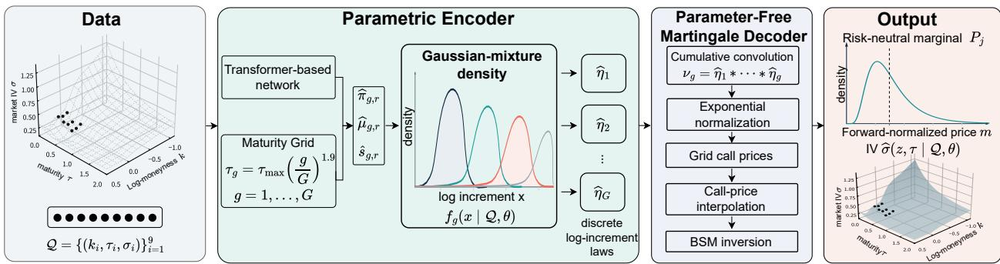  
Figure 1: The ADDMART pipeline. Reference quotes are encoded into a latent representation for maturity-wise increment prediction, followed by parameter-free deterministic pricing and inversion.

## 2 Related Work

Arbitrage-Free Surface and Density Models. Risk neutral densities have long been fitted with lognormal mixtures (Bahra, 1997; Brigo and Mercurio, 2002), and convexity architectures make butterfly freeness structural (Dugas et al., 2000; Amos et al., 2017). The most accurate models in practice remain per surface calibrations such as SSVI (Gatheral and Jacquier, 2014) and Deep Smoothing (Ackerer et al., 2020), but both require expensive optimization per surface and meet no arbitrage only softly, as a numerical penalty rather than a guarantee. A complementary route specifies an arbitrage free valuation first and recovers the supporting martingale (Carr and Madan, 2005; Madan and Yor, 2002); modeling the log price by an additive process makes this constructive, since the marginals of a genuine martingale increase in convex order, giving calendar freeness, while each marginal is a valid density, giving butterfly freeness (Carr and Torricelli, 2021; Azzone and Torricelli, 2025). Neural variants exist: Ning et al. (2023) train a variational autoencoder over the parameters of additive and Levy models to generate arbitrage free surfaces, and Lin and Liu (2024) fit an additive logistic martingale whose deterministic term structure is a feed forward network. ADDMART shares this additive martingale backbone but is quote conditioned and amortized few shot via a permutation invariant set encoder (Zaheer et al., 2017), places a nonparametric mixture density on each increment rather than a fixed parametric family, which we show is decisive for accuracy, and makes calendar freeness hard by construction through linear convolution rather than a soft penalty.

Few-Shot Amortization. HyperIV (Yang et al., 2025), VolNP (Zhuang and Wu, 2025), and Operator Deep Smoothing (Wiedemann et al., 2025) reconstruct IV surfaces without per-surface optimization. HyperIV and Operator Deep Smoothing use no-arbitrage penalties, while VolNP combines SABR-derived pretraining with likelihood-based fitting.

Neither mechanism guarantees global static no-arbitrage or non-negative implied risk-neutral densities. Other structured neural models target different pricing settings. Concurrent work emits neural Gaussian mixture densities with closed form prices (van den Berg, 2026), but in a model surrogate setting rather than from sparse market quotes and without a cross maturity martingale. ADDMART focuses on reconstruction from sparse market quotes, combining amortized inference with a common martingale construction that produces valid marginals and enforces consistency across maturities.

## 3 Preliminaries

We summarize the frequently used notation in this work in Table 4 of Appendix A. In this work, although listed equity and ETF options are American-style, we use liquid OTM quotes, for which immediate exercise has no value, and express them as European-equivalent Black–76 IVs using parity-implied forwards that account for prevailing carry. This convention limits early-exercise and dividend effects in our contemporaneous reconstruction setting, so the formal guarantee applies to the resulting European-equivalent surface. The Black-Scholes-Merton (BSM) framework provides a closed-form pricing formula for European call options. Given the underlying asset’s current price $S _ { 0 }$ the strike price K, the risk-free interest rate r, the time-to-maturity τ, and the volatility $\sigma ,$ the call price is given by $C = S _ { 0 } \mathcal { N } ( d _ { 1 } ) - K e ^ { - r \tau } \mathcal { N } ( d _ { 2 } )$ , where $\begin{array} { r } { d _ { 1 } = \frac { \ln \left( S _ { 0 } / K \right) + \left( r + \sigma ^ { 2 } / 2 \right) \tau } { \sigma \sqrt { \tau } } , d _ { 2 } = d _ { 1 } - \sigma \sqrt { \tau } , } \end{array}$ , and $\mathcal { N }$ denotes the cumulative distribution function of the standard normal distribution. Because all parameters except the volatility σ are directly observable in the market, equating the BSM model price to the observed market option price allows us to back out the unique implied volatility (IV).

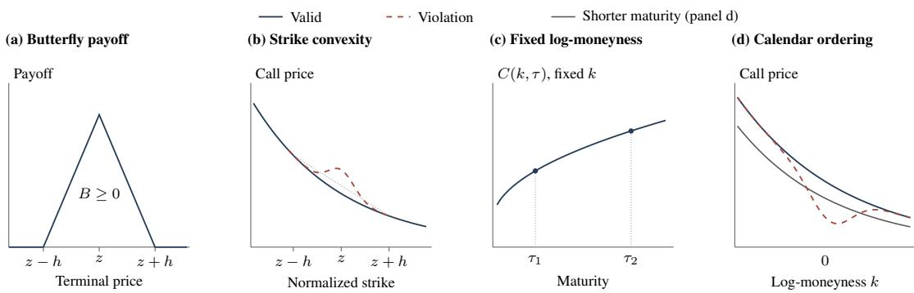  
Figure 2: Butterfly and calendar restrictions implied by static no-arbitrage.

To facilitate our further analysis, it is convenient to work with forward-normalized quantities. Let $k = \log ( K / F ( \tau ) )$ and $M _ { \tau } = S _ { \tau } / F ( \tau )$ where $F ( \tau )$ is the parity-implied forward price and $S _ { \tau }$ is the asset price at maturity. Under the pricing measure $\mathbb { Q } , \mathbb { E } _ { \mathbb { Q } } [ M _ { \tau } ] = 1$ . We define the forward-normalized, undiscounted call price as $C ( k , \tau ) = \mathbb { E } _ { \mathbb { Q } } [ ( M _ { \tau } - e ^ { k } ) ^ { + } ]$ or equivalently $c ( z , \tau ) = E _ { \mathbb { Q } } [ ( M _ { \tau } - z ) ^ { + } ]$ where $z = e ^ { k } = K / F ( \tau )$ is the normalized strike. Furthermore, we have $\forall \tau , c ( 0 , \tau ) = 1$ and lim $\boldsymbol { z } \to + \infty \ : c ( \boldsymbol { z } , \tau ) = 0$ . In this work, we aim to learn a surface mapping from k and $\tau$ to implied volatility $\operatorname { I V } ( k , \tau )$ based on observable quotes.

Static No-Arbitrage Conditions. A valid option IV surface must satisfy both strike-wise and cross-maturity noarbitrage conditions (Carr and Madan, 2005; Gatheral and Jacquier, 2014), corresponding to the absence of butterfly and calendar arbitrage, respectively. The butterfly constraint requires the call price $c ( \cdot , \tau )$ to be non-increasing and globally convex in normalized strike $z , \mathrm { i } . \mathrm { e } . , \partial c ( z , \tau ) / \partial z \leq 0$ and $\partial ^ { 2 } c ( z , \tau ) / \partial z ^ { 2 } \ge 0$ . By the Breeden–Litzenberger theorem (Breeden and Litzenberger, 1978), the distributional second derivative $\partial ^ { 2 } c / \partial z ^ { 2 }$ is the risk-neutral marginal measure of $M _ { \tau }$ and is therefore non-negative. The calendar constraint requires the call price $c ( z , \cdot )$ to be non-decreasing in maturity, i.e., $\forall 0 \leq \tau _ { 1 } \leq \tau _ { 2 } , c ( z , \tau _ { 1 } ) \leq c ( z , \tau _ { 2 } )$ . Figure 2 illustrates the butterfly and calendar restrictions implied by static no-arbitrage.

Problem Setting. Given $N$ option quotes for an underlying asset $\mathcal { Q } = \{ ( k _ { n } , \tau _ { n } , \sigma _ { n } ) \} _ { n = 1 } ^ { N }$ where $\sigma _ { n }$ is implied volatility indicated by the market price, our goal is to learn a model $\widehat { \sigma } ( z , \tau | \mathcal { Q } , \theta )$ parameterized by θ that reconstruct the full implied-volatility surface subject to the static no-arbitrage conditions discussed above. Unlike per-surface calibration, the learned model should generate the predicted IV in a single forward pass. At a high level, the learning problem is:

$$
\begin{array} { r l } & { \underset { \theta } { \operatorname* { m i n } } \ \mathbb { E } _ { ( k , \tau , \sigma ) \sim \mathcal { T } } l ( \widehat { \sigma } ( z , \tau | \mathcal { Q } , \theta ) - \sigma ) } \\ & { s . t . \ \forall z , \tau , \frac { \partial \widehat { c } ( z , \tau ) } { \partial z } \leq 0 , \frac { \partial ^ { 2 } \widehat { c } ( z , \tau ) } { \partial z ^ { 2 } } \geq 0 , \quad \forall z , \tau _ { 1 } , \tau _ { 2 } , [ \widehat { c } ( z , \tau _ { 1 } ) - \widehat { c } ( z , \tau _ { 2 } ) ] ( \tau _ { 1 } - \tau _ { 2 } ) \geq 0 . } \end{array}\tag{1}
$$

where $\tau$ denote the training set consisting of sampled quotes to optimize $\theta , \widehat { c } ( z , \tau )$ is the estimated forward-normalized, undiscounted call price based on $\widehat { \sigma } ( z , \tau | \mathcal { Q } , \theta )$ and l is the loss objective function. In general, the learning problem aims to minimize the discrepancy between the market IV and the estimated IV subject to static no-arbitrage conditions.

## 4 Methodology: ADDMART

We introduce ADDMART in this section, including the exponential additive-martingale construction (Section 4.1), the resulting by-construction static no-arbitrage guarantees (Section 4.2), the amortized architecture that generates estimated IV from sparse quotes (Section 4.3), and the end-to-end training and inference pipeline (Section 4.4).

## 4.1 Martingale Construction for the Forward-Normalized Price

On a maturity grid $0 = \tau _ { 0 } < \tau _ { 1 } < . . . < \tau _ { G }$ and a filtered probability space $( \Omega , \mathcal { F } , \{ \mathcal { F } _ { \tau _ { j } } \} _ { j = 0 } ^ { G } , \mathbb { Q } )$ , we consider G independent random variables $\{ L _ { g } \} _ { g = 1 } ^ { G }$ with probability laws $\{ \eta _ { g } \} _ { g = 1 } ^ { G }$ , each satisfying ${ \mathbb E } _ { \mathbb Q } [ e ^ { L _ { g } } ] < \infty$ . We define the additive state $\begin{array} { r } { A _ { \tau _ { j } } : = \sum _ { g \leq j } L _ { g } } \end{array}$ and its normalized exponential as the normalized terminal price $M _ { \tau _ { j } }$ . Based on the independent variable, we have:

$$
M _ { \tau _ { j } } : = \frac { e ^ { A _ { \tau _ { j } } } } { \mathbb { E } _ { \mathbb { Q } } [ e ^ { A _ { \tau _ { j } } } ] } = \prod _ { g \leq j } \frac { e ^ { L _ { g } } } { \mathbb { E } _ { \mathbb { Q } } [ e ^ { L _ { g } } ] } .\tag{2}
$$

Each multiplicative $\frac { e ^ { L _ { g } } } { \mathbb { E } _ { \mathbb { Q } } [ e ^ { L _ { g } } ] }$ in (2) is non-negative and has unit expectation under $\mathbb { Q } .$ In addition, since $L _ { j + 1 }$ is independent of $\mathcal { F } _ { \tau _ { j } }$ , we have $\mathbb { E } _ { \mathbb { Q } } [ M _ { \tau _ { j + 1 } } ~ | ~ \mathcal { F } _ { \tau _ { j } } ] = M _ { \tau _ { j } }$ . Therefore, $\{ M _ { \tau _ { j } } \} _ { j = 0 } ^ { G }$ is a non-negative martingale with $\forall j , \mathbb { E } _ { \mathbb { Q } } [ M _ { \tau _ { j } } ] = 1$

Let $\nu _ { j } : = \eta _ { 1 } * \cdots * \eta _ { j }$ denote the probability law of $A _ { \tau _ { j } }$ and define $\begin{array} { r } { Z _ { j } : = \mathbb { E } _ { \mathbb { Q } } [ e ^ { A _ { \tau _ { j } } } ] = \int _ { \mathbb { R } } e ^ { x } \nu _ { j } ( d x ) } \end{array}$ . Therefore, we can calculate the forward-normalized, undiscounted call price $c ( z , \tau _ { j } )$ as follows:

$$
c ( z , \tau _ { j } ) = \mathbb { E } _ { \mathbb { Q } } [ ( M _ { \tau _ { j } } - z ) ^ { + } ] = \int _ { \mathbb { R } } \left( \frac { e ^ { x } } { Z _ { j } } - z \right) ^ { + } \nu _ { j } ( d x )\tag{3}
$$

Equivalently, the risk-neutral marginal $\mathsf { P } _ { j }$ of $M _ { \tau _ { j } }$ is the pushforward of $\nu _ { j }$ through $x \mapsto e ^ { x } / Z _ { j }$

Equation (3) calculates the forward-normalized, undiscounted call price at the maturity grid. For more general maturity $\tau \in \left( \tau _ { j } , \tau _ { j + 1 } \right)$ , we let $\lambda = ( \tau - \tau _ { j } ) / ( \tau _ { j + 1 } - \tau _ { j } )$ and interpolate the prices at the maturity grid by $c ( z , \tau ) =$ $( 1 - \lambda ) c ( z , \tau _ { j } ) \dot { + } \lambda c ( z , \tau _ { j + 1 } )$ . This is equivalent to using the mixture marginal ${ \sf P } _ { \tau } = ( 1 - \lambda ) { \sf P } _ { j } + \lambda { \sf P } _ { j + 1 }$ . With $c ( z , \tau )$ we can calculate the corresponding $\mathrm { I V } ( k , \tau )$ by BSM framework introduced in Section 3.

## 4.2 Arbitrage-Free by Construction

Our main theorem indicates the forward-normalized price $c ( z , \tau )$ constructed by the martingale above is free of static arbitrage, so we do not need additional constraints to enforce this requirement.

Theorem 1 (Static no-arbitrage on the modeled maturity interval). Let $L _ { 1 } , \dots , L _ { G }$ be independent real-valued random variables satisfying ${ \mathbb E } _ { \mathbb Q } [ e ^ { L _ { g } } ] < \infty$ . Construct the normalized exponential martingale and its call prices as in Section 4.1, with $M _ { 0 } = 1$ , and interpolate the grid call prices linearly atfixed normalized strike. For every $\tau \in [ 0 , \tau _ { G } ]$ , thefunction $c ( z , \tau )$ ) is non-increasing and convex $i n \ z > 0$ , with $( 1 - z ) ^ { + } \leq c ( z , \tau ) \leq 1$ . For every normalizedfixed strike $z > 0$ $c ( z , \tau )$ ) is non-decreasing in τ. Thus the surface satisfies both strike-wise and cross-maturity no-arbitrage conditions under the stated pricing assumptions.

To prove the theorem above, we notice that each marginal $\mathsf { P } _ { j }$ of $M _ { \tau _ { i } }$ is a valid probability law and that these marginals increase in convex order. Full-support convolution in the probability law of $A _ { \tau _ { j } }$ preserves non-negativity and unit mass, while the martingale property in Equation (2) implies convex-order monotonicity (Kellerer, 1972). Both properties hold for every admissible value of the increment laws $\{ \eta _ { g } \} _ { g = 1 } ^ { G }$ . The complete proof is provided in Appendix C.1.

As a direct consequence, each grid-maturity marginal emitted by ADDMART is a valid probability measure. Distributional quantities such as the CDF, survival function, generalized quantiles, VaR, CVaR, and crash probabilities can therefore be computed directly from the predicted marginal. The corresponding formulas are provided in Appendix C.2. Theorem 1 shows that the static no-arbitrage conditions are enforced by the construction in Section 4.1, rather than by the training objective. Therefore, ADDMART requires no butterfly or calendar arbitrage penalty during learning.

## 4.3 Amortized Network Architecture

ADDMART employs a model parameterized by θ to follow the construction process introduced in Section 4.1 so that the generated surface is the arbitrage-free by construction. Figure 1 summarizes the architecture. It consists of a learned set encoder and increment-density head followed by a deterministic martingale decoder.

Parametric Encoder. The encoder maps the input quote reference set $\mathcal { Q } = \{ ( k _ { i } , \tau _ { i } , \sigma _ { i } ) \} _ { i = 1 } ^ { N }$ to an estimation of the probability laws $\{ \eta _ { g } \} _ { g = 1 } ^ { G }$ of log-increments $\{ L _ { g } \} _ { g = 1 } ^ { G }$ with a model parameterized by $\theta .$ . Specifically, each quote $\left( k _ { i } , \tau _ { i } , \sigma _ { i } \right)$ is mapped to a 128-dimensional feature by a linear transformation, and the resulting sequence is processed by two Transformer encoder layers with two attention heads, followed by mean pooling over the quote dimension and a linear projection to obtain the 64-dimensional representation $h \in \mathbb { R } ^ { 6 4 }$ . We use no positional encoding and mean pooling over the quote dimension to make the representation h invariant to the ordering of input quotes. Self-attention allows each quote to be interpreted relative to the remaining maturities and moneyness levels, while the pooled representation summarizes the sparse surface as a whole. We then generate probability laws $\{ \eta _ { g } \} _ { g = 1 } ^ { G }$ based on learning-based representation $h .$ . In particular, we choose $G = 3 0$ maturity buckets up to $\tau _ { \operatorname* { m a x } } = 2$ years, with an exponential interpolation $\tau _ { g } = \tau _ { \operatorname* { m a x } } ( g / G ) ^ { 1 . 9 }$ so that more buckets are allocated near expiry. For each bucket, we concatenate h with time features $( \tau _ { g } , \sqrt { \tau _ { g } } )$ and employ a two-layer MLP with width 128 and GELU Hendrycks and Gimpel (2016) activations to map the time-augmented feature $\widehat { h } _ { g } = ( h , \tau _ { g } , \sqrt { \tau _ { g } } )$ to the 24-dimensional output, which is then organized tuples $\{ \widehat { \pi } _ { g , r } , \widehat { \mu } _ { g , r } , \widehat { s } _ { g , r } \} _ { r = 1 } ^ { 8 }$ . We then model the corresponding probability law $\eta _ { g }$ as a Gaussian mixture $\begin{array} { r } { f _ { g } ( x | \mathcal { Q } , \theta ) = \sum _ { r = 1 } ^ { R } \pi _ { g , r } \mathcal { N } ( x | \mu _ { g , r } , s _ { g , r } ^ { 2 } ) } \end{array}$ where $\mathcal { N } ( \boldsymbol { x } | \mu _ { g , r } , s _ { g , r } ^ { 2 } )$ is the probability density of Gaussian distribution with its weight $\pi _ { g , r }$ , mean $\mu _ { g , r }$ and variance $s _ { g , r } ^ { 2 }$ calculated as:

$$
\pi _ { g , r } = \frac { e ^ { \widehat { \pi } _ { g , r } } } { \sum _ { r = 1 } ^ { R } e ^ { \widehat { \pi } _ { g , r } } } , \quad \mu _ { g , r } = 0 . 3 \sqrt { \Delta \tau _ { g } } \widehat { \mu } _ { g , r } , \quad s _ { g , r } = \sqrt { \Delta \tau _ { g } } \left[ 0 . 0 2 + \mathrm { s o f t p l u s } ( \widehat { s } _ { g , r } - 1 ) \right] .\tag{4}
$$

where $\Delta \tau _ { g } = \tau _ { g } - \tau _ { g - 1 }$ . We scale the mean and standard deviation of each Gaussian component by $\sqrt { \Delta \tau _ { g } }$ to impose a natural diffusive time scale. The mixture of eight Gaussian components allows $\eta _ { g }$ to represent asymmetric and multimodal increment laws. We discretize this law on a fixed, equally spaced grid $\{ x _ { i } \} _ { i = 1 } ^ { X } \subset [ - 5 , 5 ]$ , with $X = 2 0 4 8$ by evaluating and normalizing the mixture density:

$$
\widehat { \eta } _ { g } = \sum _ { i = 1 } ^ { X } m _ { g , i } \delta _ { x _ { i } } , \qquad m _ { g , i } = \frac { f _ { g } ( x _ { i } \mid Q , \theta ) } { \sum _ { \ell = 1 } ^ { X } f _ { g } ( x _ { \ell } \mid Q , \theta ) } .\tag{5}
$$

Here, $\delta _ { x _ { i } }$ denotes the Dirac probability measure at $x _ { i }$ . The dependence of $\widehat { \eta } _ { g }$ and $m _ { g , i }$ on $\mathcal { Q }$ and θ is omitted for brevity. The resulting discrete law approximates the continuous increment law $\eta _ { g }$ and enables the convolution and pricing operations in Section 4.1. Its probability masses are non-negative, sum to one, and are differentiable with respect to θ, enabling end-to-end training.

Parameter-free Decoder. Encoder’s output $\widehat { \eta } _ { g } ( x | \mathcal { Q } , \theta )$ are passed to the decoder for construction in Section 4.1. Specifically, we estimate the probability law of $A _ { \tau _ { j } }$ by convolution, and then the forward-normalized, undiscounted call price ${ \widehat { c } } ( z , \tau | \mathscr { Q } , \theta )$ by Equation (3) and interpolation. The decoder contains no trainable parameters and supplies the martingale structure of Theorem 1. We apply BSM framework on the log-moneyness $k = \log z ,$ , time-to-maturity τ and estimated call price $\widehat { c } ( z , \tau | \mathscr { Q } , \theta )$ to obtain the estimated implied volatility, which is a function of z, τ conditioned on $\mathcal { Q } ,$ θ and denoted as $\widehat { \sigma } ( z , \tau | \mathcal { Q } , \theta )$

## 4.4 Training and Inference

Training Phase. We follow Yang et al. (2025) to include 9 reference quotes as the conditioning set Q and another 256 quotes sampled with replacement as the training set T to train the model. Each quote $\left( k _ { n } , \tau _ { n } , \sigma _ { n } \right)$ include its log-moneyness $k _ { n } = \log { z _ { n } }$ , time-to-maturity $\tau _ { n }$ and market $\mathrm { ~ I V ~ } \sigma _ { n }$ . For each quote in the training set, we apply parametric encoder and non-parametric decoder discussed in Section 4.3 on $k _ { n }$ and $\tau _ { n }$ to obtain the estimated IV $\widehat { \sigma } ( e ^ { k _ { n } } , \tau _ { n } | \mathcal { Q } , \theta )$ . We minimize the estimated discrepancy between the estimated IV and the market IV as follows:

$$
\operatorname* { m i n } _ { \theta } \mathcal { L } ( \theta ) = \frac { 1 } { | \mathcal { T } | } \sum _ { n = 1 } ^ { | \mathcal { T } | } l _ { \beta } \big ( \widehat { \sigma } ( e ^ { k _ { n } } , \tau _ { n } | \mathcal { Q } , \theta ) - \sigma _ { n } \big )\tag{6}
$$

where $l _ { \beta }$ is a Huber loss Huber (1992) with $\beta = 0 . 0 5$ . The quadratic part of $l _ { \beta }$ supplies smooth gradients for accurately reconstructed contracts, while its linear tail limits the influence of noisy or stale quotes. Compared with the generic form in (1), our objective in (6) has no penalty term, regularization term or any constraints, because static no-arbitrage is supplied by the decoder and is therefore independent of the attained loss value. We defer more technical details of the training phase in Appendix D.4.

Inference Phase. In the inference phase, the trained encoder processes the sparse reference quotes $\mathcal { Q }$ once and emits all G increment distributions in a single forward pass. The decoder then compute the estimated IV based on convolution, interpolation and inverse BSM. It returns both the queried IV surface and the underlying risk-neutral marginals. The implementation is detailed in Appendix D.2.

## 5 Experiments

## 5.1 Experiment settings

Data and protocol. We use OPRA top-of-book option quotes obtained from a commercial data provider,1 and price each contract at the bid–ask midpoint. We infer the forward from put–call parity and invert implied volatility under Black–76 (Black, 1976). Each surface contains OTM options and is conditioned on 9 reference quotes: the contracts nearest to three target maturities (7, 30, and 90 days) and three deltas (0.50, 0.25, and −0.25). All remaining contract are reconstruction targets. We evaluate 7 daily books: SPY, QQQ, IWM, AAPL, GOOGL, META, NVDA, and 3 intraday-minute books: SPY, QQQ, IWM.2 All datasets use the same strict out-of-time split: surfaces before February 1, 2025 are used for training and validation, and surfaces from that date onward for testing. The resulting ten datasets contain approximately 40.1 million option quotes across 70,027 surfaces. Full preprocessing and dataset statistics are provided in Appendix E.

Evaluation metrics. We report IV-MAE (F.1) over all reconstruction targets (overall) and over the liquid region $\{ | k | \le 0 . 1$ , ttm ≥ 14d} (reliable), with mean and standard deviation over five seeds for amortized methods. Static arbitrage is evaluated for every method using the same finite-difference grid. We report violations of calendar monotonicity $( \partial _ { \tau } w \geq 0 )$ and butterfly positivity $( g ( k , \tau ) \ge 0 )$ , where $w = \sigma ^ { 2 } \tau$ . Metric definitions are given in Appendix F.1.

Baselines. We compare ADDMART with the amortized few-shot models, including HyperIV (Yang et al., 2025), GNO (Li et al., 2020), and VAE (Kingma and Welling, 2014), and with the per-surface methods, including SSVI (Gatheral and Jacquier, 2014) and Deep Smoothing (Ackerer et al., 2020). All amortized methods use the same 9 reference quotes, out-of-time split, and five random seeds. Implementation and training details are reported in Appendix F.2.

## 5.2 Reconstruction Performance

Tables 1 and 2 summarize reconstruction accuracy and static-arbitrage violations under the unified evaluation protocol. All amortized methods are evaluated over five seeds, whereas SSVI and Deep Smoothing are fitted independently to each test surface. On the daily data, ADDMART achieves the lowest overall IV-MAE on six of the seven assets, with HyperIV performing slightly better only on NVDA. The reliable-region comparison is closer: ADDMART leads on SPY, QQQ, and IWM, while HyperIV is marginally better on the four single names. Consequently, the asset-equal daily averages favor ADDMART for overall reconstruction (1.65 versus 1.72 for HyperIV), while HyperIV has a small advantage in the reliable region (1.27 versus 1.29). At the minute scale, ADDMART is best on both metrics for SPY and IWM, whereas GNO performs best on QQQ. Averaged across the three minute-scale assets, ADDMART again gives the lowest reliable and overall errors, at 0.61 and 1.08, respectively. The seed-level results also show that ADDMART i substantially more stable than GNO, whose large standard deviations on SPY and IWM indicate frequent optimization instability.

The arbitrage audit provides a sharper distinction between the methods. On a common $8 0 1 \times 3 0$ full-support price grid, ADDMART produces no calendar or butterfly violations beyond numerical precision across any asset or scale. SSVI also attains zero violations, but requires a separate optimization for every surface. Deep Smoothing remains close to arbitrage-free in pairwise terms, although small butterfly violations persist. In contrast, the amortized neural baselines exhibit material violations: on the daily assets, HyperIV violates 0.60–2.62% of calendar pairs and 1.63–8.17% of butterfly pairs, while GNO reaches calendar-violation rates as high as 22.28%. The violations become more pronounced at the minute scale, particularly for GNO and VAE. Thus, among methods that reconstruct a surface in a single amortized forward pass, ADDMART provides the strongest overall accuracy while uniquely preserving the no-arbitrage conditions to numerical precision.

Table 1: Reliable and overall IV-MAE $( \times 1 0 ^ { - 2 } ,$ , mean±std over 5 seeds). Lowest per metric within each asset row in bold. ‡SSVI and Deep Smoothing are per-surface fits (one optimization per surface, not amortized over a training seed), reported as a single value
<table><tr><td></td><td></td><td colspan="2">ADDMART</td><td colspan="2">HyperIV</td><td colspan="2">GNO</td><td colspan="2">VAE</td><td colspan="2">SSVI</td><td colspan="2">Deep Sm.‡</td></tr><tr><td>Scale</td><td>Asset</td><td>Reliable</td><td>Overall</td><td>Reliable</td><td>Overall</td><td>Reliable</td><td>Overall</td><td>Reliable</td><td>Overall</td><td>Reliable</td><td>Overall</td><td>Reliable</td><td>Overall</td></tr><tr><td rowspan="7">Daily</td><td>SPY</td><td> $\mathbf { 0 . 5 6 \pm 0 . 0 2 }$ </td><td> $\mathbf { 0 . 8 9 \pm 0 . 0 5 }$ </td><td> $0 . 5 7 \pm 0 . 0 2$ </td><td> $0 . 9 9 \pm 0 . 0 3$ </td><td> $0 . 6 2 \pm 0 . 0 5$ </td><td> $0 . 9 5 \pm \mathrm { 0 . 0 7 }$ </td><td> $1 . 3 3 { \scriptstyle \pm 0 . 1 5 }$ </td><td> $1 . 7 5 \pm \mathrm { 0 . 1 1 }$ </td><td>1.29</td><td>2.24</td><td>1.07</td><td>2.23</td></tr><tr><td>QQQ</td><td> $\mathbf { 0 . 6 8 \pm 0 . 0 3 }$ </td><td> ${ \bf 1 . 2 5 \pm 0 . 0 5 }$ </td><td> $0 . 7 4 \pm \mathrm { 0 . 0 3 }$ </td><td> $1 . 3 1 \pm 0 . 0 4$ </td><td> $0 . 9 0 \pm \mathrm { 0 . 1 0 }$ </td><td> $1 . 4 5 \pm 0 . 1 3$ </td><td> $1 . 3 0 \pm \ : 0 . 1 5$ </td><td> $1 . 9 8 \pm \mathrm { 0 . 0 7 }$ </td><td>1.20</td><td>2.19</td><td>1.11</td><td>2.57</td></tr><tr><td>IWM</td><td> $\mathbf { 0 . 7 7 \pm 0 . 0 3 }$ </td><td> ${ \bf 1 . 1 7 \pm 0 . 0 3 }$ </td><td> $0 . 7 8 \pm \mathrm { 0 . 0 8 }$ </td><td> $1 . 2 7 \pm \mathrm { 0 . 0 9 }$ </td><td> $1 . 0 9 \pm \mathrm { 0 . 5 3 }$ </td><td> $1 . 7 7 \pm 0 . 9 4$ </td><td> $1 . 1 9 \pm \ : 0 . 1 2$ </td><td> $1 . 9 3 \pm \mathrm { 0 . 1 4 }$ </td><td>1.16</td><td>1.95</td><td>1.20</td><td>2.57</td></tr><tr><td>AAPL</td><td> $\mathbf { 1 . 1 8 \pm 0 . 0 7 }$ </td><td> ${ \bf 1 . 4 0 \pm 0 . 0 5 }$ </td><td> $\mathbf { 1 . 1 8 \pm 0 . 0 7 }$ </td><td> $1 . 5 5 { \scriptstyle \pm 0 . 0 8 }$ </td><td> $1 . 5 2 \pm 0 . 2 5$ </td><td> $1 . 7 7 \pm \mathrm { 0 . 3 1 }$ </td><td> $1 . 7 6 \pm \mathrm { 0 . 0 4 }$ </td><td> $2 . 3 7 \pm 0 . 1 0$ </td><td>2.08</td><td>3.14</td><td>2.90</td><td>5.11</td></tr><tr><td>GOOGL</td><td> $2 . 2 2 { \scriptstyle \pm 0 . 1 4 }$ </td><td> $\mathbf { 2 . 3 7 \pm 0 . 1 1 }$ </td><td> $\mathbf { 2 . 0 7 \Pi _ { \pm 0 . 2 5 } }$ </td><td> $2 . 4 3 \pm 0 . 2 4$ </td><td> $2 . 5 9 \pm 0 . 3 2$ </td><td> $2 . 7 6 \pm \mathrm { 0 . 2 4 }$ </td><td> $3 . 1 2 \pm 0 . 0 9$ </td><td> $3 . 4 2 \pm 0 . 1 0$ </td><td>3.21</td><td>4.01</td><td>5.87</td><td>8.10</td></tr><tr><td>META</td><td> $1 . 8 2 \pm 0 . 1 6$ </td><td> ${ \bf 1 . 9 5 \pm 0 . 1 2 }$ </td><td> ${ \bf 1 . 7 9 \pm 0 . 0 7 }$ </td><td> $2 . 0 3 \pm 0 . 0 8$ </td><td> $2 . 0 5 \pm 0 . 2 2$ </td><td> $2 . 3 0 { \scriptstyle \pm 0 . 2 6 }$ </td><td> $2 . 2 9 \pm \mathrm { 0 . 0 4 }$ </td><td> $2 . 7 3 \pm \mathrm { 0 . 1 0 }$ </td><td>3.69</td><td>4.46</td><td>6.80</td><td>10.40</td></tr><tr><td>NVDA</td><td> $\mathbf { 1 . 8 0 \pm 0 . 1 1 }$ </td><td> $2 . 5 4 \pm 0 . 0 7$ </td><td> $\mathbf { 1 . 8 0 \pm 0 . 1 1 }$ </td><td> $\mathbf { 2 . 4 6 \pm 0 . 1 2 }$ </td><td> $2 . 6 6 \pm \mathrm { 0 . 6 5 }$ </td><td> $3 . 0 8 \pm \mathrm { 0 . 5 5 }$ </td><td> $3 . 3 1 \pm 0 . 2 9$ </td><td> $3 . 5 0 \pm \mathrm { 0 . 2 7 }$ </td><td>3.83</td><td>4.97</td><td>5.19</td><td>7.72</td></tr><tr><td rowspan="3">Minute</td><td>SPY</td><td> $0 . 5 6 \pm 0 . 0 3$ </td><td> $\mathbf { 0 . 9 2 \pm 0 . 0 4 }$ </td><td> $0 . 5 7 \pm 0 . 0 3$ </td><td> $0 . 9 6 \pm 0 . 0 4$ </td><td> $\mathbf { 0 . 5 5 \pm 0 . 0 8 }$ </td><td> $0 . 9 5 \pm \mathrm { 0 . 1 6 }$ </td><td> $1 . 1 3 { \scriptstyle \pm 0 . 0 1 }$ </td><td> $1 . 4 6 \pm \mathrm { 0 . 0 3 }$ </td><td>1.25</td><td>2.10</td><td>1.07</td><td>2.07</td></tr><tr><td>QQQ</td><td> $0 . 6 5 \pm \mathrm { 0 . 0 7 }$ </td><td> $1 . 2 3 \pm \mathbf { 0 . 0 7 }$ </td><td> $0 . 6 6 \pm 0 . 0 4$ </td><td> $1 . 2 0 \pm \ : 0 . 0 6$ </td><td> $\mathbf { 0 . 5 9 \pm 0 . 0 5 }$ </td><td> $\mathbf { 1 . 0 1 \Pi _ { \pm 0 . 0 6 } }$ </td><td> $1 . 1 3 { \scriptstyle \pm 0 . 0 1 }$ </td><td> $1 . 6 9 \pm \mathrm { 0 . 0 3 }$ </td><td>1.20</td><td>2.29</td><td>1.06</td><td>2.44</td></tr><tr><td>IWM</td><td> $\mathbf { 0 . 6 1 \pm 0 . 0 4 }$ </td><td> $\mathbf { 1 . 0 9 \Pi _ { \pm 0 . 0 5 } }$ </td><td> $0 . 6 3 \pm 0 . 0 1$ </td><td> $1 . 1 1 \pm 0 . 0 3$ </td><td> $0 . 7 7 \pm \mathrm { 0 . 1 5 }$ </td><td> $1 . 3 1 \pm 0 . 2 8$ </td><td> $1 . 0 0 \pm 0 . 0 1$ </td><td> $1 . 5 1 \pm 0 . 0 0$ </td><td>1.19</td><td>2.02</td><td>1.16</td><td>2.33</td></tr></table>

Table 2: Calendar and butterfly arbitrage-violation pair rates (%) on the common $8 0 1 \times 3 0$ full-support price grid, using a numerical tolerance of $1 0 ^ { - 1 0 }$ . Amortized methods are pooled over 5 seeds; ‡SSVI and Deep Smoothing are per-surface fits and are reported as a single value. Lowest per metric within each asset row in bold.
<table><tr><td rowspan="2">Scale</td><td rowspan="2">Asset</td><td colspan="2">ADDMART</td><td colspan="2">HyperIV</td><td colspan="2">GNO</td><td colspan="2">VAE</td><td colspan="2">SSVI</td><td colspan="2">Deep Sm.‡</td></tr><tr><td>Calendar Butterfly</td><td></td><td>Calendar Butterfly</td><td></td><td>Calendar</td><td>Butterfly</td><td>Calendar Butterfly</td><td></td><td>Calendar Butterfly</td><td></td><td></td><td>Calendar Butterfly</td></tr><tr><td rowspan="7">Daily</td><td>SPY</td><td>0</td><td>0</td><td>0.7310</td><td>1.6295</td><td>15.6910</td><td>4.4026</td><td>0.0546</td><td>8.4843</td><td>0</td><td>0</td><td>0</td><td>0.0113</td></tr><tr><td>QQQ</td><td>0</td><td>0</td><td>1.0047</td><td>2.3451</td><td>22.2821</td><td>5.2844</td><td>0.2145</td><td>7.8386</td><td>0</td><td>0</td><td>0</td><td>0.0222</td></tr><tr><td>IWM</td><td>0</td><td>0</td><td>0.6008</td><td>4.8701</td><td>18.8903</td><td>7.6170</td><td>0.3043</td><td>6.8536</td><td>0</td><td>0</td><td>0</td><td>0.0642</td></tr><tr><td>AAPL</td><td>0</td><td>0</td><td>1.0690</td><td>6.6294</td><td>20.6356</td><td>5.0270</td><td>0.0785</td><td>5.0351</td><td>0</td><td>0</td><td>0</td><td>0.0160</td></tr><tr><td>GOOGL</td><td>0</td><td>0</td><td>0.9958</td><td>7.9404</td><td>14.6969</td><td>3.4538</td><td>0.2408</td><td>5.5603</td><td>0</td><td>0</td><td>0.0051</td><td>0.0195</td></tr><tr><td>META</td><td>0</td><td>0</td><td>2.6205</td><td>8.1659</td><td>11.6960</td><td>3.5165</td><td>0.0906</td><td>4.4891</td><td>0</td><td>0</td><td>0</td><td>0.0108</td></tr><tr><td>NVDA</td><td>0</td><td>0</td><td>1.6370</td><td>7.8105</td><td>7.2435</td><td>2.3606</td><td>0.3796</td><td>2.9705</td><td>0</td><td>0</td><td>0</td><td>0</td></tr><tr><td rowspan="3">Minute QQQ</td><td>SPY</td><td>0</td><td>0</td><td>0.3779</td><td>1.9884</td><td>22.4997</td><td>8.7293</td><td>21.0067</td><td>18.5972</td><td>0</td><td>0</td><td>0.0053</td><td>0.0336</td></tr><tr><td></td><td>0</td><td>0</td><td>1.5006</td><td>6.1951</td><td>25.4820</td><td>8.7914</td><td>20.2924</td><td>13.6071</td><td>0</td><td>0</td><td>0.0162</td><td>0.0274</td></tr><tr><td>IWM</td><td>0</td><td>0</td><td>0.7306</td><td>4.2616</td><td>23.2808</td><td>8.3368</td><td>18.2714</td><td>13.4086</td><td>0</td><td>0</td><td>0</td><td>0.0745</td></tr></table>

## 5.3 Downstream Distribution Validity.

Figure 3 examines whether the reconstructed surfaces imply coherent risk-neutral distributions. The upper row shows the Breeden–Litzenberger density and the lower row its CDF, with insets highlighting small violations that are obscured at the full-distribution scale. Across the representative SPY and NVDA surfaces, ADDMART produces non-negative densities and monotone CDFs by construction. For the baselines that directly predict or fit the IV surface, second differentiation amplifies local curvature errors in the reconstructed surface, producing negative density and locally decreasing CDFs. The effect is particularly pronounced for the one-year NVDA example, where HyperIV has 21.8% integrated negative mass despite competitive IV reconstruction accuracy.

Distributional validity also affects downstream risk estimates. Appendix G.1 evaluates option-implied downside CVaR against a full-information reference fitted using all available quotes. ADDMART achieves the lowest CVaR error in five of the six asset–horizon settings, while its predicted marginals remain valid in every evaluated case. The baseline distributions frequently require ex-post clipping and renormalization before CVaR can be computed, making the resulting tail estimates dependent on the repair procedure. These quantities describe risk-neutral tail exposure implied by option prices and should not be interpreted as forecasts of realized losses.

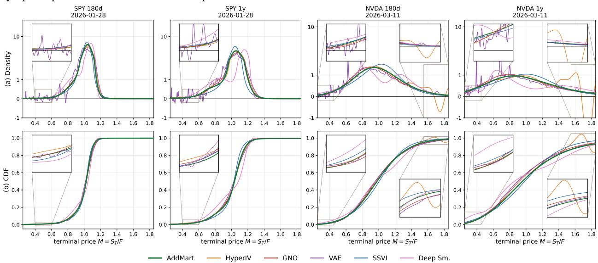  
Figure 3: Risk-neutral densities and CDFs. AddMart guarantees valid densities and monotone CDFs, while IV prediction-based baselines may violate these properties, particularly for one-year NVDA. Insets highlight the tails.

Table 3: Key ablations on SPY and NVDA daily (mean±std over five seeds). IV-MAE is reported in $\times 1 0 ^ { - 2 }$ . All mixture and training-loss variants use the exact linear decoder and have zero calendar and butterfly violations.

(a) Convolution
<table><tr><td>Variant</td><td>SPY</td><td>NVDA</td></tr><tr><td>Reliable IV-MAE</td><td></td><td></td></tr><tr><td>Linear exact</td><td>0.56±0.04</td><td>1.84±0.06</td></tr><tr><td>Linear crop</td><td>0.56±0.02</td><td>1.82±0.06</td></tr><tr><td>Circular</td><td>0.55±0.04</td><td>1.76±0.06</td></tr><tr><td>Calendar violation (%)</td><td></td><td></td></tr><tr><td>Linear exact</td><td>0.000</td><td>0.000</td></tr><tr><td>Linear crop</td><td>3.855</td><td>0.023</td></tr><tr><td>Circular</td><td>3.652</td><td>0.070</td></tr></table>

(b) Architecture and training
<table><tr><td>Group</td><td>Variant</td><td>SPY</td><td>NVDA</td></tr><tr><td rowspan="5">Mixture  $n _ { \mathrm { i n c } }$ </td><td>1</td><td>2.99±0.15</td><td>2.11±0.13</td></tr><tr><td>2</td><td>0.67±0.05</td><td>1.74±0.07</td></tr><tr><td>4</td><td>0.55±0.05</td><td>1.75±0.11</td></tr><tr><td>8 (default)</td><td>0.56±0.04</td><td>1.84±0.06</td></tr><tr><td>16</td><td>0.56±0.03</td><td>1.75±0.09</td></tr><tr><td rowspan="3">Training loss</td><td>Implicit IV (default)</td><td>0.56±0.04</td><td>1.84±0.06</td></tr><tr><td>Newton IV</td><td>0.53±0.02</td><td>4.91±0.35</td></tr><tr><td>Price</td><td>0.56±0.02</td><td>1.88±0.09</td></tr></table>

## 5.4 Further Analysis

Ablations. Table 3 examines the main architectural and training choices on the SPY and NVDA daily datasets. The convolution scheme primarily affects the structural guarantee rather than reconstruction accuracy. The exact linear decoder achieves zero calendar violations on both assets, while cropped and circular convolution (Pfister, 2017) introduce measurable violations despite similar reliable-region IV-MAE. In particular, circular convolution attains slightly lower IV-MAE than the exact decoder, but produces calendar-violation rates of 3.652% on SPY and 0.070% on NVDA. This comparison confirms that the no-arbitrage property follows from the full-support linear construction rather than from reconstruction accuracy alone. The mixture ablation shows that a single component is insufficient, especially on SPY, whereas using two or more components substantially improves accuracy. Increasing the mixture size beyond this point yields only modest and asset-dependent changes. The default $n _ { \mathrm { i n c } } { = } 8$ therefore provides a practical capacity choice without relying on fine-grained tuning. The training-loss comparison shows a similar pattern. Direct price supervision performs comparably to the implicit-IV objective, while Newton-based IV inversion improves SPY accuracy but becomes unstable on NVDA. We therefore use the implicit-IV objective as the default because it provides consistently strong performance across both assets

Analysis of Reference Budget. We examine how ADDMART uses increasingly informative reference sets by varying the number of observed contracts $K \in \{ 2 , 3 , 5 , 9 , 1 6 , 2 5 \}$ . Each setting uses the same architecture, is trained over five seeds, and is evaluated on an identical set of non-reference targets. As shown in Figure 4, additional references generally improve reconstruction accuracy, although the gains are asset-dependent and not strictly monotone: SPY approaches saturation between $K = 1 6$ and $K = 2 5$ , whereas NVDA performs best at $K \ : = \ : 1 6$ This suggests that both reference-set size and quote placement affect performance. We use $K = 9$ in the main experiments as a practical balance between accuracy and sparsemarket applicability, with a structured 3-maturity × 3-delta design.

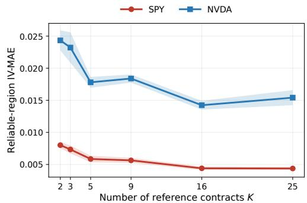  
Figure 4: Effect of reference-set size on AD-DMART for SPY and NVDA on daily data. Lines and shaded regions report the mean and standard deviation of reliable-region IV-MAE over five seeds.

Cross-Asset Performance. We evaluate zero-shot transfer by applying each source-asset checkpoint to the other daily assets, using only the target surface’s nine reference quotes and no retraining. Across the 42 directed source–target pairs, ADDMART attains the lowest overall mean MAE $( 5 . 5 1 \times 1 0 ^ { - 2 } )$ and outperforms HyperIV on 76.2% of the pairs, while HyperIV is stronger in the reliable region (4.81 versus $5 . 3 3 \times 1 0 ^ { - 2 } )$ . Transfer is most effective between related broad-market ETFs and deteriorates, often asymmetrically, when volatility levels and smile shapes differ substantially. These results indicate that ADDMART learns transferable surface structure, although its representation is not fully asset-invariant. The complete protocol, summary statistics, and directed transfer matrices are reported in Appendix G.4.

## 6 Conclusion

In conclusion, ADDMART reframes few-shot implied volatility surface reconstruction by learning the increment laws of an exponential additive martingale rather than directly predicting an unconstrained surface. This design enforces static no-arbitrage by construction and directly yields valid risk-neutral marginal distributions without additional arbitrage penalties. Across ten real-market datasets, ADDMART achieves competitive reconstruction accuracy among amortized methods while enabling downstream distributional risk analysis, demonstrating the benefit of learning structured probability objects rather than only fitting surface values.

The current design nevertheless has several limitations. The additive increment structure induces long-horizon skew flattening, which can reduce accuracy on LEAPS, and the model is less effective for highly asymmetric or heavy-tailed underlyings such as VIX. In addition, serial convolution and implied-volatility inversion limit its suitability for ultrahigh-frequency inference, although the resulting latency remains practical at the minute scale. Future work could address these limitations through richer state-dependent or nonstationary martingale constructions that better preserve persistent skew and heavy tails, more efficient convolution and implied-volatility inversion for lower-latency inference, and extensions such as uncertainty quantification, adaptive reference selection, and cross-asset pretraining to improve robustness under sparse, noisy, or out-of-distribution market conditions. Detailed analyses of these failure modes, together with latency and memory measurements, are provided in Appendix G.5.

## AI use statement

In this work, we used generative AI tools to assist with experimental planning and organization. Additionally, we used generative AI tools for scientific visualization, table formatting, and language editing to improve the readability and presentation of the manuscript. All AI-assisted content, including experimental suggestions, figures, tables, and edited text, was carefully reviewed and verified by the authors for correctness and consistency with the underlying results. Generative AI tools were not used to independently interpret results or draw scientific conclusions. We take responsibility for the final content of this work, including text, claims, or artifacts produced with the aid of generative AI.

## References

Damien Ackerer, Natasa Tagasovska, and Thibault Vatter. Deep smoothing of the implied volatility surface. Advances in Neural Information Processing Systems, 33:11552–11563, 2020.

Brandon Amos, Lei Xu, and J Zico Kolter. Input convex neural networks. In Proceedings ofthe 34th International Conference on Machine Learning (ICML), 2017.

Michele Azzone and Lorenzo Torricelli. Explicit option pricing with additive processes. SIAM Journal on Financial Mathematics, 16(3):747–802, 2025.

Bhupinder Bahra. Implied risk-neutral probability density functions from option prices: theory and application. Technical report, Bank of England Working Paper No. 66, 1997.

Fischer Black. The pricing of commodity contracts. Journal ofFinancial Economics, 3(1-2):167–179, 1976.

Fischer Black and Myron Scholes. The pricing of options and corporate liabilities. Journal of Political Economy, 81(3): 637–654, 1973.

Douglas T Breeden and Robert H Litzenberger. Prices of state-contingent claims implicit in option prices. Journal of business, pages 621–651, 1978.

Damiano Brigo and Fabio Mercurio. Lognormal-mixture dynamics and calibration to market volatility smiles. Interna tional Journal ofTheoretical and Applied Finance, 5(4):427–446, 2002.

Peter Carr and Dilip B Madan. A note on sufficient conditions for no arbitrage. Finance Research Letters, 2(3):125–130, 2005.

Peter Carr and Lorenzo Torricelli. Additive logistic processes in option pricing. Finance and Stochastics, 25(4): 689–724, 2021.

Marc Chataigner, Stéphane Crépey, and Matthew Dixon. Deep local volatility. Risks, 8(3):82, 2020.

Charles Dugas, Yoshua Bengio, François Bélisle, Claude Nadeau, and René Garcia. Incorporating second-order functional knowledge for better option pricing. In Advances in Neural Information Processing Systems (NeurIPS), 2000.

Bruno Dupire. Pricing and hedging with smiles. Mathematics of derivative securities, 1(1):103–111, 1997.

Matthias R Fengler. Arbitrage-free smoothing of the implied volatility surface. Quantitative Finance, 9(4):417–428, 2009.

Jim Gatheral. The volatility surface: a practitioner’s guide. John Wiley & Sons, 2011.

Jim Gatheral and Antoine Jacquier. Arbitrage-free svi volatility surfaces. Quantitative Finance, 14(1):59–71, 2014.

Patrick S Hagan, Deep Kumar, Andrew S Lesniewski, and Diana E Woodward. Managing smile risk. The Best of Wilmott, 1(1):249–296, 2002.

Dan Hendrycks and Kevin Gimpel. Gaussian error linear units (gelus). arXiv preprint arXiv:1606.08415, 2016.

Steven L Heston. A closed-form solution for options with stochastic volatility with applications to bond and currency options. The review offinancial studies, 6(2):327–343, 1993.

Francis Hirsch, Christophe Profeta, Bernard Roynette, and Marc Yor. Peacocks and associated martingales, with explicit constructions. Springer Science & Business Media, 2011.

Peter J Huber. Robust estimation of a location parameter. In Breakthroughs in statistics: Methodology and distribution, pages 492–518. Springer, 1992.

Nabil Kahalé. An arbitrage-free interpolation of volatilities. Risk, 17(5):102–106, 2004.

Hans G Kellerer. Markov-komposition und eine anwendung auf martingale. Mathematische Annalen, 198(3):99–122, 1972.

Diederik P Kingma and Max Welling. Auto-encoding variational Bayes. In International Conference on Learning Representations (ICLR), 2014.

Zongyi Li, Nikola Kovachki, Kamyar Azizzadenesheli, Burigede Liu, Kaushik Bhattacharya, Andrew Stuart, and Anima Anandkumar. Neural operator: Graph kernel network for partial differential equations. arXiv preprint arXiv:2003.03485, 2020.

Jimin Lin and Guixin Liu. Neural term structure of additive process for option pricing. In Proceedings ofthe 5th ACM International Conference on AI in Finance, pages 695–702, 2024.

Dilip B. Madan and Marc Yor. Making markov martingales meet marginals: With explicit constructions. Bernoulli, 8 (4):509–536, 2002. ISSN 13507265. URL http://www.jstor.org/stable/3318851.

Robert C Merton et al. Theory of rational option pricing. 1971.

Brian Ning, Sebastian Jaimungal, Xiaorong Zhang, and Maxime Bergeron. Arbitrage-free implied volatility surface generation with variational autoencoders. SIAM Journal on Financial Mathematics, 14(4):1004–1027, 2023.

Henry Pfister. Discrete-time signal processing. Lecture Note, pfister. ee. duke. edu/courses/ece485/dtsp. pdf, 4:2, 2017.

R Tyrrell Rockafellar, Stanislav Uryasev, et al. Optimization of conditional value-at-risk. Journal of risk, 2:21–42, 2000.

Thijs van den Berg. Fast, reliable, and error-bounded option pricing with pretrained neural networks: A gjr–garch study, 2026. URL https://arxiv.org/abs/2606.15502.

Milena Vuletic and Rama Cont. Volgan: a generative model for arbitrage-free implied volatility surfaces. ´ Applied Mathematical Finance, 31(4):203–238, 2024.

Ruben Wiedemann, Antoine Jack Jacquier, and Lukas Gonon. Operator deep smoothing for implied volatility. In International Conference on Learning Representations, volume 2025, pages 96833–96872, 2025.

Yongxin Yang, Wenqi Chen, Chao Shu, and Timothy Hospedales. HyperIV: Real-time implied volatility smoothing. In Proceedings of the 42nd International Conference on Machine Learning (ICML), 2025.

Manzil Zaheer, Satwik Kottur, Siamak Ravanbakhsh, Barnabas Poczos, Russ R Salakhutdinov, and Alexander J Smola. Deep sets. Advances in neural information processing systems, 30, 2017.

Jian’an Zhang. A risk-neutral neural operator for arbitrage-free spx-vix term structures. arXiv preprint arXiv:2511.06451, 2025.

Wenyong Zhang, Lingfei Li, and Gongqiu Zhang. A two-step framework for arbitrage-free prediction of the implied volatility surface. Quantitative Finance, 23(1):21–34, 2023.

Jirong Zhuang and Xuan Wu. Meta-learning neural process for implied volatility surfaces with sabr-induced priors. arXiv preprint arXiv:2509.11928, 2025.

## Ethics Statement

This study uses option-market quotes rather than human-subject or individual-level data. The proposed model produces implied-volatility surfaces and risk-neutral distributions; these are model-based quantities, not forecasts of realized returns. Although the construction enforces static no-arbitrage under its stated assumptions, this property does not eliminate market-data errors, model risk, or uncertainty in downstream decisions. The outputs should therefore not be treated as standalone investment or risk-management advice.

## Reproducibility Statement

The paper specifies the model architecture, increment-law parameterization, martingale decoder, training objective, data preprocessing, reference-quote selection, chronological data split, baselines, and evaluation metrics in the main text and appendices. Amortized methods are evaluated with five independent random seeds. The experiments use OPRA option quotes obtained through a commercial data provider; access to the underlying data is subject to the provider’s licensing terms. These details are intended to support replication by researchers with access to appropriately licensed data.

## A Notation

Table 4 summarizes the notation used throughout the paper. We use lowercase letters for scalar quantities, bold lowercase letters for vectors, calligraphic letters for sets, and uppercase blackboard-bold letters for probability measures.

Table 4: Notation used throughout the paper.
<table><tr><td>Symbol</td><td>Domain or type</td><td>Description</td></tr><tr><td colspan="3">Option market and pricing</td></tr><tr><td> $B ( k , s _ { \mathrm { t o t } } )$ </td><td>[0, 1]</td><td>Forward-normalized Black call price.</td></tr><tr><td> $C ( k , \tau )$ </td><td>[0, 1]</td><td>Call price in log-moneyness coordinates,  $C ( k , \tau ) = c ( e ^ { k } , \tau )$ </td></tr><tr><td> $c ( z , \tau )$ </td><td>[0, 1]</td><td>Forward-normalized undiscounted call price,  $c ( z , \tau ) = \mathbb { E } _ { \mathbb { Q } } [ ( M _ { \tau } - z ) ^ { + } ] .$ </td></tr><tr><td> $d _ { + } , d _ { - }$ </td><td>R</td><td>Black variables,  $d _ { + } = - k / s _ { \mathrm { t o t } } + s _ { \mathrm { t o t } } / 2$  and  $d _ { - } = - k / s _ { \mathrm { t o t } } - s _ { \mathrm { t o t } } / 2 .$ </td></tr><tr><td> $\mathrm { D F } ( \tau )$ </td><td>(0,1]</td><td>Discount factor for maturity τ, defined as  $\begin{array} { r } { \mathrm { D F } ( \tau ) = \exp [ - r ( \tau ) \tau ] . } \end{array}$ </td></tr><tr><td> $\mathbb { E } _ { \mathbb { Q } } , \mathbb { P } _ { \mathbb { Q } }$ </td><td></td><td>Expectation and probability under the pricing measure  $\mathbb { Q } .$ </td></tr><tr><td> $F ( \tau )$ </td><td> $\mathbb { R } _ { + }$ </td><td>Parity-implied forward price of the underlying for maturity τ.</td></tr><tr><td> $k$ </td><td>R</td><td>Log-moneyness, defined as  $k = \log ( K / F ( \tau ) )$ </td></tr><tr><td> $K$ </td><td> $\mathbb { R } _ { + }$ </td><td>Option strike price.</td></tr><tr><td> $M _ { \tau }$ </td><td> $\mathbb { R } _ { + }$ </td><td>Forward-normalized terminal price,  $M _ { \tau } = S _ { \tau } / F ( \tau )$  , with  $\mathbb { E } _ { \mathbb { Q } } [ M _ { \tau } ] = 1 .$ </td></tr><tr><td> $\Phi , \phi$ </td><td></td><td>CDF and density of the standard normal distribution.</td></tr><tr><td> $q$ </td><td>R</td><td>Continuous dividend yield or implied carry.</td></tr><tr><td> $\mathbb { Q }$ </td><td></td><td>Pricing measure used for normalized option valuation.</td></tr><tr><td> $r ( \tau )$ </td><td>R</td><td>Continuously compounded risk-free rate.</td></tr><tr><td> $S _ { t }$ </td><td> $\mathbb { R } _ { + }$ </td><td>Underlying asset price at observation time t.</td></tr><tr><td> $S _ { \tau }$ </td><td> $\mathbb { R } _ { + }$ </td><td>Underlying asset price at maturity.</td></tr><tr><td> $s _ { \mathrm { t o t } }$ </td><td> $\mathbb { R } _ { + }$ </td><td>Black total volatility,  $s _ { \mathrm { t o t } } = \sigma { \sqrt { \tau } } .$ </td></tr><tr><td> $\sigma ( k , \tau )$ </td><td> $\mathbb { R } _ { + }$ </td><td>Black implied volatility.</td></tr><tr><td>t</td><td> $\mathbb { R } _ { + }$ </td><td>Current observation time.</td></tr><tr><td> $T$ </td><td> $\mathbb { R } _ { + }$ </td><td>Option expiration time.</td></tr><tr><td> $\tau = T - t$ </td><td> $\mathbb { R } _ { + }$ </td><td>Time to maturity, measured in years.</td></tr><tr><td> $w ( k , \tau )$ </td><td> $\mathbb { R } _ { + }$ </td><td>Total implied variance,  $w ( k , \tau ) = \sigma ( k , \tau ) ^ { 2 } \tau$ </td></tr><tr><td> $( x ) ^ { + }$ </td><td> $\mathbb { R } _ { + }$ </td><td>Positive part, defined as  $( x ) ^ { + } = \operatorname* { m a x } ( x , 0 )$ </td></tr><tr><td> $z = e ^ { k }$ </td><td> $\mathbb { R } _ { + }$ </td><td>Normalized strike, equal to  $K / F ( \tau )$ </td></tr><tr><td colspan="3">Additive martingale construction</td></tr><tr><td> $A _ { \tau _ { j } }$ </td><td>R</td><td>Cumulative additive state,  $\begin{array} { r } { A _ { \tau _ { j } } = \sum _ { g \leq j } L _ { g } . } \end{array}$ </td></tr><tr><td> $\Delta \tau _ { g }$ </td><td> $\mathbb { R } _ { + }$ </td><td>Width of maturity bucket  $g , \Delta \tau _ { g } = \tau _ { g } - \tau _ { g - 1 }$ </td></tr><tr><td> $\eta _ { g }$ </td><td> ${ \mathcal { P } } ( \mathbb { R } )$ </td><td>Probability law of the additive increment  $L _ { g } .$ </td></tr><tr><td> $G$ </td><td> $\mathbb { N }$ </td><td>Number of maturity buckets.</td></tr><tr><td> $L _ { g }$ </td><td>R</td><td>Independent additive log-increment in bucket  $g .$ </td></tr><tr><td> $M _ { \tau _ { j } }$ </td><td></td><td>Normalized exponential martingale,</td></tr><tr><td colspan="3"></td></tr><tr><td> $\nu _ { j }$ </td><td>P(R)</td><td>Law of  $A _ { \tau _ { j } } ,$  given by  $\nu _ { j } = \eta _ { 1 } * \cdot \cdot * \eta _ { j }$ </td></tr><tr><td> $\lambda ( \tau )$ </td><td>[0, 1]</td><td>Interpolation weight for  $\tau \in ( \tau _ { j } , \tau _ { j + 1 } ) .$ </td></tr><tr><td colspan="3"></td></tr><tr><td> $\mathsf { P } _ { j }$ </td><td> $\mathcal { P } ( \mathbb { R } _ { + } )$ </td><td>Risk-neutral marginal law of  $M _ { \tau _ { j } }$  , obtained by pushing  $\nu _ { j }$  forward through  $x \mapsto e ^ { x } / Z _ { j }$ </td></tr><tr><td> $\mathsf { P } _ { \tau }$ </td><td> $\mathcal { P } ( \mathbb { R } _ { + } )$ </td><td>Interpolated marginal,  $\mathsf { P } _ { \tau } = ( 1 - \lambda ) \mathsf { P } _ { j } + \lambda \mathsf { P } _ { j + 1 } .$ </td></tr><tr><td colspan="3"></td></tr><tr><td></td><td></td><td>Convex order between probability distributions or random variables.</td></tr><tr><td> $\tau _ { j }$   $Y _ { g }$ </td><td> $\mathbb { R } _ { + }$   $\mathbb { R } _ { + }$ </td><td>The j-th maturity-grid point, with  $0 = \tau _ { 0 } < \tau _ { 1 } < \cdot \cdot \cdot < \tau _ { G } .$  Unit-mean multiplicative increment,</td></tr><tr><td></td><td></td><td> $Y _ { g } = \frac { e ^ { L _ { g } } } { \mathbb { E } _ { \mathbb { Q } } [ e ^ { L _ { g } } ] } .$ </td></tr><tr><td colspan="3"> $\mathbb { R } _ { + }$  Exponential normalizer,</td></tr><tr><td></td><td></td><td> $Z _ { j } = \mathbb { E } _ { \mathbb { Q } } [ e ^ { A _ { \tau _ { j } } } ] = \int _ { \mathbb { R } } e ^ { x } \nu _ { j } ( d x ) .$ </td></tr><tr><td></td><td></td><td></td></tr><tr><td colspan="3"> $( \Omega , \mathcal { F } , \{ \mathcal { F } _ { \tau _ { j } } \} _ { j = 0 } ^ { G } , \mathbb { Q } )$  Learned parameterization and grid implementation</td></tr><tr><td colspan="3"> $\mathcal { Q }$  finite set</td></tr><tr><td> $\theta$ </td><td></td><td>Sparse reference-quote set used to condition the network. Trainable parameters of the set encoder and increment head.</td></tr><tr><td> $f _ { \theta , g } ( x \mid \mathcal { Q } )$ </td><td> $\mathbb { R } _ { + }$ </td><td>Continuous Gaussian-mixture density predicted for increment  $g .$ </td></tr><tr><td> $x _ { i }$ </td><td>R</td><td>The i-th point of the base log-return grid.</td></tr><tr><td> $m _ { \theta , g , i }$ </td><td>[0, 1]</td><td>Normalized probability mass assigned to  $x _ { i }$  for increment  $^ { g , }$  with  $\begin{array} { r } { \sum _ { i } m _ { \theta , g , i } = 1 } \end{array}$ </td></tr><tr><td> $\widehat { \eta } _ { \theta , g }$ </td><td>P(R)</td><td>Discrete increment law used by the decoder,  $\widehat { \eta } _ { \theta , g } = \sum _ { i } m _ { \theta , g , i } \delta _ { x _ { i } } .$ </td></tr><tr><td>vj,  $v _ { j } ^ { \star }$ </td><td>probability vectors</td><td>Cumulative base and Esscher-tilted log-state mass vectors at maturity  $\tau _ { j }$ </td></tr><tr><td> $w _ { j , i }$ </td><td>[0, 1]</td><td>Probability mass of the emitted discrete marginal  ${ \widehat { \mathsf { P } } } _ { j }$  at atom</td></tr><tr><td>R</td><td>N</td><td> $M _ { j , i }$  Number of Gaussian components in each increment density.</td></tr><tr><td>X</td><td>N</td><td>Number of points in the base log-return grid.</td></tr></table>

## B Extended Background on Options, Volatility, and Arbitrage

## B.1 Options and the Black Scholes Merton Model

A European call option is a foundational financial contract. It provides the buyer with the right, but absolutely no obligation, to purchase a specific underlying asset (such as a stock or an index) at a predetermined price called the strike price $K ,$ , on a specific future date called the maturity date T. Let t denote the current time. The duration remaining until the option expires is known as the time to maturity, denoted by $\tau = T - t$ . Because this contract limits downside risk while preserving upside potential, it carries a premium (the option price) that must be paid upfront.

Under the standard option pricing framework (Black and Scholes, 1973; Merton et al., 1971), the theoretical price of a European call option can be computed if we assume geometric Brownian motion for the underlying asset. Assuming a constant risk free interest rate $r ,$ a continuous dividend yield $q ,$ and a constant volatility $\sigma$ representing the standard deviation of the asset returns, the price of a call option is given by the Black Scholes Merton formula:

$$
C _ { \mathrm { B S M } } ( S _ { t } , K , \tau , r , q , \sigma ) = S _ { t } e ^ { - q \tau } \Phi ( d _ { 1 } ) - K e ^ { - r \tau } \Phi ( d _ { 2 } )
$$

where $\Phi ( \cdot )$ is the cumulative distribution function of the standard normal distribution. The terms $d _ { 1 }$ and $d _ { 2 }$ are explicitly defined as:

$$
\begin{array} { c } { { d _ { 1 } = \displaystyle \frac { \ln ( S _ { t } / K ) + ( r - q + \frac { 1 } { 2 } \sigma ^ { 2 } ) \tau } { \sigma \sqrt { \tau } } } } \\ { { d _ { 2 } = d _ { 1 } - \sigma \sqrt { \tau } } } \end{array}
$$

While the Black Scholes Merton mathematical model assumes that volatility σ is a constant parameter, real financial markets behave differently. Empirical market prices systematically deviate from this constant volatility assumption, demonstrating that the market prices different strike prices and different maturity dates with different effective volatilities.

## B.2 Implied Volatility and the Volatility Surface

Because all inputs to the Black Scholes Merton formula—the current stock price $S _ { t }$ , the strike price $K ,$ , the time to maturity τ, the risk free rate r, and the dividend yield q—are directly observable in the market, practitioners use the formula in reverse. They treat the model as a universal mapping function rather than an absolute pricing truth.

Given an observable market price of a call option $C _ { \mathrm { m k t } }$ , the implied volatility, denoted as $\sigma _ { \mathrm { i m p } } ,$ is defined as the single unique scalar value that forces the theoretical model price to exactly equal the observed market price:

$$
C _ { \mathrm { m k t } } = C _ { \mathrm { B S M } } ( S _ { t } , K , \tau , r , q , \sigma _ { \mathrm { i m p } } )
$$

Because the option price strictly increases as volatility increases (a property known as positive vega, mathematically $\partial { \cal C } _ { \mathrm { B S M } } / \partial \sigma > 0 )$ , this mapping from price to implied volatility is unique and universally invertible. Quoting implied volatility instead of raw dollar prices allows traders to compare options across different underlying assets and different price levels using a standardized metric.

To further standardize the representation of these options, it is standard market practice to map the absolute strike price K into a relative measure called log moneyness, denoted by k. Let $F ( \tau ) = \bar { S _ { t } e ^ { ( r - q ) \tau } }$ denote the forward price of the underlying asset at maturity τ. The log moneyness is defined as:

$$
k = \ln \left( { \frac { K } { F ( \tau ) } } \right)
$$

When $k = 0 ,$ , the option is termed "at the money". When we compute the implied volatility across a continuous range of log moneyness k and maturities τ, we construct a two dimensional mathematical function $\operatorname { I V } ( k , \tau )$ . This continuous geometric map is widely known as the Implied Volatility Surface. It acts as the central pricing tool used by financial institutions to price exotic derivatives, hedge complex portfolios, and calculate future market risk scenarios.

## B.3 Static Arbitrage and the Risk Neutral Density

For an implied volatility surface $\operatorname { I V } ( k , \tau )$ to be theoretically valid and economically tradable, it must be strictly free of static arbitrage. In finance, an arbitrage is a theoretical mechanism that guarantees a riskless profit with zero net investment. If a model generates a surface containing arbitrage opportunities, it produces mathematically absurd outputs, such as negative probability values.

According to the celebrated Breeden Litzenberger theorem (Breeden and Litzenberger, 1978), the second derivative of the undiscounted call price with respect to the strike price directly yields the market probability mass function, commonly referred to as the risk neutral density.

Complete absence of static arbitrage requires the surface to rigorously satisfy two primary geometric conditions:

1. Butterfly No Arbitrage: A butterfly spread is an option strategy involving three different strike prices. For this strategy to never yield a guaranteed riskless payout, the implied risk neutral density must be nonnegative across all possible strikes. Mathematically, this demands that the call price must be globally convex with respect to the strike price K:

$$
\frac { \partial ^ { 2 } C } { \partial K ^ { 2 } } \geq 0
$$

If this second derivative were negative in any region, it would imply that the market assigns a negative probability to the asset reaching that specific price range, which is fundamentally impossible.

2. Calendar No Arbitrage: A calendar spread involves options with the same strike price but different maturity dates. Because an option with a longer time to maturity provides the holder with more time for the asset to move favorably, it must be at least as valuable as an option with a shorter maturity. Therefore, the forward option prices must not decrease as the time to maturity increases:

$$
\frac { \partial C } { \partial \tau } \geq 0
$$

A violation here would imply that time carries negative value.

When translating these concepts into forward normalized spaces, preserving calendar no arbitrage is exactly equivalent to requiring that the sequence of asset distributions over time increases in convex order. In probability theory, a sequence of distributions increasing in convex order forms a martingale structure known as a peacock (from the French processus croissant pour l’ordre convexe). Therefore, explicitly modeling the implied volatility surface through the lens of additive martingales strictly guarantees that both the butterfly and calendar no arbitrage conditions are satisfied by design.

## C Proofs and Additional Theory

Throughout this section, $\eta _ { 1 } , \dots , \eta _ { G }$ are probability laws on R, $L _ { g } \sim \eta _ { g }$ are independent under $\mathbb { Q }$ with ${ \mathbb E } _ { \mathbb Q } [ e ^ { L _ { g } } ] < \infty$ and

$$
Y _ { g } : = \frac { e ^ { L _ { g } } } { \mathbb { E } _ { \mathbb { Q } } [ e ^ { L _ { g } } ] } , \qquad M _ { \tau _ { j } } = \prod _ { g \leq j } Y _ { g } , \qquad \mathcal { F } _ { \tau _ { j } } = \sigma ( L _ { 1 } , \ldots , L _ { j } ) .
$$

## C.1 Proof of Theorem 1

Proof. Each $Y _ { g }$ is non-negative and satisfies $\mathbb { E } _ { \mathbb { Q } } [ Y _ { g } ] = 1$ . Since $Y _ { j + 1 }$ is independent of $\mathcal { F } _ { \tau _ { j } }$ and $M _ { \tau _ { j } }$ is $\mathcal { F } _ { \tau _ { j } }$ -measurable,

$$
\mathbb { E } _ { \mathbb { Q } } \left[ M _ { \tau _ { j + 1 } } ~ | ~ \mathcal { F } _ { \tau _ { j } } \right] = M _ { \tau _ { j } } \mathbb { E } _ { \mathbb { Q } } [ Y _ { j + 1 } ] = M _ { \tau _ { j } } .\tag{7}
$$

Hence $\{ M _ { \tau _ { j } } \}$ is a non-negative martingale with unit expectation.

For any convex function $\varphi$ for which the expectations exist, conditional Jensen’s inequality and Equation 7 give

$$
\varphi ( M _ { \tau _ { j } } ) = \varphi \bigl ( \mathbb { E } _ { \mathbb { Q } } [ M _ { \tau _ { j + 1 } } \ | \ \mathcal { F } _ { \tau _ { j } } ] \bigr ) \leq \mathbb { E } _ { \mathbb { Q } } [ \varphi ( M _ { \tau _ { j + 1 } } ) \ | \ \mathcal { F } _ { \tau _ { j } } ] .
$$

Taking expectations yields

$$
\mathbb { E } _ { \mathbb { Q } } [ \varphi ( M _ { \tau _ { j } } ) ] \le \mathbb { E } _ { \mathbb { Q } } [ \varphi ( M _ { \tau _ { j + 1 } } ) ] .\tag{8}
$$

Thus, $M _ { \tau _ { j } } \preceq _ { \mathrm { c x } } M _ { \tau _ { j + 1 } }$ , and the grid-maturity marginals form a peacock (Kellerer, 1972; Hirsch et al., 2011).

For fixed normalized strike $z > 0$ , the call payoff $\varphi _ { z } ( m ) = ( m - z ) ^ { + }$ is convex in m. Applying Equation 8 gives $c ( z , \tau _ { j } ) \leq c ( z , \tau _ { j + 1 } )$ , which is the calendar condition at grid maturities.

For fixed $m \geq 0$ , the map $z \mapsto ( m - z ) ^ { + }$ is non-increasing and convex. Integration against the marginal law of $M _ { \tau _ { j } }$ therefore shows that $z \mapsto c ( z , \tau _ { j } )$ is non-increasing and convex. Its distributional second derivative is the non-negative marginal measure:

$$
\partial _ { z z } ^ { 2 } c ( \cdot , \tau _ { j } ) = \mathsf { P } _ { j } \geq 0 .
$$

Moreover,

$$
c ( 0 , \tau _ { j } ) = \mathbb { E } _ { \mathbb { Q } } [ M _ { \tau _ { j } } ] = 1 , \qquad \operatorname* { l i m } _ { z \to \infty } c ( z , \tau _ { j } ) = 0 , \qquad c ( z , \tau _ { j } ) \geq ( 1 - z ) ^ { + } .
$$

The lower bound follows from Jensen’s inequality, and the limit follows from dominated convergence because $( M _ { \tau _ { j } } - z ) ^ { + } \le M _ { \tau _ { j } }$

For $\tau \in ( \tau _ { j } , \tau _ { j + 1 } )$ , the interpolation defined in Section 4.1 is a convex combination of the endpoint call curves and therefore remains non-increasing and convex in z. Since $c ( z , \tau _ { j + 1 } ) - c ( z , \tau _ { j } ) \geq 0 .$ , it is also non-decreasing in τ within each maturity interval. Equivalently, the interpolated marginal $\mathsf { P } _ { \tau } = ( 1 - \lambda ) \mathsf { P } _ { j } + \lambda \mathsf { P } _ { j + 1 }$ is a probability measure with unit mean.

It remains to verify that the arbitrage-free price admits a BSM IV representation. For fixed k and positive maturity, write the normalized Black call price as $B ( k , s _ { \mathrm { t o t } } )$ , where $s _ { \mathrm { t o t } } = \sigma \sqrt { \tau }$ is total volatility. The function $s _ { \mathrm { t o t } } \mapsto B ( k , s _ { \mathrm { t o t } } )$ is continuous and strictly increasing because $\partial B / \partial s _ { \mathrm { t o t } } = \phi ( d _ { + } ) > 0$ . Its limiting values are $B ( k , 0 ^ { + } ) = ( 1 - e ^ { k } ) ^ { - }$ + and $B ( k , \infty ) = 1$ . Therefore every interior price $c \in ( ( 1 - e ^ { k } ) ^ { + } , 1 )$ has a unique non-negative implied volatility. Combining these properties proves butterfly- and calendar-arbitrage-freeness at every strike and maturity. □

## C.2 Distributional Risk Functionals

Proof. At a grid maturity, let

$$
\widehat { \mathsf { P } } _ { j } = \sum _ { i } w _ { j , i } \delta _ { M _ { j , i } } , \qquad w _ { j , i } \geq 0 , \qquad \sum _ { i } w _ { j , i } = 1 .
$$

Then ${ \widehat { \mathsf { P } } } _ { j }$ is a finitely supported probability measure. For every measurable function $\varphi$ that is integrable under ${ \widehat { \mathsf { P } } } _ { j }$

$$
\mathbb { E } _ { \widehat { \mathsf { P } } _ { j } } [ \varphi ( M _ { \tau _ { j } } ) ] = \sum _ { i } w _ { j , i } \varphi ( M _ { j , i } ) = \int \varphi d \widehat { \mathsf { P } } _ { j } .\tag{9}
$$

Its CDF and survival function are

$$
F _ { j } ( a ) = \sum _ { i } w _ { j , i } \mathbf { 1 } \{ M _ { j , i } \leq a \} , \qquad \overline { { F } } _ { j } ( a ) = \sum _ { i } w _ { j , i } \mathbf { 1 } \{ M _ { j , i } > a \} .
$$

They are monotone and take values in [0, 1]. The generalized quantile

$$
F _ { j } ^ { - 1 } ( \alpha ) = \operatorname* { i n f } \{ a : F _ { j } ( a ) \geq \alpha \}
$$

is therefore well defined. Quantile-based VaR and crash probabilities such $\begin{array} { r } { F _ { j } ( { a } ) = \sum _ { i } w _ { j , i } { \bf 1 } \{ M _ { j , i } \leq a \} } \end{array}$ and $\begin{array} { r } { \overline { { F } } _ { j } ( { a } ) = \sum _ { i } w _ { j , i } \mathbf { 1 } \{ M _ { j , i } > a \} } \end{array}$ , respectively. They are monotone and take values in [0, 1], so the generalized quantile $\begin{array} { r } { F _ { j } ^ { - 1 } ( \alpha ) = \operatorname* { i n f } \{ a : F _ { j } ( { a } ) \geq \alpha \} } \end{array}$ is well defined.

For any loss variable $\mathsf { L } = \ell ( M _ { \tau _ { j } } )$ that is finite on the emitted atoms, its CVaR has the finite convex representation

$$
\mathrm { C V a R } _ { p } ( L ) = \operatorname* { m i n } _ { c \in \mathbb { R } } \left\{ c + \frac { 1 } { 1 - p } \sum _ { i } w _ { j , i } ( L _ { i } - c ) ^ { + } \right\} , \qquad L _ { i } = \ell ( M _ { \tau _ { j } } ) .\tag{10}
$$

following Rockafellar et al. (2000). The objective is convex in c because it is a non-negative weighted sum of convex hinge functions. Every quantity above is evaluated under one valid probability measure and is therefore well defined.

## C.3 Approximation Error of a Cropped Decoder

The formal ADDMART decoder uses full-support convolution. A fixed-width training decoder may instead crop and renormalize intermediate convolutions to reduce memory use. A bound based only on discarded probability mass is insufficient because a small amount of far-right mass can have a large effect after exponentiation. The relevant quantity is an exponentially weighted measure discrepancy.

Lemma 2 (Calendar residual under an approximate marginal). Let $\nu _ { j }$ be the exact law of $A _ { \tau _ { j } }$ and let $\widetilde { \nu } _ { j }$ be any approximate probability law withfinite exponential moment. Define

$$
Z _ { j } = \int e ^ { x } \nu _ { j } ( d x ) , \qquad \widetilde { Z } _ { j } = \int e ^ { x } \widetilde { \nu } _ { j } ( d x ) , \qquad \delta _ { j } = \frac { 1 } { Z _ { j } } \int e ^ { x } \left| \nu _ { j } - \widetilde { \nu } _ { j } \right| ( d x ) ,
$$

where $| \nu _ { j } - \widetilde { \nu } _ { j } |$ denotes the total-variation measure of the signed difference. Let $c _ { j }$ and ${ \widetilde { c } } _ { j }$ be the corresponding forward-normalized call prices, each using its own exponential normalizer. Then, uniformly over normalized strike $z ,$

$$
| c _ { j } ( z ) - \widetilde { c } _ { j } ( z ) | \le 2 \delta _ { j } .\tag{11}
$$

Consequently,

$$
\widetilde c _ { j + 1 } ( z ) - \widetilde c _ { j } ( z ) \geq - 2 ( \delta _ { j } + \delta _ { j + 1 } ) .
$$

Proof. Define $g _ { z } ( m ) = ( m - z ) ^ { + } , \psi _ { Z } ( x ) = g _ { z } ( e ^ { x } / Z _ { j } )$ , and $\psi _ { \widetilde { Z } } ( x ) = g _ { z } ( e ^ { x } / \widetilde { Z } _ { j } )$ . Since $0 \leq \psi _ { Z } ( x ) \leq e ^ { x } / Z _ { j }$

$$
\left| \int \psi _ { Z } d \nu _ { j } - \int \psi _ { Z } d \widetilde { \nu } _ { j } \right| \leq \frac { 1 } { Z _ { j } } \int e ^ { x } \left| \nu _ { j } - \widetilde { \nu } _ { j } \right| ( d x ) = \delta _ { j } .
$$

The hinge function is one-Lipschitz, so

$$
\left| \psi _ { Z } ( x ) - \psi _ { \widetilde { Z } } ( x ) \right| \leq e ^ { x } \left| \frac { 1 } { Z _ { j } } - \frac { 1 } { \widetilde { Z } _ { j } } \right| .
$$

Integrating under ${ \widetilde \nu } _ { j }$ gives

$$
\int \left| \psi _ { Z } - \psi _ { \widetilde { Z } } \right| d \widetilde { \nu } _ { j } \leq \frac { | Z _ { j } - \widetilde { Z } _ { j } | } { Z _ { j } } \leq \delta _ { j } .
$$

The triangle inequality proves Equation 11. Since the exact prices satisfy $c _ { j + 1 } ( z ) \geq c _ { j } ( z )$ by Theorem 1,

$$
\begin{array} { r l } & { \widetilde { c } _ { j + 1 } ( z ) - \widetilde { c } _ { j } ( z ) = \left[ \widetilde { c } _ { j + 1 } ( z ) - c _ { j + 1 } ( z ) \right] + \left[ c _ { j + 1 } ( z ) - c _ { j } ( z ) \right] + \left[ c _ { j } ( z ) - \widetilde { c } _ { j } ( z ) \right] } \\ & { \qquad \geq - 2 \delta _ { j + 1 } - 2 \delta _ { j } . } \end{array}
$$

The bound converges to zero whenever the approximate marginals converge to the exact marginals in exponentially weighted total variation. The full-support inference decoder has no structural cropping error; only floating-point roundoff remains.

## C.4 Long-Horizon Behavior of the Additive Class

Proposition 3 (Standardized log-skew decay). Suppose $L _ { g } = \mu _ { g } + s \sqrt { \Delta \tau } \xi _ { g }$ , where $s > 0$ and $\{ \xi _ { g } \}$ are i.i.d. random variables with zero mean, unit variance, and $\rho : = \mathbb { E } [ | \xi _ { 1 } | ^ { 3 } ] < \infty .$ Then

$$
\operatorname { S k e w } ( A _ { \tau _ { j } } ) = { \frac { \mathbb { E } [ \xi _ { 1 } ^ { 3 } ] } { \sqrt { j } } } = \mathcal { O } ( j ^ { - 1 / 2 } ) .\tag{12}
$$

Moreover, the centered and standardized additive state converges in distribution to a standard Gaussian as $j \to \infty$

Proof. Independence gives

$$
\kappa _ { 2 } ( A _ { \tau _ { j } } ) = j s ^ { 2 } \Delta \tau , \qquad \kappa _ { 3 } ( A _ { \tau _ { j } } ) = j s ^ { 3 } ( \Delta \tau ) ^ { 3 / 2 } \mathbb { E } [ \xi _ { 1 } ^ { 3 } ] .
$$

Therefore,

$$
\mathrm { S k e w } ( A _ { \tau _ { j } } ) = \frac { \kappa _ { 3 } ( A _ { \tau _ { j } } ) } { \kappa _ { 2 } ( A _ { \tau _ { j } } ) ^ { 3 / 2 } } = \frac { j s ^ { 3 } ( \Delta \tau ) ^ { 3 / 2 } \mathbb { E } [ \xi _ { 1 } ^ { 3 } ] } { ( j s ^ { 2 } \Delta \tau ) ^ { 3 / 2 } } = \frac { \mathbb { E } [ \xi _ { 1 } ^ { 3 } ] } { \sqrt { j } } .
$$

The Lyapunov ratio with exponent one is

$$
{ \frac { \sum _ { g \leq j } \mathbb { E } [ | L _ { g } - \mu _ { g } | ^ { 3 } ] } { \left( \sum _ { g \leq j } \mathrm { V a r } ( L _ { g } ) \right) ^ { 3 / 2 } } } = { \frac { \rho } { \sqrt { j } } } \longrightarrow 0 .
$$

The Lyapunov central limit theorem therefore yields the stated Gaussian limit.

Proposition 3 establishes a structural tendency of the additive log-state toward Gaussianity under repeated aggregation. This is consistent with the long-horizon smile flattening discussed in conclusion part; the proposition concerns standardized log-return skewness and does not assume a pointwise convergence rate for the IV skew.

## D Architecture, Algorithms, and Implementation Details

## D.1 Network Architecture and Increment Parameterization

Each reference quote is represented by $u _ { i } = ( k _ { i } , \tau _ { i } , \sigma _ { i } ) \in \mathbb { R } ^ { 3 }$ . A linear layer first embeds each quote into $\mathbb { R } ^ { 1 2 8 }$ , after which two Transformer encoder layers process the resulting set. Each layer uses two attention heads, a feed-forward width of 128, ReLU activation, zero dropout, residual connections, and layer normalization. We use no positional encoding. Consequently, the Transformer is permutation equivariant over the input quotes, and the subsequent mean pooling makes the surface representation permutation invariant. A final linear map produces $h \in \mathbb { R } ^ { 6 4 }$

We use a non-uniform maturity grid with $G = 3 0$ points,

$$
\tau _ { g } = \tau _ { \mathrm { m a x } } \left( \frac { g } { G } \right) ^ { \gamma } , \qquad \tau _ { \mathrm { m a x } } = 2 , \qquad \gamma = 1 . 9 ,
$$

and define $\tau _ { 0 } = 0$ and $\Delta \tau _ { g } = \tau _ { g } - \tau _ { g - 1 }$ . The power grid allocates more buckets to short maturities, where option prices and implied volatilities vary most rapidly.

For each bucket, the density head receives $\bar { h } _ { g } = [ h , \tau _ { g } , \sqrt { \tau _ { g } } ] \in \mathbb { R } ^ { 6 6 }$ . It consists of two hidden layers of width 128 with GELU activations, followed by an output layer of width 3R, where $R = 8$ . The output is divided into mixture logits $\boldsymbol { a } _ { g , r } ,$ , raw locations $\widetilde { \mu } _ { g , r } ,$ , and raw scales $\ell _ { g , r }$ . These are transformed as

$$
\pi _ { g , r } = \frac { \exp ( a _ { g , r } ) } { \sum _ { r ^ { \prime } = 1 } ^ { R } \exp ( a _ { g , r ^ { \prime } } ) } , \qquad \mu _ { g , r } = 0 . 3 \sqrt { \Delta \tau _ { g } } \widetilde { \mu } _ { g , r } ,
$$

Table 5: AddMart architecture used in the main experiments. The number of reference quotes K may vary without changing the network.
<table><tr><td>Component</td><td>Tensor mapping</td><td>Configuration</td></tr><tr><td>Quote embedding</td><td> $\mathbb { R } ^ { K \times 3 } \to \mathbb { R } ^ { K \times 1 2 8 }$ </td><td>Linear projection</td></tr><tr><td>Set encoder</td><td> $\mathbb { R } ^ { K \times 1 2 8 } \to \mathbb { R } ^ { K \times 1 2 8 }$ </td><td>2 layers, 2 heads</td></tr><tr><td>Surface pooling</td><td> $\mathbb { R } ^ { K \times 1 2 8 } \to \mathbb { R } ^ { 6 4 }$ </td><td>Mean pooling, linear map</td></tr><tr><td>Bucket conditioning</td><td> $\mathbb { R } ^ { 6 4 } \to \mathbb { R } ^ { 6 6 }$ </td><td>Append  $( \tau _ { g } , \sqrt { \tau _ { g } } )$ </td></tr><tr><td>Density head</td><td> $\mathbb { R } ^ { 6 6 } \to \mathbb { R } ^ { 3 R }$ </td><td> $\mathrm { M L P } \left( 6 6 , 1 2 8 , 1 2 8 , 3 R \right)$ </td></tr><tr><td>Increment law</td><td> $\mathbb { R } ^ { 3 R } \to \mathbb { R } ^ { X }$ </td><td> $R = 8 , X = 2 0 4 8$ </td></tr><tr><td>Martingale decoder</td><td> $\{ m _ { g } \} _ { g = 1 } ^ { G } \to \{ c ( k , \tau ) \}$ </td><td> $G = 3 0 ,$  linear convolution</td></tr><tr><td>IV inversion</td><td> $c ( k , \tau )  \widehat { \sigma } ( k , \tau )$ </td><td>Black bisection 236,120</td></tr><tr><td colspan="3">Total trainable parameters</td></tr></table>

and

$$
s _ { g , r } = \sqrt { \Delta \tau _ { g } } \left[ 0 . 0 2 + \mathrm { s o f t p l u s } ( \ell _ { g , r } - 1 ) \right] .
$$

The factor $\sqrt { \Delta \tau _ { g } }$ provides a diffusive time scale, while the mixture components allow the increment law to be asymmetric and multimodal.

Let $\{ x _ { i } \} _ { i = 1 } ^ { X }$ be an equally spaced grid with $X = 2 0 4 8$ and $x _ { i } \in [ - 5 , 5 ]$ . Conditional on the reference set $\mathcal { Q } ,$ the density head defines

$$
f _ { \theta , g } ( x \mid \mathcal { Q } ) = \sum _ { r = 1 } ^ { R } \pi _ { g , r } \frac { 1 } { \sqrt { 2 \pi } s _ { g , r } } \exp \left( - \frac { ( x - \mu _ { g , r } ) ^ { 2 } } { 2 s _ { g , r } ^ { 2 } } \right) .
$$

Evaluating this density on the grid and normalizing gives

$$
\widetilde { m } _ { \theta , g , i } = f _ { \theta , g } ( x _ { i } \mid \mathcal { Q } ) , \qquad m _ { \theta , g , i } = \frac { \widetilde { m } _ { \theta , g , i } } { \sum _ { \ell = 1 } ^ { X } \widetilde { m } _ { \theta , g , \ell } } .
$$

Thus, $m _ { \theta , g , i } \geq 0$ and $\begin{array} { r } { \sum _ { i } m _ { \theta , g , i } = 1 } \end{array}$ . The resulting discrete increment law is

$$
\widehat { \eta } _ { \theta , g } = \sum _ { i = 1 } ^ { X } m _ { \theta , g , i } \delta _ { x _ { i } } .
$$

The complete model contains 236,120 trainable parameters. Table 5 summarizes the architecture.

## D.2 Full-Support Convolution and Exact Inference

For readability, write $m _ { g , i } : = m _ { \theta , g , i }$ . For each increment law, define its exponential normalizer and Esscher-tilted mass by

$$
d _ { g } = \sum _ { i } m _ { g , i } e ^ { x _ { i } } , \qquad m _ { g , i } ^ { \star } = \frac { m _ { g , i } e ^ { x _ { i } } } { d _ { g } } .
$$

At maturity $\tau _ { j }$ , the cumulative base and tilted laws are represented by

$$
v _ { j } = m _ { 1 } * _ { \mathrm { l i n } } \cdot \cdot \cdot * _ { \mathrm { l i n } } m _ { j } , \qquad v _ { j } ^ { \star } = m _ { 1 } ^ { \star } * _ { \mathrm { l i n } } \cdot \cdot \cdot * _ { \mathrm { l i n } } m _ { j } ^ { \star } ,
$$

with exponential normalizer $\begin{array} { r } { Z _ { j } = \prod _ { g \leq j } d _ { g } } \end{array}$

If each increment law contains $X$ atoms, the cumulative law at bucket $j$ contains $j ( X - 1 ) + 1$ atoms. The largest required support therefore has

$$
L = G ( X - 1 ) + 1
$$

atoms. The implementation zero-pads every FFT to at least this length, using the next power of two for computational efficiency. Spectral multiplication then implements full linear convolution without circular wraparound or intermediate support truncation.

The exact decoder performs these operations in float64. Inverse FFTs may produce negative coefficients at the level of floating-point roundoff. We clip such coefficients to zero and renormalize each mass vector. This correction changes option prices only at numerical precision while preventing remote-tail errors from being amplified by the exponential transformation.

Directly forming the atoms $e ^ { A \tau _ { j } } / Z _ { j }$ is numerically unstable in the far-right tail. The tilted representation permits call prices to be computed from tail probabilities instead. For normalized strike $z = e ^ { k }$ , let $a _ { j } ( k ) = k + \log Z _ { j }$ . Then

$$
\begin{array} { r l } & { c ( z , \tau _ { j } ) = \mathbb { E } _ { \mathbb { Q } } \left[ \left( \frac { e ^ { A _ { \tau _ { j } } } } { Z _ { j } } - z \right) ^ { + } \right] } \\ & { \quad \quad \quad = \displaystyle \frac { 1 } { Z _ { j } } \mathbb { E } _ { \mathbb { Q } } \left[ e ^ { A _ { \tau _ { j } } } \mathbf { 1 } \{ A _ { \tau _ { j } } \geq a _ { j } ( k ) \} \right] - z \mathbb { P } _ { \mathbb { Q } } \left( A _ { \tau _ { j } } \geq a _ { j } ( k ) \right) } \\ & { \quad \quad = \nu _ { j } ^ { \star } ( [ a _ { j } ( k ) , \infty ) ) - z \nu _ { j } ( [ a _ { j } ( k ) , \infty ) ) , } \end{array}\tag{13}
$$

where

$$
d \nu _ { j } ^ { \star } ( x ) = \frac { e ^ { x } } { Z _ { j } } d \nu _ { j } ( x ) .
$$

After computing suffix sums of $v _ { j }$ and $v _ { j } ^ { \star }$ , pricing a strike requires one threshold lookup and two tail probabilities. For maturities between grid points, we use the call-price interpolation defined in Section 4.1. The interpolated price is then converted to IV using Black inversion. Algorithm 1 gives the complete inference procedure.

Algorithm 1 Exact AddMart inference   
Require: Reference set $\mathcal { Q } = \{ ( k _ { i } , \tau _ { i } , \sigma _ { i } ) \} _ { i = 1 } ^ { K } ;$ queries $\mathcal { T } = \{ ( k _ { n } , \tau _ { n } ) \} _ { n = 1 } ^ { N }$   
1: h ← SetEncoderθ(Q)   
2: for $g = 1 , \ldots , G$ do   
3: $( \pi _ { g } , \mu _ { g } , s _ { g } )  \mathrm { D e n s i t y H e a d } _ { \theta } ( h , \tau _ { g } , \sqrt { \tau _ { g } } )$   
4: Evaluate the Gaussian mixture on $\{ x _ { i } \} _ { i = 1 } ^ { X }$ and normalize it to obtain $m _ { g }$   
5: $\begin{array} { r } { d _ { g } \gets \sum _ { i } m _ { g , i } e ^ { x _ { i } } } \end{array}$   
6: $m _ { g , i } ^ { \star } \gets m _ { g , i } e ^ { x _ { i } } / d _ { g }$   
7: end for   
8: $v _ { 0 }  \delta _ { 0 } , v _ { 0 } ^ { \star }  \delta _ { 0 } .$ , and $Z _ { 0 } \gets 1$   
9: for $j = 1 , \dots , G$ do   
10: $v _ { j } \gets v _ { j - 1 } * _ { \mathrm { l i n } } m _ { j }$   
11: $v _ { j } ^ { \star }  v _ { j - 1 } ^ { \star }$ ∗lin $m _ { j } ^ { \star }$   
12: $\begin{array} { r } { \check { Z } _ { j } \gets \check { Z } _ { j - 1 } d _ { j } } \end{array}$   
13: Compute suffix sums of $v _ { j }$ and $v _ { j } ^ { \star }$   
14: end for   
15: for each query $( k _ { n } , \tau _ { n } ) \in \mathcal { T }$ do   
16: Locate the maturity buckets bracketing $\tau _ { n }$   
17: At each bracketing bucket $j ,$ set $a _ { j }  k _ { n } + \log Z _ { j }$   
18: Compute $c _ { n , j }  \nu _ { j } ^ { \star } ( [ a _ { j } , \infty ) ) - e ^ { k _ { n } } \nu _ { j } ( [ a _ { j } , \infty ) )$   
19: Interpolate the bracketing call prices to obtain $c _ { n }$   
20: σbn ← BlackInverse $( k _ { n } , \tau _ { n } , c _ { n } )$   
21: end for   
22: return Reconstructed IVs $\{ \widehat { \sigma } _ { n } \} _ { n = 1 } ^ { N }$ and marginal laws $\{ \widehat { \mathsf { P } } _ { j } \} _ { j = 1 } ^ { G }$

The exact decoder also exposes the complete discrete marginal laws $\{ \widehat { \mathsf { P } } _ { j } \} _ { j = 1 } ^ { G }$ and their maturity-dependent atom locations. We use these objects to evaluate distributional risk functionals and to audit probability mass, exponential normalization, butterfly convexity, and calendar monotonicity directly in price space.

## D.3 Training Protocol

At each timestamp, the main experiments use a fixed $3 \times 3$ maturity–delta reference set as input. We independently draw $N = 2 5 6$ target contracts with replacement from the complete surface. Reference contracts remain in this sampling pool during training. For validation and testing, however, the nine conditioning contracts are removed from the target set, so the reported metrics measure reconstruction at contracts that were not provided to the network.

Training uses batches of 16 surfaces and the objective in Equation 18. All target contracts receive unit weight; the optional reliable-region weight is set to one. The reliable evaluation region, defined by $| k | \leq 0 . 1$ and $\tau \geq 1 4$ days, therefore does not receive additional weight during training.

We optimize the model with Adam, using an initial learning rate of $1 0 ^ { - 3 }$ and cosine annealing to $1 0 ^ { - 5 }$ . Gradients are clipped to unit norm, and an update is skipped if either the loss or the gradient norm is non-finite. Daily models are trained for at most 400 epochs, evaluated every 20 epochs, and stopped after eight validation evaluations without improvement. Minute models are trained for at most 80 epochs, evaluated every five epochs, and stopped after six validation evaluations without improvement. Checkpoints are selected using validation overall IV-MAE. We train each asset and sampling frequency independently over five random seeds.

Training and inference decoders. The main five-seed checkpoints are optimized with a memory-efficient, fixedwidth differentiable convolution. During training, this approximation centrally crops and renormalizes each intermediate convolution. At evaluation, the learned encoder and density head are kept fixed, while all reported predictions and arbitrage audits are recomputed with the full-support decoder of Appendix D.2. The structural guarantee therefore applies to the exact inference map used to generate the reported surfaces. Lemma 2 bounds the approximation introduced during optimization. We additionally evaluate end-to-end training with the exact decoder in the corresponding ablation.

## D.4 Implicit Implied-Volatility Layer

The martingale decoder outputs forward-normalized call prices, whereas the training targets and reconstruction metric are expressed in implied volatility. Differentiating through an unrolled Newton solver is unstable in the deep wings, where Vega is small and inaccurate iterates can create large gradients or become trapped at a clipping boundary. We instead solve the Black inverse accurately by bisection in the forward pass and specify its gradient through implicit differentiation.

Forward Black inversion. Let $s _ { \mathrm { t o t } } = \sigma \sqrt { \tau }$ denote total volatility. The forward-normalized Black call price is

$$
B ( k , s _ { \mathrm { t o t } } ) = \Phi ( d _ { + } ) - e ^ { k } \Phi ( d _ { - } ) , \qquad d _ { + } = - \frac { k } { s _ { \mathrm { t o t } } } + \frac { s _ { \mathrm { t o t } } } { 2 } , \qquad d _ { - } = - \frac { k } { s _ { \mathrm { t o t } } } - \frac { s _ { \mathrm { t o t } } } { 2 } .\tag{14}
$$

Given a decoder price $c ,$ implied total volatility solves $B ( k , s _ { \mathrm { t o t } } ) = c ,$ . Before inversion, we project the price into the interior of its no-arbitrage interval:

$$
\widetilde { c } = \operatorname* { m i n } \left\{ 1 - \epsilon , \operatorname* { m a x } \left[ c , ( 1 - e ^ { k } ) ^ { + } + \epsilon \right] \right\} , \qquad \epsilon = 1 0 ^ { - 7 } .\tag{15}
$$

This projection is inactive for a valid interior price and acts only as a numerical safeguard near intrinsic value and the unit upper bound.

During training, we solve $B ( k , s _ { \mathrm { t o t } } ) = \widetilde c$ using 60 bisection iterations over $s _ { \mathrm { t o t } } \in [ 1 0 ^ { - 6 } , 6 ]$ . The returned implied volatility is

$$
\widehat { \sigma } = \frac { s _ { \mathrm { t o t } } } { \sqrt { \operatorname* { m a x } ( \tau , 1 0 ^ { - 1 2 } ) } } .
$$

Bisection uses the strict monotonicity of B in total volatility and does not require an initial volatility estimate.

Implicit derivative. Define

$$
\Psi ( \sigma , c ; k , \tau ) = B ( k , \sigma { \sqrt { \tau } } ) - c .
$$

At the solution, $\Psi ( \widehat { \sigma } , c ; k , \tau ) = 0$ . The implicit-function theorem gives

$$
\frac { \partial \widehat \sigma } { \partial c } = - \frac { \partial \Psi / \partial c } { \partial \Psi / \partial \sigma } = \frac 1 V , \qquad V : = \sqrt { \tau } \phi ( d _ { + } ) ,\tag{16}
$$

where V is the Vega of the forward-normalized Black price. Hence, for a model parameter $\theta ,$

$$
\frac { \partial \widehat { \sigma } } { \partial \theta } = \frac { 1 } { V } \frac { \partial c _ { \theta } } { \partial \theta } .
$$

The inverse $1 / V$ becomes unstable as $V  0 .$ . We therefore use the Tikhonov-regularized scalar pseudoinverse

$$
\frac { \partial \widehat { \sigma } } { \partial c } \approx \frac { V } { V ^ { 2 } + \lambda _ { \mathrm { V } } ^ { 2 } } , \qquad \lambda _ { \mathrm { V } } = 0 . 0 1 .\tag{17}
$$

For $V \gg \lambda \mathrm { v }$ , this approaches the exact derivative $1 / V$ . As $V  0 ,$ , it approaches zero rather than diverging. Its maximum magnitude is $1 / ( 2 \lambda _ { \mathrm { V } } ) = 5 0$ , which explicitly bounds the amplification of price gradients in low-Vega regions. The damping affects only the backward pass; the forward value remains the bisection solution.

Huber residual. For residual $r _ { n } = \widehat { \sigma } _ { \theta , n } - \sigma _ { n }$ , the elementwise Huber loss is

$$
\begin{array}{c} \begin{array} { r } { \rho _ { \beta } ( r ) = \left\{ { r ^ { 2 } } / ( 2 \beta ) , \quad | r | \le \beta , \qquad \beta = 0 . 0 5 . \right.} \end{array}   \\ { | r | - \beta / 2 , | r | > \beta , \qquad \beta = 0 . 0 5 . } \end{array}\tag{18}
$$

Its derivative is

$$
\rho _ { \beta } ^ { \prime } ( r ) = \left\{ { r } / { \beta } , \quad \right. \quad \left| r \right| \leq \beta ,
$$

Combining this derivative with the damped implicit inverse yields

$$
\frac { \partial \mathcal { L } _ { \mathrm { I V } } } { \partial \theta } = \frac { 1 } { | T | } \sum _ { n \in \mathcal { T } } \rho _ { \beta } ^ { \prime } ( r _ { n } ) \frac { V _ { n } } { V _ { n } ^ { 2 } + \lambda _ { \mathrm { V } } ^ { 2 } } \frac { \partial c _ { \theta , n } } { \partial \theta } .\tag{19}
$$

The objective is expressed in IV units and directly matches the reported reconstruction metric. The Huber influence function limits the contribution of large residuals, while the damped inverse controls gradient amplification from low-Vega contracts. No gradient is propagated through the bisection iterations; the custom backward pass evaluates Equation 17 once at the converged solution.

Inference-time inversion. Evaluation does not require gradients. We project prices into the same valid numerical interval and apply 50 bisection iterations over $s _ { \mathrm { t o t } } \in [ 1 0 ^ { - 3 } , 5 ]$ . At this precision, the inversion error is negligible relative to the reported IV-MAE. Training and evaluation therefore use the same normalized Black pricing map, while only the training layer defines a custom implicit backward pass.

## E Data Preparation

In this section, we provide detail data processing pipeline with used data scale

## E.1 Data Preparation

Asset universe and snapshot construction. We evaluate the actual option tickers rather than relabelling ETF options as index books. At the daily scale, the universe consists of three broad-market ETFs (SPY, QQQ, and IWM) and four liquid single names (AAPL, GOOGL, META, and NVDA). At the intraday scale, we use SPY, QQQ, and IWM. A daily surface is sampled at 15:59 ET, the final minute of continuous trading before the closing auction. Intraday surfaces are sampled every 15 minutes from 09:45 to 15:45 ET, giving at most 25 snapshots per trading day. For each target timestamp $T ,$ we retrieve the last OPRA NBBO observed at or before T for every listed contract. The resulting cross-section represents the prevailing option book at T; the distance between the quote timestamp and $T$ measures quote staleness rather than a synchronization offset. We retain quotes updated within 500 ms of $T .$ . The underlying price is the contemporaneous midpoint of the Nasdaq BBO from Databento XNAS.ITCH. Thus, the underlying quote is time-aligned with the option snapshot, although it represents the Nasdaq order book rather than the consolidated SIP NBBO.

Quote filtering and price construction. We retain contracts with positive bid and ask prices, positive displayed sizes, and ask ≥ bid. The option price is the arithmetic NBBO midpoint,

$$
P _ { \mathrm { m i d } } = \frac { P _ { \mathrm { b i d } } + P _ { \mathrm { a s k } } } { 2 } .
$$

We further require a relative spread $( P _ { \mathrm { a s k } } - P _ { \mathrm { b i d } } ) / P _ { \mathrm { m i d } } \leq 0 . 3 5$ , an option price of at least 0.1, and a time to expiry in [0.5/365, 2] years.

The risk-free curve is obtained by linearly interpolating the most recent available Treasury yields across maturities and setting $\begin{array} { r } { D ( \tau ) = \exp ( - r ( \tau ) \tau ) } \end{array}$ . For each timestamp–expiry slice, the forward is estimated from put–call parity,

$$
F _ { K } = K + \frac { C ( K ) - P ( K ) } { D ( \tau ) } .
$$

We first take the median across strikes with both call and put quotes, and then recompute the median using strike pairs within 5% of this initial estimate. At least three paired strikes are required. When parity cannot be estimated reliably, we use $F = S \exp ( ( r - q ) \tau )$ , where S is the aligned Nasdaq-BBO midpoint and $q$ is the median carry inferred from the parity-resolved expiries of the same surface.

Given F, we define log-moneyness as $k = \log ( K / F )$ and retain the out-of-the-money side of each strike: puts for $K < F$ and calls for $K \geq F .$ . Implied volatility is obtained by a vectorized damped-Newton inversion of the Black–76 price, initialized at 50% volatility and constrained to $[ 1 0 ^ { - 4 } , 5 ]$ . Contracts whose reconstructed Black price does not match the observed midpoint within the numerical acceptance tolerance are removed. We use forward delta, $\Delta _ { C } = \Phi ( d _ { + } )$ for calls and $\Delta _ { P } = \Phi ( d _ { + } ) - 1$ for puts.

Surface-level quality control. The remaining contracts undergo the same static-arbitrage cleaning for every asset and scale. Within each maturity, we iteratively remove the interior strike with the largest convexity violation until the normalized call-price curve is convex. Calendar consistency is then enforced in 16 log-moneyness bins by retaining the longest non-decreasing subsequence of median total variance $\sigma ^ { 2 } \tau$ across maturities, followed by a second butterfly-convexity pass. A timestamp is retained only if at least four distinct expiries and 40 contracts remain.

Reference-set selection. Every retained surface provides exactly nine conditioning quotes. We first select three distinct listed maturities nearest to 7, 30, and 90 calendar days. At each selected maturity, we choose three distinct contracts nearest to the forward-delta targets

$$
\Delta \in \{ 0 . 5 0 , 0 . 2 5 , - 0 . 2 5 \} ,
$$

corresponding to an approximately at-the-money call, a 25-delta call, and a 25-delta put. A surface that cannot provide all nine contracts is discarded. Direct inspection of the final files confirms that every retained surface contains exactly nine reference quotes; all remaining contracts form the reconstruction evaluation set.

Temporal split and dataset scale. We use a common chronological cutoff of 1 February 2025. The final 10% of the pre-cutoff timestamps form the validation window, while all timestamps on or after the cutoff are reserved for testing. No surface is shuffled across temporal partitions. The final reported universe contains 70,027 surfaces and 40,129,821 retained contracts. Table 6 reports statistics computed directly from the final Parquet files. Because Meta Platforms changed its ticker from FB to META in June 2022, we include only contracts listed under the META ticker and do not retrospectively relabel FB options. Consequently, the META series begins on June 13, 2022 at the daily scale and June 10, 2022 at the intraday scale, whereas the other assets begin in March 2022.

Table 6: Statistics of the final experimental datasets. “Split” reports the number of train/validation/test surfaces. A surface is one retained quote timestamp, and “Avg. contracts” is the mean number of retained contracts per surface, including the nine reference quotes. Maturity τ is measured in ACT/365 years from the exact snapshot time to expiration at 16:00 ET, and $k = \log ( K / F )$
<table><tr><td>Scale</td><td>Asset</td><td>Surfaces</td><td>Split (train/val/test)</td><td>Contracts</td><td>Avg. contracts</td><td>τ range</td><td>k range</td></tr><tr><td rowspan="7">Daily</td><td>SPY</td><td>992</td><td>601/67/324</td><td>920,977</td><td>928.4</td><td>[0.0027, 1.9726]</td><td>[−2.482, 0.696]</td></tr><tr><td>QQQ</td><td>958</td><td>584/65/309</td><td>563,724</td><td>588.4</td><td>[0.0027, 1.9726]</td><td>[-1.355, 0.680]</td></tr><tr><td>IWM</td><td>727</td><td>406/45/276</td><td>270,787</td><td>372.5</td><td>[0.0027, 1.9726]</td><td>[-1.418, 0.540]</td></tr><tr><td>AAPL</td><td>465</td><td>198/22/245</td><td>85,619</td><td>184.1</td><td>[0.0027, 1.9726]</td><td>[-2.454, 0.798]</td></tr><tr><td>GOOGL</td><td>573</td><td>321/36/216</td><td>134,580</td><td>234.9</td><td>[0.0027, 1.9671]</td><td>[-1.587, 0.903]</td></tr><tr><td>META</td><td>591</td><td>282/31/278</td><td>190,279</td><td>322.0</td><td>[0.0027, 1.9726]</td><td>[−2.715, 1.488]</td></tr><tr><td>NVDA</td><td>797</td><td>442/49/306</td><td>318,337</td><td>399.4</td><td>[0.0027, 1.9726]</td><td>[−2.916, 1.332]</td></tr><tr><td rowspan="4">15-min</td><td>Total</td><td>5,103</td><td>2,834/315/1,954</td><td>2,484,303</td><td>486.8</td><td>[0.0027, 1.9726]</td><td>[-2.916, 1.488]</td></tr><tr><td>SPY</td><td>23,699</td><td>14,470/1,608/7,621</td><td>18,542,864</td><td>782.4</td><td>[0.0028, 1.9733]</td><td>[-2.551, 0.764]</td></tr><tr><td>QQQ</td><td>23,610</td><td>14,786/1,643/7,181</td><td>13,498,089</td><td>571.7</td><td>[0.0028, 1.9733]</td><td>[-1.393, 0.790]</td></tr><tr><td>IWM</td><td>17,615</td><td>10,688/1,188/5,739</td><td>5,604,565</td><td>318.2</td><td>[0.0028, 1.9732]</td><td>[-1.446, 0.711]</td></tr><tr><td></td><td>Total</td><td>64,924</td><td>39,944/4,439/20,541</td><td>37,645,518</td><td>579.8</td><td>[0.0028, 1.9733]</td><td>[-2.551, 0.790]</td></tr></table>

Short-expiry coverage. The construction filter removes contracts with less than half a calendar day to expiry. Because the latest sampled timestamp is before the 16:00 ET expiration time, this eliminates all same-day-expiry contracts in the final files. The minimum observed maturity is 1.0007 days for the daily data and 1.0104 days for the intraday data, and no retained contract has $\tau < 1$ day. Short-dated contracts beyond one day remain in the dataset: contracts with $1 \leq \tau < 7$ days account for 145,312 quotes (5.85%) at the daily scale and 3,419,407 quotes (9.08%) at the intraday scale. The reliable-region metric excludes contracts with fewer than 14 days to maturity, whereas the overall metric and the training data retain them.

## F Experimental setup

## F.1 Evaluation Metrics

Accuracy. For each held-out surface, every method receives the same nine reference quotes. Accuracy is evaluated on all remaining observed contracts; the reference contracts themselves are excluded from the targets. For a target contract q, with log-forward-moneyness $k _ { q } ,$ , maturity $\tau _ { q } ,$ , and market implied volatility $\sigma _ { q } ,$ the absolute reconstruction error is

$$
e _ { q } = | \hat { \sigma } ( k _ { q } , \tau _ { q } ) - \sigma _ { q } | .
$$

For evaluation region ${ \mathcal { A } } ,$ we use the contract-weighted IV mean absolute error

$$
\mathrm { I V - M A E } _ { \mathcal { A } } = \frac { \sum _ { s } \sum _ { q \in \mathcal { A } _ { s } } e _ { q } } { \sum _ { s } | \mathcal { A } _ { s } | } ,
$$

where s indexes test surfaces. Results are reported in volatility points $( \times 1 0 ^ { - 2 } )$ . For amortized methods, we first compute the metric separately for each of five independently trained seeds and then report the mean and standard deviation across seeds. SSVI and Deep Smoothing are optimized independently on every test surface and therefore have no training seed.

Reliable and overall regions. We report accuracy on two fixed evaluation regions:

• Reliable contains contracts satisfying

$$
| k | \leq 0 . 1 , \mathrm { \qquad ~ { \mathrm { T T M } } \geq 1 4 ~ d a y s . }
$$

Since $k = \log ( K / F )$ , the moneyness restriction corresponds approximately to $K / F \in [ 0 . 9 0 5 , 1 . 1 0 5 ]$ . It retains the central portion of the smile while excluding very short-dated contracts.

• Overall contains every observed non-reference target contract, including short maturities and deep wings.

The reliable region is intended as a high-confidence evaluation subset rather than as an additional data filter. Near the money, option vega is sufficiently large that the mapping from price to implied volatility is comparatively stable. At very short maturities or in the deep wings, vega can be close to zero, so a small price difference or even one bid–ask tick can translate into a large IV difference. Quotes in those regions are also less liquid. In our final dataset, the relative bid–ask spread

$$
\frac { { \mathrm { a s k } } - { \mathrm { b i d } } } { ( { \mathrm { a s k } } + { \mathrm { b i d } } ) / 2 }
$$

has a quote-weighted median of 1.25% and a 90th percentile of 6.90% overall, compared with 0.81% and 2.54%, respectively, inside the reliable region. The reliable metric therefore measures accuracy where the market mid and its implied volatility are most statistically meaningful. The region is defined once and applied identically to every asset, scale, and method; it is not selected using model performance. Reporting the overall metric alongside it prevents a method from appearing strong merely by performing well near the money. The two metrics consequently answer different questions: reliable MAE measures reconstruction in the liquid interior, whereas overall MAE measures whether the fitted surface remains well behaved under short-end and wing extrapolation.

Static-arbitrage validity. A surface can fit observed IV quotes accurately while assigning inconsistent prices to nearby strikes or maturities. We test two elementary forms of static arbitrage. A calendar violation occurs when a longer-maturity call is cheaper than a shorter-maturity call at the same forward moneyness. A butterfly violation occurs when call price is locally non-convex in strike; this would permit a butterfly portfolio with a non-negative terminal payoff and a negative initial cost, and corresponds to a negative discrete risk-neutral probability.

For each asset and scale, we select 50 deterministic, time-spanning surfaces from the out-of-time test period. Every method is evaluated on 801 log-moneyness points $k _ { i } \in [ - 1 , 1 ]$ and the same 30 maturity nodes $\tau _ { j }$ used by AddMart. Let $M _ { i } = e ^ { k _ { i } } = K _ { i } / F$ and let $c _ { j , i } = C ( K _ { i } , \tau _ { j } ) / ( D ( \tau _ { j } ) F ( \tau _ { j } ) )$ denote normalized forward call price. HyperIV, GNO, VAE, SSVI, and Deep Smoothing are converted from predicted IV to $c _ { j , i }$ using Black–76. For ADDMART, we directly evaluate the normalized prices produced by its exact decoder. All methods are then tested on the same grid with the same price-space inequalities.

Calendar validity requires adjacent-maturity prices to be non-decreasing. Butterfly validity requires adjacent strike slopes to be non-decreasing:

$$
\Delta _ { j , i } ^ { \mathrm { c a l } } = c _ { j + 1 , i } - c _ { j , i } \geq 0 ,\tag{20}
$$

$$
\Delta _ { j , i } ^ { \mathrm { b f } } = \frac { c _ { j , i + 2 } - c _ { j , i + 1 } } { M _ { i + 2 } - M _ { i + 1 } } - \frac { c _ { j , i + 1 } - c _ { j , i } } { M _ { i + 1 } - M _ { i } } \geq 0 .\tag{21}
$$

Each surface therefore contributes 29×801 calendar pairs and 30×799 butterfly pairs. For either condition $a \in \{ \mathrm { c a l } , \mathrm { b f } \}$ , the reported violation rate is

$$
R _ { a } = 1 0 0 \frac { \sum _ { r , s , j , i } { \bf 1 } [ { \Delta _ { j , i } ^ { a , ( r , s ) } < - \varepsilon } ] } { \sum _ { r , s } N _ { a } ^ { ( r , s ) } } ,
$$

where r indexes training seeds and s indexes audited surfaces. Learned methods use five seeds, whereas per-surface baselines have no seed dimension. Thus, a reported rate of 0.5% means that 0.5% of all evaluated price pairs violate the corresponding inequality; it does not mean that only 0.5% of complete surfaces contain a violation.

Numerical tolerance. Finite-precision price evaluation and differencing can produce tiny negative residuals around an exact zero. The headline pair-rate audit uses $\varepsilon _ { \mathrm { p a i r } } = 1 0 ^ { - 1 0 }$ . We separately define a surface as having a materially meaningful violation only if its minimum residual is below $- 1 0 ^ { - 6 }$ . Consequently, a residual such as $- 1 0 ^ { - 9 }$ is visible in the strict pair diagnostic but is not interpreted as a material arbitrage failure. The spatial heatmaps and convolution ablations use $\varepsilon _ { \mathrm { v i s } } = 1 0 ^ { - 7 }$ to suppress isolated numerical noise; their percentages are therefore kept distinct from the stricter headline pair rates.

Table 7: Implementation settings for the amortized baselines. Epoch counts are maximum values for daily/intraday experiments.
<table><tr><td>Method</td><td>Trainable parameters</td><td>Batch</td><td>Queries/surface</td><td>Epochs (daily/intraday)</td></tr><tr><td>HyperIV</td><td>243,153</td><td>16</td><td>1024</td><td>1500/150</td></tr><tr><td>GNO</td><td>102,529</td><td>20</td><td>1024</td><td>300/60</td></tr><tr><td>VAE</td><td>332,015</td><td>20</td><td>1024</td><td>200/60</td></tr></table>

The exact AddMart decoder is audited in both float32 and float64. Both precisions produce zero calendar and butterfly pair violations in the formal audit; the smallest residuals are approximately $1 0 ^ { - 1 3 }$ , consistent with floating-point error. We additionally check for non-finite prices, invalid price bounds, and failed surface evaluations before aggregation.

## F.2 Baselines and Reproduction Details

We compare ADDMART with three amortized neural baselines and two per-surface calibration methods. All methods receive information from the same nine observed reference contracts. Accuracy is evaluated on the remaining, nonreference contracts of each surface.

Common protocol. Each amortized model is trained independently for every asset and sampling frequency using seeds {0, 1, 2, 3, 4}. We use the chronological split described in Appendix E.1: the test period begins on February 1, 2025, while the last 10% of the pre-test timestamps form the validation set. The test period is never used for hyperparameter tuning or checkpoint selection.

During training, each surface is represented by the nine reference tuples $\left( k _ { i } , \tau _ { i } , \sigma _ { i } \right)$ . We sample $N = 1 0 2 4$ query contracts from the same surface with replacement and minimize the corresponding reconstruction objective. HyperIV uses a batch size of 16 surfaces, while GNO and VAE use 20. All three neural baselines are optimized with Adam at an initial learning rate of $1 0 ^ { - 3 }$ and cosine annealing to $1 0 ^ { - 5 }$ . The checkpoint with the lowest validation overall IV-MAE is retained. At test time, the nine conditioning quotes are excluded from both reliable-region and overall accuracy metrics. The reliable region is

$$
\mathcal { R } = \{ ( k , \tau ) : | k | \leq 0 . 1 , \tau \geq 1 4 / 3 6 5 \} .
$$

We report the mean and standard deviation across the five independently trained seeds. SSVI and Deep Smoothing perform a new optimization for every test surface and are therefore reported as single values.

• HyperIV (Yang et al., 2025). We retain the released set-embedding and hypernetwork construction and adapt its data interface to our nine-reference protocol. The generated surface-specific IV network has architecture $2  1 6  1 6  1$ , with tanh hidden activations and a softplus output. It contains 337 generated weights. A permutation-invariant set encoder maps the nine $( k , \tau , \sigma )$ tuples to these weights and contains 243,153 trainable parameters.

Our reproduction uses the HyperIV reconstruction loss together with its three soft regularizers: calendar monotonic ity, the Gatheral–Jacquier butterfly condition, and density normalization. These terms are evaluated by automatic differentiation on a $3 1 \times 9$ auxiliary grid over $k \in [ - 1 . 5 , 0 . 5 ]$ and $\tau \in [ 0 . 0 1 , 2 ]$ . All four loss components have unit weight. We replace non-finite gradients by zero and clip the global gradient norm to one, which prevent occasional spikes produced by the second-derivative penalties. Validation is performed every 50 epochs for the daily experiments and every five epochs for the intraday experiments.

• GNO (Li et al., 2020; Wiedemann et al., 2025). Our GNO baseline uses the published Operator Deep Smoothing GNOVolSmoother architecture, adapted so that the nine reference contracts constitute the observed nodes and arbitrary held-out contracts constitute the query nodes. Following the published operator coordinates, we transform each query to

$$
( \rho , z ) = \left( { \sqrt { \tau } } , { \frac { k } { \sqrt { \tau } } } \right) .
$$

The model uses three graph-neural-operator layers, 16 operator channels, a 64-dimensional pointwise network, radius 10, and subsample size 16, for a total of 102,529 trainable parameters. It is trained only with query-IV MSE; no calendar or butterfly penalty is added.

The original positive-output layer can enter a numerically saturated region when fitting low-volatility assets. In our adapter, both reference and target IVs are divided by the median IV of the training set before being passed to the network, and predictions are multiplied by the same constant afterward. The scale is estimated exclusively from the training set and stored in the checkpoint. This transformation leaves the relative reconstruction problem unchanged and prevents seed-dependent zero-output collapse without modifying the released GNO implementation.

• VAE (Kingma and Welling, 2014). The VAE requires a fixed ordering of its nine-dimensional input. Because the three selected market maturities vary across timestamps, we first calibrate the four-parameter SSVI form using only the nine observed references. We then evaluate that fitted surface at a fixed virtual grid consisting of 7-, 30-, and 90-day maturities crossed with a 25-delta put, ATM, and 25-delta call. This produces a consistently ordered nine-dimensional IV vector without using any reconstruction target.

The encoder has two width-322 ReLU layers and outputs the mean and log variance of a 16-dimensional latent variable. The pointwise decoder receives the latent variable together with $( k , \tau )$ and uses three width-322 ReLU layers followed by a softplus output. The resulting model contains 332,015 trainable parameters. We minimize

$$
\mathcal { L } _ { \mathrm { V A E } } = \mathrm { M S E } ( \widehat { \sigma } , \sigma ) + 1 0 ^ { - 3 } D _ { \mathrm { K L } } \big ( q _ { \phi } ( z \mid \sigma _ { \mathrm { r e f } } ) \left\| \mathcal { N } ( 0 , I ) \right) .
$$

Latent samples are used during training, while the posterior mean is used for validation and testing.

• SSVI‡ (Gatheral and Jacquier, 2014). For every test surface, we fit the four-parameter power-law SSVI parameterization

$$
\theta ( \tau ) = \sigma _ { 0 } ^ { 2 } \tau , \qquad \phi ( \theta ) = \eta \theta ^ { - \gamma } ,
$$

using only the same nine reference quotes. The parameters satisfy $\sigma _ { 0 } > 0 , 0 < \gamma < 1 / 2 , \eta > 0 .$ , and $- 1 < \rho < 1$ Calibration minimizes IV-MSE with SLSQP and imposes the Gatheral–Jacquier sufficient butterfly-arbitrage inequalities over the maturity range of the surface. We use three initializations, at most 1000 SLSQP iterations per initialization, and retain the feasible solution with the lowest reference-point objective. SSVI has no learned parameters, training split, validation selection, or seed averaging.

• Deep Smoothing‡ (Ackerer et al., 2020). For each test surface, Deep Smoothing independently fits a network 2→32→32→1 with tanh hidden activations and a softplus IV output. Its objective is

$$
{ \mathcal { L } } _ { \mathrm { { D S } } } = \mathrm { M S E } _ { \mathrm { r e f } } + \lambda \left[ \mathbb { E } \operatorname { R e L U } ( - \partial _ { \tau } w ) + \mathbb { E } \operatorname { R e L U } ( - g ) \right] , \qquad \lambda = 1 ,
$$

where $w ( k , \tau ) = \sigma ( k , \tau ) ^ { 2 } \tau$ and $g$ is the Gatheral–Jacquier butterfly function. The penalties are evaluated on a 41 × 16 collocation grid whose range is determined from the test asset’s observed (k, τ) support. Each surface is optimized for 1000 Adam steps with learning rate $1 0 ^ { - 2 }$

For computational efficiency, the test surfaces of an asset are optimized simultaneously on a GPU. Every surface retains its own parameters and its own loss; this batching changes only execution time and does not amortize the per-surface optimization

## G Additional Results and Analysis

## G.1 Downstream Tail-Risk Evaluation

The discrete marginal distribution produced by ADDMART can be used directly for downstream risk calculations. We examine this property through option-implied downside CVaR at tail probabilities $\alpha \in \{ 1 \% , 5 \% , 1 0 \% \}$ . For each asset, we select 50 dates spanning the out-of-time test period and evaluate the expiries closest to 180 days and one year. The amortized models observe only the nine reference contracts used in the reconstruction task.

Full-information reference. Since the physical return distribution is unobserved, we construct an option-implied reference from all available quotes at the selected expiry. Let $M _ { T } = S _ { T } / F _ { T }$ and $z = K / F _ { T }$ . After converting OTM puts to equivalent calls using put–call parity, the normalized option price satisfies

$$
\widetilde C ( z ) = \mathbb { E } \big [ ( M _ { T } - z ) ^ { + } \big ] .
$$

We fit a nonnegative discrete distribution on $M _ { T } \in [ 0 . 0 1$ , 4] by matching these normalized prices, with quote weights derived from the bid–ask spread and a second-difference penalty that suppresses unidentified grid-scale oscillations. Unit mass and the martingale moment are imposed numerically,

$$
\sum _ { i } p _ { i } = 1 , \qquad \sum _ { i } M _ { i } p _ { i } = 1 .
$$

The resulting distribution uses approximately 30–36 quotes per expiry and serves as a full-information option-implied reference. It is not treated as physical-distribution ground truth.

For a probability mass function p on normalized terminal prices, we define downside CVaR by

$$
\mathrm { C V a R } _ { \alpha } = 1 - { \frac { 1 } { \alpha } } \int _ { 0 } ^ { \alpha } F _ { M } ^ { - 1 } ( u ) d u ,
$$

which measures the average normalized loss in the lower α-tail. For ADDMART, this quantity is computed directly from its predicted marginal. For IV-only baselines, we recover the density by finite differences of the predicted call curve. Negative density is clipped and the remaining mass is renormalized before CVaR is evaluated; we separately record how often this repair is required.

Table 8: Option-implied downside-CVaR error on daily test surfaces. Entries are CVaR-MAE $( \times 1 0 ^ { - 2 } )$ , averaged over 50 test dates and $\alpha \in \{ 1 \% , 5 \% , 1 0 \% \}$ , with mean±std over five seeds. Lowest error in each column is bold.
<table><tr><td rowspan="2">Method</td><td colspan="2">SPY</td><td colspan="2">QQQ</td><td colspan="2">NVDA</td></tr><tr><td>180d</td><td>1y</td><td>180d</td><td>1y</td><td>180d</td><td>1y</td></tr><tr><td>ADDMART</td><td> ${ \bf 1 . 8 7 \pm . 3 7 }$ </td><td> ${ \bf 2 . 2 7 \pm . 3 5 }$ </td><td> $3 . 0 5 { \pm } . 2 7 $ </td><td> $\mathbf { 3 . 1 2 \pm . 1 9 }$ </td><td> $\mathbf { 3 . 8 6 \pm . 2 0 }$ </td><td> $\mathbf { 2 . 4 2 \pm . 2 1 }$ </td></tr><tr><td>HyperIV</td><td>1.89±.18</td><td>4.76±.66</td><td> $\mathbf { 2 . 8 8 \pm . 2 4 }$ </td><td> $4 . 6 5 { \pm } . 3 9 $ </td><td> $4 . 7 2 { \pm } . 9 3 $ </td><td> $5 . 3 9 { \pm } 1 . 9 1 $ </td></tr><tr><td>GNO</td><td> $3 . 4 7 { \pm } 2 . 4 8$ </td><td>4.23±.97</td><td> $1 9 . 7 4 { \scriptstyle \pm 9 . 7 9 }$ </td><td> $6 . 7 3 { \pm } 2 . 5 7$ </td><td> $5 . 2 3 { \pm } 3 . 7 4 $ </td><td> $3 . 4 4 \pm . 7 2$ </td></tr><tr><td>VAE</td><td> $1 2 . 5 1 { \pm } 3 . 7 8$ </td><td> $6 . 1 8 { \pm } 1 . 4 4$ </td><td> $1 0 . 0 9 { \pm } 5 . 4 2 $ </td><td> $1 4 . 7 9 { \pm } 5 . 3 2 $ </td><td> $1 2 . 1 9 { \pm } 5 . 0 0 \ $ </td><td> $3 . 2 5 { \pm } 1 . 2 2$ </td></tr></table>

Table 8 shows that ADDMART obtains the lowest CVaR error in five of the six asset–horizon settings. On SPY at 180 days it is nearly tied with HyperIV, while on QQQ at 180 days HyperIV is marginally better after averaging the three tail levels. The latter advantage is concentrated at $\alpha = 1 \% ;$ ADDMART is more accurate at the 5% and 10% tails. At the one-year horizon, ADDMART is best on all three assets.

Figure 5 exposes information hidden by the aggregate MAE. The ADDMART residuals remain relatively stable over time, with a moderate tendency to underestimate the most extreme 1% tail. HyperIV exhibits a stronger negative bias at long horizons, particularly on QQQ and NVDA. GNO substantially overestimates QQQ tail risk, whereas VAE exhibits persistent positive bias on SPY and QQQ. These patterns indicate systematic calibration differences rather than errors driven by a small number of test dates.

The distributional validity check further separates the methods. The raw marginals of ADDMART are valid on every evaluated asset, date, maturity, and seed. Before post-processing, the invalid-density rate ranges from 10% to 100% for HyperIV and from 5.2% to 100% for GNO, and is 100% for VAE. Their CVaR values in Table 8 therefore depend on ex-post density repair, while ADDMART provides the risk functional directly from its predicted martingale marginal.

Interpretation. The experiment evaluates risk-neutral tail exposure implied by option prices. It does not constitute a forecast of realized portfolio losses. The 5% and 10% results are better identified by the observed strike range; the 1% results should be interpreted as an extreme-tail stress test because they are more sensitive to sparse wing quotes and distributional extrapolation.

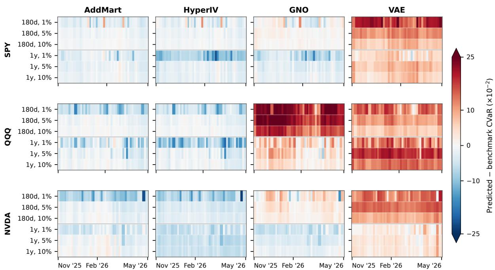  
Figure 5: Signed CVaR residuals over the test period. Columns denote reconstruction methods and rows denote assets. Within each panel, the heatmap rows combine the 180-day and one-year horizons with tail probabilities of 1%, 5%, and 10%. Blue indicates that the model underestimates the full-information option-implied CVaR, while red indicates overestimation. Values are averaged over five seeds.

## G.2 Stress Tests

Protocol. We evaluate all amortized methods during two pre-specified SPY market-stress windows: April 1–10, 2025 (8 trading days) and March 23–31, 2026 (7 trading days). To avoid look-ahead bias, we use a separate set of checkpoints whose out-of-time test period begins on February 1, 2025. Each model is trained once on the preceding data and then kept frozen through both events. The reference set, reconstruction targets, and reliable-region definition are identical to the main experiments. The two windows contain 10,273 and 14,557 held-out contracts, respectively.

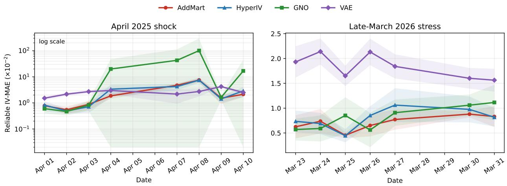  
Figure 6: Daily reliable-region IV-MAE on the two SPY stress windows. Lines and shaded regions denote the five-seed mean and standard deviation. The April panel uses a logarithmic vertical scale because one GNO seed diverges during the most volatile days.

Table 9: SPY performance during two out-of-sample market-stress windows. IV-MAE is reported in $\times 1 0 ^ { - 2 }$ as mean±std over five seeds. Best results are shown in bold.
<table><tr><td></td><td colspan="2">Apr. 1–10, 2025</td><td colspan="2">Mar. 23–31, 2026</td></tr><tr><td>Method</td><td>Reliable</td><td>Overall</td><td>Reliable</td><td>Overall</td></tr><tr><td>ADDMART</td><td>2.03±.23</td><td>4.92±.84</td><td>0.72±.13</td><td> $\mathbf { 0 . 9 8 } \pm . \mathbf { 0 9 }$ </td></tr><tr><td>HyperIV</td><td>2.23±.45</td><td> $4 . 9 9 2 . 8 6 $ </td><td> $0 . 8 0 { \pm } . 1 2 $ </td><td> $1 . 5 8 { \pm } . 1 9 $ </td></tr><tr><td>GNO</td><td> $1 6 . 7 4 { \pm } 2 8 . 2 5 $ </td><td> $2 3 . 8 5 { \pm } 3 7 . 6 6$ </td><td> $0 . 8 2 { \pm } . 2 0 $ </td><td> $1 . 1 9 2 . 1 6$ </td></tr><tr><td>VAE</td><td> $2 . 6 8 { \pm } . 4 5$ </td><td> $\mathbf { 4 . 7 6 \pm . 5 3 }$ </td><td> $1 . 8 3 { \pm } . 2 4 $ </td><td> $2 . 0 6 \pm . 1 9$ </td></tr></table>

Results. All methods deteriorate during the April 2025 shock, confirming that the event induces a substantial distribution shift rather than a model-specific failure. Relative to March 2025, ADDMART’s overall and reliable MAE increase by 5.9× and 4.0×, respectively. Nevertheless, it retains the lowest reliable-region error and remains essentially tied with HyperIV in overall MAE. VAE obtains a slightly lower overall error, but remains worse in the liquid reliable region. GNO is considerably less stable: four seeds produce window-level overall MAE between 4.5 and $8 . 2 \times 1 0 ^ { - 2 }$ , while one seed rises to 91 $\cdot 2 \times 1 0 ^ { - 2 }$ , causing the large reported variance.

The late-March 2026 window is less severe but occurs more than one year after the training cutoff. Here, ADDMART achieves the lowest error on both metrics. Its overall MAE is approximately 18% below GNO, 38% below HyperIV, and 53% below VAE. The daily curves in Figure 6 also show that its seed dispersion remains controlled throughout the event. Relative to February 2026, ADDMART’s overall MAE increases by 35%, compared with 71% for GNO and 86% for HyperIV. VAE exhibits a smaller relative increase, but from a substantially higher absolute-error level.

These results suggest that the additive construction acts as a useful structural regularizer under abrupt surface shifts: its accuracy still degrades when the market leaves the training distribution, but it does not exhibit the catastrophic seed failure observed for GNO. Moreover, the exact decoder preserves its calendar and butterfly constraints independently of the market regime. The stress tests therefore support robustness in the sense of controlled degradation and retained validity, rather than invariance of reconstruction error during extreme events.

## G.3 Computational Performance

We benchmark the amortized models on a single NVIDIA RTX 5090 D using nine reference contracts and 300 reconstruction targets per surface. Each measurement uses 20 warm-up iterations followed by 100 synchronized iterations. We report the median across seven daily assets and three minute-scale assets using the seed-0 checkpoints. Preprocessing includes the construction of model-specific inputs but excludes disk I/O. The batch-one end-to-end latency is estimated as preprocessing time plus neural forward time. SSVI and Deep Smoothing are excluded because they solve a separate optimization problem for every input surface, whereas the learned models perform amortized inference with fixed trained weights.

For single-surface inference, ADDMART requires approximately 7 ms for the forward pass and 7.4–7.6 ms including preprocessing. Although slower than HyperIV and GNO due to full-support convolution and implied-volatility inversion, this latency remains below 10 ms and is sufficient for minute-scale surface updates and conventional market-making applications. Batch inference further reduces the cost to approximately 1.04 ms per surface, or 960 surfaces per second. The model weights occupy less than 1 MiB, while batch-one inference uses approximately 128 MiB of GPU memory. In return for this moderate computational overhead, ADDMART achieves the lowest asset-averaged overall IV-MAE at both daily and minute scales while preserving structural no-arbitrage guarantees.

## G.4 Cross-Asset Performance

We next examine whether a surface model trained on one underlying can be applied to another without retraining. For each ordered source–target pair, we retain the source-asset checkpoint and provide only the target surface’s nine reference quotes at inference time. All remaining target contracts are used for evaluation under the same out-of-time split beginning on February 1, 2025. The experiment covers seven daily assets and therefore contains $7 \times 7$ directed pairs per method. Learned models are evaluated over five seeds; SSVI is fitted independently on each target surface and is included only as a target-calibrated reference.

Table 10: Single-GPU inference performance. Forward and end-to-end latency are reported in milliseconds per surface. Throughput measures neural forward inference at batch size 32. Peak memory is the maximum allocated GPU memory for batch sizes 1 and 32, respectively.
<table><tr><td>Scale</td><td>Method</td><td></td><td></td><td></td><td></td><td>B1 forward B1 end-to-end B32 forward B32 surface/s Peak MiB B1/B32</td><td>Weights MiB</td></tr><tr><td rowspan="4">Daily</td><td>ADDMART</td><td>6.98</td><td>7.60</td><td>1.040</td><td>961</td><td>127.64 / 2939.44</td><td>0.918</td></tr><tr><td>HyperIV</td><td>0.58</td><td>1.19</td><td>0.019</td><td>53,201</td><td>32.99 / 34.84</td><td>0.928</td></tr><tr><td>GNO</td><td>1.99</td><td>2.60</td><td>1.874</td><td>533</td><td>36.69 / 36.85</td><td>0.402</td></tr><tr><td>VAE</td><td>0.20</td><td>29.60</td><td>0.009</td><td>113,918</td><td>34.04 / 58.05</td><td>1.272</td></tr><tr><td rowspan="4">Minute</td><td>ADDMART</td><td>6.80</td><td>7.43</td><td>1.042</td><td>960</td><td>127.64 / 2939.44</td><td>0.918</td></tr><tr><td>HyperIV</td><td>0.57</td><td>1.21</td><td>0.019</td><td>52,994</td><td>32.99 / 34.84</td><td>0.928</td></tr><tr><td>GNO</td><td>1.99</td><td>2.63</td><td>1.883</td><td>531</td><td>36.69 / 36.85</td><td>0.402</td></tr><tr><td>VAE</td><td>0.20</td><td>33.69</td><td>0.009</td><td>114,110</td><td>34.04 / 58.05</td><td>1.272</td></tr></table>

Table 11 shows that transfer is substantially more difficult than in-domain reconstruction. The overall MAE of ADDMART increases from 1.65 to 5.51 after excluding diagonal pairs, corresponding to a 3.34× transfer penalty. Nevertheless, it retains the lowest cross-asset overall mean and outperforms HyperIV on 76.2% of the 42 directed pairs when each pair is first averaged over seeds. HyperIV is stronger on the reliable region after transfer, attaining a mean of 4.81 versus ADDMART’s 5.33. Thus, the in-domain advantage of ADDMART does not uniformly extend to zero-shot accuracy: its benefit is clearer under the overall metric, while HyperIV transfers better within the liquid interior.

Table 11: Daily cross-asset transfer over the seven-asset universe. We report IV-MAE $( \times 1 0 ^ { - 2 } )$ . In-domain columns average diagonal source–target pairs, while cross-asset columns aggregate the 42 directed off-diagonal pairs. Al methods are evaluated over five seeds. The lowest error in each column is shown in bold.
<table><tr><td rowspan="2">Method</td><td colspan="2">In-domain</td><td colspan="2">Cross-asset overall</td><td colspan="2">Cross-asset reliable</td><td rowspan="2">Transfer penalty</td></tr><tr><td>Overall</td><td>Reliable</td><td>Mean</td><td>Median</td><td>Mean</td><td>Median</td></tr><tr><td>ADDMART</td><td>1.65</td><td>1.29</td><td>5.51</td><td>4.67</td><td>5.33</td><td>4.25</td><td>3.34×</td></tr><tr><td>HyperIV</td><td>1.72</td><td>1.27</td><td>5.53</td><td>4.24</td><td>4.81</td><td>3.52</td><td>3.21×</td></tr><tr><td>GNO</td><td>2.01</td><td>1.63</td><td>6.99×103</td><td>5.04</td><td>7.62×103</td><td>4.15</td><td>2921.6×</td></tr><tr><td>VAE</td><td>2.52</td><td>2.04</td><td>6.03</td><td>5.57</td><td>5.21</td><td>5.04</td><td>2.39×</td></tr></table>

Table 12: Daily cross-asset reliable-region IV-MAE $( \times 1 0 ^ { - 2 }$ , five-seed mean). Rows denote training assets and columns denote evaluation assets. Gray cells indicate in-domain evaluations, and the lowest value in each target column is shown in bold.  
(a) AddMart
<table><tr><td rowspan=1 colspan=8>Train\TestSPYQQQIWMAAPLGOOGLMETANVDA</td></tr><tr><td rowspan=1 colspan=1>SPY</td><td rowspan=1 colspan=1>0.56</td><td rowspan=1 colspan=1>0.76</td><td rowspan=1 colspan=1>0.97</td><td rowspan=1 colspan=1>2.05</td><td rowspan=1 colspan=1>6.41</td><td rowspan=1 colspan=1>7.03</td><td rowspan=1 colspan=1>15.61</td></tr><tr><td rowspan=1 colspan=1>QQQ</td><td rowspan=1 colspan=1>1.25</td><td rowspan=1 colspan=1>0.68</td><td rowspan=1 colspan=1>0.79</td><td rowspan=1 colspan=1>1.55</td><td rowspan=1 colspan=1>4.03</td><td rowspan=1 colspan=1>4.84</td><td rowspan=1 colspan=1>11.14</td></tr><tr><td rowspan=1 colspan=1>IWM</td><td rowspan=1 colspan=1>1.87</td><td rowspan=1 colspan=1>0.82</td><td rowspan=1 colspan=1>0.77</td><td rowspan=1 colspan=1>1.70</td><td rowspan=1 colspan=1>4.46</td><td rowspan=1 colspan=1>4.97</td><td rowspan=1 colspan=1>10.02</td></tr><tr><td rowspan=1 colspan=1>AAPL</td><td rowspan=1 colspan=1>2.83</td><td rowspan=1 colspan=1>1.44</td><td rowspan=1 colspan=1>1.12</td><td rowspan=1 colspan=1>1.18</td><td rowspan=1 colspan=1>2.27</td><td rowspan=1 colspan=1>2.75</td><td rowspan=1 colspan=1>5.81</td></tr><tr><td rowspan=1 colspan=1>GOOGL</td><td rowspan=1 colspan=1>6.12</td><td rowspan=1 colspan=1>3.01</td><td rowspan=1 colspan=1>2.26</td><td rowspan=1 colspan=1>1.52</td><td rowspan=1 colspan=1>2.22</td><td rowspan=1 colspan=1>2.60</td><td rowspan=1 colspan=1>5.76</td></tr><tr><td rowspan=1 colspan=1>META</td><td rowspan=1 colspan=1>13.87</td><td rowspan=1 colspan=1>8.25</td><td rowspan=1 colspan=1>6.22</td><td rowspan=1 colspan=1>5.47</td><td rowspan=1 colspan=1>2.18</td><td rowspan=1 colspan=1>1.82</td><td rowspan=1 colspan=1>2.65</td></tr><tr><td rowspan=1 colspan=1>NVDA</td><td rowspan=1 colspan=1>19.661</td><td rowspan=1 colspan=1>4.65</td><td rowspan=1 colspan=1>12.81</td><td rowspan=1 colspan=1>11.11</td><td rowspan=1 colspan=1>4.79</td><td rowspan=1 colspan=1>4.43</td><td rowspan=1 colspan=1>1.80</td></tr></table>

(b) HyperIV
<table><tr><td rowspan=1 colspan=8>Train\TestSPYQQQIWMAAPLGOOGLMETANVDA</td></tr><tr><td rowspan=1 colspan=1>SPY</td><td rowspan=1 colspan=1>0.57</td><td rowspan=1 colspan=1>0.77</td><td rowspan=1 colspan=1>1.00</td><td rowspan=1 colspan=1>1.97</td><td rowspan=1 colspan=1>6.24</td><td rowspan=1 colspan=2>6.86 14.81</td></tr><tr><td rowspan=1 colspan=1>QQQ</td><td rowspan=1 colspan=1>1.40</td><td rowspan=1 colspan=1>0.74</td><td rowspan=1 colspan=1>0.76</td><td rowspan=1 colspan=1>1.55</td><td rowspan=1 colspan=1>3.69</td><td rowspan=1 colspan=2>4.41  9.14</td></tr><tr><td rowspan=1 colspan=1>IWM</td><td rowspan=1 colspan=1>1.65</td><td rowspan=1 colspan=1>0.85</td><td rowspan=1 colspan=1>0.78</td><td rowspan=1 colspan=1>1.57</td><td rowspan=1 colspan=1>4.35</td><td rowspan=1 colspan=2>4.99 10.29</td></tr><tr><td rowspan=1 colspan=1>AAPL</td><td rowspan=1 colspan=1>2.49</td><td rowspan=1 colspan=1>1.49</td><td rowspan=1 colspan=1>1.11</td><td rowspan=1 colspan=1>1.18</td><td rowspan=1 colspan=1>2.31</td><td rowspan=1 colspan=2>2.87  5.60</td></tr><tr><td rowspan=1 colspan=1>GOOGL</td><td rowspan=1 colspan=1>4.36</td><td rowspan=1 colspan=1>2.66</td><td rowspan=1 colspan=1>2.11</td><td rowspan=1 colspan=1>1.43</td><td rowspan=1 colspan=1>2.07</td><td rowspan=1 colspan=1>2.47</td><td rowspan=1 colspan=1>5.18</td></tr><tr><td rowspan=1 colspan=1>META</td><td rowspan=1 colspan=1>11.48</td><td rowspan=1 colspan=1>7.24</td><td rowspan=1 colspan=1>6.30</td><td rowspan=1 colspan=1>4.95</td><td rowspan=1 colspan=1>2.16</td><td rowspan=1 colspan=1>1.79</td><td rowspan=1 colspan=1>2.74</td></tr><tr><td rowspan=1 colspan=1>NVDA</td><td rowspan=1 colspan=1>16.53</td><td rowspan=1 colspan=1>12.11</td><td rowspan=1 colspan=1>10.57</td><td rowspan=1 colspan=1>9.33</td><td rowspan=1 colspan=1>4.24</td><td rowspan=1 colspan=1>3.79</td><td rowspan=1 colspan=1>1.80</td></tr></table>

The directed matrices in Tables 12 reveal that asset similarity dominates transfer quality. For ADDMART, QQQ→IWM and IWM→QQQ attain overall MAEs of 1.30 and 1.33, respectively, close to their in-domain errors. Transfers between broad-market ETFs and NVDA are much harder: SPY→NVDA reaches a reliable MAE of 15.61, while the reverse NVDA→SPY direction reaches 19.66. Transfer is therefore highly asymmetric, and reversing the source and target can substantially change the error. The matrices also show that the best source need not be the target itself; for example, META transfers slightly better than GOOGL itself when ADDMART is evaluated on GOOGL.

Finally, GNO illustrates why both means and medians are necessary in cross-asset evaluation. Its median off-diagona MAE remains comparable to the other neural baselines, but 13 of its 210 seed–direction cells exceed an MAE of 1, eight exceed 10, and the resulting mean becomes several orders of magnitude larger. These failures indicate unstable zero-shot extrapolation rather than uniformly poor reconstruction. Overall, the experiment shows that ADDMART transfers reliably between related markets but is not asset-invariant; large shifts in volatility level and smile asymmetry remain a substantial source of error.

## G.5 Analysis on LEAPS and VIX

We further examine two regimes that depart substantially from the liquid equity-option surfaces used in the main experiments: long-dated LEAPS and options on VIX. These experiments characterize the scope of the additive martingale assumption rather than extend the main benchmark universe.

Long-dated LEAPS. Figure 7 localizes the long-horizon limitation to the evolution of skew across maturity. On SPY, ADDMART follows the market ATM-skew term structure reasonably well through approximately one year, but its predicted skew subsequently decays faster than observed. The same behavior is visible in the 554-day AAPL slice, where the predicted smile is substantially flatter than the market quotes, including within the reliable region. This is consistent with the repeated convolution of conditionally independent increments progressively smoothing the terminal distribution. At sufficiently long horizons, the construction therefore has difficulty retaining persistent asymmetry and tail shape. HyperIV is more flexible at these maturities and recovers more of the observed skew, although its unconstrained extrapolation becomes unstable away from the quoted region.

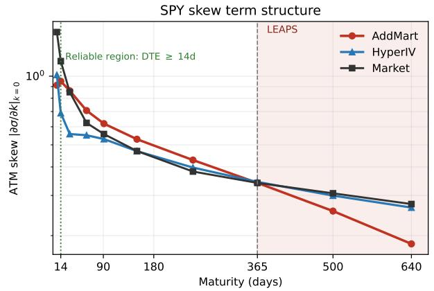

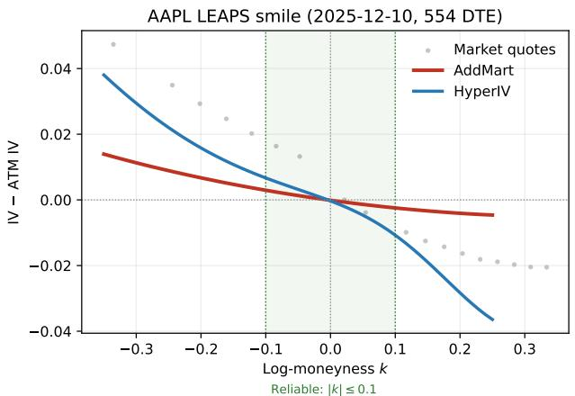  
Figure 7: Long-horizon behavior on LEAPS. Left: average ATM-skew term structure on the SPY test set, with the reliable-region cutoff at 14 days and the LEAPS region beginning at 365 days. Right: a representative AAPL LEAPS slice observed on December 10, 2025 (554 DTE; 18 market quotes). The shaded interval denotes the reliable moneyness region $| k | \leq 0 . 1$ . AddMart increasingly underestimates the persistent long-dated skew, whereas HyperIV retains more of the observed skew but extrapolates more aggressively outside the reliable region.

VIX options. VIX produces a distinct short-horizon failure mode. Figure 8 shows that most of the accuracy gap is concentrated at the shortest maturity and decreases rapidly along the term structure. VIX options inherit strong mean reversion, jumps, volatility-of-volatility, and level-dependent skew. Moreover, different maturities are linked to different points of the VIX-futures term structure. Representing these marginals through a shared sequence of additive increments consequently imposes a stronger cross-maturity restriction than it does for equity options. The consistency of this pattern across seeds suggests a representation limitation rather than training instability. Despite the larger IV error, ADDMART retains zero measured calendar and butterfly violations on the VIX test set; the failure concerns market fit rather than measure validity.

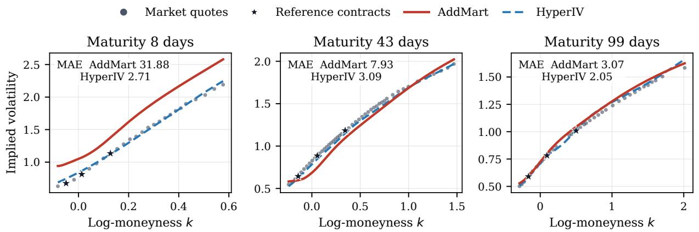  
Figure 8: Representative failure case on a VIX daily test surface observed on September 9, 2025. The surface is selected by the median per-surface MAE gap between AddMart and HyperIV rather than by an extreme error. AddMart substantially overestimates the short-maturity smile, while the discrepancy decreases with maturity.

Practical impact. These limitations have limited effect on the primary use case studied in this paper. Most liquid equity and ETF option activity is concentrated in shorter maturities and near the central moneyness region, where ADDMART remains accurate and the hard no-arbitrage construction is most valuable. LEAPS quotes are comparatively sparse and have wider bid–ask spreads, while VIX options constitute a different underlying process from the equity and ETF surfaces in the main benchmark. Consequently, neither stress regime materially drives the aggregate reconstruction results. The limitation is nevertheless relevant for applications devoted specifically to long-horizon tail hedging or short-dated VIX trading, for which the current additive increment parameterization should not be used as a stand-alone pricing model.

## G.6 Detailed Comparison

Figures 9 compares reconstruction errors along three complementary dimensions: test time, log-moneyness, and maturity. At the daily scale, ADDMART achieves the lowest or near-lowest error across most assets, market regimes, and contract buckets. The temporal profiles show that several error spikes occur simultaneously across methods, indicating periods of greater market-wide surface complexity. GNO exhibits the clearest method-specific instability on IWM, while SSVI deteriorates substantially in the deep wings and near the maturity boundaries. HyperIV remains competitive on several assets and performs slightly better in parts of the NVDA surface. At the minute scale, ADDMART is particularly strong on SPY and IWM and remains competitive on QQQ. Across both sampling frequencies, the shortest maturities and sparsely populated wings are consistently the most difficult regions.

Figures 10 and 12 further localize reconstruction error jointly over log-moneyness and maturity. At the daily scale, ADDMART maintains low error throughout the reliable region across all seven assets, showing that its aggregate performance is not driven by a small collection of favorable contracts. Errors increase mainly at very short maturities and in the deep wings, where quotes are sparse and implied-volatility inversion is less stable. The competing methods exhibit more distinct spatial failure patterns: HyperIV deteriorates near some short-end boundaries, GNO produces pronounced wing errors—most visibly on IWM—and VAE has broader regions of elevated error. SSVI is accurate near the liquid interior but extrapolates poorly toward sparse wings and longer maturities. The minute-scale comparison is tighter, although ADDMART continues to degrade smoothly outside the reliable region. Figures 11 and 13 show that reconstruction accuracy and structural validity are separate properties. Each cell reports the pooled violation rate over calendar and butterfly price-grid pairs. The exact ADDMART decoder has zero violations throughout the evaluated domain, including short maturities and deep wings where reconstruction is more difficult. HyperIV violations are concentrated mainly at short maturities and in the wings, GNO exhibits extensive violations under extrapolation, and

VAE violations extend closer to the liquid interior. The constrained per-surface SSVI fit is also arbitrage-free in this audit, but its error maps reveal the accuracy cost of its restrictive parametric form.

The representative surfaces in Figures 14 and 15 illustrate these aggregate patterns at the individual-contract level. The SPY surface on April 7 is especially challenging at the shortest maturity, where the methods disagree substantially in the left wing. Their predictions become much closer around the reference quotes and on the later test dates. On May 2 and June 10, ADDMART closely tracks the dense non-reference quotes across the medium and long maturities. NVDA presents a more difficult cross-sectional fit, and no method dominates every slice. GNO and SSVI can depart materially from the observed wing shape, while HyperIV develops an oscillatory long-maturity wing on April 7. ADDMART produces smoother extrapolations and competitive fits, although HyperIV retains a small aggregate advantage on NVDA. Together, the temporal profiles, joint heatmaps, and representative slices show that ADDMART combines stable reconstruction accuracy across market regimes with exact static-arbitrage control over the full surface.

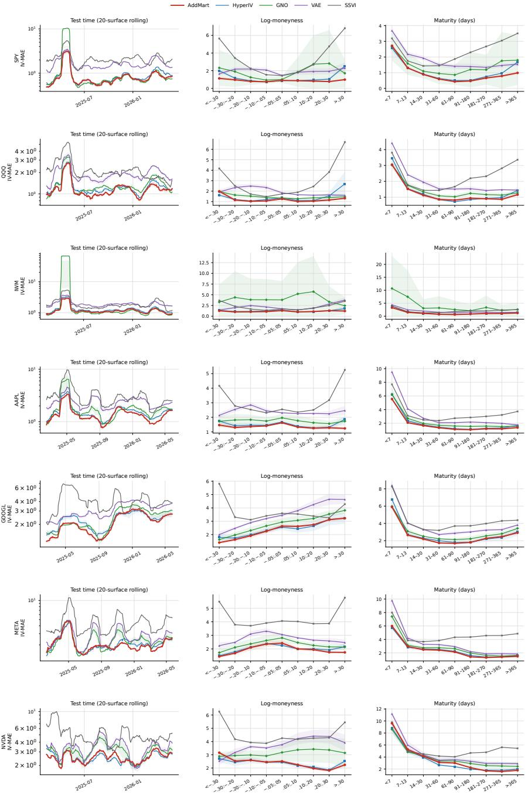  
Figure 9: Daily-data error profiles for SPY, QQQ, IWM, AAPL, GOOGL, META, and NVDA. Rows correspond to underlying assets. The columns report 20-surface rolling IV-MAE over the test period, IV-MAE by log-moneyness, and IV-MAE by maturity, respectively. IV-MAE is reported in $\times 1 0 ^ { - 2 }$ . For amortized methods, lines and shaded regions denote the mean and standard deviation over five seeds; SSVI is fitted independently to each surface.

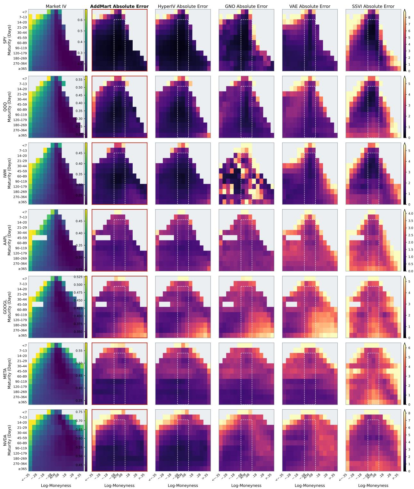  
Figure 10: Joint reconstruction-error profiles across the seven daily datasets. The first column shows market IV; the remaining columns show IV-MAE (×10−2) aggregated by log-moneyness and maturity. Error color scales are shared across methods within each asset row. The dashed box denotes the reliable region, and gray cells contain insufficient observations for reliable aggregation.

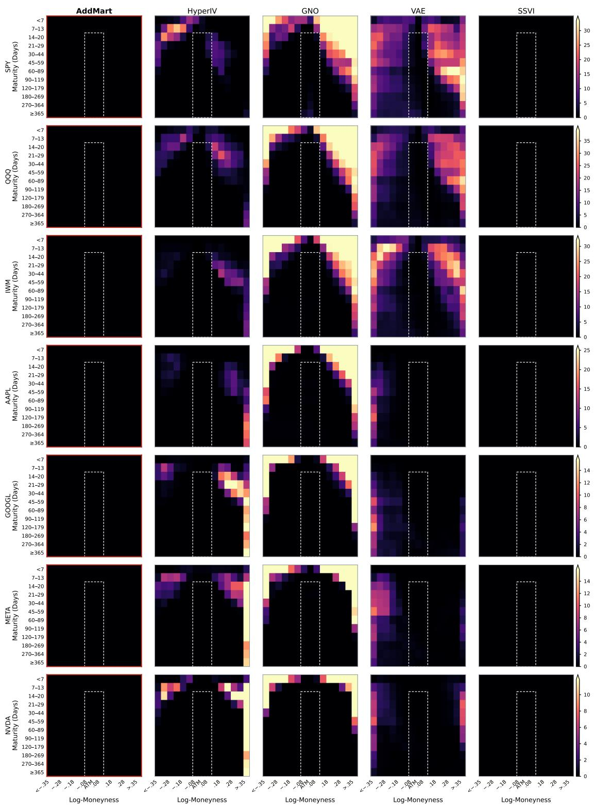  
Figure 11: Static-arbitrage violation profiles across the seven daily datasets. Each cell reports the pooled calendar and butterfly pair violation rate (%) on a dense price grid, using a tolerance of $1 0 ^ { - 7 }$ . Color scales are shared across methods within each asset row; the dashed box denotes the reliable region.

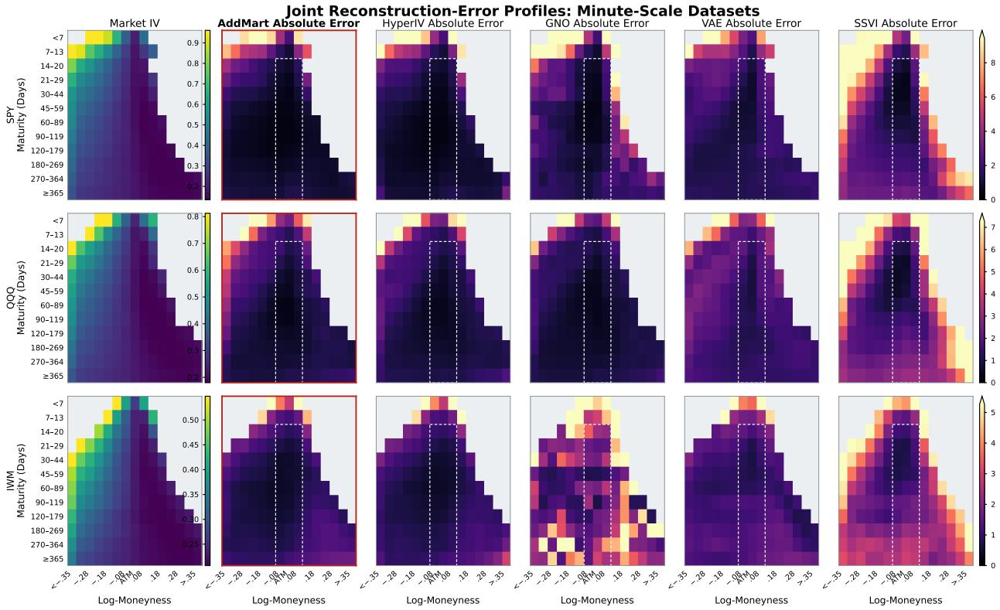  
Figure 12: Joint reconstruction-error profiles on the SPY, QQQ, and IWM minute-scale datasets. Each heatmap reports $\mathbf { I V - M A E } \left( \times 1 0 ^ { - 2 } \right)$ by log-moneyness and maturity; notation and masking follow Figure 10.

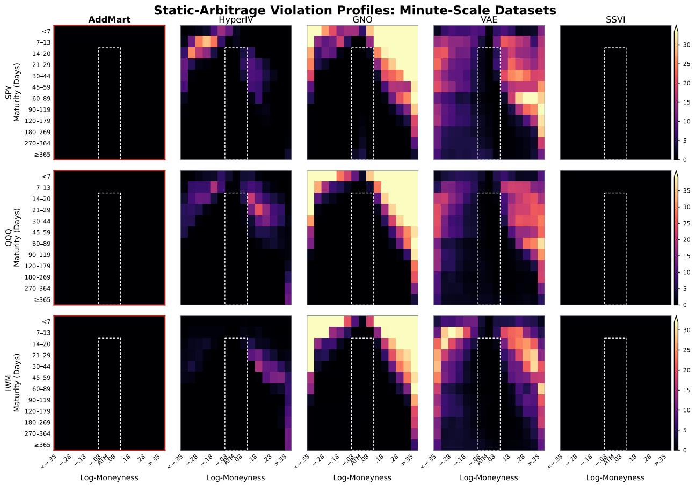  
Figure 13: Static-arbitrage violation profiles on the SPY, QQQ, and IWM minute-scale datasets. Evaluation and notation follow Figure 11.

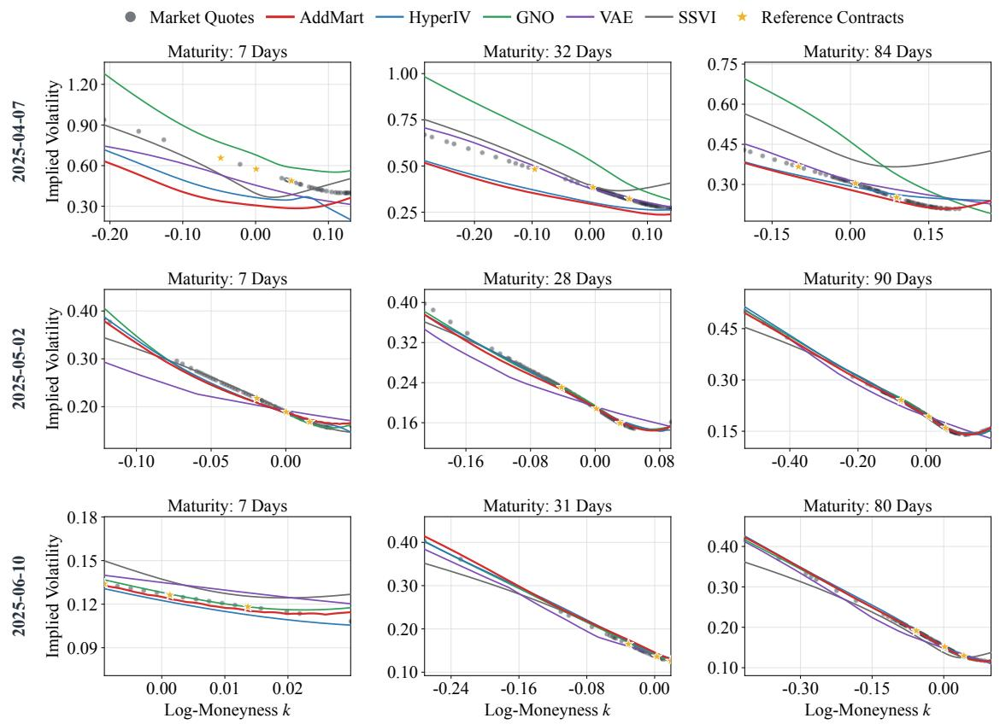  
Figure 14: SPY implied-volatility slices on 7 April, 2 May, and 10 June 2025. Each row corresponds to one trading day and each column to one reference maturity. Gray dots denote market quotes and gold stars denote the nine reference contracts used by AddMart, HyperIV, GNO, VAE, and SSVI.

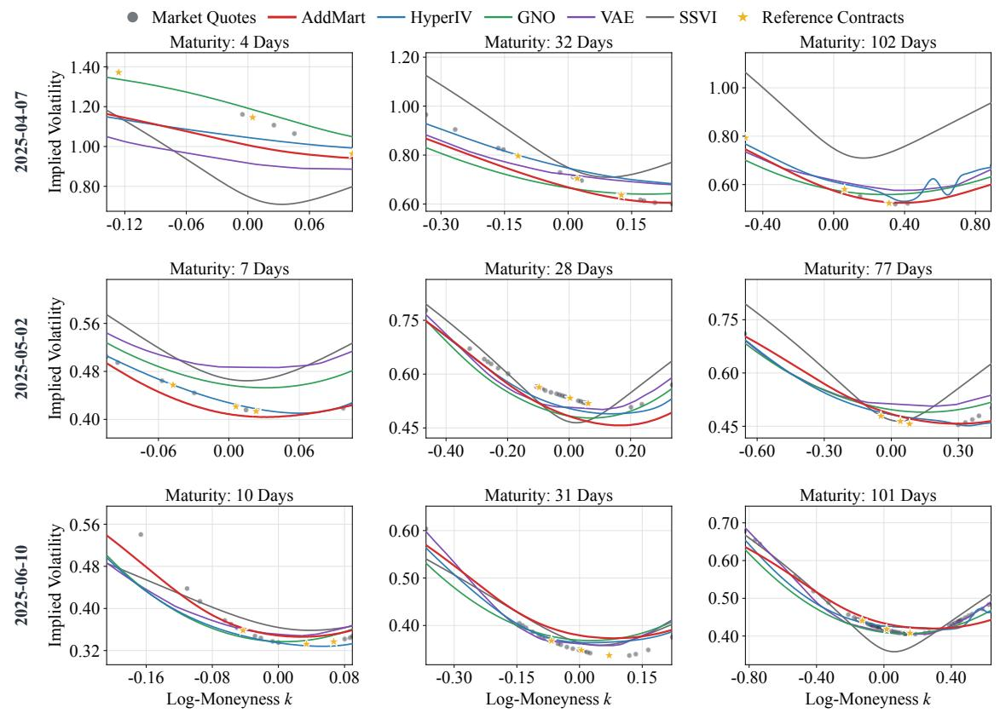  
Figure 15: NVDA implied-volatility slices on 7 April, 2 May, and 10 June 2025. Each row corresponds to one trading day and each column to one reference maturity. Gray dots denote market quotes and gold stars denote the nine reference contracts used by AddMart, HyperIV, GNO, VAE, and SSVI.