# Are Self-Evolving Agents Continual Learners?

Xiaoyin Chen<sup>1,2,\*</sup>, Yizheng Huang<sup>3</sup>, Yinglun Xu<sup>3</sup>, Ziyun Zhao<sup>3</sup>, Emmett McQuinn<sup>3</sup>, Julie Liu<sup>3</sup> and Hope Yao<sup>3</sup> <sup>1</sup>Mila – Quebec AI Institute, <sup>2</sup>Université de Montréal, <sup>3</sup>Google DeepMind, <sup>\*</sup>Work done as a student researcher at Google DeepMind

Large language model agents are often deployed in environments where new knowledge, tools, and workflows keep arriving. Such an agent is therefore expected to adapt continually, learning new tasks as they arrive without forgetting earlier ones. This resembles the continual learning problem, but at a pace that conventional gradient updates cannot sustain. Nonparametric self-evolving agents are a natural alternative: they adapt by rewriting their own harness, such as prompts, memory, and skills, from task feedback while the model weights stay frozen. We study whether such agents are efective continual learners across four drifting task streams that shift in topic, workflow, or domain (built from BIRD, BFCL, and ScienceWorld). Evaluating three representative methods spanning experience retrieval and selfmodification (ReasoningBank, GEPA, and Meta-Harness), we find that although self-evolution improves aggregate performance on most streams, higher plasticity consistently comes at the cost of stability. Specifically, self-modifying methods apply global edits to a shared prompt or workspace, interfering with unseen tasks and overwriting earlier knowledge as the stream shifts. Conversely, similarity-based memory retrieval localizes updates across distant domains, but still retrieves foreign memories on unseen tasks and sufers from retrieval collision when similar queries require conflicting workflows. These findings show that current self-evolving agents remain incomplete continual learners.

## 1. Introduction

Large language models (LLMs) are increasingly used as agents that act in interactive environments: they operate software tools and systems (Patil et al., 2025; Yao et al., 2023; Zhang et al., 2025b), navigate embodied simulators (Shridhar et al., 2020; Wang et al., 2022), and query databases or write code on behalf of users (Li et al., 2023; Wang et al., 2025). The skills such an agent requires are not fixed at training time. New tasks, tools, and workflows continue to emerge after the weights are frozen, and an agent that serves users over an extended period must learn each new task as it arrives while preserving what it has already learned. This form of learning resembles the classical continual learning problem, which studies how a model can be trained on new tasks over time without forgetting earlier ones (De Lange et al., 2022; Parisi et al., 2019; van de Ven and Tolias, 2019). Continual learning has recently emerged as a central challenge for LLMs (Jang et al., 2022; Ke et al., 2023; Luo et al., 2023; Shenfeld et al., 2026; Shi et al., 2024; Wu et al., 2024). Conventionally, it has been realized through gradient updates. An LLM agent, however, is expected to adapt at the timescale of use: every interaction with the environment may yield knowledge that is useful in a later session, and that knowledge should be available as soon as the next session begins. Performing gradient updates at this pace is challenging: retraining an LLM after every session is prohibitively expensive, and fine-tuning on a small number of recent interactions is known to erode general capabilities (Luo et al., 2023).

The in-context learning ability of LLMs (Brown et al., 2020; Dong et al., 2022) suggests an alternative route to adaptation. Rather than the weights, an agent can update its harness, everything wrapped around the model: the system prompt, the accumulated memory, the skill libraries, and the control code that orchestrates them. Nonparametric self-evolving agents adopt precisely this strategy, refining the harness from task outcomes and environment feedback while the weights remain frozen. Two paradigms have emerged. Self-modification rewrites the artifacts on which the agent runs, such as its system prompt or the code of the harness itself (Agrawal et al., 2025; Lee et al., 2026; Pryzant et al., 2023; Zhou et al., 2022); experience augmentation appends past reflections, successful trajectories, or tool libraries to an external store and retrieves them during execution (Ouyang et al., 2025; Wang et al., 2024; Zhao et al., 2024). In either paradigm the harness constitutes a state carried across tasks; updating it is inexpensive, takes efect immediately, and leaves the model weights untouched. Self-evolving agents are therefore natural candidates for continual learning at inference time.

Both paradigms demonstrate substantial gains on stationary, single-domain benchmarks, yet whether they support continual learning has not been examined. Iterative feedback may drive an agent toward narrow, task-specific shortcuts, such as idiosyncratic formatting templates or environment-specific action sequences, rather than transferable problem-solving strategies. Real-world scenarios, moreover, extend beyond a single benchmark: the agent faces a stream of heterogeneous tasks served by one shared harness, and every update made for one task applies to all tasks that follow. Whether self-evolution under these conditions accumulates durable gains or compounding interference is unknown. In short: Are current self-evolving LLM agents efective continual learners?

We address this question by evaluating the continual learning dynamics of self-evolving agents on non-stationary task streams. After formalizing the evolver, the function that updates the harness from collected experience, together with task streams over multiple task groups (§2), we construct four drifting stream scenarios that train one task group at a time in contiguous blocks (§3, §4.1). Built from BIRD (Li et al., 2023), BFCL (Patil et al., 2025), and ScienceWorld (Wang et al., 2022), these streams isolate shifts in subject matter (topic drift), interaction workflow (workflow drift), environment and action space (domain drift), and their sequential combination (compound drift). We evaluate three representative self-evolving methods that span both paradigms and progressively larger harness surfaces: ReasoningBank (Ouyang et al., 2025) retrieves accumulated memory items, GEPA (Agrawal et al., 2025) rewrites a strategy section in the system prompt, and Meta-Harness (Lee et al., 2026) edits the system prompt, memory and skill files, and controller code. To characterize these dynamics, we measure terminal and average advantage over the seed harness (§3.2) and decompose stream performance into within-block plasticity (�) and cross-block stability (�), combining pre-block interference (<sup>¯</sup>�) on unseen groups and post-block forgetting (�<sup>¯</sup>) on earlier groups.

Three main findings emerge:

• Current methods trade stability for plasticity (§4.2). While self-evolution improves overall stream performance in most settings, no method achieves both high plasticity and high stability: expanding the editable surface from retrieved memories (ReasoningBank) to the system prompt (GEPA) and full workspace (Meta-Harness) increases plasticity or edit freedom at the cost of cross-block stability.

• Self-modification causes cross-task interference and overwriting (§4.3). Because GEPA and Meta-Harness apply a single shared prompt or workspace to every incoming task, task-specific rules specialized to one block interfere with unseen tasks before their block begins and are compressed or overwritten by later blocks.

• Similarity-based retrieval cannot prevent interference or collision (§4.4). Retrieving experiences by query similarity (ReasoningBank) avoids post-block forgetting across distant domains, but still injects foreign memories into unseen task groups and causes retrieval collision when distinct workflows share the same domain and embedding space.

Our results show that current self-evolving agents remain incomplete continual learners, calling for mechanisms that isolate task-specific updates in the harness and condition retrieval beyond surface query similarity.

## 2. Background

## 2.1. Continual Learning over Task Streams

We define a taskfamily F as a tuple $\mathcal { F } = ( \boldsymbol { X } , \mathcal { D } , \boldsymbol { y } , \boldsymbol { R } )$ , where X is an input space (e.g., a query), D is a distribution over X from which inputs are sampled, Y is an output space (e.g., a response trajectory), and $R : X \times y  \mathbb { R }$ is a reward function that measures the quality of a response trajectory given a query. A stochastic policy $\pi : X \to \Delta ( { \mathfrak { y } } )$ defined on the task family $\mathcal { F }$ takes a query $x \in \chi$ as input and outputs a response trajectory $y \sim \pi ( \cdot \mid x )$ , and the corresponding reward signal is $r = R ( x , y )$ . In the agentic setting studied here, � is an episode, the full interaction trajectory generated in the task environment, and the reward is binary task success, $R ( x , y ) \in \{ 0 , 1 \}$

A continual learning process is defined on � task families $\mathcal { F } _ { k } = ( X _ { k } , \mathcal { D } _ { k } , y _ { k } , R _ { k } ) , k \in [ K ]$ , and a weight schedule $w = ( w _ { t } ) _ { t = 0 } ^ { T - 1 }$ with $w _ { t } = ( w _ { t , 1 } , \dotsc , w _ { t , K } )$ and $\begin{array} { r } { \sum _ { k = 1 } ^ { K } w _ { t , k } = 1 } \end{array}$ . A task stream $\boldsymbol { S _ { w } } = ( \boldsymbol { x _ { t } } ) _ { t = 0 } ^ { T - 1 }$ is a sequence of inputs drawn from the mixture over the families that � specifies at each position,

$$
x _ { t } \sim P _ { t } : = \sum _ { k = 1 } ^ { K } w _ { t , k } \mathcal D _ { k } , \qquad t \in \{ 0 , \dots , T - 1 \} .\tag{1}
$$

At each timestep $t = 0 , \ldots , T - 1$ , the continual learner receives the input $x _ { t }$ from the stream, generates an output $y _ { t } \sim \pi ^ { ( t ) } ( \cdot \mid x _ { t } )$ with its current policy, observes a reward $r _ { t } ,$ , and then outputs the policy $\pi ^ { ( t + 1 ) }$ for the next timestep. The average performance of a policy � over the � families is

$$
J ( \pi ) \ = \ \frac 1 K \sum _ { k = 1 } ^ { K } J _ { k } ( \pi ) , \qquad J _ { k } ( \pi ) \ = \ \mathbb E _ { x \sim \mathcal D _ { k } , y \sim \pi ( \cdot | x ) } \big [ R _ { k } ( x , y ) \big ] .\tag{2}
$$

The continual learner seeks to maximize the expected performance averaged over the whole stream,

$$
\bar { J } _ { w } : = \mathbb { E } _ { S _ { w } } \bigg [ \frac { 1 } { T } \sum _ { t = 1 } ^ { T } J \big ( \pi ^ { ( t ) } \big ) \bigg ] ,\tag{3}
$$

where the expectation is over the draw of the stream $S _ { w }$

This objective formalizes the tension between plasticity and forgetting. At every position, � evaluates the policy on all � families, not only the one supplying the current input. Each update should therefore improve the policy on the families it is currently learning from without degrading it on families seen earlier: a degraded family lowers the average at every remaining position until it is relearned.

## 2.2. Nonparametric Self-Evolving Agents

We study how a self-evolving agent can serve as the continual learner above, with its self-evolution step generating the update from $\pi ^ { ( t ) }$ to $\pi ^ { ( t + 1 ) }$ . The agent implements this update through an evolver $f .$ Let $\mathcal { H } _ { t } : = \{ ( x _ { \tau } , y _ { \tau } , r _ { \tau } ) \} _ { \tau = 0 } ^ { t }$ denote the experience collected up to timestep �. After each episode, the evolver maps the current policy and the accumulated experience to the next policy,

$$
\pi ^ { ( t + 1 ) } = f ( \pi ^ { ( t ) } , \mathcal { H } _ { t } ) .\tag{4}
$$

Note that the evolver may use only a subset of the history to generate an update, which is usually the case in current self-evolving methods. Existing self-evolving methods are formulated on a single task family, which corresponds to the special case $K = 1$ of the stream above; we apply the same update on a stream, with $x _ { t }$ drawn from $P _ { t }$

In the LLM-agent setting, a policy is an agent determined by an LLM with parameters � and a harness �: the system prompt, accumulated memory, skill libraries, and the control code that orchestrates them. Given an input $x ,$ rolling out the model in the task environment yields an episode $y \sim \pi _ { \boldsymbol { \theta } } ( \cdot \vert x , c ) ;$ we write this episode-level policy $\pi _ { \boldsymbol { \theta } , c } .$ An evolver may update either component. In this work, we study the nonparametric case, in which � is frozen and only the harness is updated, such as in GEPA (Agrawal et al., 2025), Meta-Harness (Lee et al., 2026), and ReasoningBank (Ouyang et al., 2025), so that Eq. 4 reduces to

$$
c _ { t + 1 } = f { \big ( } c _ { t } , \ { \mathcal { H } } _ { t } { \big ) } .\tag{5}
$$

On a stream, the evolver traverses the inputs in arrival order and updates the harness as in Eq. $^ { 5 , }$ yielding $c _ { 0 } , c _ { 1 } , \ldots , c _ { T }$ with $\pi ^ { ( t ) } = \pi _ { \theta , c _ { t } }$ throughout; the seed harness $c _ { 0 }$ defines the initial policy $\pi ^ { ( 0 ) }$ We define the performance of $f$ under a schedule � as the objective of Eq. 3 evaluated on the policy sequence that $f$ generates,

$$
\bar { \cal J } _ { w } ( f ) : = \mathbb { E } _ { S _ { w } , f } \Big [ \frac { 1 } { T } \sum _ { t = 1 } ^ { T } { \cal J } \big ( \pi ^ { ( t ) } \big ) \Big ] .\tag{6}
$$

## 3. Methodology

In this work, we study two factors of the problem, the evolver $f$ and the weight schedule $w$ of the task stream, and we evaluate an evolver by how much it improves the objective $\bar { J } _ { w } ( f )$ of Eq. 6 over the seed harness.

## 3.1. Task Stream Configurations

We instantiate the task stream as a drifting stream, in which $w _ { t }$ is one-hot and piecewise-constant: the stream is a sequence of contiguous blocks, each drawing all of its tasks from a single task group, and the active group changes only at block boundaries. Within a block, every update is driven by the active group, while earlier groups receive no further tasks and hence no further feedback, and later groups have not yet been encountered. In continual deployment, transitions between blocks may alter the subject matter (topic drift), the interaction workflow required for a correct response (workflow drift), the environment and action space itself (domain drift), or a combination of all three (compound drift); we detail the concrete benchmark streams that instantiate these four drift scenarios in §4.1.

In every stream the method maintains one shared harness across the entire horizon. The stream never reveals the group label of a task or the block boundaries, and the agent is never told that it operates in a drifting stream or that it should balance performance across groups. The agent must infer the structure of incoming tasks on its own and encode any distinction it finds in the harness, mirroring task-free continual learning scenarios (Aljundi et al., 2019; Buzzega et al., 2020; De Lange et al., 2022).

## 3.2. Metrics

We evaluate self-evolving agents by how much evolution improves the objective $\bar { J } _ { w } ( f )$ of Eq. 6 over the seed harness. Because evaluating the harness after every update is costly, we compute accuracy at � checkpoints $0 < t _ { 1 } < \cdots < t _ { M } = T$ along with the seed position $t _ { 0 } = 0$ . For a stream position � and a family $k ,$ let $A [ t , k ]$ denote the accuracy (in %) of the frozen harness $c _ { t }$ on a disjoint hold-out set

$\mathcal { D } _ { k } ^ { \mathrm { e v a l } }$ of family �:

$$
A [ t , k ] ~ = ~ { \frac { 1 } { | \mathcal { D } _ { k } ^ { \mathrm { e v a l } } | } } \sum _ { x \in \mathcal { D } _ { k } ^ { \mathrm { e v a l } } } \mathbb { E } _ { y \sim \pi _ { \theta , c _ { t } } ( \cdot | x ) } \left[ R _ { k } ( x , y ) \right] .\tag{7}
$$

The seed harness $c _ { 0 }$ gives the per-family baseline $B _ { k } : = A [ 0 , k ]$ before any evolution. Ofsetting �[�, �] against $B _ { k }$ isolates what evolution contributes, reported in percentage points (pp.). We summarize overall stream performance with two quantities: the terminal advantage (Term.), which averages $A [ T , k ] - B _ { k }$ over all � families at the end of the stream, and the average advantage (Δ¯), which averages $A \left[ t _ { m } , k \right] - B _ { k }$ over all � families and all � post-seed checkpoints:

$$
\bar { \Delta } \ = \ \frac { 1 } { M K } \sum _ { m = 1 } ^ { M } \sum _ { k = 1 } ^ { K } \big ( { \cal A } [ t _ { m } , k ] - { \cal B } _ { k } \big ) , \qquad \mathrm { T e r m . } \ = \ \frac { 1 } { K } \sum _ { k = 1 } ^ { K } \big ( { \cal A } [ T , k ] - { \cal B } _ { k } \big ) .\tag{8}
$$

Overall advantage measures the size of the improvement but not its composition: the same value can come from balanced gains on every family or from gains on the active family paid for by losses on the others. In a drifting stream where the block of family � occupies positions $\sigma _ { k } < t \leq \tau _ { k } .$ , we decompose performance into plasticity and stability:

• Plasticity � measures how much each family learns during its own training block (Kemker et al., 2018; Riemer et al., 2018), defined as the advantage over the seed at the end $\tau _ { k }$ of family �’s block, $P _ { k } = A { [ \tau _ { k } , k ] } - B _ { k }$ , averaged over all � families:

$$
P = \frac { 1 } { K } \sum _ { k = 1 } ^ { K } \big ( A [ \tau _ { k } , k ] - B _ { k } \big ) .\tag{9}
$$

• Stability � measures the degradation a family incurs while the stream trains the other families (Kemker et al., 2018; Lopez-Paz and Ranzato, 2017). It combines pre-block interference $I _ { k } ,$ the mean drop below the seed at checkpoints before family �’s block begins $( \sigma _ { k } )$ , and post-block forgetting $F _ { k } ,$ the drop from the end of family �’s block $( \tau _ { k } )$ to the end of the stream (�):

$$
I _ { k } = \frac { 1 } { M _ { k } } \sum _ { 0 < t _ { m } \leq \sigma _ { k } } \operatorname* { m a x } \big ( 0 , B _ { k } - A [ t _ { m } , k ] \big ) , \qquad F _ { k } = \operatorname* { m a x } \big ( 0 , A [ \tau _ { k } , k ] - A [ T , k ] \big ) ,\tag{10}
$$

where $M _ { k }$ is the number of checkpoints with $0 < t _ { m } \le \sigma _ { k }$ (with $I _ { k } = 0$ when $M _ { k } = 0$ , and $F _ { k } = 0$ when $\tau _ { k } = T )$ . Averaging $I _ { k }$ and $F _ { k }$ over the � families gives stream-level interference <sup>¯</sup>� and forgetting �<sup>¯</sup>, and

$$
S ~ = ~ - { \frac { 1 } { K } } \sum _ { k = 1 } ^ { K } \left( I _ { k } + F _ { k } \right) ~ = ~ - \bigl ( \bar { I } + \bar { F } \bigr ) .\tag{11}
$$

## 4. Experiments

## 4.1. Experimental Setup

Datasets and streams. We construct task streams from three agentic benchmarks: BIRD (Li et al., 2023), text-to-SQL querying over relational databases; BFCL (Patil et al., 2025), multi-turn user requests served by calling stateful APIs; and ScienceWorld (Wang et al., 2022), interactive science experiments in a text environment. Every stream consists of consecutive blocks of 50 training tasks per group, evaluated on disjoint hold-out sets $\mathcal { D } _ { k } ^ { \mathrm { e v a l } }$ of 50 tasks per group (90 for ScienceWorld). Following §3.1, we construct four drifting streams that isolate three types of distribution shift and their combination:

• Topic drift (� = 150, � = 3). The environment and workflow stay fixed while the underlying topic changes: the agent trains on three BIRD databases in sequence, BIRD-F1 (formula\_1) → BIRD-Code (codebase\_community) → BIRD-TP (thrombosis\_prediction). While the high-level text-to-SQL task remains the same, each database carries its own schema and local conventions that must be learned without transferring stale assumptions to the next.

• Workflow drift $( T \ = \ 1 0 0 , K \ = \ 2 )$ . The environment and tool catalog stay fixed while the workflow required for a correct response changes: the agent trains on BFCL-Miss followed by BFCL-Base. Both groups use the same APIs, but BFCL-Miss requires the agent to ask the user to clarify missing arguments, whereas BFCL-Base supplies all required arguments and penalizes unnecessary clarification.

• Domain drift $( T = 1 5 0 , K = 3 )$ . The environment itself changes along with its observation and action spaces: the agent trains across ScienceWorld → BFCL-Base → BIRD-F1, spanning interactive embodied environments, multi-turn tool use, and database querying.

• Compound drift (� = 200, � = 4). Over a longer deployment horizon, shifts in topic, domain, and workflow occur in sequence rather than in isolation: BIRD-Code → BIRD-F1 (topic) → BFCL-Miss (domain) → BFCL-Base (workflow), requiring the evolver to handle both crossdomain transitions and conflicting within-domain shifts in a single stream.

Model and harness. We hold the base model fixed across methods and streams so that diferences arise from the evolver alone, and use Gemini 3.6 Flash (Google DeepMind, 2026) in a ReAct-style loop (Yao et al., 2023), which alternates environment observations with actions. Per-family action interfaces are described in Appendix D.

Self-evolving algorithms. We compare three representative methods that span experience augmentation and self-modification across progressively larger update spaces: ReasoningBank (Ouyang et al., 2025), which distills completed episodes into memory items in an external store and retrieves the top-1 most similar item into the context of later episodes; GEPA (Agrawal et al., 2025), which rewrites a shared strategy section in the system prompt by reflective mutation over collected rollouts; and Meta-Harness (Lee et al., 2026), which proposes edits to a persistent workspace (including the system prompt, memory and skill files, and the controller code harness.py) through a coding agent and accepts an edit only when it improves validation accuracy on the active sub-block. Every run starts from the same seed harness �<sub>0</sub> with an empty state and receives binary task-success feedback $r _ { t } \in \{ 0 , 1 \}$ } after each training task.

Evaluation protocol. We checkpoint the harness at every block boundary (every 50 stream positions) and evaluate each frozen checkpoint on the hold-out sets of all � groups in the stream, averaging over eight rollouts per instance to estimate �[�, �]. Further details are in Appendix D.

## 4.2. Current Methods Trade Stability for Plasticity

Evaluating the three methods across the four drifting streams shows that self-evolution improves both terminal and average performance in most settings (Table 1; Figure 1). All three methods achieve positive gains on workflow, domain, and compound drift, as well as in the mean across the four scenarios: averaged over streams, terminal advantage reaches +3.7 for GEPA, +2.5 for ReasoningBank, and +1.4 for Meta-Harness, with average advantage Δ¯ between +1.8 and +3.1. Only topic drift yields near-zero or slightly negative net change (−1.7 for GEPA, +0.3 for ReasoningBank, and −1.5 for Meta-Harness).

Table 1 | Continual learning performance across the four drift scenarios on Gemini 3.6 Flash. Each stream is listed by its ordered task groups, followed by the per-stream Average and the four-stream Overall average. Seed reports baseline accuracy $B _ { k }$ (%); method columns report terminal advantage (Term.), average advantage (Δ¯, Eq. 8), within-block plasticity $( P ,$ Eq. 9), and cross-block stability $( S = - ( I _ { k } + F _ { k } )$ , Eq. 11), all in percentage points (pp.) over $B _ { k }$ . Summary rows are shaded green for gains and red for losses, with the best method per metric in bold; the separate $- I _ { k }$ and $- F _ { k }$ decomposition is in Table 3 (Appendix B).
<table><tr><td></td><td></td><td></td><td colspan="4">ReasoningBank</td><td colspan="4">GEPA</td><td colspan="4">Meta-Harness</td></tr><tr><td>Stream</td><td>Task group</td><td>Seed</td><td>Term.</td><td>Δ</td><td>P</td><td>S</td><td>Term.</td><td>Δ</td><td>P</td><td>S</td><td>Term.</td><td>Δ</td><td>P</td><td>S</td></tr><tr><td>Topic</td><td>BIRD-F1</td><td>52.5</td><td>0.0</td><td>0.5</td><td>1.5</td><td>-1.5</td><td>-2.0</td><td>3.0</td><td>7.5</td><td>-9.5</td><td>-3.5</td><td>-4.5</td><td>-4.5</td><td>0.0</td></tr><tr><td></td><td>BIRD-Code</td><td>61.8</td><td>-0.5</td><td>-0.2</td><td>-1.0</td><td>0.0</td><td>0.5</td><td>0.0</td><td>1.0</td><td>-2.0</td><td>1.5</td><td>2.0</td><td>1.0</td><td>0.0</td></tr><tr><td></td><td>BIRD-TP</td><td>43.2</td><td>1.5</td><td>-0.7</td><td>1.5</td><td>-1.8</td><td>-3.5</td><td>-3.2</td><td>-3.5</td><td>-3.0</td><td>-2.5</td><td>-1.5</td><td>-2.5</td><td>-1.0</td></tr><tr><td></td><td>Average</td><td>52.5</td><td>0.3</td><td>-0.1</td><td>0.7</td><td>-1.1</td><td>-1.7</td><td>-0.1</td><td>1.7</td><td>-4.8</td><td>-1.5</td><td>-1.3</td><td>-2.0</td><td>-0.3</td></tr><tr><td>Workflow</td><td>BFCL-Miss</td><td>53.8</td><td>4.5</td><td>8.5</td><td>12.5</td><td>-8.0</td><td>2.5</td><td>9.0</td><td>15.5</td><td>-13.0</td><td>11.5 10.5</td><td></td><td>9.5</td><td>0.0</td></tr><tr><td></td><td>BFCL-Base</td><td>77.3</td><td>4.5</td><td>1.5</td><td>4.5</td><td>-1.5</td><td>6.5</td><td>3.9</td><td>6.5</td><td>0.0</td><td>-2.0</td><td>-1.5</td><td>-2.0</td><td>-1.0</td></tr><tr><td></td><td>Average</td><td>65.5</td><td>4.5</td><td>5.0</td><td>8.5</td><td>-4.8</td><td>4.5</td><td>6.4</td><td>11.0</td><td>-6.5</td><td>4.8</td><td>4.5</td><td>3.8</td><td>-0.5</td></tr><tr><td>Domain</td><td>ScienceWorld</td><td>78.9</td><td>5.3</td><td>3.0</td><td>1.9</td><td>0.0</td><td>7.5</td><td>7.2</td><td>4.7</td><td>0.0</td><td>4.4</td><td>7.2</td><td>8.9</td><td>-4.4</td></tr><tr><td></td><td>BFCL-Base</td><td>79.2</td><td>1.5</td><td>0.2</td><td></td><td>0.2 -1.2</td><td>5.0</td><td>0.9</td><td>3.2</td><td>-5.5</td><td>-2.2</td><td>-0.8</td><td>1.2</td><td>-5.0</td></tr><tr><td></td><td>BIRD-F1</td><td>50.8</td><td>1.0</td><td>1.2</td><td>1.0</td><td>0.0</td><td>6.0</td><td>0.8</td><td>6.0</td><td>-1.8</td><td>2.5</td><td>5.0</td><td>2.5</td><td>0.0</td></tr><tr><td></td><td>Average</td><td>69.6</td><td>2.6</td><td>1.4</td><td>1.1</td><td>-0.4</td><td>6.2</td><td>3.0</td><td>4.7</td><td>-2.4</td><td>1.6</td><td>3.8</td><td>4.2</td><td>-3.1</td></tr><tr><td>Compound</td><td>BIRD-Code</td><td>61.5</td><td>-1.0</td><td>0.6</td><td>1.0</td><td>-2.0</td><td>6.0</td><td>5.0</td><td>7.0</td><td>-1.0</td><td>1.5</td><td>1.0</td><td>1.5</td><td>0.0</td></tr><tr><td></td><td>BIRD-F1</td><td>50.7</td><td>4.5</td><td>2.8</td><td>2.5</td><td>0.0</td><td>0.0</td><td>1.8</td><td>4.0</td><td>-4.0</td><td>-0.5</td><td>-1.5</td><td>-2.0</td><td>-1.5</td></tr><tr><td></td><td>BFCL-Miss</td><td>52.3</td><td>3.8</td><td>1.1</td><td>5.0</td><td>-3.5</td><td>12.0</td><td>3.4</td><td>14.0</td><td>-8.1</td><td>3.5</td><td>1.8</td><td>13.8</td><td>-15.2</td></tr><tr><td></td><td>BFCL-Base</td><td>77.1</td><td>3.8</td><td>1.7</td><td>3.8</td><td>0.0</td><td>5.0</td><td>2.2</td><td>5.0</td><td>-0.2</td><td>-1.5</td><td>-0.6</td><td>-1.5</td><td>-0.7</td></tr><tr><td></td><td>Average</td><td>60.4</td><td>2.8</td><td>1.5</td><td>3.1</td><td>-1.4</td><td>5.8</td><td>3.1</td><td>7.5</td><td>-3.3</td><td>0.8</td><td>0.2</td><td>2.9</td><td>-4.4</td></tr><tr><td>Overall average</td><td></td><td>62.0</td><td>2.5</td><td>2.0</td><td>3.3</td><td>-1.9</td><td>3.7</td><td>3.1</td><td>6.2</td><td>-4.3</td><td>1.4</td><td>1.8</td><td>2.2</td><td>-2.1</td></tr></table>

Decomposing these aggregate scores into within-block plasticity � and cross-block stability $S ,$ however, reveals a consistent negative correlation between learning the active block and preserving performance on the others (Table 1; Figure 2). Across all four scenarios, plasticity and stability exhibit a clear trade-of: higher plasticity on the group being trained is accompanied by larger stability losses across blocks, so the most plastic method in each scenario is always less stable than the most conservative one.

This trade-of reflects where each method applies its updates. GEPA rewrites a single shared strategy prompt that is injected into every rollout. A rule discovered during a block therefore changes the agent’s behavior broadly across all tasks of that group, giving GEPA the highest plasticity in every scenario (+6.2 on average, reaching +11.0 on workflow drift and +7.5 on compound drift). Because later blocks rewrite the same shared prompt and apply it to every group, however, GEPA also incurs the largest stability loss (−4.3 on average). ReasoningBank, by contrast, leaves the system prompt untouched, appending one memory item per episode to an external store and retrieving only the single most similar item at read time. Because an item is injected only into episodes whose query resembles its source episode, updates remain localized and ReasoningBank achieves the highest average stability (−1.9, with −0.4 on domain drift and −1.4 on compound drift), at the cost of roughly half the plasticity of GEPA (+3.3 on average). Like GEPA, Meta-Harness modifies a shared global workspace and is the least stable method on domain and compound drift (� = −3.1 and −4.4). It appears stable on topic and workflow drift (� = −0.3 and −0.5) only because its validation gate rejects half or more of the candidate updates, freezing the workspace on later blocks at the cost of low plasticity. Removing this gate so that every checkpoint accepts the best candidate drops its stability to −3.1 on topic drift and −5.5 on workflow drift.

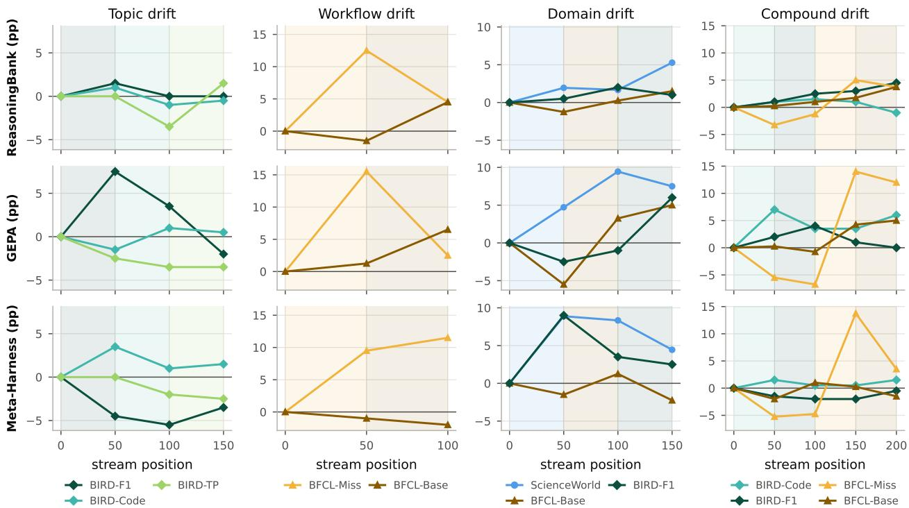  
Figure 1 | Per-group learning dynamics across the four drift scenarios (columns) and three methods (rows), plotted as the advantage over each method’s seed harness, $A [ t , k ] - B _ { k }$ (pp.). Each group has one color, used for its curve and for the wash of the block in which it is trained.

## 4.3. Self-Modification Causes Cross-Task Interference and Overwriting

Pre-block interference from task-specific rules. In self-modifying methods (GEPA and Meta-Harness), every update writes to a shared instruction or workspace surface that is injected into all subsequent rollouts, creating two forms of instability: pre-block interference $I _ { k }$ and post-block forgetting $F _ { k }$ (Eq. 10). Before a group’s training block begins $\left( t \leq \sigma _ { k } \right)$ , rules specialized to earlier blocks are applied unconditionally to unseen tasks, pushing their accuracy below the seed harness $B _ { k }$ (Table 1 and Figure 1; full $- I _ { k }$ and $- F _ { k }$ breakdown in Table 3, Appendix B). Across unrelated domains, training on ScienceWorld in domain drift lowers BFCL-Base at position 50 by 5.5 under GEPA and 1.5 under Meta-Harness, and training on the two BIRD blocks in compound drift degrades BFCL-Miss before a single BFCL task has arrived, reaching −6.8 at position 100 under GEPA and −4.8 under Meta-Harness. Inspecting the evolved prompts at position 100 of compound drift explains this drop (Figure 6 in Appendix B): after the two BIRD blocks, both methods embed mandatory SQLite exploration and interactive verification instructions directly into the global system prompt, which biases the agent on incoming BFCL-Miss tasks to invoke exploratory lookup tools rather than ask the user for missing arguments. Even when tasks are closely related and difer only in topic, as in topic drift, we still observe such interference: adapting to BIRD-F1 and BIRD-Code lowers BIRD-TP at position 100 by 3.5 under GEPA and 2.0 under Meta-Harness.

Post-block forgetting via compression and overwriting. After a group’s training block ends $\left( t \textgreater \tau _ { k } \right)$ , later blocks continue to modify the same shared prompt or workspace, compressing or overwriting earlier instructions and causing substantial post-block forgetting (Table 1 and Table 3 in Appendix B). Tracking the character share of each group’s rules in GEPA’s strategy prompt across checkpoints makes this displacement directly visible (Figure 3a,b; see Figure 8 in Appendix B for all four streams). On topic drift (Figure 3a), rules written during the BIRD-F1 block (+7.5 advantage at position 50) fall from 100% of the prompt at position 50 to 75.2% during BIRD-Code (position 100) and 40.2% during BIRD-TP (position 150, where BIRD-TP takes over 51.7% of the prompt), and BIRD-F1’s accuracy drops in lockstep to +3.5 at position 100 and −2.0 at position 150. Similarly, on compound drift (Figure 3b), BIRD-Code’s share falls from 100% at position 50 to 40.5% at position 100 and 14.7% at position 200; when the stream transitions from BIRD to BFCL-Miss after position 100, GEPA condenses the seven BIRD SQL sections (3,386 characters at position 100) into a single 1,034-character section, reducing BIRD-F1’s share from 59.5% at position 100 to 5.8% at position 150 (4.1% at position 200) and erasing its +4.0 gain by the end of the stream. Even when all four groups are interleaved uniformly rather than arriving in blocks, competing updates continue to contend for space in the shared prompt and degrade GEPA’s terminal advantage from +5.8 to +0.9 (Appendix A).

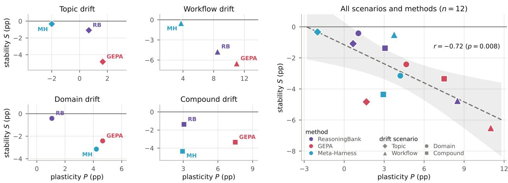  
Figure 2 | Plasticity � against stability � across the four drift scenarios. Left: per-scenario scatter (one point per method). Right: overall correlation across all four scenarios and three methods (� = 12; dashed line and shaded band show the linear least-squares fit and 95% confidence interval).

Spontaneous additive updates across distant domains are fragile. Occasionally, when consecutive blocks come from distant domains that share neither tools nor observations, the evolver spontaneously adopts an additive update pattern that prevents forgetting. On domain drift, GEPA’s strategy prompt grows from 4,372 characters after ScienceWorld (position 50) to 5,650 after BFCL-Base (position 100) and 7,621 after BIRD-F1 (position 150), appending new domain sections while retaining all six ScienceWorld sections verbatim (Figure 7, left, in Appendix B) and achieving �<sup>¯</sup> = 0.0 (Table 1 and Table 3). This additive behavior, however, emerges unreliably: on compound drift, when the stream transitions across domains from BIRD to BFCL-Miss after position 100, GEPA instead compresses the seven BIRD SQL sections into a single generic section (Figure 7, right), causing the BIRD-F1 advantage to drop from +4.0 at position 100 to 0.0 at position 200 (Table 1 and Figure 1).

Behavioral reversal under conflicting workflows. Forgetting is most severe when consecutive blocks have nearly identical queries and domains but require opposite workflows, as in workflow drift and the BFCL transition of compound drift (Figure 3c). Because the surface domain and tool catalog do not change, the model fails to recognize a shift and rewrites the earlier policy into its opposite. Before the BFCL-Miss block, the seed agent calls tools speculatively on 91% to 93% of BFCL-Miss episodes and asks the user for missing arguments on only 3.8% to 5.8%. Training on BFCL-Miss teaches both self-modifying methods to withhold speculative calls and ask for clarification, raising the clarification rate after the BFCL-Miss block to 29.8% under GEPA on workflow drift (+15.5 accuracy gain) and 60.8% under Meta-Harness on compound drift (+13.8). In the subsequent BFCL-Base block, however, all required arguments are already supplied and asking unnecessary clarifying questions is penalized. Both methods consequently rewrite their instructions to execute tool calls directly without asking the user. On workflow drift, this rewrite under GEPA cuts the clarification rate on BFCL-Miss from 29.8% (119/400 rollouts) to 11.2% (45/400) and drops BFCL-Miss accuracy by 13.0 (from +15.5 at position 50 to +2.5 at position 100; Table 1). Meta-Harness shows the same reversal on compound drift. At position 150, it writes a rule across its prompt, memory, and skill files that forbids speculative calls when arguments are missing. During the BFCL-Base block at position 175, however, an accepted edit overwrites all three files with instructions to execute tools immediately in sequence. This reduces clarification asks on BFCL-Miss from 60.8% to 8.5% (34/400) and drops accuracy by 10.2 at position 200.

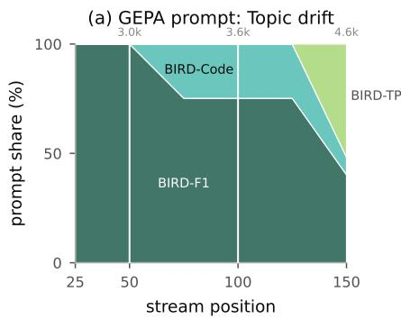

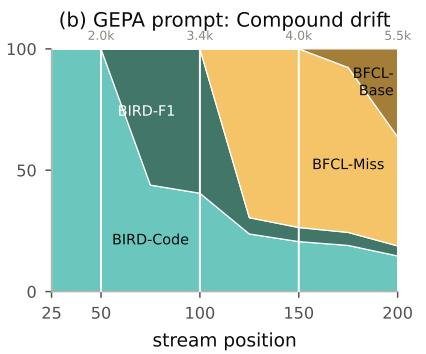

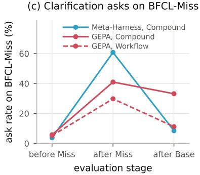  
Figure 3 | Mechanisms of post-block forgetting under self-modification. (a,b) Share of GEPA’s strategy prompt characters attributed to the block in which each line was first written on topic drift (a) and compound drift (b) (numbers above each panel give total strategy length; full four-stream comparison in Figure 8, Appendix B). (c) Percentage of BFCL-Miss evaluation episodes in which the agent withholds tool calls and asks for clarification before the BFCL-Miss block, after the BFCL-Miss block, and after the subsequent BFCL-Base block.

## 4.4. Similarity-Based Retrieval Cannot Prevent Interference or Collision

Domain separation prevents post-block forgetting. Storing experiences in an external memory bank and retrieving the top match by query similarity allows ReasoningBank to leave the system prompt untouched, which eliminates post-block forgetting when task domains are well separated: on domain drift, queries from ScienceWorld, BFCL-Base, and BIRD have much higher within-group than cross-group nearest-match cosine similarity (0.80–0.95 vs. 0.57–0.63; Figure 4b and Table 4 in Appendix C), so no evaluation episodes (0%) after a block is populated retrieve a memory from another domain and $\bar { F } = 0 . 0$ . Across the four streams, however, retrieval alone still fails to prevent continual learning instability (Table 1 and Figure 4).

Pre-block interference from foreign memory retrieval. Because retrieval always injects the nearest stored match without a similarity threshold, any group evaluated before its own training block begins $\left( t \leq \sigma _ { k } \right)$ has zero in-group entries in the store and receives foreign memories in 100% of episodes (Figure 4a). On domain drift, injecting ScienceWorld memories into BFCL-Base at position 50 lowers accuracy by 1.2; on compound drift, every BFCL-Miss episode at positions 50 and 100 receives a BIRD SQL reflection, pulling BFCL-Miss up to 3.2 below the seed; and on topic drift, retrieving BIRD-F1 and BIRD-Code memories lowers BIRD-TP by 3.5 at position 100. While adding a similarity threshold could mitigate this unconditional retrieval, query similarity alone struggles to distinguish how related two queries actually are: even within the same text-to-SQL task, queries across diferent topics have a nearest-match similarity (0.60–0.64, dashed box in Figure 4b) that is barely higher than the similarity across completely diferent tasks and domains (0.56–0.63).

(a) Foreign memory retrieval on compound drift (%)  
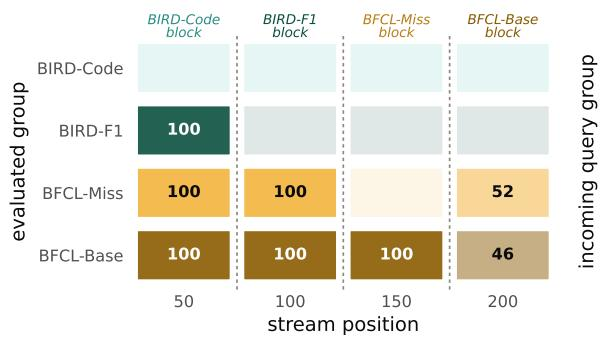

(b) Nearest-match query cosine similarity  
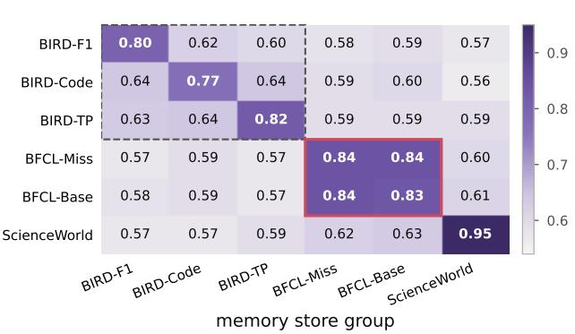  
Figure 4 | Mechanisms of interference and collision under ReasoningBank’s similarity-based retrieval. (a) Share (%) of evaluation episodes on compound drift whose retrieved memory came from a foreign task group (each row tinted in the evaluated group’s color, darker with the foreign share; empty cells are 0%; dashed lines separate training blocks). Before a group’s block begins, 100% of retrievals come from earlier blocks; at position 200, 52% of BFCL-Miss and 46% of BFCL-Base episodes retrieve a memory from the opposite BFCL workflow. (b) Mean nearest-match query cosine similarity across the six task groups (dashed box: BIRD databases; red box: BFCL-Miss and BFCL-Base, whose cross-group similarity matches their within-group similarity).

Retrieval collision when similar queries require conflicting workflows. Even with a similarity threshold, retrieval cannot prevent pre-block interference or post-block forgetting when distinct task groups occupy the same region of the embedding space (Figure 4b). Under workflow shifts, BFCL-Miss and BFCL-Base queries refer to the same API catalog and are phrased in nearly identical language, exhibiting a mean pairwise cosine similarity of 0.667 and a mean nearest-match similarity of 0.835–0.840, which is indistinguishable from their within-group similarity (0.664–0.666 pairwise and 0.834–0.837 nearest-match; red box in Figure 4b). No similarity threshold can separate the two groups. Before the BFCL-Base block begins on workflow drift, BFCL-Miss abstention memories are retrieved into BFCL-Base episodes, causing pre-block interference (−1.5 at position 50). Conversely, once the BFCL-Base block populates the store with memories that reward multi-step tool execution, 52% of BFCL-Miss evaluation episodes at the end of both workflow drift and compound drift (Figure 4a) retrieve a BFCL-Base memory (while 46% of BFCL-Base episodes retrieve a BFCL-Miss memory), displacing the earlier abstention examples and dropping BFCL-Miss accuracy by 8.0 on workflow drift (+12.5 → +4.5). Semantic similarity between queries captures topical overlap, but cannot determine whether a stored trajectory’s workflow is compatible with the incoming task.

## 5. Related Work

Self-evolving agents. Self-evolving agents update themselves from their own experience rather than remaining fixed after training. In the nonparametric form studied here, the evolver edits the harness and leaves the weights untouched, following one of two paradigms. Self-modification rewrites the artifacts the agent runs on: automatic prompt optimization such as GEPA (Agrawal et al., 2025), TextGrad (Yuksekgonul et al., 2024), and PromptBreeder (Fernando et al., 2024) rewrites the system prompt from rollout feedback, while ADAS (Hu et al., 2025), Darwin Gödel Machine (Zhang et al., 2025c), EvoTest (He et al., 2026), and Meta-Harness (Lee et al., 2026) extend the edits to the agent’s code (Yin et al., 2024). Experience augmentation keeps the artifacts fixed and accumulates an external store that later episodes retrieve from: reflections in Reflexion (Shinn et al., 2023) and ExpeL (Zhao et al., 2024), skills in Voyager (Wang et al., 2024), and memory items in ReasoningBank (Ouyang et al., 2025), MemGen (Zhang et al., 2025a), and Mem0 (Chhikara et al., 2025). Parametric counterparts instead update the weights at test time, through self-correction training in SCoRe (Kumar et al., 2024), reinforcement learning in TTRL (Zuo et al., 2025) and TTT-Discover (Yuksekgonul et al., 2026), or a learned evolver in LSE (Chen et al., 2026). Unlike prior work evaluated within a single task family, we study nonparametric methods on heterogeneous streams.

Continual learning. Continual learning studies a learner that faces a sequence of tasks and must acquire each without degrading performance on earlier ones, known as catastrophic forgetting (French, 1999; McCloskey and Cohen, 1989). Gradient-based methods counter it by protecting weights important to earlier tasks (Kirkpatrick et al., 2017), rehearsing stored examples (Buzzega et al., 2020; Chaudhry et al., 2019; Lopez-Paz and Ranzato, 2017), or shaping updates to maximize transfer and minimize interference (Riemer et al., 2018); see Parisi et al. (2019) and De Lange et al. (2022) for surveys. Our plasticity and stability metrics adapt standard continual-learning evaluation (Kemker et al., 2018; Lopez-Paz and Ranzato, 2017); task-free and online formulations relax explicit task boundaries (Aljundi et al., 2019; Koh et al., 2022), and continual evaluation exposes transient drops missed by end-of-task evaluation (De Lange et al., 2023), motivating our checkpoint resolution. For LLMs, continual learning has focused on weight updates (Shi et al., 2024; Wu et al., 2024): continual pre-training on emerging corpora (Jang et al., 2022; Ke et al., 2023), forgetting under sequential fine-tuning (Luo et al., 2023), and mitigation algorithms (Shenfeld et al., 2026). Rather than updating weights, the agents studied here keep weights frozen and carry their state in the harness.

## 6. Conclusion

We asked whether nonparametric self-evolving LLM agents are efective continual learners, and found that current methods remain caught in a trade-of between plasticity and stability. Across four drifting stream scenarios spanning shifts in topic, workflow, domain, and their combination, self-evolution improves overall performance over the seed harness in most settings, yet no method learns new task groups strongly without degrading others. Self-modifying methods (GEPA and Meta-Harness) can achieve high plasticity when rewriting a shared prompt, but because task-specific rules are applied globally across all subsequent rollouts, instructions learned on one block interfere with unseen tasks and are compressed or overwritten by later blocks, most severely when consecutive blocks share a domain but require conflicting workflows. Experience augmentation via query-similarity retrieval (ReasoningBank) avoids overwriting the shared prompt and prevents forgetting across distant domains, but still injects foreign memories before a group is encountered and sufers from retrieval collision when distinct workflows occupy the same region of the embedding space. Together, these findings expose the limitations of current self-evolving agents as continual learners.

## References

L. A. Agrawal, S. Tan, D. Soylu, N. Ziems, R. Khare, K. Opsahl-Ong, A. Singhvi, H. Shandilya, M. J. Ryan, M. Jiang, C. Potts, K. Sen, A. G. Dimakis, I. Stoica, D. Klein, M. Zaharia, and O. Khattab. GEPA: Reflective prompt evolution can outperform reinforcement learning. arXiv preprint arXiv: 2507.19457, 2025.

R. Aljundi, K. Kelchtermans, and T. Tuytelaars. Task-free continual learning. In Proceedings of the IEEE/CVF Conference on Computer Vision and Pattern Recognition, pages 11254–11263, 2019.

anomalyco. opencode: The open source coding agent. https://github.com/anomalyco/ opencode, 2026. GitHub repository. Accessed: 2026-08-15.

T. B. Brown, B. Mann, N. Ryder, M. Subbiah, J. Kaplan, P. Dhariwal, A. Neelakantan, P. Shyam, G. Sastry, A. Askell, S. Agarwal, A. Herbert-Voss, G. Krueger, T. Henighan, R. Child, A. Ramesh, D. M. Ziegler, J. Wu, C. Winter, C. Hesse, M. Chen, E. Sigler, M. Litwin, S. Gray, B. Chess, J. Clark, C. Berner, S. McCandlish, A. Radford, I. Sutskever, and D. Amodei. Language models are few-shot learners. arXiv preprint arXiv: 2005.14165, 2020.

P. Buzzega, M. Boschini, A. Porrello, D. Abati, and S. Calderara. Dark experience for general continual learning: a strong, simple baseline. In Advances in Neural Information Processing Systems, volume 33, pages 15920–15930, 2020.

A. Chaudhry, M. Ranzato, M. Rohrbach, and M. Elhoseiny. Eficient lifelong learning with A-GEM. In International Conference on Learning Representations, 2019.

X. Chen, C. Xu, Y. Wang, B. Liu, Z. Yao, and Y. He. Learning to self-evolve. arXiv preprint arXiv: 2603.18620, 2026.

P. Chhikara, D. Khant, S. Aryan, T. Singh, and D. Yadav. Mem0: Building production-ready AI agents with scalable long-term memory. In I. Lynce, N. Murano, M. Vallati, S. Villata, F. Chesani, M. Milano, A. Omicini, and M. Dastani, editors, ECAI 2025 - 28th European Conference on Artificial Intelligence, 25-30 October 2025, Bologna, Italy - Including 14th Conference on Prestigious Applications of Intelligent Systems (PAIS 2025), volume 413 of Frontiers in Artificial Intelligence and Applications, pages 2993–3000. IOS Press, 2025. doi: 10.3233/FAIA251160. URL https://doi.org/10. 3233/FAIA251160.

M. De Lange, R. Aljundi, M. Masana, S. Parisot, X. Jia, A. Leonardis, G. Slabaugh, and T. Tuytelaars. A continual learning survey: Defying forgetting in classification tasks. IEEE Transactions on Pattern Analysis and Machine Intelligence, 44(7):3366–3385, 2022.

M. De Lange, G. M. van de Ven, and T. Tuytelaars. Continual evaluation for lifelong learning: Identifying the stability gap. In International Conference on Learning Representations (ICLR), 2023.

Q. Dong, L. Li, D. Dai, C. Zheng, J. Ma, R. Li, H. Xia, J. Xu, Z. Wu, T. Liu, B. Chang, X. Sun, and Z. Sui. A survey on in-context learning. arXiv preprint arXiv: 2301.00234, 2022.

C. Fernando, D. S. Banarse, H. Michalewski, S. Osindero, and T. Rocktäschel. Promptbreeder: Selfreferential self-improvement via prompt evolution. In Proceedings of the 41st International Conference on Machine Learning, volume 235 of Proceedings ofMachine Learning Research, pages 13481–13544. PMLR, 2024.

R. M. French. Catastrophic forgetting in connectionist networks. Trends in Cognitive Sciences, 3(4): 128–135, 1999.

Google DeepMind. Gemini 3.6 Flash Model Card. https://storage.googleapis.com/ deepmind-media/Model-Cards/Gemini-3-6-Flash-Model-Card.pdf, July 2026. Accessed: 2026-08-14.

Y. He, J. Liu, Y. Liu, Y. Li, T. Cao, Z. Hu, X. Xu, and B. Hooi. EvoTest: Evolutionary test-time learning for self-improving agentic systems. In International Conference on Learning Representations, 2026.

S. Hu, C. Lu, and J. Clune. Automated design of agentic systems. In International Conference on Learning Representations, 2025.

J. Jang, S. Ye, S. Yang, J. Shin, J. Han, G. Kim, S. J. Choi, and M. Seo. Towards continual knowledge learning of language models. In International Conference on Learning Representations, 2022.

Z. Ke, Y. Shao, H. Lin, T. Konishi, G. Kim, and B. Liu. Continual pre-training of language models. arXiv preprint arXiv: 2302.03241, 2023.

R. Kemker, M. McClure, A. Abitino, T. Hayes, and C. Kanan. Measuring catastrophic forgetting in neural networks. In Proceedings of the AAAI Conference on Artificial Intelligence, 2018.

J. Kirkpatrick, R. Pascanu, N. Rabinowitz, J. Veness, G. Desjardins, A. A. Rusu, K. Milan, J. Quan, T. Ramalho, A. Grabska-Barwinska, D. Hassabis, C. Clopath, D. Kumaran, and R. Hadsell. Overcoming catastrophic forgetting in neural networks. Proceedings of the National Academy of Sciences, 114 (13):3521–3526, 2017.

H. Koh, D. Kim, J.-W. Ha, and J. Choi. Online continual learning on class incremental blurry task configuration with anytime inference. In International Conference on Learning Representations (ICLR), 2022.

A. Kumar, V. Zhuang, R. Agarwal, Y. Su, J. D. Co-Reyes, A. Singh, K. Baumli, S. Iqbal, C. Bishop, R. Roelofs, L. M. Zhang, K. McKinney, D. Shrivastava, C. Paduraru, G. Tucker, D. Precup, F. Behbahani, and A. Faust. Training language models to self-correct via reinforcement learning, 2024. URL https://arxiv.org/abs/2409.12917.

Y. Lee, R. Nair, Q. Zhang, K. Lee, O. Khattab, and C. Finn. Meta-Harness: End-to-end optimization of model harnesses. arXiv preprint arXiv: 2603.28052, 2026.

J. Li, B. Hui, G. Qu, J. Yang, B. Li, B. Li, B. Wang, B. Qin, R. Cao, R. Geng, N. Huo, X. Zhou, C. Ma, G. Li, K. C. C. Chang, F. Huang, R. Cheng, and Y. Li. Can LLM already serve as a database interface? A BIg bench for large-scale database grounded Text-to-SQLs, 2023. URL https: //arxiv.org/abs/2305.03111.

D. Lopez-Paz and M. Ranzato. Gradient episodic memory for continual learning. In Advances in Neural Information Processing Systems, volume 30, pages 6467–6476, 2017.

Y. Luo, Z. Yang, F. Meng, Y. Li, J. Zhou, and Y. Zhang. An empirical study of catastrophic forgetting in large language models during continual fine-tuning. arXiv preprint arXiv: 2308.08747, 2023.

M. McCloskey and N. J. Cohen. Catastrophic interference in connectionist networks: The sequential learning problem. In Psychology of Learning and Motivation, volume 24, pages 109–165. Academic Press, 1989.

S. Ouyang, J. Yan, I.-H. Hsu, Y. Chen, K. Jiang, Z. Wang, R. Han, L. T. Le, S. Daruki, X. Tang, V. Tirumalashetty, G. Lee, M. Rofouei, H. Lin, J. Han, C.-Y. Lee, and T. Pfister. ReasoningBank: Scaling agent self-evolving with reasoning memory. arXiv preprint arXiv: 2509.25140, 2025.

G. I. Parisi, R. Kemker, J. L. Part, C. Kanan, and S. Wermter. Continual lifelong learning with neural networks: A review. Neural Networks, 113:54–71, 2019.

S. G. Patil, H. Mao, F. Yan, C. C.-J. Ji, V. Suresh, I. Stoica, and J. E. Gonzalez. The Berkeley function calling leaderboard (BFCL): From tool use to agentic evaluation of large language models. In Proceedings of the 42nd International Conference on Machine Learning, volume 267 of Proceedings of Machine Learning Research, pages 48371–48392. PMLR, 2025.

R. Pryzant, D. Iter, J. Li, Y. Lee, C. Zhu, and M. Zeng. Automatic prompt optimization with “gradient descent” and beam search. In Proceedings of the 2023 Conference on Empirical Methods in Natural Language Processing, pages 7957–7968, 2023.

M. Riemer, I. Cases, R. Ajemian, M. Liu, I. Rish, Y. Tu, and G. Tesauro. Learning to learn without forgetting by maximizing transfer and minimizing interference. arXiv preprint arXiv:1810.11910, 2018.

I. Shenfeld, M. Damani, J. Hübotter, and P. Agrawal. Self-distillation enables continual learning. arXiv preprint arXiv: 2601.19897, 2026.

H. Shi, Z. Xu, H. Wang, W. Qin, W. Wang, Y. Wang, Z. Wang, S. Ebrahimi, and H. Wang. Continual learning of large language models: A comprehensive survey. arXiv preprint arXiv: 2404.16789, 2024.

N. Shinn, F. Cassano, A. Gopinath, K. Narasimhan, and S. Yao. Reflexion: Language agents with verbal reinforcement learning. In Advances in Neural Information Processing Systems, volume 36, pages 8634–8652, 2023.

M. Shridhar, X. Yuan, M.-A. Côté, Y. Bisk, A. Trischler, and M. Hausknecht. ALFWorld: Aligning text and embodied environments for interactive learning. arXiv preprint arXiv: 2010.03768, 2020.

G. M. van de Ven and A. S. Tolias. Three scenarios for continual learning. arXiv preprint arXiv:1904.07734, 2019.

G. Wang, Y. Xie, Y. Jiang, A. Mandlekar, C. Xiao, Y. Zhu, L. Fan, and A. Anandkumar. Voyager: An open-ended embodied agent with large language models. Transactions on Machine Learning Research, 2024.

R. Wang, P. Jansen, M.-A. Côté, and P. Ammanabrolu. ScienceWorld: Is your agent smarter than a 5th grader? arXiv preprint arXiv: 2203.07540, 2022.

Z. Wang, S. Liu, Y. Sun, H. Li, and K. Shen. CodeContests+: High-quality test case generation for competitive programming. arXiv preprint arXiv: 2506.05817, 2025.

T. Wu, L. Luo, Y.-F. Li, S. Pan, T.-T. Vu, and G. Hafari. Continual learning for large language models: A survey. arXiv preprint arXiv: 2402.01364, 2024.

S. Yao, J. Zhao, D. Yu, N. Du, I. Shafran, K. Narasimhan, and Y. Cao. ReAct: Synergizing reasoning and acting in language models. In International Conference on Learning Representations (ICLR), 2023.

X. Yin, X. Wang, L. Pan, L. Lin, X. Wan, and W. Y. Wang. Gödel Agent: A self-referential agent framework for recursive self-improvement. arXiv preprint arXiv: 2410.04444, 2024.

M. Yuksekgonul, F. Bianchi, J. Boen, S. Liu, Z. Huang, C. Guestrin, and J. Zou. TextGrad: Automatic “diferentiation” via text. arXiv preprint arXiv: 2406.07496, 2024.

M. Yuksekgonul, D. Koceja, X. Li, F. Bianchi, J. McCaleb, X. Wang, J. Kautz, Y. Choi, J. Zou, C. Guestrin, and Y. Sun. Learning to discover at test time. arXiv preprint arXiv: 2601.16175, 2026.

G. Zhang, M. Fu, and S. Yan. MemGen: Weaving generative latent memory for self-evolving agents. arXiv preprint arXiv: 2509.24704, 2025a.

H. Zhang, L. Zhang, Y. Li, Y. Huang, X. Yang, K. Du, Y. Cheng, J. Jiang, and W. Xiao. InfraGym: Empowering LLM agents for real-world computer system optimization. In ML for Systems Workshop at NeurIPS 2025, 2025b. URL https://openreview.net/forum?id=4BxM63tTgc.

J. Zhang, S. Hu, C. Lu, R. Lange, and J. Clune. Darwin Gödel Machine: Open-ended evolution of self-improving agents. arXiv preprint arXiv:2505.22954, 2025c.

A. Zhao, D. Huang, Q. Xu, M. Lin, Y.-J. Liu, and G. Huang. ExpeL: LLM agents are experiential learners. In Proceedings of the AAAI Conference on Artificial Intelligence, volume 38, pages 19632–19642, 2024.

Y. Zhou, A. I. Muresanu, Z. Han, K. Paster, S. Pitis, H. Chan, and J. Ba. Large language models are human-level prompt engineers. arXiv preprint arXiv:2211.01910, 2022.

Y. Zuo, K. Zhang, L. Sheng, S. Qu, G. Cui, X. Zhu, H. Li, Y. Zhang, X. Long, E. Hua, B. Qi, Y. Sun, Z. Ma, L. Yuan, N. Ding, and B. Zhou. TTRL: Test-time reinforcement learning. arXiv preprint arXiv: 2504.16084, 2025.

## A. Results on the Interleaved Mixture Stream

As a stationary reference, we also evaluate a mixture stream in which $w _ { t }$ is uniform across � and every position samples a random task group, corresponding to rehearsal in gradient-based continual learning (Chaudhry et al., 2019; Lopez-Paz and Ranzato, 2017). To test whether interleaving task groups throughout the stream eliminates the instability observed on drifting streams, we evaluate a uniformly interleaved Mix schedule on the four-group compound stream (BIRD-Code, BIRD-F1, BFCL-Miss, and BFCL-Base sampled uniformly across � = 200 tasks; Table 2). Because all groups are active throughout, pre-block interference and post-block forgetting are not defined, and we compare terminal advantage (Term.) and average advantage (Δ¯) directly against the corresponding blocked stream.

Interleaving tasks does not resolve the contention on a shared prompt: GEPA’s terminal advantage drops from +5.8 on the blocked stream to +0.9 on Mix (with BIRD-F1 falling to −4.5 and BIRD-Code to −1.0), while Meta-Harness also degrades on BIRD-F1 (−0.5 → −3.0) even as its overall terminal advantage rises from +0.8 to +1.9. Figure 5 tracks the composition of GEPA’s shared strategy prompt across checkpoints of the compound Mix stream, where lines are attributed by benchmark section and group-specific terms (and rules not specific to any group are counted as generic). Even when all four groups are active throughout the stream, they contend for space in the single shared prompt: BIRD-Code’s share falls from 37.0% at position 50 to 21.8% at position 100 and 5.8% at position 200 while BIRD-F1 rises from 0% to 22.8%, and competing SQL and BFCL updates leave both BIRD databases below the seed at the end of the stream.

Table 2 | Comparison between the blocked drifting schedule and the uniformly interleaved Mix schedule on the four-group compound stream (� = 200), reported in percentage points (pp.) over each method’s seed harness $B _ { k }$
<table><tr><td>Method</td><td>Schedule</td><td>Term.</td><td>Δ</td><td>BIRD-Code</td><td>BIRD-F1</td><td>BFCL-Miss</td><td>BFCL-Base</td></tr><tr><td rowspan="2">ReasoningBank</td><td>Blocked</td><td>+2.8</td><td>+1.5</td><td>-1.0</td><td>+4.5</td><td>+3.8</td><td>+3.8</td></tr><tr><td>Mix</td><td>+2.3</td><td>+1.2</td><td>-2.5</td><td>+2.0</td><td>+7.2</td><td>+2.5</td></tr><tr><td rowspan="2">GEPA</td><td>Blocked</td><td>+5.8</td><td>+3.1</td><td>+6.0</td><td>+0.0</td><td>+12.0</td><td>+5.0</td></tr><tr><td>Mix</td><td>+0.9</td><td>+0.4</td><td>-1.0</td><td>-4.5</td><td>+8.7</td><td>+0.2</td></tr><tr><td rowspan="2">Meta-Harness</td><td>Blocked</td><td>+0.8</td><td>+0.2</td><td>+1.5</td><td>-0.5</td><td>+3.5</td><td>-1.5</td></tr><tr><td>Mix</td><td>+1.9</td><td>+0.5</td><td>+1.5</td><td>-3.0</td><td>+5.2</td><td>+3.8</td></tr></table>

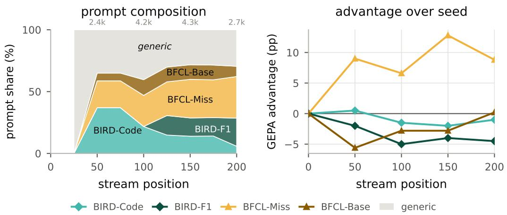  
Figure 5 | GEPA strategy prompt composition (left) and per-group advantage over the seed (right) on the interleaved compound Mix stream. Rules not specific to any group are counted as generic.

## B. Per-Group Continual Learning Decomposition and Evolved Prompts

Table 3 decomposes each task group’s stability $S _ { k } = - \big ( I _ { k } + F _ { k } \big )$ from Table 1 into pre-block interference $- I _ { k }$ and post-block forgetting $- F _ { k }$ across the four drifting streams.

Table 3 | Per-group continual learning decomposition across the four drifting streams. $B _ { k }$ is the mean seed accuracy (%); $P _ { k }$ is within-block plasticity at block end $\tau _ { k } ; - I _ { k }$ is pre-block interference prior to $\sigma _ { k } ; - F _ { k }$ is post-block forgetting from $\tau _ { k }$ to $T ;$ and Term. is terminal advantage $A [ T , k ] - B _ { k }$ (all in pp.). An em-dash marks a structurally undefined cell $( \sigma _ { k } = 0 \mathrm { f o r } - I _ { k } ; \tau _ { k } = T \mathrm { f o r } - F _ { k } )$
<table><tr><td></td><td></td><td></td><td colspan="4">ReasoningBank</td><td colspan="4">GEPA</td><td colspan="4">Meta-Harness</td></tr><tr><td>Stream</td><td>Task group (block)</td><td> $B _ { k }$ </td><td> $P _ { k }$ </td><td>−Ik −Fk Term.</td><td></td><td></td><td></td><td> $\begin{array} { r l } { P _ { k } } & { { } { } - I _ { k } } \end{array}$ </td><td> $- F _ { k }$ </td><td>Term.</td><td> $P _ { k }$ </td><td>-Ik</td><td> $- { \cal F } _ { k }$ </td><td>Term.</td></tr><tr><td>Topic</td><td>BIRD-F1 (0→50)</td><td>52.5</td><td>+1.5</td><td></td><td>-1.5</td><td>+0.0</td><td>+7.5</td><td></td><td>-9.5</td><td>-2.0</td><td>-4.5</td><td></td><td>-0.0</td><td>-3.5</td></tr><tr><td></td><td>BIRD-Code (50→100)</td><td>61.8</td><td>-1.0</td><td>-0.0-0.0</td><td></td><td>-0.5</td><td>+1.0-1.5</td><td></td><td>-0.5</td><td>+0.5</td><td>+1.0</td><td>-0.0</td><td>-0.0</td><td>+1.5</td></tr><tr><td></td><td>BIRD-TP (100→150)</td><td>43.2</td><td>+1.5</td><td>-1.8</td><td></td><td>+1.5</td><td>-3.5 -3.0</td><td></td><td></td><td>-3.5</td><td></td><td>-2.5 -1.0</td><td></td><td>-2.5</td></tr><tr><td>Workflow</td><td>BFCL-Miss (0→50)</td><td>53.8</td><td>+12.5</td><td></td><td>-8.0</td><td>+4.5</td><td>+15.5</td><td></td><td>-13.0</td><td>+2.5</td><td>+9.5</td><td></td><td>-0.0</td><td>+11.5</td></tr><tr><td></td><td>BFCL-Base (50→100)</td><td>77.3</td><td>+4.5</td><td>-1.5</td><td></td><td>+4.5</td><td>+6.5</td><td>-0.0</td><td></td><td>+6.5</td><td></td><td>-2.0-1.0</td><td></td><td>-2.0</td></tr><tr><td>Domain</td><td>ScienceWorld (0→50)</td><td>78.9</td><td>+1.9</td><td></td><td>-0.0</td><td>+5.3</td><td>+4.7</td><td></td><td>-0.0</td><td>+7.5</td><td>+8.9</td><td></td><td>-4.4</td><td>+4.4</td></tr><tr><td></td><td>BFCL-Base (50→100)</td><td>79.2</td><td>+0.2</td><td>-1.2</td><td>-0.0</td><td>+1.5</td><td>+3.2</td><td>-5.5</td><td>-0.0</td><td>+5.0</td><td>+1.2</td><td>-1.5</td><td>-3.5</td><td>-2.2</td></tr><tr><td></td><td>BIRD-F1 (100→150)</td><td>50.8</td><td>+1.0</td><td>-0.0</td><td></td><td>+1.0</td><td>+6.0</td><td>-1.8</td><td></td><td>+6.0</td><td>+2.5</td><td>-0.0</td><td></td><td>+2.5</td></tr><tr><td></td><td>Compound BIRD-Code (0→50)</td><td>61.5</td><td>+1.0</td><td></td><td>-2.0</td><td>-1.0</td><td>+7.0</td><td></td><td>-1.0</td><td>+6.0</td><td>+1.5</td><td></td><td>-0.0</td><td>+1.5</td></tr><tr><td></td><td>BIRD-F1(50→100)</td><td>50.7</td><td>+2.5</td><td></td><td>-0.0-0.0</td><td>+4.5</td><td>+4.0</td><td>-0.0</td><td>-4.0</td><td>+0.0</td><td></td><td>-2.0 -1.5</td><td>-0.0</td><td>-0.5</td></tr><tr><td></td><td>BFCL-Miss (100→150)</td><td>52.3</td><td>+5.0</td><td>-2.2 -1.2</td><td></td><td>+3.8</td><td>+14.0</td><td>-6.1</td><td>-2.0</td><td>+12.0</td><td>+13.8</td><td></td><td>-5.0-10.2</td><td>+3.5</td></tr><tr><td></td><td>BFCL-Base (150→200) 77.1</td><td></td><td>+3.8</td><td>-0.0</td><td></td><td>+3.8</td><td>+5.0</td><td>-0.2</td><td></td><td>+5.0</td><td></td><td>-1.5 -0.7</td><td></td><td>-1.5</td></tr></table>

Figure 8 tracks the composition of GEPA’s shared strategy prompt across checkpoints of the four drifting streams alongside each group’s accuracy advantage over the seed (§4.3). At each checkpoint, each line in the winning strategy text is attributed to the block in which it was first written (with carried-over or edited lines keeping their original group), and each group’s share is measured as the fraction of characters in its lines. On topic, workflow, and compound drift, later blocks compress or overwrite the sections written for earlier groups (for example, BIRD-F1’s share falls from 100% at position 50 to 40.2% at position 150 on topic drift, and from 59.5% at position 100 to 4.1% at position 200 on compound drift), and the corresponding accuracy gains decay in lockstep. Only on domain drift, where ScienceWorld, BFCL-Base, and BIRD have disjoint action and observation spaces, does

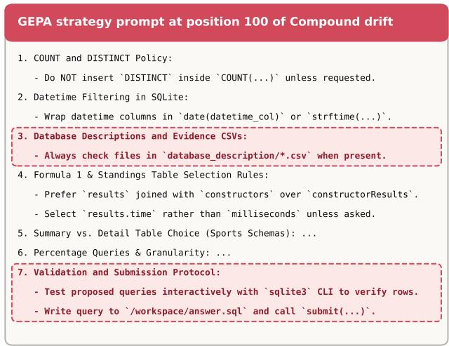

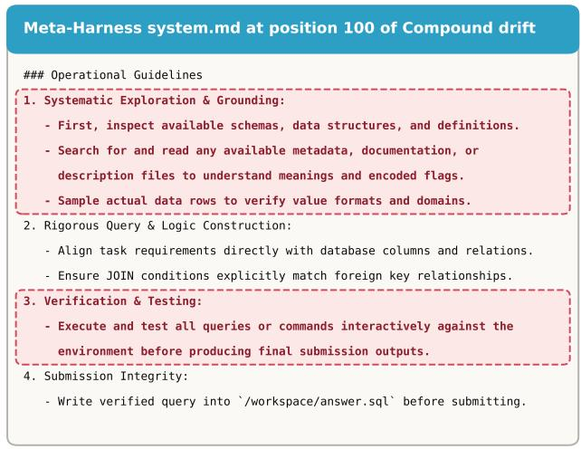

Figure 6 | Evolved system prompts at position 100 of compound drift (immediately after the two BIRD SQL blocks and before the BFCL-Miss block) for GEPA (left) and Meta-Harness (right). Highlighted regions mark mandatory SQLite exploration, file-inspection, and interactive testing instructions that are injected into subsequent BFCL-Miss episodes (§4.3), biasing the agent toward calling exploratory lookup tools rather than asking the user for missing arguments.  
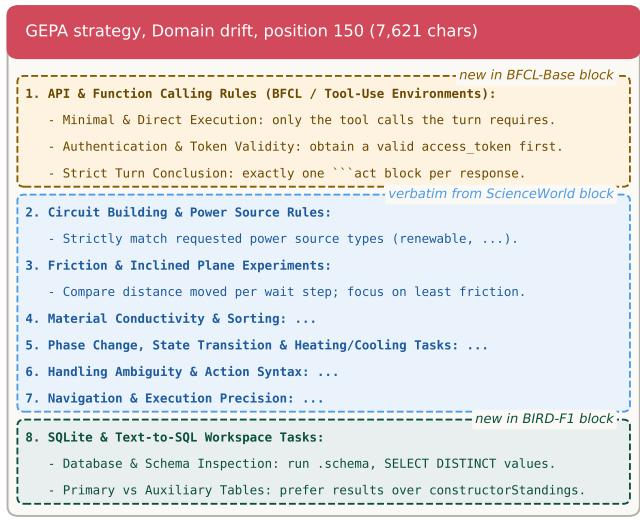

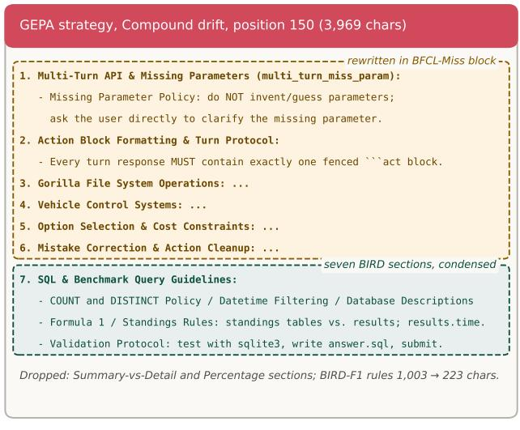  
Figure 7 | GEPA’s evolved strategy at position 150 of domain drift (left) and compound drift (right), abridged; highlights follow the benchmark palette (BFCL amber, ScienceWorld blue, BIRD green) and italic tags are our annotations. On domain drift, GEPA appends a BFCL-Base section and a BIRD section while keeping all six ScienceWorld sections verbatim (4,372 → 7,621 characters). On compound drift, the BFCL-Miss block rewrites sections 1–6 and condenses the seven BIRD sections (3,386 characters at position 100) into a single 1,034-character section 7.

GEPA append new sections without overwriting earlier ones, retaining all six ScienceWorld sections verbatim (57.1% of the prompt at position 150).

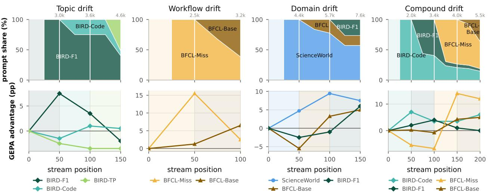  
Figure 8 | GEPA strategy composition (top; share of strategy characters, each line attributed to the block in which it was first written, with carried-over or edited lines keeping their original group; numbers above each panel give total strategy length) and per-group advantage over the seed (bottom) on the four drifting streams. Shading marks training blocks.

## C. Similarity and Cross-Group Retrieval under ReasoningBank

ReasoningBank writes one entry to its store per training episode and injects the most similar stored entry into each evaluation episode (Appendix D). Table 4 reports both the mean pairwise cosine similarity and the mean nearest-match cosine similarity across the six task groups (50 training queries per group, 768-dim normalized query embeddings; within-group diagonal entries exclude the trivial self-match � = �). Notably, the cross-group similarity between BFCL-Miss and BFCL-Base (0.667 pairwise, 0.835–0.840 nearest-match) is virtually identical to their within-group similarity (0.666 and 0.664 pairwise; 0.837 and 0.834 nearest-match), explaining why no similarity threshold can separate the two workflows. Within BIRD, nearest-match similarity across diferent database schemas (0.601 to 0.644) is barely higher than cross-domain similarity (0.560 to 0.626).

Figure 9 reports, for every checkpoint and evaluated task group across the four drifting streams and the interleaved compound stream (Mix), the share of ReasoningBank evaluation episodes whose top-1 retrieved memory entry was written during a diferent task group.

On all four drifting streams, any group evaluated before its own training block begins $\left( t \leq \sigma _ { k } \right)$ has zero in-group entries in the store and therefore receives a foreign memory in 100% of evaluation episodes (the lower-left triangle of 100% cells in Figure 9). Once a group’s own block has been populated, cross-group retrieval drops to 0% whenever the groups have distinct schemas or domains (topic drift, domain drift, and the BIRD groups of compound drift). Between BFCL-Miss and BFCL-Base, however, queries share the same API catalog and embedding region, causing 52% of BFCL-Miss and 46% of BFCL-Base episodes to retrieve from the opposite workflow at the end of workflow drift and compound drift (and 38%–60% throughout Compound Mix).

Table 4 | Query-embedding cosine similarity across the six task groups under ReasoningBank (50 training tasks per group; diagonal entries exclude self-matches). Top: mean pairwise cosine similarity $\mathbb { E } _ { i \in g _ { 1 } , j \in g _ { 2 } } [ \cos ( q _ { i } , q _ { j } ) ]$ . Bottom: mean nearest-match cosine similarity $\mathbb { E } _ { i \in g _ { 1 } } [ \operatorname* { m a x } _ { j \in g _ { 2 } } \cos ( q _ { i } , q _ { j } ) ]$
<table><tr><td>Group</td><td>BIRD-F1 BIRD-Code</td><td></td><td>BIRD-TP</td><td>BFCL-Miss</td><td>BFCL-Base</td><td>ScienceWorld</td></tr><tr><td colspan="7">Mean pairwise cosine similarity</td></tr><tr><td>BIRD-F1</td><td>0.660</td><td>0.560</td><td>0.550</td><td>0.527</td><td>0.532</td><td>0.528</td></tr><tr><td>BIRD-Code</td><td>0.560</td><td>0.644</td><td>0.575</td><td>0.541</td><td>0.543</td><td>0.527</td></tr><tr><td>BIRD-TP</td><td>0.550</td><td>0.575</td><td>0.707</td><td>0.536</td><td>0.535</td><td>0.545</td></tr><tr><td>BFCL-Miss</td><td>0.527</td><td>0.541</td><td>0.536</td><td>0.666</td><td>0.667</td><td>0.568</td></tr><tr><td>BFCL-Base</td><td>0.532</td><td>0.543</td><td>0.535</td><td>0.667</td><td>0.664</td><td>0.570</td></tr><tr><td>ScienceWorld</td><td>0.528</td><td>0.527</td><td>0.545</td><td>0.568</td><td>0.570</td><td>0.725</td></tr></table>

<table><tr><td colspan="7">Mean nearest-match cosine similarity (row queries against column store)</td></tr><tr><td>BIRD-F1</td><td>0.795</td><td>0.621</td><td>0.601</td><td>0.583</td><td>0.589</td><td>0.565</td></tr><tr><td>BIRD-Code</td><td>0.643</td><td>0.770</td><td>0.638</td><td>0.589</td><td>0.600</td><td>0.560</td></tr><tr><td>BIRD-TP</td><td>0.628</td><td>0.644</td><td>0.815</td><td>0.587</td><td>0.589</td><td>0.589</td></tr><tr><td>BFCL-Miss</td><td>0.571</td><td>0.590</td><td>0.574</td><td>0.837</td><td>0.840</td><td>0.601</td></tr><tr><td>BFCL-Base</td><td>0.576</td><td>0.593</td><td>0.573</td><td>0.835</td><td>0.834</td><td>0.606</td></tr><tr><td>ScienceWorld</td><td>0.574</td><td>0.573</td><td>0.592</td><td>0.616</td><td>0.626</td><td>0.951</td></tr></table>

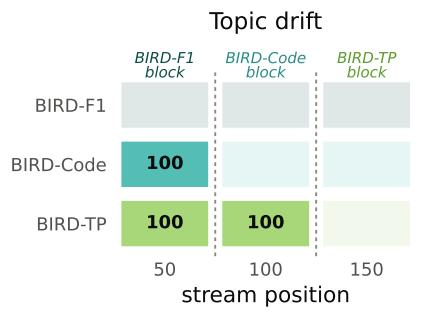

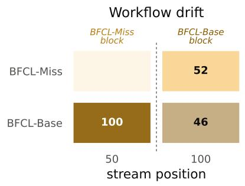

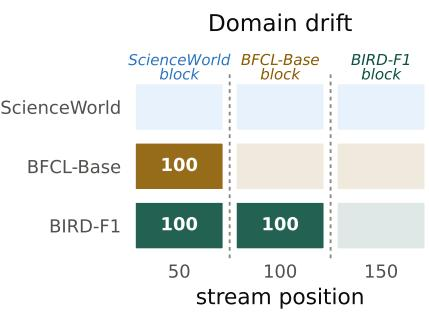

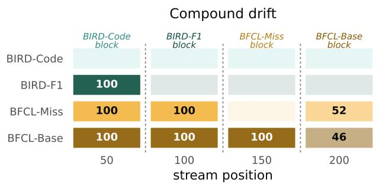

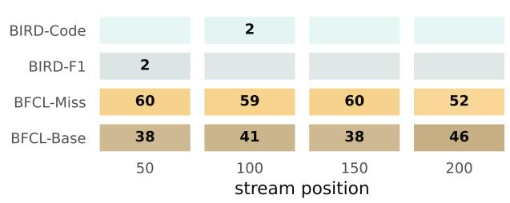  
Figure 9 | Share (%) of ReasoningBank evaluation episodes whose injected memory entry was written under a task group other than the one evaluated, across the four drifting streams and Compound Mix. Each row is tinted in the color of the evaluated group, darker with the foreign share; empty cells are 0%. Dashed lines separate training blocks on the drifting streams.

## D. Implementation Details

Seed harness. At each step the agent receives the environment observation and outputs an action in an act block (Appendix E). In BIRD, the agent interacts with a read-only SQLite database via a Bash workspace (with the sqlite3 CLI and per-table CSV descriptions) and finishes by writing its SQL query to /workspace/answer.sql and calling submit(path="/workspace/answer.sql"); in

<table><tr><td>Parameter</td><td>Value</td></tr><tr><td>temperature</td><td>1.0</td></tr><tr><td>max_output_tokens</td><td>8192</td></tr><tr><td>thinking_level</td><td>MEDIUM</td></tr></table>

Table 5 | Generation parameters.

BFCL, the block carries a list of Python function calls executed against stateful multi-turn APIs (such as a file system, a trading account, and a travel-booking service) or a reply(...) message to the user; in ScienceWorld, legal text actions are defined and processed directly by the simulator.

Retrieval. ReasoningBank embeds its memory items and the current query with gemini-embedding-2, and retrieves the nearest stored entry by cosine similarity in that space. It is the only method with a retrieval step: GEPA and Meta-Harness carry their state in a shared prompt and workspace respectively, both of which are read in full.

Meta-Harness proposer. Meta-Harness may rewrite the code of the harness itself, so its proposer has to read and edit a working codebase. We therefore run the proposer in the opencode harness (anomalyco, 2026) rather than in the seed harness, which is the plain ReAct loop of §4.1 and ofers no such capability. The proposer uses the same Gemini 3.6 Flash (Google DeepMind, 2026) as the backend model, with the same generation parameters in Table 5.

## E. Seed System Prompt and Environment Preambles

All three methods share the seed system prompt below and difer in which of its two anchors they write to. GEPA rewrites the S1 body; ReasoningBank leaves S1 untouched and injects retrieved memory items at S2; Meta-Harness may edit both, along with the controller code that orchestrates them.

```erb
<S1:REPLACEABLE_SYSTEM_PROMPT>
You are a general agent operating an interactive environment. Solve the task by choosing one
executable action at a time from the environment interface described in the user message.
On every turn, respond with exactly one action enclosed in a fenced block whose opening line is
exactly ```act. Use this form:
```act
ACTION
Only the contents of the first ```act fenced block are sent to the environment. Any content after
that block is discarded. Do not invent, predict, or continue an Observation; wait for the
environment to return it. A missing, empty, or unclosed ```act block is malformed and still
consumes one step. Keep any reasoning concise and place the action itself inside the block.
The episode ends in exactly three cases: the environment declares completion, you execute submit, or
the step limit is exhausted.
Follow the environment preamble in the user message for the available action syntax and task rules.
Use observations already returned by the environment, verify progress when useful, and submit
before the limit when the interface requires submission.
<S2:FIXED_TAIL_INJECTION_SLOT>
```

ReasoningBank’s items are injected under the header Retrieved Memories.

## E.1. User Message Template and Environment Preambles

Every episode opens with one user message assembling the benchmark’s environment preamble, the task statement, and the first observation. Subsequent turns carry the observation alone, as <OBSERVATION step="�">.

<ENVIRONMENT\_PREAMBLE>   
{environment preamble for this benchmark, reproduced below}   
</ENVIRONMENT\_PREAMBLE>   
<TASK>   
{task statement}   
</TASK>   
<OBSERVATION step="0">   
{first observation from the environment}   
</OBSERVATION>

The environment preamble is the only part of the prompt that varies by benchmark. It states the action interface and the step limit, and no method may edit it: it is part of the environment, not of the harness.

## BIRD.

Environment: isolated SQLite question-answering workspace.   
The exact bytes inside each \`\`\`act block are interpreted in one of two ways:   
1. Any ordinary block is executed as a Bash program in \`/workspace\`. Standard output, standard error   
, and the return code are returned as the next observation. Commands time out after 60 seconds.   
The workspace has no network access.   
2. The exact terminal form \`submit(path="/workspace/answer.sql")\` submits the current contents of   
that file and ends the episode. No other delivery channel is accepted.   
The task database is mounted read-only under \`/data/\`, and the \`sqlite3\` command-line shell is   
installed. Where available, per-table column descriptions are CSV files in the database's   
database\_description/\` directory. Write exactly one SQLite query that answers the question to \`/   
workspace/answer.sql\`. Success is determined after submission by strict-prompt-delivery-v1: the   
submitted query is executed against the database and its result rows are compared with those   
of a hidden reference query, with a 30-second execution limit.   
Step limit: 20 model calls.

BFCL. In BFCL the task arrives as the first <USER\_TURN> block in place of <TASK>, and each later user turn arrives as a new message once the agent ends the current turn with reply. The function schemas are filled in per task from the API classes the task involves.

Environment: pinned BFCL v4 local stateful APIs, multi-turn.   
The user's requests arrive one turn at a time inside <USER\_TURN> blocks.   
Observations arrive inside <OBSERVATION> blocks. Each \`\`\`act block is one   
step and must contain exactly one of:   
1. A function-call list in the form [func\_a(x=1), func\_b(y="v")], one or   
more calls. Calls execute in order against the live APIs; each call's   
result is returned in order in the next observation. Calls cannot be   
nested.   
2. The exact form \`reply\`. It ends the current turn: control returns to   
the user, and their next turn (if any) arrives as the next message.   
\`reply\` produces no observation. Anything you want to say to the user   
belongs in the text before that act block.

At most 20 steps per turn; at the limit the turn is force-ended. The   
episode ends when the final turn ends. There is no submit. Do not assume   
the hidden initial backend state beyond what the task and API   
observations reveal.   
Available function schemas:   
<FUNCTION\_SCHEMAS>{JSON schemas of the API classes involved in this task}</FUNCTION\_SCHEMAS>

## ScienceWorld.

Environment: official ScienceWorld text environment.   
An action is the exact text inside the \`\`\`act block and is passed to ScienceWorld as one environment   
action. Available action templates are:   
activate OBJ; close OBJ; connect OBJ to OBJ; deactivate OBJ; disconnect OBJ; dunk OBJ in OBJ; eat   
OBJ; flush OBJ; focus on OBJ; go OBJ; inventory; look around; look at OBJ; look in OBJ; mix OBJ;   
move OBJ to OBJ; open OBJ; pick up OBJ; pour OBJ in OBJ; put down OBJ; read OBJ; use OBJ on   
OBJ; wait; wait1.   
Use exact object and room names from observations. Open doors or containers before using their   
contents. Placement uses "move X to Y". \`wait\` advances ten simulation iterations and \`wait1   
advances one; physical or biological changes may require them. Many goals require both carrying   
out the experiment and \`focus on X\`. The official environment score determines completion.   
submit\` ends the episode without overriding that score.   
Step limit: 100 model calls.